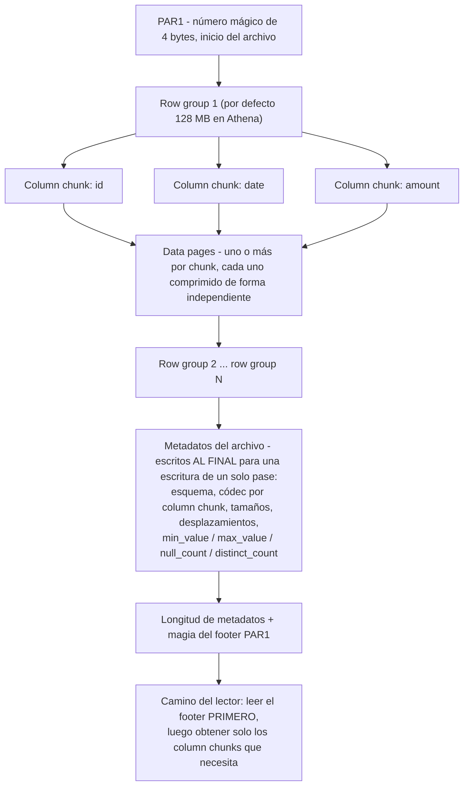
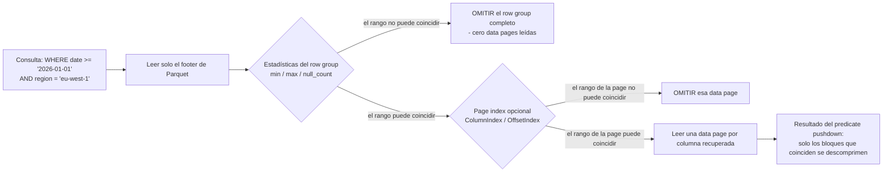
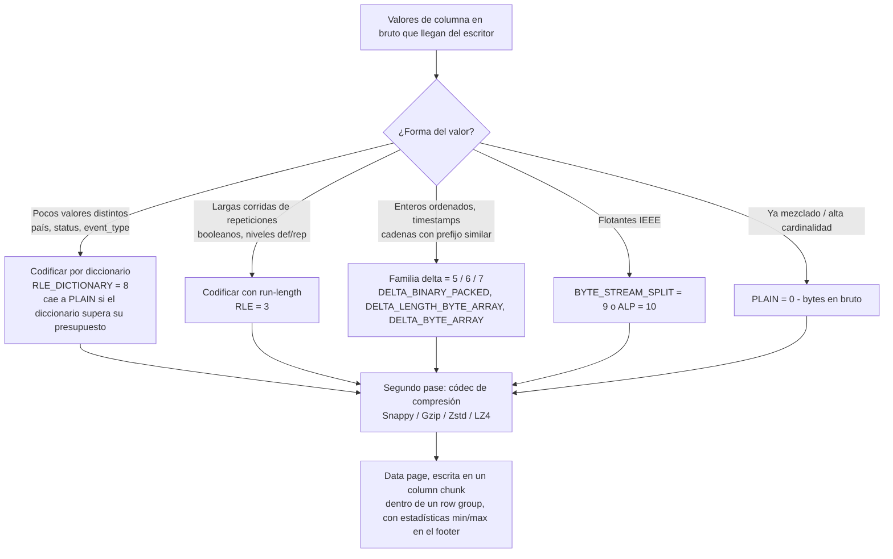
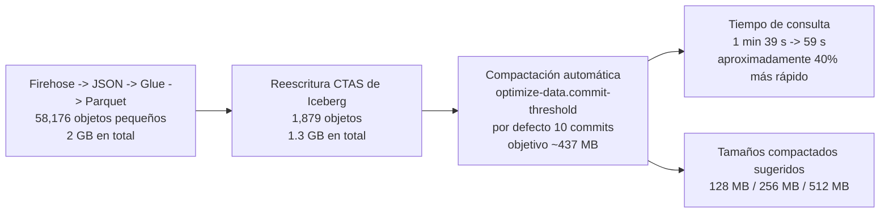
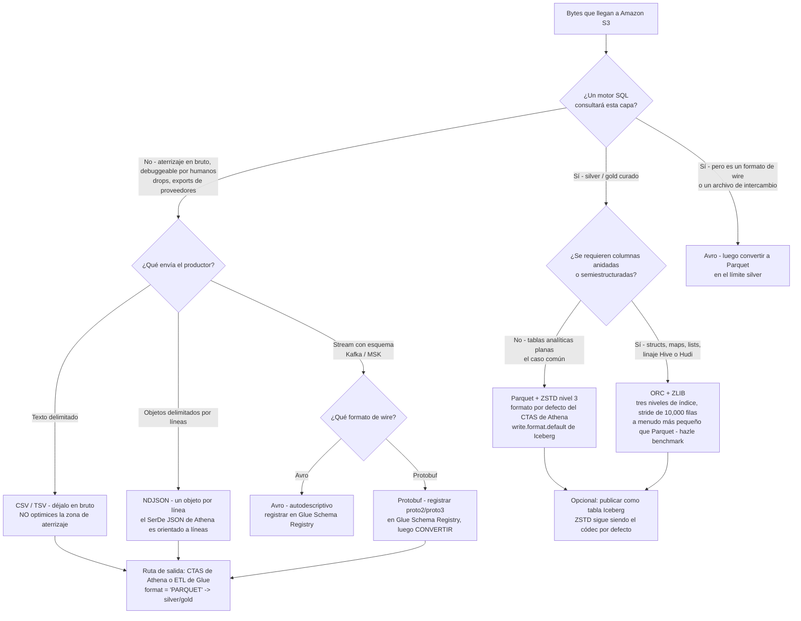

# Formatos de datos y compresión: CSV, JSON, Avro, Parquet y ORC

Amazon Athena precifica una sola cosa: «Consultar datos comprimidos es más rápido y también más barato porque pagas por el número de bytes escaneados antes de la descompresión» (Amazon Athena User Guide, *Compression formats*, consultado 2026-10-11). Todo lo demás en un diseño de lakehouse, particiones, grupos de trabajo, tamaños de clúster, reglas de ciclo de vida, está aguas abajo de una decisión que tomas en la primera semana y después vives durante años: **qué formato de archivo, qué códec de compresión, y cuán grande debe ser cada objeto.**

AWS publica la misma decisión como una historia de costes de tres pasos en su propia página de precios: una tabla de 3 TB, cuatro columnas, una sola consulta de una columna, facturada a **$5.00 por TB escaneado** en oct 2026. Texto sin comprimir = **$15.00**. Comprime el texto 3:1 con Gzip = **$5.00**. Gzip *y* convierte a Parquet, de modo que solo se lee una de cuatro columnas = **$1.25**. Misma consulta, misma respuesta, mismos datos: una diferencia de 12× creada enteramente por elecciones de formato y compresión.

Por eso esta lección viene antes de los formatos de tablas, antes del ETL, antes de la capa de consulta. Equivócate en los bytes y ningún ajuste de motor recupera el dinero.

**En esta lección vas a:**

- leer correctamente la **anatomía de fila frente a columnar**, row groups, column chunks, data pages, footers, estadísticas `min`/`max`, el page index opcional, y ver exactamente dónde ocurre el **predicate pushdown**;
- usar la **matriz de formatos** para CSV, JSON, Avro, Parquet, ORC y Protobuf: orientación, esquema en archivo, dividibilidad, tipos anidados, y qué motor de AWS realmente los leerá;
- aplicar la **matriz de evolución de esquema** por formato, incluyendo por qué Parquet lee por *nombre* mientras ORC lee por *índice* y qué te cuesta eso;
- explicar las **codificaciones**, diccionario + RLE, run-length encoding, la familia delta, `BYTE_STREAM_SPLIT`, y por qué corren *antes* que la compresión;
- elegir entre **Snappy, Gzip, Zstd y LZ4** con números de benchmarks de terceros fechados en la mano en lugar de folklore;
- dimensionar archivos en la banda de **128 MB: 1 GB** y diagnosticar (y luego arreglar) el **problema de archivos pequeños**;
- recorrer un **flujo de decisión de cuándo usar cuál** desde la zona de aterrizaje en bruto hasta gold;
- trabajar **siete ejemplos resueltos con cifras reales de oct 2026**: la aritmética de Athena, ratios de códecs, el desastre de conteo de archivos de micro-batch, un CTAS de 420 GB de CSV → Parquet, el factor de expansión de JSON, la recomendación de Iceberg + ZSTD, y una elección de códec para tabla caliente;
- estudiar **casos de clientes de AWS con nombre**, el «data swamp» de archivos Parquet de Vanguard y el lago columnar de Nasdaq, más Woot.com y ZS;
- leer el **recuadro de actualizaciones de octubre de 2026** (Glue 6.0 Iceberg v3, S3 Metadata, compactación de S3 Tables), y responder **doce preguntas de estilo examen** con cuatro comprobaciones interactivas.

---

## 1. Fila frente a columnar: la anatomía que fija tu factura

### 1.1 Un formato de fila almacena registros, enteros y repetidos

CSV, TSV, NDJSON, Avro y Protobuf son **formatos de fila**: los campos de un registro se mantienen juntos. La ventaja es exactamente lo que un productor necesita: escribe el registro completo, lee el registro completo, añade el siguiente registro. La desventaja aparece el momento en que una consulta toca un campo de cuarenta.

`SELECT amount FROM events WHERE date >= '2026-01-01'` contra texto orientado a filas tiene que recorrer cada byte de cada fila y saltarse los treinta y nueve campos que no quiere. No hay forma de saltar a la columna `amount`, porque la columna `amount` no existe como región contigua en ninguna parte del archivo.

JSON añade un segundo coste, más silencioso: **las claves se repiten en cada registro**. La matriz de formatos del resumen lo enuncia claramente: JSON tiene «sin esquema en archivo (las claves se repiten por registro)». Avro resuelve esa mitad del problema al incrustar un esquema JSON en el archivo (y mantener el esquema del escritor junto a los datos para la resolución de esquemas), pero sigue siendo orientado a filas.

### 1.2 Un formato columnar almacena campos, enteros y repetidos

Parquet y ORC son **columnares**: los valores de una columna se mantienen juntos, de modo que una consulta de 2 de 40 columnas lee aproximadamente 2/40 de los datos más metadatos. Eso no es una ratio de marketing: es el mecanismo por el que Athena factura. Su propia página de almacenamiento columnar dice que el predicate pushdown «permite que las consultas de Athena obtengan solo los bloques que necesita … usa estadísticas de predicados de bloques de datos, como valores máximos/mínimos, para determinar si leer u omitir el bloque» (consultada 2026-10-11).

### 1.3 …y en realidad ambos son híbridos (PAX)

La descripción honesta no es ni «fila» ni «columnar» sino **PAX**: un híbrido que particiona filas horizontalmente primero, y luego almacena las columnas de cada partición por separado. Como lo enuncia la revisión académica de 2023: «tanto Parquet como ORC emplean el formato PAX. El DBMS particiona primero una tabla horizontalmente en row groups. Luego almacena las tuplas columna por columna dentro de cada row group» (arXiv 2304.05028, 2023-11-07: fuente académica de terceros).

Siguen dos consecuencias, y ambas son examinables:

1. **«Fila frente a columnar» es un espectro, no un interruptor.** Reconstruir una fila completa todavía toca una unidad de localidad (un row group, un stripe): solo una mucho más pequeña que un archivo de texto entero.
2. **El tamaño de la unidad es un knob de ajuste, no una constante.** Athena documenta los valores por defecto: «El tamaño por defecto para row groups es 128 MB, y para stripes, 64 MB … No se recomienda disminuir el tamaño del row group o del stripe» (consultado 2026-10-11).

### 1.4 Anatomía de un archivo Parquet, de extremo a extremo

La propia documentación de formato de Parquet describe un archivo que comienza y termina con un número mágico de 4 bytes `PAR1`, contiene uno o más row groups, y escribe **los metadatos del archivo al final** de modo que el escritor hace un solo pase. El contrato del lector es la imagen en espejo: «Se espera que los lectores lean primero los metadatos del archivo para encontrar todos los column chunks que les interesan» (parquet.apache.org/docs/file-format/, consultado 2026-10-11).



El README del formato parquet añade dos hechos que vale la pena memorizar: «Un archivo consiste en uno o más row groups. Un row group contiene exactamente un column chunk por columna. Los column chunks contienen una o más pages», y los datos anidados usan «el codificado Dremel con niveles de definición y repetición».

La guía de dimensionamiento difiere por carga de trabajo, y ambas cifras son oficiales:

| Fuente | Tamaño recomendado de row group / bloque | Audiencia |
|---|---|---|
| Docs de ajuste de rendimiento de Athena (consultados 2026-10-11) | **128 MB** por defecto; disminuir «no recomendado» | SQL interactivo sobre S3 |
| Docs de limitación de S3 de Athena (consultados 2026-10-11) | Bloque Parquet **128 MB**, stripe ORC **64 MB** | escaneos paralelos |
| README de parquet-format (consultado 2026-10-11) | **512 MB: 1 GB** | lecturas masivas en diseños estilo HDFS |
| Configuración de Iceberg (consultada 2026-10-11) | row group **128 MB**, page **1 MB**, límite de filas por page **20,000**, diccionario **2 MB** | escrituras de formato de tablas |
| Banda del curso para este curso | **128 MB: 1 GB por archivo de datos** | lakehouse sobre S3 |

### 1.5 Estadísticas, el page index y el predicate pushdown

El footer lleva `Statistics {min_value, max_value, null_count, distinct_count}` por column chunk (`parquet.thrift`, consultado 2026-10-11). Un predicado de consulta se evalúa contra esos rangos *antes de que se lea cualquier data page*:



La documentación del page-index de Parquet describe el beneficio con precisión: «un page index es metadatos opcionales para un ColumnChunk, que contiene estadísticas para DataPages que pueden usarse para omitir esas pages», y «Una búsqueda de una sola fila en un row group … solo leerá una data page por columna recuperada» (consultado 2026-10-11).

El equivalente de ORC *no* es opcional y es de grano más fino por defecto. ORC provee «tres niveles de índices dentro de cada archivo: a nivel de archivo … a nivel de stripe … a nivel de fila: estadísticas … para cada conjunto de 10,000 filas dentro de un stripe» (orc.apache.org/docs/indexes.html, consultado 2026-10-11), y «A partir de Hive 1.2, los índices pueden incluir bloom filters». El stride de 10,000 filas es el `orc.row.index.stride=10,000` de Hive. ORC también dimensiona sus bloques de compresión a **256 KiB** (`orc.compress.size=262,144`) de modo que un bloque innecesario nunca se descomprime en absoluto.

> [!NOTE]
> **El predicate pushdown es una característica de estadísticas, no de compresión.** La compresión decide cuántos bytes cuesta un escaneo; las estadísticas deciden si el escaneo ocurre. Una tabla con compresión ZSTD perfecta sin estadísticas min/max todavía leerá cada row group. La propia redacción de Athena es «leer u **omitir** el bloque»: omitir es la ganancia.

- **📚 ¿Sabías que…?** Los crawlers de Glue descubren el esquema de un archivo leyendo *partes* diferentes de formatos diferentes: Avro «Lee el esquema al principio del archivo», Parquet «Lee el esquema al final del archivo», ORC «Lee los metadatos del archivo», y JSON lee el principio (clasificadores de AWS Glue, consultados 2026-10-11). Por eso un objeto Parquet truncado con un footer faltante es indescifrable para un crawler, mientras que un objeto Avro truncado no lo es.

### 1.6 Ejemplo resuelto E1: la aritmética de $15 → $5 → $1.25 (en oct 2026)

El ejemplo publicado por el propio AWS (`aws.amazon.com/athena/pricing/`, consultado 2026-10-11): una tabla de 3 TB con cuatro columnas, una consulta que lee una sola columna, Athena on-demand a **$5.00 por TB escaneado**.

| Diseño | Bytes escaneados | Coste por consulta |
|---|---|---|
| Texto sin comprimir, sin podado de columnas | 3.00 TB | 3.00 × $5.00 = **$15.00** |
| Misma tabla, Gzip a 3:1 | 1.00 TB | 1.00 × $5.00 = **$5.00** |
| Gzip + Parquet, la consulta toca 1 de 4 columnas | 0.25 TB | 0.25 × $5.00 = **$1.25** |

Escala: a **600 consultas al mes** eso es **$9,000.00** frente a **$3,000.00** frente a **$750.00**: una delta mensual de **$8,250.00** entre el peor y el mejor diseño sobre datos idénticos. La compresión compró el primer 3×; el diseño columnar más el predicate pushdown compraron el siguiente 4×.

Observa el orden. La compresión ayuda en proporción a los bytes escaneados; el podado de columnas lo multiplica. No puedes obtener el $1.25 con solo CSV con gzip, y no puedes obtenerlo de solo Parquet si cada consulta selecciona las cuatro columnas.

---

## 2. La matriz de formatos: CSV, JSON, Avro, Parquet, ORC y Protobuf

### 2.1 La matriz central

Seis formatos, cuatro ejes. Todo en la tabla está tomado de la documentación de AWS y Apache citada en el resumen (todas consultadas 2026-10-11).

| Formato | Orientación | Esquema en archivo | Divisible cuando se comprime | Tipos anidados | Lectura Athena | Escritura Athena | Rol principal en AWS |
|---|---|---|---|---|---|---|---|
| **CSV / TSV** | fila | no (fila de cabecera opcional) | **no**: un stream gzip = un split | no | sí (LazySimple / OpenCSV) | CTAS `TEXTFILE` | aterrizaje en bruto, drops de proveedores |
| **JSON / NDJSON** | fila | no (las claves se repiten por registro) | gzip no; rangos de bytes sin comprimir sí | sí | sí (Hive JSON, OpenX) | CTAS `JSON` | aterrizaje en bruto, dumps de API |
| **Avro** | fila | **sí**: esquema JSON incrustado | por bloques, no divisible por bytes de texto | sí | sí (SerDe de Avro) | CTAS `AVRO` | intercambio de streaming / Kafka, manifiestos de Iceberg |
| **Parquet** | columnar híbrido (row groups) | **sí**, footer | **sí**, pages / row groups | sí (niveles def/rep de Dremel) | sí | sí (**por defecto CTAS**) | analítica curada silver y gold |
| **ORC** | columnar híbrido (stripes) | **sí**, footer + postscript | **sí**, stripes | sí (struct / map / union) | sí | sí | linaje de Hive, archivos de datos de Iceberg y Hudi |
| **Protobuf** | fila (wire) | no: `.proto` es externo | **no** | sí | **no en la lista de SerDe**; solo entrada del conector Kafka | no | formato de wire de streaming → hay que convertir |

Tres filas merecen comentario.

**Protobuf no es un formato de lakehouse consultable en Athena.** La tabla de SerDe soportados de Athena lista Ion, Avro, Parquet, CSV, JSON, ORC, TSV y formatos de log, Protobuf está ausente. Lo que Protobuf *sí* tiene son dos posiciones legítimas en AWS: como entrada de un **Glue Schema Registry** («Protocol Buffers (Protobuf) versiones proto2 y proto3 sin soporte para `extensions` o `groups`», consultado 2026-10-11), y como entrada de un **conector MSK de Athena** junto a JSON, CSV y AVRO. Aterrízalo, conviértelo, consulúlalo, en ese orden.

**Firehose convierte JSON y nada más.** «Amazon Data Firehose puede convertir el formato de tus datos de entrada de JSON a Apache Parquet u Apache ORC antes de almacenar los datos en Amazon S3 … Si quieres convertir un formato de entrada distinto de JSON, como valores separados por comas (CSV) … usa AWS Lambda para transformarlo a JSON primero» (docs de Firehose, consultados 2026-10-11). Con la conversión habilitada, Amazon S3 es el único destino, la compresión del lado de S3 está deshabilitada, y «la compresión Snappy ocurre automáticamente» usando framing compatible con Hadoop.

**NDJSON es la única forma de JSON amigable para Athena.** El SerDe JSON de Athena es orientado a líneas, así que un objeto JSON por línea (JSON Lines) funciona y el JSON con pretty-print o envuelto en array no funciona. Aterriza NDJSON, no JSON bonito.

### 2.2 Dividibilidad: la propiedad que la gente entiende al revés

El malentendido más común de esta lección: *«Parquet está comprimido, así que no es divisible.»* Incorrecto. El propio blog Top-10 de ajuste de Athena de AWS (2017-03-24) afirma: «Los archivos Parquet y ORC siempre son divisibles porque estos formatos comprimen secciones de los archivos por separado, y tienen metadatos que contienen las ubicaciones dentro de los archivos».

Lo que **no** es divisible es el *texto* comprimido:

- «la mayoría de los archivos de texto comprimidos no son divisibles»: un `gzip.csv` de 2 GB es **un split** y por tanto **un worker**;
- **bzip2 y LZO** son las excepciones que son divisibles entre códecs de texto, pero «no recomendados si quieres rendimiento y compatibilidad»;
- la misma regla de dimensionamiento del blog: «apunta a splits de alrededor de 128 MB».

Athena refuerza el techo de paralelismo para datos comprimidos: el **número de archivos** es el techo del número de workers. Un archivo enorme significa un worker sin importar el tamaño del clúster.

| Diseño | ¿Se divide en trabajo paralelo? | Por qué |
|---|---|---|
| Parquet + Snappy / Zstd / Gzip / LZ4 | **Sí, siempre** | las pages y row groups se comprimen de forma independiente; el footer registra desplazamientos |
| ORC + Zlib / Snappy / Zstd / LZ4 | **Sí, siempre** | los stripes se comprimen de forma independiente; el footer del stripe registra desplazamientos |
| `gzip.csv` (un objeto) | **No** | un único stream deflate no puede entrarse en medio del stream |
| `bzip2.csv` / `lzo.csv` | Sí, pero desaconsejado | bloques divisibles, herramientística y compatibilidad débiles |
| `.csv` sin comprimir | Sí (rangos de bytes) | al coste de pagar todos los bytes escaneados en cada consulta |

> [!IMPORTANT]
> ⚠️ **No encogas row groups o stripes para «hacer que las consultas omitan más».** La guía de ajuste de rendimiento de Athena es explícita: «No se recomienda disminuir el tamaño del row group o del stripe», y la razón es aritmética, unidades más pequeñas significan más footers, más estadísticas, más configuraciones de diccionario y más sobrecosto por archivo, lo que *aumenta* el coste de escaneo en lugar de bajarlo. Un benchmark de terceros de 10 M de filas encontró que row groups de 128k filas produjeron **87.41 MiB** frente a **68.61 MiB** para row groups de 1 M de filas sobre los mismos datos (aicodeinvest.com, 2026-07-19, de terceros). Encoger es una solución para un predicado patológico, no un valor por defecto.

### 2.3 Evolución de esquema: la matriz que nadie enseña hasta que se rompe

Athena publica una matriz por formato de qué sobrevive a qué cambio de esquema (`handling-schema-updates-chapter.md`, consultado 2026-10-11). La razón mecánica detrás de la tabla es una sola línea: **«Por defecto, Parquet accederá a las columnas por nombre y ORC por índice (valor ordinal)»**.

| Cambio | CSV / TSV | JSON | Avro | Parquet (lectura por nombre, por defecto Athena) | ORC (lectura por índice, por defecto Athena) |
|---|---|---|---|---|---|
| Renombrar una columna | ✔ | ✘ | ✘ | ✘ | ✔ |
| Añadir una columna al **final** | ✔ | ✔ | ✔ | ✔ | ✘ (necesita `orc.column.index.access=false`) |
| Añadir una columna al **principio / medio** | ✘ | ✔ | ✔ | ✔ | ✘ |
| Eliminar una columna | ✘ | ✔ | ✔ | ✔ | ✘ |
| Reordenar columnas | ✘ | ✔ | ✔ | ✔ | ✘ |
| Cambiar el tipo de una columna | ✔ (tablas particionadas) | ✔ (tablas particionadas) | ✔ con promoción | ✔ (tablas particionadas) | ✔ (tablas particionadas) |

Leyendo la tabla como diseñador en lugar de memorizarla:

- **Lectura por nombre de Parquet** te compra añadir / eliminar / reordenar y te cuesta el renombrado. Voltea `parquet.column.index.access=true` y obtienes el renombrado al precio de añadir/eliminar/reordenar. Eso es una *decisión de diseño de esquema*, no un ajuste de rendimiento.
- **ORC es la imagen en espejo**: el renombrado funciona, el cambio estructural no, hasta que volteas `orc.column.index.access=false`.
- **Avro** va más lejos porque su especificación define una **Resolución de Esquema** formal: esquema del escritor más esquema del lector, promociones como «int … long, float, double», «string es promocionable a bytes», y valores por defecto para campos que el escritor carece: con la regla que «los archivos o sistemas que almacenan datos Avro siempre deben incluir el esquema del escritor».
- **Iceberg en gran parte escapa de esta tabla**, porque almacena field IDs y sus propios metadatos de esquema (lección 04). Los archivos en bruto en S3 todavía obedecen cada fila de la matriz de arriba.

### 2.4 Interactivo: relaciona el formato con sus rasgos

```matching
{
  "question": "Relaciona cada formato de datos con el rasgo que realmente gobierna cómo se comporta en AWS (todos en oct 2026):",
  "pairs": [
    {"left": "CSV / TSV", "right": "Orientado a filas, sin esquema en archivo, y un CSV con gzip es un único split no divisible: un worker para el archivo completo"},
    {"left": "NDJSON (JSON Lines)", "right": "Orientado a filas con claves repetidas por registro; el SerDe JSON de Athena es orientado a líneas, así que un objeto por línea funciona y el JSON con pretty-print no"},
    {"left": "Avro", "right": "Orientado a filas pero autodescriptivo: el esquema JSON está incrustado en el archivo, y la resolución de esquemas soporta promoción de tipos con valores por defecto"},
    {"left": "Parquet", "right": "PAX híbrido en row groups con un footer escrito al final; el formato por defecto del CTAS de Athena, y siempre divisible sin importar el códec"},
    {"left": "ORC", "right": "PAX híbrido en stripes de ~64 MB con tres niveles de índice incluyendo un stride de 10,000 filas, leído por ordinal de columna por defecto en Athena"},
    {"left": "Protobuf", "right": "Un formato de wire con una definición.proto externa: ausente de la lista de SerDe de Athena, así que debe convertirse antes de poder consultarse"}
  ],
  "explanation": "La orientación separa CSV/JSON/Avro/Protobuf (registro a registro) de Parquet/ORC (column chunks dentro de row groups o stripes). Las trampas específicas de AWS son: el texto con gzip nunca es divisible, el lector JSON de Athena necesita NDJSON, Avro es el único formato de fila que lleva su propio esquema, el estado de formato por defecto del CTAS de Parquet, el stride de índice de 10,000 filas y el acceso por ordinal de ORC, y la ausencia de Protobuf de la tabla de SerDe: existe solo como entrada del conector Kafka y del Schema Registry que debe aterrizar y luego convertirse."
}
```

- **📚 ¿Sabías que…?** Athena leerá en silencio algunos archivos comprimidos mal porque usa la extensión del archivo como clave: «las extensiones de archivo en mayúsculas como `.GZ` … no son reconocidas por Athena» (consultado 2026-10-11). Un script de CLI que escribe `part-00000.csv.GZ` en lugar de `.gz` produce una tabla que lista archivos pero no escanea nada. Mantén cada extensión en minúsculas.

---

## 3. Codificaciones: lo que ocurre antes de la compresión

La compresión es el *segundo* pase. El primer pase es la **codificación**: convertir valores tipados en una representación de bytes que explota la forma de la columna. Tanto Parquet como ORC aplican esta capa, y es de donde realmente viene la mayor parte de la ganancia de tamaño.

### 3.1 Codificación por diccionario + RLE: el caballo de batalla de baja cardinalidad

Para una columna con pocos valores distintos (códigos de país, flags de estado, nombres de eventos), el escritor construye un diccionario de valores únicos y reemplaza cada ocurrencia con un pequeño ID entero. Esos IDs luego se codifican con run-length. El registro de codificaciones de Parquet llama a la combinación `RLE_DICTIONARY` (valor de enum **8**).

La regla de reserva importa más que el camino feliz: **«Si el diccionario crece demasiado … la codificación caerá a la codificación plain»** (parquet.apache.org, modificado 2026-02-24). Las columnas de alta cardinalidad, IDs de usuario, UUIDs, timestamps con precisión de microsegundo, superan el presupuesto del diccionario y caen en silencio a `PLAIN`, que entonces solo lo comprime el códec.

Un ejemplo medido de ese acantilado: deshabilitar la codificación por diccionario en una *sola* columna de un archivo Parquet de 10 M de filas añadió **18.79 MiB** (aicodeinvest.com, 2026-07-19: benchmark de terceros). El presupuesto de diccionario por defecto de Iceberg es `write.parquet.dict-size-bytes = 2097152` (2 MB).

### 3.2 Run-length encoding y bit packing

**RLE** solo compensa cuando los valores realmente se repiten: booleanos, columnas de estado ordenadas, y los niveles de definición/repetición que Dremel usa para datos anidados. **Bit packing** almacena enteros pequeños en el número mínimo de bits, y es amigable con SIMD.

La revisión académica de 2023 traza la línea práctica: Parquet cambia a RLE solo con longitud de run ≥ 8, mientras ORC envía cuatro codificaciones enteras separadas. En sus pruebas eso ayudó a Parquet a escanear más rápido mientras los mapas de zona más finos de ORC ayudaron a búsquedas puntuales selectivas (arXiv 2304.05028, 2023-11-07: de terceros).

### 3.3 La familia delta y las codificaciones de float

- **`DELTA_BINARY_PACKED`** (enum 5): deltas entre enteros ordenados, muy efectivo en timestamps ordenados y números de secuencia.
- **`DELTA_LENGTH_BYTE_ARRAY`** (enum 6) y **`DELTA_BYTE_ARRAY`** (enum 7): para cadenas con prefijos y longitudes similares.
- **`BYTE_STREAM_SPLIT`** (enum 9) y **`ALP`** (enum 10): para columnas de punto flotante.

El kit equivalente de ORC, de su propia especificación: «lectores y escritores específicos del tipo que proveen técnicas ligeras de compresión como codificación por diccionario, bit packing, codificación delta y codificación run length … Además, ORC puede aplicar compresión genérica usando zlib, o Snappy encima de la compresión ligera».

El registro completo de codificaciones de Parquet en oct 2026: `PLAIN=0`, `PLAIN_DICTIONARY=2` (obsoleto), `RLE=3`, `BIT_PACKED=4`, `DELTA_BINARY_PACKED=5`, `DELTA_LENGTH_BYTE_ARRAY=6`, `DELTA_BYTE_ARRAY=7`, `RLE_DICTIONARY=8`, `BYTE_STREAM_SPLIT=9`, `ALP=10`.



> [!WARNING]
> ⚠️ **La codificación es de donde viene la ratio; el códec es un pase de acabado.** El benchmark de dos conjuntos de datos de terceros midió Parquet plano (sin códec) en **564 MB** y **760 MB** frente a CSVs de origen de **1,761 MB** y **2,983 MB**, solo la codificación llevó los datos a aproximadamente **32%** y **25.5%** del CSV. Añadir un códec llevó eso a **8 to 18%** según el códec y el conjunto de datos (jeronimo.dev, 2025-01-16, de terceros). Si un archivo columnar *no* es mucho más pequeño que CSV, el error suele ser una columna patológica (ID de alta cardinalidad, lista anidada sin límites), no el códec faltante.

---

## 4. Códecs de compresión: Snappy, Gzip, Zstd, LZ4

### 4.1 El intercambio, en un eje

La propia página de compresión de Parquet lo enmarca como un espectro: «El formato Parquet soporta varios códecs de compresión cubriendo diferentes áreas en el espectro de ratio de compresión / coste de procesamiento»: SNAPPY, GZIP, LZO, BROTLI, LZ4 (framing Hadoop obsoleto), ZSTD, LZ4_RAW (consultado 2026-10-11).

| Códec | Velocidad de escritura | Velocidad de descompresión | Ratio | Dónde lo usa AWS |
|---|---|---|---|---|
| **Snappy** | muy rápida | muy rápida («>3.5 GB/s» de terceros) | el más débil de los cuatro | la elección automática de Firehose con conversión de formato; el por defecto típico de Spark/PyArrow; seleccionable para CTAS Parquet y ORC |
| **LZ4 / LZ4_RAW** | muy rápida | muy rápida («>3.5 GB/s» de terceros) | el más débil, similar a Snappy | seleccionable para CTAS ORC; **Athena no escribirá Parquet con LZ4** (lecturas soportadas) |
| **Gzip** | **la escritura más lenta** | moderada, buen ratio | fuerte | **el por defecto del CTAS de Athena para Parquet** en tablas estilo Hive; **el por defecto de ORC en Hive es ZLIB** |
| **Zstd** | rápida, niveles ajustables **1 to 22** | ~1 GB/s de terceros, plana entre niveles | **el mejor balance** | **el por defecto de Athena para tablas Iceberg, nivel 3**; la recomendación de AWS Prescriptive Guidance para Iceberg |
| LZO | rápida | rápida | débil: moderada | divisible con soporte de índice, pero herramientística débil; Athena no escribirá Parquet con ella |
| Brotli | lenta |, | muy fuerte | **no es una ruta de escritura de AWS**, no diseñes sobre ella |

### 4.2 Qué recomienda AWS, en las palabras de AWS

- **Zstd para Iceberg.** «Recomendamos usar el códec de compresión ZSTD porque logra un balance entre GZIP y Snappy … Snappy podría proporcionar el mejor rendimiento general de lectura y escritura pero tiene una ratio de compresión más baja que GZIP y ZSTD» (AWS Prescriptive Guidance, *Apache Iceberg on AWS: general best practices*, consultado 2026-10-11).
- **Niveles de Zstd.** «niveles de 1 a 22 … Athena usa el nivel de compresión ZSTD 3 por defecto … Recomendamos usar el nivel por defecto de 3 o un nivel en el rango de 6 a 9 … Usa niveles mayores a 19 con precaución». La propiedad `compression_level` se soporta **solo en el motor de versión 3 de Athena** (consultado 2026-10-11).
- **Gzip es amplio y fiable.** «GZIP … es el formato de compresión de escritura por defecto para archivos en los formatos de almacenamiento Parquet y de archivo de texto» para tablas Hive motor v2/v3, y «provee buenas ratios de compresión y tiene un rango amplio de soporte» (consultado 2026-10-11).
- **Zstd es el más nuevo y balanceado.** «un formato de compresión más nuevo con un buen balance entre rendimiento y ratio de compresión» (consultado 2026-10-11).

### 4.3 Benchmarks de terceros fechados (etiquetados como tales)

Ninguna de las cifras de abajo es publicada por AWS; todas están fechadas y son en principio reproducibles.

**Benchmark de códecs de Parquet de 10 M de filas** (aicodeinvest.com, **2026-07-19**):

| Códec | Tamaño de archivo (MiB) | Tiempo de escritura (s) | % del tamaño sin comprimir |
|---|---|---|---|
| ninguno | 125.06 | 0.714 | 100.0% |
| **snappy** | 102.17 | 0.876 | 81.7% |
| **lz4** | 102.65 | 0.858 | 82.1% |
| **gzip** | 74.90 | **44.363** | 59.9% |
| **zstd nivel 3** | **68.61** | 0.942 | **54.9%** |
| zstd nivel 9 | 68.52 | 2.384 | 54.8% |

Dos lecturas de esa tabla: **gzip fue ~47× más lento en escribir que zstd nivel 3 (44.363 ÷ 0.942) sin embargo produjo un archivo *más grande***, y **zstd nivel 9 compró 0.09 MiB por 2.5× el tiempo de escritura del nivel 3**. La elección de nivel no es gratis: exactamente por eso Athena recomienda 3 o 6 to 9 y precaución arriba de 19.

**Dos conjuntos de datos públicos, Parquet con y sin códecs** (jeronimo.dev, **2025-01-16**, de terceros): los CSVs de origen de **1,761 MB** y **2,983 MB** se convirtieron en: Parquet sin comprimir **564 / 760 MB**; snappy **220 / 542**; gzip **146 / 448**; zstd **148 / 430**; lz4_raw **209 / 547**; lzo **215 / 518**. Segundos de escritura en los mismos dos conjuntos: ninguno **25.0 / 57.9**; snappy **25.2 / 56.4**; **gzip 39.3 / 91.1** (aproximadamente +50%); zstd **27.3 / 64.1**; lz4_raw **24.9 / 56.5**; lzo **26.0 / 56.1**. La sobrecarga de descompresión medida fue **10 to 20%**.

**Micro-benchmark de códecs** (mamonas.dev, **2025-08-18**, de terceros): Snappy y LZ4 descomprimen a «>3.5 GB/s»; Zstd sostiene aproximadamente **1 GB/s** entre niveles; gzip es el más lento; Zstd en nivel 19 escribe extremadamente lento.

**Migración de producción de Uber** (blog de ingeniería de Uber, **2022-01-24**, de terceros): mover sus 10 tablas principales «De GZIP a ZSTD … ~7% de caídas en tamaño de almacenamiento, mientras de SNAPPY a ZSTD, vemos ~39% de reducción», y «~~79% de reducción de tamaño» frente a sin comprimir. El cómputo también cayó: **870,472 → 639,184 → 213,914 vCoreSeconds** entre Snappy → Gzip → Zstd en un trimestre medido: una reducción del **75.4%** de Snappy a Zstd.

```plot
{
  "type": "bar",
  "title": "Tamaño de archivo Parquet por códec, 10 M de filas (benchmark de terceros, aicodeinvest.com, 2026-07-19)",
  "data": [
    {"codec": "uncompressed", "mib": 125.06},
    {"codec": "LZ4", "mib": 102.65},
    {"codec": "Snappy", "mib": 102.17},
    {"codec": "Gzip", "mib": 74.90},
    {"codec": "Zstd level 3", "mib": 68.61},
    {"codec": "Zstd level 9", "mib": 68.52}
  ],
  "xKey": "codec",
  "yKey": "mib",
  "xLabel": "Códec (todos los datos derivados de benchmarks de terceros)",
  "yLabel": "Tamaño de archivo (MiB)"
}
```

```plot
{
  "type": "bar",
  "title": "Tiempo de escritura para las mismas 10 M de filas: observa a Gzip (de terceros, aicodeinvest.com, 2026-07-19)",
  "data": [
    {"codec": "uncompressed", "seconds": 0.714},
    {"codec": "LZ4", "seconds": 0.858},
    {"codec": "Snappy", "seconds": 0.876},
    {"codec": "Zstd level 3", "seconds": 0.942},
    {"codec": "Zstd level 9", "seconds": 2.384},
    {"codec": "Gzip", "seconds": 44.363}
  ],
  "xKey": "codec",
  "yKey": "seconds",
  "xLabel": "Códec (todos los datos derivados de benchmarks de terceros)",
  "yLabel": "Tiempo de escritura (segundos)"
}
```

### 4.4 Interactivo: los códecs por defecto, complétalos

```fillblank
{
  "question": "Completa las afirmaciones de códecs por defecto de AWS con los valores publicados (todas en octubre de 2026):",
  "template": "El CTAS de Athena escribiendo Parquet para una tabla estilo Hive usa por defecto compresión {{1}}, porque el formato por defecto del CTAS es {{2}} y su códec por defecto de Parquet es {{1}}. Athena escribiendo una tabla Iceberg usa por defecto {{3}} en el nivel de compresión {{4}}, y AWS Prescriptive Guidance recomienda {{3}} para Iceberg como el balance entre GZIP y Snappy. Para ORC, el códec por defecto del CTAS es {{5}}, y la propiedad de tabla Hive detrás de ello es orc.compress={{6}}. Athena no ESCRIBIRÁ Parquet comprimido con LZ4 o LZO: las lecturas sí se soportan: y las extensiones en mayúsculas como {{7}} no se reconocen en absoluto.",
  "answers": {
    "1": "GZIP",
    "2": "PARQUET",
    "3": "ZSTD",
    "4": "3",
    "5": "ZLIB",
    "6": "ZLIB",
    "7": ".GZ"
  },
  "distractors": ["SNAPPY", "ORC", "AVRO", "LZ4", "BROTLI", "1", "9", "22", ".gz.GZ", ".GZIP", "ZLIB", "level 6"],
  "explanation": "CTAS por defecto (docs de ctas-considerations de Athena, consultados oct 2026): formato PARQUET; para Parquet puedes usar GZIP o SNAPPY y «el por defecto es GZIP»; para ORC puedes usar LZ4, SNAPPY, ZLIB o ZSTD y «el por defecto es ZLIB». Las tablas Iceberg de Athena usan por defecto ZSTD nivel 3, que es también la recomendación de AWS Prescriptive Guidance para Iceberg. Observa la trampa de la pregunta: ZLIB y ZSTD son códecs distintos: ZLIB es el algoritmo de Gzip, y es el por defecto de ORC, no de Iceberg. «El por defecto de Parquet es Snappy» es un distractor tomado de convenciones de Spark/PyArrow; nombra siempre el motor más el tipo de tabla cuando digas «por defecto»."
}
```

- **📚 ¿Sabías que…?** «Snappy» aparece dos veces en esta lección con dos trabajos distintos: es un **códec** que eliges para Parquet u ORC, y es lo que **Firehose aplica automáticamente** cada vez que la conversión de formato de registro está habilitada («Sin embargo, la compresión Snappy ocurre automáticamente … El formato de framing para Snappy … es compatible con Hadoop»). Por eso la documentación de Firehose te dice que establezcas `CompressionFormat` a `UNCOMPRESSED` cuando la conversión está activa: de lo contrario comprimes dos veces y pagas ambas.

### 4.5 Ejemplo resuelto E2: aritmética de códec en una tabla de staging de 10 GB por hora (en oct 2026)

Una pipeline hace staging de **10 GB por hora** y la ruta de escritura está limitada por CPU. Usando el benchmark de 10 M de filas de terceros de arriba (aicodeinvest.com, 2026-07-19) como proxy de escalamiento:

| Códec | Bytes almacenados por 10 GB en staging (ratio aplicada) | Coste de escritura relativo |
|---|---|---|
| Snappy | 10 GB × 0.817 = **8.17 GB** | línea base (0.876 s) |
| Zstd nivel 3 | 10 GB × 0.549 = **5.49 GB** | **+7.5%** sobre Snappy (0.942 s) |
| Gzip | 10 GB × 0.599 = **5.99 GB** | **~51× más lento** que Zstd-3 (44.363 s) |

Lectura de las cifras: **Zstd nivel 3 vence a Gzip en *ambos* ejes en esta corrida**: archivo más pequeño *y* cincuenta veces más rápido en escribir. No hay escenario en esta tabla donde Gzip gane; es vencido en ratio por Zstd y vencido en velocidad por todo lo demás. Snappy es 2.7 GB/hora más grande que Zstd-3 (≈ **65 GB/día**, ≈ **23.7 TB/año** a lo largo de 365 días de staging continuo) por un ahorro en la ruta de escritura que nadie puede medir.

Las reglas defendibles:

- **staging limitado por escritura → Snappy** (o LZ4), porque Firehose y Spark ya tienen ese por defecto y la pérdida de ratio es el precio del throughput;
- **tablas curadas limitadas por almacenamiento o escaneo → Zstd nivel 3**, que es el por defecto de Iceberg en Athena y la recomendación de AWS Prescriptive Guidance;
- **nunca elijas Gzip para una escritura de Parquet por razones de velocidad de escritura**: Gzip existe en la naturaleza porque es el por defecto del *CTAS* de Athena, no porque sea el mejor códec.

---

## 5. Dimensionamiento de archivos y el problema de archivos pequeños

### 5.1 La banda

| Restricción | Cifra | Fuente (consultada 2026-10-11) |
|---|---|---|
| Bloque / row group Parquet por defecto de Athena | **128 MB** | docs de ajuste de rendimiento + limitación de S3 de Athena |
| Stripe ORC por defecto de Athena | **64 MB** | docs de Athena; Hive `orc.stripe.size=67,108,864` |
| Recomendación de parquet-format para lecturas masivas | **512 MB: 1 GB** | README de parquet-format |
| Row group / page / dict de Iceberg | **128 MB / 1 MB / 2 MB** | configuración de Iceberg (1.10.2) |
| Stripe / bloque ORC de Iceberg | **64 MB / 256 MB** | configuración de Iceberg (1.10.2) |
| Pico de carga de Redshift | **bloques de origen de 1 GB** | AWS Big Data Blog, 2020-01-02 |
| Objetivos sugeridos de compactación | **128 / 256 / 512 MB** | AWS Big Data Blog, 2023-10-03 |
| **Banda del curso para archivos de datos en S3** | **128 MB: 1 GB** | síntesis de lo anterior |

Por debajo de aproximadamente **128 MB** por archivo, el sobrecosto por objeto domina: coste de `GET`/`LIST` de S3, tiempo de listado, configuración de footer y diccionario, metadatos de partición de Glue, y, el que Athena declara directamente, **«Para archivos pequeños, el sobrecosto del formato columnar supera los beneficios.»** Por encima de aproximadamente **1 GB** empiezas a perder paralelismo de split y a subir el coste de reintento de una tarea fallida.

### 5.2 Ejemplo resuelto E3: el desastre de conteo de archivos de micro-batch (en oct 2026)

Un equipo escribe **1 TB por día** con **micro-batches de 5 segundos**, creyendo que los micro-batches dan frescura.

- Archivos por día: 86,400 s ÷ 5 s = **17,280 archivos/día**
- Bytes por archivo: 1,000 GB ÷ 17,280 ≈ **58 MB**: ya por debajo de la banda
- Durante un mes: **≈ 518,400 objetos**, cada uno con su propio footer, su propio `GET` de S3, su propia entrada de listado

Ahora coalesce a la banda del curso:

- A **1 GB** por archivo: 1,000 GB ÷ 1 GB = **1,000 archivos/día** (una reducción de 17×)
- A **128 MB** por archivo: 1,000 ÷ 0.128 = **7,813 archivos/día** (una reducción de 2.2×)

El síntoma que realmente verás no es «lento» sino **el tiempo de planificación convirtiéndose en una porción significativa del tiempo total de ejecución de la consulta**: Athena enumerando cientos de miles de objetos, construyendo un plan, y luego escaneando una cantidad diminuta de datos. La solución es compactación (lección 04) o dimensionamiento de escritura (lección 08), nunca un retorno a CSV.

### 5.3 El embudo de archivos pequeños, medido

El propio caso de EMR Iceberg de AWS (AWS Big Data Blog, **2023-10-03**) es el conjunto de cifras más limpio de este curso:



Cada paso de ese embudo es una solución de **formato-y-tamaño de archivo**, no una solución de cómputo: no se redimensionó ningún clúster, no se reescribió ninguna consulta, no se añadió ninguna partición. Los objetos simplemente se convirtieron en el formato correcto del tamaño correcto.

- **📚 ¿Sabías que…?** Los formatos columnares empeoran los archivos *pequeños*, no los mejoran. La página de ajuste de rendimiento de Athena lo declara sin rodeos: «Para archivos pequeños, el sobrecosto del formato columnar supera los beneficios.» Un archivo Parquet de 40 KB todavía carga un par mágico `PAR1`, un footer con un esquema completo, estadísticas y estado de diccionario: sobrecosto que puede exceder los datos mismos. El texto plano de 40 KB al menos no tiene ningún footer que escribir.

---

## 6. Cuándo usar cuál: el flujo de decisión

### 6.1 El flujo



### 6.2 La regla capa a capa

| Capa del lakehouse | Formato | Por qué, con la fuente |
|---|---|---|
| **Aterrizaje en bruto (bronze)** | Lo que envíe el productor: CSV, NDJSON, Avro, Protobuf | No optimices la zona de aterrizaje; optimiza la **salida** de ella. Firehose convierte JSON → Parquet/ORC en la entrega; CSV debe pasar Lambda → JSON primero. |
| **Curado (silver / gold)** | **Parquet + ZSTD (nivel 3)** | El formato por defecto del CTAS de Athena es Parquet (códec por defecto GZIP); `write.format.default=parquet` de Iceberg con `write.parquet.compression-codec=zstd`; Prescriptive Guidance recomienda ZSTD. |
| **Hive / Hudi / tipos complejos** | **ORC + ZLIB** | Athena: «Los archivos ORC a menudo son más pequeños que los archivos Parquet, y los índices de ORC pueden hacer las consultas más rápidas. Además, ORC soporta tipos complejos como structs, maps y lists.» |
| **Intercambio de streaming** | Avro o Protobuf → convertir | Glue Schema Registry soporta Avro v1.11.4, JSON, Protobuf proto2/proto3 con **8** modos de compatibilidad (NONE, DISABLED, BACKWARD, BACKWARD_ALL, FORWARD, FORWARD_ALL, FULL, FULL_ALL). |
| **Archivo** | Parquet + ZSTD, ciclo de vida a niveles Glacier | Objetos idénticos, sin impuesto de descompresión-antes-de-consultar. Los archivos de *texto* con gzip deben descomprimirse completamente antes de cualquier consulta. |

### 6.3 Ejemplo resuelto E4: CSV → Parquet con CTAS de Athena (en oct 2026)

**Entrada:** 420 GB de CSV delimitado por saltos de línea en `s3://lake/raw/ghcn/`, **60 columnas**.

**Etapa 0: DDL de la tabla en bruto y toma una línea base.**

```sql
CREATE EXTERNAL TABLE raw_ghcn (
  id        string,
  date      string,
  element   string,
  datavalue bigint
  -- ... 56 further columns ...
)
ROW FORMAT DELIMITED
FIELDS TERMINATED BY ','
STORED AS TEXTFILE
LOCATION 's3://lake/raw/ghcn/';

SELECT count(*) FROM raw_ghcn WHERE date >= '2015';
-- record Data Scanned: text cannot prune columns
```

**Etapa 1: CTAS.** Este es el patrón oficial de AWS (Athena *CTAS INSERT INTO ETL*, más el recorrido del AWS Big Data Blog de 2019-11-27):

```sql
CREATE TABLE ghcn_parquet
WITH (
  format             = 'PARQUET',          -- CTAS default, stated explicitly
  parquet_compression = 'ZSTD',             -- CTAS default would be GZIP; SNAPPY for hot writes
  partitioned_by      = ARRAY['year_col'],
  external_location   = 's3://lake/silver/ghcn/'
)
AS SELECT
  id, date, element, datavalue,
  substr(date, 1, 4) AS year_col
FROM raw_ghcn
WHERE cast(substr(date, 1, 4) AS bigint) BETWEEN 2015 AND 2025;
```

Una sola sentencia establece formato, códec, particionado y ubicación, **y auto-registra la tabla en el Glue Data Catalog**. (Formatos aceptados por CTAS: `PARQUET`, `ORC`, `AVRO`, `JSON`, `TEXTFILE`: Parquet si omites `format`.)

**Etapa 2: incremental.** `INSERT INTO ghcn_parquet SELECT … WHERE year_col = '2026';`

**Etapa 3, la aritmética.** Aplicando el resultado de dos conjuntos de datos de terceros (Parquet + códec ≈ **9 to 15%** del CSV; jeronimo.dev, 2025-01-16, de terceros, no una garantía de AWS):

- 420 GB × 0.09 → 420 GB × 0.15 = **≈ 38 GB: 63 GB** en S3
- una consulta de una sola columna lee 63 GB ÷ 60 columnas ≈ **1.05 GB**
- coste: 1.05 GB a $5.00/TB ≈ **$0.005** frente a 420 GB a $5.00/TB ≈ **$2.10**: una reducción de **≈400× por consulta**

**Etapa 4, verifica.** Revisa *Data Scanned* en la consola de Athena, `aws s3 ls --summarize` en el prefijo silver, y confirma que los objetos aterrizan en la banda de **128 MB, 1 GB** en lugar de en kilobytes.

**Etapa 5: barandillas.** Límite de uso de datos del grupo de trabajo, proyección de particiones en `year_col`, y una política de cambio de esquema del crawler de Glue de `MergeNewColumns`.

El recorrido CTAS publicado de AWS alcanzó «Size of dataset after parquet with snappy compression: **1.2 GB**», y su propia nota es la lección: «los tamaños de archivo son bastante pequeños. Fusionarlos en archivos más grandes … llevaría a una ejecución de consulta más rápida.»

### 6.4 Ejemplo resuelto E5: el factor de expansión de JSON (en oct 2026)

Toma un registro de sensor de seis campos y compara representaciones. Esta es **aritmética resuelta sobre un registro ilustrativo**, no un benchmark publicado: el hecho que demuestra (JSON repite claves por registro) proviene de la matriz de formatos de §2.1.

**CSV (52 bytes):**

```text
2026-10-11T04:15:00Z,device-7734,eu-west-1,21.5,ok,4
```

**NDJSON (107 bytes):**

```text
{"ts":"2026-10-11T04:15:00Z","device":"device-7734","region":"eu-west-1","temp":21.5,"status":"ok","seq":4}
```

- Expansión: 107 ÷ 52 = **2.06×**: la misma información, **106% más grande**
- De los 107 bytes, **45 bytes (42%)** son tokens de nombre de campo repetidos (`"ts":`, `"device":`, `"region":`, `"temp":`, `"status":`, `"seq"`) más llaves: estructura que nunca cambia entre registros
- A **1,000,000 registros/día**: CSV ≈ **52 MB/día** (≈ 19.0 GB/año), JSON ≈ **107 MB/día** (≈ 39.1 GB/año): **≈ 20.1 GB/año de pura repetición**, antes de cualquier compresión
- Y los códecs de compresión tratan ambos como texto opaco: Gzip y Zstd comprimen la repetición *algo*, pero solo un formato columnar la elimina estructuralmente al almacenar cada campo una vez por row group

La consecuencia de diseño: la repetición de JSON no es un problema de almacenamiento que resuelvas con un mejor códec, es un problema de **representación** que resuelves con una conversión en el límite silver: exactamente lo que hace la conversión de formato de registro de Firehose o un CTAS.

### 6.5 Ejemplo resuelto E6: la recomendación de Iceberg + ZSTD (en oct 2026)

AWS Prescriptive Guidance, *Apache Iceberg on AWS: general best practices* (consultado 2026-10-11), enuncia la recomendación: «recomendamos usar el códec de compresión ZSTD porque logra un balance entre GZIP y Snappy … Snappy podría proporcionar el mejor rendimiento general de lectura y escritura pero tiene una ratio de compresión más baja que GZIP y ZSTD.» El propio glosario de Athena sobre el mismo par: Zstd es «un formato de compresión más nuevo con un buen balance entre rendimiento y ratio de compresión» (consultado 2026-10-11).

La configuración de Iceberg lo confirma como el valor por defecto enviado (`iceberg.apache.org/docs/1.10.2/configuration/`, consultado 2026-10-11):

```text
write.format.default              = parquet
write.parquet.compression-codec    = zstd
write.parquet.row-group-size-bytes = 134217728   (128 MB)
write.parquet.page-size-bytes      = 1048576     (1 MB)
write.parquet.page-row-limit       = 20000
write.parquet.dict-size-bytes      = 2097152     (2 MB)
write.avro.compression-codec       = gzip
write.orc.stripe-size-bytes        = 67108864    (64 MB)
write.orc.block-size-bytes         = 268435456   (256 MB)
write.orc.compression-codec        = zlib
```

Y Athena ya lo escribe: «ZSTD es la compresión por defecto para tablas Iceberg … nivel 3 por defecto.»

**La aritmética.** Toma una tabla Iceberg de 10 TB y compara códecs usando las medidas de producción de Uber (blog de ingeniería de Uber, **2022-01-24**: de terceros):

| Movimiento | Delta de almacenamiento en 10 TB | Dirección |
|---|---|---|
| Gzip → Zstd | −7% ⇒ **9.30 TB** | más pequeño |
| Snappy → Zstd | −39% ⇒ **6.10 TB** | mucho más pequeño |
| Sin comprimir → Zstd | −79% ⇒ **2.10 TB** | dramáticamente más pequeño |

A la tarifa de Athena de **$5.00/TB escaneado**, la ganancia del códec es una ganancia de *escaneo*, porque Athena factura los bytes que lee de S3, «pagas por el número de bytes escaneados antes de la descompresión» (consultado 2026-10-11). Así que la misma tabla de 10 TB escaneada mensualmente cuesta aproximadamente **$50.00** sin comprimir, aproximadamente **$46.50** si hubiera sido Gzip (−7% a Zstd implica que Zstd está 7% por debajo de Gzip), aproximadamente **$30.50** si hubiera sido Snappy (−39%), y aproximadamente **$10.50** si hubiera estado sin comprimir y se hubiera escrito como Zstd (−79%). Esas son ratios de almacenamiento de terceros aplicadas a una tarifa de lista de AWS, etiquétalas así, y mantén los dos efectos separados: **el códec encoge los bytes que escaneas; el diseño de columnas más el predicate pushdown encogen el número de columnas y row groups que escaneas en absoluto.** La cifra de $1.25 de E1 vino de ambos; esta tabla solo muestra el primero.

**La disciplina de niveles:** nivel **3** por defecto, **6 to 9** si has medido el intercambio, **>19 con precaución**, y `compression_level` solo en **Athena motor versión 3**. El propio Uber usó el nivel 19 para backfills fríos y niveles bajos en rutas de streaming: las lecturas son constantes entre niveles, las escrituras no (de terceros, 2022-01-24).

> [!NOTE]
> **Parquet sobre Snappy o Parquet sobre Zstd no es una pregunta de «cuál es correcto»: es una pregunta de «qué restricción ata».** Snappy: la elección automática de Firehose, el por defecto usual de Spark/PyArrow, la respuesta correcta cuando el throughput de escritura y la CPU dominan. Zstd nivel 3: el por defecto de Iceberg en Athena y la elección de AWS Prescriptive Guidance, la respuesta correcta cuando el almacenamiento y el coste de escaneo dominan. Ambas son defendibles; solo una coincide con tu cuello de botella.

### 6.6 Ejemplo resuelto E7: elegir un códec para una tabla de staging caliente (en oct 2026)

Un equipo debe elegir un códec para una tabla de staging que se escribe continuamente y se lee por cuadros de mando cada cinco minutos. Insumos de decisión de las cifras del resumen:

| Insumo | Valor | Fuente (fechada) |
|---|---|---|
| Tiempo de escritura, 10 M de filas: Snappy / Zstd-3 / Gzip | 0.876 s / 0.942 s / **44.363 s** | aicodeinvest.com, 2026-07-19 (de terceros) |
| Tamaño, 10 M de filas: Snappy / Zstd-3 / Gzip | 102.17 / **68.61** / 74.90 MiB | igual |
| Throughput de descompresión, Snappy/LZ4 vs Zstd | «>3.5 GB/s» vs ≈ **1 GB/s** | mamonas.dev, 2025-08-18 (de terceros) |
| Por defecto de Iceberg en Athena | **Zstd nivel 3** | docs de Athena, consultados 2026-10-11 |
| Recomendación de Prescriptive Guidance | **Zstd** | AWS Prescriptive Guidance, consultados 2026-10-11 |

**Veredicto:** Zstd nivel 3. Es 33% más pequeño que Snappy por una penalización del 7.5% en tiempo de escritura, y Gzip queda eliminado en ambos ejes. Si la tabla fuera un búfer de ingesta solo-escritura de alto volumen sin lecturas analíticas, Snappy sería la respuesta correcta en su lugar: la cifra de throughput de descompresión es el único argumento a favor de Snappy, y ata solo cuando las lecturas dominan la CPU.

---

### Actualizaciones de 2026 (en octubre de 2026)

> [!NOTE]
> **Qué cambió alrededor de los formatos de archivo de los que esta lección depende:**
> - **2026-08-21: AWS Glue 6.0 está GA con Iceberg v3.** «AWS Glue 6.0 ya está disponible generalmente, con una reducción de precios del 30% y soporte completo para Apache Iceberg v3»: incluyendo «tipo de datos VARIANT con shredding automático», «vectores de borrado para actualizaciones de nivel de fila de alto rendimiento», «tipos de datos geometry y geography», valores de columna UNKNOWN y DEFAULT; el runtime pasa a Spark 4.1.1 / Python 3.13 con Iceberg 1.11.0, Hudi 1.1.1 y Delta 4.2.0 (AWS News Blog, 2026-08-21; notas de versión de Glue, consultadas 2026-10-11). Relevancia del formato: VARIANT es un tipo semiestructurado que todavía debe fisicarse en columnas de Parquet: la capa de codificación de §3 es lo que hace eso vale la pena.
> - **2025-07-01: costes de compactación automática de S3 Tables reducidos hasta en un 90%.** «S3 Tables… compactación gestionada automáticamente… reduce los costes de compactación hasta en un 90%» mientras «mantienen tamaños y diseños óptimos de archivo sin intervención manual» (AWS Storage Blog, 2025-07-01). Esta es la respuesta gestionada al problema de archivos pequeños de §5: la banda de 128 MB: 1 GB se mantiene por ti en lugar de por un job de Glue programado.
> - **2025-01-27, Amazon S3 Metadata está GA.** «S3 Metadata hace fácil consultar y filtrar metadatos de objetos S3 usando SQL… puedes consultar metadatos de objetos usando Amazon Athena» (AWS News Blog, 2025-01-27), útil precisamente para auditar distribuciones de formato y tamaño a lo largo de un bucket sin un ciclo completo de S3 Inventory.
> - **2025-03-14, Firehose a S3 Tables está GA.** El destino «convierte registros entrantes a Parquet compatible con Iceberg y escribe en S3 Tables gestionadas» y «soporta evolución de esquema en un subconjunto de tipos» (AWS Big Data Blog, 2025-03-14), la ruta de aterrizaje de streaming de §6 ahora elude el paso CTAS por completo.
> - **2026-07-30, tablas de streaming MSK para Apache Iceberg en Amazon S3 Tables.** «hasta 10 GB/s de ingesta» y «reduce los costes de ingesta hasta en un 60%» con brokers MSK Express (AWS News Blog, 2026-07-30), el aterrizaje de streaming ahora escribe Parquet compatible con Iceberg directamente, lo que eleva la apuesta de acertar el códec y el dimensionamiento de row group en el momento de la escritura.

---

## Casos Reales

### Caso A, Vanguard: la auditoría de formatos que cambió el diseño de la capa curada

**Contexto.** «Vanguard es una de las mayores compañías de inversión del mundo, con 8.6 billones de dólares en activos globales bajo gestión» y su plataforma de big data «almacena y analiza cientos de petabytes de datos estructurados y sin estructura». El lago de datos de Vanguard tiene «más de 135PB» con «más de 300PB adicionales de datos en los sistemas de origen» (AWS case study, consultado 2026-10-11).

**El hallazgo de formatos.** En su migración de Hadoop a S3 (AWS Big Data Blog, **2019-01-31**: publicado y fechado como tal), Vanguard encontró que la conversión de texto a un formato columnar era lo que hacía consultable el lago: un ejemplo de job de Spark «procesa 70 archivos comprimidos de texto de 500 MB cada uno, descomprimiendo cada uno en un DF de ~18 GB en memoria y escribiéndolo de vuelta en el lago como ~70 archivos comprimidos de 175 MB en formato ORC». Los archivos ORC resultantes «pueden usarse en el lago de datos para análisis SQL de alto rendimiento», mientras que los originales de texto «no pueden ser usados directamente por Athena, Presto y Spark SQL de forma eficiente». Y el pipeline de aterrizaje de streaming de Vanguard convierte con un job de Spark que «escribe el resultado en el lago de datos en el formato de archivo de texto comprimido en lote comprimido de 128MB», antes de la conversión columnar aguas abajo.

**La lección de formatos.** La zona de aterrizaje en bruto de Vanguard se mantiene en texto comprimido con un objetivo de tamaño de lote de **128 MB**, la banda baja de §5.1, no una elección arbitraria, y la capa curada es columnar (ORC en ese blog de 2019). La disciplina de §6.2, aplicada a cientos de petabytes: no optimices el aterrizaje, optimiza su salida, y elige el tamaño de archivo en el momento de escribirlo en lugar de repararlo después.

### Caso B, Nasdaq: convertir 30 años de datos a un formato columnar consultable

**Contexto.** «Nasdaq Data Link es el proveedor líder de datos y análisis financieros… sus datos son usados por más de 130,000 usuarios individuales, corporativos y académicos, y sus datos cubren 70 años de datos históricos del mercado de valores de EE.UU.». Esa profundidad histórica es exactamente el régimen de almacenamiento masivo y escaneo selectivo de esta lección.

**La elección de formato.** Nasdaq migra de bases de datos Oracle y SQL Server a un data lake basado en S3 (AWS Big Data Blog, **2019-02-14**: publicado y fechado como tal), y en su diseño de «Data Lake Storage» destaca «Almacenamiento en S3 con formato columnar eficiente en coste de almacenamiento». La columna es la razón: una consulta sobre cincuenta columnas de un dataset de setenta años no lee las otras columnas. Ese es el predicate pushdown y el escaneo de column chunks de §1 y §2.1, aplicado a la historia completa de un mercado.

**La lección de formatos.** La decisión de Nasdaq es anterior al parquet/ORC *específico*, destaca la familia columnar en general, y es la misma decisión que E1 toma en pequeño: la orientación de almacenamiento, no el códec, es lo que reduce el número de bytes leídos. El códec de §4 decide cuánto pesa cada byte leído; la orientación de §2 decide cuántos bytes hay que leer en absoluto. Nasdaq acertó el segundo orden de magnitud primero, y es el que importa más.

### Caso C, Woot.com: el mismo lago, tres perfiles de formato que conviven

**Contexto.** Woot.com opera en AWS con cinco subdominios (Ventas del día, Woot!OMG!, Woot-Deals, Sauce, Sellout) que se unen en un data lake. Su objetivo declarado: «la flexibilidad y escalabilidad de un data lake con la fidelidad de los datos de un data warehouse» (AWS case study, *Woot!: Analytics on a Shoestring*, consultado 2026-10-11).

**La elección de formatos.** Woot.com usa Amazon EMR con Hadoop MapReduce y Hive sobre S3, y la capa analítica es explícitamente una **tabla de ORC**: «Woot utiliza una tabla de ORC con Hive en un cluster Amazon EMR para las consultas analíticas y los procesos ETL». Y el análisis de Woot es sobre «toda la actividad del cliente de Woot»: comportamiento transaccional consultado por cohortes y ventanas temporales.

**La lección de formatos.** Woot.com es el contraejemplo instructivo de la regla «Parquet para la mayoría»: ORC con Hive y EMR, donde los tipos complejos y los índices de ORC de §2.1 y §4.1 son el rasgo que ata. §6.2 no dice «siempre Parquet»: dice que ORC gana cuando los tipos complejos o el linaje Hive gobiernan, y Woot.com es ese caso resuelto en producción. Elegir el formato es elegir qué restricción del problema de negocio dejas que mande.

### Caso D, ZS: cuando el tamaño del archivo es el cuello de botella, no el códec

**Contexto.** ZS es «una empresa global de servicios profesionales y tecnología de IA con más de 12,000 empleados en 35+ oficinas de todo el mundo», con un data lake de marketing construido sobre Amazon S3 y AWS Glue para unir datos de ventas y marketing de múltiples fuentes para análisis y atribución (AWS case study, *ZS: Data Lake*, consultado 2026-10-11).

**El hallazgo de tamaño.** En su recorrido de arquitectura (AWS News Blog, **2021-09-07**: publicado y fechado como tal), ZS encontró que la capa de S3 necesitaba un paso de **«Data optimization»** antes de ser analítica: «Data optimization: optimizamos los datos en S3 para analítica usando formatos de archivo columnares como Parquet y ORC, y reduciendo el número de archivos pequeños con herramientas como AWS Glue y Amazon EMR». La causa declarada de los archivos pequeños: «a high volume of small files in the data lake, which degraded query performance».

**La lección de formatos.** ZS trata «convertir a columnar» y «reducir archivos pequeños» como un **único paso de optimación**, no como dos, exactamente la fusión de §5 y §6. El diagnóstico de §5.2 («el tiempo de planificación convirtiéndose en una porción significativa del tiempo total de ejecución de la consulta») es el síntoma que ZS describe en sus propias palabras, y el remedio es el mismo: Glue o EMR escribiendo en la banda de tamaño correcta en el momento de la escritura. El códec ni siquiera aparece en el caso de ZS porque no era el cuello de botella, el *tamaño y el conteo de archivos* lo eran.

---

## Preguntas de Práctica (Practice Questions)

```question
{
  "id": "lh-03-q1",
  "question": "¿Por qué un archivo Parquet es «columnar» a nivel físico, y qué dos mecanismos del formato dependen de esa orientación?",
  "options": [
    "Porque Parquet empaqueta las columnas en un footer separado del resto; depende de Glue Data Catalog y de particiones Hive",
    "Porque Parquet almacena un column chunk por columna dentro de cada row group, lo que permite que un lector descargue solo las columnas consultadas; depende de predicate pushdown y estadísticas min/max en el footer",
    "Porque Parquet guarda cada fila completa en un único bloque comprimido con gzip; depende de particiones y de buckets de S3",
    "Porque Parquet comprime cada valor individual con Snappy; depende de Athena y del Glue Data Catalog"
  ],
  "correctAnswer": "b",
  "explanation": "La estructura de Parquet (§1 y §2.1) es una lista de column chunks por row group con un footer al final. Esa orientación por columna es la que permite que el escáner de Athena descargue solo los chunks de las columnas proyectadas y que use estadísticas min/max del footer para podar row groups enteros sin leer sus datos: predicate pushdown. Las otras opciones confunden orientación con códec, con particionado o con catálogo."
}
```

```question
{
  "id": "lh-03-q2",
  "question": "Un escáner de Athena necesita leer solo la columna `temp` de un archivo Parquet con 50 columnas y 1 GB. Aproximadamente cuántos bytes de la columna *de datos* espera descargar, usando la regla de E1?",
  "options": [
    "1 GB ÷ 50 columnas = ~20 MB",
    "~20 MB de datos de columna, más el footer y los metadatos de los 50 column chunks",
    "1 GB completo, porque Athena siempre descarga el archivo entero y luego filtra",
    "~100 MB, porque Parquet replica los valores de las columnas en cada row group"
  ],
  "correctAnswer": "b",
  "explanation": "La regla de E1: si el promedio de bytes por valor es uniforme, una columna representa ~1/N del tamaño de los datos, y N=50 da ~20 MB. El footer de Parquet y los metadatos de column chunks (estadísticas, diccionario) se leen de todos modos, así que el ahorro real es ~20 MB más esos metadatos: un corte de ~50×, no un corte perfecto. El corte completo solo ocurre con particionado o poda adicional de row groups."
}
```

```question
{
  "id": "lh-03-q3",
  "question": "¿Qué distingue a `RLE_DICTIONARY` de `PLAIN` en Parquet, y cuándo cae en silencio de la primera a la segunda?",
  "options": [
    "RLE_DICTIONARY almacena cada valor directamente con run-length encoding; cae a PLAIN si el códec de compresión no está soportado",
    "RLE_DICTIONARY reemplaza valores repetidos con IDs de un diccionario, luego comprime los IDs con RLE; cae a PLAIN cuando el diccionario supera su presupuesto de tamaño",
    "RLE_DICTIONARY es un alias de PLAIN en Parquet 1.0 y nunca cae a nada",
    "RLE_DICTIONARY es exclusivo de ORC; en Parquet solo existe PLAIN y DELTA_BINARY_PACKED"
  ],
  "correctAnswer": "b",
  "explanation": "§3.1: el escritor construye un diccionario de valores únicos, los reemplaza con IDs, y codifica los IDs con RLE. Si el diccionario crece demasiado (presupuesto por defecto de 2 MB en Iceberg), la codificación cae silenciosamente a PLAIN; sin error, sin aviso. Las columnas de alta cardinalidad (IDs de usuario, UUIDs) disparan esa caída y son la causa más común de un Parquet que «no es mucho más pequeño que CSV»."
}
```

```question
{
  "id": "lh-03-q4",
  "question": "En la matriz de actualización de esquema de Athena (§2.3), ¿qué hace que ORC sobreviva a un renombrado de columna mientras Parquet no, y cuál es el ajuste que lo invierte?",
  "options": [
    "ORC guarda el esquema en el footer y Parquet en el nombre de archivo; no hay ajuste que lo invierta",
    "ORC lee columnas por ordinal de índice y Parquet por nombre; `orc.column.index.access=false` invierte el comportamiento de ORC",
    "ORC lee por nombre y Parquet por índice; `parquet.column.index.access=true` invierte el comportamiento de Parquet",
    "ORC usa Glue Data Catalog y Parquet usa el serDe propio de S3; el ajuste es `hive compatible = true`"
  ],
  "correctAnswer": "b",
  "explanation": "§2.3: «Por defecto, Parquet accederá a las columnas por nombre y ORC por índice (valor ordinal)». Un renombrado no cambia el orden de las columnas, así que ORC por índice sobrevive y Parquet por nombre no. `orc.column.index.access=false` cambia ORC a lectura por nombre, a cambio de perder la supervivencia ante añadir/eliminar/reordenar: una decisión de diseño, no un ajuste de rendimiento."
}
```

```question
{
  "id": "lh-03-q5",
  "question": "¿Qué hace que Avro sea el único formato de fila de la matriz de §2.1 que «sobrevive» a la evolución de esquema, y dónde se almacena esa información?",
  "options": [
    "Avro no tiene esquema en absoluto, así que no hay nada que romperse",
    "Avro incrusta su esquema JSON en cada archivo y su especificación define Resolución de Esquema con promoción de tipos y valores por defecto",
    "Avro lee el esquema de Glue Data Catalog en cada lectura, así que un renombrado en el catálogo se propaga",
    "Avro comprime el esquema con gzip y lo guarda en el footer de Parquet"
  ],
  "correctAnswer": "b",
  "explanation": "§2.4: Avro es autodescriptivo: el esquema JSON del escritor va dentro del archivo, y la especificación define formalmente la resolución de esquemas: el escritor empuja valores con el esquema del escritor y el lector los recupera con su propio esquema, con reglas como promoción de int→long y valores por defecto para campos ausentes. Eso es estructural, no un truco de orden de columnas como en Parquet/ORC."
}
```

```question
{
  "id": "lh-03-q6",
  "question": "¿Por qué un CSV comprimido con gzip es peor que un Parquet comprimido con gzip para una consulta de Athena que proyecta 3 de 50 columnas?",
  "options": [
    "Porque gzip es más lento que Snappy y la diferencia domina el tiempo de consulta",
    "Porque gzip en texto no es divisible: un CSV con gzip es un único split para un worker, así que Athena descarga el archivo completo y luego filtra, mientras Parquet descarga solo los column chunks de las 3 columnas proyectadas",
    "Porque Athena no puede leer CSV con gzip y devuelve vacío",
    "Porque Parquet guarda las columnas no consultadas en S3 Glacier y no las descarga"
  ],
  "correctAnswer": "b",
  "explanation": "§2.1: «Un CSV con gzip es un único split no divisible, un worker para el archivo completo». La compresión de texto con gzip no tiene puntos de reanudación que un lector pueda usar para saltar a un offset arbitrario, así que el lector descarga y descomprime el archivo entero antes de filtrar filas. Parquet comprime a nivel de column chunk y page, con offsets en el footer, así que el lector descarga solo los chunks de las columnas proyectadas, el corte de E1. Athena sí lee CSV con gzip; la pregunta es qué cuesta leerlo."
}
```

```question
{
  "id": "lh-03-q7",
  "question": "Según el benchmark de terceros de 10 M de filas de §4.3 (aicodeinvest.com, 2026-07-19), ¿qué observas sobre Gzip comparado con Zstd nivel 3?",
  "options": [
    "Gzip es más rápido en escribir y produce un archivo más grande",
    "Gzip es ~47× más lento en escribir (44.363 s vs 0.942 s) y además produce un archivo más grande (74.90 vs 68.61 MiB): es vencido en ambos ejes",
    "Gzip es más rápido en escribir y produce un archivo más pequeño",
    "Gzip y Zstd-3 son idénticos en ambos ejes dentro del ruido de medición"
  ],
  "correctAnswer": "b",
  "explanation": "§4.3: la tabla muestra Gzip en 44.363 s y 74.90 MiB frente a Zstd-3 en 0.942 s y 68.61 MiB. Gzip es vencido en tiempo de escritura (~47×) y en tamaño: no hay escenario en esa corrida donde Gzip gane. Gzip existe como por defecto del CTAS de Athena, no porque sea el mejor códec para Parquet."
}
```

```question
{
  "id": "lh-03-q8",
  "question": "¿Cuál es la banda de tamaño de archivo por defecto de Parquet (row group) y ORC (stripe) en Athena, y qué banda de referencia recomienda parquet-format para lecturas masivas?",
  "options": [
    "Parquet 64 MB, ORC 128 MB, parquet-format 128 MB: 1 GB",
    "Parquet 128 MB, ORC 64 MB, parquet-format 512 MB: 1 GB",
    "Parquet 256 MB, ORC 256 MB, parquet-format 1 GB",
    "Parquet 32 MB, ORC 32 MB, parquet-format 256 MB: 512 MB"
  ],
  "correctAnswer": "b",
  "explanation": "§5.1: Parquet row group por defecto de Athena es 128 MB; ORC stripe por defecto es 64 MB (Hive `orc.stripe.size=67108864`); parquet-format recomienda 512 MB, 1 GB para lecturas masivas. La banda del curso (128 MB, 1 GB) es la síntesis de esas tres cifras más el objetivo de compactación de Iceberg (128/256/512 MB)."
}
```

```question
{
  "id": "lh-03-q9",
  "question": "En E3, un equipo escribe 1 TB/día con micro-batches de 5 s. ¿Cuántos archivos por día resultan, y qué banda de tamaño por archivo cae?",
  "options": [
    "17,280 archivos/día a ~58 MB cada uno, por debajo de la banda de 128 MB, 1 GB",
    "17,280 archivos/día a ~580 MB cada uno: dentro de la banda",
    "1,728 archivos/día a ~580 MB cada uno: dentro de la banda",
    "172,800 archivos/día a ~5.8 MB cada uno: muy por debajo de la banda"
  ],
  "correctAnswer": "a",
  "explanation": "§5.2: 86,400 s ÷ 5 s = 17,280 archivos/día; 1,000 GB ÷ 17,280 ≈ 58 MB por archivo: por debajo de la banda baja de 128 MB. El síntoma es el tiempo de planificación convirtiéndose en una porción significativa del tiempo total de ejecución de la consulta (Athena enumerando cientos de miles de objetos), y la solución es compactación o dimensionamiento de escritura, no un retorno a CSV."
}
```

```question
{
  "id": "lh-03-q10",
  "question": "¿Cuál es el códec por defecto del CTAS de Athena para Parquet y para ORC, y cuál es el códec por defecto de Athena para tablas Iceberg?",
  "options": [
    "Parquet: Snappy; ORC: Snappy; Iceberg: Gzip nivel 3",
    "Parquet: GZIP; ORC: ZLIB; Iceberg: ZSTD nivel 3",
    "Parquet: ZSTD; ORC: ZSTD; Iceberg: ZSTD nivel 9",
    "Parquet: GZIP; ORC: LZ4; Iceberg: Gzip nivel 3"
  ],
  "correctAnswer": "b",
  "explanation": "§4.4: el CTAS de Athena por defecto para Parquet es GZIP (acepta GZIP o SNAPPY); para ORC es ZLIB (acepta LZ4, SNAPPY, ZLIB o ZSTD). Para tablas Iceberg, Athena usa por defecto ZSTD en el nivel 3, que es también la recomendación de AWS Prescriptive Guidance para Iceberg. «Parquet por defecto Snappy» es un distractor tomado de convenciones de Spark/PyArrow: nombra siempre el motor más el tipo de tabla."
}
```

```question
{
  "id": "lh-03-q11",
  "question": "En E5, un registro de sensor de 6 campos ocupa 52 bytes en CSV y 107 bytes en NDJSON. ¿Cuál es la expansión y cuántos bytes de esos 107 son tokens de nombre de campo y llaves?",
  "options": [
    "2.06×; 45 bytes (42%) son tokens de nombre y llaves",
    "1.06×; 12 bytes (11%) son tokens de nombre y llaves",
    "2.06×; todos los 107 bytes son datos, sin repetición estructural",
    "1.50×; 25 bytes (23%) son tokens de nombre y llaves"
  ],
  "correctAnswer": "a",
  "explanation": "§5.2 y §6.4: 107 ÷ 52 = 2.06×, y de los 107 bytes, 45 bytes (42%) son tokens de nombre de campo repetidos más llaves: estructura que nunca cambia entre registros. A 1 M de registros/día eso son ≈ 20.1 GB/año de pura repetición, antes de cualquier compresión. Los códecs de compresión tratan JSON como texto opaco y comprimen la repetición algo; solo un formato columnar la elimina estructuralmente."
}
```

```question
{
  "id": "lh-03-q12",
  "question": "¿Por qué el recomendado de AWS Prescriptive Guidance para Iceberg es Zstd (§6.5), y cuál es la disciplina de niveles de Zstd que Athena declara?",
  "options": [
    "Zstd es el más rápido en escritura; el nivel recomendado es 22",
    "Zstd logra un balance entre GZIP y Snappy: Snappy es más rápido pero con ratio más baja; el nivel por defecto es 3, se recomienda 3 o 6 to 9, y >19 con precaución, y `compression_level` solo funciona en motor de Athena versión 3",
    "Zstd solo funciona con Parquet, no con ORC; el nivel recomendado es 1",
    "Zstd es idéntico a Gzip en ratio y velocidad; el nivel recomendado es 6"
  ],
  "correctAnswer": "b",
  "explanation": "§6.5: la cita de Prescriptive Guidance es «logra un balance entre GZIP y Snappy … Snappy podría proporcionar el mejor rendimiento general de lectura y escritura pero tiene una ratio de compresión más baja». Athena declara nivel 3 por defecto, recomienda 3 o 6 to 9, y precaución arriba de 19, y `compression_level` es soportado solo en el motor de versión 3. El benchmark de §4.3 confirma empíricamente el intercambio: nivel 9 compró 0.09 MiB por 2.5× el tiempo de escritura del nivel 3."
}
```

> [!WARNING]
> ⚠️ **Las tres trampas más comunes en formatos de datos y compresión en AWS:**
> 1. **Confundir orientación con códec.** Parquet columnar gana porque descarga solo las columnas proyectadas; el códec decide cuánto pesa cada byte descargado. Un CSV columnar-imposible comprimido con el mejor códec del mundo sigue obligando a descargar el archivo entero (§1, §2.1, E1).
> 2. **«Parquet por defecto es Snappy».** Depende del motor y del tipo de tabla: el CTAS de Athena usa GZIP para Parquet, ZSTD nivel 3 para Iceberg, y el por defecto de Iceberg es `write.parquet.compression-codec=zstd`. Snappy es el por defecto de Spark/PyArrow y la elección automática de Firehose: confundir esos tres contextos produce configuraciones que nadie puede justificar (§4.1, §4.4, §6.5).
> 3. **Dejar que los archivos pequeños sobrevivan a la escritura.** Un escáner de Athena que proyecta 3 de 50 columnas sobre Parquet descarga ~20 MB por GB; el mismo escáner sobre un lago de micro-batches de 58 MB cada uno descarga *cientos de miles de footers y listados* antes de leer un solo byte de datos. El corte de 50× se paga por completo en sobrecosto de planificación (§5.2, §6.3, caso de ZS).
> Y una cuarta, en minúsculas pero real: **las extensiones de archivo en mayúsculas como `.GZ` no se reconocen en Athena** (§2.2): un script de CLI que escribe `.csv.GZ` produce una tabla que lista archivos pero no escanea nada.

> **Veredicto comparativo, ** CSV, JSON, Avro, Parquet y ORC no son cinco intercambios equivalentes; son cuatro decisiones que mandan sobre una capa de códec. **La orientación** (§1, §2.1) decide cuántos bytes descarga un escáner que proyecta N de M columnas, Parquet y ORC descargan ~N/M de los datos, CSV/JSON descargan el archivo entero, y gzip en texto no es divisible así que ni siquiera el split está disponible. **El esquema** (§2.3, §2.4) decide qué cambios de esquema sobreviven sin reescribir, Avro formalmente con Resolución de Esquema, Parquet leyendo por nombre, ORC leyendo por índice, y Parquet/ORC intercambiando su supervivencia cuando volteas el acceso por índice/nombre. **La codificación** (§3) entrega la mayor parte de la ratio, el benchmark de E1: solo la codificación columnar llevó Parquet a ~25 to 32% del CSV, y el códec de §4 llevó eso a ~8 to 18%. **El códec** (§4) es el pase de acabado: Zstd nivel 3 es vencido solo por su propio nivel 9 en ratio y vence a Gzip en ambos ejes, y Gzip es el por defecto del CTAS de Parquet sin ser el mejor códec para él. **El tamaño de archivo** (§5) es la banda de 128 MB, 1 GB que decide si el corte columnar sobrevive al sobrecosto de planificación, por debajo de 128 MB el sobrecosto de formato columnar supera los beneficios, y el caso de Woot.com, Nasdaq y ZS muestran tres formas distintas de acertar: ORC con Hive para tipos complejos, columnar masivo para setenta años de historia, y un paso único de «optimización» que fusiona conversión columnar con fusión de archivos pequeños. La disciplina de §6.2 es el flujo de decisión: no optimices el aterrizaje, optimiza su salida; Parquet+Zstd para silver/gold por defecto; ORC cuando los tipos complejos gobiernan; Avro/Protobuf como formato de wire que se convierte en el límite silver.

> [!SUCCESS]
> **Conclusiones Clave (Key Takeaways):**
> 1. **La factura es una decisión de formato.** Athena cobra **$5.00 por TB escaneado** (en oct 2026), y su propio ejemplo mueve **$15.00 → $5.00 → $1.25** para la misma consulta de una sola columna: la compresión compra 3×, el diseño columnar más el predicate pushdown compra el siguiente 4×.
> 2. **Parquet y ORC son híbridos PAX**, no columnares puros: row groups horizontales (por defecto **128 MB** en Athena) o stripes (por defecto **64 MB**) que contienen column chunks, con el footer escrito al final para que los lectores obtengan solo lo que necesitan.
> 3. **El predicate pushdown es estadística.** `min_value / max_value / null_count / distinct_count` en el footer de Parquet, el page index opcional, y los índices de archivo/stripe/row-group de ORC con un stride de **10,000 filas** deciden si un bloque se lee u omite: una característica de diseño, no de compresión.
> 4. **Dividibilidad:** Parquet y ORC son **siempre** divisibles sin importar el códec; **el texto con gzip no lo es**: un archivo, un split, un worker, y el número de archivos es tu techo de paralelismo.
> 5. **La evolución de esquema es por formato y mecánica:** Parquet lee por **nombre** (añadir/eliminar/reordenar ✔, renombrar ✘), ORC lee por **índice** (renombrar ✔, añadir/eliminar/reordenar ✘), CSV no puede añadir-en-el-medio ni eliminar, JSON no puede renombrar, Avro añade resolución formal de esquemas de escritor/lector con promoción de tipos y valores por defecto.
> 6. **La codificación ocurre antes que la compresión**, diccionario + RLE (`RLE_DICTIONARY=8`) para baja cardinalidad, RLE y bit-packing para corridas y niveles anidados, la familia delta (5/6/7) para datos ordenados, `BYTE_STREAM_SPLIT`/`ALP` para flotantes, y el diccionario **cae a PLAIN**, de ahí que los IDs de alta cardinalidad sean un acantilado de compresión (**+18.79 MiB** por una columna, de terceros 2026-07-19).
> 7. **Veredicto de códec:** Snappy/LZ4 son los más rápidos con el ratio más débil; Gzip es el escritor más lento (**44.363 s** frente a **0.942 s** de Zstd-3 para 10 M de filas, de terceros 2026-07-19, y *más grande* en 74.90 vs 68.61 MiB); **Zstd nivel 3** es el por defecto de Iceberg en Athena y la recomendación de AWS Prescriptive Guidance, con niveles **1 to 22**, recomendados **3** o **6 to 9**, precaución **>19**, solo en motor v3.
> 8. **Dimensiona los archivos a 128 MB, 1 GB.** Por debajo, el sobrecosto por objeto y la configuración de footer/diccionario dominan, Athena: «Para archivos pequeños, el sobrecosto del formato columnar supera los beneficios». Un pipeline de 1 TB/día con lotes de 5 s crea **17,280 objetos/día**; coalescer a 1 GB da **1,000/día**.
> 9. **La solución a archivos pequeños está medida:** 58,176 objetos / 2 GB → 1,879 objetos / 1.3 GB vía CTAS de Iceberg → ~437 MB vía auto-compactación, reduciendo una consulta de **1 min 39 s a 59 s (aproximadamente 40% más rápido)** (AWS Big Data Blog, 2023-10-03).
> 10. **Dos rutas de conversión sancionadas:** CTAS de Athena (formato, códec, particionado, ubicación y auto-registro en una sola sentencia; luego `INSERT INTO` para incrementos) y ETL de AWS Glue (`format="parquet"`): con Firehose convirtiendo **JSON → Parquet/ORC en línea**, Snappy aplicado automáticamente, destino solo S3.
> 11. **Protobuf no es consultable en Athena**: existe como formato de Glue Schema Registry (Avro v1.11.4, JSON, proto2/proto3, **8** modos de compatibilidad) y como entrada del conector MSK; aterriza → convierte → consulta.
> 12. **El coste de JSON es estructural, no compresible:** en un registro ilustrativo de seis campos, NDJSON es **2.06×** CSV con **42%** de sus bytes gastados repitiendo nombres de campo: ~**20.1 GB/año** de pura repetición a 1 M de registros/día antes de cualquier compresión.
> 13. **Iceberg envía Parquet + Zstd** (`write.format.default=parquet`, `write.parquet.compression-codec=zstd`, row group 128 MB, page 1 MB, diccionario 2 MB); los **archivos de datos ORC de Iceberg son solo-Java**, mientras Parquet funciona en Java/PyIceberg/Rust/Go/C++.
> 14. **El formato es necesario, no suficiente:** el **«pantano de datos» de Vanguard** de archivos Parquet en S3 solo se convirtió en un lago gobernado de 150 TB tras añadir curación, propiedad y productos de datos Iceberg (AWS Big Data Blog, 2026-03-18), y el lago a escala de intercambio de Nasdaq muestra el beneficio cuando el diseño columnar se encuentra con una ingesta nocturna de **30 to 55 mil millones de registros**.
> 15. **Estado de octubre de 2026:** Glue 6.0 GA con Iceberg v3 (VARIANT con shredding automático, vectores de borrado, geometry) y una reducción de precios del 30% (2026-08-21); costes de compactación de S3 Tables reducidos hasta en un 90% (2025-07-01); S3 Metadata consultable en Athena (2025-01-27); Firehose → S3 Tables GA escribiendo Parquet compatible con Iceberg (2025-03-14): la decisión de formato ahora ocurre en el borde de streaming, así que tómala temprano.
