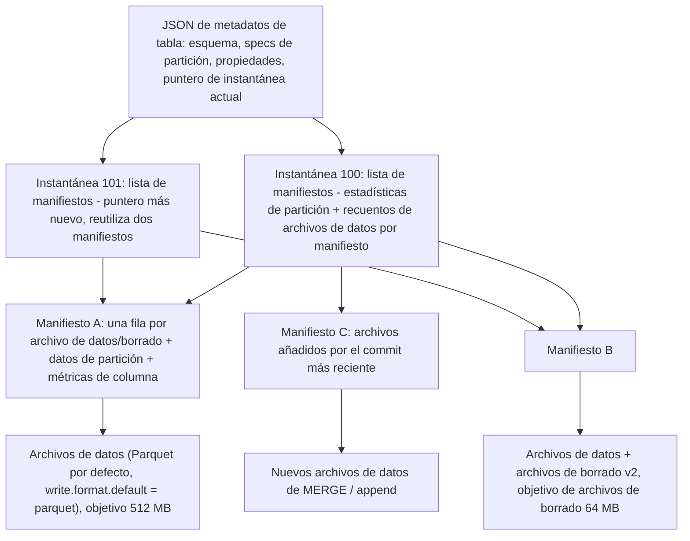
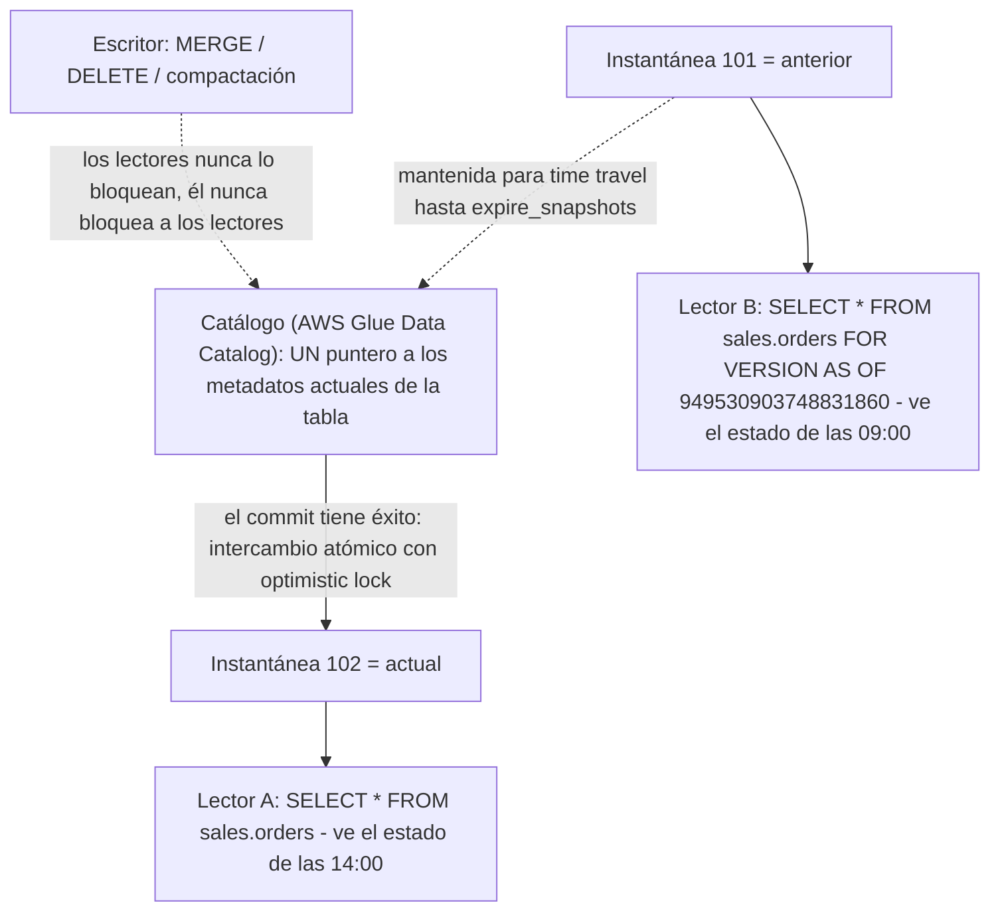
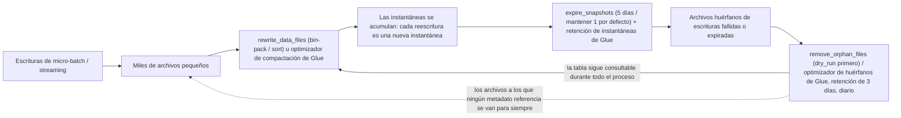
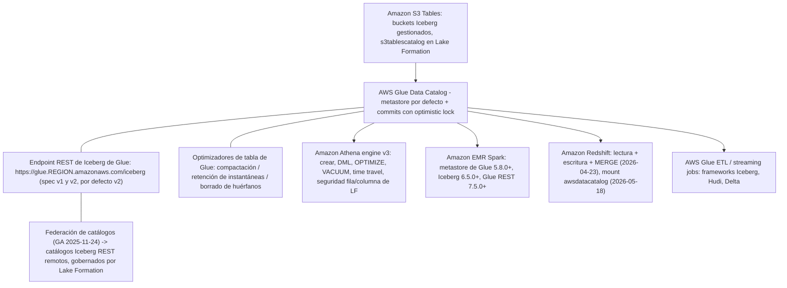
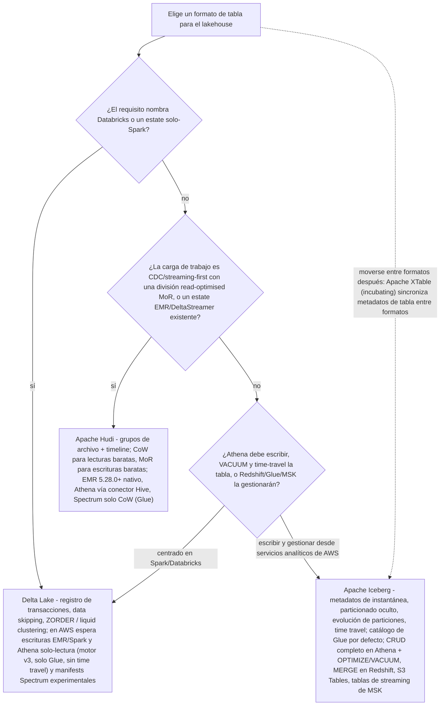

# Formatos de tablas abiertos: Iceberg, Hudi y Delta en el lakehouse

La lección 3 puso los bytes en Amazon S3 en Parquet. Los bytes en S3 son un *lago de archivos*: legible, barato, duradero — y no transaccional. Esta lección instala la capa que convierte esos archivos en una **tabla**: el formato de tabla abierto (OTF). Cada lección posterior de este curso asume que existe. Glue lo rastrea (lección 07), Athena lo consulta (lección 09), Redshift hace un puente hacia él (lección 10), Lake Formation concede permisos sobre él (lección 12), y nadie paga dos veces por una tabla de treinta millones de archivos (lección 16).

```text
=================================================================
 LA SUPERFICIE DE DECISIÓN DE FORMATOS DE TABLA ABIERTOS (en oct 2026)
=================================================================
 Lo que falta en S3 en bruto ..
   sin ACID, sin escritores concurrentes seguros, sin lecturas
   de instantánea, sin borrado a nivel de fila barato, sin
   aplicación de esquema
 Iceberg ................... árbol de metadatos: JSON de tabla ->
                              lista de manifiestos -> manifiestos ->
                              archivos de datos; aislamiento de
                              instantánea, particionado oculto,
                              evolución de particiones, órdenes de
                              ordenación, time travel
 Hudi ...................... grupos de archivo + timeline de
                              instantes; Copy-on-Write (reescribe
                              Parquet) vs Merge-on-Read (añade logs
                              Avro), consultas read-optimized vs
                              snapshot
 Delta ..................... commits ordenados de _delta_log/*.json;
                              saltado de datos por min/max,
                              Z-Ordering, agrupación líquida
                              (curva de Hilbert)
 Por defecto en AWS ........ ICEBERG - la historia transaccional
                              completa de Athena, optimizadores de
                              Glue, Glue Iceberg REST, S3 Tables,
                              tablas de streaming de MSK
 Catálogo en AWS ........... AWS Glue Data Catalog (por defecto);
                              endpoint REST de Iceberg de Glue;
                              Nessie, JDBC, DynamoDB, Hive, Hadoop,
                              REST
 No confundir .............. instantáneas con copias de seguridad;
                              «Athena soporta Delta» con «Athena
                              escribe Delta»
=================================================================
```

En esta lección:

- explicar por qué **ACID sobre almacenamiento de objetos** necesita en absoluto una capa de metadatos, y qué añade un formato de tabla abierto sobre «Parquet más un crawler»;
- leer el **árbol de metadatos de Iceberg** — JSON de metadatos de tabla, listas de manifiestos, manifiestos, archivos de datos/borrado — y saber qué almacena cada nivel;
- aplicar **aislamiento de instantánea, particionado oculto, evolución de particiones y órdenes de ordenación** al DDL real de tablas;
- usar el **time travel** en sintaxis de Spark y Athena y poner precio a la **retención de instantáneas** que lo mantiene vivo;
- escribir y defender un **MERGE / UPSERT / DELETE** completo resuelto, incluyendo el paso de deduplicación que detiene el error de fila de origen duplicada;
- ejecutar los tres verbos de mantenimiento — **`rewrite_data_files`, `remove_orphan_files`, `expire_snapshots`** — y mapear cada uno a su **optimizador de tabla de Glue** y a su equivalente en Athena;
- elegir un **catálogo**, y justificar **AWS Glue Data Catalog como el valor por defecto en AWS** más el endpoint REST de Iceberg de Glue y la federación de catálogos;
- separar **Copy-on-Write de Merge-on-Read** de Hudi usando la timeline de instantes, y dimensionar la diferencia de amplificación de escritura;
- enunciar las características de **Delta Lake** y su nivel de soporte exacto en Athena, EMR y Redshift;
- usar la **matriz de integración de AWS** y el veredicto **Iceberg vs Hudi vs Delta** en lugar de discutir por hábito;
- estudiar **dos casos de clientes de AWS** (Vanguard y Zeta Global) y una **caja de actualizaciones de octubre de 2026 con fuentes**;
- practicar con **12 preguntas de examen** más cuatro comprobaciones interactivas.

---

## 1. Por qué el almacenamiento de objetos no puede hacer ACID

### 1.1 S3 es fuertemente consistente y aun así no es transaccional

Amazon S3 da consistencia fuerte de lectura-tras-escritura para nuevos `PUT`. Ese no es el problema. El problema es que un *commit de tabla* es una operación **multi-objeto**: un escritor añade nuevos archivos Parquet, elimina los antiguos, y debe hacer que los lectores vean o el estado viejo o el estado nuevo — nunca una mezcla a medio aplicar. S3 no tiene ninguna operación atómica que intercambie un listado de directorio, y no tiene lock. Un «commit» implementado como `listear el prefijo y creerle` es exactamente el modo de fallo que AWS Prescriptive Guidance lista para lagos de objetos planos: sin semántica ACID, sin actualización o borrado a nivel de registro, sin consistencia entre escritores concurrentes, y corrupción cuando una escritura falla a mitad de camino.

Los tres formatos de tabla abiertos resuelven el mismo problema de la misma manera: **commits de metadatos de solo inserción, con un intercambio atómico de puntero al final**.

| Formato | Qué es físicamente un commit | Qué lo hace atómico |
|---|---|---|
| **Iceberg** | JSON de metadatos de tabla nuevo apuntando a una nueva lista de manifiestos | El **catálogo** intercambia el puntero (Glue usa optimistic locking) |
| **Delta Lake** | Nuevo archivo JSON en `_delta_log/` | Commit en el log; los lectores resuelven a una instantánea consistente |
| **Hudi** | Nuevo instante en la **timeline** (COMMIT / DELTA_COMMIT) | «Hudi garantiza que las transiciones de estado son atómicas y consistentes con la timeline basándose en el instant time» |

La consecuencia para este curso: **el catálogo es parte del protocolo de transacción**, no un servicio de listado de directorios. Por eso la sección 6 trata el catálogo como una decisión de diseño de primera clase y por eso Athena solo acepta tablas Iceberg creadas contra el catálogo de AWS Glue.

### 1.2 Qué añade realmente un OTF

Un formato de tabla abierto almacena una **capa de metadatos** sobre tus archivos. Para Iceberg la cadena es: **JSON de metadatos de tabla** (esquema, specs de partición, puntero de instantánea actual, propiedades) → **lista de manifiestos** (una por instantánea, con estadísticas de partición por manifiesto) → **manifiestos** (una fila por archivo de datos o de borrado, con datos de partición y métricas de columna) → **archivos de datos y archivos de borrado** (Parquet por defecto, más ORC y Avro). Las garantías que caen de esa estructura, en las propias palabras del proyecto Iceberg: *«Aislamiento serializable — Las lecturas estarán aisladas de las escrituras concurrentes y siempre usarán una instantánea comprometida de los datos de una tabla. Las escrituras soportarán eliminar y añadir archivos en una sola operación y nunca serán parcialmente visibles. Los lectores no adquirirán locks.»*

> [!IMPORTANT]
> **Un OTF es un contrato, no un esquema de compresión.** Parquet, ORC y Avro son *formatos de archivo* — no dicen nada sobre quién tiene permiso para escribir, qué tiene permiso para ver un lector, o cómo se elimina una fila defectuosa. Iceberg, Hudi y Delta son *formatos de tabla* — poseen commits, instantáneas, evolución de esquema y borrado, y delegan los bytes a un formato de archivo. La lección 03 eligió los bytes; esta lección elige el contrato.

- **📚 ¿Sabías que…?** Las especificaciones de Iceberg **1, 2 y 3 están todas «completas y adoptadas por la comunidad»** (página de la especificación de Iceberg, consultada 2026-10). La **v3** es la que AWS Glue 6.0 adoptó en agosto de 2026 — pero la adopción de una versión de especificación y la *disponibilidad de los motores que la leen* son relojes distintos, y la sección 11 muestra por qué importan en AWS.

---

## 2. Recorrido profundo por Iceberg: el árbol de metadatos

### 2.1 Listas de manifiestos, manifiestos, y por qué las lecturas son baratas

La especificación de Iceberg es explícita sobre los dos niveles de metadatos. *«Los archivos de datos en las instantáneas son rastreados por uno o más archivos de manifiesto que contienen una fila por cada archivo de datos en la tabla, los datos de partición del archivo y sus métricas. Los datos en una instantánea son la unión de todos los archivos en sus manifiestos.»* Y un nivel arriba: *«Los manifiestos que componen una instantánea se almacenan en un archivo de lista de manifiestos. Cada lista de manifiestos almacena metadatos sobre manifiestos, incluyendo estadísticas de partición y recuentos de archivos de datos.»*

De esa estructura siguen dos decisiones de diseño, y ambas son de nivel entrevista:

1. **La lista de manifiestos lleva estadísticas de partición para que manifiestos enteros puedan omitirse durante la planificación** — podas metadatos antes de tocar un archivo de datos.
2. **Los manifiestos se reutilizan entre instantáneas.** La especificación dice que los manifiestos están *«reutilizados entre instantáneas para evitar reescribir metadatos que cambian lentamente.»* Una tabla reescrita mil veces no lleva mil copias de sus metadatos de cambio lento.



**El orden de lectura importa**, y es el opuesto del hábito de memoria de Hive: empiezas por el *puntero* y bajas, podando en cada nivel, y solo abres los archivos Parquet cuyas métricas sobrevivieron.

```dragdrop
{
  "question": "Ordena los pasos que un motor consciente de Iceberg da para responder un SELECT, desde la llamada al catálogo hasta los bytes:",
  "items": [
    "JSON de metadatos de tabla: leer el esquema, el spec de partición y el puntero a la instantánea actual",
    "Lista de manifiestos de esa instantánea: usar estadísticas de partición y recuentos de archivos por manifiesto para omitir manifiestos enteros",
    "Archivos de manifiesto: leer una fila por archivo de datos/borrado, con datos de partición y métricas de columna, y podar de nuevo",
    "Archivos de datos (Parquet/ORC/Avro) más cualquier archivo de borrado v2, leídos con merge-on-read donde se aplican borrados"
  ],
  "correctOrder": [
    "JSON de metadatos de tabla: leer el esquema, el spec de partición y el puntero a la instantánea actual",
    "Lista de manifiestos de esa instantánea: usar estadísticas de partición y recuentos de archivos por manifiesto para omitir manifiestos enteros",
    "Archivos de manifiesto: leer una fila por archivo de datos/borrado, con datos de partición y métricas de columna, y podar de nuevo",
    "Archivos de datos (Parquet/ORC/Avro) más cualquier archivo de borrado v2, leídos con merge-on-read donde se aplican borrados"
  ],
  "explanation": "La poda ocurre en metadatos, dos veces, antes de abrir un solo byte de Parquet: la lista de manifiestos permite a un motor omitir manifiestos enteros usando estadísticas de partición, y las filas de manifiesto llevan métricas min/max por archivo para omitir archivos también. Por eso Iceberg puede responder «¿qué archivos importan?» sin listar S3, y por eso las tablas de metadatos de Athena ($manifests, $files, $partitions) son la superficie de depuración de una consulta que leyó demasiado. Empezar por los datos (un listado de directorio) es el hábito de Hive que este formato existe para romper."
}
```

### 2.2 Aislamiento de instantánea: cada commit es un nuevo punto inmutable en el tiempo

Cada escritura — append, MERGE, DELETE, UPDATE, compactación — produce una **nueva instantánea** y mantiene viva la antigua. Las lecturas resuelven exactamente a una instantánea comprometida, así que dos analistas a las 09:00 y a las 14:00 ven dos tablas distintas, cada una individualmente consistente. Eso es lo que hace seguro ejecutar un MERGE nocturno y un informe ad-hoc al mismo tiempo, y es el mecanismo que hay debajo del time travel (sección 3).



### 2.3 Particionado oculto

En Hive declarabas particiones como columnas, las mantenías a mano, y cada consulta tenía que repetir el predicado de partición. Iceberg invierte esto. La redacción del propio proyecto: *«Otros formatos de tablas como Hive soportan particionado, pero Iceberg soporta particionado oculto»* y *«Iceberg evita leer particiones innecesarias automáticamente. Los consumidores no necesitan saber cómo está particionada la tabla y añadir filtros extra a sus consultas.»*

Declaras **transformaciones sobre columnas de origen** — `days(event_ts)`, `month(ts)`, `bucket(N, id)`, `truncate(L, col)`, `years/months/days/hours`, identidad — y el escritor calcula los valores de partición. El analista filtra en la columna *de origen* (`WHERE event_ts >= TIMESTAMP '2026-10-01 00:00:00'`) y el motor poda. No hay columna de partición que seleccionar ni columna de partición que mantener sincronizada.

- **📚 ¿Sabías que…?** La trampa del particionado oculto corre en ambas direcciones. La cláusula `OPTIMIZE ... WHERE` de Athena *«Solo se permiten columnas de partición en la cláusula WHERE»* (docs de Athena, consultados 2026-10) — así que la ruta de mantenimiento *sí* habla algo parecido a particiones, aunque la ruta de consulta deliberadamente no. Cuando compactes una tabla Iceberg en Athena filtras en el campo de partición que declara la tabla, no en cualquier columna de negocio arbitraria.

### 2.4 Evolución de particiones: cambia el diseño sin reescribir datos

Como las consultas planifican sobre **valores de datos** en lugar de sobre valores de partición, el spec de partición mismo puede evolucionar. Los docs de Iceberg: *«El particionado de tablas Iceberg puede actualizarse en una tabla existente porque las consultas no referencian valores de partición»* y *«Los diseños de partición de Iceberg pueden evolucionar según se necesite.»* Los archivos existentes mantienen su spec ID antiguo; los archivos nuevos se escriben con el nuevo spec; el motor reconcilia los dos en el momento de la lectura.

La evolución de esquema viaja por el mismo raíl de solo metadatos. Las operaciones soportadas son **Add, Drop, Rename, Update (ensanchamiento de tipo) y Reorder**, y los docs son francos sobre el coste: *«Las actualizaciones de esquema de Iceberg son cambios de metadatos, así que no se necesitan reescribir archivos de datos»* — Iceberg rastrea cada columna con un **ID único**, así que una columna renombrada sigue siendo la misma columna.

| Evolución | Coste estilo Hive | Coste en Iceberg |
|---|---|---|
| Añadir una columna | Reescribir o dejar nulls sin rastrear | Cambio de solo metadatos |
| Renombrar una columna | Rompe cada referencia aguas abajo | Cambio de metadatos (ID estable) |
| Ensanchamiento `int` → `long` | Reescribir | Cambio de metadatos |
| **Añadir particionado `bucket(16, customer_id)`** | Reescribir la tabla | **Cambio de metadatos; los archivos viejos mantienen el spec viejo** |
| **Cambiar `days(ts)` → `months(ts)`** | Reescribir la tabla | **Cambio de metadatos; ningún dato reescrito** |

### 2.5 Órdenes de ordenación

Las tablas Iceberg pueden llevar un **orden de ordenación a nivel de tabla** que los motores respetan cuando reescriben archivos. El ejemplo de los docs: *«Para fijar el orden de escritura de una tabla, usa `WRITE ORDERED BY`: `ALTER TABLE prod.db.sample WRITE ORDERED BY category, id`»*, y *«`MERGE INTO` en Spark usará el ordenamiento de la tabla.»* Esa es la historia de agrupación en Iceberg: combinado con `rewrite_data_files` puedes bin-packear (por defecto), o ordenar, o aplicar estrategias `zorder(...)` / `hilbert(...)` para colocar filas relacionadas en los mismos grupos de archivo — el mismo trabajo que Delta hace con `ZORDER BY` y liquid clustering (sección 8), solo que bajo otro verbo.

- **📚 ¿Sabías que…?** Valores por defecto que vale la pena memorizar porque aparecen tanto en la aritmética de compactación como en revisiones de coste (docs de configuración de Iceberg, consultados 2026-10): `write.format.default` = **parquet**; `write.target-file-size-bytes` = **536,870,912 bytes = 512 MB**; `write.delete.target-file-size-bytes` = **67,108,864 = 64 MB**; tamaño de row group de Parquet y `read.split.target-size` = **134,217,728 = 128 MB**; `read.split.planning-lookback` = **10**. Athena escribe tablas Iceberg con **ZSTD nivel 3** como compresión por defecto — así que la pregunta «¿cuánto cuesta almacenar una escritura Iceberg de Athena?» ya asume compresión.

---

## 3. Time travel y retención de instantáneas

### 3.1 Leer una tabla tal como era

Como las instantáneas son inmutantes y retenidas, «leer como de» es una consulta normal. Spark 3.3 y posteriores lo soportan en SQL: *«Spark 3.3 y posteriores soporta time travel en consultas SQL usando las cláusulas `TIMESTAMP AS OF` o `VERSION AS OF`. La cláusula `VERSION AS OF` puede contener un ID de instantánea long o un nombre de rama o tag string.»* La ortografía de Athena difiere (motor v3): usa `FOR TIMESTAMP AS OF` después del nombre de la tabla, o `FOR VERSION AS OF` donde la versión *«es el ID bigint de la instantánea»* — el propio ejemplo de los docs es `SELECT * FROM iceberg_table FOR VERSION AS OF 949530903748831860`.

```sql
-- Spark / EMR: two syntaxes, one snapshot
SELECT count(*) FROM sales.orders AS OF TIMESTAMP '2026-10-01 09:00:00';
SELECT count(*) FROM sales.orders VERSION AS OF 6918471130372145521;

-- Athena engine v3: FOR ... AS OF, bigint snapshot id
SELECT * FROM sales.orders FOR TIMESTAMP AS OF TIMESTAMP '2026-10-01 09:00:00';
SELECT * FROM sales.orders FOR VERSION AS OF 949530903748831860;

-- Athena metadata tables: the audit surface
SELECT committed_at, snapshot_id, operation FROM sales.orders$snapshots;
SELECT * FROM sales.orders$history;
SELECT file_path, file_size_in_bytes FROM sales.orders$files LIMIT 20;
SELECT * FROM sales.orders$manifests;
```

Las tablas de metadatos de Athena para Iceberg son `$files`, `$manifests`, `$history`, `$partitions`, `$snapshots` y `$refs` — lo que significa que «¿quién escribió este archivo, cuándo, y qué instantánea lo referencia?» es una pregunta SQL, no una pregunta de consola de S3.

### 3.2 La retención es una decisión pagada, no una característica gratis

Cada commit *«produce una nueva instantánea mientras mantiene los datos y metadatos antiguos alrededor para aislamiento de instantánea y time travel»* (docs de Spark procedures de Iceberg). Las instantáneas viejas son por tanto **bytes almacenados**, y expirarlas es la operación destructiva inversa. Los valores por defecto:

| Control | Por defecto | Fuente (consultada 2026-10) |
|---|---|---|
| `expire_snapshots` `older_than` | **hace 5 días** | iceberg.apache.org Spark procedures |
| `expire_snapshots` `retain_last` | **1** instantánea ancestra sin importar la edad | igual |
| Ramas / tags | Nunca expiran; *«The main branch never expires»* | igual |
| `vacuum_max_snapshot_age_seconds` de Athena | **432000 segundos = 5 días** | docs de DDL Iceberg de Athena |
| Optimizador de retención de instantáneas de Glue | **5 días**, mantener **1** instantánea | docs de optimizadores automáticos de tablas de Glue |
| Retención de archivos huérfanos de Glue | **3 días** (mínimo 1 día), corre **una vez al día** | docs de borrado de huérfanos de Glue |
| Retención de instantáneas para tablas nuevas de Glue | **Deshabilitada por defecto** | docs de Glue |

**Ejemplo resuelto E1 — lo que cuesta una ventana de time travel (us-east-1, en oct 2026)**

Una tabla Iceberg de **1 TB (1,024 GB)** en S3 de propósito general cuyos trabajos reescriben el **20% de sus bytes al día** (MERGE más compactación) acumula versiones nuevas de los archivos viejos:

```text
Versiones nuevas (viejas) al día .. 1,024 GB x 20%              = 204.8 GB/día
Retener 7 días .................. 204.8 x 7                    ~ 1,434 GB extra
  coste de almacenamiento ...... 1,434 GB x $0.023/GB          ~ $33 / mes
Retener 30 días ................. 204.8 x 30                   ~ 6,144 GB extra
  coste de almacenamiento ...... 6,144 GB x $0.023/GB          ~ $140 / mes
Expirar a 5 días (por defecto) . 204.8 x 5                    ~ 1,024 GB extra
  coste de almacenamiento ...... 1,024 GB x $0.023/GB          ~ $23 / mes
```

Misma tabla, tres políticas de retención, una diferencia de **$117/mes** entre una ventana de 30 días y la ventana por defecto de 5 días — usando la tarifa de los primeros 50 TB de S3 Standard de **$0.023 por GB-mes** (precios de S3 de AWS, consultados 2026-10). Enseña el *método*: almacenamiento extra ≈ (bytes reescritos al día × días de retención) × tarifa. Un requisito de «necesitamos 90 días de historial de auditoría» es una línea de almacenamiento, no un checkbox.

> [!WARNING]
> ⚠️ **Una instantánea no es una copia de seguridad, y expirar una es irreversible.** Una vez que `expire_snapshots` (o `VACUUM` de Athena, o el optimizador de retención de instantáneas de Glue) pasa de tu ventana de retención, ese punto en el tiempo se fue — los archivos que referenciaba únicamente se eliminan. El time travel responde *«¿cómo se veía la tabla a las 09:00?»*, no *«el bucket fue borrado»*, y no reemplaza el versionado de S3, la replicación cross-Region ni un drill de restauración. Y nunca cuentes el versionado de S3 y las instantáneas de Iceberg como dos redes de seguridad independientes hasta haber puesto precio a ambas; E1 es la factura de la segunda red.

**Ejemplo resuelto E2 — expirar, y luego probar que no se perdió nada vivo**

```sql
-- 1. dry-run the orphan sweep FIRST: files no metadata references
CALL prod.system.remove_orphan_files(
  table => 'sales.orders',
  dry_run => true,
  older_than => TIMESTAMP '2026-10-01 00:00:00');

-- 2. expire snapshots: keep a 7-day window, never drop the newest 7
CALL prod.system.expire_snapshots(
  table => 'sales.orders',
  older_than => TIMESTAMP '2026-10-04 00:00:00',
  retain_last => 7);

-- 3. verify the current snapshot still plans and reads
SELECT count(*) FROM sales.orders;
SELECT committed_at, operation FROM sales.orders$history ORDER BY committed_at DESC;
```

El orden importa: **dry-run de huérfanos, luego expirar, luego verificar.** Expirar instantáneas primero puede dejar huérfanos archivos a los que la propia expiración eliminó referencias, lo que convierte una barrida limpia en una ruidosa.

---

## 4. DML a nivel de fila: MERGE, UPSERT y DELETE

### 4.1 Tres estrategias físicas, una superficie SQL

Las operaciones a nivel de fila de Iceberg se resuelven en trabajo físico distinto, y saber cuál corrió es lo que te dice si acabas de pagar I/O:

| SQL | Cuando el filtro coincide con… | Qué hace Iceberg |
|---|---|---|
| `DELETE` | Particiones enteras o archivos enteros | **Borrado de solo metadatos** — los archivos caen de la instantánea, ningún byte reescrito |
| `DELETE` | Filas individuales | **Reescribe solo los archivos de datos afectados** (más archivos de borrado v2 leídos merge-on-read) |
| `UPDATE` / `MERGE` | Filas dentro de archivos | **Reescritura copy-on-write** de los archivos tocados, commiteada como un commit de overwrite |
| `INSERT` | — | Nuevos archivos de datos + un nuevo manifiesto + una nueva instantánea |

El resumen de la especificación de `DELETE`: *«Si el filtro de borrado coincide con particiones enteras de la tabla, Iceberg realizará un borrado de solo metadatos. Si el filtro coincide con filas individuales de una tabla, entonces Iceberg reescribirá solo los archivos de datos afectados.»* Y sobre `MERGE INTO`: *«Iceberg soporta MERGE INTO reescribiendo archivos de datos que contengan filas que necesiten actualizarse en un commit de overwrite»*, con la recomendación explícita de que *«`MERGE INTO` es recomendado en lugar de `INSERT OVERWRITE` porque Iceberg puede reemplazar solo los archivos de datos afectados.»* Athena declara su propio lado de lectura del mismo mecanismo: las consultas *«realizan merge-on-read de borrados tanto por posición como por igualdad.»*

**Ejemplo resuelto E3 — un upsert de CDC que sobrevive a la revisión (Spark en EMR, catálogo de Glue)**

Escenario: tabla Iceberg `sales.orders` particionada `days(order_ts)`. Un lote CDC nocturno aterriza **50,000 filas de cambios** en S3 como Parquet — **20,000 actualizaciones, 25,000 inserciones, 5,000 borrados**.

```sql
-- Step 1: dedupe the CDC stream. Iceberg throws if ONE source record
-- can update MULTIPLE target rows, so kill duplicates before the join.
WITH ranked AS (
  SELECT c.*,
         ROW_NUMBER() OVER (
           PARTITION BY c.order_id
           ORDER BY c.change_time DESC) AS rn
  FROM   lakehaus.bronze_order_changes c
),
dedup AS (SELECT * FROM ranked WHERE rn = 1)

-- Step 2: one MERGE with three WHEN MATCHED branches + the insert
MERGE INTO sales.orders t
USING dedup s
ON  t.order_id = s.order_id
WHEN MATCHED AND s.op = 'd' THEN DELETE
WHEN MATCHED AND s.op = 'u' THEN UPDATE SET
       status = s.status, amount = s.amount, updated_at = s.change_time
WHEN NOT MATCHED AND s.op <> 'd' THEN INSERT
       (order_id, status, amount, order_ts, updated_at)
VALUES (s.order_id, s.status, s.amount, s.order_ts, s.change_time);

-- Step 3: verify against the snapshot history, not just the count
SELECT count(*) FROM sales.orders;
SELECT committed_at, operation, summary
FROM   sales.orders$snapshots
ORDER  BY committed_at DESC LIMIT 5;

-- Step 4: prove isolation - yesterday's reader still sees yesterday
SELECT count(*) FROM sales.orders VERSION AS OF 6918471130372145521;
```

Por qué el paso 1 no es opcional, en las propias palabras de los docs: *«Solo un registro en los datos de origen puede actualizar cualquier fila dada de la tabla de destino, o de lo contrario se lanzará un error.»* Un archivo de CDC con dos filas para un mismo `order_id` (un lote re-entregado, una actualización tardía, una partición fuera de orden) basta para fallar el trabajo a las 02:00. Spark 3.5 también añadió `WHEN NOT MATCHED BY SOURCE ... THEN ...`, así que las filas del destino sin contraparte de origen ahora pueden borrarse en la misma sentencia.

```fillblank
{
  "question": "Completa el esqueleto MERGE de Iceberg exactamente como lo deletrean Spark/EMR y Redshift:",
  "template": "{{1}} INTO sales.orders t {{2}} dedup s ON t.order_id = s.order_id WHEN {{3}} AND s.op = 'd' THEN DELETE WHEN MATCHED THEN UPDATE SET status = s.status WHEN NOT {{4}} THEN INSERT (order_id, status) VALUES (s.order_id, s.status);",
  "answers": {
    "1": "MERGE",
    "2": "USING",
    "3": "MATCHED",
    "4": "MATCHED"
  },
  "distractors": ["JOIN", "INSERT", "UNMATCHED", "EXISTS", "UPSERT", "REPLACE"],
  "explanation": "Las cuatro palabras que cargan el peso son MERGE INTO ... USING ... ON ... WHEN [NOT] MATCHED. Los distractores son los errores que la gente realmente comete: JOIN no es una escritura a nivel de fila, INSERT solo no puede actualizar, UNMATCHED es inglés pero no sintaxis SQL aquí, y UPSERT es el concepto (el anuncio de Redshift llama MERGE la forma de UPSERT) más que una palabra clave de sentencia. Dos reglas viajan con este esqueleto: exactamente un registro de origen puede coincidir con una fila de destino, y el origen debe deduplicarse (ROW_NUMBER) antes de que el MERGE corra nunca."
}
```

- **📚 ¿Sabías que…?** Redshift se puso al día con esta sentencia exacta el **23 de abril de 2026**: *«Amazon Redshift ahora soporta operaciones de actualización, borrado y MERGE a nivel de fila sobre tablas Apache Iceberg»*, incluyendo *«tanto tablas Iceberg particionadas como no particionadas, incluyendo S3 Tables»*, con transforms de partición soportados *identity, bucket, truncate, year, month, day y hour* — y AWS declara que *«las tablas modificadas por Redshift son compatibles con otros motores compatibles con Iceberg, incluyendo Amazon EMR y Amazon Athena.»* Una tabla, tres escritores (MERGE de Redshift, append de streaming de Glue, DELETE de analista de Athena), arbitrados por el optimistic locking de Glue.

> [!WARNING]
> ⚠️ **Dos límites que atrapan equipos en producción:**
> - **Lake Formation puede gobernar *lecturas* pero no estas operaciones.** Los docs de Athena son explícitos: *«no puedes usar Lake Formation para gestionar permisos de operaciones como VACUUM, MERGE, UPDATE u OPTIMIZE con estos formatos de tabla.»* La seguridad fila/columna en SELECT es de Lake Formation; la superficie de *mantenimiento y escritura a nivel de fila* es IAM más la autorización del propio motor. Diseña ese control por separado (lección 12).
> - **Las superficies de MERGE verificadas en esta lección son Spark (docs de Iceberg) y Redshift (anuncio de AWS, 2026-04-23).** Las páginas de DML Iceberg de Athena documentan INSERT/UPDATE/DELETE y OPTIMIZE/VACUUM — revisa la referencia SQL actual de Athena antes de programar un `MERGE` de Athena, porque las fuentes de esta lección no verificaron esa sentencia. Nunca envíes un pipeline sobre una característica SQL no verificada.

---

## 5. Mantenimiento: compactación, archivos huérfanos, expiración de instantáneas

Los archivos pequeños son el impuesto de los micro-batches y las escrituras de streaming, e Iceberg te da tres verbos para los tres problemas distintos. Confundirlos es la manera en que las tablas mueren en silencio.

| Problema | Verbo (Spark procedure) | Equivalente en Athena | Equivalente gestionado en AWS |
|---|---|---|---|
| Muchos archivos diminutos, mala economía de escaneo | `rewrite_data_files` (bin-pack por defecto; `strategy => 'sort'`, `zorder(c1,c2)`, `hilbert(c1,c2)`) | `OPTIMIZE t REWRITE DATA USING BIN_PACK [WHERE …]` | Optimizador de **compactación** de Glue |
| Demasiados manifiestos ralentizando la planificación | `rewrite_manifests` | — | — |
| Historia y archivos muertos acumulándose | `expire_snapshots` + `remove_orphan_files` | `VACUUM t` (ambos trabajos a la vez) | Optimizadores de **retención de instantáneas** + **borrado de archivos huérfanos** de Glue |

Detalles que vale la conocer por verbo:

- **`rewrite_data_files`** bin-packea por defecto, acepta un filtro de partición `where` y opciones como `min-input-files` y `remove-dangling-deletes`; `strategy => 'sort'` toma `sort_order => 'zorder(c1,c2)'` o `'hilbert(c1,c2)'`.
- **`remove_orphan_files`** borra *«archivos que no están referenciados en ningún archivo de metadatos de una tabla Iceberg»* y soporta `dry_run => true` — ejecuta siempre el dry run primero.
- **`expire_snapshots`** elimina instantáneas antiguas y los archivos a los que solo ellas referencian (valores por defecto en la sección 3.2); las instantáneas referenciadas por ramas o tags están protegidas.
- **`OPTIMIZE` de Athena** es *«transaccional y soportado solo para tablas de Apache Iceberg»*, solo acepta predicados de **columna de partición** en `WHERE`, y *«La acción de compactación se cobra por la cantidad de datos escaneada durante el proceso de reescritura.»*
- **`VACUUM` de Athena** *«realiza expiración de instantáneas y eliminación de archivos huérfanos»*, gobernada por `vacuum_max_snapshot_age_seconds` (por defecto **432000 s = 5 días**; los ejemplos de docs lo fijan en **259200 s = 3 días**).

**Ejemplo resuelto E4 — aritmética de archivos pequeños y el disparador de Glue (en oct 2026)**

```text
Streaming job writes ........ 1,000 files/day x 8 MB     = 8 GB/day
After 30 days ............... 30,000 files                ~ 240 GB
Target file size ............ write.target-file-size-bytes = 512 MB
Theoretical compact files ... 240 GB / 0.5 GB             = 469 files
Glue compaction trigger ..... > 100 files per table/partition
                              AND each file < 75% of 512 MB = 384 MB
Trigger check ............... 30,000 > 100 YES; 8 MB < 384 MB YES -> fires
```

Las propias condiciones de Glue: *«En el Data Catalog, el proceso de compactación empieza cuando una tabla o cualquiera de sus particiones tienen más de 100 archivos. Cada archivo debe ser más pequeño que el 75% del tamaño de archivo objetivo. El tamaño de archivo objetivo está definido por la propiedad de tabla `write.target-file-size-bytes`, que por defecto es 512 MB»* — y *«Data Catalog realiza compactación sin interferir con consultas concurrentes y soporta compactación solo para tablas en formato Parquet.»* La reducción de ~64× en el conteo de archivos (30,000 → 469) es lo que convierte la sobrecosto de planificación por consulta y de apertura de archivos en un error de redondeo; la reescritura misma es trabajo facturado, así que pondera los bytes escaneados (Athena) o los DPU-segundos (Glue) contra el ahorro de consulta.



**Ejemplo resuelto E5 — gestionado o autogestionado: pon precio al premio de S3 Tables (en oct 2026)**

Si no quieres ejecutar tú mismo el bucle de la sección 5, S3 Tables lo hace: *«Amazon S3 Tables maneja automáticamente el mantenimiento continuo de tablas, incluyendo compactación, expiración de instantáneas y limpieza de archivos no referenciados.»*

```text
Table size .................. 5 TB = 5,120 GB
S3 Standard ................. 5,120 x $0.023   = $117.76 / month
S3 Tables - Standard ........ 5,120 x $0.0265  = $135.68 / month
Premium for managed upkeep ..                      $17.92 / month
S3 Tables GET requests ...... $0.0004 per 1,000 requests
```

Un premio de **$17.92/mes** (aproximadamente 15%) te compra el bucle de mantenimiento completo — compactación, expiración de instantáneas, limpieza de archivos no referenciados — más estadísticas de Iceberg activadas por defecto para Athena. Si eso es barato depende enteramente de cuántas horas-hora de ingeniería te cuesta la sección 5; el punto es que el intercambio es una línea de factura que puedes cotizar, no un misterio.

- **📚 ¿Sabías que…?** La superficie de optimización Iceberg de Athena tiene una segunda palanca, más silenciosa: *«La indexación de columnas de Parquet … hace posible que Athena realice una poda de datos más precisa … aprovechando estadísticas min/max a nivel de página»*, y *«Las estadísticas de Iceberg están activadas por defecto cuando usas S3 Tables.»* Así que el mismo archivo objetivo de 512 MB es más barato de *omitir* en S3 Tables que en una tabla no gestionada cuyas estadísticas nadie recolectó — el mantenimiento es un control de coste de consulta, no solo un control de conteo de archivos.

---

## 6. Catálogos: el servicio de puntero, y por qué Glue es el valor por defecto

### 6.1 Qué hace un catálogo

El catálogo es la mitad **mutable** del diseño: mapea `db.table` → la ubicación de los metadatos actuales de la tabla y realiza (o delega) el **commit atómico** que hace visible una escritura. Iceberg documenta implementaciones para el **REST Catalog Protocol, AWS Glue, AWS DynamoDB, HadoopCatalog, HiveCatalog, JDBC y Nessie**.La notable no-AWS: **Nessie** es un *«Transactional Catalog for Data Lakes with Git-like semantics»* que *«works with Apache Iceberg tables»* y corre *«as a Docker image or on Kubernetes»*, con backends de store de versiones que incluyen RocksDB, Cassandra, BigTable, **DynamoDB** y MongoDB — es decir, ramas y tags con semántica de git sin salir de primitivas de AWS.

### 6.2 AWS Glue Data Catalog es el valor por defecto en AWS

Tres hechos hacen de Glue el valor por defecto más que una preferencia:

1. **Athena solo acepta tablas Iceberg registradas con Glue.** *«Tables with AWS Glue catalog only — Only Iceberg tables created against the AWS Glue catalog … are supported from Athena»*, y *«Athena supports Amazon Glue optimistic locking only. Using Athena to modify an Iceberg table with any other lock implementation will cause potential data loss and break transactions.»*
2. **Glue posee el bucle de mantenimiento gestionado** (sección 5), el **endpoint REST de Iceberg**, y la **federación de catálogos**.
3. **Cada otro motor de AWS se conecta a él:** EMR Spark usa Glue como su Hive metastore (release **5.8.0+**), como su catálogo Iceberg (**6.5.0+**) y como su **catálogo Iceberg REST** (**7.5.0+**); Redshift requiere que las tablas Iceberg estén *«registered with AWS Glue Data Catalog»* para escribir.

El **endpoint REST de Iceberg de Glue** (`https://glue.<region>.amazonaws.com/iceberg`) *«supports API operations specified in the Apache Iceberg REST specification»* y *«supports both Apache Iceberg table specifications — v1 and v2, defaulting to v2.»* REST también es la costura para la **federación de catálogos** (GA **24 de noviembre de 2025**): *«It synchronizes metadata real-time across AWS Glue Data Catalog and remote catalogs when data teams query remote tables»*, usable desde *«Amazon Redshift, Amazon EMR, Amazon Athena, AWS Glue, third-party engines like Apache Spark, and Amazon SageMaker»*, con *«AWS Lake Formation for access controls.»*



**Ejemplo resuelto E6 — lista de cableado de catálogo: una tabla Iceberg, tres motores**

```text
1. CREATE (Athena, engine v3) - Glue registered, partition transform hidden
   CREATE TABLE sales.orders (
     order_id bigint, status string, amount decimal(12,2), order_ts timestamp
   )
   TBLPROPERTIES (
     'table_type' = 'ICEBERG',
     'partitioning' = '[days(order_ts)]',   -- hidden partition field
     'optimize_rewrite_data_file_threshold' = '100'
   )
   -- NOTE: 'EXTERNAL' is rejected: "External keyword not supported for
   -- table type ICEBERG"

2. WRITE (EMR Spark) - point the session at the same Glue catalog
   spark.sql.catalog.spark_catalog = org.apache.iceberg.aws.glue.GlueCatalog
   spark.sql.catalog.spark_catalog.io-impl = org.apache.iceberg.aws.s3.S3FileIO
   spark.sql.extensions = org.apache.iceberg.spark.extensions.IcebergSparkSessionExtensions

3. UPSERT (Redshift) - external schema over Glue, then row-level DML
   CREATE EXTERNAL SCHEMA lakehouse
     FROM GLUE DATABASE 'sales'
     IAM_ROLE 'arn:aws:iam::111122223333:role/redshift-lake';
   MERGE INTO lakehouse.orders t USING staging.orders_delta s
     ON t.order_id = s.order_id ...

4. GOVERN - Lake Formation grants on SELECT (reads), IAM on VACUUM/MERGE/OPTIMIZE
```

Todo en esa lista es la *misma tabla en S3*: cuatro motores, un puntero de metadatos, sin copias. Observa que los valores por defecto de Athena-for-Spark que publica AWS son las mismas tres propiedades — `GlueCatalog`, `S3FileIO`, `IcebergSparkSessionExtensions` — y por eso un notebook y una consola SQL pueden escribir en una tabla sin un job de sincronización.

---

## 7. Apache Hudi: grupos de archivo, timeline, CoW vs MoR

### 7.1 La timeline

Hudi organiza una tabla como **grupos de archivo** bajo un base path particionado y registra cada cambio de estado como un **instante** en una **timeline**. Acciones documentadas: **COMMIT, DELTA_COMMIT, REPLACE_COMMIT, CLEANS, COMPACTION, LOGCOMPACTION, CLUSTERING, INDEXING, ROLLBACK, SAVEPOINT**, con la garantía de que *«Hudi garantiza que las transiciones de estado son atómicas y consistentes con la timeline basándose en el instant time.»* La timeline soporta dos ordenaciones — **por commit time** y **por event time** — y así es como las llegadas tardías de un stream se reconcilian contra lo que ya se ha escrito.

### 7.2 Copy-on-Write frente a Merge-on-Read

| | **Copy-on-Write (CoW)** | **Merge-on-Read (MoR)** |
|---|---|---|
| Diseño físico | *«exclusively columnar file formats (e.g parquet)»* | *«columnar (e.g parquet) + row based (e.g avro)»* |
| En UPDATE | *«version & rewrite the files by performing a synchronous merge during write»* | añade a archivos log Avro; fusiona después |
| Coste de escritura | Mayor amplificación de escritura, mayores latencias de escritura | *«no synchronous merge happening during write, resulting in a lower write amplification and better write latencies»* |
| Coste de lectura | Rápido — escaneo columnar plano | La consulta snapshot fusiona base + log al vuelo; la consulta read-optimized lee solo archivos base |
| Tipos de consulta | Snapshot + incremental | Snapshot + incremental + **read-optimized** |
| Frescura | Exacta en el commit | Las consultas snapshot exponen *«near-real time data (few mins)»* |
| Compactación | *«not applicable to Copy-on-Write tables»* | Requerida: fusiona bloques de log en nuevos archivos base |

La compactación en Hudi es por tanto un servicio de tabla **solo-MoR**: *«Compaction is a table service employed by Hudi specifically in Merge-on-Read (MOR) tables to merge updates from row-based log files to the corresponding columnar-based base file periodically»*, ejecutada en dos pasos — **Compaction Scheduling** y luego **Compaction Execution** — con la estrategia por defecto `LogFileSizeBasedCompactionStrategy` (*«elige el archivo de log con más datos sin fusionar acumulados»*) y *«By default, compaction is run asynchronously.»*

**Ejemplo resuelto E7 — amplificación de escritura CoW vs MoR (ilustrativo desde primeros principios, no un benchmark de AWS)**

Misma partición Parquet de 10 GB, **100 actualizaciones/día tocando el 1% de las filas**:

```text
Workload ................... 10 GB partition, 100 updates/day on 1% of rows
CoW: rewrite containing Parquet base files ~ 100 MB/day of Parquet rewritten
     ~ 10x the bytes MoR writes for the same changes (change rides inside
     whole rewritten files, not as a delta)
MoR: append Avro logs       < 10 MB/day appended
     merge deferred to asynchronous compaction
Reads: CoW snapshot = plain Parquet scan
       MoR snapshot = base + log merge (a few minutes fresh)
       MoR read-optimized = base files only, stale until compaction
```

La lección es la forma del intercambio, no los megabytes exactos: **CoW compra lecturas baratas con amplificación de escritura; MoR compra escrituras baratas con trabajo de fusión en lectura y un job de compactación que debes programar.**

```plot
{
  "type": "bar",
  "title": "Daily bytes written for the same 100 MB of changes: Hudi CoW vs MoR (illustrative, Section 7.2)",
  "xLabel": "Table type",
  "yLabel": "Bytes written per day (MB)",
  "xKey": "table_type",
  "data": [
    {"table_type": "Copy-on-Write (rewrite Parquet base files)", "bytes_written_mb": 100},
    {"table_type": "Merge-on-Read (append Avro logs)", "bytes_written_mb": 10}
  ]
}
```

- **📚 ¿Sabías que…?** La historia de instalación de Hudi en AWS es más vieja que la de Iceberg: *«In Amazon EMR release versions 5.28.0 and later, EMR installs Hudi components by default when Spark, Hive, Presto, or Flink are installed»* — y las versiones enviadas siguen las líneas de EMR: emr-7.13.0 → **Hudi 1.0.2-amzn-2**, emr-6.15.0 → **0.14.0-amzn-0**, emr-5.36.2 → **0.10.1-amzn-1**. AWS Glue 6.0 (2026-08-21) ejecuta **Hudi 1.1.1** junto a Iceberg 1.11.0 y Delta 4.2.0 — tres formatos de tabla en un solo runtime de Spark.

### 7.3 Hudi en AWS: dónde está realmente soportado

Athena lee Hudi a través del conector Hive: *«supports snapshot queries on COPY_ON_WRITE tables, and snapshot and read optimized queries on MERGE_ON_READ Hudi tables.»* Redshift Spectrum también lee Hudi, pero con dos límites duros: *«Copy on Write Tables in Apache Hudi versions 0.5.2–0.11.x can be queried via Amazon Redshift Spectrum external tables»*, y *«Las tablas Hudi se soportan solo cuando se usa AWS Glue Data Catalog. No se soporta cuando usas un Apache Hive metastore como catálogo externo.»* EMR 6.1.0+ además integra Hudi con Trino (PrestoSQL).

---

## 8. Delta Lake: registro de transacciones, estadísticas, Z-Ordering, liquid clustering

Delta mantiene un **registro de transacciones ordenado** (`_delta_log/*.json`); los lectores resuelven una instantánea consistente a partir de él. Dos características de rendimiento importan para este curso:

- **Data skipping** — *«Data skipping information is collected automatically when you write data into a Delta Lake table»* (min/max por columna).
- **Z-Ordering** — *«Z-Ordering is a technique to colocate related information in the same set of files … available in Delta Lake 2.0.0 and above»*, sintaxis `OPTIMIZE events ZORDER BY (eventType)`, recomendado *«si esperas que una columna se use comúnmente en predicados de consulta y si esa columna tiene alta cardinalidad».»*
- **Liquid clustering** supersedes ZORDER en releases más nuevos: *«OPTIMIZE ZORDER BY always reclusters (that is, rewrites) all data in the table resulting in high write amplification»*, mientras que *«liquid clustering … uses Hilbert Curve, a continuous fractal space-filling curve as a multi-dimensional clustering technique, which significantly improves data skipping over ZORDER.»*

Iceberg llega al mismo destino por una puerta distinta (`rewrite_data_files` con `sort`/`zorder`/`hilbert`, tabla `WRITE ORDERED BY`) y el optimizador de compactación de Glue *«supports sort and Z-order strategies»*. **Mismo objetivo, tres hogares SQL/API distintos — no mezcles sintaxis entre formatos.**

### 8.1 Niveles de soporte de Delta en AWS (en oct 2026)

| Motor | Soporte de Delta | Redacción exacta / límite |
|---|---|---|
| **Amazon Athena** (motor v3) | **Solo lectura** | *«You can use Amazon Athena to read Delta Lake tables stored in Amazon S3 directly without having to generate manifest files or run the MSCK REPAIR statement»* — pero *«Tables with AWS Glue catalog only»*, *«V3 engine only»*, **"No time travel support"**, *"Read only — Write DML statements like UPDATE, INSERT, or DELETE are not supported"* |
| **Amazon EMR Spark** | **Lectura/escritura** | *«With Amazon EMR releases 6.9.0 and higher, you can use Apache Spark 3.x on Amazon EMR clusters with Delta Lake tables»*; releases 7.x recientes envían `delta`, `hudi`, `iceberg` juntos |
| **Amazon Redshift Spectrum** | **Lectura experimental** | *«This is an experimental integration. Use with caution.»* — una tabla Delta se lee vía un manifest (`GENERATE symlink_format_manifest` + `SymlinkTextInputFormat`) |
| **AWS Glue ETL** | Soporte de framework | Glue 6.0 (2026-08-21) ejecuta **Delta 4.2.0** con Iceberg 1.11.0 y Hudi 1.1.1 |

La consecuencia de diseño: **«Athena soporta Delta» significa que Athena puede leerlo.** No diseñes un patrón «upserts de Delta desde Athena»; en AWS, escribe Delta desde EMR/Spark o muévete a Iceberg y obtén la historia completa de Athena desde la sección 5.

---

## 9. Matriz de integración de AWS (en octubre de 2026)

| Servicio | Iceberg | Hudi | Delta |
|---|---|---|---|
| **Amazon Athena** | Completo: crear, DML, particionado oculto, time travel, `OPTIMIZE`, `VACUUM`, seguridad fila/columna de LF (catálogo de Glue, motor v3) | Lectura vía conector Hive: snapshot CoW; snapshot MoR + read-optimized | **Solo lectura**, motor v3, solo Glue, **sin time travel** |
| **Amazon EMR Spark** | Catálogo de Glue 6.5.0+; Glue Iceberg REST 7.5.0+ | Instalado por defecto 5.28.0+ (emr-7.13.0 → 1.0.2-amzn-2) | 6.9.0+ con Spark 3.x |
| **Amazon Redshift** | Lectura + escritura + UPDATE/DELETE/MERGE (2026-04-23); ALTER TABLE vía `awsdatacatalog` (2026-05-18); MVs | Spectrum lee **solo CoW**, solo catálogo de Glue (0.5.2–0.11.x) | Spectrum lee vía manifests **experimentales** symlink |
| **AWS Glue** | Data Catalog (por defecto), endpoint REST de Iceberg, optimizadores de tabla, federación, Schema Registry | Framework ETL | Framework ETL (Delta 4.2.0 en Glue 6.0) |
| **Amazon MSK** | **Tablas de streaming** gestionadas → Iceberg en S3 Tables: **10 GBps**, **$10.00/TB entregado**, frescura de **5–15 min**, compactación en línea, DLQ obligatorio, solo brokers Express, solo tablas nuevas | — | — (Firehose CDC-to-Iceberg deprecado 2025-09-15) |
| **Amazon S3 Tables** | Buckets Iceberg gestionados: compactación automática, expiración de instantáneas, limpieza de archivos no referenciados; **$0.0265/GB-mes** primeros 50 TB, GET **$0.0004/1,000** | — | — |
| **AWS Lake Formation** | Permisos de lectura incl. seguridad fila/columna; **no puede** gobernar `VACUUM`/`MERGE`/`UPDATE`/`OPTIMIZE`; gobierna la federación de catálogos | Permisos de lectura | Permisos de lectura |
| **Amazon OpenSearch** | **No es una integración gestionada** — OpenSearch Ingestion no lista ninguna fuente ni sink de Iceberg; la fuente Iceberg CDC de Data Prepper OSS es experimental y **solo CoW** | — | — |

```matching
{
  "question": "Match each format or service to the capability it actually owns on AWS (as of Oct 2026):",
  "pairs": [
    {"left": "Apache Iceberg", "right": "Snapshot metadata tree with manifest lists; hidden partitioning and partition evolution; time travel with VERSION AS OF / FOR VERSION AS OF"},
    {"left": "Apache Hudi", "right": "File groups plus an instant timeline; Copy-on-Write rewrites Parquet, Merge-on-Read appends Avro logs with a read-optimized view"},
    {"left": "Delta Lake", "right": "Ordered _delta_log JSON commits; automatic min/max data skipping, Z-Ordering (2.0+) and liquid clustering with Hilbert curves"},
    {"left": "Amazon Athena reading Delta", "right": "Read-only on engine v3 with the Glue catalog: no time travel, no UPDATE/INSERT/DELETE"},
    {"left": "AWS Glue Data Catalog", "right": "The default pointer service: optimistic-locked commits plus compaction, snapshot-retention and orphan-file optimizers"},
    {"left": "Amazon S3 Tables", "right": "Managed Iceberg table buckets that run compaction, snapshot expiration and unreferenced-file cleanup for you"}
  ],
  "explanation": "Each entry is a capability boundary, not a vibe: Iceberg owns snapshots and hidden partitions, Hudi owns the timeline and the CoW/MoR split, Delta owns the ordered transaction log and clustering, Athena-on-Delta is a reader (engine v3, Glue only, no time travel), Glue is the commit point plus the managed maintenance loop, and S3 Tables is that maintenance loop as a product. Getting any pair backwards produces a design that cannot run: Athena Delta DML, Lake Formation gating VACUUM, or an OpenSearch Ingestion Iceberg sink all fail against these boundaries."
}
```

---

## 10. Cuándo elegir Iceberg, Hudi o Delta en AWS

Las superficies gestionadas de AWS son **Iceberg-first**. La historia transaccional completa de Athena (`OPTIMIZE`, `VACUUM`, time travel, seguridad fila/columna de Lake Formation), los optimizadores de Glue, el endpoint REST de Iceberg de Glue, la federación de catálogos, S3 Tables, las tablas de streaming de MSK y el DML a nivel de fila de Redshift son todos solo-Iceberg o Iceberg-first. Esa es la gravedad por defecto; los otros dos formatos se ganan la selección por restricción.



| Elige… | Cuando… | Acepta el coste de… |
|---|---|---|
| **Iceberg (por defecto)** | Varios motores sobre una copia; Athena/Redshift/Glue/MSK en el pipeline; quieres optimizadores gestionados o S3 Tables | El optimistic locking de Glue como árbitro de commits; el lag de versión entre releases de la comunidad y lo que documenta Athena |
| **Hudi** | Ingesta CDC/streaming-first, un trade-off de lectura CoW-vs-MoR, o un estate Hudi existente en EMR/DeltaStreamer | Spectrum lee **solo CoW, solo Glue**; Athena lee vía el conector Hive |
| **Delta Lake** | Cargas de trabajo centradas en Spark/Databricks, o interoperabilidad requerida con Databricks | En motores analíticos de AWS: **Athena solo-lectura** (sin time travel, sin DML) y Spectrum basado en manifests |

- **📚 ¿Sabías que…?** La escotilla de escape entre formatos es un proyecto, no una reescritura: **Apache XTable (incubating)** *«syncs table metadata across formats»* (xtable.apache.org, consultada 2026-10), así que una migración de formato es una conversión de metadatos más que una conversión de Parquet. El hecho especular es sobre *catálogos*, no formatos: los archivos de datos y metadatos de Iceberg están abiertos en S3 y el catálogo solo sostiene el puntero — Athena requiere Glue, pero EMR Spark puede usar catálogos Glue REST, Hive, Hadoop o Nessie. El coste de migración son metadatos de catálogo, no conversión de archivos.

### Actualizaciones de 2026 (en octubre de 2026)

> [!NOTE]
> **Qué cambió en la capa de formatos de tabla de la que esta lección depende:**
> - **2026-08-21 — AWS Glue 6.0: reducción de precios del 30% y soporte completo de Iceberg v3.** *«AWS Glue 6.0 is now generally available, delivering a 30% price reduction and introducing full support for Apache Iceberg v3, newer versions of Apache Hudi and Delta Lake»* sobre Spark 4.1 / Python 3.13 (AWS News Blog, 2026-08-21); las notas de versión de Glue listan **Apache Iceberg 1.11.0, Hudi 1.1.1, Delta 4.2.0** (consultadas 2026-10-11). Iceberg v3 trae VARIANT con shredding automático, **deletion vectors**, tipos geometry/geography y valores de columna DEFAULT — elige Glue 6.0 cuando necesites v3.
> - **2026-04-23 — DML a nivel de fila en Iceberg para Redshift.** UPDATE, DELETE y MERGE (UPSERT) en tablas Iceberg particionadas y no particionadas, **incluyendo S3 Tables**, con transforms de partición identity/bucket/truncate/year/month/day/hour; AWS declara que los resultados son *«compatible with other Iceberg-compatible engines, including Amazon EMR and Amazon Athena.»*
> - **2026-05-18 — ALTER TABLE de Redshift sobre Iceberg.** ADD/DROP/ALTER columns, RENAME COLUMN, SET TABLE PROPERTIES y ADD/DROP/REPLACE PARTITION FIELD, escribiendo vía el mount **`awsdatacatalog`**.
> - **2026-07-30 — Tablas de streaming de MSK para Apache Iceberg en S3 Tables.** Los brokers Express llevan topics de Kafka a tablas Iceberg gestionadas: *«up to 10 GB/s ingest»*, reducción reclamada del coste de ingesta *«by up to 60%»*, compactación en línea (AWS News Blog, 2026-07-30). Esta es la ruta actual recomendada por AWS de streaming a Iceberg.
> - **2025-11-17 — Escrituras Iceberg de Redshift GA**, y **2025-11-24 — Federación de catálogos de Glue para catálogos Iceberg remotos GA**, así que los motores de AWS pueden consultar tablas que viven en catálogos REST remotos bajo Lake Formation.
> - **2025-12-02 — Replicación de tablas de S3 Tables** (replicación Iceberg cross-Region), más **2025-07-01 costes de compactación −90%**; y **Governed Tables ya no existen** — las escrituras/transacciones terminaron el 2024-12-31 con `GetTableObjects`/`ListTransactions` eliminados el 2025-02-17, así que el destino de migración es Iceberg estándar (S3 Tables o autogestionado) + permisos de Lake Formation.

---

## Casos Reales

### Caso A — Vanguard: de un «pantano de datos» de Parquet a productos de datos Iceberg

**Vanguard (gestión de activos, servicios financieros).** El caso de estudio de AWS describe la primera ola de modernización de Vanguard estableciendo *«FAS 360 as a centralized enterprise data warehouse, migrating from a fragmented 'data swamp' of Parquet files on Amazon Simple Storage Service(Amazon S3) to a structured, unified system.»* Dos años después la lista de escala publicada lee: **20 TB en Amazon Redshift y otros 150 TB en el lago de datos S3**, **600+ trabajos ETL de AWS Glue (un aumento de 30×)**, **300+ tablas (crecimiento de 3×)**, **250+ vistas materializadas de Redshift**, **500+ dashboards de Tableau (expansión de 25×)** y **500,000+ consultas de usuarios/mes**.

La línea que hace de este caso la lección de esta lección es de la propia Vanguard: *«Vanguard is curating data products on the data lake using Apache Iceberg format and leveraging AWS Glue for metrics computation and data lake integration.»* Arquitectónicamente es una forma multi-almacén — un productor RA3 con consumidores Redshift Serverless usando *«zero-copy sharing»* — con **tablas Iceberg como la capa gold curada en el lago**.

Ángulo de la lección: los 150 TB de Parquet de Vanguard se convirtieron en *productos* solo cuando el Parquet se convirtió en **Iceberg con Glue detrás** — el formato más el catálogo es lo que hace que 600 trabajos de Glue y medio millón de consultas al mes sean tratables en lugar de un ejercicio de listado de archivos. Las capas medallion de la lección 1 solo compensan cuando alguien las posee como tabla con un contrato.

*Cifras reportadas por el cliente en una página de caso de AWS (sin fecha, consultada 2026-10-11); no es un compromiso de AWS.*

### Caso B — Zeta Global: 10,000+ tablas Iceberg y la regla de 512 MB hecha realidad

**Zeta Global (tecnología de marketing).** Según el AWS Storage Blog (publicado **2025-09-22**), Zeta Global está *«managing over 10,000 Iceberg tables, ingesting hundreds of gigabytes of data daily, and processing 2 TB per day»* en Amazon S3 Tables, cuya automatización *«merges smaller data objects into larger 512 MB files.»*

Ese 512 MB no es una coincidencia con esta lección: es el mismo valor por defecto de **`write.target-file-size-bytes` = 536,870,912** de la sección 2.5 y la misma aritmética del umbral de **compactación de Glue** del ejemplo E4 — excepto que Zeta no ejecuta el bucle en absoluto, porque S3 Tables realiza compactación, expiración de instantáneas y limpieza de archivos no referenciados como parte del servicio (sección 5, E5).

Ángulo de la lección: a **10,000 tablas**, el mantenimiento manual es aritméticamente imposible — un schedule de `rewrite_data_files` por tabla sería un trabajo a tiempo completo. La decisión de formato y la decisión *gestionado-vs-autogestionado* son la misma decisión a esa escala.

*Cifras reportadas por el cliente en un blog de AWS (2025-09-22); no es un compromiso de AWS.*

---

## Preguntas de Práctica (Practice Questions)

```question
{
  "id": "lh-04-q1",
  "type": "multiple-choice",
  "question": "A team lands well-partitioned Parquet on Amazon S3, registers it with a Glue crawler, and reports that two Glue jobs writing concurrently produced a listing where Athena reads a half-applied state, and that removing one customer's rows required rewriting whole prefixes. Which missing capability best defines the gap?",
  "options": [
    "A transactional table-format metadata layer providing ACID commits, snapshot reads and file-level (not prefix-level) deletion",
    "A larger Athena workgroup, because non-transactional failures are a concurrency-capacity problem",
    "S3 Transfer Acceleration, because the files arrive too slowly to be committed atomically",
    "AWS Glue crawler scheduling every minute, so the catalog notices new files sooner"
  ],
  "correct": 0,
  "explanation": "Amazon S3 gives strong read-after-write consistency for new PUTs but has no atomic multi-object swap and no lock, so 'list the prefix and believe it' is not a commit. Open table formats fix this with append-only metadata commits and one atomic pointer swap at the end - Iceberg via the catalog, Delta via _delta_log, Hudi via timeline instants. More compute (option B), faster transfer (option C) and a faster crawler (option D) all leave the commit protocol exactly as broken as it was."
}
```

```question
{
  "id": "lh-04-q2",
  "type": "multiple-choice",
  "question": "According to the Iceberg specification, what does a manifest LIST store, and why does that level exist?",
  "options": [
    "One row per data file with partition data and column metrics, so queries can read files directly from it",
    "Metadata about each manifest, including partition stats and data file counts, so planning can skip whole manifests before opening them",
    "The full contents of every Parquet row group, cached for merge-on-read",
    "Table properties such as the sort order and the current snapshot pointer"
  ],
  "correct": 1,
  "explanation": "The spec states that 'the manifests that make up a snapshot are stored in a manifest list file' and that 'each manifest list stores metadata about manifests, including partition stats and data file counts' - so the list exists to prune manifests using partition stats. Option A describes the MANIFEST level (one row per data/delete file, with partition data and metrics); option C belongs to data files; option D belongs to the table metadata JSON, which is one level above the manifest list. The read order (table metadata -> manifest list -> manifests -> data files) is the first interactive exercise in Section 2.1."
}
```

```question
{
  "id": "lh-04-q3",
  "type": "multiple-choice",
  "question": "An analyst migrating from Hive writes WHERE event_date = DATE '2026-10-01' against an Iceberg table partitioned days(event_ts), and the query fails because event_date is not a column. What is the correct response?",
  "options": [
    "Materialise event_date as a physical column and backfill it for every row, then keep both columns in sync forever",
    "Switch the table back to Hive-style visible partitions so query predicates match partition names",
    "Filter the source column (for example WHERE event_ts >= TIMESTAMP '2026-10-01 00:00:00') and let Iceberg prune hidden partitions automatically",
    "Add event_date to the SELECT list so the engine can derive it at scan time"
  ],
  "correct": 2,
  "explanation": "Iceberg supports hidden partitioning: the docs say 'Iceberg avoids reading unnecessary partitions automatically' and 'consumers don't need to know how the table is partitioned and add extra filters to their queries.' The partition values are computed by the writer from transforms over real columns, so you filter the source column and pruning happens anyway. Backfilling a derived column (A) recreates the Hive maintenance burden, reverting the layout (B) gives up partition evolution, and selecting a column (D) does not prune anything."
}
```

```question
{
  "id": "lh-04-q4",
  "type": "multiple-choice",
  "question": "A platform team wants to change sales.orders from days(order_ts) to months(order_ts) and add a bucket(16, customer_id) field, without rewriting existing data. Which statement is correct?",
  "options": [
    "Iceberg supports this as metadata changes: queries plan on data values rather than partition values, so existing files keep their old spec ID and new files use the new spec",
    "The table must be recreated, because partition specs are immutable once a snapshot is committed",
    "Only a full INSERT OVERWRITE will apply the new spec to old files before queries can run",
    "La evolución de particiones solo se soporta cuando el nuevo transform tiene menos campos que el viejo"
  ],
  "correct": 0,
  "explanation": "The Iceberg docs state that 'Iceberg table partitioning can be updated in an existing table because queries do not reference partition values' and that 'partition layouts can evolve as needed' - plus schema operations (Add, Drop, Rename, type widen, Reorder) are 'metadata changes, so no data files need to be rewritten'. Options B, C and D describe Hive/INSERT OVERWRITE behaviour, which is exactly the cost Iceberg removes. The same metadata-only rail is why sort orders can be set later with WRITE ORDERED BY."
}
```

```question
{
  "id": "lh-04-q5",
  "type": "multiple-choice",
  "question": "A nightly CDC MERGE into sales.orders fails with an error because one order_id appears twice in the source batch. What does the Iceberg documentation say is the rule, and what is the fix?",
  "options": [
    "Iceberg silently applies the last matching source row, so no fix is needed",
    "Only one source record may update any given target row or an error is thrown - dedupe the source (for example ROW_NUMBER() PARTITION BY order_id ORDER BY change_time DESC) before MERGE",
    "Iceberg requires the target table to be unpartitioned for MERGE, so drop the partitioning first",
    "The fix is to replace MERGE with INSERT OVERWRITE for the whole table, which Iceberg recommends over MERGE"
  ],
  "correct": 1,
  "explanation": "Los docs de escrituras de Spark son explícitos: «Solo un registro en los datos de origen puede actualizar cualquier fila dada de la tabla de destino, o de lo contrario se lanzará un error.» Deduplica primero (ejemplo resuelto E3, paso 1). La opción D invierte los docs - Iceberg recomienda MERGE INTO en lugar de INSERT OVERWRITE «porque Iceberg puede reemplazar solo los archivos de datos afectados». El silent last-write-wins (A) y eliminar el particionado (C) contradicen tanto la especificación como la historia de evolución de particiones de la sección 2.4."
}
```

```question
{
  "id": "lh-04-q6",
  "type": "multiple-choice",
  "question": "An Iceberg Parquet table on AWS Glue has 10,000 files of 8 MB each in one partition. When does the Glue compaction optimizer start, and what is the target file size it works toward?",
  "options": [
    "Immediately, because Glue compacts every Iceberg table continuously; target 128 MB (the read split target)",
    "When the table or partition exceeds 100 files and each file is under 75% of the target - here 8 MB < 384 MB - compacting toward the default 512 MB target (write.target-file-size-bytes)",
    "Only when the table crosses 1 TB, because compaction is byte-triggered; target 64 MB (the delete-file target)",
    "Never automatically - Glue only compacts when an Athena OPTIMIZE statement is scheduled by Lake Formation"
  ],
  "correct": 1,
  "explanation": "AWS documents the trigger as: 'the compaction process starts when a table or any of its partitions have more than 100 files. Each file must be smaller than 75% of the target file size', where the target 'defaults to 512 MB' - so 75% of 512 MB is 384 MB, and both conditions hold at 10,000 x 8 MB. Compaction is Parquet-only and runs 'without interfering with concurrent queries'. The 128 MB and 64 MB figures are the read-split and delete-file targets (worked example E4), and Lake Formation cannot gate OPTIMIZE at all (Section 4 warning)."
}
```

```question
{
  "id": "lh-04-q7",
  "type": "multiple-choice",
  "question": "In Amazon Athena, what does VACUUM do on an Iceberg table, and what controls its snapshot window?",
  "options": [
    "It rewrites data files into 512 MB bin-packs; the window is set by optimize_rewrite_data_file_threshold",
    "It performs snapshot expiration and orphan file removal; the snapshot window is vacuum_max_snapshot_age_seconds, default 432000 seconds (5 days)",
    "It only deletes files older than 3 days; the window is fixed at orphanFileRetentionPeriodInDays and cannot be changed",
    "It grants and revokes Lake Formation permissions on historical snapshots"
  ],
  "correct": 1,
  "explanation": "Athena documents that 'VACUUM performs snapshot expiration and orphan file removal. These actions reduce metadata size and remove files not in the current table state that are also older than the retention period specified for the table', with vacuum_max_snapshot_age_seconds defaulting to 432000 seconds (5 days) and examples setting it to 259200 (3 days). Compaction is OPTIMIZE, not VACUUM (option A); orphan retention is a separate 3-day default and is configurable (option C); Lake Formation cannot manage these operations at all (option D)."
}
```

```question
{
  "id": "lh-04-q8",
  "type": "multiple-choice",
  "question": "A designer proposes 'Athena will handle our Delta Lake upserts and 30-day time travel.' Based on Athena's documented Delta support, what is wrong with that design?",
  "options": [
    "Athena cannot read Delta at all; every Delta table must first be converted to Iceberg",
    "Athena's Delta support is read-only on engine v3 with the Glue catalog and has no time travel, so upserts and FOR TIMESTAMP AS OF are unavailable for Delta",
    "Athena supports Delta writes but only on engine v2, so the engine version must be downgraded",
    "Athena supports Delta time travel but requires manifest files to be regenerated by MSCK REPAIR first"
  ],
  "correct": 1,
  "explanation": "The Athena docs list Delta limitations plainly: 'Tables with AWS Glue catalog only', 'V3 engine only', 'No time travel support', and 'Read only - Write DML statements like UPDATE, INSERT, or DELETE are not supported' (CREATE EXTERNAL TABLE, SHOW and DESCRIBE are the limited DDL). Reading does work directly from S3 'without having to generate manifest files or run the MSCK REPAIR statement', which is what option D gets backwards. Option A overstates the limit; option C inverts the engine requirement."
}
```

```question
{
  "id": "lh-04-q9",
  "type": "multiple-choice",
  "question": "A streaming pipeline updates a Hudi table continuously and must minimise write latency and write amplification, accepting slower snapshot reads and a deferred merge. Which configuration is correct?",
  "options": [
    "Copy-on-Write, because CoW performs a synchronous merge during write and therefore has the lowest write latency",
    "Merge-on-Read, because updates append to row-based log files with 'no synchronous merge happening during write', giving lower write amplification - and MoR compaction then merges logs into base files asynchronously",
    "Copy-on-Read, because Athena only supports the Copy-on-Read table type",
    "Either type, because Hudi compaction runs identically for both and is mandatory for Copy-on-Write"
  ],
  "correct": 1,
  "explanation": "Hudi's concepts page distinguishes them precisely: CoW 'stores data using exclusively columnar file formats' and updates 'simply version & rewrite the files by performing a synchronous merge during write', while MoR combines columnar base files with row-based log files and delivers 'lower write amplification and better write latencies'. Compaction exists only for MoR - 'not applicable to Copy-on-Write (COW) tables' - so option D is wrong, 'Copy-on-Read' (C) does not exist, and option A swaps the latency properties."
}
```

```question
{
  "id": "lh-04-q10",
  "type": "multiple-choice",
  "question": "An architect proposes routing an Amazon OpenSearch Service ingestion pipeline directly into an Iceberg table on S3 Tables. What is the correct assessment as of October 2026?",
  "options": [
    "Supported: OpenSearch Ingestion includes an Iceberg sink plugin alongside its S3 sink",
    "Supported only for Merge-on-Read Iceberg tables, which deliver the near-real-time freshness search needs",
    "Not a managed AWS integration: the OpenSearch Ingestion plugin list contains no Iceberg source or sink, and the open-source Data Prepper Iceberg source is experimental and Copy-on-Write only",
    "Supported after enabling Lake Formation cross-account sharing on the S3 table bucket"
  ],
  "correct": 2,
  "explanation": "OpenSearch Ingestion's documented sources are DocumentDB, DynamoDB, HTTP, Kafka, Kinesis, OpenSearch, OTel logs, OTel metrics and S3, with sinks 'OpenSearch' and 'S3' - zero Iceberg plugins. The open-source Data Prepper Iceberg source does exist but is experimental ('experimental.enabled_plugins.source: - iceberg') and states 'Copy-on-Write (Cow) tables only. Merge-on-Read (MoR) tables are not supported.' Lake Formation (D) governs reads on existing tables; it cannot create an integration that the service does not ship."
}
```

```question
{
  "id": "lh-04-q11",
  "type": "multiple-choice",
  "question": "Which set of default retention numbers is correct as of October 2026?",
  "options": [
    "expire_snapshots older_than 5 days ago with retain_last 1; Athena vacuum_max_snapshot_age_seconds 432000 (5 days); Glue snapshot retention 5 days / keep 1 and orphan retention 3 days running about daily",
    "expire_snapshots older_than 30 days with retain_last 10; Athena vacuum window 86400 seconds; Glue snapshot retention 30 days and orphan retention 7 days",
    "expire_snapshots older_than 24 hours with retain_last 0; Athena vacuum window 43200 seconds; Glue retention disabled for all tables",
    "All three engines share one configurable 'table history' setting stored in the S3 lifecycle policy"
  ],
  "correct": 0,
  "explanation": "Iceberg's procedures default to older_than '5 days ago' and retain_last 1 (branches/tags protected; the main branch never expires); Athena's vacuum_max_snapshot_age_seconds default is 432000 seconds = 5 days; Glue's optimizers default to 5 days / 1 snapshot for retention and 3 days for orphan files running about once per day - though snapshot retention is disabled by default for brand-new tables. Option D confuses snapshot retention with S3 lifecycle, which manages object storage classes, not table history."
}
```

```question
{
  "id": "lh-04-q12",
  "type": "multiple-choice",
  "question": "A team is building on AWS and wants the format with the deepest managed surface: full Athena transactional SQL, Glue optimizers and Iceberg REST endpoint, S3 Tables, MSK streaming tables and Redshift row-level DML. Which verdict is correct?",
  "options": [
    "Delta Lake, because its transaction log is the only format with ACID semantics",
    "Hudi, because Merge-on-Read is strictly superior to snapshot isolation for every workload",
    "Iceberg - AWS's managed surfaces are Iceberg-first; choose Hudi for a CDC/MoR or existing EMR Hudi estate, and Delta for Spark/Databricks-centric workloads where on-AWS Athena access is read-only",
    "All three are equivalent on AWS; the choice only affects file extensions"
  ],
  "correct": 2,
  "explanation": "Every capability named is documented as Iceberg-only or Iceberg-first: Athena's OPTIMIZE/VACUUM/time travel and LF row-column security on Iceberg (engine v3, Glue catalog), Glue table optimizers and the Iceberg REST endpoint, S3 Tables (managed Iceberg only), MSK streaming tables to S3 Tables, and Redshift's 2026-04-23 MERGE. Hudi's distinct value is the timeline plus CoW/MoR split on EMR; Delta's on-AWS posture is EMR/Spark writes with read-only Athena and experimental Spectrum manifests. Option A is false (all three offer ACID), option B confuses write latency with read freshness, and option D ignores the integration matrix in Section 9."
}
```

> [!WARNING]
> ⚠️ **Trampas de patrón para esta lección — recorre esta lista antes de diseñar cualquier cosa:**
> - **Parquet en S3 no es una tabla.** Sin ACID, sin lecturas de instantánea, sin borrado a nivel de fila barato hasta que un formato de tabla y un catálogo con commits atómicos estén en el bucle (sección 1).
> - **Los hábitos de partición de Hive rompen las consultas de Iceberg.** Filtra columnas de origen, no campos de partición ocultos — y recuerda que `OPTIMIZE ... WHERE` de Athena acepta **solo columnas de partición**.
> - **Las instantáneas no son copias de seguridad.** La expiración es destructiva: `expire_snapshots` / `VACUUM` / la retención de Glue todo borra historial, y E1 pone precio a la ventana en ~$23 vs ~$140 al mes para la misma tabla de 1 TB.
> - **Los borrados no liberan almacenamiento por sí solos.** Los bytes regresan solo después de **compactación (reescritura) Y expiración de instantáneas**; las escrituras fallidas necesitan el tercer mecanismo, `remove_orphan_files` / el optimizador de huérfanos de Glue — dry-run primero.
> - **«Athena soporta Iceberg» ≠ «soporta toda característica de Iceberg»:** solo catálogo de Glue, solo optimistic locking de Glue, **solo tablas v2**, motor v3, Parquet/ORC/Avro — y la página de docs consultada para esta lección listaba **Iceberg 1.4.2**, que AWS actualiza en el sitio. Vuelve a comprobarla.
> - **MERGE tiene dos trampas:** un registro de origen solo puede actualizar una fila de destino (deduplica primero), y Lake Formation **no puede** gobernar `MERGE`/`UPDATE`/`VACUUM`/`OPTIMIZE` — autorízalos con IAM y el motor.
> - **La compactación de Glue es solo Parquet**, se dispara sobre 100 archivos cada uno bajo 384 MB, y el borrado de huérfanos escanea **toda la ubicación de la tabla** — dos tablas compartiendo un prefijo pueden borrarse los archivos la una a la otra.
> - **Athena Delta es un lector, no una ruta de escritura** (solo lectura, sin time travel, motor v3, solo Glue), y Spectrum Delta es una integración de manifests **experimental**; Spectrum Hudi es **CoW, solo Glue, 0.5.2–0.11.x**.
> - **Las tablas de streaming de MSK no son universales:** brokers Express, JSON + Glue Schema Registry, misma cuenta/región, DLQ obligatorio, **tabla nueva por canal, sin backfill** — no hacen MERGE en tablas existentes.
> - **OpenSearch Ingestion no tiene sink de Iceberg.** Cualquiera que proponga «OSI → Iceberg» está equivocado en oct 2026; la fuente Iceberg de Data Prepper es experimental y solo CoW.

> [!IMPORTANT]
> **Veredicto comparativo — Iceberg vs Hudi vs Delta en el lakehouse de AWS**
> - **Frente a Hudi:** el modelo de grupos de archivo y la timeline de instantes de Hudi compran un trade-off CoW/MoR genuino — escrituras baratas con fusión diferida y una vista read-optimized, o lecturas baratas con reescrituras síncronas — y su integración con EMR es vieja y profunda (instalado por defecto desde la release 5.28.0; emr-7.13.0 envía Hudi 1.0.2-amzn-2; Glue 6.0 ejecuta 1.1.1). En el lado de *servido* la superficie de AWS es más fina: Athena lee Hudi a través del conector Hive (snapshot CoW; snapshot MoR + read-optimized) y Spectrum lee **solo CoW, solo Glue**. Elige Hudi cuando la frase del requisito contenga streaming CDC, un trade-off de lectura MoR, o un estate Hudi/DeltaStreamer existente — no por defecto.
> - **Frente a Delta Lake:** el `_delta_log` ordenado de Delta, el data skipping automático por min/max, el Z-Ordering (2.0+) y la liquid clustering (curva de Hilbert, reemplazando el «high write amplification» de ZORDER) son fuertes en un mundo centrado en Spark/Databricks, y Glue 6.0 ejecuta Delta 4.2.0. En motores analíticos de AWS, sin embargo, la postura es asimétrica: Athena **lee** Delta nativamente (motor v3, solo Glue) pero es **solo lectura sin time travel**, y Spectrum lo lee solo a través de una integración de symlink manifests **experimental**. Elige Delta cuando el estate esté centrado en Spark/Databricks o deba interoperar con Databricks; en estates AWS-first estarías eligiendo deliberadamente una superficie de servido más estrecha.
> - **Frente al valor por defecto de AWS (Iceberg, la elección de este curso):** Iceberg es donde AWS concentra la capacidad gestionada — la historia transaccional completa de Athena (`OPTIMIZE`, `VACUUM`, time travel, seguridad fila/columna de LF), los tres optimizadores de Glue y el endpoint REST de Iceberg, la federación de catálogos (GA 2025-11-24), S3 Tables (compactación automática, expiración de instantáneas, limpieza de huérfanos, **$0.0265/GB-mes**), las tablas de streaming de MSK (**10 GBps**, **$10.00/TB**, frescura de 5–15 min) y el MERGE de Redshift (2026-04-23). El precio de esa gravedad es honesto: lag de versión entre la comunidad y lo que documenta Athena, el optimistic locking de Glue como árbitro de commits, y mantenimiento que debes programar a menos que tomes S3 Tables (E5).
> - **El veredicto de una sola frase:** en AWS en octubre de 2026, **por defecto Iceberg**, elige **Hudi solo para una restricción CDC/MoR o estate Hudi existente**, elige **Delta solo para gravedad Spark/Databricks** — y si el requisito dice «una tabla, varios motores, mantenimiento gestionado, ruta de salida preservada», esa frase *es* Iceberg más el catálogo de Glue (o S3 Tables), con Apache XTable disponible como escotilla de migración a nivel de metadatos si la restricción cambia alguna vez.

> [!SUCCESS]
> **Conclusiones Clave (Key Takeaways):**
> 1. **El almacenamiento de objetos necesita una capa de metadatos para ser una tabla.** S3 es fuertemente consistente para nuevos `PUT` pero no tiene swap multi-objeto atómico; los tres formatos lo resuelven con commits de metadatos de solo inserción más **un intercambio atómico de puntero en el catálogo** — y por eso el catálogo es parte de tu protocolo de transacción.
> 2. **Iceberg lee de arriba abajo y poda dos veces:** JSON de metadatos de tabla → **lista de manifiestos** (estadísticas de partición y recuentos de archivos por manifiesto) → **manifiestos** (una fila por archivo de datos/borrado con datos de partición y métricas) → **archivos de datos Parquet/ORC/Avro** (objetivo 512 MB, archivos de borrado 64 MB, row groups/splits de 128 MB). Los manifiestos se **reutilizan entre instantáneas**.
> 3. **El aislamiento de instantánea es la garantía base:** cada commit crea una instantánea inmutable; los lectores nunca bloquean, los escritores nunca bloquean a los lectores; el time travel es `TIMESTAMP/VERSION AS OF` en Spark y `FOR TIMESTAMP/VERSION AS OF` (bigint snapshot id) en Athena, con `$snapshots`, `$history`, `$files`, `$manifests`, `$partitions`, `$refs` como superficie de auditoría.
> 4. **El particionado oculto y la evolución son solo metadatos:** filtra columnas de origen, nunca campos de partición ocultos; los specs de partición, los cambios de esquema (Add/Drop/Rename/widen/Reorder) y los órdenes de ordenación `WRITE ORDERED BY` todos cambian sin reescribir archivos de datos.
> 5. **La retención es una factura, no un checkbox:** los valores por defecto son `expire_snapshots` **5 días / retain_last 1**, `vacuum_max_snapshot_age_seconds` de Athena **432000 s**, retención de Glue **5 días / 1 instantánea** (apagada para tablas nuevas) y huérfanos **3 días, diaria**. E1: una tabla de 1 TB reescribiendo 20%/día cuesta **~$23/mes** a 5 días versus **~$140/mes** a 30 días ($0.023/GB).
> 6. **MERGE es el upsert, y la deduplicación es obligatoria:** `MERGE INTO … USING … ON … WHEN MATCHED [AND …] THEN DELETE/UPDATE … WHEN NOT MATCHED THEN INSERT`; *«Solo un registro en los datos de origen puede actualizar cualquier fila dada de la tabla de destino, o de lo contrario se lanzará un error.»* Redshift ganó UPDATE/DELETE/MERGE sobre Iceberg el **2026-04-23** y ALTER TABLE vía `awsdatacatalog` el **2026-05-18**.
> 7. **Tres verbos de mantenimiento, tres problemas:** `rewrite_data_files` (bin-pack/sort/zorder/hilbert) = archivos pequeños; `expire_snapshots` = historial; `remove_orphan_files` (dry-run primero) = archivos no referenciados. Athena mapea a `OPTIMIZE … REWRITE DATA USING BIN_PACK` (solo predicados de partición, facturado por bytes escaneados) y `VACUUM` (ambos trabajos de expiración).
> 8. **Glue gestiona el bucle por ti:** la compactación se dispara sobre **100 archivos** cada uno bajo **75% de 512 MB = 384 MB**, **solo Parquet**, sin interferir con consultas concurrentes; retención **5 días/1 instantánea**; huérfanos **3 días**, ~diario, mínimo 1 día — y nunca debe compartir un prefijo de tabla.
> 9. **Glue Data Catalog es el valor por defecto en AWS** (Athena: solo Glue, solo optimistic locking de Glue), con el **endpoint REST de Iceberg** `https://glue.<region>.amazonaws.com/iceberg` (v1 y v2, por defecto v2), **federación de catálogos** (GA 2025-11-24, gobernada por Lake Formation), y puertas de EMR en **5.8.0 / 6.5.0 / 7.5.0**.
> 10. **Hudi = grupos de archivo + timeline.** CoW reescribe Parquet síncronamente (lecturas rápidas, amplificación de escritura); MoR añade logs Avro (escrituras rápidas, merge-on-read, vista read-optimized); la compactación es **solo-MoR**, asíncrona, estrategia por defecto `LogFileSizeBasedCompactionStrategy`. E7: 100 MB de cambios diarios cuestan ~100 MB escritos en CoW versus <10 MB en MoR (ilustrativo).
> 11. **Delta en AWS es asimétrico:** `_delta_log` + data skipping + Z-Ordering/liquid clustering en EMR (**6.9.0+**) y Glue (**4.2.0** en Glue 6.0); **Athena solo lee** (motor v3, solo Glue, sin time travel, sin DML) y las lecturas de Spectrum son manifests **experimentales** symlink.
> 12. **El veredicto: la gravedad de AWS = Iceberg.** SQL transaccional completo en Athena, optimizadores + REST de Glue, S3 Tables, tablas de streaming de MSK (**10 GBps**, **$10.00/TB**, 5–15 min), MERGE de Redshift — elige Hudi para CDC/MoR o un estate Hudi existente, Delta para gravedad Spark/Databricks, y recuerda que **OpenSearch Ingestion no es una integración de Iceberg**.
> 13. **Estado de la capa en octubre de 2026:** Glue 6.0 GA (2026-08-21) con **reducción de precios del 30%** y **Iceberg v3** (VARIANT, deletion vectors, geometry) ejecutando Iceberg **1.11.0** / Hudi **1.1.1** / Delta **4.2.0**; escrituras Iceberg de Redshift GA (2025-11-17) más DML a nivel de fila (2026-04-23); tablas de streaming de MSK a S3 Tables (2026-07-30); replicación de S3 Tables (2025-12-02); Governed Tables retiradas (2024-12-31) en favor de Iceberg estándar + Lake Formation.
> 14. **Lee los casos como patrones con fechas:** Vanguard convirtió un «pantano de datos» de Parquet en **productos de datos Iceberg sobre Glue** a 150 TB de lago / 20 TB de Redshift con 600+ trabajos de Glue y 500k consultas/mes (caso de AWS, sin fecha, consultado 2026-10-11); Zeta Global ejecuta **10,000+ tablas Iceberg / 2 TB al día** en S3 Tables con fusiones automáticas a archivos de **512 MB** (blog de AWS, 2025-09-22) — cifras reportadas por el cliente, nunca compromisos de AWS.
