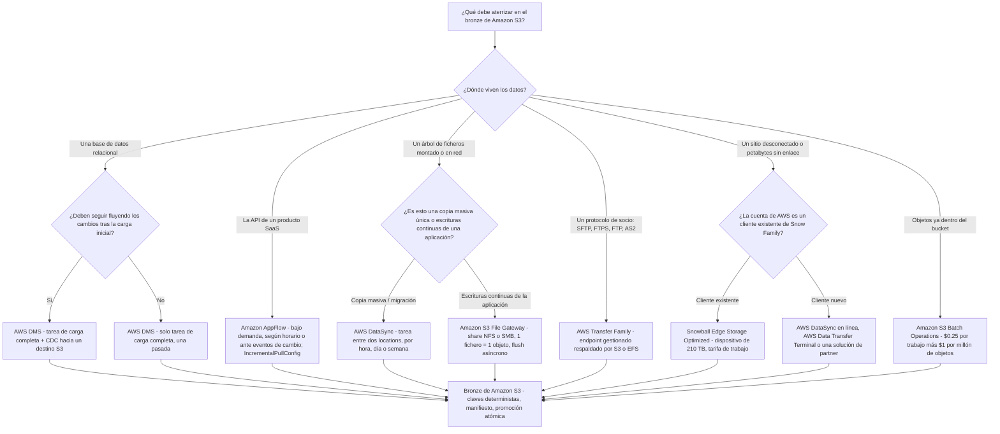
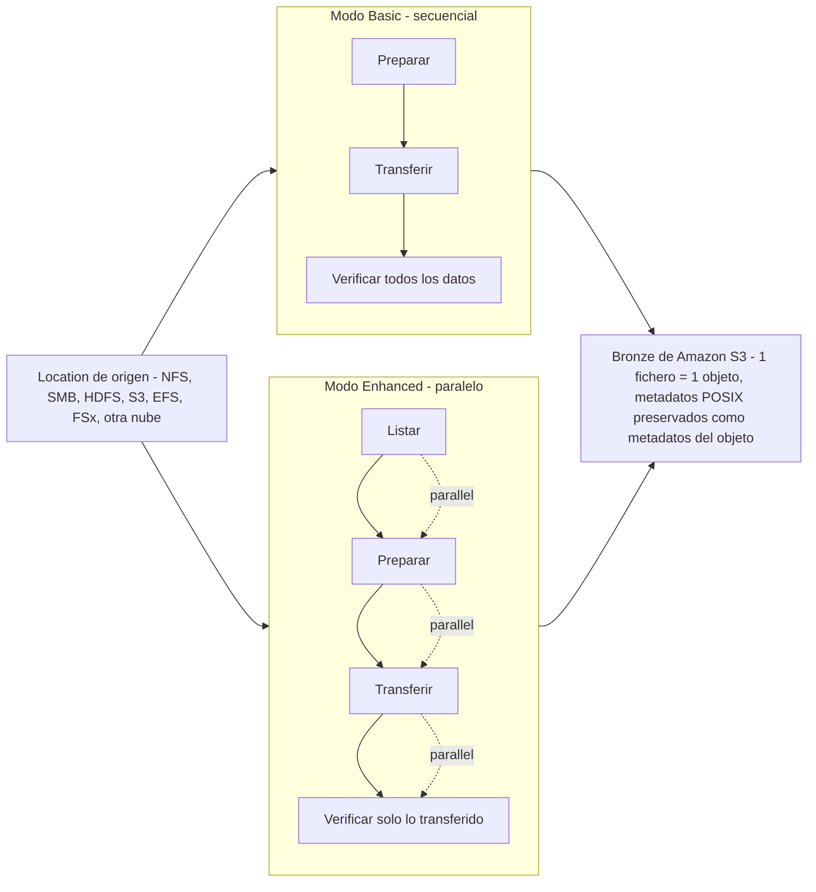
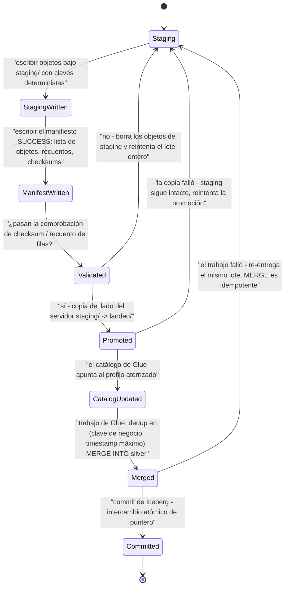
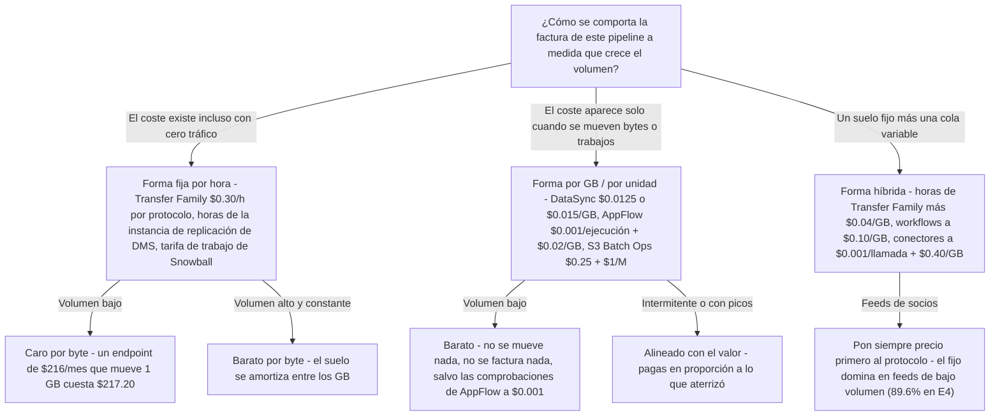
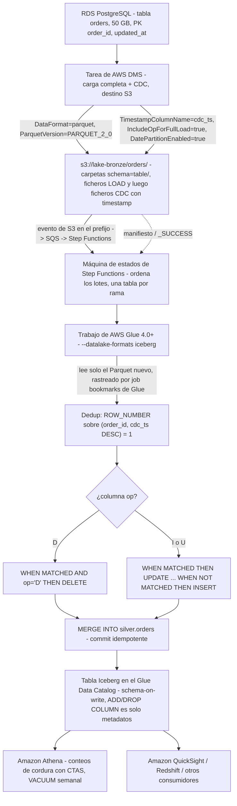

# Patrones de ingesta por lotes: DMS, AppFlow, DataSync y Transfer Family

La lección 04 puso un formato de tabla transaccional encima de Amazon S3. Esta lección es todo lo que ocurre *antes* de eso: la capa que mueve bytes. Un lakehouse con una capa silver de Iceberg perfecta y un servicio de ingesta mal elegido es un lakehouse con una ventana de lote de dos semanas, una carpeta bronze duplicada y un contrato con un socio que no puedes renegociar.

La verdad incómoda de la ingesta por lotes es que la elección casi nunca versa sobre el throughput. Cada servicio de esta lección mueve los datos. La elección es sobre **quién controla la fuente** (tú, una API de un proveedor, el cliente SFTP de un socio, un share montado), **si los cambios deben seguir fluyendo** y **cómo se forma la factura**: horas fijas frente a gigabytes.

```text
====================================================================
 CAJA DE HERRAMIENTAS DE INGESTA POR LOTES — alcance de la lección 05 (en oct 2026)
---------------------------------------------------------------------
 Bases de datos (RDBMS) ..... AWS DMS — carga completa, carga completa + CDC,
                              solo CDC -> Amazon S3 (CSV por defecto,
                              parquet con DataFormat=parquet)
 APIs SaaS ................ Amazon AppFlow — bajo demanda / horario /
                              evento, IncrementalPullConfig, 15 GB por
                              ejecución de Salesforce, $0.001/ejecución + $0.02/GB
 Sistemas de ficheros (NFS/SMB/
 HDFS, otras nubes) ........ AWS DataSync — agente o agentless,
                              Basic o Enhanced, horario/diario/semanal,
                              TransferMode=CHANGED, verificación por checksum
 Escrituras híbridas continua
                              S3 File Gateway — NFS v3/v4.1, SMB
                              v2/v3, 1 fichero = 1 objeto, flush asíncrono
 Feeds de ficheros de socios  AWS Transfer Family — SFTP/FTPS/FTP/
                              AS2 -> S3 o EFS, $0.30/h por protocolo
 Lote sin conexión .......... Snowball Edge = LEGACY (solo
                              clientes existentes desde 2025-11-07;
                              fin comercial 2026-12-31) -> DataSync,
                              Data Transfer Terminal, partners
 Reorganización en el bucket . Amazon S3 Batch Operations — $0.25/trabajo
                              + $1 por millón de objetos
---------------------------------------------------------------------
 Innegociable ................ S3 no tiene claves primarias, no tiene
                              actualizaciones, no tiene integridad
                              referencial — cada aterrizaje debe ser
                              IDEMPOTENTE o duplicarás filas en el
                              primer reintento.
====================================================================
```

En esta lección:

- recorrerás la **matriz de selección de servicios** — del tipo de fuente al servicio — y defenderás cada fila frente a los dos finalistas;
- configurarás **AWS DMS con carga completa + CDC hacia Amazon S3**: `DataFormat=parquet`, `CdcMaxBatchInterval`/`CdcMinFileSize`, `IncludeOpForFullLoad`, `TimestampColumnName`, `TargetTablePrepMode`, modos de carga en paralelo y `GlueCatalogGeneration`;
- nombrarás las **limitaciones del destino S3** que deciden si tu capa bronze es un aterrizaje limpio o un generador de duplicados;
- construirás **extracciones incrementales de AppFlow**: horarios, eventos, filtros, offsets y el techo de 15 GB de Salesforce;
- colocarás **agentes de DataSync**, elegirás **Basic frente a Enhanced**, programarás ejecuciones con `TransferMode=CHANGED` y leerás la historia de verificación;
- levantarás **endpoints, workflows y conectores de Transfer Family** y los precios por hora de protocolo;
- usarás **S3 File Gateway** para escrituras NFS/SMB híbridas y conocerás su brecha de durabilidad;
- declararás correctamente las fechas del **retiro de Snowball Edge** (Snowcone 2024, nuevos clientes 2025-11-07, fin de soporte 2026-12-31);
- aplicarás los cuatro **patrones de aterrizaje idempotente**: claves deterministas, manifiestos, promoción atómica y MERGE desde staging;
- compararás las **formas del coste entre tarifa fija por hora y por GB** antes de comprometerte con una arquitectura;
- recorrerás un **flujo resuelto de DMS → bronze → Glue → silver Iceberg** de principio a fin;
- estudiarás **dos casos de clientes de AWS con nombre** (FINRA, Transport for NSW) y un **cuadro de actualizaciones de octubre de 2026 con fuentes**;
- practicarás con **13 preguntas tipo examen** más tres comprobaciones interactivas.

---

## 1. Selección de servicios: del tipo de fuente al servicio

### 1.1 La matriz

Esta es la lección entera en una tabla. Cada fila es una *restricción*, no una preferencia: lee primero la columna izquierda.

| Tipo de fuente | Servicio | Forma del movimiento | Por qué este |
|---|---|---|---|
| Base de datos relacional (Aurora, RDS, Oracle / SQL Server / MySQL / PostgreSQL on-premises) | **AWS DMS** | Carga completa, carga completa + CDC, o solo CDC → S3 | Captura basada en el log más un destino S3 documentado con Parquet, batching, particionado y generación opcional del catálogo de Glue |
| API SaaS (Salesforce, Slack, ServiceNow, SAP `SAPOData`, Zendesk, Marketo, …) | **Amazon AppFlow** | Bajo demanda, según horario, o ante un evento de cambio en la fuente → S3 / Redshift | Perfiles de conector gestionados, mapas de campos, filtros e `IncrementalPullConfig` en lugar de paginación escrita a mano |
| Árbol NFS / SMB / HDFS on-premises, u otra nube, que debas **copiar** en bloque | **AWS DataSync** | Tarea entre dos *locations*, programada, `TransferMode=CHANGED` | Pipeline en paralelo, integridad por checksum siempre activa, 1 fichero ↔ 1 objeto con metadatos POSIX preservados |
| Aplicación on-premises que debe **seguir escribiendo** en un share que aterriza en S3 | **Amazon S3 File Gateway** | Lectura/escritura NFS/SMB continua con caché local, flush asíncrono a S3 | Los ficheros mapean 1:1 a objetos (ruta = clave), así que las aplicaciones existentes no cambian |
| Socio o proveedor que solo habla **SFTP / FTPS / FTP / AS2** | **AWS Transfer Family** | Endpoint de protocolo gestionado respaldado por S3 o EFS, hasta 3 AZ | El protocolo sobrevive; el almacenamiento se convierte en un lago. Workflows posteriores a la subida opcionales (descifrado PGP a $0.10/GB) |
| **Sin conexión** a escala de petabytes o un sitio sin enlace utilizable | ~~Snowball Edge~~ → **DataSync** / **AWS Data Transfer Terminal** / partner | Envíalo o envíalo a la instalación | Snow Family está cerrado a nuevos clientes (2025-11-07) y llega a fin de soporte el 2026-12-31 |
| Re-etiquetar / re-cifrar / re-localizar / re-guardar objetos **ya en el bucket** | **Amazon S3 Batch Operations** | Un trabajo sobre un manifiesto de hasta 4,000 millones de objetos | Hecho a medida para reorganizaciones dentro del bucket — no para merges a nivel de fila |

### 1.2 El flujo de decisión



Dos reglas que codifica el flujo, ambas examinables:

1. **Copiar frente a servir.** DataSync copia *desde* una location *hacia* otra y termina. File Gateway sirve un share vivo cuyas escrituras resultan en S3. Resuelven mitades distintas de «los datos están en NFS».
2. **Protocolo frente a API.** Transfer Family preserva un *protocolo* que controla el socio; AppFlow preserva la *API de un proveedor* con sus límites de tasa y su paginación. Ninguno sustituye al otro: AppFlow no tiene conector SFTP, y Transfer Family no puede paginar Salesforce.

```matching
{
  "question": "Relaciona cada requisito de ingesta con el único servicio de AWS que lo satisface (en octubre de 2026):",
  "pairs": [
    {"left": "Una base de datos SQL Server debe copiarse a S3 y luego mantenerse en sincronía con su log de transacciones", "right": "AWS DMS - una tarea de carga completa + CDC con DataFormat=parquet y un endpoint de destino S3"},
    {"left": "Los registros de cuentas de Salesforce deben aterrizar en un bucket cada hora y también ante eventos de cambio", "right": "Amazon AppFlow - flujos por horario más flujos ante eventos, con IncrementalPullConfig y filtros dentro del flujo"},
    {"left": "Un árbol NFS on-premises de 40 TB debe migrarse una vez y luego sincronizarse por hora", "right": "AWS DataSync - un agente en el servidor de ficheros, una tarea con TransferMode=CHANGED en un horario"},
    {"left": "Una aplicación heredada debe seguir escribiendo en /data/share mientras los objetos aparecen en S3", "right": "Amazon S3 File Gateway - share NFS v3/v4.1 o SMB, un fichero mapea a un objeto con la ruta como clave"},
    {"left": "Treinta socios de trading solo subirán por SFTP, y eso no puede cambiar", "right": "AWS Transfer Family - un endpoint SFTP gestionado respaldado por S3, facturado por hora de protocolo habilitada"},
    {"left": "Doce millones de objetos quedaron con etiquetas incorrectas tras un mal trabajo", "right": "Amazon S3 Batch Operations - un trabajo dirigido por manifiesto a $0.25 más $1 por millón de objetos"}
  ],
  "explanation": "Cada enunciado nombra una restricción: sincronía con el log de transacciones -> DMS; API de proveedor con eventos -> AppFlow; copia única y después delta -> DataSync; un share vivo que la aplicación ya monta -> File Gateway; un protocolo controlado por el socio -> Transfer Family; una reorganización de objetos que ya existen -> S3 Batch Operations. Las dos confusiones clásicas son DataSync frente a File Gateway (tarea de copia frente a share vivo) y Transfer Family frente a AppFlow (protocolo frente a API SaaS): ninguno de los dos pares es intercambiable."
}
```

- **📚 ¿Sabías que…?** DMS nombra su salida en S3 de forma mecánica: los ficheros de carga completa llevan un **contador hexadecimal incremental** (`LOAD00001.csv`, `LOAD00002.csv`, …) mientras los ficheros CDC se nombran con **timestamps** (`20141029-1134010000.csv`), y *cada tabla de origen no vacía recibe su propia carpeta* bajo la ruta de destino (docs del destino S3 de AWS DMS, consultados 2026-10). Ese esquema de nombres es la razón por la que un aterrizaje idempotente puede razonarse en absoluto: puedes distinguir un fichero de carga de un fichero de cambios solo con la clave.

---

## 2. AWS DMS: carga completa + CDC hacia Amazon S3

### 2.1 Los tres tipos de tarea, reenunciados para el lakehouse

| Tipo de tarea | Qué se mueve | Uso en el lakehouse |
|---|---|---|
| **Carga completa** | Solo filas existentes, una pasada | Sembrar bronze desde una instantánea, o re-sembrar tras un mal aterrizaje |
| **Carga completa + CDC** | Filas existentes **y** cambios capturados mientras corre la carga | El valor por defecto: sembrar bronze y seguir alimentándolo |
| **Solo CDC** | Cambios del log de transacciones desde un punto de inicio elegido | Puesta al día tras una carga, o un feed de cambios de larga duración |

Para un lakehouse el destino no es otra base de datos: es un **prefijo en S3**, y ahí es donde esto se diferencia de todo tutorial de migración que hayas leído.

### 2.2 Ajustes del destino S3 que realmente importan

AWS documenta los ajustes del destino S3 que usarás en producción. Agrupados por propósito (docs del destino S3 de AWS DMS y referencia de la API `S3Settings`, consultados 2026-10):

| Propósito | Ajuste | Valor que fijarás |
|---|---|---|
| Formato | `DataFormat` | `csv` (por defecto) o `parquet` — ficheros Parquet del destino S3 soportados desde **DMS 3.4.7** |
| Ubicación | `BucketName`, `BucketFolder` | El prefijo bronze; el diseño queda `s3://bucket/[folder]/schema/table/` |
| Tamaño de ficheros CDC | `CdcMaxBatchInterval` (segundos), `CdcMinFileSize` (KB) | El propio walkthrough de data lake de AWS: `3600` + `64000` para apuntar a ficheros de **≥ 64 MB** para Athena |
| Ordenación | `TimestampColumnName` | Añade una columna de timestamp de commit de origen (p. ej. `last_update_time`) para la deduplicación y la secuenciación aguas abajo |
| | `PreserveTransactions` + `CdcPath` | Solo en pipelines CSV; preserva el orden de transacciones bajo `CdcPath` (**3.4.2+**) |
| Columna de operación | `IncludeOpForFullLoad` | Marca las filas de carga completa con `I` para que la carga completa y los ficheros CDC compartan una forma (**3.1.4+**, Parquet **3.4.7+**) |
| | `CdcInsertsOnly` / `CdcInsertsAndUpdates` | Estrechan la columna op; **mutuamente excluyentes** — ambas en true no es válido |
| Particionado | `DatePartitionEnabled`, `DatePartitionSequence`, `DatePartitionDelimiter`, `DatePartitionTimezone` | Bronze particionado por fecha para que Athena/Glue puedan podar |
| Compresión | `CompressionType`, `ParquetVersion`, `RowGroupLength`, `MaxFileSize` | Perillas de tamaño de Parquet |
| Cifrado | `EncryptionMode`, `ServerSideEncryptionKmsKeyId` | SSE-KMS en el aterrizaje |
| Catálogo | `GlueCatalogGeneration` | DMS crea tablas del Glue Data Catalog para los objetos que identifica durante la migración |
| Auth hacia S3 | `ServiceAccessRoleArn` | Rol IAM que asume DMS para escribir en el bucket |
| Forma de la carga | `TargetTablePrepMode`, `MaxFullLoadSubTasks`, modos de carga en paralelo | Ver §2.4 |

```fillblank
{
  "question": "Completa la configuración del endpoint S3 que prescribe el propio walkthrough de data lake de AWS (valores en octubre de 2026):",
  "template": "{{1}}=parquet hace que DMS escriba Parquet en lugar de CSV; {{2}}=3600 y {{3}}=64000 apuntan a ficheros de al menos 64 MB para Athena; {{4}}=true marca cada fila de la carga completa con la letra de operación I para que la carga completa y los ficheros CDC compartan una forma.",
  "answers": {
    "1": "DataFormat",
    "2": "CdcMaxBatchInterval",
    "3": "CdcMinFileSize",
    "4": "IncludeOpForFullLoad"
  },
  "distractors": ["BatchApply", "PreserveTransactions", "TargetTablePrepMode", "MaxFileSize", "CdcPath", "GlueCatalogGeneration", "RowGroupLength", "EncryptionMode"],
  "explanation": "Los cuatro ajustes que sostienen la arquitectura son DataFormat=parquet (ficheros Parquet del destino S3 soportados desde 3.4.7), CdcMaxBatchInterval en SEGUNDOS, CdcMinFileSize en KILOBYTES (64000 KB = 64 MB) e IncludeOpForFullLoad (3.1.4+, Parquet 3.4.7+). Los distractores son los casi-correctos: BatchApply no está soportado en endpoints S3 y puede perder datos, PreserveTransactions es la perilla de ordenación de CSV y entra en conflicto con el particionado por fecha, TargetTablePrepMode controla los ficheros de carga completa duplicados y no la forma del fichero, MaxFileSize y RowGroupLength dimensionan Parquet y no fijan el mínimo de Athena, y GlueCatalogGeneration escribe entradas de catálogo en lugar de datos."
}
```

### 2.3 La cronología de carga completa + CDC en S3

```text
Fase 1  CAPTURA ..... el CDC empieza primero; los cambios se cachean en
                      la instancia de replicación (memoria, luego spill a disco)
Fase 2  CARGA COMPLETA  las filas existentes se escriben como ficheros LOAD<hex>,
                      con las tablas cargando en paralelo
Fase 3  APLICAR ..... los cambios cacheados de cada tabla se aplican en
                      cuanto esa tabla termina de cargar
Fase 4  ESTADO ESTABLE .. siguen llegando ficheros CDC con nombre de timestamp;
                      vigila CDCLatencySource / CDCLatencyTarget
```

Dos cosas de S3 cambian el panorama frente a un destino de base de datos:

- **S3 no tiene claves primarias, no tiene actualizaciones y no tiene integridad referencial** (centro de conocimiento de AWS re:Post, 2026-02-09). Los ficheros CDC son por tanto *ficheros de eventos*, no estados de tabla. La deduplicación y el orden son tu trabajo aguas abajo, y para eso existen `TimestampColumnName` y la columna `op`.
- **El orden de transacciones no se preserva por defecto.** Los docs declaran que «de forma predeterminada para el CDC, AWS DMS almacena los cambios de fila de cada tabla de la base de datos sin tener en cuenta el orden de transacciones». Para CSV puedes fijar `PreserveTransactions=true` con `CdcPath`; para Parquet añades `TimestampColumnName` y reconstruyes el orden en el trabajo de Glue.

### 2.4 Carga completa en paralelo y preparación de la tabla de destino

| Palanca | Qué documenta AWS |
|---|---|
| Tablas en paralelo | `MaxFullLoadSubTasks` — el walkthrough de Oracle a S3 de AWS usa **49**; los modos de carga en paralelo son `ranges`, `partitions-optimized` y `partitions-auto`, y «con la opción ranges, la carga completa termina más rápido» para una tabla particionada |
| `TargetTablePrepMode` | **`DO_NOTHING`**, **`TRUNCATE`** (nombre en consola *Truncate*), **`DROP`** — el walkthrough elige `DO_NOTHING` «porque queremos controlar la retención de los ficheros de ejecuciones anteriores» |
| Manejo de LOB | **El modo Full LOB no está soportado** en destinos S3 — elige en su lugar un `LOB Max Size` |
| Cambios de esquema durante la carga completa | **No soportado.** Un DDL a mitad de carga debe esperar al estado estable |
| Clases de instancia de replicación | T3, C5, C6i, R5, R6i (la tabla de docs también lista R7i dimensionado hasta `dms.r7i.48xlarge`, 192 vCPU / 1,536 GiB) |
| Opción serverless | DMS Serverless es la recomendación de AWS «para migraciones heterogéneas o replicaciones continuas de datos con fluctuaciones de datos» (1 DCU = 2 GB de RAM) |
| Validación | La validación del destino S3 necesita **DMS 3.5.0+** con `DataFormat=parquet`, corre **una vez al día a las 00:00 UTC** vía CTAS de Athena, limita las tablas bucketed de Athena a **100,000 buckets** y **falla con buckets gestionados por Lake Formation** |

> [!WARNING]
> ⚠️ **Seis limitaciones del destino S3 que deciden si bronze es fiable** (docs del destino S3 de AWS DMS, consultados 2026-10):
> - **No habilites el versionado en el bucket de destino de DMS** — las conexiones de prueba del endpoint pueden fallar ante un timeout de `list-object` en S3.
> - **`BatchApply` no está soportado en un endpoint S3** y «podría resultar en pérdida de datos»: déjalo apagado.
> - **`TargetTablePrepMode=DO_NOTHING` puede escribir duplicados** si la tarea se detiene y se reanuda abruptamente durante la carga completa. La guía de AWS: prefieres `TRUNCATE_BEFORE_LOAD`, y antes de reiniciar, **borra manualmente los ficheros de carga completa creados previamente**.
> - **Dos tareas replicando la misma tabla de origen hacia el mismo bucket de destino escriben en el mismo fichero.** Una tabla de origen, una tarea, un prefijo.
> - **Los cambios de esquema durante el CDC solo se registran a medias:** truncate/drop/create/rename de tabla, add/drop/rename de columna y cambio de tipo de columna se capturan como DDL, pero *«no se registra ninguna sentencia ALTER en el bucket S3 de destino, y AWS DMS no altera los registros creados previamente para que coincidan con la nueva estructura»*. Los ficheros nuevos simplemente usan la forma nueva.
> - **La validación no es un conteo de filas.** Solo a diario a medianoche UTC, solo con Parquet, y se rompe con buckets gestionados por Lake Formation.

Ese quinto punto es la frase más importante de toda la lección: **bronze es una superficie de schema-on-read.** Los ficheros viejos conservan las formas viejas para siempre. Solo una capa silver de Iceberg más una entrada en el catálogo de Glue restaura la semántica de schema-on-write (lección 04), y ese es exactamente el flujo de la §11.

### 2.5 Ejemplo resuelto E1 — dimensionado de CDC amigable para Athena (en octubre de 2026)

El propio paso a paso de SQL Server a data lake de AWS te da los dos ajustes y el motivo:

> «Como planeamos usar Amazon Athena para consultar datos de nuestro bucket de Amazon S3, necesitamos asegurarnos de que el tamaño de nuestros ficheros de destino sea al menos 64 MB. Especifica los siguientes ajustes de endpoint: `CdcMaxBatchInterval=3600` y `CdcMinFileSize=64000`.» (SBS de AWS DMS, consultado 2026-10)

```text
Ejemplo resuelto E1 - dimensionar una carga completa de 50 GB y una hora de CDC
----------------------------------------------------------------
Fuente .................. RDS PostgreSQL, tabla orders, 50 GB,
                         PK order_id, updated_at
Endpoint ................ DataFormat=parquet, ParquetVersion=
                          PARQUET_2_0, IncludeOpForFullLoad=true,
                          TimestampColumnName=cdc_ts,
                          DatePartitionEnabled=true (día),
                          CdcMaxBatchInterval=3600, CdcMinFileSize=
                          64000  (= objetivo de 64,000 KB)
Suelo de Athena .......... >= 64 MB por fichero (guía del SBS de AWS)

Ficheros de carga completa  50 GB = 51,200 MB
                          51,200 / 64 = 800 ficheros
Ventana CDC .............. 3,600 s x 100 filas/s = 360,000 eventos
                          -> alrededor de 1 fichero Parquet por hora,
                          porque AWS indica que los ficheros Parquet
                          aterrizan MÁS PEQUEÑOS que CdcMinFileSize
                          (el ratio de compresión varía),
                          mientras los ficheros CSV igualan CdcMinFileSize
Paralelismo ............. MaxFullLoadSubTasks (tablas en paralelo)
                          x ranges / partitions-optimized /
                          partitions-auto para una tabla particionada
Trampa .................. una carga completa estancada + reinicio con
                          DO_NOTHING reescribe ficheros LOAD* -> duplicados
```

La cadena examinable: **Athena quiere ficheros de ≥ 64 MB → `CdcMinFileSize=64000` KB y `CdcMaxBatchInterval=3600` s → Parquet aterriza más pequeño que el objetivo por la compresión → así que un supuesto ingenuo de «un fichero por hora» es erróneo para Parquet y correcto para CSV.**

---

## 3. Amazon AppFlow: de SaaS a S3 con extracciones incrementales

### 3.1 Conectores, triggers y el contrato incremental

Los valores de `ConnectorType` de origen de AppFlow incluyen `Salesforce`, `Slack`, `Servicenow`, `SAPOData` (SAP), `Zendesk`, `Marketo`, `Googleanalytics`, `Datadog`, `S3`, `Redshift`, `Snowflake`, `CustomConnector` y `EventBridge`, entre otros; los destinos para flujos de Salesforce incluyen **Amazon S3**, Amazon Redshift, Amazon EventBridge, Snowflake y Zendesk (docs de CloudFormation `SourceFlowConfig` y guía del conector de Salesforce, consultados 2026-10).

| Palanca | Comportamiento (en octubre de 2026) |
|---|---|
| Trigger | **Bajo demanda**, **según horario**, o **ante un evento de cambio en la fuente** («un flujo activado por evento se ejecuta cuando Amazon AppFlow detecta un cambio en los datos de destino en el servicio de almacenamiento del CRM») |
| Extracción incremental | `IncrementalPullConfig` — transfiere «solo los registros que se han añadido o cambiado desde la última ejecución exitosa del flujo» |
| Primera ejecución programada | «El primer flujo activado por programación extraerá los registros de los últimos **30 días** en el momento de la primera ejecución del flujo» |
| Offset | Protege el retraso del sellado de tiempo en el origen: los registros nuevos o cambiados entre `T0 − t` y `T1 − t` se importan en `T1` |
| Poda / control | **Filters** dentro del flujo («especifica qué datos transfiere el flujo») y validaciones que corren *antes* del aterrizaje |
| Techo de Salesforce | **15 GB por ejecución de flujo** ≈ **7.5 millones de registros** a 2 KB de media (los registros pueden llegar a 4 KB) — divide extracciones mayores con filtros |
| Cuota de perfiles | Cuota blanda de **100 perfiles de conector por cuenta de AWS** |
| Prerrequisito | Salesforce necesita una Connected App; ServiceNow necesita «ninguna configuración previa ni para AWS ni para ServiceNow» |

### 3.2 Ejemplo resuelto E2 — lo que cuesta una extracción programada de Salesforce (en octubre de 2026)

La página de precios de AWS publica la aritmética en lugar de una tabla de tarifas. De los ejemplos de us-east-1 y Fráncfort (consultados 2026-10): **$0.001 por ejecución exitosa de flujo**, **$0.02 por GB procesado**, y —lo crítico— *«las ejecuciones de flujo para comprobar si hay datos nuevos contarán hacia el coste de tus ejecuciones de flujo, incluso si no hay datos nuevos disponibles.»*

```text
Ejemplo resuelto E2 - flujo incremental horario de Salesforce -> S3
------------------------------------------------------------
Cadencia ............. cada hora, 24 x 30 = 720 ejecuciones / mes
                       + 1 ejecución por evento por día hábil
                       = 22 ejecuciones más -> 742 ejecuciones
Coste por ejecución .. 742 x $0.001 = $0.742  ->  $0.74
Volumen .............. 600 GB cambiados / mes
Coste de datos ....... 600 / 1 x $0.02 = $12.00
Total mensual ........ $0.74 + $12.00 = $12.74
Anclas publicadas .... "1000 x $0.001 = $1 al día" (ejemplo de AWS)
                       Fráncfort: "10 GB / (1 GB) x $0.02 = $0.20"
Ejecuciones vacías ... 742 comprobaciones se facturan aunque 0 filas cambien
Techo de Salesforce .. 600 GB / 15 GB = 40 ejecuciones mínimo si la
                       extracción fuera un barrido grande; los filtros
                       mantienen cada ejecución cómodamente por debajo
                       de 15 GB / 7.5M de registros
```

Dos consecuencias de diseño salen de la página de precios, no de la lista de funcionalidades:

1. **Una cadencia de sondeo es una línea de factura.** Comprobar cada cinco minutos cuesta 8,640 ejecuciones/mes en un mes de 30 días, haya cambiado algo o no. Fija el horario a partir de la frescura que necesita el *consumidor*.
2. **La primera extracción de 30 días es un evento de deduplicación.** Tu capa bronze recibe un mes de historial en la primera ejecución y deltas a partir de ahí, así que el aterrizaje debe ser idempotente (§9) o el bronze del primer día duplicará cualquier cosa que también llegue por otra vía.

> [!IMPORTANT]
> ⚠️ **No reclames aterrizaje en Parquet desde AppFlow sin volver a comprobar los docs del formato de salida en S3.** Las páginas oficiales recuperadas para esta lección muestran `fileType: CSV` y describen salida CSV/JSON; la salida en Parquet **no se confirmó** en el material recuperado. Trata AppFlow como un aterrizador CSV/JSON a menos que hayas verificado lo contrario para tu Región y tu conector, y haz la conversión de formato en el paso de Glue en su lugar.

- **📚 ¿Sabías que…?** AppFlow factura la *comprobación*, no solo el *cambio*: la propia página de precios de AWS declara que las ejecuciones «para comprobar si hay datos nuevos contarán hacia el coste de tus ejecuciones de flujo, incluso si no hay datos nuevos disponibles». Para los flujos de SAP, AWS muestra en su lugar un multiplicador de concurrencia —«aplicas 9 procesos concurrentes … (1+9) x $0.001 (coste del flujo)»—, así que la paralelismo multiplica los cargos por ejecución en lugar de ahorrarlos (precios de AWS AppFlow, consultados 2026-10).

---

## 4. AWS DataSync: agentes, modos de tarea, horarios, verificación

### 4.1 ¿Agente o agentless?

Una **tarea** de DataSync copia entre dos **locations**. Si necesitas un agente lo decide dónde viven esas locations (docs de AWS DataSync, consultados 2026-10):

| Par de locations | ¿Se necesita agente? |
|---|---|
| NFS / SMB / HDFS on-premises ↔ S3, EFS, FSx | **Sí** — un agente VM (ESXi, KVM, Nutanix AHV, Hyper-V) o una AMI en EC2 |
| Amazon S3 ↔ Amazon S3 en la **misma cuenta de AWS** | **No** |
| Amazon S3 ↔ otro servicio de almacenamiento de AWS **entre cuentas** | **No** |
| Amazon S3 ↔ otra nube | **No** en modo Enhanced |

Reglas que muerden en producción:

- Una location puede alojar **hasta cuatro agentes en modo Basic y hasta cuatro agentes en modo Enhanced**, y *«todos los agentes asociados a una location deben estar en línea antes de que puedas iniciar tu tarea de transferencia. Si uno de los agentes está fuera de línea, no puedes ejecutar tu tarea.»* Multi-agente da velocidad, no failover.
- Los agentes en modo Enhanced y los agentes en modo Basic **no son intercambiables** para la misma location.
- NFS usa por defecto la **versión 4.1** (también 4.0 y 3.x) sobre **TCP 2049** (más **111** para v3); las exportaciones de destino necesitan `no_root_squash`, y DataSync **no copia los ACL de NFSv4**.

### 4.2 Modos de tarea Basic frente a Enhanced

| | **Basic** | **Enhanced** |
|---|---|---|
| Pipeline | **Secuencial**: preparar → transferir → verificar | **Paralelo**: listar, preparar, transferir y verificar |
| Verificación | Verifica **todos los datos por defecto** | Verifica **solo los datos transferidos** |
| Cuota de recuento de objetos | **50 millones** de elementos/tarea (on-premises ↔ AWS), **25 millones** (AWS ↔ AWS) | **Prácticamente ilimitada** |
| Guía de memoria | Asigna **64 GB de RAM** al agente por encima de 20 millones de ficheros/objetos/directorios | — |
| Forma de precios | **$0.0125/GB** copiado (ejemplo de la página de precios) | **$0.015/GB** + **$0.55 por ejecución de tarea** (ejemplo de la página de precios) |
| Integridad | Las comprobaciones corren **siempre** durante la transferencia (checksum + comparación de metadatos) | Igual |

Opciones de tarea que vale la pena memorizar: `TransferMode=CHANGED`, `VerifyMode=ONLY_FILES_TRANSFERRED`, `ObjectTags=PRESERVE`, `LogLevel=TRANSFER`, más filtros/manifiestos y **replicación de borrados** opcional (borra en el destino lo que ya no existe en el origen). La programación es **por hora, día o semana** directamente en la consola.



### 4.3 Ejemplo resuelto E3 — 20 TB de NFS a S3, Basic frente a Enhanced (en octubre de 2026)

Con las tarifas impresas en los propios ejemplos resueltos de AWS en la página de precios de DataSync (consultados 2026-10):

```text
Ejemplo resuelto E3 - 20 TB de NFS -> S3, único y después deltas diarios
----------------------------------------------------------------
Modo Basic
  20 TB x 1024 GB = 20,480 GB
  transferencia .. 20,480 x $0.0125 = $256.00
  tarifa de ejecución  ninguna
  comprobación de cuota  20,480 GB de muchos ficheros pequeños podrían
                  superar el techo de 50 millones de elementos/tarea
                  -> parte el árbol en tareas de <50M elementos
                  (64 GB de RAM del agente por encima de 20M)
  Subtotal ........ $256.00 + peticiones PUT/GET de S3

Modo Enhanced
  transferencia .. 20,480 x $0.015 = $307.20
  ejecuciones .... 30 ejecuciones diarias x $0.55 = $16.50
  Subtotal ........ $323.70 + peticiones PUT/GET de S3

Delta ........... Enhanced cuesta $67.70 más al mes aquí, y a cambio
                  compra: pipeline en paralelo, recuentos de objetos
                  prácticamente ilimitados, métricas por ejecución,
                  y verificar-solo-lo-transferido en vez de verificar-todo
Ancla de AWS .... "(50 TB * 1024 GB copiados con DataSync *
                  $0.015/GB) ... (1 ejecución de tarea * $0.55) =
                  ... $797.58" (Enhanced)
                  "(50 TB copiados en S3 * 1024 GB * $0.0125/GB)
                  = $656.38" (Basic)
```

**Lee la trampa antes de copiar nada.** El Storage Blog de AWS advierte que los objetos sembrados en un bucket por *otras herramientas* carecen de metadatos de DataSync, así que DataSync ejecuta `HEAD` + `GET` + una copia en el sitio — y los objetos en clases de almacenamiento de archivo no pueden hacer `GET` en absoluto, forzando una retransmisión completa por el cable (más una versión nueva si el versionado está activo). El consejo del blog: *«usa DataSync para realizar la transferencia inicial a S3 siempre que sea posible»* y considera suspender el versionado de S3 en el bucket. Haz la **primera** sincronización con DataSync hacia un bucket vacío.

- **📚 ¿Sabías que…?** La detección de «cambiado desde la última ejecución» de DataSync depende de **los propios metadatos de DataSync**. El blog de AWS afirma que DataSync «copia automáticamente cada fichero como un único objeto de S3 en una relación 1:1, y preserva los metadatos POSIX del fichero de origen como metadatos del objeto de Amazon S3» — y que los objetos subidos por otras herramientas activan la ruta HEAD+GET+COPY (AWS Storage Blog, 2021-08-24). Un pipeline híbrido donde un feed SFTP de un socio y DataSync escriban el mismo prefijo pagará por re-copias para siempre.

---

## 5. AWS Transfer Family: protocolos de socio hacia el lago

### 5.1 Qué es

Transfer Family es un **endpoint totalmente gestionado** que habla SFTP (v3), FTPS, FTP, AS2 o un navegador, respaldado por **Amazon S3** o **Amazon EFS**, que *«soporta hasta 3 zonas de disponibilidad y está respaldado por una flota escalable y redundante.»*

| Punto de diseño | Opciones y límites (en octubre de 2026) |
|---|---|
| Tipo de endpoint | **Público** (solo SFTP), **VPC – Internet** (SFTP, FTPS, AS2), **VPC – Interno** (SFTP, FTP, FTPS, AS2) |
| Autenticación | Usuarios gestionados por el servicio, **AWS Managed Microsoft AD**, o **API Gateway + Lambda** — la autenticación por contraseña necesita AD o el cableado a medida |
| **Workflows** posteriores a la subida | Descifrado / validación / notificación PGP — **$0.10/GB procesado** |
| **Conectores SFTP** | Extraen desde o empujan hacia servidores SFTP remotos: **$0.001 por llamada de conector** + **$0.40/GB**; 100 por cuenta, 150 GiB/fichero, 1,000 operaciones en cola, 50 MBps por cuenta, 5 sesiones paralelas, 100 rutas/s |
| Sesiones / inactividad | **10** sesiones SFTP multiplexadas concurrentes por conexión; timeout de inactividad de **1,800 s** (30 min) |
| Tamaño de fichero | **5 TB** (el techo del objeto en S3) |
| Fugas de semántica S3 | Renombrar «soportado solo para ficheros. No se soporta el renombrado que sobrescriba un fichero existente»; **SETSTAT no soportado** con S3 |

> [!WARNING]
> ⚠️ **Transfer Family factura por hora de protocolo habilitada, incluso en inactividad.** El ejemplo resuelto de AWS: SFTP a **$0.30/hora** → `$0.30 × 24 × 30 = $216` al mes, más `$0.04 × GB` de datos movidos. Habilitar SFTP **y** FTPS en el mismo endpoint duplica el cargo fijo. Dos trampas del lado del cliente viajan con ello: las subidas con multi-conexión contra S3 pueden «fallar de maneras impredecibles» y dejar **uploads multiparte huérfanos que generan cargos de Amazon S3**; y como el protocolo se mapea sobre S3, un renombrado que sobrescribiría es rechazado.

### 5.2 Ejemplo resuelto E4 — la factura del feed de socios (en octubre de 2026)

```text
Ejemplo resuelto E4 - 30 socios en un endpoint SFTP (us-east-1)
----------------------------------------------------------------
Endpoint ............. solo SFTP, siempre activo
  $0.30/h x 24 x 30 = $216.00
Datos ................ 400 GB subidos + 100 GB descargados
  500 GB x $0.04  = $ 20.00
Workflow .............. 50 GB descifrados con PGP a $0.10/GB
  50 x $0.10      = $  5.00
Total mensual ........ $241.00
Forma ................ el fijo de $216 = 89.6% de la factura; a este
                        volumen manda la hora de protocolo, no los datos
Ancla publicada ...... ejemplo dual-protocolo de 1,000 usuarios:
                        "$216 + $180 + $216 + $360 = $972"
                        (dos protocolos, dos sabores de endpoint)
Lección ............. habilitar un segundo protocolo «por si acaso»
                        cuesta $180/mes antes de que se mueva un byte
```

---

## 6. Amazon S3 File Gateway: escrituras NFS híbridas que aterrizan en S3

Un appliance de S3 File Gateway (VM, hardware o EC2) exporta shares **NFS v3/v4.1** o **SMB v2/v3**; *«los ficheros escritos en un share de ficheros se convierten en objetos de Amazon S3, con la ruta como clave. Existe una correspondencia uno a uno entre ficheros y objetos.»*

| Propiedad | Detalle (en octubre de 2026) |
|---|---|
| Cifrado | **SSE-S3** por defecto; SSE-KMS y DSSE-KMS opcionales — «asegúrate de que tu share de ficheros use el mismo tipo de cifrado que el bucket de Amazon S3» |
| Integridad | File Gateway rellena la cabecera **`Content-MD5`**; toda la transferencia va por HTTPS |
| Ruta de escritura | Las escrituras de la aplicación se guardan en la **caché de forma síncrona** y luego se suben a S3 **de forma asíncrona** |
| Mapeo de buckets | **Un share de ficheros → un bucket**; varios shares pueden compartir un bucket solo con «un prefijo de bucket de S3 único y no superpuesto» |
| Capacidad de metadatos | Capacidad por defecto del gateway **Small** = metadatos para hasta **5 millones de ficheros**; **8** hilos de subida a S3 por defecto |
| Precio | **$0.01/GB escrito en AWS**, primeros **100 GB/mes gratis** por gateway, limitado a **$125 por gateway al mes**; **las lecturas son gratis** (las peticiones y el almacenamiento de S3 siguen aplicándose) |
| Alcance | «S3 File Gateway no está diseñado para actuar como un reemplazo NAS empresarial completo. S3 File Gateway emula un sistema de ficheros, pero no es un sistema de ficheros.» |

La brecha de durabilidad es el punto operativo: las escrituras son duraderas solo **después** de que la caché se vacíe, así que AWS te instruye para que *«asegúrate de que la métrica de CloudWatch `CachePercentDirty` sea `0`»* antes de detener el host que ejecuta el gateway. Y con el versionado activo, una sola escritura de fichero crea **dos** versiones de objeto: una para los datos y otra para la actualización de metadatos.

**Cuándo elegir File Gateway en lugar de DataSync:** si una aplicación debe *seguir escribiendo* a través de una ruta POSIX, es File Gateway. Si necesitas *copiar* un árbol en un horario, es DataSync. Usar DataSync para fingir un share escribible, o File Gateway para fingir una migración, producen ambos el modo de fallo equivocado.

---

## 7. Lote sin conexión: el patrón Snowball Edge (y su estado en 2026)

Enseña el *patrón* — un disco enviado que aterriza bytes verificados en S3 — pero enseña el **estado del producto** correctamente, porque la mayoría del contenido de la web abierta ya está obsoleta.

| Hito | Fecha | Consecuencia |
|---|---|---|
| **Snowcone discontinuado** | 2024-11-12 | El soporte para clientes existentes terminó el 2025-11-12 |
| **Snowball Edge cerrado a nuevos clientes** | 2025-11-07 | AWS dirige las nuevas necesidades de lote sin conexión a **AWS DataSync**, **AWS Data Transfer Terminal** y soluciones de AWS Partners |
| **Ningún dispositivo Snow Family para que nuevos clientes pidan** | actual | «AWS ya no ofrecerá ningún dispositivo de AWS Snow Family para que nuevos clientes lo pidan» |
| **Fin de soporte en Regiones comerciales** | **2026-12-31** | Aplica a los dispositivos Storage Optimized **y** Compute Optimized |

Anclas de dispositivo y precio para quien mantenga un despliegue existente (precios de AWS Snowball, us-east-1, consultados 2026-10): **Storage Optimized 210 TB** utilizables; **tarifa de trabajo On-Demand hasta 100 TB (incluye 15 días) $1,800**; **101 TB–210 TB $3,200**; **$250 por día** más allá de 15 días; **$9,885 al mes**; **compromiso de 1 año por adelantado $97,268**; almacenamiento compatible con S3 en el dispositivo **$0.01 por GB-mes** o **$0.12 por GB-año**. Compute Optimized llega a **104 vCPU, 416 GB de memoria y 28 TB de SSD NVMe dedicados**.

- **📚 ¿Sabías que…?** El *patrón* sin conexión sobrevive al producto. Con Snowcone fuera y Snowball Edge restringido, la propia nota de migración de AWS apunta a DataSync para transferencias en línea, **Data Transfer Terminal** para subidas físicas seguras y a los partners — la pregunta arquitectónica («¿cómo llegan 500 TB a S3?») sigue teniendo las mismas tres respuestas, solo cambió el orden de preferencia (actualizaciones de dispositivos Snow de AWS, 2024-11-12; docs del cambio de disponibilidad de Snowball Edge, consultados 2026-10).

---

## 8. Amazon S3 Batch Operations: reorganizar lo que ya aterrizó

S3 Batch Operations es la herramienta de reparación para un aterrizaje que salió mal, y la herramienta de migración para un diseño de prefijos que estás cambiando. Un trabajo ejecuta una operación sobre un **manifiesto**:

- copiar objetos, actualizar el cifrado del lado del servidor, fijar etiquetas o ACL de objetos, iniciar restauraciones desde S3 Glacier Flexible Retrieval, invocar una función de **AWS Lambda**, Object Lock y Batch Replication;
- tamaño por defecto del manifiesto **4,000 millones de objetos**, subiendo a **20,000 millones** para Copy, Object Tagging, Object Lock, Lambda invoke y Batch Replication;
- formato de manifiesto `S3BatchOperations_CSV_20180820`, generado habitualmente desde **S3 Inventory**;
- precio: **$0.25 por trabajo** + **$1.00 por millón de objetos procesados** (precios de S3 de AWS, consultados 2026-10).

### 8.1 Ejemplo resuelto E5 — reparar un aterrizaje mal etiquetado (en octubre de 2026)

```text
Ejemplo resuelto E5 - 12,000,000 de objetos etiquetados tras un mal trabajo
----------------------------------------------------------------
Tarifa del trabajo .... 1 x $0.25      = $  0.25
Por objeto ............ 12,000,000 / 1,000,000 x $1.00
                        = 12 x $1.00    = $ 12.00
Subtotal ..............                 = $ 12.25
                     (+ peticiones PUT de etiquetado de S3 para los objetos)
Ancla publicada ....... el propio ejemplo de 1,000,000 de objetos de AWS
                        suma "$1.25"
Contraste ............. un bucle de SDK por objeto son los mismos
                        12M de PUTs pero con tus propios reintentos,
                        tu propio throttle y sin informe de finalización
Alcance ............... SOLO a nivel de objeto - etiquetas, claves,
                        cifrado, ACLs, restauración, Lambda.
                        Los merges a nivel de fila son de Iceberg
                        (lección 04), no de Batch Operations
```

---

## 9. Aterrizaje idempotente: los cuatro patrones

Hasta aquí todo produce *ficheros*. S3 acepta encantado el mismo fichero dos veces, y la propia guía de AWS es tajante: **«Amazon S3 no soporta claves primarias, actualizaciones ni integridad referencial»**. Así que la capa de aterrizaje —la parte entre el mueve-datos y el formato de tabla— necesita un contrato a prueba de reintentos.

| # | Patrón | Mecanismo | Fallo que derrota |
|---|---|---|---|
| 1 | **Claves deterministas** | Codifica la fuente, la tabla, la fecha de partición y un hash de contenido/lote en la clave para que un reintento **sobrescriba** en lugar de añadir | Objetos duplicados de una subida reintenada |
| 2 | **Ficheros manifiesto** | Escribe un `_SUCCESS`/manifiesto que liste objetos, recuentos de filas y checksums; los consumidores leen un lote **solo cuando su manifiesto está completo** | Trabajos aguas abajo que leen un lote a medio escribir (el patrón Step Functions + SQS + manifiesto) |
| 3 | **Promoción atómica** | Escribe en `staging/…` y luego copia del lado del servidor (`CopyObject`) hacia `landed/…` | Lectores que ven ficheros parciales; nota que el renombrado de Transfer Family **no sobrescribe**, así que la promoción es una copia, no un movimiento |
| 4 | **MERGE desde staging** | Aterriza los ficheros en bruto de forma inmutable y luego `MERGE INTO silver USING staging` con deduplicación por clave de negocio + timestamp | Un fichero CDC re-entregado que cambia silver dos veces — el commit sigue siendo idempotente |



### 9.1 Ordenar los pasos

```dragdrop
{
  "question": "Ordena la secuencia de aterrizaje idempotente desde la escritura en bruto hasta una fila silver comprometida:",
  "items": [
    "Escribe los ficheros en bruto en un prefijo de staging usando claves deterministas - fuente, tabla, fecha de partición y un hash de contenido o de lote dentro de la clave",
    "Escribe un manifiesto o un objeto _SUCCESS que liste los objetos del lote, los recuentos de filas y los checksums",
    "Valida el lote - los checksums y los recuentos coinciden con el manifiesto, o el lote se descarta y se reintenta",
    "Promueve de forma atómica - copia del lado del servidor de staging/ a landed/ para que los lectores nunca observen un lote parcial",
    "Actualiza la entrada del Glue Data Catalog para el prefijo aterrizado",
    "Ejecuta el trabajo de Glue: dedup en la clave de negocio con max(timestamp), luego MERGE INTO la tabla silver de Iceberg"
  ],
  "correctOrder": [
    "Escribe los ficheros en bruto en un prefijo de staging usando claves deterministas - fuente, tabla, fecha de partición y un hash de contenido o de lote dentro de la clave",
    "Escribe un manifiesto o un objeto _SUCCESS que liste los objetos del lote, los recuentos de filas y los checksums",
    "Valida el lote - los checksums y los recuentos coinciden con el manifiesto, o el lote se descarta y se reintenta",
    "Promueve de forma atómica - copia del lado del servidor de staging/ a landed/ para que los lectores nunca observen un lote parcial",
    "Actualiza la entrada del Glue Data Catalog para el prefijo aterrizado",
    "Ejecuta el trabajo de Glue: dedup en la clave de negocio con max(timestamp), luego MERGE INTO la tabla silver de Iceberg"
  ],
  "explanation": "El orden es escribir -> certificar -> verificar -> promover -> catálogo -> merge. Dos propiedades lo hacen idempotente: las claves deterministas significan que un reintento sobrescribe en lugar de añadir, y el manifiesto es la puerta que impide que aguas abajo se lea un lote a medio escribir. La promoción es un COPY del lado del servidor en lugar de un renombrado porque S3 no tiene renombrado atómico y el renombrado de Transfer Family se niega a sobrescribir. El MERGE final es lo que hace seguro un fichero CDC re-entregado: deduplica primero (exactamente un registro de origen puede actualizar como mucho una fila de destino), y luego MERGE, de modo que una segunda ejecución del mismo lote deja silver sin cambios."
}
```

### 9.2 El MERGE que hace seguro el replay

De las propias recetas de CDC hacia Iceberg de AWS (Big Data Blog, 2022-06-15 actualizado en mayo de 2023; 2023-02-14): DMS suministra el atributo `op` para los datos CDC incrementales pero **no** para la carga inicial salvo que fijes **`IncludeOpForFullLoad=true`**; el trabajo de Glue deduplica en la columna `last_update_time` que añadió `TimestampColumnName` y luego ejecuta

```sql
MERGE INTO silver.orders s
USING staged_orders d
   ON s.order_id = d.order_id
WHEN MATCHED AND d.op = 'D' THEN DELETE
WHEN MATCHED THEN UPDATE SET s.status = d.status, s.updated_at = d.updated_at
WHEN NOT MATCHED THEN INSERT (order_id, status, updated_at)
VALUES (d.order_id, d.status, d.updated_at);
```

### 9.3 Ejemplo resuelto E6 — lo que te cuesta un replay (en octubre de 2026)

```text
Ejemplo resuelto E6 - el mismo lote CDC entregado dos veces
----------------------------------------------------------------
Lote .............. archivo CDC con 5,000 eventos para 800 order_ids
                    distintos, cdc_ts sellado por TimestampColumnName
Ejecución 1 - INSERT INTO ingenuo
                    filas silver +5,000 -> total 5,000 para estas claves
Ejecución 2 - replay del MISMO archivo
                    filas silver +5,000 -> total 10,000  (duplicado)
                    count(*) de Athena ahora es erróneo para cada
                    dashboard aguas abajo, en silencio
Ejecución 1 - dedup y luego MERGE
                    ROW_NUMBER() OVER (PARTITION BY order_id
                    ORDER BY cdc_ts DESC) = 1  -> 800 filas
                    MERGE: 320 borrados 'D', 480 upserts I/U
                    filas silver para estas claves = 800 netas
Ejecución 2 - replay del MISMO archivo
                    dedup de nuevo -> mismas 800 filas
                    MERGE coincide igual -> cambio neto 0
                    Resultado: commit idempotente, recuento de filas intacto
Regla .............. "Solo un registro en los datos de origen puede
                    actualizar cualquier fila dada de la tabla de
                    destino, o de lo contrario se lanzará un error" -
                    deduplica primero, siempre, antes de que MERGE
                    se ejecute jamás
```

- **📚 ¿Sabías que…?** Un reinicio de una tarea de DMS puede fabricar duplicados por sí solo. La guía de AWS para `TargetTablePrepMode=DO_NOTHING` dice que una tarea que se detiene durante la carga completa «vuelve a escribir los ficheros de carga completa cuando se reinicia», así que debes cambiar a `TRUNCATE_BEFORE_LOAD` o borrar manualmente los `LOAD*` anteriores antes de reiniciar (AWS re:Post, 2026-02-09). La idempotencia no es solo cosa de tu trabajo de Glue; también del comportamiento de reinicio del mueve-datos.

---

## 10. Forma del coste: tarifa fija por hora frente a por GB

Antes de comprometerte con una arquitectura, averigua cuál de estas tres formas toma la factura. Se comportan de manera completamente distinta a medida que crece el volumen.

```text
====================================================================
 FORMAS DEL COSTE (tarifas publicadas, ejemplos en us-east-1, en oct 2026)
---------------------------------------------------------------------
 FIJA POR HORA / CAPACIDAD FIJA
   Transfer Family .... $0.30 por hora de protocolo habilitada
                        -> $216/mes por protocolo, activo o no
   AWS DMS ............. horas de la instancia de replicación (o DCUs
                        para Serverless; 1 DCU = 2 GB de RAM) + almacenamiento
                        (100 GB GP2 en C4/R4/R5, 50 GB en T2/T3)
                        + Multi-AZ recomendado para trabajo continuo
   Snowball Edge ....... $1,800 (<=100 TB, 15 días) / $3,200
                        (101-210 TB) / $250 por día extra
                        / $9,885 al mes
 POR GB / POR UNIDAD
   DataSync ............ Basic $0.0125/GB; Enhanced $0.015/GB
                        + $0.55 por ejecución de tarea
   AppFlow ............. $0.001 por ejecución exitosa + $0.02/GB
   S3 Batch Operations . $0.25 por trabajo + $1.00 por millón de objetos
   File Gateway ........ $0.01/GB escrito, primeros 100 GB gratis,
                        tope de $125/gateway/mes, lecturas gratis
 HÍBRIDA (suelo fijo + variable)
   Datos de Transfer Family  $0.30/h/protocolo + $0.04/GB movido
   Workflows de Transfer ...... $0.10/GB procesado (p. ej. descifrado PGP)
   Conectores SFTP ............ $0.001/llamada + $0.40/GB
====================================================================
```



El ejemplo resuelto de la §5.2 es la prueba: un feed de socios de 500 GB en Transfer Family cuesta **$241**, de los cuales **$216 (89.6%)** son hora de protocolo. Los mismos 500 GB por DataSync a la tarifa Basic serían 500 × $0.0125 = **$6.25**. Transfer Family sigue siendo la respuesta correcta —porque el *socio* es la restricción—, pero debes saber que estás comprando compatibilidad de protocolo, no ancho de banda.

> [!IMPORTANT]
> ⚠️ **No cites de memoria un $/hora de instancia de DMS.** AWS renderiza la tabla de instancias on-demand de DMS de forma dinámica, y las cifras capturadas para esta lección no pudieron verificarse desde la página de precios (aparecen solo en blogs de terceros). La estructura verificada es: **clases** de instancia (T3, C5, C6i, R5, R6i, R7i), almacenamiento incluido (**100 GB GP2** en las clases C4/R4/R5, **50 GB** en T2/T3), **$0.075 por vCPU-hora** para los créditos de CPU de T3 en modo ilimitado, **1 DCU = 2 GB de RAM** para DMS Serverless, «todos los datos que entran en AWS DMS son gratis», y el tráfico DMS↔RDS en la misma AZ gratis. Extrae la tarifa en vivo de `aws.amazon.com/dms/pricing/` antes de modelar una factura.

---

## 11. Flujo extremo a extremo resuelto: DMS → bronze → Glue → silver Iceberg

### 11.1 El flujo



### 11.2 El esquema, paso a paso (en octubre de 2026)

```text
Ejemplo resuelto E7 - orders de RDS (50 GB) hacia una tabla silver Iceberg
--------------------------------------------------------------------
Paso 1  ENDPOINT DMS (destino S3)
        DataFormat=parquet ......... Parquet desde DMS 3.4.7
        ParquetVersion=PARQUET_2_0
        IncludeOpForFullLoad=true .. las filas de carga completa llevan 'I',
                                      así carga completa y CDC comparten
                                      una forma (3.1.4+, parquet 3.4.7+)
        TimestampColumnName=cdc_ts . timestamp de commit de origen para
                                      dedup + ordenación
        DatePartitionEnabled=true .. particiones por día para podar
        CdcMaxBatchInterval=3600 ... una hora de cambios por fichero
        CdcMinFileSize=64000 ....... objetivo de >= 64 MB para Athena
        ServiceAccessRoleArn ....... rol IAM para escribir el bucket
        GlueCatalogGeneration ...... tablas Glue opcionales creadas
                                      mientras DMS migra
Paso 2  TAREA
        Tipo: carga completa, replicación continua
        TargetTablePrepMode: DO_NOTHING (controla la retención) - y
          por tanto NUNCA reinicies a mitad de una carga completa sin
          limpiar los LOAD* anteriores
        MaxFullLoadSubTasks / ranges / partitions-auto para la
          carga completa particionada; LOB Max Size (sin modo Full LOB)
Paso 3  ORQUESTACIÓN
        evento S3 -> SQS -> Step Functions; SQS retiene el orden de
        lotes, Step Functions hace fan-out por tabla, los job bookmarks
        de Glue rastrean qué ficheros CDC son nuevos
Paso 4  TRABAJO DE GLUE (silver)
        lee el Parquet bronze -> dedup en (order_id, cdc_ts máximo)
        -> divide op: D frente a I/U -> MERGE INTO silver.orders
        -> evolución de esquema vía ADD/DROP COLUMN de Iceberg
Paso 5  VERIFICAR
        conteos de cordura con CTAS de Athena; validación S3 de DMS si
        la quieres (3.5.0+, parquet, diario 00:00 UTC, no en buckets de
        LF); VACUUM semanal para expirar instantáneas
Cifras . 50 GB / 64 MB = ~800 ficheros de carga completa
        3,600 s x 100 filas/s = 360,000 eventos CDC/hora
        Parquet comprime por debajo de CdcMinFileSize -> menos
        ficheros y más pequeños que el equivalente en CSV
```

Cada ingrediente de ese bloque está tomado de los patrones publicados de AWS: la ordenación con Step Functions + SQS y trabajos de Glue creando la capa silver (Big Data Blog, 2024-10-30), un job bookmark de Glue que impulsa un `MERGE` incremental con dedup en `last_update_time` (2023-02-14), y dos tareas de DMS que separan la carga completa y las carpetas CDC particionadas por fecha para un `MERGE` nativo de Athena (2023-04-27).

### Actualizaciones de 2026 (en octubre de 2026)

> [!NOTE]
> **Qué cambió alrededor de la ingesta por lotes de la que depende esta lección** — cada línea con fuente y fecha:
> - **2025-05-14 — Firehose ganó una jerarquía multi-catálogo de Glue.** El historial de documentos de Firehose registra soporte de «jerarquía multi-catálogo de Glue», así que una entrega puede apuntar a un catálogo distinto del predeterminado como **S3 Tables**, y no solo al catálogo de Glue por defecto de la cuenta (guía de usuario de Amazon Data Firehose, historial de documentos, consultada 2026-10-11). Relevancia: el lado del *destino* de la ingesta tiene ahora una opción gestionada de Iceberg junto a DMS → bronze → Glue.
> - **2025-01-27 — Amazon S3 Metadata es GA.** «S3 Metadata hace fácil consultar y filtrar los metadatos de los objetos de S3 usando SQL… puedes consultar los metadatos de los objetos con Amazon Athena» — los metadatos de los objetos aterrizan en tablas de S3 Metadata que aparecen en el Glue Data Catalog / Athena (AWS News Blog, 2025-01-27). Relevancia: auditar *qué* produjo realmente un aterrizaje (tamaños, claves, recuentos) sin un ciclo completo de S3 Inventory.
> - **2026-08-21 — AWS Glue 6.0 es GA con una reducción de precios del 30%.** «AWS Glue 6.0 ya está disponible generalmente, con una reducción de precios del 30% y soporte completo para Apache Iceberg v3», con Spark 4.1, Python 3.13 y **Spark Declarative Pipelines** para orquestación integrada (AWS News Blog, 2026-08-21). Relevancia: la etapa MERGE de la §11 se abarata y puede llevar su propia orquestación.
> - **2025-11-07 — Snowball Edge cerrado a nuevos clientes.** «Los dispositivos de AWS Snowball Edge solo estarán disponibles para clientes existentes. Los nuevos clientes deberían explorar AWS DataSync para transferencias en línea, AWS Data Transfer Terminal para transferencias físicas seguras o soluciones de AWS Partners» (actualizaciones de dispositivos Snow de AWS, aviso de 2024-11-12; docs de disponibilidad de Snowball Edge, consultados 2026-10).
> - **2026-12-31 — Fin de soporte de los dispositivos Snowball en Regiones comerciales.** «El 31 de diciembre de 2026, AWS dejará de soportar los dispositivos de AWS Snowball en todas las Regiones comerciales de AWS. Esto incluye tanto los dispositivos Storage Optimized como los Compute Optimized de AWS Snowball Edge» (aws.amazon.com/snowball, consultado 2026-10). Cualquier runbook que todavía diga «pide un Snowball» necesita reescribirse este trimestre.

---

## Casos Reales

AWS publica cómo se ven estos patrones en producción. Todas las cifras de abajo son **afirmaciones del cliente o de AWS y no auditadas**, con la fuente nombrada para que puedas comprobarlas: lo examinable es el *patrón*, no el marketing.

### Caso A — FINRA: validar y catalogar ficheros a escala de regulador

| Elemento | Detalle |
|---|---|
| Cliente | **FINRA** — el regulador del mercado financiero de EE.UU., que ejecuta vigilancia de mercado a escala nacional |
| Reto | El análisis on-premises de capacidad fija no podía seguir el ritmo de los datos de mercado cumpliendo a la vez los deberes de auditoría y lineage regulatorios |
| Forma de ingesta | Los datos de mercado llegan de los mercados como **ficheros sobre SFTP/HTTPS**, se validan (AWS lista **AWS Lambda para la validación de ficheros** entre los servicios) y luego se catalogan antes de que el análisis los lea — con **Amazon S3** como capa de aterrizaje y de archivo |
| Servicios | Data lake y archivo de **Amazon S3**, validación de ficheros con **AWS Lambda**, **Amazon EMR** (Hive, Presto, Apache HBase sobre S3), EC2 Spot, martes de Redshift, KMS, y el catálogo de código abierto propio de FINRA, **herd**, como fuente única de verdad |
| Resultados (según AWS en 2016–2017) | ~**6 TB** y **37,000 millones de registros** en un día medio, **más de 75,000 millones de registros** en días concurridos; **más de 600 TB** con «billones de registros» consultables de forma interactiva; **más del 60%** de ahorro de costes al mover HBase a S3; clúster listo en **menos de 30 minutos** frente a «casi dos días»; la mayoría de consultas **en menos de 3 segundos** |
| Lección aquí | Ingestar, validar, catalogar y luego procesar — y, siempre que sea posible, *«procesar directamente contra los datos en Amazon S3»* en lugar de copiarlos primero a un almacén propio del motor |
| Fuente | AWS Public Sector Blog, 2017-10-03; AWS Big Data Blog, 2016-11-21 (consultados 2026-10) |

> «Ampliamos el patrón de data lake con EMR, Hbase y Amazon S3 para permitir consultas aleatorias interactivas a través de billones de registros que abarcan más de 600 terabytes de datos.» — AWS Public Sector Blog, 2017-10-03

Lee a FINRA como un caso de **ingesta por lotes**, no solo de arquitectura: los ficheros aterrizan, se validan antes de que nada los lea (ese es tu paso de manifiesto/verificación), se catalogan (tu entrada de Glue) y solo entonces se consultan. La disciplina de **validar-antes-de-leer** es la misma independientemente de que el mueve-datos sea Transfer Family, DataSync o DMS.

*Honestidad de fechas: estas son cifras de 2016–2017 de una plataforma que desde ha cambiado — trátalas como hitos históricos, nunca como el estado actual de FINRA.*

### Caso B — Transport for NSW: más de 400 workflows de ingesta fuera del ETL con licencia

| Elemento | Detalle |
|---|---|
| Cliente | **Transport for NSW** — agencia de transporte australiana, más de 25,000 empleados, 2M+ pasajeros/día |
| Reto | **Más de 400** workflows de ingesta ETL heredados sobre una plataforma de terceros con licencia, con plazos de entrega de varios meses para añadir nuevos feeds y dependencia de personas clave con experiencia heredada |
| Servicios | **AWS Glue** (integración de datos serverless, Python), **AWS Step Functions** (orquestación y monitorización), **Amazon S3** (fundamento del data lake), RDS para compatibilidad hacia atrás |
| Resultados (reportados por el cliente) | Costes anuales de integración de datos recortados ~**80%**; los nuevos trabajos de ingesta se construyen y despliegan en **«menos de 3 semanas»** (desde varios meses); **30+** miembros del equipo formados; la experiencia distribuida más allá de los especialistas heredados |
| Lección aquí | La factura de la ingesta por lotes rara vez es solo la factura del mueve-datos: la licencia, el plazo de entrega y el riesgo de persona clave forman parte de la forma del coste (§10) |
| Fuente | Caso de AWS, sin fecha, consultado 2026-10-11 |

| Caso | Patrón que demuestra | Sección |
|---|---|---|
| FINRA | Ficheros dentro → validar → catalogar → consultar sobre S3; procesar contra el lago en lugar de copiar hacia el motor | §1, §9 |
| Transport for NSW | Reemplazar workflows ETL con licencia por ingesta serverless + orquestación; forma del coste más allá de $/GB | §10 |

- **📚 ¿Sabías que…?** El «30+ miembros del equipo formados» de Transport for NSW es la mitad operativa del argumento del coste: AWS indica que el equipo «también pudo distribuir la experiencia entre varios miembros existentes del equipo» una vez que la plataforma pasó a ser Glue, basado en Python, y no una herramienta especializada (caso de AWS, consultado 2026-10-11). El recorte del 80% en costes es el titular; la eliminación de la dependencia de personas clave es normalmente la razón por la que tales migraciones se quedan.

---

## Preguntas de Práctica (Practice Questions)

```question
{
  "id": "lh-05-q1",
  "type": "multiple-choice",
  "question": "Una tarea de DMS aterriza CDC en Amazon S3 y las consultas de Athena siguen escaneando ficheros diminutos. El propio walkthrough de data lake de AWS prescribe dos S3Settings para arreglarlo. ¿Qué par es correcto (en octubre de 2026)?",
  "options": [
    "CdcMaxBatchInterval=60 y CdcMinFileSize=1000, porque a Athena le gustan muchos objetos pequeños",
    "CdcMaxBatchInterval=3600 y CdcMinFileSize=64000, apuntando a ficheros de al menos 64 MB",
    "MaxFileSize=64 y RowGroupLength=100, porque los row groups de Parquet son el control del tamaño de fichero",
    "BatchApply=true y PreserveTransactions=true, porque el batching produce ficheros más grandes"
  ],
  "correct": 1,
  "explanation": "El paso a paso de AWS lo dice con claridad: «Como planeamos usar Amazon Athena para consultar datos de nuestro bucket de Amazon S3, necesitamos asegurarnos de que el tamaño de nuestros ficheros de destino sea al menos 64 MB», y prescribe CdcMaxBatchInterval=3600 (segundos) con CdcMinFileSize=64000 (kilobytes). AWS también indica que los ficheros Parquet aterrizan más pequeños que ese objetivo porque la compresión varía, mientras los ficheros CSV lo igualan. BatchApply no está soportado en endpoints S3 y puede perder datos, así que la opción D queda descalificada de entrada."
}
```

```question
{
  "id": "lh-05-q2",
  "type": "multiple-choice",
  "question": "Una base de datos de origen gana una columna nueva mientras una tarea de carga completa de DMS sigue en ejecución, y luego ocurren ALTERs durante el CDC. ¿Qué aterriza en el prefijo bronze de S3?",
  "options": [
    "Nada - DMS aborta la tarea cuando el esquema de origen cambia durante la carga completa",
    "La columna se añade a cada objeto escrito previamente, porque los destinos S3 se reescriben para coincidir",
    "No se registra ninguna sentencia ALTER en el bucket S3 de destino y los registros creados previamente no se alteran; los ficheros nuevos simplemente usan la nueva estructura, y los cambios de esquema durante la carga completa no están soportados",
    "DMS escribe un objeto _ALTER.json separado por sentencia DDL que Athena aplica automáticamente"
  ],
  "correct": 2,
  "explanation": "AWS documenta ambas mitades: «Los cambios en la estructura de la tabla de origen durante la carga completa no están soportados», y para el DDL del CDC, «no se registra ninguna sentencia ALTER en el bucket S3 de destino, y AWS DMS no altera los registros creados previamente para que coincidan con la nueva estructura». El DDL soportado queda reducido a truncate/drop/create/rename de tabla, add/drop/rename de columna y cambio de tipo de columna — e incluso así los ficheros viejos conservan las formas viejas. La consecuencia es que bronze es schema-on-read; solo una capa silver de Iceberg más una entrada en el catálogo de Glue restaura la semántica de schema-on-write."
}
```

```question
{
  "id": "lh-05-q3",
  "type": "multiple-choice",
  "question": "Una tarea de carga completa de DMS con TargetTablePrepMode=DO_NOTHING se detiene a mitad de una carga de 50 GB y se reinicia. ¿Qué debe hacer primero el operador (en octubre de 2026)?",
  "options": [
    "Nada - DO_NOTHING significa que DMS detecta y omite automáticamente los ficheros LOAD ya escritos",
    "Borrar los ficheros de carga completa creados previamente antes de reiniciar, o cambiar la tarea a TRUNCATE_BEFORE_LOAD - un reinicio reescribe los ficheros de carga completa y produce duplicados",
    "Habilitar BatchApply en el endpoint S3 para que la segunda pasada reconcilie filas",
    "Activar el versionado del bucket para que los objetos duplicados se conviertan en la versión anterior"
  ],
  "correct": 1,
  "explanation": "AWS declara que si fijas TargetTablePrepMode a DO_NOTHING y la tarea se detiene durante la carga completa, «la tarea vuelve a escribir los ficheros de carga completa cuando se reinicia», y aconseja fijar TRUNCATE_BEFORE_LOAD — y que antes de reiniciar debes borrar manualmente los ficheros de carga completa creados previamente. BatchApply no está soportado explícitamente para endpoints S3 y «podría resultar en pérdida de datos». El versionado es lo contrario del consejo de AWS: los docs del destino S3 advierten contra habilitar el versionado porque los timeouts de list-object pueden romper las conexiones de prueba del endpoint."
}
```

```question
{
  "id": "lh-05-q4",
  "type": "multiple-choice",
  "question": "Un equipo programa un flujo de AppFlow desde Salesforce hacia Amazon S3. ¿Qué afirmación sobre las extracciones incrementales y el coste es correcta (en octubre de 2026)?",
  "options": [
    "La primera ejecución programada extrae solo las filas cambiadas en la última hora, y las comprobaciones vacías son gratis",
    "El primer flujo activado por programación extrae 30 días de registros pasados, y las ejecuciones de flujo que comprueban si hay datos nuevos facturan $0.001 cada una incluso cuando nada cambió",
    "Las extracciones incrementales requieren un conector personalizado, y la facturación es solo por GB a $0.02/GB",
    "Los flujos activados por evento no pueden combinarse con los flujos programados sobre los mismos objetos de origen"
  ],
  "correct": 1,
  "explanation": "AWS documenta que «El primer flujo activado por programación extraerá los registros de los últimos 30 días en el momento de la primera ejecución del flujo» — una carga de historial única que tu aterrizaje debe absorber de forma idempotente —, y la página de precios declara que «las ejecuciones de flujo para comprobar si hay datos nuevos contarán hacia el coste de tus ejecuciones de flujo, incluso si no hay datos nuevos disponibles», a $0.001 por ejecución exitosa más $0.02/GB. IncrementalPullConfig es estándar en los conectores soportados, y los flujos activados por evento son un tipo de trigger documentado junto a los horarios."
}
```

```question
{
  "id": "lh-05-q5",
  "type": "multiple-choice",
  "question": "Un árbol NFS on-premises de 40 TB debe copiarse a S3 una vez y luego sincronizarse por hora, transfiriendo solo los ficheros cambiados. ¿Qué configuración es correcta (en octubre de 2026)?",
  "options": [
    "AWS Transfer Family con un endpoint SFTP, porque SFTP preserva el árbol POSIX",
    "Amazon S3 File Gateway con un vaciado de caché programado, porque la aplicación ya usa NFS",
    "AWS DataSync con un agente en el servidor de ficheros, un horario y TransferMode=CHANGED, dimensionado para que cada tarea se mantenga por debajo de la cuota de elementos del modo Basic",
    "AWS DMS con S3 como origen y NFS como destino, usando una tarea de carga completa"
  ],
  "correct": 2,
  "explanation": "El requisito es una tarea de copia con detección de cambios: las opciones de tarea de DataSync incluyen programación más «transferir solo los datos que han cambiado desde la ejecución anterior de la tarea» (TransferMode=CHANGED), y se necesita un agente para NFS. La cláusula de dimensionado importa: el modo Basic está limitado a 50 millones de elementos por tarea (25 millones de AWS a AWS) y AWS aconseja al menos 64 GB de RAM del agente por encima de 20 millones de elementos — así que un árbol de 40 TB de ficheros pequeños puede necesitar partirse en varias tareas, o el modo Enhanced para recuentos de objetos prácticamente ilimitados. Transfer Family es para socios que deben seguir hablando un protocolo, File Gateway es para escrituras continuas de la aplicación y no para una migración, y DMS no usa NFS como destino."
}
```

```question
{
  "id": "lh-05-q6",
  "type": "multiple-choice",
  "question": "Una location de DataSync la sirven cuatro agentes, y uno de ellos se cae. ¿Qué ocurre cuando inicias la tarea?",
  "options": [
    "La tarea corre en los tres agentes restantes, porque los agentes múltiples proporcionan failover automático",
    "La tarea no puede iniciarse - todos los agentes asociados a una location deben estar en línea antes de que la tarea pueda correr",
    "DataSync recurre automáticamente al modo agentless",
    "Solo las locations en modo Enhanced requieren todos los agentes en línea; el modo Basic tolera un agente fuera de línea"
  ],
  "correct": 1,
  "explanation": "AWS documenta que una location puede tener hasta cuatro agentes Basic y hasta cuatro agentes Enhanced, pero «todos los agentes asociados a una location deben estar en línea antes de que puedas iniciar tu tarea de transferencia. Si uno de los agentes está fuera de línea, no puedes ejecutar tu tarea». Esa es la trampa: los agentes múltiples compran throughput, no alta disponibilidad. La operación agentless es una propiedad distinta de ciertos pares de locations (S3 a S3 en la misma cuenta, S3 a otro servicio de almacenamiento de AWS entre cuentas, S3 a otra nube en modo Enhanced): no es un recurso ante un agente fuera de línea."
}
```

```question
{
  "id": "lh-05-q7",
  "type": "multiple-choice",
  "question": "Treinta socios suben 400 GB y descargan 100 GB cada mes a través de un único endpoint SFTP de Transfer Family, y 50 GB se descifran con PGP mediante un workflow. ¿Cuál es el total mensual en us-east-1 (en octubre de 2026)?",
  "options": [
    "$21.20 - los $0.30/hora se prorratean a las horas en que los socios están realmente conectados",
    "$241.00 - $216 de horas de endpoint más $20 de datos más $5 de procesamiento del workflow",
    "$236.00 - el procesamiento del workflow está incluido en la hora de endpoint",
    "$500.00 - los $0.04/GB aplican solo a subidas, con un mínimo plano de 500 GB"
  ],
  "correct": 1,
  "explanation": "El propio ejemplo de precios de AWS: SFTP a $0.30/hora da $0.30 x 24 x 30 = $216 por el mes sin importar el tráfico; los datos son $0.04/GB subido y descargado, así que 500 GB = $20; los pasos de workflow como PGP Decrypt son $0.10/GB procesado, así que 50 GB = $5. Total $241. La hora de endpoint nunca se prorratea al uso, el procesamiento del workflow es un cargo aparte, y el cargo de datos cubre ambas direcciones y no solo las subidas."
}
```

```question
{
  "id": "lh-05-q8",
  "type": "multiple-choice",
  "question": "Un cliente NUEVO de AWS en octubre de 2026 necesita mover 80 TB desde un sitio con un enlace de red utilizable pero con ancho de banda limitado. ¿Qué enfoque es correcto?",
  "options": [
    "Pedir un dispositivo Snowball Edge Storage Optimized con la tarifa de trabajo de $1,800 - Snow Family sigue siendo el valor por defecto para transferencias masivas",
    "Usar AWS DataSync para la transferencia en línea, o AWS Data Transfer Terminal / un partner para una subida física - Snowball Edge solo ha estado disponible para clientes existentes desde 2025-11-07 y el soporte en Regiones comerciales termina el 2026-12-31",
    "Usar Amazon AppFlow en incrementos de 15 GB, porque 80 TB requieren aproximadamente 5,334 ejecuciones de flujo",
    "Usar AWS DMS con S3 como origen y destino, ejecutando una tarea de carga completa al revés"
  ],
  "correct": 1,
  "explanation": "AWS declara que desde 2025-11-07 los dispositivos Snowball Edge solo están disponibles para clientes existentes, que AWS «ya no ofrecerá ningún dispositivo de AWS Snow Family para que nuevos clientes lo pidan», y que el soporte de los dispositivos Snowball en todas las Regiones comerciales termina el 2026-12-31. A los nuevos clientes se les señala DataSync (en línea), Data Transfer Terminal (físico) o partners. AppFlow es una herramienta de API SaaS limitada a 15 GB por ejecución de Salesforce — no un mueve-datos masivo —, y DMS no usa S3 como origen en un sentido de copia inversa para este propósito."
}
```

```question
{
  "id": "lh-05-q9",
  "type": "multiple-choice",
  "question": "Doce millones de objetos fueron etiquetados incorrectamente por un trabajo anterior. ¿Cuál es el coste de un único trabajo de S3 Batch Operations que arregla las etiquetas (en octubre de 2026)?",
  "options": [
    "$0.25, porque el cargo por millón aplica solo a trabajos de más de 20,000 millones de objetos",
    "$12.25 - $0.25 por trabajo más 12 x $1.00 por millón de objetos procesados",
    "$12.00 - la tarifa de trabajo de $0.25 se exime en las operaciones de etiquetado",
    "$12,000,000 - Batch Operations cobra $1 por objeto"
  ],
  "correct": 1,
  "explanation": "AWS precifica S3 Batch Operations a $0.25 por trabajo más $1.00 por millón de objetos procesados; el propio ejemplo publicado de AWS suma $1.25 para 1,000,000 de objetos. Así que 12,000,000 de objetos dan 12 x $1.00 = $12.00 más la tarifa de trabajo de $0.25 = $12.25, antes de las peticiones PUT de etiquetado ordinarias de S3. Los techos de tamaño de trabajo (4,000 millones por defecto, 20,000 millones para copy/tagging/Object Lock/Lambda/Batch Replication) son límites de capacidad, no puntos de ruptura de precio — y Batch Operations es a nivel de objeto, así que las correcciones a nivel de fila siguen siendo de un MERGE de Iceberg."
}
```

```question
{
  "id": "lh-05-q10",
  "type": "multiple-choice",
  "question": "Una aplicación escribe a través de un share NFS de S3 File Gateway. Un operador quiere detener el host del gateway para mantenimiento. ¿Qué debe ser cierto primero?",
  "options": [
    "El bucket debe tener el versionado desactivado, porque el versionado entra en conflicto con la caché del gateway",
    "La métrica de CloudWatch CachePercentDirty debe ser 0 - las escrituras se guardan síncronamente en la caché y solo entonces se suben asíncronamente a S3",
    "Todos los shares de ficheros mapeados al bucket deben borrarse, porque un bucket solo soporta un share",
    "El gateway debe cambiarse al modo Enhanced para que la verificación corra antes del apagado"
  ],
  "correct": 1,
  "explanation": "AWS exige que antes de detener la instancia que aloja el gateway «asegúrate de que la métrica de CloudWatch CachePercentDirty sea 0»: las escrituras de la aplicación son duraderas primero en la caché local y se suben a S3 de forma asíncrona, así que una caché distinta de cero significa que los datos no han llegado al almacenamiento duradero. La opción C es errónea: cada share de ficheros se mapea a un bucket, pero varios shares pueden usar el mismo bucket siempre que usen prefijos únicos y no superpuestos. No hay modo Enhanced en File Gateway — eso es un concepto de DataSync —, y no se exige tener el versionado desactivado (aunque sí duplica las versiones de objeto, ya que una escritura de fichero crea una versión para los datos y otra para los metadatos)."
}
```

```question
{
  "id": "lh-05-q11",
  "type": "multiple-choice",
  "question": "Un fichero CDC se entrega dos veces a bronze y el trabajo de Glue se ejecuta dos veces. ¿Qué diseño deja correcta la tabla silver tras ambas ejecuciones?",
  "options": [
    "INSERT INTO silver para cada fichero bronze, confiando en el versionado de S3 para deshacer la segunda escritura",
    "Deduplicar en la clave de negocio con max(TimestampColumnName), luego MERGE INTO silver - un registro de origen puede actualizar como mucho una fila de destino, así que un replay es un no-op",
    "Borrar la partición de silver antes de cada ejecución, para que la segunda la reconstruya desde cero",
    "Fijar PreserveTransactions=true en el endpoint S3, lo que hace imposibles los ficheros CDC duplicados"
  ],
  "correct": 1,
  "explanation": "S3 no tiene claves primarias, actualizaciones ni integridad referencial, así que la corrección debe venir del patrón de escritura: deduplicar en (clave de negocio, timestamp máximo) y luego MERGE, que es idempotente porque una segunda ejecución coincide con las mismas filas y produce el mismo estado neto. Las recetas de CDC hacia Iceberg de AWS añaden IncludeOpForFullLoad=true para que las filas de carga completa lleven 'I' y el MERGE pueda ramificar en op. El versionado de S3 no deshace las escrituras de la aplicación; borrar la partición descarta filas no relacionadas y no es idempotente bajo un fallo parcial; y PreserveTransactions preserva el ORDEN de transacciones en la salida CDC de CSV — no deduplica nada."
}
```

```question
{
  "id": "lh-05-q12",
  "type": "multiple-choice",
  "question": "Un equipo quiere que DMS cree tablas del Glue Data Catalog para los objetos que identifica mientras replica hacia S3, y quiere validar los datos replicados. ¿Qué combinación es correcta (en octubre de 2026)?",
  "options": [
    "GlueCatalogGeneration en el endpoint S3, más validación de datos - que requiere DMS 3.5.0 o posterior, DataFormat=parquet, corre una vez al día a las 00:00 UTC, y falla con buckets gestionados por Lake Formation",
    "GlueCatalogGeneration funciona solo con destinos CSV, y la validación corre de forma continua contra recuentos de filas",
    "Se debe apuntar un crawler de Glue al prefijo; DMS no puede crear entradas de catálogo, y la validación está disponible en todas las versiones de DMS",
    "GlueCatalogGeneration aplica también los cambios de esquema de forma retroactiva a los objetos escritos previamente"
  ],
  "correct": 0,
  "explanation": "La lista de propiedades de S3Settings incluye GlueCatalogGeneration, y AWS anunció la capacidad de crear un Glue Data Catalog de los objetos identificados por DMS durante la migración o la replicación. La validación en destinos S3 necesita DMS 3.5.0+, DataFormat=parquet, usa CTAS de Athena, corre «durante la captura de datos de cambio (CDC) solo una vez al día, a medianoche (00:00) UTC», limita las tablas bucketed de Athena a 100,000 buckets, y falla cuando el destino S3 está gestionado por AWS Lake Formation. La opción D repite el mito que esta lección desmiente: DMS nunca reescribe los registros creados previamente tras un cambio de DDL."
}
```

```question
{
  "id": "lh-05-q13",
  "type": "multiple-choice",
  "question": "Un feed de socios de bajo volumen mueve 1 GB al mes. ¿Qué afirmación sobre la forma del coste es correcta (en octubre de 2026)?",
  "options": [
    "Transfer Family y DataSync cuestan lo mismo, porque ambos facturan por GB movidos",
    "Transfer Family es una forma fija por hora - $0.30/hora dan $216/mes más $0.04/GB, así que alrededor de $216.04 de la factura son la hora de protocolo, no los datos",
    "S3 Batch Operations es la opción más barata a $0.25 por trabajo sin importar el volumen",
    "File Gateway es el más barato porque las lecturas desde AWS son gratis"
  ],
  "correct": 1,
  "explanation": "Transfer Family se factura por los protocolos habilitados en tu endpoint más los datos movidos: el propio ejemplo de AWS calcula $0.30 x 24 x 30 = $216 y $0.04 x 1 GB x 30 = $1.20 para 1 GB/día. Con 1 GB al mes la pata de datos es $0.04, así que manda el fijo: alrededor de $216.04. DataSync en cambio es por GB ($0.0125 Basic / $0.015 Enhanced), así que los mismos 1 GB cuestan centavos. S3 Batch Operations arregla objetos ya en un bucket: no es una vía de ingesta. Las lecturas de File Gateway son gratis pero las escrituras cuestan $0.01/GB con un tope de $125/gateway/mes, y es un share vivo, no un feed de socios."
}
```

> [!WARNING]
> ⚠️ **Trampas de patrón para esta lección — recorre esta lista antes de diseñar cualquier cosa:**
> - **S3 no tiene claves primarias, actualizaciones ni integridad referencial.** Los ficheros CDC son ficheros de eventos. El dedup y la ordenación son *tu* trabajo: `TimestampColumnName` más MERGE, nunca `INSERT INTO`.
> - **`DO_NOTHING` + reinicio = duplicados.** Limpia los `LOAD*` anteriores o usa `TRUNCATE_BEFORE_LOAD` antes de reiniciar una carga completa.
> - **`BatchApply` en un destino S3 puede perder datos.** Déjalo apagado. Tampoco habilites el versionado en un bucket de destino de DMS (los timeouts de list-object rompen las pruebas del endpoint).
> - **`CdcInsertsOnly` y `CdcInsertsAndUpdates` son mutuamente excluyentes**, y olvidar `IncludeOpForFullLoad` rompe cualquier MERGE que ramifique en `op`.
> - **`PreserveTransactions` (CSV) ≠ `TimestampColumnName` (Parquet).** Resuelven mitades distintas de la ordenación y entran en conflicto con `DatePartitionEnabled`/`AddColumnName`.
> - **Bronze es schema-on-read.** DMS no reescribirá los ficheros viejos tras un DDL; solo un silver de Iceberg + catálogo de Glue te da schema-on-write.
> - **La validación S3 de DMS no es un conteo de filas** — diaria a las 00:00 UTC, solo Parquet, tope de 100,000 buckets de Athena, y falla con buckets gestionados por Lake Formation.
> - **La detección de «cambiado» de DataSync depende de los propios metadatos de DataSync** — los objetos sembrados por terceros reciben HEAD+GET+COPY, los objetos en tier de archivo se vuelven a subir; haz la *primera* sincronización con DataSync hacia un bucket vacío.
> - **Las cuotas del modo Basic muerden en silencio** (50M / 25M de elementos por tarea) y **todos los agentes de una location deben estar en línea** para iniciar una tarea.
> - **Transfer Family factura horas de protocolo mientras está inactiva**; habilita solo los protocolos que los socios usan de verdad, e impide a los clientes subidas con multi-conexión (uploads multiparte huérfanos).
> - **El consejo de Snowball de contenido antiguo está obsoleto** — Snowcone discontinuado el 2024-11-12, Snowball Edge cerrado a nuevos clientes el 2025-11-07, fin comercial el 2026-12-31.
> - **La primera ejecución programada de AppFlow extrae 30 días**, y las comprobaciones vacías siguen facturando $0.001 cada una.
> - **El flush asíncrono de File Gateway es una brecha de durabilidad** — nunca detengas un host con `CachePercentDirty > 0`.
> - **Las cifras de los casos son afirmaciones de clientes no auditadas** — los 6 TB / 37,000 millones de registros de FINRA son el informe de AWS de 2017, no una garantía actual.

> [!IMPORTANT]
> **Veredicto comparativo — DMS frente a CDC nativo/zero-ETL frente a loaders Lambda a medida frente a herramientas de terceros**
> - **Frente a CDC nativo o zero-ETL:** el camino gestionado sin pipeline de AWS es real pero su destino es un *almacén de datos*, no bronze — Easygo movió Aurora PostgreSQL hacia Amazon Redshift automáticamente con la **integración zero-ETL de Aurora para Redshift** y reportó los incidentes relacionados con la ingesta de datos un **80%** por debajo (caso de AWS, consultado 2026-10-11). Elige eso cuando el consumidor *sea* Redshift. Elige DMS cuando necesites primero un **bronze en S3**, porque ahí vive el camino documentado: una tarea de carga completa + CDC con `DataFormat=parquet`, `TimestampColumnName`, `CdcPath`/particionado por fecha y `GlueCatalogGeneration` opcional. El CDC nativo gana en simplicidad operativa; DMS gana en control de la forma del aterrizaje y en reproducibilidad.
> - **Frente a un loader Lambda a medida:** un Lambda que sondea una tabla y hace PUT a S3 debe escribir a mano la paginación, el checkpointing, el throttle y los reintentos — y luego reimplementar igualmente la semántica de merge, porque «Amazon S3 no soporta claves primarias, actualizaciones ni integridad referencial» (AWS re:Post, 2026-02-09). DMS te da captura basada en el log, columnas de operación `I`/`U`/`D`, paridad con `IncludeOpForFullLoad`, batching del CDC (`CdcMaxBatchInterval` / `CdcMinFileSize`), particionado por fecha y validación con Athena listos para usar. **Veredicto:** un loader Lambda es defendible para una tabla pequeña y de pocos cambios extraída según horario; para cualquier cosa con CDC es una reimplementación de DMS con peor comportamiento de reinicio. Reserva Lambda para el pegamento *alrededor* del aterrizaje — fan-out de eventos, comprobaciones de manifiesto, pasos de Step Functions —, no para la captura en sí.
> - **Frente a herramientas de terceros de ETL/replicación:** Transport for NSW ejecutaba **400+** workflows de ingesta en una plataforma de ETL de terceros con licencia y recortó los costes anuales de integración de datos ~**80%** mientras llevaba los trabajos nuevos de «varios meses» a **«menos de 3 semanas»** tras mudarse a Glue + Step Functions (caso de AWS, consultado 2026-10-11). Esa es la forma del argumento de terceros al revés: compras amplitud de conectores y una UI de transformación, y pagas con coste de licencia, dependencia de personas clave y plazo de entrega. **Veredicto:** conserva una herramienta de terceros donde genuinamente está diferenciada — un motor que DMS no soporta, o una capa de transformación que tu equipo reconstruiría de otro modo — y mueve todo lo demás a DMS + Glue para que la factura vuelva a tener forma de uso.
> - **El veredicto de una sola frase:** en este lakehouse de AWS en octubre de 2026, **DMS es el valor por defecto para base de datos → bronze** (carga completa + CDC, Parquet, claves deterministas, manifiesto, promoción atómica), **el nativo/zero-ETL gana cuando el destino es un almacén de datos**, **los loaders Lambda son para la orquestación alrededor del aterrizaje y no para la captura**, y **el ETL de terceros se queda solo donde es irreemplazable** — con todos los caminos convergiendo en el mismo contrato de aterrizaje idempotente y el mismo MERGE de Iceberg hacia silver.

> [!SUCCESS]
> **Conclusiones Clave (Key Takeaways):**
> 1. **La selección es una restricción, no una preferencia:** bases de datos → **AWS DMS**; APIs SaaS → **Amazon AppFlow**; árboles de ficheros por copiar → **AWS DataSync**; shares híbridos vivos → **S3 File Gateway**; protocolos de socio → **AWS Transfer Family**; lote sin conexión → DataSync / Data Transfer Terminal / partner (**Snowball Edge solo para clientes existentes desde 2025-11-07, fin de soporte 2026-12-31**); reorganizaciones dentro del bucket → **S3 Batch Operations** ($0.25/trabajo + $1/millón de objetos).
> 2. **Lo básico de DMS → S3:** CSV por defecto, **`DataFormat=parquet` desde DMS 3.4.7**; ficheros de carga completa con nombre `LOAD<hex>`, ficheros CDC con nombre de timestamp, una carpeta por tabla de origen; batching del CDC para Athena con **`CdcMaxBatchInterval=3600` + `CdcMinFileSize=64000`** (objetivo ≥ 64 MB); **`IncludeOpForFullLoad`** da una `I` a las filas de carga completa; **`TimestampColumnName`** suministra la clave de dedup/secuenciación.
> 3. **Límites duros del destino S3 de DMS:** sin modo Full LOB, sin cambio de esquema durante la carga completa, sin `BatchApply`, sin versionado del bucket, una tarea por tabla de origen → ruta del bucket, los ALTER se registran pero nunca se aplican a los registros previos — y **`DO_NOTHING` + reinicio duplica los ficheros de carga completa**. La validación en S3 necesita **3.5.0+**, Parquet, corre **diaria a las 00:00 UTC** y falla con buckets gestionados por Lake Formation.
> 4. **AppFlow:** los triggers son **bajo demanda / horario / evento**; la **primera ejecución programada extrae 30 días**; `IncrementalPullConfig` + offset maneja el retraso del timestamp de origen; **15 GB ≈ 7.5M de registros** por ejecución de Salesforce; cuota blanda de **100 perfiles por cuenta**; **$0.001 por ejecución (las comprobaciones vacías facturan) + $0.02/GB**.
> 5. **DataSync:** se necesita agente para **NFS/SMB/HDFS**, agentless para pares de almacenamiento de AWS en la misma cuenta y S3 ↔ otra nube en Enhanced; **Basic** = secuencial, verifica todo, cuotas de **50M/25M de elementos**, **$0.0125/GB**; **Enhanced** = paralelo, verifica solo lo transferido, objetos prácticamente ilimitados, **$0.015/GB + $0.55/ejecución**; todos los agentes de una location deben estar en línea; las comprobaciones de integridad corren siempre; **1 fichero ↔ 1 objeto con metadatos POSIX**.
> 6. **Transfer Family:** SFTP/FTPS/FTP/AS2/navegador hacia **S3 o EFS** en hasta **3 AZ**; endpoints Público / VPC-Internet / VPC-Interno; la autenticación por contraseña necesita AD o API Gateway + Lambda; **$0.30/h por protocolo + $0.04/GB**, workflows **$0.10/GB**, conectores **$0.001/llamada + $0.40/GB**; **10** sesiones SFTP multiplexadas por conexión, timeout de inactividad de **1,800 s**, el renombrado no puede sobrescribir, SETSTAT no soportado.
> 7. **File Gateway:** NFS v3/v4.1, SMB v2/v3; ruta = clave, 1:1 fichero↔objeto; SSE-S3 por defecto con verificación MD5; **un share → un bucket** (prefijos únicos si se comparten); **$0.01/GB escrito**, primeros 100 GB gratis, tope de **$125/gateway/mes**, lecturas gratis; **`CachePercentDirty` debe ser 0** antes de detener el host; el versionado duplica las versiones de objeto.
> 8. **Aterrizaje idempotente = claves deterministas → manifiesto → validar → promoción atómica (copia del lado del servidor, no renombrado) → catálogo → dedup + MERGE.** Un lote CDC re-entregado debe dejar silver sin cambios: deduplica en (clave de negocio, `cdc_ts` máximo) primero y luego `MERGE INTO … WHEN MATCHED AND op='D' THEN DELETE … WHEN NOT MATCHED THEN INSERT`.
> 9. **Las formas del coste deciden la factura antes que el volumen:** fija por hora (Transfer Family **$216/mes/protocolo**, horas de instancia/DCUs de DMS, tarifas de trabajo de Snowball **$1,800 / $3,200**) frente a por GB (DataSync, AppFlow, Batch Operations, File Gateway) frente a híbrida — con 1 GB/mes un endpoint de Transfer Family cuesta alrededor de **$216.04**, y por eso la primera pregunta de la §10 es siempre «¿esta factura con cero tráfico?».
> 10. **La forma extremo a extremo:** carga completa + CDC de DMS → bronze Parquet (claves deterministas + manifiesto) → evento de S3 → SQS → Step Functions → trabajo de Glue con bookmarks → dedup → **MERGE hacia silver Iceberg** → conteos CTAS de Athena + `VACUUM` semanal → BI. Bronze es schema-on-read; silver es schema-on-write.
> 11. **Patrones de caso:** FINRA aterriza ficheros de mercado por SFTP/HTTPS, **valida antes de que nada los lea**, cataloga y procesa directamente contra S3 (6 TB / 37,000 millones de registros al día, lago de más de 600 TB — AWS, 2017); Transport for NSW recortó los costes de integración de datos ~**80%** y el plazo de entrega de nueva ingesta de meses a **menos de 3 semanas** reemplazando más de 400 workflows ETL con licencia por Glue + Step Functions (AWS, consultado 2026-10-11).
> 12. **Estado en octubre de 2026:** la **jerarquía multi-catálogo de Glue** de Firehose (2025-05-14) puede apuntar a S3 Tables; **Amazon S3 Metadata** GA (2025-01-27) hace consultables por SQL los metadatos del aterrizaje en Athena; **Glue 6.0** GA (2026-08-21) con una **reducción de precios del 30%**, Spark 4.1 y Declarative Pipelines; **Snowball Edge** cerrado a nuevos clientes (2025-11-07) con fin comercial **2026-12-31**.
