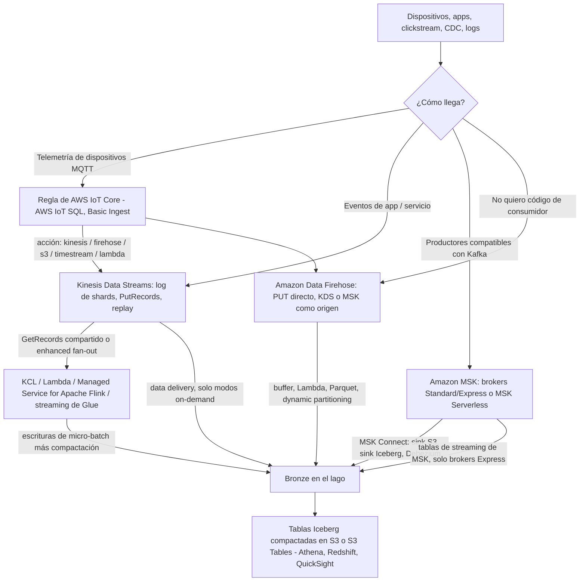
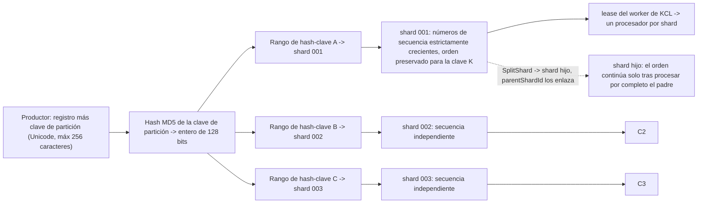
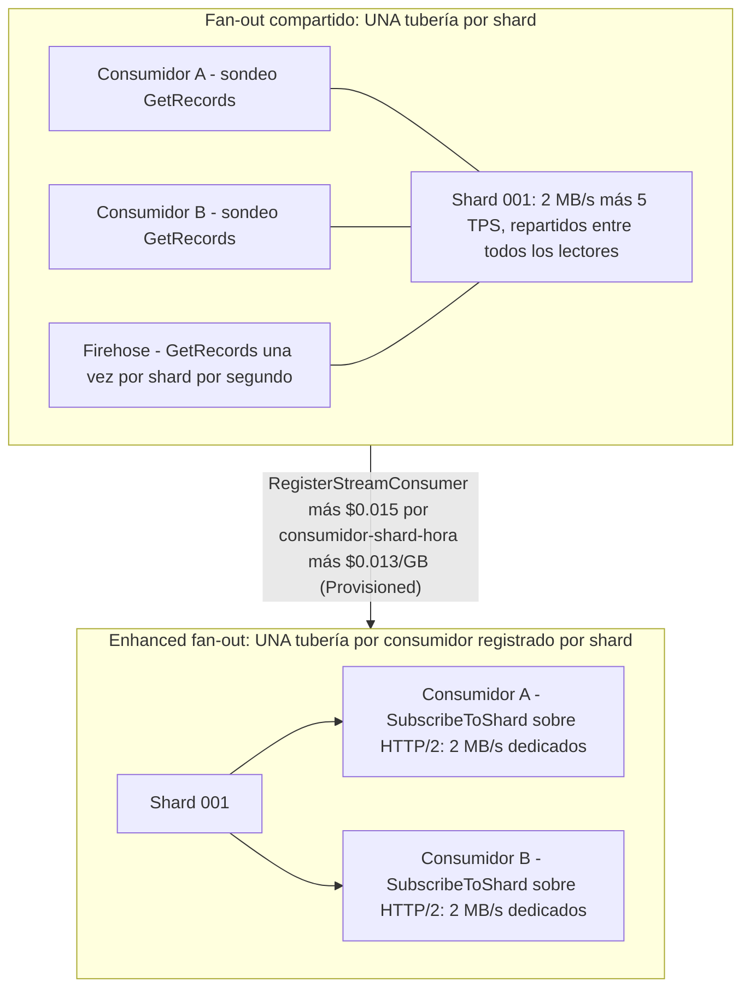
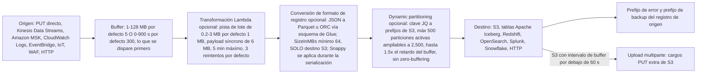
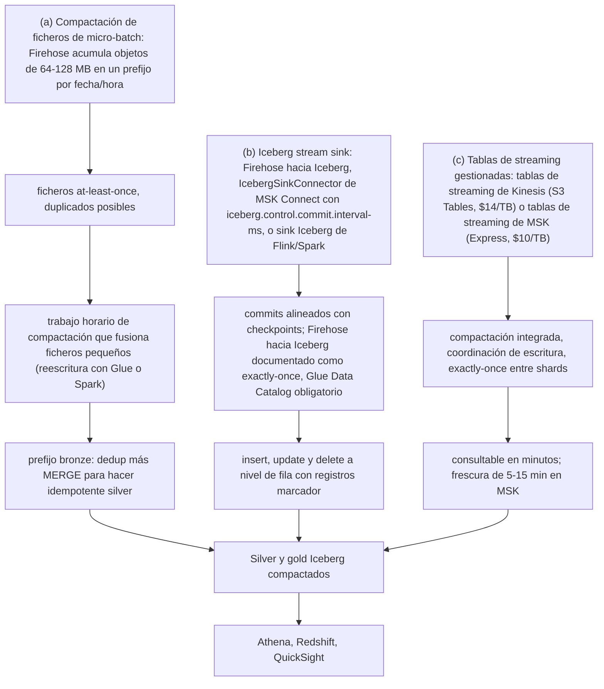
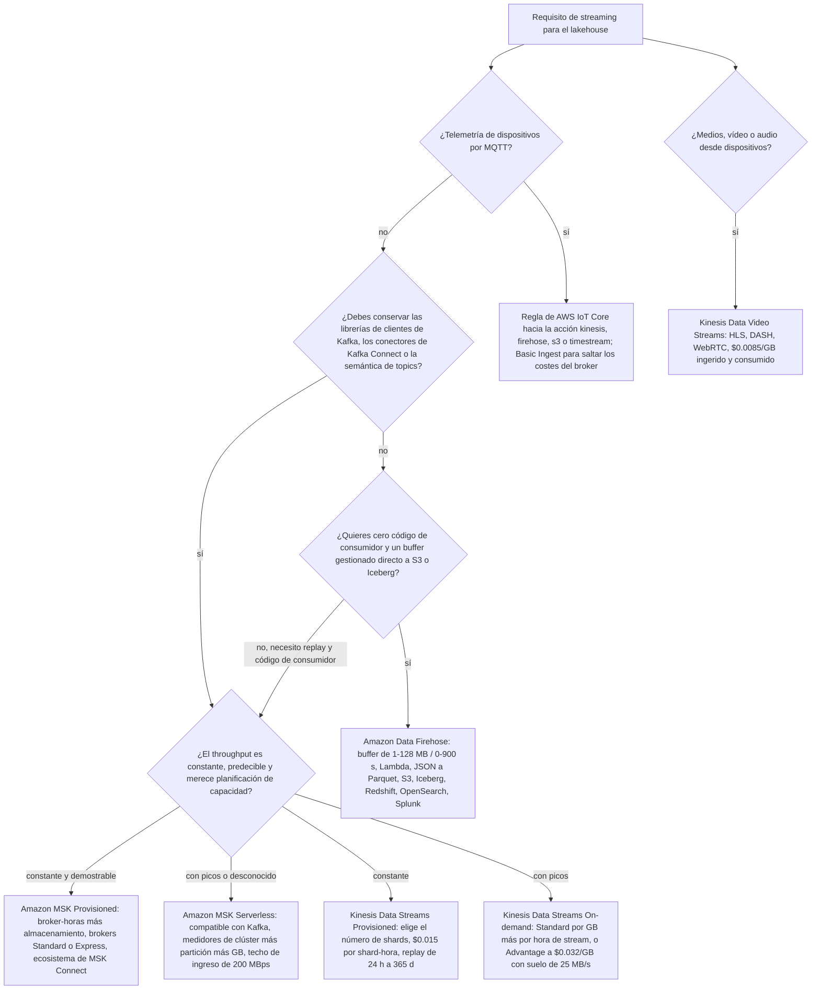

# Ingesta en streaming: Kinesis, Amazon MSK y aterrizaje de streams en el lago

Las lecciones 02 a 05 pusieron ficheros, formatos y tablas en Amazon S3. Hasta aquí todo se ha *movido* por lotes. Esta lección trata de la otra mitad de la ingesta: **eventos que llegan de forma continua y deben aterrizar en el lago sin perder su orden, duplicarse en silencio ni costar calladamente más de lo que el equipo de analítica recupera.** Al final sabrás dimensionar un stream de Kinesis a partir de un número de registros por segundo, explicar exactamente dónde deja de existir el orden, decidir cuándo una hot key es un problema de la clave de partición y no de capacidad, configurar un buffer de Firehose que se dispare con la condición correcta, y defender un aterrizaje bronze idempotente aunque el pipeline sea at-least-once.

```text
===================================================================
 INGESTA EN STREAMING HACIA EL LAKEHOUSE — la superficie de decisión
                                      (en octubre de 2026)
===================================================================
 Kinesis Data Streams ....... log de eventos serverless, basado en shards
   contrato del shard ........ 1 MB/s de escritura + 1,000 reg/s DE ENTRADA
                               2 MB/s de lectura + 5 TPS de lectura DE SALIDA
   modos de capacidad ........ Provisioned | On-demand Standard
                               | On-demand Advantage (suelo de 25 MB/s)
   orden ..................... por clave de partición, dentro de un shard
   fan-out ................... GetRecords compartido 2 MB/s O
                               enhanced fan-out 2 MB/s DEDICADO
 Amazon Data Firehose ....... servicio de entrega, NO un procesador
   buffers .................. 1-128 MB / 0-900 s (S3 por defecto 5/300)
   opcional ................ Lambda transform -> JSON a Parquet
                               -> dynamic partitioning -> destino
   semántica ................. at-least-once hacia S3; exactly-once
                               solo hacia el destino Iceberg
 Amazon MSK ................. Apache Kafka gestionado
   provisioned .............. brokers Standard + Express ($/broker-hora)
   MSK Serverless ........... $/clúster-hora + $/partición-hora + GB
   MSK Connect .............. Kafka Connect 2.7.1 / 3.7.x
   sinks .................... sink S3, sink Iceberg, Firehose,
                               tablas de streaming de MSK (solo Express)
 AWS IoT Core ............... MQTT -> regla de AWS IoT SQL -> acción
                               (kinesis, firehose, s3, timestream...)
 Aterrizaje ................ ficheros de micro-batch + compactación
                               | Iceberg stream sink + intervalo de commit
                               | tablas de streaming gestionadas (en línea)
 Libro mayor de semántica ... at-least-once + MERGE idempotente
                               vs afirmaciones documentadas de exactly-once
===================================================================
```

En esta lección:

- enunciarás el **contrato del shard**: 1 MB/s de escritura y 1,000 registros/s de entrada, 2 MB/s de lectura y 5 transacciones/s de lectura de salida, por shard, en *ambos* modos de capacidad, y sabrás qué **no** cambió cuando los registros subieron a 10 MiB;
- elegirás entre **Provisioned, On-demand Standard y On-demand Advantage**, incluido el suelo de 25 MB/s a nivel de cuenta que hace de Advantage la respuesta errónea en volumen bajo;
- rastrearás una **clave de partición a través de MD5 hasta un rango de hash-clave y un shard**, y explicarás por qué el orden es una promesa por clave y no de todo el stream;
- detectarás y arreglarás una **hot key** cuando el auto-escalado de on-demand no pueda ayudarte;
- dimensionarás **fan-out compartido frente a enhanced fan-out** y pondrás precio a la diferencia;
- trabajarás con el **KPL** (colección, agregación, limitación de tasa) y el **KCL** (leases, checkpoints, `parentShardId`), y conocerás la fecha de fin de soporte del KCL 1.x;
- configurarás **Amazon Data Firehose** de extremo a extremo: tamaño e intervalo del buffer, lotes de transformación con Lambda, conversión de JSON a Parquet contra un esquema de Glue, límites de dynamic partitioning y prefijos de error;
- aterrizarás datos en streaming con los tres **patrones de aterrizaje en bronze** y adjuntarás la etiqueta de semántica de entrega correcta a cada flecha;
- ejecutarás el patrón **at-least-once hacia MERGE idempotente** que hace seguro promover un bronze de ficheros planos;
- enrutarás **telemetría de dispositivos** a través de reglas de AWS IoT Core, y sabrás para qué sirve Kinesis Data Video Streams;
- compararás **Amazon MSK provisioned, MSK Serverless, MSK Connect y las tablas de streaming de MSK**, con la aritmética del punto de equilibrio entre brokers y serverless;
- estudiarás **dos casos de clientes de AWS** (Cisco Webex con MSK, VMware Carbon Black con Kinesis) y un **cuadro de actualizaciones de octubre de 2026 con fuentes**;
- practicarás con **12 preguntas tipo examen** más cuatro comprobaciones interactivas.

---

## 1. El mapa de servicios: cinco caminos del evento al lago

Cada diseño de streaming en AWS es una composición de las mismas cinco piezas. Confundirlas es el error de arquitectura más común de este espacio, porque dos de ellas *parecen* tuberías y solo una de ellas es un log que puedes re-ejecutar.

| Pieza | Qué es | Qué no es |
|---|---|---|
| **Amazon Kinesis Data Streams** | **Log de eventos** serverless y basado en shards con replay, orden por clave de partición y fan-out de consumidores | No es un motor de transformación; no tiene ventanas ni SQL |
| **Amazon Data Firehose** | **Pipeline de entrega** gestionado: buffer, Lambda opcional, conversión de formato opcional, destino | No es un log; no puedes re-ejecutar un stream de Firehose, y no hace windowing |
| **Amazon MSK** | **Apache Kafka gestionado**: brokers Standard/Express provisionados o MSK Serverless, más Kafka Connect vía MSK Connect | No es serverless en el sentido de «no pensar en capacidad»: sigues razonando sobre particiones, brokers y almacenamiento |
| **AWS IoT Core** | **Ingesta de dispositivos MQTT** con reglas de AWS IoT SQL que hacen fan-out de mensajes a otros servicios | No es una capa de almacenamiento; la acción de la regla asume un rol IAM y factura el servicio *de destino* |
| **Amazon Managed Service for Apache Flink** | **Procesamiento con estado** con ventanas de tiempo de evento, checkpoints y semántica de *procesamiento* exactly-once | No es un servicio de ingesta: lee streams y escribe en sinks |



- **📚 ¿Sabías que…?** El nombre Firehose que tienes delante es cosmético pero carga peso en el material antiguo: AWS renombró **Amazon Kinesis Data Firehose** a **Amazon Data Firehose** el **9 de febrero de 2024**, y declara que *«no hay otros cambios, incluidos los endpoints del servicio, las APIs, la Interfaz de Línea de Comandos de AWS (AWS CLI), las políticas de acceso de AWS Identity and Access Management (IAM) y las métricas de Amazon CloudWatch»* (AWS What's New, 2024-02-09; historial de documentos de Firehose, consultado 2026-10). Así que las acciones de IAM siguen siendo `firehose:*`, y un blog antiguo que diga «Kinesis Data Firehose» está describiendo exactamente el mismo servicio que estás configurando hoy.

```matching
{
  "question": "Relaciona cada componente de streaming con el papel que realmente juega en un diseño de ingesta de un lakehouse (en octubre de 2026):",
  "pairs": [
    {"left": "Amazon Kinesis Data Streams", "right": "Log de eventos serverless basado en shards con replay; 1 MB/s de escritura + 1,000 registros/s y 2 MB/s de lectura por shard; orden por clave de partición"},
    {"left": "Amazon Data Firehose", "right": "Pipeline de entrega gestionado: buffer por tamaño o intervalo, transformación Lambda opcional, conversión opcional de JSON a Parquet, y luego S3 / Iceberg / Redshift / OpenSearch / Splunk"},
    {"left": "Amazon MSK", "right": "Apache Kafka gestionado: brokers Standard y Express provisionados o MSK Serverless, con Kafka Connect desplegado a través de MSK Connect"},
    {"left": "AWS IoT Core", "right": "Ingesta de dispositivos MQTT con reglas de AWS IoT SQL cuyas acciones (kinesis, firehose, s3, timestream, lambda, sqs…) asumen cada una un rol IAM"},
    {"left": "Amazon Managed Service for Apache Flink", "right": "Procesamiento de streams con estado con ventanas de tiempo de evento y checkpoints; el sustituto del discontinuado Kinesis Data Analytics for SQL"},
    {"left": "Amazon Kinesis Data Video Streams", "right": "Ingesta de medios y binarios serializados en el tiempo desde dispositivos conectados, con reproducción HLS/DASH y WebRTC"}
  ],
  "explanation": "Cada entrada es un límite de capacidad: Kinesis Data Streams es el log re-ejecutable, Firehose es un pipeline de entrega que acumula lotes y (opcionalmente) transforma, MSK es Kafka gestionado con el ecosistema de Kafka Connect, IoT Core es ingesta MQTT más fan-out por reglas, Managed Service for Apache Flink es donde viven las ventanas, y Kinesis Video Streams transporta medios y no registros. Los errores clásicos son tratar Firehose como un log re-ejecutable, esperar que Firehose haga ventanas de tipo tumbling (no lo hace: eso es Flink), o escribir código de consumidor a medida cuando Firehose solo ya habría entregado los datos."
}
```

---

## 2. Kinesis Data Streams: el contrato del shard

### 2.1 Un número lo gobierna todo

Un **shard** es *«una secuencia de registros de datos identificada de forma única en un stream»* y *«una unidad de throughput base de un data stream de Kinesis.»* El contrato, idéntico en los modos de capacidad provisioned y on-demand, es:

```text
POR SHARD (ambos modos de capacidad, en oct 2026)
  ESCRITURA .. 1 MB/s  Y  1,000 reg/s   (lo que limite primero)
  LECTURA .... 2 MB/s  Y  5 transacciones/s de lectura (2,000 reg/s)
  GetRecords . hasta 10 MB y 10,000 registros por llamada; exceso -> throttle de 5 s
  REGISTRO ... hasta 10 MiB (desde 2025-10-28); PutRecords <= 500 registros
               y <= 10 MiB por petición, claves de partición incluidas
  RETENCIÓN .. por defecto 24 h; mínimo 24 h; máximo 8,760 h (365 días)
```

Dos cosas son ciertas a la vez y los estudiantes suelen colapsarlas en una: **los bytes y el recuento de registros son topes independientes.** Un stream de registros de 400 bytes choca contra el muro de 1,000 registros/s con solo 0.38 MB/s, así que los registros por segundo limitan mucho antes que los bytes. A la inversa, registros de 2 KB a 1,000/s usan solo 2 MB/s del presupuesto de *lectura* pero exactamente todo el ritmo de *escritura* en registros.

El cambio de tamaño de registro de 2025 es la trampa de esta sección. El **28 de octubre de 2025** AWS elevó el tamaño máximo de registro *«hasta 10MiB: un aumento por diez respecto al límite anterior»* y duplicó el techo de la petición `PutRecords` a 10 MiB, declarando a la vez con claridad que *«los límites de throughput individuales por shard de 1MiB/s para escrituras y 2MiB/s para lecturas siguen sin cambios»*: los registros grandes *«hacen ráfagas temporalmente hasta 10MiB/s, promediando al final a 1MiB por segundo.»* AWS recomienda mantener los registros grandes en *«1-2% de tu recuento total de registros para un rendimiento óptimo.»* La página de conceptos todavía conserva la frase más antigua de que el *«blob de datos puede ser de hasta 1 MB»* (consultada 2026-10); la página de límites y el anuncio de octubre de 2025 son los hechos actuales.

- **📚 ¿Sabías que…?** `PutRecords` es deliberadamente **no atómico**: el AWS Big Data Blog registra que *«PutRecords siempre devuelve un resultado 200, aunque algunos registros dentro del lote hayan fallado»* y que *«el fallo de un solo registro no detiene el procesamiento de los registros posteriores.»* Así que un 200 OK de `PutRecords` significa *la petición fue aceptada*, no *tu lote aterrizó*, debes inspeccionar `FailedRecordCount` y los valores de `ErrorCode` por registro. En un solo host, un bucle crudo de `PutRecord` midió unos 5,500 RPS frente a unos **76,000 RPS** con `PutRecords` en lote a través del KPL, *«unas 800 veces mayor»* (AWS Big Data Blog, 2015-08-07).

### 2.2 Modos de capacidad: tres formas, un contrato

| Modo | Qué eliges | Forma de facturación | Techo (en octubre de 2026) |
|---|---|---|---|
| **Provisioned** | Número de shards; `UpdateShardCount` / split / merge | $0.015 por shard-hora (**$0.36/día/shard**) + $0.014 por 1M de unidades de payload PUT | Cuota de shards de la cuenta: **20,000** en `us-east-1`, `us-west-2`, `eu-west-1`; 1,000 o 6,000 en el resto |
| **On-demand Standard** | Nada: se adapta | Cargo horario por stream (el propio ejemplo de AWS implica **$0.040/stream-hora** en US-East) + **$0.08/GB de entrada**, **$0.040/GB de salida** | Un stream nuevo empieza en **4 MB/s de escritura, 8 MB/s de lectura**; escala hasta **10 GB/s de escritura, 20 GB/s de lectura** en `us-east-1` / `us-west-2` / `eu-west-1`, **200/400 MB/s** en otras Regiones |
| **On-demand Advantage** | Un compromiso a nivel de cuenta | **$0.032/GB de entrada**, **$0.016/GB de salida**, sin cargo horario por stream, **sin recargo de enhanced fan-out** | Mínimo **25 MB/s de ingesta y 25 MB/s de recuperación** en toda la cuenta; throughput en caliente hasta **10 GiB/s** |

Reglas prácticas que salen de esa tabla:

- **Puedes cambiar de modo dos veces cada 24 horas por stream**: un paramétrico de seguridad, no un interruptor libre. Diseña el cambio como un evento, no como un bucle.
- **On-demand no es «sin límites».** Un stream on-demand nuevo empieza en 4/8 MB/s, las Regiones no emblemáticas se quedan en 200/400 MB/s, y, lo importante, on-demand *«se adapta automáticamente para manejar patrones de distribución de datos desiguales **salvo que una única clave de partición supere el throughput de 1 MB/s y el límite de 1000 registros por segundo de un shard**.»*
- **Advantage es más barato por GB pero tiene un suelo.** El anuncio es explícito: la cuenta *«se compromete a streamear con al menos 25 MiB/s de uso de ingesta de datos y 25 MiB/s de uso de recuperación de datos»*, a cambio de datos ingeridos con un precio **60% menor**, recuperación **60% menor**, recuperación de enhanced fan-out **68% menor** y retención extendida **77% menor** (AWS Big Data Blog, 2025-11-03). Un stream de desarrollo de 0.5 MB/s pagará por 25 MB/s que no usa.

### 2.3 Retención: de la ventana de replay al archivo a largo plazo

La retención por defecto es **24 horas**, y es el *mínimo*; `IncreaseStreamRetentionPeriod` acepta hasta **8,760 horas (365 días)**. Tres tramos de coste hay detrás de esa perilla:

| Ventana de retención | Qué cuesta (Provisioned, US-East) |
|---|---|
| 24 h (por defecto) | Incluida en la hora de shard |
| 24 h a 7 días (extendida) | **+$0.020 por shard-hora** |
| 7 a 365 días (largo plazo) | **$0.023/GB-mes** de almacenamiento + **$0.021/GB** recuperados a través del consumidor por defecto `GetRecords` |

El replay es la razón de ser de la retención: Kinesis *«proporciona el orden de los registros, así como la capacidad de leer y/o re-ejecutar los registros en el mismo orden para múltiples aplicaciones de Amazon Kinesis.»* Una ventana de 24 horas significa que un bug de un consumidor descubierto a las 09:00 puede repararse y re-procesarse desde las 09:00 del día anterior, y nada más. Si tu aterrizaje bronze en S3 es la copia duradera (lección 05), la retención del stream es un presupuesto de *re-procesamiento*, no tu estrategia de copia de seguridad.

---

## 3. Claves de partición, orden y shards calientes

### 3.1 El camino que recorre realmente un registro

El productor suministra una **clave de partición**: *«Las claves de partición son cadenas Unicode, con un límite de longitud máxima de 256 caracteres para cada clave.»* AWS entonces usa *«una función hash MD5 … para mapear las claves de partición a valores enteros de 128 bits y para mapear los registros de datos asociados a shards usando los rangos de hash-clave de los shards.»* Todos los registros que comparten una clave aterrizan en el mismo shard, y por eso *«la Kinesis Client Library (KCL) entrega todos los registros de una clave de partición dada al mismo procesador de registros.»*



El orden, enunciado con precisión, tiene exactamente tres alcances y ni más ni menos:

1. **Dentro de un shard**: *«los registros que Kinesis Data Streams recibe a través de una llamada `GetRecords` están estrictamente ordenados por número de secuencia.»*
2. **Dentro de una clave de partición**: la clave siempre se mapea a un shard, así que el orden local a la clave sobrevive.
3. **Mismo cliente, misma clave, opt-in**: `SequenceNumberForOrdering` *«garantiza números de secuencia estrictamente crecientes, para puts del mismo cliente y hacia la misma clave de partición … Si este parámetro no se fija, los registros se ordenan de forma gruesa según el tiempo de llegada.»*

**No hay orden de todo el stream**, y `PutRecords` ni siquiera ordena dentro de su propio lote. Si tu `MERGE` aguas abajo asume una secuencia global, has diseñado una garantía que el servicio no proporciona.

### 3.2 Ejemplo resuelto E1, los registros/s limitan primero: dimensionado y coste

**Escenario (en octubre de 2026):** 2,500 registros/s a 400 bytes de media, constante 24x7, US East (N. Virginia).

```text
E1  NÚMERO DE SHARDS + COSTE MENSUAL (31 días = 744 horas)
--------------------------------------------------------------------
Paso 1 - bytes/s ...... 2,500 x 400 B = 1,000,000 B/s
                         = 1,000,000 / 1,048,576 = 0.954 MB/s
                         0.954 MB/s < 1 MB/s  -> bastaría 1 shard
Paso 2 - registros/s . 2,500 / 1,000 = 2.5  -> REDONDEAR ARRIBA a 3 shards
                         RESTRICCIÓN LIMITANTE = registros por segundo
Paso 3 - Provisioned . 3 x $0.015 x 744 = $33.48 de shard-hours
         Unidades PUT   400 B -> 1 unidad de payload por registro
                          2,500 x 86,400 x 31 = 6,696,000,000 unidades
                          / 1,000,000 x $0.014 = $93.74
         TOTAL ......... $33.48 + $93.74 = $127.22 / mes
Paso 4 - On-demand Standard (misma carga de trabajo)
         400 B redondea ARRIBA a 1 KB -> 2,500 KB/s ingeridos
         2,500 x 86,400 x 30 / 1,048,576 = 6,180 GB / mes
         datos de entrada  6,180 x $0.080 = $494.40
         datos de salida   6,180 x $0.040 = $247.20
         horas de stream . 744 x $0.040   =  $29.76
         TOTAL ........... $771.36 / mes
--------------------------------------------------------------------
Veredicto: provisioned es ~6 veces más barato ($127 vs $771) para un
perfil plano; on-demand te compra la libertad de no hacer aritmética
de shards para tráfico con picos o desconocido. Elige con la
varianza, no con la media.
```

Fíjate en las dos reglas de redondeo que hacen sorprendentes las facturas de streaming: la entrada de datos de Kinesis redondea **cada registro hacia arriba al KB siguiente** (*«si tus registros de datos son de 4.5 KB cada uno, Kinesis Data Streams contará cada registro como 5 KB»*), mientras el medidor provisioned de PUT factura en **unidades de payload de 25 KB**. Un pipeline de registros de 900 bytes se factura como 1 KB por registro en on-demand y como una unidad por registro en provisioned, y son los registros/s los que dimensionan tus shards de cualquier manera.

```plot
{
  "type": "bar",
  "title": "E1: la misma carga de trabajo plana, dos modos de capacidad (US-East, 31 días, en octubre de 2026)",
  "xLabel": "Modo de capacidad",
  "yLabel": "Coste mensual (USD)",
  "xKey": "mode",
  "data": [
    {"mode": "Provisioned: 3 shards + PUT units", "usd_per_month": 127.22},
    {"mode": "On-demand Standard: 6,180 GB in/out", "usd_per_month": 771.36}
  ]
}
```

### 3.3 Ejemplo resuelto E2: la hot key que el auto-escalado no puede arreglar

**Escenario:** una única clave `tenant_id = acme` envía 1,500 registros/s de 80 bytes.

```text
E2  DETECCIÓN DE HOT KEY
--------------------------------------------------------------------
Bytes ........... 1,500 x 80 B = 120,000 B/s = 0.114 MB/s
                  0.114 MB/s << 1 MB/s           -> los bytes están bien
Registros ....... 1,500 reg/s > 1,000 reg/s      -> LÍMITE EXCEDIDO
Resultado ........ WriteProvisionedThroughputExceeded en ESE shard
                  mientras los shards hermanos están ociosos. Esto es
                  cierto incluso en modo on-demand: el auto-escalado
                  añade shards, pero una sola clave sigue hasheando a
                  exactamente un shard.
Opciones de arreglo ...
  (a) cambiar el esquema de clave: acme:<event_id> o acme:<uuid>
      -> se reparte entre shards; renuncias al orden por tenant
  (b) conservar el orden, SplitShard, aceptar el coste
  (c) agregar en el productor (KPL) - ver E4
```

Los propios remedios de AWS: *«usa la operación de split-shard … Si no se necesita localidad u orden basado en la clave de partición actual, cambia el esquema de la clave de partición para aumentar su distribución. Si la aplicación productora está excediendo el límite de throughput de un shard debido a una única clave de partición (problema de hot key), cambia el esquema de la clave de partición.»* Los productores avanzados pueden saltarse el mapeo MD5 con `ExplicitHashKey` para colocar una clave de forma deliberada: útil para drenar un shard caliente, peligroso si lo usas para maquillar un diseño de clave que debería cambiar.

```fillblank
{
  "question": "Completa la aritmética de dimensionado de shards para 2,500 registros/s de 400 bytes cada uno (ejemplo resuelto E1, en octubre de 2026):",
  "template": "Bytes por segundo = {{1}} x 400 B = 1,000,000 B/s = 0.954 MB/s, por debajo del tope de escritura de 1 MB/s. Registros por segundo: {{1}} / 1,000 = 2.5, así que el stream necesita {{2}} shards. Coste provisioned para 31 días = {{2}} x $0.015 x 744 = {{3}}.",
  "answers": {
    "1": "2,500",
    "2": "3",
    "3": "$33.48"
  },
  "distractors": ["1", "2", "4", "10", "$44.64", "$11.16", "2.5", "1,000"],
  "explanation": "Las dos restricciones se evalúan de forma independiente y siempre tomas el mayor número de shards: 0.954 MB/s cabrían en un shard por bytes, pero 2,500 registros/s divididos entre el tope de 1,000 registros/s dan 2.5, que se redondea arriba a 3 shards. 3 x $0.015 x 744 = $33.48 por las horas de shard en un mes de 31 días; los $93.74 de unidades de payload PUT en E1 son un medidor aparte. $44.64 es el coste de enhanced fan-out para 4 shards x 1 consumidor en E3, $11.16 es un shard durante 744 horas, y 2.5 es la respuesta sin redondear que dejaría el stream infradimensionado."
}
```

- **📚 ¿Sabías que…?** Una heurística útil de producción viene de la plataforma antifraude de Chime Financial: la descripción de AWS de su stack de streaming indica *«aterrizamos en una correspondencia 1:1 entre Kinesis Shard y núcleo de vCPU»* mientras ingerían *«más de 1 millón de eventos por segundo»* con latencia extremo a extremo de *«menos de 15 segundos»* (AWS Big Data Blog, 2023-09-19). Trátala como la regla práctica de dimensionado de workers de un solo equipo para una flota de KCL, no como una cuota del servicio: el número de workers debe seguir siendo al menos el número de shards para el paralelismo, y cada lease vive en DynamoDB.

---

## 4. Fan-out: lecturas compartidas frente a enhanced fan-out

Un stream solo es útil si varios consumidores pueden leerlo. Kinesis te da dos mecanismos con economías genuinamente distintas.

| | **Fan-out compartido** (`GetRecords`) | **Enhanced fan-out** (`SubscribeToShard`) |
|---|---|---|
| Throughput | **2 MB/s y 5 TPS por shard, compartidos** por cada consumidor | **2 MB/s por shard, dedicados** a cada consumidor registrado |
| Modelo | Pull sobre HTTP; tú consultas | Push sobre HTTP/2; el servicio entrega |
| Registro | Ninguno | `RegisterStreamConsumer` y luego `SubscribeToShard` |
| Sesión | Tu bucle | La conexión vive **hasta 5 minutos** y luego se resuscribe; **1 llamada/s por consumidor por shard** |
| Coste (Provisioned) | Incluido | **$0.015 por consumidor-shard-hora** + **$0.013/GB** recuperados |
| Límite de consumidores | Sin límite | **50** consumidores registrados (On-demand Advantage), **20** en el resto |
| KCL | Ruta `GetRecords` | KCL **2.0+ lo habilita automáticamente** |

La frase de la FAQ que importa: *«los consumidores de fan-out compartido comparten todos los 2 MB/segundo de throughput de lectura de un shard y los límites de cinco transacciones por segundo … Un consumidor de enhanced fan-out recibe su propia asignación de 2 MB/segundo de throughput de lectura.»* Añade un segundo consumidor por sondeo y la tasa efectiva de lectura de cada uno se reduce a la mitad: el síntoma de producción clásico de que «añadir un consumidor lo ralentizó todo».

### 4.1 Ejemplo resuelto E3: dimensionado del fan-out y la factura de EFO

**Escenario:** un stream de 4 shards con tres lectores: (a) un sondeador Lambda usando la ruta compartida, (b) una aplicación Flink que necesita baja latencia, (c) Firehose leyendo de Kinesis Data Streams.

```text
E3  FAN-OUT (4 shards, 3 consumidores, Provisioned, 744 h)
--------------------------------------------------------------------
Pool compartido ..... 4 shards x 2 MB/s = 8 MB/s TOTAL, compartidos
                    4 shards x 5 TPS  = 20 TPS de lectura TOTAL
Firehose ........... sondea GetRecords una vez por shard por segundo,
                    así que es un inquilino permanente del pool compartido
App Flink ........... debe registrarse en el enhanced fan-out o
                    competirá con Firehose por los mismos 8 MB/s
Coste EFO .......... 4 shards x 1 consumidor x $0.015 x 744 h
                    = $44.64 / mes
                  + $0.013 por GB realmente recuperado
On-demand Advantage -> el mismo EFO NO tiene recargo de consumidor-shard
```

El comportamiento de la propia FAQ de Firehose es lo que fuerza la decisión: *«Firehose llama a GetRecords() de Kinesis Data Streams una vez cada segundo por cada shard de Kinesis.»* Si Firehose es tu sink, asume que el pool compartido ya está ocupado.



---

## 5. Productores y consumidores: KPL, KCL y la tabla de leases

### 5.1 KPL: colección, agregación, limitación de tasa

La **Kinesis Producer Library** se ejecuta como *«un proceso separado, y se comunica con tu proceso de usuario padre usando IPC»*, y hace cuatro trabajos: reintentos automáticos, **colección** (agrupar muchos registros en peticiones `PutRecords`), **agregación** (empaquetar muchos registros de usuario en *un* registro de Kinesis) y limitación de tasa por shard con un cubo de tokens *«por defecto … fijado un 50 por ciento por encima del límite real del shard.»* También publica métricas de CloudWatch en tu nombre y añade latencia hasta `RecordMaxBufferedTime`.

**Ejemplo resuelto E4: la agregación derrota el tope de registros/s.**

```text
E4  AGRUPACIÓN DEL KPL vs PutRecords CRUDO (1 shard)
--------------------------------------------------------------------
Entrada .......... 1,000 registros de usuario/s, 512 B cada uno = 512 KB/s
Ruta cruda ....... 1,000 registros de Kinesis/s -> exactamente en el
                   tope de 1,000 registros/s del shard (sin holgura)
                   bytes usados: 512 KB/s de un presupuesto de 1 MB/s
Agregados ........ empaquetar 1,000 x 512 B en 10 registros de 50 KB
                   registros de Kinesis/s: 1,000 -> 10  (holgura de 100x)
                   bytes sin cambios: 512 KB/s
Ambas rutas ...... los límites de bytes son idénticos; solo se mueve
                   el CONTADOR de registros. Por eso los registros
                   pequeños son el caso para el que existe la
                   agregación del KPL.
```

El propio ejemplo de AWS coincide: *«Con la agregación de KPL, puedes empaquetar 1,000 registros en solo 10 registros de Kinesis Data Streams, reduciendo el RPS a 10 (con 50 KB cada uno)»*, y *«El límite de registros por segundo de Kinesis Data Streams limita a los clientes con registros menores de 1 KB.»*

La portabilidad es el impuesto. Según la matriz de uso de AWS, un productor en cualquier lenguaje distinto de Java **no puede usar el KPL**, y un productor KPL de Java que alimenta a un consumidor no-Java **debe desactivar la agregación**: de lo contrario el consumidor tiene que des-agregar registros que nunca esperó. El `PutRecords` crudo es portable; la gestión de lotes, el manejo de fallos parciales, los reintentos y el backoff son tuyos.

### 5.2 KCL: leases, checkpoints y `parentShardId`

La **Kinesis Client Library** se compila en tu consumidor y te da:

- **Leases**: *«cada shard está vinculado a un solo worker mediante un lease en cualquier momento dado»*, rastreado en una **tabla de leases** de DynamoDB. KCL 3.x crea tres tablas por defecto (lease, métricas de workers, estado del coordinador); **desde KCL 3.5 el formato de tabla única consolida todos los metadatos en la tabla de leases**.
- **Checkpointing**: *«el proceso de almacenar de forma persistente la posición del último registro procesado con éxito en un shard»*, guardado en esa tabla de leases. Reinicia desde el checkpoint, no desde «ahora».
- **`parentShardId`**: *«se usa para asegurar que el shard padre esté procesado por completo antes de que empiece el procesamiento en los shards hijos. Esto asegura que los registros se procesen en el mismo orden en que se pusieron en el stream.»* Este es el único mecanismo que conserva el orden a través de un evento de reshard.

Dos fechas importan aquí. **KCL 1.x llegó a fin de soporte el 30 de enero de 2026**, y la guía de AWS es *«migra tus aplicaciones KCL que usan la versión 1.x a la última versión de KCL»*; para esta lección esa fecha ya pasó, así que cualquier consumidor 1.x está corriendo con tiempo prestado. Y KCL no es infraestructura gratis: las tablas de DynamoDB (se recomienda capacidad on-demand) y las métricas de CloudWatch viajan con él, y que el número de workers sea ≥ al número de shards es un requisito de paralelismo, no una preferencia de ajuste.

> [!WARNING]
> ⚠️ **Cuatro afirmaciones de streaming que son falsas tal como están escritas:**
> - **«El modo on-demand arregla las hot keys.»** No lo hace. Una única clave de partición sigue sin poder exceder **1 MB/s ni 1,000 registros/s**: esa es la definición de hot key, y se cumple en cada modo de capacidad.
> - **«El orden es de todo el stream.»** El orden se cumple **por clave de partición, dentro de un shard**. `PutRecords` no ordena su propio lote, y `SequenceNumberForOrdering` solo ordena escrituras de la misma clave desde el mismo cliente.
> - **«El segundo consumidor reduce a la mitad nuestras lecturas, así que compra más shards.»** Con `GetRecords` compartido el arreglo es **enhanced fan-out** (o un solo consumidor), no shards, y Firehose ya está sondeando el pool compartido una vez por shard por segundo.
> - **«Firehose hace ventanas de tipo tumbling.»** Ninguna página de documentación de Firehose describe windowing de ningún tipo; las ventanas tumbling, deslizantes y de tiempo de evento son una característica de **Managed Service for Apache Flink**. El hogar antiguo de `TUMBLE()`, Kinesis Data Analytics for SQL, dejó de aceptar aplicaciones nuevas el **15 de octubre de 2025** y se borró a partir del **27 de enero de 2026**.

---

## 6. Amazon Data Firehose: un servicio de entrega, no un procesador

### 6.1 El pipeline, etapa por etapa

Firehose es *«un servicio totalmente gestionado para entregar datos de streaming en tiempo real hacia destinos como Amazon Simple Storage Service (Amazon S3), Amazon Redshift, Amazon OpenSearch Service, Amazon OpenSearch Serverless, Splunk, Apache Iceberg Tables y cualquier endpoint HTTP personalizado.»* Sus etapas, en orden:

1. **Origen**: PUT directo, Kinesis Data Streams, Amazon MSK, CloudWatch Logs, EventBridge, IoT, WAF, Network Firewall, HTTP.
2. **Buffer**: *«Amazon Data Firehose acumula los datos de streaming entrantes hasta un cierto tamaño o durante un cierto período de tiempo antes de entregarlos a los destinos»*; la condición que se cumpla primero dispara la entrega.
3. **Transformación con Lambda (opcional)**: invocación por lote, payload limitado a **6 MB** de forma síncrona, invocación de hasta **5 minutos**, **3 reintentos** por defecto (configurable 0 to 300).
4. **Conversión de formato de registro (opcional)**: JSON a **Parquet u ORC** usando un esquema en el **AWS Glue Data Catalog** (deserializador, esquema, serializador).
5. **Dynamic partitioning (opcional)**: claves basadas en JQ hacia prefijos de S3, hasta **500 particiones activas** (ampliable a 2,500).
6. **Destino**, S3, tablas Iceberg, Redshift (vía S3 + `COPY`), OpenSearch, Splunk, Snowflake, HTTP, más prefijos de error y de backup.



### 6.2 Ejemplo resuelto E5: qué condición de buffer se dispara primero

**Pistas de buffering para un destino S3: tamaño 1 to 128 MB (por defecto 5), intervalo 0 to 900 s (por defecto 300).**

```text
E5  DIMENSIONADO DEL BUFFER (en oct 2026)
--------------------------------------------------------------------
Caso A - ingesta sostenida de 6 MB/s, tamaño de buffer = 64 MB
  tiempo hasta llenar .. 64 MB / 6 MB/s = 10.7 s
  frente al intervalo .. 10.7 s << 300 s  -> el TAMAÑO se dispara primero
  objetos/minuto ...... 60 / 10.7 = 5.6
  objetos/hora ........ ~336      objetos/día ~ 8,064 x 64 MB
  volumen diario ...... ~512 GB -> 8,064 objetos es un aterrizaje
                                 sano y compactable (lección 04)
Caso B - ingesta sostenida de 0.1 MB/s, tamaño de buffer = 5 MB (por defecto)
  tiempo hasta llenar .. 5 / 0.1 = 50 s
  frente al intervalo .. 50 s << 300 s  -> sigue siendo el tamaño, pero
                                 los objetos son de ~5 MB: territorio
                                 de ficheros pequeños
  tiempo hasta 300 s .. 0.1 x 300 = 30 MB de objetos si subes la
                        pista de tamaño por encima de 30 MB
Regla práctica (docs de la API de AWS) ...
  "fija este parámetro a un valor mayor que la cantidad de datos
   que normalmente ingieres en el stream de Firehose en 10
   segundos. Por ejemplo, si normalmente ingieres datos a
   1 MiB/segundo, el valor debería ser de 10 MiB o más."
  -> 6 MB/s x 10 s = 60 MB, así que 64 MB es la elección correcta.
```

Tres modificadores cambian la aritmética:

- **La conversión de formato eleva el suelo.** Con la conversión activada *«no puedes fijar `SizeInMBs` a un valor menor que 64»*, y *«el valor se convierte en 128 cuando la habilitas.»*
- **El dynamic partitioning cuesta latencia.** *«Firehose usa buffering multietapa internamente. Por lo tanto, el retardo extremo a extremo de un lote de registros puede ser 1.5 veces el tiempo de pista de buffering configurado»*, y el buffering a cero no está disponible con la función.
- **El buffering por debajo de 60 segundos cambia la factura de S3.** *«Firehose usa upload multiparte para el destino S3 cuando configuras un intervalo de tiempo de buffer menor de 60 segundos … verás un cierto aumento en los costes de la API `PUT` de S3.»*

> [!IMPORTANT]
> ⚠️ **La conversión de formato es una función estrecha con cuatro paredes duras.** La entrada debe ser **JSON** (pre-convierte CSV con Lambda); el destino debe ser **Amazon S3**: *«si habilitas la conversión de formato de registro, no puedes fijar el destino de Amazon Data Firehose como Amazon OpenSearch Service, Amazon Redshift o Splunk. Con la conversión de formato habilitada, Amazon S3 es el único destino»*; el esquema debe existir ya en el **Glue Data Catalog**; y `CompressionFormat` debe fijarse a **`UNCOMPRESSED`** porque *«la compresión Snappy ocurre automáticamente como parte del proceso de conversión.»* El límite práctico de filas es de **32 MB**, y la conversión se factura a **$0.018 por GB convertido.** Cualquier cosa que afirme que «Firehose convierte CSV a Parquet directamente» está describiendo una función que no existe.

- **📚 ¿Sabías que…?** La página de cuotas de Firehose contiene calladamente el argumento de escalado para Kinesis como origen: el PUT directo a Firehose está limitado (en `us-east-1`/`us-west-2`/`eu-west-1`) a *«500,000 registros/segundo, 2,000 peticiones/segundo y 5 MiB/segundo»*, pero *«cuando Kinesis Data Streams está configurado como fuente de datos, esta cuota no se aplica, y Amazon Data Firehose escala hacia arriba y hacia abajo sin límite.»* Y como Firehose lee *«una vez cada segundo por cada shard de Kinesis»*, los dos servicios comparten tu dimensionado de shards: más shards significa más lecturas de Firehose en paralelo, no solo más capacidad de escritura.

---

## 7. Aterrizaje en el lago con Firehose

### 7.1 Lo que Firehose promete realmente

Las semánticas de entrega difieren por destino, y esta es la zona más mal citada de toda la lección:

| Ruta | Semántica documentada |
|---|---|
| Firehose hacia S3 / Redshift / OpenSearch / Splunk | **At-least-once.** *«Amazon Data Firehose usa semántica de al menos una vez para la entrega de datos. En raras circunstancias como un timeout de petición durante el intento de entrega, el reintento de entrega por parte de Firehose podría introducir duplicados si la petición anterior acaba realizándose.»* |
| Firehose hacia **tablas Apache Iceberg** | **Exactly-once.** *«Firehose garantiza la entrega exactly-once hacia tablas Iceberg»* y *«aplica automáticamente operaciones de inserción, actualización y borrado»*, requiriendo el AWS Glue Data Catalog (AWS Prescriptive Guidance, consultado 2026-10) |
| Tablas de streaming de Kinesis hacia S3 Tables | *«coordinación de escritura y semántica de entrega exactly-once en todos los shards de tu stream»* (AWS Big Data Blog, 2026-08-31) |
| Managed Service for Apache Flink | Semántica de *procesamiento* exactly-once con checkpoints |

La consecuencia de diseño: **cualquier cosa que aterrice como ficheros planos en un prefijo bronze es at-least-once.** Los duplicados no son un bug que puedas configurar fuera: son el contrato. Haces que la *tabla* sea correcta aguas abajo (sección 9.3), no que la entrega sea perfecta.

### 7.2 Ejemplo resuelto E6: una factura de Firehose para un aterrizaje de JSON a Parquet en el lago

**Escenario:** 100 registros/s x 3 KB, JSON convertido a Parquet, entregado a S3, US East (N. Virginia), 30 días.

```text
E6  FACTURA MENSUAL DE FIREHOSE (en oct 2026)
--------------------------------------------------------------------
Tamaño facturable del registro ... 3 KB redondea ARRIBA a 5 KB
Volumen ................... (100 reg/s x 5 KB) / 1,048,576
                            x 86,400 s x 30 d = 1,235.96 GB
1. Ingestión ............. 1,235.96 x $0.029   =  $35.84
                            (origen PUT directo / Kinesis Data Streams,
                             primer tramo de 500 TB)
2. Conversión de formato .. 1,235.96 x $0.018   =  $22.25
                            (JSON a Parquet, por GB convertido)
3. Dynamic partitioning (uso de la función en la forma del ejemplo de AWS)
   GB procesados .........   741.58 x $0.020   =  $14.83
   Objetos S3 ............ 11,866 / 1,000 x $0.005 = $0.06
                            (más $0.07 por hora de procesamiento JQ si se usa)
--------------------------------------------------------------------
TOTAL .................... = $72.98 / mes
```

El punto didáctico es la forma de la factura, no los céntimos: **la ingesta es la palanca más pequeña cuando activas funciones.** La conversión y el dynamic partitioning juntos más que duplican los $35.84 base, y cada uno de ellos es una *función que elegiste* a cambio de Parquet consultable en prefijos particionados en lugar de un montón de JSON. Fíjate también en las tarifas dependientes del origen: un **origen de Kinesis Data Streams** factura **$0.029/GB**, un **origen de Amazon MSK** factura **$0.055/GB** sin el redondeo a 5 KB, los logs cedidos **$0.13/GB**, un **destino Iceberg** (origen Kinesis) **$0.045/GB**, y la entrega por VPC **$0.01/GB más $0.01 por AZ-hora**.

### 7.3 Data delivery de Kinesis y tablas de streaming (sin necesitar Firehose)

En octubre de 2026 un stream de Kinesis puede aterrizar en el lago **sin** Firehose en absoluto. El data delivery soporta *«dos tipos de destino: tablas de streaming sobre Apache Iceberg y buckets de Amazon S3 de propósito general»*, con *«compactación inteligente integrada [que] elimina la proliferación de ficheros pequeños.»* Requisitos y precios:

| Destino | Requisito | Precio (en octubre de 2026) |
|---|---|---|
| **S3** de propósito general | Solo modo de capacidad on-demand | **$0.011/GB** (On-demand Advantage), **$0.0275/GB** (Standard) |
| **Tablas de streaming** (Iceberg en S3 Tables) | Solo modo de capacidad on-demand | **$0.014/GB** (Advantage), **$0.035/GB** (Standard); el blog de AWS indica **$14/TB** hacia S3 Tables y **$11/TB** hacia S3 |

Los resultados declarados por AWS para las tablas de streaming: *«reducir los costes de entrega de datos hacia S3 Tables hasta un 50% frente a alternativas autogestionadas y reducir los costes de consulta aguas abajo hasta un 30% a través de la compactación inteligente integrada»*, con datos *«consultables en minutos de ser publicados en tu stream.»* El modo provisioned no soporta el data delivery ni las tablas de streaming en absoluto: un hecho que elimina al modo provisioned de la consideración para este patrón.

---

## 8. Reglas de AWS IoT Core y Kinesis Data Video Streams

### 8.1 MQTT, regla, acción, lago

AWS IoT Core es la entrada para la telemetría de dispositivos. Una **regla** evalúa un mensaje MQTT con **AWS IoT SQL** e invoca una o más **acciones**. La lista de acciones documentada incluye `kinesis` (Kinesis Data Streams), `firehose`, `s3`, `timestream`, `lambda`, `sqs`, `sns`, `dynamodb`, `kafka` (Apache Kafka), `stepFunctions`, `openSearch`, `republish`, `cloudWatch`, `location`, `influxDB` e `iotSiteWise`.

La acción de Kinesis toma tres parámetros que debes acertar: el `stream`, el `partitionKey`, *«generalmente compuesto por una expresión (por ejemplo, `${topic()}` o `${timestamp()}`)»*, y el `roleArn`, *«un rol IAM que AWS IoT puede asumir para realizar la operación `kinesis:PutRecord`.»* Elegir `${topic()}` significa que todos los mensajes de un mismo topic MQTT hashean a un shard: elegante para el orden, un generador de hot keys a volumen. Elegir una clave a nivel de dispositivo o de evento reparte la carga y pierde el orden por topic.

Un control de coste merece memorizarse: *«también puedes usar la función Basic Ingest para enviar de forma segura los datos del dispositivo a los servicios de AWS listados anteriormente, sin incurrir en costes de mensajería. La función Basic Ingest optimiza el flujo de datos eliminando el broker de mensajes publicar/suscribir de la ruta de ingesta.»* Si los datos nunca necesitan fan-out MQTT, no pagues por el salto del broker.

### 8.2 Kinesis Data Video Streams: el carril de medios, brevemente

**Amazon Kinesis Video Streams** transporta *«medios desde dispositivos conectados hacia AWS para almacenamiento, analítica, machine learning (ML), reproducción y otro procesamiento»*, con reproducción gestionada **HLS** y **DASH**, **WebRTC** para streaming bidireccional de ultrabaja latencia, e integraciones con Rekognition Video y SageMaker. Es la respuesta correcta para cámaras, audio y binarios serializados en el tiempo: no para registros de eventos JSON.

Precios en US East (en octubre de 2026): **$0.0085/GB ingerido**, **$0.0085/GB consumido** (consumo HLS **$0.0119/GB**), almacenamiento **$0.023/GB-mes** en el tramo caliente; WebRTC añade **$0.03 al mes** por canal de señalización activo, **$2.25 por millón** de mensajes de señalización y **$0.12 por mil** minutos de streaming TURN. Un **tramo de almacenamiento en caliente** (función fechada el **26 de noviembre de 2025**) ofrece ingesta a **$0.0100 por 1,000 fragmentos persistidos** y almacenamiento a **$0.0125/GB-mes** con una **retención mínima de 30 días**: el equivalente en vídeo del ajuste de retención del stream de Kinesis.

- **📚 ¿Sabías que…?** La regla de IoT más barata suele ser la que borras. Las reglas con comodines pueden coincidir con la mayoría de los mensajes, y cada acción asume un rol IAM y factura el servicio *de destino*: así que una única regla amplia con fan-out a Kinesis *y* Firehose *y* S3 son tres facturas para un mensaje. Diseña el SQL de la regla con la misma estrechez con la que diseñarías un índice de base de datos, y recurre a Basic Ingest cuando el broker no aporta nada.

---

## 9. Amazon MSK: Kafka gestionado, y de un stream a una tabla

### 9.1 Provisioned frente a Serverless

| | **MSK Provisioned** | **MSK Serverless** |
|---|---|---|
| Unidad de capacidad | Brokers (`kafka.m7g.large` recomendado para producción; M7g usa Graviton) | Clúster + particiones, con auto-escalado |
| Facturación | Broker-horas + almacenamiento GB-mes: **se paga incluso ocioso** | Clúster-hora + partición-hora + GB de entrada/salida + almacenamiento GB-mes |
| Ejemplo publicado (31 días) | 2,232 broker-horas x $0.204 = **$455.33** + 1,516.13 GB-meses x $0.10 = **$151.61** = **$606.94** | 744 h x $0.75 = $558 + 74,400 partición-horas x $0.0015 = $111.60 + 3,100 GB x $0.10 = $310 + 6,200 GB x $0.05 = $310 + $10 de almacenamiento = **$1,299.60** |
| Cuotas | Tipos de broker Standard y **Express** | **200 MBps de ingreso / 400 MBps de salida** por clúster; **5/10 MBps por partición**; mensaje máximo de **8 MiB**; **2,400** particiones líder (120 compactadas); **500** grupos de consumidores; **10** clústeres por cuenta; **5** VPCs de cliente por clúster |
| Tablas de streaming | **Solo brokers Express**: *«los brokers Standard y Amazon MSK Serverless no están soportados»* | No soportado |

La propia guía de AWS sobre tamaño de brokers: *«los brokers M7g usan procesadores AWS Graviton … los brokers M7g ofrecen mejor relación precio-rendimiento que instancias M5 comparables»* y *«los brokers M7g y M5 se recomiendan para cargas de trabajo de producción.»* La lógica del punto de equilibrio es el ejercicio: **provisioned tiene un suelo fijo** (las horas correspondientes a tres brokers, más un almacenamiento que pagas llegue o no el tráfico), mientras **serverless mide particiones y bytes**, así que un stream constante de alto volumen puede costar más en Serverless que en brokers provisionados, y el techo de ingreso de 200 MBps es una parada seca, no una advertencia.

**Ejemplo resuelto E8: la forma del punto de equilibrio (ejemplos publicados por AWS, en octubre de 2026).**

```text
E8  MSK PROVISIONED vs SERVERLESS (formas de los ejemplos publicados)
--------------------------------------------------------------------
Provisioned ........... $455.33 de broker-horas + $151.61 de almacenamiento
                        = $606.94 / mes
Serverless ............ $558.00 de clúster-horas
                      + $111.60 de partición-horas (74,400 x $0.0015)
                      + $310.00 de datos de entrada (3,100 GB x $0.10)
                      + $310.00 de datos de salida (6,200 GB x $0.05)
                      +  $10.00 de almacenamiento
                        = $1,299.60 / mes
Lógica del cruce ..... suelo fijo de brokers vs medidores de
                        partición/bytes
                        + brokers Express (medidor de ingesta por GB
                          separado) + capacidad de MSK Connect que despliegas
Lectura ............... $606.94 son 3 brokers x 744 h que pagas incluso
                        con cero tráfico; $1,299.60 es un medidor que
                        sigue la carga pero no puede exceder 200 MBps de
                        entrada.
```

### 9.2 MSK Connect y sinks de stream a lago

**MSK Connect** *«hace fácil para los desarrolladores streamear datos hacia y desde sus clústeres de Apache Kafka … usa las versiones 2.7.1 o 3.7.x de Kafka Connect»*, puede *«desplegar conectores desarrollados por terceros como Debezium … o desplegar un conector existente sin cambios de código»*, y *«los conectores se escalan automáticamente para ajustarse a los cambios en la carga, y solo pagas por los recursos que usas»*, con reinicios automáticos de tareas y PrivateLink para conectividad privada.

Los caminos de sink que importan para este curso:

- **Sink S3** (conector de Confluent en MSK Connect): `"connector.class": "io.confluent.connect.s3.S3SinkConnector"`, con `"flush.size": "1"` controlando el tamaño del objeto y la capacidad provisionada expresada como `mcuCount` / `workerCount`.
- **Sink Iceberg**: la receta real de lago CDC publicada por AWS es *MSK Connect + Iceberg Kafka Connect* (AWS Big Data Blog, 2026-02-03), donde el `iceberg.control.commit.interval-ms` del conector fija cada cuánto los offsets del stream se convierten en instantáneas de tabla.
- **Firehose con MSK como origen**: ruta de consola: *«como origen, elige Amazon MSK. Como destino, elige Apache Iceberg Tables.»* Fíjate en el precio: la ingesta con origen MSK es **$0.055/GB** frente a **$0.029/GB** con un origen de Kinesis.
- **Tablas de streaming de MSK**, topics de Kafka materializados como Iceberg en S3 Tables: *«los brokers Express de Amazon MSK escriben tus registros como ficheros de datos Apache Parquet y los hacen commit en la tabla»*, escalando hasta *«10 GBps de throughput de entrega»* a **$10.00 por TB entregado**, con frescura configurada **entre 5 y 15 minutos**, un **bucket de cola de mensajes muertos obligatorio** y la advertencia explícita de que *«un Channel no hace backfill de datos producidos previamente, solo se entregan los datos producidos después de la habilitación.»*

Para el trabajo de laboratorio, el **MSK Data Generator** de awslabs es un conector *origen* de Kafka Connect (`genkp.<topic>.with` para la clave de partición, `genv.<field>.with` para los valores) desplegable en MSK Connect o en un contenedor de ECS: el equivalente en streaming de un script de siembra.

### 9.3 Ejemplo resuelto E7: de bronze at-least-once a silver idempotente

**Escenario:** Firehose entregó una ventana de 10 minutos de ficheros de JSON a Parquet en `s3://lake/bronze/events/dt=2026-10-11/hr=09/`, y un reintento duplicó 1,412 de ellos. Promueve a una tabla silver de Iceberg.

```text
E7  PROMOCIÓN IDEMPOTENTE (Spark SQL contra Iceberg)
--------------------------------------------------------------------
Paso 1 - contar el daño
  SELECT count(*) FROM bronze;               -- 1,412,180 filas
  SELECT count(DISTINCT event_id) FROM bronze; -- 1,410,768
  -> 1,412 filas duplicadas, exactamente como predice at-least-once

Paso 2 - dedup dentro del lote (clave natural + hora de evento más reciente)
  CREATE OR REPLACE TEMP VIEW staged AS
  SELECT * FROM (
    SELECT *, ROW_NUMBER() OVER (
      PARTITION BY event_id ORDER BY event_ts DESC, ingest_ts DESC
    ) AS rn FROM bronze
  ) WHERE rn = 1;

Paso 3 - merge, con clave en la clave natural y control en la hora de evento
  MERGE INTO silver.events t
  USING staged s ON t.event_id = s.event_id
  WHEN MATCHED AND s.event_ts > t.event_ts THEN UPDATE SET *
  WHEN NOT MATCHED THEN INSERT *;

Paso 4 - demostrar la idempotencia ejecutando LOS PASOS 2-3 OTRA VEZ
  SELECT count(*) FROM silver;  -- sin cambios: 1,410,768
  (Un INSERT INTO simple habría duplicado las filas a 2,823,948.)
```

Reglas que viajan con este patrón: **el `MERGE` de Iceberg acepta solo un registro de origen por fila de destino**: deduplica primero, siempre; y el control `s.event_ts > t.event_ts` convierte un evento re-entregado más antiguo en un no-op en lugar de un downgrade. La alternativa es saltarse por completo los ficheros planos y usar un destino exactly-once (Firehose hacia Iceberg, o tablas de streaming), donde la coordinación de escritura maneja los duplicados por ti.



**El libro mayor de semántica, enunciado una vez y nunca difuminado:**

- **Ficheros planos en bronze = at-least-once.** Planifica dedup (id de evento determinista más ventana de commit) o un `MERGE` sobre un id sustituto con un timestamp de origen monótonamente creciente.
- **El exactly-once documentado existe, pero acotado:** el **destino Iceberg** de Firehose (*«Firehose garantiza la entrega exactly-once hacia tablas Iceberg»*), las **tablas de streaming de Kinesis** (*«semántica de entrega exactly-once en todos los shards»*) y el **procesamiento exactly-once de Flink**.
- **El «exactly-once» de una diapositiva de un proveedor no es la misma afirmación que el «exactly-once de la documentación.»** Pregunta cuál es el destino, cuál el catálogo y qué ocurre con un timeout de entrega.

```dragdrop
{
  "question": "Ordena las etapas de una ruta de streaming que aterriza eventos como datos consultables, compactados e idempotentes en el lago (según el diseño de esta lección):",
  "items": [
    "Producir: PutRecords / KPL hacia un shard de Kinesis, o publicar en un topic de MSK con una clave de partición",
    "Trabajo en vuelo opcional: transformación Lambda de Firehose, o agregación con ventanas de Managed Service for Apache Flink",
    "Lote: se dispara la pista de tamaño o intervalo del buffer de Firehose, o se acumula un micro-batch del consumidor",
    "Aterrizar en bronze: prefijo de S3 de objetos Parquet, o un Iceberg stream sink que escribe en un intervalo de commit",
    "Compactar: fusión horaria de ficheros pequeños, conversión de formato de Firehose a 64-128 MB, o compactación integrada gestionada",
    "Hacer idempotente: dedup en event_id, o MERGE de Iceberg controlado por clave natural más hora de evento",
    "Servir: registrado en el Glue Data Catalog para Athena, Redshift y QuickSight"
  ],
  "correctOrder": [
    "Producir: PutRecords / KPL hacia un shard de Kinesis, o publicar en un topic de MSK con una clave de partición",
    "Trabajo en vuelo opcional: transformación Lambda de Firehose, o agregación con ventanas de Managed Service for Apache Flink",
    "Lote: se dispara la pista de tamaño o intervalo del buffer de Firehose, o se acumula un micro-batch del consumidor",
    "Aterrizar en bronze: prefijo de S3 de objetos Parquet, o un Iceberg stream sink que escribe en un intervalo de commit",
    "Compactar: fusión horaria de ficheros pequeños, conversión de formato de Firehose a 64-128 MB, o compactación integrada gestionada",
    "Hacer idempotente: dedup en event_id, o MERGE de Iceberg controlado por clave natural más hora de evento",
    "Servir: registrado en el Glue Data Catalog para Athena, Redshift y QuickSight"
  ],
  "explanation": "El orden es producir, luego transformar opcionalmente, luego lotear, luego aterrizar, luego compactar, luego hacer idempotente y luego servir. Dos ubicaciones confunden a la gente: la transformación ocurre ANTES de que se dispare el buffer (un Lambda de Firehose ve el lote que el buffer le entregó), y la compactación viene después de aterrizar pero ANTES de la promoción a silver, porque los ficheros pequeños son un problema de coste de consulta que arreglas en bronze, mientras los duplicados son un problema de corrección que arreglas con dedup o MERGE. Saltarse el paso de idempotencia es lo que convierte una entrega at-least-once en dashboards silenciosamente erróneos: el libro mayor de la sección 9.3 existe precisamente porque los ficheros bronze no pueden prometer exactly-once."
}
```

---

## 10. Elegir: la matriz de decisión



| Elige… | Cuando… | Acepta el coste de… |
|---|---|---|
| **Kinesis Data Streams (Provisioned)** | Throughput plano y demostrable; quieres replay y horas de shard baratas | Aritmética de shards, operaciones de split/merge, y cambios de modo de capacidad limitados a 2 por 24 h |
| **Kinesis Data Streams (On-demand)** | Tráfico con picos o desconocido; valoras no hacer aritmética de shards | Precios por GB ($0.08/GB Standard) o el **suelo de cuenta de 25 MB/s** de Advantage |
| **Amazon Data Firehose** | Quieres entrega sin código de consumidor, transformación opcional y Parquet | Sin replay, sin ventanas, **at-least-once hacia S3**, y latencia de buffering (hasta ~1.5x la pista con dynamic partitioning) |
| **Amazon MSK** | Clientes de Kafka, Kafka Connect, Debezium, contratos existentes basados en topics | Pensar en capacidad de brokers/particiones, almacenamiento que pagas cuando está ocioso, y un techo de ingreso de 200 MBps en Serverless |
| **Kafka de terceros o autogestionado** | Ya lo ejecutas y tienes el personal: lo mismo que Cisco y Airties dejaron | Parcheo, instancias de un solo tamaño sobre-dimensionadas, caídas, y la factura de migración (5 meses en Cisco) |
| **AWS IoT Core más Kinesis** | Telemetría de dispositivos por MQTT que necesita fan-out basado en reglas | Roles IAM por acción y facturación por servicio en cada acción de regla |

---

### Actualizaciones de 2026 (en octubre de 2026)

> [!NOTE]
> **Qué cambió en la capa de streaming entre 2025 y octubre de 2026: cada línea con fuente y fecha:**
> - **27 de enero de 2026: Kinesis Data Analytics for SQL ya no existe.** Sin correcciones de bugs después de **2025-09-01**, sin aplicaciones nuevas después de **2025-10-15**, y *«las aplicaciones se borrarán a partir del 27 de enero de 2026»*; los objetivos de migración son **Amazon Managed Service for Apache Flink** y Flink Studio (aviso de discontinuación de la guía de usuario de AWS Kinesis Analytics, consultado 2026-10-11). Cualquier tutorial que cree una aplicación de KDA SQL ahora falla.
> - **30 de julio de 2026: Tablas de streaming de MSK para Apache Iceberg en S3 Tables.** Los brokers Express materializan los topics de Kafka como Iceberg gestionado: *«hasta 10 GB/s de ingesta»*, coste de ingesta reducido *«hasta un 60%»*, compactación integrada, **$10.00/TB entregado**, frescura de 5 to 15 minutos, DLQ obligatorio, **sin backfill** (AWS News Blog, 2026-07-30; guía de desarrollador de MSK, consultada 2026-10). Los brokers Standard y MSK Serverless no están soportados.
> - **Agosto de 2026, Data delivery de Kinesis hacia S3 y S3 Tables.** Las tablas de streaming y la entrega a S3 de propósito general son **solo modos on-demand**, con *«compactación inteligente integrada»* y precios declarados de **$14/TB** hacia S3 Tables y **$11/TB** hacia S3 (AWS Big Data Blog, 2026-08-31), Firehose ya no es el único camino de stream a lago.
> - **15 de septiembre de 2025, CDC hacia Iceberg de Firehose deprecado** (soporte terminado), y **24 de septiembre de 2025, base de datos como origen (vista previa pública) eliminada**; el destino Firehose hacia S3 Tables llegó a GA el **14 de marzo de 2025** y el soporte multi-catálogo de Glue (escritura en catálogos no predeterminados como S3 Tables) el **14 de mayo de 2025** (historial de documentos de Firehose, consultado 2026-10-11).
> - **28 de octubre de 2025: registros de hasta 10 MiB.** *«un aumento por diez respecto al límite anterior»* más un techo de 10 MiB para `PutRecords`, mientras que *«los límites de throughput de shards de 1MiB/s para escrituras y 2MiB/s para lecturas siguen sin cambios»* (AWS Big Data Blog, 2025-10-28).
> - **3 de noviembre de 2025: On-demand Advantage.** **$0.032/GB de entrada, $0.016/GB de salida**, sin cargo horario por stream, sin recargo de recuperación de enhanced fan-out, throughput en caliente hasta **10 GiB/s**, a cambio de un compromiso de cuenta de **25 MB/s de ingesta más 25 MB/s de recuperación** (AWS Big Data Blog, 2025-11-03). Más barato por GB, erróneo en volumen bajo.
> - **26 de noviembre de 2025: Tramo en caliente de Kinesis Video Streams**: **$0.0100 por 1,000 fragmentos persistidos** ingeridos, almacenamiento a **$0.0125/GB-mes**, retención **mínima de 30 días** (AWS IoT Blog, 2026-01-04).

---

## Casos Reales

### Caso A, Cisco Webex: 12 clústeres MSK y la guardia que recuperas

**Cisco (plataforma de observabilidad de Webex).** El caso de AWS describe un estate de Kafka autogestionado para el stack de observabilidad/ELK cuya carga operativa recaía en un equipo que sobre-dimensionaba *«instancias de un solo tamaño»* mientras las caídas afectaban a miles de usuarios internos. La propia migración se acotó con honestidad: *«el equipo de observabilidad pasó 5 meses ingenierizando la migración desde Kafka autogestionado hacia Amazon MSK y luego implementó el nuevo stack en 6 semanas.»*

El estado estable publicado es la cifra que vuelve concreta la sección de MSK de esta lección: *«el sistema entero está compuesto por 12 clústeres de Amazon MSK con un total de 66 brokers. El sistema maneja sin problemas una carga de trabajo diaria de 147 TB de datos y más de 100,000 millones de mensajes.»* Efectos aguas abajo: *«más de 4,000 desarrolladores, managers y miembros del equipo de Webex … se han beneficiado»*, y *«se redujo el tiempo de transporte de datos desde el backend hasta el usuario, de modo que los tiempos de recuperación están por debajo de 10 segundos.»* El resumen de AWS del resultado: *«Cisco ha reducido su sobrecarga operativa a prácticamente cero con ahorro de costes y menos caídas del servicio.»* Robert Labrie, manager de observabilidad en Webex: *«Ejecutamos un stack de observabilidad federado globalmente a escala, y simplemente funciona.»*

Ángulo de la lección: **Kafka gestionado convierte un problema de personal en un problema de capacidad.** El protocolo, los clientes y el ecosistema de Connect se quedaron; lo que desapareció fue el cuidado de los brokers, y la línea de los 5 meses de migración es el precio honesto de ese intercambio. 66 brokers en 12 clústeres es también la escala a la cual la aritmética de broker-horas de la sección 9.1 deja de ser una curiosidad de hoja de cálculo.

*Cifras reportadas por el cliente en una página de caso de AWS (sin fecha, consultada 2026-10-11); no es un compromiso de AWS.*

### Caso B, VMware Carbon Black: 1 PB al día y la elasticidad de shards como palanca de coste

**VMware Carbon Black (seguridad de endpoints).** De la página de clientes de Kinesis Data Streams de AWS: *«VMware Carbon Black analiza más de un billón de eventos cada día … Ahora procesan 1 PB de datos de streaming al día con menores costes operativos y de infraestructura.»* La arquitectura ingiere desde *«millones de dispositivos edge distribuidos»* hacia **Amazon Kinesis Data Streams**, con analítica en tiempo real en milisegundos.

La cita que explica *por qué* Kinesis en lugar de una flota de brokers es de Stoyan Dimkov, Staff Engineer y Software Architect: *«cuando los datos de clientes individuales aumentan o disminuyen, podemos usar la elasticidad de Amazon Kinesis Data Streams para escalar el cómputo hacia arriba o hacia abajo y procesar los datos de forma fiable mientras gestionamos eficazmente nuestro coste.»*

Ángulo de la lección: a 1 PB/día el número interesante no es el número de shards: es que **la elasticidad por carga de trabajo de cada cliente es el modelo de coste.** Dimensionar ese stream es la aritmética de E1 a escala (1 PB/día es aproximadamente 11.6 MB/s de media antes de réplicas, que on-demand absorbe sin una hoja de cálculo de shards), y las oscilaciones de volumen por cliente son exactamente lo que hace dolorosa la planificación de shards provisioned.

*Cifras reportadas por el cliente en una página de cliente del producto de AWS (sin fecha, consultada 2026-10-11); no es un compromiso de AWS.*

### Caso C, TrueCar: programa la eliminación, no el ajuste del motor

**TrueCar (mercado de automóviles).** En la misma página de clientes de Kinesis de AWS: *«al adoptar una estrategia de datos de streaming con Amazon Kinesis Data Streams, TrueCar ha mejorado la velocidad hasta el insight del analítica de clickstream 48 veces, automatizado su proceso de extracción, transformación y carga (ETL) y mejorado la observabilidad de sus métricas.»* **48x** es una historia de latencia, no de throughput: el horario del ETL por lotes era el cuello de botella, y el stream lo eliminó.

*Cifras reportadas por el cliente en una página de cliente del producto de AWS (sin fecha, consultada 2026-10-11); no es un compromiso de AWS.*

---

## Preguntas de Práctica (Practice Questions)

```question
{
  "id": "lh-06-q1",
  "type": "multiple-choice",
  "question": "En octubre de 2026, ¿cuál es el contrato de throughput por shard en Amazon Kinesis Data Streams, y difiere entre modos de capacidad?",
  "options": [
    "1 MB/s de escritura y 1,000 registros/s de entrada, 2 MB/s de lectura y 5 transacciones/s de lectura de salida, tanto en modo provisioned como on-demand",
    "10 MB/s de escritura y 2,000 registros/s de entrada, 20 MB/s de lectura en on-demand; 1 MB/s y 1,000 registros/s en provisioned",
    "1 MB/s de escritura en provisioned y 4 MB/s de escritura en on-demand, porque on-demand empieza en 4 MB/s por shard",
    "2 MB/s de escritura y 2 MB/s de lectura por shard, con el recuento de registros ilimitado porque los registros ahora son de 10 MiB"
  ],
  "correct": 0,
  "explanation": "AWS documenta el mismo contrato de shard en ambos modos: «cada shard puede soportar hasta 1 MB/segundo o 1,000 registros/segundo de throughput de escritura, o hasta 2 MB/segundo o 2,000 registros/segundo de throughput de lectura», y un shard soporta «1 MB/s y 1000 registros por segundo para escrituras y 2 MB/s para lecturas tanto en modos de capacidad on-demand como provisioned». La cifra de 4/8 MB/s es la capacidad INICIAL de un STREAM ON-DEMAND nuevo, no un límite por shard, y el cambio de 10 MiB de 2025-10-28 elevó el tamaño del registro y de la petición PutRecords dejando explícitamente sin cambios los límites por shard de 1 MB/s y 1,000 registros/s."
}
```

```question
{
  "id": "lh-06-q2",
  "type": "multiple-choice",
  "question": "Un equipo con un perfil de ingesta constante de 0.8 MB/s quiere mover su stream de Kinesis a On-demand Advantage porque las tarifas por GB parecen más baratas. ¿Qué dice la documentación de octubre de 2026?",
  "options": [
    "Advantage es siempre más barato que provisioned, porque no hay cargo horario por stream ni uso mínimo",
    "Advantage requiere un compromiso a nivel de cuenta de al menos 25 MB/s de ingesta de datos y 25 MB/s de datos recuperados, así que un stream de 0.8 MB/s pagaría por capacidad que no usa",
    "Advantage solo funciona en eu-west-1 y eleva el límite por shard a 10 MB/s de escritura",
    "Advantage elimina el límite de 1,000 registros/s por shard, así que las hot keys se resuelven automáticamente"
  ],
  "correct": 1,
  "explanation": "El anuncio de On-demand Advantage declara que la cuenta «se compromete a streamear con al menos 25 MiB/s de uso de ingesta de datos y 25 MiB/s de uso de recuperación de datos» a cambio de tarifas de ingesta y recuperación un 60% menores, recuperación de enhanced fan-out un 68% menor y retención extendida un 77% menor, sin cargo fijo por hora de stream. A 0.8 MB/s ese suelo es aproximadamente 31 veces el uso real. La opción D es falsa en todos los modos: una única clave de partición sigue sin poder exceder 1 MB/s ni 1,000 registros/s, y esa es precisamente la razón por la que la hot key de E2 sobrevive al auto-escalado de on-demand."
}
```

```question
{
  "id": "lh-06-q3",
  "type": "multiple-choice",
  "question": "Un productor envía 1,500 registros/s de 80 bytes bajo una única clave de partición y recibe WriteProvisionedThroughputExceeded en un shard mientras otros shards están ociosos. ¿Qué afirmación es correcta?",
  "options": [
    "Aumenta el número de shards o cambia al modo de capacidad on-demand; los shards adicionales absorberán la hot key",
    "Los bytes están dentro de los límites (0.114 MB/s) pero 1,500 registros/s excede el límite de 1,000 registros/s por clave; arregla el esquema de clave (por ejemplo tenant:event_id) o SplitShard",
    "Reduce el tamaño del registro por debajo de 64 bytes para que el registro quepa en la ventana de agregación",
    "Fija SequenceNumberForOrdering para que Kinesis enrute la clave entre shards en orden de llegada"
  ],
  "correct": 1,
  "explanation": "La página de dimensionado de AWS es explícita en que on-demand «se adapta automáticamente para manejar patrones de distribución de datos desiguales salvo que una única clave de partición supere el throughput de 1 MB/s y el límite de 1000 registros por segundo de un shard». Aquí los bytes son 1,500 x 80 B = 0.114 MB/s (bien) pero los registros/s limitan primero. Los remedios del post sobre throughput de escritura: cambiar el esquema de clave de partición para aumentar la distribución, aceptando la pérdida del orden por clave, o usar split-shard. Añadir shards no mueve una clave existente fuera de su shard; un registro más pequeño sigue contando como un registro; SequenceNumberForOrdering solo ordena puts de la misma clave desde el mismo cliente."
}
```

```question
{
  "id": "lh-06-q4",
  "type": "multiple-choice",
  "question": "Dos sondeadores Lambda y un stream de entrega de Firehose leen todos el mismo stream de Kinesis de 4 shards, y la latencia de los consumidores se degradó tras añadir el segundo sondeador. ¿Cuál es el arreglo correcto y su forma de coste (modo Provisioned, en octubre de 2026)?",
  "options": [
    "Registra los consumidores en el enhanced fan-out para que cada uno reciba 2 MB/s dedicados por shard vía SubscribeToShard; 4 shards x 1 consumidor x $0.015 x 744 h = $44.64/mes más $0.013/GB recuperados",
    "Duplica el número de shards, porque las lecturas compartidas están limitadas a 1 MB/s por shard",
    "Cambia el stream a On-demand Advantage, que triplica automáticamente la asignación de lectura compartida",
    "Habilita la retención a largo plazo, que añade una tubería de lectura dedicada por consumidor"
  ],
  "correct": 0,
  "explanation": "Los consumidores de GetRecords compartido «comparten todos los 2 MB/segundo de throughput de lectura de un shard y los límites de cinco transacciones por segundo», así que un segundo sondeador reduce a la mitad la tasa efectiva de cada uno. El enhanced fan-out da a cada consumidor registrado «su propia asignación de 2 MB/segundo de throughput de lectura» sobre HTTP/2 usando SubscribeToShard, con resuscripción tras la conexión de 5 minutos y 1 llamada/s por consumidor por shard. El coste provisioned es $0.015 por consumidor-shard-hora más $0.013/GB: 4 x 0.015 x 744 = $44.64. Firehose es un inquilino permanente del pool compartido porque llama a GetRecords una vez por shard por segundo. El número de shards no cambia la tubería compartida de 2 MB/s por shard, y la retención no tiene relación con el fan-out de lectura."
}
```

```question
{
  "id": "lh-06-q5",
  "type": "multiple-choice",
  "question": "Un stream de Firehose ingiere de forma sostenida 6 MB/s con el tamaño de buffer fijado a 64 MB y un intervalo de buffer de 300 segundos. ¿Qué condición se dispara y cuál es el patrón de aterrizaje resultante?",
  "options": [
    "Se dispara el intervalo de 300 segundos, produciendo un único objeto de 1,800 MB cada cinco minutos",
    "Se dispara la condición de tamaño de 64 MB tras unos 10.7 segundos, produciendo alrededor de 5.6 objetos por minuto (unos 512 GB/día) que un trabajo de compactación debe fusionar",
    "No se dispara ninguna, porque con el dynamic partitioning activado Firehose bufferea indefinidamente",
    "Se aplica automáticamente el zero-buffering porque 6 MB/s excede el tope de lotes de Lambda"
  ],
  "correct": 1,
  "explanation": "64 MB / 6 MB/s = 10.7 s, muy por debajo del intervalo de 300 s, así que el tamaño se dispara primero: coherente con la propia regla práctica de AWS de que la pista de tamaño debe exceder «la cantidad de datos que normalmente ingieres en el stream de Firehose en 10 segundos» (6 MB/s x 10 s = 60 MB, así que 64 MB es correcto). 60/10.7 = 5.6 objetos por minuto, unos 8,064/día de 64 MB cada uno. La opción A invierte qué condición se dispara; la opción C confunde el dynamic partitioning, que multiplica el retardo hasta 1.5x y prohíbe el zero-buffering, con buffering ilimitado; la opción D inventa un ajuste automático de zero-buffer que no existe."
}
```

```question
{
  "id": "lh-06-q6",
  "type": "multiple-choice",
  "question": "Un equipo habilita la conversión de JSON a Apache Parquet en un stream de Firehose que tiene como destino Amazon Redshift. ¿Qué conjunto de restricciones documentadas es correcto?",
  "options": [
    "La entrada debe ser JSON, S3 es el único destino permitido con la conversión de formato habilitada, el buffer SizeInMBs no puede estar por debajo de 64, el esquema debe existir en el AWS Glue Data Catalog, y CompressionFormat debe ser UNCOMPRESSED porque Snappy se aplica durante la conversión",
    "Cualquier formato de entrada incluido CSV se convierte directamente, y Redshift puede ser el destino directo de la conversión de formato",
    "El tamaño del buffer puede quedarse en 5 MB, y GZIP debe fijarse explícitamente para los ficheros Parquet",
    "La conversión de formato funciona solo con dynamic partitioning y requiere un intervalo de buffer de cero segundos"
  ],
  "correct": 0,
  "explanation": "Los docs de Firehose declaran las cinco paredes: la conversión es desde JSON (pre-convierte CSV con Lambda); «con la conversión de formato habilitada, Amazon S3 es el único destino»; «no puedes fijar SizeInMBs a un valor menor que 64» (el valor por defecto pasa a ser 128); el esquema se crea «en el AWS Glue Data Catalog»; y «debes fijar CompressionFormat a UNCOMPRESSED» porque «la compresión Snappy ocurre automáticamente como parte del proceso de conversión». El límite práctico de filas es de 32 MB y la conversión factura $0.018/GB. Las opciones B, C y D contradicen cada una una de esas reglas documentadas."
}
```

```question
{
  "id": "lh-06-q7",
  "type": "multiple-choice",
  "question": "Un pipeline aterriza JSON como objetos Parquet en un prefijo bronze de S3 a través de Firehose. Un arquitecto afirma que el aterrizaje es exactly-once y que la lógica de MERGE aguas abajo puede saltarse. ¿Cuál es la evaluación correcta?",
  "options": [
    "Correcto: Firehose bufferea hacia Parquet, y los objetos Parquet se escriben de forma atómica, así que los duplicados son imposibles",
    "Correcto para cualquier destino: Firehose documenta entrega exactly-once para todos los destinos desde 2024",
    "Incorrecto: Firehose usa semántica at-least-once hacia S3 y puede duplicar tras un timeout más un reintento exitoso; el exactly-once está documentado solo para el destino Iceberg (y para las tablas de streaming), así que bronze necesita dedup o un MERGE idempotente",
    "Incorrecto, pero el arreglo es habilitar el dynamic partitioning, que restaura la entrega exactly-once hacia S3"
  ],
  "correct": 2,
  "explanation": "La FAQ de Firehose declara que «usa semántica de al menos una vez para la entrega de datos» y que «el reintento de entrega por parte de Firehose podría introducir duplicados si la petición anterior acaba realizándose». Las afirmaciones de exactly-once están acotadas: AWS Prescriptive Guidance dice «Firehose garantiza la entrega exactly-once hacia tablas Iceberg» (Glue Data Catalog obligatorio), y las tablas de streaming de Kinesis anuncian «semántica de entrega exactly-once en todos los shards». El dynamic partitioning cambia el diseño de los prefijos y añade hasta 1.5x de retardo: no cambia la semántica de entrega. El ejemplo resuelto E7 es la mitigación obligatoria para el bronze de ficheros planos."
}
```

```question
{
  "id": "lh-06-q8",
  "type": "multiple-choice",
  "question": "Un equipo quiere semántica de topics de Kafka, CDC con Debezium y un aterrizaje de stream hacia Iceberg. ¿Qué configuración es válida en octubre de 2026?",
  "options": [
    "MSK Serverless con MSK Connect y la función integrada de tablas de streaming, porque las tablas de streaming soportan todos los tipos de broker",
    "MSK Provisioned con brokers Express más MSK Connect (Kafka Connect 2.7.1 o 3.7.x, p. ej. Debezium o un sink Iceberg), o tablas de streaming de MSK (solo Express, $10.00/TB, frescura de 5-15 min, DLQ obligatorio, sin backfill)",
    "MSK Serverless con el canal de tabla de streaming de Iceberg habilitado por defecto, haciendo backfill del historial del topic existente al habilitarlo",
    "MSK Provisioned con brokers Standard y tablas de streaming, porque los brokers Express no pueden escribir Parquet"
  ],
  "correct": 1,
  "explanation": "MSK Connect documenta Kafka Connect 2.7.1/3.7.x con conectores de terceros como Debezium y sin cambios de código. Las tablas de streaming requieren un «clúster de Amazon MSK Provisioned con brokers Express. Los brokers Standard y Amazon MSK Serverless no están soportados», escriben Parquet, cuestan $10.00/TB con frescura de 5-15 minutos y una cola de mensajes muertos obligatoria, y explícitamente «no hace backfill de datos producimientos previamente: solo se entregan los datos producidos después de la habilitación». Eso descarta A, C y D. Fíjate también en la diferencia de precio del origen de Firehose si enrutas MSK a través de Firehose: $0.055/GB para un origen MSK frente a $0.029/GB para un origen de Kinesis."
}
```

```question
{
  "id": "lh-06-q9",
  "type": "multiple-choice",
  "question": "Un productor Java que usa el KPL envía 1,000 registros de usuario por segundo de 512 bytes cada uno a un shard, y un consumidor Python empieza a fallar al analizar los registros. ¿Cuál es la causa más probable y el remedio documentado?",
  "options": [
    "El productor excedió 1 MB/s; el remedio es añadir shards hasta que quepan los bytes",
    "La agregación del KPL empaquetó los registros de usuario en menos registros de Kinesis, y el consumidor no-Java debe tener la agregación desactivada (o el productor debe usar PutRecords crudo); sin agregación la ruta cruda habría estado en el tope de 1,000 registros/s del shard de todos modos",
    "El limitador de tasa del KPL limitó al 50% del límite del shard; sube RecordMaxBufferedTime a 10 segundos",
    "PutRecords es atómico, así que el lote parcial fue rechazado; habilita reintentos con backoff en el consumidor"
  ],
  "correct": 1,
  "explanation": "La matriz de integración del KPL de AWS declara que con un productor KPL de Java más un consumidor no-Java «debes desactivar la agregación», y que un productor no-Java no puede usar el KPL en absoluto porque se ejecuta como un proceso separado sobre IPC. La agregación es exactamente la función que empaquetaría 1,000 x 512 B de registros en unos 10 x 50 KB de registros de Kinesis, que un consumidor Python que espera un registro de usuario por registro de Kinesis no puede analizar. Los bytes son solo 512 KB/s de un presupuesto de 1 MB/s. El valor por defecto del limitador de tasa es un cubo de tokens «fijado un 50 por ciento por encima del límite real del shard», no el 50% del mismo. PutRecords es explícitamente NO atómico: «siempre devuelve un resultado 200, aunque algunos registros dentro del lote hayan fallado»."
}
```

```question
{
  "id": "lh-06-q10",
  "type": "multiple-choice",
  "question": "¿Qué conjunto de hechos sobre el KCL es correcto en octubre de 2026?",
  "options": [
    "Cada shard puede ser tomado en lease por varios workers a la vez; los checkpoints se guardan en Amazon S3; el KCL 1.x está totalmente soportado hasta 2027",
    "Cada shard está vinculado a un solo worker mediante un lease en cualquier momento dado, los checkpoints persisten el último registro procesado con éxito en la tabla de leases de DynamoDB, parentShardId controla que el procesamiento del shard hijo espere a que el padre esté procesado por completo, y el KCL 1.x llegó a fin de soporte el 30 de enero de 2026",
    "KCL 3.x siempre crea exactamente tres tablas de DynamoDB y nunca las consolida; los leases se guardan en el propio Kinesis",
    "parentShardId solo se usa para facturar los splits de shard y no tiene efecto en el orden de los registros"
  ],
  "correct": 1,
  "explanation": "La página de conceptos del KCL dice que «cada shard está vinculado a un solo worker mediante un lease en cualquier momento dado» y define el checkpointing como persistir «la posición del último registro procesado con éxito en un shard» en la tabla de leases de DynamoDB. parentShardId está documentado como lo que asegura «que el shard padre esté procesado por completo antes de que empiece el procesamiento en los shards hijos … de modo que los registros se procesen en el mismo orden en que se pusieron en el stream». El fin de soporte del KCL 1.x fue el 30 de enero de 2026, fecha que ya pasó. KCL 3.x crea tres tablas por defecto PERO «a partir de KCL 3.5 puedes usar el formato de tabla única»: así que el «nunca» de la opción C es erróneo, y la afirmación de lease exclusivo de la opción A contradice el modelo de leases."
}
```

```question
{
  "id": "lh-06-q11",
  "type": "multiple-choice",
  "question": "La telemetría de dispositivos llega al topic MQTT sensors/plant7/temperature. La regla debe repartir la carga de escritura entre los shards de Kinesis y evitar pagar cuotas de broker MQTT cuando no se necesita fan-out de pub/sub. ¿Qué diseño está documentado?",
  "options": [
    "Usa una regla de AWS IoT con una acción kinesis cuyo partitionKey es una expresión como el topic MQTT o una clave a nivel de dispositivo/evento, asumiendo un rol IAM que permita kinesis:PutRecord; usa Basic Ingest cuando el broker no aporta nada, porque «elimina el broker de mensajes publicar/suscribir de la ruta de ingesta»",
    "Usa una regla de AWS IoT con partitionKey fijado a la cadena literal 'shard' para que todos los registros aterricen en un shard por orden, y enruta siempre por el broker para la durabilidad",
    "Adjunta la acción de Kinesis directamente al topic MQTT sin un rol IAM, porque IoT Core usa acceso vinculado al servicio",
    "Usa Basic Ingest junto con una regla con comodín que haga fan-out de cada mensaje a kinesis, firehose y s3 simultáneamente para minimizar el coste"
  ],
  "correct": 0,
  "explanation": "La acción de regla de Kinesis documenta tres parámetros: stream, partitionKey («generalmente compuesto por una expresión (por ejemplo, el topic MQTT o un timestamp)») y roleArn: «un rol IAM que AWS IoT puede asumir para realizar la operación kinesis:PutRecord». Basic Ingest está documentado para enviar datos del dispositivo a servicios de AWS «sin incurrir en costes de mensajería» «eliminando el broker de mensajes publicar/suscribir de la ruta de ingesta»: lo cual solo ayuda si los datos nunca necesitan pub/sub MQTT. Una única clave de partición literal es una hot key por construcción (E2), una acción sin rol falla en la invocación, y un fan-out con comodín multiplica el coste porque cada acción asume un rol IAM y factura el servicio de destino."
}
```

```question
{
  "id": "lh-06-q12",
  "type": "multiple-choice",
  "question": "¿Qué veredicto comparativo es correcto para la ingesta en streaming hacia un lakehouse de AWS en octubre de 2026?",
  "options": [
    "Firehose es la respuesta por defecto para todo stream, porque proporciona replay, windowing y entrega exactly-once a todos los destinos",
    "Amazon MSK Serverless es siempre más barato que los brokers provisionados porque no hay broker-horas",
    "Kinesis Data Streams es el log re-ejecutable serverless para streams de apps y eventos (provisioned para carga plana, on-demand para carga con picos); Firehose es un pipeline de entrega sin replay y con semántica at-least-once hacia S3; Amazon MSK es la elección compatible con Kafka cuando importan los clientes, los conectores y los contratos de topics; el Kafka autogestionado o de terceros se queda solo donde el personal y el requisito de protocolo pesan más que la migración de 5 meses de Cisco",
    "Kinesis Data Streams y Amazon MSK son intercambiables, difiriendo solo en precio"
  ],
  "correct": 2,
  "explanation": "El veredicto sigue los límites de capacidad de las secciones 1, 6, 9 y 10: Kinesis da replay (24 h a 365 d), orden por clave y fan-out de consumidores pero no ventanas; Firehose bufferea y opcionalmente transforma pero no puede re-ejecutarse, no hace windowing, y es at-least-once hacia S3 con exactly-once solo hacia el destino Iceberg; MSK trae clientes de Kafka, Kafka Connect/Debezium y semántica de topics a cambio de planificación de capacidad de brokers o particiones; el Kafka autogestionado es lo que Cisco reemplazó (12 clústeres, 66 brokers, 147 TB/día, 5 meses de migración). La opción A concede a Firehose propiedades que explícitamente no tiene, y la opción D ignora el replay, el alcance del orden, el ecosistema de Connect y el libro mayor de semántica de entrega."
}
```

> [!WARNING]
> ⚠️ **Trampas de patrón para esta lección: recorre esta lista antes de diseñar cualquier cosa:**
> - **On-demand no arregla las hot keys.** Una clave de partición sigue sin poder exceder **1 MB/s ni 1,000 registros/s** en ningún modo de capacidad; el arreglo es el esquema de clave o `SplitShard`.
> - **El orden es por clave de partición, por shard.** Nunca diseñes suponiendo una secuencia global, y recuerda que `PutRecords` no ordena su propio lote.
> - **Las lecturas compartidas son una tubería por shard.** Un segundo consumidor por sondeo reduce la tasa a la mitad; el arreglo es **enhanced fan-out** ($0.015/consumidor-shard-hora + $0.013/GB en Provisioned, sin recargo en Advantage), no más shards, y Firehose ya sondea una vez por shard por segundo.
> - **Firehose no es un log ni un motor de ventanas.** Sin replay, sin ventanas tumbling/deslizantes (eso es Managed Service for Apache Flink), buffering de hasta ~5 minutos por defecto y de hasta **1.5x la pista** con dynamic partitioning.
> - **At-least-once hacia S3 es el contrato.** El exactly-once está documentado solo para el **destino Iceberg** (Glue Data Catalog obligatorio) y para las **tablas de streaming**; bronze necesita dedup o un `MERGE` idempotente (E7).
> - **Paredes de la conversión de formato:** JSON de entrada, **solo S3**, `SizeInMBs` ≥ **64**, esquema de Glue presente, `CompressionFormat` = **UNCOMPRESSED** (Snappy se aplica durante la serialización), límite práctico de filas de 32 MB, **$0.018/GB**.
> - **Los registros de 10 MiB no cambiaron el contrato del shard.** Los registros y las peticiones `PutRecords` subieron a 10 MiB el 2025-10-28; **1 MB/s de escritura y 1,000 registros/s por shard siguen sin cambios**, y AWS recomienda mantener los registros grandes en 1 to 2% del recuento de registros.
> - **Las tablas de streaming de MSK son solo Express, solo datos nuevos, DLQ obligatorio**: los brokers Standard y MSK Serverless no están soportados, y un Channel no hace backfill.
> - **La retención es una factura:** retención extendida **+$0.020/shard-hora**, largo plazo **$0.023/GB-mes + $0.021/GB recuperados**; el data delivery de Kinesis y las tablas de streaming requieren modos de capacidad **on-demand**.

> [!IMPORTANT]
> **Veredicto comparativo: Kinesis frente a MSK frente a Firehose frente a Kafka autogestionado/de terceros**
> - **Frente a Amazon MSK:** Kinesis es el log serverless, re-ejecutable y basado en shards con orden por clave, enhanced fan-out y ahora **data delivery nativo** hacia S3 ($11/TB) y tablas de streaming de Iceberg en S3 Tables ($14/TB): sin código de consumidor, sin brokers, sin protocolo de Kafka. MSK es lo que eliges cuando **los clientes de Kafka, los conectores de Kafka Connect/Debezium o los contratos basados en topics** son innegociables; pagas con planificación de capacidad de brokers/particiones, un almacenamiento que financias cuando está ocioso, y el techo de **200 MBps de ingreso** de MSK Serverless. Los 12 clústeres / 66 brokers / 147 TB al día de Cisco son la forma de la apuesta por MSK: protocolo preservado, guardia eliminada.
> - **Frente a Amazon Data Firehose:** Firehose **no es un competidor de los logs: es un consumidor de ellos.** No tiene replay, no tiene ventanas y tiene semántica **at-least-once** hacia S3; lo que compra es cero código de consumidor, una transformación Lambda opcional, **JSON a Parquet** contra un esquema de Glue, dynamic partitioning, y **exactly-once documentado hacia tablas Iceberg**. Elígelo cuando el requisito sea «aterrízalo correctamente y de forma barata», no «procesalo en vuelo». Su tarifa con origen MSK (**$0.055/GB** frente a **$0.029/GB** para Kinesis) es una entrada de diseño real.
> - **Frente a Managed Service for Apache Flink:** la agregación con ventanas, los joins y el *procesamiento* exactly-once viven aquí, no en Firehose. El discontinuado Kinesis Data Analytics for SQL (borrado desde **2026-01-27**) es la respuesta errónea en cualquier enunciado que lo nombre.
> - **Frente a Kafka autogestionado / de terceros en tus propias instancias:** sigue siendo legal, sigue siendo exigido por política a veces, pero lee antes la migración de 5 meses de Cisco, y nota que Airties movió decenas de millones de puntos de acceso IoT desde Kafka en EC2 hacia Kinesis Data Streams y reportó un **33% de reducción en los costes mensuales totales de infraestructura** (AWS Big Data Blog, 2025-05-29). El *ecosistema* de Kafka sobrevive al cambio: MSK Connect ejecuta Debezium y el sink S3 de Confluent sin cambios.
> - **El veredicto de una sola frase:** en octubre de 2026, **por defecto Kinesis Data Streams para logs de apps/eventos y Firehose (o data delivery nativo) para el aterrizaje en el lago; elige Amazon MSK cuando la semántica de Kafka y los conectores sean el requisito; recurre a Managed Service for Apache Flink en cuanto aparezcan ventanas o joins con estado; y conserva el Kafka autogestionado solo donde una restricción explícita pesa más que la factura de operaciones y el coste de la migración.**

> [!SUCCESS]
> **Conclusiones Clave (Key Takeaways):**
> 1. **El contrato del shard es todo el modelo de capacidad:** **1 MB/s de escritura + 1,000 registros/s de entrada, 2 MB/s de lectura + 5 TPS de lectura de salida**, por shard, en *ambos* modos provisioned y on-demand. El cambio de 2025 a **registros de 10 MiB / peticiones `PutRecords` de 10 MiB** no lo tocó.
> 2. **Tres modos de capacidad, tres facturas:** Provisioned (**$0.015/shard-hora** + unidades de payload PUT), On-demand Standard (**$0.08/GB de entrada, $0.040/GB de salida**, con hora de stream en el ejemplo), On-demand Advantage (**$0.032/GB de entrada, $0.016/GB de salida**, sin hora de stream, **suelo de cuenta de 25 MB/s + 25 MB/s**). E1: la misma carga plana de 2,500 reg/s cuesta **$127.22** provisioned frente a **$771.36** on-demand Standard.
> 3. **El orden tiene solo tres alcances:** dentro de un shard (números de secuencia), dentro de una clave de partición (MD5 a rango de hash-clave a un shard), y orden opt-in del mismo cliente vía `SequenceNumberForOrdering`. No hay orden de todo el stream.
> 4. **Una hot key es un bug del diseño de la clave, no un bug de capacidad.** E2: 1,500 reg/s de 80 B son 0.114 MB/s (bien) pero exceden 1,000 reg/s en un shard: en *todos* los modos. Arregla con `tenant:event_id`, `SplitShard` o la agregación del KPL.
> 5. **Economía del fan-out:** `GetRecords` compartido = **una tubería de 2 MB/s + 5 TPS por shard para todos**; enhanced fan-out = **2 MB/s dedicados por consumidor registrado por shard** vía `SubscribeToShard` (conexiones de 5 minutos, 1 llamada/s), con precio de **$0.015/consumidor-shard-hora + $0.013/GB** en Provisioned y **libre de ese recargo en Advantage**. E3: 4 shards = **$44.64/mes**. Firehose sondea el pool compartido una vez por shard por segundo.
> 6. **Asimetría KPL/KCL:** KPL (productor solo Java, sidecar IPC) da colección, agregación (1,000 x 512 B → 10 x 50 KB de registros) y limitación de tasa por cubo de tokens al 150% del límite del shard; KCL da leases (un worker por shard), checkpoints en DynamoDB y orden con `parentShardId` a través de resharding, y **el KCL 1.x lleva en fin de soporte desde el 30 de enero de 2026**.
> 7. **Firehose es un servicio de entrega:** buffer de **1 to 128 MB (por defecto 5) / 0 to 900 s (por defecto 300)**, lo que se dispare primero; Lambda opcional (**lotes de 0.2 to 3 MB, payload de 6 MB, 5 min, 3 reintentos**); **JSON→Parquet/ORC** opcional (solo S3, ≥64 MB, esquema de Glue, `UNCOMPRESSED`, $0.018/GB); dynamic partitioning opcional (**≤500 particiones activas**, 1.5x de retardo, sin zero-buffering). E5: a 6 MB/s un buffer de **64 MB** se llena en **10.7 s**.
> 8. **El libro mayor de semántica:** S3/Redshift/OpenSearch/Splunk = **at-least-once** (duplicados tras timeout + reintento); **destino Iceberg = exactly-once** (Glue Data Catalog obligatorio); **tablas de streaming de Kinesis = exactly-once entre shards**; Flink = *procesamiento* exactly-once. El dedup de E7 más el `MERGE` controlado por tiempo es la respuesta para ficheros planos.
> 9. **Patrones de aterrizaje:** ficheros de micro-batch más compactación; Iceberg stream sink con un intervalo de commit (Firehose→Iceberg, sink Iceberg de MSK Connect); tablas de streaming gestionadas con compactación integrada (**Kinesis $14/TB hacia S3 Tables, MSK $10/TB vía brokers Express, frescura de 5 to 15 min, DLQ obligatorio, sin backfill**).
> 10. **MSK es Kafka gestionado, no magia:** provisioned = broker-horas + almacenamiento que pagas cuando está ocioso ($606.94 en el ejemplo de 3 brokers de AWS); Serverless = clúster-hora + partición-hora + GB ($1,299.60 en el ejemplo publicado de Ohio) con un techo de **200 MBps de ingreso**. MSK Connect (Kafka Connect 2.7.1/3.7.x) trae Debezium y el sink S3 de Confluent sin cambios de código.
> 11. **Carriles de dispositivos y medios:** las reglas de IoT Core enrutan MQTT hacia `kinesis`/`firehose`/`s3`/`timestream`/… con un rol IAM por acción, claves de partición de plantilla de sustitución, y **Basic Ingest** para saltarse las cuotas del broker; Kinesis Video Streams maneja medios a **$0.0085/GB** ingerido y consumido (tramo en caliente desde 2025-11-26).
> 12. **Estado de la capa en octubre de 2026:** KDA for SQL borrado (**2026-01-27**) → Managed Service for Apache Flink; tablas de streaming de MSK GA (**2026-07-30**, 10 GB/s, −60% en coste de ingesta); data delivery nativo de Kinesis y tablas de streaming (solo on-demand); CDC hacia Iceberg de Firehose deprecado (**2025-09-15**); On-demand Advantage activo (**2025-11-03**); registros de 10 MiB activos (**2025-10-28**).
> 13. **Lee los casos como patrones con fechas:** Cisco Webex ejecuta **12 clústeres MSK / 66 brokers / 147 TB + 100B de mensajes al día** para **más de 4,000** usuarios tras una migración de **5 meses** y una implementación de 6 semanas, con recuperación en menos de **10 segundos** (caso de AWS, sin fecha, consultado 2026-10-11); VMware Carbon Black streamea **1 PB/día** desde millones de dispositivos edge hacia Kinesis y atribuye su elasticidad a la gestión del coste (página de cliente de AWS, sin fecha, consultada 2026-10-11); TrueCar reporta una velocidad hasta el insight **48 veces** mayor en clickstream. Cifras reportadas por el cliente, nunca compromisos de AWS.
