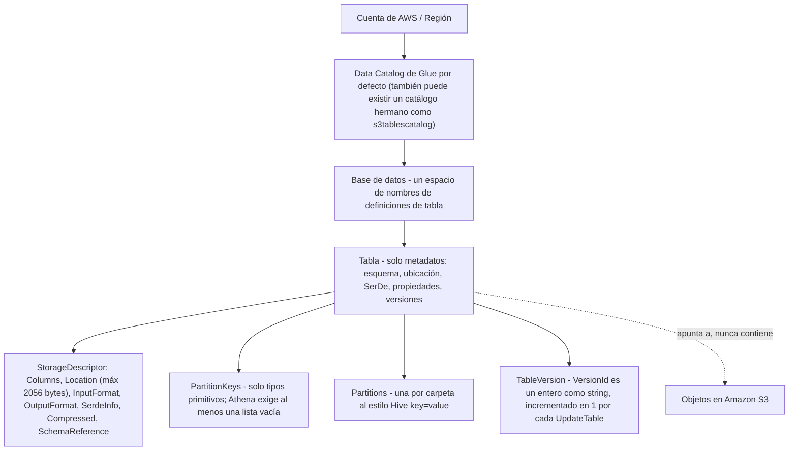
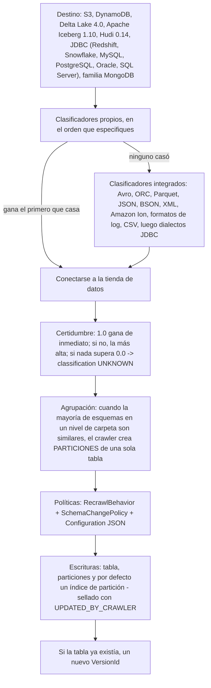
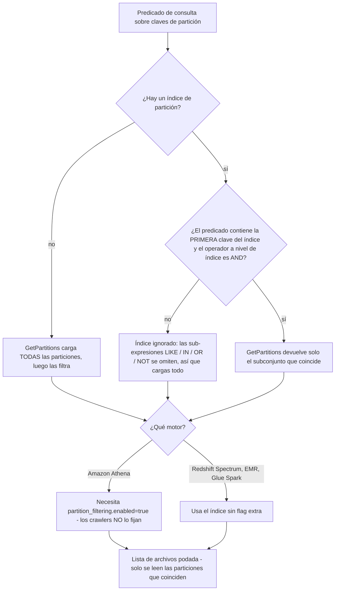
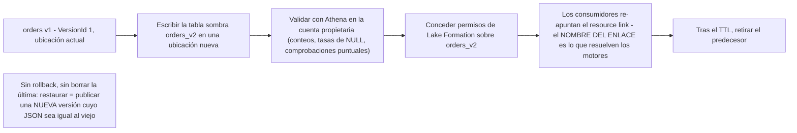
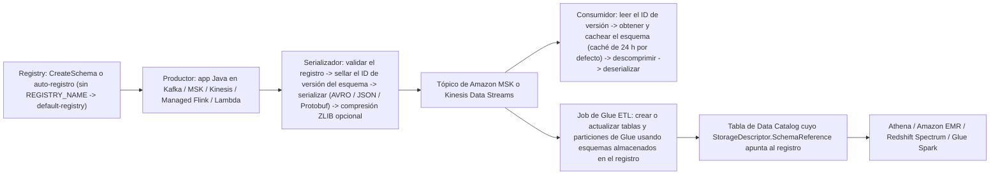
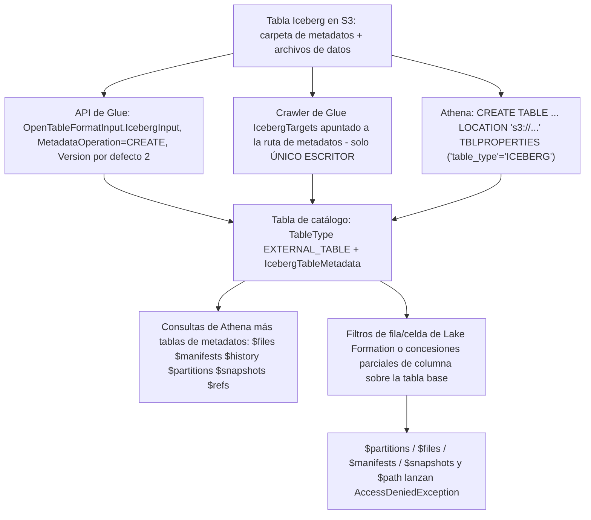
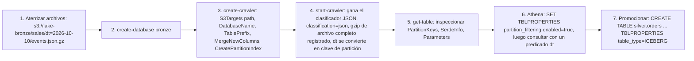
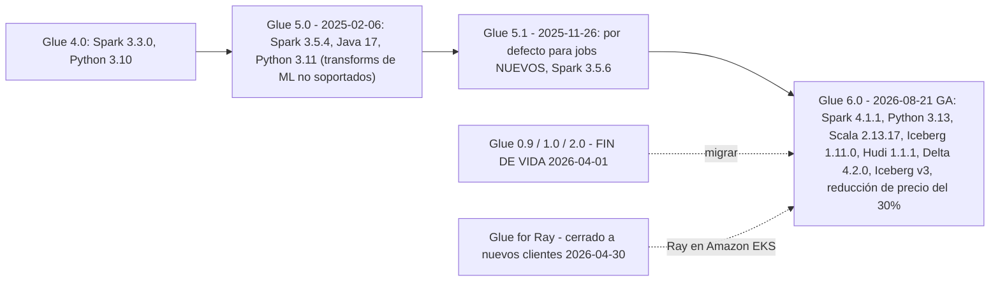

# AWS Glue Data Catalog: crawlers, particiones y gestión de esquemas

Las lecciones 02 a 06 pusieron bytes en Amazon S3: clases de almacenamiento, formatos, formatos de tabla, ingesta batch y en streaming. Nada de eso es consultable por un usuario SQL hasta que existe algo más — una **descripción** de dónde están los archivos, qué contienen, cómo deserializarlos y cuáles merece la pena leer. Esa descripción es el **AWS Glue Data Catalog**, y esta lección trata de poseerlo: qué es realmente un objeto de catálogo, cómo escribe uno un crawler, cómo las particiones y los índices de partición impiden que `GetPartitions` cargue el mundo, cómo las versiones de tabla permiten auditar un cambio de esquema y llevarlo *hacia adelante*, cómo el Schema Registry extiende el mismo disciplina a streams, y dónde Lake Formation te quita los permisos y se los da a una tabla de concesiones.

```text
====================================================================
 AWS GLUE DATA CATALOG - la superficie de decisión de metadatos (en octubre de 2026)
====================================================================
 Modelo ........ cuenta/Región -> catálogo -> base de datos -> tabla
                 -> particiones   SOLO METADATOS, no guarda bytes
   tabla ....... StorageDescriptor (Columns, Location, InputFormat,
                  OutputFormat, SerdeInfo, Compressed, SchemaReference)
                  + PartitionKeys (solo tipos primitivos)
                  + Parameters (classification, compressionType)
                  + TableType EXTERNAL_TABLE | GOVERNED
                  + VersionId (entero como string, +1 por actualización)
  Descubrimiento  crawler: clasificadores propios EN TU ORDEN -> gana
                  el primero que casa -> integrados -> inferir -> escribir
    certidumbre 1.0 gana de inmediato | si no, la más alta | si no UNKNOWN
    recrawl ..... CRAWL_EVERYTHING | CRAWL_NEW_FOLDERS_ONLY
                  (incremental) | CRAWL_EVENT_MODE (S3 -> SQS)
    cambio ...... UpdateBehavior LOG | UPDATE_IN_DATABASE
                  DeleteBehavior LOG | DELETE_FROM_DATABASE |
                  DEPRECATE_IN_DATABASE ; MergeNewColumns en JSON
    precio ...... $0.44 por DPU-hora, por segundo, mínimo de 10 minutos
                  1 DPU = 4 vCPU + 16 GB; los crawlers son OPCIONALES
  Velocidad ..... índice de partición: sublista de claves de partición,
                  máx 3/tabla, solo AND, la primera clave debe aparecer
                  en el predicado; Athena también necesita
                  partition_filtering.enabled = true
  Versión ....... GetTableVersions (MaxResults 1-100); SIN rollback,
                  no se puede borrar la última -> blue/green = nueva
                  versión o tabla sombra + intercambio por resource link
  Stream ........ Glue Schema Registry: gratis, cifrado con KMS,
                  8 modos de compatibilidad, AVRO/JSON/PROTOBUF,
                  validación solo desde la SEGUNDA versión
  Gobernanza .... Lake Formation posee CONCESIONES; Glue posee OBJETOS;
                  resource link = solo DESCRIBE + DROP
  Iceberg ....... table_type=ICEBERG, Glue = el metastore,
                  $files $snapshots $history ... en Athena
====================================================================
```

En esta lección vas a:

- leer el **modelo de objetos del Data Catalog** — catálogo, base de datos, tabla, particiones, `StorageDescriptor`, `SerDeInfo`, `SchemaReference`, `Parameters`, `TableType` — y los límites de bytes que lo dan forma;
- ejecutar un crawler en tu cabeza: **clasificadores propios en el orden que especifiques, gana el primero que tenga éxito, puntuación de certidumbre**, heurísticas de agrupación de carpetas y las tres perillas de política (`RecrawlPolicy`, `SchemaChangePolicy`, `Configuration`);
- tasar un crawler correctamente — **$0.44 por DPU-hora, por segundo, con un mínimo de 10 minutos** — y saber que la API es una alternativa gratuita;
- separar los **crawls incrementales** de los **crawls por eventos de S3**, incluido aquello ante lo que cada uno es ciego;
- defender un **patrón de diseño de propiedad exclusiva** para crawlers sin pretender que AWS envíe un interruptor de «crawler exclusivo»;
- usar los **índices de partición** como el motor realmente los usa: regla de la primera clave, solo `AND`, máximo tres por tabla y el flag de activación de Athena;
- operar **versiones de tabla**: qué archiva `UpdateTable`, por qué no hay rollback y cómo se ensambla un **despliegue blue/green de metadatos** con una tabla sombra más un intercambio por resource link;
- gobernar el esquema de streaming con el **Glue Schema Registry**: jerarquía, cuotas, los ocho modos de compatibilidad y la ruta SerDe de productor a consumidor;
- entregar a **Lake Formation** limpiamente: quién posee objetos, quién posee concesiones y qué da y no da un resource link;
- cablear **Glue como catálogo de Iceberg** y leer las tablas de metadatos de Iceberg de Athena — incluido dónde las bloquea Lake Formation;
- ejecutar un flujo **crawl → registro → Athena** de extremo a extremo y luego clasificar un cambio de esquema como **seguro o rompedor**;
- estudiar el caso de **BMW Group** y una **caja de actualizaciones de 2026 con fuentes**;
- practicar con **12 preguntas de estilo examen** más tres comprobaciones interactivas.

---

## 1. El modelo de objetos del Data Catalog

### 1.1 El árbol, y la frase de la que cuelga todo

AWS describe el Data Catalog como un servicio que *«captura y gestiona automáticamente el esquema de tus fuentes de datos, incluyendo inferencia, evolución y versionado de esquemas»*, y lista sus consumidores como Amazon Athena (*«Guarda y consulta metadatos de tablas en el Data Catalog para los datos de Amazon S3 usando SQL»*), Amazon Lake Formation (*«Define y gestiona centralmente políticas de acceso a datos de granularidad fina»*) y Amazon EMR (*«Accede a fuentes de datos definidas en el Data Catalog para procesamiento de datos a gran escala»*) (docs de AWS Glue Data Catalog, consultados 2026-10). Una capa de metadatos, varios motores — esa es toda la apuesta arquitectónica.

La propiedad que sostiene el peso es esta: **una tabla de catálogo no son datos.** Es un registro de *cómo encontrar e interpretar* datos que viven en otra parte, casi siempre un prefijo de S3. Borrar la tabla no borra los objetos; dos bases de datos pueden apuntar al mismo prefijo; y una tabla cuyo `Location` es incorrecto todavía «existe» y todavía devuelve cero filas.



### 1.2 El objeto de tabla campo a campo

| Campo | Qué decide | Restricción documentada (consultada 2026-10) |
|---|---|---|
| `Name` | El identificador que resuelven los motores | *«Para compatibilidad con Hive, esto debe ser completamente en minúsculas»* |
| `DatabaseName` | Qué espacio de nombres lo posee | Obligatorio en cada tabla |
| `StorageDescriptor` | **El contrato físico**: columnas, ubicación, formato de archivo, SerDe | `Location` ≤ **2056 bytes**; `AdditionalLocations` lleva las rutas de tablas Delta |
| `PartitionKeys` | El orden de claves al estilo Hive, separado de las columnas de datos | *«Solo se admiten tipos primitivos como claves de partición»*; para Athena sin claves aún debes pasar una **lista vacía** |
| `Parameters` | Propiedades libres de la tabla | *«Cada valor es una cadena UTF-8 de no más de **512000** bytes»* |
| `TableType` | Quién se considera el propietario | `EXTERNAL_TABLE` para tablas creadas por Glue; `GOVERNED` — *«Usado por AWS Lake Formation. El AWS Glue Data Catalog entiende `GOVERNED`»* |
| `IsRegisteredWithLakeFormation` | Si se aplican los permisos de LF | Flag booleano fijado en el registro |
| `VersionId` | Qué revisión es esta fila | Entero como string, incrementado en 1 |
| `IcebergTableMetadata` | Último estado de Iceberg | versión de formato, esquemas, especificaciones de partición, órdenes de ordenación |

Dentro del `StorageDescriptor` las pieces que realmente tocarás son pocas:

- **`Columns`** — la lista de columnas en línea. Puede ser legalmente *vacía*, porque…
- **`SchemaReference`** — *«Un objeto que referencia un esquema almacenado en el AWS Glue Schema Registry. Al crear una tabla, puedes pasar una lista de columnas vacía para el esquema y usar en su lugar una referencia de esquema.»* Esta es la bisagra entre el catálogo batch y el registro de streaming (Sección 5).
- **`Location`** — la URI de S3 (o el manejador JDBC/DynamoDB) que la tabla lee.
- **`InputFormat` / `OutputFormat`** — nombres de clases Hive como `TextInputFormat` / `IgnoreKeyTextOutputFormat`. El catálogo tiene forma de Hive a propósito: nombres en minúsculas, clases E/S de Hive, nombres de SerDe de Hive.
- **`SerdeInfo`** — `Name`, `Parameters` y `SerializationLibrary`, por ejemplo `org.apache.hadoop.hive.serde2.columnar.ColumnarSerDe`, o `LazySimpleSerDe` (el por defecto del clasificador CSV integrado) y `OpenCSVSerde` (al que cambias cuando los campos CSV van entrecomillados).
- **`Compressed`, `BucketColumns`, `SortColumns`, `SkewedInfo`, `StoredAsSubDirectories`** — pistas físicas de Hive que el motor puede o no explotar.

- **📚 ¿Sabías que…?** Los `Parameters` de la tabla es donde aterrizan los hallazgos de un crawler, y AWS te dice exactamente cuáles están pensados para ti: *«Esperamos que los usuarios consuman las propiedades `classification` y `compressionType`. Otras propiedades, incluidas las estimaciones de tamaño de tabla, se usan para cálculos internos y no garantizamos su precisión.»* Así que `recordCount`, `sizeKey`, `objectCount` y `averageRecordSize` son pistas para la aritmética propia del crawler — nunca entradas de un plan de capacidad. Las dos sobre las que debes construir son `classification` (cómo parsear los archivos) y `compressionType` (si un *archivo entero* fue comprimido — la compresión interna de Parquet deliberadamente no lo rellena) (docs de propiedades de tablas del crawler de AWS Glue, consultados 2026-10).

```text
E0  LEYENDO UN OBJETO DE TABLA (lo que importa, lo que es decorado)
--------------------------------------------------------------------
aws glue get-table --database-name bronze --name sales_events

  Name ...................... sales_events        (minúsculas, regla Hive)
  TableType ................ EXTERNAL_TABLE       (creada por crawler)
  PartitionKeys ............ [{dt: string}]       (solo primitivos)
  StorageDescriptor
    Location ............... s3://lake-bronze/sales/
    InputFormat ............ org.apache.hadoop.mapred.TextInputFormat
    SerdeInfo
      SerializationLibrary . org.apache.hive.hcatalog.data.JsonSerDe
  Parameters
    classification ......... json      <- cómo Athena lo parsea
    compressionType ........ gzip      <- compresión de archivo completo
    UPDATED_BY_CRAWLER ..... nightly_sales_crawler
    recordCount ............ 41_882_110   <- PISTA, no un contrato
--------------------------------------------------------------------
Orden de lectura: TableType -> PartitionKeys -> Location -> SerdeInfo
               -> Parameters.classification. Todo lo demás puedes
               ignorarlo hasta que una consulta se comporte rara.
```

---

## 2. Crawlers: clasificación, clasificadores y orden de ejecución

### 2.1 Los cinco pasos que AWS documenta

AWS es directo sobre el estatus del crawler: *«Puedes usar un crawler de AWS Glue para poblar el AWS Glue Data Catalog con bases de datos y tablas. Este es el método principal que usan la mayoría de los usuarios de AWS Glue.»* El flujo de trabajo documentado está fijo: los clasificadores propios se ejecutan **«en el orden que especifiques»**; luego los integrados; luego el crawler se conecta a la tienda, infiere el esquema y escribe una tabla con la etiqueta `classification` del clasificador ganador. La gobierna todo lo demás: *«El primer clasificador propio en reconocer con éxito la estructura de tus datos se usa para crear un esquema.»* Los clasificadores por debajo del ganador se omiten (docs del crawler de AWS Glue, consultados 2026-10).



### 2.2 Clasificadores, certidumbre y la trampa del CSV

Un clasificador *«lee los datos en una tienda de datos. Si reconoce el formato de los datos, genera un esquema. El clasificador también devuelve un número de certidumbre.»* La puntuación es determinística y vale la pena memorizarla:

| Certidumbre | Resultado |
|---|---|
| `1.0` de cualquier clasificador | AWS usa esa salida de inmediato |
| Sin `1.0`, pero algún valor > `0.0` | Gana la certidumbre **más alta** |
| Nada por encima de `0.0` | El crawler escribe la cadena de clasificación por defecto **`UNKNOWN`** |

Los clasificadores integrados se prueban en un orden documentado que recorre Avro, ORC, Parquet, JSON, BSON, XML, Amazon Ion, formatos de log, CSV, Redshift, MySQL, PostgreSQL, Oracle, SQL Server y DynamoDB. Los formatos comprimidos que aún pueden clasificarse son **ZIP (solo archivos de un solo archivo), BZIP, GZIP, LZ4 y Snappy**.

El CSV tiene tres puertas documentadas que atrapan a la gente: el esquema debe tener **al menos dos columnas y dos filas**; las heurísticas de cabecera deben parsear (columnas de solo cabecera se leen como STRING, menos de 150 caracteres salvo la última, nombres válidos por regex, y la cabecera debe diferir de las filas de datos) o las columnas degradan a `col1`, `col2`, …; y el clasificador CSV integrado emite **`LazySimpleSerDe`**, que arruina las cadenas entrecomilladas — *«si los datos CSV contienen cadenas entrecomilladas, edita la definición de la tabla y cambia la biblioteca SerDe a `OpenCSVSerde`.»*

Y la trampa de larga data: *«Si cambias la definición de un clasificador, los datos previamente crawleados con ese clasificador no se reclasifican.»* Editar la regla no reescribe la historia; debes apuntar un crawler a los datos viejos de nuevo.

```matching
{
  "question": "Emparecha cada concepto de crawler con lo que realmente hace (AWS Glue, en octubre de 2026):",
  "pairs": [
    {"left": "Clasificadores propios ordenados", "right": "Se ejecutan antes de los integrados, en el orden que especifiques; el primer clasificador propio en reconocer con éxito la estructura de los datos crea el esquema y todo lo que está por debajo se omite"},
    {"left": "Puntuación de certidumbre", "right": "La confianza de un clasificador: 1.0 se toma de inmediato, si no gana la certidumbre más alta, y si nada supera 0.0 la tabla se escribe con classification UNKNOWN"},
    {"left": "RecrawlBehavior = CRAWL_NEW_FOLDERS_ONLY", "right": "Crawl incremental: primero un crawl completo, luego solo se añaden particiones NUEVAS; no detecta modificaciones ni borrados de particiones existentes, y bloquea los destinos S3 contra ediciones"},
    {"left": "RecrawlBehavior = CRAWL_EVENT_MODE", "right": "Crawl por eventos de S3: consume notificaciones de S3 desde una cola SQS y lista solo la subcarpeta que dispara el evento, limitado a 100,000 mensajes por crawl, sin coste cuando la cola está vacía"},
    {"left": "SchemaChangePolicy UpdateBehavior = LOG", "right": "Registra las diferencias de esquema y deja tranquila la definición de tabla existente; las tablas nuevas y las particiones nuevas se siguen creando, así que LOG solo no es una congelación completa"},
    {"left": "Índice de partición", "right": "Una sublista almacenada de las claves de partición de la tabla para que GetPartitions obtenga un subconjunto en vez de todo: máximo 3 por tabla, solo AND, y la primera clave del índice debe aparecer en el predicado"}
  ],
  "explanation": "Cada entrada es una perilla distinta con un radio de impacto distinto: los clasificadores deciden el esquema, la certidumbre decide qué clasificador gana, RecrawlPolicy decide QUÉ se vuelve a listar (carpetas nuevas vs subcarpetas por eventos vs todo), SchemaChangePolicy decide QUÉ le pasa a los metadatos que ya encontró, y el índice de partición decide qué tan barato puede GetParticiones responder. Las dos confusiones clásicas son tratar UpdateBehavior=LOG como una congelación (tablas y particiones nuevas siguen apareciendo) y esperar que un índice ayude a una consulta cuyo predicado omite la primera clave del índice."
}
```

### 2.3 Nombres, agrupación y la trampa del resultado vacío

Los nombres generados por el crawler siguen reglas duras: *«Solo se permiten caracteres alfanuméricos y el guion bajo (`_`). Ningún prefijo propio puede tener más de 64 caracteres. La longitud máxima del nombre no puede superar los 128 caracteres… Si se encuentran nombres de tabla duplicados, el crawler añade un sufijo de cadena hash.»*

La agrupación es un voto mayoritario, no una regla: *«Cuando la mayoría de esquemas en un nivel de carpeta son similares, el crawler crea particiones de una tabla en vez de tablas separadas. Para influir en el crawler y que cree tablas separadas, añade la carpeta raíz de cada tabla como una tienda de datos separada.»* Equívocate y heredas la advertencia explícita de AWS: *«Si los objetos tienen esquemas diferentes, Athena no reconoce los objetos diferentes dentro del mismo prefijo como tablas separadas… Esto puede llevar a consultas en Athena que devuelvan cero resultados.»*

- **📚 ¿Sabías que…?** El crawler es la ruta por defecto, no la única. La página de precios lo dice en tantas palabras: *«El uso de los crawlers de Amazon Glue es opcional y puedes poblar el Amazon Glue Data Catalog directamente a través de la API.»* Eso importa para el coste y para el control — `CreateTable` escribe exactamente el esquema que pretendes, sin lotería de clasificadores, sin voto mayoritario de carpetas y sin mínimo de facturación de 10 minutos. Los equipos que curan un puñado de tablas de alto valor deberían escribirlas a mano y reservar los crawlers para la cola larga (página de precios de AWS Glue y espejo de partición China, consultada 2026-10-11).

### 2.4 Políticas de recrawl: incremental frente a eventos de S3

Estas son dos optimizaciones distintas y fallan en dos direcciones distintas.

| | Incremental (`CRAWL_NEW_FOLDERS_ONLY`) | Eventos de S3 (`CRAWL_EVENT_MODE`) |
|---|---|---|
| Primera ejecución | Siempre un crawl completo | Siempre un listado completo |
| Ejecuciones siguientes | Añade **solo particiones nuevas** | Lista **solo la subcarpeta que disparó el evento** |
| Ciego ante | Modificaciones **y** borrados de particiones existentes | Cualquiera cosa que no produjo un evento; las particiones borradas se recrean salvo que se configuren *«todos los eventos de eliminación de objetos»* |
| Fuerza | `UpdateBehavior=LOG`, `DeleteBehavior=LOG`; *«no puedes cambiar las tiendas de datos de destino de Amazon S3 al editar el crawler»* | *«El crawler solo admite un único destino»*; los destinos de Data Catalog deben estar todos en el mismo bucket |
| Techo | — | **100,000 mensajes por crawl**; el comodín `s3://%` no se admite; SQS en un VPC privado no se admite |
| Forma de coste | Una ejecución programada a la vez | *«No habrá coste si no hay eventos en la cola»* |

La forma CLI para el modo incremental es `--recrawl-policy RecrawlBehavior=CRAWL_NEW_FOLDERS_ONLY --schema-change-policy UpdateBehavior=LOG,DeleteBehavior=LOG`.

### 2.5 Política de cambio de esquema: tres comportamientos, un documento JSON

Por defecto *«los crawlers actualizan el esquema en el Data Catalog para que coincida con la fuente de datos que se está crawleando»* — lo que significa que un retipo en un archivo nuevo puede reescribir tu tabla en silencio y acuñar una nueva versión. Las perillas de la API son `SchemaChangePolicy.UpdateBehavior ∈ {LOG, UPDATE_IN_DATABASE}` y `DeleteBehavior ∈ {LOG, DELETE_FROM_DATABASE, DEPRECATE_IN_DATABASE}`. Las caras de consola *«Solo añadir columnas nuevas»* e *«Ignorar el cambio y no actualizar la tabla en el Data Catalog»* son facetas de UI de los mismos campos, expresadas en el documento `Configuration`:

```json
{
  "Version": 1.0,
  "CrawlerOutput": {
    "Tables": { "AddOrUpdateBehavior": "MergeNewColumns" },
    "Partitions": { "AddOrUpdateBehavior": "InheritFromTable" }
  },
  "Grouping": { "TableGroupingPolicy": "CombineCompatibleSchemas" },
  "CreatePartitionIndex": true
}
```

`MergeNewColumns` es el comportamiento aditivo y seguro; `LOG` es el comportamiento de congelar y dejar que los humanos decidan; el `UPDATE_IN_DATABASE` por defecto es el que puede retipear columnas a tus espaldas.

> [!WARNING]
> ⚠️ **Tres trampas de crawler que aparecen en producción, no en tutoriales:**
> - **`UpdateBehavior=LOG` no detiene tablas nuevas ni particiones nuevas.** Detiene *actualizaciones de tablas existentes*. Añade `"Partitions": {"AddOrUpdateBehavior": "InheritFromTable"}` al documento `Configuration` si también quieres congelar los metadatos de partición.
> - **Editar un clasificador nunca reclasifica la historia.** Los datos previamente crawleados conservan su clasificación antigua; necesitas un crawler nuevo apuntado al prefijo viejo.
> - **Dos crawlers escribiendo una tabla es legal y con carreras.** Nada en la API lo impide. La única restricción *documentada* de un solo escritor es la regla de Iceberg de la Sección 7.2 — que es exactamente por qué el patrón de propiedad de la siguiente subsección es una decisión de diseño que debes imponer tú mismo.

### 2.6 Crawlers «exclusivos»: un patrón de diseño, no una característica de AWS

Una nota de honestidad importante: **AWS no envía una opción de crawler llamada «exclusivo» o «no exclusivo».** Si ves ese encuadre, es una convención de equipo, no una casilla de consola. Lo que AWS *sí* documenta son tres restricciones duras de un solo escritor/un solo destino:

1. **Iceberg:** *«Usa un crawler de Iceberg solo cuando sea el único escritor de una tabla de Data Catalog. No lo uses junto a escritores concurrentes como optimizadores de tablas, Apache Spark u otros motores que se comprometen directamente en la misma tabla… Si otro escritor modifica la tabla de Data Catalog mientras el crawler está en ejecución, el crawler no puede actualizar la tabla.»*
2. **Crawlers por eventos de S3:** *«El crawler solo admite un único destino, ya sea para destinos de Amazon S3 o de Data Catalog.»*
3. **Crawlers con credenciales de Lake Formation:** *«Actualmente, solo se permite un único destino de catálogo con una única tabla de catálogo cuando se usa una tabla de Data Catalog como destino de un crawler.»*

Todo lo más amplio — «un crawler posee una tabla», «una tabla tiene exactamente un escritor», «el prefijo bronze solo lo crawlea `nightly_sales_crawler`» — es el **patrón de propiedad exclusiva**: una convención donde das a cada tabla un solo crawler, un solo `TablePrefix` y una única `Configuration`, de modo que la rotación de versiones y las carreras de clasificación no pueden ocurrir. Adopta deliberadamente; no lo cites como una característica de AWS.

### 2.7 Ejemplo resuelto E1 — lo que realmente cuesta un crawler

```text
E1  COSTE DE CRAWLER CON EL MÍNIMO DE 10 MINUTOS  (us-east-1, en octubre de 2026)
--------------------------------------------------------------------
Tarifa: $0.44 por DPU-hora, facturada por segundo, redondeada hacia
        arriba, con un MÍNIMO de 10 MINUTOS de duración para cada crawl.
        1 DPU = 4 vCPU + 16 GB de memoria.

(a) Un crawl, 2 DPUs, tiempo real de ejecución 95 segundos
    facturable = max(95 s, 600 s) = 600 s = 0.1667 h
    2 DPU x 0.1667 h x $0.44            = $0.147 por crawl
    (los 405 segundos que no usaste se facturan igualmente)

(b) El propio ejemplo publicado de AWS: 2 DPUs x 0.5 h x $0.44 = $0.44

(c) El mismo crawler en un cron horario, 30 días
    24 x $0.147 = $3.52 al día
    30 x $3.52  = $105.61 al mes  ~= $106/mes
    ... por un prefijo que puede no haber cambiado nunca.

(d) Forma del whitepaper de modelado de costes: 10 minutos x 1 DPU
    1 x (10/60) x $0.44 = $0.073 por crawl

(e) Alternativa por eventos: el crawler lista solo la subcarpeta
    que disparó, y en un día con la cola SQS vacía
    «No habrá coste si no hay eventos en la cola».
--------------------------------------------------------------------
Veredicto: el mínimo de 10 minutos, no la tarifa por DPU, es lo que
hace que un crawl horario de un prefijo tranquilo despilfarre dinero.
Mata el programa, cambia a CRAWL_EVENT_MODE, o baja a DDL con CreateTable.
```

```plot
{
  "type": "bar",
  "title": "E1: un crawler de 2 DPU a $0.44/DPU-hora con un mínimo de 10 minutos (us-east-1, en octubre de 2026)",
  "xLabel": "Elección de programación",
  "yLabel": "Coste a 30 días (USD)",
  "xKey": "schedule",
  "data": [
    {"schedule": "Hourly cron (24 runs/day, all billed at the floor)", "usd_per_month": 105.61},
    {"schedule": "Crawl only when S3 events arrive (empty queue = $0)", "usd_per_month": 4.41}
  ]
}
```

La segunda barra asume 30 crawls disparados por eventos al mes — uno por día de cambio real — al mismo suelo de $0.147. Léela como una forma, no como una previsión: **estás pagando programaciones, no descubrimiento.**

---

## 3. Particionado, índices de partición y el carril de proyección

### 3.1 Cómo llegan las particiones al catálogo

Los segmentos de carpeta al estilo Hive `key=value/` los descubre el crawler cuando los esquemas en un nivel son similares; la carpeta se convierte en una fila de partición indexada por esos valores, y las claves se convierten en las `PartitionKeys` de la tabla (solo tipos primitivos). El trabajo declarado del catálogo incluye exactamente esto: *«está diseñado para calcular estadísticas y registrar particiones para ayudar a que las consultas contra tus datos sean eficaces y efectivas. También está diseñado para mantener un historial de versiones de esquema para que puedas entender cómo han cambiado tus datos con el tiempo.»*

Los crawlers también construyen la capa de rendimiento por ti: *«Un crawler crea índices de partición para destinos de Amazon S3 y Delta Lake por defecto»*, desactivables con `--configuration '{"Version": 1.0, "CreatePartitionIndex": false}'`.

### 3.2 Qué hace un índice de partición — y cuándo no hace nada

Sin un índice, *«AWS Glue carga todas las particiones de la tabla y luego filtra las particiones cargadas usando la expresión de la consulta.»* Con uno, el catálogo obtiene un subconjunto. Las reglas son estrechas y todas son comprobables:

| Regla | Valor |
|---|---|
| Qué es | *«Un índice de partición es una sublista de claves de partición definidas en la tabla»* |
| Máximo por tabla | **3** |
| Tipos de clave admitidos | Date (`YYYY-MM-DD`, rango `0000-01-01`–`9999-12-31`), String/Char/Varchar, Numeric (int, bigint, long, tinyint, smallint) |
| Operadores lógicos | *«La solución de indexación actualmente solo admite el operador lógico `AND`. Las sub-expresiones con los operadores `LIKE`, `IN`, `OR` y `NOT` se ignoran.»* |
| Regla de la primera clave | *«La primera clave del índice debe pasarse en la expresión para que los índices se usen en el filtrado.»* |
| Coste | *«Para una tabla con 'n' particiones, 1 índice de partición resultará en 'n' elementos de índice de partición. 'm' índices de partición en la misma tabla resultarán en 'm*n' elementos de índice de partición. Cada elemento de índice de partición se cobrará…»* |
| Motores que lo usan | Redshift Spectrum, Amazon EMR, DataFrames de Glue ETL Spark — *«…[Athena] y frames dinámicos de Glue ETL requieren pasos extra»* |
| Paso extra en Athena | `ALTER TABLE … SET TBLPROPERTIES ('partition_filtering.enabled' = 'true')` |
| Particiones cifradas | *«No se admite crear índices de partición para particiones cifradas.»* |
| Memoria de fallos | Códigos de fallo `ENCRYPTED_PARTITION_ERROR`, `INVALID_PARTITION_TYPE_DATA_ERROR`, `MISSING_PARTITION_VALUE_ERROR`, `UNSUPPORTED_PARTITION_CHARACTER_ERROR`, `INTERNAL_ERROR`; *«Cada tabla almacena los últimos 10 índices fallidos.»* |

Y una advertencia de lock-in: las tablas creadas por crawler *«no tienen la variable `partition_filtering.enabled` por defecto»* — así que un crawler puede construir el índice y Athena aún lo ignorará hasta que actives la propiedad.



- **📚 ¿Sabías que…?** Los índices de partición son *objetos de metadatos facturables*, y se multiplican. Una tabla con 50,000 particiones y 3 índices consume 50,000 particiones **más 150,000 elementos de índice** — más la tabla, sus versiones, su base de datos. El nivel gratuito del Data Catalog cuenta *«una tabla, versión de tabla, partición, índices de partición, estadísticas, base de datos o catálogo»* como objetos separados, así que el diseño de índices es una decisión de coste tanto como de rendimiento (docs de precios de AWS Glue e índices de partición, consultados 2026-10).

### 3.3 Proyección de particiones: el carril que salta el catálogo

Hay una tercera forma de llevar valores de partición a una consulta, y está deliberadamente fuera de alcance aquí: **la proyección de particiones de Amazon Athena**, que calcula valores y ubicaciones de particiones en tiempo de consulta en vez de leer metadatos registrados. La propia lista de características de AWS Glue la empareja con el filtrado de particiones bajo el encabezado de Athena y apunta a la documentación de Athena. Esta lección posee el lado del *catálogo* — particiones registradas y los índices sobre ellas; la configuración de proyección en sí pertenece a la lección de la capa de consulta (ver Lección 09). De momento, sostén una distinción: un índice hace más barato `GetPartitions`, la proyección hace `GetPartitions` innecesario.

### 3.4 Ejemplo resuelto E2 — la factura de objetos de metadatos

```text
E2  QUÉ CUENTA REALMENTE EL "NIVEL GRATUITO"  (en octubre de 2026)
--------------------------------------------------------------------
Precios: los primeros 1,000,000 de objetos de metadatos almacenados
         son gratis, luego $1.00 por cada 100,000 objetos por encima
         de un millón, al mes.
         Los primeros 1,000,000 de accesos son gratis.
         Un objeto de metadatos = tabla | versión de tabla | partición |
         índices de partición | estadísticas | base de datos | catálogo.

Una tabla "orders", grano diario, 365 particiones, 3 índices de partición:
    365 particiones
  + 3 índices x 365 particiones = 1,460 elementos de índice
  + 1 tabla
  + 6 versiones de tabla
  = 1,832 objetos

40 tablas así en el conjunto                    = 73,280 objetos
Otros dominios (bases de datos, stats, etc.)    = 926,720 objetos
                                                ------------
Total                                           = 1,000,000 objetos  -> $0

Invierte el escenario: 2,400,000 objetos
  por encima del nivel gratuito = 1,400,000
  1,400,000 / 100,000 = 14 bloques x $1.00  = $14.00 / mes
--------------------------------------------------------------------
Lección: quitar un índice de una tabla de 365 particiones elimina 365
objetos facturables. Quitar el índice completo elimina 1,095.
```

---

## 4. Versionado de tablas y despliegue blue/green de esquemas

### 4.1 El versionado es automático y solo hacia adelante

Cada `UpdateTable` archiva la fila anterior e incrementa `VersionId` — *«Un `VersionId` es una representación en string de un entero. Cada versión se incrementa en 1.»* La recuperación es `GetTableVersion` / `GetTableVersions` (*«Recupera una lista de strings que identifican las versiones disponibles de una tabla especificada»*, `MaxResults` **1–100**), siendo cada entrada un `Table` completo más su `VersionId`. El servicio está documentado para *«mantener un historial de versiones de esquema para que puedas entender cómo han cambiado tus datos con el tiempo.»*

### 4.2 No hay rollback — solo publicar hacia adelante

Este es el hecho que los equipos descubren en un incidente. Un hilo de re:Post respondido por AWS (2023-11-22, revisado por AWS) afirma: *«No es posible hacer "rollback" a una versión anterior per se y tampoco puedes borrar la última versión de la tabla (ni en la consola ni vía API/CLI), así que la única opción es publicar una nueva versión de esquema idéntica a la que quieres restaurar.»* La ruta documentada es del lado de la consola: navega a la versión que quieres, **Editar esquema como JSON**, luego **Guardar como nueva versión de tabla**.

Así que «rollback» es un nombre equivocado. El despliegue de metadatos es **de solo inserción en la práctica**: puedes leer cada versión histórica, diferenciar dos de ellas y publicar una nueva — pero no puedes quitar la cabecera.

### 4.3 Dos patrones blue/green, ambos ensamblados con piezas documentadas

| Patrón | Mecanismo | Cuándo |
|---|---|---|
| **Tabla sombra + intercambio de enlace** | Escribe `orders_v2` en una ubicación nueva, valida, concede a los consumidores sobre ella, luego redirige el **resource link** que resuelven los motores; retira el predecesor tras un TTL | Cambios rompedores, y cualquier conjunto gobernado por Lake Formation donde el nombre del enlace es la interfaz estable |
| **Publicar versión N+1** | Valida primero, luego llama `UpdateTable` una vez; usa los diffs de `GetTableVersions` para detectar regresiones | Cambios aditivos bajo `MergeNewColumns`, donde el nombre lógico no debe moverse |

Para blue/green de *datos* hay una primitiva más barata que cualquiera de las dos: las instantáneas de Iceberg permiten que la entrada de catálogo conserve su forma mientras los datos ruedan hacia adelante y hacia atrás (Lección 04).



### 4.4 Ejemplo resuelto E3 — un corte blue/green de metadatos con resource link

```text
E3  BLUE/GREEN ENTRE CUENTAS SOBRE UNA TABLA GOBERNADA
--------------------------------------------------------------------
Configuración: la Cuenta A posee shared.orders (Lake Formation,
               TableType GOVERNED) y la comparte con la Cuenta B
               a través de AWS RAM.
               B creó el resource link "orders" -> shared.orders.

Paso 1  A: CREATE shared.orders_v2 en s3://lake-gold/orders-v2/
           (API de Glue, o Athena CREATE TABLE ... TBLPROPERTIES)
Paso 2  A: validar en Athena - SELECT count(*), comprobaciones de tasa de NULL
Paso 3  A: conceder a B SELECT sobre el DESTINO shared.orders_v2
           (conceder solo sobre el enlace no concede nada sobre el destino)
Paso 4  B: re-apuntar (o recrear) su enlace local llamado "orders"
           hacia shared.orders_v2 - sin cambios en el SQL de consumidores,
           porque el nombre del enlace es lo que resuelven los motores
Paso 5  observar durante la ventana del TTL; comparar diffs de GetTableVersions
Paso 6  A: retirar el predecesor una vez que el tráfico está limpio

Reglas que hacen que esto funcione:
  * los permisos del resource link son solo DESCRIBE y DROP
  * borrar un enlace NUNCA borra el recurso enlazado
  * crear un enlace no comprueba que el destino exista
  * el compartir entre cuentas va por AWS RAM: los shares de la misma
    organización aterrizan de inmediato, otras organizaciones deben aceptar
--------------------------------------------------------------------
```

---

## 5. Glue Schema Registry: compatibilidad para streams y batches

### 5.1 La jerarquía de objetos y lo que cuesta

El registro es la contraparte de streaming del catálogo: *«El AWS Glue Schema Registry te permite descubrir, controlar y evolucionar centralmente esquemas de flujos de datos»*, con integraciones a **Apache Kafka, Amazon MSK, Amazon Kinesis Data Streams, Amazon Managed Service for Apache Flink y AWS Lambda**. La jerarquía es `Registry → Schema → SchemaVersion → SchemaVersionMetadata`, donde un `Schema` lleva un `DataFormat`, un modo de `Compatibility` y un `SchemaCheckpoint`.

| Elemento | Valor (consultado 2026-10) |
|---|---|
| Formatos | **AVRO (v1.11.4)**; **JSON** con JSON Schema Draft-04/06/07 (validación Everit); **Protocol Buffers** proto2 y proto3, *«sin soporte para `extensions` o `groups`»* |
| Modos de compatibilidad | **8**: `NONE`, `DISABLED`, `BACKWARD`, `BACKWARD_ALL`, `FORWARD`, `FORWARD_ALL`, `FULL`, `FULL_ALL` |
| Registros por Región | **100** (duro) |
| Versiones de esquema por Región | **10,000** (duro) |
| Carga del esquema | **170 KB** (duro); API `SchemaDefinition` ≤ **170,000 bytes** |
| Metadatos de versión | **10** pares clave-valor por versión de esquema (blando) |
| Checkpoint | Por defecto la primera versión; editar la definición del esquema o el modo de compatibilidad en la consola mueve el checkpoint a la última versión |
| Precio | *«El uso del AWS Glue Schema Registry se ofrece sin coste adicional»* / *«serverless y de uso gratuito»* |
| Cifrado | *«Los esquemas almacenados en el Schema Registry están siempre cifrados en reposo usando una clave de AWS Key Management Service (AWS KMS) gestionada por el servicio»*; TLS en tránsito; solo políticas IAM basadas en identidad |

La compatibilidad se aplica en el registro: para cada modo salvo `DISABLED`, *«la validación de los ajustes de compatibilidad se aplicará solo a partir de la segunda versión cuando se use la API `RegisterSchemaVersion`»*, y `DISABLED` *«restringe que se añadan versiones de esquema adicionales después de la primera versión de esquema.»*

```fillblank
{
  "question": "Completa el contrato de compatibilidad del Schema Registry usando los propios nombres de modo de AWS (en octubre de 2026):",
  "template": "Los ocho modos de compatibilidad son {{1}}, {{2}}, {{3}}, {{4}}, {{5}}, {{6}}, {{7}} y {{8}}. La validación de compatibilidad se aplica solo a partir de la versión de esquema {{9}}, un modo de {{10}} bloquea cada versión después de la primera, y volver a enviar una definición de esquema idéntica devuelve el ID de esquema EXISTENTE en vez de crear un duplicado.",
  "answers": {
    "1": "NONE",
    "2": "DISABLED",
    "3": "BACKWARD",
    "4": "BACKWARD_ALL",
    "5": "FORWARD",
    "6": "FORWARD_ALL",
    "7": "FULL",
    "8": "FULL_ALL",
    "9": "segunda",
    "10": "DISABLED"
  },
  "distractors": ["STRICT", "BACKWARD_COMPATIBLE", "FORWARD_ALL", "FULL_TRANSITIVE", "LATEST", "FIRST", "SCHEMA_REGISTRY", "AVRO", "JSON", "PROTOBUF", "default-registry", "SCHEMA_CHECKPOINT"],
  "explanation": "AWS documenta exactamente ocho modos: NONE, DISABLED, BACKWARD, BACKWARD_ALL, FORWARD, FORWARD_ALL, FULL y FULL_ALL. BACKWARD significa que los lectores nuevos manejan datos actuales y previos, FORWARD significa que los lectores actuales manejan datos actuales y siguientes, FULL es ambos, y las variantes _ALL comparan contra todas las versiones previas en vez de solo el checkpoint. La validación empieza en la SEGUNDA versión porque en v1 no hay nada con lo que ser compatible; DISABLED es una congelación, útil como intención y fatal como error. NONE no realiza ninguna comprobación - bien para un registro de desarrollo, nunca para uno compartido."
}
```

### 5.2 La ruta SerDe, del productor al consumidor



Dos propiedades de ese diagrama son fáciles de pasar por alto. Primero, el registro **no es solo de streaming**: *«puedes crear o actualizar tablas y particiones de AWS Glue usando esquemas almacenados en el registro»*, y una tabla de catálogo puede delegar su lista de columnas por completo a un `SchemaReference`. Segundo, el acceso entre cuentas tiene una forma dura — *«el AWS Glue Schema Registry no admite políticas basadas en recursos»*, así que un registro entre cuentas se alcanza asumiendo un rol basado en identidad en la cuenta propietaria, no con una política de recurso.

### 5.3 Ejemplo resuelto E4 — un ejercicio de compatibilidad sobre un esquema Avro

```text
E4  EJERCICIO DE COMPATIBILIDAD DEL REGISTRO  (modo aplicado en RegisterSchemaVersion)
--------------------------------------------------------------------
v1 registro Avro:
  first  (string, REQUIRED)
  last   (string, REQUIRED)
  email  (string, REQUIRED)
  phone  (string, OPTIONAL)

Bajo BACKWARD (los lectores nuevos deben leer datos actuales y previos):
  + eliminar "email" requerido        -> SE REGISTRA
      (los lectores nuevos ignoran un campo que los mensajes viejos simplemente no tienen)
  + añadir "zip" requerido            -> FALLA
      (los lectores nuevos exigen un campo que los mensajes viejos nunca llevaron)
  + añadir "zip" opcional             -> SE REGISTRA

Bajo FORWARD (los lectores actuales deben leer datos actuales y siguientes):
  + añadir "phone" requerido          -> SE REGISTRA
  + eliminar "first" requerido        -> FALLA
      (los lectores actuales aún piden un campo que los mensajes nuevos eliminaron)

Notas prácticas:
  * Registrar la MISMA definición de nuevo devuelve el ID de
    esquema existente - no se crea una versión duplicada.
  * GetSchemaVersionsDiff devuelve un SYNTAX_DIFF de JsonPatch
    (respuesta limitada a 340,000 bytes).
  * CheckSchemaVersionValidity comprueba la sintaxis SIN efectos
    secundarios y NO realiza ninguna comprobación de compatibilidad
    - no confundas los dos.
--------------------------------------------------------------------
```

- **📚 ¿Sabías que…?** El nivel gratuito del registro no es una promoción, es la arquitectura: el Schema Registry es *«serverless y de uso gratuito»*, mientras que el Data Catalog de al lado cobra por los objetos y el crawler que lo llena cobra por el DPU-segundo. Así que la gobernanza de esquemas más barata en AWS es la de streaming — un equipo puede registrar miles de versiones de Avro bajo `BACKWARD_ALL` por nada y aun así gastar seis cifras en crawlers escaneando los mismos datos conceptuales en particiones (docs del Glue Schema Registry y precios de AWS Glue, consultados 2026-10).

---

## 6. Entrega a Lake Formation: quién posee qué

### 6.1 Un catálogo, dos propietarios

La frase única que resuelve la mayoría de la confusión: *«Las tablas de metadatos de AWS Lake Formation contienen información sobre los datos del lago de datos, incluyendo información de esquema, información de partición y ubicación de datos. Estas tablas se almacenan en el AWS Glue Data Catalog.»* Lake Formation no tiene una segunda copia de tus metadatos — tiene una **capa de permisos sobre los mismos objetos**.

| Preocupación | Propietario | Evidencia en el objeto |
|---|---|---|
| Objetos de metadatos: bases de datos, tablas, particiones, versiones | **AWS Glue** | `VersionId`, `UPDATED_BY_CRAWLER`, `Parameters` fijados por el crawler |
| Concesiones: quién puede SELECT/DESCRIBE/ALTER, con granularidad de base de datos/tabla/columna/fila/celda | **AWS Lake Formation** | `TableType=GOVERNED`, `IsRegisteredWithLakeFormation=true` |
| Identidad del principal: quién es `analyst-role` en primer lugar | **IAM** | Políticas de rol, no campos de catálogo |
| Los bytes en sí | **Amazon S3** | `StorageDescriptor.Location` |

Las tablas de LF pueden nacer de cinco formas: *«Ejecutar un crawler en AWS Glue»*, *«Crear y ejecutar un flujo de trabajo»*, creación manual vía la consola de Lake Formation, API o CLI de Glue, *«Crear una tabla usando Amazon Athena»*, o *«Crear un resource link a una tabla en una cuenta externa.»* Y la propiedad empieza en la creación: *«Cuando un principal crea una tabla en el Data Catalog, todos los permisos de Lake Formation sobre la tabla se conceden al principal, con la capacidad de conceder estos permisos a otros.»* El precio no es un factor: *«No hay cargos separados al crear permisos de Lake Formation o al usar permisos de Lake Formation con servicios de AWS integrados.»*

### 6.2 Resource links: la regla de dos saltos

Un resource link es *«un objeto de Data Catalog que es un enlace a una base de datos o tabla local o compartida… puedes usar el nombre del resource link donde usarías el nombre de la base de datos o la tabla.»* Cuatro reglas deciden si tu share funciona:

1. Los permisos del enlace son **solo DESCRIBE y DROP**.
2. *«Conceder permisos sobre un resource link no concede permisos sobre la base de datos o tabla de destino (enlazada). Debes conceder permisos sobre el destino por separado.»*
3. Crear uno necesita `CREATE_TABLE`/`CREATE_DATABASE` de Lake Formation **más** `glue:CreateTable`/`glue:CreateDatabase` de IAM.
4. *«Cuando creas un resource link, no se realiza ninguna comprobación para ver si el recurso compartido de destino existe… Si borras un resource link, el recurso compartido enlazado no se elimina.»*

El flujo entre cuentas va por **AWS RAM**: *«Si tu cuenta está en la misma organización AWS que la cuenta que concede, el recurso compartido te está disponible de inmediato. Sin embargo, si tu cuenta no está en la misma organización, AWS RAM envía una invitación.»* Y una pequeña asimetría de API que vale la pena conocer: DESCRIBE se concede implícitamente con cualquier otro permiso, pero *«no puedes conceder DESCRIBE a un usuario que tiene select parcial sobre una tabla.»*

### 6.3 Crawling como principal de LF

Un crawler puede ejecutarse *con* permisos de Lake Formation en vez de IAM crudo de S3. La configuración documentada es: registrar la ubicación S3 en Lake Formation; conceder el permiso **Data location** al rol del crawler; conceder al rol `Create` sobre la base de datos de salida; añadir `lakeformation:GetDataAccess` al rol; luego habilitar *«Usar credenciales de Lake Formation para crawlear la fuente de datos de Amazon S3»* (`LakeFormationConfiguration.UseLakeFormationCredentials=true`). Recuerda la restricción de la Sección 2.6: en este modo solo se permite un único destino de catálogo con una única tabla de catálogo.

> [!IMPORTANT]
> **La entrega en una línea:** Glue posee el **objeto** y sus **versiones**; Lake Formation posee las **concesiones** sobre ese objeto; IAM posee el **principal**; S3 posee los **bytes**. Un problema de permisos casi nunca se arregla en la consola de Glue — comprueba primero `IsRegisteredWithLakeFormation`, luego la concesión, luego el rol.

---

## 7. Cableado del catálogo de Iceberg

### 7.1 Glue es el metastore de Iceberg

Hay dos formas documentadas de meter una tabla de Iceberg en el catálogo:

- **API de Glue** — `OpenTableFormatInput.IcebergInput` con `MetadataOperation=CREATE` (`Version` por defecto 2). El objeto `Table` entonces lleva `IcebergTableMetadata`: versión de formato, esquemas, especificaciones de partición, órdenes de ordenación.
- **Amazon Athena** — *«Athena crea tablas Iceberg v2»*, y la pista es la propiedad: fija `'table_type' = 'ICEBERG'` en `TBLPROPERTIES`. Intentar la ruta de tabla externa falla: *«Ejecutar CREATE EXTERNAL TABLE resulta en el mensaje de error External keyword not supported for table type ICEBERG.»*
- **Crawler de Glue** — apunta un crawler `IcebergTargets` a *«una ruta de Amazon S3 que contiene los metadatos de tus tablas Iceberg»*; *«lo registra en el Data Catalog»* y *«admite fusión de esquemas entre instantáneas y actualiza la ubicación del último archivo de metadatos en el Amazon Glue Data Catalog.»* El soporte es Apache Iceberg **1.10**, tablas v2 y v3 incluyendo `VARIANT`, `UNKNOWN`, `Geography` y `Geometry` — sujeto a la **regla de único escritor** de la Sección 2.6.

### 7.2 Tablas de metadatos de Athena, y dónde las corta Lake Formation

Athena expone los internos de Iceberg como pseudo-tablas añadidas al nombre real: **`$files`, `$manifests`, `$history`, `$partitions`, `$snapshots`, `$refs`** — `SELECT * FROM "dbname"."tablename$files"`. La versión de motor 3 admite Parquet, ORC y Avro para Iceberg.

La trampa es un límite de gobernanza: *«Lake Formation no evalúa las tablas de metadatos de Iceberg. Por lo tanto, las tablas de metadatos de Iceberg están restringidas si hay filtros de fila o celda de Lake Formation presentes en la tabla base o si no tienes permisos para ver todas las columnas en la tabla base. En tales casos, cuando consultas las tablas de metadatos de Iceberg $partitions, $files, $manifests y $snapshots, falla y recibes un error AccessDeniedException. Además, la columna de metadatos $path tiene las mismas restricciones de Lake Formation.»*



### 7.3 Ejemplo resuelto E5 — promover bronze a un silver Iceberg

```text
E5  PROMOCIÓN, LADO DEL CATÁLOGO  (Amazon Athena, en octubre de 2026)
--------------------------------------------------------------------
Antes: bronze.sales_events - tabla externa, JSON + gzip,
        particionada por dt, solo lectura, esquema poseído por el crawler.

(1) CREATE TABLE silver.orders (
      order_id string, customer_id string, amount decimal(12,2),
      status string
    )
    PARTITIONED BY (dt string)
    LOCATION 's3://lake-silver/orders/'
    TBLPROPERTIES ('table_type'='ICEBERG');
    -- NO CREATE EXTERNAL TABLE: eso se rechaza para ICEBERG

(2) INSERT INTO silver.orders SELECT ... FROM bronze.sales_events;

(3) Más adelante, evoluciona el silver sin tocar un solo archivo de datos:
    ALTER TABLE silver.orders ADD COLUMNS (trace_id string);
    ALTER TABLE silver.orders DROP COLUMN status;
    ALTER TABLE silver.orders CHANGE COLUMN amount amount decimal(14,2);

(4) Auditar lo que pasó:
    SELECT * FROM "silver"."orders$snapshots";
    SELECT * FROM "silver"."orders$history";

¿Por qué el silver y no el bronze? En una tabla externa al estilo Hive,
ALTER TABLE y los archivos discrepan (Sección 9). En Iceberg el cambio
es solo de metadatos, que es toda la razón por la que las tablas silver
son donde pertenece la evolución de esquemas.
--------------------------------------------------------------------
```

---

## 8. Ejemplo resuelto E6 — crawl → registro → Athena, de extremo a extremo



```text
E6  SIETE COMANDOS DE UNA BASE DE DATOS VACÍA A UNA CONSULTA PODADA
--------------------------------------------------------------------
Datos:  s3://lake-bronze/sales/dt=2026-10-10/events.json.gz

1) aws glue create-database --database-input '{"Name":"bronze"}'

2) aws glue create-crawler \
     --name nightly_sales_crawler \
     --role arn:aws:iam::111122223333:role/GlueCrawlerRole \
     --database-name bronze \
     --table-prefix sales_ \
     --targets 'S3Targets=[{Path=s3://lake-bronze/sales/}]' \
     --configuration '{"Version":1.0,
        "CrawlerOutput":{"Tables":{"AddOrUpdateBehavior":"MergeNewColumns"},
                         "Partitions":{"AddOrUpdateBehavior":"InheritFromTable"}},
        "Grouping":{"TableGroupingPolicy":"CombineCompatibleSchemas"},
        "CreatePartitionIndex":true}'

3) aws glue start-crawler --name nightly_sales_crawler
   -> los clasificadores propios se ejecutan en orden; aquí no hay
      coincidencia propia, así que gana el clasificador JSON integrado
      -> classification = json
   -> el gzip de archivo completo rellena compressionType
   -> la carpeta dt= se convierte en clave de partición + un índice de
      partición sobre dt
   -> el nombre de la tabla es sales_events (prefijo sales_ + nombre inferido)

4) aws glue get-table --database-name bronze --name sales_events
   -> confirmar PartitionKeys, SerdeInfo.SerializationLibrary,
      Parameters.classification, y UPDATED_BY_CRAWLER

5) Athena (misma cuenta, misma Región que el catálogo):
   ALTER TABLE bronze.sales_events
     SET TBLPROPERTIES ('partition_filtering.enabled'='true');

6) Athena:
   SELECT dt, count(*) FROM bronze.sales_events
    WHERE dt = '2026-10-10' GROUP BY dt;
   -> poda a UNA sola partición ÚNICAMENTE por el paso 5

7) Promocionar:
   CREATE TABLE silver.orders (...)
   LOCATION 's3://lake-silver/orders/'
   TBLPROPERTIES ('table_type'='ICEBERG');

Coste del paso 3 en octubre de 2026: $0.44/DPU-hora, por segundo, con
un mínimo de 10 minutos - ver E1 antes de poner esto en un cron.
--------------------------------------------------------------------
```

---

## 9. Ejemplo resuelto E7 — evolución de esquemas, segura frente a rompedora

### 9.1 La tabla de auditoría

Empieza con una tabla externa al estilo Hive `events(id string, ts string, payload string)` particionada por `dt`, catalogada por un crawler.

| Cambio propuesto | Clase | Por qué |
|---|---|---|
| `ALTER TABLE events ADD COLUMNS (trace_id string)` | **Seguro** | *«Añade columnas después de las columnas existentes pero antes de las columnas de partición.»* Los archivos viejos leen `NULL` para la columna nueva; las particiones nuevas llevan valores |
| Nueva partición `dt=2026-10-11` | **Seguro** | Aditivo; no cambia metadatos existentes |
| Ampliación `int` → `bigint` | **Seguro** | Relajar un tipo mantiene cada valor existente legible |
| `ALTER TABLE events CHANGE COLUMN ts ts timestamp` | **Rompedor** | Las cadenas de los archivos viejos ya no son parseables como el nuevo tipo |
| `ALTER TABLE events DROP COLUMN payload` | **Rompedor** | Rompe cada `SELECT *` y cada proyección que lo nombra |
| Renombrar o reordenar una clave de partición **después** de que exista un índice de partición | **Rompedor** | El índice se vuelve inválido; los valores indexados que fallan las comprobaciones de tipo se rechazan |
| Cambiar el `Location` de la tabla | **Rompedor** | Cada motor ahora lee un conjunto diferente de archivos bajo el mismo nombre |
| Añadir una columna de tipo `date` en Athena | **No funciona** | *«ALTER TABLE ADD COLUMNS no funciona para columnas con el datatype `date`. Para sortear este problema, usa el datatype `timestamp` en su lugar.»* |

### 9.2 La capa superpuesta de políticas de crawler

La misma división en tres existe del lado del crawler, y decide si un cambio llega como un PR o como una sorpresa:

| Política | Efecto | Úsala cuando |
|---|---|---|
| `MergeNewColumns` | Actualizaciones solo aditivas | Bronze/silver donde la fuente puede ganar columnas en cualquier momento |
| `LOG` | No se actualiza nada existente; deciden los humanos | Tablas curadas donde un retipo debe revisarse |
| `UPDATE_IN_DATABASE` (por defecto) | Actualización completa, se acuña nueva versión | Confías por completo en el esquema de la fuente |

Para silvers de Iceberg, `ALTER TABLE ADD/DROP/CHANGE COLUMN` es solo de metadatos y no reescribe nada — que es la razón por la que la evolución pertenece allí en vez de a un bronze poseído por un crawler.

```dragdrop
{
  "question": "Ordena los pasos de una evolución de esquemas SEGURA sobre una tabla externa al estilo Hive catalogada por un crawler de Glue (según el diseño de esta lección):",
  "items": [
    "Clasificar el cambio: aditivo (seguro) o rompedor - nunca empieces ejecutando el crawler",
    "Fijar o confirmar el comportamiento de cambio de esquema del crawler: MergeNewColumns para aditivo, LOG cuando un humano debe revisar",
    "Aplicar ALTER TABLE ... ADD COLUMNS para que la columna nueva aterrice después de las columnas existentes y antes de las columnas de partición",
    "Escribir datos nuevos bajo una partición NUEVA para que los archivos viejos sigan leyendo NULL para la columna nueva",
    "Validar en Athena: contar las filas, luego comprobar la tasa de NULL de la columna nueva contra lo esperado",
    "Diferenciar las versiones resultantes con GetTableVersions para confirmar que solo cambiaron las columnas pretendidas"
  ],
  "correctOrder": [
    "Clasificar el cambio: aditivo (seguro) o rompedor - nunca empieces ejecutando el crawler",
    "Fijar o confirmar el comportamiento de cambio de esquema del crawler: MergeNewColumns para aditivo, LOG cuando un humano debe revisar",
    "Aplicar ALTER TABLE ... ADD COLUMNS para que la columna nueva aterrice después de las columnas existentes y antes de las columnas de partición",
    "Escribir datos nuevos bajo una partición NUEVA para que los archivos viejos sigan leyendo NULL para la columna nueva",
    "Validar en Athena: contar las filas, luego comprobar la tasa de NULL de la columna nueva contra lo esperado",
    "Diferenciar las versiones resultantes con GetTableVersions para confirmar que solo cambiaron las columnas pretendidas"
  ],
  "explanation": "La clasificación va primero porque decide si un crawler puede siquiera tocar la tabla; la política del crawler va segundo porque decide lo que pasa en el PRÓXIMO crawl, no en este; ALTER TABLE tercero porque cambia el catálogo; la partición nueva cuarto porque en una tabla al estilo Hive los archivos viejos son inmutables y la columna nueva debe introducirse con datos nuevos; la validación quinto; el diff de versiones al final, porque cada uno de esos pasos acuñó un VersionId y el diff es tu rastro de auditoría. Omitir el paso 1 es como un rename rompedor se absorbe con un crawl por defecto UPDATE_IN_DATABASE, y omitir el paso 4 es como una comprobación de tasa de NULL falla en filas escritas antes del cambio."
}
```

- **📚 ¿Sabías que…?** La distinción segura/rompedora no es cosmética para el coste: en una tabla externa al estilo Hive un `ADD COLUMNS` «seguro» no cuesta nada porque no se reescribe ningún archivo de datos, mientras que en formatos sin esquema-en-metadatos el mismo cambio puede forzar una reescritura. Iceberg está en el extremo barato — allí `ALTER TABLE` es una operación de metadatos — que es por qué la forma recomendada es *evolucionar en el silver, congelar el bronze* (docs de `ALTER TABLE` de Amazon Athena y evolución de esquemas de Iceberg, consultados 2026-10).

---

## 10. Estado de versión de Glue: la plataforma bajo el catálogo

El catálogo en sí es agnóstico a la versión, pero cada crawler, job y biblioteca SerDe que adjuntas se ejecuta en una versión de Glue, y en octubre de 2026 la escalera tiene un escalón inferior duro.



### Ejemplo resuelto E8 — la ruta de actualización que un equipo de catálogo realmente ejecuta

```text
E8  GLUE 4.0 -> 6.0, LISTA DE COMPROBACIÓN RELEVANTE PARA CATÁLOGO  (en octubre de 2026)
--------------------------------------------------------------------
1) AWS Glue upgrade analysis
   Analiza jobs de Glue 2.0 en adelante y recomienda migrar a la
   última versión; ejecútalo desde la consola o la CLI antes de
   tocar una sola definición. (Docs: "AWS Glue upgrade analysis")

2) Elige el destino
   5.1 = por defecto actual para jobs NUEVOS (2025-11-26)
   6.0 = GA 2026-08-21, Spark 4.1.1 / Python 3.13 / Scala 2.13.17,
         Iceberg 1.11.0, Hudi 1.1.1, Delta 4.2.0, "reducción de
         precio del 30%", EMRFS eliminado, disponible en todas las
         Regiones comerciales de AWS, AWS GovCloud (US) y AWS China

3) Usa el Spark Upgrade Agent para jobs existentes, o selecciona
   Glue 6.0 en el desplegable de versión para los nuevos.

4) Verifica la superficie de Iceberg v3 que estás catalogando:
   VARIANT con shredding automático, deletion vectors,
   tipos geometry y geography, UNKNOWN, valores de columna DEFAULT.

5) Barre los escalones muertos
   0.9 / 1.0 / 2.0 alcanzaron fin de vida el 2026-04-01 - "AWS Glue
   dejará de ejecutar job runs y sesiones interactivas en versiones
   EOL. Las versiones EOL se eliminarán de los SDKs y APIs de AWS Glue."
   Python shell 3.6 alcanzó fin de soporte el 2026-03-31 (los jobs
   existentes siguen ejecutándose, no se crean nuevos).
   Glue for Ray cerró a nuevos clientes el 2026-04-30.

6) Vuelve a ejecutar el crawler para cualquier tabla Iceberg cuyos
   tipos v3 ahora necesites reflejados en el catálogo - recuerda la
   regla de único escritor.
--------------------------------------------------------------------
```

---

### Actualizaciones de 2026 (en octubre de 2026)

> [!NOTE]
> **Qué se movió bajo el AWS Glue Data Catalog entre 2025 y octubre de 2026 — cada línea con fuente y fecha:**
> - **21 de agosto de 2026 — AWS Glue 6.0 está GA con una reducción de precio del 30% e Iceberg v3.** *«AWS Glue 6.0 ya está generalmente disponible, con una reducción de precio del 30% y soporte completo para Apache Iceberg v3, versiones más recientes de Apache Hudi y Delta Lake… AWS Glue 6.0 también actualiza el runtime a Apache Spark 4.1, Python 3.13 y Scala 2.13.»* Las notas de versión fijan **Spark 4.1.1 / Python 3.13 / Scala 2.13.17**, **Iceberg 1.11.0 / Hudi 1.1.1 / Delta 4.2.0**, y **EMRFS está eliminado**; *«Disponible en todas las regiones comerciales de AWS, AWS GovCloud (US) y AWS China.»* (AWS News Blog, 2026-08-21; notas de versión de Glue, consultadas 2026-10-11.)
> - **26 de noviembre de 2025 — Glue 5.1 se convirtió en la versión por defecto para jobs nuevos** (Spark 3.5.6, Python 3.11), así que un crawler o job nuevo que crees hoy no está en 4.0 salvo que lo pidas (notas de versión / historial de documentos de Glue, consultadas 2026-10-11).
> - **1 de abril de 2026 — Glue 0.9, 1.0 y 2.0 alcanzaron fin de vida**, con fin de soporte fechado el 1 de junio de 2022 para 0.9/1.0: *«AWS Glue dejará de ejecutar job runs y sesiones interactivas en versiones EOL. Las versiones EOL se eliminarán de los SDKs y APIs de AWS Glue.»* **Python shell 3.6** alcanzó fin de soporte el **31 de marzo de 2026**, y **Glue for Ray cerró a nuevos clientes el 30 de abril de 2026** (páginas de política de soporte de versiones de Glue y disponibilidad de Ray, consultadas 2026-10-11).
> - **Desde el 13 de marzo de 2025 — el catálogo de S3 Tables es un segundo catálogo, no el por defecto.** S3 Tables viven en **`s3tablescatalog`**, se registran en Lake Formation para permisos de granularidad fina, y requieren el permiso IAM **`glue:GetCatalog`** sobre ese ARN de catálogo — Firehose ganó soporte de *«jerarquía multicatálogo de Glue»* el **14 de mayo de 2025** para poder escribir en catálogos que no son el por defecto (AWS Big Data Blog, 2025-03-13; historial de documentos de Firehose, consultado 2026-10-11).
> - **Precios a 2026-10-11:** crawlers, Spark ETL y Python shell a **$0.44 por DPU-hora**; peticiones de Data Catalog listadas a **$1.00 por 100,000 peticiones de Catálogo** con los primeros 1,000,000 de objetos de metadatos gratis; **Glue Data Quality a $0.22 por DPU-hora**; Schema Registry y permisos de Lake Formation siguen gratuitos (página de precios de AWS Glue, consultada 2026-10-11).

---

## Casos Reales

### Caso A — BMW Group: el catálogo es el producto, no el subproducto

**BMW Group (vehículos conectados).** El caso de estudio de AWS abre con la escala: *«BMW Group usa AWS para procesar 10 TB de datos diariamente de 1.2 millones de vehículos.»* El trabajo previo fue un intento de 2015 — *«en 2015 BMW Group creó un lago de datos centralizado on-premises que recopila y combina datos anonimizados de sensores en vehículos, sistemas operativos y almacenes de datos»* — que no podía sostener la demanda multi-inquilino.

La frase que convierte esto en un caso de la Lección 07 y no en un caso de arquitectura: *«Las capas individuales de datos se almacenan en buckets de Amazon S3 y sus esquemas están registrados en el AWS Glue Data Catalog.»* Proveedores y consumidores se separan a propósito: *«Los proveedores de datos ingieren y transforman datos con servicios de AWS como Amazon Kinesis Data Firehose, AWS Lambda, AWS Glue y Amazon EMR. Los consumidores de datos pueden entonces usar servicios como Amazon Athena, Amazon SageMaker, AWS Glue y Amazon EMR.»* Observa qué se comparte entre ambos lados — **el catálogo**, no las cuentas.

Y la capa de adopción encima: un Data Portal *«que ofrece un "índice de popularidad" basado en patrones de uso de datos para más de 500 usuarios en toda la organización.»* La popularidad se calcula a partir del *uso de los datos catalogados*, que es el detalle que convierte una lista de tablas en un producto.

Ángulo de la lección: **un lago S3 catalogado con Glue más un portal legible por humanos es lo que realmente democratiza un lago.** Los proveedores registran esquemas una vez; los consumidores en cuentas separadas los descubren a través de la misma capa de metadatos; el índice de popularidad del portal responde la pregunta que un catálogo solo no puede — *¿alguno de estas 300 tablas lo está usando alguien?* Los 10 TB/día de BMW desde 1.2 millones de vehículos son el volumen; el portal de 500 usuarios es el mecanismo de adopción. Reconstruye esa forma con E6 (crawl y registro) y E3 (compartir sin copiar).

*Cifras reportadas por el cliente en una página de caso de AWS (sin fecha, consultada 2026-10-11); no es un compromiso de AWS.*

---

### Caso B — Vanguard FAS 360: de un pantano de datos a productos de datos catalogados

**Vanguard (Financial Advisor Services, «FAS 360»).** El AWS Big Data Blog (2026-03-18) abre con el estado previo: *«La primera ola de modernización de Vanguard estableció FAS 360 como un almacén de datos empresarial centralizado, migrando desde un "pantano de datos" fragmentado de archivos Parquet en Amazon Simple Storage Service (Amazon S3) a un sistema unificado y estructurado.»* El catálogo es lo que hizo sobrevivible el estado posterior. Dos años después las cifras publicadas son: *«20 TB de volumen de datos en Amazon Redshift y otros 150 TB en el lago de datos S3 · más de 600 jobs de Glue ETL (un aumento de 30x)… · más de 300 tablas (crecimiento de 3x)… · más de 250 vistas materializadas de Amazon Redshift optimizando el rendimiento de consultas… más de 500,000 consultas de usuarios/mes»* — y la capa de curación encima: *«Vanguard está curando productos de datos en el lago de datos usando el formato Apache Iceberg y aprovechando AWS Glue para el cálculo de métricas y la integración del lago de datos.»*

Ángulo de la lección: **un salto de 30× en jobs de ETL y un salto de 3× en tablas solo es seguro cuando cada job lee a través del catálogo, nunca a través de rutas ad-hoc.** BMW muestra el catálogo como la superficie de adopción para 500 humanos; Vanguard muestra el catálogo como el contrato para 600 jobs automatizados. El mismo AWS Glue Data Catalog, dos razones distintas por las que existe: descubrimiento para personas, *estabilidad para pipelines*. Los productos de datos curados con Iceberg son el punto final de ese contrato — la evolución de esquemas se vuelve solo de metadatos (Sección 9), y Glue calcula las métricas que la capa multi-almacén de Redshift luego sirve.

*Cifras reportadas por AWS en el AWS Big Data Blog, publicado 2026-03-18 (consultado 2026-10-11); reportadas por el cliente, no es un compromiso de AWS.*

---

## Preguntas de Práctica (Practice Questions)

```question
{
  "id": "lh-07-q1",
  "type": "multiple-choice",
  "question": "¿Qué afirmación sobre el modelo de objetos del AWS Glue Data Catalog es correcta en octubre de 2026?",
  "options": [
    "Una tabla de catálogo almacena las filas que describe, así que borrar la tabla elimina los objetos subyacentes de S3",
    "Una tabla es solo metadatos: lleva un StorageDescriptor (Location, InputFormat/OutputFormat, SerdeInfo), PartitionKeys solo de tipos primitivos, Parameters, TableType y un VersionId, y apunta a datos que viven en otra parte",
    "PartitionKeys pueden ser de cualquier tipo siempre que se declaren antes de las columnas de datos",
    "Los nombres de tabla pueden usar cualquier carácter porque la compatibilidad con Hive solo se aplica a los nombres de base de datos"
  ],
  "correct": 1,
  "explanation": "AWS documenta que el Data Catalog captura y gestiona esquema, inferencia, evolución y versionado, mientras que la fila de tabla en sí apunta a datos a través de StorageDescriptor.Location/InputFormat/OutputFormat/SerdeInfo. PartitionKeys están restringidas a tipos primitivos ('Solo se admiten tipos primitivos como claves de partición'), y para Athena una tabla sin claves aún debe recibir una lista vacía. Los nombres de tabla deben ser completamente en minúsculas 'Para compatibilidad con Hive'. Nada en el catálogo guarda datos, que es por lo que soltar una tabla nunca suelta objetos de S3."
}
```

```question
{
  "id": "lh-07-q2",
  "type": "multiple-choice",
  "question": "Un crawler tiene dos clasificadores propios configurados: un clasificador CSV delimitado por punto y coma listado PRIMERO (certidumbre 0.9) y un clasificador JSON listado SEGUNDO (certidumbre 1.0). ¿Qué resultado documenta AWS?",
  "options": [
    "El clasificador JSON gana, porque la certidumbre 1.0 anula el orden de la lista",
    "El clasificador CSV gana, porque los clasificadores propios se ejecutan en el orden que especifiques y el primer clasificador con éxito crea el esquema",
    "Ambos se ejecutan y Glue fusiona los dos esquemas en una sola tabla",
    "Ninguno se ejecuta; solo se consultan clasificadores integrados cuando existen clasificadores propios"
  ],
  "correct": 1,
  "explanation": "AWS afirma que el crawler ejecuta los clasificadores propios 'en el orden que especifiques' y que 'El primer clasificador propio en reconocer con éxito la estructura de los datos se usa para crear un esquema. Los clasificadores propios inferiores en la lista se omiten.' La puntuación de certidumbre (1.0 gana de inmediato, si no la más alta, si no UNKNOWN) gobierna la selección de clasificadores DENTRO del fallback integrado y entre los clasificadores que realmente coinciden - no anula tu orden explícito de clasificadores propios. Los clasificadores integrados solo se prueban cuando ningún clasificador propio coincidió."
}
```

```question
{
  "id": "lh-07-q3",
  "type": "multiple-choice",
  "question": "Un equipo activa un crawl incremental (CRAWL_NEW_FOLDERS_ONLY) sobre un prefijo de S3. ¿Qué limitación deben aceptar?",
  "options": [
    "El crawler solo se ejecutará una vez; todos los crawls posteriores deben dispararse manualmente",
    "Los crawls incrementales no detectan modificaciones ni borrados de particiones existentes, fuerzan LOG para el comportamiento de actualización y borrado, y las tiendas de datos de destino de S3 no pueden editarse mientras el modo está activo",
    "Los crawls incrementales rechazan crear índices de partición y deben emparejarse con una cola de eventos de S3",
    "Los crawls incrementales se facturan al doble de la tarifa por DPU porque se ejecutan continuamente"
  ],
  "correct": 1,
  "explanation": "AWS documenta que la primera ejecución es un crawl completo y que 'Los crawls posteriores al crawl completo inicial serán incrementales, donde el crawler identifica y añade solo las nuevas particiones', que 'Los crawls incrementales no detectan modificaciones ni borrados de particiones existentes. Esta configuración es más adecuada para fuentes de datos con un esquema estable', y que cuando la opción está activa 'no puedes cambiar las tiendas de datos de destino de Amazon S3 al editar el crawler' y 'No actualizará los objetos eliminados en el Data Catalog'. La forma CLI es --recrawl-policy RecrawlBehavior=CRAWL_NEW_FOLDERS_ONLY con UpdateBehavior=LOG y DeleteBehavior=LOG. El precio no cambia: $0.44/DPU-hora con un mínimo de 10 minutos."
}
```

```question
{
  "id": "lh-07-q4",
  "type": "multiple-choice",
  "question": "Se configura un crawl por eventos de S3 (CRAWL_EVENT_MODE). ¿Qué conjunto de restricciones documentadas es correcto?",
  "options": [
    "Puede apuntar a múltiples ubicaciones de S3 más una tabla de Data Catalog, usa una cola SQS y no tiene límite de mensajes por crawl",
    "Admite el comodín s3://% para crawlear toda la cuenta, y cobra solo por los mensajes consumidos",
    "Lista solo la subcarpeta que disparó el evento, consume mensajes SQS limitados a 100,000 por crawl, admite solo un único destino, y no cuesta nada cuando la cola está vacía; las particiones borradas se recrean salvo que se configuren todos los eventos de eliminación de objetos",
    "Reemplaza por completo la fase de clasificación, así que los esquemas se infieren de la carga del evento en vez de de los objetos"
  ],
  "correct": 2,
  "explanation": "AWS afirma que el crawler lista 'todos los archivos de la subcarpeta que disparó el evento en lugar de listar el destino completo de Amazon S3 o Data Catalog', que 'El número máximo de mensajes a consumir es de 100,000 mensajes por crawl', que 'El crawler solo admite un único destino', que 'No habrá coste si no hay eventos en la cola', y que 'El comodín del camino completo no se admite: s3://%' - con las particiones borradas recreadas salvo que se configuren todos los eventos de eliminación de objetos. La clasificación aún ocurre sobre los objetos mismos; el evento solo decide qué se lista."
}
```

```question
{
  "id": "lh-07-q5",
  "type": "multiple-choice",
  "question": "En octubre de 2026, ¿cuál es la forma de coste de una sola ejecución de crawler de AWS Glue?",
  "options": [
    "$0.44 por DPU-hora, facturada por segundo con un mínimo de 10 minutos por crawl, donde 1 DPU = 4 vCPU y 16 GB de memoria",
    "$0.44 por crawl fijo, sin importar el tiempo de ejecución ni el número de DPUs",
    "$0.22 por DPU-hora, facturada por minuto con un mínimo de 1 minuto",
    "Gratis, porque solo se miden los jobs de ETL; los crawlers están incluidos en la cuota del Data Catalog"
  ],
  "correct": 0,
  "explanation": "La página de precios afirma que 'pagas una tarifa horaria, facturada por segundo, para crawlers (descubrimiento de datos) y jobs de extract, transform, load (ETL)', que 'Una sola Unidad de Procesamiento de Datos (DPU) proporciona 4 vCPU y 16 GB de memoria', y que se 'factura en incrementos de 1 segundo, redondeado hacia arriba al segundo más cercano, con una duración mínima de 10 minutos para cada crawl'. El propio ejemplo de AWS es 2 DPUs x 0.5 hora x $0.44 = $0.44. $0.22/DPU-hora es la tarifa de Glue Data Quality, no la del crawler. Los crawlers se miden por separado del almacenamiento de objetos de metadatos del Data Catalog."
}
```

```question
{
  "id": "lh-07-q6",
  "type": "multiple-choice",
  "question": "Una tabla tiene claves de partición (region, dt) y un índice de partición sobre (region, dt). ¿Qué consultas servirá realmente el índice?",
  "options": [
    "Cualquier consulta con una cláusula WHERE que toque dt de cualquier forma, porque el orden del índice no importa",
    "Solo consultas cuyo predicado contenga region - la PRIMERA clave del índice - y solo donde el operador a nivel de índice sea AND; las sub-expresiones LIKE, IN, OR y NOT se ignoran, y existe un máximo de 3 índices por tabla",
    "Cada consulta, una vez que partition_filtering.enabled esté fijado en la tabla",
    "Solo consultas que usan BETWEEN, porque los índices admiten exclusivamente operadores de rango"
  ],
  "correct": 1,
  "explanation": "La regla de AWS es que 'La primera clave del índice debe pasarse en la expresión para que los índices se usen en el filtrado', que 'La solución de indexación actualmente solo admite el operador lógico AND' con 'Las sub-expresiones con los operadores LIKE, IN, OR y NOT se ignoran', y que puede existir un máximo de 3 índices de partición por tabla. Sin un índice Glue 'carga todas las particiones de la tabla y luego filtra las particiones cargadas'. Athena además necesita ALTER TABLE ... SET TBLPROPERTIES ('partition_filtering.enabled'='true'), pero ese flag no rescata a un índice cuya primera clave falta en el predicado."
}
```

```question
{
  "id": "lh-07-q7",
  "type": "multiple-choice",
  "question": "Un crawler con UpdateBehavior=UPDATE_IN_DATABASE (el por defecto) retipea una columna de int a string en un archivo nuevo. ¿Qué pasa, y qué lo habría impedido?",
  "options": [
    "Nada cambia; los crawlers nunca modifican una definición de tabla existente",
    "La tabla se actualiza en sitio sin nueva versión, así que el cambio es invisible",
    "La definición de la tabla se actualiza y se acuña un nuevo VersionId; fijar UpdateBehavior=LOG (opcionalmente con CrawlerOutput.Partitions.AddOrUpdateBehavior=InheritFromTable) o usar AddOrUpdateBehavior=MergeNewColumns habría impedido o limitado el cambio",
    "El crawler borra la tabla y la recrea desde cero, perdiendo todas las particiones"
  ],
  "correct": 2,
  "explanation": "AWS documenta que 'Por defecto, los crawlers actualizan el esquema en el Data Catalog para que coincida con la fuente de datos que se está crawleando', con UpdateBehavior en {LOG, UPDATE_IN_DATABASE} y DeleteBehavior en {LOG, DELETE_FROM_DATABASE, DEPRECATE_IN_DATABASE}. Cada UpdateTable archiva la fila previa e incrementa VersionId ('una representación en string de un entero... incrementado en 1'), así que el cambio es visible - a través de GetTableVersions. Las opciones de consola 'Solo añadir columnas nuevas' e 'Ignorar el cambio y no actualizar la tabla' mapean al Configuration JSON CrawlerOutput.Tables.AddOrUpdateBehavior = MergeNewColumns o a UpdateBehavior=LOG."
}
```

```question
{
  "id": "lh-07-q8",
  "type": "multiple-choice",
  "question": "Una versión de esquema necesita restaurarse tras una edición mala de tabla. ¿Qué documenta AWS en octubre de 2026?",
  "options": [
    "Llamar DeleteTableVersion sobre la última versión, luego re-crear la anterior desde la consola",
    "El rollback no es posible y la última versión no puede borrarse vía consola, API ni CLI; publica una NUEVA versión idéntica a la de destino - por ejemplo Editar esquema como JSON sobre la versión vieja, luego Guardar como nueva versión de tabla",
    "Las versiones expiran automáticamente tras 24 horas, así que esperar restaura el esquema anterior",
    "La restauración solo es posible borrando y re-creando la base de datos, lo cual se cascada a todas las tablas"
  ],
  "correct": 1,
  "explanation": "Un hilo de re:Post respondido y revisado por AWS (2023-11-22) afirma: 'No es posible hacer rollback a una versión anterior per se y tampoco puedes borrar la última versión de la tabla (ni en la consola ni vía API/CLI), así que la única opción es publicar una nueva versión de esquema idéntica a la que quieres restaurar', con la ruta de consola siendo Editar esquema como JSON y luego Guardar como nueva versión de tabla. Esa es la razón por la que el blue/green de metadatos (E3) se construye hacia adelante - una tabla sombra más un intercambio por resource link - en vez de revertir."
}
```

```question
{
  "id": "lh-07-q9",
  "type": "multiple-choice",
  "question": "Bajo el modo de compatibilidad BACKWARD del Glue Schema Registry, ¿qué par de cambios se registra correctamente?",
  "options": [
    "Añadir un campo requerido se registra; eliminar un campo requerido también se registra",
    "Eliminar un campo requerido se registra (los lectores nuevos ignoran lo que los mensajes viejos no tienen), mientras que añadir un campo requerido falla (los lectores nuevos exigirían un campo que los mensajes viejos nunca llevaron); añadir un campo OPCIONAL se registra",
    "Tanto añadir como eliminar campos requeridos fallan, porque BACKWARD prohíbe cualquier cambio a nivel de campo",
    "Ninguno se registra; solo NONE y DISABLED permiten cambios después de la versión 1"
  ],
  "correct": 1,
  "explanation": "BACKWARD significa que los lectores nuevos deben manejar tanto datos actuales como previos. Eliminar un campo requerido es seguro para ellos (simplemente no lo buscan en mensajes viejos), así que se registra; añadir un campo requerido es inseguro (los mensajes viejos no tienen ese campo), así que RegisterSchemaVersion devuelve un error; añadir un campo opcional se registra porque los lectores toleran su ausencia. AWS documenta ocho modos - NONE, DISABLED, BACKWARD, BACKWARD_ALL, FORWARD, FORWARD_ALL, FULL, FULL_ALL - y anota que la validación 'se aplicará solo a partir de la segunda versión', con DISABLED bloqueando cada versión después de la primera."
}
```

```question
{
  "id": "lh-07-q10",
  "type": "multiple-choice",
  "question": "La Cuenta B necesita consultar una tabla de Lake Formation compartida desde la Cuenta A. ¿Qué secuencia es correcta?",
  "options": [
    "La Cuenta A concede SELECT sobre su resource link en la Cuenta B, y los permisos del destino se heredan automáticamente",
    "La Cuenta A comparte la tabla a través de AWS RAM y concede permisos sobre la tabla DESTINO; la Cuenta B crea un resource link local hacia ella y concede DESCRIBE sobre ese enlace - los permisos del enlace (solo DESCRIBE y DROP) y los permisos del destino están separados, y borrar el enlace nunca borra el destino",
    "La Cuenta B crea primero un resource link; Lake Formation entonces crea automáticamente la tabla de destino en el catálogo de la Cuenta B",
    "La Cuenta A puede compartir la tabla solo con una política de bucket S3; no se necesita ninguna concesión de Lake Formation una vez que RAM ha entregado el share"
  ],
  "correct": 1,
  "explanation": "AWS documenta que 'Un resource link es un objeto de Data Catalog que es un enlace a una base de datos o tabla local o compartida', que 'los permisos del resource link son solo DESCRIBE y DROP', que 'Conceder permisos sobre un resource link no concede permisos sobre el destino... Debes conceder permisos sobre el destino por separado', y que 'Si borras un resource link, el recurso compartido enlazado no se elimina' (ni se comprueba la existencia al crearlo). La entrega entre cuentas va por AWS RAM: los shares de la misma organización son inmediatos, si no debe aceptarse una invitación. El creador de una tabla gestionada por LF mantiene automáticamente todos los permisos de LF sobre ella y puede sub-conceder."
}
```

```question
{
  "id": "lh-07-q11",
  "type": "multiple-choice",
  "question": "Un equipo quiere evolucionar el esquema de una tabla Iceberg desde Amazon Athena. ¿Qué afirmación es correcta?",
  "options": [
    "CREATE EXTERNAL TABLE es la sentencia requerida para cualquier tabla Iceberg, y ALTER TABLE reescribe todos los archivos de datos",
    "Athena crea tablas Iceberg v2 y requiere TBLPROPERTIES ('table_type'='ICEBERG') - CREATE EXTERNAL TABLE se rechaza para ese tipo - mientras que ALTER TABLE ADD/DROP/CHANGE COLUMN es solo de metadatos; nota que ADD COLUMNS no funciona para columnas date, así que usa timestamp",
    "Athena solo admite tablas Iceberg v3, y cada cambio de esquema fuerza una reescritura completa de la tabla",
    "Las tablas Iceberg no se registran en el Glue Data Catalog en absoluto; viven solo en S3"
  ],
  "correct": 1,
  "explanation": "AWS afirma 'Athena crea tablas Iceberg v2' y que 'Ejecutar CREATE EXTERNAL TABLE resulta en el mensaje de error External keyword not supported for table type ICEBERG', con la corrección siendo table_type='ICEBERG' en TBLPROPERTIES. La evolución de esquemas en Athena es ALTER TABLE ADD COLUMNS / DROP COLUMN / CHANGE COLUMN, y 'ALTER TABLE ADD COLUMNS no funciona para columnas con el datatype date. Para sortear este problema, usa el datatype timestamp en su lugar.' Las tablas Iceberg SÍ se catalogan en Glue - el objeto Table lleva IcebergTableMetadata, y un crawler puede registrar la ruta de metadatos de una tabla Iceberg (solo como único escritor)."
}
```

```question
{
  "id": "lh-07-q12",
  "type": "multiple-choice",
  "question": "¿Qué veredicto comparativo es correcto para la capa de metadatos de un lakehouse de AWS en octubre de 2026?",
  "options": [
    "Las tablas nativas de Athena son un metastore separado del AWS Glue Data Catalog, así que deberían elegirse en lugar de Glue para gobernanza",
    "Un metastore Hive autogestionado siempre es más barato que Glue porque no se facturan horas de DPU",
    "El AWS Glue Data Catalog es el metastore por defecto, con forma de Hive, multi-motor (Athena, EMR, Lake Formation, Redshift Spectrum, jobs de Glue) con crawlers a $0.44/DPU-hora y un mínimo de 10 minutos; las tablas creadas a través de Athena siguen siendo objetos de Glue; un metastore Hive autogestionado cambia la factura por operaciones que ahora posees; y catálogos alternativos como s3tablescatalog de S3 Tables se eligen cuando el formato de tabla está gestionado en vez del metastore",
    "AWS Glue Data Catalog, las tablas nativas de Athena y un metastore Hive son tres almacenes distintos que deben poblarse cada uno por separado"
  ],
  "correct": 2,
  "explanation": "AWS lista Athena, Lake Formation y EMR como consumidores del Data Catalog, y la propia documentación de Lake Formation dice que sus tablas de metadatos 'se almacenan en el AWS Glue Data Catalog' - así que Athena es una ruta de creación/consulta hacia Glue, no un almacén competidor (una de las cinco formas documentadas de crear una tabla de LF es 'Crear una tabla usando Amazon Athena'). Glue tiene forma de Hive por diseño: nombres de tabla en minúsculas, clases InputFormat/OutputFormat y SerDe de Hive, tipos EXTERNAL_TABLE. Los crawlers son opcionales ('puedes poblar el Amazon Glue Data Catalog directamente a través de la API') y se miden a $0.44/DPU-hora con un mínimo de 10 minutos. Un metastore Hive autogestionado elimina ese medidor y añade el servicio que operas, respaldas y parcheas. S3 Tables vive en el s3tablescatalog separado, que necesita glue:GetCatalog y registro en Lake Formation."
}
```

> [!WARNING]
> ⚠️ **Trampas de patrón para esta lección — recorre esta lista antes de tocar un catálogo:**
> - **El crawler no es el único escritor.** Los crawlers son opcionales; `CreateTable` está libre de la lotería de clasificadores *y* del mínimo de facturación de 10 minutos.
> - **`UpdateBehavior=LOG` no es una congelación.** Las tablas nuevas y las particiones nuevas siguen apareciendo; empareícelo con `CrawlerOutput.Partitions.AddOrUpdateBehavior=InheritFromTable`.
> - **Editar un clasificador nunca reclasifica la historia.** Apunta un crawler nuevo al prefijo viejo en su lugar.
> - **Los crawls incrementales son ciegos a ediciones y borrados.** Un cambio de esquema único requiere un crawl completo temporal.
> - **Los crawls por eventos de S3 borran solo lo que les cuentas.** Sin *«todos los eventos de eliminación de objetos»*, el próximo crawl recrea la partición; solo se permite un destino.
> - **`partition_filtering.enabled` es tu trabajo, no el del crawler.** Los crawlers construyen el índice; Athena lo ignora hasta que fijes la propiedad de la tabla.
> - **La forma del índice tiene forma de consulta.** Máx 3 por tabla, la primera clave debe aparecer en el predicado, solo `AND` — y una vez que existe un índice no puedes renombrar ni retipear sus claves.
> - **Cada elemento de índice es facturable.** `m` índices × `n` particiones = `m × n` objetos cobrados después del primer millón.
> - **Nunca hay rollback.** No puedes borrar la última versión de tabla; la restauración significa publicar una nueva versión.
> - **Los resource links no son permisos.** DESCRIBE/DROP en el enlace, más una concesión separada sobre el destino.
> - **Los crawlers de Iceberg deben ser el único escritor**, y los filtros de fila/celda de Lake Formation hacen que `$partitions`, `$files`, `$manifests`, `$snapshots` y `$path` lancen `AccessDeniedException`.
> - **`CREATE EXTERNAL TABLE` falla en Iceberg**, y `ALTER TABLE ADD COLUMNS` falla en `date`.

> [!IMPORTANT]
> **Veredicto comparativo — AWS Glue Data Catalog vs tablas nativas de Athena vs un metastore Hive autogestionado vs un catálogo de terceros/alternativo**
> - **Frente a las tablas nativas de Athena:** esto es una *ruta de creación*, no un metastore rival. Una de las cinco formas documentadas de crear una tabla de Lake Formation es *«Crear una tabla usando Amazon Athena»*, y las tablas Iceberg creadas con Athena aterrizan en Glue con `table_type='ICEBERG'`. Lo que ganas es no factura de crawler ni lotería de clasificadores — escribes exactamente el esquema que pretendes. Lo que no ganas es independencia: el objeto, su historial de `VersionId`, sus particiones y sus concesiones de LF siguen siendo de Glue. Elige esto para tablas curadas que puedes describir en DDL; reserva los crawlers para la cola larga. **El paso 7 de E6** es el patrón.
> - **Frente a un metastore Hive autogestionado:** eliminas el medidor de DPU y heredas el servicio — un proceso de metastore, su almacén de soporte, respaldos, actualizaciones, y la fontanería de IAM que cada motor necesita para alcanzarlo. Glue es deliberadamente con forma de Hive (nombres de tabla en minúsculas, `InputFormat`/`OutputFormat` de Hive, nombres de clase SerDe de Hive, `EXTERNAL_TABLE`), así que el esquema portable es real; las operaciones no lo son. El material de caso de propio AWS muestra el trade a escala: FINRA ejecutaba *«herd, nuestra herramienta de catálogo y orquestación de código abierto»* como su única fuente de verdad junto a S3 y EMR — una elección defendible para un conjunto altamente regulado que debe poseer su herramientística de metadatos, y exactamente la carga de trabajo que ahora absorbe Glue. Elige autogestionado solo cuando poseer el metastore sea en sí un requisito.
> - **Frente a catálogos de terceros y alternativos:** un **catálogo de código abierto que operas** (un despliegue de metastore Hive o un producto de catálogo de terceros) compra portabilidad entre nubes y motores al precio del trabajo de gobernanza de la Sección 6 — Lake Formation, los resource links y el sharing por RAM simplemente no existen allí. Un **catálogo alternativo de AWS** es el movimiento opuesto: Amazon S3 Tables viven en **`s3tablescatalog`**, no en el catálogo Glue por defecto, se registran en Lake Formation para permisos de granularidad fina, y necesitan el permiso IAM **`glue:GetCatalog`** sobre ese ARN de catálogo — estás comprando operaciones de formato de tabla *gestionadas* (compactación, manejo de instantáneas) en vez de un modelo de metadatos distinto. Un **catálogo de glosario de negocio/gobernanza** (Amazon DataZone, ahora la columna vertebral de gobernanza de SageMaker Unified Studio) es una capa *encima* de cualquiera de estos, no un reemplazo de uno.
> - **El veredicto en una frase:** en octubre de 2026, **por defecto el AWS Glue Data Catalog con Lake Formation encima — es el único de los cuatro que es simultáneamente el metastore de Athena/EMR/Spectrum/Lake Formation; crea tablas curadas a través de Athena o la API y crawlea solo la cola larga; llega a `s3tablescatalog` cuando quieras operaciones de Iceberg gestionadas para ti; y Hive autogestionado solo cuando poseer el metastore sea un requisito declarado que supere la factura de operaciones.**

> [!SUCCESS]
> **Conclusiones Clave (Key Takeaways):**
> 1. **Una tabla de catálogo son metadatos, nunca datos.** El modelo de objetos es `cuenta/Región → catálogo → base de datos → tabla → particiones`, donde la tabla lleva un `StorageDescriptor` (Location ≤ 2056 bytes, `InputFormat`/`OutputFormat` de Hive, `SerdeInfo.SerializationLibrary`, `SchemaReference` opcional), `PartitionKeys` solo primitivos (Athena aún quiere una lista vacía si no tienes ninguno), `Parameters` de forma libre (≤ 512,000 bytes por valor), `TableType` (`EXTERNAL_TABLE` o `GOVERNED`) y un `VersionId`.
> 2. **Los crawlers ejecutan clasificadores propios primero, en tu orden — gana el primero que tenga éxito.** La certidumbre decide lo demás: `1.0` gana de inmediato, si no el valor más alto, si no `classification=UNKNOWN`. La agrupación de carpetas es un voto mayoritario, y *«si los objetos tienen esquemas diferentes, Athena… puede llevar a consultas en Athena que devuelvan cero resultados.»* Editar un clasificador nunca reclasifica la historia.
> 3. **El precio del crawler es un problema de mínimo, no de tarifa:** **$0.44/DPU-hora, por segundo, mínimo de 10 minutos por crawl**, 1 DPU = 4 vCPU/16 GB. E1: 2 DPUs × 95 s aún factura 600 s = **$0.147**; un cron horario del mismo crawler = **$3.52/día ≈ $106/mes**. Los crawlers son opcionales — la API está libre tanto del mínimo como de la lotería de clasificadores.
> 4. **Dos modos de recrawl, dos puntos ciegos.** `CRAWL_NEW_FOLDERS_ONLY` añade solo particiones nuevas y nunca ve ediciones ni borrados (y bloquea tus destinos S3); `CRAWL_EVENT_MODE` lista solo la subcarpeta disparada desde SQS, se limita a **100,000 mensajes/crawl**, permite un destino, y *«no habrá coste si no hay eventos en la cola.»*
> 5. **«Crawler exclusivo» es un patrón de diseño, no una opción de AWS.** Las únicas reglas documentadas de un solo escritor son el requisito de **único escritor** de Iceberg, el único destino del crawler por eventos de S3, y la única tabla de catálogo del crawler con credenciales de Lake Formation.
> 6. **Los índices de partición son estrechos por diseño:** máx **3 por tabla**, una sublista de claves de partición, solo `AND` (`LIKE`/`IN`/`OR`/`NOT` ignorados), la **primera clave del índice debe estar en el predicado**, `m × n` elementos de índice facturables — y Athena necesita `'partition_filtering.enabled'='true'`, que los crawlers **no** fijan. Los índices hacen más barato `GetPartitions`; la proyección (Lección 09) lo hace innecesario.
> 7. **Los metadatos son de solo inserción.** Cada `UpdateTable` acuña `VersionId + 1`; no hay rollback ni borrado de la última. Blue/green por eso significa o bien una **tabla sombra más un intercambio por resource link** (los permisos del enlace son DESCRIBE/DROP, separados de la concesión del destino) o bien **publicar la versión N+1** tras la validación, diferenciada con `GetTableVersions` (`MaxResults` 1–100).
> 8. **El Schema Registry es gratuito y con forma de streaming, pero no solo de streaming:** 8 modos de compatibilidad (`NONE`, `DISABLED`, `BACKWARD`, `BACKWARD_ALL`, `FORWARD`, `FORWARD_ALL`, `FULL`, `FULL_ALL`), AVRO 1.11.4 / JSON Draft-04-06-07 / Protobuf proto2–proto3, **100 registros y 10,000 versiones de esquema por Región, 170 KB de carga**, cifrado con KMS en reposo, validación solo desde la **segunda** versión, sin políticas de recurso (entre cuentas = asunción de rol). E4: bajo BACKWARD, eliminar requerido se registra, añadir requerido falla.
> 9. **Lake Formation posee las concesiones, Glue posee los objetos, IAM posee los principales, S3 posee los bytes.** Las tablas de metadatos de LF *«se almacenan en el AWS Glue Data Catalog»*; el creador de la tabla obtiene todos los permisos de LF; el tráfico entre cuentas va por AWS RAM; un resource link es un nombre, no un permiso.
> 10. **Cableado de Iceberg:** Athena crea tablas **v2** vía `TBLPROPERTIES ('table_type'='ICEBERG')` — `CREATE EXTERNAL TABLE` se rechaza — los crawlers registran una ruta de metadatos de Iceberg **solo como único escritor**, y Athena expone `$files`, `$manifests`, `$history`, `$partitions`, `$snapshots`, `$refs`; los filtros de fila/celda de Lake Formation o concesiones parciales de columna hacen que `$partitions`/`$files`/`$manifests`/`$snapshots` y `$path` lancen `AccessDeniedException`.
> 11. **Seguro frente a rompedor:** el `ALTER TABLE … ADD COLUMNS` aditivo (aterriza antes de las columnas de partición), las particiones nuevas y la ampliación de tipos son seguros; los retipos, drops, renombres de clave de partición después de que exista un índice, y los cambios de `Location` son rompedores — y `date` no puede añadirse en absoluto en Athena (usa `timestamp`). Del lado del crawler: `MergeNewColumns` = aditivo, `LOG` = revisión, el `UPDATE_IN_DATABASE` por defecto = puede retipear a tus espaldas.
> 12. **Estado de la plataforma en octubre de 2026:** Glue 6.0 GA **2026-08-21** (Spark 4.1.1, Python 3.13, Iceberg 1.11.0, Iceberg v3, reducción de precio del 30%, EMRFS eliminado); **5.1** es el por defecto para jobs nuevos desde **2025-11-26**; **0.9/1.0/2.0 alcanzaron fin de vida el 2026-04-01**; Python shell 3.6 EOS **2026-03-31**; Glue for Ray cerró a nuevos clientes **2026-04-30**; `s3tablescatalog` es un catálogo separado que necesita `glue:GetCatalog`; y BMW Group registra los esquemas detrás de **10 TB/día desde 1.2 millones de vehículos** en este catálogo mientras un Data Portal muestra un índice de popularidad a **más de 500 usuarios** — el catálogo es el producto.
