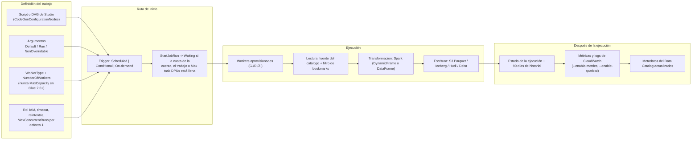
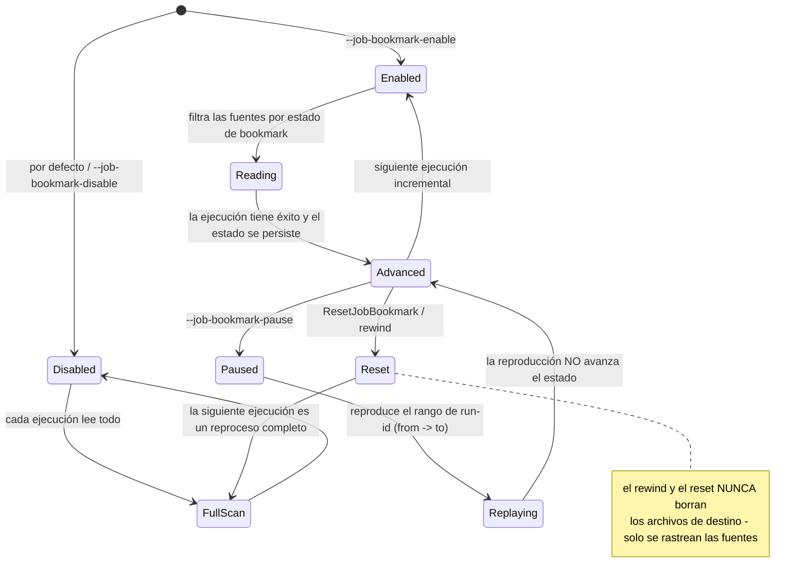
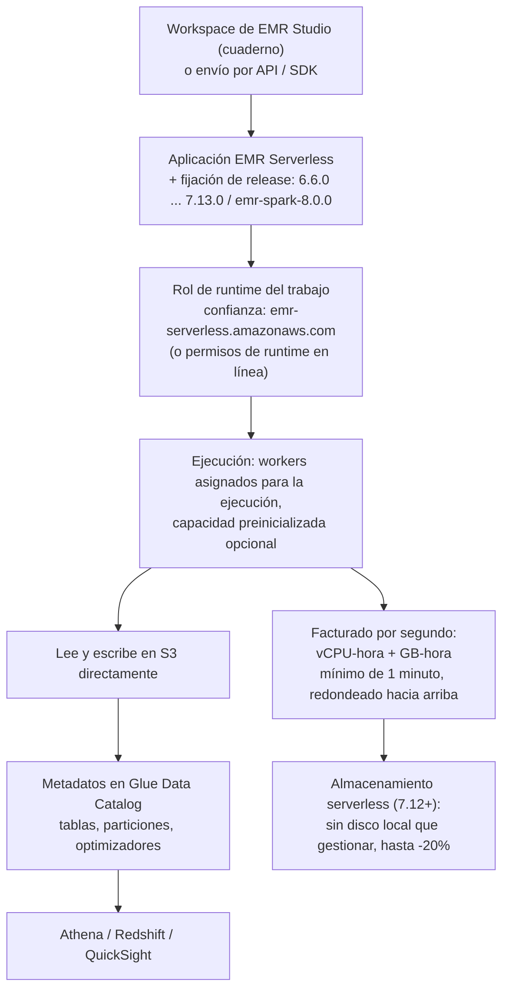
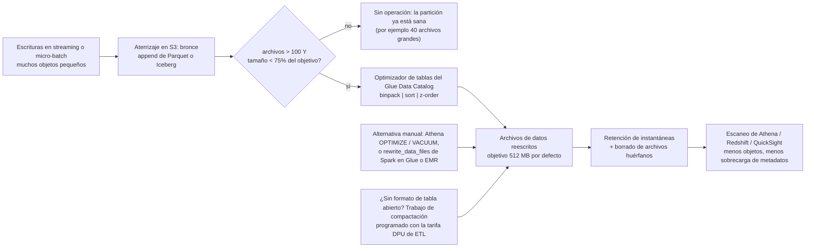
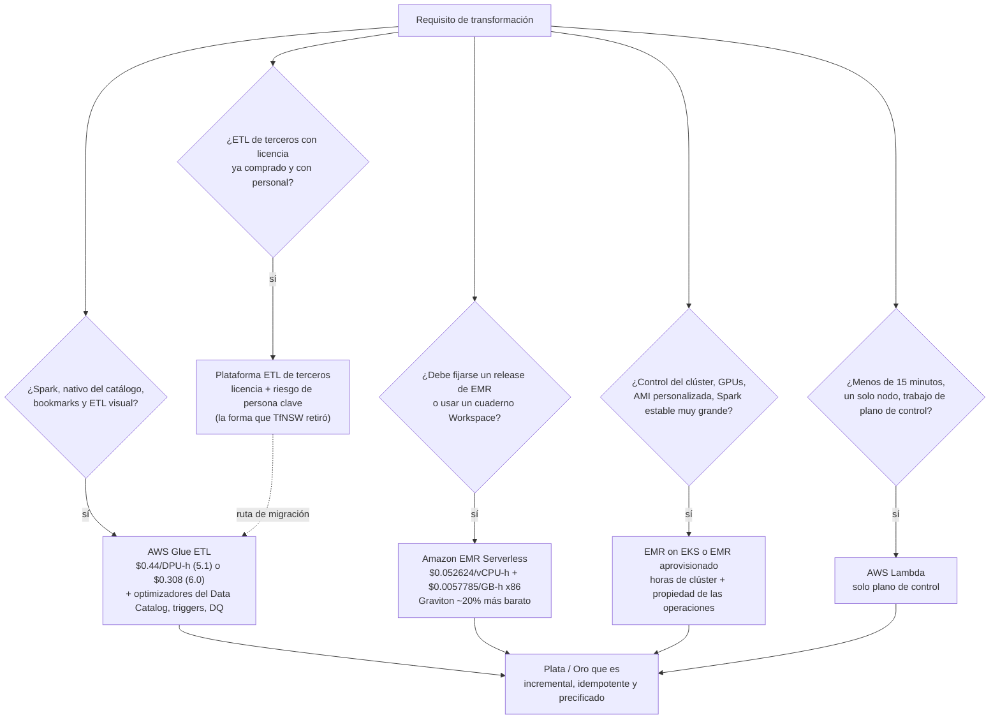

# Transformación a escala: AWS Glue, EMR Serverless y Lambda

Las lecciones 01 a 07 te dieron un lago: diseño de S3, formatos de archivo, formatos de tabla abiertos, ingesta por lotes y en streaming, y un catálogo. Nada de eso está todavía *curado*. Esta lección trata sobre la capa que hace la curación — **los motores que leen bruto y bronce, lo limpian, lo desduplican y escriben plata y oro** — y sobre las tres cosas que deciden si esa capa es barata, correcta o ambas: **qué motor ejecutas, cuánta capacidad mantienes mientras corre, y si la segunda ejecución produce duplicados.**

```text
====================================================================
 SUPERFICIE DE DECISIÓN DE TRANSFORMACIÓN — AWS LAKEHOUSE (en oct 2026)
====================================================================
 Glue ETL (Spark) ...... Spark serverless; Data Catalog conectado;
                         DynamicFrame o DataFrame; job bookmarks;
                         workers G./R./Z.; facturado en DPU-horas
 Glue for Ray .......... pandas / Ray Datasets sobre Graviton Z.2X
                         (M-DPU); cerrado a nuevos clientes 30 abr 2026
 Python shell .......... un proceso EC2, sin Spark, 0.0625 o 1 DPU
 Glue Studio ........... lienzo ETL visual + notebooks + editor de
                         scripts sobre los mismos motores (un DAG)
 EMR Serverless ........ toda la línea de releases de EMR (6.6.0 a
                         7.13.0 y emr-spark-8.0.0); vCPU + GB por
                         segundo; Workspaces; capacidad preinicializada
 EMR on EKS ............ contenedores EMR en tus clústeres EKS,
                         facturado con un recargo por vCPU/GB
 EMR aprovisionado ..... control del clúster completo, ops del
                         clúster completo
 Lambda ................ bisturí del plano de control de 15 min /
                         10 GB — no es un motor ETL
-----------------------------------------------------------------------------
 Unidad de cuenta ...... Glue: 1 DPU = 4 vCPU + 16 GB
                         M-DPU (workers R y Ray) = 4 vCPU + 32 GB
                         EMR Serverless: vCPU-segundos + GB-segundos
 Libro mayor de idempotencia ... bookmarks (lado de la fuente) |
                         sobrescritura dinámica de particiones |
                         MERGE + instantáneas de Iceberg |
                         prefijo de staging + promoción atómica |
                         watermarks
====================================================================
```

En esta lección:

- modelarás el **trabajo de Glue ETL** — anatomía, precedencia de argumentos, el techo de 260 KB, triggers, cuotas de concurrencia y el comportamiento de encolamiento de trabajos de 2024;
- separarás **DynamicFrame de DataFrame** y dirigirás `resolveChoice` con la acción correcta antes de cualquier escritura;
- operarás los **job bookmarks** — Enable / Disable / Pause, sobre qué clavean realmente las fuentes S3 y JDBC, por qué el rewind nunca borra tus salidas, y en qué se diferencia eso de `MERGE` de Iceberg;
- dimensionarás **workers**: G.1X hasta G.16X, workers optimizados para memoria R, el Z.2X de Ray, G.025X en streaming, techos de `--executor-cores` y auto scaling;
- escribirás con **Glue Studio** ETL visual, notebooks y el editor de scripts, y leerás la **matriz de versiones de Glue en octubre de 2026** — qué cuesta cada fila y qué rompe;
- ejecutarás **EMR Serverless** — aplicaciones, Workspaces, fijación de releases, medición — y sabrás exactamente cuándo le gana a Glue, más **Lambda** para el plano de control y nunca para el plano de datos;
- aplicarás **patrones de lakehouse con Spark**: sobrescritura dinámica de particiones, AQE, skew, shuffle partitions y compactación de archivos pequeños;
- escribirás un **trabajo PySpark de Glue resuelto** desde la lectura del catálogo hasta una tabla Iceberg de plata, y precificarás cada ejercicio con la tarifa de octubre de 2026;
- estudiarás **dos casos de clientes de AWS** (Transport for NSW, Vanguard) más un **cuadro de actualizaciones de 2026 con fuentes**;
- practicarás con **11 preguntas de estilo examen** y cinco comprobaciones interactivas.

---
## 1. La escalera de motores: cinco caminos de bruto a plata

AWS posiciona un número reducido de rutas de transformación para el trabajo por lotes del lakehouse, y no son intercambiables. La escalera va de *lo más integrado, lo menos flexible* a *lo más flexible, lo más operativo*:

| Motor | Qué es | Medidor | Punto dulce |
| --- | --- | --- | --- |
| **Glue ETL (`glueetl`)** | Spark serverless con Data Catalog, DynamicFrame e integración de job bookmarks | DPU-hora | Lotes por defecto del lakehouse: lecturas de catálogo, escrituras particionadas, ejecuciones incrementales |
| **Glue streaming (`gluestreaming`)** | El mismo motor, sinks de Structured Streaming | DPU-hora | Aterrizajes de micro-batch en bronce y plata |
| **Python shell (`pythonshell`)** | Python nativo en una sola instancia EC2, sin Spark | 0.0625 o 1 DPU | Movimientos de archivos, extracciones de API, trabajos diminutos que caben en un nodo |
| **Glue for Ray (`glueray`)** | pandas / Ray Datasets sobre Graviton Z.2X | M-DPU-hora | Lógica con forma de pandas a escala; cerrado a nuevos clientes desde el 30 de abril de 2026 |
| **Glue Studio** | Plano de escritura y operación (visual, notebook, script) sobre los motores de arriba | igual que el motor | Equipos que quieren un DAG, vistas previas, horarios y control de versiones sin poseer Spark |
| **Amazon EMR Serverless** | Toda la línea de releases de EMR, sin clústeres; Workspaces para notebooks | vCPU-hora + GB-hora | Cuando necesitas una versión de runtime de EMR, o cargas con forma de EMR sin operar clústeres |
| **Amazon EMR (EKS / aprovisionado)** | Contenedores EMR en tu clúster EKS, o clústeres completos | Horas de EC2 / EKS (+ recargo en EKS) | Clústeres pegajosos, AMIs personalizadas, Spark estable muy grande |
| **AWS Lambda** | Funciones dirigidas por eventos | GB-segundo + peticiones | Orquestación, validación de archivos, registro de particiones — **no** reescrituras de tablas |

Dos propiedades de esta escalera importan más que cualquier lista de funciones. Primero, **solo Glue ETL tiene job bookmarks conectados al modelo de trabajo** — el procesamiento incremental es un argumento de primera clase, no código que tú escribes. Segundo, **Glue y EMR Serverless miden de forma distinta**: DPU-horas frente a vCPU-horas más GB-horas, así que una cifra titular «por DPU» y otra «por vCPU» nunca pueden compararse sin normalizar la memoria (la sección 13 hace la aritmética).

> [!NOTE]
> Todo en esta lección está fechado **en octubre de 2026**. Glue 1.0, 2.0 y 0.9 alcanzaron su **fin de vida el 1 de abril de 2026** — cualquier tutorial que los fije ahora falla al iniciar el trabajo, y la política de soporte de versiones de Glue es explícita: *«AWS Glue detendrá las ejecuciones de trabajos y las sesiones interactivas existentes en versiones EOL.»*

---
## 2. El modelo de trabajo de Glue ETL: anatomía, argumentos, triggers, encolamiento

### 2.1 Qué es un trabajo en la práctica

Un trabajo de Glue es una definición más ejecuciones. La definición es: script (o DAG visual), tipo y número de workers, rol IAM, conexiones y ajustes de seguridad opcionales, argumentos por defecto, timeout, reintentos, `MaxConcurrentRuns`, y los triggers que lo inician. Una ejecución es una ejecución acotada con un estado y un historial retenido.



`MaxConcurrentRuns` por defecto es **1**, y el historial de ejecuciones de trabajos se retiene **90 días** — dos cifras que vale la pena memorizar, porque una ejecución que se queda en `WAITING` te está hablando de cuota o de posición del trigger, no de tu código.

### 2.2 Argumentos: tres capas, un techo duro

Los argumentos son lo que convierte un script genérico en un pipeline concreto. Se aplican tres capas, en esta precedencia:

1. **`NonOverridableArguments`** (la más alta — no puedes ganarles en tiempo de ejecución)
2. **`Arguments`** de la ejecución, provistos en `StartJobRun`
3. **`DefaultArguments`** del trabajo

y toda la carga de argumentos tiene un **tamaño máximo de 260 KB**. Ese techo es la razón por la que nunca incrustas un megabyte de SQL o un blob base64 en los argumentos — pon el SQL en un objeto de S3 y refiérelo con `--extra-py-files`, `--extra-jars` o `--additional-python-modules`.

Los argumentos que aparecen en casi cualquier trabajo de lakehouse:

| Argumento | Efecto |
| --- | --- |
| `--job-bookmark-option` | `job-bookmark-enable` / `--job-bookmark-disable` / `job-bookmark-pause` (más `--job-bookmark-from` / `--job-bookmark-to`) |
| `--datalake-formats` | `hudi,delta,iceberg` (Glue 3.0+) — los formatos de tabla en juego |
| `--enable-auto-scaling` | `true` activa el auto scaling **y la facturación por worker** entre el mínimo y el máximo de workers |
| `--executor-cores` | Tareas de Spark que pueden correr en paralelo; **no debería exceder 2× el número de vCPUs del tipo de worker** |
| `--enable-metrics`, `--enable-spark-ui`, `--enable-continuous-cloudwatch-log` | Observabilidad |
| `--extra-py-files`, `--extra-jars`, `--additional-python-modules` | Dependencias |
| `--python-virtual-env` | Entorno virtual de Python gestionado por el cliente (Glue 5.0+, argumento de prefijo de almacenamiento en 6.0+) |
| `--TempDir`, `--conf` | Espacio temporal y configuración cruda de Spark (la sección 10 vive aquí) |

- **📚 ¿Sabías que…?** `--executor-cores` tiene un techo documentado: *«no debería exceder 2× el número de vCPUs del tipo de worker.»* En un G.1X (4 vCPUs) eso significa 8 como máximo; en un G.2X, 16. Sobrescribir por encima de eso no añade paralelismo — agota la memoria y el disco, lo que entonces *parece* un problema de skew pero no lo es (referencia de argumentos de trabajos de AWS Glue, consultada en oct 2026).

### 2.3 Triggers: programados, condicionales, bajo demanda

Los triggers de Glue vienen en tres sabores — **Scheduled** (un horario), **Conditional** (según *el estado de un trabajo o crawler anterior*) y **On-demand** — con estados de ciclo de vida `CREATED`, `ACTIVATED`, `DEACTIVATED`. Dos reglas duras muerden en la práctica:

- puedes adjuntar un **máximo de 2 crawlers a un solo trigger**;
- una cadena condicional solo funciona si la cadena misma está **iniciada por un trigger** desde una raíz programada o bajo demanda; un trabajo lanzado manualmente no disparará los triggers condicionales aguas abajo.

### 2.4 Encolamiento en lugar de fallo en el techo de concurrencia

Antes de septiembre de 2024, alcanzar *Max concurrent job runs per account*, *per-job concurrency* o *Max task DPUs per account* hacía fallar la llamada `StartJobRun` por completo, y los equipos construían bucles de reintento de Step Functions para absorberlo. AWS Glue job queuing (disponibilidad general, AWS Big Data Blog, 3 sep 2024) cambió la forma: *«cuando las ejecuciones del trabajo están en estado Waiting, la función de encolamiento de trabajos de AWS Glue espontanea los trabajos automáticamente siempre que sea posible.»* El modo de fallo se convierte en una posición en la cola, y la capacidad se libera a medida que otras ejecuciones terminan.

```dragdrop
{
  "question": "Ordena el ciclo de vida de una ejecución de Glue ETL, desde la escritura hasta la salida observable (tal como se diseña en esta lección):",
  "items": [
    "Escribir: define el trabajo - script o DAG de Studio, WorkerType + NumberOfWorkers, rol IAM, argumentos por defecto (bookmark option, datalake formats)",
    "Iniciar: se dispara un trigger Scheduled, Conditional o On-demand, o se llama a StartJobRun; si una cuota de cuenta, de trabajo o de Max task DPUs por cuenta está llena, la ejecución entra en Waiting y se espontanea",
    "Aprovisionar: se asignan workers para la ejecución (tipo G., R. o Z.), con auto scaling entre el mínimo y el máximo cuando --enable-auto-scaling=true",
    "Leer: las fuentes se resuelven desde el Data Catalog; los bookmarks filtran objetos S3 por hora de última modificación, o filas JDBC por clave secuencial, usando transformation_ctx",
    "Transformar: Spark ejecuta la lógica - resuelve primero los tipos de choice con resolveChoice cuando la fuente los trae, luego map, luego convert",
    "Escribir: el sink aterriza Parquet, Iceberg, Hudi o Delta en S3 con un particionado elegido para evitar el problema de archivos pequeños",
    "Confirmar y observar: el estado de la ejecución se persiste, el historial se conserva 90 días, las métricas y los logs van a CloudWatch, los metadatos del Data Catalog se actualizan"
  ],
  "correctOrder": [
    "Escribir: define el trabajo - script o DAG de Studio, WorkerType + NumberOfWorkers, rol IAM, argumentos por defecto (bookmark option, datalake formats)",
    "Iniciar: se dispara un trigger Scheduled, Conditional o On-demand, o se llama a StartJobRun; si una cuota de cuenta, de trabajo o de Max task DPUs por cuenta está llena, la ejecución entra en Waiting y se espontanea",
    "Aprovisionar: se asignan workers para la ejecución (tipo G., R. o Z.), con auto scaling entre el mínimo y el máximo cuando --enable-auto-scaling=true",
    "Leer: las fuentes se resuelven desde el Data Catalog; los bookmarks filtran objetos S3 por hora de última modificación, o filas JDBC por clave secuencial, usando transformation_ctx",
    "Transformar: Spark ejecuta la lógica - resuelve primero los tipos de choice con resolveChoice cuando la fuente los trae, luego map, luego convert",
    "Escribir: el sink aterriza Parquet, Iceberg, Hudi o Delta en S3 con un particionado elegido para evitar el problema de archivos pequeños",
    "Confirmar y observar: el estado de la ejecución se persiste, el historial se conserva 90 días, las métricas y los logs van a CloudWatch, los metadatos del Data Catalog se actualizan"
  ],
  "explanation": "El orden es escribir, iniciar, aprovisionar, leer, transformar, escribir, confirmar. Dos posiciones desconciertan a la gente: el encolamiento ocurre en INICIAR, no después del aprovisionamiento - las ejecuciones en Waiting se espontanean antes de que existan los workers; y el filtro de bookmarks ocurre en LEER, que es la razón por la que cambiar una fuente sin cambiar su transformation_ctx omite archivos en silencio. Confirmar va al final, que es la razón por la que una ejecución fallida deja el estado de bookmark intacto mientras sus archivos de destino ya escritos permanecen - la razón por la que la sección 11 combina los bookmarks con una estrategia idempotente del lado de la escritura."
}
```

---
## 3. DynamicFrame frente a DataFrame, y `resolveChoice`

### 3.1 Las dos representaciones

Un **DataFrame** de Spark necesita un esquema antes de que puedan cargarse los datos — ese es su contrato. Un **DynamicFrame** de Glue rompe deliberadamente ese contrato, porque la ingesta real aterriza datos inconsistentes:

> *«cada registro se auto-describe, así que no se requiere ningún esquema inicialmente. En su lugar, AWS Glue calcula un esquema sobre la marcha cuando es necesario, y codifica explícitamente las inconsistencias de esquema usando un tipo choice (o union).»*

Ese tipo choice es poderoso y peligroso. Es poderoso porque un JSON muestreado por un crawler donde `price` es un número en unas filas y una cadena en otras carga sin fallar. Es peligroso porque el choice sobrevive hasta tu ruta de escritura y degrada en silencio las columnas a un tipo general.

DynamicFrame te da una caja de herramientas de transforms — `apply_mapping`, `drop_fields`, `filter`, `join`, `map`, `mergeDynamicFrame`, `relationalize`, `rename_field`, `resolveChoice`, `select_fields`, `spigot`, `split_fields`, `split_rows`, `unbox`, `union`, `unnest`, `unnest_ddb_json`, `write` — de las cuales `relationalize` es la que la gente olvida: *«Convierte un DynamicFrame en una forma que cabe en una base de datos relacional»* al desanidar columnas anidadas y pivotar columnas array en una lista de frames.

### 3.2 `resolveChoice`: resuelve el esquema antes de hacer map

`resolveChoice` toma especificaciones de `(field_path, action)`. Las acciones son:

| Acción | Signado | Úsalo cuando |
| --- | --- | --- |
| `cast:{{type}}` | Conversión; los valores no convertibles se vuelven `null` | Un tipo domina y puedes aceptar nulos para el resto |
| `project:{{type}}` | Proyecta a un tipo; **los valores del otro tipo se descartan** | Quieres solo el subconjunto bien formado |
| `make_cols` | Promueve un choice a columnas hermanas | Diseños de columna por variante |
| `make_struct` | Envuelve el choice en un struct | Se prefiere una representación anidada |
| `match_catalog` (modo choice) | Se resuelve contra el esquema de una tabla del Data Catalog | El catálogo es la fuente de verdad — el por defecto del lakehouse |

También puedes convertir con `toDF(options)`, donde `options` es una lista de objetos `ResolveOption` — misma idea, atado al DataFrame.

### 3.3 Ejemplo resuelto E1 — una columna `price` de tipos mixtos

```text
Input (DynamicFrame from_catalog, 4,000,000 rows, Glue 5.1)
  price: choice<int, string>     97.3% int, 2.7% string ("1,249.50", "N/A")
  currency: string               100% string, 3 values
  event_id: string               no ambiguity
Path A - DynamicFrame (legacy, Glue 4.0-shaped code)
  resolveChoice(specs=[("price", "cast:double")])
  apply_mapping(...)                      # rename / cast / nest / drop
  toDF() -> write
  Result: 97.3% populated, 2.7% null; the cast never throws.
Path B - Spark DataFrame (Glue 5.1 / 6.0 default direction)
  F.col("price").cast("double")           # try_cast where available
  .dropna / .filter / quarantine nulls to an error table
  Result: same rows, but you own the null policy explicitly.
Path C - project instead of cast
  resolveChoice(specs=[("price", "project:double")])
  Result: the 2.7% string rows are DROPPED, not nulled.
          Only choose this when the string rows are known-bad.
Decision rule: cast when missing is acceptable, project when the other
type is garbage, match_catalog when the catalog defines the truth.
```

> [!IMPORTANT]
> ⚠️ **El orden no es negociable: `resolveChoice` → `apply_mapping` → `toDF()` → escritura.** Convertir a un DataFrame mientras un tipo choice genuino sigue abierto fuerza a la columna a un tipo general (normalmente `string`) y derrota en silencio la conversión que estabas a punto de realizar. La diferencia es un `double` limpio y una tabla de cadenas rellenadas — y la segunda falla en la aritmética aguas abajo, no en tu trabajo.

### 3.4 La particularidad de Glue 5.0+ para la que debes planificar

Las notas de la release lo dicen claramente: *«El control de acceso a nivel de tabla basado en Glue Dynamic Frame / GlueContext con permisos de AWS Lake Formation soportado en Glue 4.0 o anterior no está soportado en Glue 5.0.»* Un script que se apoya en DynamicFrame **y** en la aplicación a nivel de tabla de Lake Formation con GlueContext es por tanto un artefacto de Glue ≤4.0. En 5.1 y 6.0 la dirección es el control de acceso fino nativo de Spark (FGAC): DataFrames planos más filtros de fila y máscaras de columna de Lake Formation. Migrar un script de la era 3.0 con `resolveChoice` + `apply_mapping` sin adoptar FGAC significa que conservas el código y pierdes la aplicación.

---
## 4. Job bookmarks: ejecuciones incrementales sin releer todo

### 4.1 Qué es un bookmark

> *«AWS Glue rastrea los datos que ya fueron procesados durante una ejecución anterior de un trabajo ETL persistiendo información de estado de la ejecución del trabajo.»*

El estado se persiste por trabajo y se indexa con `transformation_ctx` — la etiqueta que adjuntas a cada fuente y a cada sink en el script. Mantén estable la fuente y su `transformation_ctx`; cambia una ruta sin cambiar la clave y el estado ya no coincide con lo que crees que coincide.

Los tres modos que fijas con `--job-bookmark-option`:

| Modo | Comportamiento | Úsalo para |
| --- | --- | --- |
| `job-bookmark-enable` | Rastrea **y avanza** el estado en cada ejecución exitosa | Lotes incrementales en régimen |
| `job-bookmark-disable` | **El por defecto.** Sin estado: cada ejecución es un escaneo completo | Tablas pequeñas, recómputo completo, primera ejecución de depuración |
| `job-bookmark-pause` | Procesa un rango de ejecuciones `--job-bookmark-from` / `--job-bookmark-to`, pero **el estado no se actualiza** | Rellenar una ventana sin romper el avance hacia delante |



### 4.2 Con qué clavea cada tipo de fuente

- **Amazon S3:** *«los job bookmarks de AWS Glue comprueban la hora de última modificación de los objetos para verificar qué objetos necesitan reprocesarse.»* Los formatos soportados dependen de la versión: la v0.9 admite JSON, CSV, Avro y XML; **la v1.0 y posteriores añaden Parquet y ORC**.
- **JDBC:** *«AWS Glue usa por defecto la clave primaria como clave del bookmark, siempre que esté creciendo o decreciendo secuencialmente (sin huecos).»* Las claves sustitutivas no secuenciales necesitan una clave de bookmark explícita.

### 4.3 La lista de fallos — léela antes de poner en producción

- **Disable es el por defecto.** Olvidar `--job-bookmark-option=job-bookmark-enable` reprocesa todo en cada ejecución de forma silenciosa, y tu factura no dice nada al respecto.
- **No cambies la propiedad de la fuente de datos con el bookmark activado.** AWS lo lista como mejor práctica exactamente por la razón anterior: estado obsoleto más una ruta nueva salta o lee dos veces los archivos.
- **Rewind y reset no limpian los destinos.** *«Cuando haces rewind o reset de un bookmark, AWS Glue no limpia los archivos de destino… Solo los archivos de origen se rastrean con los job bookmarks.»* La idempotencia del lado de la escritura es **tu** trabajo (sección 11).
- **Pause es para rellenar, no para régimen.** Reproduce una ventana de run-ID y no avanza — perfecto para reejecutar la 102 y la 103, erróneo como modo diario.
- **Los listados grandes pueden agotar al driver.** Usa el **lista-archivos de Amazon S3 de AWS Glue** para conjuntos de datos grandes en vez de dejar que el driver enumere millones de claves.

### 4.4 Ejemplo resuelto E2 — el simulacro de backfill

```text
Trabajo nocturno incremental, bookmarks ACTIVADOS, transformation_ctx = "datasource_events"
  run 100 ....... éxito  (el estado avanza hasta el final de la run 100)
  run 101 ....... éxito
  run 102 ....... ÉXITO pero escribió una partición envenenada
  run 103 ....... éxito
  run 104 ....... éxito
  run 105 ....... éxito  (el estado actual apunta más allá de 105)
Objetivo: reconstruir solo las runs 102-103, sin corromper el estado hacia delante.
Paso 1  --job-bookmark-option=job-bookmark-pause
        --job-bookmark-from=101  --job-bookmark-to=103
        -> la ejecución reproduce la ventana 102-103; el estado del bookmark NO avanza.
Paso 2  La reproducción escribe en un prefijo de salida SEPARADO (s3://.../silver_replay/)
        Por qué: los bookmarks nunca borran los archivos de destino, así que escribir
        encima del prefijo original in situ dejaría una mezcla de objetos viejos y nuevos.
Paso 3  Valida las particiones reproducidas y luego promuévelas (copia + rename atómico,
        o MERGE de Iceberg en la tabla de plata indexado por event_id).
Paso 4  Retoma la operación normal con
        --job-bookmark-option=job-bookmark-enable: la siguiente ejecución programada
        continúa desde el estado hacia delante no corrompido.
Coste del simulacro (4 x workers G.1X x 30 min, Glue 5.1 @ $0.44/DPU-h):
        4 x 0.5 h = 2 DPU-h x $0.44 = $0.88   ($0.616 en Glue 6.0 @ $0.308)
```

- **📚 ¿Sabías que…?** El estado del bookmark no se limita a JSON y CSV: a partir de Glue 1.0, los bookmarks de S3 también persisten estado para entradas **Parquet y ORC**, así que el bronce parquetizado que construiste en la Lección 05 es amigable con los bookmarks — el folclore de «solo JSON/CSV» de la era 0.9 está obsoleto (guía de desarrollador de AWS Glue, monitor continuations, consultada en oct 2026).

```fillblank
{
  "question": "Completa la semántica del job-bookmark con el propio vocabulario de la guía de desarrolladores de AWS (en oct 2026):",
  "template": "Para las fuentes de entrada de Amazon S3, los job bookmarks de AWS Glue comprueban la {{1}} de los objetos para decidir qué necesita reprocesarse. Con --job-bookmark-option={{2}}, el estado se rastrea y avanza tras cada ejecución exitosa. Con {{3}}, se reproduce un rango de run-id fijado por --job-bookmark-from y --job-bookmark-to mientras el estado NO se actualiza. Restablecer o rebobinar un bookmark {{4}} los archivos ya escritos en el destino.",
  "answers": {
    "1": "hora de última modificación",
    "2": "job-bookmark-enable",
    "3": "job-bookmark-pause",
    "4": "no borra"
  },
  "distractors": ["recuento de filas", "valores de partición", "checksum del objeto", "job-bookmark-disable", "reescribe", "job-bookmark-from", "tamaño del archivo", "limpia"],
  "explanation": "La comprobación del bookmark de S3 es explícitamente la hora de última modificación de los objetos. job-bookmark-enable es el modo de rastreo y avance; job-bookmark-pause es el modo de relleno, que reproduce la ventana from/to sin avanzar el estado; y el rewind o el reset nunca limpian el destino - AWS afirma que solo los archivos de origen se rastrean con los job bookmarks, así que la idempotencia del lado de la escritura (sobrescritura de particiones, MERGE de Iceberg o un prefijo de staging) debe manejarla el propio trabajo."
}
```

---
## 5. Workers, DPUs y M-DPUs: de dónde salen la factura y el OOM

### 5.1 La unidad

> *«Una DPU es una medida relativa de potencia de cómputo que consta de 4 vCPU de capacidad de cómputo y 16 GB de memoria.»*

Y la variante optimizada para memoria: *«M-DPU (DPU optimizadas para memoria): los workers de tipo R usan M-DPU, que proporcionan el doble de asignación de memoria para un tamaño determinado en comparación con las DPU estándar»* — **32 GB por cada 4 vCPU**. Todo lo que viene después (precio, triaje de OOM, la comparación Glue frente a EMR) fluye de esas dos frases.

### 5.2 Catálogo de workers (en oct 2026)

| Worker | DPU | vCPU / memoria | Disco (libre) | Notas |
| --- | --- | --- | --- | --- |
| **G.1X** | 1 | 4 vCPU / 16 GB | 94 GB (~44 GB libres) | Trabajador general de forma estándar |
| **G.2X** | 2 | 8 vCPU / 32 GB | 138 GB (~78 GB libres) | Holgura equivalente a dos executors |
| **G.4X** | 4 | 16 vCPU / 64 GB | 256 GB (~230 GB libres) | Drivers grandes y planes anchos |
| **G.8X** | 8 | 32 vCPU / 128 GB | 512 GB (~485 GB libres) | Mismo motivo, por duplicado |
| **G.12X** | 12 | 48 vCPU / 192 GB | 768 GB (~741 GB libres) | **Solo ETL con Spark de Glue 4.0+** |
| **G.16X** | 16 | 64 vCPU / 256 GB | 1024 GB (~996 GB libres) | **Solo ETL con Spark de Glue 4.0+** |
| **R.1X – R.8X** | 1–8 M-DPU | 4 vCPU / **32 GB** por M-DPU | — | Optimizado para memoria: mismo CPU, doble RAM |
| **G.025X** | 0.25 | 2 vCPU / 4 GB | 84 GB | **Streaming** (Glue 3.0+), 0.25 DPU |
| **Z.2X** | 2 M-DPU | 8 vCPU / 64 GB | 128 GB | **Solo Ray**; hasta 8 workers Ray desde el autoscaler |

> [!WARNING]
> ⚠️ **No existe un tipo de worker Snowball en el enum actual.** La página de tipos de worker y la API de Jobs listan **Standard, G.1X…G.16X, R.1X…R.8X, G.025X y Z.2X** y nada más — valida cualquier tipo de worker contra ese enum antes de diseñar capacidad sobre él, porque el material más antiguo sobre formas exóticas o Edge/Snowball no coincide con la API en oct 2026. Los workers más grandes también tienen compuertas: **G.12X y G.16X solo están disponibles para trabajos ETL con Spark de AWS Glue versión 4.0 o superior**, y no están presentes en todas las Regiones.

> [!IMPORTANT]
> ⚠️ **Los workers G no compran memoria por CPU.** Cada worker G mantiene la proporción **4 vCPU : 16 GB**; solo R (y el worker Z de Ray) la duplican. Pasar de G.1X a G.4X **no** arregla un broadcast join sin memoria — te da la misma proporción cuatro veces más rápido y cuatro veces más ancho. OOM → **R.**; volumen de shuffle o skew → **más workers**; una etapa genuinamente lenta e hilada → un **worker más grande**; un plan de consultas enorme → **G.4X o G.8X**, porque *«los tipos de worker más grandes no solo benefician a los executors de Spark, sino también en los casos en que el driver de Spark necesita mayor capacidad —por ejemplo, porque el plan de consulta del trabajo es bastante grande.»*

### 5.3 Capacidad: `MaxCapacity` es heredado, los workers son el presente

- `AllocatedCapacity` está **obsoleto** — *«Usa MaxCapacity en su lugar.»*
- Para trabajos de Glue 2.0+: *«no puedes especificar una capacidad máxima. En su lugar, debes especificar un tipo de worker y el número de workers. No establezcas MaxCapacity si usas WorkerType y NumberOfWorkers.»*
- Donde `MaxCapacity` sigue aplicando: **pythonshell** 0.0625 o 1 DPU; rango heredado **glueetl/gluestreaming** de 2–100 DPU, por defecto **10**, sin asignación de DPU fraccionada.
- **Auto scaling**: `--enable-auto-scaling=true` activa el auto scaling *y la facturación por worker*, con `NumberOfWorkers` actuando como máximo.

```matching
{
  "question": "Relaciona cada forma de worker de Glue con la carga de trabajo para la que es realmente (en oct 2026):",
  "pairs": [
    {"left": "G.1X (1 DPU, 4 vCPU, 16 GB, 94 GB de disco)", "right": "Fan-out paralelo económico: muchas particiones pequeñas donde la proporción 4 vCPU : 16 GB no es la restricción"},
    {"left": "G.4X y G.8X (4 y 8 DPU)", "right": "Trabajos con planes pesados - multi-join anchos y planes lógicos muy particionados donde el DRIVER de Spark necesita capacidad, no solo los executors"},
    {"left": "R.1X a R.8X (M-DPU, 4 vCPU : 32 GB)", "right": "Etapas limitadas por memoria: broadcast joins y cachés grandes que hacen OOM con la proporción G de 16 GB por DPU"},
    {"left": "Z.2X (2 M-DPU, 8 vCPU, 64 GB, 128 GB de disco)", "right": "Solo Glue for Ray - lógica de pandas y Ray Datasets, hasta 8 workers Ray desde el autoscaler, solo clientes existentes"},
    {"left": "G.025X (0.25 DPU, 2 vCPU, 4 GB, 84 GB de disco)", "right": "Trabajos de streaming en Glue 3.0+ que necesitan una huella diminuta por worker en vez de una DPU completa"},
    {"left": "pythonshell con 0.0625 DPU", "right": "Python en una sola instancia sin Spark alguno: mover archivos, llamadas a APIs, código de pegamento del plano de control"}
  ],
  "explanation": "Cada fila evita un modo de fallo concreto: G.1X es el por defecto económico; G.4X y G.8X existen por el tamaño del plan del lado del driver y no por la RAM de los executors; los workers R son la respuesta al OOM porque duplican la memoria por vCPU; Z.2X es el único worker de Ray; G.025X es solo para streaming; pythonshell es el carril sin Spark. El error clásico es comprar un G.4X para arreglar un OOM - la proporción G nunca cambia, así que la solución estructural a la presión de memoria es un worker R o menos columnas en el shuffle."
}
```

### 5.4 Ejemplo resuelto E3 — dimensionar y precificar un lote de 400 GB

```text
Entrada: 400 GB de Parquet, paralelismo de tareas objetivo ~8x -> 10 x G.1X = 10 DPU
Tiempo de ejecución: 1 hora (auto scaling apagado para el ejercicio)
  Glue 5.1 / 4.0 / 3.0   10 DPU-h x $0.44  = $4.40 por ejecución
  Glue 6.0               10 DPU-h x $0.308 = $3.08 por ejecución   (-30%)
  Glue 5.1 + Flex        10 DPU-h x $0.29  = $2.90 por ejecución
  Glue 6.0 + Flex        10 DPU-h x $0.203 = $2.03 por ejecución
Nocturno durante un mes de 30 días:
  5.1 estándar   $4.40 x 30 = $132.00
  6.0 estándar   $3.08 x 30 =  $92.40
  5.1 Flex       $2.90 x 30 =  $87.00
  6.0 Flex       $2.03 x 30 =  $60.90
Flex tiene descuento porque la ejecución es INTERRUMPIBLE - aceptable
para backfills y recómputos sin SLA, nunca para una sesión interactiva
ni para un pipeline con latencia acotada.
```

### 5.5 Ejemplo resuelto E4 — el mismo trabajo cuando la restricción es la memoria, no la velocidad

```text
Síntoma: un broadcast join hace OOM con 10 x G.1X (10 DPU, 160 GB en total, 16 GB/worker)
Solución equivocada: 10 x G.4X -> 40 DPU, sigue habiendo 16 GB por cada 4 vCPU: misma proporción, más dinero.
Solución correcta: workers optimizados para memoria en una clase de CPU comparable.
  4 x R.4X = 16 M-DPU  ->  16 M-DPU-h x $0.52  = $8.32 / h  (Glue 5.1)
                           16 M-DPU-h x $0.364 = $5.82 / h  (Glue 6.0)
Alternativa: reescribir la etapa como pandas en Glue for Ray (clientes existentes)
  Z.2X = 2 M-DPU por worker-hora x $0.44 = $0.88 / h, 64 GB por worker,
  autoescalado hasta 8 workers Ray.
Lee los tres números en conjunto: $8.32 compran 16 M-DPU de Spark; $0.88 compran
2 M-DPU de Ray. Los mismos dólares compran 18x más capacidad nominal en Ray -
que es exactamente por qué la respuesta depende de si la lógica tiene forma de
Spark o forma de pandas, y no de qué precio de titular parece más pequeño.
```

```plot
{
  "type": "bar",
  "title": "Tarifas de workers de Glue en octubre de 2026: una hora a asignación completa (us-east-1)",
  "xLabel": "Combinación de worker y versión",
  "yLabel": "USD por hora",
  "xKey": "combo",
  "data": [
    {"combo": "10 x G.1X on Glue 5.1 (10 DPU)", "usd_per_hour": 4.40},
    {"combo": "10 x G.1X on Glue 6.0 (10 DPU)", "usd_per_hour": 3.08},
    {"combo": "10 x G.1X Flex on Glue 5.1", "usd_per_hour": 2.90},
    {"combo": "4 x R.4X on Glue 5.1 (16 M-DPU)", "usd_per_hour": 8.32},
    {"combo": "4 x R.4X on Glue 6.0 (16 M-DPU)", "usd_per_hour": 5.82},
    {"combo": "Ray Z.2X on Glue for Ray (2 M-DPU)", "usd_per_hour": 0.88}
  ]
}
```

- **📚 ¿Sabías que…?** El disco es la restricción silenciosa: **G.1X expone 94 GB de disco pero solo unos 44 GB están libres** — los volcados de shuffle y los datos intermedios locales grandes aterrizan ahí. Si la UI de Spark muestra un volcado intenso en un G.1X, estás limitado por disco y no por CPU, y la solución es un G.4X (256 GB, unos 230 GB libres) o almacenamiento de shuffle en la nube (tipos de worker de AWS Glue, consultados en oct 2026).

---
## 6. Glue Studio: ETL visual, notebooks y el editor de scripts sobre el mismo motor

Glue Studio no es un servicio distinto — es el plano de autoría y operaciones. AWS ofrece tres puertas de entrada: **ETL visual** (una interfaz visual centrada en el flujo de datos), **un cuaderno de código interactivo** (basado en Jupyter) y **un editor de scripts** donde eliges el motor — Python shell, Ray, Spark (Python) o Spark (Scala). El argumento visual es exacto: *«puedes componer visualmente flujos de trabajo de transformación de datos y ejecutarlos sin fisuras sobre el motor ETL serverless de AWS Glue basado en Apache Spark… usando una interfaz de arrastrar y soltar sin tener que aprender Spark ni escribir código.»*

Lo que lo convierte en algo más que una herramienta de diagramas:

- El grafo visual se compila a través de **`CodeGenConfigurationNodes`** — *«la representación de un grafo acíclico dirigido sobre la que se basan tanto el componente visual de AWS Glue Studio como la generación de código de AWS Glue Studio.»* El lienzo y el script generado son dos vistas de un mismo DAG.
- Existen dos sabores de código: *«la versión original, o Classic, y una versión más nueva y racionalizada.»* Lee ambas antes de dar por sentado que el script generado es ilegible.
- El editor trae las pestañas **Script, Job details, Runs, Data quality, Schedules y Version Control**, más esquema a nivel de nodo y datos de muestra sobre el diagrama.
- **La vista previa de datos se ejecuta en sesiones interactivas** — consumo real de DPU, no una vista previa gratuita al pasar el cursor.
- **Job Notebooks** ofrecen superficies serverless de cuaderno respaldadas por AWS Glue Interactive Sessions, guardables y programables como trabajos; los trabajos de muestra incluyen *«trabajo ETL visual para unir múltiples fuentes»*, *«cuaderno Spark usando Pandas»* y *«cuaderno Spark usando SQL»*.

> [!NOTE]
> Ray es el carril raro: el lienzo visual de Studio **no** admite trabajos de Ray — *«los trabajos visuales en AWS Glue Studio aún no están soportados»* para Ray, así que esa ruta es solo editor de scripts o sesiones interactivas. Elige la experiencia de autoría antes de prometer a un stakeholder de negocio un lienzo de apuntar y clicar sobre una carga de trabajo Ray.

---
## 7. La matriz de versiones de Glue (oct 2026) y Glue for Ray

### 7.1 La matriz

| Versión de Glue | Spark | Python | Scala / Java | Formatos de tabla abiertos | Estado en oct 2026 |
| --- | --- | --- | --- | --- | --- |
| **6.0** | **4.1.1** | **3.13** | 2.13.17 / 17 | Hudi 1.1.1, **Iceberg 1.11.0**, Delta 4.2.0, **Iceberg v3** | GA 21 ago 2026; novedades: Spark Declarative Pipelines, Spark Connect para Interactive Sessions, UDFs y UDTFs nativos de Arrow, `--python-virtual-env` gestionado por el cliente; **se elimina EMRFS (S3A es el único conector de S3), se elimina AWS SDK for Java v1** |
| **5.1** | 3.5.6 | 3.11 | 2.12.18 / 17 | Hudi 1.0.2, Iceberg 1.10.0, Delta 3.3.2 | **Por defecto para trabajos creados sin especificar una versión de Glue**; control de acceso fino nativo de Spark (FGAC) |
| **5.0** | 3.5.4 | 3.11 | — / 17 | — | Estable anterior; **sin control de Lake Formation a nivel de tabla con GlueContext** (esa ruta es ≤4.0); las notas de release indican que las transformaciones ML no están soportadas |
| **4.0 (Spark)** | 3.3.0 | 3.10 | — / 8 | Primer soporte nativo de Hudi, Delta Lake e Iceberg, más el plugin Cloud Shuffle Storage basado en S3 | Sigue en marcha, heredado para trabajos nuevos; DynamicFrame más el control a nivel de tabla de LF con GlueContext vive aquí |
| **4.0 (Ray)** | Ray 2.4.0 | 3.9 | — | — | VPC no disponible actualmente; US East (N. Virginia), US East (Ohio), US West (Oregon), Asia Pacific (Tokyo), Europe (Ireland) |
| **3.0** | 3.1.1 | 3.7 | — / 8 | Se introduce `--datalake-formats` | Vieja pero viva |
| **2.0 / 1.0 / 0.9** | — | — | — | — | **Fin de vida el 1 de abril de 2026 — las ejecuciones de trabajos y las sesiones interactivas existentes se detienen** |

Bajo esa tabla hay dos herramientas: una **herramienta de análisis de actualizaciones** que inspecciona trabajos de Glue ≥2.0 y recomienda un destino de migración, y un **Spark Upgrade Agent** para mover trabajos existentes a 6.0.

### 7.2 Glue for Ray — breve, y lo que cambió

Los trabajos de Ray usan *«los mismos trabajos y sesiones interactivas de AWS Glue que usas con AWS Glue for Spark»*, se ejecutan en workers basados en Graviton medidos en **M-DPU (4 vCPU y 32 GB cada una)**, y hoy tienen exactamente un tipo de worker: **Z.2X** (2 M-DPU, 8 vCPU, 64 GB de memoria, 128 GB de disco, hasta 8 workers Ray desde el autoscaler). El argumento es pandas sin reescritura — *«ejecuta tus flujos de trabajo de pandas sobre datos grandes a escala empresarial, con solo unas pocas líneas de código»* — más el auto scaling integrado en el modelo de trabajos de Glue y la relación precio-rendimiento de Graviton.

La revisión de la realidad en octubre de 2026: **AWS Glue for Ray ya no está abierto a nuevos clientes** (cerrado el 30 de abril de 2026); los clientes existentes siguen ejecutando trabajos, no se planean nuevas funciones más allá de seguridad y disponibilidad, y AWS documenta una ruta de migración hacia **Ray en Amazon Elastic Kubernetes Service** con una tabla de mapeo de argumentos (`--min-workers` → `workerGroupSpecs.minReplicas`, `--pip-install` → `pip` del runtime-env de Ray) y un ejemplo de `ray job submit`. Dos consecuencias para el diseño: no propongas Ray a un equipo que aún no sea cliente, y no construyas una ruta crítica de un lakehouse nuevo sobre un carril en modo mantenimiento.

---
## 8. EMR Serverless: la línea de releases de EMR sin el clúster

### 8.1 Forma y configuración

EMR Serverless es un modelo de **aplicación + rol de runtime de trabajo + envío de trabajos**. Creas una aplicación, concedes un rol de runtime de trabajo de confianza para `emr-serverless.amazonaws.com`, apuntas a S3 y opcionalmente creas un **Workspace de EMR Studio** para cuadernos interactivos — *«necesitas especificar un bucket de S3 y el rol mínimo de servicio para que EMR Serverless cree un Workspace.»* Los Workspaces traen un conjunto preinstalado útil para Python y PySpark: **ggplot, matplotlib, numpy, pandas, plotly, bokeh, scikit-learn, scipy**.

**La selección de release es flexible y por aplicación.** *«Con Amazon EMR 6.6.0 y superior, despliega EMR Serverless»*; la lista actual va de **EMR Serverless 7.13.0 a 6.6.0**, más el **AWS runtime for Apache Spark (`emr-spark-8.0.0`)** y su variante de vista previa. Esa libertad de fijación es la mayor diferencia arquitectónica con Glue: eliges el runtime de EMR en lugar de la versión de Spark que Glue resulta exponer.

**La capacidad es elástica por ejecución, no por clúster.** No dimensionas un clúster; la aplicación asigna workers para la ejecución y se factura por segundo lo que usa, con **capacidad preinicializada** disponible cuando la latencia de arranque importa. Dos adiciones de 2025 reducen el coste y la dispersión de IAM: **almacenamiento serverless** (2 dic 2025, release 7.12 y superior) — *«No necesitas configurar disco local ni gestionar instancias»*, con un coste reducido *«hasta un 20%»* — y **permisos de runtime en línea** (22 jul 2025), que *«conceden permisos temporales a los trabajos en tiempo de ejecución sin crear roles de IAM separados por trabajo.»*



### 8.2 EMR on EKS y EMR aprovisionado — un párrafo para cada uno

**EMR on EKS** ejecuta contenedores de EMR en clústeres de Kubernetes que ya operas. El precio es el recargo de EMR encima de tu gasto de Kubernetes y EC2: **$0.01012 por vCPU-hora más $0.00111125 por GB-hora** (bajo demanda, contexto us-east-1), y *«un clúster de EMR on EKS cuesta $0.10 por hora.»* Elígelo cuando tengas un parque de EKS, necesites aislamiento de cargas por namespace de equipo, o debas mezclar EMR Spark con otros servicios en contenedores.

**EMR aprovisionado** son clústeres completos: eliges tipos y cantidades de instancias, eres dueño del comportamiento de escalado, y pagas la capacidad esté ocupada o inactiva. Sigue siendo la respuesta defendible para GPUs, AMIs personalizadas, clústeres pegajosos y Spark estable muy grande. Trata cualquier aritmética de recargo por hora como algo que re-verificas contra la lista de precios viva de EC2 de tu Región antes de imprimirla — las tarifas verificadas para esta lección son las DPU y M-DPU de Glue, las vCPU y GB de EMR Serverless, y el recargo de EMR on EKS de arriba.

### 8.3 Cuándo EMR Serverless le gana a Glue (y cuándo no)

| Requisito | Glue ETL | EMR Serverless |
| --- | --- | --- |
| Data Catalog, crawlers, bookmarks, ETL visual de Studio en un solo producto | **Sí — nativo** | Lee el catálogo, pero sin carril de bookmarks ni visual |
| Fijar un release o runtime de EMR concreto (6.6 → 7.13, `emr-spark-8.0.0`) | No — solo la matriz de versiones de Glue | **Sí** |
| Workspace de cuaderno con pandas y scikit-learn preinstalados | Sesiones interactivas con medidor de DPU | **Sí — Workspaces** |
| Granularidad de medición | DPU-hora / M-DPU-hora | **vCPU-hora + GB-hora, por segundo** |
| Optimizadores de tablas Iceberg en el producto | **Sí — optimizadores del Data Catalog** | `rewrite_data_files` manual de Spark |
| Migrar una flota de cuadernos de EMR existente | Reescribir a argumentos de Glue | **Lleva el trabajo, conserva el runtime** |
| Integración más estrecha con job bookmarks y Glue Studio | **Sí** | No |

### 8.4 Ejemplo resuelto E5 — el mismo trabajo de 8 vCPU / 32 GB en dos medidores

```text
Trabajo: 8 vCPU, 32 GB de memoria, corre 1 hora (us-east-1, en oct 2026)
EMR Serverless, x86:
  8  x $0.052624 / vCPU-h = $0.420992
  32 x $0.0057785 / GB-h  = $0.184912
  total                    = $0.605904  ~= $0.61 / h
EMR Serverless, Graviton (ARM):
  8  x $0.042094 / vCPU-h = $0.336752
  32 x $0.004628  / GB-h  = $0.148096
  total                    = $0.484848  ~= $0.48 / h   (~20% por debajo de x86)
Capacidad equivalente de Glue, normalizada primero por vCPU:
  8 vCPU en la proporción G = 2 DPU -> 2 x G.2X, o 2 x G.4X = 8 DPU de holgura
  8 DPU x $0.44  = $3.52 / h  (Glue 5.1)
  8 DPU x $0.308 = $2.464 / h (Glue 6.0)
Contraste por vCPU-segundo (aritmética derivada, no una línea de precio de AWS):
  x86      $0.052624 / 3600 ~= $1.4618e-5 por vCPU-segundo
  Graviton $0.042094 / 3600 ~= $1.1693e-5 por vCPU-segundo
Lección: nunca compares un titular en DPU con un titular en vCPU. Normaliza a
vCPU Y memoria, y luego suma el tiempo de arranque, los cargos del Data Catalog
y cualquier capacidad preinicializada que mantengas caliente.
```

- **📚 ¿Sabías que…?** EMR Serverless anuncia tanto un nivel gratuito de almacenamiento — *«el nivel gratuito es 20 GB de almacenamiento estándar al mes durante 12 meses desde tu uso inicial»* — como *«facturación por segundo (redondeada hacia arriba, con un mínimo de 1 minuto).»* Ese suelo de 1 minuto es la razón por la que una invocación de Spark de seis segundos sigue costando un minuto de vCPU y memoria (precios de AWS EMR, consultados en oct 2026).

---
## 9. Lambda para transformaciones ligeras: el bisturí del plano de control

Lambda pertenece a esta lección porque sigue apareciendo en arquitecturas de lakehouse — validar archivos a la llegada, registrar particiones, hacer fan-out de trabajo por inquilino, promover un prefijo de staging. **No** está aquí como motor ETL, porque las cuotas dicen que no puede serlo:

| Límite | Valor (límites de AWS Lambda, consultados en oct 2026) |
| --- | --- |
| Timeout | **1 a 900 segundos (15 minutos)** |
| Asignación de memoria | **128 MB a 10.240 MB**; **1.769 MB ≈ 1 vCPU** |
| Almacenamiento temporal (`/tmp`) | **512 MB a 10.240 MB** |
| Paquete de despliegue | zip **descomprimido de 250 MB**; imagen de contenedor de **10 GB** |
| Concurrencia de la cuenta | **1.000** ejecuciones concurrentes por defecto |
| Rotación de entornos | **~1.000 entornos de ejecución nuevos creados cada 10 segundos** |

**Usa Lambda para:** fan-out de eventos (S3 → EventBridge → Step Functions → Glue), validación de archivos al aterrizar, registro de particiones en el catálogo, arreglos diminutos de S3 a S3 sobre un rango estrecho de claves, intercambios de promoción desde staging, y el pegamento de orquestación entre trabajos.

**NO uses Lambda para:** reescrituras de tablas completas, joins que necesiten un shuffle más allá de `/tmp`, nada que se aproxime a 15 minutos de cómputo sostenido, paquetes que no quepan en 250 MB descomprimidos, ni un fan-out que supere la concurrencia de la cuenta y se limite. Cada uno de esos es un trabajo de Glue o EMR Serverless con un plan de particiones, no una función.

### 9.1 Ejemplo resuelto E6 — el techo de concurrencia llega antes que el timeout

```text
Escenario: llegan 1.500 eventos de creación de objetos en una sola ráfaga; cada
invocación de Lambda procesa un objeto y tarda 4 segundos.
Concurrencia de la cuenta por defecto = 1.000.
  1.500 eventos concurrentes -> 1.000 se ejecutan, 500 se limitan de inmediato.
  Con DLQ y reintentos los 500 se absorben, pero la latencia de la ráfaga se
  duplica para ellos. La creación de entornos (~1.000 entornos nuevos cada
  10 segundos) no es la restricción limitante a este tamaño; lo es la concurrencia.
Comprobación de tiempo del peor caso contra el muro de 15 minutos:
  Si una invocación debe reescribir 40 GB a través de un techo de /tmp de
  10.240 MB, son 4 pasadas completas más idas y vueltas de red - exactamente la
  forma que se pasa de 900 segundos.
Veredicto: 1.500 validadores de archivos diminutos = Lambda (con DLQ para los 500).
           Reescritura de tabla de 40 GB = Glue ETL (10 x G.1X, $4.40/h en 5.1)
           o EMR Serverless (~$0.61/h en x86 para 8 vCPU / 32 GB).
```

> [!WARNING]
> ⚠️ **Lambda no es un motor ETL.** El timeout de 15 minutos, el paquete de imagen de 10 GB / zip de 250 MB y el techo de `/tmp` de 10 GB lo hacen estructuralmente inadecuado para reescrituras a escala de lakehouse — úsalo para orquestación y microarreglos. Un diseño de «Lambda ETL» que funciona en la demo muere en el primer barrido de particiones de fin de mes.

---
## 10. Patrones de lakehouse con Spark: particiones, AQE, skew, shuffle, archivos pequeños

### 10.1 Sobrescritura dinámica de particiones

Cuando un trabajo reescribe un *conjunto* de particiones en lugar de agregar, quieres que los objetos viejos de esas particiones desaparezcan y que todo lo demás quede intacto. Spark expresa eso como `spark.sql.sources.partitionOverwriteMode=dynamic`, fijado en Glue a través de `--conf`. Usada con cuidado es una herramienta limpia de idempotencia: ejecuta el trabajo dos veces y la salida es la misma, porque las particiones que escribiste fueron reemplazadas y no duplicadas.

Dos advertencias que vale la pena enunciar: la sobrescritura de particiones es *por partición*, así que no hace nada para actualizaciones a nivel de fila (eso es territorio del `MERGE` de Iceberg), y la opción del algoritmo de rename que AWS documenta para rutas de particiones anidadas duplicadas (`--enable-rename-algorithm-v2`) está documentada como disponible **solo en AWS Glue versión 1.0** — no asumas que aplica a un trabajo moderno de Glue 4.x o 5.x.

### 10.2 AQE, skew y shuffle partitions — los tres diales de `--conf`

Los tres viven en `--conf`, y los tres cambian la forma del plan en tiempo de ejecución en lugar de tu código:

- **AQE (ejecución adaptativa de consultas)** — permite a Spark replanear una vez conocidos los límites del shuffle: fusionar particiones de shuffle sobreparalelizadas, convertir sort-merge joins en broadcast joins cuando las estadísticas lo permiten, y reparar joins sesgados.
- **Shuffle partitions** — el grado de paralelismo post-shuffle. Pocas en un shuffle grande significa rezagados y volcados; demasiadas en un trabajo pequeño significa miles de tareas diminutas cuyo sobrecoste de programación domina el trabajo.
- **Manejo de skew** — una clave caliente hace que una sola tarea haga todo el trabajo mientras 200 están ociosas. La escalera de solución: cambiar o salar la clave, activar el manejo adaptativo de skew, o reparticionar lejos de la columna ofensora. Añadir workers no ayuda al skew de una sola clave — la misma tarea única sigue siendo dueña de la clave.

### 10.3 Archivos pequeños: el ciclo de vida de la compactación

> *«Tener miles de objetos pequeños de Amazon S3 en una tabla del lago de datos aumenta la sobrecarga de metadatos y afecta al rendimiento de lectura.»*

El Glue Data Catalog trae **compactación gestionada para tablas Iceberg**, que *«realiza la compactación sin interferir con consultas concurrentes y admite compactación solo para tablas de formato Parquet.»* Se dispara con una regla, no con un horario:

- **más de 100 archivos** en una tabla o partición, **y**
- archivos **menores que el 75% del tamaño de archivo objetivo**, donde el objetivo proviene de `write.target-file-size-bytes` (**512 MB por defecto**, así que el umbral de disparo es 384 MB).

Estrategias: **binpack** (el predeterminado de Iceberg — *«Combina archivos pequeños en archivos más grandes, normalmente apuntando a tamaños superiores a 100MB»*), **sort** y **z-order** para poda multidimensional. Dos optimizadores hermanos gestionan el mantenimiento: **retención de instantáneas** y **borrado de archivos huérfanos**, con `deleteFileThreshold` por defecto en **100** borrados en un archivo de datos antes de que la compactación lo considere.



Dos hechos sorprenden a la gente: **la compactación está desactivada por defecto para las tablas nuevas**, y **se factura con la tarifa DPU de ETL de Glue** ($0.44 por DPU-hora — la compactación es su propia línea en la lista de precios, no una función gratuita del catálogo).

### 10.4 Ejemplo resuelto E7 — ¿se dispara el optimizador y cuánto cuesta?

```text
Tabla: events, partición p=2026-10-11
  120 archivos x 50 MB cada uno, objetivo = write.target-file-size-bytes (por defecto)
Aritmética del umbral:
  75% x 512 MB = 384 MB
  50 MB < 384 MB   -> condición de tamaño VERDADERA
  120 > 100        -> condición de recuento VERDADERA
  -> el optimizador SE DISPARA; binpack reescribe ~6.0 GB en ~12 archivos de 512 MB
  Ejecución: 4 x G.1X durante 30 minutos = 4 x 0.5 = 2 DPU-h
       2 x $0.44  = $0.88 por ejecución de compactación (tarifa ETL de Glue)
       2 x $0.308 = $0.616 en Glue 6.0
Contr ejemplo: la partición p=2026-10-10 tiene 40 archivos de 480 MB cada uno
  480 MB >= 384 MB  -> condición de tamaño FALSA
  -> sin reescritura, $0.00. La compactación la dicta un umbral, no un cron.
Elección de estrategia:
  binpack -> solo archivos más grandes (lo más barato; arregla el CONTADOR de archivos)
  sort    -> diseño ordenado para poda sobre una clave de ordenación
  z-order -> poda multidimensional (lo más caro, rehace el diseño)
```

- **📚 ¿Sabías que…?** La compactación es un *producto*, no un script que mantienes: el Data Catalog ofrece tres optimizadores de tablas — **Compactación, Retención de instantáneas y Borrado de archivos huérfanos** — configurables a nivel de catálogo a través de la consola de Lake Formation o la API `UpdateCatalog`, con configuración por CLI mediante `aws glue create-table-optimizer --type compaction`. Athena añade `OPTIMIZE` y `VACUUM` manuales sobre las mismas tablas (optimizadores de tablas de AWS Glue, consultados en oct 2026).

---
## 11. Idempotencia: bookmarks frente a MERGE frente a watermarks

La corrección a escala es siempre la misma pregunta: *si esta ejecución ocurre dos veces, ¿sigue siendo correcta la tabla?* La respuesta nunca es «los bookmarks lo resuelven».

| Mecanismo | Qué garantiza | Qué **no** hace |
| --- | --- | --- |
| **Job bookmarks** (Enable) | Salta las **fuentes** ya procesadas — última modificación en S3, clave secuencial en JDBC —, así que no se relee la entrada | No toca los destinos; el rewind y el reset **nunca borran archivos de salida** |
| **Bookmark Pause** | Reproduce una ventana de run-ID sin avanzar el estado (backfill) | No limpia lo que escribe la reproducción |
| **Sobrescritura dinámica de particiones** | Reemplaza exactamente las particiones escritas en esta ejecución | No toca filas dentro de particiones intactas; sin actualización a nivel de fila |
| **MERGE de Iceberg + aislamiento de instantáneas** | Upsert a nivel de fila sobre una clave natural; los lectores concurrentes ven una instantánea coherente | Requiere que definas la clave, la condición y el dedup de la fuente |
| **Prefijo de staging + promoción atómica** | Los consumidores ven lo viejo o lo nuevo, nunca una escritura parcial | Requiere un paso de promoción que también debes volver idempotente |
| **Watermarks (streaming)** | Acotan los datos tardíos para que los operadores con estado puedan descartar estado | Es un concepto de streaming; no existe equivalente a bookmark para un flujo |

La lista de comprobación que sale de los hechos de esta lección:

1. Dale a cada fuente y a cada sink un **`transformation_ctx` estable** — es la clave del estado.
2. Activa los bookmarks **explícitamente**; disable es el por defecto.
3. Nunca cambies una propiedad de la fuente mientras un bookmark esté vivo.
4. Combina los bookmarks con una **estrategia idempotente del lado de la escritura** — sobrescritura dinámica de particiones, `MERGE` de Iceberg o un prefijo de staging —, porque solo se rastrean las fuentes.
5. Para Iceberg, prefiere **MERGE frente a appends ciegos**; el aislamiento de instantáneas da lectores que nunca ven estado a medio escribir.
6. Para sinks en streaming, recuerda la ventana de mantenimiento: *«AWS Glue reiniciará el trabajo dentro de las 3 horas de la ventana de mantenimiento especificada»* — diseña sinks para **at-least-once más un commit idempotente**.

> [!WARNING]
> ⚠️ **La frase más cara de la ingeniería de lakehouse es «hacemos rewind y reejecutamos, así que estamos seguros.»** El rewind relee las entradas; no elimina las salidas. Sin sobrescritura de particiones, `MERGE` o promoción desde staging, un rewind te deja una tabla llena de duplicados sobre la que ninguna capa de consultas te avisará.

---
## 12. Esquema resuelto de trabajo PySpark con Glue: de la lectura del catálogo a plata Iceberg

Todo lo anterior, en un solo trabajo. Esta es la forma de una construcción de plata con Glue 5.1 o 6.0: fuente del catálogo con bookmarks activados, un paso explícito de fijación del esquema cuando la fuente trae tipos choice de Glue, dedup sobre una clave natural, una cuarentena de errores, y una escritura Iceberg segura de repetir.

```python
# AWS Glue ETL (Spark) - silver build
# Job arguments (defaults on the job, overridable per run):
#   --job-bookmark-option      = job-bookmark-enable
#   --datalake-formats         = iceberg
#   --enable-auto-scaling      = true          (NumberOfWorkers = max)
#   --enable-metrics           = true
#   --enable-continuous-cloudwatch-log = true
#   --conf spark.sql.sources.partitionOverwriteMode=dynamic
#   --conf spark.sql.adaptive.enabled=true
# Workers: 10 x G.1X (10 DPU) -> Glue 5.1 $0.44/DPU-h | Glue 6.0 $0.308/DPU-h

import sys
from awsglue.context import GlueContext
from awsglue.job import Job
from awsglue.utils import getResolvedOptions
from pyspark.context import SparkContext
from pyspark.sql import functions as F

args = getResolvedOptions(sys.argv, [
    "JOB_NAME", "source_db", "source_table", "silver_table", "run_date"
])

sc = SparkContext()
glue_ctx = GlueContext(sc)
spark = glue_ctx.spark_session
job = Job(glue_ctx)
job.init(args["JOB_NAME"], args)          # run state begins here

# --- 1. READ: catalog table, bookmark-filtered by transformation_ctx -------
# transformation_ctx is the bookmark state key: rename it only when you
# intend to invalidate the incremental state for this source.
frame = glue_ctx.create_dynamic_frame.from_catalog(
    database=args["source_db"],
    table_name=args["source_table"],
    transformation_ctx="datasource_events",
)
df = frame.toDF()

# --- 2. SETTLE SCHEMA: only when the source carries Glue choice types ------
# order matters: resolve choice -> map -> DataFrame semantics (Section 3)
# frame = frame.resolveChoice(specs=[("price", "cast:double")])

# --- 3. CLEAN + DEDUP: dropDuplicates is what makes a replay safe ----------
clean = (
    df.dropDuplicates(["event_id"])                      # idempotent on replay
      .withColumn("event_time", F.col("event_time").cast("timestamp"))
      .withColumn("price", F.try_cast("price", "double"))   # bad strings -> NULL
      .filter(F.col("event_time") >= F.to_timestamp(F.lit(args["run_date"])))
      .filter(F.col("event_id").isNotNull())
      .withColumn("silver_partition", F.lit(args["run_date"])))

# --- 4. WRITE: Iceberg silver plus an error quarantine, safe to repeat ------
# Append + MERGE (Iceberg) for row-level idempotency, or dynamic partition
# overwrite for whole-partition replacement (Section 10).
for name, part in ((args["silver_table"], clean.filter(F.col("price").isNotNull())),
                   (args["silver_table"] + "_errors", clean.filter(F.col("price").isNull()))):
    (part.repartition("silver_partition").write.format("iceberg")
         .mode("append").saveAsTable(name))

# --- 5. COMMIT: run state, including bookmark state, is persisted ----------
job.commit()
```

### 12.1 Qué fijar junto al código

```text
Argumentos del trabajo ... --job-bookmark-option=job-bookmark-enable, --datalake-formats=iceberg,
                           --enable-auto-scaling=true (NumberOfWorkers = max), --enable-metrics,
                           --enable-spark-ui, --enable-continuous-cloudwatch-log
Workers .................. 10 x G.1X (10 DPU) para una entrada de ~400 GB; pasa a workers R solo
                           cuando una etapa hace OOM por memoria, no por velocidad
Concurrencia ............. MaxConcurrentRuns = 1 (los bookmarks no son seguros ante concurrencia)
Timeout .................. explícito; el valor en blanco por defecto es 480 min en Glue 5.0+ (2.880 min en <= 4.0)
Dependencias ............. --extra-py-files o --python-virtual-env, nunca 260 KB de código en línea
```

### 12.2 Ejemplo resuelto E8 — precificar este trabajo

```text
Ejecución: 10 x G.1X = 10 DPU durante 30 minutos, nocturno, 30 días
  DPU-horas por ejecución . 10 x 0.5 = 5 DPU-h
  Glue 5.1 ............... 5 x $0.44  = $2.20 / ejecución -> $66.00 / mes
  Glue 6.0 ............... 5 x $0.308 = $1.54 / ejecución -> $46.20 / mes
  Glue 5.1 + Flex ........ 5 x $0.29  = $1.45 / ejecución -> $43.50 / mes
  Compactación (aparte)   4 x G.1X x 30 min = 2 DPU-h = $0.88 / ejecución
  Total mensual (5.1, estándar + compactación) = $66.00 + $26.40 = $92.40
  Total mensual (6.0, estándar + compactación) = $46.20 + $18.48 = $64.68
  Nota del auto scaling: con --enable-auto-scaling=true facturas por worker
  entre el mínimo y el máximo, así que un trabajo que ronda los 4 workers
  entre las 02:00 y las 02:40 no paga por 10 durante todo el rato.
```

---
## 13. Aritmética de coste: DPU-horas, vCPU-segundos y el descuento Flex

### 13.1 La tarifa de octubre de 2026

Todas las tarifas de Glue de abajo provienen del CSV de oferta de la lista de precios de AWS Price List para AWS Glue (publicación 2026-10-06, vigente desde 2026-10-01, us-east-1); las tarifas de EMR provienen de la página de precios de EMR y del mapa de precios de EMR Serverless (consultados 2026-10).

| Medidor | Unidad | Precio (USD) |
| --- | --- | --- |
| Trabajo ETL de Glue (Glue 2.0–5.1, workers Standard/G) | DPU-hora | **$0.44** |
| Trabajo ETL de Glue (Glue 6.0+) | DPU-hora | **$0.308** |
| Trabajo ETL de Glue Flex (Glue 2.0–5.1) | DPU-hora | **$0.29** |
| Trabajo ETL de Glue Flex (Glue 6.0+) | DPU-hora | **$0.203** |
| Workers R optimizados para memoria (Glue 2.0–5.1) | M-DPU-hora | **$0.52** |
| Workers R optimizados para memoria (Glue 6.0+) | M-DPU-hora | **$0.364** |
| Trabajo de Glue for Ray (Z.2X) | M-DPU-hora | **$0.44** |
| Sesión interactiva de Glue (Spark o Ray) | DPU / M-DPU-hora | **$0.44** |
| Crawler de Glue | DPU-hora | **$0.44** |
| **Compactación de Iceberg (optimizador del Data Catalog)** | DPU-hora | **$0.44** |
| Almacenamiento del Data Catalog | por 100k objetos/mes, primer millón gratis | **$1.00** ($0.00001/objeto) |
| Peticiones del Data Catalog | por 1M, primer millón gratis | **$1.00** |
| EMR Serverless x86 | vCPU-hora / GB-hora | **$0.052624 / $0.0057785** |
| EMR Serverless Graviton (ARM) | vCPU-hora / GB-hora | **$0.042094 / $0.004628** |
| Almacenamiento de EMR Serverless (más allá del nivel gratuito) | GB-hora | **$0.000111** |
| Recargo de EMR on EKS | vCPU-hora / GB-hora | **$0.01012 / $0.00111125** (más el clúster de EKS **$0.10/h**) |

### 13.2 Ejemplo resuelto E9 — tres medidores, un trabajo

```text
Pregunta: ¿cuánto cuesta realmente 15 minutos de cómputo?
A) Glue 5.1, 8 DPU (2 x G.4X)
   8 DPU x 0.25 h x $0.44 = $0.88
B) Glue 6.0, los mismos 8 DPU
   8 x 0.25 x $0.308      = $0.616
C) EMR Serverless x86, 8 vCPU / 32 GB durante 900 s
   (facturación por segundo, redondeada hacia arriba, aplica mínimo de 1 minuto)
   vCPU   8 x $0.052624 x 0.25 h = $0.105248
   memoria 32 x $0.0057785 x 0.25 h = $0.046228
   total                           = $0.151476 ~= $0.15
D) Glue pythonshell, 0.0625 DPU, 15 minutos
   0.0625 x 0.25 x $0.44 = $0.006875   (si cabe en un nodo y no hay Spark)
E) Lambda: ni siquiera comparable en este eje - medidor distinto, un muro
   duro de 15 minutos y un techo de /tmp de 10 GB (sección 9).
El ganador en precio es D, en capacidad A o B, en fijación de runtime C.
Elige por requisito, no por el número más pequeño.
```

### 13.3 El almacenamiento del catálogo también es una factura

El almacenamiento del Data Catalog cuesta **$1.00 por 100.000 objetos al mes, con los primeros 1.000.000 de objetos gratis** ($0.00001 cada uno), más $1.00 por millón de peticiones (el primer millón gratis): un lago con **5.000.000** de objetos de tablas y particiones cuesta `(5.000.000 − 1.000.000) × $0.00001 = $40.00 al mes`. Una columna de partición de alta cardinalidad que hace explotar el recuento de objetos es por tanto una decisión de *almacenamiento y catálogo* tanto como de rendimiento de consultas (Lección 07).

---
## 14. La matriz de decisión



### Actualizaciones de 2026 (en octubre de 2026)

> [!NOTE]
> **Qué cambió en la capa de transformación entre 2025 y octubre de 2026 — cada línea con fuente y fecha:**
> - **21 de agosto de 2026 — AWS Glue 6.0 llega a GA con un 30% de reducción de precio e Iceberg v3.** Spark **4.1.1**, Python **3.13**, Scala **2.13.17**; formatos de tabla abiertos Hudi **1.1.1**, Iceberg **1.11.0**, Delta **4.2.0**; Iceberg v3 aporta *«tipo de datos VARIANT con shredding automático»*, *«deletion vectors para actualizaciones a nivel de fila de alto rendimiento»* y tipos geometry/geography; más Spark Declarative Pipelines, Real-Time Mode para streaming, UDFs y UDTFs nativos de Arrow para Python, y el Spark Upgrade Agent para migrar trabajos existentes. Disponible en todas las Regiones comerciales de AWS, AWS GovCloud (US) y AWS China (AWS News Blog, 2026-08-21; notas de release de Glue, consultadas 2026-10-11).
> - **21 de agosto de 2026 — la era de EMRFS termina en Glue 6.0.** *«EMRFS se elimina»* y S3A es el único conector de S3; el AWS SDK for Java v1 desaparece en favor solo de v2. Cualquier trabajo que lleve ajustes `fs.s3.consistent.*` o imports del SDK v1 falla en 6.0 (notas de release de Glue, consultadas 2026-10-11).
> - **26 de noviembre de 2025 — Glue 5.1 es la versión por defecto para trabajos nuevos** (Spark 3.5.6, Python 3.11); **1 de abril de 2026 — Glue 0.9, 1.0 y 2.0 alcanzaron el fin de vida**, con las ejecuciones existentes detenidas; **31 de marzo de 2026 — terminó el soporte de Python shell 3.6** (los trabajos existentes siguen en marcha, no se crean nuevos) (política de soporte de versiones de Glue e historial de documentos, consultados 2026-10-11).
> - **30 de abril de 2026 — AWS Glue for Ray se cierra a nuevos clientes.** Los clientes existentes ejecutan con normalidad, pero *«no planeamos introducir nuevas funciones en AWS Glue for Ray, salvo mejoras de seguridad y disponibilidad»*, y la ruta de migración documentada es Ray sobre Amazon EKS (Guía de usuario de Glue, consultada 2026-10-11).
> - **2 de diciembre de 2025 — almacenamiento serverless de EMR Serverless.** *«No necesitas configurar disco local ni gestionar instancias»*, con los costes reducidos *«hasta un 20%»*, disponible para el release **7.12 y posteriores**; **22 de julio de 2025 — los permisos de runtime en línea** te permiten *«conceder permisos temporales a los trabajos en tiempo de ejecución sin crear roles de IAM separados por trabajo»* (AWS What's New, 2025-12-02 y 2025-07-22).
> - **Finales de 2025 — la vista previa de EMR Spark 4.0.1** se suma a la lista de releases de EMR Serverless junto al **AWS runtime for Apache Spark (`emr-spark-8.0.0`)** y a EMR Serverless 7.13.0, ampliando la elección de fijación de runtime frente a la matriz fija de versiones de Glue (recapitulación de anuncios de analíticas de AWS, 2026-01-07; versiones de release de EMR Serverless, consultadas 2026-10-11).

---
## Casos Reales

### Caso A — Transport for NSW: ~80% menos de coste de integración de datos, y unos plazos medidos en semanas

**Transport for NSW (agencia de transporte del gobierno de NSW, más de 2 millones de pasajeros al día, más de 25.000 empleados).** El caso de estudio de AWS describe un legado en el que *«CMAI utilizaba una plataforma de Extract, Transform and Load (ETL) de terceros… para gestionar más de 400 flujos de trabajo de ingesta»* — una plataforma con licencia de la que *«Con el tiempo, este enfoque introdujo dos riesgos críticos: el coste de las licencias continuas y las limitaciones operativas.»* El equipo migró esas cargas de trabajo ETL a **AWS Glue**, con **AWS Step Functions** para orquestación y monitorización, **Amazon S3** como fundamento del lago de datos, y **Amazon RDS** conservado para compatibilidad hacia atrás durante la convergencia.

Los resultados comunicados, de la franja de beneficios del caso de estudio: *«reducción del 80% en los costes de integración de datos»*, y *«para construir y desplegar nuevos trabajos de ingesta, bajando de varios meses a menos de 3 semanas»*, con *«más miembros del equipo capaces de gestionar flujos de trabajo de datos con herramientas nativas de la nube, eliminando la dependencia de la experiencia en la plataforma heredada.»* El mecanismo se nombra directamente: *«Como AWS Glue admite Python… el equipo también pudo distribuir la experiencia entre varios miembros existentes del equipo»*, y los especialistas de AWS formaron a *«más de 30 miembros del equipo.»*

Ángulo de la lección: **el ETL serverless es tanto una solución organizativa como técnica.** El ahorro de ~80% es el titular, pero las dos victorias estructurales son las que sobreviven a la factura — un plazo de *menos de 3 semanas* que sustituye a meses de cola, y la propiedad del pipeline extendiéndose más allá de un único grupo con experiencia en la plataforma. En los términos de esta lección, TfNSW cambió un medidor de licencia por DPU-horas (sección 13), un programador a medida por triggers y Step Functions (sección 2), y una dependencia de persona clave por habilidades de Python.

*Cifras comunicadas por el cliente desde una página de caso de estudio de AWS (sin fecha, consultada 2026-10-11); no es un compromiso de AWS. Conserva el redondeo comunicado: ~80 por ciento, "menos de 3 semanas".*

```plot
{
  "type": "bar",
  "title": "Transport for NSW: índice de coste de integración de datos comunicado (ETL heredado = 100)",
  "xLabel": "Parque",
  "yLabel": "Índice de coste (heredado = 100)",
  "xKey": "estate",
  "data": [
    {"estate": "Legacy third-party ETL (400+ workflows)", "index": 100},
    {"estate": "AWS Glue after migration", "index": 20}
  ]
}
```

### Caso B — Vanguard: más de 600 trabajos ETL de Glue como escala operativa

**Vanguard (gestión de activos).** En el AWS Big Data Blog del 18 de marzo de 2026, la modernización a dos años de Vanguard desde un *«'data swamp' fragmentado de archivos Parquet en Amazon Simple Storage Service»* hasta un sistema estructurado publicó sus cifras de operación: *«20 TB de volumen de datos en Amazon Redshift y otros 150 TB en el lago de datos de S3»*, *«más de 600 trabajos ETL de AWS Glue (un aumento de 30 veces)»*, *«más de 300 tablas (crecimiento de 3x)»*, *«más de 250 vistas materializadas de Amazon Redshift»* y *«más de 500.000 consultas de usuarios al mes.»* La capa de lakehouse es explícita: *«Vanguard está curando productos de datos en el lago de datos con el formato Apache Iceberg y aprovechando AWS Glue para el cálculo de métricas y la integración del lago de datos.»*

Ángulo de la lección: **más de 600 trabajos de Glue es lo que «transformación a escala» realmente parece en producción** — a esa cifra, las preocupaciones de las secciones 2, 4 y 11 dejan de ser teoría: el encolamiento de trabajos sustituye a los reintentos fall-fast en el techo de concurrencia, los valores estables de `transformation_ctx` importan porque nadie puede auditar a mano 600 claves de estado, el `MERGE` y la compactación gestionada sostienen la estructura, y un paso de $0.44 a $0.308 por DPU-hora es una línea de factura que notas. *Cifras comunicadas por el cliente desde un AWS Big Data Blog (publicado 2026-03-18; consultado 2026-10-11); no es un compromiso de AWS.*


## Preguntas de Práctica (Practice Questions)

```question
{
  "id": "lh-08-q1",
  "type": "multiple-choice",
  "question": "Un equipo aterriza JSON en bruto en S3 de forma nocturna y necesita un trabajo Spark que lea incrementalmente una tabla del Glue Data Catalog, escriba una tabla de plata Iceberg y se programe desde la misma consola que sus crawlers. ¿Qué motor encaja mejor en octubre de 2026?",
  "options": [
    "Amazon EMR aprovisionado, porque un clúster da el mayor control sobre Spark",
    "AWS Lambda, porque el trabajo termina en menos de 15 minutos y Lambda es siempre la opción más barata",
    "AWS Glue ETL (glueetl), porque acopla el Data Catalog, los job bookmarks, los triggers y la programación de Studio en un solo modelo de trabajos",
    "Glue for Ray, porque el código en pandas siempre es más rápido que Spark para JSON"
  ],
  "correct": 2,
  "explanation": "Glue ETL es el único motor de la escalera con job bookmarks conectados al modelo de trabajos junto al Data Catalog, los triggers y Glue Studio. EMR aprovisionado funcionaría pero compra operaciones de clúster que nadie pidió; Lambda tiene un muro de 15 minutos, una imagen de 10 GB y un techo de /tmp de 10 GB y no es un motor ETL; Glue for Ray está cerrado a nuevos clientes desde el 30 de abril de 2026 y no tiene carril visual en Studio."
}
```

```question
{
  "id": "lh-08-q2",
  "type": "multiple-choice",
  "question": "Un trabajo de Glue 5.1 se envía por la CLI con MaxCapacity: 10 y WorkerType: G.2X / NumberOfWorkers: 5. ¿Qué dice la API de Jobs?",
  "options": [
    "Se aceptan ambos: MaxCapacity es un alias heredado y se redondea silenciosamente a la asignación de workers",
    "AllocatedCapacity es el campo que debe usarse en su lugar, ya que MaxCapacity está obsoleto para todos los tipos de trabajo",
    "Para Glue 2.0 o superior no debes fijar MaxCapacity al usar WorkerType y NumberOfWorkers; especifica solo el tipo y el recuento de workers, porque un tipo de trabajo de todos modos no puede tener una asignación de DPU fraccionada",
    "MaxCapacity tiene prioridad sobre la configuración de workers, así que el trabajo corre a 10 DPU pase lo que pase"
  ],
  "correct": 2,
  "explanation": "La API de Jobs declara: «Para los trabajos de AWS Glue versión 2.0 o superior, no puedes especificar una capacidad máxima. En su lugar, debes especificar un tipo de worker y el número de workers. No establezcas MaxCapacity si usas WorkerType y NumberOfWorkers.» AllocatedCapacity está obsoleto a favor de MaxCapacity, no al revés, y MaxCapacity sigue aplicando solo a formas heredadas (pythonshell 0.0625 o 1 DPU; glueetl 2-100 DPU, por defecto 10, sin asignación fraccionada)."
}
```

```question
{
  "id": "lh-08-q3",
  "type": "multiple-choice",
  "question": "Una columna de DynamicFrame 'price' contiene enteros en el 97,3% de las filas y cadenas en el resto. Debes conservar cada fila, emitir un NULL para los valores no interpretables y después aplicar apply_mapping. ¿Cuál es la llamada correcta?",
  "options": [
    "resolveChoice(specs=[(\"price\", \"project:double\")]) - project conserva todas las filas",
    "toDF() primero para que Spark infiera el tipo, luego apply_mapping, luego resolveChoice",
    "resolveChoice(specs=[(\"price\", \"cast:double\")]) antes de apply_mapping y antes de toDF(); cast convierte en null lo que no puede convertir",
    "apply_mapping primero con objetivo double, porque apply_mapping resuelve por sí mismo los tipos choice"
  ],
  "correct": 2,
  "explanation": "cast:{{type}} coerciona y pone a null lo que no puede convertir, lo que encaja con «conservar cada fila»; project:{{type}} DESCARTA los valores del otro tipo, así que incumple el requisito. El orden documentado es resolveChoice, luego apply_mapping, luego toDF() - convertir a un DataFrame mientras un tipo choice sigue abierto fuerza la columna a un tipo general (normalmente string) y anula la conversión. apply_mapping asume un tipo por columna ya fijado; no resuelve los choice."
}
```

```question
{
  "id": "lh-08-q4",
  "type": "multiple-choice",
  "question": "Un trabajo de Glue hace OOM en un broadcast join grande con 10 workers G.1X. ¿Qué respuesta coincide con la documentación de workers?",
  "options": [
    "Pasar a workers G.4X: más DPU siempre aumenta la memoria por vCPU",
    "Pasar a los workers R optimizados para memoria, porque los workers de tipo R usan M-DPU con el doble de asignación de memoria para un tamaño determinado (4 vCPU : 32 GB en lugar de 4 vCPU : 16 GB)",
    "Pasar a G.16X, que reduce a la mitad la proporción de CPU a memoria",
    "Activar --executor-cores muy por encima de 2x las vCPU del worker para dar a cada executor más memoria"
  ],
  "correct": 1,
  "explanation": "Los workers G mantienen la proporción 4 vCPU : 16 GB en todos los tamaños, así que de G.1X a G.4X es más de la misma proporción, no más memoria por núcleo; solo los workers R (y Z) usan M-DPU con 32 GB por cada 4 vCPU. Sobrescribir --executor-cores por encima del techo documentado de 2x las vCPU del worker agota memoria y disco en lugar de añadir capacidad. La consecuencia en precio es E4: 4 x R.4X = 16 M-DPU a $0.52/M-DPU-h = $8.32/h en Glue 5.1."
}
```

```question
{
  "id": "lh-08-q5",
  "type": "multiple-choice",
  "question": "Un trabajo de lote de 400 GB se ejecuta cada hora durante un mes sobre 10 x G.1X (10 DPU, 1 hora por ejecución). Con las tarifas de octubre de 2026 en us-east-1, ¿cuál es el coste mensual en Glue 5.1 frente a Glue 6.0, y qué cambia Flex?",
  "options": [
    "Glue 5.1 = $4.40 por ejecución; Glue 6.0 = $3.08 por ejecución; Flex en 5.1 = $2.90 por ejecución - pero Flex es interrumpible, así que es solo para trabajo sin SLA",
    "Glue 5.1 = $3.08 por ejecución; Glue 6.0 = $4.40 por ejecución, porque 6.0 añade funciones con la misma tarifa",
    "Glue 5.1 = $4.40 por ejecución; Glue 6.0 = $4.40 por ejecución, ya que el recorte del 30% solo aplica a los crawlers",
    "Flex = $0.44 por ejecución en todas las versiones, porque Flex es un servicio aparte"
  ],
  "correct": 0,
  "explanation": "10 DPU x 1 h: 10 x $0.44 = $4.40 en Glue 5.1, 10 x $0.308 = $3.08 en Glue 6.0 (CSV de oferta, vigente desde 2026-10-01), y Flex en 2.0-5.1 es $0.29/DPU-h = $2.90 (6.0 Flex $0.203 = $2.03). En 30 ejecuciones eso es $132.00, $92.40 y $87.00 respectivamente. La trampa es semántica, no aritmética: la capacidad de Flex es interrumpible, así que es para backfills y recómputos sin SLA - nunca para sesiones interactivas ni para pipelines con latencia acotada."
}
```

```question
{
  "id": "lh-08-q6",
  "type": "multiple-choice",
  "question": "Debes precificar una hora de Spark de 8 vCPU / 32 GB tanto en EMR Serverless como en Glue. ¿Qué comparación es correcta (us-east-1, en oct 2026)?",
  "options": [
    "EMR Serverless x86 ronda los $0.61/h (8 x $0.052624 + 32 x $0.0057785), Graviton unos $0.48/h, mientras que 8 DPU en Glue cuestan $3.52/h en 5.1 y $2.464/h en 6.0 - normaliza vCPU y memoria antes de comparar",
    "EMR Serverless factura en DPU-horas, así que las dos facturas son directamente comparables",
    "Glue es siempre más barato, porque las DPU-horas incluyen la memoria gratis",
    "EMR Serverless tiene un mínimo de una hora, así que un trabajo de 15 minutos factura una hora completa"
  ],
  "correct": 0,
  "explanation": "EMR Serverless mide por separado vCPU-horas y GB-horas: 8 x $0.052624 = $0.420992 más 32 x $0.0057785 = $0.184912, con un total de $0.605904 en x86; Graviton es $0.336752 + $0.148096 = $0.484848. Los 8 DPU comparables de Glue son 8 x $0.44 = $3.52 (5.1) u 8 x $0.308 = $2.464 (6.0). Serverless factura por segundo con un mínimo de 1 minuto, no por hora, y Glue factura DPU-horas donde 1 DPU = 4 vCPU + 16 GB - así que las tarifas de titular nunca pueden compararse sin normalizar CPU y memoria."
}
```

```question
{
  "id": "lh-08-q7",
  "type": "multiple-choice",
  "question": "Una partición de Iceberg tiene 120 archivos de 50 MB cada uno y el objetivo write.target-file-size-bytes está en su valor por defecto de 512 MB. ¿Qué hace la compactación gestionada y cuánto cuesta?",
  "options": [
    "Reescribe: 50 MB está por debajo del 75% de 512 MB (384 MB) y el recuento supera los 100, así que corre binpack - unos 2 DPU-h con 4 x G.1X durante 30 minutos = $0.88 a la tarifa DPU de ETL",
    "No hace nada, porque la compactación solo corre con un horario que tú configures",
    "Reescribe solo si además fijas una clave de ordenación, porque binpack no puede reducir el recuento de archivos",
    "Es gratis, porque los optimizadores de tablas son una función del Data Catalog sin medidor de cómputo"
  ],
  "correct": 0,
  "explanation": "La compactación arranca cuando una tabla o partición tiene más de 100 archivos Y cada archivo es menor que el 75% del tamaño objetivo; 75% x 512 MB = 384 MB, así que archivos de 50 MB con un recuento de 120 cumplen ambas condiciones. Binpack es la estrategia por defecto de Iceberg. No es un horario - una partición con 40 archivos de 480 MB es una operación nula - y no es gratis: la compactación se factura con la tarifa DPU de ETL de Glue de $0.44/DPU-h (4 x G.1X x 0.5 h = 2 DPU-h = $0.88). La compactación además está desactivada por defecto para las tablas nuevas."
}
```

```question
{
  "id": "lh-08-q8",
  "type": "multiple-choice",
  "question": "Una propuesta traslada la construcción nocturna de plata a AWS Lambda porque «las funciones son serverless y baratas». ¿Qué objeción respaldan los límites documentados?",
  "options": [
    "Lambda no puede leer de Amazon S3 ni escribir en él, así que ningún pipeline de lago puede usarlo",
    "Lambda no tiene timeout, así que el coste es impredecible en lugar de acotado",
    "La construcción necesita más de 15 minutos y más de 10 GB de espacio temporal: Lambda topa en 900 segundos, 10.240 MB de memoria (1.769 MB es ~1 vCPU), 10.240 MB de /tmp, zips de 250 MB descomprimidos o imágenes de 10 GB, y 1.000 ejecuciones concurrentes por defecto - una reescritura de tabla es un trabajo de Glue o EMR Serverless",
    "Los precios de Lambda son más altos que los de Glue en toda carga de trabajo, así que nunca sale a cuenta"
  ],
  "correct": 2,
  "explanation": "La página de límites topa el timeout en 1 a 900 segundos, la memoria en 128-10.240 MB (~1 vCPU con 1.769 MB), /tmp en 512 MB a 10.240 MB, los paquetes en 250 MB descomprimidos o una imagen de 10 GB, y la concurrencia por defecto de la cuenta en 1.000 con ~1.000 entornos nuevos cada 10 segundos. Esos límites hacen de Lambda el bisturí correcto del plano de control - validación de archivos, registro de particiones, fan-out - y lo hacen estructuralmente inadecuado para reescrituras a escala de lakehouse. Lambda no está bloqueado de S3; está bloqueado por la duración, el tamaño del paquete y el shuffle."
}
```

```question
{
  "id": "lh-08-q9",
  "type": "multiple-choice",
  "question": "Un trabajo nocturno con bookmarks activados debe reejecutar la partición del martes pasado tras un fallo de lógica. ¿Cuál es el diseño correcto e idempotente?",
  "options": [
    "Fijar job-bookmark-option a job-bookmark-pause con un rango de ejecuciones from/to para que el estado hacia delante no avance, escribir la reproducción en un prefijo aparte o hacerle MERGE en la tabla, y luego volver a job-bookmark-enable - porque el rewind nunca borra los archivos de destino",
    "Llamar a ResetJobBookmark y reejecutar con los bookmarks escribiendo todavía en el mismo prefijo, porque el reset elimina la salida antigua",
    "Dejar los bookmarks activados y simplemente volver a subir los objetos de origen; el bookmark los reprocesará automáticamente",
    "Cambiar permanentemente a job-bookmark-disable, lo que hace que cada ejecución sea idempotente por definición"
  ],
  "correct": 0,
  "explanation": "Pause reproduce la ventana de ejecuciones elegida sin actualizar el estado, lo que preserva el avance hacia delante mientras reconstruyes la partición defectuosa. Como solo se rastrean los archivos de origen y el rewind «no limpia los archivos de destino», escribir directamente encima del prefijo original deja un estado mixto - así que la reproducción va a un prefijo de staging (o se le hace MERGE) y después se promueve. Volver a subir los orígen cambia las horas de última modificación y altera el estado del bookmark sin darte idempotencia del lado de la escritura, y Disable compra reproceso completo, no corrección."
}
```

```question
{
  "id": "lh-08-q10",
  "type": "multiple-choice",
  "question": "Un trabajo de Glue 4.0 falla al iniciar en Glue 6.0 con NoClassDefFoundError de una clase com.amazonaws.services.s3, y sus ajustes fs.s3.consistent.* se ignoran. ¿Cuál es la lectura correcta de las notas de release de 6.0?",
  "options": [
    "Glue 6.0 eliminó EMRFS, dejando S3A como único conector de S3, y eliminó el AWS SDK for Java v1 en favor solo de v2 - así que el código debe migrarse o el trabajo debe quedarse en una versión 5.x como el 5.1 por defecto",
    "Glue 6.0 conserva EMRFS detrás de un flag de compatibilidad que está apagado por defecto",
    "La solución es añadir los jars antiguos a través de --additional-python-modules, lo que restaura los sistemas de archivos eliminados",
    "Glue 6.0 solo cambió Python; las bibliotecas de Scala y Java quedan intactas"
  ],
  "correct": 0,
  "explanation": "Las notas de release de 6.0 (GA 2026-08-21) declaran «EMRFS se elimina» con S3A como único conector de S3, y «solo AWS SDK for Java v2 (v1 eliminado)»; el runtime también pasó a Spark 4.1.1, Python 3.13 y Scala 2.13.17. Así que los ajustes fs.s3.consistent.* están obsoletos y los imports del SDK v1 no pueden resolver. --additional-python-modules no puede restaurar una clase eliminada (y en 5.0+ se apunta a --python-virtual-env en su lugar), y no existe ningún flag heredado. Las dos opciones honestas son migrar el código o fijar GlueVersion a 5.1, el por defecto para trabajos nuevos."
}
```

```question
{
  "id": "lh-08-q11",
  "type": "multiple-choice",
  "question": "¿Qué veredicto comparativo sobre la transformación a escala en el lakehouse es correcto en octubre de 2026?",
  "options": [
    "Glue es siempre más barato que EMR Serverless porque las DPU-horas son un único medidor",
    "Lambda debe sostener la capa por lotes, dejando a Glue solo para sesiones interactivas",
    "Glue ETL es el por defecto para Spark incremental nativo del catálogo con bookmarks y Studio; EMR Serverless cuando debas fijar un release de EMR o quieras Workspaces; EMR on EKS o aprovisionado para el control del clúster y las GPUs; Lambda para trabajo de plano de control por debajo de 15 minutos; y una plataforma ETL de terceros con licencia solo cuando sus habilidades y contratos existentes pesen más que la licencia y el riesgo de persona clave que TfNSW retiró",
    "Las plataformas ETL de terceros son siempre la opción más segura, porque los servicios de AWS cambian demasiado a menudo"
  ],
  "correct": 2,
  "explanation": "El veredicto sigue los límites de capacidad de las secciones 1, 8, 9 y 14: Glue es dueño del Data Catalog, los job bookmarks, los triggers, el ETL visual y los optimizadores de tablas Iceberg; EMR Serverless es dueño de la fijación de runtime (6.6.0 a 7.13.0 más emr-spark-8.0.0) y de Workspaces con un medidor de vCPU/GB por segundo; EMR on EKS y los clústeres aprovisionados compran control a cambio de operaciones; Lambda está acotado a 900 segundos y 10 GB; y el carril de terceros es exactamente lo que Transport for NSW reemplazó - más de 400 flujos de trabajo movidos a Glue con una reducción de coste comunicada de ~80% y plazos recortados de meses a menos de tres semanas. La opción A compara medidores incompatibles y la opción B invierte los roles de ambos motores."
}
```

> [!WARNING]
> ⚠️ **Trampas de patrón de esta lección — recorre esta lista antes de diseñar nada:**
> - **`MaxCapacity` y `WorkerType`+`NumberOfWorkers` nunca viajan juntos** en Glue 2.0+; `AllocatedCapacity` está obsoleto, y los usuarios de la CLI siguen tropezando con esto mientras la consola oculta el campo.
> - **Los workers G mantienen 4 vCPU : 16 GB.** OOM → **R.** (M-DPU, 32 GB por 4 vCPU); shuffle o skew → más workers; plan de consultas gordo → G.4X/G.8X para el **driver**; G.12X/G.16X necesitan Glue 4.0+ y no están en todas las Regiones.
> - **Los bookmarks nunca borran las salidas.** Disable es el por defecto; Pause es solo para backfill; una fuente cambiada con un `transformation_ctx` estable salta archivos; el rewind deja duplicados salvo que lo combines con sobrescritura de particiones, `MERGE` de Iceberg o promoción desde staging.
> - **`resolveChoice` → `apply_mapping` → `toDF()`.** `cast` pone a null lo que no puede convertir, `project` lo descarta; y el control de Lake Formation a nivel de tabla con GlueContext es una ruta de Glue ≤4.0 que 5.0+ no admite.
> - **La carga de argumentos topa en 260 KB** y la precedencia es NonOverridable > ejecución > por defecto; `--executor-cores` debe mantenerse ≤ 2x las vCPU del worker; `MaxConcurrentRuns` es 1 por defecto y los bookmarks no son seguros ante concurrencia.
> - **La compactación la dicta un umbral, es solo para Parquet, está apagada por defecto y se factura a $0.44/DPU-h** — se dispara por encima de 100 archivos *y* por debajo del 75% de un objetivo de 512 MB, nunca con el horario que tú asumiste.
> - **Flex es interrumpible** ($0.29 / $0.203 DPU-h): solo backfills. **Ray está cerrado a nuevos clientes** (30 abr 2026) sin carril visual en Studio. **Glue 0.9/1.0/2.0 son EOL** (1 abr 2026) y **Glue 6.0 no tiene EMRFS ni SDK v1**.
> - **El techo de Lambda es estructural**: 900 s, 10.240 MB, 10 GB `/tmp`, 250 MB descomprimidos, 1.000 de concurrencia por defecto — un motor ETL no lo es.

> [!IMPORTANT]
> **Veredicto comparativo — Glue frente a EMR Serverless frente a EMR aprovisionado frente a Lambda frente a terceros**
> - **Frente a Amazon EMR Serverless:** ambos corren Spark, pero los medidores y las promesas difieren. Glue te da el Data Catalog, los **job bookmarks**, los triggers, el ETL visual de Glue Studio y los **optimizadores de tablas Iceberg** a **$0.44/DPU-h (≤5.1)** o **$0.308/DPU-h (6.0)**; EMR Serverless te da la **fijación de releases** (6.6.0 → 7.13.0, `emr-spark-8.0.0`), **Workspaces** con pandas y scikit-learn preinstalados, y facturación por segundo de **vCPU + GB** — unos **$0.61/h en x86 o $0.48/h en Graviton** para 8 vCPU / 32 GB. Elige Glue para pipelines incrementales nativos del catálogo; elige EMR Serverless cuando el runtime de EMR o la flota de cuadernos sea el requisito (y normaliza siempre vCPU *y* memoria antes de comparar).
> - **Frente a EMR on EKS y EMR aprovisionado:** estás comprando control — AMIs personalizadas, GPUs, aislamiento por namespace, clústeres pegajosos — y pagas con horas de clúster, capacidad que financias cuando está inactiva, y operaciones. EMR on EKS añade un recargo documentado de **$0.01012/vCPU-hora + $0.00111125/GB-hora** más **$0.10/h** por el clúster de EKS. Recurre a estos cuando una restricción enunciada (GPU, AMI, protocolo, escala) pese más que la simplicidad serverless, no por hábito.
> - **Frente a AWS Lambda:** Lambda gana el plano de control — validación de archivos, registro de particiones, fan-out, intercambios de staging — y pierde el plano de datos por construcción: **900 segundos**, **10.240 MB**, **10 GB de `/tmp`**, **250 MB descomprimidos / imagen de 10 GB**, **1.000** ejecuciones concurrentes por defecto. Un barrido de particiones de fin de mes es un trabajo de Glue o EMR Serverless con un plan de particiones.
> - **Frente a una plataforma ETL de terceros con licencia:** legal, a veces contractualmente obligatorio, y precificado como una licencia más una dependencia de persona clave. Transport for NSW movió **más de 400 flujos de trabajo de ingesta** a Glue + Step Functions + S3 y comunicó una **reducción de ~80%** en los costes anuales de integración de datos con trabajos nuevos construidos en **menos de 3 semanas** (caso de estudio de AWS, sin fecha, consultado 2026-10-11). La migración también extendió las habilidades de Python entre **más de 30 miembros del equipo formados** — la mitad organizativa del ahorro.
> - **El veredicto en una frase:** en octubre de 2026, **usa por defecto AWS Glue ETL para Spark por lotes nativo del catálogo, incremental y gobernado; cambia a EMR Serverless cuando debas fijar un release de EMR o ejecutar Workspaces; conserva los clústeres EMR on EKS o aprovisionados para el control que serverless no puede ofrecer; usa Lambda estrictamente para el plano de control; y conserva o adopta una plataforma ETL de terceros solo donde un contrato o un conjunto de habilidades existente pese más que la licencia y el modelo de propiedad que TfNSW retiró.**

> [!SUCCESS]
> **Conclusiones Clave (Key Takeaways):**
> 1. **La escalera tiene cuatro peldaños y un bisturí:** Glue ETL (Spark serverless + Data Catalog + bookmarks), Glue streaming, Python shell (0.0625/1 DPU), Glue for Ray (Z.2X, **cerrado a nuevos clientes el 30 de abril de 2026**), luego **EMR Serverless** para fijar releases, **EMR on EKS/aprovisionado** para control, y **Lambda** solo para el plano de control.
> 2. **Anatomía del trabajo:** script o DAG de Studio → argumentos (precedencia **NonOverridable > ejecución > por defecto**, máx. **260 KB**) → `WorkerType` + `NumberOfWorkers` (**nunca `MaxCapacity`** en Glue 2.0+) → triggers (**Scheduled / Conditional / On-demand**, máx. **2 crawlers** cada uno) → ejecuciones con **`MaxConcurrentRuns` = 1** por defecto e historial de **90 días**; desde **septiembre de 2024**, agotar la cuota aterriza en **Waiting** y arranca a medida que se libera capacidad.
> 3. **DynamicFrame frente a DataFrame:** los DynamicFrame difieren el esquema y codifican los conflictos como **tipos choice**; fíjalos con **`resolveChoice` → `apply_mapping` → `toDF()`**, usando **`cast`** (pone a null), **`project`** (descarta), `make_cols`, `make_struct` o **`match_catalog`**. El control de Lake Formation a nivel de tabla con GlueContext es una ruta **≤4.0**; 5.1/6.0 impulsan el FGAC nativo de Spark.
> 4. **Bookmarks:** **Enable** avanza, **Disable es el por defecto**, **Pause** reproduce una ventana de ejecuciones `from`/`to` **sin avanzar**; S3 clavea en la **hora de última modificación** (Parquet/ORC desde v1.0+), JDBC en una **clave primaria secuencial**; y **el rewind/reset nunca borra los archivos de destino** — la idempotencia es trabajo de quien escribe.
> 5. **Workers:** **1 DPU = 4 vCPU + 16 GB**; **M-DPU = 4 vCPU + 32 GB** (R y Z). G.1X 94 GB de disco (~44 libres) → G.16X 1024 GB (~996 libres); **G.12X/G.16X necesitan Glue 4.0+**; **G.025X** es solo para streaming; **Z.2X** es solo para Ray; `--executor-cores` ≤ **2× las vCPU del worker**; OOM → **R**, trabajos con planes pesados → **G.4X/G.8X**.
> 6. **Tarifas (us-east-1, en oct 2026):** Glue ETL **$0.44/DPU-h (2.0–5.1)** frente a **$0.308 (6.0+)**; Flex **$0.29 / $0.203**; workers R **$0.52 / $0.364 por M-DPU-h**; Ray **$0.44/M-DPU-h**; crawler, compactación y sesiones interactivas **$0.44**; EMR Serverless **$0.052624/vCPU-h + $0.0057785/GB-h** en x86, **$0.042094 + $0.004628** en Graviton, por segundo con **mínimo de 1 minuto**; recargo de EMR on EKS **$0.01012/vCPU-h + $0.00111125/GB-h** + clúster de **$0.10/h**.
> 7. **Aritmética resuelta que conservar:** 10 × G.1X × 1 h = **$4.40 (5.1) / $3.08 (6.0) / $2.90 Flex** · 4 × R.4X = 16 M-DPU = **$8.32/h** · Ray Z.2X = **$0.88/h** · 8 vCPU / 32 GB × 1 h = **$0.61 x86 / $0.48 Graviton frente a $3.52 de Glue 5.1** · 10 DPU × 30 min = **$2.20/ejecución, $66.00/mes** · compactación 4 × G.1X × 30 min = **$0.88** · 5M de objetos de catálogo = **$40/mes** tras el millón gratis.
> 8. **Patrones de Spark:** sobrescritura dinámica de particiones (`spark.sql.sources.partitionOverwriteMode=dynamic`) para reescrituras por partición; **AQE**, **shuffle partitions** y **manejo de skew** vía `--conf` (salta o cambia la clave — más workers nunca arreglan el skew de una sola clave); archivos pequeños arreglados por la **compactación gestionada de Iceberg** (>100 archivos **y** <75% de un objetivo de **512 MB**, solo Parquet, **apagada por defecto**, binpack/sort/z-order) u `OPTIMIZE`/`VACUUM` de Athena.
> 9. **Libro mayor de idempotencia:** los bookmarks cubren **solo las fuentes**; la **sobrescritura dinámica de particiones** reemplaza particiones completas; el **MERGE de Iceberg + aislamiento de instantáneas** maneja las filas; el **prefijo de staging + promoción atómica** protege a los consumidores; los **watermarks** pertenecen al streaming. Nunca reclames una garantía del lado de la escritura desde una característica del lado de la fuente.
> 10. **Glue 6.0 (GA 21 ago 2026):** Spark **4.1.1**, Python **3.13**, Scala **2.13.17**, Iceberg **1.11.0** / Hudi **1.1.1** / Delta **4.2.0**, **Iceberg v3**, un **30% de recorte de precio**, **EMRFS eliminado (solo S3A)** y **sin AWS SDK for Java v1**; **5.1 es el por defecto** para trabajos nuevos; **0.9/1.0/2.0 son EOL** (1 abr 2026).
> 11. **Anclas de casos:** **Transport for NSW** movió **más de 400** flujos de trabajo ETL de terceros a **Glue + Step Functions + S3** con RDS para compatibilidad, comunicando un recorte **~80%** en costes anuales de integración de datos, trabajos nuevos en **menos de 3 semanas** (desde varios meses) y **más de 30** personas formadas; **Vanguard** ejecuta **más de 600 trabajos ETL de Glue** sobre un lago S3 de **150 TB** más **20 TB** en Redshift, curando productos de datos en **Iceberg** con Glue (caso de estudio de AWS, sin fecha, y AWS Big Data Blog, 2026-03-18; consultado 2026-10-11 — cifras comunicadas por el cliente).
