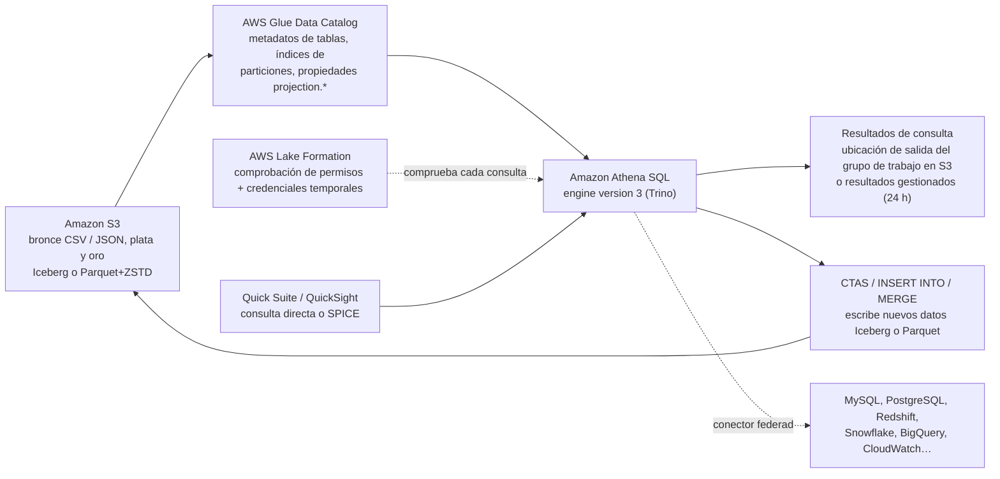
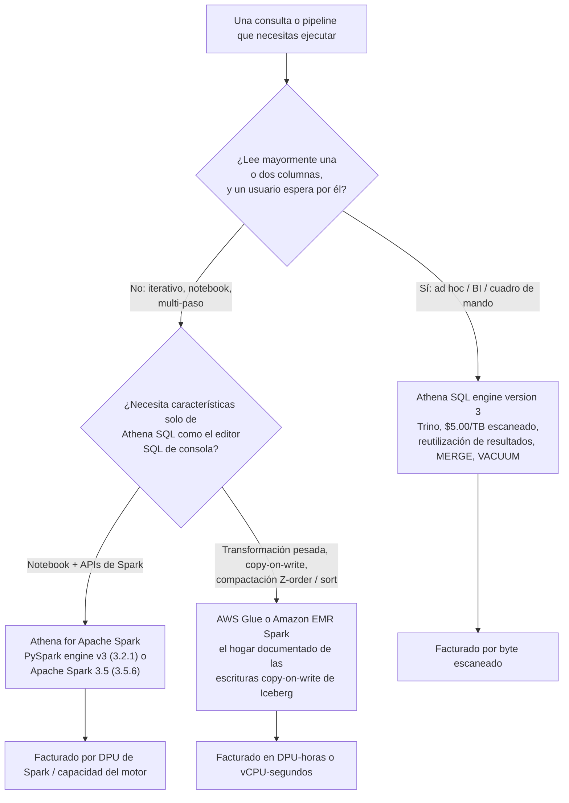
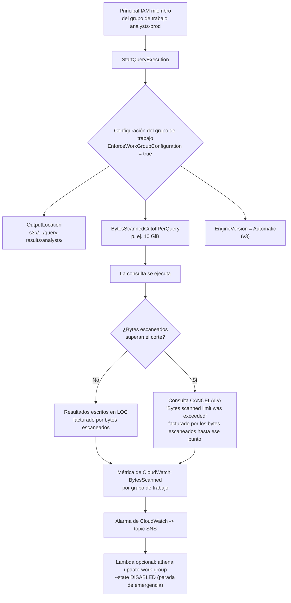
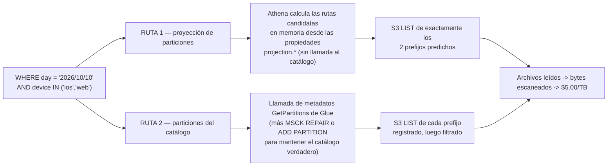
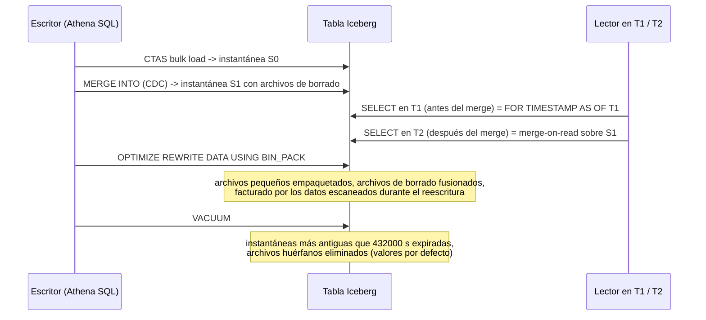
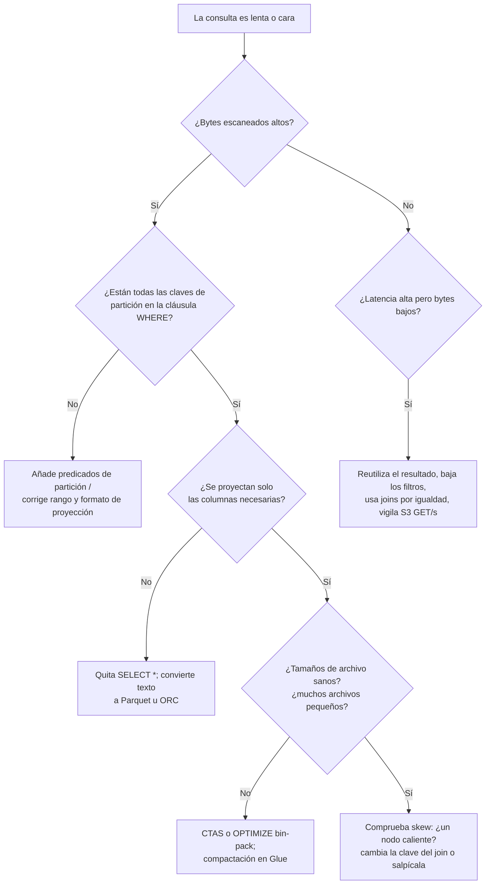
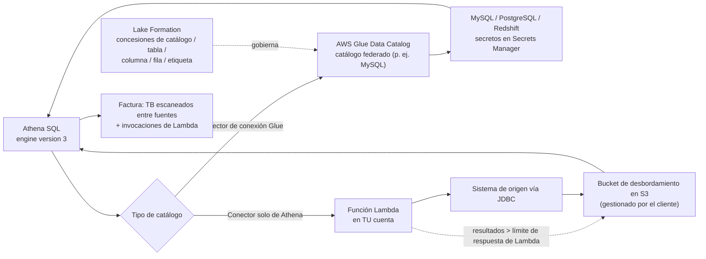

# Athena como motor de consultas del lakehouse: coste, rendimiento y SQL de Iceberg

Las lecciones 01 a 08 te dieron almacenamiento, formatos, tablas, pipelines y un catálogo. Nada de eso responde a la pregunta que un usuario de negocio hace de verdad: *¿puedo consultar esto, qué tan rápido, y cuánto me va a costar?* **Amazon Athena es la respuesta que AWS pone delante de los usuarios de SQL** — serverless, sin un clúster que dimensionar, sin una licencia que comprar, y con una factura que es función directa de cuántos datos lee tu consulta. Esa última propiedad es toda la lección: **en un modelo de precios por escaneo, el ajuste es la facturación, y la facturación es el ajuste.**

```text
=================================================================
 SUPERFICIE DE DECISIÓN DE ATHENA — AWS LAKEHOUSE (en oct 2026)
=================================================================
 Motor ............ Athena SQL engine version 3 (Trino, actual)
                    Athena SQL engine version 2 (Presto, obsoleto)
                    Athena for Apache Spark: PySpark engine v3
                    (Spark 3.2.1) o Apache Spark 3.5 (3.5.6 / EMR 7.12)
 Medidor .......... $5.00 por TB escaneado, mínimo de 10 MB por consulta
                    DDL y consultas fallidas: sin cargo
                    consultas canceladas: se factura hasta la cancelación
                    Capacity Reservations: $0.30 por DPU-hora
 Plano de control . grupo de trabajo = versión del motor + ubicación de
                    resultados + BytesScannedCutoffPerQuery + métricas
                    de CloudWatch + reutilización de resultados /
                    resultados gestionados
 Tablas ........... tablas Hive del Glue Data Catalog y Apache Iceberg
                    (S3 Tables vía la federación s3tablescatalog)
 Particionado ..... MSCK REPAIR / ADD PARTITION  vs  proyección de
                    particiones (enum, integer, date, injected)
 Escrituras ....... CTAS, INSERT INTO, UNLOAD, MERGE INTO, UPDATE,
                    DELETE (Iceberg, merge-on-read, solo motor v3)
 Mantenimiento ..... OPTIMIZE ... REWRITE DATA, VACUUM
 Gobernanza ....... comprobaciones de permisos de Lake Formation en
                    cada consulta
 Federación ....... conectores de conexión Glue (sin Lambda del cliente
                    para algunos desde 2026-04-21) + conectores solo de
                    Athena que se ejecutan en tu Lambda
-----------------------------------------------------------------------------
 No esto ........... actualizaciones copy-on-write de Iceberg (usa
                    Glue/EMR Spark)
                    transacciones multi-sentencia (no es el modelo de
                    Athena)
                    S3 Select (cerrado a nuevos clientes 2024-07-25)
=================================================================
```

En esta lección:

- separarás los **tres carriles de motores** — Athena SQL engine version 3, el obsoleto engine version 2 y las dos versiones de **Athena for Apache Spark** — y sabrás en qué carril vive cada característica;
- pondrás precio a las consultas con **$5.00 por TB escaneado**, reproducirás la propia historia de compresión de AWS de **$15 → $5 → $1.25**, y calcularás una **carga de trabajo mensual de analistas** sobre una tabla de 1 TB;
- construirás **grupos de trabajo** que corten escaneos descontrolados, fijarás la **ubicación de salida de resultados**, y aislarás equipos del historial de consultas de los demás;
- elegirás entre **particionado estilo Hive** y **proyección de particiones**, y escribirás un `CREATE EXTERNAL TABLE` proyectado listo para copiar con `storage.location.template`;
- convertirás archivos en bruto con **CTAS**, y definirás qué significa y qué no significa **RTAS** en Athena SQL;
- escribirás **Iceberg SQL**: time travel a través del cambio de cláusula de `FOR SYSTEM_TIME AS OF` → `FOR TIMESTAMP AS OF`, la tabla de metadatos **`$snapshots`**, el **`MERGE INTO` transaccional**, `OPTIMIZE` y `VACUUM`;
- ajustarás con las palancas documentadas — **dimensionado de archivos, poda de particiones y columnas, pushdown, orden de joins, skew** — y reproducirás una **reducción de escaneo de ~60× antes/después** en una tabla sintética;
- usarás la **reutilización de resultados de consulta** y los **resultados gestionados** sin creer que son una caché general;
- conectarás **fuentes federadas** a través de JDBC y otros conectores, e impondrás permisos de **Lake Formation** hasta columnas y filas;
- estudiarás **dos casos de clientes de AWS** (Easygo, Integral Ad Science) más un **cuadro de actualizaciones de 2026 con fuentes**;
- practicarás con **11 preguntas de estilo examen** y tres comprobaciones interactivas.

---

## 1. Los tres carriles de motores: SQL v3, SQL v2 y Athena for Apache Spark

### 1.1 Qué es Athena de verdad en la pila

Athena es el servicio interactivo serverless de SQL de AWS sobre datos en Amazon S3 y sobre fuentes federadas. En términos de lakehouse es la **capa de consulta**: lee tablas registradas en el **AWS Glue Data Catalog** — tablas externas estilo Hive y tablas **Apache Iceberg** — y no te exige aprovisionar ni ajustar un clúster. Las sentencias DDL escriben metadatos en el Glue Data Catalog; las sentencias DML/DQL leen (y, en Iceberg, escriben) archivos de datos en S3.

Esa división importa para el coste: **la DDL es gratuita y las lecturas se miden**, así que el diseño de tu tabla (formato, columnas, particiones) decide el tamaño de cada factura futura.



### 1.2 La versión 3 del motor es la actual; la versión 2 está obsoleta

**Athena engine version 3** es el motor SQL actual, y está basado en **Trino**: la Athena FAQ afirma que *«Athena for SQL usa Trino con soporte completo de SQL estándar»* y que *«nuestro objetivo es mantenernos a 60-90 días de los lanzamientos de Trino de código abierto»* (Athena FAQ, consultada 2026-10-11). La página de referencia de engine version 3 añade que AWS introdujo *«un enfoque de integración continua para la gestión de software de código abierto que mejora la concurrencia con los proyectos Trino y Presto»*.

AWS publicó un benchmark contra su predecesor: en **TPC-DS a escala de 3 TB**, engine version 3 mostró una **mejora de rendimiento de ~20%** frente a la última release de engine version 2 (AWS Big Data Blog, 2022-10-13).

Características que existen **solo** en engine version 3 (esta lista es examinable):

| Característica | Carril |
|---|---|
| Reutilización de resultados de consulta | solo engine v3 |
| `MERGE INTO` | engine v3, solo tablas Iceberg |
| `VACUUM` / `OPTIMIZE ... REWRITE DATA` | engine v3, solo Iceberg |
| `compression_level` de ZSTD | solo engine v3 |
| Acceso fino de Lake Formation expandido con Iceberg | se requiere engine v3 |
| time travel `FOR TIMESTAMP AS OF` / `FOR VERSION AS OF` | sintaxis de engine v3 |

**Engine version 2** está basado en Presto y es **obsoleto**. AWS documenta que los grupos de trabajo se configuran con versión **Automatic** (AWS los actualiza) o **Manual**, y que *«Athena actualiza tus grupos de trabajo cuando una versión ya no se ofrece»* (Athena User Guide — versionado del motor, consultada 2026-10-11). Una respuesta del personal de AWS en AWS re:Post (2024-02-23) afirma que la versión 2 está obsoleta y que un grupo de trabajo ya no puede degradarse a ella. **No hay fecha de fin de soporte publicada** para v2, y **no existe engine version 4** — la versión 3 es la más reciente en octubre de 2026.

- **📚 ¿Sabías que…?** Los drivers de cliente se versionan por separado del motor: **JDBC 3.8.0 se lanzó el 2026-06-03** y **ODBC 2.3.0.0 el 2026-08-21**, mientras que las APIs obsoletas del catálogo de datos de Athena (`athena:RunQuery` y compañía), más JDBC por debajo de 3.x y ODBC por debajo de 2.x, dejaron de funcionar el **2025-10-31**. Un error de conexión que parece «del lado de Athena» suele ser un retiro del lado del driver (notas de versión de Athena User Guide, consultadas 2026-10-11).

### 1.3 Athena for Apache Spark: dos versiones de release, una decisión inamovible

Las cargas de trabajo de Spark se ejecutan en un **tipo de grupo de trabajo separado**. Un grupo de trabajo de Spark no puede usar el editor de consultas SQL de Athena, y un grupo de trabajo SQL no puede usar el editor de notebooks de Spark; el tipo de motor analítico de un grupo de trabajo es **inmutable tras su creación** (Athena User Guide — consideraciones y limitaciones de Spark, consultada 2026-10-11).

| Versión de release | Runtime | Desde dónde lo diriges | Notas |
|---|---|---|---|
| **PySpark engine version 3** | Apache Spark **3.2.1** | notebooks de Athena en consola + APIs de notebook | No se puede actualizar in situ a Spark 3.5 |
| **Apache Spark version 3.5** | Apache Spark **3.5.6** en **Amazon EMR 7.12** | notebooks de SageMaker Unified Studio, clientes Spark Connect | Sin notebooks de Athena en consola, sin APIs de Calculation |

El anuncio What's New del 2025-11-21 afirma que Athena for Apache Spark *«ahora se ejecuta en Spark 3.5.6»*, está *«optimizado para formatos de tabla abiertos incluyendo Apache Iceberg y Delta Lake»*, soporta **Spark Connect**, y *«ahora aplica controles de acceso a nivel de tabla definidos en AWS Lake Formation»*. El motor serverless de Spark se ejecuta en **micro-VMs de Firecracker** y *«se lanza y escala en segundos»* (AWS Big Data Blog, 2026-07-02).

Dos trampas: **no puedes actualizar un grupo de trabajo de PySpark engine version 3 a Apache Spark version 3.5** (crea un grupo de trabajo nuevo), y **las consultas de vistas entre motores no se admiten** — una vista creada por Athena SQL no es consultable por Athena for Spark.



```matching
{
  "question": "Relaciona cada carril de motor con la carga de trabajo para la que es la respuesta documentada (en oct 2026):",
  "pairs": [
    {"left": "Athena SQL engine version 3 (Trino)", "right": "SQL interactivo sobre S3 e Iceberg: cuadros de mando, análisis ad hoc, time travel, MERGE INTO, VACUUM, reutilización de resultados — facturado a $5.00 por TB escaneado"},
    {"left": "Athena SQL engine version 2 (Presto)", "right": "Carril obsoleto: sin reutilización de resultados, sin MERGE INTO, sin VACUUM, cláusula de time travel antigua FOR SYSTEM_TIME AS OF, actualizado automáticamente por AWS cuando una versión ya no se ofrece"},
    {"left": "Athena for Apache Spark — PySpark engine version 3", "right": "Notebooks de Athena en consola y APIs de notebook sobre Apache Spark 3.2.1; no se pueden actualizar in situ a Spark 3.5"},
    {"left": "Athena for Apache Spark — Apache Spark version 3.5", "right": "Spark 3.5.6 en Amazon EMR 7.12 dirigido desde SageMaker Unified Studio o clientes Spark Connect; sin notebooks de Athena en consola"},
    {"left": "AWS Glue o Amazon EMR Spark", "right": "La ruta documentada para actualizaciones copy-on-write de Iceberg, ordenaciones y compactación Z-order que Athena SQL (solo merge-on-read) no realizará"}
  ],
  "explanation": "Los carriles no son características intercambiables con precios distintos; son capacidades distintas. Athena SQL v3 posee la carga de trabajo interactiva facturada por TB escaneado y cada sentencia de mantenimiento a nivel de fila. Athena SQL v2 es un carril de compatibilidad que AWS retira. Las dos versiones de release de Spark difieren en el soporte de notebooks y no pueden convertirse una en otra dentro de un grupo de trabajo. El mantenimiento copy-on-write de Iceberg tiene que salir de Athena: AWS Prescriptive Guidance apunta a otros motores como Apache Spark en Amazon EMR o AWS Glue para ese trabajo."
}
```

---

## 2. Precios: $5.00 por TB escaneado, y por qué el formato es un control de coste

### 2.1 El medidor

| Regla | Valor (precio de lista de US East, consultado 2026-10-11) |
|---|---|
| Cargo de escaneo de datos por consulta | **$5.00 por TB** escaneado |
| Redondeo | al megabyte más cercano, **mínimo de 10 MB por consulta** |
| DDL (`CREATE`/`ALTER`/`DROP`, gestión de particiones) | **sin cargo** |
| Consultas fallidas | **sin cargo** |
| Consultas canceladas | **facturadas por los bytes escaneados hasta la cancelación** |
| Consultas federadas | por TB escaneado **agregado entre fuentes de datos**, más los cargos de invocación de AWS Lambda |
| Capacity Reservations | **$0.30 por DPU-hora**; las consultas en el grupo de trabajo reservado **no** se facturan por TB escaneado |

La FAQ de AWS afirma que la compresión, el particionado y la conversión a columnar reducen el coste por consulta entre **30% y 90%**. Esa afirmación no es abstracción de marketing — la propia página de precios explica la aritmética.

### 2.2 Ejemplo resuelto E1 — la propia historia de compresión de AWS en tres pasos

El ejemplo canónico de la página de precios es una tabla con **4 columnas de igual tamaño**, almacenada como **texto sin comprimir**, que suma **3 TB** en S3, donde la consulta lee **una columna**:

```sql
-- Read one column of four from a 3 TB uncompressed text table
SELECT customer_id, SUM(amount)
FROM   lakehouse.raw.transactions_raw   -- 3 TB, 4 equal columns, plain text
GROUP  BY customer_id;
```

| Paso | Qué cambió | Bytes escaneados | Coste |
|---|---|---|---|
| 1 | Texto sin comprimir, se lee el archivo completo | 3 TB | **$15.00** (3 × $5) |
| 2 | Compresión 3× (clase GZIP) | ~1 TB | **$5.00** |
| 3 | Parquet: compresión 3× **y** 4× menos columnas leídas | 0.25 TB | **$1.25** |

AWS declara el *«ahorro de 3× por la compresión y el ahorro de 4× por leer solo una columna»*, dando *«$1.25»*. Léelo como una regla de diseño: **la primera palanca (compresión) y la segunda (poda columnar) se multiplican, no se suman.** Una variante moderna de lakehouse — ZSTD en el valor por defecto de Iceberg, que Athena escribe en **nivel 3** — comprime aún mejor, pero AWS no publica ratio oficial para ella, así que trata cualquier cifra de «10× con Zstd» como ilustrativa y cosa de medir tú mismo.

### 2.3 Ejemplo resuelto E2 — tabla de 1 TB, un mes de consultas de analistas

**Escenario (todas las cifras en oct 2026):** una tabla de hechos, **1 TB sin comprimir**, **10 columnas de igual ancho**, **365 particiones diarias**. La consulta del cuadro de mando lee **una columna** y filtra hasta **un día**. El equipo ejecuta **30 consultas al día × 22 días laborables = 660 consultas al mes**.

```sql
-- The dashboard query: 1 column, 1 day, 10 MB floor never binds
SELECT region, COUNT(*) AS orders
FROM   lakehouse.gold.orders
WHERE  order_date = DATE '2026-10-10'
  AND  region = 'EU';
```

| # | Forma de la tabla | Bytes escaneados por consulta | Coste por consulta | 660 consultas / mes |
|---|---|---|---|---|
| A | Texto plano, `SELECT *`, sin filtro de partición | 1 TB | $5.000000 | **$3,300.00** |
| B | Texto + GZIP 3:1, todavía `SELECT *` | 0.333 TB | $1.666667 | **$1,100.00** |
| C | Parquet + Snappy 3:1, **1 de 10 columnas** | 0.0333 TB | $0.166667 | **$110.00** |
| D | + **poda de partición diaria** (1 de 365 días) | 91.3 MB | $0.000435 | **$0.29** |
| E | D + **reutilización de resultados** (un cálculo por hora) | 91.3 MB × 176 horas | $0.000435 | **$0.08** |

La fila C es `0.333 TB ÷ 10 columnas = 0.0333 TB` escaneados; la fila D divide eso por 365 otra vez porque solo se abre una partición — `0.0333 ÷ 365 = 91.3 MB`, que es `0.0000871 TB × $5 = $0.000435` por consulta, y `660 × $0.000435 ≈ $0.29`. La fila E asume que la misma cadena de consulta se repite dentro de una ventana de reutilización de 60 minutos a lo largo de 8 horas × 22 días = 176 cálculos distintos.

**El anti-patrón a tener en cuenta:** la misma tabla Parquet consultada con `SELECT *` lee las diez columnas, así que el ahorro de la fila C desaparece — `0.333 TB → $1.67 por consulta → $1,100 al mes`, puramente por una lista de proyección.

```plot
{
  "type": "bar",
  "title": "660 consultas de cuadro de mando al mes sobre una tabla de 1 TB (us-east-1, en oct 2026)",
  "xLabel": "Forma de la tabla y forma de la consulta",
  "yLabel": "USD al mes",
  "xKey": "scenario",
  "data": [
    {"scenario": "A: text, SELECT *, no partition filter", "usd_per_month": 3300.00},
    {"scenario": "B: text + GZIP 3:1, SELECT *", "usd_per_month": 1100.00},
    {"scenario": "C: Parquet + Snappy, 1 column", "usd_per_month": 110.00},
    {"scenario": "D: C + daily partition pruning", "usd_per_month": 0.29},
    {"scenario": "E: D + query result reuse", "usd_per_month": 0.08},
    {"scenario": "Anti-pattern: Parquet SELECT *", "usd_per_month": 1100.00}
  ]
}
```

El gráfico de barras es el argumento para tratar **el formato, la lista de proyección y el predicado de partición como decisiones de facturación**: la diferencia entre la fila A y la fila D es un factor de unos **11,000**, y ni un solo byte de eso vino de un motor más rápido.

- **📚 ¿Sabías que…?** El **mínimo de 10 MB** pone un suelo a una consulta suelta en `10 MB × $5 / 1,048,576 MB` = **$0.0000477**. Por eso la fila D nunca es cero, y por eso un cuadro de mando que dispara 500 consultas diminutas al día todavía registra una factura — pero también por eso el hecho de que la DDL sea gratuita vale dinero de verdad: puedes reconstruir el formato y las particiones de una tabla toda la tarde por nada y pagar solo en el primer SELECT.

### 2.4 Los otros dos medidores

**Capacity Reservations** son el alternativa de gasto predecible: reserva **DPUs** y el grupo de trabajo asociado deja de incurrir en cargos por TB. Una DPU es **4 vCPU y 16 GB de memoria**; la reserva mínima es **4 DPUs** (incrementos de 4), con hasta **100 reservas y 1,000 DPUs por cuenta y Región**. El propio ejemplo resuelto de la página de precios:

```text
Peak half hour .... 160 DPU x $0.30 per DPU-hour x 0.25 hours = $12.00
Off-peak .........  16 DPU x $0.30 per DPU-hour x 0.75 hours =  $3.60
                                                per hour ..... $15.60
```

Desde el **2026-02-01** las reservas se pueden comprar con **granularidad de 1 minuto y un mínimo de 4 DPUs**, lo que AWS dice que ofrece *«ahorros de coste de hasta el 95% para cargas de trabajo de consultas de corta duración»* — y *«solo pagas la capacidad que reservas y no hay cargos por datos escaneados»* (AWS What's New, 2026-02-01).

**Las consultas federadas** facturan por TB escaneado *«agregado entre fuentes de datos, redondeado al megabyte más cercano con un mínimo de 10 megabytes por consulta, a menos que se use Provisioned Capacity»*, y *«invocan funciones de AWS Lambda en tu cuenta, y se te cobra por el uso de Lambda a tarifas estándar»* (precios de Athena, consultados 2026-10-11). La federación tiene por tanto **dos medidores, no uno**.

---

## 3. Grupos de trabajo: el plano de control operativo

Un grupo de trabajo es la unidad de aislamiento e imposición de Athena. Delimita **historial de consultas, consultas guardadas y ubicación de resultados**, y lleva las configuraciones que deciden qué versión del motor se ejecuta, cómo se cifran los resultados, y **cuántos datos tiene permitido leer una consulta antes de morir**.

| Configuración del grupo de trabajo (API de Athena) | Qué hace |
|---|---|
| `ResultConfiguration.OutputLocation` | prefijo de S3 para los resultados de consulta — requerido desde el cliente o el grupo de trabajo, si no Athena da el error *«no output location is provided»* |
| `EnforceWorkGroupConfiguration` | la configuración del grupo de trabajo anula la del cliente (así es como ganan los admins) |
| `BytesScannedCutoffPerQuery` | límite de uso de datos por consulta; rango válido desde **10,000,000 bytes** (10 MB) |
| `PublishCloudWatchMetricsEnabled` | emite métricas del grupo de trabajo sobre las que puedes alertar |
| `EngineVersion` | Automatic (AWS actualiza) o Manual |
| `ExecutionRole` / `EngineConfiguration` | grupos de trabajo de Spark: rol IAM y dimensionado de DPU |
| `ManagedQueryResultsConfiguration` | almacenamiento de resultados gestionado por Athena en vez de tu bucket |
| `CustomerContentEncryptionConfiguration` / `RequesterPaysEnabled` | cifrado de resultados; manejo de buckets de requester-pays |



### 3.1 Ejemplo resuelto E3 — cercar a los analistas con un corte por consulta

El campo de consola es **Data scanned limit**, válido desde **10 MB hasta 7 EB**. El campo de API es `BytesScannedCutoffPerQuery`. Un analista ejecuta un escaneo de tabla completa de una tabla de **50 GB** con un corte de **10 GiB**:

```bash
aws athena create-work-group \
  --name analysts-prod \
  --configuration '{
    "ResultConfiguration":{"OutputLocation":"s3://lakehouse-demo/query-results/analysts/"},
    "EnforceWorkGroupConfiguration":true,
    "PublishCloudWatchMetricsEnabled":true,
    "BytesScannedCutoffPerQuery":10737418240
  }' \
  --description "Ad hoc analyst workgroup, 10 GiB per-query scan ceiling"
```

| Resultado | Bytes facturados | Coste a $5.00/TB |
|---|---|---|
| Sin el corte (lectura de tabla de 50 GB) | 50 GB = 0.0488 TB | **≈ $0.24** |
| Con el corte de 10 GiB (cancelada en el techo) | 10 GiB = 0.00977 TB | **≈ $0.05** |

El propio artículo de AWS sobre grupos de trabajo combina esto con una alarma de CloudWatch **por grupo de trabajo** y una función Lambda que **deshabilita el grupo de trabajo** cuando se supera un umbral agregado (AWS Big Data Blog, 2019-07-18) — los dos controles son complementarios: el corte **por consulta** detiene una sentencia mala, la alarma **por grupo de trabajo** detiene un lote descontrolado.

### 3.2 Ubicación de salida, y aislar a los admins de los analistas

`OutputLocation` es donde aterrizan los conjuntos de resultados, los archivos de manifiesto y los metadatos de ejecución — y es el objeto de la pregunta de seguridad de la sección 10: **los resultados de consulta no se pueden registrar con Lake Formation**, así que el prefijo del bucket se gobierna solo con S3/IAM. Combina la ubicación con la pertenencia al grupo de trabajo para que el texto SQL y los conjuntos de resultados de cada población solo sean visibles para sí mismos; ese es exactamente el patrón que Integral Ad Science publicó: *«Al definir un grupo de trabajo de Athena por unidad de negocio, IAS también se beneficia de asignar etiquetas de facturación y límites de consulta por departamento para ayudar con la gestión de costes»* (AWS Big Data Blog, 2021-09-23).

> [!WARNING]
> ⚠️ **Un corte de escaneo limita una factura; no hace que la consulta sea gratuita.** Cuando salta `BytesScannedCutoffPerQuery`, la consulta se **cancela y se factura por cada byte leído hasta ese punto** — un escaneo parcial de 11 GB todavía cuesta dinero, y un grupo de trabajo de 50 analistas que cada uno salte un techo de 10 GiB al día son `50 × 10 GiB × $5/TB ≈ $2.44/día` de trabajo *cancelado*. Segunda trampa: **el prefijo de resultados y el historial de consultas están fuera del alcance de Lake Formation**, así que un analista que pueda listar el grupo de trabajo puede leer los archivos SQL y de resultados de datos para los que quizá no tenga permiso en la tabla de origen. Alinea la pertenencia al grupo de trabajo con tus concesiones de Lake Formation en lugar de confiar en que lo haga el bucket de resultados.

---

## 4. Particionado frente a proyección de particiones

### 4.1 La ruta clásica: carpetas clave=valor y un trabajo de registro

El particionado estilo Hive almacena segmentos `order_date=2026-10-10/` bajo la ubicación de la tabla, y el catálogo no sabe que existen hasta que ejecutas `MSCK REPAIR TABLE` o `ALTER TABLE ADD PARTITION`. El mecanismo funciona, y trae dos costes operativos: **un paso de registro en cada pipeline de ingesta**, y un **techo en el número de particiones** — Glue admite tablas con hasta **10 millones de particiones**, pero **Athena puede escanear como máximo 1 millón de particiones en una única consulta**, y cada clave de partición extra multiplica el número de archivos que producen tus escrituras.

### 4.2 La ruta de la proyección: calcular las rutas, no listarlas

La proyección de particiones pone la lógica de partición en **propiedades de tabla** en lugar de en el catálogo. La documentación de Athena es explícita: *«Durante la ejecución de la consulta, Athena usa esta información para proyectar los valores de partición en lugar de recuperarlos del AWS Glue Data Catalog o de un metastore Hive externo… elimina la necesidad de crear particiones manualmente.»* No hay trabajo de reparación, ni sincronización del catálogo, ni paso de registro de particiones en el pipeline — y *«las consultas por valores que están fuera de los límites de rango definidos para la proyección de particiones no devuelven un error… devuelven cero filas»*.

Hay **cuatro** tipos de proyección (Athena User Guide — tipos admitidos para la proyección de particiones, consultada 2026-10-11):

| Tipo | Propiedad que lo define | Rango / comportamiento |
|---|---|---|
| `enum` | `projection.{col}.values` | lista de literales separada por comas, p. ej. `ios,android,web` |
| `integer` | `projection.{col}.range` (+ `.interval`, `.digits` opcionales) | en cualquier punto de un long con signo de Java, −2^63 a 2^63−1 |
| `date` | `projection.{col}.range` + `.format` (+ `.interval`, `.interval.unit`) | patrón Java DateTimeFormatter; el rango puede usar `NOW`, `NOW+1MONTH` |
| `injected` | `projection.{col}.type = injected` | solo string; los valores vienen de la cláusula `WHERE` de la consulta en tiempo de ejecución |

### 4.3 Ejemplo resuelto E4 — una tabla proyectada lista para copiar

```sql
CREATE EXTERNAL TABLE web_events (
  event_time timestamp,
  url        string,
  user_id    string
)
PARTITIONED BY (
  `day`    string,
  device   string
)
LOCATION 's3://lakehouse-demo/events/'
TBLPROPERTIES (
  'projection.enabled'            = 'true',
  'projection.day.type'           = 'date',
  'projection.day.format'         = 'yyyy/MM/dd',
  'projection.day.range'          = '2024/01/01,NOW',
  'projection.day.interval'       = '1',
  'projection.day.interval.unit'  = 'DAYS',
  'projection.device.type'        = 'enum',
  'projection.device.values'      = 'ios,android,web,other',
  'storage.location.template'     = 's3://lakehouse-demo/events/${day}/${device}/'
);
```

```sql
-- Correct: both keys bounded, predicate format matches yyyy/MM/dd exactly
SELECT count(*)
FROM   web_events
WHERE  `day`   = '2026/10/10'
  AND  device IN ('ios','web');
```

Cinco puntos didácticos salen de esa sentencia:

1. **Nunca se necesita `MSCK REPAIR TABLE`** — los días nuevos aparecen simplemente al escribirse en S3.
2. **El predicado debe coincidir con el formato configurado.** Con `.format = 'yyyy/MM/dd'`, el valor `2026/10/10` funciona; `DATE '2026-10-10'` y `2026-10-10` no.
3. **`storage.location.template` debe contener un marcador por columna de partición y terminar en `/`** — si no, Athena compone rutas que tú no escribiste.
4. **Los valores fuera de rango devuelven cero filas, en silencio.** Un ticket de «faltan los datos» es muy a menudo un `.range` que termina en `NOW-1MONTH`.
5. **Siempre limita cada clave proyectada.** Omitir `device` hace que Athena haga LIST de cada prefijo de dispositivo de ese día contra el presupuesto compartido de S3 de **5,500 peticiones GET por segundo por prefijo particionado**.



```fillblank
{
  "question": "Completa el contrato de proyección de particiones usando los nombres de tipo y las claves de propiedad de Athena (en oct 2026):",
  "template": "Una tabla puede usar cualquier combinación de cuatro tipos de proyección: {{1}}, {{2}}, {{3}} y {{4}}. La proyección se activa con {{5}} = 'true', un diseño S3 personalizado se declara con {{6}}, una columna enum se define con projection.<column>.{{7}}, una columna de fecha debe llevar tanto un rango como un {{8}} escrito como patrón Java DateTimeFormatter, y una columna inyectada toma sus valores de la cláusula WHERE de la consulta como condiciones estáticas de {{9}} — cualquier otra cosa levanta CONSTRAINT_VIOLATION. Las consultas fuera del rango proyectado devuelven {{10}} filas en lugar de un error.",
  "answers": {
    "1": "enum",
    "2": "integer",
    "3": "date",
    "4": "injected",
    "5": "projection.enabled",
    "6": "storage.location.template",
    "7": "values",
    "8": "format",
    "9": "equality",
    "10": "zero"
  },
  "distractors": ["string", "range", "bucket", "hashed", "computed", "dynamic", "partition.enabled", "projection.values", "location.template", "mask", "pattern", "literal", "NULL", "one", "-1", "an error"],
  "explanation": "Los cuatro tipos admitidos son enum, integer, date e injected, y se pueden combinar libremente en una tabla. projection.enabled activa el mecanismo; storage.location.template anula la composición de rutas y debe contener un marcador por columna de partición. Enum usa projection.<col>.values; date necesita range más format (Java DateTimeFormatter); injected es solo string y se suministra en el momento de la consulta como condiciones de igualdad estáticas — un rango, LIKE o un predicado ausente en una columna inyectada es un CONSTRAINT_VIOLATION. Los predicados fuera de rango no son errores: Athena devuelve cero filas, y por eso un rango demasiado estrecho parece que faltan datos."
}
```

- **📚 ¿Sabías que…?** La proyección no elimina el techo de escaneo — elimina el coste de **catálogo**. Athena todavía lee como máximo **1 millón de particiones por consulta**, y los índices de partición de Glue existen para tablas con decenas de miles de particiones y más. La proyección es la respuesta a *«mis metadatos de particiones son enormes»*; los índices y la poda son la respuesta a *«mis particiones son muchas pero están registradas»*.

---

## 5. CTAS: convertir archivos en bruto en una tabla que puedes permitirte consultar

### 5.1 `CREATE TABLE AS SELECT` y sus trampas de propiedades

CTAS materializa el resultado de una consulta en una nueva tabla, lo que lo convierte en el trabajo de ETL más barato posible: sin clúster, sin paso separado, y **el propio CTAS es trabajo con forma de DDL que aun así cuenta como DML para las cuotas de servicio**. Las propiedades documentadas:

| Propiedad | Tabla Hive | Tabla Iceberg |
|---|---|---|
| `format` | ORC, PARQUET, AVRO, JSON, ION, TEXTFILE — **debe ir en minúsculas** | ORC, PARQUET, AVRO |
| Formato por defecto | **PARQUET** si se omite | **PARQUET** si se omite |
| Particionado | `partitioned_by = ARRAY['col', ...]` | `partitioning = ARRAY['month(dt)', ...]` (transforms) |
| Tipo de tabla / ubicación | `external_location` | `table_type = 'ICEBERG'`, `is_external = false`, `location = ...` **obligatorio** |
| Compresión de escritura | Parquet **GZIP** por defecto (GZIP o SNAPPY); ORC **ZLIB** por defecto (LZ4, SNAPPY, ZLIB, ZSTD) | **ZSTD** por defecto en **nivel 3**; niveles 1–22 vía `compression_level` (solo engine v3) |
| Bucketing | `bucketed_by`, `bucket_count` (máx. 100 combinaciones bucket × partición) | n/a — usa transforms de partición |

Dos límites duros para memorizar: **100 particiones por sentencia CTAS** (y por cada `INSERT INTO`), que falla como `HIVE_TOO_MANY_OPEN_PARTITIONS`, y la contabilización de cuotas de servicio DML mencionada arriba.

### 5.2 Ejemplo resuelto E5 — de CSV en bruto a plata Iceberg, en una sentencia

```sql
CREATE TABLE lakehouse.silver.orders
WITH (
  table_type                    = 'ICEBERG',
  is_external                   = false,
  format                        = 'PARQUET',
  location                      = 's3://lakehouse-demo/silver/orders/',
  partitioning                  = ARRAY['month(order_date)'],
  vacuum_min_snapshots_to_keep  = 10,
  vacuum_max_snapshot_age_seconds = 604800
)
AS SELECT
  order_id,
  customer_id,
  status,
  total_amount,
  CAST(order_ts AS timestamp) AS order_ts,
  CAST(order_ts AS date)      AS order_date
FROM lakehouse.bronze.orders_raw
WHERE order_id IS NOT NULL;
```

Fíjate en lo que **no** está en esa sentencia: `format` va en minúsculas (el `FORMAT` en mayúsculas hace fallar la consulta), `partitioning` usa un **transform** de Iceberg en lugar de `partitioned_by`, y `location` se suministra porque el CTAS de Iceberg no acepta `external_location`.

> [!IMPORTANT]
> **CTAS es una escritura con tres facturas pegadas.** (1) Cuenta como **DML contra las cuotas de servicio**, así que un bucle de sentencias CTAS puede chocar con una cuota mucho antes de chocar con un techo de coste. (2) Está limitado a **100 particiones por sentencia.** (3) Sobre datos registrados en Lake Formation, el CTAS requiere **permiso IAM `s3:` de escritura en la ubicación de destino además de** tus concesiones de lectura de Lake Formation — un usuario con derechos de SELECT perfectos y sin política IAM de escritura obtiene un error de permisos en el momento del éxito, no en el de análisis.

### 5.3 La cuestión de RTAS

`REPLACE TABLE AS SELECT` está documentado en la **documentación de Spark del proyecto Iceberg**, y lo encontrarás en material basado en Spark. **No** aparece en las páginas de `CREATE TABLE AS SELECT` / CTAS de la guía de usuario de Athena SQL a 2026-10-11 — así que en Athena SQL los patrones de reemplazo son: **CTAS a una tabla nueva y luego intercambiar**, **`INSERT OVERWRITE` para tablas Hive**, o **Spark** (Glue, EMR o Athena for Apache Spark) cuando necesites de verdad un reemplazo in situ. No asumas que RTAS existe en Athena SQL porque existe en la documentación de Iceberg; ese supuesto falla en tiempo de análisis delante de un usuario.

---

## 6. Iceberg SQL: time travel, instantáneas, MERGE y mantenimiento

### 6.1 Leer una tabla como de un momento

Athena *«puede realizar consultas de lectura, time travel, escritura y DDL sobre tablas de Apache Iceberg»*, y expone las tablas de metadatos **`$files`, `$manifests`, `$history`, `$partitions`, `$snapshots`, `$refs`**. La cláusula que uses depende de la versión del motor, y este es el bug de migración más común de la lección:

| Engine version 2 (obsoleto) | Engine version 3 (actual) | Significado |
|---|---|---|
| `FOR SYSTEM_TIME AS OF <ts>` | **`FOR TIMESTAMP AS OF <ts>`** | leer la instantánea vigente en una hora de reloj de pared |
| `FOR SYSTEM_VERSION AS OF <id>` | **`FOR VERSION AS OF <id>`** | leer un ID de instantánea específico |

Las marcas de tiempo escritas sin zona horaria se interpretan como **UTC**. La documentación de Athena declara el reemplazo directamente: *«Las cláusulas `FOR SYSTEM_TIME AS OF` y `FOR SYSTEM_VERSION AS OF` en Athena engine version 2 han sido reemplazadas por las cláusulas `FOR TIMESTAMP AS OF` y `FOR VERSION AS OF` en Athena engine version 3.»*

```sql
-- Engine version 3 time travel
SELECT * FROM lakehouse.silver.orders
FOR TIMESTAMP AS OF current_timestamp - INTERVAL '1' HOUR;

-- Snapshot inventory, straight from the metadata table
SELECT snapshot_id, committed_at, operation, summary
FROM   "lakehouse"."orders$snapshots"
ORDER  BY committed_at DESC;

-- Diff two snapshots by joining them
SELECT t.order_id, t.status AS now, p.status AS then_
FROM        lakehouse.silver.orders t
JOIN        lakehouse.silver.orders p
        ON  t.order_id = p.order_id
WHERE t.status <> p.status
  AND t.order_id IN (
        SELECT order_id FROM lakehouse.silver.orders
        FOR TIMESTAMP AS OF current_timestamp - INTERVAL '1' DAY)
```

### 6.2 `MERGE INTO`: el upsert transaccional, solo merge-on-read

`MERGE INTO` *«es transaccional y se admite solo para tablas de Apache Iceberg en Athena engine version 3»*. Puedes usar un número arbitrario de cláusulas `WHEN`; **la primera cláusula que coincida por fila de origen se ejecuta**, y Athena lanza un error de usuario si **una fila de destino coincide con varias filas de origen**.

```sql
MERGE INTO lakehouse.silver.orders AS t
USING lakehouse.bronze.orders_cdc AS s
   ON t.order_id = s.order_id
WHEN MATCHED AND s.op = 'U' THEN
  UPDATE SET status = s.status, total_amount = s.total_amount
WHEN MATCHED AND s.op = 'D' THEN
  DELETE
WHEN NOT MATCHED THEN
  INSERT *;
```

El límite a memorizar: *«Athena SQL no soporta actualmente el enfoque copy-on-write. Las operaciones UPDATE, MERGE INTO y DELETE FROM siempre usan el enfoque merge-on-read con borrados posicionales, independientemente de las propiedades de tabla especificadas»* — esas propiedades de tabla se ignoran, y el trabajo copy-on-write pertenece a **Apache Spark en Amazon EMR o AWS Glue** (guía de usuario de Athena; AWS Prescriptive Guidance, ambas consultadas 2026-10-11).



### 6.3 Mantenimiento: `OPTIMIZE` y `VACUUM`

```sql
-- Bin-pack the recent partitions; only partition columns may appear in WHERE
OPTIMIZE lakehouse.silver.orders
REWRITE DATA USING BIN_PACK
WHERE order_date >= DATE '2026-09-01';

-- Expire old snapshots and remove orphan files (defaults shown)
VACUUM lakehouse.silver.orders
vacuum_max_snapshot_age_seconds = 432000,
vacuum_min_snapshots_to_keep     = 1,
vacuum_max_metadata_files_to_keep = 100;
```

`OPTIMIZE` *«se admite solo para tablas de Apache Iceberg»* y *«solo se permiten columnas de partición en la cláusula WHERE»*; se **factura por los datos escaneados durante la reescritura**, así que una tabla ya compacta cuesta aproximadamente nada. `VACUUM` realiza **expiración de instantáneas y eliminación de archivos huérfanos**; los cargos de la API de S3 por esas peticiones siguen aplicando. Si prefieres no programar ninguno de los dos, los **optimizadores de tablas de Glue** pueden ejecutar compactación, retención de instantáneas y limpieza de archivos huérfanos automáticamente.

- **📚 ¿Sabías que…?** Una vista fijada es la forma más barata de exponer «el estado de hace cinco minutos» sin que los usuarios escriban SQL de time travel: el propio blog de upserts de AWS fija una vista con `FOR TIMESTAMP AS OF current_timestamp + interval '-5' minute`, de modo que los consumidores aguas abajo siempre leen un estado anterior estable mientras `MERGE INTO` sigue escribiendo instantáneas nuevas debajo (AWS Big Data Blog, 2023-04-27).

> [!WARNING]
> ⚠️ **Dos sentencias de Iceberg fallan de formas que parecen problemas de datos.** Primero, ejecutar `FOR SYSTEM_TIME AS OF` en engine version 3 es un **error de sintaxis**, no un fallback silencioso — y una marca de tiempo ingenua se lee como **UTC**, así que una cadena de hora local desplaza tu instantánea por horas. Segundo, `MERGE INTO`, `OPTIMIZE` y `VACUUM` son **solo engine v3, solo Iceberg**: apúntalos a una tabla Hive o a engine version 2 y la sentencia falla en la validación. Por último, merge-on-read significa que cada `UPDATE`/`DELETE`/`MERGE` deja **archivos de borrado atrás** — si nunca ejecutas `OPTIMIZE`, el coste de lectura y la latencia crecen monótonamente.

---

## 7. Ajuste de rendimiento: las nueve palancas

### 7.1 Dimensionado y diseño de archivos

| Palanca | Número documentado |
|---|---|
| Tamaño de bloque Parquet | **128 MB** por defecto |
| Tamaño de stripe ORC | **64 MB** por defecto; los stripes menores de **8 MB** se leen enteros |
| Archivos pequeños | Cada archivo extra añade trabajo de S3 LIST/GET contra los **5,500 peticiones GET/segundo por prefijo particionado** |
| Compresión | Iceberg en engine v3 usa por defecto **Parquet + ZSTD (nivel 3)**; Athena no puede *escribir* Parquet con LZ4 o LZO (las lecturas sí se admiten) |
| Tipos complejos | Parquet con arrays/maps/structs puede vencer la poda de columnas (problema conocido documentado) — la solución documentada es **ORC** |
| Bucketing | Distribuye por claves de filtro de alta cardinalidad para que una búsqueda lea un bucket; **máx. 100 combinaciones bucket × partición** |

### 7.2 Poda, pushdown, joins y skew

1. **La poda de particiones** solo ocurre si la consulta filtra **todas** las claves de partición; la proyección la hace gratis pero no la hace automática.
2. **La poda de columnas** es la diferencia entre la fila C y la fila A de E2 — proyecta las columnas que necesitas y nunca hagas `SELECT *` en SQL de producción.
3. **El pushdown de predicados** a los row groups de Parquet / stripes de ORC usa estadísticas min/max — y por eso las escrituras ordenadas o agrupadas podan mejor que las aleatorias.
4. **Orden de joins**: pon la **tabla más grande en el lado IZQUIERDO (probe)** de un hash join distribuido, y prefiere **joins por igualdad** a `LIKE` o predicados de desigualdad.
5. **Skew**: *«Si muchas filas tienen los mismos valores para las columnas usadas en la condición del join, un nodo puede acabar teniendo que procesar una gran parte del join mismo, mientras otros nodos están ociosos.»* Más workers nunca arreglan un skew de clave única — cambia o salpica la clave, o estrecha el `PARTITION BY` de la ventana.
6. **Forma de la consulta**: `LIMIT` con `ORDER BY`, `UNION ALL` sobre `UNION`, números sobre cadenas, `regexp_like` sobre un `LIKE` sin ancla, `approx_distinct` sobre `COUNT(DISTINCT)`, y `UNLOAD` para exportaciones de resultados grandes en lugar de una única escritura de resultado CSV.
7. **S3 Select no está en esta lista** — AWS lo cerró a nuevos clientes el **2024-07-25**, anunció que no habría nuevas capacidades, y nombra a **Athena como el enfoque recomendado** para consultar datos en S3 (AWS Storage Blog, 2024-07-25). Los artículos de ajuste antiguos que lo recomiandan están obsoletos.



### 7.3 Ejemplo resuelto E6 — reproducir un ~60× antes/después con poda

Este es el ejercicio sintético que concreta el caso de estudio de Easygo de abajo. Una tabla Parquet de **400 GB** con **60 particiones diarias** (~6.67 GB al día) y **10 columnas**, consultada para **un día**:

```sql
-- BEFORE: no partition predicate at all
SELECT * FROM lakehouse.gold.clickstream;                 -- scans 400 GB

-- AFTER (stage 1): partition predicate only, same column list
SELECT * FROM lakehouse.gold.clickstream
WHERE  event_date = DATE '2026-10-10';                    -- scans 6.67 GB

-- AFTER (stage 2): partition predicate + a real column list
SELECT session_id, event_type
FROM   lakehouse.gold.clickstream
WHERE  event_date = DATE '2026-10-10';                    -- scans ~0.67 GB
```

```text
ANTES ........... 400 GB escaneados
                  400/1024 x $5.00 = $1.9531 por consulta

DESPUÉS etapa 1 . 400 GB / 60 particiones = 6.67 GB
                  6.67/1024 x $5.00 = $0.0326 por consulta
                  ratio 400 / 6.67 = 60x menos bytes  <- el objetivo del laboratorio

DESPUÉS etapa 2 . 6.67 GB / 10 columnas x 2 leídas = 1.33 GB
                  (2 de 10 columnas proyectadas)
                  1.33/1024 x $5.00 = $0.0065 por consulta
                  ratio acumulado 400 / 1.33 = 300x
```

La sola etapa 1 — **la misma consulta con un predicado de partición añadido** — es el ejercicio del **60×**: motor idéntico, formato idéntico, lista de columnas idéntica, sesenta veces menos bytes. La etapa 2 es la segunda palanca, independiente, de la sección 2.2, y se multiplica en lugar de sumarse.

Trata el **~60×** como el objetivo del laboratorio que puedes reproducir con datos sintéticos, y mantén separada la cifra publicada por el propio cliente: Easygo reporta **un 95% más rápido en rendimiento de consulta**, no un speedup de 60× (el caso de estudio de Easygo de abajo). Nunca restate una cifra como la otra.

---

## 8. Caché de resultados: reutilización, resultados gestionados, y lo que no se cachea

### 8.1 Reutilización de resultados de consulta

La reutilización es *«una ejecución previa de la consulta dentro del mismo grupo de trabajo… si Athena encuentra una coincidencia, omite la ejecución y devuelve el resultado de la consulta de la ejecución previa coincidente.»* Sus reglas (solo engine version 3):

| Propiedad | Valor |
|---|---|
| Disponibilidad | **solo Athena engine version 3** |
| Clave de coincidencia | cadena de consulta idéntica + mismo grupo de trabajo + configuración de resultados coincidente + comprobaciones de acceso |
| Edad máxima por defecto | **60 minutos** (`MaxAgeInMinutes`, rango **0–10,080** = 7 días) |
| En un acierto | **cero bytes escaneados** |
| API | `StartQueryExecution --result-reuse-configuration ResultReuseByAgeConfiguration={Enabled=...,MaxAgeInMinutes=...}` |
| **Nunca** se aplica con | filtros de fila/columna de Lake Formation, **consultas federadas**, UDFs, metastores Hive externos, funciones no deterministas (`RAND()`, `CURRENT_TIME`), ni resultados gestionados |

Los **resultados gestionados** son la característica aparte que elimina tu bucket por completo: *«Los resultados de consulta están disponibles durante 24 horas. Los resultados de consulta se almacenan sin coste para ti durante este periodo»*, recuperados a través de `GetQueryResults` / `GetQueryResultsStream` con ámbito de grupo de trabajo. Los resultados gestionados **no admiten** reutilización de resultados — eliges una cosa u otra.

### 8.2 Ejemplo resuelto E7 — cuánto vale la reutilización

Un cuadro de mando emite **40 consultas idénticas por hora** contra una tabla refrescada cada noche; cada ejecución escanea **0.2 GB**.

```text
Sin reutilización ... 40 x 0.2 GB = 8 GB/hora
                      8/1024 x $5.00 = $0.039/hora
                      x 24 h x 30 d  = $28.13/mes   (~$29)

Con reutilización .... 1 cálculo/hora (ventana de 60 minutos)
                      0.2 GB x 720 h = 144 GB
                      144/1024 x $5.00 = $0.70/mes   (~$0.72)

SPICE de QuickSight . la ingesta se factura cuando se crea el dataset y en
                      cada refresco; las lecturas posteriores del cuadro de
                      mando son gratuitas
```

El emparejamiento con la capa de BI es el punto: **SPICE factura el refresco, la reutilización factura la re-ejecución idéntica, y una consulta directa factura cada renderizado de vista.** AWS lo dice claramente para Quick Suite / QuickSight: *«Si usas una fuente de datos que cobra por consulta, se te cobra por consultar los datos cuando creas el dataset por primera vez y luego cuando refrescas el dataset.»*

- **📚 ¿Sabías que…?** La reutilización está **delimitada por grupo de trabajo por diseño**. Dos equipos que emitan SQL byte a byte idéntico en grupos de trabajo distintos no verán los resultados cacheados del otro — lo cual es una característica de gobernanza, no un error: impide que el resultado reutilizado de un equipo satisfaga los permisos distintos de Lake Formation de otro equipo.

---

## 9. Consultas federadas: JDBC y compañía, a través de Lambda

Las consultas federadas de Athena empujan filtros y proyecciones al sistema de origen, de modo que un join contra una base de datos OLTP viva no arrastra primero la tabla entera. Hay **dos familias de conectores** (Athena User Guide — ejecutar consultas federadas, consultada 2026-10-11):

| Familia | Runtime | Lake Formation | Desde 2026-04-21 |
|---|---|---|---|
| **Conectores federados del AWS Glue Data Catalog** | usa una **conexión de Glue**; credenciales vía Secrets Manager | admitido a nivel de catálogo, base de datos, tabla, columna, fila y etiqueta | *«ciertos conectores creados recientemente se registran automáticamente como Glue Data Catalogs y no usan una función Lambda en tu cuenta de AWS»* |
| **Conectores federados del catálogo de datos de Athena** | específicos de Athena; **requieren una función Lambda en tu cuenta** | no se pueden registrar como catálogos federados de Glue | sin cambios |

Detalles prácticos:

- El genérico **`AthenaJdbcConnector` (2022.4.1) está obsoleto** — usa los conectores específicos de base de datos para **MySQL, PostgreSQL, Redshift, Oracle, SQL Server**, más DynamoDB, DocumentDB, OpenSearch, Timestream, BigQuery, Snowflake, CloudWatch y TPC-DS en la matriz de conectores.
- Los **handlers multiplexores** enrutan por nombre de catálogo, de modo que una sola Lambda puede servir varios catálogos; las credenciales vienen de **AWS Secrets Manager**.
- Los resultados mayores que el límite de respuesta de Lambda **se desbordan a un bucket de S3 del cliente** (parámetros del bucket de desbordamiento), y la federación entre cuentas necesita una **política Lambda basada en recursos + acceso al bucket de desbordamiento + AssumeRole**.
- Las **consultas passthrough** (funciones de tabla) empujan la sentencia completa al origen para los conectores admitidos.
- **Facturación:** por TB escaneado entre fuentes **más** cargos de invocación de Lambda — modela ambos antes de prometer un ahorro de federación.



---

## 10. Lake Formation: lo que se impone, y lo que no

Para datos registrados con Lake Formation, *«Cada vez que un principal de Athena… ejecuta una consulta sobre datos registrados usando Lake Formation, Lake Formation verifica que el principal tiene los permisos de Lake Formation apropiados… Lake Formation expende credenciales temporales a Athena, y la consulta se ejecuta.»* El acceso fino — **filtros de datos a nivel de columna, fila/celda, LF-Tags** — para Iceberg, Hudi, Delta y Hive **requiere Athena engine version 3**.

Los límites son la parte examinable:

| Gobiernado por Lake Formation | **No** gobiernado por Lake Formation |
|---|---|
| Lecturas de datos de S3 registrados + metadatos del Data Catalog | **Escrituras** (el CTAS necesita permiso IAM de escritura en S3) |
| Filtros a nivel de columna, fila y celda; LF-Tags | Datos **no registrados** en Lake Formation |
| Conectores federados de conexión Glue | **Buckets de resultados de consulta** — no se pueden registrar |
| | **Historial de consultas** — con ámbito de grupo de trabajo, así que delimita los grupos de trabajo según las concesiones |
| | **Prefijos de destino de CTAS/`INSERT`** sin permisos IAM `s3:` |

Recuerda también que `lakeformation:GetDataAccess` se requiere en la ruta del principal, y que **los recursos de S3 CSE-KMS registrados con Lake Formation no se pueden consultar en Athena**.

---

### Actualizaciones de 2026 (en octubre de 2026)

> [!NOTE]
> **Qué cambió en Athena entre 2025 y octubre de 2026** — cada línea fechada, porque cada una cambia lo que construyes:
> - **Engine version 3 sigue siendo el motor actual y no hay versión 4.** Los tutoriales que dicen «Athena engine v3» están al día; cualquier cosa que afirme v4 no existe como producto. Los grupos de trabajo en **Automatic** los actualiza AWS cuando una versión ya no se ofrece (docs de versionado del motor de Athena, consultados 2026-10-11).
> - **Los resultados gestionados (jun 2025)** te permiten *«ejecutar consultas SQL sin proporcionar un bucket de Amazon S3 para el almacenamiento de resultados de consulta»*, con resultados retenidos **gratis durante 24 horas** y luego auto-eliminados — y son **incompatibles con la reutilización de resultados** (guía de usuario de Athena, consultada 2026-10-11).
> - **CTAS hacia Amazon S3 Tables (ago 2025)** y, más ampliamente, *«consultas CREATE TABLE AS SELECT (CTAS) para S3 Tables»* ahora aparecen en las notas de versión de Athena; las S3 Tables se alcanzan a través del catálogo federado de Glue `s3tablescatalog/{{bucket}}` y necesitan un `glue:GetCatalog` explícito (notas de versión de Athena; actualizaciones de analítica de AWS, consultadas 2026-10-11).
> - **Las vistas materializadas (nov 2025)** se unieron al conjunto de características de Athena, junto a los **notebooks de Athena for Apache Spark** y los **notebooks serverless con Athena for Apache Spark** anunciados en re:Invent 2025 (recopilación de anuncios de analítica de AWS, 2026-01-07; anuncios destacados de re:Invent 2025, 2025-12-01).
> - **Capacity Reservations de 1 minuto con un mínimo de 4 DPUs (2026-02-01)** reemplazan la forma de compra antigua de 1 hora / mínimo más alto, para *«ahorros de coste de hasta el 95% para cargas de trabajo de consultas de corta duración»* y *«sin cargos por datos escaneados»* en el grupo de trabajo reservado (AWS What's New, 2026-02-01).
> - **Athena for Apache Spark ahora ejecuta Spark 3.5.6 (2025-11-21)** con Spark Connect, notebooks de SageMaker Unified Studio y **aplicación a nivel de tabla de Lake Formation**; **autenticación IAM para S3 Tables (mar 2026)** y **conectores gestionados (abr 2026** redondean los cambios de gobernanza y federación (AWS What's New, 2025-11-21; actualizaciones de analítica de AWS, consultadas 2026-10-11).

- **📚 ¿Sabías que…?** El anuncio en **re:Invent 2025** de un **notebook serverless con Athena for Apache Spark** cierra una carencia de mucho tiempo: notebooks de Spark sin clúster y sin un servicio de notebook separado, y por eso «usa un notebook» dejó de ser un argumento en contra de Athena.

---

## Casos Reales

AWS publica cómo se ven estos mecanismos en producción. Cada cifra de abajo es **reportada por el cliente y sin auditar**, con la fuente nombrada para que puedas verificarla — el punto examinable es el **patrón**, no el marketing.

### Caso A — Easygo: un lakehouse streaming-first donde Athena hace las consultas

| Elemento | Detalle |
|---|---|
| Cliente | **Easygo**, plataforma de entretenimiento digital (Stake, Kick.com; Melbourne) |
| Reto | cargas de trabajo de detección de fraude y BI 24/7 que se ralentizaron bajo **consultas concurrentes en pico**; ETL heredado de Aurora PostgreSQL causaba incidentes de ingesta y **umbrales de fraude obsoletos** (15–30 minutos de retraso); la expansión a mercados regulados demandaba una arquitectura coherente y específica por región |
| Servicios | **Amazon Kinesis** (ingesta streaming-first), **Amazon S3** (lago de datos central), **Amazon Athena** (consultas particionadas), **Amazon Redshift Serverless**, **Aurora zero-ETL Integration with Redshift**, AWS KMS, VPCs privadas |
| Resultados | *«increased query performance by 95 percent»*; *«reduced data incidents by 80 percent»*; **9 horas de ingeniería por semana** ahorradas (3 ingenieros × ~3 horas); las cargas de trabajo de consulta que *«previously required up to 1 hour now completed in about 10 minutes»* |
| Mapeo con la lección | **Sección 7** (poda de particiones) + **Sección 3** (aislamiento por grupo de trabajo de la concurrencia en pico) |
| Fuente | caso de estudio de AWS `easygo-aws-case-study` (sin fecha; consultado 2026-10-11) |

> «Cambiar nuestra arquitectura a un lakehouse más moderno en AWS nos ayudó a mejorar el rendimiento y a sentar una base que podemos reutilizar a medida que crecemos en otros mercados.» — Carine Oliveira, Engineering Manager, Easygo (AWS case study, consultado 2026-10-11)

La línea de arquitectura que AWS publica es la propia columna vertebral de la lección: *«un patrón streaming-first que usa Amazon Kinesis para capturar y procesar eventos en tiempo real, Amazon Simple Storage Service (Amazon S3) como lago de datos central, y Amazon Athena para consultas más rápidas sobre conjuntos de datos particionados.»* **Datos particionados + Athena** son las secciones 4 y 7 en una frase.

**Lee las cifras correctamente.** La métrica publicada es **un 95% más rápido** — que para la carga de trabajo citada de 1 hora significa **~10 minutos**, un factor de unos **6**, no 60. La cifra de **~60×** de la sección 7.3 es un **objetivo de laboratorio sintético** (una tabla de 400 GB escaneada entera frente a un día y dos columnas) que puedes reproducir tú mismo para sentir qué hace la poda. Restalar el 95% de Easygo como «60× más rápido» o «dos órdenes de magnitud» es citar mal una métrica de cliente.

```plot
{
  "type": "bar",
  "title": "Easygo: tiempo de ejecución de consulta reportado antes y después (caso de estudio de AWS, consultado oct 2026)",
  "xLabel": "Carga de trabajo",
  "yLabel": "Minutos",
  "xKey": "phase",
  "data": [
    {"phase": "Before - legacy ETL + unpartitioned querying", "minutes": 60},
    {"phase": "After - streaming-first lakehouse with Athena", "minutes": 10}
  ]
}
```

### Caso B — Integral Ad Science: un grupo de trabajo por unidad de negocio

| Elemento | Detalle |
|---|---|
| Cliente | **Integral Ad Science (IAS)**, medición de ad-tech |
| Reto | analítica de autoservicio para múltiples unidades de negocio sobre un lago **S3 / Glue / EMR / Athena** de 2020 imponiendo controles de estilo GDPR/CCPA; las reglas de permiso por tabla ya se contaban **por cientos** |
| Servicios | **AWS Lake Formation** (concesiones, control a nivel de columna, control de acceso basado en etiquetas), **Amazon Athena** (grupos de trabajo por unidad de negocio), Glue Data Catalog, EMR, SSO de Okta |
| Resultados | *«With Lake Formation tag-based access controls, IAS reduced hundreds of permission rules down to precisely two rules»*; *«By defining an Athena workgroup per business unit, IAS also takes advantage of assigning per-department billing tags and query limits to help with cost management»* |
| Mapeo con la lección | **Sección 3** (los grupos de trabajo como cerca de coste) + **Sección 10** (concesiones de LF) |
| Fuente | AWS Big Data Blog, 2021-09-23 (consultado 2026-10-11) |

El ángulo de la lección: **los grupos de trabajo son la unidad de facturación y Lake Formation es la unidad de datos, y deben estar alineados.** IAS usó etiquetas para *quién puede ver qué* y grupos de trabajo para *quién puede escanear cuánto* — dos controles, dos preguntas distintas, ninguno sustituto del otro.

| Caso | Patrón de Athena que demuestra | Sección |
|---|---|---|
| Easygo | datos particionados consultados por Athena dentro de un lakehouse streaming-first | 4, 7, 12 |
| Integral Ad Science | grupos de trabajo por unidad de negocio con etiquetas de facturación y límites de consulta | 3, 10 |

- **📚 ¿Sabías que…?** Ambos casos son **instantáneas fechadas**: el blog de IAS es de **2021** y el caso de estudio de Easygo **no tiene fecha**, así que trata sus cifras como el estado de esa migración, no como una especificación actual — la misma disciplina que la lección 07 aplica a los crawlers y la lección 08 aplica a las tarifas de DPU.

---

## Preguntas de Práctica (Practice Questions)

```question
{
  "id": "lh-09-q1",
  "type": "multiple-choice",
  "question": "Un equipo necesita reutilización de resultados de consulta, MERGE INTO sobre Iceberg, VACUUM y filtros de datos a nivel de fila de Lake Formation en Athena. ¿Qué exige la documentación?",
  "options": [
    "Athena engine version 2, porque la compatibilidad con Presto se conserva para estas características",
    "Athena engine version 3, porque la reutilización de resultados, MERGE INTO, VACUUM, compression_level de ZSTD y el acceso fino de Lake Formation expandido todos requieren engine version 3",
    "Athena for Apache Spark, porque cada sentencia Iceberg es solo de Spark en Athena",
    "Cualquier versión del motor, porque son características de catálogo y no del motor"
  ],
  "correct": 1,
  "explanation": "Engine version 3 es el motor actual basado en Trino y está documentado como requerido para la reutilización de resultados, MERGE INTO (solo Iceberg), VACUUM/OPTIMIZE, compression_level de ZSTD y el acceso fino de Lake Formation expandido. Engine version 2 está obsoleto y carece de ellos; Athena for Apache Spark es un carril de grupo de trabajo separado que no puede ejecutar el editor SQL de Athena en absoluto."
}
```

```question
{
  "id": "lh-09-q2",
  "type": "multiple-choice",
  "question": "Una tabla de texto sin comprimir de 3 TB con 4 columnas iguales se consulta para una columna. Usando solo el ejemplo de precios publicado por AWS, ¿cuál es la progresión de coste tras una compresión de 3× y después de convertir a Parquet?",
  "options": [
    "$15.00 -> $5.00 -> $1.25",
    "$15.00 -> $10.00 -> $7.50",
    "$5.00 -> $1.67 -> $0.42",
    "$15.00 -> $15.00 -> $5.00, porque la compresión no cambia los bytes facturados"
  ],
  "correct": 0,
  "explanation": "La página de precios de Athena declara que 3 TB escaneados = 3 x $5/TB = $15; con un ahorro de compresión de 3× la consulta cuesta $5; y con «un ahorro de 3× por la compresión y un ahorro de 4× por leer solo una columna» sobre Parquet la consulta cuesta $1.25. Las dos palancas se multiplican (1/3 x 1/4 = 1/12 de 3 TB = 0.25 TB), no se suman."
}
```

```question
{
  "id": "lh-09-q3",
  "type": "multiple-choice",
  "question": "La consulta de un analista alcanza el BytesScannedCutoffPerQuery del grupo de trabajo tras leer 10 GiB de una tabla de 50 GB. ¿Qué se factura, y qué garantiza realmente el control?",
  "options": [
    "No se factura nada, porque una consulta cancelada siempre es gratuita",
    "Se facturan los 50 GB completos, porque el plan de consulta cubría la tabla entera",
    "Se facturan 10 GiB a $5.00/TB (unos $0.05 en lugar de unos $0.24); el corte limita la factura de esa sentencia pero no la elimina, y las alarmas de CloudWatch por grupo de trabajo más una Lambda opcional de parada de emergencia son el control agregado",
    "Se facturan 10 GiB más una tarifa de cancelación igual al 50% del escaneo completo"
  ],
  "correct": 2,
  "explanation": "Athena documenta que superar el límite de datos escaneados por consulta cancela la consulta, y que las consultas canceladas se facturan por los bytes escaneados hasta la cancelación. 10 GiB = 0.00977 TB x $5 = unos $0.05; los 50 GB no cancelados serían unos $0.24. El blog de grupos de trabajo de AWS combina el corte por consulta con una alarma de CloudWatch por grupo de trabajo que puede invocar Lambda para deshabilitar el grupo de trabajo — un corte limita una sentencia, una alarma limita la flota."
}
```

```question
{
  "id": "lh-09-q4",
  "type": "multiple-choice",
  "question": "Una tabla de telemetría se escribe a diario en s3://lake/events/2026/10/10/ y el equipo está cansado de ejecutar MSCK REPAIR TABLE tras cada carga. ¿Qué diseño elimina por completo el trabajo de reparación?",
  "options": [
    "Proyección de particiones: configura projection.enabled=true con una proyección date y un storage.location.template, porque Athena proyecta los valores de partición en el momento de la consulta en lugar de leerlos del Glue Data Catalog",
    "Un crawler de Glue con programación diaria, porque los crawlers son la única forma de registrar particiones",
    "ALTER TABLE ADD PARTITION en la misma transacción que la escritura, porque la proyección no puede manejar fechas",
    "Eliminar por completo la columna de partición, ya que la proyección requiere tablas sin particionar"
  ],
  "correct": 0,
  "explanation": "La proyección de particiones almacena la lógica de partición (type, range, format, interval) más una plantilla de ruta opcional en las propiedades de la tabla, de modo que Athena calcula las ubicaciones de partición en memoria en el momento de la consulta — sin búsquedas en el catálogo y sin paso de registro de particiones. La ruta del crawler todavía necesita una programación y la ruta de ADD PARTITION todavía necesita una sentencia; la proyección también funciona para columnas enum, integer e injected, no solo fechas, y los valores fuera de rango devuelven cero filas en lugar de un error."
}
```

```question
{
  "id": "lh-09-q5",
  "type": "multiple-choice",
  "question": "Una tabla usa projection.customer_id.type = 'injected' con un storage.location.template que contiene ${customer_id}. Una consulta filtra customer_id BETWEEN '100' AND '999'. ¿Qué ocurre?",
  "options": [
    "Athena reescribe el rango en un conjunto de prefijos de S3 y los escanea",
    "Athena lanza CONSTRAINT_VIOLATION, porque la cláusula WHERE de la columna inyectada debe contener solo condiciones de igualdad estáticas y debe estar presente al menos una",
    "Athena devuelve en silencio cero filas, que es el comportamiento documentado para todos los errores de proyección",
    "Athena recurre a listar la ubicación completa de la tabla"
  ],
  "correct": 1,
  "explanation": "Las proyecciones inyectadas toman sus valores de la consulta en tiempo de ejecución, y la documentación requiere condiciones de igualdad estáticas sobre esa columna — un rango, LIKE o un predicado ausente produce CONSTRAINT_VIOLATION. El comportamiento de cero filas se aplica a valores fuera del RANGO proyectado de las proyecciones enum/integer/date, no a un predicado mal formado sobre una columna inyectada, y no hay recurso silencioso a la tabla completa."
}
```

```question
{
  "id": "lh-09-q6",
  "type": "multiple-choice",
  "question": "Ejecutas CTAS para crear una tabla Iceberg particionada por mes con Parquet comprimido con ZSTD. ¿Qué sentencia es correcta?",
  "options": [
    "Usa FORMAT = 'PARQUET' con partitioned_by = ARRAY['month(dt)'] - los parámetros no distinguen mayúsculas y son estilo Hive para todos los tipos de tabla",
    "Usa format = 'PARQUET' (nombre de parámetro en minúsculas, valor en mayúsculas) con partitioning = ARRAY['month(dt)'], table_type = 'ICEBERG', is_external = false y location - y recuerda que el CTAS está limitado a 100 particiones por sentencia y cuenta como DML para las cuotas de servicio",
    "El CTAS de Iceberg ignora partitioning y siempre usa external_location",
    "El CTAS está libre de cuotas porque es una sentencia DDL"
  ],
  "correct": 1,
  "explanation": "El nombre del parámino debe ir en minúsculas — 'format' — o la consulta falla; los valores van en mayúsculas. El CTAS de Iceberg necesita table_type='ICEBERG', is_external=false y una location, y usa partitioning = ARRAY[transform] en lugar de partitioned_by. El CTAS se trata como DML a efectos de cuotas de servicio y permite un máximo de 100 particiones por sentencia (HIVE_TOO_MANY_OPEN_PARTITIONS). Iceberg usa por defecto Parquet con ZSTD en nivel 3."
}
```

```question
{
  "id": "lh-09-q7",
  "type": "multiple-choice",
  "question": "Una vista escrita para Athena engine version 2 usa FOR SYSTEM_TIME AS OF '2026-10-10 00:00:00'. Tras mover el grupo de trabajo a engine version 3, ¿cuál es la migración correcta?",
  "options": [
    "Mantén la cláusula; FOR SYSTEM_TIME AS OF todavía se acepta en engine version 3 por compatibilidad",
    "Reemplázala por FOR TIMESTAMP AS OF (y FOR VERSION AS OF para los IDs de instantánea); las marcas de tiempo sin zona horaria se interpretan como UTC, así que incluye una zona explícita o almacena UTC",
    "Reemplázala por FOR SNAPSHOT AS OF, que es la grafía de engine version 3",
    "Elimina por completo el time travel, porque engine version 3 eliminó la característica"
  ],
  "correct": 1,
  "explanation": "La documentación de Athena declara que FOR SYSTEM_TIME AS OF y FOR SYSTEM_VERSION AS OF en engine version 2 han sido reemplazadas por FOR TIMESTAMP AS OF y FOR VERSION AS OF en engine version 3 — un error de sintaxis, no un aviso, cuando se reutiliza la cláusula antigua. Las marcas de tiempo ingenuas se leen como UTC, así que una cadena de hora local mueve en silencio la instantánea. El time travel es en sí mismo una característica nuclear de Iceberg en Athena, junto a las tablas de metadatos $snapshots, $history y $files."
}
```

```question
{
  "id": "lh-09-q8",
  "type": "multiple-choice",
  "question": "Un ingeniero configura write.update.mode y propiedades de tabla relacionadas en una tabla Iceberg, esperando que el UPDATE y el MERGE INTO de Athena reescriban los archivos de datos (copy-on-write). ¿Qué hace Athena realmente?",
  "options": [
    "Honra las propiedades de tabla cuando la tabla está en el Glue Data Catalog",
    "Las ignora: Athena SQL siempre usa merge-on-read con borrados posicionales para UPDATE, MERGE INTO y DELETE FROM, así que copy-on-write requiere otro motor como Apache Spark en Amazon EMR o AWS Glue",
    "Realiza copy-on-write solo en S3 Tables",
    "Falla a menos que la tabla haya sido creada por CTAS"
  ],
  "correct": 1,
  "explanation": "Athena documenta que no soporta el enfoque copy-on-write para estas sentencias: UPDATE, MERGE INTO y DELETE FROM siempre usan merge-on-read con borrados posicionales, independientemente de las propiedades de tabla especificadas — esas propiedades se ignoran. La compactación copy-on-write de los datos reescritos pertenece por tanto a Spark en EMR o AWS Glue. La consecuencia es que merge-on-read deja archivos de borrado atrás, de modo que OPTIMIZE REWRITE DATA (engine v3, solo Iceberg) es parte de la ruta de escritura, no un arreglo opcional."
}
```

```question
{
  "id": "lh-09-q9",
  "type": "multiple-choice",
  "question": "Una consulta de join escanea pocos bytes pero tarda minutos, y el monitorización muestra un worker al 100% mientras los demás están ociosos. ¿Qué remedio coincide con la guía de ajuste de AWS?",
  "options": [
    "Añadir más workers, porque el skew es un problema de capacidad y escala con el tamaño del clúster",
    "Habilitar la ejecución especulativa en Athena, que reinicia los rezagados en otros nodos",
    "Cambiar o salpicar la clave del join para que las filas se distribuyan de forma uniforme, estrechar el PARTITION BY de la función de ventana, poner la tabla más grande en el lado probe (izquierdo) y prefiere los joins por igualdad - el skew es un problema de distribución de claves, no de número de nodos",
    "Cambiar la tabla a texto comprimido para que más filas quepan por nodo"
  ],
  "correct": 2,
  "explanation": "La guía de ajuste de AWS describe el skew con precisión: cuando muchas filas comparten el mismo valor de clave de join un nodo procesa una gran parte del join mientras otros nodos están ociosos. La solución es la elección de la clave y el rediseño de la consulta (joins por igualdad, tabla más grande en el lado izquierdo/probe, PARTITION BY más estrecho o agregaciones reescritas) - no más workers, que solo reparten una carga ya desbalanceada. Athena no tiene un knob documentado de ejecución especulativa, y el texto comprimido leería más columnas, no menos."
}
```

```question
{
  "id": "lh-09-q10",
  "type": "multiple-choice",
  "question": "Un cuadro de mando emite SQL idéntico cada pocos minutos y el equipo habilita la reutilización de resultados de consulta con MaxAgeInMinutes = 60. ¿Qué situación NO se servirá desde un resultado previo?",
  "options": [
    "La misma cadena de consulta emitida por el mismo grupo de trabajo una hora después sin una fila coincidente en la caché",
    "La misma cadena de consulta emitida 10 minutos después en un grupo de trabajo distinto",
    "La misma cadena de consulta emitida 10 minutos después en el mismo grupo de trabajo mientras aplica un filtro de datos a nivel de fila de Lake Formation",
    "La misma cadena de consulta emitida 10 minutos después en el mismo grupo de trabajo con la misma configuración de resultados"
  ],
  "correct": 2,
  "explanation": "La reutilización coincide por cadena de consulta idéntica más el mismo grupo de trabajo más la configuración de resultados coincidente más las comprobaciones de acceso, con una edad máxima por defecto y configurable (60 minutos por defecto, rango 0-10,080 minutos). Explicitamente no se aplica cuando hay filtros de fila/columna de Lake Formation vigentes, ni con consultas federadas, UDFs, metastores Hive externos, funciones no deterministas ni resultados gestionados - así que la opción C la responde una ejecución fresca. La opción A es simplemente un fallo de coincidencia; un grupo de trabajo distinto (B) nunca comparte un resultado cacheado por diseño."
}
```

```question
{
  "id": "lh-09-q11",
  "type": "multiple-choice",
  "question": "¿Qué veredicto comparativo para la capa de consultas del lakehouse de AWS es correcto en octubre de 2026?",
  "options": [
    "Athena es siempre la opción más barata, porque $5.00 por TB escaneado es más bajo que cualquier medidor de almacén",
    "Athena reemplaza el almacén por completo, así que Redshift, EMR y los motores de terceros deberían retirarse",
    "Athena (engine v3) es la capa serverless facturada por TB escaneado para consultas ad hoc y BI sobre S3 e Iceberg, incluyendo MERGE, time travel y federación; Redshift es el almacén provisionado o Serverless con su propio medidor de cómputo y vistas materializadas; Amazon EMR es donde ejecutas Spark (y motores de código abierto que tú operas) para copy-on-write y transformaciones pesadas; y un despliegue de Snowflake en AWS es un almacén facturado por separado que Athena también puede consultar in situ a través de un conector federado en lugar de copiar",
    "Snowflake-on-AWS no puede ser parte de un lakehouse de AWS porque Athena no puede alcanzarlo"
  ],
  "correct": 2,
  "explanation": "Cada motor responde a una pregunta distinta: Athena cambia control de clúster por cero operaciones y un medidor puro por escaneo (con una salida de Capacity Reservation a $0.30/DPU-hora); Redshift compra rendimiento predecible de almacén con medición por RPU/nodo y lecturas y escrituras de Iceberg; EMR compra elección de motor y fijación de release a cambio de operaciones, y es el hogar documentado del trabajo copy-on-write de Iceberg que Athena se niega a hacer; Snowflake en AWS es un almacén gestionado con su propia medición que también aparece en la matriz de conectores de Athena, así que la federación (consultar in situ) y la migración (copiar) están ambas disponibles. La opción A confunde un medidor con un coste total - un SELECT * sin poda sobre 1 TB cuesta $5.00 por consulta - y la opción D contradice la matriz de conectores."
}
```

> [!WARNING]
> ⚠️ **Trampas de patrón para esta lección — recorre esta lista antes de diseñar nada:**
> - **`FOR SYSTEM_TIME AS OF` es sintaxis de engine v2.** En engine version 3 usa `FOR TIMESTAMP AS OF` / `FOR VERSION AS OF`; las marcas de tiempo ingenuas son **UTC**.
> - **`format` en CTAS debe ir en minúsculas**; el valor va en mayúsculas. El CTAS de Iceberg usa `partitioning = ARRAY['month(col)']`, `location` e `is_external = false` — nunca `partitioned_by` / `external_location`.
> - **Athena nunca hace copy-on-write.** `UPDATE`/`MERGE`/`DELETE` son merge-on-read independientemente de las propiedades de la tabla; `MERGE INTO`, `OPTIMIZE` y `VACUUM` son **solo engine v3, solo Iceberg**.
> - **CTAS ≠ gratuito**: cuotas de servicio DML, **100 particiones por sentencia**, y **escritura IAM S3** requerida sobre datos registrados en Lake Formation.
> - **Un corte de escaneo todavía factura** — los bytes leídos hasta la cancelación — y **los buckets de resultados y el historial de consultas están fuera de Lake Formation**, así que alinea los grupos de trabajo con las concesiones.
> - **Las consultas de proyección fuera de rango devuelven cero filas en silencio**; las columnas inyectadas necesitan predicados de **igualdad estática** o recibes `CONSTRAINT_VIOLATION`.
> - **La reutilización de resultados no es una caché general**: mismo grupo de trabajo, cadena idéntica, engine v3, y desactivada bajo filtros de fila/columna de LF, federación, UDFs, metastores externos, funciones no deterministas y resultados gestionados.
> - **S3 Select no es una opción de ajuste** — cerrado a nuevos clientes el **2024-07-25**; Athena es el enfoque recomendado de AWS para consultar datos en S3.
> - **No hay Athena engine version 4**, y engine version 2 no puede degradarse de vuelta.

> [!IMPORTANT]
> **Veredicto comparativo — Athena vs Redshift vs EMR (Trino/Spark) vs Snowflake en AWS**
> - **Frente a Amazon Redshift:** Redshift es un **almacén** — nodos RA3 provisionados o RPU de Serverless, cómputo siempre activo o reservado, vistas materializadas, data sharing, y desde 2025-11-17 la capacidad de **escribir** tablas Iceberg además de leerlas. Athena es un medidor **por escaneo** sin coste ocioso y sin capacidad que ajustar. Elige Redshift cuando una carga de trabajo estable y de alta concurrencia se ejecuta de forma constante y la latencia predecible importa más que cero operaciones; elige Athena cuando el volumen de consultas es intermitente, los datos ya viven en S3, y quieres que la factura siga el uso exactamente. Ambos miden lecturas residentes en S3 al mismo **$5.00/TB escaneado** (Spectrum), así que la elección es arquitectónica, no una comparación de precios.
> - **Frente a Amazon EMR (Spark, o Trino que operas tú mismo):** EMR compra **elección de motor, fijación de release y copy-on-write** — AWS apunta explícitamente las actualizaciones copy-on-write de Iceberg a *«otros motores como Apache Spark en Amazon EMR o AWS Glue»* (AWS Prescriptive Guidance, consultado 2026-10-11). Pagas con clústeres o Workspaces, parcheo y operaciones. Trino en sí es el proyecto de código abierto que engine v3 de Athena sigue dentro de **60–90 días** (Athena FAQ); ejecutar Trino tú mismo significa poseer esa cadencia a cambio de eliminar el medidor por escaneo y los gated de características de Athena.
> - **Frente a Snowflake en AWS:** un almacén gestionado que guarda **su propia copia** de todo lo que cargas, con su propia medición — y simultáneamente una **fuente de datos federada** en la matriz de conectores de Athena, de modo que puedes consultarlo in situ sin copiarlo. **AWS no publica precio de lista de Snowflake**, así que compara **medidores y costes de movimiento de datos**, nunca tarifas titulares: por TB escaneado sobre datos que permanecen en S3 frente a capacidad de almacén provisionada sobre datos que ya han sido copiados. Por defecto a Athena cuando el lago es el sistema de registro; por defecto a un almacén cuando un equipo necesita semántica de almacén (transacciones, techos de concurrencia, BI gobernado) sobre un subconjunto curado.
> - **El veredicto en una frase:** en octubre de 2026, **usa Athena engine v3 como capa SQL serverless por defecto sobre tu lago S3/Iceberg — cercado por grupos de trabajo, gobernado por Lake Formation, y costeado por byte escaneado; acude a Redshift para cargas de trabajo sostenidas de almacén y escritura de Iceberg, a EMR (Spark/Trino) cuando necesites copy-on-write o control del motor, y a Snowflake en AWS cuando su semántica de almacén o sus contratos existentes pesen más que el intercambio de copiar-y-medir — con la federación permitiéndote consultar Snowflake in situ en lugar de duplicarlo.**

> [!SUCCESS]
> **Conclusiones Clave (Key Takeaways):**
> 1. **Tres carriles, no uno:** Athena SQL **engine version 3** (Trino, actual — reutilización de resultados, `MERGE INTO`, `VACUUM`, `compression_level` de ZSTD, acceso expandido de Lake Formation); Athena SQL **engine version 2** (Presto, obsoleto, sintaxis `FOR SYSTEM_TIME AS OF`); **Athena for Apache Spark** como **PySpark engine v3 (Spark 3.2.1, notebooks de consola)** o **Apache Spark 3.5 (3.5.6 en EMR 7.12, Spark Connect/SageMaker)** — sin actualización in situ entre las versiones de Spark, sin vistas entre motores, y **no hay engine version 4**.
> 2. **El medidor:** **$5.00 por TB escaneado**, redondeado al MB más cercano con un **mínimo de 10 MB** (suelo de **$0.0000477** por consulta); **DDL y consultas fallidas gratis**; **consultas canceladas facturadas hasta la cancelación**; la federación añade cargos de **Lambda**; **Capacity Reservations** facturan **$0.30/DPU-hora** con **1 DPU = 4 vCPU + 16 GB**, un **mínimo de 4 DPUs** desde **2026-02-01**, y **sin cargos por datos escaneados** en el grupo de trabajo reservado.
> 3. **Historia de compresión (la propia de AWS):** 3 TB de texto, 4 columnas, 1 columna leída → **$15 → $5 (compresión 3×) → $1.25 (Parquet: compresión 3× × poda de columnas 4×)**; las palancas se multiplican. Sobre una tabla de 1 TB / 10 columnas / 365 particiones, **660 consultas al mes** cuestan **$3,300 → $110 → $0.29** al pasar de `SELECT *` sobre texto a columnar más poda de particiones, y **~$0.08** con reutilización de resultados.
> 4. **Los grupos de trabajo son el plano de control:** `OutputLocation`, `EnforceWorkGroupConfiguration`, `EngineVersion`, `PublishCloudWatchMetricsEnabled` y **`BytesScannedCutoffPerQuery`** (mínimo de API **10,000,000 bytes**; consola **10 MB–7 EB**) — un corte de 10 GiB convierte un descontrol de 50 GB en **≈$0.05 en lugar de ≈$0.24**, y las alarmas de CloudWatch por grupo de trabajo + deshabilitación por Lambda son la parada de emergencia a nivel de flota.
> 5. **Particionado vs proyección:** el particionado Hive necesita `MSCK REPAIR`/`ADD PARTITION` y afronta el techo de **1 millón de particiones por consulta**; la proyección (`projection.enabled=true`, tipos **enum / integer / date / injected**, `storage.location.template`) calcula rutas en memoria, no necesita trabajo de reparación, devuelve **cero filas fuera de rango**, y exige predicados de **igualdad estática** en columnas inyectadas.
> 6. **CTAS:** `format` en **minúsculas**, **PARQUET** por defecto (compresión por defecto de Iceberg **ZSTD nivel 3**), Iceberg necesita `table_type`/`is_external`/`location`/**`partitioning = ARRAY[transform]`**, **100 particiones por sentencia**, **cuotas de servicio DML**, **escritura IAM S3** sobre datos registrados en LF — y **RTAS no es una característica de Athena SQL** a 2026-10-11 (usa CTAS + intercambio, `INSERT OVERWRITE`, o Spark).
> 7. **Iceberg SQL:** time travel `FOR TIMESTAMP AS OF` / `FOR VERSION AS OF` (v3) reemplazando `FOR SYSTEM_TIME AS OF` / `FOR SYSTEM_VERSION AS OF` (v2), tablas de metadatos **`$snapshots` `$history` `$files` `$manifests` `$partitions` `$refs`**, **`MERGE INTO`** transaccional (Iceberg, engine v3, primera `WHEN` que coincida), **solo merge-on-read**, más **`OPTIMIZE ... REWRITE DATA USING BIN_PACK`** (facturado por los datos escaneados) y **`VACUUM`** (valores por defecto **432000 s / 1 instantánea / 100 archivos de metadatos**).
> 8. **Palancas de ajuste:** bloques Parquet de **128 MB**, stripes ORC de **64 MB** (**<8 MB leídos enteros**), compacta archivos pequeños contra **5,500 GET/s por prefijo**, poda con predicados sobre **todas** las claves de partición, proyecta solo las columnas necesarias (o usa **ORC** donde los tipos complejos de Parquet vencen la poda), pon la **tabla más grande en el lado probe**, arregla el **skew en la clave**, usa `LIMIT`+`ORDER BY`, `UNION ALL`, `regexp_like`, `approx_distinct`, `UNLOAD` — y olvida **S3 Select** (cerrado a nuevos clientes **2024-07-25**).
> 9. **Caché:** la reutilización de resultados es **engine v3, mismo grupo de trabajo, cadena de consulta idéntica**, **60 min** por defecto (máx. **10,080**), **cero bytes escaneados** en un acierto, e inponible bajo **filtros de fila/columna de LF, federación, UDFs, metastores externos, funciones no deterministas y resultados gestionados**; los **resultados gestionados** son gratis durante **24 horas** pero no se pueden reutilizar. La reutilización convirtió un cuadro de mando de **~$29/mes** en **~$0.72/mes**.
> 10. **Federación y gobernanza:** conectores de conexión Glue (Lake Formation a nivel de catálogo/base de datos/tabla/columna/fila/etiqueta; **desde 2026-04-21 ciertos nuevos se ejecutan sin Lambda del cliente**) frente a conectores solo de Athena (**siempre Lambda**, **bucket de desbordamiento** más allá del límite de respuesta de Lambda); **`AthenaJdbcConnector` está obsoleto** frente a los conectores por base de datos. Lake Formation **expende credenciales temporales en cada consulta** pero **no** gobierna escrituras, datos no registrados, **buckets de resultados** ni **historial de consultas** — el CTAS además necesita **escritura IAM S3**.
> 11. **Anclas de casos:** **Easygo** reporta **un 95% más rápido en rendimiento de consulta** (una carga de trabajo de una hora reducida a **~10 minutos**), **un 80% menos de incidentes de ingesta de datos** y **9 horas de ingeniería/semana** ahorradas en un lakehouse streaming-first de **Kinesis → S3 → Athena sobre datos particionados** más Redshift Serverless y Aurora zero-ETL (caso de estudio de AWS, sin fecha, consultado 2026-10-11 — reportado por el cliente; la cifra de **~60×** de esta lección es un ejercicio sintético de poda, no la cifra de Easygo). **Integral Ad Science** redujo **cientos de reglas de permiso a dos** con LF-Tags y ejecutó **un grupo de trabajo de Athena por unidad de negocio** con **etiquetas de facturación y límites de consulta** (AWS Big Data Blog, 2021-09-23).
