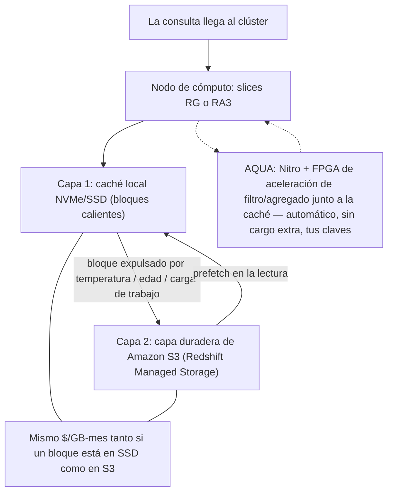
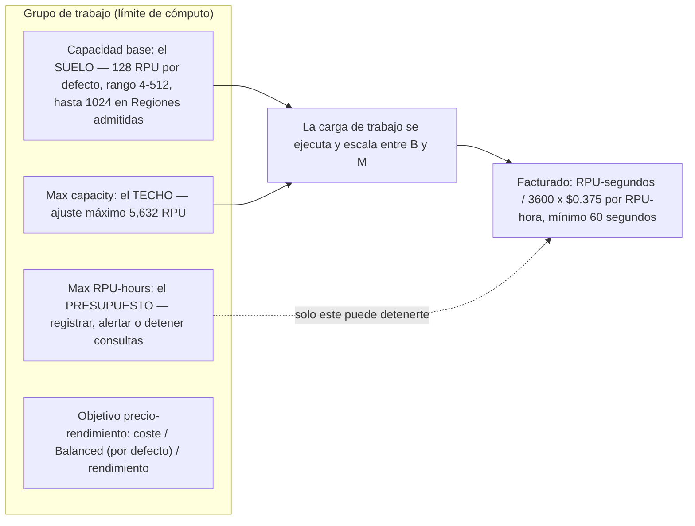
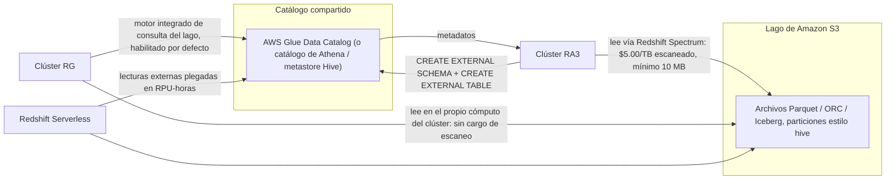
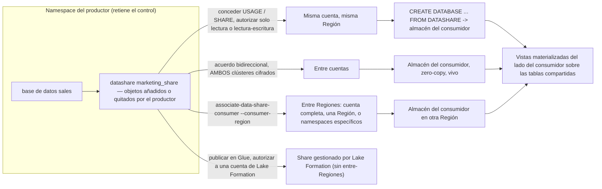
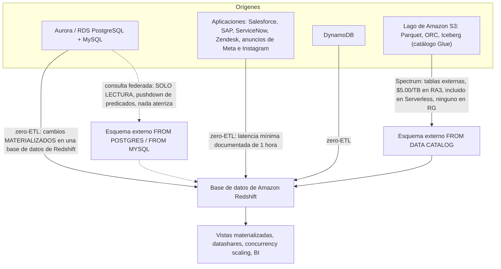
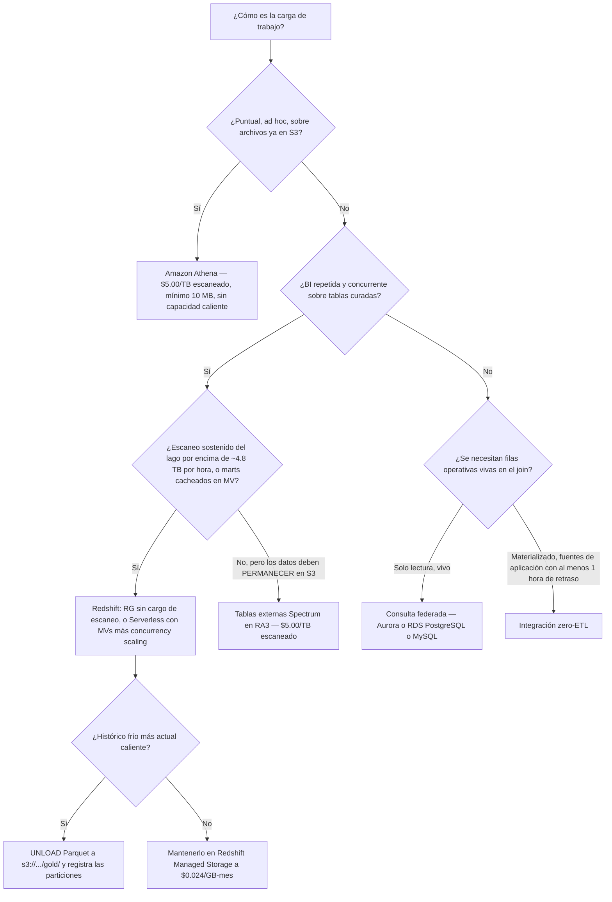

# Redshift en el lakehouse: Spectrum, Serverless, data sharing y federación

La lección 09 puso un motor de consultas encima del lago. Esta lección pone un **almacén** al lado, y luego muestra cómo ese almacén deja de ser un jardín amurallado. Amazon Redshift es la mitad *gobernada y con estado* del lakehouse de AWS: posee un almacén (Redshift Managed Storage), y se proyecta hacia afuera en tres direcciones documentadas, **Spectrum / el motor integrado de consulta del lago de datos** (formatos abiertos de S3), **data shares** (otros almacenes Redshift), y **esquemas externos federados** (Aurora/RDS). Todo lo que construiste en las lecciones 01 to 09, diseño de S3, Parquet e Iceberg, crawlers de Glue, concesiones de Lake Formation, se enchufa en el mismo catálogo Glue/Lake Formation que Redshift ya consume.

La regla didáctica de esta lección es corta: **Redshift es donde aterriza el SQL repetido, gobernado y concurrente.** No es «Athena, pero más grande».

```text
=================================================================
 SUPERFICIE DE REDSHIFT EN EL LAKEHOUSE — AWS DATA LAKEHOUSE (en oct 2026)
=================================================================
 Almacén ........ RA3 o RG provisionado (desde $0.543/hora bajo demanda)
                  Redshift Serverless (mínimo 4 RPU, $0.375/RPU-hora)
 Almacenamiento . Redshift Managed Storage, $0.024 por GB-mes
                  caché SSD + capa duradera de S3, facturado SEPARADAMENTE
 Lectura del lago  tablas externas Spectrum en RA3: $5.00/TB escaneado
                  motor integrado de consulta del lago en RG: sin cargo
                     de escaneo
                  en Serverless: incluido en RPU-horas, no medido
 Traer .......... consulta federada: Aurora/RDS PostgreSQL + MySQL,
                  solo lectura, pushdown de predicados, nada aterriza
                  zero-ETL: Aurora/RDS/DynamoDB/apps -> BD de Redshift
 Compartir ...... datashares: misma cuenta, entre cuentas,
                  entre Regiones; el productor retiene el control
 Caché .......... vistas materializadas (+ auto refresh) y
                  concurrency scaling (banco diario de créditos gratis)
 Tablas abiertas  Iceberg LECTURA vía esquema externo (registrado en Glue)
                  Iceberg ESCRITURA vía CREATE TABLE ... USING ICEBERG,
                  INSERT / DELETE / UPDATE / MERGE (GA 2025-11-17)
 Exportar ....... UNLOAD (...) TO 's3://.../gold/' FORMAT AS PARQUET
 No esto ........ escaneos ad hoc puntuales sobre S3 en bruto = Amazon
                     Athena
=================================================================
```

En esta lección:

- explicarás la **división cómputo/almacenamiento de RA3** y pondrás precio a **Redshift Managed Storage** de forma independiente de las horas de nodo, y luego dirás qué es **AQUA** ahora que su interruptor de activar/desactivar desapareció;
- leerás correctamente el anuncio de **RG**: una familia de nodos Graviton con un **motor integrado de consulta del lago de datos**, GA el **2026-05-12**, que elimina el cargo de escaneo de Spectrum;
- dimensionarás **Redshift Serverless** en **RPUs** y separarás sus **tres techos**: capacidad base, Max capacity, y el presupuesto de Max RPU-hours;
- enunciarás la **regla 1:1 de namespace a grupo de trabajo** y dirás qué objeto posee la identidad de almacenamiento y cuál el cómputo;
- escribirás el **DDL de tabla externa de Spectrum** de principio a fin, esquema externo, tabla externa, registro de particiones, y le pondrás precio a **$5.00 por TB escaneado**;
- explicarás por qué **la proyección de particiones es una característica de Athena**, y qué te cuesta en Redshift;
- recorrerás una **cadena de permisos de datashare** entre productor y consumidor, en la misma cuenta, entre cuentas y entre Regiones;
- separarás la **consulta federada** (viva, solo lectura) del **zero-ETL** (materializado, al menos 1 hora obsoleto para fuentes de aplicación) y de **Spectrum** (escanea archivos);
- usarás **vistas materializadas**, **auto refresh** y **concurrency scaling** como respuesta a la concurrencia, incluyendo el cambio de auto refresh del **27 de febrero de 2026**;
- **leerás y escribirás Apache Iceberg** desde Redshift, y reconocerás que **`WRITE UNLOAD TO` no es una cláusula de Redshift**;
- aterrizarás una **capa gold de Parquet** con `UNLOAD ... PARTITION BY` y la registrarás en el catálogo;
- trabajarás tú mismo el punto de equilibrio de **Athena $5/TB frente a RPU de Serverless**, con tarifas de octubre de 2026;
- estudiarás **Vanguard, Nasdaq, Easygo y GE Aerospace**, un **cuadro de actualizaciones de 2026 con fuentes**, y **catorce preguntas de estilo examen** con tres comprobaciones interactivas.

---

## 1. RA3 y Redshift Managed Storage: la división cómputo/almacenamiento

### 1.1 Dos medidores, un almacén

La guía de gestión de AWS enuncia el diseño en una frase: *«Los nodos RG y RA3 con almacenamiento gestionado te permiten optimizar tu almacén de datos escalando y pagando el cómputo y el almacenamiento gestionado de forma independiente.»* Esa es toda la idea: dimensionas un clúster por cuántos datos **procesas** al día, no por cuántos **almacenas**.

El almacenamiento gestionado es un almacén de dos capas: *«SSD grandes y de alto rendimiento en cada nodo RG y RA3 para almacenamiento local rápido y Amazon S3 para almacenamiento duradero a más largo plazo»*, con desvío automático cuando los datos crecen más allá de los SSD locales. La línea que importa para tu factura: *«Pagas la misma tarifa baja por el almacenamiento gestionado de Redshift independientemente de que los datos estén en SSD de alto rendimiento o en Amazon S3.»* La tarifa es **$0.024 por GB-mes** (us-east-1, precios de AWS Redshift, en oct 2026), y no hay cargos de transferencia de nodo a almacenamiento dentro del mecanismo.

| Familia de nodos | Modelo de almacenamiento | Las consultas del lago pasan por | Estado en este curso |
|---|---|---|---|
| **RA3** | Managed storage (caché SSD + S3), escala de forma independiente de los nodos | **Redshift Spectrum** (cargo de escaneo por TB) | Aún ampliamente desplegado; la arquitectura de referencia para Spectrum |
| **RG** (Graviton) | Managed storage, escala de forma independiente de los nodos | **Motor integrado de consulta del lago de datos** en el propio cómputo del clúster | Familia provisionada recomendada desde GA el **2026-05-12** |
| **DC2** | Solo disco local: añade nodos para añadir almacenamiento | Spectrum | Recomendada solo «for datasets under 1 TB (compressed)» |

Formas de RA3 y techos de almacenamiento gestionado por nodo (guía de gestión de AWS, consultada 2026-10-11): `ra3.large` 2 vCPU / 16 GiB / 2 slices / 8 TB, `ra3.xlplus` 4 / 32 / 2 / 32 TB, `ra3.4xlarge` 12 / 96 / 4 / 128 TB, `ra3.16xlarge` 48 / 384 / 16 / 128 TB. Formas de RG: `rg.large` 2 / 16 / 2 / 8 TB, `rg.xlarge` 4 / 32 / 2 / 32 TB, `rg.4xlarge` 16 / 128 / 8 / 128 TB, `rg.12xlarge` 48 / 384 / 16 / 128 TB.



**Ejemplo resuelto E1: el mes de RA3 publicado por AWS (tarifas en oct 2026, us-east-1)**

```text
Compute         4 x ra3.4xlarge x $3.26/hour x 730 hours   = $9,519.20
Managed storage 40 TB = 40 x 1,024 GB = 40,960 GB
                40,960 GB-month x $0.024/GB-month           =   $983.04
Spectrum        20 TB scanned x $5.00/TB                    =   $100.00
                                                              ----------
Month total (sum of AWS's three published lines, derived)  = $10,602.24
```

AWS publica la misma aritmética para el solo almacenamiento: *«managed storage will be charged at $0.024/GB-Month … 51,250 GB-month x $0.024 per GB-month = $1,230»*. El punto examinable es estructural: **la línea de $983.04 no desaparece cuando pausas el clúster**, y no tiene nada que ver con lo ocupados que estén los nodos. Cualquier respuesta que cite un único precio de almacén «por TB por hora» combinado ha colapsado dos medidores independientes.

### 1.2 AQUA: una aceleración que ya no configuras

**AQUA (Advanced Query Accelerator)** acerca el trabajo de reducción y agregación a los datos. El post de lanzamiento (AWS News Blog, **2021-04-14**) afirma que *«reduce el tráfico de red, descarga trabajo de las CPU de los nodos RA3 y permite que AQUA mejore el rendimiento de esas consultas hasta 10 veces, sin coste adicional y sin cambios de código»*, construido sobre *«el AWS Nitro System y la aceleración personalizada basada en FPGA»*, con el volumen enviado al cómputo *«generalmente mucho más pequeños (a menudo solo el 5% del original)»* y *«Todos los datos cacheados por AQUA se cifran usando tus claves.»*

Lo que cambió: el interruptor desapareció. La referencia de API de `AquaConfiguration` dice *«La operación que usa esta estructura está retirada. Amazon Redshift determina automáticamente si usar AQUA»*, y la respuesta de re:Post (2023-11-15) añade que *«The option to turn AQUA on an individual cluster basis is no longer available for users.»*

> [!IMPORTANT]
> Trata **AQUA como una técnica interna de rendimiento de la que te beneficias, no como un ajuste que configuras.** Cualquier material que te diga «habilita AQUA en la consola» está obsoleto, y la cifra de «hasta 10x» debe citarse siempre con su fecha **2021-04-14**: ninguna página de AWS de 2025 to 2026 la restate. AWS no publica una lista actual de nodos con AQUA habilitado, así que nunca la afirmes.

### 1.3 RG: la familia que elimina el peaje de Spectrum

El **2026-05-12** AWS anunció la disponibilidad general de **instancias RG con un motor integrado de consulta del lago de datos**: *«RG instances deliver better performance, running data warehouse workloads up to 2.2x as fast as RA3 instances at 30% lower price per vCPU … performance up to 2.4x as fast as RA3 for Apache Iceberg and up to 1.5x as fast as RA3 for Apache Parquet.»* El post complementario (2026-05-19) es más directo sobre el mecanismo: con RA3, las consultas del lago se descargaban a Spectrum, que *«introduced network overhead, added latency, and imposed a $5/TB scanning charge on every query»*: mientras que las instancias RG *«eliminate Amazon Redshift Spectrum's per-TB scanning charges»*, y *«The integrated data lake query engine is enabled by default.»*

`rg.large` y `rg.12xlarge` llegaron el **2026-07-01**, disponibles *«solo en la pista actual (P202)»*, con opciones On-Demand y Reserved Instance de 1 y 3 años.

- **📚 ¿Sabías que…?** El motor truco de estadísticas que vale la pena recordar: **JIT ANALYZE** *«recopila y usa automáticamente estadísticas de las tablas del lago de datos durante la ejecución de la consulta»*, lo que elimina el ritual manual de `ANALYZE` antes de consultar que las tablas externas de otro modo exigen (AWS Big Data Blog, 2026-05-19). Y la guía de inicio indica que el motor integrado *«also supports querying data in Amazon S3 buckets located in a different AWS Region»*: las lecturas del lago entre Regiones funcionan, con cargos de transferencia de datos pegados.

---

## 2. Redshift Serverless: RPUs, namespaces y grupos de trabajo

### 2.1 Una RPU son 16 GB de memoria

Serverless no tiene clúster que dimensionar. Fijas la capacidad en **RPUs**, y AWS define *«Un RPU proporciona 16 GB de memoria.»* La facturación es *«por las cargas de trabajo que ejecutas en RPU-hours, con facturación por segundo y un cargo mínimo de 60 segundos»*, y no hay *«no charge for data warehouse start up time.»*

| Parámetro de Serverless | Valor (docs de AWS, consultadas 2026-10-11) |
|---|---|
| Unidad | **1 RPU = 16 GB de memoria** |
| Tarifa (us-east-1) | **$0.375 por RPU-hora** |
| Precio de entrada | **desde $1.50 por hora** (4 RPU × $0.375) |
| Capacidad base | por defecto **128**; **4 to 512** en general, **hasta 1024** en Regiones admitidas |
| Incrementos | 4 a 8 en incrementos de 4; 8 a 512 en incrementos de 8; 512 a 1024 en incrementos de 32 |
| Techo de Max capacity | ajuste máximo de **5,632 RPUs** por grupo de trabajo |
| Granularidad de facturación | por segundo, **mínimo de 60 segundos** por transacción |
| Incluido en la tarifa de RPU | **Redshift Spectrum** y **concurrency scaling** |
| Acoplamiento con almacenamiento | 4 RPU base soporta hasta 32 TB; 8 to 16 RPU hasta 128 TB; por encima de 128 TB necesita 32 o más RPU |

El suelo de 4 RPU llegó por etapas y ahora es amplio: el What's New del **2026-05-01** extendió el **mínimo de 4 RPU** a 7 Regiones más, describiendo un punto de partida de **4 RPUs** a *«$1.50 per hour»* con *«up to 32 TB of Redshift managed storage, … a maximum of 100 columns per table and 64 GB of memory.»*

### 2.2 Tres techos, y solo uno de ellos protege tu cartera

Esta es la parte más confusa de Serverless, así que separa los tres knobs explícitamente:

| Knob | Qué limita | Dónde aplica | ¿Protege la cartera? |
|---|---|---|---|
| **Capacidad base** | El suelo / punto de partida (por defecto **128** RPUs) | Por grupo de trabajo | No: fija el suelo, no la factura |
| **Max capacity (MaxRPU)** | *«the highest count of RPUs that Amazon Redshift Serverless uses for scaling purposes»* | Por grupo de trabajo, ajuste máximo **5,632** | No: limita el rendimiento |
| **Límite de uso de Max RPU hours** | Un presupuesto que *«writes a log entry, alerts, or stops queries»* | Por grupo de trabajo | **Sí**: la única salvaguarda |

Hay también un deslizador de **objetivo precio-rendimiento**: *«Optimiza para coste / Equilibrado / Optimiza para rendimiento»*, *«habilitado por defecto para todos los grupos de trabajo Serverless nuevos y configurado en Balanced.»* El uso es auditable en `sys_serverless_usage`, que devuelve `charged_seconds`.



### 2.3 Namespace frente a grupo de trabajo, y la regla 1:1

AWS es preciso aquí: *«Para aislar cargas de trabajo y gestionar diferentes recursos … puedes crear namespaces y workgroups y gestionar por separado los recursos de almacenamiento y de cómputo.»* Un **grupo de trabajo** es *«a collection of compute resources … RPUs, VPC subnet groups, and security groups … access and usage limits.»* Un **namespace** posee la identidad del lado del almacenamiento: bases de datos, instantáneas, autenticación y la clave KMS: *«De forma predeterminada, Amazon Redshift Serverless crea namespaces con una clave predeterminada de AWS Key Management Service, pero puedes especificar otra clave para cifrar tus datos.»*

> [!WARNING]
> ⚠️ **«Cada namespace puede tener asociado solo un grupo de trabajo. A la inversa, cada grupo de trabajo puede estar asociado con solo un namespace.»** Los equipos esperan rutinariamente que un namespace se ramifique en varios grupos de trabajo aislados. No puede. El aislamiento entre dev/test/prod significa por tanto **múltiples namespaces**, cada uno con su propia clave KMS, bases de datos y instantáneas, no múltiples grupos de trabajo bajo un namespace.

**Ejemplo resuelto E2: economía de 4 RPU y el suelo de 60 segundos (tarifas en oct 2026, us-east-1; aritmética derivada de la tarifa publicada por AWS)**

```text
Entry price check:  4 RPU x $0.375 per RPU-hour      = $1.50 / hour  (matches AWS)

One 10-minute query per day, 4 RPU:
  (600 s / 3600 s) x 4 RPU x $0.375                 = $0.25 / day
  $0.25 x 30 days                                    = $7.50 / month

The 60-second trap - 100 one-second dashboard queries/day, same 4 RPU:
  100 x 60 s (the minimum charge) x 4 RPU            = 24,000 RPU-seconds
  24,000 / 3600                                      = 6.67 RPU-hours
  6.67 x $0.375                                      = $2.50 / day
  $2.50 x 22 working days                            = $55.00 / month
  ...for one second of actual work per query.
```

La propia guía de AWS sobre el segundo bloque: *«Para consultas muy cortas (como las de subsegundo), esto puede inflar los costes. Para mitigarlo, agrupa las consultas cuando sea posible para maximizar la utilización de recursos dentro de la ventana de 60 segundos»* (AWS Big Data Blog, 2025-08-22). Serverless no significa gratuito-estando-ocioso; significa **sin ocio alguno entre consultas, y una factura de un minuto por cada una de ellas**.

- **📚 ¿Sabías que…?** Las reservas de Serverless son un compromiso a nivel de pagador: *«gestionadas a nivel de la cuenta pagadora de AWS, y las reservas pueden compartirse entre varias cuentas de AWS»*, que valen *«hasta un 24% en todas las cargas de trabajo de Redshift Serverless»* en la opción de 1 año, y hasta un **45% para un plazo de 3 años** en la página de precios: mientras que *«los créditos gratis no se aplican a las reservas.»* La capacidad reservada se mide por hora y se factura por segundo, con tarifas bajo demanda aplicándose por encima del nivel de RPU reservado.

---

## 3. Redshift Spectrum: tablas externas sobre el lago de S3

### 3.1 El contrato del catálogo

Spectrum es como un clúster **RA3** lee archivos que permanecen en S3. La página de panorama nombra los tres catálogos posibles: *«El catálogo de datos externo puede ser AWS Glue, el catálogo de datos que viene con Amazon Athena, o tu propio metastore Apache Hive … Los cambios en el catálogo de datos externo están disponibles de inmediato para cualquiera de tus clústeres de Amazon Redshift.»* Como el catálogo es compartido, **las tablas de Glue que tu crawler construyó en la lección 07 ya son visibles para Redshift**: solo necesitas el esquema externo que apunta a ellas.

Los formatos de archivo admitidos (matriz de archivos de datos de Spectrum, consultada 2026-10-11) incluyen **Parquet** (columnar, lecturas paralelas, dividido por row group), **ORC** (stripe), **RCFile**, **TextFile**, **SequenceFile**, **RegexSerDe**, **OpenCSV**, **AVRO**, **Ion** y **JSON**. La recomendación de AWS es explícita: *«Recomendamos usar un formato de archivo de almacenamiento columnar, como Apache Parquet.»* Spectrum escanea *«los archivos de la carpeta especificada y cualquier subcarpeta»* pero *«ignora los archivos ocultos y los archivos que empiezan con un punto, guion bajo o almohadilla (., _ o #) o terminan con una virgulilla (~)»*: una regla que ocultará en silencio una exportación cuyo prefijo empiece con `_`.

### 3.2 Ejemplo resuelto E3: DDL de tabla externa, de principio a fin

```sql
-- Step 1: register a Glue database as an external schema on the cluster
CREATE EXTERNAL SCHEMA spectrum
FROM DATA CATALOG
DATABASE 'lakehouse_gold'
IAM_ROLE 'arn:aws:iam::123456789012:role/RedshiftSpectrumRole';

-- Step 2: define the external table over the Parquet gold prefix
CREATE EXTERNAL TABLE spectrum.orders (
    order_id     BIGINT,
    customer_id  BIGINT,
    order_total  DECIMAL(12,2),
    order_date   DATE
)
PARTITIONED BY (order_month DATE)
STORED AS PARQUET
LOCATION 's3://lakehouse-demo/gold/orders/';

-- Step 3: partitions must be registered explicitly - Spectrum only scans
--         folders that were added
ALTER TABLE spectrum.orders
ADD PARTITION (order_month = DATE '2026-09-01')
LOCATION 's3://lakehouse-demo/gold/orders/order_month=2026-09-01/';

-- Step 4: prune with the partition key; only that month's Parquet is scanned
SELECT order_date, SUM(order_total) AS revenue
FROM   spectrum.orders
WHERE  order_month = DATE '2026-09-01'
GROUP  BY order_date
ORDER  BY order_date;

-- Step 5: audit what is actually registered before you trust a zero-row result
-- Query SVV_EXTERNAL_PARTITIONS to find the partitions that exist
SELECT *
FROM   svv_external_partitions
WHERE  table_name = 'orders';
```

Dos detalles hacen el daño en producción: **el registro de particiones es explícito**, *«Redshift Spectrum solo escanea archivos de una ubicación de Amazon S3 que se ha añadido explícitamente usando `ALTER TABLE … ADD PARTITION`»*, y las pseudocolumnas son facturables, porque *«Selecting `$size`, `$path`, or `$spectrum_oid` incurs charges because Redshift Spectrum scans the data files on Amazon S3 to determine the size of the result set.»*

### 3.3 Ejemplo resuelto E4: la factura de Spectrum (el propio ejemplo de tres filas de AWS, en oct 2026)

Una tabla, **100 columnas**, la consulta lee **una** columna:

| Diseño de los mismos datos | Bytes escaneados | Coste de Spectrum a $5.00/TB |
|---|---|---|
| Texto sin comprimir | 4 TB | 4 × $5.00 = **$20.00** |
| Mismos datos, GZIP a 4:1 | 1 TB | 1 × $5.00 = **$5.00** |
| Mismos datos, GZIP + Parquet, 1 columna leída | 10 GB | 0.01 × $5.00 = **$0.05** |

Tres palancas, tres mecanismos: **la compresión** encoge cada byte, **el formato columnar** permite al motor omitir columnas que no necesita, y **la poda de particiones** omite archivos enteros. En una tabla de 100 columnas esas palancas abarcan tres órdenes de magnitud: de **$20.00** a **$0.05** por la misma pregunta.

El propio medidor: *«se factura por el número de bytes escaneados por Redshift Spectrum, redondeado al megabyte siguiente, con un mínimo de 10 MB por consulta»*, y *«No hay cargos por sentencias de Data Definition Language (DDL) … ni por consultas fallidas.»* Hasta 9.9 MB escaneados todavía facturan el mínimo de 10 MB.

### 3.4 Dónde aplica el $5/TB y dónde no

| Ruta | ¿Cargo de escaneo? | Fuente (en oct 2026) |
|---|---|---|
| Spectrum en **RA3 / DC2** provisionado | **Sí: $5.00/TB escaneado** | página de precios de Redshift |
| Consultas externas en **Redshift Serverless** | **No**: *«included in … RPU-hr amounts»* | página de precios de Redshift |
| Consultas del lago en instancias **RG** | **No**: *«Redshift Spectrum no es necesario para las instancias RG de Redshift»* | página de precios de Redshift; Big Data Blog 2026-05-19 |

> [!WARNING]
> ⚠️ **Nunca cites «$5/TB para Redshift» como regla universal.** La frase correcta es *«per-TB scanning charges apply to Spectrum reads from provisioned RA3/DC2 clusters.»* Serverless pliega los escaneos externos en RPU-horas, y RG no tiene capa de Spectrum en absoluto. Una pregunta que ofrece «$5/TB en Redshift Serverless» como trampa está probando exactamente esto.



### 3.5 La proyección de particiones es solo de Athena: dilo en términos de Redshift

La propia redacción de AWS es inequívoca: *«La proyección de particiones solo es utilizable cuando la tabla se consulta a través de Amazon Athena. Si la misma tabla se lee a través de otro servicio como Amazon Redshift Spectrum … se usan los metadatos de partición estándar.»* Así que el truco de la proyección que hace que Athena se libre de `ADD PARTITION` **no** se transfiere. En Redshift compensas con uno de tres mecanismos: `ALTER TABLE … ADD PARTITION` explícito, **`CREATE EXTERNAL TABLE AS`** (que *«particiona los archivos nuevos según esas claves de partición y registra automáticamente las particiones nuevas en el catálogo externo»*), o un **crawler de Glue**.

- **📚 ¿Sabías que…?** AWS también dice *«Las vistas materializadas sobre tablas Spectrum pueden mejorar enormemente el coste y el rendimiento.»* Una MV sobre una tabla externa es la forma documentada de dejar de pagar el mismo escaneo dos veces: pagas una vez en el refresco, y luego lees el resultado. La sección 7 lo desmonta, incluyendo qué refrescos se mantienen incrementales.

---

## 4. Data sharing: productor y consumidor, sin copias

### 4.1 Qué es en la práctica un datashare

*«Con el intercambio de datos de Amazon Redshift, puedes compartir de forma segura el acceso a datos en vivo entre clústeres de Amazon Redshift, workgroups, cuentas de AWS y regiones de AWS sin mover ni copiar manualmente los datos. Como los datos están en vivo, todos los usuarios ven la información más actualizada y consistente.»* Niveles compartibles: *«databases, schemas, tables, views (including regular, late-binding, and materialized views), and SQL user-defined functions (UDFs)»*, con permisos como `SELECT`, `INSERT`, `UPDATE` sobre tablas y `USAGE`, `CREATE` sobre esquemas.

«Live» (vivo) y «zero-copy» son las dos palabras a memorizar: **no se duplica nada**, el consumidor lee el almacenamiento del productor, y el productor puede revocar en cualquier momento: *«Cuando se revocan los permisos, los clústeres consumidores pierden de inmediato el acceso a los objetos compartidos y dejan de verlos en la lista de datashares INBOUND en SVV_DATASHARES.»*

### 4.2 Misma cuenta, entre cuentas, entre Regiones

| Ámbito | Acuerdo | Condición extra |
|---|---|---|
| Misma cuenta, misma Región | el productor concede, el consumidor se asocia | ninguna más allá de las concesiones |
| **Entre cuentas** | bidireccional: *«producer authorizes, consumer associates (or declines)»* | *«For cross-account data sharing, both the producer and consumer cluster must be encrypted.»* |
| **Entre Regiones** | `associate-data-share-consumer` con `--consumer-region` | tres opciones de delimitación: *«an entire AWS account spanning all its AWS Regions»*, *«a specific AWS Region in an AWS account»*, o *«specific namespaces within an AWS Region»* |
| Publicado en Glue | la autorización va a Lake Formation | *«you can only grant authorization of the datashare to a Lake Formation account»* |

La elección de autorización en sí misma es binaria y explícita: *«Read-only on [cluster name or workgroup name]»* frente a *«Read and write on [cluster name or workgroup name]»*, expuesta en la CLI como `authorize-data-share … [--allow-writes | --no-allow-writes]`. Las escrituras son un privilegio concedido por el productor: permitirlas solo *permite* lo que el productor realmente concedió.

### 4.3 Control del productor, concesiones granulares y shares gestionados por Lake Formation

El productor nunca suelta el timón: *«Como administrador del productor, retienes el control de los datasets que estás compartiendo. Puedes añadir objetos nuevos al datashare o quitarlos de él.»*

**No hay ningún producto llamado «Redshift managed access»**: no escribas esa frase como nombre de característica. Lo que existe, y lo que describen los docs, es un conjunto de mecanismos que juntos te dan acceso gestionado y de grano fino:

- **Control retenido por el productor**: añadir, quitar y revocar objetos en cualquier momento.
- **Compartición granular con `WITH PERMISSIONS`**: *«Si creas una base de datos `WITH PERMISSIONS`, puedes conceder permisos granulares sobre los objetos del datashare a distintos usuarios y roles. Sin esto, todos los usuarios y roles a los que se les concede el permiso USAGE sobre la base de datos del datashare reciben todos los permisos sobre todos los objetos.»*
- **Datashares gestionados por AWS Lake Formation**: *«Amazon Redshift currently supports data sharing via Lake Formation when sharing within the same account or across accounts. Cross-Region sharing is currently not supported.»*
- **Permisos federados de Redshift** con IAM Identity Center: introducidos porque *«Traditional Amazon Redshift data sharing doesn't support RLS or DDM policies on shared tables»* (AWS Big Data Blog, 2026-01-05).

> [!IMPORTANT]
> **`WITH PERMISSIONS` invierte el valor por defecto, en ambas direcciones.** Sin él, `USAGE` sobre la base de datos compartida concede **todo** dentro de ella (sobre-compartición). Con él, `USAGE` no concede **nada** hasta que añadas `GRANT`s a nivel de objeto: que es la causa número uno de *«my consumer connected fine and sees no tables.»* Los dos modos de fallo los responde una sola decisión, tomada en el momento de `CREATE DATABASE`.

**Ejemplo resuelto E5: la cadena de permisos del datashare (SQL del productor y luego SQL del consumidor)**

```sql
-- ================= PRODUCER =================
-- 1. Create the datashare from one source database
CREATE DATASHARE marketing_share OF DATABASE sales;

-- 2. Add exactly what should leave the warehouse
ALTER DATASHARE marketing_share ADD SCHEMA public.public_stats;

-- 3. Grant to the consumer account (SHARE lets them add consumers)
GRANT USAGE ON DATASHARE marketing_share
  TO ACCOUNT '222222222222';

-- 4. Authorize - deliberately WITHOUT --allow-writes (read-only share)
--    aws redshift authorize-data-share --consumer-account 222222222222
--    aws redshift associate-data-share-consumer --consumer-account 222222222222

-- ================= CONSUMER =================
-- 5. Mount the share. WITH PERMISSIONS = fine-grained from here on.
CREATE DATABASE mkt_db WITH PERMISSIONS
  FROM DATASHARE marketing_share OF ACCOUNT '111111111111';

-- 6. USAGE alone now grants NOTHING - add the object grants
GRANT USAGE ON DATABASE mkt_db TO ROLE bi_user;
GRANT SELECT ON mkt_db.public.public_stats TO ROLE bi_user;

-- 7. Verify what the consumer can actually see: inbound datashares
--    are listed in SVV_DATASHARES, and they disappear the moment
--    the producer revokes the grant
SELECT *
FROM   svv_datashares;
```

Dos restricciones documentadas para tener en la cabeza: *«No puedes crear un datashare sobre objetos de base de datos creados a partir de un datashare existente»* (copia primero a una tabla local, y luego comparte esa), y la visibilidad de metadatos en el consumidor se limita a lo que el datashare expone: `SVV_ALL_*`, `SVV_REDSHIFT_*` y `SVV_REDSHIFT_DATABASES` no se convierten en un directorio del productor.



- **📚 ¿Sabías que…?** El data sharing no es solo para tablas. Los consumidores pueden incluir **AWS Data Exchange**, y un namespace de consumidor añadido a un share no necesita un paso de autorización separado: *«Si añades un namespace como consumidor de datos, no tienes que realizar la autorización.»* Y sobre la pregunta que todos se hacen: compartir no tiene una línea de factura separada, y por eso la formulación honesta es «sin copia, sin segunda factura de almacenamiento», nunca «gratis».

---

## 5. Consultas federadas: leer la base de datos operativa en su lugar

### 5.1 La ruta del pushdown

*«Federated queries can work with external databases in Amazon RDS for PostgreSQL, Amazon Aurora PostgreSQL-Compatible Edition, Amazon RDS for MySQL, and Amazon Aurora MySQL-Compatible Edition.»* La ruta de ejecución está documentada en tres pasos: el nodo líder obtiene los metadatos remotos, los nodos de cómputo emiten subconsultas con pushdown de predicados, y las filas se redistribuyen: *«Para reducir el movimiento de datos por la red y mejorar el rendimiento, Amazon Redshift distribuye parte del cálculo de las consultas federadas directamente en las bases de datos operativas remotas.»* Cada ejecución se registra en `SVL_FEDERATED_QUERY`.

**Ejemplo resuelto E6: una sentencia que une la base de datos operativa con el almacén y el lago**

```sql
-- External schema over a PostgreSQL-family source (read-only)
CREATE EXTERNAL SCHEMA app_db
FROM POSTGRES
DATABASE 'orders_prod'
IAM_ROLE 'arn:aws:iam::123456789012:role/RedshiftFederationRole'
-- Source credentials live in AWS Secrets Manager and are referenced
-- through the IAM role above

-- Live operational rows + warehouse rows + Spectrum rows, one statement
SELECT c.customer_id,
       c.region,
       COUNT(DISTINCT f.order_id) AS open_orders,   -- federated: app_db
       SUM(w.order_total)         AS book_revenue,  -- warehouse table
       SUM(l.refund_total)        AS refunds        -- Spectrum: s3://gold/
FROM   app_db.customers            c
LEFT   JOIN warehouse.fact_orders  w ON w.customer_id = c.customer_id
LEFT   JOIN spectrum.refunds       l ON l.customer_id = c.customer_id
WHERE  c.signup_date >= DATE '2026-01-01'
GROUP  BY c.customer_id, c.region;
```

### 5.2 Los límites son la lección

| Restricción | Valor (docs de AWS, consultadas 2026-10-11) |
|---|---|
| Dirección | *«Federated queries support read access to external data sources. You can't write or create database objects in the external data source.»* |
| Dirección inversa | *«Federated queries don't enable access to Amazon Redshift from RDS or Aurora DB cluster.»* |
| Versiones | Aurora/RDS PostgreSQL **9.6 o posterior**; Aurora/RDS MySQL **5.6 o posterior** |
| Puertos | PostgreSQL **5432**, MySQL **3306** |
| Aislamiento en MySQL | *«transaction isolation at the READ COMMITTED level»* |
| Entre Regiones | *«typically incur network latency and billing charges»* |
| Centro de coste | A menudo el **origen**: los cargos de Aurora se basan en uso/IOPS, así que la calidad del pushdown es un control de coste |

El uso principal es *«unir filas operativas en vivo con filas del almacén y de S3 en una sola sentencia»*, no replicarlos. La federación no hace que una tabla de origen sea particionable o columnar: solo empuja predicados.

---

## 6. Integraciones zero-ETL: lo que aterriza en Redshift

**Zero-ETL es replicación, no consulta.** Los cambios fluyen automáticamente hacia una base de datos de Redshift, de modo que las vistas materializadas, el data sharing y el RBAC de Redshift todos se aplican al resultado.

La lista de orígenes admitidos capturada de la documentación de Redshift el **2026-10-11** (AWS añade orígenes con frecuencia y la disponibilidad por Región varía, así que fechala siempre que la cites):

| Categoría | Orígenes |
|---|---|
| Bases de datos Aurora / RDS | **Amazon Aurora MySQL**, **Amazon Aurora PostgreSQL**, **Amazon RDS for MySQL**, **Amazon RDS for PostgreSQL**, **Amazon RDS for Oracle** |
| Otros datos de AWS | **Amazon DynamoDB**, **Oracle Database@AWS** |
| Aplicaciones | **Salesforce**, **Salesforce Marketing Cloud Account Engagement**, **SAP**, **ServiceNow**, **Instagram ads**, **Meta ads**, **Zendesk** |
| Autogestionado | **MySQL**, **PostgreSQL**, **SQL Server**, **Oracle** |

Notas de versión y escala: Aurora MySQL **3.05.2 o posterior** y Aurora PostgreSQL **16.4 / 17.4 o posterior** para destinos de Redshift; *«hasta cinco integraciones desde el mismo clúster de Aurora»* (AWS What's New, 2025-03-12); el zero-ETL de Aurora PostgreSQL *«supports a maximum of 100 databases»*; y *«AWS no cobra una tarifa adicional por la integración zero-ETL de Aurora con Amazon Redshift»*: pagas por los recursos de Aurora y Redshift ya en uso.

La línea de latencia es la que cambia las arquitecturas: *«La latencia mínima de una integración zero-ETL con aplicaciones es de 1 hora. Puedes aumentarla aún más configurando un REFRESH_INTERVAL distinto de cero.»* Las integraciones de bases de datos Aurora/RDS están en tiempo casi real; las integraciones de **aplicaciones**, no.

> [!IMPORTANT]
> **Zero-ETL no es consulta federada, y tampoco lo es Spectrum.** Responden a tres preguntas distintas:
> - **Zero-ETL**: *¿qué aterriza en Redshift?* Una copia de los cambios, así que RBAC, MVs y shares se aplican, con fuentes de aplicación con al menos **1 hora** de retraso.
> - **Consulta federada**: *¿puedo leer el origen sin copiarlo?* Viva, **solo lectura**, solo familias PostgreSQL/MySQL, facturado contra tu cómputo de Redshift *y* las IOPS del origen.
> - **Spectrum**: *¿puedo leer archivos en S3?* Cargos de escaneo por TB en RA3/DC2, plegados en RPU-horas en Serverless, ausentes en RG.
>
> Los diagramas de arquitectura que borran estas tres cosas producen la respuesta equivocada cada vez.



---

## 7. Vistas materializadas, auto refresh y concurrency scaling

### 7.1 La superficie de MVs

Las MVs de Redshift pueden estar sobre **tablas locales**, **tablas de datashare**, **tablas Spectrum/externas** y **tablas federadas**: *«También puedes basar vistas materializadas en tablas externas creadas con Spectrum o consultas federadas.»* El refresco se elige por ti: incremental cuando es posible, de otro modo *«If an incremental refresh isn't possible, then Amazon Redshift performs a full refresh.»* El refresco incremental también se admite sobre objetos compartidos: *«La actualización incremental también se admite para una vista materializada basada en una tabla o vista materializada de datashare.»*

```sql
-- MV over the Spectrum table from E3: pay the scan once, not per dashboard
CREATE MATERIALIZED VIEW spectrum.orders_monthly
AUTO REFRESH YES
AS
SELECT order_month,
       COUNT(*)         AS orders,
       SUM(order_total) AS revenue
FROM   spectrum.orders
GROUP  BY order_month;
```

`AUTO REFRESH` usa por defecto **NO**, y se rechaza por completo cuando *«the materialized view definition includes mutable functions or external schemas»* o cuando defines *«a materialized view on another materialized view.»* El estado vive en `SVL_MV_REFRESH_STATUS`.

La calidad del refresco sobre datos externos es específica: el refresco incremental se admite en *«Standard data lake tables after S3 DELETE or PUT overwrite»* cuando la vista no agrega, y en *«Apache Iceberg tables after INSERT, DELETE, UPDATE, or table compaction.»*

### 7.2 El cambio de auto refresh del 27 de febrero de 2026

La redacción actual de AWS: *«Starting February 27, 2026, Auto REFRESH queries for Amazon Redshift materialized views are executed as user queries rather than background autonomic processes … only enabled for Amazon Redshift Provisioned clusters on the CURRENT Track of patch release P198 and newer. It is currently disabled on Serverless.»* El auto refresh también se mantiene limitado por la carga de trabajo: *«Amazon Redshift prioriza tus cargas de trabajo sobre la autorrefresco y puede detener la autorrefresco para preservar el rendimiento de la carga de trabajo del usuario.»*

> [!WARNING]
> ⚠️ **El auto refresh no es un planificador.** Está limitado bajo carga, no disponible cuando la definición incluye funciones mutables o esquemas externos, **deshabilitado en Serverless**, y, desde el **2026-02-27**, compite por la prioridad de consulta de usuario en clústeres provisionados en el track CURRENT. Cuando exista un SLA de frescura, usa un `REFRESH MATERIALIZED VIEW` programado o el planificador de la consola y lee `SVL_MV_REFRESH_STATUS`; no le entregues un SLA al autorefresh.

**Ejemplo resuelto E7: dimensionado de MV y concurrencia a escala de Vanguard (cifras del cliente, AWS Big Data Blog 2026-03-18)**

```text
Given (published):  250+ materialized views, 500+ dashboards,
                    500,000+ user queries per month

(a) Daily query volume  500,000 / 22 working days  ~ 22,727 queries / day
(b) MV policy           AUTO REFRESH YES where no hard SLA;
                        scheduled REFRESH where one exists
(c) Serverless sizing   base capacity = the sustained floor;
                        Max capacity  = the spike ceiling;
                        Max RPU-hours = the budget guardrail
(d) Provisioned burst   1 credited hour per 24 h, bankable to 30 h,
                        1-minute minimum per activation -> a 40-minute
                        Monday spike on one active cluster is covered
                        by the credit bank at $0 extra
```

### 7.3 Concurrency scaling: el carril de ráfaga

*«Se te cobra por los clústeres de concurrency scaling solo por el tiempo que están ejecutando consultas activamente.»* Los créditos se acumulan como *«una hora de créditos del clúster de Concurrency Scaling cada 24 horas mientras tu clúster principal está en ejecución»*, con *«un cargo mínimo de un minuto cada vez que se activa un clúster de Concurrency Scaling»*, y *«Puedes acumular hasta 30 horas de créditos gratis de Concurrency Scaling por cada clúster activo. Los créditos no caducan mientras tu clúster no se termine.»* La página de características afirma que esos créditos son *«suficientes para las necesidades de concurrencia del 97% de los clientes de Redshift.»*

**Ejemplo resuelto E8: lo que una ráfaga cuesta de verdad (en oct 2026)**

```text
Reference cluster (AWS pricing page): 10 x rg.4xlarge in US-West-1
                                       = $33.66 per hour
Per-second rate           $33.66 / 3600 = $0.00935 per second

Free bank:  1 hour per 24 h per ACTIVE cluster, capped at 30 hours.
            A brand-new cluster has ZERO banked hours; a PAUSED
            cluster stops accruing.

Beyond credit (derived arithmetic: 2 transient clusters x 300 s):
            $0.00935 x 300 x 2 = $5.61  (the published incident figure)
Hour total: $33.66 + $5.61     = $39.27
```

El parámetro a conocer es `max_concurrency_scaling_clusters`, cuyo límite por defecto es **10** (AWS News Blog, 2019-03-27), y la regla contraintuitiva de que la acumulación de créditos *«se aplica tanto a operaciones de lectura como de escritura.»* En **Serverless** nunca ves esta línea en absoluto: *«No necesitas pagar por concurrency scaling y Redshift Spectrum por separado porque ambos están incluidos con Amazon Redshift Serverless.»*

- **📚 ¿Sabías que…?** El concurrency scaling y las vistas materializadas no componen en todas partes: *«En tablas Apache Iceberg, concurrency scaling no se admite para la creación y actualización de vistas materializadas.»* Si tu MV está sobre Iceberg, el carril de ráfaga no está disponible para la creación y el refresco de esa MV: planifica capacidad en lugar de créditos.

---

## 8. Iceberg con Redshift: léelo, escríbelo, y el mito de UNLOAD

### 8.1 Lectura

Las tablas Iceberg se leen a través de un esquema externo sobre el **AWS Glue Data Catalog**, *«Las tablas Iceberg deben registrarse con AWS Glue Data Catalog»*, usando notación explícita o de montaje automático:

```sql
-- Explicit external schema over a Glue-registered Iceberg table
CREATE EXTERNAL SCHEMA iceberg_lake
FROM DATA CATALOG
DATABASE 'lakehouse_curated'
IAM_ROLE 'arn:aws:iam::123456789012:role/RedshiftSpectrumRole';

-- Two-part access to an Iceberg table
SELECT event_ts, user_id, event_type
FROM   iceberg_lake.clickstream
WHERE  event_ts >= TIMESTAMP '2026-10-01 00:00:00';
```

Qué motor hace el escaneo depende de la familia de nodos, y AWS lo dice directamente: *«Los tipos de instancia RG y Redshift Serverless usan su propio cómputo para procesar consultas del lago de datos, mientras que los tipos de instancia RA3 usan Redshift Spectrum.»* La lista de inicio de formatos legibles es *«Iceberg, Parquet, ORC, RCFile, TextFile, SequenceFile, RegexSerDe, OpenCSV, and AVRO.»*

### 8.2 Escritura

Las escrituras de Iceberg alcanzaron GA el **2025-11-17**. Sentencias admitidas: `CREATE TABLE … USING ICEBERG`, `CREATE TABLE … USING ICEBERG AS SELECT`, `INSERT INTO`, `DELETE`, `UPDATE`, `MERGE`, `ALTER`, `DROP TABLE`: en *«both Amazon Redshift provisioned clusters and Amazon Redshift Serverless instances.»*

```sql
-- Create an open-format gold table in the lake
CREATE TABLE iceberg_lake.customer_360 USING ICEBERG
AS
SELECT customer_id,
       MIN(order_date)   AS first_order,
       SUM(order_total)  AS lifetime_value
FROM   warehouse.orders
GROUP  BY customer_id;

-- Idempotent upsert into a table someone else may also write
MERGE INTO iceberg_lake.customer_360 t
USING   staging.customer_360_stg s
ON      t.customer_id = s.customer_id
WHEN MATCHED THEN UPDATE SET lifetime_value = s.lifetime_value
WHEN NOT MATCHED THEN INSERT (customer_id, lifetime_value)
                   VALUES (s.customer_id, s.lifetime_value);
```

Para escribir en una tabla que **Redshift no creó**, deben cumplirse cuatro condiciones: *«La tabla debe ser una tabla Iceberg v2; la tabla debe usar Parquet como formato de datos por defecto; la tabla no debe tener la compresión de metadatos configurada en True; la tabla no debe habilitar Write-Audit-Publish (WAP).»* También: *«La identidad federada no se admite al escribir en tablas Apache Iceberg.»*

> [!WARNING]
> ⚠️ **No existe la cláusula `WRITE UNLOAD TO` en Redshift.** Ninguna sintaxis así aparece en la referencia de `UNLOAD` ni en la referencia SQL de escrituras de Iceberg, así que nunca la escribas y nunca la marques como correcta. Las dos rutas de escritura admitidas son:
> - **DML de Iceberg en el almacén**: `CREATE TABLE … USING ICEBERG [AS SELECT]`, `INSERT`, `DELETE`, `UPDATE`, `MERGE`.
> - **Exportación a formato abierto hacia un prefijo de S3**: `UNLOAD ('…') TO 's3://…' FORMAT AS PARQUET PARTITION BY (…)`, que es el patrón de exportación gold de la sección 9.
>
> Úsalos como dos pasos de un pipeline, nunca como una sentencia inventada.

### 8.3 Vistas materializadas de Iceberg y registro en el catálogo

Las MVs de Iceberg son la variante de formato abierto: *«Las vistas materializadas de Iceberg se almacenan como tablas Iceberg estándar y son accesibles para cualquier motor de analítica que admita el formato Iceberg, incluidos Apache Spark, Amazon Athena y Trino.»* El refresco concurrente usa *«optimistic concurrency control (OCC) through the AWS Glue Data Catalog's conditional update mechanism.»* La disponibilidad es más estrecha de lo que supondrías: admitidas *«solo en Redshift Serverless y provisionado … las instancias RA3 y DC2 … no se admiten»*: así que **RG o Serverless**, no RA3.

También puedes registrar un clúster provisionado entero o un namespace serverless con el Glue Data Catalog para que otros motores lo lean a través de la **Iceberg REST API**, con *«AWS Lake Formation manages the permissions»* y notación de tres partes `database@namespace-catalog.schema.table`. Objetos que **no** se registran: esquemas externos, tablas externas, UDFs, procedimientos, *«Tables with row-level security or dynamic data masking policies attached»*, y objetos en mayúsculas o con mayúsculas y minúsculas mezcladas.

---

## 9. COPY y UNLOAD: aterrizar la capa gold

### 9.1 COPY hacia dentro

`COPY` ingiere desde S3 en Parquet, ORC, CSV, JSON o Avro usando un rol IAM. Es la ruta de volumen, y es la contraparte de todo en esta lección: lo que entra con `COPY`, se cura en el almacén, y sale con `UNLOAD`.

### 9.2 UNLOAD hacia fuera: el patrón de exportación gold

`UNLOAD` escribe *«el resultado de una consulta a uno o más archivos de texto, JSON o Apache Parquet en Amazon S3»*, con cifrado SSE-S3 o SSE-KMS. Parquet es el valor por defecto documentado para una capa gold: *«Parquet format is up to 2x faster to unload and consumes up to 6x less storage in Amazon S3, compared with text formats»*, y AWS nombra el aguas abajo explícitamente: *«Luego puedes analizar tus datos con Redshift Spectrum y otros servicios de AWS como Amazon Athena, Amazon EMR y Amazon SageMaker AI.»*

**Ejemplo resuelto E9: UNLOAD hacia gold, y luego hacerlo consultable (el paso que todos olvidan)**

```sql
-- 1) Export gold to S3 as Hive-partitioned Parquet, SSE-KMS
UNLOAD ('SELECT order_id, customer_id, order_total, order_date
         FROM gold.orders
         WHERE order_date >= ''2026-01-01''')
TO 's3://lakehouse-demo/gold/orders/'
IAM_ROLE 'arn:aws:iam::123456789012:role/RedshiftS3Unload'
FORMAT AS PARQUET
PARTITION BY (order_date)
ENCRYPTED KMS_KEY_ID 'arn:aws:kms:us-east-1:123456789012:key/1234abcd-12ab-34cd-56ef-1234567890ab'
MANIFEST VERBOSE
ALLOWOVERWRITE;

-- 2) Registration is NOT automatic: UNLOAD "doesn't make any calls to
--    an external catalog", so register it yourself
CREATE EXTERNAL TABLE spectrum.orders_gold (
    order_id    BIGINT,
    customer_id BIGINT,
    order_total DECIMAL(12,2)
)
PARTITIONED BY (order_date DATE)
STORED AS PARQUET
LOCATION 's3://lakehouse-demo/gold/orders/';

-- 3) Then add the partitions (or run a Glue crawler)
ALTER TABLE spectrum.orders_gold
ADD PARTITION (order_date = DATE '2026-09-01')
LOCATION 's3://lakehouse-demo/gold/orders/order_date=2026-09-01/';
```

| Opción de UNLOAD | Rango o regla (en oct 2026) |
|---|---|
| `FORMAT AS` | `CSV`, `PARQUET` o `JSON` |
| `PARTITION BY (…) [INCLUDE]` | carpetas por convención Hive, escritas automáticamente |
| `MANIFEST [VERBOSE]` | lista de los archivos escritos |
| `ENCRYPTED [AUTO]` con `KMS_KEY_ID` | SSE-KMS junto a SSE-S3 |
| `MAXFILESIZE` | 5 MB a **6.2 GB** (por defecto 6.2 GB) |
| `ROWGROUPSIZE` | 32 to 128 MB (por defecto 32 MB); necesita `ra3.4xlarge`, `ra3.16xlarge`, `rg.4xlarge`, `rg.12xlarge` o `dc2.8xlarge` |
| `ALLOWOVERWRITE`, `CLEANPATH`, `PARALLEL`, `REGION`, `EXTENSION` | higiene de rutas y control de paralelismo |

La **alternativa asimétrica** es `CREATE EXTERNAL TABLE AS` (CETAS), que *«solo admite dos formatos de archivo, TEXTFILE y PARQUET»*, pero que *«particiona los archivos nuevos según esas claves de partición y registra automáticamente las particiones nuevas en el catálogo externo.»* Elige CETAS cuando quieras que el paso de registro desaparezca; elige `UNLOAD` cuando estés exportando un resultado de consulta existente.

> [!IMPORTANT]
> **Dos trampas de UNLOAD con fechas pegadas.** Primero, *«El comando UNLOAD no hace ninguna llamada a un catálogo externo»*, una exportación gold con `PARTITION BY` es invisible para Athena y Spectrum hasta que ejecutes `ALTER TABLE … ADD PARTITION`, crees la tabla externa, o hagas correr un crawler de Glue. Segundo, el cifrado del lado del cliente para COPY y UNLOAD se cerró a nuevos clientes el **2025-04-30**, y después del **2026-04-30** *«no podrás usar el cifrado del lado del cliente para COPY y UNLOAD»*, enseña solo SSE-S3 y SSE-KMS. Y recuerda que los nombres de prefijo que empiezan con `_` o `.` los trata Spectrum como ocultos.

---

## 10. Boceto de coste resuelto: Athena $5/TB frente a RPU de Redshift Serverless

Todas las tarifas de abajo son publicadas; **la aritmética es nuestra** y se etiqueta como derivada. Tarifas: Athena bajo demanda **$5.00 por TB escaneado**; Redshift Serverless **$0.375 por RPU-hora**; Redshift Managed Storage **$0.024 por GB-mes**; Spectrum **$5.00 por TB escaneado** en RA3/DC2 (todo us-east-1, en oct 2026).

**Ejemplo resuelto E10: la constante de punto de equilibrio (derivada de tarifas publicadas)**

```text
A 64-RPU Serverless workgroup running one hour:
    64 RPU x $0.375 per RPU-hour          = $24.00
Athena at $5.00/TB matches that by scanning:
    $24.00 / $5.00 per TB                 = 4.8 TB in the same hour

    BELOW about 4.8 TB per hour of scanned data -> Athena's meter is cheaper
    ABOVE about 4.8 TB per hour                  -> keeping Redshift warm is cheaper
```

**Ejemplo resuelto E11: dos escenarios (derivado de tarifas publicadas, en oct 2026)**

```text
SCENARIO A - ad hoc, lightly loaded (Athena's home turf)
  30 queries/day, each pruned to 100 GB of Parquet = 3 TB/day
  Athena:         3 TB x $5.00                     = $15.00 / day
                  $15.00 x 22 working days         = $330.00 / month
  Serverless at 8 RPU with the 60-second floor:
                  30 x 60 s x 8 RPU = 14,400 RPU-s = 4 RPU-hours
                  4 x $0.375                       =   $1.50 / day
                  $1.50 x 22                       =  $33.00 / month
  plus managed storage if the same 5 TB is warehoused:
                  5 x 1,024 x $0.024              = $122.40 / month
                  Serverless total                ~ $155.40 / month

SCENARIO B - steady BI at scale (Redshift's home turf)
  64-RPU workgroup active 8 h/day x 22 days:
                  64 x 8 x 22 = 11,264 RPU-hours x $0.375 = $4,224.00
  plus 10 TB managed storage: 10 x 1,024 x $0.024          =   $245.76
                  Redshift total                           ~ $4,469.76 / month
  Equivalent Athena bill = $4,469.76 / $5.00 = 894 TB scanned per month
                           = about 40.6 TB per day
```

Lee el escenario A con honestidad: Serverless es más barato *solo si* de todos modos ibas a ejecutar el grupo de trabajo. La verdadera ventaja de Athena en ese escenario es **cero capacidad caliente y cero compromiso del lado del almacenamiento**: un análisis puntual no necesita un almacén en absoluto. Lee el escenario B como el cruce: si los cuadros de mando escanean más de unos **40 TB al día** *y* necesitan resultados cacheados en MV más alta concurrencia, Redshift es tanto más barato como estructuralmente correcto.



> [!IMPORTANT]
> **No inventes un número oficial de cruce.** AWS publica los *medidores*, por escaneo para Athena y Spectrum, RPU-horas o horas de nodo más almacenamiento gestionado para Redshift, y el punto de equilibrio de arriba es **nuestra aritmética a partir de esas tarifas publicadas, en oct 2026**, no un umbral publicado por AWS. Enúncialo como una constante derivada, muestra las entradas, y nunca lo presentes como una cifra de AWS.

---

## 11. Consolidando la decisión: tres comprobaciones interactivas

### 11.1 Matching: capacidad a motor

```matching
{
  "question": "Relaciona cada capacidad del lakehouse con el mecanismo de Redshift que realmente la entrega (en oct 2026):",
  "pairs": [
    {"left": "Consultar archivos Parquet que deben permanecer en S3, desde un clúster RA3", "right": "Tablas externas de Redshift Spectrum: $5.00 por TB escaneado, redondeado al MB siguiente, mínimo 10 MB por consulta, DDL y consultas fallidas gratis"},
    {"left": "Consultar los mismos archivos de S3 desde un clúster RG sin cargo de escaneo", "right": "El motor integrado de consulta del lago: habilitado por defecto en RG, así que Spectrum no se requiere y su cargo por TB nunca aparece"},
    {"left": "Dar a un segundo almacén en otra cuenta acceso vivo a una tabla sin copia", "right": "Un datashare: el productor autoriza, el consumidor se asocia, ambos clústeres cifrados, luego CREATE DATABASE... FROM DATASHARE"},
    {"left": "Unir filas vivas de Aurora PostgreSQL con filas del almacén y de S3 en una sentencia", "right": "Una consulta federada: esquema externo FROM POSTGRES, solo lectura, predicados empujados al origen, registrada en SVL_FEDERATED_QUERY"},
    {"left": "Aterrizar cambios de Salesforce, SAP, ServiceNow o DynamoDB dentro de una base de datos de Redshift", "right": "Una integración zero-ETL: los datos se materializan en Redshift, y las fuentes de aplicación tienen una latencia mínima documentada de 1 hora"},
    {"left": "Absorber una ráfaga de cuadro de mando del lunes por la mañana sin encolar", "right": "Concurrency scaling: hasta 1 hora gratis cada 24 horas por clúster activo, acumulable hasta 30 horas, mínimo 1 minuto por activación"}
  ],
  "explanation": "Seis capacidades, seis medidores distintos. Spectrum y el motor RG son las dos rutas de lectura del lago y solo difieren en quién paga el cargo de escaneo; los datashares son la ruta de almacén a almacén y nunca tocan S3; la consulta federada es viva pero solo lectura y se limita a las familias PostgreSQL y MySQL; zero-ETL aterriza una copia así que MVs, RBAC y shares se aplican, pero las fuentes de aplicación tienen al menos 1 hora de retraso; y concurrency scaling es un carril de ráfaga con un banco de créditos gratis, no una característica de almacenamiento ni de compartición. El error clásico de examen es elegir federación cuando el requisito dice que los datos deben materializarse, o zero-ETL cuando el requisito dice leer el origen in situ."
}
```

### 11.2 Arrastrar y soltar: cuándo elegir Redshift

```dragdrop
{
  "question": "Ordena la decisión de lakehouse desde lo más barato y simple hasta lo más comprometido, de modo que cada paso solo se dispare cuando el anterior falle:",
  "items": [
    "¿Es SQL ad hoc puntual sobre archivos de S3 en bruto sin querer almacén? -> Amazon Athena a $5.00/TB escaneado",
    "¿Es BI repetida y concurrente sobre tablas curadas? -> Redshift provisionado (RG o RA3) o Redshift Serverless en RPU-horas",
    "¿Los datos deben permanecer en S3 pero aun así unirse desde el almacén? -> Tablas externas Spectrum en RA3, o el motor integrado en RG",
    "¿Varios equipos necesitan las mismas tablas gobernadas sin copias? -> Un datashare con control retenido por el productor y WITH PERMISSIONS",
    "¿Deben aparecer filas vivas de Aurora o RDS en el join? -> Consulta federada para solo lectura, zero-ETL para una copia materializada",
    "¿Hay una agregación repetida o un SLA de frescura documentado? -> Una vista materializada con AUTO REFRESH YES o un REFRESH programado, más concurrency scaling para la ráfaga"
  ],
  "correctOrder": [
    "¿Es SQL ad hoc puntual sobre archivos de S3 en bruto sin querer almacén? -> Amazon Athena a $5.00/TB escaneado",
    "¿Es BI repetida y concurrente sobre tablas curadas? -> Redshift provisionado (RG o RA3) o Redshift Serverless en RPU-horas",
    "¿Los datos deben permanecer en S3 pero aun así unirse desde el almacén? -> Tablas externas Spectrum en RA3, o el motor integrado en RG",
    "¿Varios equipos necesitan las mismas tablas gobernadas sin copias? -> Un datashare con control retenido por el productor y WITH PERMISSIONS",
    "¿Deben aparecer filas vivas de Aurora o RDS en el join? -> Consulta federada para solo lectura, zero-ETL para una copia materializada",
    "¿Hay una agregación repetida o un SLA de frescura documentado? -> Una vista materializada con AUTO REFRESH YES o un REFRESH programado, más concurrency scaling para la ráfaga"
  ],
  "explanation": "El orden es el orden de compromiso. Athena primero porque no necesita almacén y factura solo lo que escanea; Redshift segundo porque la BI concurrente repetida es la razón de ser del almacén; Spectrum tercero porque mantiene los datos en S3 mientras los une; datashares cuarto porque multiplican almacenes sin multiplicar almacenamiento; federación o zero-ETL quinto porque llegan fuera del lago por completo, y la elección entre ambos es lectura-viva frente a copia-materializada; y MVs más concurrency scaling al final porque son optimizaciones que añades una vez que la forma de la carga de trabajo ya es correcta. Saltar directamente a Redshift para una consulta puntual es como los equipos compran 128 RPUs base que nunca necesitaron."
}
```

### 11.3 Completa los huecos: el contrato de Serverless

```fillblank
{
  "question": "Completa el contrato de Redshift Serverless con las propias cifras de AWS (en oct 2026):",
  "template": "Los medidores de Redshift Serverless trabajan en RPU-horas: {{1}} RPU equivalen a {{2}} GB de memoria, y la tarifa de us-east-1 es de ${{3}} por RPU-hora, facturada por segundo con un cargo mínimo de {{4}} segundos por transacción. La capacidad base por defecto es de {{5}} RPUs, el techo de Max capacity de un grupo de trabajo llega hasta {{6}} RPUs, y los escaneos externos de S3 no cuestan nada extra porque Redshift Spectrum está {{7}} en la tarifa de RPU en lugar de medirse por separado.",
  "answers": {
    "1": "1",
    "2": "16",
    "3": "0.375",
    "4": "60",
    "5": "128",
    "6": "5632",
    "7": "included"
  },
  "distractors": ["2", "8", "32", "64", "0.543", "1.50", "5.00", "30", "512", "1024", "1280", "separately metered", "billed at $5.00/TB", "excluded", "waived"],
  "explanation": "AWS define una RPU como 16 GB de memoria, publica $0.375 por RPU-hora en us-east-1 (la cifra de $1.50 es el precio de entrada de 4 RPU por HORA, no la tarifa de RPU), y factura por segundo con un mínimo de 60 segundos. La capacidad base usa por defecto 128 RPUs y es ajustable de 4 a 512 en general, hasta 1024 en Regiones admitidas; el techo de escalado de Max capacity llega hasta 5,632 RPUs por grupo de trabajo. Spectrum está explícitamente incluido: 'You do not need to pay for concurrency scaling and Redshift Spectrum separately because they are both included with Amazon Redshift Serverless.' Las trampas son citar $1.50 como la tarifa de RPU, citar $5.00/TB contra Serverless, y confundir la capacidad base con Max capacity."
}
```

---

### Actualizaciones de 2026 (en octubre de 2026)

> [!NOTE]
> **Qué cambió en la historia del lakehouse de Redshift entre finales de 2025 y octubre de 2026**: cada línea verificada contra una fuente primaria de AWS, y cada una importa porque cambia el comportamiento actual:
> - **Redshift escribe Apache Iceberg, GA desde el 2025-11-17**: *«Redshift puede escribir en tablas Iceberg… GA»*, soportando `INSERT`/`UPDATE`/`DELETE`/`MERGE` sobre tablas Iceberg gestionadas en **AWS Glue** o **Amazon S3 Tables** (AWS News Blog / AWS What's New, 2025-11-17; recopilación de analítica de re:Invent 2025, 2026-01-07). Leer-y-escribir sobre una misma tabla abierta es ahora un bucle nativo de Redshift, no un pipeline.
> - **Redshift Serverless bajó a un mínimo de 4 RPU** (AWS What's New, 2025-06-30, extendido a 7 Regiones más el **2026-05-01**): entrada tan baja como **$1.50 por hora**, **32 TB** de almacenamiento gestionado soportados a ese tamaño, **64 GB** de memoria, **100 columnas** por tabla como máximo.
> - **JIT ANALYZE** (2025-07-15 / 2025-11-18) compila consultas bajo demanda para un mejor rendimiento en la primera ejecución y recopila automáticamente estadísticas para tablas del lago de datos durante la ejecución: emparejado con la familia **RG**, GA el **2026-05-12** con `rg.xlarge` y `rg.4xlarge`, luego `rg.large` y `rg.12xlarge` el **2026-07-01** (solo track actual P202).
> - **El auto refresh de vistas materializadas cambió de comportamiento el 2026-02-27**: las consultas de auto refresh ahora se ejecutan **como consultas de usuario** en lugar de procesos autonómicos en segundo plano, solo en clústeres provisionados en el track CURRENT en el parche **P198** o posterior, y *«It is currently disabled on Serverless.»*
> - **Las UDFs de Python están terminadas**: *«Amazon Redshift ya no soportará el uso de UDFs de Python después del 30 de junio de 2026»*, con aplicación por fases: rediseña todo lo que dependa de ellas, incluyendo políticas de enmascarado y definiciones de vistas materializadas.
> - **Los caminos de compromiso se ensancharon**: las reservas de Serverless están con alcance de pagador y valen hasta un **24%** (1 año) o **45%** (3 años) frente a demanda, mientras que Redshift ML sigue gratis para crear y predecir localmente, con entrenamiento medido por celdas a **$20 por millón** (primeros 10M), **$15** (siguientes 90M) y **$7** por encima de 100M, con `MAX_CELLS` por defecto en **1,000,000**.
> - **Los conectores gestionados (abr 2026)** completan la federación: ciertos conectores de Athena registrados en Glue Data Catalog ya no usan Lambda del cliente.

- **📚 ¿Sabías que…?** Hay dos trampas de hechos obsoletos en este cuadro. Primero, algunas páginas de whitepapers de AWS todavía etiquetan AQUA como *«(preview)»*: ignora esa etiqueta y prefiere la guía de gestión actual. Segundo, cualquier afirmación de que Redshift solo puede **leer** Iceberg ha estado equivocada desde el **2025-11-17**. Sobre este tema un post antiguo de AWS no es fuente; la página de documentación actual sí.

---

## Casos Reales

AWS publica cómo se ven estas abstracciones en producción. Cada cifra de abajo es **afirmada por el cliente o por AWS y sin auditar**, con la fuente nombrada para que puedas verificarla: el punto examinable es el **patrón**, no el marketing.

### Caso A, Vanguard: un lago de 150 TB y un almacén de 20 TB, unidos por data shares

| Elemento | Detalle |
|---|---|
| Cliente | **Vanguard**, Financial Advisor Services (FAS 360) |
| Reto | un «data swamp» fragmentado de archivos Parquet en S3 que tenía que convertirse en un almacén empresarial gobernado sin duplicar datos entre dominios |
| Servicios | **Amazon Redshift** (**productor** RA3 provisionado más **consumidores de Redshift Serverless** con data sharing zero-copy), **AWS Glue ETL**, **Apache Iceberg** curado vía Glue, **vistas materializadas de Redshift**, Tableau |
| Resultados (dos años después) | **20 TB en Redshift más 150 TB en el lago de datos de S3**; **600+ jobs de Glue ETL (un aumento de 30×)**; **300+ tablas (crecimiento de 3×)**; **250+ vistas materializadas de Redshift**; **500+ cuadros de mando de Tableau (expansión de 25×)**; **500,000+ consultas de usuario al mes** |
| Fuente | AWS Big Data Blog, «How Vanguard transformed analytics with Amazon Redshift multi-warehouse architecture», **2026-03-18** |

> «arquitectura multi-warehouse que aprovecha las capacidades avanzadas de intercambio de datos de Amazon Redshift para el aislamiento de cargas de trabajo y el escalado independiente»: AWS Big Data Blog, 2026-03-18

El patrón examinable: **la relación es la arquitectura.** 150 TB de lago frente a 20 TB de almacén significa que el almacén retiene lo que se consulta repetidamente y se gobierna de forma estrecha, mientras el lago retiene todo lo demás, y los dos están puenteados por Spectrum y lecturas integradas por un lado y datashares zero-copy por el otro. Fíjate también en dónde viven las MVs: **250+ vistas materializadas** es la respuesta a la concurrencia de la sección 7 operando a escala de producción, y así se sirven medio millón de consultas al mes.

### Caso B, Nasdaq: consultar in situ elimina el precipicio nocturno

| Elemento | Detalle |
|---|---|
| Cliente | **Nasdaq**, bolsa de valores |
| Reto | para 2018, un clúster Redshift de **70 nodos** ingería *«financial market data from thousands of sources nightly, ranging from 30 billion to 55 billion records and surpassing 4 terabytes»*, con la carga y la consulta compitiendo por los mismos recursos |
| Servicios | fundamento de lago de datos **Amazon S3**, cómputo **Amazon Redshift**, **Redshift Spectrum** para consultas del lago, archivo **S3 Glacier**, **S3 Object Lock**, AWS IAM |
| Resultados | un lago de S3 de **15 TB** consultado in situ; *«zero contention between data loading and querying processes»*; **consultas de Redshift un 32% más rápidas**; el **90% de finalización de carga de datos 5 horas antes**; soporte para el salto *«from 30 billion records to 70 billion records a day»* |
| Fuente | material de caso de estudio de AWS, año de página 2020 (digest 18, fuente S5; consultado 2026-10-11) |

> «Nasdaq comenzó a usar Amazon Redshift Spectrum, una función que impulsaba una arquitectura lake house para consultar datos tanto en el almacén de datos como en el lago de datos de Amazon S3.»: material de caso de estudio de AWS (consultado 2026-10-11)

El patrón examinable es el con el que esta lección abrió: **Spectrum convierte el lago en algo que el almacén puede unir en lugar de algo que debe absorber.** Nasdaq en sí misma llama a la configuración *«lake house architecture»*. «Cargar todo en el almacén primero» no es la respuesta de AWS a escala de bolsa: la respuesta es consultar in situ más un almacén dimensionado para las consultas.

### Caso C, Easygo: zero-ETL de Aurora hacia Redshift Serverless

| Elemento | Detalle |
|---|---|
| Cliente | **Easygo**, plataforma de entretenimiento que opera en mercados regulados |
| Reto | cargas de trabajo concurrentes de detección de fraude y BI en pico, más ETL heredado de Aurora PostgreSQL que causaba incidentes de ingesta y umbrales de fraude obsoletos |
| Servicios | **Amazon Kinesis** (streaming-first), lago central **Amazon S3**, **Amazon Athena**, **Amazon Redshift Serverless**, **integración zero-ETL de Amazon Aurora con Redshift**, AWS KMS, VPCs privadas |
| Resultados | rendimiento de consulta mejorado un **95%** (cargas de trabajo de hasta **1 hora** ahora unos **10 minutos**); **80% menos** informes de incidentes de datos; **9 horas por semana** de mantenimiento ahorradas |
| Fuente | material de caso de estudio de AWS (digest 18, fuente S7; consultado 2026-10-11) |

Esta es la sección 6 en producción: **streaming-first hacia S3, Athena particionado para lecturas ad hoc, Redshift Serverless para la capa gobernada, y zero-ETL de Aurora alimentándolo**: cuatro mecanismos, sin pipeline de replicación construido a mano.

### Caso D, GE Aerospace: densidad de almacén detrás de un límite de cumplimiento

| Elemento | Detalle |
|---|---|
| Cliente | **GE Aerospace**, división de cadena de suministro |
| Reto | un almacén de datos operativo originalmente en Amazon Aurora que *«initially expected its database to require 1 to 2 TB, but it eventually scaled to almost 6 TB»*, más un requisito de cumplimiento CMMC |
| Servicios | **Amazon Redshift** en **AWS GovCloud (US)**; prueba de concepto nov: dic 2022, luego una **migración de 9 meses de enero a septiembre de 2023**; **150+** informes migrados, algunos superando las **10,000 líneas de código** |
| Resultados | mejora de rendimiento de consulta de **casi el 70%** (consultas de 90 minutos ahora **7 minutos**); ahorro de costes anual estimado de **más de $500,000** |
| Fuente | caso de estudio de AWS, sin fecha (digest 18, fuente S13; consultado 2026-10-11) |

El patrón examinable es que **los insumos de arquitectura incluyen el límite de cumplimiento**: GovCloud (US) es donde vive la carga de trabajo porque el requisito del proveedor lo exigía, y la densidad del almacén, no el número de empleados, produjo el ahorro. Nunca generalices esto a «Redshift cumple CMMC»; la afirmación es sobre la Región.

```plot
{
  "type": "bar",
  "title": "Huellas del lakehouse de Redshift según las publican los clientes de AWS (consultado oct 2026)",
  "data": [
    {"Case and metric": "Vanguard - S3 lake (TB)", "Value": 150},
    {"Case and metric": "Vanguard - Redshift (TB)", "Value": 20},
    {"Case and metric": "Nasdaq - S3 lake queried in place (TB)", "Value": 15},
    {"Case and metric": "GE Aerospace - Aurora ODS before migration (TB)", "Value": 6}
  ],
  "xKey": "Case and metric",
  "yKey": "Value",
  "xLabel": "Caso y métrica",
  "yLabel": "Terabytes"
}
```

Pasa el cursor sobre cualquier barra para leer la afirmación: Vanguard publica **150 TB de lago frente a 20 TB de almacén**, Nasdaq publica **15 TB** consultables in situ, GE Aerospace publica un almacén de Aurora que creció hasta **casi 6 TB** antes de migrar. Unidades distintas a propósito: el punto es la *forma* de cada huella, no un ranking.

| Caso | Patrón de Redshift que demuestra | Sección |
|---|---|---|
| Vanguard | **data sharing** zero-copy multi-almacén más MVs a 500,000 consultas/mes | 4, 7 |
| Nasdaq | **Spectrum** consultar in situ sobre un lago de 15 TB; carga y consulta desacopladas | 3 |
| Easygo | **zero-ETL** de Aurora hacia **Redshift Serverless**, streaming-first | 2, 6 |
| GE Aerospace | densidad de almacén y límite de cumplimiento como insumos de arquitectura | 1 |

- **📚 ¿Sabías que…?** Cada porcentaje en esta sección es **la medición de un cliente sobre una carga de trabajo**, no una especificación: las **250+ MVs** y los **600+ jobs de Glue** de Vanguard son conteos sobre su propio patrimonio, el **95%** de Easygo y el **casi 70%** de GE Aerospace son resultados auto-reportados de migraciones específicas, y ninguno se transfiere a tu clúster por defecto (material de caso publicado por AWS, consultado 2026-10-11).

---

## Preguntas de Práctica (Practice Questions)

```question
{
  "id": "lh-10-q1",
  "type": "multiple-choice",
  "question": "¿Qué afirmación sobre RA3 y Redshift Managed Storage es correcta en octubre de 2026?",
  "options": [
    "El cómputo y el almacenamiento se miden de forma independiente: los SSD locales son una caché, Amazon S3 es la capa duradera, y la tarifa es la misma de $0.024 por GB-mes tanto si un bloque está en SSD como en S3",
    "El almacenamiento gestionado va incluido en el precio de hora-nodo, así que un almacén de 40 TB cuesta lo mismo que uno de 1 TB",
    "Los datos se almacenan solo en discos locales del nodo, así que quitar un nodo siempre arriesga pérdida de datos",
    "El almacenamiento gestionado se factura solo mientras el clúster está ejecutando consultas"
  ],
  "correct": 0,
  "explanation": "AWS declara que los nodos RG y RA3 con almacenamiento gestionado te permiten 'scale and pay for compute and managed storage independently', que la capa SSD es para 'fast local storage' con S3 como 'longer-term durable storage', y que 'You pay the same low rate... regardless of whether the data sits in high-performance SSDs or Amazon S3' - $0.024/GB-mes en oct 2026. El almacenamiento se acumula esté o no ocupado el clúster, y por eso el propio ejemplo de 40 TB de AWS añade $983.04 de almacenamiento encima de $9,519.20 de horas de nodo."
}
```

```question
{
  "id": "lh-10-q2",
  "type": "multiple-choice",
  "question": "Un compañero dice que habilitará AQUA en el clúster RA3 para la carga de trabajo analítica. ¿Cuál es la respuesta correcta?",
  "options": [
    "AQUA debe habilitarse por clúster a través de la API ModifyAquaConfiguration antes de la primera consulta",
    "AQUA está retirado por completo y ya no afecta al rendimiento de Redshift",
    "Las operaciones de AquaConfiguration están retiradas y Redshift ahora determina automáticamente si usar AQUA, así que no hay interruptor de consola ni de API que configurar: y la afirmación de hasta-10x lleva su fecha 2021-04-14",
    "AQUA solo aplica a grupos de trabajo de Redshift Serverless"
  ],
  "correct": 2,
  "explanation": "La referencia de API declara 'The operation that uses this structure is retired. Amazon Redshift automatically determines whether to use AQUA', y la respuesta de re:Post del 2023-11-15 añade que la opción por clúster 'is no longer available for users'. AQUA nunca fue una característica solo de Serverless y no ha desaparecido: es automática. La cifra de rendimiento 'up to 10x' viene del AWS News Blog del 2021-04-14 y ninguna página de AWS de 2025-2026 la restate, así que siempre lleva esa fecha."
}
```

```question
{
  "id": "lh-10-q3",
  "type": "multiple-choice",
  "question": "¿Qué afirmación sobre las instancias RG de Redshift es correcta en octubre de 2026?",
  "options": [
    "Los nodos RG requieren Redshift Spectrum para las consultas del lago de datos y añaden un cargo de escaneo de $5.00/TB por ellas",
    "Los nodos RG usan un motor integrado de consulta del lago habilitado por defecto, GA el 2026-05-12, que entrega cargas de trabajo de almacén hasta 2.2× más rápido con un 30% menos de precio por vCPU que RA3, y elimina los cargos de escaneo por TB de Spectrum",
    "Los nodos RG son un tipo de capacidad solo de Serverless y no pueden aprovisionarse como clúster",
    "Los nodos RG eliminaron la capa de almacenamiento gestionado y almacenan todo en NVMe local"
  ],
  "correct": 1,
  "explanation": "El AWS News Blog del 2026-05-12 anuncia RG con 'up to 2.2x as fast as RA3 instances at 30% lower price per vCPU', hasta 2.4× para Apache Iceberg y 1.5× para Apache Parquet, y 'The integrated data lake query engine is enabled by default'. El seguimiento del 2026-05-19 dice que las instancias RG 'eliminate Amazon Redshift Spectrum's per-TB scanning charges', y la página de precios dice 'Spectrum is not required for Redshift RG instances'. RG es una familia provisionada (rg.large, rg.xlarge, rg.4xlarge, rg.12xlarge) que todavía usa almacenamiento gestionado."
}
```

```question
{
  "id": "lh-10-q4",
  "type": "multiple-choice",
  "question": "Tu equipo quiere entornos Serverless de dev, test y producción completamente aislados, cada uno con su propia clave KMS, bases de datos y instantáneas. Qué exige la documentación de AWS?",
  "options": [
    "Tres grupos de trabajo dentro de un namespace, porque un namespace puede alojar muchos grupos de trabajo",
    "Tres namespaces, porque cada namespace puede tener asociado solo un grupo de trabajo y cada grupo de trabajo solo un namespace",
    "Tres cuentas de AWS, porque los grupos de trabajo no pueden aislarse por clave de cifrado",
    "Nada especial: los namespaces son etiquetas lógicas y todo el aislamiento es automático"
  ],
  "correct": 1,
  "explanation": "AWS declara rotundamente: 'Each namespace can have only one workgroup associated with it. Conversely, each workgroup can be associated with only one namespace.' El namespace posee la identidad del lado del almacenamiento (bases de datos, instantáneas, clave KMS: creada con una clave por defecto que puedes reemplazar); el grupo de trabajo posee el cómputo (RPUs, grupos de subred VPC, grupos de seguridad, límites de uso). Así que tres entornos aislados con tres claves significan tres namespaces, cada uno emparejado con su propio grupo de trabajo."
}
```

```question
{
  "id": "lh-10-q5",
  "type": "multiple-choice",
  "question": "Un grupo de trabajo Serverless muestra capacidad base 128, Max capacity 256, y un límite de uso de Max RPU hours. ¿Cuál de estos protege de verdad tu presupuesto?",
  "options": [
    "La capacidad base, porque fija el suelo y por tanto el gasto mínimo",
    "Max capacity, porque limita la tarifa de RPU a la que escalas",
    "El límite de uso de Max RPU hours, porque escribe una entrada de registro, alerta, o detiene consultas: la capacidad base es el suelo, Max capacity es el techo de rendimiento, y ninguno limita el gasto total",
    "El deslizador de objetivo precio-rendimiento, porque ponerlo en Optimiza por coste limita la factura"
  ],
  "correct": 2,
  "explanation": "AWS distingue tres controles separados: capacidad base (el punto de partida, 128 RPUs por defecto, ajustable de 4 a 512 con hasta 1024 en Regiones admitidas), Max capacity ('the highest count of RPUs that Amazon Redshift Serverless uses for scaling purposes', ajuste máximo 5,632 por grupo de trabajo), y el límite de uso de Max RPU hours, que 'writes a log entry, alerts, or stops queries': el único que limita el gasto. El objetivo precio-rendimiento (coste, Balanced por defecto, o rendimiento) optimiza el comportamiento del escalado, no el techo del coste total."
}
```

```question
{
  "id": "lh-10-q6",
  "type": "multiple-choice",
  "question": "En un clúster RA3 provisionado, ¿cuánto cuesta una consulta de Spectrum en octubre de 2026?",
  "options": [
    "$5.00 por TB escaneado, redondeado al megabyte siguiente con un mínimo de 10 MB por consulta; las sentencias DDL y las consultas fallidas son gratis",
    "$5.00 por TB devuelto, independientemente de cuánto se escaneó",
    "$5.00 por TB escaneado en cada despliegue de Redshift, incluyendo Serverless y RG",
    "Nada: los cargos de Spectrum se plegaron en los precios de nodo"
  ],
  "correct": 0,
  "explanation": "La página de precios dice que 'are charged for the number of bytes scanned by Redshift Spectrum, rounded up to the next megabyte, with a 10 MB minimum per query' y que hay 'no charges for Data Definition Language (DDL) statements ... and failed queries'. Es por TB escaneado, no devuelto, y no es universal: en Serverless las consultas externas están 'included in ... RPU-hr amounts', y 'Redshift Spectrum is not required for Redshift RG instances'."
}
```

```question
{
  "id": "lh-10-q7",
  "type": "multiple-choice",
  "question": "Se monta una base de datos de consumidor creada FROM DATASHARE sin WITH PERMISSIONS, y se concede USAGE al rol analyst_team. ¿Qué ocurre?",
  "options": [
    "analyst_team no ve nada hasta que se añadan concesiones SELECT a nivel de objeto",
    "analyst_team recibe todos los permisos sobre todos los objetos dentro de la base de datos del datashare",
    "La conexión falla porque USAGE no puede concederse sobre una base de datos de datashare",
    "Solo el administrador del productor puede ver los objetos"
  ],
  "correct": 1,
  "explanation": "AWS es explícito: sin WITH PERMISSIONS, 'all users and roles granted USAGE permission on the datashare database are granted all permissions on all objects within the datashare database'. WITH PERMISSIONS invierte el valor por defecto al otro lado: USAGE entonces no concede nada hasta que añadas GRANTs a nivel de objeto, que es la causa habitual de 'el consumidor se conecta y no ve tablas'. La opción A describe la ruta con WITH PERMISSIONS, no el valor por defecto."
}
```

```question
{
  "id": "lh-10-q8",
  "type": "multiple-choice",
  "question": "¿Qué conjunto de restricciones para el data sharing entre cuentas y entre Regiones es correcto?",
  "options": [
    "Entre cuentas necesita un acuerdo bidireccional y ambos clústeres cifrados; entre Regiones puede delimitarse a una cuenta entera, una Región específica, o namespaces específicos; los shares gestionados por Lake Formation no admiten entre-Regiones",
    "Entre cuentas no necesita acuerdo si ambos clústeres están cifrados; entre Regiones no se admite en absoluto",
    "Entre cuentas no requiere cifrado; los shares gestionados por Lake Formation admiten data sharing entre-Regiones",
    "Los shares entre-Regiones deben copiar primero los datos, y los shares gestionados por Lake Formation admiten data sharing entre-Regiones"
  ],
  "correct": 0,
  "explanation": "AWS documenta que 'For cross-account data sharing, both the producer and consumer cluster must be encrypted', con un acuerdo bidireccional (el productor autoriza, el consumidor se asocia o rechaza); la asociación entre-Regiones ofrece tres opciones: una cuenta entera abarcando todas sus Regiones, una Región específica, o namespaces específicos: vía associate-data-share-consumer --consumer-region; y para los datashares de Lake Formation, 'Cross-Region sharing is currently not supported.' Nada se copia en ninguna de estas rutas."
}
```

```question
{
  "id": "lh-10-q9",
  "type": "multiple-choice",
  "question": "¿Qué afirmación separa correctamente las consultas federadas de las integraciones zero-ETL?",
  "options": [
    "Las consultas federadas copian filas en Redshift para un reuso rápido posterior; zero-ETL consulta el origen in situ",
    "Las consultas federadas son consultas de pushdown solo lectura contra Aurora y RDS PostgreSQL y MySQL donde nada aterriza; zero-ETL materializa los cambios de origen en una base de datos de Redshift, con fuentes de aplicación que tienen una latencia mínima documentada de 1 hora",
    "Ambas características copian datos, pero zero-ETL se restringe a DynamoDB",
    "Las consultas federadas permiten escrituras en el origen, y zero-ETL no tiene suelo de latencia"
  ],
  "correct": 1,
  "explanation": "AWS dice que las consultas federadas 'support read access to external data sources' y 'You can't write or create database objects in the external data source', cubriendo RDS y Aurora PostgreSQL y MySQL con predicados empujados al origen. Zero-ETL es la forma opuesta: los cambios se materializan dentro de Redshift (así que RBAC, MVs y datashares se aplican), y para fuentes de aplicación 'The minimum latency for a zero-ETL integration with applications is 1 hour'. La federación es viva pero solo lectura; zero-ETL es una copia y puede estar obsoleta."
}
```

```question
{
  "id": "lh-10-q10",
  "type": "multiple-choice",
  "question": "¿Qué hizo el cambio de vistas materializadas del 27 de febrero de 2026?",
  "options": [
    "Auto REFRESH se volvió obligatorio en todas las cargas de trabajo",
    "Las consultas de Auto REFRESH ahora se ejecutan como consultas de usuario en lugar de procesos autonómicos en segundo plano, habilitadas solo para clústeres provisionados en el track CURRENT en el parche P198 o posterior, y actualmente deshabilitadas en Serverless",
    "Auto REFRESH se eliminó y se reemplazó solo con REFRESH manual",
    "Auto REFRESH ahora se ejecuta solo en grupos de trabajo Serverless"
  ],
  "correct": 1,
  "explanation": "La documentación de refresco de AWS declara: 'Starting February 27, 2026, Auto REFRESH queries for Amazon Redshift materialized views are executed as user queries rather than background autonomic processes... only enabled for Amazon Redshift Provisioned clusters on the CURRENT Track of patch release P198 and newer. It is currently disabled on Serverless.' Auto REFRESH sigue siendo opt-in (el valor por defecto es NO), sigue rechazándose para definiciones con funciones mutables, esquemas externos o MVs anidadas, y sigue limitado por la carga de trabajo: así que un SLA pertenece a un REFRESH programado, no al autorefresh."
}
```

```question
{
  "id": "lh-10-q11",
  "type": "multiple-choice",
  "question": "Necesitas escribir resultados curados fuera de Redshift para que Athena y Spark puedan leerlos como tablas gold de formato abierto. ¿Cuál es el diseño correcto en octubre de 2026?",
  "options": [
    "UNLOAD (...) TO 's3://.../gold/' FORMAT AS PARQUET PARTITION BY (col), luego registra las particiones con ALTER TABLE ADD PARTITION, CREATE EXTERNAL TABLE, o un crawler de Glue - UNLOAD no hace ninguna llamada a un catálogo externo",
    "UNLOAD (...) WRITE UNLOAD TO 's3://.../gold/', que tanto escribe como registra particiones",
    "UNLOAD con cifrado del lado del cliente, que sigue disponible para todos los nuevos clientes",
    "UNLOAD a CSV con PARTITION BY, porque Parquet no puede particionarse"
  ],
  "correct": 0,
  "explanation": "AWS documenta UNLOAD a texto, JSON o Apache Parquet (hasta 2× más rápido y hasta 6× menos almacenamiento que texto) con FORMAT AS CSV, PARQUET o JSON y PARTITION BY siguiendo la convención Apache Hive: y explícitamente: 'The UNLOAD command doesn't make any calls to an external catalog.' No hay ninguna cláusula WRITE UNLOAD TO en las referencias de UNLOAD ni de escrituras de Iceberg. El cifrado del lado del cliente se cerró a nuevos clientes el 2025-04-30 y no está disponible después del 2026-04-30, y el particionado de Parquet funciona bien."
}
```

```question
{
  "id": "lh-10-q12",
  "type": "multiple-choice",
  "question": "¿Qué afirmación sobre Iceberg y Redshift es correcta en octubre de 2026?",
  "options": [
    "Redshift solo puede leer tablas Iceberg; todas las escrituras deben hacerlas con AWS Glue",
    "Las escrituras de Iceberg alcanzaron GA el 2025-11-17 y soportan CREATE TABLE... USING ICEBERG, INSERT, DELETE, UPDATE y MERGE en clústeres provisionados y Serverless, siempre que Glue registre la tabla: y las tablas de terceros deben ser v2, Parquet, sin compresión de metadatos y sin WAP",
    "Las vistas materializadas de Iceberg se admiten igual en RA3, DC2, RG y Serverless",
    "La identidad federada (IAM_ROLE SESSION) se requiere para todas las escrituras de Iceberg"
  ],
  "correct": 1,
  "explanation": "AWS anunció las escrituras de Iceberg GA el 2025-11-17 con el conjunto de sentencias USING ICEBERG e INSERT, DELETE, UPDATE, MERGE tanto en clústeres provisionados como Serverless; las tablas 'must be registered with AWS Glue Data Catalog'; y escribir en una tabla que Redshift no creó requiere v2, formato por defecto Parquet, sin compresión de metadatos y sin WAP. Las MVs de Iceberg son 'supported only on Redshift Serverless and provisioned ... RA3 and DC2 instance ... are not supported'. Y lo contrario es cierto para las escrituras: 'Federated identity is not supported when writing to Apache Iceberg tables.'"
}
```

```question
{
  "id": "lh-10-q13",
  "type": "multiple-choice",
  "question": "Usando tarifas publicadas en octubre de 2026, ¿cuánto cuesta un grupo de trabajo Serverless de 64 RPU ejecutándose una hora, y qué volumen de escaneo de Athena a $5.00 por TB lo iguala?",
  "options": [
    "$24.00, que iguala a Athena escaneando 4.8 TB: un punto de equilibrio derivado, por debajo del cual el medidor de Athena es más barato",
    "$24.00, que iguala a Athena escaneando 24 TB",
    "$1.50, que iguala a Athena escaneando 0.3 TB",
    "$5.00, que iguala a Athena escaneando 1 TB"
  ],
  "correct": 0,
  "explanation": "64 RPU x $0.375 por RPU-hora = $24.00 por la hora (tarifa de us-east-1, en oct 2026). Athena a $5.00 por TB escaneado iguala $24.00 con $24.00 / $5.00 = 4.8 TB. Esto es aritmética derivada de dos tarifas publicadas, no un cruce publicado por AWS - AWS publica los medidores, no el umbral: así que siempre debe etiquetarse como derivada. La cifra de $1.50 es el precio de entrada de 4 RPU por hora, y $5.00/TB es la propia tarifa de escaneo."
}
```

```question
{
  "id": "lh-10-q14",
  "type": "multiple-choice",
  "question": "¿Qué veredicto comparativo para una capa de consultas en un lakehouse de AWS es correcto en octubre de 2026?",
  "options": [
    "Athena, Redshift Spectrum, las tablas nativas de Redshift y un motor de terceros son intercambiables, así que la elección es puramente sobre preferencia del equipo",
    "Redshift Spectrum debería reemplazar a las tablas nativas de Redshift para todas las cargas de trabajo porque las tablas externas evitan cargos de almacenamiento",
    "Athena gana la economía serverless ad hoc por TB a $5.00/TB escaneado sin capacidad caliente; Redshift Spectrum es ese mismo medidor usado desde dentro de un almacén en RA3 o DC2; las tablas nativas de Redshift ganan en joins complejos, marts cacheados en MV y BI concurrente sostenido, especialmente con RG (sin cargo de escaneo) o Serverless con MVs; y un motor de terceros sobre formatos abiertos como Trino o Spark se elige cuando la portabilidad del motor sobre Iceberg importa más que la operación gestionada por AWS",
    "Los motores de terceros siempre son más baratos porque Redshift cobra por consulta"
  ],
  "correct": 2,
  "explanation": "El veredicto sigue los medidores documentados a lo largo de esta lección: Athena factura $5.00 por TB escaneado sin infraestructura; Redshift Spectrum es ese medidor idéntico aplicado a archivos de S3 leídos desde un clúster provisionado RA3 o DC2, y desaparece en Serverless (plegado en RPU-horas) y en RG (motor integrado); las tablas nativas de Redshift facturan horas-nodo o RPU-horas más $0.024/GB-mes de almacenamiento gestionado y compran concurrency scaling, MVs y datashares; un motor abierto autogestionado como Trino o Spark es el carril de portabilidad sobre tablas gestionadas con Iceberg, y AWS en sí misma nota que las MVs de Iceberg son 'accessible to any analytics engine that supports the Iceberg format, including Apache Spark, Amazon Athena, and Trino'. Redshift no cobra por consulta, y las tablas externas todavía necesitan particiones registradas."
}
```

> [!WARNING]
> ⚠️ **Trampas de patrón para esta lección: recorre esta lista antes de diseñar nada:**
> - **`$5/TB` no es un precio de Redshift en general.** Es Spectrum solo en **RA3/DC2** provisionado; Serverless pliega los escaneos externos en RPU-horas, y RG **no tiene capa de Spectrum en absoluto**.
> - **La proyección de particiones es solo de Athena.** Una lectura de Spectrum de la misma tabla usa metadatos de partición estándar, así que las particiones no registradas devuelven **cero filas**, no un error: comprueba `SVV_EXTERNAL_PARTITIONS`.
> - **`WITH PERMISSIONS` invierte el valor por defecto.** Sin él, `USAGE` concede todo; con él, `USAGE` no concede nada hasta que añadas `GRANT`s a nivel de objeto.
> - **Los shares entre cuentas requieren cifrado en ambos lados**, y los datashares gestionados por Lake Formation son **solo de misma cuenta y entre cuentas**: nunca entre-Regiones.
> - **Namespace y grupo de trabajo son 1:1.** Un namespace no puede ramificarse en varios grupos de trabajo aislados; tres entornos significan tres namespaces.
> - **Solo el límite de Max RPU hours protege tu cartera.** La capacidad base es un suelo, Max capacity es un techo de rendimiento, y el mínimo de 60 segundos hace caros los cuadros de mando conversacionales de subsegundo.
> - **El auto refresh no es un planificador**: opt-in vía `AUTO REFRESH YES` (por defecto **NO**), limitado bajo carga, rechazado para funciones mutables / esquemas externos / MVs anidadas, **deshabilitado en Serverless**, y ejecutándose como consulta de usuario desde el **2026-02-27** (provisionado P198+).
> - **No existe `WRITE UNLOAD TO`.** Las escrituras de Iceberg son `USING ICEBERG` más `INSERT`/`DELETE`/`UPDATE`/`MERGE`; la exportación a S3 es `UNLOAD... FORMAT AS PARQUET`: dos pasos, nunca una sentencia inventada.
> - **UNLOAD no registra nada.** Una exportación con `PARTITION BY` es invisible para Athena y Spectrum hasta que se ejecute `ALTER TABLE... ADD PARTITION`, `CREATE EXTERNAL TABLE`, o un crawler.
> - **`$path` y `$size` son facturables** porque seleccionarlos fuerza un escaneo: un hábito de depuración que multiplica en silencio el coste de Spectrum.
> - **La consulta federada es solo lectura y unidireccional** (PostgreSQL 9.6+, MySQL 5.6+, puertos 5432/3306); zero-ETL materializa en su lugar; Spectrum escanea archivos. Borrar las tres produce la arquitectura equivocada.
> - **Las UDFs de Python no se admiten después del 2026-06-30**, y el cifrado del lado del cliente para COPY/UNLOAD se fue después del **2026-04-30**.
> - **Los créditos gratis de concurrency scaling** se acumulan 1 hora cada 24 h por clúster **activo**, se acumulan solo hasta **30 horas**, y no cuestan nada en Serverless porque ya están incluidos.

> [!IMPORTANT]
> **Veredicto comparativo: Amazon Athena vs Redshift Spectrum vs tablas nativas de Redshift vs un motor de terceros**
> - **Frente a Amazon Athena:** ambos miden **$5.00 por TB escaneado** con un **mínimo de 10 MB**, así que la diferencia no es la tarifa sino el compromiso. Athena es *«interactive ad hoc SQL queries against data on Amazon S3, without infrastructure or clusters»*; sin capacidad caliente, sin factura del lado del almacenamiento, y hereda características solo de Athena como la **proyección de particiones**. Elige Athena para escaneos puntuales, dispersos y muy podados sobre archivos que ya viven en S3, especialmente cuando no hay almacén que justificar.
> - **Frente a Redshift Spectrum:** Spectrum es **el medidor de Athena usado desde dentro de un almacén**, los mismos $5.00/TB, el mismo suelo de 10 MB, DDL y consultas fallidas gratis, pero disponible para una sesión SQL de Redshift que debe unir filas externas con tablas del almacén en una sentencia. Lo que ganas es el join; lo que pagas es el cargo de escaneo en RA3/DC2, más la disciplina explícita de registro de particiones que la proyección de Athena elimina. Spectrum **no** se requiere en RG y está **incluido** en las RPU-horas de Serverless.
> - **Frente a tablas nativas de Redshift:** esta es la respuesta a la concurrencia sostenida. Las tablas nativas facturan **horas-nodo o RPU-horas más $0.024/GB-mes de almacenamiento gestionado**, y a cambio compran vistas materializadas con refresco automático o programado, **concurrency scaling** con un banco de créditos gratis (1 hora cada 24 h, acumulable hasta 30 horas), **datashares** para fan-out zero-copy, seguridad a nivel de fila y enmascarado dinámico de datos. Elígelas para joins complejos repetidos, marts cacheados en MV y BI a alta concurrencia, la forma de Vanguard de **250+ MVs y 500,000+ consultas/mes**, y acude a **RG** cuando quieras lecturas del lago sin el peaje de Spectrum.
> - **Frente a un motor de terceros:** un motor abierto autogestionado sobre los mismos formatos abiertos (AWS en sí misma nota que las vistas materializadas de Iceberg son *«accesibles para cualquier motor de analítica que admita el formato Iceberg, incluidos Apache Spark, Amazon Athena y Trino»*) compra **portabilidad**, tu SQL y tus tablas Iceberg no están atados a un servicio, y te cobra por el clúster que operas, las actualizaciones que programas y la gobernanza que reconstruyes tú mismo. Elígelo solo cuando la portabilidad del motor o un conjunto de habilidades no-AWS existente sea un requisito explícito; AWS no publica ningún benchmark comparativo contra él, así que nunca cites uno.
> - **El veredicto en una frase:** en octubre de 2026, **usa Athena por defecto para la economía ad hoc por TB sin almacén, usa Redshift Spectrum para lecturas del lado del almacén de datos que deben permanecer en S3 en RA3/DC2, usa las tablas nativas de Redshift para joins complejos, marts cacheados en MV y BI concurrente sostenido (RG cuando puedas, Serverless cuando la carga sea intermitente), y toma un motor abierto de terceros solo cuando la portabilidad sobre Iceberg pese más que la operación gestionada por AWS.**

> [!SUCCESS]
> **Conclusiones Clave (Key Takeaways):**
> 1. **Dos medidores, nunca uno:** RA3 y RG dividen la factura: cómputo (horas-nodo o **RPU-horas**) más **Redshift Managed Storage a $0.024/GB-mes**, con el SSD local como caché sobre S3 a la *misma* tarifa y sin cargos de transferencia de nodo a almacenamiento; el propio mes de AWS es **$9,519.20 + $983.04 + $100.00 = $10,602.24** (en oct 2026).
> 2. **AQUA es automático ahora:** la API `AquaConfiguration` está *retirada* y Redshift *«determina automáticamente si usar AQUA»*: no hay interruptor, ni lista de nodos, y la afirmación de *«hasta 10x»* pertenece al post del **2021-04-14**.
> 3. **RG elimina el peaje:** GA el **2026-05-12**, *«hasta 2.2× más rápido que RA3 con un 30% menos de precio por vCPU»* (2.4× Iceberg, 1.5× Parquet), motor integrado de consulta del lago **habilitado por defecto**, así que *«Redshift Spectrum no es necesario para las instancias RG de Redshift»*; `rg.large` y `rg.12xlarge` llegaron el **2026-07-01** (solo P202).
> 4. **Serverless en una línea:** **1 RPU = 16 GB**, **$0.375/RPU-hora** (entrada **$1.50/hora** a 4 RPU), por segundo con un **mínimo de 60 segundos**, base por defecto **128** (**4 to 512**, hasta **1024** en Regiones admitidas), techo de Max capacity **5,632**, y solo el límite de **Max RPU-hours** guarda el gasto; **namespace y grupo de trabajo son estrictamente 1:1**, y Spectrum y concurrency scaling están **incluidos** en la tarifa de RPU.
> 5. **Precios de Spectrum:** **$5.00/TB escaneado**, redondeado al MB siguiente, **mínimo de 10 MB**, DDL y consultas fallidas gratis: la propia escalera de AWS es **4 TB texto $20 → GZIP 1 TB $5 → Parquet 10 GB $0.05**; **la proyección de particiones es solo de Athena**, así que Redshift necesita `ALTER TABLE... ADD PARTITION`, auto-registro con CETAS, o un crawler de Glue.
> 6. **El data sharing es vivo y zero-copy:** bases de datos, esquemas, tablas, vistas y UDFs cruzan clústeres, cuentas y Regiones; entre cuentas necesita **cifrado en ambos lados** más un acuerdo bidireccional; **los shares gestionados por Lake Formation no admiten entre-Regiones**; y **`WITH PERMISSIONS` invierte el valor por defecto**: todo, o nada hasta que hagas un `GRANT`. No hay ningún producto llamado «Redshift managed access».
> 7. **Tres rutas entrantes, tres respuestas:** **federada** = viva, solo lectura, solo Aurora/RDS PostgreSQL y MySQL, nada aterriza; **zero-ETL** = materializado en Redshift, con fuentes de aplicación con al menos **1 hora** de retraso (Aurora MySQL, Aurora PostgreSQL, RDS MySQL/PostgreSQL/Oracle, DynamoDB, Oracle Database@AWS, Salesforce, SAP, ServiceNow, Zendesk, anuncios de Meta e Instagram, más motores autogestionados, a 2026-10-11); **Spectrum** = escanea archivos en S3.
> 8. **La concurrencia es MVs más créditos:** MVs sobre tablas locales, de datashare, externas y federadas; `AUTO REFRESH YES` usa por defecto **NO**, está limitado, está **deshabilitado en Serverless**, y desde el **2026-02-27** se ejecuta como consulta de usuario en provisionado **P198+**; el concurrency scaling acumula **1 hora cada 24 h hasta 30 horas** con un **mínimo de 1 minuto**, y no se admite para crear/refrescar MVs **sobre Iceberg**.
> 9. **Iceberg se lee *y* se escribe:** las lecturas pasan por un esquema externo registrado en Glue (RG y Serverless usan su propio cómputo, RA3 usa Spectrum); las escrituras alcanzaron GA el **2025-11-17** con `USING ICEBERG`, `INSERT`, `DELETE`, `UPDATE`, `MERGE`; las tablas de terceros deben ser **v2 + Parquet + sin compresión de metadatos + sin WAP**; las MVs de Iceberg necesitan **RG o Serverless**; y **`WRITE UNLOAD TO` no existe**.
> 10. **La exportación gold es de dos pasos:** `UNLOAD (...) TO 's3://.../gold/' FORMAT AS PARQUET PARTITION BY (...)`, Parquet es **hasta 2× más rápido y 6× más pequeño** que el texto, y luego **registra** con `ALTER TABLE... ADD PARTITION`, `CREATE EXTERNAL TABLE`, o un crawler, porque *«El comando UNLOAD no hace ninguna llamada a un catálogo externo.»* CETAS (solo `TEXTFILE`/`PARQUET`) se auto-registra en su lugar.
> 11. **El boceto de coste (derivado, en oct 2026):** 64 RPU × 1 h = **$24.00** = Athena escaneando **4.8 TB**; Escenario A (3 TB/día ad hoc) = Athena **$330/mes** vs Serverless **~$155/mes** con almacenamiento; Escenario B (64 RPU × 8 h × 22 d) = **~$4,470/mes**, equivalente a Athena escaneando **~40.6 TB/día**. AWS publica los medidores, **no** el umbral: etiqueta siempre el punto de equilibrio como derivado.
> 12. **Anclas de casos:** **Vanguard** opera un **lago de 150 TB + almacén de 20 TB** con **250+ MVs**, **600+ jobs de Glue** y **500,000+ consultas/mes** entre productor RA3 y consumidores Serverless unidos por data shares zero-copy (AWS Big Data Blog, 2026-03-18); **Nasdaq** consulta un lago de S3 de **15 TB** in situ vía Spectrum con consultas un **32% más rápidas** y finalización de carga **5 horas** antes; **Easygo** empareja Redshift Serverless con zero-ETL de Aurora para consultas un **95% más rápidas**; **GE Aerospace** migró un ODS de ~6 TB a Redshift en GovCloud para consultas un **casi 70% más rápidas** y un ahorro anual de **más de $500,000** (cifras de cliente publicadas por AWS, consultadas 2026-10-11).
