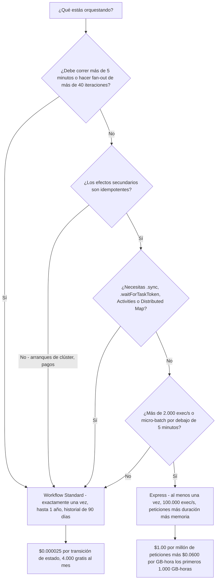
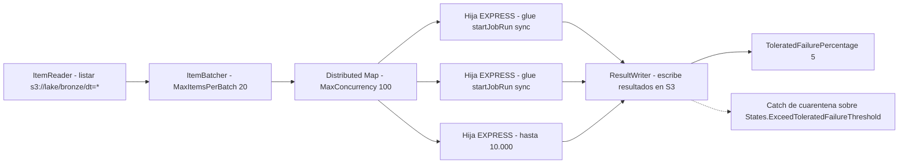
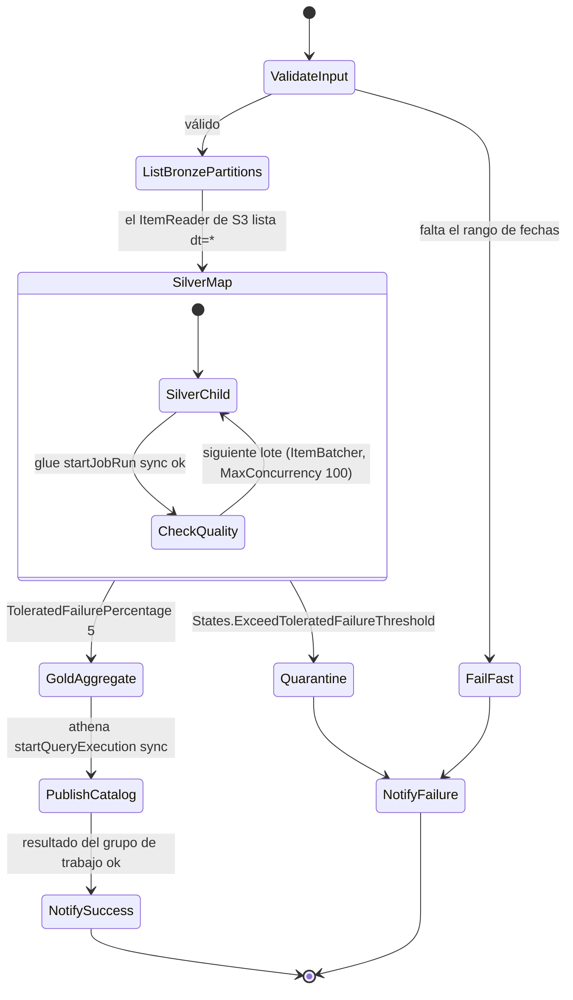
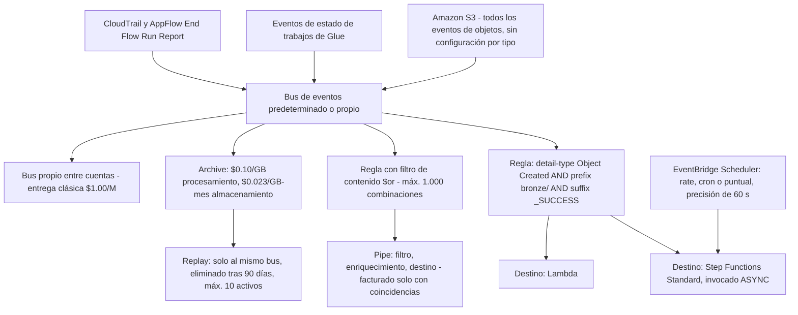
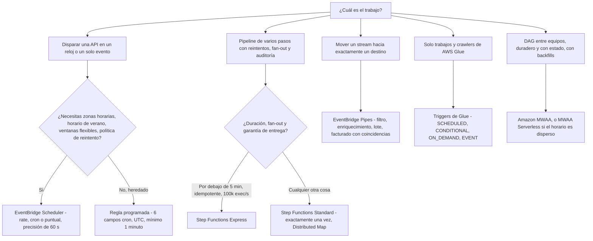

# Orquestar el lakehouse: Step Functions, EventBridge y MWAA

A diez lecciones, ya puedes aterrizar archivos, convertirlos, curarlos en Iceberg, consultarlos con Athena y entregar el resultado a Redshift. Nada de eso responde a las cuatro preguntas que deciden si el lakehouse es un producto o una responsabilidad: **qué inicia la ejecución, en qué orden corren los pasos, qué pasa cuando un paso falla, y cómo lo vuelves a ejecutar sin escribir las mismas filas dos veces.** Eso es orquestación, y es la capa donde viven realmente la mayoría de los incidentes de lakehouse — no en el SQL.

La regla didáctica de esta lección es corta: **el orquestador es dueño del tiempo, el orden, el fallo y la reproducción; el cómputo es dueño de los bytes.** Mantén separados esos dos trabajos y cada decisión de diseño posterior se vuelve más fácil.

```text
====================================================================
 SUPERFICIE DE ORQUESTACIÓN DEL LAKEHOUSE - en octubre de 2026
====================================================================
 STEP FUNCTIONS .... Standard  - exactamente una vez, hasta 1 año,
                                 2.000 exec/s, 4.000 transiciones/s,
                                 $0.000025 por transición de estado,
                                 historial de 90 días, Distributed Map OK
                      Express  - al menos una vez (async), hasta 5 minutos,
                                 100.000 exec/s, peticiones + duración +
                                 fragmentos de 64 MB de memoria,
                                 solo Request Response
 EVENTBRIDGE ....... 4 tipos de bus: predeterminado, propio (Classic 2019,
                                 mejorado sep 2026), de socios
                      reglas   - 300/bus, 5 destinos/regla, patrón de 2.048 car
                      Pipes    - origen > filtro > enriquecimiento > destino,
                                 facturado solo con coincidencias, techo de 5 min
                      Scheduler- rate | cron | puntual, precisión de 60 segundos,
                                 ventana flexible de 1-1.440 min
                      Archive  - procesamiento $0.10/GB, almacenamiento
                                 $0.023/GB-mes, replay $1.00/M
 AMAZON MWAA ........ Airflow siempre activo: mw1.micro ... mw1.2xlarge,
                       workers 1-25 (por defecto 10), planificadores 2-5
                       (por defecto 2), Airflow 3.3.1 desde 2026-09-01,
                       MWAA Serverless GA 2025-11-17 a $0.08/task-hora
 GLUE WORKFLOWS ..... SCHEDULED | CONDITIONAL | ON_DEMAND | EVENT
                       triggers, <=100 componentes, historial de 90 días
 NO ESTO ............ "sync" como tercer tipo de workflow - hay
                       exactamente dos: Standard y Express (inmutable)
====================================================================
```

En esta lección:

- separarás **Standard y Express** por la garantía de entrega, el techo de duración, la velocidad, los patrones soportados y el **coste por transición de estado**;
- leerás y escribirás **Amazon States Language** — los ocho tipos de estado, los tres patrones de integración, y los recursos de Task para **Glue, EMR, Lambda y el AWS SDK**;
- elegirás entre **`Map` en línea** y **Distributed Map**, y dimensionarás `ItemReader`, `ItemBatcher` y `ResultWriter`;
- usarás **`Parallel`**, **`Retry`**, **`Catch`**, **`TimeoutSeconds`** y **máquinas de estados anidadas** para aislar fases y enrutar fallos;
- conectarás buses de **Amazon EventBridge**, patrones de eventos, horarios, **Pipes con filtrado y enriquecimiento**, **API Destinations** y **Archive/Replay**;
- dimensionarás un entorno de **Amazon MWAA** y reconocerás los **patrones de DAG de Airflow** que lo justifican;
- encadenarás **AWS Glue Workflows y triggers**, incluidos los triggers `EVENT` iniciados desde EventBridge;
- harás seguras las reejecuciones con **nombres de ejecución deterministas, dedup, checkpoints y traspaso de watermarks**;
- ejecutarás un **backfill sobre particiones por fecha** con un Distributed Map;
- aplicarás una **matriz de decisión de planificadores** y **roles de ejecución de mínimo privilegio**;
- trabajarás una **máquina de estados de bronce a plata a oro con enrutado de cuarentena**, diez ejemplos resueltos, un **cuadro de actualizaciones de octubre de 2026 con fuentes**, material de caso de **Transport for NSW**, tres comprobaciones interactivas y **catorce preguntas de estilo examen**.

---

## 1. La superficie de orquestación: cinco herramientas, cinco trabajos

### 1.1 Las cinco primitivas

Toda pregunta de orquestación se reduce a las mismas cinco primitivas. Cada una es dueña de una cosa distinta, y todo olor a diseño en este espacio es una primitiva usada para un trabajo del que no es dueña.

| Primitiva | De qué es dueña | Servicio AWS | Sección |
|---|---|---|---|
| **Máquinas de estados deterministas de varios pasos** | Orden, reintentos, ramificación, fan-out, historial de auditoría por ejecución | **AWS Step Functions** | 2-5 |
| **Reacción a eventos y disparo por tiempo** | Buses, patrones, horarios, Pipes, archivos, enrutado entre cuentas | **Amazon EventBridge** | 6 |
| **Grafos acíclicos dirigidos con una UI de backfill** | Dependencias de tareas, reanudación por checkpoint, ventanas de recuperación, equipos | **Amazon MWAA** (Apache Airflow gestionado) | 9 |
| **DAG dentro del servicio sobre los propios trabajos de un motor** | Trabajos y crawlers de Glue encadenados por triggers, un estado de ejecución | **AWS Glue Workflows** | 10 |
| **Disparo único de una API** | «Inicia esto en un reloj o en un solo evento» | **EventBridge Scheduler / reglas** | 6.3 |

Las cuatro preguntas que siempre debes responder antes de elegir: **¿Qué inicia la ejecución?** (horario, evento, llamada a API, éxito aguas arriba) **¿En qué orden corren los pasos?** (serial, paralelo, fan-out, condicional) **¿Qué pasa ante un fallo?** (reintento, catch, cuarentena, alerta) **¿Cómo lo vuelves a ejecutar sin corromper los datos?** (nombre idempotente, checkpoint, watermark, redrive).

- **📚 ¿Sabías que…?** Step Functions puede llegar a **«más de 14.000 acciones de API de más de 220 servicios de AWS»** según el AWS Compute Blog de 2025-11-04 — una publicación anterior de AWS What's New de 2022-12-01 cifraba la misma cifra en *«más de 200 servicios de AWS»*. La cifra es un objetivo móvil, pero el hecho examinable es que la integración del AWS SDK es la válvula de escape para todo aquello sin una integración optimizada (AWS Compute Blog, 2025-11-04; AWS What's New, 2022-12-01).

---

## 2. AWS Step Functions: Standard frente a Express

### 2.1 Dos tipos de workflow, y ninguno tercero

Hay exactamente **dos** tipos de máquina de estados: **Standard** (el por defecto) y **Express**. El tipo es **inmutable** — se elige en la creación y nunca cambia después. La palabra «sync» nombra dos cosas *distintas* y es la confusión más común de todo el servicio:

1. el **patrón de integración `.sync`** («Ejecutar un trabajo»), donde un workflow **Standard** llama a un servicio y se bloquea hasta que el trabajo termina; y
2. **Express síncrono** (`StartSyncExecution`), donde una ejecución Express se invoca de forma síncrona desde API Gateway, Lambda o la CLI y devuelve el resultado.

| Eje | **Standard** | **Express** |
|---|---|---|
| Garantía de entrega | Ejecución **exactamente una vez** | **Al menos una vez** (async) / **como máximo una vez** (sync) |
| Duración máxima | **1 año** | **5 minutos** |
| Velocidad de ejecuciones | 2.000 por segundo | 100.000 por segundo |
| Velocidad de transiciones de estado | 4.000 por segundo | Casi ilimitada |
| Medidor | **Por transición de estado** | Por petición + duración + memoria (fragmentos de 64 MB) |
| Historial | 90 días de historial de ejecuciones | Solo CloudWatch Logs |
| Distributed Map | **Soportado** | No soportado |
| Activities | **Soportadas** | No soportadas |
| `.sync` / `.waitForTaskToken` | **Soportado** | No soportado — solo Request Response |
| Mejor para | Acciones **no idempotentes** (iniciar un clúster de EMR, pagos) | Acciones **idempotentes** (micro-batch de alto volumen) |

AWS enuncia la regla sin rodeos: los workflows Standard *«siguen un modelo exactamente una vez… adecuado para orquestar acciones no idempotentes, como iniciar un clúster de Amazon EMR o procesar pagos»*, mientras que los workflows Express *«usan un modelo de al menos una vez… mejor adecuado para orquestar acciones idempotentes»* (Guía de desarrollador de Step Functions, consultada 2026-10-11).



> [!WARNING]
> **Express no gestiona la idempotencia por ti.** Los workflows Standard *«devuelven automáticamente una respuesta idempotente al iniciar una ejecución con el mismo nombre que un workflow en ejecución»* — Express no lo hace, así que dos ejecuciones de Express con el mismo nombre se ejecutan **concurrentemente** y pueden duplicar escrituras. Recuerda también: Express **no** admite Distributed Map, **no** admite Activities, **no** admite `.sync` ni `.waitForTaskToken`. Un diseño de «fan-out serverless» que necesite cualquiera de esos cuatro debe tener un padre Standard (Guía de desarrollador de Step Functions, consultada 2026-10-11).

### 2.2 Ejemplo resuelto E1 — un pipeline diario de nueve transiciones

La aritmética del propio ejemplo de precios de AWS, reproducida con las tarifas publicadas (us-east-1, consultado 2026-10-11):

```text
Ejemplo resuelto E1 - una ejecución diaria de bronce a plata a oro, 9 transiciones
------------------------------------------------------------------------
  Transiciones del camino feliz por ejecución  =   9
  Ejecuciones al mes (1/día x 30)              =  30
  Transiciones totales                         = 270
  Menos el nivel gratuito                      = 4.000  -> 0 facturables
  Factura                                       = $0.00

  Ahora ejecútalo 100.000 veces al mes:
  9 x 100.000                                  = 900.000 transiciones
  menos 4.000 gratis                           = 896.000 facturables
  896.000 x $0.000025                          = $22.40 / mes
```

El nivel gratuito es de **4.000 transiciones de estado al mes**, indefinidamente. En esa cifra se esconden dos lecciones: un pipeline *diario* casi nunca genera una factura de Step Functions que merezca la pena considerar, y uno de *alta frecuencia* sí.

### 2.3 Ejemplo resuelto E2 — el mismo pipeline, dos medidores

Catorce estados, 30.000 ejecuciones al mes, sin reintentos (derivado de las tarifas publicadas, en oct 2026):

```text
Ejemplo resuelto E2 - Standard frente a Express, misma forma
------------------------------------------------------------
 STANDARD
   14 estados x 30.000 ejecuciones           = 420.000 transiciones
   menos 4.000 gratis                        = 416.000 facturables
   416.000 x $0.000025                       = $10.40 / mes

 EXPRESS (misma forma, 12 s por ejecución, 64 MB de memoria facturada)
   peticiones: 30.000 / 1.000.000 x $1.00    =  $0.03
   duración: 30.000 x 12 s                   = 360.000 s
             360.000 x 64 MB / 1024          = 22.500 GB-s
             22.500 / 3.600                  = 6.25 GB-horas
             6.25 x $0.0600                  =  $0.375
   total                                      =  ~$0.41 / mes
------------------------------------------------------------
 Express es ~25 veces más barato AQUÍ - y solo es válido si
 cada efecto secundario es idempotente y nada pasa de 5 minutos.
```

Express factura la duración **redondeada hacia arriba al 100 ms más cercano**, en **fragmentos de 64 MB**, y la huella de memoria se calcula como `50 MB + tamaño de la definición de la máquina de estados + tamaño de los datos de ejecución x número de pasos Parallel o Map`. Los tres niveles de duración que AWS imprime en su propio Ejemplo 4 son **$0.0600 por GB-hora** para los primeros 1.000 GB-horas, **$0.0300** para los siguientes 4.000, y **$0.01642** a partir de ahí (precios de Step Functions, consultados 2026-10-11).

---

## 3. Amazon States Language y la capa de Task

### 3.1 Los ocho tipos de estado

Amazon States Language (ASL) es un documento basado en JSON. Los tipos de estado que lista AWS son **`Task`**, **`Choice`**, **`Wait`**, **`Pass`**, **`Succeed`**, **`Fail`**, **`Parallel`** y **`Map`** — ocho en total, y toda una máquina de estados es estos estados conectados con los campos `Next` y `End` (Guía de desarrollador de Step Functions, consultada 2026-10-11).

- **`Task`** hace trabajo (llama a Lambda, inicia un trabajo de Glue, pone un elemento en DynamoDB).
- **`Choice`** ramifica según la entrada; **`Wait`** duerme; **`Pass`** remodela datos.
- **`Succeed`** y **`Fail`** terminan la ejecución deliberadamente.
- **`Parallel`** hace fan-out sobre ramas **escritas en la definición**.
- **`Map`** hace fan-out sobre un **conjunto de datos** — en línea o Distributed (sección 4).

Tres cuotas acotan la propia definición: el tamaño máximo de definición de la máquina de estados es de **1 MB** (duro), el tamaño máximo de entrada o salida de una tarea, estado o ejecución es de **256 KiB** de datos codificados en UTF-8, y el tamaño máximo del historial de ejecución es de **25.000 eventos** para un workflow Standard.

### 3.2 Tres patrones de integración, y qué servicios reciben cuál

Cada integración optimizada puede invocarse de una de tres formas:

| Patrón | Sufijo | Qué hace | Disponible en |
|---|---|---|---|
| **Request Response** (por defecto) | *(ninguno)* | Dispara la API, devuelve la respuesta de la API de inmediato | Standard **y** Express |
| **Ejecutar un trabajo** | `.sync` | Llama al servicio y **se bloquea hasta que el trabajo termine** | **Solo Standard** |
| **Esperar una devolución** | `.waitForTaskToken` | Inyecta un token de tarea, se lo entrega a un worker, espera `SendTaskSuccess` o `SendTaskFailure` | **Solo Standard** |

La matriz de integraciones optimizadas de AWS separa limpiamente los servicios de lakehouse:

- **`.sync` soportado:** `athena`, `batch`, `emr`, `emr-serverless`, `glue`, `glue:databrew`, `sagemaker`, `states` (el propio Step Functions anidado).
- **Request Response más callback (`.waitForTaskToken`), sin `.sync`:** `lambda`, `sns`, `sqs`, `dynamodb`, EventBridge.
- **Integración del AWS SDK:** Request Response en todos los servicios soportados; `.waitForTaskToken` solo en Standard; **nunca** `.sync`.

Así que los recursos de Task concretos que realmente escribirás en una máquina de estados de lakehouse son:

```text
arn:aws:states:::glue:startJobRun.sync          # Glue, wait for the job
arn:aws:states:::emr:addStep.sync               # EMR cluster step
arn:aws:states:::emr-serverless:startJobRun.sync
arn:aws:states:::athena:startQueryExecution.sync
arn:aws:states:::lambda:invoke                   # Request Response
arn:aws:states:::dynamodb:putItem                # checkpoint / watermark
arn:aws:states:::states:startExecution.sync      # nested, returns STRING
arn:aws:states:::states:startExecution.sync:2    # nested, returns JSON
arn:aws:states:::states:startExecution.waitForTaskToken
arn:aws:states:<region>:aws-sdk:<service>:<ApiAction>   # 14,000+ actions
```

- **📚 ¿Sabías que…?** `startExecution.sync` y `startExecution.sync:2` **no** son intercambiables: `.sync` devuelve la salida del hijo **como cadena**, `.sync:2` la devuelve **como JSON**. Analizar el incorrecto corrompe silenciosamente cada referencia `Payload.$` aguas abajo, y el fallo aparece mucho después como un campo ausente en lugar de un error de despliegue (Guía de desarrollador de Step Functions, consultada 2026-10-11).

### 3.3 Ejemplo resuelto E3 — el presupuesto de reintentos que olvidaste precificar

Los reintentos no son gratis: *«los reintentos se tratan como transiciones de estado»*, y *«si incluyes manejo de errores por reintento en cualquier paso de tu workflow, cada reintento se cobrará como una transición de estado adicional»* (precios de Step Functions, consultados 2026-10-11).

```text
Ejemplo resuelto E3 - lo que cuesta un bloque de Retry generoso
--------------------------------------------------------------
  Reintento en un estado de Task de Glue:
    IntervalSeconds: 5, MaxAttempts: 4, BackoffRate: 2.0
    JitterStrategy: FULL, MaxDelaySeconds: 30

  Tiempos de espera entre intentos = 5 s, 10 s, 20 s  (tope de 30 s)
  Transiciones extra cuando el trabajo acierta a la primera : 0
  Transiciones extra cuando fallan los 4 intentos           : 4

  Una máquina de 12 estados, cada estado con ese bloque de Retry,
  10.000 ejecuciones al mes, peor caso:
    camino feliz    12 x 10.000                    = 120.000
    peor caso añade 12 x 4 x 10.000                = 480.000
    total                                            600.000
    menos 4.000 gratis                              596.000
    596.000 x $0.000025                             = $14.90

  La misma máquina con MaxAttempts: 0 en 6 de los 12 estados
    6 x 10.000 + 6 x 4 x 10.000 = 300.000 - 4.000 = 296.000
    296.000 x $0.000025                            =  $7.40
```

`MaxAttempts: 0` significa **nunca reintentar** — una elección válida y deliberada para un paso que falla de forma permanente y debe enrutarse directamente a un `Catch`.

### 3.4 Retry, Catch, Timeout y Heartbeat — los valores por defecto exactos

| Campo | Por defecto | Notas |
|---|---|---|
| `IntervalSeconds` | **1** | Primera espera de backoff |
| `MaxAttempts` | **3** | `0` = nunca reintentar |
| `BackoffRate` | **`2.0`** | Multiplicativo |
| `JitterStrategy` | **`NONE`** | Admite `FULL` o `NONE` |
| `MaxDelaySeconds` | *(sin fijar)* | Debe ser mayor que 0 y menor que **31.622.401** |
| `TimeoutSeconds` | *(sin fijar)* | Acota una tarea; el tope general de Standard es 1 año, el de Express 5 minutos |
| `HeartbeatSeconds` | *(sin fijar)* | Detecta un worker estancado mediante `SendTaskHeartbeat` |

Nombres de error integrados que no debes confundir:

- **`States.ALL`** — debe aparecer **solo** en un `Catcher` y **no puede** capturar `States.DataLimitExceeded` ni `States.Runtime`.
- **`States.TaskFailed`** — un comodín para cualquier error conocido **excepto** `States.Timeout`.
- **`States.Timeout`**, **`States.HeartbeatTimeout`**, **`States.Permissions`**, **`States.ItemReaderFailed`**, **`States.ResultWriterFailed`**, **`States.ExceedToleratedFailureThreshold`**.
- **`States.DataLimitExceeded`** es **terminal** — una tarea que emite un payload de más de **256 KiB** muere y ningún catcher adjunto a ese estado puede salvarla.

Tres reglas estructurales que atrapan a ingenieros con experiencia:

1. **Los catchers existen solo en `Task`, `Parallel` y `Map`** — *«no para fallos de ejecución de la máquina de estados de primer nivel»*. Un fallo de ejecución completa debe manejarlo el **llamante**, un **workflow anidado**, o una **regla de EventBridge sobre el estado de la ejecución** (`FAILED` / `TIMED_OUT`).
2. Si una **máquina de estados anidada** lanza un `States.Timeout`, el padre recibe **`States.TaskFailed`** en su lugar.
3. En los runtimes más nuevos de Lambda, los timeouts aparecen como **`Sandbox.Timedout`** — casa con `Lambda.Unknown`, `Sandbox.Timedout` **y** `States.TaskFailed` a la vez.

### 3.5 Activities: el carril de devolución que espera hasta un año

Las Activities son una construcción **solo de Standard**: un worker de actividad sondea con `GetActivityTask`, mantiene la tarea viva enviando un latido con `SendTaskHeartbeat` dentro del `TimeoutSeconds` configurado, y responde con `SendTaskSuccess` o `SendTaskFailure`. Con latidos, *«una actividad en Step Functions puede esperar hasta un año a que se complete una ejecución»*. Una vez que la tarea supera el timeout, Step Functions **invalida el token de tarea** y las llamadas posteriores lanzan `TaskTimedOut`.

### 3.6 Workflows anidados: fases con su propio historial y sus propios reintentos

Cuatro recursos controlan el anidamiento: `states:startExecution` (dispara y olvida), `.sync` (espera, salida string), `.sync:2` (espera, salida JSON), `.waitForTaskToken` (devolución). El anidamiento compra **aislamiento de historial por fase**, **reintentos por fase** y **reutilización** — pero el padre debe poder *enterarse* de que el hijo terminó, y esa detección tiene dos rutas con dos conjuntos de permisos distintos:

- **sondeo** — necesita `states:DescribeExecution`;
- **eventos de EventBridge** — necesita `events:PutTargets`, `events:PutRule` y `events:DescribeRule`.

Omite el segundo conjunto y el padre **se cuelga** en lugar de fallar de forma ruidosa, que es el síntoma clásico.

### 3.7 Ejemplo resuelto F1 — rellenar un fragmento real de ASL

```fillblank
{
  "question": "Completa las afirmaciones de Amazon States Language y manejo de errores con la palabra clave, el valor o el recurso exactos (todos en oct 2026):",
  "template": "Un estado Task que inicia un trabajo de AWS Glue y se bloquea hasta que el trabajo termine usa el recurso {{1}}. Un estado Task que inyecta un token y espera a que responda un worker externo usa el patrón de integración {{2}}. Los valores por defecto de Retry son IntervalSeconds {{3}}, MaxAttempts {{4}} y BackoffRate {{5}}, y un Catcher solo puede adjuntarse a estados Task, Parallel y Map - nunca a un fallo de ejecución de una máquina de estados de primer nivel.",
  "answers": {
    "1": "arn:aws:states:::glue:startJobRun.sync",
    "2": ".waitForTaskToken",
    "3": "1",
    "4": "3",
    "5": "2.0"
  },
  "distractors": [
    "arn:aws:states:::glue:startJobRun",
    "StartSyncExecution",
    ".sync:2",
    "0",
    "10",
    "1.5",
    "3.0"
  ],
  "explanation": "Esperar a un trabajo de Glue es el patrón .sync «Ejecutar un trabajo», así que el recurso lleva el sufijo .sync y solo está disponible en workflows Standard; .waitForTaskToken es el patrón de devolución separado que usan Lambda, API Gateway, ECS y las actividades. Los valores por defecto de Retry publicados en la guía de desarrolladores son IntervalSeconds 1, MaxAttempts 3 y BackoffRate 2.0, con JitterStrategy NONE. El recurso sencillo glue:startJobRun es Request Response (devuelve cuando se envía el trabajo), .sync:2 pertenece a las máquinas de estados anidadas y devuelve JSON en lugar de un token de tarea, y 0 significa nunca reintentar."
}
```

---

## 4. Map, Distributed Map, Parallel e ItemBatcher

### 4.1 Cuándo el `Map` en línea deja de bastar

`Parallel` itera sobre ramas **fijadas en la definición**; `Map` itera sobre un **conjunto de datos**. El `Map` en línea (por defecto) ejecuta sus iteraciones dentro del historial de ejecución del *padre*, y eso crea tres techos duros:

| Restricción | `Map` en línea | **`Map` Distributed** |
|---|---|---|
| Iteraciones concurrentes | **40** | Hasta **10.000** ejecuciones hijas paralelas |
| Historial | Comparte el historial de **25.000 eventos** del padre | Cada hija tiene su propio historial |
| Tamaño del conjunto de datos | Debe caber en un payload de **256 KiB** | Se lee desde **S3** mediante `ItemReader` |
| Tipo de workflow | Standard o Express | **Solo Standard** |
| Salida de resultados | En el resultado de la ejecución | Se escribe en S3 mediante `ResultWriter` |

Las propias condiciones que AWS enuncia para cambiar: usa el modo Distributed cuando *«el tamaño de tu conjunto de datos supere los 256 KiB»*, *«el historial de eventos de ejecución del workflow superaría las 25.000 entradas»*, o *«necesites una concurrencia de más de 40 iteraciones concurrentes»* (Guía de desarrollador de Step Functions, consultada 2026-10-11).

> [!IMPORTANT]
> **El `Map` Distributed es una función exclusiva de los workflows Standard.** AWS imprime una advertencia explícita: *«el modo Distributed está soportado en workflows Standard pero no está soportado en workflows Express.»* Planifica el padre en consecuencia — y observa que el bloque `Retry` de un Distributed Map, cuando se dispara, **crea un nuevo Map Run**, así que un Map amoroso de reintentos reejecuta cada hijo en silencio. Limita `MaxAttempts` y prefiere **redrive** para reproducciones del Map completo: redrive es solo de Standard y solo está disponible dentro del periodo redrivable de ejecuciones de **14 días**.

Detalles del Distributed Map que vale la pena memorizar:

- Fuentes de `ItemReader`: **objetos de S3** (CSV, JSON, JSONL, **Parquet**), o **un manifiesto de datos de Athena** — el Compute Blog de 2025-11-04 confirma que Distributed Map puede *«procesar manifiestos de datos de AWS Athena y archivos Parquet directamente, eliminando la necesidad de preprocesamiento personalizado»*.
- `ExecutionType` en los hijos: **`STANDARD`** o **`EXPRESS`** — usa hijos EXPRESS para unidades de fan-out cortas e idempotentes.
- `MaxConcurrency` / `MaxConcurrencyPath`: si no se fija o es cero, Step Functions *«no limita la concurrencia y ejecuta 10.000 ejecuciones de workflows hijas paralelas»*, y AWS recomienda no superar la capacidad de un servicio aguas abajo como Lambda.
- `ToleratedFailureCount` / `ToleratedFailurePercentage` y sus variantes `...Path`: **el porcentaje por defecto es cero**, lo que significa que *«el workflow falla si cualquiera de sus ejecuciones de workflows hijas falla o supera el timeout»*. Superar el umbral lanza **`States.ExceedToleratedFailureThreshold`**, que necesita su propio `Catch`.
- Cuotas: **1.000** Map Runs abiertos por cuenta/Región, **1.000** redrives por Map Run, **10.000** ejecuciones hijas paralelas por Map Run (duro), y Step Functions despacha hijos express a hasta **1.000 TPS** e hijos standard a hasta **100 TPS**.

### 4.2 `ItemBatcher`: la palanca más barata que tienes

`ItemBatcher` agrupa elementos para que cada hija reciba `{"Items": [...]}` más un `BatchInput` estático opcional. Dos pares de mandos: `MaxItemsPerBatch` / `MaxItemsPerBatchPath`, y `MaxInputBytesPerBatch` / `MaxInputBytesPerBatchPath` — el techo de bytes es de **256 KiB**, el propio límite de payload de Step Functions.

La cifra resuelta del propio AWS: *«imagina que ejecutas una ejecución con un archivo de entrada JSON que contiene 1130 nodos. Si especificas un valor máximo de elementos de 100 para cada lote, Step Functions crea 12 lotes»* (Guía de desarrollador de Step Functions, consultada 2026-10-11). Usa el agrupamiento *«al procesar archivos CSV grandes o matrices JSON, o conjuntos grandes de objetos de Amazon S3.»*

### 4.3 Ejemplo resuelto E4 — aritmética de agrupamiento y su efecto en la factura

```text
Ejemplo resuelto E4 - 1.130 objetos de bronce, tres formas
----------------------------------------------------------
 FORMA A - sin agrupamiento, una hija por objeto
   hijas                                = 1.130
   ~6 transiciones cada una             = 6.780 transiciones
   6.780 x $0.000025                    = $0.17

 FORMA B - MaxItemsPerBatch: 100
   hijas                                = 12      (cifra del propio AWS)
   12 x 6                               = 72 transiciones
   72 x $0.000025                       = $0.0018

 FORMA C - MaxInputBytesPerBatch: 262144
   los lotes se reducen siempre que 100 elementos excederían los 256 KiB,
   así que el recuento real de lotes es min(tope de elementos, tope de bytes)

 AHORRO SOLO DE ORQUESTACIÓN A -> B        = ~90x
 (Las DPU-horas de Glue se facturan aparte y no cambian)
```

- **📚 ¿Sabías que…?** Las métricas de observabilidad de Distributed Map anunciadas el 2025-09-18 — **`ApproximateOpenMapRunsCount`**, **`OpenMapRunLimit`** y **`ApproximateMapRunsBacklogSize`** — existen porque la profundidad del fan-out es invisible hasta que chocas con la cuota de 1.000 Map Runs abiertos. Alarma sobre la métrica de backlog antes del límite, no después (AWS What's New, 2025-09-18; AWS Compute Blog, 2025-11-04).



### 4.4 Proyectos de ejemplo que vale la pena leer antes de construir uno

Dos proyectos de ejemplo de AWS son buenos elementos didácticos: un pipeline de **datos meteorológicos** donde *«los datos meteorológicos se registran en más de 12.000 archivos CSV»* con `MaxConcurrency` fijado en **3.000**, que copia, luego analiza y luego reduce en DynamoDB; y un pipeline de **pedidos de envío en CSV** de *«10.000 filas de un archivo CSV»* procesadas en **lotes de 10** con `MaxConcurrency` **1.000**, con resultados escritos en S3 a través de `ResultWriter` (proyectos de ejemplo de Step Functions, consultados 2026-10-11).

---

## 5. Una máquina de estados de lakehouse resuelta: de bronce a plata a oro

Esta es la forma que deberías poder dibujar de memoria. Un padre **Standard** aloja un **Distributed Map** (Express no podría), las hijas corren como ejecuciones **EXPRESS** con `MaxConcurrency: 100` para que la concurrencia de trabajos a nivel de cuenta de Glue nunca quede ahogada, y el fallo parcial se enruta a la cuarentena en lugar de fallar en silencio.



Notas didácticas, todas sostienen la estructura:

1. **`SilverMap` debe ser Distributed** — el tope de 40 iteraciones de un Map en línea y su historial compartido de 25.000 eventos matarán una ejecución de miles de particiones.
2. **`ItemBatcher.MaxItemsPerBatch: 20`** convierte miles de archivos en decenas de hijas. Las hijas son la unidad **tanto** del paralelismo **como** de la facturación.
3. **`Retry` en el Map crea un nuevo Map Run** — limita `MaxAttempts` y usa **redrive** (ventana de 14 días, solo Standard) para reproducciones del Map completo.
4. **`Catch` sobre `States.ExceedToleratedFailureThreshold`** enruta el fallo parcial a la cuarentena. Sin él, un incumplimiento del umbral es un fallo de ejecución sin manejar.
5. **El watermark se escribe al final.** Registra `s3://lake/_checkpoints/silver/dt=2026-10-11.json` solo después de que `PublishCatalog` tenga éxito — eso es lo que hace idempotente el re-disparo del mismo día.
6. **La cuarentena es un destino, no un estado.** Aterriza las claves de la partición que falla en algún sitio donde un humano o un sistema de tickets puedan verlas.
7. **`ValidateInput` es un estado `Choice`**, y la rama `FailFast` termina en un estado `Fail` — una salida temprana y barata gana a descubrir un rango de fechas defectuoso tres horas después de un fan-out.

### 5.1 Ejemplo resuelto E5 — precificar esta máquina exacta

```text
Ejemplo resuelto E5 - la máquina de estados de arriba, una ejecución diaria
----------------------------------------------------------
 PADRE (Standard)
   ~16 transiciones por ejecución x 31 ejecuciones =   496
 MAP (Distributed) - 90 particiones en la ventana
   90 / 20 por lote  =  5 hijas (redondeo hacia arriba)
   sobrecoste de hija ~6 transiciones cada una     =   30
 RESULT WRITER / publicar / notificar              =   ~10
 -------------------------------------------------------
 total                                             =  ~536 transiciones/mes
 menos 4.000 gratis                                =        0 facturables
 FACTURA DE ORQUESTACIÓN                           =  $0.00 / mes

 Las DPU-horas de Glue y los cargos de escaneo de Athena son la factura real.
 La orquestación es la capa barata - diseñala para la corrección,
 no para ahorrar centavos.
```

Esa es la lección de coste más importante de esta lección: **Step Functions es un error de redondeo al lado del cómputo que planifica.** Optimiza para el enrutado de fallos y la seguridad de reproducción, y no para el recuento de transiciones — con la única excepción de las políticas de reintento sin límite (sección 3.3).

---

## 6. Amazon EventBridge para el lakehouse

### 6.1 Buses, reglas, cuotas

AWS le da a cada cuenta un **bus de eventos predeterminado** que recibe los eventos de cambio de estado de los servicios de AWS (la ingesta de eventos de gestión es gratis; los **eventos de datos** opcionales como los de S3 deben habilitarse). La página de precios describe **cuatro tipos de bus de eventos**: el bus predeterminado; **dos buses propios** — *Custom event bus - Classic* (julio de 2019) y un **Custom event bus mejorado lanzado en septiembre de 2026** — y un **bus de eventos de socios** para eventos de proveedores SaaS (precios de Amazon EventBridge, consultados 2026-10-11).

| Cuota | Valor (en oct 2026) |
|---|---|
| Reglas por bus de eventos | **300** por defecto (ajustables; 100 en af-south-1 y eu-south-1) |
| Buses de eventos por cuenta/Región | **100** |
| Destinos por regla | **5** — *no ajustable* |
| Tamaño del patrón de eventos | **2.048** caracteres |
| Reglas con comodín por bus | **30** — *no ajustable* |
| API Destinations / conexiones / endpoints | 3.000 / 3.000 / 100; **300 invocaciones por segundo** por destino |

### 6.2 Patrones de eventos

Los patrones casan con `source`, `detail-type`, `account`, `region` y `detail`, con el conjunto de operadores **`And`**, **`anything-but`** (incluidas las formas prefix, suffix, ignore-case y wildcard), **`prefix`**, **`suffix`**, **`empty`**, **`equals-ignore-case`**, **`exists`**, **`null`**, rangos **`numeric`**, **`$or`**, **`wildcard`** y **`cidr`**. Dos filos afilados: *«Actualmente el carácter comodín está soportado solo en reglas de bus de eventos»*, y cualquier patrón donde **`$or`** se expanda a más de **1.000 combinaciones de reglas** hace que `PutRule`, `CreateArchive`, `UpdateArchive` y `TestEventPattern` lanzen **`InvalidEventPatternException`** (Guía de usuario de EventBridge, consultada 2026-10-11).

### 6.3 Horarios: reglas heredadas frente a EventBridge Scheduler

Las reglas **programadas** son explícitamente *«una función heredada de EventBridge»* y AWS *«recomienda que uses Scheduler para invocar destinos en un horario»*. El cron heredado tiene **seis campos obligatorios** (minutos, horas, día del mes, mes, día de la semana, año) y *«no se admiten expresiones cron que lleven a tasas más rápidas que 1 minuto»*; todo se ejecuta en **UTC**.

**EventBridge Scheduler** es la respuesta actual: tres tipos de horario — **basados en rate, basados en cron y puntuales** — con *«precisión de 60 segundos»*, manejo automático del **horario de verano** (en un hueco de adelanto la invocación se **omite**), **ventanas de tiempo flexibles** de **1 a 1.440 minutos**, políticas de reintento y antigüedad de eventos, y destinos con plantilla en cientos de servicios de AWS. Cuotas: **10.000.000** de horarios por Región, `CreateSchedule` a **5.000 TPS**, invocaciones a **1.000 TPS**.

**Precios:** **$1.00 por millón de invocaciones** tras **14.000.000 de invocaciones gratis al mes** (precios de EventBridge, consultados 2026-10-11).

> [!WARNING]
> **Un horario no es exactamente una vez.** Scheduler tiene precisión de 60 segundos y, si lo habilitas, una ventana flexible de hasta 1.440 minutos; la entrega a los destinos es de al menos una vez. Nunca asumas que un cron se disparó una sola vez — exactamente por eso cada máquina de estados programada necesita un **nombre de ejecución determinista** (sección 7).

### 6.4 Pipes: del origen al filtro, al enriquecimiento y al destino

Una tubería es *«elige el origen, añade filtrado opcional, define enriquecimiento opcional y elige el destino»* — con el orden preservado cuando el origen lo impone, agrupamiento, informe de fallos parciales, y su propio rol IAM bajo **`pipes.amazonaws.com`**.

- **Orígenes:** DynamoDB Streams, streams de Kinesis, Amazon MQ, MSK, SQS y Apache Kafka (autoalojado, Confluent Cloud, CloudKarafka, Redpanda). No trates ninguna lista publicada como exhaustiva — la página de documentación de AWS es la autoridad.
- **Destinos:** destino de API, API Gateway, cola de trabajos de Batch, grupo de logs de CloudWatch, tarea de ECS, bus de eventos de la misma cuenta y Región, stream de entrega de Firehose, stream de Kinesis, Lambda (SYNC o ASYNC), consultas de la API de datos de Redshift, pipelines de SageMaker AI, topic de SNS (FIFO no soportado), cola de SQS, **Step Functions** (Express SYNC o ASYNC; **Standard debe ser ASYNC**), Timestream.
- **Techos de payload:** los Pipes admiten **6 MB**, pero el destino te acota — un destino de bus de eventos es de **1 MB** y un destino de máquina de estados de Step Functions de **256 KB**. Una salida de enriquecimiento por encima del límite del destino hace fallar la invocación.
- **Los tamaños de lote son el mínimo entre origen y destino:** Kinesis admite lotes de **10.000** registros, los destinos de SQS solo **10**, Firehose y Kinesis **500**, CloudWatch Logs **10.000**, bus de eventos **10**, SNS **10** — así que el pipe toma el número menor.
- **Techo de ejecución de un pipe:** **5 minutos** incluyendo enriquecimiento y procesamiento del destino — *«Este límite actualmente no puede aumentarse.»*
- **Valores por defecto de concurrencia:** SQS **1.250**; Kafka hasta el recuento de particiones (**máx. 1.000**); Amazon MQ **5**; Kinesis y DynamoDB = `ParallelizationFactor` multiplicado por el número de shards.
- **Fallo parcial de lote** usa la forma de payload `{"batchItemFailures": [{"itemIdentifier": "id2"}]}`.
- **Facturación:** *«solo se te cobra por aquellos eventos que coinciden con el filtro»* — **$0.40 por millón** de peticiones, medido en fragmentos de 64 KB, después del filtro.

### 6.5 API Destinations, Archive y Replay

**API Destinations** permiten que una regla llame a un endpoint HTTP externo a través de una conexión gestionada por AWS — **$0.20 por millón de eventos**, con 3.000 destinos y 3.000 conexiones por cuenta/Región y 300 invocaciones por segundo por destino.

**Archive y Replay** es la caja negra de eventos del lago. *«Por defecto, EventBridge almacena eventos en el archivo indefinidamente»*; *«Reproducir eventos no los elimina del archivo… EventBridge solo elimina eventos cuando superan el periodo de retención del archivo, o cuando tú eliminas el archivo en sí»*; las reproducciones se **eliminan después de 90 días**; puede haber como máximo **10 reproducciones concurrentes activas** por cuenta por Región; y *«solo puedes reproducir eventos hacia el mismo bus de eventos que emitió los eventos.»*

### 6.6 La ruta de eventos del lakehouse: de S3 directo a EventBridge

Una vez habilitado EventBridge, S3 entrega cada evento a nivel de objeto sin configuración por tipo — una regla filtra `source: aws.s3`, `detail-type: Object Created`, el nombre del bucket, un `prefix` de `bronze/orders/` y un `suffix` de `_SUCCESS`, y apunta a una máquina de estados, un Pipe, una función Lambda o una cola de SQS. Esto sustituye a las notificaciones de eventos de S3 por tipo más un fan-out con Lambda cuando necesitas muchos consumidores, filtrado por contenido, archivos y enrutado entre cuentas.

### 6.7 Ejemplo resuelto E6 — la factura del lago dirigido por eventos

```text
Ejemplo resuelto E6 - 5.000.000 de eventos Object Created de S3 al mes
------------------------------------------------------------------
 RUTA 1 - bus propio clásico, una regla -> Lambda (misma cuenta)
   ingesta        5.000.000 / 1.000.000 x $1.00   = $5.00
   entrega misma cuenta                          = $0.00
   total                                         = $5.00 / mes

 RUTA 2 - un Pipe con un 20% de coincidencia, lotes de 10
   eventos coincidentes 5.000.000 x 0.20         = 1.000.000
   peticiones           1.000.000 / 10           =   100.000
   100.000 / 1.000.000 x $0.40                   =     $0.04

 RUTA 3 - añadir un Archive de todo
   5.000.000 x 1 KB  = ~4,77 GB
   procesamiento     4,77 x $0.10                =     $0.48
   almacenamiento (1 mes) 4,77 x $0.023          =     $0.11
   replay completo   5.000.000 / 1.000.000 x $1.00 =  $5.00
------------------------------------------------------------------
 Toda la aritmética derivada de tarifas publicadas (en oct 2026).
 Observa los tres medidores DISTINTOS: fragmentos por evento, GB de
 entrada/salida, peticiones después del filtro. Nunca los mezcles en
 una sola tabla sin etiquetar.
```

- **📚 ¿Sabías que…?** S3 no te hace enumerar tipos de evento. Una vez habilitado EventBridge en la cuenta, *«no necesitas seleccionar qué tipos de evento quieres entregar»* — fluyen todos, incluidos *Object Created*, *Object Deleted*, *Restore Initiated / Completed / Expired*, *Storage Class Changed*, *Object Tags Added/Deleted*, *Retention Updated* y *Annotation Created/Removed*. El filtrado pertenece a la **regla**, no a una configuración de notificación por tipo (Guía de usuario de Amazon S3, consultada 2026-10-11).



---

## 7. Orquestación idempotente: sobrevivir a la segunda ejecución

### 7.1 Cuatro mecanismos, en el orden en que los construyes

| # | Mecanismo | Qué te da |
|---|---|---|
| 1 | **Nombrado determinista de ejecuciones** | Los workflows Standard *«devuelven automáticamente una respuesta idempotente al iniciar una ejecución con el mismo nombre que un workflow en ejecución»* — los triggers duplicados colapsan |
| 2 | **Semántica exactamente una vez donde importa** | Standard para efectos secundarios **no idempotentes** (arranque de clúster de EMR, pagos); Express es de al menos una vez, así que los escritores deben tolerar una segunda llamada |
| 3 | **Escritores idempotentes** | Prefijo de staging más promoción atómica, sobrescritura dinámica de particiones, `MERGE` de Iceberg — la defensa del plano de datos que el orquestador no puede proporcionar |
| 4 | **Checkpoint y traspaso de watermarks** | Persiste el watermark **después** de que la capa haga commit; la siguiente capa lo lee como su límite inicial |

Los nombres son **únicos por cuenta y Región**, con un tope de **80 caracteres**, y el historial de ejecuciones se retiene **90 días** (reducible a 30 mediante solicitud de cuota). Un patrón diario práctico:

```text
  Nombre de ejecución = "<capa>-<fecha-partición>-<fuente>"
  p. ej. "bronze-2026-10-11-orders"
         "silver-2026-10-11-orders"

  - entrega duplicada del mismo marcador en EventBridge -> absorbida
  - una fecha de partición genuinamente nueva          -> nueva ejecución
  - re-disparo manual en la misma fecha                -> operación nula idempotente
```

### 7.2 Checkpoints y traspaso de watermarks

Step Functions **no** rastrea watermarks de datos — esto es un patrón de ingeniería construido sobre primitivas verificadas, no una función gestionada. Persiste el watermark **después** del commit, en uno de estos soportes: un **elemento de DynamoDB**, un **objeto marcador de S3** como `_checkpoints/silver/dt=2026-10-11.json`, un **id de instantánea de Iceberg**, o un **job bookmark de Glue**. El lector debe entonces tomar su límite inicial de ese watermark, lo que convierte la relectura de una ventana cerrada en una operación nula en lugar de una escritura duplicada.

Tres reglas baratas de determinismo completan el panorama: deriva las claves de objetos y los identificadores de contexto de `(capa, fecha_partición, fuente)`; mantén cada campo `Payload` aguas abajo referenciado mediante rutas `.$` en lugar de asumido; y haz que el marcador de éxito sea *lo único* sobre lo que filtra una regla aguas abajo, de modo que una escritura parcial nunca pueda pasar por completada.

### 7.3 Ejemplo resuelto E7 — diseñar la reejecución segura

```text
Ejemplo resuelto E7 - un marcador de S3 duplicado llega a las 02:00 y a las 02:00:04
------------------------------------------------------------------------
 02:00:00  PutObject bronze/orders/dt=2026-10-11/_SUCCESS
 02:00:01  Se dispara la regla de EventBridge -> StartExecution
           Nombre = "bronze-2026-10-11-orders"
           Arranca la máquina de estados (Standard: exactamente una vez)
 02:00:04  Evento reentregado -> StartExecution, MISMO nombre
           Step Functions devuelve la respuesta idempotente para la
           ejecución en curso - sin segunda ejecución
 02:14:00  El trabajo escribe las filas de plata en un prefijo de STAGING
           indexado por (capa, fecha_partición, fuente) - claves deterministas
 02:15:00  Promoción atómica / MERGE de Iceberg - la segunda llamada converge
 02:15:01  Watermark escrito en _checkpoints/silver/dt=2026-10-11.json
           SOLO DESPUÉS de que el commit tenga éxito
 09:00:00  Un humano reejecuta el mismo nombre de ejecución
           -> el watermark ya cubre la ventana -> el lector no hace nada
```

> [!IMPORTANT]
> **La idempotencia es por capas, no un único interruptor.** El dedup por nombre de ejecución solo funciona en **Standard**; no hace nada en Express. Las claves deterministas solo ayudan si el *escritor* las respeta. Un watermark solo ayuda si se escribe **después** del commit, nunca antes. Elimina cualquiera de las tres capas y las otras dos dejan de protegerte.

### 7.4 Ordenar el pipeline idempotente

```dragdrop
{
  "question": "Ordena los pasos de un pipeline de lakehouse re-ejecutable (idempotente), del trigger a un watermark seguro:",
  "items": [
    "Inicia la ejecución con un nombre determinista derivado de la capa, la fecha de partición y la fuente - los triggers duplicados en un workflow Standard se absorben",
    "Lista exactamente una ventana de entrada usando un prefijo o manifiesto determinista, nunca un listado vivo y sin límites",
    "Escribe las salidas en un prefijo de staging determinista indexado por capa, fecha de partición y fuente, para que una segunda escritura caiga en las mismas claves",
    "Haz commit de forma atómica - sobrescritura dinámica de particiones, MERGE de Iceberg o promoción desde prefijo de staging - para que una llamada repetida converja en lugar de agregar",
    "Emite un marcador de éxito o un objeto _SUCCESS sobre el que las reglas de eventos aguas abajo puedan filtrar",
    "Persiste el watermark o el checkpoint DESPUÉS del commit, de modo que un fallo entre commit y checkpoint solo cause una relectura inofensiva",
    "Haz que la siguiente capa lea el watermark como su límite inicial, de modo que cualquier reproducción de una ventana cerrada sea una operación nula"
  ],
  "correctOrder": [
    "Inicia la ejecución con un nombre determinista derivado de la capa, la fecha de partición y la fuente - los triggers duplicados en un workflow Standard se absorben",
    "Lista exactamente una ventana de entrada usando un prefijo o manifiesto determinista, nunca un listado vivo y sin límites",
    "Escribe las salidas en un prefijo de staging determinista indexado por capa, fecha de partición y fuente, para que una segunda escritura caiga en las mismas claves",
    "Haz commit de forma atómica - sobrescritura dinámica de particiones, MERGE de Iceberg o promoción desde prefijo de staging - para que una llamada repetida converja en lugar de agregar",
    "Emite un marcador de éxito o un objeto _SUCCESS sobre el que las reglas de eventos aguas abajo puedan filtrar",
    "Persiste el watermark o el checkpoint DESPUÉS del commit, de modo que un fallo entre commit y checkpoint solo cause una relectura inofensiva",
    "Haz que la siguiente capa lea el watermark como su límite inicial, de modo que cualquier reproducción de una ventana cerrada sea una operación nula"
  ],
  "explanation": "El orden es lo que lo hace seguro, no ningún paso aislado. El dedup colapsa primero los triggers duplicados; el listado determinista acota la ventana; las claves de staging deterministas hacen repetible al escritor; el commit atómico es el punto de no doble escritura; el marcador es lo sobre lo que filtran las reglas de eventos; y el watermark se escribe estrictamente al final, de modo que un fallo antes de él solo relea datos que el commit ya hizo idempotentes. Escribir el watermark antes del commit es la única inversión que convierte un fallo en pérdida silenciosa de datos."
}
```

---

## 8. Backfill con un Distributed Map sobre particiones por fecha

El backfill es donde el Distributed Map deja de ser una curiosidad y se convierte en la herramienta más barata que posees: una ejecución padre, cientos de hijas por partición de fecha, concurrencia acotada a lo que Glue puede absorber de verdad.

### 8.1 Ejemplo resuelto E8 — un backfill de 90 días

```text
Ejemplo resuelto E8 - reconstruir 90 particiones diarias
        dt=2026-07-13 ... dt=2026-10-10
---------------------------------------------------------------------------------
 ENTRADA
   90 prefijos de partición, ~40 archivos Parquet cada uno = 3.600 objetos

 CONFIGURACIÓN
   ItemReader          : objetos de S3 bajo el prefijo de bronce
   ItemBatcher         : MaxItemsPerBatch = 5
   hijas               : 3.600 / 5              = 720 workflows hijos
   MaxConcurrency      : 100   (techo de trabajos de Glue, no 10.000)
   ExecutionType       : EXPRESS  (cada hija por debajo de 5 min, idempotente)
   cuerpo de la hija   : glue:startJobRun.sync sobre un día-partición
   ToleratedFailurePercentage : 5  ->  720 x 0.05 = 36 fallos tolerados
                              superarlo lanza
                              States.ExceedToleratedFailureThreshold

 TRANSICIONES (derivado, en oct 2026)
   sobrecoste del padre                     ~     8
   720 hijas x ~6 transiciones              ~ 4.320
   total                                    ~ 4.328
   4.328 x $0.000025                        ~   $0.11 por backfill

 Compara: 3.600 hijas sin agrupar x 6 = 21.600 x $0.000025 = $0.54
 El agrupamiento recortó la factura de orquestación en ~5x; las DPU-horas
 de Glue dominan en cualquier caso.
```

Tres reglas para backfills de producción:

1. **Acota `MaxConcurrency` al servicio aguas abajo.** La propia guía de AWS: *«recomendamos que no superes la capacidad de un servicio de AWS aguas abajo, como AWS Lambda»* — y 10.000 hijas a la vez chocarán al instante con la cuota de trabajos de la cuenta de Glue.
2. **Fija `ToleratedFailurePercentage` deliberadamente.** El por defecto es **cero**, así que una sola partición corrupta hace fallar el Map Run completo.
3. **Prefiere redrive a `Retry` en un Map.** Reintentar un estado `Map` *«crea un nuevo Map Run»*; redrive reutiliza el existente dentro de la ventana de 14 días.

- **📚 ¿Sabías que…?** Un backfill también es la forma más barata de *probar* tu diseño de idempotencia: reejecuta una ventana que ya está comprometida y observa si el escritor converge o agrega. Si la segunda ejecución cambia los recuentos de filas, tu traspaso de watermarks está roto *antes* de que un incidente lo encuentre por ti.

---

## 9. Amazon MWAA: Airflow gestionado para el lakehouse

### 9.1 Qué es en realidad un entorno

Amazon MWAA ejecuta Apache Airflow sobre **AWS Fargate** — workers, planificadores y un servidor web — respaldado por una **base de datos de metadatos Aurora PostgreSQL de inquilino único en tu propia VPC**, con los DAG y los plugins almacenados en un bucket de S3. Los tamaños van de `mw1.micro`, `mw1.small`, `mw1.medium`, `mw1.large`, `mw1.xlarge` y `mw1.2xlarge`. Auto escalado: **workers 10 por defecto / 1 mínimo / 25 máximo**, reduciendo al mínimo cuando las tareas en cola más las en ejecución permanecen en cero durante más de dos minutos; **planificadores 2 por defecto / 2 mínimo / 5 máximo**.

El consejo de dimensionamiento de AWS es directo: *«Recomendamos elegir el tamaño más pequeño necesario para dar soporte a tu carga de trabajo.»*

| Clase | Entorno $/hora | Worker $/hora | Planificador $/hora | Servidor web $/hora |
|---|---|---|---|---|
| `mw1.micro` | $0.29 | — | — | — |
| `mw1.small` | $0.49 | $0.055 | $0.055 | $0.055 |
| `mw1.medium` | $0.74 | $0.11 | $0.11 | $0.055 |
| `mw1.large` | $0.99 | $0.22 | $0.22 | $0.11 |
| `mw1.xlarge` | $1.98 | $0.44 | $0.44 | $0.22 |
| `mw1.2xlarge` | $3.96 | $0.88 | $0.88 | $0.44 |

Almacenamiento de la base de datos de metadatos: **$0.10 por GB-mes**. Todas las tarifas de US East (N. Virginia) del archivo de oferta de AWS Price List publicado el 2026-09-11, consultado 2026-10-11. `mw1.xlarge` da **8 vCPU / 24 GB** para planificador y worker con un por defecto de **40 tareas** y hasta **2.000 DAG**; `mw1.2xlarge` da **16 vCPU / 48 GB**, **80 tareas**, **4.000 DAG**; un cambio de tamaño de entorno tarda **20 a 30 minutos** en completarse.

Pagas *«por el tiempo que se ejecuta tu Entorno de Airflow más cualquier auto escalado adicional»*, facturado con **resolución de un segundo** — que es la razón por la que la tarifa del entorno, no la del worker, domina la factura.

### 9.2 Higiene de versiones

En octubre de 2026 MWAA ofrece Airflow **3.3.1** (disponible desde 2026-09-01, Python 3.12), **3.2.1** (2026-05-19), **2.11.2** (2026-07-23), **2.11.0** (2026-01-07) y **3.0.6** (2025-10-01). **Con efecto desde el 30 de diciembre de 2025, Amazon MWAA puso fin al soporte de las versiones de Apache Airflow v2.4.3, v2.5.1 y v2.6.3.** AWS se compromete a soportar al menos **tres versiones menores** en cualquier momento, al menos **12 meses** por versión, con **180 días** de anuncio de fin de soporte.

Dos restricciones que muerden: MWAA admite actualizaciones **menores** in situ, *«pero no a una nueva versión mayor»* — así que de Airflow 2 a 3 es una migración, no una actualización — y a partir de Airflow **v2.7.2** tu archivo de requisitos debe incluir una instrucción `--constraint`. AWS también documenta que *«Amazon MWAA no admite actualmente el modo de múltiples equipos.»*

### 9.3 Qué patrones de DAG de lakehouse justifica MWAA

Airflow gana su coste de siempre activo en exactamente cuatro situaciones:

1. **Reanudación por checkpoint sobre ventanas largas.** El propio blog de MWAA frente a Step Functions de AWS de 2026-06-10 encuadra MWAA en torno a *«reanudar desde el último checkpoint exitoso»* para *«procesos de larga duración que se extienden de 2 a 12 horas»* sobre *«5-10 TB de datos de transacciones financieras al diario»*, frente al *«lógica de reintentos integrada con backoff exponencial»* y la *«ejecución paralela»* de Step Functions.
2. **DAG legibles entre equipos** con semántica `catchup`, sensores y una UI para backfills.
3. **Backfills estacionales o parametrizados** donde un analista elige un rango de fechas y espera una vista de progreso.
4. **Tipos de tarea heterogéneos** — ECS, Bash, Python, APIs externas — bajo un mismo grafo de dependencias.

### 9.4 Ejemplo resuelto E9 — MWAA frente a Step Functions al mes

```text
Ejemplo resuelto E9 - 8 horas útiles al día, mes de 31 días (en oct 2026)
-------------------------------------------------------------------------
 AMAZON MWAA - entorno medium
   entorno     744 h x $0.74                 = $550.56
   workers     2 x 8 h x 31 = 496 h x $0.11  =  $54.56
   base de metadatos 10 GB x $0.10           =   $1.00
   total                                     $606.12 / mes
   -> la mayor parte de esa factura se paga haya o no un DAG en ejecución

 AWS STEP FUNCTIONS - Standard, misma cadencia
   60 estados x 62 ejecuciones                =  3.720 transiciones
   3.720 x $0.000025 (bajo los 4.000 gratis)  =    $0.09 / mes
   el cómputo (Glue / Lambda) es idéntico en ambas columnas

 VEREDICTO: MWAA compra UI, sensores, catchup, ergonomía de backfill y
 legibilidad de DAG entre equipos. Step Functions compra pagar por
 ejecución. Ninguna factura incluye el cómputo.
```

El propio ejemplo de entorno grande de AWS aterriza en **$1.047,46 al mes**, de los cuales el entorno ($736,56) más los planificadores ($163,68) es aproximadamente **86% de coste fijo** — que es exactamente el hueco que aborda MWAA Serverless. Un pipeline de **una vez al día** en un entorno medium cuesta **744 x $0.74 = $550,56 al mes antes de que corra un solo worker**.

- **📚 ¿Sabías que…?** **MWAA Serverless** (GA **2025-11-17**, disponible en 15 regiones de AWS en el lanzamiento) es una *opción de despliegue separada*, no un nivel de tamaño: los workflows se definen en **YAML** (un DAG de Python convertido a YAML), se inician con **`start-workflow-run`**, se acotan con IAM por workflow, y se factura *«por tarea según su duración, con un mínimo de 1 minuto»* a **$0.08 por hora** para la tarea gestionada por AWS — con *«escalado automático según la demanda del workflow»* y sin ningún entorno que dimensionar (Guía de usuario de Amazon MWAA Serverless; AWS Big Data Blog, 2025-11-17).

---

## 10. AWS Glue Workflows y triggers de eventos

Glue puede orquestar **a sí mismo** sin Step Functions. *«Un trigger se dispara bajo demanda, según un horario, o según una combinación de eventos»*, con valores de `Type` **`SCHEDULED`**, **`CONDITIONAL`**, **`ON_DEMAND`** y **`EVENT`**.

| Detalle | Regla (consultada 2026-10-11) |
|---|---|
| Estados de trabajos vigilados | `SUCCEEDED` / `STOPPED` / `FAILED` / `TIMEOUT` |
| Estados de crawlers vigilados | `SUCCEEDED` / `FAILED` / `CANCELLED` |
| Crawlers por trigger | **Solo dos** |
| Cadenas de dependencias | Todos los trabajos y crawlers de una cadena deben descender de un **único trigger programado o bajo demanda** |
| Tamaño del workflow | **100 o menos** trabajos, crawlers y triggers en un workflow |
| Agrupamiento de triggers `EVENT` | `EventBatchingCondition` = número de eventos más un retardo; la ventana de lote es de **15 minutos** por defecto |
| Triggers de inicio | Horario, Bajo demanda, **evento de EventBridge** — cualquier tipo de evento de EventBridge puede iniciar un workflow |
| Historial de ejecuciones | **90 días** |

Cuatro trampas que vale la pena memorizar:

1. **Los triggers condicionales solo ven ejecuciones iniciadas por un trigger.** Si un trabajo se inició de otra manera, su completado nunca dispara el trigger condicional.
2. **Una ejecución de workflow iniciada por EventBridge que falla consume su evento** — *«ese evento o lote de eventos ya no se considera para iniciar una ejecución de workflow»*, y no hay reentrega.
3. **Glue no reintenta ejecuciones de workflow que fallan por límites de concurrencia superados.**
4. **Los crawlers y los trabajos no son intercambiables dentro de un mismo trigger** — el tope de dos crawlers es una regla dura, y superar los 100 componentes puede romper las operaciones de reanudación y detención.

### 10.1 Ejemplo resuelto E10 — cadena solo con Glue frente a Step Functions

```text
Ejemplo resuelto E10 - el mismo pipeline de 4 pasos, dos capas de orquestación
-----------------------------------------------------------------------
 (a) GLUE WORKFLOW
     Trigger de horario -> Trabajo A -> CONDITIONAL (SUCCEEDED) -> Trabajo B
                       -> CONDITIONAL (SUCCEEDED) -> Crawler
     componentes : 1 trigger + 2 trabajos + 1 crawler = 4  (por debajo de 100)
     enrutado de fallos : ninguno dentro de un trigger - la cadena simplemente se detiene
     reintento           : solo por trabajo, sin política de backoff a nivel de trigger
     coste               : $0 extra - la orquestación con Blueprint/Workflow de Glue
                           está incluida con Glue

 (b) STEP FUNCTIONS (Standard)
     EventBridge Scheduler -> Tarea A .sync
        Retry: IntervalSeconds 5, MaxAttempts 3, BackoffRate 2.0
        Catch: States.ALL -> QuarantineTask
     -> Tarea B .sync -> Tarea C (crawler) -> PublishCheckpoint -> Done
     transiciones por ejecución ~ 16, diarias x 31 = 496 -> $0.00 (nivel gratuito)
     enrutado de fallos : Catch explícito -> cuarentena, más una regla de
                          EventBridge sobre la ejecución FAILED para el caso de primer nivel
     coste               : $0.00 / mes a esta cadencia

 VEREDICTO: los triggers de Glue ganan cuando todo el DAG es Glue y quieres
 la cadena más barata posible. Step Functions gana en cuanto necesites
 reintentos con backoff, una ruta de cuarentena, pasos entre servicios,
 o enrutado de fallos de primer nivel.
```

---

## 11. Seguridad: roles de ejecución de mínimo privilegio

Los roles de orquestación son una superficie de escalada de privilegios, porque una máquina de estados puede iniciar trabajos que escriben en tu lago. El propio ejemplo de mínimo privilegio de Distributed Map de AWS concede exactamente dos cosas:

```json
{
  "Effect": "Allow",
  "Action": ["states:StartExecution"],
  "Resource": "arn:aws:states:REGION:ACCOUNT:stateMachine:CHILD_NAME"
},
{
  "Effect": "Allow",
  "Action": ["states:DescribeExecution"],
  "Resource": "arn:aws:states:REGION:ACCOUNT:execution:CHILD_NAME:*"
}
```

La forma de esa segunda sentencia es el punto: **`StartExecution` recibe el ARN de una máquina de estados; `DescribeExecution` y `StopExecution` reciben el ARN de una ejecución.** Conceder `DescribeExecution` contra `stateMachine:...` no concede nada.

Una lista de comprobación completa de mínimo privilegio para un orquestador de lakehouse:

| Preocupación | Control |
|---|---|
| Qué trabajos puede iniciar una máquina de estados | Acota `glue:StartJobRun`, `emr:AddJobFlowSteps` y `states:StartExecution` a **recursos con nombre**, nunca `Resource: "*"` |
| Detección de completado de hijas | `states:DescribeExecution` sobre `execution:<hija>:*` **más**, si usas la ruta de EventBridge, `events:PutTargets`, `events:PutRule`, `events:DescribeRule` |
| Pipes | Rol principal **`pipes.amazonaws.com`**, acotado al origen, la función de enriquecimiento y el único destino |
| Triggers `EVENT` de Glue | Glue necesita permiso para crear y describir la regla de EventBridge que usa para iniciar el workflow |
| Acceso a datos | El rol de la **tarea** (rol de ejecución de Glue, EMR o Lambda) lleva los permisos de Lake Formation y S3 — **nunca** le entregues al orquestador `s3:*` porque una tarea lo necesita |
| Secretos y conexiones | Referencia ARNs de Secrets Manager en la definición de la tarea; no incrustes credenciales en la entrada de ASL |
| Auditoría | CloudTrail sobre `StartExecution`, `SendTaskSuccess`, `PutRule` y `PutTargets`; historial de ejecuciones de Step Functions retenido 90 días |

> [!IMPORTANT]
> **Dos errores de permisos causan fallo silencioso, no fallo ruidoso.** Primero, omitir `events:PutTargets`, `events:PutRule` y `events:DescribeRule` para la detección de workflows anidados hace que un padre **se cuelgue** en lugar de error. Segundo, apuntar `states:DescribeExecution` a un ARN de **máquina de estados** en vez de a un ARN de **ejecución** significa que la llamada se deniega — y el síntoma es un padre que nunca avanza. Ambos están documentados en la sección de workflows anidados de la Guía de desarrollador de Step Functions (consultada 2026-10-11).

---

## 12. La matriz de decisión de planificadores

### 12.1 La matriz

| Necesidad | Usa | Por qué (en oct 2026) |
|---|---|---|
| Disparar **una API** en un reloj o un solo evento, de subminuto a mensual, muchos destinos | **EventBridge Scheduler** | rate, cron o puntual; zonas horarias y horario de verano; precisión de 60 segundos; ventana flexible de hasta 1.440 minutos; política de reintento y antigüedad de eventos; destinos con plantilla |
| Enrutado muchas-a-muchas, filtrado por contenido, archivos, entre cuentas | **Reglas de EventBridge sobre un bus** | 300 reglas por bus, 5 destinos por regla, operadores incluidos `$or` y `wildcard` |
| Mover un stream hacia **exactamente un** destino con filtrado y enriquecimiento, sin código | **EventBridge Pipes** | origen, filtro, enriquecimiento, destino; orden preservado; agrupamiento; facturado solo con coincidencias |
| Varios pasos de bronce a plata a oro con reintentos, fan-out, auditoría y enrutado de fallos | **Step Functions Standard** | exactamente una vez, 1 año, `.sync`, Distributed Map, historial de 90 días |
| Micro-batch de tasa de eventos muy alta por debajo de 5 minutos con efectos secundarios idempotentes | **Step Functions Express** | 100.000 exec/s, precio por petición más duración, al menos una vez |
| **Solo** trabajos y crawlers de Glue, encadenado simple de éxito/fallo | **Triggers y Workflows de Glue** | cron, condicional o inicio por EventBridge; un grafo; historial de 90 días; 100 componentes |
| DAG de Airflow con estado, reanudación por checkpoint, UI de backfill, dependencias complejas, equipos | **Amazon MWAA** | entorno siempre activo, workers de 1 a 25, Airflow 3.3.1, idempotencia por DAG y semántica `catchup` |
| Tareas ocasionales al estilo Airflow **sin coste de inactividad** | **MWAA Serverless** | paga por segundo de tarea, mínimo de 1 minuto, workflows en YAML |

Dos entradas que pertenecen en la pizarra pero rara vez se enseñan:

- **cron en una instancia EC2** — autooperado, siempre activo, sin historial de ejecuciones, sin primitivas de reintento, sin rastro de auditoría más allá de tus propios logs. Es la línea base desde la que todos empiezan, y lo que toda opción gestionada está discutiendo. Elígelo solo cuando ya operes esa flota por otras razones y el horario sea trivial.
- **Orquestadores de terceros** (Airflow de código abierto que operas tú mismo, o un orquestador comercial) — compras portabilidad de motor y el conjunto de habilidades existente de un equipo, y te asumes el planificador, la base de datos de metadatos, las actualizaciones y la guardia. ZS publicó exactamente esta evaluación, comparando *«Amazon MWAA, Azkaban en Amazon EMR y AWS Step Functions»* antes de elegir MWAA con cuentas de AWS por cliente para el aislamiento de inquilinos (AWS Big Data Blog, 2022-09-16).



### 12.2 Comprobación de relación — patrón a herramienta

```matching
{
  "question": "Relaciona cada patrón de orquestación con la herramienta de AWS que realmente lo entrega (en oct 2026):",
  "pairs": [
    {"left": "Ejecución exactamente una vez, de hasta un año, que espera a un trabajo de Glue con .sync y hace fan-out de más de 40 iteraciones", "right": "Step Functions Standard con un Distributed Map"},
    {"left": "Micro-batch de al menos una vez, de cinco minutos, 100.000 ejecuciones por segundo, cuyos efectos secundarios ya son idempotentes", "right": "Step Functions Express solo con integraciones Request Response"},
    {"left": "Stream de Kinesis de entrada, filtro de contenido opcional, enriquecimiento con Lambda que preserva el orden, un destino, facturado solo con coincidencias", "right": "Amazon EventBridge Pipes"},
    {"left": "Invocación recurrente con zonas horarias y manejo del horario de verano, una ventana flexible de 1 a 1.440 minutos y una política de reintento", "right": "EventBridge Scheduler"},
    {"left": "Un grafo de Glue de trabajos y crawlers con un único estado de ejecución, un trigger CONDITIONAL e historial de 90 días", "right": "AWS Glue Workflow"},
    {"left": "DAG de Airflow con sensores, catchup, una UI de backfill y reanudación por checkpoint a lo largo de un parque multiequipo", "right": "Amazon MWAA"},
    {"left": "Un marcador de S3 que llega dos veces en cuatro segundos no debe iniciar dos ejecuciones concurrentes", "right": "Nombre de ejecución determinista en un workflow Standard"}
  ],
  "explanation": "Cada elemento de la izquierda es un requisito real, y cada uno se corresponde con exactamente una herramienta por su capacidad documentada: Distributed Map es exclusivo de Standard y el Map en línea tope en 40 iteraciones; Express admite solo integraciones Request Response y no puede alojar Distributed Map, Activities, .sync ni .waitForTaskToken; los Pipes son origen-filtro-enriquecimiento-destino con facturación post-filtro a $0.40 por millón de peticiones; Scheduler es el reemplazo recomendado para las reglas programadas heredadas y añade zonas horarias, manejo del horario de verano y ventanas flexibles; los Glue Workflows mantienen un único grafo dentro de un servicio; MWAA compra la ergonomía de Airflow con un entorno siempre activo; y solo los workflows Standard devuelven una respuesta idempotente para una ejecución en curso con el mismo nombre."
}
```

---

### Actualizaciones de 2026 (en octubre de 2026)

> [!NOTE]
> **Qué cambió en la historia de la orquestación de lakehouse entre finales de 2025 y octubre de 2026** — cada línea contrastada con una fuente primaria de AWS:
> - **AWS Glue 6.0 es GA desde 2026-08-21** — *«AWS Glue 6.0 ya está disponible generalmente, con un 30% de reducción de precio y soporte completo para Apache Iceberg v3»*, actualizando el runtime a Spark 4.1, Python 3.13 y Scala 2.13, y entregando **Spark Declarative Pipelines** más Real-Time Mode. Declarative Pipelines trasladan la resolución de dependencias *hacia dentro* del trabajo de Glue, lo que reduce el conjunto de pipelines que necesitan un orquestador externo (AWS News Blog, 2026-08-21).
> - **Permisos de runtime en línea de EMR Serverless, 2025-07-22** — *«conceden permisos temporales a los trabajos en tiempo de ejecución sin crear roles de IAM separados por trabajo»*, eliminando la razón más común por la que una máquina de estados tenía que pasar un rol de ejecución grueso a cada trabajo hijo (AWS What's New, 2025-07-22).
> - **Panel de métricas de Step Functions, 2025-10-30** — *«métricas de uso y facturación en un único panel… tanto para workflows standard como express»*, de modo que el medidor por transición es por fin observable en lugar de inferido de la factura (AWS What's New, 2025-10-30).
> - **Fuentes de datos y observabilidad de Distributed Map ampliadas** — las opciones de fuente de datos y salida se ampliaron el **2025-02-07** y de nuevo el **2025-09-18**, con las nuevas métricas de CloudWatch `ApproximateOpenMapRunsCount`, `OpenMapRunLimit` y `ApproximateMapRunsBacklogSize`, y entradas de manifiesto de Athena más Parquet procesadas directamente sin preprocesamiento personalizado (AWS What's New, 2025-02-07 y 2025-09-18; AWS Compute Blog, 2025-11-04).
> - **MWAA Serverless entregó cuatro actualizaciones en 2026** — notificaciones de EventBridge cuando los workflows y tareas cambian de estado (**2026-06-11**), configuraciones de VPC compartidas (**2026-06-29**), soporte de `PythonOperator` y `BashOperator` (**2026-08-18**) y disponibilidad en GovCloud (**2026-09-04**); Apache Airflow **3.3.1** estuvo disponible en MWAA el **2026-09-01** (AWS What's New, 2026-06-11 / 2026-06-29 / 2026-08-18 / 2026-09-04; Guía de usuario de Amazon MWAA, consultada 2026-10-11).
> - **La taxonomía de buses de EventBridge ahora incluye un Custom event bus mejorado lanzado en septiembre de 2026**, junto al Classic (julio de 2019), el bus predeterminado y los buses de socios — la página de precios lo describe solo como *«un Custom event bus mejorado lanzado en septiembre de 2026»*, con facturación por GB de entrada y salida en lugar de fragmentos de 64 KB (precios de Amazon EventBridge, consultados 2026-10-11). Trata cualquier afirmación más profunda sobre ese bus como no verificada hasta que una página de documentación de AWS lo afirme.

- **📚 ¿Sabías que…?** El patrón de enrutado de S3 a EventBridge a Glue/Firehose **no** cambió en 2026 — lo que cambió es dónde puede aterrizar el resultado transformado: **Firehose hacia S3 Tables llegó a GA el 2025-03-14**, así que la misma cadena dirigida por eventos puede terminar ahora en una **tabla Iceberg gestionada** en lugar de un prefijo en bruto (AWS Big Data Blog, 2025-03-14). La forma de la orquestación es estable; los destinos se ampliaron.

---

## Casos Reales

AWS publica cómo se ven estas abstracciones en producción. Cada cifra de abajo es **afirmada por el cliente o por AWS y no auditada**, con la fuente nombrada para que puedas comprobarla — el punto examinable es el **patrón**, no el marketing.

### Caso A — Transport for NSW: más de 400 workflows fuera de una herramienta ETL con licencia

| Elemento | Detalle |
|---|---|
| Cliente | **Transport for NSW** (Customer & Mobility Analytics & Insights), una agencia que sirve a una red de **más de 2 millones de pasajeros al día** con **más de 25.000** empleados |
| Reto | **Más de 400 flujos de trabajo de ingesta** sobre una plataforma ETL de terceros con licencia, creando *«dos riesgos críticos: el coste de las licencias continuas y las limitaciones operativas»*, dependencia de personas clave, y plazos de varios meses para añadir una nueva fuente |
| Servicios | **AWS Glue** (ETL serverless, Python), **AWS Step Functions** para *«orquestación y monitorización de workflows»*, **Amazon S3** como fundamento del lago de datos en bruto y procesado, **Amazon RDS** para compatibilidad hacia atrás durante la convergencia |
| Resultados | Costes anuales de integración de datos recortados **~80 por ciento**; trabajos de ingesta nuevos de varios meses a **«menos de 3 semanas»**; **más de 30** miembros del equipo formados en herramientas nativas de la nube |
| Fuente | Caso de estudio de AWS, sin fecha (digest 18, fuente S12; consultado 2026-10-11) |

> «El equipo también usó AWS Step Functions para mejorar la orquestación y la monitorización de workflows… Para el almacenamiento escalable, el equipo adoptó Amazon Simple Storage Service (Amazon S3) como fundamento de su lago de datos.» — caso de estudio de AWS (consultado 2026-10-11)

La lección de orquestación es la que el propio AWS pone en la franja de beneficios: **quitar la factura de la licencia fue la victoria financiera, pero Step Functions fue el mecanismo que hizo de la orquestación y la monitorización una competencia compartida en lugar de una de especialista.** *«Más miembros del equipo capaces de gestionar flujos de trabajo de datos con herramientas nativas de la nube, eliminando la dependencia de la experiencia en la plataforma heredada»* es un resultado de orquestación, no de ETL.

### Caso B — TrueCar: quitar el horario, no afinar el motor

| Elemento | Detalle |
|---|---|
| Cliente | **TrueCar**, mercado de automóviles (analítica de clickstream) |
| Reto | Alta latencia de la analítica de clickstream que dañaba el rendimiento del sitio y la personalización; ETL frágil y manual; observabilidad débil de sus propias métricas |
| Servicios | Estrategia de streaming con **Amazon Kinesis Data Streams** con analítica aguas abajo y automatización de ETL |
| Resultados | *«mejoró la velocidad hasta el conocimiento de la analítica de clickstream 48 veces, automatizó su proceso de extracción, transformación y carga (ETL) y mejoró la observabilidad de sus métricas»* |
| Fuente | Página de clientes de Amazon Kinesis Data Streams (digest 18, fuente S3; consultado 2026-10-11) |

```plot
{
  "type": "bar",
  "title": "Transport for NSW y TrueCar, según los publicados por AWS (comunicados por el cliente, consultado oct 2026)",
  "data": [
    {"Metric": "TfNSW - annual data integration cost (index, legacy = 100)", "Value": 20},
    {"Metric": "TfNSW - time to build a new ingestion job (index, legacy = 100)", "Value": 5},
    {"Metric": "TrueCar - speed to insight improvement (multiplier, as published)", "Value": 48}
  ],
  "xKey": "Metric",
  "yKey": "Value",
  "xLabel": "Métrica (unidades distintas - compara la forma, no la magnitud)",
  "yLabel": "Índice o multiplicador"
}
```

El punto de orquestación: el **48x** de TrueCar vino de *quitar el horario de lote*, no de un motor de consultas más rápido. Cuando el trigger pasa de un cron nocturno a un evento, la capa de orquestación cambia con él — que es el argumento de la sección 6 en un solo número de cliente. Las barras de TfNSW son conversiones a índice de la reducción de coste *«80%»* publicada por AWS y del *«de varios meses»* a *«menos de 3 semanas»* de plazo, mostradas contra una línea base heredada de 100.

### Caso C — Cisco Webex: enrutado dirigido por eventos a 147 TB por día

| Elemento | Detalle |
|---|---|
| Cliente | **Cisco Webex**, software de colaboración (plataforma de observabilidad) |
| Reto | Clústeres de Kafka autoalojados para la observabilidad y la pila ELK que exigían operaciones intensivas, instancias sobredimensionadas de talla única, y caídas que afectaban a **más de 4.000** usuarios internos |
| Servicios | **Amazon MSK** — **12 clústeres, 66 brokers** — con la pila de Elastic y Kibana circundante sobre AWS |
| Resultados | *«rendimiento diario de 147 TB de datos y más de 100.000 millones de mensajes»*; *«los tiempos de recuperación están por debajo de 10 segundos»*; *«la sobrecarga operativa, prácticamente a cero»*; migración *«5 meses de ingeniería… implementó la nueva pila en 6 semanas»* |
| Fuente | Caso de estudio de AWS, sin fecha (digest 18, fuente S8; consultado 2026-10-11) |

La lectura de orquestación: el volumen de eventos de Cisco (**más de 100.000 millones de mensajes al día**) es exactamente el régimen donde un cron de sondeo no puede competir con un **bus de eventos con filtrado por contenido**, y donde el origen, filtro, enriquecimiento y destino al estilo Pipe le gana a una flota de consumidores a medida. Las decisiones de enrutado a esa tasa pertenecen a los **patrones**, no al código.

| Caso | Patrón de orquestación que demuestra | Sección |
|---|---|---|
| Transport for NSW | Step Functions como capa de orquestación compartida y monitorizada que sustituye a una herramienta ETL con licencia | 2, 10 |
| TrueCar | Disparo dirigido por eventos que sustituye a un horario de lote | 6 |
| Cisco Webex | Filtrado por contenido y enrutado de eventos a escala de stream | 6 |

- **📚 ¿Sabías que…?** Cada cifra de esta sección es **la medición de un cliente sobre una carga de trabajo**, y las páginas de TfNSW y Cisco **no tienen fecha** — AWS solo publica *«consultado en octubre de 2026»* para ellas. Nunca las reexpongas como especificaciones actuales de AWS; son instantáneas fechadas de migraciones concretas (digest 18, fuentes S3, S8, S12).

---

## Preguntas de Práctica (Practice Questions)

```question
{
  "id": "lh-11-q1",
  "type": "multiple-choice",
  "question": "¿Qué afirmación sobre los tipos de workflow de Step Functions es correcta en octubre de 2026?",
  "options": [
    "Hay tres tipos - Standard, Express y Sync - elegidos en tiempo de ejecución para cada ejecución",
    "Hay exactamente dos tipos, Standard y Express, elegidos en la creación e inmutables después; .sync es un patrón de integración sobre Standard, y StartSyncExecution es la API síncrona de Express",
    "Express es un Standard más ligero y puede actualizarse in situ una vez que un workflow supera los cinco minutos",
    "Standard y Express solo se diferencian en precio, no en la garantía de entrega ni en las integraciones soportadas"
  ],
  "correct": 1,
  "explanation": "AWS declara «Cuando creas una máquina de estados, debes elegir un Type de Standard (por defecto) o Express» y que «el tipo de workflow es inmutable». Standard es exactamente una vez durante hasta un año y admite .sync, .waitForTaskToken, Activities y Distributed Map; Express es de al menos una vez durante hasta cinco minutos y admite solo integraciones Request Response. «Sync» nombra dos cosas sin relación - el patrón de integración .sync y la API StartSyncExecution - nunca un tercer tipo."
}
```

```question
{
  "id": "lh-11-q2",
  "type": "multiple-choice",
  "question": "Un workflow Standard de 14 estados se ejecuta 30.000 veces al mes sin reintentos. Usando las tarifas de us-east-1 en oct 2026, ¿cuál es la factura de Step Functions?",
  "options": [
    "$10.40 al mes - 420.000 transiciones menos los 4.000 del nivel gratuito son 416.000 facturables a $0.000025",
    "$11.00 al mes - el nivel gratuito no se aplica a los workflows Standard",
    "$0.41 al mes - Standard se factura igual que Express",
    "$10.50 al mes - el nivel gratuito se deduce después, no antes, de la multiplicación"
  ],
  "correct": 0,
  "explanation": "14 x 30.000 = 420.000 transiciones. El nivel gratuito es de 4.000 transiciones de estado al mes, quedando 416.000 x $0.000025 = $10.40. La cifra de $0.41 es lo que cuesta la misma forma en Express (peticiones más duración), que es un medidor completamente distinto. AWS publica $0.000025 por transición y 4.000 transiciones gratis al mes (precios de Step Functions, consultados 2026-10-11)."
}
```

```question
{
  "id": "lh-11-q3",
  "type": "multiple-choice",
  "question": "Tu Distributed Map debe procesar un conjunto de datos mayor de 256 KiB con más de 40 iteraciones concurrentes. ¿Qué debe ser cierto?",
  "options": [
    "El workflow padre debe ser Standard, porque Distributed Map no está soportado en workflows Express - y el propio Map en línea tope en 40 iteraciones concurrentes",
    "El padre puede ser Express, porque Express tiene una velocidad de transición de estados casi ilimitada",
    "El padre puede ser Express si las hijas declaran ExecutionType STANDARD",
    "El Map en línea puede elevarse por encima de 40 iteraciones fijando MaxConcurrency"
  ],
  "correct": 0,
  "explanation": "AWS imprime una advertencia explícita: «el modo Distributed está soportado en workflows Standard pero no está soportado en workflows Express». Las tres condiciones documentadas para cambiar al modo Distributed son un conjunto de datos por encima de 256 KiB, un historial de ejecución por encima de 25.000 entradas, y necesitar más de 40 iteraciones concurrentes - y 40 es el tope del Map en línea fijado por el servicio, no por MaxConcurrency."
}
```

```question
{
  "id": "lh-11-q4",
  "type": "multiple-choice",
  "question": "¿Qué afirmación sobre el manejo de errores en Step Functions es correcta?",
  "options": [
    "Los catchers pueden adjuntarse a estados Task, Parallel y Map pero no a fallos de ejecución de la máquina de estados de primer nivel; States.ALL debe aparecer solo en un Catcher y no puede capturar States.DataLimitExceeded ni States.Runtime",
    "States.ALL captura todo error incluido States.DataLimitExceeded, que por tanto es reinten-table",
    "Los catchers pueden adjuntarse a cualquier estado incluida la ejecución de primer nivel, así que un llamante nunca necesita manejar el fallo",
    "Los reintentos son gratis porque reejecutan el mismo estado"
  ],
  "correct": 0,
  "explanation": "AWS declara que los catchers están disponibles «para estados Task, Parallel y Map, pero no para fallos de ejecución de la máquina de estados de primer nivel», que States.ALL debe aparecer solo en un Catcher y no puede capturar el error terminal States.DataLimitExceeded ni los tipos de error Runtime, y que States.DataLimitExceeded es terminal - un payload por encima de 256 KiB mata la tarea sin capturar. AWS también anota «los reintentos se tratan como transiciones de estado», así que cada reintento se factura."
}
```

```question
{
  "id": "lh-11-q5",
  "type": "multiple-choice",
  "question": "Un bloque de Retry está escrito como IntervalSeconds 5, MaxAttempts 4, BackoffRate 2.0, JitterStrategy FULL. ¿Cuáles son los tiempos de espera entre intentos?",
  "options": [
    "5 s, 10 s, 20 s - el backoff multiplica por 2.0 cada vez y FULL jitter aleatoriza dentro de esa ventana",
    "5 s, 5 s, 5 s - BackoffRate no tiene efecto cuando se fija JitterStrategy",
    "1 s, 2 s, 4 s - los valores por defecto ignoran el IntervalSeconds explícito",
    "5 s, 15 s, 45 s - el backoff suma el intervalo de forma acumulativa"
  ],
  "correct": 0,
  "explanation": "Los valores por defecto son IntervalSeconds 1, MaxAttempts 3, BackoffRate 2.0 y JitterStrategy NONE; sobrescribir IntervalSeconds a 5 con BackoffRate 2.0 produce 5, 10 y 20 segundos entre intentos, con FULL jitter aleatorizando la espera dentro de cada ventana. MaxDelaySeconds puede topar la espera y debe ser mayor que 0 y menor que 31.622.401. No hay espera tras el cuarto intento - las esperas solo separan intentos."
}
```

```question
{
  "id": "lh-11-q6",
  "type": "multiple-choice",
  "question": "¿Qué integración de Task debes usar para ejecutar un trabajo de AWS Glue y bloquearte hasta que termine?",
  "options": [
    "arn:aws:states:::glue:startJobRun - Request Response devuelve en cuanto se envía el trabajo",
    "arn:aws:states:::glue:startJobRun.sync - el patrón .sync espera al trabajo, y solo está disponible en workflows Standard",
    "arn:aws:states:::glue:startJobRun.waitForTaskToken - .sync no está soportado para Glue",
    "La integración del AWS SDK, porque no existe ninguna integración optimizada de Glue"
  ],
  "correct": 1,
  "explanation": "La matriz de integraciones optimizadas de AWS lista glue entre los servicios que soportan el patrón «Ejecutar un trabajo (.sync)», junto a athena, batch, emr, emr-serverless, sagemaker, states y glue:databrew. Lambda, SNS, SQS y DynamoDB soportan los patrones Request Response y de devolución pero no .sync. Como Express admite solo integraciones Request Response, esperar a un trabajo de Glue requiere un workflow Standard."
}
```

```question
{
  "id": "lh-11-q7",
  "type": "multiple-choice",
  "question": "Un marcador _SUCCESS de S3 a veces se entrega dos veces, y necesitas que la segunda entrega sea inofensiva. ¿Qué hace que eso sea cierto?",
  "options": [
    "Fijar MaxAttempts a 0 en el primer estado Task",
    "Nombrar la ejecución de forma determinista - un workflow Standard devuelve una respuesta idempotente cuando ya hay en ejecución una ejecución con el mismo nombre, mientras que Express no gestiona la idempotencia",
    "Habilitar ventanas de tiempo flexibles en el EventBridge Scheduler",
    "Subir el límite de payload de 256 KiB con un ItemBatcher"
  ],
  "correct": 1,
  "explanation": "AWS dice que los workflows Standard «devuelven automáticamente una respuesta idempotente al iniciar una ejecución con el mismo nombre que un workflow en ejecución», mientras que Express no gestiona la idempotencia - dos ejecuciones de Express con el mismo nombre se ejecutan concurrentemente. MaxAttempts controla los reintentos dentro de una ejecución, no los inicios duplicados; las ventanas flexibles afectan a los horarios, no a la entrega de eventos; ItemBatcher da forma a las hijas del Map, no al nombrado de ejecuciones."
}
```

```question
{
  "id": "lh-11-q8",
  "type": "multiple-choice",
  "question": "¿Qué conjunto de datos sobre EventBridge Pipes es correcto en octubre de 2026?",
  "options": [
    "Un pipe es origen, filtro opcional, enriquecimiento opcional, destino; se te factura solo por los eventos que coinciden con el filtro; la ejecución de un pipe está limitada a 5 minutos; y los destinos de máquinas de estados Standard deben invocarse de forma asíncrona",
    "Los Pipes facturan por cada evento ingerido sin importar el filtrado, y las ejecuciones de pipe pueden correr indefinidamente",
    "Los Pipes pueden apuntar de forma síncrona a una máquina de estados Standard con REQUEST_RESPONSE",
    "Los Pipes admiten 6 MB, así que un destino de Step Functions también admitirá 6 MB"
  ],
  "correct": 0,
  "explanation": "AWS documenta «elige el origen, añade filtrado opcional, define enriquecimiento opcional y elige el destino», que «solo se te cobra por aquellos eventos que coinciden con el filtro», que «las ejecuciones de pipe están limitadas a un máximo de 5 minutos incluyendo el enriquecimiento y el procesamiento del destino», y que para Step Functions «los workflows Standard deben invocarse de forma asíncrona». El techo de 6 MB del pipe no es el techo del destino: un destino de bus de eventos es de 1 MB y uno de máquina de estados de 256 KB."
}
```

```question
{
  "id": "lh-11-q9",
  "type": "multiple-choice",
  "question": "¿Qué afirmación sobre la programación en EventBridge es correcta?",
  "options": [
    "Las reglas programadas son el enfoque recomendado para todos los diseños nuevos porque son anteriores a EventBridge Scheduler",
    "Las reglas programadas son una función heredada y AWS recomienda Scheduler; Scheduler ofrece horarios rate, cron y puntuales con precisión de 60 segundos, con zonas horarias, manejo del horario de verano y ventanas flexibles de 1 a 1.440 minutos",
    "Las invocaciones de Scheduler son exactamente una vez, así que los nombres de ejecución no necesitan ser deterministas",
    "El cron heredado admite expresiones más rápidas que un minuto"
  ],
  "correct": 1,
  "explanation": "AWS dice «las reglas programadas son una función heredada de EventBridge… Recomendamos que uses Scheduler para invocar destinos en un horario», y que «todos los tipos de horario en EventBridge Scheduler invocan sus destinos con precisión de 60 segundos». Scheduler ajusta el horario de verano automáticamente (un hueco de adelanto omite la invocación) y las ventanas flexibles van de 1 a 1.440 minutos; el cron heredado tiene seis campos obligatorios y las tasas más rápidas que un minuto no están soportadas. La entrega es de al menos una vez, así que los nombres deterministas siguen importando."
}
```

```question
{
  "id": "lh-11-q10",
  "type": "multiple-choice",
  "question": "¿Qué conjunto de datos sobre Archive y Replay de EventBridge es correcto?",
  "options": [
    "El replay borra eventos del archivo a medida que se reproducen, y el replay puede apuntar a cualquier bus de la cuenta",
    "Por defecto los eventos se almacenan indefinidamente, reproducirlos no los elimina, los replays se eliminan tras 90 días, hay como máximo 10 reproducciones concurrentes activas por cuenta y Región, y los eventos solo pueden reproducirse hacia el mismo bus que los emitió",
    "El almacenamiento del archivo se cobra por evento en lugar de por GB",
    "Los replays son gratis porque la ingesta en el archivo es gratis"
  ],
  "correct": 1,
  "explanation": "AWS declara «por defecto, EventBridge almacena eventos en el archivo indefinidamente», «reproducir eventos no los elimina del archivo», «EventBridge elimina los replays después de 90 días», «puedes tener como máximo diez reproducciones concurrentes activas por cuenta por Región de Amazon», y «solo puedes reproducir eventos hacia el mismo bus de eventos que emitió los eventos». Los precios son tres medidores separados: $0.10 por GB procesado, $0.023 por GB-mes almacenado, y $1.00 por millón reproducido a tarifas de eventos personalizados."
}
```

```question
{
  "id": "lh-11-q11",
  "type": "multiple-choice",
  "question": "Un entorno MWAA medium se ejecuta 8 horas útiles al día durante un mes de 31 días, con 2 workers y 10 GB de almacenamiento de metadatos. ¿Cuál es el total mensual aproximado en oct 2026?",
  "options": [
    "Unos $606.12 - entorno 744 h x $0.74 = $550.56, workers 496 h x $0.11 = $54.56, almacenamiento 10 GB x $0.10 = $1.00",
    "Unos $84 - solo se facturan las ventanas diarias de 8 horas",
    "Unos $550.56 - los workers están incluidos con el entorno",
    "Unos $449.11 - esa es la tarifa del entorno small"
  ],
  "correct": 0,
  "explanation": "MWAA factura «el tiempo que se ejecuta tu Entorno de Airflow más cualquier auto escalado adicional», con resolución de un segundo - así que el entorno corre 744 horas haya o no un DAG en ejecución: 744 x $0.74 = $550.56. Dos workers durante 8 h x 31 días = 496 h x $0.11 = $54.56, más 10 GB x $0.10 = $1.00, suma unos $606.12. $449.11 es el ejemplo resuelto de entorno small de AWS, y $550.56 por sí solo es la cifra de advertencia del pipeline de una vez al día."
}
```

```question
{
  "id": "lh-11-q12",
  "type": "multiple-choice",
  "question": "¿Qué afirmación sobre los triggers y workflows de AWS Glue es correcta?",
  "options": [
    "Un solo trigger puede activar cualquier número de crawlers, y los triggers condicionales observan cada trabajo de la cuenta",
    "Solo dos crawlers pueden activarse con un solo trigger; todos los trabajos y crawlers de una cadena de dependencia deben descender de un único trigger programado o bajo demanda; un workflow admite como máximo 100 componentes; y una ejecución iniciada por EventBridge que falla consume su evento sin reentrega",
    "Glue reintenta automáticamente las ejecuciones de workflow que fallan porque se superaron los límites de concurrencia",
    "Los triggers EVENT no pueden agrupar - EventBatchingCondition no forma parte de la API de Glue"
  ],
  "correct": 1,
  "explanation": "AWS documenta los cuatro: «solo dos crawlers pueden activarse con un solo trigger»; todos los trabajos o crawlers de una cadena de dependencia deben ser descendientes de un único trigger programado o bajo demanda; «limita el número total de trabajos, crawlers y triggers dentro de un workflow a 100 o menos»; y «si un evento o lote de eventos inicia una ejecución de workflow que acaba fallando, ese evento o lote de eventos ya no se considera para iniciar una ejecución de workflow». Glue «no reintenta ejecuciones de workflow que fallan por límites de concurrencia superados», y EventBatchingCondition (tamaño de lote más una ventana por defecto de 15 minutos) está en la API de Triggers."
}
```

```question
{
  "id": "lh-11-q13",
  "type": "multiple-choice",
  "question": "El padre de un workflow anidado nunca avanza aunque el hijo terminó con éxito. ¿Qué hueco de permisos es la causa más probable?",
  "options": [
    "Falta states:StartExecution en la máquina de estados hija",
    "Falta states:DescribeExecution para el sondeo y/o events:PutTargets, events:PutRule y events:DescribeRule para la ruta de EventBridge - y DescribeExecution debe apuntar a un ARN de ejecución, no a un ARN de máquina de estados",
    "Falta s3:ListBucket en el prefijo de salida de la hija",
    "Falta events:PutEvents en el bus predeterminado"
  ],
  "correct": 1,
  "explanation": "AWS documenta que un padre detecta el completado de la hija mediante sondeo, que «requiere permiso para states:DescribeExecution», o mediante EventBridge, que requiere permisos para events:PutTargets, events:PutRule y events:DescribeRule. También advierte que states:StartExecution necesita un ARN de máquina de estados mientras que DescribeExecution y StopExecution necesitan un ARN de ejecución - así que conceder DescribeExecution contra un ARN de stateMachine no concede nada en silencio. El síntoma en ambos casos es un padre que se cuelga en lugar de fallar."
}
```

```question
{
  "id": "lh-11-q14",
  "type": "multiple-choice",
  "question": "¿Qué veredicto comparativo sobre la orquestación de un lakehouse de AWS es correcto en octubre de 2026?",
  "options": [
    "Step Functions, MWAA, triggers de Glue, cron en EC2 y un orquestador de terceros son intercambiables, así que la elección es puramente una cuestión de preferencia del equipo",
    "MWAA debería sustituir siempre a Step Functions porque Airflow tiene una UI más rica",
    "Step Functions Standard gana los pipelines con estado de varios pasos con reintentos, fan-out con Distributed Map y auditoría de 90 días a unos $0.025 por 1.000 transiciones; MWAA gana los DAG de Airflow duraderos, con reanudación por checkpoint, entre equipos y con UI de backfill, pagando 24/7 a $0.74 por hora para un entorno medium; los triggers de Glue ganan las cadenas puramente de Glue sin coste adicional; el cron en EC2 es la línea base autooperada sin primitivas de reintento ni historial de ejecuciones; y un orquestador de terceros compra portabilidad de motor al coste de operar tú mismo el planificador",
    "Los triggers de Glue son siempre los más baratos y por tanto deberían sustituir a toda máquina de estados",
    "EventBridge Pipes pueden sustituir a Step Functions en cualquier pipeline de varios pasos"
  ],
  "correct": 1,
  "explanation": "El veredicto sigue los medidores y capacidades documentados a lo largo de esta lección: Step Functions Standard factura por transición de estado ($0.000025, 4.000 gratis al mes) y es la única opción que combina semántica exactamente una vez, ejecuciones de un año, esperas .sync y Distributed Map; MWAA factura un entorno siempre activo (744 h x $0.74 = $550.56 al mes para medium antes de los workers) y compra la ergonomía de Airflow - sensores, catchup, UI de backfill, reanudación por checkpoint; la orquestación de Glue está incluida con Glue pero no tiene primitivas de reintento ni de catch dentro de un trigger; el cron en EC2 no tiene auditoría ni reintento a nivel de servicio; y los orquestadores de terceros cambian la operación de AWS por portabilidad, que es exactamente la comparación que ZS publicó cuando evaluó MWAA, Azkaban en EMR y Step Functions. Los Pipes son un puente de streams de punto a punto, no un orquestador de varios pasos."
}
```

> [!WARNING]
> ⚠️ **Trampas de patrón de esta lección — recorre esta lista antes de diseñar nada:**
> - **No existe un tercer tipo de workflow.** Standard o Express, elegido una vez, inmutable. `.sync` es un patrón de integración; `StartSyncExecution` es la API síncrona de Express.
> - **Express no puede Distributed Map, Activities, `.sync` ni `.waitForTaskToken`** — solo integraciones Request Response, cinco minutos como máximo.
> - **El `Map` en línea tope en 40 iteraciones concurrentes** y comparte el historial de **25.000 eventos** del padre; los bucles largos por archivo deben ir a Distributed.
> - **Los reintentos cuestan dinero dos veces.** Cada reintento es una transición de estado — muestra siempre `MaxAttempts` e `IntervalSeconds` en cualquier ejemplo de coste.
> - **`States.ALL` debe ir solo**, no puede capturar `States.DataLimitExceeded` ni `States.Runtime`, y `States.DataLimitExceeded` es **terminal**.
> - **Sin catchers en el primer nivel.** Un fallo de ejecución completa debe manejarlo el llamante, un workflow anidado, o una regla de EventBridge sobre `FAILED` y `TIMED_OUT`.
> - **La idempotencia por mismo nombre existe solo en Standard.** Las ejecuciones de Express con el mismo nombre se ejecutan concurrentemente.
> - **`.sync` devuelve una cadena; `.sync:2` devuelve JSON.** Analizar el incorrecto corrompe las referencias `Payload.$` aguas abajo.
> - **La detección anidada necesita los tipos de ARN correctos**: `DescribeExecution` y `StopExecution` sobre `execution:...:*`, más `events:PutTargets`, `events:PutRule` y `events:DescribeRule` si usas la ruta de eventos.
> - **Pipes: 6 MB de entrada, pero 1 MB hacia un bus y 256 KB hacia una máquina de estados**; el tamaño de lote es el mínimo entre origen y destino; ejecución de pipe como máximo **5 minutos**; los destinos de máquinas de estados Standard deben ser **ASYNC**.
> - **Cinco medidores de EventBridge, nunca una sola tabla**: el clásico factura por **fragmento de 64 KB**, el bus mejorado por **GB de entrada y salida**, Pipes por **petición después del filtro**, API Destinations por **evento**, Scheduler por **invocación** tras 14.000.000 gratis.
> - **Las reglas programadas son heredadas** — usa Scheduler para zonas horarias, horario de verano y ventanas flexibles.
> - **Un horario no es exactamente una vez** — de ahí los nombres de ejecución deterministas en todas partes.
> - **Distributed Map tolera cero fallos por defecto**, y `States.ExceedToleratedFailureThreshold` necesita su propio `Catch`.
> - **El traspaso de watermarks es un patrón de diseño, no una función gestionada** — Step Functions nunca rastrea watermarks de datos por ti.
> - **MWAA y Glue tienen techos duros**: MWAA es siempre activo (744 h x tarifa), y un workflow de Glue se detiene en 100 componentes con solo dos crawlers por trigger.

> [!IMPORTANT]
> **Veredicto comparativo — AWS Step Functions frente a Amazon MWAA frente a triggers de AWS Glue frente a cron en EC2 frente a un orquestador de terceros**
> - **Frente a Amazon MWAA:** Step Functions factura **$0.000025 por transición de estado** (4.000 gratis al mes, us-east-1, en oct 2026) y da ejecuciones **exactamente una vez** de hasta un año, historial de 90 días, esperas `.sync`, Distributed Map y reintentos por estado con backoff exponencial — pero sin UI de backfill, sin sensores, sin grafo de dependencias legible por humanos. MWAA factura un **entorno siempre activo** (medium **$0.74 por hora**, o sea **$550.56 al mes** antes de un solo worker) más workers a **$0.055 a $0.88 por hora**, y a cambio compra `catchup` de Airflow, sensores, una UI de backfill, reanudación por checkpoint y legibilidad de DAG entre equipos — la propia comparación de AWS de 2026-06-10 encuadra MWAA en torno a *«reanudar desde el último checkpoint exitoso»* para procesos de 2 a 12 horas. Elige Step Functions para pipelines serverless de pago por ejecución; elige MWAA cuando humanos deban leer, reanudar y rellenar el DAG.
> - **Frente a los triggers y Workflows de AWS Glue:** la orquestación de Glue está **incluida** con Glue, no necesita servicio extra, y es correcta cuando todo el grafo es trabajos y crawlers de Glue con un encadenado simple de éxito/fallo — un estado de ejecución, historial de 90 días, máximo 100 componentes, y triggers `EVENT` iniciados desde EventBridge con una ventana de lote por defecto de 15 minutos. Lo que le falta es reintento con backoff, una ruta de cuarentena explícita, pasos entre servicios y enrutado de fallos de primer nivel. En cuanto necesites cualquiera de esos cuatro, pasa a Step Functions.
> - **Frente a cron en EC2:** autooperado, siempre activo, y la línea base contra la que discute toda opción gestionada. Conservas el control total del runtime y pagas la flota en cualquier caso, pero **no tienes historial de ejecuciones, ni primitivas de reintento, ni auditoría por paso, ni enrutado de fallos integrado** — reconstruyes los cuatro tú mismo. Elígelo solo cuando esa flota ya exista por otras razones y el horario sea trivial.
> - **Frente a un orquestador de terceros** (Airflow autoalojado o una herramienta comercial): compras **portabilidad de motor** y un conjunto de habilidades existente del equipo, y te asumes el planificador, la base de datos de metadatos, las actualizaciones y la guardia. ZS publicó exactamente este enfrentamiento — *«evaluamos y experimentamos entre Amazon MWAA, Azkaban en Amazon EMR y AWS Step Functions»* — y eligió MWAA con cuentas de AWS por cliente para el aislamiento (AWS Big Data Blog, 2022-09-16). Toma el carril de terceros cuando la portabilidad o un conjunto de habilidades no-AWS existente sea un requisito explícito; AWS no publica ninguna comparación directa contra ello, así que nunca cites ninguna.
> - **El veredicto en una frase:** en octubre de 2026, **recurre a EventBridge Scheduler o Pipes cuando una sola API deba dispararse en un reloj o en un evento, a Step Functions Standard cuando el pipeline necesite orden, reintentos, fan-out y auditoría, a Step Functions Express para micro-batches idempotentes de alta tasa por debajo de cinco minutos, a los triggers de Glue cuando todo el grafo es Glue, a MWAA cuando humanos deban leer y rellenar un DAG duradero y con estado, y a MWAA Serverless — o a una decisión deliberada de conservar el cron — solo cuando el horario sea demasiado disperso para justificar un entorno siempre activo.**

> [!SUCCESS]
> **Conclusiones Clave (Key Takeaways):**
> 1. **Dos tipos de workflow, nunca tres:** **Standard** es exactamente una vez, hasta **1 año**, 2.000 exec/s, 4.000 transiciones/s, **historial de 90 días**, y admite `.sync`, `.waitForTaskToken`, Activities y **Distributed Map**; **Express** es de al menos una vez (async) o como máximo una vez (sync), hasta **5 minutos**, 100.000 exec/s, y admite **solo integraciones Request Response**. El tipo es **inmutable**; `.sync` es un patrón y `StartSyncExecution` es una API.
> 2. **El medidor de Standard:** **$0.000025 por transición de estado** con **4.000 gratis al mes** — un pipeline diario de nueve transiciones factura **$0.00**, el mismo pipeline a 100.000 ejecuciones factura **$22.40**, y un pipeline de 14 estados a 30.000 ejecuciones factura **$10.40** (us-east-1, en oct 2026). Express mide distinto: **$1.00 por millón de peticiones** más duración a **$0.0600 / $0.0300 / $0.01642 por GB-hora** en **fragmentos de 64 MB**.
> 3. **ASL en una línea:** ocho estados — `Task`, `Choice`, `Wait`, `Pass`, `Succeed`, `Fail`, `Parallel`, `Map` — con tres patrones de integración (Request Response, **`.sync`**, **`.waitForTaskToken`**), valores por defecto de Retry de **IntervalSeconds 1 / MaxAttempts 3 / BackoffRate 2.0 / Jitter NONE**, y catchers **solo en Task, Parallel y Map**. `States.ALL` debe ir solo y no puede capturar `States.DataLimitExceeded` ni `States.Runtime`.
> 4. **Aritmética del fan-out:** el `Map` en línea tope en **40** iteraciones y comparte el historial de **25.000 eventos** del padre; **Distributed Map** es solo de Standard, por defecto **10.000** hijas, tolera **cero** fallos por defecto y recrea un Map Run en el reintento. **`ItemBatcher`** convierte 1.130 objetos en **12 hijas** con `MaxItemsPerBatch: 100`, recortando las transiciones de orquestación en unas **90x**.
> 5. **EventBridge en un bloque:** cuatro tipos de bus (predeterminado, propio Classic 2019, **mejorado en septiembre de 2026**, de socios); **300 reglas por bus**, **5 destinos por regla**, patrones de **2.048** caracteres; Pipes son **origen, filtro, enriquecimiento, destino** a **$0.40 por millón de peticiones después del filtro** con un techo de ejecución de **5 minutos**; Scheduler es **rate, cron o puntual** con **precisión de 60 segundos** tras **14.000.000 de invocaciones gratis al mes**; los archivos cuestan **$0.10/GB** de procesamiento, **$0.023/GB-mes** de almacenamiento, **$1.00 por millón** de replay, y los replays mueren tras **90 días** con un máximo de **10** concurrentes.
> 6. **La idempotencia es de tres capas:** un **nombre de ejecución determinista** (dedup solo de Standard, nombres de **80 caracteres**, historial de 90 días), un **escritor idempotente** (prefijo de staging, promoción atómica, `MERGE` de Iceberg), y un **watermark escrito estrictamente después del commit** — DynamoDB, un marcador de S3, una instantánea de Iceberg o un bookmark de Glue. Step Functions **no** rastrea watermarks por ti.
> 7. **Backfill = Distributed Map sobre particiones por fecha:** 90 particiones por 40 archivos con `MaxItemsPerBatch: 5` produce **720** hijas EXPRESS con `MaxConcurrency: 100`, unas **4.328 transiciones** y unos **$0.11** por backfill — la orquestación es siempre despreciable al lado de las DPU-horas de Glue.
> 8. **MWAA es una compra siempre activa:** clases **`mw1.micro` a `mw1.2xlarge`** a **$0.29 a $3.96 por hora**, workers **1–25**, planificadores **2–5**, metadatos a **$0.10/GB-mes**; un entorno medium por sí solo es **$550.56 al mes** y el ejemplo grande de AWS suma **$1.047,46**, de los que un **~86%** es fijo. **MWAA Serverless** (GA **2025-11-17**) cobra en su lugar **$0.08 por task-hora** con un mínimo de **1 minuto**.
> 9. **Los Glue Workflows se quedan dentro de Glue:** tipos de trigger **`SCHEDULED`, `CONDITIONAL`, `ON_DEMAND`, `EVENT`**, solo **dos crawlers** por trigger, **100 componentes** como máximo, una ventana de lote de EventBridge de **15 minutos** por defecto, historial de ejecuciones de **90 días** — y una ejecución iniciada por EventBridge que falla **consume su evento** sin reentrega y sin reintento por límite de concurrencia.
> 10. **La seguridad tiene forma de ARN:** `states:StartExecution` sobre un ARN de **máquina de estados**, `states:DescribeExecution` y `StopExecution` sobre un ARN de **ejecución**, `events:PutTargets` / `PutRule` / `DescribeRule` para la ruta de eventos anidados, `pipes.amazonaws.com` para los pipes — y el rol de ejecución de la **tarea**, nunca el del orquestador, lleva los permisos de Lake Formation y S3.
> 11. **La decisión, en una frase (oct 2026):** Scheduler o Pipes para una API en un reloj o en un evento; **Step Functions Standard** para orden, reintentos, fan-out y auditoría; **Express** para micro-batches idempotentes de alta tasa por debajo de cinco minutos; **triggers de Glue** cuando todo el grafo es Glue; **MWAA** cuando humanos deban leer y rellenar un DAG con estado; **MWAA Serverless** solo cuando el horario sea demasiado disperso para justificar un entorno siempre activo.
