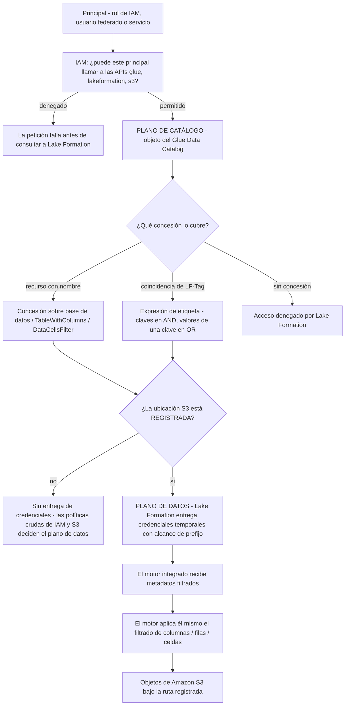
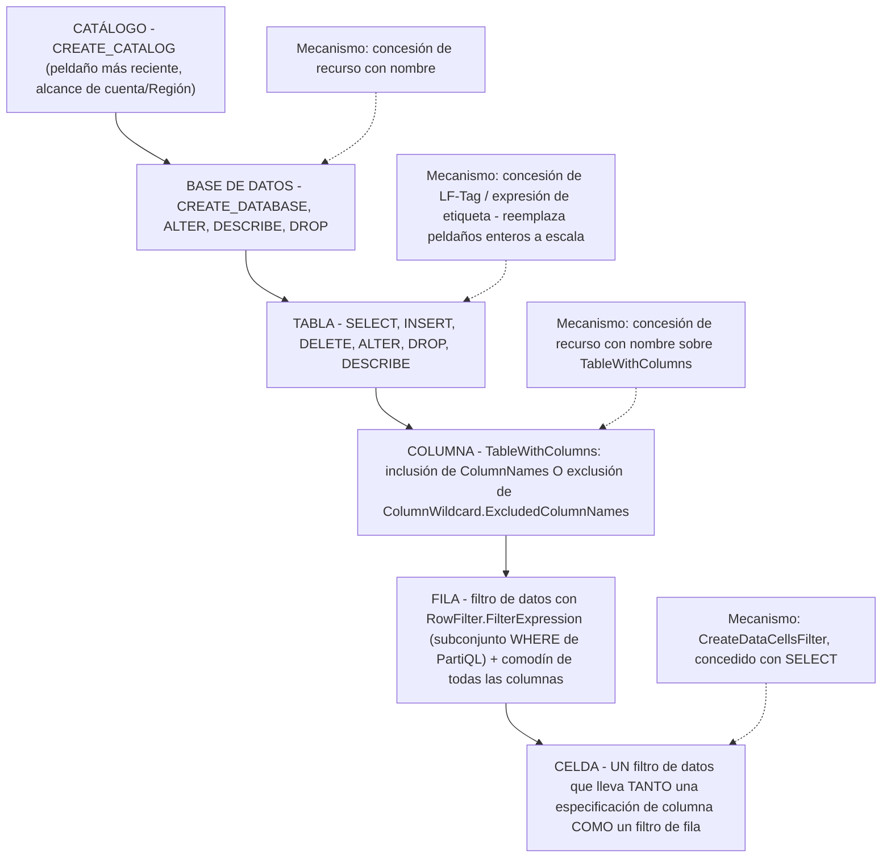
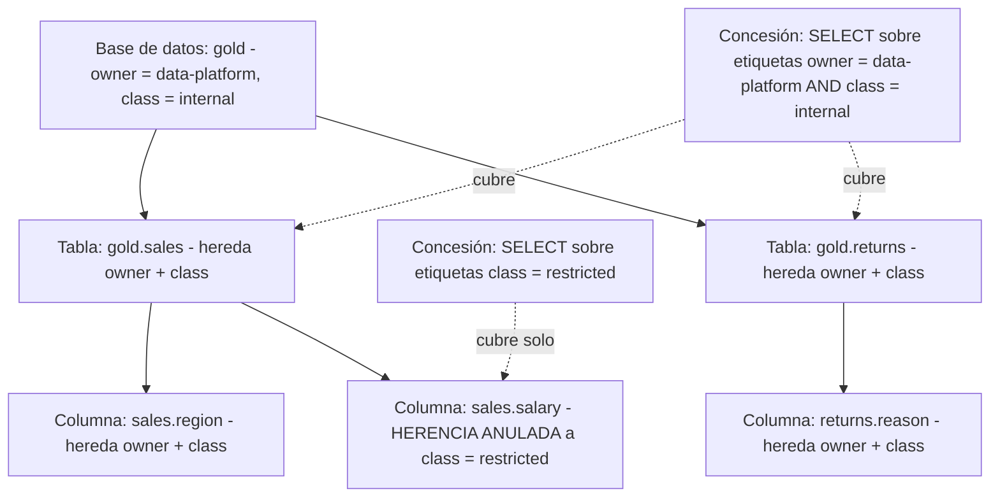
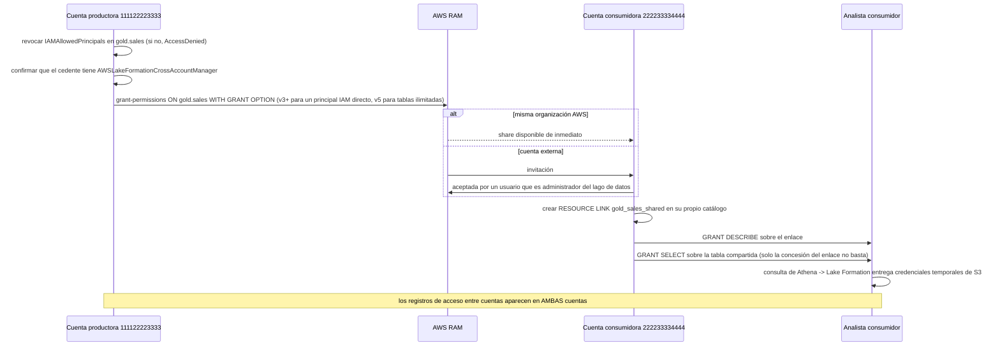
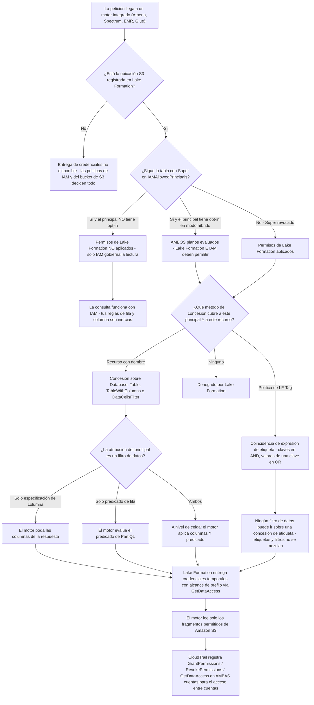

# Gobernanza de Lake Formation: Permisos, Seguridad por Filas/Columnas y Compartición de Datos

Las lecciones 01 to 11 construyeron la máquina: buckets, formatos, tablas Iceberg, crawlers, trabajos, un motor de consultas, un almacén y un orquestador. Cada una de esas capas produjo un nuevo lugar donde alguien tenía que responder la misma pregunta: *¿quién puede ver esto?* Esta lección la responde una vez, de forma centralizada, con **AWS Lake Formation**. El servicio no es un reemplazo de IAM ni un catálogo; es una **capa de permisos con forma de RDBMS** que se apoya en el Glue Data Catalog y emite credenciales temporales con alcance a los motores integrados, de modo que una sola sentencia `GRANT` pueda significar algo a granularidad de **base de datos, tabla, columna, fila y celda**.

La regla didáctica de esta lección: **Lake Formation decide la visibilidad, IAM decide la accesibilidad, y el motor hace el filtrado real.** Confunde esas tres cosas y cada síntoma de esta lección se vuelve un misterio.

```text
====================================================================
 SUPERFICIE DE GOBERNANZA DE LAKE FORMATION (a octubre de 2026)
====================================================================
 Reemplaza ..... tres superficies de políticas superpuestas: políticas
                  de identidad IAM para glue:*, políticas de bucket/
                  prefijo S3 para los datos, políticas de recurso del
                  catálogo Glue - todas con alcance efectivo de tabla
                  o de bucket
 Amplía ......... IAM («augments the IAM permissions model»);
                  IAM sigue autenticando y sigue controlando cada
                  API de plano de control de Lake Formation
 Dos planos .... plano de catálogo (Glue + concesiones de LF)
                  plano de datos (S3 + credenciales temporales
                  entregadas por rol)
                  puente = RegisterResource sobre la ubicación S3
 Modos .......... modo Lake Formation (revocar IAMAllowedPrincipals)
                  modo de acceso híbrido (ambos planos, opt-in por
                  principal)
 Escalera ....... catálogo -> base de datos -> tabla -> COLUMNA ->
                  FILA -> CELDA
 Columna ........ TableWithColumns ColumnNames / ExcludedColumnNames,
                  o una especificación de columna de filtro de datos
                  (campos struct anidados)
 Fila / celda .. DataCellsFilter, subconjunto WHERE de PartiQL,
                  expresión < 2.048 caracteres, <=100 por principal
                  por tabla
 TBAC .......... LF-Tag clave=valor, herencia
                  base de datos -> tabla -> columna (anulable);
                  claves en AND, valores de una clave en OR
 Compartir ..... resource shares de AWS RAM; misma organización
                  instantáneo, fuera de organización por invitación;
                  versión 5 de cuentas cruzadas = tablas ilimitadas
                  por share (2026-02-11)
 Admins ........ <= 30 administradores de lago de datos por cuenta
 Precio ........ permisos, etiquetas y compartición = $0;
                  la Storage API factura bytes escaneados (mínimo
                  10 MB)
 Trampa por defecto .. Super pre-concedido a IAMAllowedPrincipals
                  hasta que lo revocas - luego las concesiones
                  parecen inercias
====================================================================
```

En esta lección:

- diagnostica **lo que Lake Formation realmente reemplaza**, la maraña de políticas de IAM más S3, y lo que deliberadamente *no* reemplaza;
- separa las **ubicaciones registradas en LF** del **modo de acceso híbrido**, y predice qué plano de permisos responde a una petición dada;
- escala la **escalera de granularidad de permisos** (base de datos → tabla → columna → filtro de fila → celda) y nombra el mecanismo en cada peldaño;
- construye la **política de analista trabajada**: `SELECT` sobre `gold.sales`, menos `salary`, filas limitadas a `region = 'eu'`, como un solo filtro de datos a nivel de celda;
- aplica **LF-Tags y TBAC**: concesiones de etiquetas, herencia, y las reglas de coincidencia AND entre claves / OR dentro de una clave;
- comparte **bases de datos de cuentas cruzadas** a través de AWS RAM, con el conmutador de motor externo, llamadores de confianza, acceso gestionado y reglas de administradores del lago de datos;
- sitúa **Athena, Redshift Spectrum, QuickSight, Glue y EMR** en una matriz de soporte de motores y diagnostica qué se rompe en cada celda;
- elimina el predeterminado **`IAMAllowedPrincipals`** y ejecuta la migración documentada de seis pasos;
- lee el **árbol de decisión de comprobación de permisos** y escribe llamadas reales a `GrantPermissions` en JSON y CLI;
- estudia **tres casos nombrados de clientes de AWS** (Integral Ad Science, FanDuel, Morningstar), un recuadro de **actualización de octubre de 2026** con fuentes, **nueve ejemplos resueltos**, **cinco diagramas**, **tres comprobaciones interactivas** y **doce preguntas de estilo examen**.

---

## 1. Lo que Lake Formation reemplaza: la maraña de IAM y S3

### 1.1 Tres superficies, una tabla, ninguna fila

Antes de Lake Formation, un lago gobernado en AWS se ensamblaba a partir de tres superficies de políticas superpuestas, y AWS lo dijo en su disponibilidad general el **2019-08-08**:

> "Antes tenías que usar políticas separadas para proteger el acceso a datos y metadatos, y estas políticas solo permitían acceso a nivel de tabla. Ahora puedes dar acceso a cada usuario, desde una ubicación central, solo a las columnas que necesita usar.", AWS News Blog, *AWS Lake Formation, Now Generally Available* (2019-08-08)

| Superficie | Qué podía expresar | Dónde no podía llegar |
|---|---|---|
| **Políticas de identidad IAM** | `glue:*`, `lakeformation:*`, `s3:*` sobre ARNs elegidos | Sin noción de *columna*; un comodín que concede un prefijo completo concede una tabla completa |
| **Políticas de bucket / prefijo S3** | Qué principales pueden leer qué prefijo | Con alcance de bucket o de prefijo; el blog de gobernanza de AWS Redshift Spectrum afirma que las políticas de bucket dejan de escalar «cuando aumenta el número de combinaciones de niveles de acceso y usuarios» |
| **Políticas de recurso del Glue Data Catalog** | Acceso al catálogo entre cuentas | Sigue con forma de tabla; nada por debajo de la tabla, nada sobre filas |

Lake Formation añade una **cuarta** superficie que está deliberadamente concesionada como un sistema de concesiones de bases de datos relacionales:

> «Lake Formation proporciona un modelo de permisos de sistema de gestión de bases de datos relacionales (RDBMS) para conceder o revocar acceso a catálogos, bases de datos, tablas y columnas del Data Catalog con los datos subyacentes en Amazon S3.»: Guía del desarrollador de LF, *Onboarding to Lake Formation permissions* (consultado 2026-10-11)

Y **amplía** en lugar de reemplazar a IAM:

> «Lake Formation proporciona su propio modelo de permisos que amplía el modelo de permisos de IAM.»: Guía del desarrollador de LF, *Overview of data filtering* (consultado 2026-10-11)

La división del trabajo queda así fijada para el resto de la lección: **IAM autentica y controla el plano de control** (`GrantPermissions`, `GetDataAccess`, `glue:*`), **Lake Formation controla el plano de datos** decidiendo qué metadatos y qué credenciales temporales con alcance recibe un motor integrado, y **el motor realiza él mismo el filtrado por filas/columnas/celdas**.



Dos hechos salen directamente de ese diagrama y ambos son examinables:

1. **El registro es el único puente entre los planos.** «La entrega de credenciales de Lake Formation no está disponible, incluso con opt-in, salvo que la ubicación de datos esté registrada en Lake Formation.» (Guía del desarrollador de LF, *Hybrid access workflow*, consultado 2026-10-11.)
2. **Lake Formation no bloquea tu bucket.** «El modelo de permisos de Lake Formation no impide el acceso a las ubicaciones de Amazon S3 a través de la API o la consola de Amazon S3 si tienes acceso a ellas a través de IAM o de políticas de Amazon S3. Puedes adjuntar políticas de IAM a los principales para bloquear este acceso.» (Guía del desarrollador de LF, *Underlying data access control*, consultado 2026-10-11.)

### 1.2 Ejemplo resuelto E1: contando la maraña, luego contando el reemplazo

```text
ESCENARIO (aritmética derivada del conjunto documentado de permisos;
no es una cifra publicada por AWS) - a oct 2026

Patrimonio .. 3 bases de datos x 12 tablas = 36 tablas gobernadas
              4 equipos necesitan acceso de lectura (analistas,
              científicos de datos, finanzas, auditores)
              3 prefijos S3, uno por base de datos

MUNDO IAM + S3
  Políticas de identidad IAM ... 4 políticas x hasta 36 ARNs de tabla
                                  = hasta 144 entradas de ARN
  Políticas de prefijo S3 ....... 4 principales x 3 prefijos
                                  = 12 sentencias allow, reescritas en
                                  cada política de bucket
  Política de recurso del       solo entre cuentas, con forma de
  catálogo Glue                 tabla
  TOTAL de sentencias           144 + 12 = 156 (derivado)
  Añade un 5º equipo ............ +36 entradas IAM +12 sentencias de
                                  bucket = +48, siempre

LAKE FORMATION, SOLO RECURSOS CON NOMBRE
  SELECT por tabla .............. 4 x 36 = 144 concesiones (derivado)
  DESCRIBE por base de datos .... 4 x 3 = 12 concesiones (derivado)
  TOTAL ........................ 156 sentencias - misma forma, pero
                                  ahora en UN solo lugar con rastro
                                  de auditoría

LAKE FORMATION, BASADO EN ETIQUETAS (TBAC)
  Ejemplo de documentación de   5 asignaciones de etiqueta + 8
  AWS                          concesiones de etiqueta
                                 = 17 permisos efectivos
  Resultado en producción de    «cientos de reglas de permiso
  IAS                           reducidas a precisamente dos»
                                 (AWS Big Data Blog, 2021-09-23)

COSTE DE CUALQUIERA DE LOS TRES .. $0 por los permisos en sí
  «Pagas $0 por los permisos en AWS Lake Formation porque se
   proporcionan sin cargo.» - página de precios de Lake
   Formation (consultada 2026-10-11)
```

**Lectura:** la primera ventaja de Lake Formation sobre IAM puro *no* son menos sentencias: a granularidad de recursos con nombre escribes el mismo número. Su primera ventaja es **la centralización más la auditabilidad** (un `ListPermissions` en lugar de tres familias de políticas), y su segunda ventaja, que llega en la Sección 5, es **reducir la cuenta** con etiquetas. La columna de coste es la sorpresa: la propia capa de gobernanza es gratuita, así que la única pregunta de presupuesto es quién la mantiene.

- **📚 ¿Sabías que…?** La facturación de Lake Formation tiene exactamente tres conceptos facturables a oct 2026, y ninguno de ellos es un permiso. La **Storage API**, el motor de filtrado independiente del lado del servidor que se usa cuando ningún servicio analítico de AWS procesa los datos, factura «por el número de bytes escaneados por la Storage API, redondeado al megabyte siguiente, con un mínimo de 10 MB»; **Governed Tables** factura por archivo rastreado, por llamada a la API de metadatos y por byte procesado por el optimizador de almacenamiento; y el propio optimizador de almacenamiento factura por byte. Concesiones, revocaciones, LF-Tags, compartición entre cuentas y la aplicación por parte de Athena, Redshift, Glue y EMR son todas **$0** (página de precios de Lake Formation, consultada 2026-10-11).

---

## 2. Registrado en LF frente a híbrido: los dos modos de permisos

Un objeto del Data Catalog tiene dos preguntas **ortogonales**, y la mayor confusión sobre Lake Formation viene de responder solo una de ellas:

| Pregunta | Respuesta A | Respuesta B |
|---|---|---|
| (a) ¿Está registrada la ubicación S3 subyacente? | **Registrada**, `RegisterResource` con un rol; LF asume ese rol y entrega credenciales temporales | **No registrada**, sin entrega, las políticas de IAM y S3 deciden el plano de datos |
| (b) ¿Qué modelo de permisos aplica? | **Modo Lake Formation**, LF es el único modelo; `IAMAllowedPrincipals` revocado en todas partes | **Modo de acceso híbrido**, ambos modelos coexisten, con opt-in por principal |

### 2.1 Registro: para qué sirve el rol

> «Cuando registras una ubicación, especificas un rol de IAM que concede permisos de lectura/escritura sobre esa ubicación. Lake Formation asume ese rol al suministrar credenciales temporales a los servicios de AWS integrados.»: Guía del desarrollador de LF, *Set up AWS Lake Formation* (consultado 2026-10-11)

Consecuencias prácticas:

- el **rol de registro**, no el llamador, posee los permisos duraderos de `s3:*`;
- los llamadores además necesitan el permiso de IAM `lakeformation:GetDataAccess`, y «debes fijar el parámetro Resource a `*`»: cualquier otro valor de recurso no está soportado;
- registrar un prefijo cubre **todas las tablas bajo esa ruta de una vez**, porque «varias tablas pueden compartir un prefijo S3. Cuando registras una ubicación, todas las tablas bajo esa ruta obtienen la entrega de credenciales de una vez» (guía de mejores prácticas de Lake Formation publicada por AWS, consultada 2026-10-11).

### 2.2 Modo de acceso híbrido: dos vías, principales con opt-in

> «El modo de acceso híbrido de AWS Lake Formation admite dos vías de permisos hacia los mismos objetos de AWS Glue Data Catalog.» … «El modo de acceso híbrido aplica solo los permisos `CREATE_TABLE`, `CREATE_PARTITION`, `UPDATE_TABLE` por defecto.» … «los principales con opt-in necesitarán tanto permisos de Lake Formation como permisos de IAM para acceder a los datos, mientras que los principales sin opt-in seguirán accediendo a los datos usando solo permisos de IAM.»: Guía del desarrollador de LF, *Hybrid access mode* (consultado 2026-10-11)

Esa última frase es todo el modo: **el híbrido es un conmutador por principal, no por cuenta**, y es la herramienta de migración reversible que AWS recomienda:

> «Para suavizar la transición de los permisos del lago de datos de un modelo de IAM y Amazon S3 a los permisos de Lake Formation, te recomendamos que uses el modo de acceso híbrido para el Data Catalog.»: Guía del desarrollador de LF, *Set up AWS Lake Formation* (consultado 2026-10-11)

| Estado | `IAMAllowedPrincipals` en la tabla | Ubicación registrada | ¿Principal con opt-in? | Quién decide el acceso de lectura |
|---|---|---|---|---|
| Legado / predeterminado | presente (`Super`) | quizá | n/a | **Solo IAM**: los permisos individuales de Lake Formation no están en vigor |
| Modo Lake Formation | revocado | sí | n/a | **Solo Lake Formation** (más IAM para las APIs) |
| Híbrido, sin opt-in | presente | sí | no | **Solo IAM** |
| Híbrido, con opt-in | presente | sí | sí | **Ambos**: LF e IAM deben permitir |
| Registrado pero sin opt-in | revocado | sí | no | Las reglas de metadatos de LF, pero sin opt-in no hay doble control |

### 2.3 Ejemplo resuelto E2: llevar un rol al modo híbrido

```bash
# ---- Step 0: see what the table looks like today -----------------
aws lakeformation get-effective-permissions-for-path \
  --catalog-id 111122223333 \
  --resource-arn arn:aws:glue:us-east-1:111122223333:table/gold/sales
# Expect to see: Super granted to IAMAllowedPrincipals
# (Lake Formation sets Super to that group on databases and tables
#  by default - LF Developer Guide, Permissions reference)

# ---- Step 1: register the location so vending can exist ---------
aws lakeformation register-resource \
  --resource-arn arn:aws:s3:::acme-lake/gold/ \
  --role-arn arn:aws:iam::111122223333:role/lf-registration-role \
  --use-service-linked-role   # or supply your own customer-managed role
# HybridAccessEnabled can be set on the resource for hybrid operation

# ---- Step 2: opt ONE role in (per-principal, reversible) ---------
aws lakeformation create-lakeformation-opt-in \
  --principal DataLakePrincipalIdentifier=arn:aws:iam::111122223333:role/analyst-eu \
  --hybrid-access-opt-in-detail HybridAccessEnabled=true

# ---- Step 3: now the analyst needs BOTH planes -------------------
#   IAM:   glue:GetTable / glue:GetPartitions + lakeformation:GetDataAccess
#   LF:    SELECT on gold.sales (Section 4)
# A principal that is NOT opted in keeps working on IAM alone,
# which is what makes this reversible:
aws lakeformation delete-lakeformation-opt-in \
  --principal DataLakePrincipalIdentifier=arn:aws:iam::111122223333:role/analyst-eu
```

**Comprobaciones:** (a) el analista con opt-in que tiene una política de IAM pero *sin* concesión de LF ahora falla, prueba de que el doble control está activo; (b) el rol sin opt-in sigue leyendo solo con IAM, prueba de que el modo es por principal; (c) `IsRegisteredWithLakeFormation` en la tabla es `true` para la vista del principal con opt-in y sin cambios para los demás.

> [!IMPORTANT]
> **Registrado ≠ híbrido.** El registro responde *de dónde vienen las credenciales*; el híbrido responde *qué modelo de permisos aplica*. De ahí siguen tres modos de fallo separables, y cada uno tiene una corrección distinta:
> - **Con opt-in, ubicación no registrada** → el principal recibe las reglas de metadatos de Lake Formation pero sin entrega de credenciales, así que el plano de datos sigue comportándose como IAM puro.
> - **Registrado, nadie con opt-in, `IAMAllowedPrincipals` aún posee `Super`** → los permisos de Lake Formation no se aplican en absoluto; tus nuevas concesiones son inercias.
> - **Ninguno de los dos, pero el analista conserva un `s3:GetObject` directo** → cada filtro de fila de esta lección queda anulado. La limpieza de concesiones directas a S3 es un paso de la migración, no un extra opcional.

- **📚 ¿Sabías que…?** Los ajustes a nivel de cuenta que mantienen una base de datos nueva en el plano antiguo tienen nombres exactos en la consola: **`Use only IAM access control for new databases`** y **`Use only IAM access control for new tables in new databases`**, respaldados en la API por `CreateDatabaseDefaultPermissions` y `TableDefaultPermissions`, cuyo valor predeterminado es `[{"Principal":{"DataLakePrincipalIdentifier":"IAM_ALLOWED_PRINCIPALS"},"Permissions":["ALL"]}]` (Guía del desarrollador de LF, *Changing the default settings for your data lake* y API `DataLakeSettings`, consultado 2026-10-11). AWS deliberadamente **no** denomina este estado "IAMOnly" en ninguna parte: enseña los nombres documentados.

---

## 3. La escalera de granularidad de permisos

### 3.1 El vocabulario

Tipos de recurso sobre los que puedes conceder: **`Catalog`**, **`Database`**, **`Table`**, **`View`**, **`DataLocation`** (solo aplica `DATA_LOCATION_ACCESS`), **`LF_Tag`**, **`LF_TagPolicy` / `LFTagExpression`**.

El enum de permisos, tal como lo devuelve `ListPermissions` (referencia de la API de LF, consultada 2026-10-11):

```text
ALL (= Super)  SELECT  INSERT  DELETE  ALTER  DROP  DESCRIBE
CREATE_DATABASE  CREATE_TABLE  DATA_LOCATION_ACCESS
CREATE_LF_TAG  ASSOCIATE  GRANT_WITH_LF_TAG_EXPRESSION
CREATE_LF_TAG_EXPRESSION  CREATE_CATALOG  SUPER_USER
```

Tres reglas sobre esa lista:

- `SELECT`, `INSERT` y `DELETE` son **a la vez** permisos del Data Catalog **y** permisos de acceso a datos: son los que llegan a S3.
- `Super` es aditivo y sobrevive a una revocación parcial: «cuando revocas `Super`, los permisos `SELECT` e `INSERT` permanecen» (Guía del desarrollador de LF, *Access control for metadata*, consultado 2026-10-11).
- Conceder sobre **todas las tablas de una base de datos** concede implícitamente `DESCRIBE` sobre esa base de datos, pero «esta concesión automática de permiso `DESCRIBE` no se aplica cuando se usa control de acceso basado en atributos (ABAC)».

### 3.2 La escalera, dibujada



Todo lo que hay por debajo de `TABLE` se **expresa a través de solo dos mecanismos**: un *filtro de columna en la propia concesión* (`TableWithColumns`) o un *objeto de filtro de datos* (`DataCellsFilter`). Elige entre ellos con una pregunta: **¿necesito filas también?**

| Necesidad | Mecanismo | Objeto que escribes |
|---|---|---|
| Tabla completa | Concesión de recurso con nombre | `{"Table": {"CatalogId", "DatabaseName", "Name"}}` |
| Algunas columnas, todas las filas | Filtro de columna en la concesión | `{"TableWithColumns": {"ColumnNames": [...]}}` o `{"ColumnWildcard": {"ExcludedColumnNames": [...]}}` |
| Todas las columnas, algunas filas | Filtro de datos, a nivel de fila | `{"AllRowsWildcard"}` + `RowFilter.FilterExpression` |
| Algunas columnas **y** algunas filas | Filtro de datos, a nivel de celda | especificación de columna **más** `RowFilter` en un solo `DataCellsFilter` |
| Alcance masivo sobre muchas tablas | Concesión de LF-Tag | `{"LFTagPolicy": {"TagKey", "TagValues"}}` |

### 3.3 Ejemplo resuelto E3: la escalera de cuatro concesiones sobre una tabla

```text
Objetivo: hacer gold.sales visible, útil y correctamente acotada
para role/analyst-eu.

CONCESIÓN 1 - visibilidad (aún sin datos)
  recurso  Database gold
  perms    DESCRIBE
  efecto   la base de datos aparece en la lista de objetos de Athena

CONCESIÓN 2 - la tabla (sigue siendo cada fila, cada columna)
  recurso  Table gold.sales
  perms    SELECT
  efecto   SELECT * FROM gold.sales devuelve todo - DEMASIADO

CONCESIÓN 3 - solo columnas (alternativa de la Sección 4.1)
  recurso  TableWithColumns gold.sales,
           ExcludedColumnNames = [salary]
  perms    SELECT
  efecto   salary desaparece de los resultados Y de los metadatos
           glue:GetTable de este principal - pero ALL regions sigue
           devolviéndola

CONCESIÓN 4 - filas, columnas, un objeto (la política real, Sección 4)
  recurso  DataCellsFilter gold_sales_eu_no_salary
           RowFilter  = region = 'eu'
           Columns    = excluir salary
  perms    SELECT
  efecto   a nivel de celda: solo filas de la UE, menos la columna
           de salario

AUDITORÍA tras cada concesión:
  aws lakeformation list-permissions --principal ...
  # el permiso efectivo = UNIÓN de concesiones de recurso con
  # nombre, de política de etiqueta y de filtro de datos - no hay
  # primitiva de denegación, así que una concesión SELECT plana
  # posterior sobre la misma tabla vuelve a incluir lo que excluiste
```

**Cifras a oct 2026:** un filtro de datos necesita `SELECT` **con la opción de concesión** sobre todas las columnas de la tabla para crearse; **no hay tope** de filtros por tabla pero sí un límite de **100 filtros de datos por principal por una sola tabla**; y la expresión de fila debe quedar **por debajo de 2.048 caracteres** (Guía del desarrollador de LF, *Data filtering limitations* y compatibilidad con PartiQL, consultado 2026-10-11).

```matching
{
  "question": "Haz coincidir cada peldaño de granularidad de permisos con el mecanismo de Lake Formation que lo expresa:",
  "pairs": [
    {"left": "Base de datos", "right": "Concesión de recurso con nombre de CREATE_DATABASE, ALTER, DESCRIBE o DROP sobre un recurso Database; en este peldaño no existen filas ni columnas"},
    {"left": "Tabla", "right": "Concesión de recurso con nombre de SELECT, INSERT o DELETE sobre un recurso Table: el peldaño en el que se detiene la mayoría de los equipos, y el único que IAM pudo aproximar"},
    {"left": "Columna", "right": "TableWithColumns con inclusión de ColumnNames o exclusión de ColumnWildcard.ExcludedColumnNames: o la especificación de columna dentro de un filtro de datos, que es la única vía que llega a campos struct anidados"},
    {"left": "Fila", "right": "Un filtro de datos con un comodín de todas las columnas más RowFilter.FilterExpression escrito en el subconjunto WHERE de PartiQL, por debajo de 2.048 caracteres"},
    {"left": "Celda", "right": "Un solo filtro de datos que lleva TANTO una especificación de columna COMO una expresión de filtro de fila, concedido con SELECT"}
  ],
  "explanation": "Cuatro peldaños, dos mecanismos: las concesiones de recurso con nombre llevan base de datos y tabla; los filtros de columna y los filtros de datos llevan columna, fila y celda. Las dos trampas son que las columnas struct anidadas solo se alcanzan a través de la especificación de columna de un filtro de datos, y que la seguridad a nivel de celda se define como especificación de columna MÁS filtro de fila en un solo objeto: no como dos concesiones separadas. El filtrado de columnas no puede aplicarse a columnas clave de partición, y una concesión basada en etiquetas no puede llevar un filtro de datos en absoluto."
}
```

- **📚 ¿Sabías que…?** Tres techos merece memorizarse porque todos son pequeños: **30** administradores de lago de datos por cuenta por defecto, **1.000** expresiones de LF-Tag guardadas por cuenta, y **100** filtros de datos por principal por tabla (Guía del desarrollador de LF, *Set up AWS Lake Formation*, *Managing LF-Tag expressions* y *Data filtering limitations*, todos consultados 2026-10-11). Un cuarto, más blando: el ejemplo resuelto basado en etiquetas de la propia AWS llega a **17** permisos efectivos a partir de solo **5 asignaciones de etiqueta más 8 concesiones de etiqueta**.

---

## 4. Seguridad a nivel de fila y de columna: la política de analista trabajada

### 4.1 La combinatoria: tres controles, un tipo de objeto

> «Lake Formation usa el filtrado de datos para lograr seguridad a nivel de columna, a nivel de fila y a nivel de celda.» … «Cuando especificas el comodín de todas las columnas y proporcionas una expresión de filtro de fila, estás estableciendo solo seguridad a nivel de fila (filtrado por fila).» … «Cuando incluyes o excluyes columnas y columnas anidadas específicas, y especificas todas las filas … estás estableciendo seguridad a nivel de columna.» … «Cuando incluyes o excluyes columnas específicas y además proporcionas una expresión de filtro de fila, estás estableciendo seguridad a nivel de celda.»: Guía del desarrollador de LF, *Data filtering and cell-level security* (consultado 2026-10-11)

| Campo de columnas | Campo de filas | Control que obtienes |
|---|---|---|
| `AllRowsWildcard` (todas las columnas) | predicado presente | **Seguridad a nivel de fila** |
| `ColumnNames` o `ColumnWildcard.ExcludedColumnNames` | `AllRowsWildcard` | **Seguridad a nivel de columna** |
| especificación de columna **y** predicado | ambos presentes | **Seguridad a nivel de celda** |

Dos aclaraciones que ahorran tiempo real de depuración:

- **El filtrado de columnas no es enmascarado.** Excluir `salary` la elimina de los resultados *y* de los metadatos del catálogo de ese principal. Nunca devuelve tres asteriscos. Si el requisito es "mostrar solo los últimos cuatro dígitos", eso es una vista, una transformación en la capa de aplicación, o el dynamic data masking de Amazon Redshift: no Lake Formation.
- **Disponibilidad:** «La seguridad a nivel de celda está disponible en todas las regiones al usar la versión 3 del motor de Athena o Amazon Redshift Spectrum.» (Guía del desarrollador de LF, *Data filtering limitations*, consultado 2026-10-11.)

### 4.2 El lenguaje del filtro de fila: subconjunto de PartiQL, con bordes duros

| Regla | Valor (consultado 2026-10-11) |
|---|---|
| Sintaxis | «la expresión tiene la sintaxis de una cláusula `WHERE` en el lenguaje PartiQL» |
| Longitud | total **< 2.048 caracteres** (máximo de la API 2048) |
| Operadores | `=, >, <, >=, <=, <>, !=, BETWEEN, IN, LIKE, NOT, IS [NOT] NULL` |
| Comparaciones | **no puedes comparar columnas con otras columnas** |
| Mayúsculas | «Todas las comparaciones de cadenas y los patrones `LIKE` **distinguen mayúsculas**» |
| Tipos | `STRING/CHAR/VARCHAR`, tipos numéricos, `BOOLEAN`, `STRUCT` |
| No soportados | `array` y `map` no están soportados; `struct` **sí** |
| Claves de partición | «No puedes restringir el acceso sobre columnas que son claves de partición» |
| Vistas / enlaces de recurso | la seguridad a nivel de celda no está soportada en ellas |
| Concurrencia | «Si aplicas la expresión de filtro de todas las filas sobre una tabla de forma concurrente con otras expresiones de filtro con predicados, la expresión de todas las filas prevalecerá» |

### 4.3 Ejemplo resuelto E4, la política de analista: `gold.sales` menos `salary`, filas = `region='eu'`

Esto es **seguridad a nivel de celda en un solo objeto de filtro de datos**, más la concesión de visibilidad que lo hace utilizable.

```json
{
  "Name": "gold_sales_eu_no_salary",
  "DatabaseName": "gold",
  "TableName": "sales",
  "TableCatalogId": "111122223333",
  "RowFilter": { "FilterExpression": "region = 'eu'" },
  "ColumnWildcard": { "ExcludedColumnNames": ["salary"] }
}
```

```bash
# 1. create the filter - requires SELECT WITH GRANT OPTION on gold.sales
aws lakeformation create-data-cells-filter \
  --cli-input-json file://filter.json

# 2. grant SELECT through the filter, not on the bare table
aws lakeformation grant-permissions \
  --principal DataLakePrincipalIdentifier=arn:aws:iam::111122223333:role/analyst-eu \
  --resource '{"DataCellsFilter":{"TableCatalogId":"111122223333","DatabaseName":"gold","TableName":"sales","Name":"gold_sales_eu_no_salary"}}' \
  --permissions SELECT

# 3. visibility, so the table appears in the Athena explorer
aws lakeformation grant-permissions \
  --principal DataLakePrincipalIdentifier=arn:aws:iam::111122223333:role/analyst-eu \
  --resource '{"Table":{"CatalogId":"111122223333","DatabaseName":"gold","Name":"sales"}}' \
  --permissions DESCRIBE
```

**Cuatro comprobaciones de aprendizaje, y qué demuestra cada una:**

| Consulta ejecutada como `role/analyst-eu` | Resultado esperado | Qué demuestra |
|---|---|---|
| `SELECT salary FROM gold.sales` | error / columna ausente de los metadatos | que la mitad de **columna** del filtro de celda está activa |
| `SELECT region, count(*) FROM gold.sales GROUP BY region` | solo cuentas de `'eu'` | que la mitad de **fila** está activa |
| `SELECT * FROM gold.sales` | todas las columnas **excepto** `salary`, solo filas de la UE | que ambas mitades se componen en seguridad a nivel de **celda** |
| `SELECT region FROM gold.sales` | funciona: porque `region` sigue siendo legible | la columna de predicado del filtro debe estar en la lista de permitidos; decide deliberadamente si `region` sigue visible para los analistas |

**Contraste (más barato, más estrecho):** conceder `TableWithColumns` con `ExcludedColumnNames = ["salary"]` te da las columnas y ninguna fila: una respuesta legítima cuando el requisito es solo "ocultar PII", y el patrón que FanDuel usó en el **Caso B** de abajo. Añadir `region = 'eu'` es lo que te obliga a un filtro de datos.

> [!WARNING]
> ⚠️ **Cuatro formas en que esta política se amplía silenciosamente de vuelta a acceso completo:**
> - **Las etiquetas y los filtros de datos no se mezclan.** «No puedes aplicar filtros de datos cuando usas LF-Tag para gestionar los permisos sobre recursos del Data Catalog.» (Guía del desarrollador de LF, *Using AWS Lake Formation with Amazon Athena*, consultado 2026-10-11.) Si `gold.sales` está cubierta por una concesión de etiqueta, tu filtro de fila no se aplica a esa ruta.
> - **No hay primitiva de denegación.** El permiso efectivo es la **unión** de concesiones de recurso con nombre, de política de etiqueta y de filtro de datos. Una segunda concesión `SELECT` plana sobre `gold.sales` vuelve a incluir `salary` para el mismo principal.
> - **Opción de concesión y filtrado de columnas.** La referencia de permisos afirma que «no puedes incluir la opción de concesión si se aplica filtrado de columnas», mientras que la guía de concesiones describe un caso de opción de concesión más estrecho: verifica el comportamiento actual de la consola en tu cuenta antes de diseñar concesiones delegadas de columnas (los documentos de AWS discrepan aquí a 2026-10-11; trátalo como no verificado).
> - **Las columnas clave de partición no pueden filtrarse por columna**, y `IS [NOT] NULL` no es válido sobre ellas: un esquema que particiona por `region` necesita que `region` siga siendo legible, que es exactamente la cuarta comprobación de arriba.

---

## 5. LF-Tags y control de acceso basado en etiquetas (LF-TBAC)

### 5.1 Qué es una etiqueta

> «Cada LF-Tag es un par clave-valor, como `department=sales` o `classification=restricted`. Una clave puede tener múltiples valores definidos.»: Guía del desarrollador de LF, *Tag-based access control (LF-TBAC)* (consultado 2026-10-11)

Las etiquetas se adhieren a **bases de datos, tablas y columnas**. Deben estar predefinidas (una clave y sus valores se crean con `CreateLFTag` antes de que nada pueda llevarlas), y son el único mecanismo de esta lección que te deja conceder sobre un *atributo* en lugar de sobre un objeto con nombre.

### 5.2 Herencia y las reglas de coincidencia

> «Las tablas heredan LF-Tags de las bases de datos y las columnas heredan LF-Tags de las tablas. Los valores heredados pueden anularse» … «las claves de etiqueta se combinan con la operación AND, mientras que los valores se combinan con la operación OR»: Guía del desarrollador de LF, *Tag-based access control (LF-TBAC)* (consultado 2026-10-11)



Las dos reglas de combinación, enunciadas una vez y probadas para siempre:

- **Claves distintas en una misma concesión van en AND:** `owner = data-platform AND class = internal` solo coincide con recursos que llevan *ambas*.
- **Múltiples valores de una misma clave van en OR:** `class = internal OR class = restricted` coincide con *cualquiera*.
- Ejemplo de la documentación: la expresión de etiqueta `content_type:Sales AND location:US` «representa recursos relacionados con datos de ventas en EE. UU.»; las expresiones de LF-Tag guardadas tienen un tope de **1.000 por cuenta**.

### 5.3 Tres cosas que TBAC cambia en las concesiones

1. **Concedes sobre la etiqueta, no sobre la tabla.** El recurso de la concesión del principal es un `LFTagPolicy` (o un `LFTagExpression`), así que las tablas creadas *después*, incluidas las creadas por crawlers, quedan cubiertas automáticamente en cuanto heredan la etiqueta.
2. **Puedes conceder la capacidad de etiquetar.** `ASSOCIATE` deja que un principal adhiera una etiqueta; `DESCRIBE` le deja verla; `GRANT_WITH_LF_TAG_EXPRESSION` le deja usarla como recurso de concesión. Esta es la primitiva de delegación detrás de las mallas de datos.
3. **Los permisos de todos los métodos se unen.** El propio consejo de migración de AWS: «(Recomendado) Tras verificar que los principales tienen acceso a los recursos correctos mediante el método LF-TBAC, revoca los permisos que se concedieron usando el método de recurso con nombre.» Verifica primero, revoca después: nunca al revés.

### 5.4 Ejemplo resuelto E5: reconstruir la compresión de IAS con tres etiquetas

```text
PATRIMONIO (aritmética derivada, a oct 2026)
  3 bases de datos x 12 tablas = 36 tablas
  4 principales con acceso de lectura

RUTA DE RECURSOS CON NOMBRE
  SELECT por tabla ........ 4 x 36 = 144 concesiones
  DESCRIBE por base de datos .. 4 x 3  =   12 concesiones
  TOTAL ...................        156 sentencias (derivado)
  Reorganizar un equipo ..... volver a emitir hasta 48 de ellas

RUTA LF-TBAC (forma IAS: owner + class aplicados en la BASE DE DATOS)
  Asignaciones de etiqueta . 3 bases de datos x 2 claves = 6
                             asignaciones, heredadas hasta 36 tablas
                             y sus columnas (nada por tabla)
  Concesiones de etiqueta .. 4 principales x política de etiqueta
                             = 4 concesiones
  TOTAL ................... 10 sentencias, NINGUNA de las cuales
                             nombra una tabla

  Ejemplo resuelto de la documentación de AWS para la misma idea:
  5 asignaciones + 8 concesiones = 17 permisos efectivos

LA EXCEPCIÓN QUE NUNCA DESAPARECE
  "pero dos analistas también necesitan solo las filas region = 'eu'"
  -> 2 concesiones de recurso con nombre + filtro de datos (los
     filtros de datos no pueden ir sobre etiquetas), total 12
     sentencias, con la excepción LISTADA para que pueda revisarse
```

**Lectura:** el coste de la ruta de etiquetas es plano en el número de tablas y lineal en el número de *políticas*; la ruta con nombre es lineal en tablas × principales. IAS informó de la versión real de esto: **«Con los controles de acceso basados en etiquetas de Lake Formation, IAS redujo cientos de reglas de permiso a precisamente dos reglas»** (AWS Big Data Blog, 2021-09-23). Observa dónde aterriza la lista de excepciones: los filtros de fila son exactamente la función que no puede dirigirse con etiquetas, así que un patrimonio TBAC siempre arrastra una cola corta y deliberada de recursos con nombre.

```fillblank
{
  "question": "Rellena los nombres de las LF-Tag y la mecánica detrás del resultado de IAS:",
  "template": "IAS adjuntó las claves LF-Tag {{1}} y {{2}} a nivel de base de datos, confió en {{3}} para llevarlas a tablas y columnas, y expresó el acceso como concesiones basadas en etiquetas en lugar de reglas {{4}}.",
  "answers": {
    "1": "owner",
    "2": "class",
    "3": "herencia",
    "4": "por tabla"
  },
  "distractors": [
    "departamento",
    "clasificación",
    "equipo",
    "nivel",
    "propagación",
    "aliasing",
    "filtro-de-filas",
    "cuentas-cruzadas"
  ],
  "explanation": "El relato del AWS Big Data Blog sobre Integral Ad Science (2021-09-23) afirma que IAS aplicó las etiquetas owner y class a nivel de base de datos y confió en la herencia, y que los controles de acceso basados en etiquetas redujeron cientos de reglas de permiso a precisamente dos. La herencia es base de datos -> tabla -> columna con valores anulables, así que una etiqueta escrita una vez en la base de datos alcanza cada tabla de debajo, y el resultado es que ninguna regla nombra una tabla en absoluto."
}
```

```plot
{
  "type": "bar",
  "title": "Recuento de reglas de permiso para 4 principales a medida que crece el patrimonio (derivado, a oct 2026)",
  "data": [
    {"Tables in the database": "6 tables", "Named-resource grants": 24, "LF-TBAC rules": 10},
    {"Tables in the database": "12 tables", "Named-resource grants": 48, "LF-TBAC rules": 10},
    {"Tables in the database": "24 tables", "Named-resource grants": 96, "LF-TBAC rules": 10},
    {"Tables in the database": "36 tables", "Named-resource grants": 144, "LF-TBAC rules": 10}
  ],
  "xKey": "Tables in the database",
  "dataKeys": ["Named-resource grants", "LF-TBAC rules"],
  "xLabel": "Tablas en la base de datos",
  "yLabel": "Reglas de permiso mantenidas"
}
```

Pasa el cursor sobre un par de barras: las concesiones de recurso con nombre escalan como **principales × tablas** (derivado: 4 × 6 = 24 hasta 4 × 36 = 144), mientras que la ruta de etiquetas se queda en **6 asignaciones + 4 concesiones = 10** sin importar el número de tablas (derivado de la forma IAS de dos claves aplicadas a nivel de base de datos). El cruce es inmediato, la ruta de etiquetas ya es más pequeña con seis tablas, y por eso el ejemplo basado en etiquetas de AWS se cita como simplificación *operativa* y no como una función de seguridad.

---

## 6. Compartición de datos: bases de datos entre cuentas, motores externos, llamadores de confianza

### 6.1 Las bases de datos entre cuentas pasan por AWS RAM

> «Lake Formation usa el servicio AWS Resource Access Manager (AWS RAM) para compartir el recurso. Si la cuenta receptora está en la misma organización que la cuenta cedente, el recurso compartido está disponible de inmediato; si la cuenta receptora no está en la misma organización, AWS RAM envía una invitación a la cuenta receptora para aceptar o rechazar la concesión del recurso.»: Guía del desarrollador de LF, *Cross-account data sharing* (consultado 2026-10-11)

Existen dos métodos de concesión, y AWS recomienda uno de ellos por su nombre: **control de acceso basado en etiquetas de Lake Formation (LF-TBAC) (recommended)** frente a **recursos con nombre**. El blog que documenta la compensación lo dice llanamente: TBAC «se recomienda cuando están implicados muchos recursos y entidades.»

**Prerrequisitos que son fallos duros, no consejos** (Guía del desarrollador de LF, *Cross-account prerequisites*, consultado 2026-10-11):

1. Revoca **todos** los permisos de Lake Formation de `IAMAllowedPrincipals` sobre el recurso primero: de lo contrario Lake Formation lanza `AccessDeniedException`.
2. El cedente debe poseer la política gestionada de AWS **`AWSLakeFormationCrossAccountManager`**.
3. Al menos un usuario de la cuenta consumidora debe ser **administrador del lago de datos** para ver los recursos compartidos; «otros principales no pueden acceder a los recursos compartidos hasta que el administrador del lago de datos les conceda permisos.»
4. Las concesiones entre cuentas deben llevar la **opción de concesión**, porque el administrador del lado consumidor re-concede en local. «El principal que recibe el resource share no puede compartir el recurso con otros principales.»

**Ajustes de versión entre cuentas** (`DataLakeSettings.Parameters.CROSS_ACCOUNT_VERSION`) deciden qué puede compartirse: las concesiones directas a un principal IAM individual en otra cuenta necesitan **versión ≥ 3**; los shares en modo híbrido necesitan **≥ 4**; la **versión 5** «mejora la compartición de recursos entre cuentas, permitiéndote compartir un número ilimitado de tablas con otra cuenta, eliminando los límites anteriores de asociación de recursos por tipo de recurso», está disponible «a través de la consola o la API de Lake Formation», y la **degradación no está soportada** una vez aplicada (AWS What's New, 2026-02-11; Guía del desarrollador de LF, consultado 2026-10-11).



### 6.2 Ejemplo resuelto E6: compartir `gold.sales` con una cuenta externa

```text
PRODUCTOR 111122223333 -> CONSUMIDOR 222233334444   (a oct 2026)

PRE-FLIGHT (los tres son fallos duros, no consejos)
  1. aws lakeformation get-effective-permissions-for-path \
       --resource-arn arn:aws:s3:::acme-lake/gold/
     -> si aparece Super / IAMAllowedPrincipals, REVÓCALO primero
        (si no, Lake Formation lanza AccessDeniedException)
  2. el llamador del productor posee la política gestionada de AWS
     AWSLakeFormationCrossAccountManager
  3. versión entre cuentas: >= 3 para un principal IAM directo,
     >= 4 para un share en modo híbrido, 5 (2026-02-11) para un
     número ILIMITADO de tablas por cada RAM resource share -
     y la degradación NO está soportada una vez que mejoras
  4. la cuenta consumidora tiene al MENOS UN administrador del lago
     de datos, si no nadie allí puede ni ver el share

PRODUCTOR - la concesión debe llevar delegación
  aws lakeformation grant-permissions \
    --principal DataLakePrincipalIdentifier=arn:aws:iam::222233334444:role/partner-analyst \
    --resource '{"Table":{"CatalogId":"111122223333","DatabaseName":"gold","Name":"sales"}}' \
    --permissions SELECT \
    --permissions-with-grant-option SELECT

TRANSPORTE
  misma organización AWS ..... el share aparece de inmediato
  organización externa ....... invitación de AWS RAM, debe aceptarse

LADO CONSUMIDOR (el paso que todos olvidan)
  a. el administrador acepta el share de RAM
  b. crear RESOURCE LINK gold_sales_shared en el catálogo consumidor
  c. GRANT DESCRIBE sobre el enlace     <- la concesión del enlace solo lo hace visible
  d. GRANT SELECT sobre la TABLA COMPARTIDA para role/partner-analyst
  e. consulta de Athena a través del enlace -> credenciales temporales
     de S3 entregadas

LÍMITES QUE CITAR
  «El principal que recibe el resource share no puede compartir el
   recurso con otros principales» -> sin re-compartición por el
   destinatario
  los registros de acceso entre cuentas aparecen en AMBAS cuentas,
  con el ARN completo del principal solo si el destinatario hace
  opt-in
  Solo se admiten listas de inclusión (ColumnNames) al conceder a
  una cuenta u organización externa - sin vía de ExcludedColumnNames
```

**Comprobaciones:** (a) un intento de concesión mientras `IAMAllowedPrincipals` aún posee `Super` falla con `AccessDeniedException`; (b) una concesión sin `--permissions-with-grant-option` deja al administrador consumidor sin poder conceder nada a sus propios analistas; (c) conceder solo sobre el enlace deja la tabla invisible para las consultas: **concesión de enlace ≠ concesión de destino**.

### 6.3 Llamadores de confianza y el conmutador de motor externo

Lake Formation entrega credenciales temporales solo a **llamadores de confianza**. «Cada uno de estos servicios de AWS es un llamador de confianza para Lake Formation, y Lake Formation proporciona acceso a los datos almacenados en Amazon S3 a través de credenciales temporales»: el conjunto integrado siendo Athena, Redshift Spectrum, EMR y Glue (Guía del desarrollador de LF, *Working with services*, consultado 2026-10-11).

Cualquier otra cosa es opt-in, y el opt-in es un conmutador de tres partes en `DataLakeSettings`:

| Ajuste | Función | Postura por defecto |
|---|---|---|
| `AllowExternalDataFiltering` | deja que un motor de terceros acceda a metadatos sin filtrar y a credenciales de acceso a datos | debe habilitarse deliberadamente |
| `ExternalDataFilteringAllowList` | IDs de cuenta de los motores externos permitidos | vacío = nadie |
| `AuthorizedSessionTagValueList` | valores de etiqueta de sesión que un llamador debe presentar | la **clave** de la etiqueta de sesión de STS es `LakeFormationAuthorizedCaller` |
| `AllowFullTableExternalDataAccess` | deja que un motor obtenga credenciales **sin** una etiqueta de sesión cuando el llamador tiene acceso completo a los datos | **false** por defecto: mantenlo en false |

> «Si pretendes analizar … usando motores de consulta de terceros, debes optar por permitir que los motores externos accedan a los datos gestionados por Lake Formation.»: Guía del desarrollador de LF, *Set up AWS Lake Formation* (consultado 2026-10-11)

Una discrepancia documental de la que ser honesto: la referencia de la API `DataLakeSettings` muestra un ejemplo de clave de etiqueta de sesión `LakeFormationTrustedCaller`, mientras que la guía de motores de terceros y el blog de aplicaciones a medida especifican **`LakeFormationAuthorizedCaller`**. Dos fuentes dicen la segunda, así que úsala, pero no trates ninguno de los dos nombres como incuestionable.

### 6.4 Acceso gestionado y los roles de administrador

| Rol | Puede | No puede (restricción verificada) |
|---|---|---|
| **Administrador del lago de datos** | Registrar ubicaciones, crear bases de datos, ejecutar flujos de trabajo de permisos, conceder/revocar cualquier cosa | «No puede añadir a otros administradores del lago de datos»; tope de **30** por cuenta por defecto |
| **Administrador de IAM** | Crear usuarios, roles, políticas y *añadir* administradores del lago de datos | No puede conceder permisos de Lake Formation salvo que también sea administrador de LF |
| **Creador de base de datos / tabla** | `SUPER` implícito sobre lo que crea | Nada implícito sobre objetos que no creó |
| **Cedente con la opción de concesión** | Re-conceder lo que posee (`PermissionsWithGrantOption`) | Solo puede delegar lo que fue delegado a él |
| **Creador de LF-Tag / expresión de etiqueta** | Crear, actualizar, borrar etiquetas y expresiones guardadas | Los derechos implícicos cubren las propias etiquetas, no los datos |

Dos asimetrías que merece interiorizar:

- **Administrador añadido después = cero acceso implícito a los datos.** «los administradores del lago de datos añadidos después de la creación de la base de datos pueden conceder permisos pero no obtienen automáticamente permisos de acceso a datos como SELECT o DESCRIBE. Los administradores que crean bases de datos reciben permisos SUPER sobre esas bases de datos.»
- **El acceso gestionado se expresa como la opción de concesión.** El patrón, un equipo de plataforma que retiene `PermissionsWithGrantOption` y equipos de dominio que re-conceden dentro de un alcance, es cómo funciona el autoservicio "grantable" sin entregar el catálogo completo.

- **📚 ¿Sabías que…?** El rol de registro y el rol vinculado al servicio son una decisión de diseño real: Lake Formation trae un rol vinculado al servicio (`ServiceRoleForLakeFormationDataAccess`) para un registro sin configuración, pero la guía de mejores prácticas de AWS recomienda registrar con un **rol gestionado por el cliente** cuando esperas editar o acotar ese rol más adelante. En cualquier caso el llamador sigue necesitando `lakeformation:GetDataAccess` con `Resource: "*"`, y añadirlo es «una operación sin efecto cuando no hay ubicaciones registradas, así que es seguro (y recomendable) añadirlo de antemano» (guía de mejores prácticas de Lake Formation publicada por AWS, consultada 2026-10-11).

```dragdrop
{
  "question": "Ordena los pasos que llevan una ubicación S3 de acceso solo con IAM a una concesión gobernada de Lake Formation, terminando con una consulta de analista que funciona:",
  "items": [
    "Inventariar los permisos existentes de IAM y Glue con ListPermissions y GetEffectivePermissionsForPath",
    "Replicar esos permisos como concesiones de Lake Formation: deliberadamente un no-op mientras IAMAllowedPrincipals aún posea Super",
    "Añadir lakeformation:GetDataAccess con Resource fijado a * a cada política IAM del consumidor",
    "Registrar la ubicación S3 con un rol de IAM para que la entrega de credenciales sea posible",
    "Revocar Super al grupo IAMAllowedPrincipals en las bases de datos y tablas de esa ubicación",
    "Apagar Use only IAM access control for new databases y Use only IAM access control for new tables in new databases",
    "Borrar las políticas antiguas de IAM y S3 de granularidad fina que las concesiones de Lake Formation ahora reemplazan",
    "Consultar con Athena y confirmar que Lake Formation entrega credenciales temporales con alcance de prefijo"
  ],
  "correctOrder": [
    "Inventariar los permisos existentes de IAM y Glue con ListPermissions y GetEffectivePermissionsForPath",
    "Replicar esos permisos como concesiones de Lake Formation: deliberadamente un no-op mientras IAMAllowedPrincipals aún posea Super",
    "Añadir lakeformation:GetDataAccess con Resource fijado a * a cada política IAM del consumidor",
    "Registrar la ubicación S3 con un rol de IAM para que la entrega de credenciales sea posible",
    "Revocar Super al grupo IAMAllowedPrincipals en las bases de datos y tablas de esa ubicación",
    "Apagar Use only IAM access control for new databases y Use only IAM access control for new tables in new databases",
    "Borrar las políticas antiguas de IAM y S3 de granularidad fina que las concesiones de Lake Formation ahora reemplazan",
    "Consultar con Athena y confirmar que Lake Formation entrega credenciales temporales con alcance de prefijo"
  ],
  "explanation": "El orden documentado es inventario -> replicar -> añadir GetDataAccess -> verificar por ubicación -> revocar IAMAllowedPrincipals -> registrar -> apagar los predeterminados solo-IAM -> borrar las políticas antiguas. Las concesiones en etapas son deliberadamente inercias mientras exista la concesión Super, y eso es lo que hace la migración reversible: registra la ubicación de nuevo o borra el opt-in y vuelves a IAM. Los dos pasos que la gente se salta son GetDataAccess (sin él el motor no puede obtener credenciales entregadas ni con una concesión perfecta) y borrar las políticas antiguas (que de otro modo dejan una derivación permanente alrededor de cada filtro de fila)."
}
```

> [!WARNING]
> ⚠️ **El orden entre cuentas es el callejón sin salida más común.** Revoca `IAMAllowedPrincipals` → concede **con la opción de concesión** → (fuera de la organización) el consumidor acepta la invitación de RAM → el administrador del lago de datos del consumidor crea un **enlace de recurso** → el administrador vuelve a conceder **sobre el objeto compartido**, no solo sobre el enlace. Una concesión hecha antes de que se acepte la invitación parece no hacer nada; una concesión hecha con el permiso `IAMAllowedPrincipals` aún adjunto lanza `AccessDeniedException`; y saltarse la opción de concesión deja al administrador consumidor sin poder conceder nada en absoluto a sus analistas locales.

---

## 7. Matriz de soporte de motores: quién aplica realmente qué

> «el filtrado real de columnas en las respuestas de consulta es responsabilidad del servicio integrado. Los clientes de Lake Formation que admiten filtrado por columna, incluidos Amazon Athena, Amazon Redshift Spectrum y Amazon EMR, filtran los datos según los permisos de columna registrados con Lake Formation»: Guía del desarrollador de LF, *Limitations* (consultado 2026-10-11)

| Motor | Tabla | Columna | Fila / Celda | Advertencia que debes poder enunciar |
|---|---|---|---|---|
| **Athena SQL** | Lectura/escritura | Sí | Sí | La seguridad por celda necesita **versión 3 del motor de Athena**; las ubicaciones de resultados de Athena **no** pueden registrarse, así que los resultados son siempre territorio puro de IAM |
| **Athena Spark** | No soportado | No soportado | No soportado | «Athena Spark no admite consultar tablas del Data Catalog con permisos de Lake Formation.» |
| **Redshift Spectrum** (clúster aprovisionado o Serverless) | Lectura/escritura | Sí | Sí | Los filtros de datos de Lake Formation gobiernan el acceso por fila/celda de Spectrum; **las políticas propias de fila/columna de Redshift sobre un datashare compartido *hacia* Lake Formation se ignoran**: el administrador de LF debe recrearlas |
| **Spark sobre EMR (EC2)** | Lectura/escritura | Sí | Sí | Proteger el propio clúster sigue siendo tu trabajo |
| **Apache Hive sobre EMR (EC2)** | Lectura/escritura | Sí | **No soportado** | Los filtros de fila y celda no se aplican |
| **Hive sobre EMR Serverless / EMR on EKS** | No soportado | No soportado | No soportado | Listado como no soportado en la matriz de servicios |
| **AWS Glue ETL** | Lectura/escritura | **acceso de lectura en Glue 5.0+** | **acceso de lectura en Glue 5.0+** | La página de limitaciones aún dice «actualmente, AWS Glue ETL no admite el filtrado de columnas»: trata las **rutas de lectura en 5.0+** como soportadas y las **anteriores a 5.0 y las rutas de escritura** como no soportadas, y verifica en tu runtime |
| **Amazon QuickSight** | Vía Athena | Vía Athena | Vía Athena | La edición Enterprise concede permisos FGAC a usuarios y grupos de QuickSight; la edición Standard concede a roles de IAM (el predeterminado es `aws-quicksight-service-role-v0`) |
| **Motores personalizados / de terceros** | Opt-in | Opt-in | Opt-in | Etiqueta de sesión `LakeFormationAuthorizedCaller` más la lista de permitidos; nunca actives esto como atajo de diagnóstico |

### 7.1 Ejemplo resuelto E7: situando ocho motores en la matriz

```text
Para cada motor: DÓNDE está, y QUÉ se rompe si supones lo contrario?
(a oct 2026)

1. Athena SQL ................ tabla + columna + fila/celda
                               rompe: los filtros por celda necesitan
                               el motor v3; el HISTORIAL de consultas
                               lo gobiernan los grupos de trabajo, no
                               Lake Formation
2. Athena Spark .............. NO SOPORTADO
                               rompe: la vía del notebook simplemente
                               no puede consultar tablas con permisos
                               de Lake Formation
3. Hive sobre EMR Serverless . NO SOPORTADO
                               rompe: ninguna superficie de aplicación
                               en absoluto
4. Trabajo Glue 3.0 .......... solo tabla (ruta de lectura anterior a
                               5.0)
                               rompe: el filtrado de columnas NO se
                               aplica dentro del trabajo - recorta la
                               columna tú mismo
5. Trabajo Glue 5.0 .......... tabla + columna + fila/celda en LECTURA
                               rompe: la ruta de escritura sigue sin
                               verificar - nunca publicues un trabajo
                               que dependa de ella
6. Spark sobre EMR EC2 ....... aplicación completa vía el plugin de LF
                               rompe: el endurecimiento del clúster sigue
                               siendo tuyo
7. Redshift Spectrum ......... aplicación completa, incluidos los
                               filtros de datos
                               rompe: las políticas RLS/CLS de Redshift
                               del lado productor se IGNORAN en cuanto un
                               datashare se comparte HACIA Lake Formation
8. Importación SPICE de      la aplicación ocurre solo en el momento de
   QuickSight                la IMPORTACIÓN
                               rompe: los lectores ven las filas
                               importadas; los filtros de fila de LF no
                               viajan a SPICE
```

**Regla práctica derivada de la matriz:** Lake Formation publica metadatos filtrados y credenciales con alcance; **el motor poda la respuesta**. Cualquier motor fuera de esa lista o bien rechaza la consulta, o, peor, devuelve datos sin filtrar si concediste el opt-in de motor externo.

- **📚 ¿Sabías que…?** La integración de QuickSight tiene una división por ediciones que es fácil pasar por alto: la edición **Enterprise** te deja «conceder permisos de control de acceso de granularidad fina (FGAC) a usuarios y grupos individuales de QuickSight», mientras que las concesiones de la edición **Standard** van a **roles de IAM**, con el rol de servicio predeterminado llamado `aws-quicksight-service-role-v0`. Una vez registrado el bucket de origen, «los ajustes de acceso a Amazon S3 en QuickSight se ignoran, incluidas las políticas de IAM de alcance reducido para usuarios y grupos»: Lake Formation se convierte en la única fuente de verdad (documentación de QuickSight y del AWS Big Data Blog, consultada 2026-10-11).

---

## 8. El predeterminado `IAMAllowedPrincipals`, y la migración para dejarlo

### 8.1 Por qué tus concesiones parecen no hacer nada

> «Lake Formation establece por defecto el permiso `Super` a un grupo llamado `IAMAllowedPrincipals` en todas las bases de datos y tablas del Data Catalog. Si este permiso de grupo existe … todos los principales de tu cuenta tendrán acceso al recurso a través de las políticas de principal de IAM para AWS Glue.»: Guía del desarrollador de LF, *Permissions reference* (consultado 2026-10-11)

Y la consecuencia, enunciada con la misma directez:

> «Estos ajustes hacen que efectivamente el acceso a los recursos del Data Catalog y a las ubicaciones de Amazon S3 quede controlado únicamente por políticas de AWS Identity and Access Management (IAM). Los permisos individuales de Lake Formation no están en vigor.»: Guía del desarrollador de LF, *Changing the default settings for your data lake* (consultado 2026-10-11)

Así que el estado predeterminado de un lago recién creado o llevado mucho tiempo sin modificar es: **Lake Formation instalado, pero apagado.** Tus relucientes concesiones quedan registradas, auditadas e ignoradas.

| Síntoma | Primera comprobación | Corrección |
|---|---|---|
| "Mis concesiones no cambiaron nada; todos siguen pudiendo leer" | `ListPermissions` → ¿sigue `Super` en `IAMAllowedPrincipals`? | Revócalo sobre ese recurso, o da opt-in a los principales en modo híbrido |
| "Las concesiones funcionan para algunos roles, no para otros" | ¿Está registrada la ubicación? ¿Tiene opt-in el principal? | Registrar + opt-in; ambos son necesarios para la entrega |
| "El filtro de fila existe pero un analista sigue viendo todo" | ¿Tiene una segunda concesión `SELECT` plana, o una concesión de etiqueta? | El permiso efectivo es una **unión**: revoca la concesión que amplía |
| "El analista se salta todo de todos modos" | ¿Sigue teniendo `s3:GetObject` sobre el prefijo? | Borra los permisos directos de S3; Lake Formation no los revoca por ti |
| "La concesión entre cuentas lanza `AccessDeniedException`" | `IAMAllowedPrincipals` sobre el recurso compartido | Revócalo **antes** de la concesión entre cuentas |

### 8.2 Ejemplo resuelto E8: la migración documentada, ensayada

```text
MICRO-PATRIMONIO: 1 bucket, 2 bases de datos, 6 tablas, 3 roles
(a oct 2026; los pasos siguen la guía de mejora de LF y la guía de
 transición publicada por AWS)

PASO 1  INVENTARIO
  aws lakeformation list-permissions --resource-type TABLE
  aws lakeformation get-effective-permissions-for-path \
    --catalog-id 111122223333 \
    --resource-arn arn:aws:s3:::acme-lake/gold/
  más GetTable / GetPartitions de CloudTrail y cualquier entrada
  insufficientLakeFormationPermissions
  -> escribe la lista de concesiones objetivo

PASO 2  REPLICAR (no-op seguro)
  Recrea cada permiso encontrado como una concesión de LF.
  Nada cambia su comportamiento aún, porque Super sigue en
  IAMAllowedPrincipals. Usa esta ventana inercial para revisar.

PASO 3  ARMAR A LOS LLAMADORES
  Añadir lakeformation:GetDataAccess, Resource = "*", a los tres
  roles. Seguro añadirlo antes de que exista cualquier registro.

PASO 4  UNA UBICACIÓN A LA VEZ
  a) verificar con GetEffectivePermissionsForPath
  b) revocar Super de IAMAllowedPrincipals en las bases de datos
     y tablas de esa ubicación
  c) registrar la ubicación (rol de registro o rol vinculado al
     servicio)
  d) ejecutar la consulta centinela de Athena para los tres roles

PASO 5  CERRAR EL PREDETERMINADO
  Apagar Use only IAM access control for new databases y
  ...for new tables in new databases, para que nada vuelva a
  unirse al plano solo-IAM.

PASO 6  BORRAR LAS POLÍTICAS ANTIGUAS
  Eliminar las políticas finas de IAM y S3 que replicaste.
  Dejarlas es una derivación permanente de cada filtro que
  construiste.

REVERSIÓN (demuestra que el diseño es reversible)
  Registrar la ubicación de nuevo, o en modo híbrido simplemente
  borrar el opt-in con delete-lakeformation-opt-in. IAM vuelve a
  tomar el control.

DOS PLANOS QUE PUBLICA AWS
  Plan #1 (Per Resource) - migrar tabla por tabla
  Plan #2 (Per User)     - migrar usuario por usuario vía opt-ins
                            híbridos
  Ambos son reversibles; elige por escenario, no por cuenta.
```

> [!WARNING]
> ⚠️ **La regla de orden que salva migraciones:** *nunca revoces `IAMAllowedPrincipals` antes de haber validado que las concesiones de Lake Formation funcionan.* Como las concesiones en etapas son un no-op mientras exista la concesión `Super` predeterminada, la secuencia segura es siempre **etapa → valida → revoca → registra → verifica → borra políticas antiguas**. Invertir los dos primeros pasos deja el lago caído para todos en el momento en que revocas, sin nada que lo sustituya.

---

## 9. El flujo de comprobación de permisos: un árbol de decisión

Esto refleja el flujo de trabajo de acceso híbrido documentado de Lake Formation y es la forma más rápida de convertir "no funciona" en una sola comprobación.



Léelo como un **orden de diagnóstico**: registro primero, `IAMAllowedPrincipals` segundo, método de concesión tercero, tipo de atribución cuarto. Ir directo a "¿mi SQL está bien?" es la forma más cara de depurar Lake Formation.

---

## 10. Esbozo trabajado de la API y CLI de Grant

### 10.1 Las cuatro formas de llamada que realmente escribirás

```json
[
  {
    "Principal": { "DataLakePrincipalIdentifier": "arn:aws:iam::111122223333:role/analyst-eu" },
    "Resource": { "Table": { "CatalogId": "111122223333", "DatabaseName": "gold", "Name": "sales" } },
    "Permissions": ["SELECT", "DESCRIBE"],
    "PermissionsWithGrantOption": []
  },
  {
    "Principal": { "DataLakePrincipalIdentifier": "arn:aws:iam::111122223333:role/analyst-eu" },
    "Resource": {
      "TableWithColumns": {
        "CatalogId": "111122223333",
        "DatabaseName": "gold",
        "Name": "sales",
        "ColumnWildcard": { "ExcludedColumnNames": ["salary"] }
      }
    },
    "Permissions": ["SELECT"]
  },
  {
    "Principal": { "DataLakePrincipalIdentifier": "arn:aws:iam::111122223333:role/finance-eu" },
    "Resource": {
      "LFTagPolicy": {
        "CatalogId": "111122223333",
        "TagKey": "class",
        "TagValues": ["restricted", "internal"]
      }
    },
    "Permissions": ["SELECT", "DESCRIBE"],
    "PermissionsWithGrantOption": ["DESCRIBE"]
  },
  {
    "Principal": { "DataLakePrincipalIdentifier": "arn:aws:iam::222233334444:role/partner-analyst" },
    "Resource": { "Table": { "CatalogId": "111122223333", "DatabaseName": "gold", "Name": "sales" } },
    "Permissions": ["SELECT"],
    "PermissionsWithGrantOption": ["SELECT"]
  }
]
```

```bash
# Batch, the way a migration actually issues grants
aws lakeformation batch-grant-permissions \
  --entries file://grants.json

# The same four shapes as one-liners
aws lakeformation grant-permissions \
  --principal DataLakePrincipalIdentifier=arn:aws:iam::111122223333:role/analyst-eu \
  --resource '{"Table":{"CatalogId":"111122223333","DatabaseName":"gold","Name":"sales"}}' \
  --permissions SELECT DESCRIBE

aws lakeformation grant-permissions \
  --principal DataLakePrincipalIdentifier=arn:aws:iam::111122223333:role/analyst-eu \
  --resource '{"TableWithColumns":{"CatalogId":"111122223333","DatabaseName":"gold","Name":"sales","ColumnWildcard":{"ExcludedColumnNames":["salary"]}}}' \
  --permissions SELECT

aws lakeformation grant-permissions \
  --principal DataLakePrincipalIdentifier=arn:aws:iam::111122223333:role/finance-eu \
  --resource '{"LFTagPolicy":{"CatalogId":"111122223333","TagKey":"class","TagValues":["restricted","internal"]}}' \
  --permissions SELECT DESCRIBE \
  --permissions-with-grant-option DESCRIBE

# Revoke is the same shape with a different verb - and because
# effective permissions are a UNION, revoke the WIDENING grant,
# not the narrow one.
aws lakeformation revoke-permissions \
  --principal DataLakePrincipalIdentifier=arn:aws:iam::111122223333:role/analyst-eu \
  --resource '{"Table":{"CatalogId":"111122223333","DatabaseName":"gold","Name":"sales"}}' \
  --permissions SELECT

# Audit: what does this principal actually hold today?
aws lakeformation list-permissions \
  --principal DataLakePrincipalIdentifier=arn:aws:iam::111122223333:role/analyst-eu

# Audit: what does this S3 path actually permit?
aws lakeformation get-effective-permissions-for-path \
  --catalog-id 111122223333 \
  --resource-arn arn:aws:s3:::acme-lake/gold/
```

### 10.2 Ejemplo resuelto E9: leer correctamente de vuelta una concesión

```text
ENTRADA: el analista posee DOS concesiones sobre gold.sales
  (a) DataCellsFilter gold_sales_eu_no_salary  -> SELECT
  (b) Table gold.sales                          -> SELECT (añadida
      después "por si acaso")

PERMISO EFECTIVO (unión, a oct 2026)
  filas ...... TODAS las filas, porque la concesión (b) no lleva
               predicado
  columnas ... salary VISIBLE, porque la concesión (b) no tiene
               filtro de columna
  resultado   la política de la Sección 4.3 queda neutralizada

DIAGNÓSTICO
  list-permissions para role/analyst-eu muestra ambas entradas
  -> el fallo no está en el filtro, está en la concesión extra

CORRECCIÓN
  revoke-permissions solo sobre (b); conservar (a)
  luego re-ejecutar las cuatro comprobaciones de la Sección 4.3

COSTE DE LA AUDITORÍA ... $0 (los permisos, las concesiones, las
  revocaciones y la aplicación son todas gratis - página de precios
  de Lake Formation, consultada 2026-10-11)
```

**Nota de diseño:** como **no hay sentencia de denegación** en Lake Formation, el privilegio mínimo significa *no conceder nada por defecto* y tratar cada nueva concesión como un evento de ampliación que debe re-auditarse. `ColumnWildcard.ExcludedColumnNames` solo estrecha la atribución en la que se escribe.

---

### Actualizaciones de 2026 (en octubre de 2026)

> [!NOTE]
> **Qué cambió en la historia de gobernanza de Lake Formation entre finales de 2024 y octubre de 2026**: cada línea verificada contra una fuente primaria de AWS, y cada una cambia el comportamiento actual:
> - **Governed Tables están terminadas.** Las escrituras y transacciones dejaron de soportarse después del **2024-12-31**, y `GetTableObjects` / `ListTransactions` se eliminaron el **2025-02-17**; el reemplazo que AWS recomienda son formatos de tabla abiertos estándar (Iceberg, incluidas Amazon S3 Tables) con permisos de Lake Formation encima (AWS Big Data Blog, 2024-10-02; historial de documentos de LF, consultado 2026-10-11).
> - **La integración de catálogo de S3 Tables llegó el 2025-03-13.** Las tablas Iceberg gestionadas en S3 se registran ahora en Lake Formation para permisos de granularidad fina: nota: el catálogo es el `s3tablescatalog`, no el catálogo Glue predeterminado, y los llamadores necesitan `glue:GetCatalog` sobre ese ARN de catálogo.
> - **La versión 5 de compartición entre cuentas (2026-02-11) elimina el tope de tablas.** «Lake Formation configura un único resource share de AWS Resource Access Manager para un número ilimitado de tablas con otra cuenta», mejorable a través de la consola o la API; **la degradación no está soportada**. Los shares directos a un principal IAM externo aún necesitan versión 3+, los shares en modo híbrico versión 4+.
> - **Los permisos de tabla se extienden ahora a los datos S3 subyacentes (2026-06-11).** `GetTemporaryDataLocationCredentials` permite a los principales gestionados por Lake Formation obtener acceso temporal a S3 sin llevar una política de IAM de S3 separada: la respuesta más limpia hasta ahora a la derivación de "tu analista aún posee `s3:GetObject`".
> - **IAM Identity Center y la propagación de identidad de confianza para agentes de IA (2026-10-06).** Los agentes de Bedrock pueden consultar datos gobernados por Lake Formation bajo la **identidad del usuario final**, que es la respuesta de gobernanza para el acceso de agentes en lugar de un rol de servicio compartido.
> - **El acceso entre Regiones no es nuevo.** Consultar tablas de Glue/Lake Formation de otra Región a través de enlaces de recurso está documentado desde el **2023-06-30**; no lo presentes como una función de 2025 to 2026. Lo nuevo es el v5 entre cuentas, el permiso de tabla hacia datos S3 y la propagación de identidad.

- **📚 ¿Sabías que…?** Dos de estas actualizaciones soportan en silencio el peso de esta lección. El ABAC (control de acceso basado en atributos vía etiquetas) se documentó formalmente el **2025-04-17**, y por eso las concesiones de expresión de etiqueta aparecen ahora junto a las concesiones de recurso con nombre en la misma lista de permisos; y el ocaso de las Governed Tables significa que cualquier requisito de "compartición ACID gobernada" debe responderse ahora con **Iceberg más concesiones de Lake Formation**, no con un tipo de tabla retirado.

---

## Casos Reales

AWS publica cómo se ven estos modelos de permisos a escala de producción. Cada cifra de abajo es **declarada por el cliente o por AWS y sin auditoría**, con la fuente y la fecha nombradas para que puedas comprobarla: el punto examinable es el **patrón**, no el marketing.

### Caso A, Integral Ad Science: cientos de reglas de permiso reducidas a dos

| Elemento | Detalle |
|---|---|
| Cliente | **Integral Ad Science (IAS)**, verificación en ad-tech |
| Reto | Analítica de autoservicio en múltiples unidades de negocio, con obligaciones de privacidad bajo **GDPR y CCPA**, entregada sin una cola de incorporación basada en tickets ni automatización por tabla |
| Servicios | Lago de datos en **Amazon S3** (desplegado en 2020), **AWS Glue Data Catalog**, **Amazon EMR**, **Amazon Athena**, control de acceso basado en etiquetas de **AWS Lake Formation**, **Okta** como proveedor de identidad, un **grupo de trabajo de Athena por unidad de negocio** |
| Patrón | Dos claves de LF-Tag aplicadas **a nivel de base de datos** (`owner`, `class`), llevadas por **herencia** a tablas y columnas; concesiones emitidas sobre etiquetas en lugar de sobre tablas; grupos de trabajo por unidad de negocio que llevan etiquetas de facturación y límites de consulta |
| Resultado | «Con los controles de acceso basados en etiquetas de Lake Formation, IAS redujo cientos de reglas de permiso a precisamente dos reglas»; «Las etiquetas se heredan, así que solo necesitan aplicarse en el nivel más alto» |
| Fuente | AWS Big Data Blog, *Integral Ad Science secures self-service data lake using AWS Lake Formation*, **2021-09-23** (digest 18, fuente S9; consultado 2026-10-11) |

El patrón examinable: **el verdadero rendimiento del TBAC es operativo.** Una ontología de unas pocas etiquetas heredadas reemplaza una matriz ingobernable de concesiones por tabla: la aritmética de la Sección 5.4 en producción. Observa también lo que IAS *no* omitió: los controles a nivel de columna más el etiquetado llevaron la respuesta de cumplimiento, y la concesión de etiqueta aún tenía que coexistir con las excepciones de nivel de fila que el negocio necesitara.

### Caso B, FanDuel: concesiones de columna en lugar de enmascarado por copia

| Elemento | Detalle |
|---|---|
| Cliente | **FanDuel Group**, apuestas deportivas y juego: presencia en **50 estados** y **más de 8,5 millones de clientes** |
| Reto | Tres almacenes de datos de Amazon Redshift fusionados en una plataforma (almacén + lago); el diseño anterior separaba los PII en archivos etiquetados en S3, y cada fuente de datos nueva costaba **100 to 200 horas de tiempo de desarrollo** |
| Servicios | **AWS Lake Formation** (ubicación S3 registrada, permisos basados en columna), esquemas externos de **Amazon Redshift Spectrum** enlazados por rol, ETL de **AWS Glue** escribiendo Parquet más crawlers, grupos de IAM/Redshift para sincronizar la atribución |
| Patrón | Dos roles de analista: **`LimitedPIIAnalyst`** con acceso a todas las columnas, **`NonPIIAnalyst`** con acceso a las columnas que no son PII y asignado a los analistas por defecto: un conjunto de datos, muchas vistas |
| Resultado | «El control de acceso a nivel de columna de Lake Formation les permitió proteger los datos PII, que de otro modo habrían requerido un complejo enfoque basado en etiquetas de S3. Esto ahorró entre 100 y 200 horas de tiempo de desarrollo para cada fuente de datos y huella de datos nueva.» |
| Fuente | AWS Big Data Blog, *How FanDuel Group secures personally identifiable information in a data lake using AWS Lake Formation*, **2020-12-21** (digest 18, fuente S10; consultado 2026-10-11) |

El patrón examinable: **las concesiones a nivel de columna matan el enmascarado por copia.** El requisito "ocultar los PII a los analistas generales" se satisface con *una* exclusión `TableWithColumns` sobre *una* tabla catalogada; sin una segunda copia de los datos, sin un ritual de etiquetado por fuente. Esta es la alternativa más barata de la Sección 4, y por eso FanDuel nunca necesitó filtros de fila para ese problema en particular.

### Caso C, Morningstar: una ontología de etiquetas, dos planos de aplicación

| Elemento | Detalle |
|---|---|
| Cliente | **Morningstar**, investigación de inversiones |
| Reto | Gobernar un lago de datos *y* un almacén de Amazon Redshift desde una sola fuente de políticas, cuando Redshift no consume la ontología de etiquetas de forma nativa |
| Servicios | **Control de acceso basado en etiquetas de AWS Lake Formation (TBAC)** en el lago; **Amazon Redshift** para el almacén; un mapeador construido a propósito que traduce expresiones de etiquetas a sentencias `GRANT`/`REVOKE` de Redshift por grupo |
| Patrón | Una sola fuente de políticas → dos planos de aplicación; «elegimos el control de acceso basado en etiquetas de Lake Formation (TBAC)» y «construimos dos componentes que se encargan del mapeo de los controles de acceso basados en etiquetas a los permisos de Amazon Redshift» |
| Fuente | AWS Big Data Blog, *How Morningstar used tag-based access controls in AWS Lake Formation…*, **2023-04-06** (digest 12 fuente 49; digest 18 fuente S17; consultado 2026-10-11) |

El patrón examinable: **la ontología de etiquetas es portable, la aplicación no lo es.** Redshift admite atribuciones basadas en recursos pero no las basadas en etiquetas, así que un equipo que quiera un modelo de gobernanza único debe construir la traducción: que es exactamente el límite que la matriz de motores de la Sección 7 está dibujando.

| Caso | Patrón de Lake Formation que demuestra | Sección |
|---|---|---|
| Integral Ad Science | **LF-TBAC** con etiquetas a nivel de base de datos, herencia y un resultado de dos reglas | 5 |
| FanDuel | **Concesiones a nivel de columna** que reemplazan un diseño de PII con etiquetas S3 y doble archivo | 4, 7 |
| Morningstar | **Ontología de etiquetas mapeada a un segundo plano** (Redshift) | 5, 7 |

- **📚 ¿Sabías que…?** Los tres casos datan de **2020 to 2023** y deben presentarse así: los 8,5 millones de clientes de FanDuel y el "cientos → dos reglas" de IAS son instantáneas de esas implementaciones en el momento en que AWS las publicó, no los estados actuales de esas plataformas. Sus afirmaciones arquitectónicas, concesiones de columna, etiquetas heredadas, un grupo de trabajo por unidad de negocio, siguen siendo los patrones documentados; sus cifras son históricas.

---

## Preguntas de Práctica (Practice Questions)

```question
{
  "id": "lh-12-q1",
  "type": "multiple-choice",
  "question": "Antes de Lake Formation, un lago gobernado necesitaba políticas de identidad de IAM, políticas de bucket o prefijo de S3 y políticas de recurso del catálogo de Glue. ¿Cuál es la descripción más precisa de lo que añade Lake Formation?",
  "options": [
    "Reemplaza IAM por completo, así que tras la incorporación no se necesita ninguna política de IAM para el acceso a datos",
    "Añade una capa de permisos con forma de RDBMS sobre el Data Catalog con concesiones hasta base de datos, tabla, columna, fila y celda, mientras que IAM sigue autenticando y sigue controlando las APIs de plano de control de Lake Formation",
    "Reemplaza la política del bucket de S3 por una política de recurso de Glue con la misma granularidad de tabla",
    "Proporciona una sentencia de denegación que puede adjuntarse a cualquier columna, anulando todas las demás concesiones"
  ],
  "correct": 1,
  "explanation": "AWS describe Lake Formation como que ofrece 'its own permissions model that augments the IAM permissions model' y como un modelo de permisos RDBMS para catálogos, bases de datos, tablas y columnas. IAM sigue siendo la Puerta 1 para las APIs glue, lakeformation y s3, Lake Formation decide la visibilidad y entrega credenciales temporales, y no hay primitiva de denegación: el privilegio mínimo se consigue no concediendo nada por defecto. El anuncio de disponibilidad general dice explícitamente que las políticas separadas anteriores 'only allowed table-level access'."
}
```

```question
{
  "id": "lh-12-q2",
  "type": "multiple-choice",
  "question": "En el modo de acceso híbrido, un principal con opt-in envía una consulta. ¿Qué enunciado describe correctamente cómo se evalúa la petición?",
  "options": [
    "Solo se evalúa Lake Formation para los principales con opt-in, porque el modo híbrido desactiva IAM para ellos",
    "Solo se evalúa IAM, porque el modo híbrido mantiene la vía legada como autoritativa",
    "Tanto Lake Formation como IAM deben permitir la petición para los principales con opt-in, mientras que los principales sin opt-in siguen usando solo IAM; el modo aplica CREATE_TABLE, CREATE_PARTITION y UPDATE_TABLE por defecto",
    "El modo híbrido aplica a nivel de cuenta, así que todos los principales de la cuenta deben pasar ambas comprobaciones en cuanto cualquiera de ellos hace opt-in"
  ],
  "correct": 2,
  "explanation": "AWS afirma que 'opted in principals will require both Lake Formation permissions and IAM permissions to access the data, while non-opted-in principals will continue to access data using only IAM permissions', que el modo de acceso híbrido 'enforces only CREATE_TABLE, CREATE_PARTITION, UPDATE_TABLE permissions by default', y que es un opt-in por principal. La entrega de credenciales aún necesita que la ubicación esté registrada, así que hacer opt-in sin registro deja el plano de datos en IAM puro."
}
```

```question
{
  "id": "lh-12-q3",
  "type": "multiple-choice",
  "question": "Creas concesiones de Lake Formation sobre varias tablas, pero cada principal de IAM de la cuenta sigue pudiendo leer cada tabla a través de las APIs de Glue. ¿Cuál es la causa más probable?",
  "options": [
    "La política del bucket de S3 es demasiado permisiva y debe reescribirse antes de que Lake Formation evalúe nada",
    "Lake Formation establece por defecto el permiso Super al grupo IAMAllowedPrincipals en bases de datos y tablas, así que el acceso sigue fluyendo por IAM; revoca ese grupo o da opt-in a los principales en el modo de acceso híbrido",
    "Las concesiones de Lake Formation no se evalúan para tablas creadas antes de que Lake Formation estuviera habilitado en la Región",
    "Las concesiones deben reemitirse con la opción de concesión antes de que surtan efecto"
  ],
  "correct": 1,
  "explanation": "La referencia de permisos afirma que Lake Formation establece Super en IAMAllowedPrincipals por defecto y que mientras ese permiso exista, todos los principales de la cuenta obtienen Super o All sobre el recurso a través de sus políticas de IAM de Glue: los permisos individuales de Lake Formation no están entonces en vigor. La corrección documentada es revocar ese permiso o pasar al modo de acceso híbrido con opt-ins explícitos. Las políticas de bucket no pueden explicar la legibilidad de todo el catálogo, y la opción de concesión no tiene nada que ver con la aplicación."
}
```

```question
{
  "id": "lh-12-q4",
  "type": "multiple-choice",
  "question": "Un analista debe ver todas las filas de gold.sales pero solo las columnas que no son de salario. ¿Qué único mecanismo expresa esto?",
  "options": [
    "Un filtro de datos con AllRowsWildcard más una expresión RowFilter de salary IS NULL",
    "Una concesión de recurso con nombre sobre TableWithColumns usando inclusión de ColumnNames, o ColumnWildcard con ExcludedColumnNames fijado a salary",
    "Una concesión de LF-Tag sobre class = internal, porque las etiquetas llevan definiciones de columna",
    "Una concesión de DESCRIBE sobre la base de datos más SELECT sobre la tabla"
  ],
  "correct": 1,
  "explanation": "La seguridad a nivel de columna con todas las filas se expresa o bien como un filtro de columna en la propia concesión (TableWithColumns con una lista de inclusión o un comodín de exclusión) o bien como la especificación de columna de un filtro de datos con un comodín de todas las filas. Un predicado de fila sobre salary sería filtrado a nivel de fila y descartaría filas, no columnas. Las etiquetas no pueden llevar listas de columnas, y DESCRIBE más SELECT plano devuelve cada columna. Ten en cuenta que las columnas clave de partición no pueden filtrarse por columna en absoluto."
}
```

```question
{
  "id": "lh-12-q5",
  "type": "multiple-choice",
  "question": "Una política debe mostrar a los analistas solo las filas donde region = 'eu' Y debe ocultar la columna de salario. ¿Qué construcción produce seguridad a nivel de celda?",
  "options": [
    "Dos concesiones separadas: una exclusión de TableWithColumns para salary y una segunda concesión de filtro de fila: juntas forman un filtro de celda",
    "Un solo filtro de datos sobre gold.sales cuyo RowFilter.FilterExpression es region = 'eu' y cuyo ColumnWildcard.ExcludedColumnNames incluye salary, concedido con SELECT",
    "Un comodín de todas las columnas más la expresión de fila: eso es a nivel de celda por definición",
    "Una lista de inclusión de columnas junto con AllRowsWildcard: eso es a nivel de celda por definición"
  ],
  "correct": 1,
  "explanation": "AWS define las combinaciones con precisión: todas las columnas más una expresión de fila es solo a nivel de fila; columnas incluidas o excluidas más todas las filas es solo a nivel de columna; columnas Y una expresión de fila juntas en un solo filtro de datos es a nivel de celda. Dos concesiones separadas no se componen en un filtro de celda: se unen, y la concesión más amplia gana. Crear el filtro además requiere SELECT con la opción de concesión sobre todas las columnas de la tabla, y la expresión debe estar por debajo de 2.048 caracteres."
}
```

```question
{
  "id": "lh-12-q6",
  "type": "multiple-choice",
  "question": "¿Qué conjunto de restricciones sobre una expresión de filtro de fila de Lake Formation es correcto a octubre de 2026?",
  "options": [
    "Longitud total por debajo de 2.048 caracteres, sintaxis de cláusula WHERE de PartiQL, sin comparaciones columna con columna, array y map no soportados mientras que struct sí lo está, y las comparaciones de cadenas y LIKE distinguen mayúsculas",
    "Longitud ilimitada, solo SQL, comparaciones columna con columna fomentadas, y coincidencia de cadenas sin distinguir mayúsculas",
    "Longitud total por debajo de 512 caracteres, solo operadores = e IN permitidos, y struct no soportado",
    "Las expresiones deben referenciar columnas de partición, y IS NULL siempre es válido sobre ellas"
  ],
  "correct": 0,
  "explanation": "Los límites documentados son: expresión por debajo de 2.048 caracteres; sintaxis de una cláusula WHERE de PartiQL; operadores =, >, <, >=, <=, <>, !=, BETWEEN, IN, LIKE, NOT, IS [NOT] NULL; no se pueden comparar columnas con otras columnas; array y map no soportados mientras que struct sí lo está; todas las comparaciones de cadenas y los matches de LIKE distinguen mayúsculas. Las columnas clave de partición no pueden usarse para restricciones de columna, y IS [NOT] NULL no es válido sobre columnas de partición."
}
```

```question
{
  "id": "lh-12-q7",
  "type": "multiple-choice",
  "question": "Una tabla está cubierta por una concesión de LF-Tag, y además quieres un filtro de fila region = 'eu' para dos analistas. ¿Qué debes hacer?",
  "options": [
    "Adjuntar la expresión del filtro de fila a la concesión de LF-Tag: las concesiones de etiqueta aceptan expresiones de filtro como valores",
    "Usar la vía de recursos con nombre: crear un filtro de datos y conceder SELECT sobre ese DataCellsFilter a los dos analistas, porque los filtros de datos no pueden aplicarse cuando las LF-Tag gestionan los permisos sobre el recurso",
    "Codificar region como un nuevo valor de LF-Tag y añadirlo a la política de etiqueta, etiquetas y filtros son intercambiables",
    "Los filtros de fila funcionan junto a las concesiones de etiqueta automáticamente; no se necesita configuración adicional"
  ],
  "correct": 1,
  "explanation": "La documentación de Athena/Lake Formation lo dice directamente: 'You can't apply data filters when you use LF-Tags to manage permissions on Data Catalog resources.' Los filtros de fila, columna y celda requieren por tanto el método de concesión de recurso con nombre, y por eso un patrimonio basado en etiquetas siempre arrastra una lista corta de excepciones de recurso con nombre. Como los permisos efectivos son una unión, añadir en su lugar una concesión SELECT plana ampliaría el acceso en lugar de estrecharlo."
}
```

```question
{
  "id": "lh-12-q8",
  "type": "multiple-choice",
  "question": "Una concesión nombra dos claves de LF-Tag, owner = data-platform AND class = internal, y una segunda concesión nombra class = internal OR class = restricted. ¿Cómo se evalúan?",
  "options": [
    "Ambas son condiciones AND, así que cada etiqueta nombrada debe coincidir",
    "Ambas son condiciones OR, así que cualquier etiqueta nombrada puede coincidir",
    "Las claves separadas van en AND, mientras que los múltiples valores de una misma clave van en OR; las tablas heredan etiquetas de las bases de datos y las columnas heredan de las tablas, y los valores heredados pueden anularse",
    "Las claves separadas van en OR y los múltiples valores de una misma clave van en AND; la herencia va de columna a tabla a base de datos"
  ],
  "correct": 2,
  "explanation": "AWS afirma que las claves de etiqueta se combinan con la operación AND mientras que los valores se combinan con la operación OR, y que las tablas heredan LF-Tags de las bases de datos, las columnas heredan de las tablas, con los valores heredados anulables. Las etiquetas deben estar predefinidas antes de la asignación. La dirección de la herencia es base de datos -> tabla -> columna, nunca al revés, y una etiqueta escrita a nivel de base de datos alcanza por tanto cada tabla de debajo: que es toda la economía del caso de IAS."
}
```

```question
{
  "id": "lh-12-q9",
  "type": "multiple-choice",
  "question": "Una cuenta productora intenta compartir gold.sales con una cuenta externa de AWS y recibe AccessDeniedException de Lake Formation. ¿Qué secuencia de correcciones es correcta?",
  "options": [
    "Subir primero la versión entre cuentas a 5 y luego compartir: el ajuste de versión por sí solo elimina la denegación",
    "Revocar todos los permisos de Lake Formation de IAMAllowedPrincipals sobre el recurso, asegurarse de que el cedente tiene AWSLakeFormationCrossAccountManager, conceder WITH GRANT OPTION, y luego que el administrador del lago de datos del consumidor acepte el share de RAM, cree un enlace de recurso y vuelva a conceder en local",
    "Adjuntar una política de recurso de Glue a la cuenta consumidora y copiar la tabla: la compartición entre cuentas no usa Lake Formation",
    "Conceder directamente al principal externo sin la opción de concesión, porque las concesiones externas no pueden llevar delegación"
  ],
  "correct": 1,
  "explanation": "AWS lista los prerrequisitos: los permisos de IAMAllowedPrincipals deben revocarse primero o Lake Formation lanza AccessDeniedException; el cedente debe poseer la política gestionada de AWS AWSLakeFormationCrossAccountManager; debe existir al menos un administrador del lago de datos de la cuenta consumidora para ver y volver a conceder el share; y las concesiones entre cuentas deben llevar la opción de concesión. Lake Formation usa AWS RAM: los shares de la misma organización aparecen de inmediato, fuera de una organización debe aceptarse una invitación: y el consumidor luego crea un enlace de recurso antes de conceder permisos reales sobre el objeto compartido."
}
```

```question
{
  "id": "lh-12-q10",
  "type": "multiple-choice",
  "question": "¿Qué enunciado sobre la aplicación de los permisos de Lake Formation por los motores es correcto a octubre de 2026?",
  "options": [
    "Athena Spark admite completamente el filtrado por columna y fila en tablas del Data Catalog con permisos de Lake Formation",
    "Glue ETL aplica el filtrado de columnas en cada runtime de trabajo, incluidas las escrituras",
    "Athena SQL, Redshift Spectrum y Spark sobre EMR EC2 aplican las reglas de tabla, columna y fila, mientras que Athena Spark y Hive sobre EMR Serverless no están soportados, Hive sobre EMR EC2 no tiene soporte de fila ni celda, y Glue 5.0+ admite acceso de lectura mientras que las rutas anteriores a 5.0 y las de escritura no aplican el filtrado de columnas",
    "Cada servicio analítico de AWS aplica los permisos de Lake Formation de forma idéntica, porque Lake Formation realiza el filtrado de forma centralizada antes de que el motor se ejecute"
  ],
  "correct": 2,
  "explanation": "Lake Formation publica metadatos filtrados y credenciales entregadas; el servicio integrado realiza el filtrado real, y por eso el soporte es desigual. Athena Spark no admite consultar tablas del Data Catalog con permisos de Lake Formation, Hive sobre EMR Serverless y EMR on EKS no están soportados, Hive sobre EMR EC2 carece de soporte de fila y celda, la seguridad por celda necesita la versión 3 del motor de Athena o Redshift Spectrum, y la documentación de Glue aún dice 'Currently, AWS Glue ETL doesn't support column filtering' mientras que la matriz de servicios atribuye a Glue 5.0+ el acceso de lectura: así que solo las rutas de lectura en 5.0+ es seguro afirmarlas."
}
```

```question
{
  "id": "lh-12-q11",
  "type": "multiple-choice",
  "question": "El filtro de fila de Lake Formation de un analista funciona en Athena, pero después de que un panel de QuickSight importe la tabla en SPICE, los lectores ven filas que el filtro debería haber eliminado. ¿Cuál es la explicación y la corrección correctas?",
  "options": [
    "QuickSight ignora Lake Formation por completo; la corrección es reescribir la concesión como una política de IAM",
    "SPICE congela los datos en el momento de la importación, así que los filtros de fila de Lake Formation no pueden aplicarse a la copia importada: usa consulta directa, propagación de identidad de confianza con IAM Identity Center y consulta directa (sin SPICE), o replica los filtros de Lake Formation en un conjunto de datos de reglas de seguridad a nivel de fila de QuickSight",
    "El filtro de fila debe reaplicarse en el conjunto de datos de SPICE usando el mismo objeto de filtro de datos de Lake Formation",
    "QuickSight Enterprise no puede usar Lake Formation en absoluto; solo la edición Standard con roles de IAM puede"
  ],
  "correct": 1,
  "explanation": "QuickSight llega a Lake Formation a través de Athena, y una vez registrado el bucket de origen los propios ajustes de acceso S3 de QuickSight se ignoran. Pero una importación a SPICE copia las filas, así que las atribuciones del lado de origen no pueden aplicarse en la copia. Las vías documentadas por AWS son consulta directa, propagación de identidad de confianza (requiere autenticación de IAM Identity Center y no puede usar SPICE, y solo funciona para conjuntos de datos de consulta directa) o el patrón publicado por AWS que replica los filtros de datos de Lake Formation en un conjunto de datos de reglas de seguridad a nivel de fila de QuickSight. La edición Enterprise es la que concede FGAC a usuarios y grupos de QuickSight: no es la limitación aquí."
}
```

```question
{
  "id": "lh-12-q12",
  "type": "multiple-choice",
  "question": "¿Qué veredicto comparativo para gobernar un lakehouse de AWS es correcto a octubre de 2026?",
  "options": [
    "Lake Formation reemplaza por completo las políticas de IAM y S3, así que las políticas de bucket deben borrarse en cuanto se habilite Lake Formation",
    "Lake Formation, IAM puro más políticas S3 y herramientas de gobernanza de terceros son equivalentes, así que la elección es solo sobre preferencias del equipo",
    "Lake Formation amplía IAM con permisos de base de datos a celda, control de acceso basado en etiquetas y compartición entre cuentas a $0 por los permisos; IAM puro más políticas S3 dejan de escalar porque tienen alcance efectivo de tabla o bucket sin dimensión de fila ni columna; y una plataforma de gobernanza de terceros debe reconstruir la superficie de entrega de credenciales e integración de motores que Lake Formation trae con Athena, Redshift Spectrum, EMR y Glue",
    "La gobernanza de terceros es siempre preferible porque los servicios de AWS no pueden auditarse"
  ],
  "correct": 2,
  "explanation": "Las tres opciones difieren en alcance, no en gusto. Lake Formation explícitamente 'augments the IAM permissions model' y cobra $0 por permisos, etiquetas y compartición entre cuentas mientras aún requiere IAM para el plano de control; el propio anuncio de disponibilidad general de AWS dice que las políticas separadas anteriores 'only allowed table-level access' y el blog de gobernanza de Spectrum dice que las políticas de bucket dejan de escalar a medida que crecen las combinaciones de niveles de acceso y usuarios; y una herramienta de terceros tiene que reimplementar la entrega de credenciales de llamador de confianza para cada motor. IAM y las políticas de bucket siguen siendo necesarios: solo no son suficientes, y Lake Formation no revoca el s3:GetObject que le sobra a un analista."
}
```

> [!WARNING]
> ⚠️ **Trampas de patrón de esta lección: recorre esta lista antes de diseñar nada:**
> - **"Mis concesiones no hacen nada"** casi siempre es `IAMAllowedPrincipals` aún con `Super`, una **ubicación no registrada**, o un principal **sin opt-in**: en ese orden de probabilidad.
> - **Registro ≠ híbrido.** El registro es sobre la entrega de credenciales; el híbrido es sobre qué modelo de permisos aplica, y se hace opt-in **por principal**.
> - **Lake Formation no revoca tus claves de S3.** Cualquier principal que tenga `s3:GetObject` sobre el prefijo se salta cada filtro de fila que construyas; borrar esas políticas es un paso de la migración.
> - **No hay sentencia de denegación.** El permiso efectivo es la **unión** de concesiones de recurso con nombre, de política de etiqueta y de filtro de datos: un segundo `SELECT` plano vuelve a incluir todo lo que excluiste.
> - **Las etiquetas y los filtros de datos no se mezclan.** Los filtros de fila/columna/celda necesitan una concesión de recurso con nombre, así que un patrimonio dirigido por etiquetas siempre arrastra una lista de excepciones documentada.
> - **Aritmética de filtros:** expresión **< 2.048 caracteres**, **≤ 100 filtros de datos por principal por tabla**, necesita `SELECT` **con la opción de concesión**, **sin comparación columna con columna**, **sin array/map**, cadenas **sensibles a mayúsculas**, **sin filtrado de columnas clave de partición**, y **todas las filas prevalecen** sobre un predicado concurrente.
> - **La seguridad por celda necesita la versión 3 del motor de Athena o Redshift Spectrum**; Athena Spark, Hive sobre EMR Serverless y EMR on EKS no están soportados; Hive sobre EMR EC2 no tiene fila/celda; **el filtrado de columnas en Glue ETL solo para rutas de lectura en 5.0+**.
> - **QuickSight SPICE no hereda los filtros de fila de Lake Formation**: la importación es el límite de la atribución.
> - **Orden entre cuentas:** revocar `IAMAllowedPrincipals` → conceder **con la opción de concesión** → aceptar el share de RAM → enlace de recurso → volver a conceder sobre el objeto compartido; los shares directos a principales necesitan versión **3+**, los híbridos **4+**, y la versión **5** (2026-02-11) elimina el tope de tablas por share sin **degradación**.
> - **Administrador ≠ acceso a datos:** un administrador del lago de datos añadido después de que exista una base de datos no obtiene `SELECT` ni `DESCRIBE` implícitos, no puede añadir a otros administradores, y hay un tope predeterminado de **30** por cuenta.

> [!IMPORTANT]
> **Veredicto comparativo: Lake Formation frente a IAM puro + políticas S3 frente a una plataforma de gobernanza de terceros**
> - **Frente a IAM puro y las políticas de bucket de S3:** IAM responde la *accesibilidad* (`glue:*`, `lakeformation:GetDataAccess` con `Resource: "*"`, `s3:*`) y las políticas de bucket responden el *perímetro de red y de cuenta*; ninguna tiene dimensión de columna ni de fila. El propio anuncio de disponibilidad general de AWS dice que las políticas separadas anteriores «solo permitían acceso a nivel de tabla», y el blog de gobernanza de Spectrum dice que las políticas de bucket dejan de escalar «cuando aumenta el número de combinaciones de niveles de acceso y usuarios». Elige IAM puro para lo que IAM hace bien, APIs, condiciones, alcance de organización, y acepta que cada equipo adicional cuesta otra reescritura de cada regla de prefijo (Sección 1.2: **156 sentencias → +48 por equipo nuevo**, derivado).
> - **Frente a una plataforma de gobernanza de terceros:** Lake Formation trae la parte que un tercero debe reconstruir, la entrega de credenciales de llamador de confianza hacia Athena, Redshift Spectrum, EMR y Glue, más la compartición entre cuentas impulsada por AWS RAM, y los propios permisos cuestan **$0**, facturando solo la Storage API (bytes escaneados, redondeados al MB siguiente, **mínimo de 10 MB**), Governed Tables y el optimizador de almacenamiento. Elige un tercero solo cuando la gobernanza deba abarcar catálogos no de AWS o motores no integrados; espera reimplementar tú mismo la matriz de motores de la Sección 7.
> - **Frente a no hacer nada (una familia de políticas por equipo):** la diferencia no es el nivel de seguridad, es la *forma*. Las concesiones de Lake Formation de recurso con nombre tienen el mismo número que las entradas de IAM hasta que llegan las etiquetas; en ese punto el recuento deja de depender del volumen de tablas: el propio ejemplo de AWS se colapsa a **17 permisos a partir de 5 asignaciones + 8 concesiones**, e IAS informa de **cientos → dos reglas** (AWS Big Data Blog, 2021-09-23).
> - **El veredicto en una frase:** en octubre de 2026, **conserva IAM para la autenticación y el perímetro de red, pon cada objeto del catálogo bajo concesiones de Lake Formation con `IAMAllowedPrincipals` revocado y las ubicaciones registradas, impulsa el alcance masivo con LF-Tag, recorta las reglas de fila y celda como filtros de datos de recurso con nombre, comparte a través de RAM con la opción de concesión, y recurre a una plataforma de terceros solo donde no exista un motor integrado que haga el filtrado.**

> [!SUCCESS]
> **Conclusiones Clave (Key Takeaways):**
> 1. Lake Formation **amplía, nunca reemplaza, a IAM**: IAM autentica y controla `glue:*` / `lakeformation:*` (con `GetDataAccess` fijado a `Resource: "*"`), Lake Formation decide la visibilidad y entrega credenciales temporales con alcance de prefijo, y **el motor realiza el filtrado real por columna/fila/celda**.
> 2. **Dos preguntas ortogonales** lo deciden todo: *¿está registrada la ubicación?* (entrega de credenciales) y *¿qué modelo de permisos aplica?* (modo Lake Formation frente a **modo de acceso híbrido**, donde los principales con opt-in necesitan **ambos** planos y solo `CREATE_TABLE`, `CREATE_PARTITION`, `UPDATE_TABLE` se aplican por defecto).
> 3. **La escalera de granularidad** es catálogo → base de datos → tabla → columna → fila → celda, transportada por exactamente dos mecanismos: **concesiones de recurso con nombre** (incluidos los filtros de columna de `TableWithColumns`) y **filtros de datos** (`DataCellsFilter`), con las **concesiones de LF-Tag** como capa de escala masiva.
> 4. **A nivel de fila** = comodín de todas las columnas + predicado; **a nivel de columna** = especificación de columna + todas las filas; **a nivel de celda** = ambos en un solo objeto. Sintaxis `WHERE` de PartiQL, **< 2.048 caracteres**, **≤ 100 filtros por principal por tabla**, sin comparación columna con columna, sin `array`/`map`, **sensible a mayúsculas**, **las claves de partición no pueden filtrarse por columna**, y la seguridad por celda necesita **versión 3 del motor de Athena o Redshift Spectrum**.
> 5. **La política de analista trabajada** es un solo filtro de datos (`region = 'eu'` más `ExcludedColumnNames: ["salary"]`) concedido con `SELECT`, más un `DESCRIBE` aparte para la visibilidad, y debe re-auditarse tras cada concesión nueva, porque los permisos **se unen** y **no hay primitiva de denegación**.
> 6. **Las LF-Tag** son pares clave/valor predefinidos sobre bases de datos, tablas y columnas; la herencia va **base de datos → tabla → columna** y es anulable; **claves separadas en AND, valores de una clave en OR**; las etiquetas escalan porque las concesiones nombran atributos, no tablas: el ejemplo de AWS: **5 asignaciones + 8 concesiones = 17 permisos**; IAS: **cientos de reglas → dos** (2021-09-23).
> 7. **Las etiquetas y los filtros de datos nunca se combinan**: los filtros de fila/columna/celda requieren el método de recurso con nombre, así que un patrimonio TBAC arrastra una lista de excepciones de recurso con nombre deliberada y revisable.
> 8. **La compartición entre cuentas** pasa por **AWS RAM**: revocar primero `IAMAllowedPrincipals` (si no, `AccessDeniedException`), el cedente posee `AWSLakeFormationCrossAccountManager`, conceder **con la opción de concesión**, misma organización es instantáneo / fuera de organización necesita una invitación, el **administrador del lago de datos** del consumidor (tope predeterminado **30**) crea un **enlace de recurso** y vuelve a conceder en local; versiones **3+** para principals IAM directos, **4+** para híbrido, **5** (2026-02-11) para tablas ilimitadas y **sin degradación**.
> 9. **Los llamadores de confianza** son los motores integrados por defecto; los motores de terceros necesitan `AllowExternalDataFiltering` + `ExternalDataFilteringAllowList` + etiqueta de sesión **`LakeFormationAuthorizedCaller`** (el ejemplo `LakeFormationTrustedCaller` de la referencia de la API es una discrepancia documentada), y `AllowFullTableExternalDataAccess` debe permanecer en **false**.
> 10. **Matriz de motores:** Athena SQL, Redshift Spectrum y Spark sobre EMR EC2 aplican todo; **Athena Spark, Hive sobre EMR Serverless y EMR on EKS no están soportados**; **Hive sobre EMR EC2 no tiene fila/celda**; **Glue ETL solo para rutas de lectura en 5.0+**; QuickSight va **a través de Athena** (Enterprise = FGAC a usuarios/grupos, Standard = roles de IAM como `aws-quicksight-service-role-v0`) y **SPICE ignora los filtros de fila de Lake Formation**.
> 11. **La migración es por etapas y reversible:** inventario → replicar (un no-op seguro) → añadir `GetDataAccess` → registrar → **revocar `IAMAllowedPrincipals`** → apagar los predeterminados *"Use only IAM access control"* → **borrar las políticas antiguas de IAM/S3**; la reversión es registrar la ubicación de nuevo o borrar el opt-in. Nunca revokes antes de validar.
> 12. **Anclas de casos:** **Integral Ad Science** recortó «cientos de reglas de permiso a precisamente dos reglas» con etiquetas `owner`/`class` a nivel de base de datos y herencia (AWS Big Data Blog, 2021-09-23); **FanDuel** reemplazó un diseño de PII con etiquetas S3 y doble archivo de 100 to 200 horas por fuente con dos roles de concesión de columna, `LimitedPIIAnalyst` y `NonPIIAnalyst`, en **50 estados y más de 8,5 M de clientes** (2020-12-21); **Morningstar** mapeó una ontología LF-TBAC sobre concesiones de Redshift porque Redshift no consume atribuciones de etiquetas de forma nativa (2023-04-06): cifras de clientes publicadas por AWS, con marca de fecha, sin auditoría.
