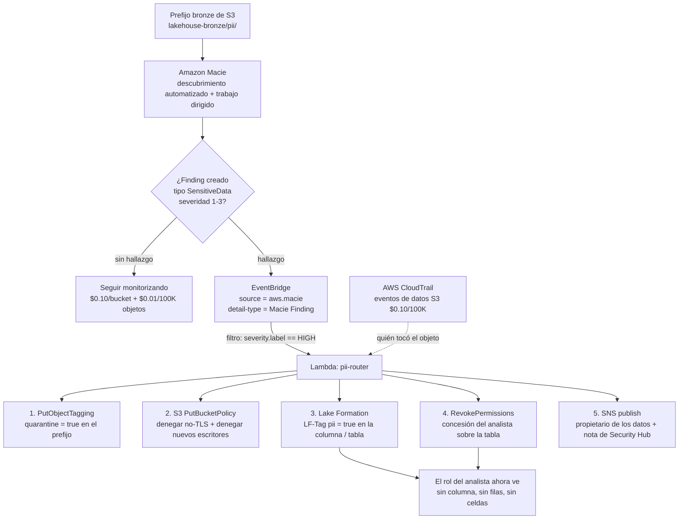
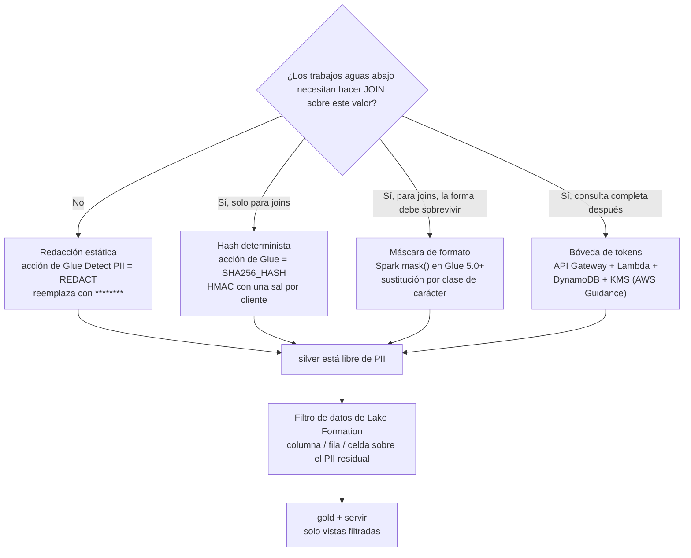
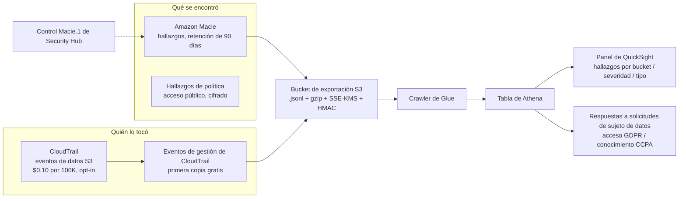
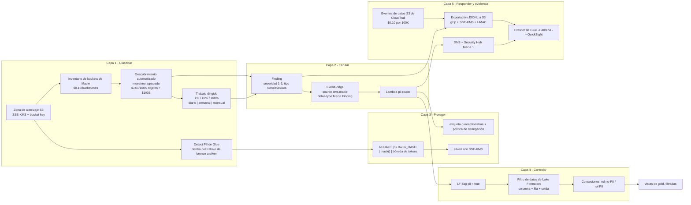

# Protección de PII en el Lakehouse: Amazon Macie, Enmascarado y Flujos de Privacidad

Las lecciones 01 to 12 construyeron un lakehouse rápido, barato y gobernable. Esa combinación crea una obligación nueva: tarde o temprano alguien pone la dirección de correo, el número de teléfono o el documento nacional de un cliente en `s3://lakehouse/bronze/`, y tienes que poder **decir dónde está, quién puede verlo, qué hiciste al respecto, y cuándo tendrías que borrarlo**. Esta lección es la respuesta, y la respuesta es un *pipeline*, no un producto.

La regla didáctica de esta lección: **clasificar, enrutar, proteger, controlar, responder: cinco capas, cada una con un servicio distinto, ninguna opcional.** Amazon Macie solo hace nunca la primera. Todo lo que sigue a un hallazgo es *tu* regla de EventBridge, *tu* Lambda, *tu* trabajo de Glue y *tu* concesión de Lake Formation.

```text
====================================================================
 SUPERFICIE DE PROTECCIÓN DE PII (precios de lista de us-east-1, a
 oct 2026)
====================================================================
 Clasificar .. Amazon Macie: inventario + monitorización de buckets,
               descubrimiento automatizado de datos sensibles
               (muestreo), trabajos de descubrimiento dirigidos
               (1% / 10% / 100%)
               AWS Glue: transformación Detect PII dentro de los
               trabajos, tipos de datos sensibles gestionados (incl.
               EMAIL)
 Enrutar ..... eventos de EventBridge, source = aws.macie,
               detail-type = "Macie Finding" ->
               Lambda / SNS / SQS / acciones personalizadas de
               Security Hub
 Proteger .... Glue REDACT / PARTIAL_REDACT / SHA256_HASH,
               Spark mask() en Glue 5.0+, bóveda de tokens
               (API Gateway + Lambda + DynamoDB + KMS)
               cifrado SSE-KMS predeterminado + S3 Bucket Keys
 Controlar ... filtros de datos de Lake Formation (columna / fila /
               celda)
               LF-Tags como pii = true, concesiones basadas en
               etiquetas
 Responder ... CloudTrail (quién), hallazgos de Macie (qué),
               exportaciones JSONL en S3 (evidencia), retención de
               90 días
 Precio ...... $0.10 por bucket S3 / mes
               $0.01 por 100.000 objetos monitorizados
               $1.00 por GB inspeccionado (1 GB / mes de nivel
               gratuito)
               prueba gratuita de 30 días, hasta 150 GB, trabajos
               excluidos
 Límite ...... Macie ve solo buckets S3 de propósito general.
               Las tablas Parquet y el catálogo Glue son trabajo de
               Glue, no de Macie. Macie encuentra; nunca previene.
====================================================================
```

En esta lección:

- ejecuta el **pipeline de cinco capas** de extremo a extremo y nombra el servicio que posee cada capa, y nombra la capa que *no* tiene ningún servicio de AWS (el pegamento del enrutado);
- profundiza en **Amazon Macie**: inventario y monitorización, descubrimiento automatizado frente a trabajos dirigidos, profundidad de muestreo, programaciones, soporte de clases de almacenamiento y los límites duros de alcance;
- separa los **tres números** que los alumnos confunden constantemente: severidad del hallazgo (1 to 3), puntuación de sensibilidad del bucket (−1 a 100) y `count` de ocurrencias;
- elige entre **identificadores de datos gestionados e identificadores de datos personalizados**, escribe una regex real, y sabe exactamente qué identificador debes construir tú mismo (correo electrónico);
- lee el **esquema de Finding** y enrúta con una regla de **EventBridge** hacia una Lambda que pone un prefijo en cuarentena y estampa `PII=true`;
- presupuesta un programa de clasificación **al dólar**, usando las tres dimensiones de facturación y el dial de profundidad de muestreo;
- elige una **técnica de enmascarado por el requisito de fidelidad de unión**, redactar, hash, enmascarado de formato o tokenizar, y evita la trampa de tiempo de ejecución de `mask()` en Glue 4.0 y Athena;
- vincula la clasificación con la **seguridad de columnas y filas de Lake Formation** para que una etiqueta sea una aplicación, no una nota;
- construye el **rastro de auditoría** a partir de eventos de datos de CloudTrail, hallazgos de Macie y exportaciones JSONL;
- trata **GDPR, CCPA y LGPD** a profundidad de AWS, incluyendo por qué S3 versioning rompe en silencio el borrado.

---

## 1. El pipeline de cinco capas: clasificar, enrutar, proteger, controlar, responder

### 1.1 Las capas y quién las posee

| Capa | Qué pregunta responde | Servicio que la posee | Qué se rompe si la omites |
|---|---|---|---|
| **1. Clasificar** | *¿Dónde están los PII?* | Amazon Macie (objetos S3) + AWS Glue Detect PII (datos tabulares en trabajos) | Estás adivinando; auditoría pide una lista y tú produces una hoja de cálculo |
| **2. Enrutar** | *¿Quién reacciona, qué rápido?* | EventBridge (`source = aws.macie`) → Lambda / SNS / SQS / Security Hub | Los hallazgos se acumulan en una consola que nadie abre |
| **3. Proteger** | *¿Cómo se ve el valor almacenado?* | enmascarado con Glue / Spark, bóveda de tokens, cifrado SSE-KMS | Cada lector del prefijo crudo ve PII en crudo |
| **4. Controlar** | *¿Quién puede consultarlo?* | filtros de datos de Lake Formation + LF-Tags | El enmascarado lo deshace cualquiera con un `s3:GetObject` directo |
| **5. Responder y evidencia** | *¿Qué puedo demostrar?* | CloudTrail + hallazgos de Macie + exportaciones JSONL | No puedes responder «¿cuándo lo supiste?» |

Tres propiedades de esta tabla merece memorizarse:

1. **Las capas 1 y 5 son de detección; las capas 3 y 4 son de prevención; la capa 2 es el único pegamento.** Macie nunca enmascarará una columna ni revocará una concesión: la conexión entre un hallazgo y un control es código que tú escribes.
2. **La capa 1 se divide por motor.** Macie inspecciona **buckets S3 de propósito general**; la transformación Detect PII de Glue inspecciona **DataFrames dentro de un trabajo**. El Parquet en el lago y las columnas del Glue Data Catalog son territorio de Glue, no de Macie.
3. **La capa 4 debe existir aunque la capa 3 sea perfecta.** Una tabla `silver` bellamente enmascarada no hace nada por el analista que se salta el lakehouse y lee `bronze/` con una política de IAM.

### 1.2 Ejemplo resuelto E1: presupuestar un programa de clasificación (us-east-1, a oct 2026)

Toma una zona de aterrizaje bronze de **1 TB** con **2.000.000 de objetos**, más 14 buckets más pequeños (15 buckets en total). Macie factura en tres dimensiones (Amazon Macie Pricing, consultado 2026-10-11):

```text
E1 RESUELTO - coste de clasificación en régimen estable, 15 buckets,
1 TB bronze
--------------------------------------------------------------------
Inventario y monitorización de buckets
  15 buckets x $0.10 por bucket / mes             = $ 1.50 / mes
  (prorrateado a diario; cubre hasta 10.000 buckets por cuenta y
   Región)

Objetos monitorizados para descubrimiento automatizado
  2.000.000 objetos / 100.000 x $0.01             = $ 1.00 / mes
  (los 15 buckets contribuyen al recuento de objetos)

Datos inspeccionados por descubrimiento automatizado
  supón 40 GB muestreados en el mes
  (40 - 1) GB x $1.00  [1 GB de nivel gratuito]   = $39.00 / mes

Un trabajo de descubrimiento dirigido sobre el bucket de 1 TB
  1.024 GB x $1.00                                = $1.024 único
  + S3 GET/LIST: 2.000.000 GET x $0.004/10.000    = $ 0.80
  + ~2.000 LIST x $0.005/1.000                    = $ 0.01

TOTAL régimen estable (sin trabajos dirigidos)    = $41.50 / mes
TOTAL con un trabajo dirigido de escaneo completo = $1.066,31 una vez
```

**La lección dentro del ejemplo:** el descubrimiento automatizado es la capa continua barata; los trabajos dirigidos son la capa de precisión cara. La guía de reducción de costes de AWS (Security Blog, 2023-03-20) es exactamente esta aritmética: usa el descubrimiento automatizado para *encontrar* los buckets de riesgo, muéstralos al **10%** (unos **$102** sobre 1.024 GB) para validar, y reserva el escaneo completo a **$1/GB** para el puñado de buckets que realmente importan.

- **📚 ¿Sabías que…?** La **prueba gratuita de 30 días** cubre hasta **150 GB inspeccionados por cuenta** y la dimensión de inventario de buckets, pero la página de precios es explícita: «cualquier trabajo de descubrimiento de datos sensibles que crees no estará incluido en la prueba gratuita de 30 días» (Amazon Macie Pricing, consultado 2026-10-11). Un equipo de demostración que ejecuta un trabajo de 200 GB con muestreo del 100% en el segundo día de la prueba acaba de facturarse unos **$200**. La prueba gratuita cubre el descubrimiento; no cubre *tus* trabajos.

---

## 2. Amazon Macie en profundidad

### 2.1 Inventario y monitorización: la capa que está siempre activa

Macie «evalúa automáticamente y continuamente tus buckets S3 en busca de datos sensibles» usando «inventario y monitorización de buckets, descubrimiento automatizado de datos sensibles y aprendizaje automático (ML) para perfilar buckets y muestrear objetos» (Guía de usuario de Macie, *Automated sensitive data discovery: how it works*, consultado 2026-10-11).

Tres hechos hacen que esta capa se comporte distinto de un escaneo:

- **Los buckets se agrupan** *"by attributes such as bucket name, file types, and prefixes to cost-efficiently sample data broadly across an organization and minimize the data scanning needed"*. El agrupamiento es la razón por la que una muestra representativa puede ser estadísticamente útil sin tocar cada objeto.
- **La cobertura está limitada a 10.000 buckets por cuenta y Región** (cuota elevada el 2024-12-06), y la facturación es `$0.10 per bucket per month`, prorrateada a diario.
- **Los resultados no son instantáneos.** Los resultados de análisis *"can begin to appear within 48 hours of enabling automated sensitive data discovery"*, y las puntuaciones se quedan en `50 — Not yet analyzed` hasta que aparecen. Un bucket vacío puntúa `1 — Not sensitive`, lo que significa *sin datos*, no *sin PII*.

### 2.2 Descubrimiento automatizado frente a trabajos dirigidos

Son mecanismos distintos con facturas distintas, y confundirlos es el malentendido más común sobre Macie.

| Propiedad | **Descubrimiento automatizado de datos sensibles** | **Trabajos de descubrimiento de datos sensibles dirigidos** |
|---|---|---|
| Disparo | Continuo, activo por defecto una vez habilitado | Lo creas tú: **único (bajo demanda)** o **periódico (diario, semanal, mensual)** |
| Alcance | Muestra representativa entre buckets agrupados | Objetos que cumplen tus criterios (tamaño, fecha de creación, última modificación) |
| Muestreo | Agrupamiento estadístico, perfil por bucket | **Profundidad de muestreo: 1, 10 o 100 (por ciento)** |
| Alimenta | **puntuación y etiqueta de sensibilidad** del bucket | Solo hallazgos: *"They don't reflect the results of sensitive data discovery jobs that you create and run"* |
| Facturación | `$0.01 / 100K objects` monitorizados + `$1.00/GB` inspeccionados | `$1.00/GB` inspeccionados, **no** en la prueba gratuita |
| Criterios de objeto del trabajo | n/a | Tamaño del objeto 0 B: 5 TB; última modificación de hace como máximo 1 año |
| Comportamiento incremental | n/a | Los trabajos periódicos *"evaluate new and modified objects that match the criteria and were added to the bucket during the specified schedule"* |

Límites operativos de los trabajos que vale la pena citar en un documento de diseño (Guía de usuario de Macie, *Quotas*, consultado 2026-10-11): **50 trabajos concurrentes**, **10.000 trabajos por cuenta**, ráfaga de API de creación de trabajos **1 cada 20 segundos**, los hallazgos requieren objetos de al menos **15 bytes**, y la ventana de coincidencia de patrones es de **4 KB de texto por objeto** (1 MB para S3 Select). Los hallazgos de datos sensibles se recortan a **15.000 hallazgos por bucket por día**, y los hallazgos de política se deduplican en una ventana de **15 minutos**.

- **📚 ¿Sabías que…?** La lista de *clases de almacenamiento soportadas* de Macie es una generadora de trampas: Standard, Standard-IA, One Zone-IA, Intelligent-Tiering, Reduced Redundancy y **Glacier Instant Retrieval** se inspeccionan, pero **Glacier Deep Archive y Glacier Flexible Retrieval no**, y los objetos en **buckets de directorio S3 Express no se inspeccionan en absoluto**. Los objetos cifrados solo son legibles *"if the objects are encrypted with SSE-KMS or DSSE-KMS keys"* (Guía de usuario de Macie, consultado 2026-10-11). Un nivel de archivo lleno de exportaciones heredadas no está «cubierto»: es invisible hasta que se restaura.

### 2.3 Identificadores de datos gestionados frente a personalizados

**Los identificadores de datos gestionados (MDI)** son detectores mantenidos por AWS. La referencia rápida lista **40**, agrupados en Credenciales (`ACCESS_KEYS`, `AWS_ACCESS_KEYS`, `AWS_ACCOUNT_ID`, `DB_CREDENTIALS`, `ENCODED_PRIVATE_KEY`, `PRIVATE_KEY`, `SECRET_KEYS`, …), Información financiera (`BANK_ACCOUNT_NUMBER`, `CREDIT_CARD_NUMBER`, `CVC_NUMBER`, …), Información personal: PHI (`DOB`, `DRIVERS_LICENSE`, `HEALTHCARE_NUMBER`, `MEDICAL_RECORD_NUMBER`, `PASSPORT_NUMBER`, `SSN`, …) e PII (`ADDRESS`, `GENDER`, `NAME`, `PHONE`, `POSTAL_CODE`, …).

**Los identificadores de datos personalizados (CDI)** son tuyos: *"A custom data identifier helps you detect sensitive data in S3 objects… based on custom criteria that you specify"*: una **expresión regular**, un **diccionario de palabras y frases (palabras clave)**, y *"an optional list of regular expressions for text to ignore (ignore words)"* (Guía de usuario de Macie, consultado 2026-10-11).

| Control | Gestionado (MDI) | Personalizado (CDI) |
|---|---|---|
| Mantenido por | AWS, actualizado por ti | Tú, e **inmutable después de la creación** |
| Recuento | 40 en la referencia rápida | **≤ 100 por cuenta y Región** |
| Regex | n/a | **≤ 4.096 caracteres**, o **≤ 400** si se usa una ventana de proximidad |
| Palabras clave | n/a | **≤ 20**, total **≤ 400 caracteres** |
| Palabras de ignorar | n/a | **≤ 25**, cada una **≤ 40 caracteres** |
| Severidad predeterminada | Definida por AWS | **Media**, anulable por identificador |
| Dirección de correo | **No existe `EMAIL` MDI** | Aquí es donde lo construyes |
| Lista de permitidos | n/a | **≤ 500 regex, cada una ≤ 100 caracteres**, para suprimir falsos positivos |

> [!WARNING]
> ⚠️ **«Macie detecta correos electrónicos» es falso de fábrica.** No **existe ningún identificador de datos gestionado `EMAIL`** en Macie. Peor: el conjunto de identificadores predeterminado que usa el descubrimiento automatizado *"excludes the NAME, EMAIL, CREDIT_CARD, IP_ADDRESS, and PHONE identifiers"* (Guía de usuario de Macie, *Automated discovery settings*, consultado 2026-10-11): el `EMAIL` de esa lista es una *etiqueta de categoría* tomada del vocabulario de Glue. En Macie, la cobertura de correos significa un **identificador de datos personalizado**; en **AWS Glue**, el tipo de dato sensible gestionado **`EMAIL` sí existe**. Dos catálogos, dos respuestas, y los alumnos las funden constantemente en una sola respuesta equivocada.

### 2.4 Ejemplo resuelto E2: un identificador de datos personalizado, regex a regex

Requisito: detectar números de miembro de Northwind Health con la forma `NWH` seguido de diez dígitos, en un prefijo bronze de documentos de póliza migrados, sin disparar sobre números de pedido ni sobre fixtures de prueba.

```text
E2 RESUELTO - identificador de datos personalizado "northwind-member-id"
--------------------------------------------------------------------
Regex (subconjunto PCRE, sin afirmaciones lookahead / lookbehind):
    NWH[0-9]{10}
    -> coincide con NWH0000123456, no con NWH-123456
    -> longitud muy por debajo del techo de 4.096 caracteres;
       añade una ventana de proximidad y el techo baja a 400

Palabras clave (máx 20, 400 caracteres en total, usadas para anclar
la regex):
    member_id   Member ID   policy_number   subscriber

Palabras de ignorar (máx 25, cada una máx 40 caracteres - matan los
falsos positivos):
    test-NWH   sample-NWH   example-NWH   dummy-NWH   NWH0000000000

Ventana de proximidad: la palabra clave y la regex deben co-ocurrir
    dentro de una ventana corta la una de la otra - la única palanca
    de precisión más grande que tienes cuando la regex por sí sola
    es demasiado laxa

Severidad: los identificadores personalizados son Media por defecto;
    pon Alta porque este es un identificador contiguo a PHI.

Ciclo de vida: los CDI son INMUTABLES. Ajusta la regex más tarde y
    CREAS un nuevo identificador, RETIRAS el antiguo y vuelves a
    ejecutar los trabajos - no puedes editar en silencio la regla que
    produjo los hallazgos del trimestre pasado. Esa inmutabilidad es
    la propiedad de auditoría.

Cobertura: los hallazgos de este CDI aparecen junto a los hallazgos
    de MDI en los mismos objetos Finding y se enrutan a través de la
    misma regla de EventBridge de la Sección 3.
```

Dos hechos de apoyo: los identificadores personalizados «son únicos para cada cliente y no se comparten con otros clientes» (preguntas frecuentes de Macie, página fechada el 2025-09-30), no existe un mercado de detectores comunitarios, y el control de falsos positivos pertenece a las **listas de permitidos** (hasta 500 regex de 100 caracteres cada una), no a hacer un fork del identificador.

```matching
{
  "question": "Haz coincidir cada necesidad de detección con el motor que realmente puede satisfacerla en octubre de 2026:",
  "pairs": [
    {"left": "Direcciones de correo en JSON crudo en S3", "right": "Identificador de datos personalizado de Macie (regex + palabras clave) - Macie no tiene en absoluto ningún identificador de datos gestionado EMAIL"},
    {"left": "Direcciones de correo dentro de un trabajo de Glue sobre un DataFrame", "right": "Tipo de dato sensible gestionado EMAIL de AWS Glue, usado por la transformación Detect PII"},
    {"left": "Números de Seguridad Social de EE. UU. en objetos S3", "right": "Identificador de datos gestionado SSN de Macie, y las categorías HIPAA / US de Glue si estás en un trabajo"},
    {"left": "Un bucket público, u objetos subidos sin SSE-KMS", "right": "Comprobación de política de Macie: un hallazgo de Policy, no un hallazgo de SensitiveData"},
    {"left": "Un formato de ID de fidelidad interno de empresa único para este negocio", "right": "Identificador de datos personalizado de Macie: el caso de uso documentado de los CDI son tipos únicos de tu organización"},
    {"left": "Columnas PII en una tabla Iceberg catalogada", "right": "Detect PII de Glue dentro del trabajo de bronze-a-silver: Macie lee objetos S3, no tablas del Data Catalog"}
  ],
  "explanation": "Tres motores, tres alcances: identificadores de datos gestionados de Macie para patrones estándar en objetos S3, identificadores de datos personalizados de Macie para patrones propios de la organización en objetos S3, y los tipos de datos sensibles gestionados de Glue dentro de un trabajo para datos tabulares. Los hallazgos de política son un cuarto tipo aparte: postura del bucket, no contenido. La respuesta trampa es EMAIL: Glue lo tiene, Macie no."
}
```

### 2.5 El Finding: esquema, severidad, puntuación, recuento

Un hallazgo de Macie es un objeto JSON. El modelo `Finding` de la API expone `id`, `createdAt`, `updatedAt`, `partition`, `region`, `resourceArn`, `title`, `severity`, `type`, o bien **`SensitiveData`** o bien **`Policy`**, y `count`, descrito como «el número total de ocurrencias observadas» y «siempre 1 para hallazgos de datos sensibles» en el nivel superior. El detalle de ocurrencias por identificador vive en los subobjetos `occurrences`, que llevan su propio `count` y hasta **15** entradas `location`. Los hallazgos se retienen durante **90 días** (elevados desde 30 el 2021-10-01).

Tres números, tres objetos distintos: nunca los confundas:

| Número | Rango | Objeto que describe | Fuente de verdad |
|---|---|---|---|
| **Severidad del hallazgo** | **1: Baja, 2: Media, 3: Alta** (sin Crítica) | Un hallazgo | *"Severity levels correspond to a range of 1 to 3"*; para los hallazgos de política combina *"the nature of the issue and the number of the affected resources"* |
| **Puntuación de sensibilidad** | **−1 … 100** | Un **bucket**, solo descubrimiento automatizado | `-1` error de clasificación · `1-49` no sensible · `50` aún sin analizar · `51-99` sensible · `100` asignada manualmente, nunca calculada |
| **Recuento de ocurrencias** | entero | Un identificador dentro de un hallazgo | El `count` del nivel superior es siempre 1 para los hallazgos de datos sensibles; el detalle está en `occurrences` |

AWS es explícito en que la puntuación «ni implica ni indica de otro modo la criticidad ni la importancia que un bucket o los objetos de un bucket puedan tener para ti» (Guía de usuario de Macie, *Sensitivity scoring for S3 buckets*, consultado 2026-10-11). Una puntuación de **100 es siempre una anulación manual**; Macie nunca la asigna. Si el descubrimiento está deshabilitado a nivel de organización, las puntuaciones y etiquetas existentes persisten durante **30 días** y luego se reinician.

- **📚 ¿Sabías que…?** Los propios hallazgos de Macie son **artefactos sensibles**. Las entradas `location` de ocurrencia describen dónde se encontró una coincidencia en el objeto, y el repositorio de resultados de S3 escribe ficheros **JSON Lines** (`*.jsonl`, comprimidos con gzip, cifrados con **SSE-KMS**) que cada uno lleva una firma de **código de autenticación de mensajes con hash con clave (HMAC)** (añadido el 2023-11-08). Trata las exportaciones con el mismo cuidado que los datos: cifralas con una clave restringida, limita `GetFinding` al equipo de seguridad, y caduca el prefijo de exportación con una regla de ciclo de vida.

### 2.6 EventBridge: el contrato de enrutado

> "When Macie detects new sensitive data findings or policy findings… it publishes corresponding events to EventBridge. EventBridge then routes the events to targets that you specify. Targets can include AWS Lambda functions, Amazon SNS topics, and Amazon SQS queues.": Guía de usuario de Macie, *Findings, events, and EventBridge* (consultado 2026-10-11)

Los dos campos sobre los que filtras:

```json
{
  "detail-type": "Macie Finding",
  "source": "aws.macie",
  "detail": {
    "type": "SensitiveData",
    "severity": { "level": 3, "label": "HIGH" },
    "category": "SensitiveData",
    "resourceArn": "arn:aws:s3:::lakehouse-bronze",
    "region": "us-east-1"
  }
}
```

Los sabores de evento documentados incluyen *nuevos hallazgos de datos sensibles*, *nuevas ocurrencias de hallazgos de datos sensibles existentes*, *nuevos hallazgos de política* y *ocurrencias posteriores de hallazgos de política existentes*: lo que significa que **tu regla debe ser idempotente**, porque un hallazgo existente puede dispararse de nuevo cuando aparece una ocurrencia nueva. Security Hub ingiere los mismos hallazgos, expone el control CSPM **`Macie.1` ("Amazon Macie should be enabled")**, y ofrece **acciones personalizadas** que convierten la pulsación de un botón humano en una segunda regla de EventBridge hacia una Lambda (AWS Security Blog, 2022-07-18; repositorio de ejemplos `aws-samples/security-hub-macie-remediation`).

### 2.7 Ejemplo resuelto E3: la profundidad de muestreo como dial de coste *y* de cobertura

Un bucket de **200 GB**, un trabajo dirigido, `$1.00 per GB inspected` (us-east-1, a oct 2026):

```text
E3 RESUELTO - mismo bucket, tres profundidades de muestreo
--------------------------------------------------------------------
profundidad 1%   ->    2 GB inspeccionados -> $    2.00
profundidad 10%  ->   20 GB inspeccionados -> $   20.00
profundidad 100% ->  200 GB inspeccionados -> $ 200.00
                     (antes de aplicar el nivel gratuito de 1 GB
                      al mes para descubrimiento de datos sensibles,
                      si no se usa)

Lectura de cobertura:
  1%   - no encuentra nada en el 99% de los objetos nunca
         muestreados. Un hallazgo de un trabajo del 1% describe la
         MUESTRA.
  10%  - el nivel de validación de la guía de reducción de costes
         de AWS: suficiente señal para decidir si pagar por el 100%.
  100% - la única profundidad en la que un resultado negativo
         significa «este bucket está limpio» y no «este bucket
         estaba mayormente sin leer».

Tope de gasto: el descubrimiento dirigido tiene una cuota de
  servicio predeterminada de 5 TB por cuenta. Alcanza los 5 TB y tus
  trabajos dirigidos se PAUSAN. Elevando más allá de los 25 TB pasa
  por AWS Support.
```

```plot
{
  "type": "bar",
  "title": "Coste del descubrimiento dirigido para un bucket de 200 GB por profundidad de muestreo (us-east-1, a oct 2026)",
  "data": [
    {"Sampling depth": "1%", "Inspection cost (USD)": 2},
    {"Sampling depth": "10%", "Inspection cost (USD)": 20},
    {"Sampling depth": "100%", "Inspection cost (USD)": 200}
  ],
  "xKey": "Sampling depth",
  "dataKeys": ["Inspection cost (USD)"],
  "xLabel": "Profundidad de muestreo",
  "yLabel": "USD, trabajo único"
}
```

El eje x es lineal en dinero y *no lineal en lo que aprendes*: pasar del 10% al 100% cuesta 10× y compra el único resultado que puedes defender en una auditoría. La profundidad es un **dial de coste/cobertura, no un ajuste de calidad**: no hay ninguna profundidad en la que las regex de Macie se vuelvan más listas.

---

## 3. El pipeline clasificar → enrutar: hallazgo, Lambda, cuarentena, etiqueta

### 3.1 El diagrama de enrutado



La mitad superior es **detección**; la mitad inferior es **prevención**. Ambas deben existir, porque Macie es *periódico* (hasta 48 horas de calentamiento, luego la cadencia que elijas) mientras que el enmascarado con Glue de la Sección 4 corre *por carga*. Un pipeline solo con la mitad superior informa del daño; un pipeline solo con la mitad inferior nunca se entera de los datos que llegaron antes de que existiera el trabajo de enmascarado.

### 3.2 Ejemplo resuelto E4: la regla y el manejador

La regla de EventBridge, filtrada hacia hallazgos de datos sensibles de alta severidad:

```json
{
  "Source": "aws.macie",
  "detail-type": ["Macie Finding"],
  "detail": {
    "type": ["SensitiveData"],
    "severity": { "label": ["HIGH"] },
    "category": ["SensitiveData"]
  }
}
```

Los cinco efectos secundarios del manejador de la Lambda, en el orden en que deben ejecutarse:

```text
E4 RESUELTO - Lambda pii-router (la capa que AWS no proporciona)
--------------------------------------------------------------------
detalle del evento -> extraer resourceArn, region, severity,
ocurrencias

  1. CONTENER PRIMERO, clasificar después.
     s3 PutObjectTagging sobre la(s) clave(s) coincidente(s):
         quarantine = true, found-by = macie, finding-id = <id>
     -> una regla de ciclo de vida puede ahora caducar o mover
        cualquier cosa etiquetada quarantine = true sin una lista de
        prefijos mantenida a mano.

  2. APRETAR EL BUCKET.
     PutBucketPolicy: denegar s3:PutObject a menos que
         s3:x-amz-server-side-encryption = aws:kms
     (los hallazgos suelen significar que un objeto llegó sin cifrar
      o por una ruta que tu regla de cifrado predeterminado no
      cubría)

  3. CONVERTIR EL HALLAZGO EN UN CAMBIO DE CONCESIÓN.
     lakeformation TagResource   -> pii = true en tabla + columnas
     lakeformation RevokePermissions -> eliminar la concesión del
        analista
     -> este es el paso que los alumnos olvidan: una etiqueta es
        documentación HASTA que existe una concesión basada en
        etiquetas que la consume.

  4. NOTIFICAR. SNS al propietario de los datos, nota de Security Hub
     para la postura.

  5. IDEMPOTENCIA.
     Macie emite eventos para NUEVAS OCURRENCIAS de un hallazgo
     EXISTENTE. Deduplica por id de hallazgo + conjunto de
     ocurrencias, o tu cola de tickets se llena con duplicados de un
     solo objeto de 400 filas.

  total: 1 regla + 1 función + 2 llamadas S3 + 2 llamadas LF + 1 publish
```

**Coste de la propia capa de enrutado, a oct 2026:** la primera copia de los eventos de gestión de CloudTrail es gratis; los **eventos de datos S3 de CloudTrail cuestan $0.10 por 100.000 eventos** y son **opt-in**; sin ellos no puedes responder *«quién leyó el objeto»* después de un incidente (AWS CloudTrail Pricing, consultado 2026-10-11). Lambda, las reglas de EventBridge y SNS se miden por separado, pero con este volumen son céntimos.

```dragdrop
{
  "question": "Ordena el flujo de trabajo de respuesta a PII desde el momento en que aterriza un hallazgo de Macie hasta el momento en que un analista queda bloqueado:",
  "items": [
    "Macie crea un hallazgo SensitiveData con severidad 3 (Alta) para un objeto en bronze/pii/",
    "EventBridge coincide con source aws.macie y detail-type Macie Finding, filtrado por severidad HIGH",
    "La Lambda pone el objeto en cuarentena etiquetándolo quarantine=true y deniega más PUT sin cifrar en el bucket",
    "La Lambda estampa el recurso de Lake Formation con LF-Tag pii=true para que la clasificación sea legible por máquina",
    "La Lambda revoca la concesión SELECT existente del analista que se emitió antes de que se supiera que los datos eran PII",
    "Lake Formation evalúa las concesiones basadas en etiquetas: el rol del analista ya no coincide con ninguna concesión sobre pii=true",
    "SNS notifica al propietario de los datos y Security Hub registra el evento contra el control Macie.1",
    "Toda la secuencia se escribe en CloudTrail para que la línea de tiempo de la respuesta pueda reconstruirse después"
  ],
  "correctOrder": [
    "Macie crea un hallazgo SensitiveData con severidad 3 (Alta) para un objeto en bronze/pii/",
    "EventBridge coincide con source aws.macie y detail-type Macie Finding, filtrado por severidad HIGH",
    "La Lambda pone el objeto en cuarentena etiquetándolo quarantine=true y deniega más PUT sin cifrar en el bucket",
    "La Lambda estampa el recurso de Lake Formation con LF-Tag pii=true para que la clasificación sea legible por máquina",
    "La Lambda revoca la concesión SELECT existente del analista que se emitió antes de que se supiera que los datos eran PII",
    "Lake Formation evalúa las concesiones basadas en etiquetas: el rol del analista ya no coincide con ninguna concesión sobre pii=true",
    "SNS notifica al propietario de los datos y Security Hub registra el evento contra el control Macie.1",
    "Toda la secuencia se escribe en CloudTrail para que la línea de tiempo de la respuesta pueda reconstruirse después"
  ],
  "explanation": "El containment precede a la clasificación, la clasificación precede a la revocación, la revocación precede a la notificación: y la auditoría envuelve todo ello. Los dos errores de orden que importan: etiquetar (cuarentena) antes de apretar la política significa que la siguiente escritura ya está en vuelo, y notificar antes de revocar significa que se le avisa al propietario de los datos de una ventana que sigue abierta. Observa también que la LF-Tag por sí sola no bloquea nada: sin la concesión basada en etiquetas correspondiente (o su revocación), pii=true es una etiqueta."
}
```

---

## 4. Protección en el lago: detectar en bronze → etiquetar → enmascarar/tokenizar en silver

Clasificar sin transformar solo te dice *dónde está el problema*. La respuesta del medallón es una transformación en el momento de la **escritura**: detectar en **bronze**, etiquetar en el **límite del catálogo**, enmascarar o tokenizar de camino a **silver**, y dejar que Lake Formation custodie cualquier PII residual que sobreviva.

### 4.1 Elige la técnica por la pregunta «¿debe unirse? ¿debe volver?»



**Solo estos cuatro son patrones de AWS verificados.** El cifrado que preserva el formato (FPE al estilo AES-FF1) *no* es una función gestionada de lakehouse de AWS: si lo ves, es una técnica de terceros o criptográfica general, no algo que Glue o Athena traigan.

### 4.2 Patrón A: redacción estática, y la transformación Detect PII de Glue

La **transformación Detect PII** detecta «información personal identificable (PII)… columnas de tus datos de entrada que podrían contener datos PII», ya sea de forma **por celda (predeterminada)** o **por columna** donde tú proporcionas un porcentaje de muestreo y un umbral de coincidencia. Sus cuatro acciones: **`Enrich`**, **`Redact` (predeterminada, reemplaza los datos sensibles con `********`)**, **`Partial redact`**, y **`SHA-256 hash`**. Los niveles de sensibilidad son **`High`** y **`Low`**; las categorías son **`Universal`, `HIPAA`, `Networking`, `US`, `UK`, `CA`, `ES`, `IT`**; y «también puedes aplicar transformaciones diferentes a diferentes columnas mediante anulaciones de granularidad fina». En la salida de trabajos Glue 3.0/4.0 los valores de `actionUsed` informados son `DETECT`, `REDACT`, `PARTIAL_REDACT`, `SHA256_HASH`.

### 4.3 Patrón B: tokenización determinista que aún se une

Determinista significa *la misma entrada siempre produce el mismo token*, así que `GROUP BY hashed_email` sigue agrupando a un cliente a través de las tablas. También significa que el mapeo es reversible **en principio** para entradas de baja entropía: el espacio de un número de teléfono de 10 dígitos es enumerable, así que un SHA-256 plano de un número de teléfono está a **un ataque de diccionario de ser texto plano**. Las correcciones, en orden de preferencia:

1. **HMAC con clave con una sal secreta** almacenada en Secrets Manager: mismo determinismo, sin tabla arcoíris. Usa esto para teléfono, SSN y valores de grado de código postal.
2. **Reserva el `SHA256_HASH` plano para identificadores de alta entropía**: UUIDs, números de cuenta con dígito de control.
3. **Bóveda de tokenización completa** cuando necesites reversibilidad *y* eliminar los PII de la ruta analítica: la arquitectura de la guía de AWS *Tokenization to Improve Data Security and Reduce Audit Scope on AWS* (revisada el 2024-07-23) es **API Gateway → Lambda → bóveda de tokens en DynamoDB cifrada con KMS**, con tokens que llevan un HMAC para que las consultas sean consistentes. El análisis aguas abajo consume solo tokens; la bóveda es el único componente que puede llegar a ver el original.

### 4.4 Ejemplo resuelto E5: el mismo correo, cuatro veces, y por qué difieren

```text
E5 RESUELTO - determinismo, entropía y reversibilidad lado a lado
--------------------------------------------------------------------
Entrada:  jane.doe@example.com   (alta entropía, millones de valores
         posibles - seguro para hashear de forma determinista)
Entrada:  5551234567             (10 dígitos - enumerable, inseguro)

1. REDACT (Glue Detect PII, predeterminado)
   jane.doe@example.com -> ********
   5551234567           -> ********
   ¿Determinista? sí (siempre la misma máscara). ¿Se une? NO.
   ¿Reversible? NO. Úsalo cuando nada aguas abajo necesite el valor.

2. SHA256_HASH (acción de Glue SHA256_HASH)
   jane.doe@example.com -> 9f2a... (estable entre trabajos, los
                           joins funcionan)
   5551234567           -> 3c81... (estable - Y enumerable: 10^10
                           candidatos pueden hashearse sin conexión
                           hasta que el resumen coincida)
   Usa #2 solo para identificadores de alta entropía.

3. HMAC con una sal por cliente (Secrets Manager)
   misma entrada -> mismo token, pero el resumen no puede atacarse
   sin conexión sin la sal. Esta es la respuesta predeterminada para
   campos de grado de teléfono / SSN / código postal.

4. Bóveda de tokens (AWS Guidance, revisada 2024-07-23)
   jane.doe@example.com -> tok_8Qm2Rw   (elemento de DynamoDB, la
                           bóveda cifrada con KMS guarda el mapeo)
   ¿Determinista? sí (consulta con clave HMAC). ¿Se une? SÍ.
   ¿Reversible? SÍ, a través de la bóveda - y solo a través de la
   bóveda, que es el punto: la ruta analítica nunca guarda el texto
   plano.

Regla práctica: hazte dos preguntas por columna - «¿debe hacer
JOIN?» y «¿debe VOLVER?». No/No -> REDACT. Sí/No -> hash o HMAC.
Sí/Sí -> bóveda de tokens.
```

### 4.5 Patrón C: enmascarado de formato con `mask()` de Spark

La función SQL `mask()` de Spark («Nuevo en la versión 3.5.0») «Enmascara una columna con caracteres predeterminados para letras, números y caracteres «otros»: 'X' (mayúscula), 'x' (minúscula), '0' (dígito), '*' (otro)», y acepta caracteres de reemplazo como argumentos: `mask(col, upperChar, lowerChar, digitChar, otherChar)`.

### 4.6 Ejemplo resuelto E6: un trabajo de Glue, tres protecciones distintas

Un DataFrame de **100.000 filas de cliente** saliendo de bronze hacia silver (forma de la API *Detect PII* de Glue, consultada 2026-10-11):

```text
E6 RESUELTO - bronze -> silver, anulaciones por columna
--------------------------------------------------------------------
transformName = DetectSensitiveData
action              = REDACT          # predeterminado para todo
sensitivityLevel    = HIGH
sampleFraction      = 1.0             # 0 < valor < 1
thresholdFraction   = 0.8             # solo detección por columna
entityTypes         = [...]           # anulaciones de granularidad fina

plan por columna (un trabajo, tres protecciones distintas):
  ssn       -> REDACT           => ********   (nunca se necesita
                                    aguas abajo)
  email     -> SHA256_HASH      => 9f2a...    (marketing sigue
                                    uniéndose)
  phone     -> SHA256_HASH con una sal HMAC de Secrets Manager
              (el SHA-256 plano es enumerable con 10 dígitos)
  first_name-> mask('X','x','0','*') en Glue 5.0+ => Jxxx Rxxxx
  loyalty_id-> solo DETECT, dejada en su sitio, LF-Tag pii = true
              para que Lake Formation decida quién puede leerla

salida: /silver, escrita con SSE-KMS
catálogo: el crawler etiqueta las columnas, el trabajo de
          clasificación adjunta LF-Tag pii = true
```

La clave del ejemplo resuelto: **un trabajo produce tres resultados distintos**, destruido, unible, y solo *gobernado*, elegido por columna según lo que el consumidor realmente necesita. La redacción es irreversible; el hash preserva los joins; la etiqueta-más-concesión preserva el valor solo para roles autorizados.

> [!WARNING]
> ⚠️ **`mask()` no está donde los alumnos creen.** `mask()` de Spark es *"New in version 3.5.0"*. La matriz de versiones de Glue es **Glue 4.0 = Spark 3.3.0** (sin `mask()`), **Glue 5.0 = Spark 3.5.4** (la tiene), **Glue 5.1 = Spark 3.5.6**, **Glue 6.0 = Spark 4.1.1**, así que una llamada `mask()` en un trabajo de Glue 4.0 falla **en tiempo de ejecución, no en compilación**, porque las funciones se resuelven dinámicamente. Y **Athena no puede hacerlo en absoluto**: la versión 3 del motor de Athena usa el conjunto de funciones escalares de cadena de Trino, que **no contiene ninguna función `mask()`**, usa `regexp_replace` o una UDF en Athena, o empuja el enmascarado a Glue en el momento de la escritura. Dos bordes más: la línea de firma de la referencia de Python y su descripción en prosa imprimen caracteres predeterminados *distintos*, así que fija el comportamiento del que dependes con argumentos explícitos; y no existe ningún benchmark publicado por AWS que compare `mask()` en tiempo de Glue con `regexp_replace` en tiempo de Athena, así que trata eso como una compensación arquitectónica, no como una medida.

### 4.7 Patrón D: el cierre de seguridad del cifrado

Desde el **2023-01-05** toda subida nueva a S3 se cifra con **SSE-S3 por defecto y sin coste adicional**. Esa no es la postura que quieres para PII: SSE-S3 usa claves gestionadas por AWS, te da **ninguna granularidad de auditoría por clave** y **ningún control de denegación por política de clave**. Los buckets de PII deberían por tanto requerir **SSE-KMS**, fija el cifrado predeterminado del bucket en `aws:kms` *y* añade una condición de política de bucket que deniegue subidas que no sean `aws:kms`, con **S3 Bucket Keys** activados.

### 4.8 Ejemplo resuelto E7: lo que cuesta el cierre (us-east-1, a oct 2026)

```text
E7 RESUELTO - factura de KMS para un bucket bronze de lectura intensiva
--------------------------------------------------------------------
Carga de trabajo: 2.000.000 GET / mes contra un bucket de 1 TB

Sin bucket key (cada GET dispara peticiones de KMS):
  2.000.000 / 10.000 x $0.03      = $6.00 / mes en peticiones de KMS
Con S3 Bucket Keys:
  AWS documenta una reducción de los costes de peticiones de KMS de
  "up to 99 percent" -> efectivamente céntimos.

Costes fijos en cualquier caso:
  1 clave gestionada por el cliente = $1.00 / mes por clave
  (una clave por clase de datos por Región es la división habitual:
   pii, general, archivo)

Precios de peticiones de S3 para el mismo tráfico (ficha de oferta
2026-09-28):
  GET y todo lo demás  $0.004 / 10.000   = $0.80 por 2M GET
  PUT/LIST             $0.005 / 1.000
  Almacenamiento       $0.023 / GB-mes

Trampa: las bucket keys NO están soportadas para DSSE-KMS
  (cifrado de doble capa, soportado por Macie desde 2024-01-17).
  Capa de máxima sensibilidad + bucket keys = elige una.

La política de clave es el control real: restringe Decrypt al rol del
  trabajo de Glue, a las credenciales entregadas por Lake Formation y
  al rol de emergencia - luego "cifrado" se convierte también en una
  decisión de acceso.
```

- **📚 ¿Sabías que…?** Determinismo y reversibilidad tiran en direcciones opuestas, y la propia guía de tokenización de AWS existe precisamente por eso. Un hash determinista es *amigable con los joins pero atacable* para campos de baja entropía; una bóveda de tokens es *reversible pero requiere un servicio de consulta*; una redacción es *segura pero definitiva*. El documento de tokenización de AWS Guidance (revisado el 2024-07-23) sitúa la bóveda detrás de API Gateway con una tabla de DynamoDB cifrada con KMS, lo que también reduce tu alcance de auditoría: la ruta analítica nunca guarda el texto plano, así que los sistemas que necesitan reducir alcance dejan de estar en alcance para él.

---

## 5. Vínculo con Lake Formation: de la etiqueta a la aplicación por columna y fila

La clasificación solo se convierte en seguridad cuando un permiso consume la clasificación. La lección 12 posee la mecánica de concesiones; esta sección es la forma específica de PII.

### 5.1 Los dos mecanismos

- **LF-Tag (control de acceso basado en etiquetas, LF-TBAC)**: adhiere `pii = true` (o `data_class = phi`) a bases de datos, tablas y **columnas**. Las cadenas de clave y valor son de **≤ 50 caracteres**, almacenadas en minúsculas, con **≤ 50 etiquetas por recurso de Lake Formation**, **≤ 10.000 claves de etiqueta** y **≤ 1.000 valores por clave**. Las concesiones luego nombran *atributos*, así que cada tabla que crea un crawler hereda la política en cuanto alguien la etiqueta.
- **Filtros de datos**: *"Data filters in Lake Formation enable you to implement column-level, row-level and cell-level security on Data Catalog tables"*, expresados con una expresión de filtro de fila **PartiQL**, columnas de inclusión (a nivel de columna), columnas de exclusión (a nivel de celda) y ambas juntas (a nivel de celda). Pueden compartirse con cuentas, AWS Organizations, principals de IAM y roles de IAM.

### 5.2 Ejemplo resuelto E8: una tabla, dos roles, una columna PII

```text
E8 RESUELTO - la forma de la concesión PII sobre gold.customers
(Iceberg)
--------------------------------------------------------------------
Tabla: gold.customers
Columnas: customer_id, email, phone, ssn, segment, region
LF-Tags:  pii-email = true  (columna)
          pii-ssn   = true  (columna)
          domain    = customer (tabla)

CONCESIÓN 1  role analytics-non-pii
         SELECT sobre gold.customers
         Columnas = customer_id, segment, region   (inclusión)
         -> seguridad a nivel de columna: ssn y email no están
            simplemente ocultas de los resultados, están excluidas
            para este principal

CONCESIÓN 2  role pii-analyst (nombrada, justificada, acotada en el
         tiempo)
         SELECT sobre gold.customers  (todas las columnas)
         + un filtro de datos que limita las filas a region = 'eu'
         -> a nivel de celda: columnas completas, filas restringidas

CONCESIÓN 3  basada en etiquetas: SELECT donde domain = customer
         emitida al rol de plataforma
         -> cada tabla futura etiquetada domain = customer queda
            cubierta sin una concesión nueva

AUDITORÍA: list-permissions tras cada concesión; Lake Formation no
         tiene primitiva de denegación, así que una concesión SELECT
         plana posterior sobre la misma tabla vuelve a incluir lo que
         excluiste.
```

Los filtros a nivel de celda son también la forma de «mostrar la columna pero anular los valores» **sin materializar una copia enmascarada**: que es la respuesta más barata posible a «necesitamos el esquema para el panel pero no los datos».

- **📚 ¿Sabías que…?** Las concesiones de Lake Formation son baratas de sobre-conceder *financieramente* y caras de sobre-conceder *políticamente*: las comprobaciones de permisos no cuestan nada, mientras que los motores integrados facturan por lo que escanean. Esa asimetría es la razón por la que el patrón PII es siempre *restringir de más por defecto, luego conceder excepciones*; el modo de fallo del enfoque opuesto no es una factura más grande, es un incidente.

---

## 6. Auditoría: eventos de datos de CloudTrail, historial de Macie y el repositorio de evidencias

### 6.1 Qué puede y qué no puede responder cada artefacto

| Pregunta | Artefacto | Retención / precio (a oct 2026) |
|---|---|---|
| *¿Dónde están los PII?* | Hallazgos de Macie + exportaciones JSONL | Hallazgos **90 días**; detalle de exportación en S3 **hasta 90 días** en Macie, tus copias en S3 indefinidamente |
| *¿Quién leyó el objeto?* | **Eventos de datos S3** de CloudTrail | **$0.10 por 100.000 eventos**, **opt-in**; primera copia de los eventos de gestión **gratis** |
| *¿Quién cambió una concesión?* | Eventos de API de Lake Formation de CloudTrail | Primera copia de eventos de gestión gratis; copias adicionales **$2.00 / 100.000** |
| *¿Cuál es la postura actual?* | `Macie.1` de Security Hub + hallazgos de política de Macie | Ventana de deduplicación de hallazgos de política **15 minutos** |
| *¿Cuán sensible es este bucket?* | Puntuación de sensibilidad de Macie | Se reinicia a los **30 días** tras el deshabilitado a nivel de organización |
| *¿Qué exportamos y está intacto?* | JSONL + gzip + SSE-KMS + **firma HMAC** | Tu regla de ciclo de vida decide |

### 6.2 El flujo de evidencias, dibujado



Dos propiedades de este diagrama merece enunciarlas en voz alta: **el bucket de exportación es el repositorio de evidencias a largo plazo** (el propio Macie guarda información detallada hasta 90 días), y **CloudTrail es la única pata que responde el «quién»**: Macie responde el «qué», nunca «quién lo leyó». Esa división es toda la razón por la que un programa de privacidad necesita ambos servicios.

### 6.3 Ejemplo resuelto E9: el paquete de evidencias de un trimestre

```text
E9 RESUELTO - paquete de auditoría PII trimestral (costes a oct 2026)
--------------------------------------------------------------------
Entradas
  15 buckets, 500.000 eventos de nivel de objeto S3 / trimestre
  4.000 hallazgos de Macie en el trimestre
  1 exportación JSONL por semana

Costes
  Eventos de datos S3 de CloudTrail:
    500.000 / 100.000 x $0.10           = $0.50 / trimestre
  Inventario de buckets de Macie:
    15 x $0.10 x 3                     = $4.50 / trimestre
  Monitorización de objetos de Macie:
    2.000.000 objetos / 100.000 x $0.01 x 3 = $3.00 / trimestre
  Inspección de Macie (supón 40 GB/mes):
    (40 - 1) x $1.00 x 3               = $117.00 / trimestre
                                          ----------------
  TOTAL                                 ~ $125 / trimestre

Montaje
  1. Crawler de Glue sobre los ficheros .jsonl exportados -> tabla de
     Athena
  2. Athena: hallazgos por bucket, severidad, identificador, semana
  3. Panel de QuickSight para la revisión de cumplimiento
  4. CloudTrail responde «quién», Macie responde «qué»,
     el JSONL + HMAC responde «y podemos demostrar que la
     exportación no fue editada»

  Fuente del patrón: AWS Security Blog, "How to query and visualize
  Macie sensitive data discovery results with Athena and
  QuickSight", 2023-01-06 (DDL actualizado 2023-02-21).
```

### 6.4 Ejemplo resuelto de rellenar: el contrato de enrutado

```fillblank
{
  "question": "Completa el contrato de enrutado de Macie y sus cifras de retención:",
  "template": "Un hallazgo de Macie llega a EventBridge con detail-type {{1}} y source {{2}}. Los hallazgos se retienen durante {{3}} días, los hallazgos de datos sensibles llevan valores de severidad de {{4}} en una escala de 1 a 3, y la puntuación de sensibilidad de un bucket va desde {{5}} hasta 100.",
  "answers": {
    "1": "Macie Finding",
    "2": "aws.macie",
    "3": "90",
    "4": "1 (Baja), 2 (Media), 3 (Alta)",
    "5": "-1"
  },
  "distractors": [
    "Macie SensitiveData",
    "AWS Macie Event",
    "Macie Policy Finding",
    "aws.macie2",
    "aws.securityhub",
    "aws.s3",
    "30",
    "180",
    "365",
    "0 (Informativo) hasta 4 (Crítico)",
    "1 (Media), 2 (Alta), 3 (Crítica)",
    "LOW, MEDIUM, HIGH, CRITICAL",
    "0",
    "1",
    "50"
  ],
  "explanation": "Los eventos de EventBridge llevan detail-type 'Macie Finding' con source 'aws.macie'. Los hallazgos se retienen 90 días (elevados desde 30 el 2021-10-01). La severidad es una escala 1-3 etiquetada Baja/Media/Alta: no existe Crítica ni 0. La puntuación de sensibilidad va de -1 (error de clasificación) a 100 (solo anulación manual); 50 significa «aún sin analizar»."
}
```

---

## 7. Marco de cumplimiento: GDPR, CCPA y LGPD a profundidad de AWS

El cumplimiento es un **ejercicio de mapeo, no una opción de funcionalidad**. Cada regulación se mapea sobre capas específicas de la Sección 1, y cada una tiene una trampa propia de AWS.

### 7.1 Las tres regulaciones, en alcance

| Regulación | En vigor | Marco de AWS (fuente, consultado 2026-10-11) | Capas que la soportan |
|---|---|---|---|
| **GDPR** | **25 de mayo de 2018** | Los datos personales son *"any information relating to an identified or identifiable natural person, including names, email addresses and phone numbers"*; AWS *"acts as both a data processor and a data controller"*; los Términos de servicio de AWS incluyen los **SCCs adoptados por la Comisión Europea en junio de 2021**, aplicándose automáticamente a transferencias fuera del EEE sin decisión de adecuación | 1 (encontrarlo), 3 (borrarlo), 5 (demostrarlo) |
| **CCPA / CPRA** | Página actualizada por última vez el **2025-08-08** | AWS posiciona S3, CloudTrail, CloudWatch, Lambda, Glue, Athena y Lake Formation como herramientas del lado del cliente para los flujos de trabajo de solicitudes de sujetos de datos, y afirma que no «venderá» ni «compartirá» información personal tal como la definen el CCPA/CPRA en el contexto de la prestación de los servicios | 1 (localizar), 4 (revocar), 5 (evidencia) |
| **LGPD** | **18 de septiembre de 2020** | Se aplica a organizaciones *"whether or not established in Brazil"* que procesan datos personales de personas en Brasil; la **ANPD** puede fijar estándares técnicos mínimos; AWS ofrece explícitamente **CloudTrail** como la herramienta para saber *"who has access to their resources, when, and from where"* para la notificación de brechas | 1, 5 |

AWS mantiene además un **libro de trabajo de LGPD** (AWS Security Blog, 2022-04-25) que mapea controles a CIS v8.0, NIST CSF, el Marco de Privacidad de NIST y AWS CAF 3.0, útil cuando un regulador pide un *marco* de controles en lugar de una lista de servicios. Y observa la frontera de responsabilidad compartida: la referencia de **servicios elegibles para HIPAA** (última actualización **3 de septiembre de 2026**) lista **Amazon Macie, AWS Lake Formation, AWS Glue, Amazon Athena, AWS Lambda, Amazon EventBridge, AWS CloudTrail, AWS KMS, Amazon S3, AWS Step Functions, Amazon GuardDuty** y más, toda la cadena de herramientas de esta lección es elegible *en la configuración adecuada*, y la elegibilidad nunca transfiere tu propia obligación de cumplimiento.

### 7.2 Ejemplo resuelto E10: un borrado consciente de versioning

Solicitud: borrar al cliente `C-123` de bronze y silver, bajo el artículo 17 del GDPR (borrado) o los equivalentes de LGPD/CCPA.

```text
E10 RESUELTO - un borrado que sobrevive a una auditoría
--------------------------------------------------------------------
  1. LOCALIZAR
     Athena sobre la tabla de exportación JSONL de Macie + un
     escaneo de las particiones Parquet: ¿qué objetos, qué
     particiones, qué filas contienen C-123?   (la capa 1 se paga
     aquí sola)

  2. REESCRIBIR
     El trabajo de Glue reescribe las particiones de Iceberg
     afectadas con la fila eliminada; confirma un nuevo snapshot.

  3. BORRAR LOS BYTES ANTIGUOS - este es el paso en el que fallan
     los equipos
     Con versioning ACTIVADO (la norma para un lago), DeleteObject
     solo inserta un DELETE MARKER y conserva las versiones previas.
     -> DeleteObject con version IDs para cada versión no vigente,
        Y/O una regla de ciclo de vida que caduque versiones no
        vigentes y delete markers.
     -> Un borrado blando FALLA una auditoría de borrado del GDPR.

  4. PURGAR LAS COPIAS SECUNDARIAS DEL VALOR
     - Hallazgos de Macie para ese objeto (purga automática a los
       90 días; bórralos antes si puedes)
     - Ficheros de exportación JSONL (llevan las ubicaciones de
       ocurrencia)
     - Extractos SPICE de QuickSight y cachés de resultados de
       Athena si materializaron el valor
     - Entrada de la bóveda de tokens, si tokenizaste en lugar de
       redactar

  5. REGISTRARLO
     La secuencia de CloudTrail = evidencia de quién hizo qué,
     cuándo.
     Conserva el ticket de solicitud, el ID de ejecución del trabajo
     y la diferencia de recuento de filas como recibo del borrado.

CONFLICTO QUE DEBES CONOCER: las obligaciones de retención (WORM,
Object Lock, registros financieros) bloquean el borrado mientras
durante. "Derecho instantáneo al olvido" y "retención inmutable
sobre los mismos objetos" no pueden ser ciertos a la vez - documenta
cuál gana para qué conjunto de datos.
```

> [!WARNING]
> ⚠️ **El versioning convierte «borrar» en un borrado blando.** Para buckets con versioning, borrar la versión vigente sin especificar un version ID significa que Amazon S3 *"doesn't permanently delete the object. Instead, S3 adds a delete marker, issuing a soft delete"*: debes eliminar **todas las versiones no vigentes y los delete markers** para un borrado real (Guía de usuario de Amazon S3, *Deleting objects*, consultado 2026-10-11). La misma trampa atrapa las exportaciones de Macie y los extractos de QuickSight: el borrado es una operación de *todo el sistema*, no una operación de S3.

- **📚 ¿Sabías que…?** La evidencia y el borrado trabajan en contra del otro por diseño. Los hallazgos de Macie contienen ubicaciones de ocurrencia y se retienen **90 días**; tus exportaciones JSONL contienen el mismo detalle y se retienen hasta que *tu* regla de ciclo de vida diga lo contrario. Un programa de privacidad defendible declara por tanto de antemano **cuál es el sistema de registro para la evidencia, cuánto vive, y cuál es el procedimiento de borrado también para ese repositorio**: de lo contrario satisfarás una solicitud de borrado en el lakehouse mientras el rastro de auditoría aún conserva el valor.

---

## 8. El flujo extremo a extremo trabajado

Todo en esta lección, de una pasada: de bronze a servir, de la detección a la evidencia:



Léelo de izquierda a derecha una vez más: **cada caja de la capa 1 cuesta dinero solo cuando se inspeccionan datos; cada caja de las capas 3 to 4 no cuesta nada hasta que alguien consulta; la capa 5 es la única cuya salida puedes entregar a un regulador.**

### 8.1 La lista de comprobación de decisiones antes de lanzar

```text
CLASIFICAR   [ ] Macie habilitado, administrador delegado si es multicuenta
             [ ] lista de prefijos objetivo para trabajos dirigidos
             [ ] formatos de correo / específicos de la organización
                cubiertos por CDIs
             [ ] Detect PII de Glue conectado a bronze -> silver
ENRUTAR      [ ] regla de EventBridge sobre source aws.macie
             [ ] la regla filtra type + severity label
             [ ] el manejador es idempotente (las nuevas ocurrencias
                se re-disparan)
PROTEGER     [ ] redactar / hash / mask / bóveda elegido POR COLUMNA
             [ ] runtime de Glue comprobado: mask() necesita Glue 5.0+
             [ ] campos de baja entropía usan HMAC, no SHA-256 desnudo
             [ ] cifrado predeterminado del bucket = aws:kms + bucket key
             [ ] política de bucket DENIEGA subidas no-KMS
CONTROLAR    [ ] etiquetas pii = true en las columnas
             [ ] el rol no-PII recibe una concesión de columna por
                INCLUSIÓN
             [ ] s3:GetObject directo sobre bronze eliminado
AUDITAR      [ ] eventos de datos S3 de CloudTrail ACTIVADOS para los
                buckets de PII
             [ ] exportaciones JSONL restringidas + caducadas por
                ciclo de vida
             [ ] paquete de evidencias ensayado una vez (E9)
CUMPLIMIENTO [ ] el runbook de borrado incluye los version IDs
             [ ] copias secundarias listadas (hallazgos, extractos,
                bóveda)
             [ ] conflicto retención vs borrado documentado
```

### Actualizaciones de 2026 (en octubre de 2026)

> [!NOTE]
> **Qué se movió en la historia de los PII entre 2024 y octubre de 2026**: cada línea verificada contra una fuente primaria de AWS:
> - **Identificadores de datos gestionados de Macie para más documentos nacionales (2025-03).** Nuevos identificadores de datos gestionados cubren documentos nacionales de **Colombia, Chile, Costa Rica y México**, las tarjetas de **Banco Interoperabilidade de Pagamentos (SUBE)** de Brasil y sus identificadores fiscales: cada uno es trabajo de regex personalizado que ya no tienes que hacer (historial de documentación de Macie, consultado 2026-10-11).
> - **Endpoints de interfaz VPC para Macie en todas las Regiones (2025-07-02).** Los hallazgos y el tráfico de la API pueden ahora quedarse en la red de AWS, que es la precondición habitual de empresa para habilitar Macie en toda la cuenta en un diseño de VPC regulado.
> - **10.000 buckets por cuenta y Región para monitorización preventiva (2024-12-06).** El techo de inventario que antes forzaba una subselección de buckets a 1.000 es ahora suficientemente grande para que la mayoría de cuentas monitoricen todo a **$0.10/bucket/mes**.
> - **El propio registro de cambios de Macie está en silencio.** La entrada más reciente del historial de documentación es **2025-07-02**: así que enseña la profundidad de muestreo, la inmutabilidad de los CDI, la retención de 90 días y la severidad 1 to 3 como *comportamiento actual*, nunca como «la actualización de Macie de 2026». Dos entradas antiguas aún importan: la retención de hallazgos pasó de 30 a **90 días el 2021-10-01**, y los objetos cifrados con **DSSE-KMS** están soportados desde el **2024-01-17**.
> - **El conjunto de identificadores predeterminado del descubrimiento automatizado es dinámico** (desde 2023-08-02): AWS actualiza qué identificadores gestionados se ejecutan por defecto. Vuelve a verificar tu lista de exclusión tras cualquier cambio de ajustes, y confírmalo con un **objeto centinela** que contenga un fixture conocido en lugar de fiarte de la consola.

---

## Casos Reales

AWS publica cómo se ven estos diseños a escala de producción. Cada cifra de abajo es **declarada por el cliente o por AWS y sin auditoría**, con la fuente y la fecha nombradas para que puedas comprobarla: el punto examinable es el **patrón**.

### Caso A, FanDuel: dos roles, una concesión de columna, el ángulo de seguridad

| Elemento | Detalle |
|---|---|
| Cliente | **FanDuel Group**, apuestas deportivas y juego: presencia en **50 estados** y **más de 8,5 millones de clientes** |
| Problema | Tres almacenes de Amazon Redshift fusionados en una plataforma (almacén + lago de datos). Los PII de los clientes tenían que aislarse de los analistas generales **sin mantener dos copias de cada conjunto de datos** |
| Primer diseño (rechazado) | Ficheros S3 separados, uno con PII, otro sin, etiquetados y controlados por IAM, costando **"100 to 200 hours of development time for every data source that was ingested"** |
| Servicios | **AWS Lake Formation** (ubicación S3 registrada, permisos basados en columna), esquemas externos de **Amazon Redshift Spectrum** por rol, ETL de **AWS Glue** escribiendo Parquet más crawlers, grupos de IAM/Redshift para sincronizar la atribución |
| Patrón | Dos roles sobre **un único conjunto de datos físico**: **`LimitedPIIAnalyst`**, con acceso a todas las columnas; **`NonPIIAnalyst`**, con acceso a las columnas que no son PII **y asignado a los analistas por defecto** |
| Resultado | *"Lake Formation column-level access control allowed them to secure PII data, which otherwise would have taken a complex S3 tag-based approach. This saved 100 to 200 hours of development time for every new data source and data footprint."* |
| Fuente | AWS Big Data Blog, *How FanDuel Group secures personally identifiable information in a data lake using AWS Lake Formation*, **2020-12-21** (digest 18, fuente S10; consultado 2026-10-11) |

**El ángulo de seguridad.** El diseño de FanDuel es una estructura *default-deny* disfrazada de rendimiento. La propiedad peligrosa de un diseño de doble archivo no es el coste de almacenamiento, es que **la copia PII existe como un objeto separadamente direccionable**, así que cada fuente nueva crea un segundo artefacto que necesita su propia política de bucket, su propia higiene de etiquetas y su propia revisión, y cada uno de esos es un lugar donde la copia portadora de PII puede quedarse abierta de par en par. Colapsarlo a **un conjunto de datos más una concesión de columna** elimina por completo el segundo artefacto: no hay «fichero de PII» que etiquetar mal, no hay copia sombra que se desvíe del cumplimiento, y no hay ninguna política de IAM que pueda conceder las columnas de PII sin pasar también por Lake Formation. La asignación por defecto importa igualmente, `NonPIIAnalyst` es lo que los analistas obtienen *salvo que alguien los promueva activamente*, que es el único por defecto defendible cuando el activo son los datos personales de un cliente.

Esa es la misma lección que la Sección 5.2, llegada desde el lado del incidente: **el control de PII más barato es el que hace innecesaria la copia no autorizada.**

| Caso | Patrón que demuestra | Sección |
|---|---|---|
| FanDuel (2020-12-21) | Concesión de columna con dos roles que reemplaza el enmascarado por copia; 100 to 200 horas/fuente ahorradas | 5 |
| Expedia Group | *"Expedia used Macie for data protection at petabyte scale"*: inventario + descubrimiento automatizado frente a regex hechas a mano (re:Inforce 2022 TDR206) | 2 |
| Oportun | *"Oportun increases the accuracy of sensitive-data discovery by 95% using Amazon Macie"*: la precisión viene de identificadores afinados y listas de permitidos | 2 |

- **📚 ¿Sabías que…?** Las cifras de **Oportun** y **Expedia** de arriba son *títulos de tarjetas de historias de cliente* de AWS, citados textualmente de aws.amazon.com/macie (consultado 2026-10-11). AWS no publica la metodología detrás del «95%» en la propia tarjeta, así que preséntalo como una declaración de cliente con su fecha: nunca como una garantía de AWS ni como un benchmark con el que planificar. La lección duradera de ambas historias es arquitectónica: **identificadores afinados más listas de permitidos, a escala, en lugar de un equipo de regex.**

---

## Preguntas de Práctica (Practice Questions)

```question
{
  "id": "lh-13-q1",
  "type": "multiple-choice",
  "question": "Amazon Macie factura en tres dimensiones. ¿Qué lista es correcta a octubre de 2026 (us-east-1)?",
  "options": [
    "$0.10 por bucket S3 al mes, $0.01 por 100.000 objetos monitorizados, y $1.00 por GB inspeccionado",
    "$0.01 por bucket S3 al mes, $0.10 por 100.000 objetos monitorizados, y $0.10 por GB inspeccionado",
    "$1.00 por bucket al mes, $1.00 por 100.000 objetos, y $0.10 por GB inspeccionado",
    "Un precio único plano por cuenta con inventario de buckets, monitorización e inspección ilimitados"
  ],
  "correct": 0,
  "explanation": "La página de precios lista exactamente tres dimensiones: buckets evaluados para inventario y monitorización de buckets a $0.10 por bucket al mes (prorrateado a diario, hasta 10.000 buckets por cuenta y Región), objetos monitorizados para descubrimiento automatizado de datos a $0.01 por 100.000, y datos inspeccionados para descubrimiento de datos sensibles automatizado y dirigido a $1.00 por GB. La prueba gratuita cubre hasta 150 GB inspeccionados en 30 días pero excluye explícitamente los trabajos que tú crees."
}
```

```question
{
  "id": "lh-13-q2",
  "type": "multiple-choice",
  "question": "Un interesado pregunta por qué Macie no marca direcciones de correo en la zona bronze. ¿Cuál es la explicación correcta?",
  "options": [
    "Macie solo detecta correos en objetos CSV y Parquet; la zona bronze almacena JSON",
    "Macie no tiene ningún identificador de datos gestionado EMAIL: la cobertura de correos requiere un identificador de datos personalizado, y el conjunto predeterminado del descubrimiento automatizado excluye de todos modos NAME, EMAIL, CREDIT_CARD, IP_ADDRESS y PHONE; en AWS Glue el tipo de dato sensible gestionado EMAIL sí existe",
    "Macie necesita Amazon Textract para leer direcciones de correo, y Textract debe habilitarse por bucket",
    "La detección de correos está disponible pero solo a través del tipo de hallazgo de política, no de los hallazgos de datos sensibles"
  ],
  "correct": 1,
  "explanation": "La referencia rápida de identificadores de datos gestionados lista 40 identificadores y ninguno de ellos es EMAIL. El conjunto predeterminado del descubrimiento automatizado además excluye NAME, EMAIL, CREDIT_CARD, IP_ADDRESS y PHONE: el EMAIL de ahí es una etiqueta de categoría, no un identificador de Macie. Construir detección de correos significa un identificador de datos personalizado (regex más palabras clave). El catálogo de tipos de datos sensibles gestionados de Glue sí incluye EMAIL, pero ese catálogo lo usa la transformación Detect PII dentro de un trabajo, no Macie."
}
```

```question
{
  "id": "lh-13-q3",
  "type": "multiple-choice",
  "question": "Una regla de EventBridge debe dispararse solo para hallazgos de datos sensibles de alta severidad recién creados por Macie. ¿Qué combinación de campos es correcta?",
  "options": [
    "source = aws.macie2, detail-type = Macie SensitiveData",
    "source = aws.macie, detail-type = Macie Finding, con filtros de detalle sobre type SensitiveData y severity label HIGH",
    "source = aws.securityhub, detail-type = Security Hub Finding",
    "source = aws.s3, detail-type = Object Created con un sufijo de Macie"
  ],
  "correct": 1,
  "explanation": "Macie publica eventos con detail-type 'Macie Finding' y source 'aws.macie'. Filtras el resto en el bloque detail de la regla: type (SensitiveData o Policy) y la etiqueta de severidad. Security Hub también ingiere hallazgos de Macie, pero el evento nativo de Macie lleva aws.macie; los eventos object-created de S3 nunca llevan contenido de Macie."
}
```

```question
{
  "id": "lh-13-q4",
  "type": "multiple-choice",
  "question": "Un panel muestra un bucket con puntuación de sensibilidad 100, un hallazgo con severidad 3, y un recuento de ocurrencias de 40. ¿Qué enunciado es correcto?",
  "options": [
    "Los tres números describen el mismo objeto y pueden compararse directamente",
    "La puntuación de 100 fue asignada manualmente: Macie nunca calcula 100: la severidad 3 es Alta en una escala de 1 a 3, y el count describe ocurrencias dentro de un hallazgo; la puntuación se aplica al bucket y refleja solo el descubrimiento automatizado",
    "Una puntuación de 100 significa que Macie ha inspeccionado el 100 por ciento de los objetos del bucket",
    "La severidad 3 significa que el bucket es Crítico, y la puntuación lo confirma"
  ],
  "correct": 1,
  "explanation": "Los tres números son ortogonales. La puntuación de sensibilidad es un atributo a nivel de bucket del descubrimiento automatizado únicamente, que va de -1 (error de clasificación) pasando por 50 (aún sin analizar) hasta 51-99 (sensible), con el 100 reservado para la asignación manual. La severidad es por hallazgo en una escala de 1 a 3 etiquetada Baja/Media/Alta: no existe Crítica. El count es detalle de ocurrencia dentro de un hallazgo; el count del nivel superior es siempre 1 para los hallazgos de datos sensibles. AWS afirma además que la puntuación no indica criticidad ni importancia."
}
```

```question
{
  "id": "lh-13-q5",
  "type": "multiple-choice",
  "question": "Durante la prueba gratuita de 30 días de Macie, un equipo ejecuta un trabajo dirigido de descubrimiento único sobre un bucket de 200 GB al 100% de profundidad de muestreo. ¿Qué cargo se espera (us-east-1, a octubre de 2026)?",
  "options": [
    "$0: los trabajos dirigidos están incluidos en la prueba gratuita de 30 días",
    "Unos $200 por la inspección, porque la página de precios afirma que los trabajos que tú crees no están incluidos en la prueba gratuita de 30 días",
    "Unos $20, porque solo se inspecciona el 10% del bucket por defecto",
    "$0.10, porque el inventario de buckets es la única dimensión facturable"
  ],
  "correct": 1,
  "explanation": "200 GB a $1.00 por GB inspeccionado son unos $200, y la página de precios dice explícitamente que cualquier trabajo de descubrimiento de datos sensibles que crees no forma parte de la prueba gratuita de 30 días (que cubre hasta 150 GB inspeccionados por cuenta). La profundidad de muestreo es tu elección - 10% serían unos $20 y 1% unos $2: pero un trabajo al 100% significa que se facturan el 100% de los bytes."
}
```

```question
{
  "id": "lh-13-q6",
  "type": "multiple-choice",
  "question": "Un trabajo de Glue 4.0 llama a mask() sobre una columna de DataFrame, y un analista pide el mismo enmascarado en el motor de Athena versión 3. ¿Qué ocurre?",
  "options": [
    "Ambos funcionan; mask() está disponible en Glue 4.0 y en el motor Trino de Athena",
    "Glue 4.0 lo compila a una redacción automáticamente, y Athena devuelve silenciosamente el valor sin enmascarar",
    "Glue 4.0 falla en tiempo de ejecución porque mask() es nuevo en Spark 3.5.0 y Glue 4.0 ejecuta Spark 3.3.0, y Athena no tiene mask() en absoluto: usa regexp_replace o una UDF en Athena, o empuja el enmascarado a Glue 5.0+",
    "Ambos fallan salvo que Amazon Macie esté habilitado en el bucket primero"
  ],
  "correct": 2,
  "explanation": "La matriz de versiones de Glue es Glue 4.0 = Spark 3.3.0, Glue 5.0 = Spark 3.5.4, Glue 5.1 = Spark 3.5.6, Glue 6.0 = Spark 4.1.1, y la mask() de Spark es nueva en 3.5.0: así que un trabajo de Glue 4.0 falla en tiempo de ejecución, ya que las funciones se resuelven dinámicamente y no en tiempo de compilación. El motor de Athena versión 3 se basa en Trino y su lista de funciones escalares de cadena no contiene mask(), así que el enmascarado en tiempo de consulta ahí significa regexp_replace o una UDF personalizada."
}
```

```question
{
  "id": "lh-13-q7",
  "type": "multiple-choice",
  "question": "Marketing necesita unir silver.conversions con silver.customers por la dirección de correo, pero el correo en bruto no debe ser legible. ¿Qué técnica satisface la unión?",
  "options": [
    "La acción Detect PII de Glue REDACT, que reemplaza el valor por ********",
    "Un hash determinista: SHA256_HASH de Glue, o un HMAC con una sal por cliente almacenada en Secrets Manager: de modo que los correos idénticos se mapean a tokens idénticos",
    "Un token aleatorio por fila, porque la aleatoriedad siempre es más segura que el hashing",
    "Omitir la columna de correo de silver por completo y releer bronze en el momento de la consulta"
  ],
  "correct": 1,
  "explanation": "La fidelidad de la unión requiere determinismo: la misma entrada debe producir la misma salida en ambas tablas. REDACT destruye la clave de unión, y los tokens aleatorios por fila garantizan que la unión nunca coincida. Un hash determinista o un HMAC preserva las uniones: y como campos de baja entropía como los números de teléfono son atacables por diccionario bajo un SHA-256 desnudo, la forma con sal (HMAC) es la elección correcta para esos. Releer bronze en el momento de la consulta anula el propósito del enmascarado."
}
```

```question
{
  "id": "lh-13-q8",
  "type": "multiple-choice",
  "question": "Una solicitud de borrado del GDPR apunta a un cliente cuyas filas viven en tablas Iceberg respaldadas por S3 con versioning. ¿Qué secuencia borra de verdad los datos?",
  "options": [
    "Llamar a DeleteObject sobre la versión vigente de cada objeto afectado; S3 elimina los datos permanentemente",
    "Localizar las filas, reescribir las particiones afectadas, luego borrar los objetos por version ID y/o caducar versiones no vigentes y delete markers con una regla de ciclo de vida, y purgar copias secundarias como hallazgos de Macie, exportaciones JSONL y extractos de QuickSight",
    "Deshabilitar Macie en la cuenta para que los hallazgos dejen de referenciar al cliente, y luego borrar la versión vigente del objeto",
    "Mover los objetos a Glacier Deep Archive; los datos archivados se consideran borrados"
  ],
  "correct": 1,
  "explanation": "Con el versioning activado, borrar la versión vigente sin un version ID solo inserta un delete marker: un borrado blando que deja intactas las versiones previas. Un borrado real requiere eliminar todas las versiones no vigentes y los delete markers, además de purgar todo otro repositorio que materializó el valor: hallazgos de Macie (retención de 90 días), exportaciones JSONL con las ubicaciones de ocurrencia, extractos SPICE y cachés de resultados de consulta. Deshabilitar Macie no borra nada y elimina tu capacidad de encontrar los datos; archivar cambia la clase de almacenamiento, no la presencia de los datos."
}
```

```question
{
  "id": "lh-13-q9",
  "type": "multiple-choice",
  "question": "El diseño publicado de FanDuel usa concesiones a nivel de columna de Lake Formation para que NonPIIAnalyst vea por defecto las columnas que no son PII mientras LimitedPIIAnalyst ve todas las columnas. ¿Qué propiedad de seguridad compra esto frente al anterior diseño de doble fichero?",
  "options": [
    "Cifra las columnas de PII con una clave KMS separada por rol",
    "Elimina la necesidad de una copia de PII separadamente direccionable, de modo que no hay un segundo artefacto que etiquetar mal o dejar abierto, y todo el acceso fluye por una única ruta de concesión gobernada sobre un único conjunto de datos",
    "Hace que Macie escanee las columnas de PII el doble de veces",
    "Permite el filtrado a nivel de fila de los PII sin ningún cambio de concesión"
  ],
  "correct": 1,
  "explanation": "El diseño anterior de FanDuel dividía los PII en ficheros S3 separados controlados por etiquetas e IAM, costando 100-200 horas por fuente de datos ingerida. El diseño de concesión de columna conserva un único conjunto de datos físico y expresa la atribución como una inclusión TableWithColumns, lo que elimina por completo la copia sombra: no hay un segundo objeto que etiquetar mal, y no hay una vía de IAM alrededor de la capa de gobernanza. El filtrado de filas es un mecanismo distinto (un filtro de datos con un predicado de fila) y no lo implica una concesión de columna."
}
```

```question
{
  "id": "lh-13-q10",
  "type": "multiple-choice",
  "question": "Se ejecuta un trabajo de descubrimiento dirigido con profundidad de muestreo del 1% y no informa de hallazgos para un bucket de 400 GB. ¿Qué puedes concluir?",
  "options": [
    "El bucket no contiene PII, porque Macie no encontró nada",
    "Nada sobre el otro 99% - un hallazgo (o su ausencia) de un trabajo del 1% describe solo los objetos muestreados; la profundidad de muestreo es un mando de coste y cobertura, no un ajuste de calidad",
    "La puntuación de sensibilidad del bucket es ahora 100, confirmando que está limpio",
    "El trabajo falló en silencio, porque solo el 10% y el 100% son profundidades de muestreo válidas"
  ],
  "correct": 1,
  "explanation": "Las profundidades de muestreo válidas son 1, 10 y 100 por ciento, así que el 1% es legal: e inspecciona solo unos 4 GB de los 400 GB del bucket. La ausencia de hallazgos en la muestra no es evidencia sobre el resto. Observa también que los resultados de trabajos dirigidos nunca cambian la puntuación de sensibilidad del bucket en absoluto: las puntuaciones provienen solo del descubrimiento automatizado, y un 100 en la puntuación es siempre una asignación manual."
}
```

```question
{
  "id": "lh-13-q11",
  "type": "multiple-choice",
  "question": "Debes exigir SSE-KMS en un bucket de PII y mantener bajos los costes de solicitud de KMS. ¿Qué configuración es correcta?",
  "options": [
    "Fijar el cifrado predeterminado en AES256 (SSE-S3), porque usa claves KMS y es gratuito",
    "Fijar el cifrado predeterminado del bucket en aws:kms, añadir una condición de política de bucket que deniegue subidas que no sean aws:kms, y habilitar las S3 Bucket Keys: observando que las bucket keys no están soportadas para DSSE-KMS",
    "Habilitar DSSE-KMS con una S3 Bucket Key, ya que el cifrado de doble capa también reduce los costes de solicitud de KMS hasta un 99 por ciento",
    "Dejar el cifrado en el predeterminado SSE-S3 y añadir en su lugar una regla de CloudTrail"
  ],
  "correct": 1,
  "explanation": "AES256 es SSE-S3: claves gestionadas por AWS, sin política por clave, sin granularidad de CloudTrail por clave: inútil para una postura de PII de denegación por política de clave. La forma correcta es cifrado predeterminado del bucket fijado en aws:kms más una política de bucket que deniegue subidas no-KMS, con Bucket Keys habilitadas para reducir los costes de solicitud de KMS hasta un 99 por ciento. Las bucket keys no están soportadas explícitamente para DSSE-KMS, así que el cifrado de doble capa y las bucket keys son elecciones mutuamente excluyentes."
}
```

```question
{
  "id": "lh-13-q12",
  "type": "multiple-choice",
  "question": "¿Dónde ocurre la clasificación de PII para una tabla Iceberg catalogada en la zona silver?",
  "options": [
    "Amazon Macie, porque Macie escanea automáticamente cada objeto bajo el prefijo S3 de la tabla",
    "Los hallazgos de política de Macie, porque los problemas a nivel de tabla se informan siempre como hallazgos de política",
    "AWS Glue: la transformación Detect PII y los tipos de dato sensible gestionados de Glue se ejecutan dentro del trabajo de bronze a silver; Macie inspecciona los objetos de buckets S3 de propósito general y no lee el Glue Data Catalog ni los metadatos de Iceberg",
    "Amazon Athena, que clasifica las columnas durante la planificación de consultas"
  ],
  "correct": 2,
  "explanation": "Toda la superficie de funciones de Macie apunta a buckets S3 de propósito general: inventario, monitorización, descubrimiento automatizado y trabajos dirigidos sobre objetos. No lee el Data Catalog, los metadatos de Iceberg ni Redshift. La clasificación tabular es trabajo de Glue: la transformación Detect PII más los tipos de dato sensible gestionados dentro de un trabajo sobre el DataFrame. Athena no tiene ninguna función de clasificación; el enmascarado ahí es como mucho un regexp_replace en tiempo de consulta."
}
```

> [!WARNING]
> ⚠️ **Trampas de patrón para esta lección: recorre esta lista antes de diseñar nada:**
> - **Macie encuentra, nunca previene.** Cualquier opción redactada como *"Macie masks the column"*, *"Macie blocks the upload"* o *"Macie revokes the grant"* es incorrecta por construcción: eso es Glue, la política de bucket de S3 y Lake Formation, conectados por **tu** regla de EventBridge y tu Lambda.
> - **Macie es solo para buckets S3 de propósito general.** No el catálogo de Glue, no los metadatos de Iceberg, no Redshift, no los directory buckets de S3 Express, no Deep Archive ni Glacier Flexible Retrieval hasta que se restauren.
> - **No hay identificador de datos gestionado `EMAIL`**, y el conjunto predeterminado del descubrimiento automatizado excluye NAME, EMAIL, CREDIT_CARD, IP_ADDRESS y PHONE. Email en Macie = un identificador de datos personalizado; email en Glue = el tipo gestionado `EMAIL`.
> - **Severidad ≠ puntuación ≠ count.** 1/2/3 por hallazgo (sin Crítica) · −1…100 por bucket solo del descubrimiento automatizado (100 es manual, 50 es «aún sin analizar») · detalle de ocurrencia con un tope de 15 ubicaciones por hallazgo de datos sensibles.
> - **Prueba gratuita ≠ trabajos gratuitos.** 150 GB en 30 días, y «cualquier trabajo de descubrimiento de datos sensibles que crees no estará incluido»: un trabajo del 100% de 200 GB cuesta unos $200 en el día dos.
> - **La profundidad de muestreo es cobertura, no calidad.** 1 / 10 / 100 por ciento; un resultado del 1% describe la muestra. Los trabajos dirigidos nunca mueven la puntuación de sensibilidad, y el cupo predeterminado de descubrimiento dirigido es de **5 TB** con trabajos que **se pausan** al llegar al límite.
> - **`mask()` necesita Spark 3.5.0+**: Glue 5.0+ sí, Glue 4.0 no (fallo en tiempo de ejecución), Athena no (`regexp_replace` en su lugar).
> - **Determinismo ≠ anonimización para campos de baja entropía**: salta tus hashes (HMAC) o tokeniza; el SHA-256 simple de un número de teléfono es enumerable.
> - **SSE-S3 ≠ SSE-KMS**, y **las bucket keys no funcionan con DSSE-KMS**.
> - **Los hallazgos y las exportaciones son en sí mismos sensibles**: ubicaciones de ocurrencia, retención de 90 días, SSE-KMS + HMAC en las exportaciones; cadúcalos.
> - **El versioning convierte el borrado en un borrado blando**: borra por version ID y caduca las versiones no vigentes, y luego purga hallazgos, exportaciones y extractos.
> - **Los CDI son inmutantes y con alcance de cuenta** (≤100 por cuenta/Región, regex de ≤4.096 caracteres o ≤400 con ventana de proximidad, ≤20 palabras clave, ≤25 palabras de ignorar, severidad Media por defecto): usa **listas de permitidos** (≤500 regex, ≤100 caracteres cada una) para suprimir falsos positivos en lugar de bifurcar identificadores.

> [!IMPORTANT]
> **Veredicto comparativo: Amazon Macie vs Macie + Lake Formation vs DLP de terceros vs escaneos regex caseros**
> - **Frente a plataformas DLP de terceros:** el límite de Macie es deliberado: buckets S3 de propósito general, 40 identificadores gestionados más los tuyos personalizados, hallazgos retenidos 90 días, EventBridge como único contrato de enrutado. Un DLP de terceros gana su sitio solo cuando debes clasificar *fuera* de S3 (endpoints, SaaS, repositorios no-AWS) o necesitas un único lenguaje de política que abarque ambos. Dentro de un lakehouse de AWS, un tercero reimplementa lo que aquí obtienes: inventario, muestreo, hallazgos y administración de toda la organización a través de una cuenta de administración delegada.
> - **Frente a escaneos regex caseros:** la aritmética es la Sección 2.7. Un Lambda recorriendo 2.000.000 de objetos son cargos de S3 GET *más* tu computo *más* la ingeniería para mantener el conjunto de patrones actualizado, y aun así no tienes puntuación de sensibilidad, ni hallazgos de política, ni semántica de listas de permitidos, ni historial inmutable de identificadores, ni un control de Security Hub al que señalar a un auditor. La factura de Macie para ese conjunto de buckets es `$0.10/bucket + $0.01/100K objetos + $1/GB inspeccionado`, y AWS envía identificadores gestionados nuevos para nuevos formatos de documento nacional (Colombia, Chile, Costa Rica, México, SUBE, identificadores fiscales, 2025-03) mientras tu repositorio de regex se pudre.
> - **Frente a Macie solo (detección sin aplicación):** esta es la comparación real. Solo-detección compra un panel; **Macie + Lake Formation** compra una aplicación: un hallazgo que se convierte en `PII=true` y una concesión de columna revocada es un control, y el mismo hallazgo sin el paso de Lake Formation es un ticket. El resultado de FanDuel (2020-12-21) es la forma de la versión aplicada: concesiones a nivel de columna sobre un único conjunto de datos, `NonPIIAnalyst` por defecto, 100 to 200 horas ahorradas por fuente de datos porque no había una segunda copia que asegurar.
> - **El veredicto de una frase:** en octubre de 2026, **ejecuta Macie para la clasificación en cada prefijo de aterrizaje S3 y bronze, enruta sus hallazgos a través de EventBridge hacia un Lambda que ponga en cuarentena y etiquete, enmascara o tokeniza en el camino a silver con Glue (redacta para valores que nunca necesitas de vuelta, HMAC con sal o una bóveda de tokens para valores que deben unirse), aplica con filtros de columna/fila/celda de Lake Formation impulsados por etiquetas `PII=true`, y mantén los eventos de datos S3 de CloudTrail activados para los buckets que importan: tendiendo la mano a un DLP de terceros solo donde los datos vivan fuera de S3, y nunca para un escáner hecho a mano que tendrías que auditar tú mismo.**

> [!SUCCESS]
> **Conclusiones Clave (Key Takeaways):**
> 1. La protección de PII es **cinco capas, no un producto**: clasificar (Macie para objetos S3, Glue Detect PII para datos tabulares) → enrutar (EventBridge → Lambda) → proteger (enmascarar, hashear, tokenizar, cifrar) → controlar (filtros de Lake Formation y LF-Tags) → responder (CloudTrail, hallazgos, exportaciones). Macie es dueño solo de la capa 1; **Macie encuentra, nunca previene**.
> 2. **Las tres dimensiones de facturación de Macie** (us-east-1, a octubre de 2026) son `$0.10 por bucket/mes`, `$0.01 por 100.000 objetos monitorizados` y `$1.00 por GB inspeccionado`, con una prueba gratuita de 30 días / 150 GB que **excluye los trabajos que tú crees**; el cupo de descubrimiento dirigido es por defecto de **5 TB** y los trabajos **se pausan** al alcanzarlo.
> 3. **Dos mecanismos de descubrimiento**: descubrimiento automatizado (muestreo representativo agrupado, alimenta la **puntuación de sensibilidad** del bucket, calentamiento de 48 horas, las puntuaciones se reinician 30 días tras deshabilitar) frente a **trabajos dirigidos** (únicos o diarios/semanales/mensuales, criterios de objeto, profundidad de muestreo **1/10/100%**, los resultados nunca mueven la puntuación).
> 4. **Identificadores**: 40 identificadores de datos gestionados **sin EMAIL**, frente a identificadores de datos personalizados (regex de ≤4.096 caracteres: ≤400 con ventana de proximidad, ≤20 palabras clave, ≤25 palabras de ignorar de ≤40 caracteres, ≤100 por cuenta, **severidad Media por defecto, inmutantes tras la creación**); los falsos positivos se manejan con **listas de permitidos** (≤500 regex, ≤100 caracteres cada una).
> 5. **Tres números, nunca confundidos**: **severidad 1/2/3 del hallazgo = Baja/Media/Alta** (sin Crítica) · **puntuación de sensibilidad del bucket −1…100** (−1 error de clasificación, 50 aún sin analizar, 100 solo manual) · **count** de ocurrencia, donde el `count` del nivel superior es siempre **1** para hallazgos de datos sensibles y el detalle lleva hasta **15 ubicaciones**.
> 6. **El contrato de enrutado es EventBridge**: `detail-type = "Macie Finding"`, `source = "aws.macie"`, destinos Lambda/SNS/SQS, hallazgos retenidos **90 días**, y porque Macie re-emite eventos para **ocurrencias nuevas de un hallazgo existente**, el manejador debe ser idempotente.
> 7. **Enmascarado por requisito de unión**: sin unión → **REDACT** (`********` por defecto) · con uniones → **SHA256_HASH**, con sal mediante **HMAC para campos de baja entropía** · la forma debe sobrevivir → **`mask()` de Spark (Glue 5.0+/Spark 3.5.0+, ausente en Glue 4.0 y Athena)** · búsqueda completa → **bóveda de tokens (API Gateway + Lambda + DynamoDB + KMS)**. El cifrado que preserva el formato no es una función gestionada de AWS.
> 8. **Respaldo de cifrado**: exige **SSE-KMS** mediante el cifrado predeterminado del bucket más una denegación en la política de bucket (SSE-S3 desde 2023-01-05 es gratuito pero no da control por clave), habilita **Bucket Keys** para hasta **un 99% menos de costes de solicitud de KMS** (no soportado con **DSSE-KMS**), y observa KMS a **$1/clave/mes + $0.03 por 10.000 solicitudes**.
> 9. **Lake Formation convierte etiquetas en aplicación**: LF-Tags (≤50 caracteres, ≤50 por recurso, ≤10.000 claves, ≤1.000 valores por clave) en columnas más **filtros de datos** para seguridad a nivel de columna, fila y celda; **no hay primitiva de denegación**, así que una concesión `SELECT` posterior re-incluye lo que excluiste.
> 10. **Auditoría** = **eventos de datos S3 de CloudTrail a $0.10 por 100.000** (opt-in; sin ellos no puedes demostrar *quién leyó* un objeto) + hallazgos de Macie (90 días) + exportaciones JSONL (`.jsonl`, gzip, SSE-KMS, **firmadas con HMAC**) consultadas a través de Athena y QuickSight.
> 11. **El cumplimiento es mapeo**: GDPR (ejecutable desde **2018-05-25**), CCPA/CPRA (página de AWS actualizada el **2025-08-08**) y LGPD (en vigor desde **2020-09-18**, la ANPD fija estándares mínimos, CloudTrail para evidencia de notificación de brechas) aterrizan todas en las mismas capas, y **el versioning de S3 rompe el borrado**: los delete markers son borrados blandos, así que un borrado real necesita borrado por version-ID más caducidad por ciclo de vida de las versiones no vigentes, además de purgar hallazgos, exportaciones y extractos.
> 12. **Ancla de caso, FanDuel** (AWS Big Data Blog, **2020-12-21**): en **50 estados** y **más de 8,5 M de clientes**, un diseño de PII de doble fichero con etiquetas S3 que costaba **100 to 200 horas por fuente de datos** fue reemplazado por **dos roles con concesión de columna de Lake Formation**: `LimitedPIIAnalyst` (todas las columnas) y `NonPIIAnalyst` (columnas no-PII, asignado por defecto), probando el punto de seguridad de que **un único conjunto de datos gobernado gana a dos copias**.
