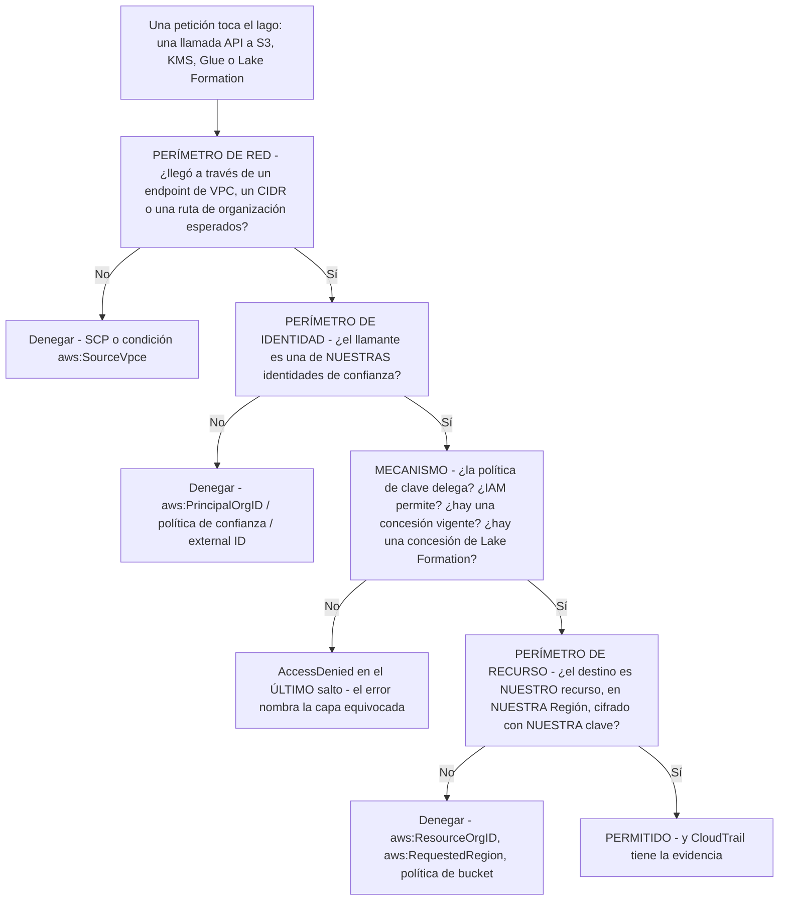
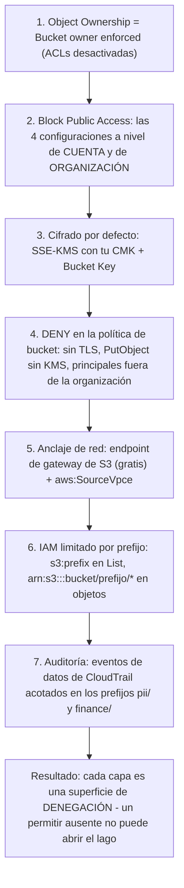
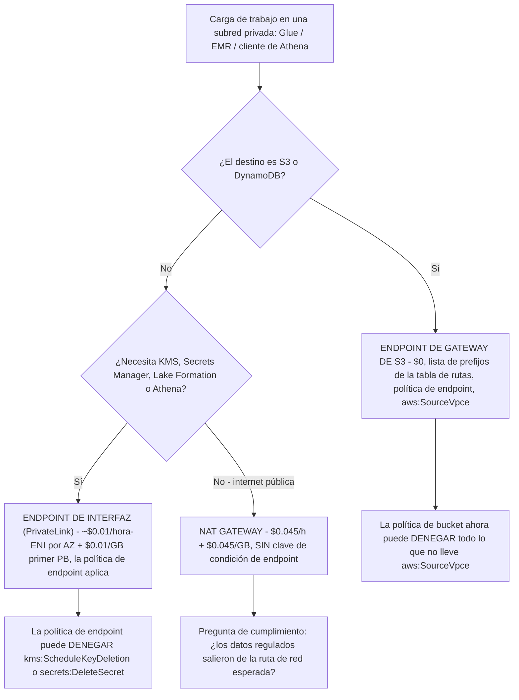
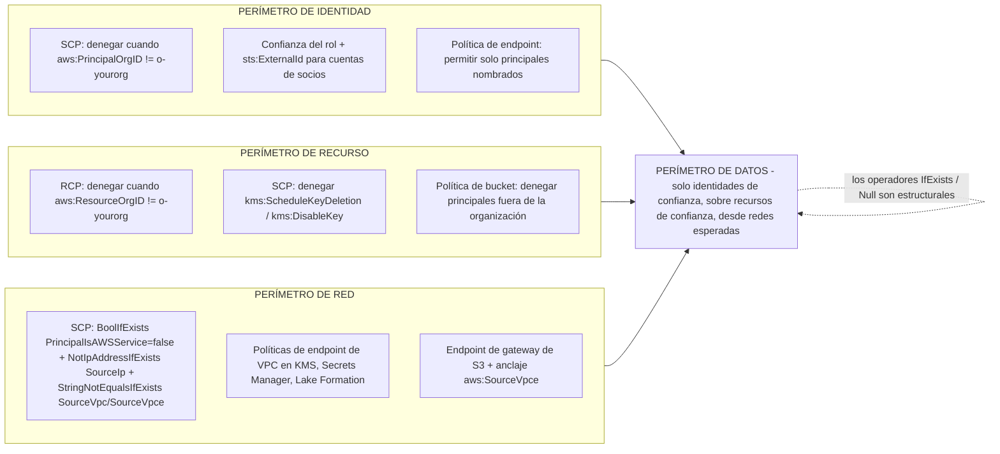
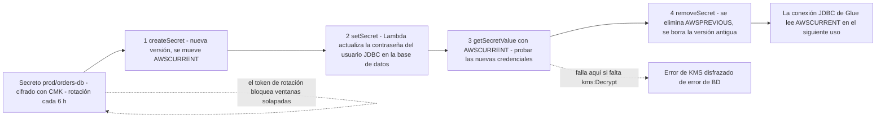
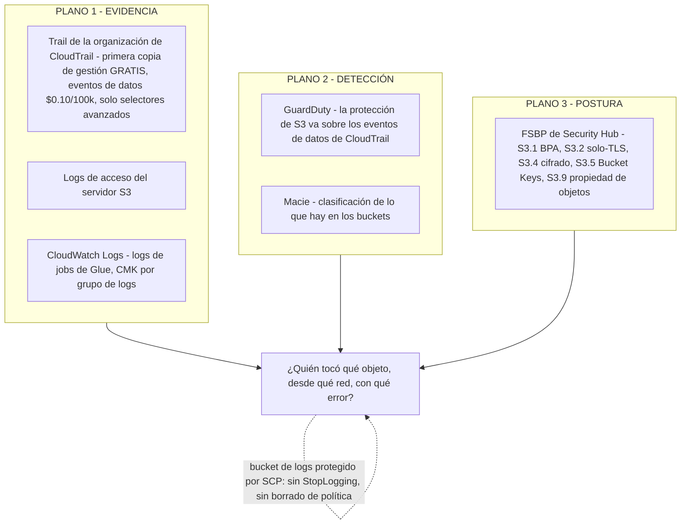

# Endurecimiento de seguridad: KMS, IAM de mínimo privilegio y aislamiento de red

Las lecciones 01 to 13 construyeron un lago que funciona: buckets, formatos, Iceberg, ingesta, un catálogo, transformación, una capa de consulta, un warehouse, orquestación, gobernanza con Lake Formation y manejo de PII. Todo lo que construiste es también un conjunto de **decisiones que un atacante puede leer y que una mala configuración puede deshacer**. Una CMK cuya política de clave nunca delegó a la cuenta, una política de bucket que fija el tráfico a un endpoint de VPC que nadie usa, un SCP escrito con el operador estricto en lugar de `IfExists`, una Lambda de rotación a la que le falta una acción de KMS: cada uno falla de un modo que nombra el *último* salto del error, no el control roto.

Esta lección endurece el lakehouse en el orden en que la propia guía de seguridad de AWS lo dispone: **claves → identidades → valores por defecto de almacenamiento → red → barreras de organización → secretos → auditoría**. La regla didáctica: *lo que está por defecto no está aplicado, lo que está permitido no es accesible, y lo que es accesible no está auditado*. Cada número de abajo está datado a **octubre de 2026**, y cada esquema de política es uno que puedes pegar en un sandbox antes de que toque producción.

```text
====================================================================
 ENDURECIMIENTO DEL LAGO — AWS DATA LAKEHOUSE, LECCIÓN 14
====================================================================
 Claves ......... CMK frente a gestionadas por AWS frente a
                  propiedad de AWS; la política de clave es la
                  primera puerta, IAM la segunda, el Deny explícito
                  siempre gana; concesiones + tokens de concesión
                  CreateGrant para los flujos máquina de Lake
                  Formation / Glue; las Bucket Keys recortan el
                  coste de peticiones KMS hasta un 99%; rotación =
                  rotación de la clave subyacente (365 d), rotación
                  bajo demanda o re-cifrado de datos (no son lo
                  mismo); claves multi-Región para CRR de S3
                  (prefijo mrk-)
 Identidades ... roles de servicio (glue.amazonaws.com,
                  lakeformation.amazonaws.com,
                  encryption.athena.amazonaws.com);
                  external ID en la POLÍTICA DE CONFIANZA, nunca en
                  la política de clave; claves de condición
                  s3:prefix (solo List), aws:SourceVpce /
                  aws:SourceVpc, familia lakeformation:*,
                  aws:PrincipalIsAWSService; políticas de sesión y
                  límites de permisos = INTERSECCIÓN, el Deny
                  explícito siempre gana
 Almacenamiento  orden de construcción: Object Ownership con ACLs
                  desactivadas -> Block Public Access x4 a nivel de
                  cuenta y de organización -> SSE-KMS con CMK +
                  Bucket Key -> política de bucket deny-insecure
                  -> anclaje de red -> IAM limitado por prefijo
 Red ............ endpoints de gateway (S3, DynamoDB) = $0 y la
                  lista de prefijos de la tabla de rutas vence a
                  0.0.0.0/0; endpoints de interfaz / PrivateLink =
                  hora por AZ + GB; NAT $0.045/h + $0.045/GB;
                  políticas de endpoint como quinta superficie de
                  denegación
 Organización ... perímetro de datos = identidad x recurso x red,
                  aplicado con SCPs + RCPs + políticas de endpoint;
                  los SCPs FILTRAN, nunca conceden; los operadores
                  IfExists / Null son estructurales
 Secretos ....... rotación en 4 pasos con etiquetas de staging
                  (createSecret -> setSecret -> getSecretValue ->
                  removeSecret), cada 4 horas como mínimo, usuarios
                  alternos, la Lambda necesita la CMK y no solo el
                  secreto
 Auditoría ...... trail de la organización de CloudTrail: primera
                  copia de eventos de gestión gratis, eventos de
                  datos de S3 $0.010 por 10,000 eventos, acótalos
                  con selectores avanzados o paga por ello
 Precios ........ KMS $1.00/clave/mes + $0.03 por 10,000
                  peticiones; endpoint de gateway $0; NAT
                  $0.045/h + $0.045/GB; ejemplo PrivateLink
                  $0.01/hora-ENI, procesamiento de datos $0.01/GB
                  (primer PB)  [en oct 2026]
====================================================================
```

En esta lección vas a:

- elegir entre claves **gestionadas por el cliente, gestionadas por AWS y propiedad de AWS** para cada clase de datos del lakehouse, y justificarlo con las necesidades de auditoría y de radio de impacto;
- componer **política de clave e IAM** correctamente, la delegación primero, el permitir de identidad después, el denegar explícito siempre ganando, y escribir el flujo de **concesión + token de concesión** que necesitan la automatización de Lake Formation y Glue;
- hacer la **aritmética de coste de las Bucket Keys** y mostrar qué re-cifra la rotación *y qué no*;
- elegir **claves multi-Región solo para los dos patrones por los que existen**: replicación cross-Región y consumidores cross-Región;
- aplicar **roles de servicio, external ID, claves de condición, políticas de sesión y límites** como un único sistema de mínimo privilegio;
- construir el control de acceso de S3 **en orden de construcción**: Object Ownership, Block Public Access a nivel de cuenta, sentencias deny-insecure, anclaje de red, alcance por prefijo;
- poner precio al **endpoint de gateway frente a endpoint de interfaz frente a NAT** para el mismo tráfico de S3, con las cifras de octubre de 2026;
- escribir **SCPs de perímetro de datos** (denegación de Región, denegación de PutObject sin cifrar, denegación de ACL pública) con los operadores `IfExists` que impiden que rompan Athena y Glue;
- cablear la **rotación de secretos en Secrets Manager para credenciales JDBC de Glue**, incluida la concesión de KMS que todo el mundo olvida;
- entregar cuatro **artefactos JSON resueltos**: un rol de job de Glue de mínimo privilegio, un rol cross-account de S3+KMS con external ID, un conjunto de SCP y un selector de eventos de datos de CloudTrail acotado con su factura;
- estudiar el **Security Lake de 800 cuentas de Siemens**, un **recuadro de actualizaciones de octubre de 2026** con fuentes, **tres comprobaciones interactivas**, **seis diagramas** y **once preguntas de estilo examen**.

---

## 1. Contra qué se defiende un lago endurecido

La propia enmarcación de AWS para el conjunto de controles de esta lección es directa: la amenaza es la **«DIVULGACIÓN NO INTENCIONADA DE DATOS DEBIDA A CONFIGURACIONES INCORRECTAS»**, no un exploit novel, sino una política de bucket que alguien copió, una política de clave que nadie editó, una Región que alguien dejó abierta (sesión IAM301 de AWS re:Inforce 2023, presentación de d1.awsstatic.com, consultada 2026-10-11). Un perímetro de datos es «un conjunto de controles preventivos que ayuda a garantizar que solo tus identidades de confianza accedan a recursos de confianza desde redes esperadas», y tiene exactamente tres áreas: **identidad, recurso y red** (AWS Security Blog, *Establishing a data perimeter on AWS*, fecha de página 2025-08-28).



Dos hábitos hacen que el resto de esta lección funcione. Primero, **escribe denegaciones, no solo permitidos**, la propia guía de re:Invent del equipo de S3 dice «Bloquea siempre el acceso («Deny») cuando… la petición no coincida con tu política» (STG304, presentación de re:Invent 2024, consultada 2026-10-11). Segundo, **prueba primero en una cuenta que no es de producción**, los artículos de perímetro de datos de AWS lo dicen explícitamente: «Recomendamos que pruebes e implementes estas políticas en una cuenta de prueba antes de aplicarlas en una cuenta de producción» (AWS Security Blog, 2024-11-13).

> [!NOTE]
> Tres planos responden tres preguntas distintas, y confundirlos es el fallo de auditoría más común: **CloudTrail** responde *quién llamó a qué API sobre qué recurso, desde qué red, con qué código de error*; **los logs nativos del servicio** (CloudWatch Logs, logs de acceso del servidor S3, tablas de sistema de Redshift) responden *qué hizo realmente la carga de trabajo*; **las herramientas de postura y detección** (controles FSBP de Security Hub, GuardDuty, Macie) responden *¿la configuración o el comportamiento coincide con la línea base?*. La detección no es retención de evidencia.

---

## 2. KMS para lagos: CMK, gestionadas por AWS, propiedad de AWS

### 2.1 Los tres niveles de propiedad, en los ejes que importan para un lago

La documentación de KMS de AWS dibuja los niveles por propiedad y visibilidad, no por fortaleza: «Las claves de AWS KMS (claves KMS) son las entidades lógicas fundamentales de AWS KMS»; «Las claves propiedad de AWS son claves KMS que los servicios de AWS usan para proteger tus datos… No puedes ver ni gestionar las claves propiedad de AWS»; y «Las políticas de recursos para las claves gestionadas por AWS las gestiona el servicio de AWS KMS correspondiente» (guía del desarrollador de KMS: Conceptos, consultada 2026-10-11).

| Eje | **Clave gestionada por el cliente (CMK)** | **Clave gestionada por AWS** | **Clave propiedad de AWS** |
|---|---|---|---|
| Dónde vive | Tu cuenta, la creaste tú | Tu cuenta, creada por el servicio | Una cuenta de servicio: no la tuya |
| Política de clave | **Tú posees la única política de clave** | La gestiona el servicio; no puedes editarla | No está expuesta |
| Concesiones / condiciones | **Sí**, puedes añadir concesiones y restricciones | No, no tienes control de clave propio | No |
| RCPs (políticas de control de recursos) | Aplican | **No aplican** («las RCPs no se aplican a las claves gestionadas por AWS») | No direccionables |
| Uso cross-account | **Sí, vía la política de clave** | No | De forma transparente, gestionado por el servicio |
| Rotación | Opcional, 365 días por defecto (`RotationPeriodInDays`, mín. 90) | Controlada por el servicio, anual | Controlada por el servicio |
| Coste, en oct 2026 | **$1.00 por clave por mes** + **$0.03 por 10,000 peticiones** | Uso facturado, sin cuota de clave separada que controles | No se te factura |
| Hogar en el lakehouse | Clases de datos bronze/silver/gold sobre las que debes demostrar control de descifrado | Scratch, desarrollo, logs de baja sensibilidad | Rutas internas de almacenamiento del servicio |

La regla del lakehouse: **CMK cuando debas demostrar *quién* descifró *qué clase* de datos; gestionada por AWS cuando la comodidad baste y nadie te pida enumerar descifrados.** Nunca esperes ver una clave propiedad de AWS en tu lista de claves: esa ausencia es por diseño, no un bug (conceptos de KMS, consultados 2026-10-11).

- **📚 ¿Sabías que…?** El nivel gestionado por AWS en la consola es en parte heredado: la documentación de KMS de AWS dice «Las claves gestionadas por AWS que ves en la consola son claves gestionadas por AWS heredadas… Los servicios de AWS usan un conjunto distinto de claves gestionadas por AWS de las que aparecen en la consola», y las claves heredadas llevan el patrón de alias `aws/service`. Por eso puedes ver `aws/s3` en una lista de la consola y aun así encontrar servicios que cifran discretamente con claves que nunca se te mostrarán (conceptos de KMS, consultados 2026-10-11).

### 2.2 La política de clave es la puerta; IAM es la segunda puerta

Cuatro frases de la guía de políticas de clave deciden casi todos los tickets de soporte de KMS con los que trabajarás:

1. «Las políticas de clave son la forma principal de controlar el acceso a las claves KMS.»
2. «Cada clave KMS debe tener exactamente una política de clave, que se crea al crear la clave KMS.»
3. «Un principal de IAM en la misma cuenta que la clave KMS puede usar políticas de IAM para permitir el acceso a la clave KMS solo si la política de clave de la clave KMS permite al principal.»
4. «…una sentencia de denegación de IAM en una política de IAM tiene prioridad… puedes usar sentencias de denegación de IAM en políticas de IAM para impedir que principales en la misma cuenta de AWS usen la clave KMS, incluso si la política de clave lo permite.» (guía del desarrollador de KMS: Políticas de clave, consultada 2026-10-11)

Léelo como **dos puertas que se componen en lugar de apilarse**: la política de clave responde *«¿esta cuenta o este rol puede usar esta clave en absoluto?»*; IAM responde *«¿este llamante concreto puede usarla para esta acción ahora mismo?»*. El uso cross-account es **siempre** vía la política de clave: una política de identidad en la otra cuenta es inerte hasta que la política de clave del productor la nombra. Y una **denegación** de IAM pase lo que diga la política de clave.

#### Ejemplo resuelto E1: una política de clave que realmente delega (S3 + Glue + un lector cross-account)

```json
{
  "Version": "2012-10-17",
  "Statement": [
    {
      "Sid": "Enable IAM User Permissions",
      "Effect": "Allow",
      "Principal": {"AWS": "arn:aws:iam::111122223333:root"},
      "Action": "kms:*",
      "Resource": "*"
    },
    {
      "Sid": "S3 Service-Principal Envelope",
      "Effect": "Allow",
      "Principal": {"Service": "s3.amazonaws.com"},
      "Action": ["kms:GenerateDataKey", "kms:Decrypt", "kms:DescribeKey"],
      "Resource": "*",
      "Condition": {
        "StringEquals": {"aws:SourceAccount": "111122223333"},
        "ArnLike": {"aws:SourceArn": "arn:aws:s3:::lakehouse-silver"}
      }
    },
    {
      "Sid": "Glue Job Role - Silver Layer",
      "Effect": "Allow",
      "Principal": {"AWS": "arn:aws:iam::111122223333:role/glue-etl-silver"},
      "Action": ["kms:Decrypt", "kms:GenerateDataKey", "kms:DescribeKey", "kms:ReEncrypt*"],
      "Resource": "*"
    },
    {
      "Sid": "Cross-Account Analyst - Decrypt Only",
      "Effect": "Allow",
      "Principal": {"AWS": "arn:aws:iam::444455556666:role/lake-reader"},
      "Action": ["kms:Decrypt", "kms:DescribeKey"],
      "Resource": "*"
    }
  ]
}
```

Fíjate en la forma: `arn:aws:iam::<cuenta>:root` significa **esta cuenta, a través de sus políticas de IAM**, no «el usuario root es privilegiado»; los principales de servicio reciben condiciones `aws:SourceAccount`/`aws:SourceArn` para que el delegado no pueda apuntarse al bucket de otro; y el lector cross-account recibe **solo descifrado**, nunca `kms:*`. Si sustituyeras el principal de la primera sentencia por `"*"` tendrías el hueco canónico. Si hubieras *solo* un permitir de IAM en la cuenta `444455556666` y sin la sentencia cuatro, el analista fallaría con un error que nombra `kms:Decrypt` y no le enseña nada (fallo clase F1: «habilité la CMK pero el servicio todavía no puede cifrar»).

### 2.3 Concesiones y tokens de concesión: la capa máquina a máquina

Las concesiones son el canal de permisos temporales que usan los servicios y los flujos de SDK en lugar de reescribir tu política de clave: «Una concesión es una forma alternativa de establecer permisos para las claves de AWS KMS»; «Cada concesión se aplica a una sola clave KMS»; «No puedes usar una concesión para denegar acceso»; y «`CreateGrant` es la única operación de la API de AWS KMS que devuelve un token de concesión» (guía del desarrollador de KMS: Concesiones, consultada 2026-10-11).

El token existe porque los cambios de grantee y de contexto de cifrado son de consistencia final: «Un token de concesión… hace que los permisos especificados en una concesión estén disponibles de inmediato en lugar de después de la consistencia final», y la lista completa de concesiones se asienta «en cinco minutos». Pasa el token a la llamada posterior de `Encrypt`/`GenerateDataKey` o tu concesión recién creada parecerá rota durante minutos.

```text
Datos de concesiones que te pedirán (cuotas de KMS + docs de concesiones, consultadas 2026-10-11)
  Concesiones por una sola clave KMS ....... 50,000 (ajustable)
  Concesiones por cuenta ................... 100,000 (ajustable)
  Tasa de peticiones CreateGrant ........... 10 TPS (ajustable)
  Limitación de PutKeyPolicy ............... 1 petición por clave cada 10 segundos
  Denegar vía una concesión ................ NO POSIBLE (solo revocar/retirar)
  EncryptionContext / GrantConstraints ..... solo claves de cifrado simétricas
  Restricción de concesión SourceArn ....... todos los tipos de clave KMS (añadida 2024)
```

#### Ejemplo resuelto E2: el flujo CreateGrant + token para un job de re-cifrado de Lake Formation / Batch

```json
{
  "Sid": "S3 Batch Re-Encrypt of 4.1M Objects Under the New Key",
  "Version": "2012-10-17",
  "Statement": [
    {
      "Effect": "Allow",
      "Principal": {"AWS": "arn:aws:iam::111122223333:role/batch-reencrypt"},
      "Action": "kms:CreateGrant",
      "Resource": "*",
      "Condition": {
        "Bool": {"kms:GrantIsForAWSResource": "true"},
        "StringEquals": {"kms:GrantConstraintType": "EncryptionContextSubset"}
      }
    }
  ]
}
```

La secuencia de llamadas importa más que el JSON:

```bash
# 1. create the grant and CAPTURE the token (CreateGrant is the only API that returns one)
GRANT_TOKEN=$(aws kms create-grant \
  --key-id arn:aws:kms:us-east-1:111122223333:key/1234abcd-... \
  --grantee-principal arn:aws:iam::111122223333:role/batch-reencrypt \
  --operations Encrypt Decrypt ReEncrypt* GenerateDataKey \
  --constraints "EncryptionContextSubset={purpose=gdpr-migration}" \
  --grant-token 2>/dev/null || true)   # token is returned IN the response
# 2. pass it forward so the first encrypted write does not race propagation
aws s3 cp s://tmp/rekey-manifest.json s3://lakehouse-silver/manifests/ \
  --sse aws:kms --sse-kms-key-id $KEY_ARN   # S3 takes the grant via the role
# 3. retire it when the migration lands - grants do NOT expire by themselves
aws kms retire-grant --key-id $KEY_ARN --grant-id $GRANT_ID
```

Usa concesiones para exactamente tres patrones del lakehouse: **re-cifrados de S3 Batch Operations**, **flujos de servicio que necesitan `GenerateDataKey` durante diez minutos** y **automatización de Lake Formation o adyacente al metastore** donde no puedas permitirte editar una política de clave en cada ejecución. La propia guía de AWS es emparejarlas con IAM y las políticas de clave en lugar de reemplazarlas: «Recomendamos usar políticas de IAM y políticas de clave juntas… Considera usar concesiones para dar permisos temporales a aplicaciones que se ejecutan en instancias EC2» (KMS, política de clave frente a política de IAM, consultada 2026-10-11). Una concesión olvidada es un privilegio permanente, y `RetireGrant`/`RevokeGrant` son las APIs de limpieza, nadie audita lo que nunca enumera.

- **📚 ¿Sabías que…?** KMS divide deliberadamente los permisos del lado de cifrado y del lado de descifrado para que un pipeline «solo escritura» sea expresable: `GenerateDataQualityWithoutPlaintext`... espera: `GenerateDataKeyWithoutPlaintext` devuelve solo la clave de datos **envuelta**, y el uso del texto plano sigue necesitando `kms:Decrypt` del llamante (referencia de autorización del servicio AWS KMS, consultada 2026-10-11). Por eso un rol de job de Glue suele necesitar `kms:Decrypt` **y** `kms:GenerateDataKey`, mientras que una rol de ingesta que solo envuelve puede recibir el par más estrecho.

### 2.4 Bucket Keys: el interruptor de mayor ROI en cualquier bucket analítico

«De forma predeterminada, Amazon S3 cifra todos los datos nuevos cuando se escriben en un bucket de S3»: con SSE-S3 desde el **2023-01-05**, sin coste adicional, pero los objetos bajo una clave de cifrado por defecto de KMS «se facturan a la tarifa de peticiones de KMS de $0.03 por 10,000 peticiones, más la carga estándar de peticiones de S3, incluso cuando el cifrado se aplica automáticamente» (S3: protección de datos; S3: Uso de SSE-KMS, consultados 2026-10-11). La Bucket Key existe para colapsar esas llamadas: «Usar una clave a nivel de bucket para SSE-KMS puede reducir los costes de peticiones de AWS KMS hasta en un 99 por ciento al reducir el tráfico de peticiones de Amazon S3 a AWS KMS» (S3: Reducción del coste de SSE-KMS con Amazon S3 Bucket Keys, consultado 2026-10-11).

#### Ejemplo resuelto E3: aritmética de coste de la Bucket Key en una ruta de lectura de cuadro de mando activa (en oct 2026)

```text
Capa gold, cifrada con KMS, leída por Athena + QuickSight:
  GETs al mes ............................................. 50,000,000
  Tarifa de peticiones KMS ............................. $0.03 / 10,000
  SIN Bucket Key   50,000,000 / 10,000 x $0.03 ....... $150.00 / mes
  CON Bucket Key   hasta un 99% menos de llamadas KMS
      conservador 99% ................................. ~$1.50 / mes
  Cargo de GET de S3 (mismo tráfico, $0.004 por 10,000,
    archivo de oferta us-east-1, publicationDate 2026-09-28)  $20.00 / mes
  --------------------------------------------------------------
  Ahorro mensual solo en la línea de KMS .............. ~$148.50
```

Volúmenes más pequeños muestran la misma forma: 5,000 GETs de objetos cifrados cuestan **$0.015** en peticiones de KMS sin Bucket Key, trivial, y exactamente por eso los equipos olvidan habilitar el interruptor hasta que llega el tráfico del cuadro de mando. Dos exclusiones para memorizar: **las Bucket Keys no son compatibles con DSSE-KMS**, y **DSSE-KMS no es compatible con S3 Replication** (páginas de Bucket Key y de Uso de SSE-KMS de S3, consultadas 2026-10-11), así que no puedes apilar funciones de «máximo cifrado».

### 2.5 Rotación: tres significados distintos, solo uno de los cuales re-cifra algo

| Significado | Qué hace | Qué **no** hace | Superficie de control |
|---|---|---|---|
| **Rotación automática anual** | AWS KMS crea una nueva **clave subyacente** cada periodo; las claves de datos se cifran con la clave subyacente más reciente | No toca las claves de datos ni los cifrados existentes | Activada por defecto para CMK simétricas nuevas; periodo de **365 días** desde mayo de 2022 (antes 1,095); `RotationPeriodInDays` mín. **90** |
| **Rotación bajo demanda** (`RotateKeyOnDemand`) | Generación extra bajo petición: la ruta documentada para claves **asimétricas** | Igual: sin re-cifrado de datos | Gratuita; máx. **dos** claves bajo demanda activas por clave KMS; **una cada 90 días** por clave |
| **Re-cifrado de datos** | Reescribe objetos/registros con nuevo material de clave (re-cifrado con S3 Batch Operations) | No es automático, no se deduce de nada de lo anterior | Tú lo programas; es la única respuesta a una sospecha de compromiso de la **clave de datos** |

AWS enuncia el límite sin rodeos: «la rotación de claves no mitiga el efecto de una clave de datos comprometida» (KMS, Rotación de claves de AWS KMS, consultada 2026-10-11). La elegibilidad también es un muro, no una preferencia: la rotación automática admite **solo claves KMS de cifrado simétrico con material de clave generado por AWS KMS** (`KeySpec SYMMETRIC_DEFAULT`, `KeyOrigin AWS_KMS`), asimétricas, HMAC, material importado y almacenes de clave personalizados necesitan rotación manual o bajo demanda. Dos notas operativas que vale la pena llevar: las claves subyacentes se acumulan para que los cifrados antiguos sigan descifrando, y «las dos primeras generaciones de rotación de claves subyacentes incurran en una carga mensual completa de clave» (misma página), así que una flota de CMK de larga vida es una línea mensual pequeña pero no nula.

### 2.6 Claves multi-Región: para CRR y consumidores cross-Región, para nada más

«Las claves multi-Región son claves de AWS KMS que tienen el mismo material de clave y el mismo ID de clave en diferentes Regiones de AWS»; creas una primaria en una Región y «replicas la MRK en la misma cuenta de AWS en otras Regiones de AWS»; **no** puedes convertir una clave existente en clave multi-Región ni viceversa; y «cada clave multi-Región cuenta como una clave KMS en tu cuenta para las cuotas de AWS KMS y para calcular tus costes de AWS KMS» (KMS: Claves multi-Región, consultada 2026-10-11). Las réplicas llevan el prefijo `mrk-` en sus IDs de clave.

La recompensa de la replicación cross-Región de S3: «AWS S3 cifra cada versión de objeto con una clave de datos que está cifrada con la clave KMS en la Región de origen… Si usas una clave multi-Región relacionada, Amazon S3 descifra y re-cifra las claves de datos en la Región de destino»: la clave de datos en texto plano nunca sale de la Región de destino, y evitas el salto de clave cross-Región que de otro modo pagarías al replicar hacia una clave *distinta*.

#### Ejemplo resuelto E4: factura de MRK y decisión de CRR (en oct 2026)

```text
Escenario A - claves de una sola Región, replicación hacia eu-west-1 con
una CMK de destino distinta:
  CMK us-east-1 .......................... 1 x $1.00 / mes
  CMK eu-west-1 .......................... 1 x $1.00 / mes
  manejo de claves de datos .............. descifrado cross-Región +
                                           trabajo de re-cifrado en la
                                           ruta de replicación
                                           (el delta exacto por objeto no
                                            se cita aquí - las docs de S3
                                            solo dicen que los cargos "son
                                            diferentes")

Escenario B - par de claves multi-Región relacionadas (primaria + 1 réplica):
  cada réplica "cuenta como una clave KMS" ... 2 x $1.00 / mes
  claves de datos ................ descifradas y re-cifradas EN la
                                   Región de destino
  rotación ....................... la rotación anual de la primaria se
                                   copia a las réplicas automáticamente -
                                   las réplicas no rotan de forma
                                   independiente
  veredicto ...................... úsalas SOLO si realmente replicas o
                                   sirves cross-Región; si no, pagaste
                                   doble por una superficie de política de
                                   clave que no necesitabas
```

Dos bordes duros: **una clave SSE-KMS debe estar en la misma Región que el bucket** («cuando usas cifrado SSE-KMS con un bucket de S3, las claves de AWS KMS deben estar en la misma Región que el bucket»: S3, consultado 2026-10-11), y el material de clave de una MRK **no se puede exportar**. Si tu replicación es de la misma Región, deja de leer esta subsección y quédate con claves de una sola Región.

### 2.7 La matriz de KMS por servicio

Lee esta tabla como *«quién debe estar en la política de clave, y qué necesita el llamante en IAM»*. Los principales de servicio y los patrones de ARN recomendados provienen de la página de integración de servicios de KMS (consultada 2026-10-11).

| Servicio | Qué cifra con **tu** clave | Delegado en la política de clave | Acciones IAM del llamante | Trampa que cuesta un día |
|---|---|---|---|---|
| **Amazon S3** | Objetos (SSE-KMS / DSSE-KMS), Bucket Key encima | `s3.amazonaws.com` (+ condiciones `aws:SourceAccount`/`aws:SourceArn`) | `kms:Decrypt`, `kms:GenerateDataKey`, `kms:DescribeKey` | La clave debe estar en la **misma Región** que el bucket; el cifrado por defecto ≠ aplicado: deniega `PutObject` sin `s3:x-amz-server-side-encryption: aws:kms` |
| **AWS Glue** | Datos intermedios del job, **CloudWatch Logs**, **bookmarks del job** (SSE-KMS **solo**), shuffle de Spark vía SSE-S3 | `glue.amazonaws.com` | `kms:Decrypt`, `kms:GenerateDataKey`, `kms:DescribeKey` | La configuración de seguridad, el job **y** la clave deben compartir Región; los bookmarks **no admiten** SSE-S3 |
| **Glue Data Catalog** | Metadatos del catálogo | Rol de servicio cuando el modo es `SSE-KMS-WITH-SERVICE-ROLE` | `glue:UpdateCatalogEncryption` para admins | `CatalogEncryptionMode` = `DISABLED` \| `SSE-KMS` \| `SSE-KMS-WITH-SERVICE-ROLE`: `DISABLED` significa catálogo sin cifrar |
| **Amazon Athena** | Resultados de consulta escritos en S3 (a nivel de workgroup) | `encryption.athena.amazonaws.com` con contexto de cifrado `aws:athena:workgroup-arn` | `kms:GenerateDataKey`, `kms:Decrypt`, `kms:DescribeKey` | Sin `EnforceWorkGroupConfiguration=true` un cliente **anula** el cifrado y la ubicación de salida del workgroup |
| **Amazon Redshift** | Clúster: clave raíz → clave de cifrado de base de datos → claves del clúster | Patrón de política de clave `redshift.amazonaws.com` o concesiones directas | `kms:Encrypt`/`kms:Decrypt` para rutas de admin | Solo claves simétricas; si la CMK se vuelve inaccesible el clúster es ilegible y **a los 14 días puede eliminarse** |
| **CloudWatch Logs** | Flujos de grupo de logs | `logs.amazonaws.com`, contexto de cifrado `kms:EncryptionContext:aws:logs:arn` | `logs:AssociateKmsKey` para adjuntarla a un grupo **existente** | No puedes adjuntar una CMK a un grupo existente **en la consola**; borrar la clave vuelve irrecuperables los logs históricos |
| **AWS Lake Formation** | No directamente: **expide credenciales temporales de S3/KMS** vía `GetDataAccess` | El rol de IAM de ubicación registrada debe tener `kms:Decrypt` + `kms:GenerateDataKey` | Los principales necesitan `lakeformation:GetDataAccess` con **`Resource: "*"`** | `GetDataAccess` **no** puede acotarse a un ARN de recurso; LF no admite ARNs de recurso en `Resource` |
| **AWS Secrets Manager** | Carga útil del secreto | `secretsmanager.amazonaws.com`; el rol de la Lambda de rotación también debe tener la clave | Rol de rotación: `kms:Decrypt`, `kms:GenerateDataKey` | La falta de KMS en el rol de rotación aparece como un error con **apariencia de base de datos** en `getSecretValue` |
| **Amazon Quick (QuickSight)** | SPICE y datos de consulta directa en reposo | Principal de servicio de Quick con `kms:GenerateDataKey`, `kms:Decrypt` | Registra la CMK primero; la clave debe estar en la misma Región que la cuenta | Registrar una CMK **no** re-cifra el SPICE existente: debes lanzar un **refresco completo** |

- **📚 ¿Sabías que…?** Una configuración de seguridad de Glue son cuatro cifrables separados, y los equipos cubren rutinariamente tres: **datos intermedios en S3**, **CloudWatch Logs**, **bookmarks del job** (solo SSE-KMS) y **shuffle/spill de Spark** (solo SSE-S3). Los bookmarks son el dormido: un bookmark es el puntero a *qué ya se ha procesado*, así que dejarlo en el valor por defecto es a la vez un riesgo de corrección y una superficie de fuga (docs de configuración de seguridad de Glue, consultadas 2026-10-11).

---

## 3. Patrones de IAM: roles de servicio, external ID, claves de condición, sesiones, límites

### 3.1 Roles de servicio: la política de confianza es el permiso

Cada motor de este curso se ejecuta bajo un **rol de servicio** cuya política de confianza nombra a un principal de servicio. El patrón es idéntico en toda la pila: el principal `glue.amazonaws.com` para jobs, `lakeformation.amazonaws.com` para el rol de ubicación registrada, `encryption.athena.amazonaws.com` para el cifrado de resultados del workgroup, `redshift.amazonaws.com` para rutas de clúster, `logs.amazonaws.com` para el cifrado de grupos de logs. La política de identidad hace después el *acotado*; esta es la división del trabajo: **la confianza decide quién puede crear la sesión; la política de identidad decide qué puede hacer la sesión**.

El rol de Lake Formation es el ejemplo más claro: «Lake Formation suministra credenciales temporales que el llamante, como Amazon Athena, usa para acceder a los datos», y para ubicaciones registradas en LF «Debes especificar un rol de IAM… Este rol se llama rol de IAM de ubicación registrada» (guía del desarrollador de LF: Permisos de acceso subyacentes a los datos, consultada 2026-10-11). Los consumidores (Athena, Redshift Spectrum, QuickSight) llaman a `lakeformation:GetDataAccess`, y esa acción **debe** llevar `Resource: "*"` porque «AWS Lake Formation no admite especificar un ARN de recurso en el elemento Resource de la política de IAM» (referencia de autorización del servicio LF, consultada 2026-10-11).

### 3.2 External ID: la guarda del deputy confundido, en la política de confianza

«El problema del deputy confundido es un problema de seguridad que puede surgir cuando se engaña a un servicio para que use sus permisos en nombre de otro principal», y «El external ID ayuda a prevenir un problema de deputy confundido cuando usas la operación AssumeRole» (guía de usuario de IAM: Proporcionar acceso a terceros, consultada 2026-10-11). Dos propiedades deciden dónde va:

- AWS «no trata el external ID como un secreto… no es un secreto, es un identificador compartido… debe ser único para el cliente»: así que **autentica la intención, no la identidad**. La autenticación real sigue siendo el principal de confianza en la política de confianza.
- La longitud es de `2–1,224` caracteres (cuotas de IAM, consultadas 2026-10-11).
- Vive en la **política de confianza del rol** bajo `sts:ExternalId`: **nunca** en la política de clave de KMS ni en una política de identidad. Ponerlo en la política de clave es el error de ubicación más común (clase F20).

#### Ejemplo resuelto E5: el rol cross-account de S3 + KMS con external ID

Tres documentos deben coincidir: la **política de bucket del productor**, la **política de clave del productor** y la **política de confianza del rol más la política de identidad del consumidor**. Nada más necesita edición.

```json
{
  "Version": "2012-10-17",
  "Statement": [
    {
      "Sid": "TrustThePartnerPrincipalOnly",
      "Effect": "Allow",
      "Principal": {"AWS": "arn:aws:iam::999988887777:role/partner-etl"},
      "Action": "sts:AssumeRole",
      "Condition": {"StringEquals": {"sts:ExternalId": "acme-corp-lakehouse-2026"}}
    }
  ]
}
```

```json
{
  "Version": "2012-10-17",
  "Statement": [
    {
      "Sid": "ConsumerRole-ReadSharedPrefixAndKey",
      "Effect": "Allow",
      "Action": ["s3:ListBucket"],
      "Resource": "arn:aws:s3:::shared-bronze",
      "Condition": {"StringLike": {"s3:prefix": ["ingest/*", "ingest"]}}
    },
    {
      "Sid": "ConsumerRole-ObjectsOnly",
      "Effect": "Allow",
      "Action": ["s3:GetObject", "s3:PutObject"],
      "Resource": "arn:aws:s3:::shared-bronze/ingest/*"
    },
    {
      "Sid": "ConsumerRole-DecryptWithProducerKey",
      "Effect": "Allow",
      "Action": ["kms:Decrypt", "kms:DescribeKey", "kms:GenerateDataKey"],
      "Resource": "arn:aws:kms:us-east-1:111122223333:key/1234abcd-12ab-34cd-56ef-1234567890ab"
    }
  ]
}
```

El lado del productor (no repetido aquí) son dos sentencias al estilo de E1: una política de bucket que permite `s3:GetObject`/`s3:PutObject` en `arn:aws:s3:::shared-bronze/ingest/*` a `arn:aws:iam::444455556666:role/lake-reader`, y una política de clave que delega `kms:Decrypt`/`kms:GenerateDataKey`/`kms:DescribeKey` a ese mismo ARN de rol. El socio entonces llama:

```bash
aws sts assume-role \
  --role-arn arn:aws:iam::111122223333:role/lake-reader \
  --role-session-name acme-etl-2026-10-11 \
  --external-id acme-corp-lakehouse-2026
```

Si tu consumidor es *tu propia* segunda cuenta y no un tercero, el external ID es opcional, pero es higiene barata, y mide de 2 a 1,224 caracteres, es único por cliente y **no** es un secreto (IAM, acceso de terceros, consultado 2026-10-11). Lo que *no* es: un factor de autenticación. El ARN del principal de confianza hace la autenticación; el external ID impide que un socio sea engañado para asumir *tu* rol cuando pretendía el de otro cliente.

### 3.3 Las claves de condición que esta lección realmente usa

| Clave | Se aplica a | Qué impone | Trampa |
|---|---|---|---|
| `s3:prefix` | **`ListObjectsV2` / `ListObjects` solo** | Acota el listado a un prefijo | «Amazon S3 no evalúa `s3:prefix` en políticas de bucket para `GetObjectName»: emparejala con comodines de ARN de objeto |
| `s3:x-amz-server-side-encryption` | `PutObject` | Deniega todo lo que no sea `aws:kms` | El cifrado por defecto todavía permite que un cliente *envíe* `AES256` salvo que lo deniegues |
| `s3:x-amz-server-side-encryption-aws-kms-key-id` | `PutObject` | Fija la CMK exacta | La regla de la misma Región sigue aplicando |
| `aws:SourceVpce` | Todas las llamadas a S3/KMS a través de un endpoint | «la petición se origina en el endpoint de interfaz de VPC especificado» (o el endpoint de gateway en las propias docs de políticas de S3) | **Solo está presente si la llamada llegó a través de un endpoint**; nunca uses un comodín con ella |
| `aws:SourceVpc` | Llamadas acotadas a VPC | Restringe a una VPC | Misma regla de presencia que `SourceVpce` |
| `aws:SecureTransport` | Todas las APIs HTTPS | Deniega no-TLS (`false` → Deny) | **Se redacta** cuando los servicios de AWS llaman a S3 en tu nombre |
| `aws:PrincipalIsAWSService` | Todas | `true` cuando el llamante es un principal de servicio de AWS | La corrección documentada para el problema de la redacción: añade `false` a tu denegación de principal humano |
| `aws:PrincipalOrgID` / `aws:ResourceOrgID` | Perímetros de organización / de recurso | Solo actúa tu organización / solo se tocan recursos de tu organización | `aws:ResourceOrgID` necesita una guarda `Null` para recursos sin etiquetar o sin organización |
| `aws:RequestedRegion` | SCP / identidad | Listas permitidas de denegación de Región | Los servicios globales (CloudFront, IAM, Organizations, Route 53, Support, STS) necesitan una excepción con `NotAction` |
| `lakeformation:DataFilter`, `LFPerm`, `Principal`, `CatalogId`, `DatabaseName`, `TableName`, `ResourceLink` | APIs admin de LF | Estrecha quién puede conceder qué, sobre qué objeto | `GetDataAccess` en sí sigue necesitando `Resource: "*"` |
| `kms:ViaService`, `kms:GrantIsForAWSResource`, `kms:EncryptionContext:*` | KMS | Restringe «solo a través del servicio X», «solo para concesiones de recurso de AWS», «solo este contexto» | Las restricciones de concesión con `EncryptionContext` son **solo simétricas** |
| `sts:ExternalId` | Confianza de `AssumeRole` | Guarda del deputy confundido | Pertenece solo a la política de confianza |

La regla del comodín de la página de claves de condición de IAM es innegociable: «No uses valores de comodín (`*`) con `aws:SecureTransport`, `aws:SourceIp`, `aws:SourceVpce`, `aws:SourceVpc`, `aws:PrincipalOrgID`» (IAM: operadores y claves de condición, consultado 2026-10-11).

### 3.4 Políticas de sesión y límites de permisos: la regla de intersección

Los tres filtros de «permiso máximo» se comportan igual, y la redacción de AWS es precisa:

- **Límite de permisos**: «una función avanzada para usar una política gestionada y establecer los permisos máximos que una política basada en identidad puede conceder a una identidad de IAM»; «El límite de permisos de una entidad no le da a la entidad ningún permiso» (IAM: límites de permisos, consultado 2026-10-11).
- **Política de sesión**: se pasa en `AssumeRole`, se aplica solo a esa sesión.
- **SCPs**: «especifican los permisos máximos para las cuentas miembro»; «los SCPs no conceden permisos… filtran» (Organizations: SCPs, consultado 2026-10-11).

Evaluación: **permisos finales = identidad ∩ recurso ∩ sesión ∩ límite ∩ SCP, y cualquier denegación explícita en cualquier política aplicable gana.** Los límites son cómo permites que un equipo de plataforma *cree* roles sin dejarles escalarse a `iam:*` o `kms:*`; las políticas de sesión son cómo se puede entregar a un rol ejecutor un contexto más estrecho para una ejecución.

#### Ejemplo resuelto E6: límite + política de sesión como intersección real

```json
{
  "Version": "2012-10-17",
  "Statement": [
    {
      "Sid": "Boundary-Developer-Role-Ceiling",
      "Effect": "Allow",
      "NotAction": ["iam:*", "organizations:*", "kms:ScheduleKeyDeletion", "kms:DisableKey", "s3:PutBucketPublicAccessBlock"],
      "Resource": "*"
    }
  ]
}
```

```text
Política de identidad del rol "lake-dev"   permite  s3:*, glue:*, athena:*, kms:Decrypt
Límite de permisos "dev-ceiling"          permite  TODO EXCEPTO iam:*, org:*, borrado/
                                              desactivación de claves, cambios de BPA
Política de sesión pasada en AssumeRole   permite  s3:GetObject/PutObject en silver/*
                                               + kms:Decrypt en la CMK silver
                                                 --------------------------------
  RESULTADO (intersección) ................ s3:Get/Put solo en silver/*,
                                            kms:Decrypt en la CMK silver,
                                            glue/athena desde la identidad pero SOLO
                                            durante la sesión, y NUNCA
                                            iam:* sin importar la política de identidad
  Denegación explícita en cualquier sitio .. vence a todo lo anterior
```

La trampa documentada: «`NotPrincipal`… cuando usas `NotPrincipal` en una sentencia de denegación junto con un límite de permisos… la sentencia de denegación puede aplicarse de forma inesperada» (IAM: límites de permisos, consultado 2026-10-11). Prefiere un alcance positivo con `Principal` o condiciones con `aws:PrincipalArn` a las denegaciones con `NotPrincipal`.

```fillblank
{
  "question": "Completa las claves de condición que llevan cada control de esta lección:",
  "template": "El alcance por prefijo en una llamada List usa {{1}}; fijar el tráfico del lago a una ruta privada usa {{2}}; la denegación solo-TLS se escribe en {{3}}; la excepción que impide que la redacción de servicios AWS rompa esa denegación es {{4}}; y la guarda del deputy confundido en la confianza de un rol cross-account es {{5}}.",
  "answers": {
    "1": "s3:prefix",
    "2": "aws:SourceVpce",
    "3": "aws:SecureTransport",
    "4": "aws:PrincipalIsAWSService",
    "5": "sts:ExternalId"
  },
  "distractors": [
    "s3:ListBucket",
    "s3:ExistingObjectTag",
    "aws:SourceIp",
    "aws:SourceAccount",
    "s3:TlsVersion",
    "aws:ViaAWSService",
    "aws:PrincipalIsAnonymous",
    "aws:ExternalId",
    "sts:SourceIdentity"
  ],
  "explanation": "s3:prefix solo acota ListObjectsV2/ListObjects: ponlo en GetObject y no hace nada, y por eso el acceso por prefijo es una condición de List MÁS un comodín de ARN de objeto. aws:SourceVpce es el anclaje de red y solo está presente cuando la llamada llegó a través de un endpoint de VPC, y por eso AWS dice nunca ponerle comodines. aws:SecureTransport=false es la denegación, pero S3 redacta SecureTransport, TlsVersion, SourceIp y VpcSourceIp cuando Athena, Glue o Lake Formation llaman en tu nombre, así que la corrección documentada es aws:PrincipalIsAWSService=false en la sentencia de principal humano con un permitir separado para principales de servicio. sts:ExternalId pertenece a la política de confianza del rol y AWS declara que no es un secreto: demuestra que el tercero quiso el rol de ESTE cliente."
}
```

### 3.5 Ejemplo resuelto E7: el rol de job de Glue de mínimo privilegio, de extremo a extremo

Un job, un rol, cuatro cifrables, cero comodines. Esta es la mitad de identidad de una configuración de seguridad de Glue; la configuración en sí (SSE-KMS en S3 + SSE-KMS en CloudWatch + SSE-KMS en el **bookmark**, todo sobre la misma CMK, todo en la misma Región que el job) es la mitad de cifrado.

```json
{
  "Version": "2012-10-17",
  "Statement": [
    {
      "Sid": "ReadBronzeWriteSilverOnly",
      "Effect": "Allow",
      "Action": ["s3:GetObject", "s3:PutObject", "s3:DeleteObject"],
      "Resource": [
        "arn:aws:s3:::lakehouse-bronze/events/*",
        "arn:aws:s3:::lakehouse-silver/*"
      ]
    },
    {
      "Sid": "ListOnlyThePrefixesThisJobTouches",
      "Effect": "Allow",
      "Action": ["s3:ListBucket", "s3:GetBucketLocation"],
      "Resource": ["arn:aws:s3:::lakehouse-bronze", "arn:aws:s3:::lakehouse-silver"],
      "Condition": {"StringLike": {"s3:prefix": ["events/*", "silver/*"]}}
    },
    {
      "Sid": "EnvelopeOperationsOnTheSilverKeyOnly",
      "Effect": "Allow",
      "Action": ["kms:Decrypt", "kms:GenerateDataKey", "kms:DescribeKey", "kms:ReEncrypt*"],
      "Resource": "arn:aws:kms:us-east-1:111122223333:key/1234abcd-12ab-34cd-56ef-1234567890ab"
    },
    {
      "Sid": "LogsOnlyIntoItsOwnLogGroup",
      "Effect": "Allow",
      "Action": ["logs:CreateLogGroup", "logs:CreateLogStream", "logs:PutLogEvents"],
      "Resource": "arn:aws:logs:us-east-1:111122223333:log-group:/aws-glue/jobs-glue-etl-silver-secconf*"
    },
    {
      "Sid": "CatalogReadAndWriteForThisDatabase",
      "Effect": "Allow",
      "Action": [
        "glue:GetDatabase", "glue:GetTable", "glue:GetPartitions",
        "glue:CreateTable", "glue:UpdateTable", "glue:BatchCreatePartition"
      ],
      "Resource": [
        "arn:aws:glue:us-east-1:111122223333:database/silver",
        "arn:aws:glue:us-east-1:111122223333:table/silver/*"
      ]
    },
    {
      "Sid": "FetchTheJdbcPasswordItself",
      "Effect": "Allow",
      "Action": ["secretsmanager:GetSecretValue", "secretsmanager:DescribeSecret"],
      "Resource": "arn:aws:secretsmanager:us-east-1:111122223333:secret:prod/orders-db-*"
    }
  ]
}
```

Política de confianza para el mismo rol, y la única línea que hace que todo lo anterior sea asumible:

```json
{
  "Version": "2012-10-17",
  "Statement": [
    {
      "Effect": "Allow",
      "Principal": {"Service": "glue.amazonaws.com"},
      "Action": "sts:AssumeRole",
      "Condition": {"StringEquals": {"aws:SourceAccount": "111122223333"}}
    }
  ]
}
```

Qué lo hace de mínimo privilegio y no «una política con algunos ARNs dentro»: **un ARN de clave, dos raíces de bucket con una condición `s3:prefix` en el List, un prefijo de grupo de logs que coincide solo con la configuración de seguridad de este job, una sola base de datos de Glue y un secreto**. Añade encima un límite de permisos (el techo de E5) y ni siquiera un job comprometido puede acuñarse `iam:*`. La sentencia de KMS no es opcional; sin ella el job muere en la primera lectura cifrada con un error que nombra `kms:Decrypt` en lugar de la concesión que falta (clase F1).

---

## 4. Endurecimiento de S3, en orden de construcción

El control de acceso en un bucket de lago no es una lista de verificación que completas en cualquier orden; es una pila donde cada capa asume la de abajo. El orden de abajo es el propio orden del equipo de S3 en re:Invent (STG304, consultado 2026-10-11): Block Public Access de cuenta y bucket, Access Analyzer para encontrar exposición, Object Ownership con ACLs desactivadas, Bucket Keys para SSE-KMS, endpoints de gateway y políticas deny-first.



### 4.1 Object Ownership: ACLs off, el dueño del bucket lo posee todo

«Object Ownership es una configuración a nivel de bucket que puedes usar para desactivar las listas de control de acceso (ACLs)… Cuando Object Ownership está configurado en Bucket owner enforced, las ACLs están desactivadas y el propietario del bucket es propietario de cada objeto» (S3: Object Ownership, consultado 2026-10-11). El caso de uso recomendado, en las propias palabras de AWS, incluye **«data lakes»**. Dos consecuencias: una subida que lleve cabeceras de ACL devuelve `AccessControlListNotSupported` (un delicioso incidente de «¿por qué mi job de copia empezó a fallar?»), y las disputas de propiedad de objetos entre cuentas dejan de existir porque ya no queda nada que discutir.

### 4.2 Block Public Access: cuatro configuraciones, a nivel de cuenta y de organización

Las cuatro configuraciones son `BlockPublicAcls` (ACLs a nivel de bucket *y* de objeto), `IgnorePublicAcls` (S3 ignora las concesiones públicas que encuentra), `BlockPublicPolicy` (las políticas de bucket que se vuelven públicas se rechazan con «Access Denied») y `RestrictPublicBuckets` («incluso si la política del bucket permite el acceso público… Amazon S3 no permite el acceso público», mientras que el acceso de la misma cuenta no se bloquea) (S3: Bloqueo de acceso público, consultado 2026-10-11). Dos reglas de alcance deciden si tu control realmente existe: las configuraciones a nivel de cuenta «se aplican a todos los buckets de la cuenta, **incluso a los creados después de activar las configuraciones**», y «Puedes aplicar todas las configuraciones de Block Public Access como una única política unificada a nivel de AWS Organizations». Dejar la BPA de la organización desactivada significa que cada bucket *futuro* empieza potencialmente público hasta que alguien que lo recuerda voltee cuatro interruptores.

### 4.3 La política de bucket deny-first

```json
{
  "Version": "2012-10-17",
  "Statement": [
    {
      "Sid": "DenyInsecureTransport",
      "Effect": "Deny",
      "Principal": "*",
      "Action": "s3:*",
      "Resource": ["arn:aws:s3:::lakehouse-silver", "arn:aws:s3:::lakehouse-silver/*"],
      "Condition": {"Bool": {"aws:SecureTransport": "false"}}
    },
    {
      "Sid": "DenyUnencryptedPutObject",
      "Effect": "Deny",
      "Principal": "*",
      "Action": "s3:PutObject",
      "Resource": "arn:aws:s3:::lakehouse-silver/*",
      "Condition": {"StringNotEquals": {"s3:x-amz-server-side-encryption": "aws:kms"}}
    },
    {
      "Sid": "DenyPublicAclHeaders",
      "Effect": "Deny",
      "Principal": "*",
      "Action": "s3:PutObject",
      "Resource": "arn:aws:s3:::lakehouse-silver/*",
      "Condition": {"StringEquals": {"s3:x-amz-acl": "public-read"}}
    },
    {
      "Sid": "DenyOutsideOrg",
      "Effect": "Deny",
      "Principal": "*",
      "Action": "s3:*",
      "Resource": ["arn:aws:s3:::lakehouse-silver", "arn:aws:s3:::lakehouse-silver/*"],
      "Condition": {"StringNotEquals": {"aws:PrincipalOrgID": "o-yourorgidhere"}}
    },
    {
      "Sid": "PinToGatewayEndpoint",
      "Effect": "Deny",
      "Principal": "*",
      "Action": "s3:*",
      "Resource": ["arn:aws:s3:::lakehouse-silver", "arn:aws:s3:::lakehouse-silver/*"],
      "Condition": {"StringNotEquals": {"aws:SourceVpce": "vpce-0abc1234def567890"}}
    },
    {
      "Sid": "HumanPrincipalsOnlyDenyList",
      "Effect": "Deny",
      "Principal": "*",
      "Action": "s3:ListBucket",
      "Resource": "arn:aws:s3:::lakehouse-silver",
      "Condition": {
        "StringNotEquals": {"s3:prefix": ["silver/*", "silver"]},
        "Bool": {"aws:PrincipalIsAWSService": "false"}
      }
    }
  ]
}
```

Lee las dos últimas sentencias juntas: `aws:SourceVpce` está presente **solo si la llamada llegó a través de un endpoint**, y `aws:SecureTransport`/`aws:SourceIp`/`s3:TlsVersion` **se redactan cuando los servicios de AWS llaman a S3 en tu nombre**: «Para evitar este comportamiento, incluye la clave de condición `aws:PrincipalIsAWSService` con el valor `false` en la misma sentencia que las claves de condición» (S3: claves de políticas de Amazon S3, consultado 2026-10-11). Sin esa excepción o rompes Athena/Glue/Lake Formation en silencio o crees que tienes un bucket solo-TLS que tu ruta de servicio ignora. Y recuerda: **el cifrado por defecto no es aplicación**: «por defecto ≠ aplicado»; solo la sentencia `DenyUnencryptedPutObject` hace que SSE-KMS sea obligatorio.

```dragdrop
{
  "question": "Arrastra los controles del bucket de lago S3 al orden en que deben construirse:",
  "items": [
    "6. IAM limitado por prefijo: s3:prefix en List, comodín de ARN de objeto arn:aws:s3:bucket/prefijo/* en Get/Put",
    "1. Object Ownership - Bucket owner enforced, ACLs desactivadas, el dueño del bucket es propietario de cada objeto",
    "4. Política de bucket deny-first: sin TLS, PutObject sin KMS, cabeceras de ACL públicas, principales fuera de la organización",
    "2. Block Public Access: las cuatro configuraciones a nivel de cuenta, después la política unificada de Organizations",
    "5. Anclaje de red: endpoint de gateway de S3 gratis más sentencia de denegación aws:SourceVpce",
    "3. Cifrado por defecto: SSE-KMS con una clave gestionada por el cliente más una Bucket Key"
  ],
  "correctOrder": [
    "1. Object Ownership - Bucket owner enforced, ACLs desactivadas, el dueño del bucket es propietario de cada objeto",
    "2. Block Public Access: las cuatro configuraciones a nivel de cuenta, después la política unificada de Organizations",
    "3. Cifrado por defecto: SSE-KMS con una clave gestionada por el cliente más una Bucket Key",
    "4. Política de bucket deny-first: sin TLS, PutObject sin KMS, cabeceras de ACL públicas, principales fuera de la organización",
    "5. Anclaje de red: endpoint de gateway de S3 gratis más sentencia de denegación aws:SourceVpce",
    "6. IAM limitado por prefijo: s3:prefix en List, comodín de ARN de objeto arn:aws:s3:bucket/prefijo/* en Get/Put"
  ],
  "explanation": "La propiedad primero, porque las ACLs son la superficie heredada con la que todo lo demás discute; Block Public Access segundo, porque es de toda la cuenta y se aplica a buckets que todavía no has creado; el cifrado tercero, porque la sentencia de denegación del paso 4 solo puede referenciar s3:x-amz-server-side-encryption una vez fijado el valor por defecto del bucket; la política de denegación cuarto, porque las condiciones de denegación solo tienen sentido contra una línea base conocida; el anclaje de red quinto, porque aws:SourceVpce solo existe cuando hay un endpoint de gateway en la tabla de rutas; y el IAM limitado por prefijo al final, porque las políticas de identidad son la única capa que puedes cambiar sin tocar el recurso. La presentación STG304 de re:Invent enuncia la doctrina de la mitad de esta pila: bloquea siempre el acceso (Deny) cuando la petición no coincida con tu política."
}
```

---

## 5. Aislamiento de red: endpoints de gateway, PrivateLink, NAT y políticas de endpoint

### 5.1 Los tres caminos de salida de una VPC, con precio

| Camino | Servicios | Precio, en oct 2026 | Te da |
|---|---|---|---|
| **Endpoint de gateway** | **Solo S3 y DynamoDB** | **$0**: «No hay carga adicional por usar endpoints de gateway» | Una entrada de tabla de rutas cuya lista de prefijos **tiene precedencia sobre la ruta del gateway de internet (0.0.0.0/0)**, más políticas de endpoint y `aws:SourceVpce` |
| **Endpoint de interfaz / PrivateLink** | KMS, Secrets Manager, Lake Formation, Athena, CloudWatch Logs, Macie… | Por hora y por AZ (se factura la hora completa, ejemplo **$0.01 por hora-ENI**) + datos procesados (**$0.01/GB** primer PB, $0.006/GB siguientes 4 PB, $0.004/GB más allá de 5 PB) | Acceso privado a servicios, políticas de endpoint, tráfico que «permanece dentro de la red de AWS» |
| **NAT Gateway** | Lo que no esté en una ruta de gateway | **$0.045/hora** + **$0.045/GB** procesados; primer GB/mes de procesamiento de datos gratis | Salida a internet para actualizaciones, APIs de terceros, y nada de lo que quieras que un bucket de lago dependa |

Los endpoints de gateway son «un dispositivo de enrutamiento virtual… accedes al endpoint usando una ruta en tu tabla de rutas», y adjuntas una **política de endpoint** para permitir o denegar (VPC: endpoints de gateway, consultado 2026-10-11). Los endpoints de interfaz se facturan de otro modo: «Los endpoints se facturan por cada hora que estén disponibles en cada Zona de Disponibilidad, con una hora completa cobrada sin importar el uso» (precios de AWS PrivateLink, consultados 2026-10-11).

#### Ejemplo resuelto E8: NAT frente a endpoint de gateway para 500 GB/mes de tráfico de S3 (en oct 2026)

```text
Camino A - tráfico de S3 hairpinned a través de un NAT gateway:
  NAT por hora ...... 730 horas x $0.045 ................ $32.85
  NAT de datos ....... 500 GB x $0.045 .................. $22.50
  ----------------------------------------------------------
  Total mensual ........................................ $55.35
  ¿aws:SourceVpce disponible? ......................... NO
  ¿Sale de la ruta de red de AWS? ..................... sí, vía IGW

Camino B - el mismo tráfico a través de un endpoint de gateway de S3:
  Cargo del endpoint .................................. $0.00
  ¿aws:SourceVpce disponible? ......................... SÍ
  Precedencia de ruta ................................. la lista de
                                                         prefijos vence a
                                                         0.0.0.0/0
  ----------------------------------------------------------
  Total mensual ........................................ $0.00
  AHORRO NETO por VPC ................................. ~$55.35/mes
```

Ese es el ahorro clásico del lakehouse: **gratis, y te compra una clave de condición**. Mantén el NAT solo para salidas que no sean a S3.

#### Ejemplo resuelto E9: la factura real de la pila privada (3 endpoints de interfaz)

```text
Una AZ, tres endpoints de interfaz (KMS + Secrets Manager + Lake Formation):
  cargos por hora ... 3 servicios x 1 ENI x 730 h x $0.01 ... $21.90
  datos por el endpoint de KMS ..... 200 GB x $0.01 ......... $2.00
  datos por los endpoints SM + LF .. 20 GB x $0.01 x 2 ...... $0.40
  --------------------------------------------------------------
  Total de una AZ ......................................... ~$24.30
  Dos AZs (facturación de hora completa POR AZ) ............. ~$48.60

Red privada del lakehouse, mes completo (2 AZs, derivado):
  endpoints de interfaz, 2 AZ x 3 svc x 2 ENI x 730 x $0.01  $43.80
  datos procesados ~250 GB x $0.01 ........................... $2.50
  endpoints de gateway (S3 + DynamoDB) ........................ $0.00
  6 CMKs x $1.00 + ~$2 de peticiones con Bucket Key ........... $8.00
  eventos de datos de CloudTrail acotados (sección 8) ......... $22.50
  --------------------------------------------------------------
  Total ............................................ ~$75-80 / mes
```

Mezcla deliberadamente: **gateway para S3 y DynamoDB, interfaz solo donde no existe gateway**, y nunca asumas «endpoint de VPC = gratis»: solo S3 y DynamoDB reciben el nivel gratuito.



### 5.2 Políticas de endpoint: una quinta superficie de denegación

Una política de endpoint se aplica a **las llamadas que atraviesan ese endpoint**, con independencia de la política de identidad, lo que la convierte en el hogar natural de «sin borrados de clave desde esta VPC» o «solo este secreto». El propio ejemplo de Secrets Manager de AWS «permite `secretsmanager:GetSecretValue` en un ARN de secreto concreto y deniega `secretsmanager:DeleteSecret`» (Secrets Manager, endpoints de VPC, consultado 2026-10-11). Para Lake Formation, el nombre del servicio del endpoint es `com.amazonaws.region.lakeformation`, y las políticas de endpoint llegaron junto con el soporte de PrivateLink el **2021-10-11**, la muestra acota `lakeformation:GetDataAccess`, la llamada exactamente que acuña credenciales temporales de S3/KMS (LF, Conexión vía PrivateLink, consultado 2026-10-11).

```json
{
  "Version": "2012-10-17",
  "Statement": [
    {
      "Sid": "AllowOnlyTheLakehouseKeysAndBlockDeletions",
      "Effect": "Allow",
      "Principal": "*",
      "Action": ["kms:Decrypt", "kms:Encrypt", "kms:GenerateDataKey", "kms:DescribeKey", "kms:ReEncrypt*"],
      "Resource": ["arn:aws:kms:us-east-1:111122223333:key/*"]
    },
    {
      "Sid": "NeverDeleteOrDisableFromThisVpc",
      "Effect": "Deny",
      "Principal": "*",
      "Action": ["kms:ScheduleKeyDeletion", "kms:DisableKey", "kms:ReplicateKey"],
      "Resource": "*"
    }
  ]
}
```

La trampa aquí es real: una política de endpoint es **de facto deny-by-default**: omite `lakeformation:GetDataAccess` de un endpoint de LF y el lakehouse deja de expedir credenciales; deniega `s3:GetObject` en el ARN de bucket equivocado y cada consulta falla. Prueba en un sandbox (la propia instrucción de los artículos de perímetro de datos).

---

## 6. Perímetros de datos: SCPs, RCPs y las tres áreas de control

### 6.1 El modelo

«Un perímetro de datos es un conjunto de controles preventivos… identidad, recurso y red», aplicado a través de «las políticas de control de servicio (SCPs) de AWS Organizations, las políticas de control de recursos (RCPs) de AWS IAM y… las políticas de endpoint de VPC», y AWS es explícito en que «no sustituye a la… autorización de granularidad fina» (AWS Security Blog, 2025-08-28; IAM, políticas de perímetro de datos, consultadas 2026-10-11). Los tres perímetros se mapean a tres preguntas:

| Perímetro | Pregunta | Clave típica | Tipo de control |
|---|---|---|---|
| **Identidad** | ¿Los llamantes son *nuestras* identidades de confianza? | `aws:PrincipalOrgID`, `aws:PrincipalOrgPaths`, `aws:PrincipalIsAWSService`, `aws:ViaAWSService`, confianza del rol + external ID | SCP / política de endpoint |
| **Recurso** | ¿Los destinos son *nuestros* recursos? | `aws:ResourceOrgID` (con guarda `Null`), etiquetas, propiedad del bucket | **RCP** / SCP |
| **Red** | ¿La llamada llegó de una red esperada? | `aws:SourceVpce`, `aws:SourceVpc`, `aws:SourceIp` | SCP / política de endpoint |

Los SCPs son la mecánica estructural, y su semántica es lo que la gente se equivoca: «los SCPs no conceden permisos, filtran… un SCP nunca concede permisos»; «no afectan a las políticas basadas en recurso»; «no se aplican a usuarios o roles en la cuenta de administración»; y «no se aplican a roles vinculados a servicios… ni a principales de servicio» (Organizations: políticas de control de servicio, consultadas 2026-10-11).



```matching
{
  "question": "Relaciona cada mecanismo de endurecimiento con el fallo que existe para prevenir:",
  "pairs": [
    {"left": "La política de clave nunca delega a la cuenta o al rol", "right": "El permitir de IAM es inerte y la primera escritura cifrada falla con un AccessDenied que nombra la capa equivocada"},
    {"left": "Falta sts:ExternalId en la confianza de un rol de socio", "right": "Deputy confundido: al servicio socio se le puede engañar para usar sus permisos contra TU rol de cliente en lugar del de otro cliente"},
    {"left": "Denegación aws:SourceVpce escrita, pero el tráfico todavía sale por el NAT gateway", "right": "La clave de condición nunca está presente porque SourceVpce solo aparece en llamadas a través de un endpoint: a los llamantes honestos se les deniega y el control es teatro"},
    {"left": "s3:prefix colocada en una sentencia de GetObject", "right": "Ningún efecto en absoluto: s3:prefix solo se evalúa para ListObjectsV2 y ListObjects, así que el acceso por prefijo necesita la condición de List más comodines de ARN de objeto"},
    {"left": "Rotación automática habilitada y supuestamente remediadora de una clave de datos filtrada", "right": "Las claves de datos existentes nunca se re-envuelven, así que la clave de datos filtrada en texto plano todavía descifra el mismo cifrado: solo el re-cifrado lo arregla"},
    {"left": "SCP de perímetro de red escrito con StringNotEquals estricto en lugar de StringNotEqualsIfExists", "right": "Las llamadas de servicios AWS y no-VPC no llevan SourceVpc/SourceVpce, así que las rutas de Athena, Glue y Lake Formation se deniegan el viernes por la tarde"},
    {"left": "Rol de la Lambda de rotación con el secreto concedido pero no la CMK", "right": "La rotación muere en getSecretValue con un error de KMS que parece exactamente una falla de base de datos"},
    {"left": "Eventos de datos de CloudTrail habilitados en todos los buckets", "right": "Opt-in, facturado a $0.10 por 100,000 eventos; selectores sin acotar convierten un mes de 500M de eventos en una línea de $500"}
  ],
  "explanation": "Cada mecanismo de aquí es una superficie de denegación cuyo modo de fallo es invisible hasta que alguien lee el contexto de la petición: la política de clave controla a IAM, la política de confianza controla a AssumeRole, las claves de condición de endpoint solo existen en rutas de endpoint, s3:prefix solo acota el List, la rotación nunca re-cifra, los operadores IfExists existen porque las claves ausentes coincidirían de otro modo con una denegación estricta, la Lambda de rotación necesita tanto el secreto como su clave, y los eventos de datos se facturan por evento, así que los selectores son tanto un control de coste como uno de auditoría."
}
```

### 6.2 La disciplina `IfExists`

El SCP de red canónico del AWS Security Blog (2024-11-13) se construye con tres operadores no estrictos por una razón documentada: «`aws:SourceVpc` y `aws:SourceVpce` solo están presentes en el contexto de la petición si la llamada se hizo a través de un endpoint de VPC». Elimina el `IfExists` y deniegas cada llamada de servicio AWS y cada llamada no-VPC: que es exactamente cómo un perímetro de datos tumba Athena, Glue y Lake Formation un viernes.

#### Ejemplo resuelto E10: el conjunto de cuatro sentencias SCP (pégalo primero en una OU que no es de producción)

```json
{
  "Version": "2012-10-17",
  "Statement": [
    {
      "Sid": "DenyNonApprovedRegions",
      "Effect": "Deny",
      "Action": "*",
      "Resource": "*",
      "Condition": {"StringNotEquals": {"aws:RequestedRegion": ["us-east-1", "us-west-2"]}},
      "NotAction": ["cloudfront:*", "iam:*", "organizations:*", "route53:*", "support:*", "sts:*"]
    },
    {
      "Sid": "DenyUnencryptedPutObjectAndPublicAcl",
      "Effect": "Deny",
      "Action": ["s3:PutObject"],
      "Resource": "arn:aws:s3:::*",
      "Condition": {
        "StringNotEquals": {"s3:x-amz-server-side-encryption": "aws:kms"},
        "Null": {"s3:x-amz-server-side-encryption": "true"}
      }
    },
    {
      "Sid": "DenyDisablingOrgSecurityControls",
      "Effect": "Deny",
      "Action": [
        "s3:PutBucketPublicAccessBlock",
        "s3:DeleteBucketPolicy",
        "kms:ScheduleKeyDeletion",
        "kms:DisableKey",
        "cloudtrail:StopLogging",
        "organizations:LeaveOrganization"
      ],
      "Resource": "*"
    },
    {
      "Sid": "NetworkPerimeterExceptAwsServices",
      "Effect": "Deny",
      "Action": "*",
      "Resource": "*",
      "Condition": {
        "BoolIfExists": {"aws:PrincipalIsAWSService": "false", "aws:ViaAWSService": "false"},
        "NotIpAddressIfExists": {"aws:SourceIp": ["203.0.113.0/24"]},
        "StringNotEqualsIfExists": {
          "aws:SourceVpc": ["vpc-0abc1234"],
          "aws:SourceVpce": ["vpce-0abc1234def567890"]
        }
      }
    }
  ]
}
```

Tres puntos didácticos sobre este documento. Primero, la lista permitida con `NotAction` de servicios globales de la sentencia uno (CloudFront, IAM, Organizations, Route 53, Support, STS) tiene **la forma exacta** tanto del ejemplo de denegación de Región de la documentación de IAM como de la barrera de Control Tower, «AWS Control Tower proporciona una política de denegación de Región… No puedes excluir tu Región principal» (Control Tower, política principal de denegación de Región, consultada 2026-10-11). Segundo, la sentencia dos empareja `StringNotEquals` con `Null: true` para que un cliente que envíe **ninguna** cabecera de cifrado también se deniegue, las dos condiciones juntas cubren «algoritmo equivocado» y «sin algoritmo». Tercero, el `Deny` sobre `s3:PutBucketPublicAccessBlock` previene el *desactivar* BPA, no el *activarla*; no confundas la dirección. AWS publica versiones curadas de todas ellas en `aws-samples/service-control-policy-examples`, cuyo README dice que los ejemplos son «un punto de partida… prueba en un entorno que no sea de producción», haz fork de esas, nunca escribas a mano un `Deny *` en una organización de producción.

> [!WARNING]
> ⚠️ **Trampas de SCP: recorre esta lista antes de adjuntar cualquier cosa:**
> - **Los SCPs filtran, nunca conceden.** Un SCP que «permite `s3:GetObject» no hace nada por sí solo; la política de identidad todavía debe permitirlo.
> - **La cuenta de administración está exenta.** Lo mismo vale para las políticas basadas en recurso, los roles vinculados a servicios y los principales de servicio: un SCP no puede impedir que un principal de servicio haga su trabajo.
> - **Elimina el `IfExists`/`Null` y rompes la ruta de datos.** `aws:SourceVpc`/`aws:SourceVpce` solo existen para llamadas a través de un endpoint; los operadores estrictos deniegan llamadas a servicios que nunca las llevan.
> - **Nunca uses comodines con `aws:SecureTransport`, `aws:SourceIp`, `aws:SourceVpce`, `aws:SourceVpc` ni `aws:PrincipalOrgID`.**
> - **`NotPrincipal` + Deny + un límite de permisos** es una trampa documentada: prefiere principales positivos o `aws:PrincipalArn`.
> - **Las RCPs no se aplican a las claves gestionadas por AWS.** Si tu barrera espera restringir `aws/s3` o `aws/logs`, no lo hará; usa CMKs donde las barreras basadas en RCP importen.

---

## 7. Rotación de secretos para credenciales JDBC de Glue

Una conexión JDBC de Glue nunca debe guardar una contraseña en texto plano: guárdala en **AWS Secrets Manager**, cifra con una CMK y deja que el calendario de rotación haga el trabajo. La rotación es un **protocolo de etiquetas de staging** de cuatro pasos, y el orden no es cosmético:

1. `createSecret`: Lambda crea la nueva versión y mueve la etiqueta de staging `AWSCURRENT` a ella;
2. `setSecret`: Lambda le indica a la base de datos que cambie las credenciales;
3. `getSecretValue` con `AWSCURRENT`: Lambda recupera y prueba las nuevas credenciales;
4. `removeSecret`: la etiqueta `AWSPREVIOUS` y la versión antigua se eliminan.

(Secrets Manager: Rotación de secretos que usan AWS Lambda, consultado 2026-10-11.)

| Regla | Valor |
|---|---|
| Calendario mínimo | **Cada 4 horas** (el token de rotación evita ejecuciones solapadas) |
| Estrategias | **Usuario único** (mismo nombre de usuario, rota la contraseña, necesita una ventana de bajo riesgo) frente a **usuarios alternos** (dos nombres de usuarios se alternan; sin tiempo de caída por cambio de contraseña; la elección en producción) |
| Ubicación de la Lambda | **Misma cuenta y misma Región** que el secreto; «la función… no puede llamar a otra función de Lambda» |
| BD adjunta a VPC | La Lambda necesita colocación de ENI **y** un endpoint de **interfaz** de Secrets Manager (`com.amazonaws.region.secretsmanager`) |
| Política de recursos del secreto | Añade `AWS:SourceAccount` para que solo la cuenta prevista pueda usar la función de rotación |
| La trampa de KMS | El rol de rotación necesita `kms:Decrypt` + `kms:GenerateDataKey` en la CMK del secreto; sin ellos, la rotación muere en `getSecretValue` pareciendo un error de **base de datos** |

#### Ejemplo resuelto E11: el rol de la Lambda de rotación para un origen JDBC de Glue

```json
{
  "Version": "2012-10-17",
  "Statement": [
    {
      "Sid": "TrustOnlySecretsManager",
      "Effect": "Allow",
      "Principal": {"Service": "secretsmanager.amazonaws.com"},
      "Action": "sts:AssumeRole",
      "Condition": {"StringEquals": {"aws:SourceAccount": "111122223333"}}
    },
    {
      "Sid": "RotateOneSecretOnly",
      "Effect": "Allow",
      "Action": [
        "secretsmanager:GetSecretValue",
        "secretsmanager:DescribeSecret",
        "secretsmanager:PutSecretValue",
        "secretsmanager:UpdateSecretVersionStage",
        "secretsmanager:TagResource"
      ],
      "Resource": "arn:aws:secretsmanager:us-east-1:111122223333:secret:prod/orders-db-*"
    },
    {
      "Sid": "TheKeyEveryoneForgets",
      "Effect": "Allow",
      "Action": ["kms:Decrypt", "kms:GenerateDataKey", "kms:DescribeKey"],
      "Resource": "arn:aws:kms:us-east-1:111122223333:key/1234abcd-12ab-34cd-56ef-1234567890ab"
    },
    {
      "Sid": "GlueJobReadsTheSameSecret",
      "Effect": "Allow",
      "Action": ["secretsmanager:GetSecretValue", "secretsmanager:DescribeSecret"],
      "Resource": "arn:aws:secretsmanager:us-east-1:111122223333:secret:prod/orders-db-*",
      "Condition": {"StringEquals": {"aws:PrincipalIsAWSService": "false"}}
    }
  ]
}
```

El ejercicio de fallo que vale la pena ejecutar una vez en un sandbox: revoca la sentencia de KMS, lanza la rotación y observa cómo falla en el paso 3 con un error que nombra al secreto o a la base de datos en lugar de a la clave. Después restáurala. Ese único experimento enseña F25 mejor que cualquier tabla.



---

## 8. Auditoría: un trail de la organización, eventos de datos selectivos y la factura que hay que acotar

CloudTrail es el plano de evidencia, y su precios tiene una trampa: los eventos de gestión son baratos, los de datos no. «De forma predeterminada, CloudTrail no registra eventos de datos»; «Los eventos de datos… suelen ser actividades de gran volumen… se te cobra una tarifa adicional por registrar eventos de datos»; y los seleccionas con **selectores de eventos avanzados**, «No puedes mezclar selectores de eventos básicos y selectores de eventos avanzados en un trail» (CloudTrail, registro de eventos de datos, consultado 2026-10-11).

| Elemento | Precio / límite, en oct 2026 |
|---|---|
| Eventos de gestión, **primera copia** | **Gratis** |
| Copias adicionales de eventos de gestión | **$2.00 por 100,000 eventos** |
| **Eventos de datos de S3 / Lambda / DynamoDB** | **$0.10 por 100,000 eventos** |
| Ingesta / consulta de CloudTrail Lake | **$0.75 por GB** / **$0.005 por GB escaneado** |
| Entrega a CloudWatch Logs | **$0.25 por GB** |
| Historial de eventos (consola) | 90 días, gratis |
| Selectores de eventos avanzados | **500 por trail**, 500 operadores de atributo por selector |

#### Ejemplo resuelto E12: eventos de datos acotados y lo que cuestan

```json
{
  "AdvancedEventSelectors": [
    {
      "Name": "BronzeLandingWritesOnly",
      "FieldSelectors": [
        {"Field": "eventCategory", "Equals": ["Data"]},
        {"Field": "resources.type", "Equals": ["AWS::S3::Object"]},
        {"Field": "resources.ARN", "StartsWith": ["arn:aws:s3:::lakehouse-bronze/"]},
        {"Field": "eventName", "Equals": ["PutObject", "CompleteMultipartUpload"]},
        {"Field": "readOnly", "Equals": ["false"]}
      ]
    },
    {
      "Name": "PIISilverReadsAndWrites",
      "FieldSelectors": [
        {"Field": "eventCategory", "Equals": ["Data"]},
        {"Field": "resources.type", "Equals": ["AWS::S3::Object"]},
        {"Field": "resources.ARN", "StartsWith": ["arn:aws:s3:::lakehouse-silver/pii/"]},
        {"Field": "eventName", "Equals": ["GetObject", "PutObject", "DeleteObject"]}
      ]
    },
    {
      "Name": "FreeManagementEventsForTheLake",
      "FieldSelectors": [
        {"Field": "eventCategory", "Equals": ["Management"]},
        {"Field": "eventName", "Equals": ["StartJobRun", "GrantPermissions", "CreateGrant", "PutKeyPolicy"]}
      ]
    }
  ]
}
```

```text
Factura de eventos de datos, en oct 2026 ($0.10 por 100,000 eventos de datos de S3):
  Sin acotar: todos los buckets, 500M de eventos/mes .... 500M/100k x $0.10 = $500.00
  Sin acotar: 3 buckets regulados, 100M de eventos ...... 100M/100k x $0.10 = $100.00
  Acotado a los prefijos pii/ + finance/, 50M ............  50M/100k x $0.10 =  $50.00
  Conjunto de selectores resuelto, 22.5M de eventos ..... 22.5M/100k x $0.10 =  $22.50
  ---------------------------------------------------------------
  Ahorro mensual solo por acotar (caso de 500M) ................. $477.50
```

- **📚 ¿Sabías que…?** **La protección S3 de GuardDuty y tu propio trail de auditoría son objetos distintos.** GuardDuty «evalúa los eventos de gestión de CloudTrail y los eventos de datos de CloudTrail para S3» y «habilita su propio trail para la protección de S3, no necesitas configurar tú los eventos de datos de CloudTrail» (GuardDuty, protección de S3, consultado 2026-10-11). Así que un bucket puede estar *monitorizado* mientras tu trail de *evidencia* no registra nada: detección ≠ retención de evidencia. Mantén tu propio trail de la organización con selectores acotados, envíalo a una cuenta de logs separada y protege el bucket de logs con un SCP que deniegue `s3:DeleteBucketPolicy` y `cloudtrail:StopLogging` (sección 6.2).



---

### Actualizaciones de 2026 (en octubre de 2026)

> [!NOTE]
> **Qué cambió en la historia de la seguridad del lakehouse entre 2025 y octubre de 2026**: cada línea verificada contra una fuente primaria de AWS, y cada una cambia el comportamiento actual:
> - **Los permisos de tabla de Lake Formation ahora alcanzan los datos subyacentes de S3 (2026-06-11).** `GetTemporaryDataLocationCredentials` permite a los principales gestionados por Lake Formation obtener acceso temporal a S3 sin llevar una política IAM de S3 separada: la respuesta más limpia hasta ahora al bypass de «tu analista todavía tiene `s3:GetObject»` que hacía tan difícil el IAM de mínimo privilegio para el plano de datos (historial de documentos de LF, consultado 2026-10-11).
> - **Retención variable y holds basados en eventos de S3 Object Lock (2026-09-08).** Los periodos de retención ahora pueden cambiar **por objeto**, y los holds pueden colocarse o liberarse en respuesta a eventos: un control WORM dinámico para prefijos de lakehouse regulados en lugar de un plazo fijo de todo el bucket (AWS What's New, 2026-09-08).
> - **Los buckets de directorio de S3 Express One Zone son ahora un nivel distinto que tu IAM debe abordar.** Los buckets de directorio llegaron a GA el **2023-11-28**, y el cambio de precios del **2025-04-10** recortó almacenamiento −31%, peticiones PUT −55% y peticiones GET −85% para peticiones de bucket de directorio: así que una capa gold caliente movida allí necesita una revisión de sus ARNs de recurso y de las políticas con precio por petición (AWS What's New, 2025-04-10; comunicado de GA, 2023-11-28).
> - **Endpoints de interfaz VPC de Macie en todas las Regiones (2025-07-02).** Macie se une a KMS, Secrets Manager y Lake Formation en la lista de PrivateLink, así que los escaneos de descubrimiento y la exportación de hallazgos pueden permanecer en la ruta privada (historial de documentos de Macie, consultado 2026-10-11).
> - **La firma post-cuántica de KMS es real; las cifras de rendimiento no se publican.** AWS KMS documenta el soporte de ML-KMS (FIPS 204) para firma híbrida post-cuántica (2025): trátala como un control emergente para flujos de firma de código y socios externos, y **no** cites cifras de rendimiento para ella (historial de documentos de KMS, consultado 2026-10-11).

---

## Casos Reales

AWS publica cómo se ven estos controles a escala de producción. Cada cifra de abajo es **afirmada por el cliente o por AWS y sin auditar**, con la fuente y la fecha nombradas para que puedas verificarlas: el punto examinable es el **patrón**, no el marketing.

### Caso A, Siemens: un lago de datos de seguridad de 800 cuentas que se paga solo

| Elemento | Detalle |
|---|---|
| Cliente | **Siemens**, fabricación industrial / tecnología: división de Cloud Security Operations |
| Reto | Más de **800 cuentas de AWS** producían logs de seguridad (CloudTrail, VPC Flow Logs, logs de acceso del servidor de S3, AWS WAF y más) que el equipo no podía almacenar de forma central, y el onboarding manual de Splunk tomaba semanas por fuente |
| Servicios | **Amazon Security Lake** como almacén de agregación central respaldado por S3, logs de acceso del servidor de **Amazon S3** y VPC Flow Logs como fuentes, **Cribl** (AWS Partner) para enrutar el subconjunto relevante a **Splunk** |
| Patrón | **Aterrizar todo barato en S3, proyectar solo las porciones caras hacia el motor de análisis**: la misma economía que el lago analítico, aplicada a la telemetría de seguridad |
| Resultado | «5 to 7 TB de datos de datos de seguridad a diario» ingeridos, con «solo los 600 GB más relevantes» reenviados: una **reducción del 90 por ciento**; **$1.3 millones** ahorrados anualmente mientras se agregaban más logs; el onboarding de fuentes nuevas recortado a **1 to 2 días** desde semanas; el tiempo de identificación de la causa raíz bajó un **75%**; en una investigación, «identificó qué datos en Amazon S3 se vieron afectados en un evento en 10 minutos en lugar de varios días» |
| Fuente | Caso de estudio de AWS, *Siemens Boosts Security Visibility Across 800+ AWS Accounts Using Amazon Security Lake* (sin fecha; consultado 2026-10-11) |

La lección para este curso es estructural: el embudo de Siemens es tu diseño de auditoría de la sección 8: **un punto de recopilación para toda la organización en S3, una ruta filtrada por endpoint y política hacia fuera, y una decisión por prefijo sobre qué recibe el tratamiento caro**. Observa también lo que el caso *no* afirma: Security Lake es un servicio de agregación de logs de seguridad, **no** AWS Lake Formation. Las historias de gobernanza (IAS, FanDuel) pertenecen a la lección 12; esta trata de volumen, retención y el coste de la evidencia.

### Caso B, USAA: mide el perímetro antes de aplicarlo

| Elemento | Detalle |
|---|---|
| Cliente | **USAA**, presentado en la **sesión IAM301 de AWS re:Inforce 2023** (presentación de d1.awsstatic.com, consultada 2026-10-11) |
| Enmarcación de la amenaza | «DIVULGACIÓN NO INTENCIONADA DE DATOS DEBIDA A CONFIGURACIONES INCORRECTAS»: la clase de amenaza exacta a la que apuntan las sentencias de denegación de esta lección |
| Patrón | Perímetros de identidad, recurso y red aplicados con **SCPs y RCPs**, precedidos por un análisis de impacto de la actividad real de las cuentas |
| Resultado según se publicó | Después de analizar las llamadas cross-account: «Las llamadas cross-org eran a proveedores de confianza, el 70% restante a buckets propiedad de AWS»: la medición que les dijo qué principales y recursos estaban en alcance antes de estrechar `aws:PrincipalOrgID` |
| Fuente | Presentación IAM301 de AWS re:Inforce 2023 (2023; consultada 2026-10-11) |

Lee el 70% como **un dato de caso de una presentación pública, no como un benchmark de la industria**. La lección duradera es el *orden*: analiza primero (CloudTrail Lake o Athena sobre tus propios eventos: recuerda habilitar los eventos de datos de S3, o el análisis no tiene nada que leer), después aplica, después vuelve a medir.

---

## Preguntas de Práctica (Practice Questions)

```question
{
  "id": "lh-14-q1",
  "type": "multiple-choice",
  "question": "Un bucket de la capa bronze debe demostrarle a un auditor exactamente qué principales descifraron objetos en los últimos 90 días, y una cuenta de socio necesita acceso de descifrado. ¿Qué nivel de clave es correcto en octubre de 2026?",
  "options": [
    "Una clave gestionada por AWS como aws/s3, porque se crea automáticamente y no se puede mal configurar",
    "Una clave gestionada por el cliente, porque posees la política de clave, puedes delegar a través de ella entre cuentas, puedes añadir concesiones y condiciones, y las RCPs se aplican a ella",
    "Una clave propiedad de AWS, porque AWS la rota y puedes listarla en la consola para auditoría",
    "Cualquier nivel es equivalente: el historial de uso de claves de CloudTrail es idéntico en los tres niveles"
  ],
  "correct": 1,
  "explanation": "Solo las claves gestionadas por el cliente te dan una política de clave editable (la única ruta para compartir entre cuentas), concesiones, condiciones y cobertura de RCPs; la página de conceptos de KMS de AWS declara que las políticas de recursos de las claves gestionadas por AWS las gestiona el servicio y que las RCPs no se aplican a las claves gestionadas por AWS, mientras que las claves propiedad de AWS no pueden verse ni gestionarse en absoluto. Las claves gestionadas por AWS están bien para capas scratch donde nadie te pide enumerar descifrados."
}
```

```question
{
  "id": "lh-14-q2",
  "type": "multiple-choice",
  "question": "Un colega añade una política de IAM que permite kms:Decrypt sobre una CMK en la misma cuenta, pero un job de Glue todavía falla con AccessDenied. ¿Qué explicación coincide con las reglas de evaluación documentadas por AWS?",
  "options": [
    "Las políticas de IAM nunca se aplican a KMS, así que la corrección es siempre una concesión",
    "La política de clave nunca delegó a esa cuenta o principal: un permitir de IAM solo surte efecto si la política de clave lo permite, mientras que una denegación de IAM se aplica sin importar lo que diga",
    "La política de clave lo permite, pero las denegaciones de IAM siempre anulan las políticas de clave",
    "KMS requiere tanto una política de IAM como una concesión; una política de clave es informativa"
  ],
  "correct": 1,
  "explanation": "La guía de políticas de clave de KMS es explícita: un principal de IAM puede usar políticas de IAM para permitir el acceso a una clave «solo si la política de clave de la clave KMS permite al principal», mientras que una sentencia de denegación de IAM tiene prioridad incluso cuando la política de clave lo permite. Así que las dos puertas se componen: la política de clave primero (¿puede este principal usar esta clave en absoluto?), IAM después (¿puede este llamante usarla para esta acción ahora?) - y no se apilan de forma aditiva."
}
```

```question
{
  "id": "lh-14-q3",
  "type": "multiple-choice",
  "question": "Un job de re-cifrado de S3 Batch crea una concesión de KMS y la primera escritura cifrada falla de forma intermitente durante unos cinco minutos. ¿Cuál es la corrección documentada?",
  "options": [
    "Aumentar la cuota de peticiones criptográficas de KMS, que es el cuello de botella",
    "Reemplazar la concesión por una edición de política de clave y esperar a PutKeyPolicy",
    "Pasar el token de concesión devuelto por CreateGrant a la llamada posterior, porque CreateGrant es la única API de KMS que devuelve uno y hace que los permisos estén disponibles de inmediato en lugar de después de la consistencia final",
    "Esperar el retraso de propagación de la política IAM de 24 horas"
  ],
  "correct": 2,
  "explanation": "AWS documenta que un token de concesión «hace que los permisos especificados en una concesión estén disponibles de inmediato en lugar de después de la consistencia final», que CreateGrant es la única API de KMS que devuelve uno, y que la lista completa de concesiones se asienta en cinco minutos. Sin el token, la operación compite con la ventana de propagación, que es exactamente el síntoma de cinco minutos. Las cuotas no son el problema: CreateGrant corre a 10 TPS y las operaciones criptográficas a 55,000 TPS."
}
```

```question
{
  "id": "lh-14-q4",
  "type": "multiple-choice",
  "question": "Un cuadro de mando impulsado por QuickSight realiza 50 millones de GETs de S3 cifrados con KMS al mes. Con SSE-KMS por defecto y sin Bucket Key, ¿cuál es la carga mensual de peticiones de KMS (en oct 2026, $0.03 por 10,000 peticiones), y qué cambia al habilitar una S3 Bucket Key?",
  "options": [
    "$150.00; las Bucket Keys pueden reducir los costes de peticiones de KMS hasta en un 99%, llevando la línea a unos $1.50",
    "$15.00; las Bucket Keys reducen a la mitad la carga",
    "$150.00; las Bucket Keys no son compatibles con rutas de lectura analíticas y no cambian nada",
    "$500.00; las Bucket Keys solo afectan a escrituras, no a lecturas"
  ],
  "correct": 0,
  "explanation": "50,000,000 / 10,000 x $0.03 = $150.00 al mes solo en peticiones de KMS. AWS documenta que «usar una clave a nivel de bucket para SSE-KMS puede reducir los costes de peticiones de AWS KMS hasta en un 99% al disminuir el tráfico de peticiones de Amazon S3 hacia AWS KMS», lo que hunde esa línea hasta unos $1.50. Atención a las exclusiones: las Bucket Keys no son compatibles con DSSE-KMS, y DSSE-KMS no es compatible con S3 Replication."
}
```

```question
{
  "id": "lh-14-q5",
  "type": "multiple-choice",
  "question": "Una revisión de seguridad descubre que la rotación automática de una CMK lleva tres años habilitada. ¿Qué afirmación es verdadera?",
  "options": [
    "Todos los objetos existentes se re-cifraron con la clave subyacente más reciente durante la última rotación",
    "La rotación solo crea nuevas claves subyacentes para las futuras claves de datos, «la rotación de claves no mitiga el efecto de una clave de datos comprometida», así que remediar una compromisión sospechosa exige re-cifrar los datos o rotar los propios datos",
    "La rotación no está soportada para claves simétricas gestionadas por el cliente y solo funciona en claves asimétricas",
    "La rotación vuelve a emitir las claves de datos en texto plano que se guardan junto a cada objeto"
  ],
  "correct": 1,
  "explanation": "AWS afirma de forma tajante que la rotación no mitiga una clave de datos comprometida: las claves subyacentes anteriores se conservan, de modo que el cifrado viejo sigue descifrando, y solo las futuras claves de datos se envuelven con la clave subyacente más reciente. La rotación automática corre cada 365 días (desde mayo de 2022; antes 1,095) y solo para claves simétricas de origen AWS-KMS: las asimétricas, HMAC e importadas necesitan rotación bajo demanda (máximo dos habilitadas, una cada 90 días, sin cargo). Re-cifrar los objetos existentes es un trabajo aparte de Batch Operations."
}
```

```question
{
  "id": "lh-14-q6",
  "type": "multiple-choice",
  "question": "Una política de bucket añade una Condición que restringe s3:prefix a finance/ en GetObject, y el equipo informa de que los usuarios aún pueden leer todos los objetos. ¿Qué está mal?",
  "options": [
    "s3:prefix solo afecta a ListObjectsV2 y ListObjects: el acceso acotado por prefijo necesita la condición de List MÁS comodines de ARN de objeto como arn:aws:s3:bucket/finance/*",
    "s3:prefix debe escribirse con el operador StringNotEquals",
    "GetObject nunca evalúa Condiciones en las políticas de bucket de S3",
    "s3:prefix solo funciona cuando Block Public Access está desactivado"
  ],
  "correct": 0,
  "explanation": "S3 documenta que «Amazon S3 no evalúa s3:prefix en las políticas de bucket para GetObject»: es una clave que acota List. Así que «restringir a un prefijo» son dos sentencias: s3:prefix en ListBucket (con una denegación separada para los demás prefijos) y ARN de objeto con alcance arn:aws:s3:::bucket/finance/* en GetObject/PutObject. Las otras opciones están inventadas: las Condiciones sí se evalúan en GetObject, StringNotEquals sobre un prefijo con comodín denegaría tu propio listado, y Block Public Access es ortogonal."
}
```

```question
{
  "id": "lh-14-q7",
  "type": "multiple-choice",
  "question": "Una carga de trabajo de Glue/EMR en subred privada mueve 500 GB al mes de tráfico de S3 por un NAT gateway. Con los precios de octubre de 2026 (NAT $0.045/hora, $0.045/GB), ¿cuánto cuesta esa ruta al mes, y cuánto cuesta el mismo tráfico por un endpoint de gateway de S3?",
  "options": [
    "NAT ≈ $55.35/mes (730 x $0.045 + 500 x $0.045); endpoint de gateway $0, y solo la ruta de gateway te da aws:SourceVpce",
    "NAT ≈ $22.50/mes; endpoint de gateway ≈ $5.00/mes",
    "NAT ≈ $32.85/mes; endpoint de gateway ≈ $0.045/GB",
    "Ambos cuestan unos $55/mes, pero el endpoint de gateway es más rápido"
  ],
  "correct": 0,
  "explanation": "730 horas x $0.045 = $32.85 más 500 GB x $0.045 = $22.50, o sea $55.35 al mes por una ruta que además te niega la clave de condición del endpoint. AWS declara que «no hay cargo adicional por usar endpoints de gateway», así que el mismo tráfico cuesta $0 en cargos de endpoint, y la lista de prefijos de la ruta de gateway tiene prioridad sobre 0.0.0.0/0. Conserva el NAT solo para el egreso que no sea S3."
}
```
```question
{
  "id": "lh-14-q8",
  "type": "multiple-choice",
  "question": "¿Qué afirmación sobre las políticas de control de servicio en una Organización AWS es correcta en octubre de 2026?",
  "options": [
    "Los SCPs conceden permisos a las cuentas miembro cuando se adjuntan a una OU",
    "Los SCPs filtran los permisos máximos: nunca conceden, no afectan a las políticas basadas en recursos, no se aplican a la cuenta de gestión, a los roles vinculados a servicios ni a los principals de servicio, y una denegación explícita en cualquier política aplicable sigue ganando",
    "Los SCPs se aplican a todo principal, incluida la raíz de la cuenta de gestión",
    "Los SCPs solo se aplican a roles, no a usuarios ni a sesiones temporales"
  ],
  "correct": 1,
  "explanation": "La documentación de Organizations es inequívoca: «los SCPs no conceden permisos, filtran»; no afectan a las políticas basadas en recursos, no se aplican a usuarios ni a roles de la cuenta de gestión y no se aplican a roles vinculados a servicios ni a principals de servicio. Los SCPs deben adjuntarse en la raíz, una OU o una cuenta, y actúan como techo de permisos máximo que se intersecta con las políticas de identidad, recurso, sesión y límite, con cualquier denegación explícita anulando todos los permitir."
}
```

```question
{
  "id": "lh-14-q9",
  "type": "multiple-choice",
  "question": "Una integración con un partner necesita asumir un rol cross-account que lee el prefijo bronze compartido y descifra con tu CMK. ¿Dónde corresponde el external ID y cuál es su propiedad de seguridad?",
  "options": [
    "En la política de clave de KMS como condición sobre kms:Decrypt, porque las claves son el recurso sensible",
    "En la política de identidad del partner, porque solo quien llama puede establecerlo",
    "En la política de confianza del rol bajo sts:ExternalId, junto a un principal acotado al ARN del partner; AWS afirma que no es un secreto sino un identificador compartido que previene el problema del deputy confundido, con una longitud de 2-1,224 caracteres",
    "En la política de bucket de S3 como s3:ExternalId, para que el bucket pueda verificar al partner"
  ],
  "correct": 2,
  "explanation": "El external ID viaja en la llamada AssumeRole y lo evalúa la condición sts:ExternalId de la política de confianza: nunca la política de clave ni una política de identidad, que es el error de ubicación documentado. AWS dice explícitamente que no es un secreto: demuestra que la tercera parte pretendía EL rol de este cliente, y esa es la defensa frente al deputy confundido. La política de clave del productor delega aparte kms:Decrypt en el ARN del rol consumidor, y la política de identidad del consumidor concede kms:Decrypt más s3:GetObject/ListBucket sobre el prefijo compartido."
}
```

```question
{
  "id": "lh-14-q10",
  "type": "multiple-choice",
  "question": "Una cuenta registra eventos de datos de S3 en todos los buckets, con 500 millones de eventos al mes. Con el precio de octubre de 2026 de $0.10 por 100,000 eventos, ¿cuál es la factura mensual y cuál es la remediación correcta?",
  "options": [
    "$500/mes; acótalos con selectores avanzados por resources.ARN StartsWith más una lista permitida de eventName, y ten en cuenta que no puedes mezclar selectores básicos y avanzados en un mismo trail",
    "$50/mes; habilita selectores de eventos básicos en su lugar",
    "$5,000/mes; los eventos de datos se facturan por GB",
    "$0, porque la primera copia de los eventos de datos es gratis, igual que los de gestión"
  ],
  "correct": 0,
  "explanation": "500,000,000 / 100,000 x $0.10 = $500 al mes; acotar a los prefijos pii/ y finance/ con 50M de eventos cuesta $50, y el conjunto de selectores de ejemplo de AWS, en 22.5M de eventos, ronda los $22.50. Los eventos de datos son opt-in, «de forma predeterminada, CloudTrail no registra eventos de datos», y solo la primera copia de los eventos de GESTIÓN es gratis. Los selectores básicos y los avanzados no pueden mezclarse en un mismo trail."
}
```

```question
{
  "id": "lh-14-q11",
  "type": "multiple-choice",
  "question": "¿Cuál de estos veredictos comparativos para endurecer un lakehouse de AWS es correcto en octubre de 2026?",
  "options": [
    "Los roles de administrador amplios son preferibles, porque las concesiones de Lake Formation ya restringen lo que cada principal puede ver, así que la amplitud de IAM no cuesta nada",
    "Se necesita una plataforma de gestión de accesos privilegiados de terceros, porque AWS IAM no puede expresar restricciones cross-account ni basadas en condiciones",
    "Los roles de servicio más las concesiones de Lake Formation son el punto de partida: los roles de servicio dan identidad por motor con políticas de confianza, las concesiones de Lake Formation llevan los permisos de tabla, columna y fila a $0, y los perímetros de red, clave y organización los aplican las sentencias deny de S3, las políticas de clave de KMS y los SCPs; los roles de administrador amplios renuncian a la historia de auditoría y el PAM de terceros debe reconstruir la emisión de credenciales que Lake Formation ya entrega con Athena, Redshift Spectrum, EMR y Glue: recurre a él solo donde no exista un motor integrado",
    "Los tres enfoques son equivalentes, así que la elección es pura preferencia organizativa"
  ],
  "correct": 2,
  "explanation": "El veredicto trata de lo que cada opción puede expresar y demostrar. Los roles de servicio más Lake Formation te dan una política de confianza por motor, permisos hasta el nivel de celda y $0 por los permisos en sí; los perímetros salen de las sentencias deny, de las políticas de clave y de los SCPs. Los roles de administrador amplios rompen la auditoría de «quién descifró qué» e invitan a aquella clase de divulgación no intencionada por mala configuración que USAA enmarcó como el fallo dominante. El PAM de terceros es una opción real solo para motores no AWS o no integrados, y debe reimplementar para cada uno la emisión de credenciales al llamador de confianza."
}
```
> [!IMPORTANT]
> **Veredicto comparativo: roles de servicio + Lake Formation frente a roles de administrador amplios frente a PAM de terceros**
> - **Frente a roles de administrador amplios** (`AdministratorAccess` para el equipo de plataforma, un solo `PowerUser` para todos los ingenieros): los roles de administrador convierten cada investigación de incidentes en un ejercicio de reconstrucción: la traza de auditoría de KMS registra *qué rol*, no *qué control* permitió la llamada, y tus SCPs se convierten en el único límite real porque la política de identidad ya no lo es. La formulación de perímetro de datos existe precisamente porque «DIVULGACIÓN NO INTENCIONADA DE DATOS DEBIDA A CONFIGURACIONES INCORRECTAS» es el modo de fallo dominante (re:Inforce 2023 IAM301), y un rol amplio garantiza que no puedas responder *por qué* ese principal pudo descifrar. Elige roles de administrador solo en una OU de emergencia, detrás de un SCP, con políticas de sesión y eventos de datos de CloudTrail activados.
> - **Frente a PAM de terceros**: AWS entrega las piezas que un PAM debe reconstruir: **roles de servicio** por motor con políticas de confianza (`glue.amazonaws.com`, `lakeformation.amazonaws.com`, `encryption.athena.amazonaws.com`), **external ID** para partners cross-account, **concesiones con tokens** para acceso de máquina acotado en el tiempo, **límites de permisos** para la creación delegada de roles y la **emisión de credenciales de Lake Formation** hacia Athena, Redshift Spectrum, EMR y Glue con permisos a **$0**. Recurre al PAM de terceros solo cuando la infraestructura abarque motores no AWS o cuando los flujos de aprobación, el acceso con caducidad (jIT) y la integración con tickets sean requisitos de primera clase que no vayas a construir tú mismo.
> - **Frente a no hacer nada (un rol compartido + valores por defecto públicos de S3)**: la diferencia es *demostrable*. Las políticas de bucket deny-first, el Block Public Access a nivel de cuenta y de organización, las ACLs desactivadas, las CMKs con políticas de clave acotadas, los endpoints de gateway con `aws:SourceVpce` y los SCPs de perímetro de datos son todas comprobaciones que Security Hub FSBP puede puntuar (S3.1, S3.2, S3.4, S3.5, S3.9); un rol de administrador compartido no puntúa nada y la red privada del lakehouse de la Sección 5 cuesta unos **$75 to 80/mes** en claves, endpoints y auditoría acotada.
> - **El veredicto en una frase:** en octubre de 2026, **ejecuta roles de servicio por motor con políticas de confianza, pon cada objeto del catálogo bajo concesiones de Lake Formation (recordando que `GetDataAccess` necesita `Resource: "*"` y que desde 2026-06-11 los permisos de tabla pueden alcanzar los datos de S3), fija el plano de datos con políticas S3 deny-first y endpoints de gateway/interfaz, envuelve cada clase de datos en una CMK que puedas delegar pero no borrar sin más, filtra la organización con SCPs al estilo `IfExists` probados, rota los secretos JDBC de Glue con el protocolo de cuatro pasos de Secrets Manager y trata los roles de administrador amplios y el PAM de terceros como excepciones documentadas, no como valores por defecto.**

> [!SUCCESS]
> **Conclusiones Clave (Key Takeaways):**
> 1. **Tres niveles de clave, una regla de decisión:** claves gestionadas por el cliente cuando tengas que demostrar *quién* descifró *qué clase* (tú posees la política de clave, las concesiones y las condiciones; los RCPs aplican; $1.00/clave/mes + $0.03 por 10,000 peticiones en oct 2026), gestionadas por AWS para capas de pura conveniencia (el servicio posee la política, los RCPs no aplican) y de propiedad de AWS para rutas internas de servicios (nunca en tu lista de claves).
> 2. **Primero la política de clave, después IAM, con la denegación ganando siempre:** cada CMK tiene exactamente una política de clave; un *permitir* de IAM solo funciona si la política de clave delegó al principal o a la cuenta; un *denegar* de IAM se aplica sea cual sea la política de clave; el uso cross-account es *siempre* una sentencia de política de clave, y `"Principal": "*"` en un Allow es el agujero canónico.
> 3. **Las concesiones son la capa de máquina:** una clave por concesión, solo permitir, **50,000 por clave**, sin caducidad automática, `EncryptionContext` limitado a simétricas, y `CreateGrant` es la única API de KMS que devuelve un **token de concesión**, el que hace los permisos efectivos de inmediato en lugar de tras la ventana de propagación de cinco minutos.
> 4. **Las Bucket Keys son la palanca de ROI:** hasta **99% menos peticiones de KMS**, 50M de GETs cifrados/mes bajan de **$150** a unos **$1.50**, con las exclusiones de que DSSE-KMS no admite Bucket Keys y DSSE-KMS no admite S3 Replication.
> 5. **La rotación tiene tres significados:** rotación automática anual de la clave subyacente (**365 días**, configurable desde 90), rotación bajo demanda para claves asimétricas (dos habilitadas, una cada 90 días, gratis) y **re-cifrado de datos**: porque «la rotación de claves no mitiga el efecto de una clave de datos comprometida».
> 6. **Las claves multi-Región existen solo para CRR y consumidores cross-Región:** prefijo `mrk-`, sin conversión single↔multi, cada Región réplica cuenta como una clave KMS para cuota y coste, la rotación primaria se propaga, y un par de MRK relacionadas permite a S3 «descifrar y re-cifrar las claves de datos en la Región de destino», mientras que una clave SSE-KMS debe estar siempre en la misma Región que su bucket.
> 7. **Patrones de IAM que de verdad restringen:** **roles de servicio** por motor (`glue`, `lakeformation`, `encryption.athena`, `redshift`, `logs`, el principal `s3` en las políticas de clave), **external ID en la política de confianza del rol** (nunca en la de clave; 2 to 1,224 caracteres; «no es un secreto»), **políticas de sesión y límites de permisos como intersecciones**, y claves de condición con sus trampas: `s3:prefix` es solo de List, `aws:SourceVpce`/`aws:SourceVpc` solo existen vía endpoints y jamás deben llevar comodín, `aws:SecureTransport` aparece censurado para los llamadores de servicios AWS (solución: `aws:PrincipalIsAWSService: false`), y `lakeformation:GetDataAccess` exige `Resource: "*"`.
> 8. **El endurecimiento de S3 sigue un orden de construcción:** Object Ownership (ACLs desactivadas) → Block Public Access ×4 a nivel de cuenta **y** de organización (cubre buckets que aún no has creado) → SSE-KMS con CMK + Bucket Key → política deny-first (sin TLS, `PutObject` sin KMS, cabeceras de ACL pública, principals fuera de la organización) → endpoint de gateway + `aws:SourceVpce` → IAM acotado por prefijo. **El cifrado por defecto no es imposición**; solo la sentencia deny lo hace obligatorio.
> 9. **La red es un precio y una clave de condición:** los endpoints de gateway para S3/DynamoDB cuestan **$0** y vencen a la ruta 0.0.0.0/0; la ruta NAT de 500 GB/mes cuesta **$55.35** y no te devuelve `aws:SourceVpce`; los endpoints de interfaz (KMS, Secrets Manager, Lake Formation) facturan ~$0.01/hora-ENI por AZ más $0.01/GB (primer PB): un stack privado de tres servicios ronda **$24.30/mes en una AZ**, y el plano completo del lakehouse privado aterriza en torno a **$75 to 80/mes**.
> 10. **Los perímetros de datos son tres perímetros y tres tipos de control**, identidad (`aws:PrincipalOrgID`, external ID), recurso (`aws:ResourceOrgID` con una guarda `Null`, RCPs), red (`aws:SourceVpce`/`SourceVpc`/`SourceIp`), aplicados por SCPs, RCPs y políticas de endpoint, con los operadores `IfExists`/`Null` soportando la estructura, porque esas claves no existen en las llamadas de servicios AWS y fuera de VPC; los SCPs filtran, nunca conceden, y se saltan la cuenta de gestión, las políticas basadas en recursos y los roles vinculados a servicios.
> 11. **La rotación de secretos JDBC de Glue es un protocolo de cuatro pasos** (`createSecret` → `setSecret` → `getSecretValue` con `AWSCURRENT` → `removeSecret`), tan a menudo como cada 4 horas, con usuarios alternos en producción, Lambda en la misma cuenta y Región, endpoint de interfaz para las bases de datos en VPC, y el rol de rotación necesita la **CMK**, no solo el secreto, o verás un fallo de KMS que parece de la base de datos.
> 12. **La auditoría se acota o se vuelve cara:** la primera copia de los eventos de gestión es gratis, los eventos de datos de S3 cuestan **$0.10 por 100,000** (500M sin acotar = **$500/mes**; acotados a `pii/` + `finance/` = **$50**), solo selectores avanzados (nunca mezclados con los básicos), 500 por trail, y la protección S3 de GuardDuty no sustituye tu propia traza de evidencias. **Anclas de casos:** **Siemens** aterrizó **5 to 7 TB/día** de datos de seguridad en Security Lake, reenvió **600 GB** (−90%), ahorró **$1.3M/año**, incorporó fuentes en **1 to 2 días** y respondió una pregunta de impacto en S3 en **10 minutos frente a varios días** (caso de AWS, consultado 2026-10-11); **USAA** midió el tráfico cross-account antes de aplicar los perímetros y encontró que el **70%** iba a buckets propiedad de AWS (re:Inforce 2023 IAM301).
