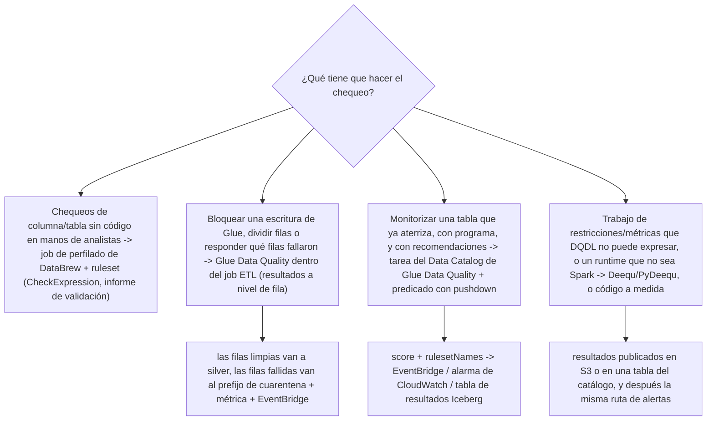
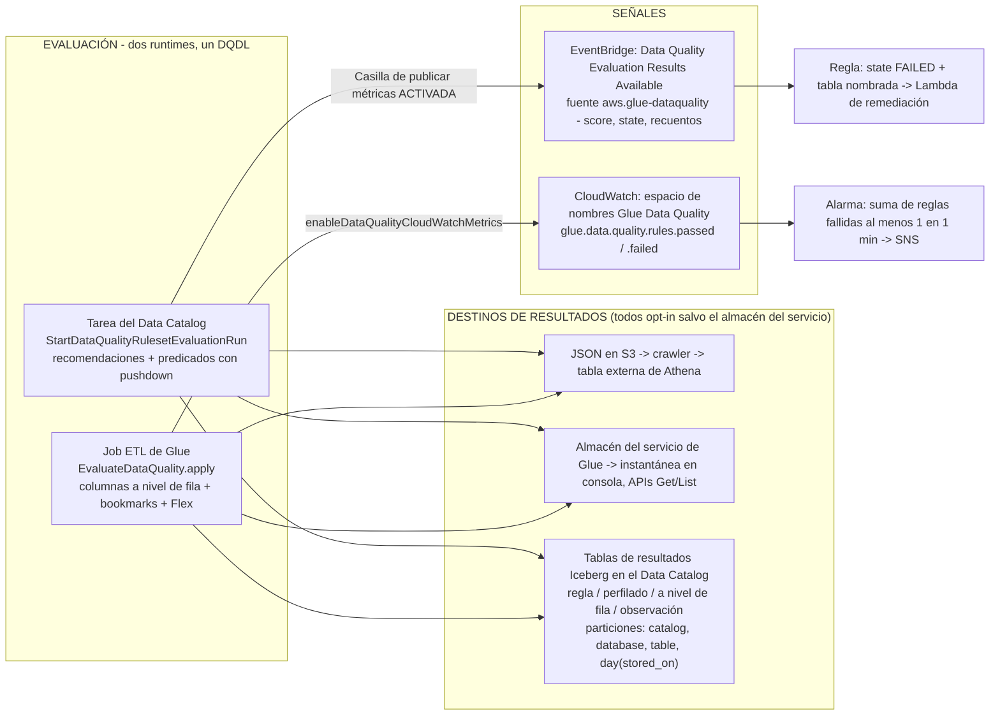
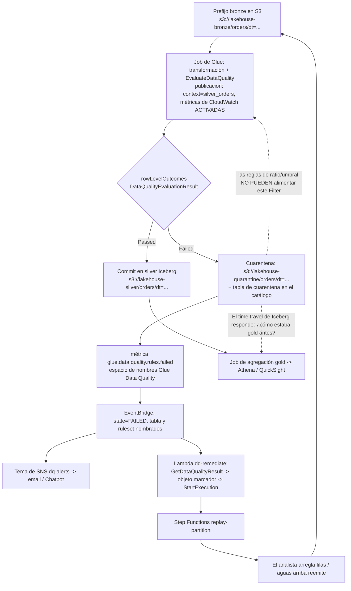
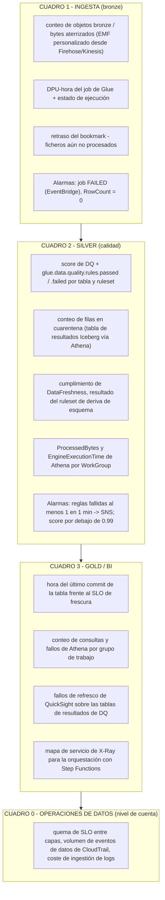
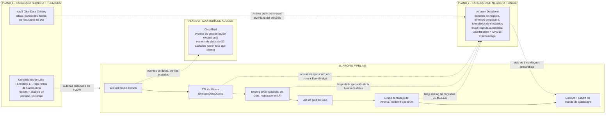

# Calidad de datos y observabilidad: DQDL, cuarentena, linaje y SLOs

Las lecciones 01 to 14 construyeron algo que funciona: un prefijo bronze, tablas Iceberg, jobs de Glue, un catálogo, Athena y QuickSight, orquestación, concesiones de Lake Formation, controles de PII y un perímetro endurecido. Nada de eso responde a la pregunta que tus consumidores realmente harán: **¿puedes demostrar que las cifras de oro de hoy son correctas, y puedes decirme qué cambió cuando no lo son?** Un lakehouse sin calidad y sin observabilidad es una forma muy rápida de mover datos incorrectos.

Esta lección construye la capa de prueba en el orden en que la propia guía de AWS la dispone: **motores → reglas → runtimes → resultados y señales → cuarentena → SLOs → observabilidad por capa → auditoría → linaje → remediación**. Dos ideas sostienen todo. Primero, la calidad es un *paso del pipeline con una salida*, no un cuadro de mando: o bien bloquea una escritura, o divide filas, o levanta una señal por la que alguien recibe un aviso. Segundo, la observabilidad tiene tres planos distintos que los equipos confunden sin parar: el **catálogo de Glue** guarda los metadatos técnicos y los permisos, **DataZone** guarda el significado de negocio y el linaje, **CloudTrail** guarda quién llamó a qué. Cada número de abajo está datado en **octubre de 2026**.

```text
====================================================================
 CALIDAD + OBSERVABILIDAD — ESTRUCTURA, AWS DATA LAKEHOUSE, LECCIÓN 15
====================================================================
 MOTORES ...... Glue Data Quality (DQDL, gestionado, construido sobre
                  Deequ)
                - tarea del Data Catalog  O  EvaluateDataQuality en el
                  job
                Deequ / PyDeequ - OSS, analyzers a medida, runtimes
                  exóticos
                DataBrew - expresiones de chequeo sin código en jobs
                  de perfilado
                chequeos a medida - Lambda / Glue / EMR a elección
 REGLAS ....... Rules = [ ... ] atado a UNA tabla; 32 tipos de regla;
                expresiones, cláusulas where, reglas dinámicas
                (RowCount > avg(last(10))), etiquetas (team=finance),
                constantes, SQL de preprocesado; 2,000 reglas y
                65 KB por ruleset; sin columnas anidadas ni de tipo
                lista
 RUNTIMES ..... Tarea del Catálogo: recomendaciones (BASIC; ADVANCED
                  vía Bedrock sep 2026), predicados de partición con
                  pushdown, mínimo de 2 DPUs - pero NO puede nombrar
                  los registros fallidos
                Job ETL: columnas DataQualityRules* a nivel de fila,
                  autoescalado, Flex, incremental por bookmark - pero
                  sin carreras de recomendación
 RESULTADOS ... JSON en S3 -> tabla externa + crawler -> Athena;
                almacén del servicio -> consola + APIs Get/List;
                tablas Iceberg en el Data Catalog (jul 2026),
                particionadas por catalog_id/database/table/day
 SEÑALES ...... EventBridge "Data Quality Evaluation Results
                  Available" (fuente aws.glue-dataquality) con score,
                  state, rulesSucceeded/Failed/Skipped - que solo
                  funciona mientras "Publish metrics to Amazon
                  CloudWatch" siga SELECCIONADA
                Espacio de nombres de CloudWatch Glue Data Quality:
                  glue.data.quality.rules.passed / .failed
 CUARENTENA ... warn | quarantine | halt (las tres acciones de
                  InsuranceLake); SOLO resultados a nivel de fila; las
                  reglas de ratio y de umbral no pueden poner en
                  cuarentena; WAP = rama de staging de Iceberg ->
                  audit -> fast_forward a main
 SLO .......... P95(disponibilidad - evento) <= objetivo en tres
                  relojes: hora del evento / hora de aterrizaje /
                  hora de disponibilidad; se codifica como
                  DataFreshness + FileFreshness + alarmas de volumen
                  RowCount
 OBSERVABILIDAD  un cuadro de mando de CloudWatch por capa medallón;
                grupos de log de Glue /aws-glue/jobs/output, /error,
                  /logs-v2 (logging continuo, redirección a Logs IA);
                métricas AWS/Athena de Athena; X-Ray para Lambda y
                  Step Functions - NO para los executors de Spark
 AUDITORÍA .... Eventos de gestión de CloudTrail (primera copia
                  gratis) frente a eventos de datos de S3 ($0.10 por
                  100,000, opt-in, acotados con selectores avanzados,
                  sin comodines)
 PLANOS ....... Glue Data Catalog = metadatos técnicos + permisos
                  (concesiones de Lake Formation; el registro NO es
                  linaje)
                Amazon DataZone = catálogo de negocio + linaje
                  (compatible con OpenLineage; captura automática de
                  Glue/Redshift)
                CloudTrail = auditoría de acceso (quién llamó, no de
                  dónde se derivó una columna)
 Precios ...... Ejemplos resueltos de Glue DQ a $0.44 por DPU-hora
                  (una segunda línea en la misma página dice $0.22 -
                  ver E2); Flex $0.29; mínimo de 2 DPU, facturación
                  de 1 minuto; detección de anomalías 1 DPU por
                  estadística; EventBridge $1.00 por millón de
                  eventos personalizados; métrica personalizada de
                  CloudWatch $0.30 por métrica-mes  [lista us-east-1,
                  en oct 2026]
====================================================================
```

En esta lección vas a:

- elegir un motor de calidad a partir del propio mapa de Prescriptive Guidance de AWS, **Glue Data Quality, DataBrew, Deequ o código a medida**, y defender la opción por defecto;
- redactar **DQDL**: rulesets atados a una tabla, los cuatro modificadores (expresiones, `where`, reglas dinámicas, etiquetas), los 32 tipos de regla y cuáles de ellos pueden producir alguna vez una **fila** fallida;
- ejecutar la evaluación en **ambos runtimes**, la tarea del Data Catalog y `EvaluateDataQuality` dentro de un job de Glue, y saber exactamente qué puede y qué no puede hacer cada uno;
- aterrizar los resultados en **tres destinos**: JSON en S3, el almacén del servicio de Glue y **tablas Iceberg en el Data Catalog**, y luego leerlos en Athena;
- cablear las **señales**: eventos de EventBridge, métricas de CloudWatch en el espacio de nombres `Glue Data Quality`, alarmas, cuadros de mando: incluida la casilla que mata las alertas en silencio;
- construir el **patrón de cuarentena** de extremo a extremo: dividir filas, escribir el prefijo y la tabla de cuarentena, emitir la métrica, alertar y ejecutar un backfill que se mantiene idempotente;
- calcular un **SLO de frescura** en tres relojes y defender una cifra P95 con aritmética real;
- acotar los **eventos de datos de CloudTrail** por prefijo sensible para que la traza de auditoría no se convierta en la línea más grande de la factura;
- separar los **tres planos**, catálogo de Glue, catálogo de negocio y linaje de DataZone, auditoría de CloudTrail, y nombrar solo las fuentes de linaje que AWS realmente documenta;
- cablear una ruta de remediación **EventBridge → SNS → Lambda** que funcione con el IAM que le corresponde;
- estudiar **dos casos de clientes de AWS**, un **recuadro de actualizaciones de octubre de 2026** con fuentes, **once preguntas de estilo examen** y cuatro comprobaciones interactivas.

---

## 1. Cuatro motores de calidad, una decisión

### 1.1 El propio mapa de AWS

AWS Prescriptive Guidance publica una tabla de mapeo de soluciones para los chequeos de calidad de datos. Es la respuesta correcta más rápida a «qué herramienta»:

| Necesidad | Motor | Dónde se ejecuta | Alcance verificado |
|---|---|---|---|
| Condiciones sin código a nivel de columna o de tabla para analistas | **AWS Glue DataBrew** | Job de perfilado + ruleset | Su propia sintaxis `CheckExpression`, **no** DQDL; informe de validación junto al perfil |
| Código a medida en un job de Glue **o** reglas sin código sobre tablas del catálogo | **AWS Glue Data Quality** | Tarea del catálogo o transformación ETL | DQDL, gestionado, serverless, «built on top of the open-source DeeQu framework» |
| Chequeos a medida en tu propio ETL favorito | **Chequeos a medida** | Lambda, Glue, EMR | Lo que tú escribas |
| Informe de métricas, validación de restricciones y sugerencias de restricciones | **Deequ** (código abierto) | EMR, SageMaker, Glue con el JAR adecuado | Analyzers al estilo `CompletenessConstraint`, repositorio de métricas, chequeos de anomalías |

(AWS Prescriptive Guidance: *Data quality checks*, consultado 2026-10-11.)

Para el lakehouse de este curso la respuesta es **Glue Data Quality por defecto**, DataBrew reservado para el perfilado de analistas de negocio sobre datasets CSV/JSON, y PyDeequ solo cuando la personalización al nivel de Deequ sea genuinamente necesaria. No es una contienda de popularidad: Glue DQ evalúa «tablas y vistas de Amazon Athena admitidas que están almacenadas en el AWS Glue Data Catalog» sobre «Amazon S3, Amazon Redshift, fuentes JDBC compatibles con el Data Catalog y formatos de lago de datos transaccionales como Apache Iceberg, Apache Hudi y Delta Lake»: que es exactamente el sustrato que construiste en las Lecciones 02 to 08 (Glue Developer Guide, consultado 2026-10-11).



- **📚 ¿Sabías que…?** Glue Data Quality no es una reimplementación: AWS afirma que está «construido sobre el framework de código abierto DeeQu» y que hay «sin ataduras (No lock-in)… permitiéndote conservar las reglas que redactas en un lenguaje abierto» (Glue Developer Guide, consultado 2026-10-11). Por eso una regla DQDL se lee como el vocabulario de restricciones de Deequ, y por eso la librería de código abierto sigue siendo una válvula de escape legítima para los analyzers que el producto no expone.

### 1.2 Qué compra lo «gestionado», en una tabla

| | **Glue Data Quality** | **Deequ / PyDeequ** | **Reglas de DataBrew** | **Great Expectations (DIY)** |
|---|---|---|---|---|
| Autoría | DQDL, consola, API, nodo de Studio | Restricciones en Scala/Python | Expresiones de chequeo sin código | Suites de expectativas en Python |
| Ejecución gestionada | Sí, tareas serverless e integración con ETL | No, tú ejecutas Spark | Sí, dentro de los jobs de perfilado | No, tú lo alojas |
| Recomendaciones de reglas | Sí (BASIC; ADVANCED vía Bedrock, sep 2026) | Sugerencia de restricciones en código | Pestaña de recomendaciones en consola | No |
| Registros fallidos a nivel de fila | **Sí, solo en la ruta ETL** | Sí, si construyes la división | No: los hallazgos son agregados | Sí, si lo construyes |
| Alertas | EventBridge + CloudWatch, integrados | Tú construyes la publicación a SNS | Evento de EventBridge por ruleset validado | Tú lo construyes |
| Postura de soporte de AWS | Producto propio | Código abierto (comunidad / ejemplos de AWS) | Producto propio | No es una oferta de AWS |

La última fila importa. Great Expectations aparece en esta lección solo como un framework **que tú traes**: AWS no publica ninguna oferta gestionada de GX, la documentación legada de GX propia fija la integración con Glue en «la versión más reciente de GX que soporta esta integración es GX 0.15.50», y el recorrido del conector de Glue Catalog es un post escrito por un partner. Trata GX como *tu* runner para versionar, parchear y soportar.

---
## 2. DQDL: el lenguaje, los modificadores, el contrato del ruleset

### 2.1 El contrato: `Rules = [ ... ]` atado a una tabla

Un ruleset es una lista entre corchetes, separada por comas, atada a exactamente una tabla del catálogo:

```text
Ruleset = 'Rules = [IsComplete "col1", IsPrimaryKey "col2", RowCount between 2000 and 8000]'
TargetTable = {'TableName': 'orders', 'DatabaseName': 'lakehouse_silver'}
```

Esa es la forma de `create_data_quality_ruleset` (Glue Developer Guide: *Using APIs to measure and manage data quality*, consultado 2026-10-11). Dos límites definen lo grande que puede volverse un ruleset: **2,000 reglas por ruleset** («si tus rulesets son mayores, te recomendamos dividirlos en varios rulesets») y un **tamaño de ruleset de 65 KB**. Las estadísticas son un presupuesto aparte: **100,000 estadísticas por cuenta**, almacenadas **gratis** durante **2 años** (precios de Glue, consultado 2026-10-11).

Una exclusión a nivel de lenguaje para memorizar: **«DQDL no admite actualmente datos de columna anidados ni de tipo lista»**. Los structs y arrays anidados quedan fuera del alcance de las reglas directas: aplana, o usa `CustomSql` contra una vista preprocesada.

### 2.2 Los cuatro modificadores que cambian la semántica

| Modificador | Desde | Qué hace | Ejemplo |
|---|---|---|---|
| **Expresiones** | GA 2023-05-24 (producto) | Umbrales, rangos, enums, regex, `with threshold` | `Uniqueness "email" = 1.0`, `ColumnValues "currency" matches "^[A-Z]{3}$" with threshold > 0.999` |
| **Cláusula `where`** | 2024-06-26 | Filtra filas *antes* de que la regla se evalúe | `Completeness "First_Name" > 0.95 where "weight > 10"` |
| **Reglas dinámicas** | preview 2023-11-27, GA 2024-08-07 | Umbrales calculados a partir del historial de ejecuciones | `RowCount > avg(last(10))`, `Completeness "colA" between min(last(5)) - 1 and max(last(5)) + 1` |
| **Etiquetas** | GA 2025-11-21 | Etiquetas clave-valor escritas en DQDL para segmentar resultados por responsable | etiqueta `team=finance`, consultable en los resultados de reglas, en los resultados a nivel de fila y en las respuestas de API |

(Notas de versión de Glue DQ y AWS What's New, 2025-11-25, consultado 2026-10-11.)

Tres rasgos de apoyo lo completan: las **constantes** (2025-11-21) te dejan definir un valor una vez y referenciarlo por todo el script, «preventing issues related to query size limits»; las **consultas de preprocesado** (GA 2025-11-25) ejecutan SparkSQL sobre la tabla *antes* de la evaluación mediante el campo `PreProcessingQuery` de `DataQualityGlueTable`, de modo que puedes derivar columnas, filtrar o validar relaciones entre columnas; y las **reglas compuestas complejas** (2024-11-22) te dejan anidar grupos AND/OR en lugar de apilar reglas planas.

Fíjate en la trampa de la columna `with threshold`: esa cláusula solo funciona con **ColumnValues, ColumnDataType y CustomSql**. Ponla sobre `Completeness` y estarás escribiendo una regla que DQDL no evaluará como tú crees.

### 2.3 Los 32 tipos de regla, y los que pueden nombrar una fila

La referencia de tipos de regla de DQDL lista exactamente **32** tipos de regla en octubre de 2026: AggregateMatch, AllStatistics, ColumnCorrelation, ColumnCount, ColumnDataType, ColumnExists, ColumnLength, ColumnNamesMatchPattern, ColumnValues, Completeness, CustomSql, DataFreshness, DatasetMatch, DistinctValuesCount, Distribution, Entropy, IsComplete, IsPrimaryKey, IsUnique, Mean, ReferentialIntegrity, RowCount, RowCountMatch, SchemaMatch, StandardDeviation, Sum, Uniqueness, UniqueValueRatio, DetectAnomalies, FileFreshness, FileMatch, FileUniqueness y FileSize.

Se agrupan en cuatro familias:

```text
A NIVEL DE FILA (puede nombrar el registro infractor) ..... Completeness, IsComplete,
    IsUnique, IsPrimaryKey, Uniqueness, UniqueValueRatio, ColumnValues,
    ColumnLength, ColumnDataType, ColumnExists, DetectAnomalies,
    DataFreshness, CustomSql CON un umbral a nivel de fila, File* (no)
A NIVEL DE DATASET (solo agregado - NUNCA una fila fallida) .. RowCount,
    RowCountMatch, Mean, StandardDeviation, Sum, ColumnCount,
    ColumnExists, ColumnNamesMatchPattern, ColumnCorrelation,
    CustomSql (forma general), AggregateMatch
ENTRE DATASETS .................................. ReferentialIntegrity,
    DatasetMatch, AggregateMatch, SchemaMatch
ANALYZERS / ORIENTADOS A FICHERO ................ AllStatistics,
    Distribution, FileFreshness, FileMatch, FileUniqueness, FileSize
```

La propia documentación de Studio de AWS es tajante sobre la separación: las reglas a nivel de dataset «no pueden identificar registros de error porque se aplican a nivel de dataset» (Glue Developer Guide: *Evaluating data quality with AWS Glue Studio*, consultado 2026-10-11). Construye una cuarentena sobre `RowCount` y no pondrás en cuarentena absolutamente nada.

### 2.4 Ejemplo resuelto E1: el ruleset `orders` de silver

Objetivo: `lakehouse_silver.orders`, una tabla Iceberg particionada por `dt`, evaluada dentro del job bronze→silver **y** re-verificada cada día como tarea del catálogo.

```text
Ejemplo resuelto E1 - ruleset DQDL para lakehouse_silver.orders, en oct 2026

Rules = [
    ColumnExists "order_id",
    ColumnExists "customer_id",
    ColumnExists "order_ts",
    IsPrimaryKey "order_id",                                    -- not-null + único en una sola regla
    Completeness "customer_id" > 0.999,                         -- a nivel de fila, susceptible de cuarentena
    Completeness "order_ts" > 0.995,                            -- a nivel de fila, susceptible de cuarentena
    Uniqueness "order_id" > 0.999,                              -- tolera 0.1% de duplicados
    ColumnValues "order_status" in ["created","paid","shipped","cancelled"]
        with threshold > 0.99,                                  -- se tolera <=1% de enum sucio
    ColumnValues "currency" matches "^[A-Z]{3}$" with threshold > 0.999,
    ColumnValues "total_amount" > 0,
    RowCount > 1000,                                            -- guarda de pipeline muerto
    RowCount <= avg(last(10)) * 1.5,                            -- guarda de pico dinámica de volumen
    DataFreshness "order_ts" > (now() - 2 days)
        where "dt = current_date - 1",                          -- obsolescencia en la partición de ayer
    CustomSql "SELECT order_id FROM primary WHERE total_amount != item_sum"
]

SCORE = reglas superadas / reglas evaluadas -> 14/14 = 1.00, 13/14 = 0.929
REGLAS CON CAPACIDAD DE CUARENTENA = el par de Completeness, la de Uniqueness,
    las tres de ColumnValues y el CustomSql a nivel de fila
SOLO A NIVEL DE DATASET = las dos reglas de RowCount y DataFreshness
    -> estas ALERTAN (halt / notify), nunca dividen filas
```

Por qué cada línea se gana su sitio: `IsPrimaryKey` colapsa dos reglas en una; las formas con umbral sobre `ColumnValues` toleran suciedad por debajo del 1% sin hundir una ejecución entera; `RowCount <= avg(last(10)) * 1.5` es una guarda de picos **dinámica** que no necesita una constante ajustada a mano; el `CustomSql` a nivel de fila es la única regla de aquí que puede darte una lista de IDs de pedido para poner en cuarentena; y `DataFreshness … where "dt = current_date - 1"` acota la obsolescencia a la partición que *debería* estar fresca en lugar de gritar sobre toda la historia.

El recorrido de introducción de AWS muestra la misma forma sobre su tabla de ejemplo de tickets, `IsComplete "SET_FINE_AMOUNT"`, `Uniqueness "TICKET_NUMBER" > 0.95`, `ColumnValues "PROVINCE" in [...]`, `ColumnLength "INFRACTION_DESCRIPTION" between 15 and 31`, con la advertencia importante de la documentación: las recomendaciones «facilitan empezar… sin escribir código», pero las reglas se generan a partir de las estadísticas *actuales*, así que trátalas como un borrador que apretar (consultado 2026-10-11).

### 2.5 Recomendaciones de reglas: BASIC y ADVANCED vía Bedrock

`start_data_quality_rule_recommendation_run(DataSource={'GlueTable': {...}}, Role=role_arn)` devuelve un `RunId`; recupera `ResultIds` de `get_data_quality_ruleset_evaluation_run` y después cada `get_data_quality_result(ResultId=…)`. Las carreras de recomendación **se borran automáticamente a los 90 días**. Desde el **2026-09-18 / 2026-09-25**, un modo **ADVANCED** usa Amazon Bedrock con los metadatos de la tabla más filas muestreadas para generar DQDL: un asistente de redacción, no una aprobación.

```fillblank
{
  "question": "Completa las palabras clave de DQDL y de Glue Data Quality en las que se apoya esta lección:",
  "template": "Un ruleset se escribe como {{1}} = [ lista de reglas ] y se ata a exactamente una tabla del catálogo; un filtro aplicado antes de que la regla se ejecute es la cláusula {{2}}; un umbral calculado a partir del historial de ejecuciones, como RowCount > {{3}}(last(10)), es una regla {{4}}; y la regla que comprueba not-null y unicidad a la vez es {{5}}.",
  "answers": {
    "1": "Rules",
    "2": "where",
    "3": "avg",
    "4": "dynamic",
    "5": "IsPrimaryKey"
  },
  "distractors": [
    "Ruleset",
    "Expectations",
    "having",
    "filter",
    "max",
    "median",
    "composite",
    "anomaly",
    "IsUnique",
    "DistinctValuesCount"
  ],
  "explanation": "Rules = [ ... ] es la sintaxis literal de ruleset que AWS usa en el ejemplo de API create_data_quality_ruleset. La cláusula where se entregó el 2024-06-26 y filtra antes de la evaluación, que es como acotas una regla de frescura a la partición de ayer. avg(last(10)) es la forma documentada de regla dinámica: los umbrales salen del historial, no de una constante que alguien tecleó una vez. Las reglas dinámicas pasaron a GA el 2024-08-07 junto con la detección de anomalías. IsPrimaryKey es la única regla que expresa not-null más unicidad, y por eso reemplaza a dos reglas en cada ruleset de producción de este curso."
}
```

---

## 3. Dos runtimes: la tarea del Data Catalog y `EvaluateDataQuality` en el job

Comparten DQDL, EventBridge, métricas de CloudWatch, resultados en S3 y acciones de IAM. **No** son intercambiables.

| | **Tarea del Data Catalog** (`StartDataQualityRulesetEvaluationRun`) | **Integrada en el ETL** (`EvaluateDataQuality.apply` / nodo de Studio) |
|---|---|---|
| Identificar qué registros fallaron | **«Not supported»** | **«Supported»**: resultados a nivel de fila |
| Evaluación incremental | Pushdown / predicados de partición del catálogo | **Bookmarks de job de AWS Glue** |
| Autoescalado | No soportado | Soportado |
| Recomendaciones de reglas | Sí (sin recomendaciones dentro de ejecuciones ETL) | No |
| Detección de anomalías ML, reglas dinámicas, EventBridge, CloudWatch, resultados a S3 | Soportado | Soportado |
| Ejecución Flex / DPU con autoescalado |: | Soportado |
| Acción ante fallos | Score + evento | «Fail job after loading target data» → `AssertionError` |

(Glue Developer Guide: matriz de capacidades, consultado 2026-10-11.)

### 3.1 Dentro del job

```python
from awsglue.transforms import EvaluateDataQuality

dq = EvaluateDataQuality.apply(
    frame=orders_frame,
    ruleset=ruleset,                       # Rules = [ ... ]
    publishing_options={
        "dataQualityEvaluationContext": "silver_orders",   # namespace; default "default_context"
        "enableDataQualityCloudWatchMetrics": True,        # default False
        "enableDataQualityResultsPublishing": True,        # default True -> Glue Studio "Data quality" tab
        "resultsS3Prefix": "s3://lakehouse-dq/results/"    # optional S3 sink
    })
```

La opción de salida de la transformación es la decisión que importa: **«Original data»** frente a **«Add new columns to indicate data quality errors»**. La segunda añade cuatro columnas: `DataQualityRulesPass`, `DataQualityRulesFail`, `DataQualityRulesSkip` (arrays de cadena) y `DataQualityEvaluationResult` («Passed» o «Failed» **a nivel de fila**). La nota de AWS que hay que memorizar es esta: *"tus resultados globales pueden ser FAIL, pero un registro en concreto puede pasar."* Las reglas en Studio van «dentro de los corchetes y… separadas por comas»: `Rules = [ Completeness "year" > 0.8, Completeness "month" > 0.8 ]`.

La calidad incremental llega por los **bookmarks de job**: para entradas de S3 la marca de agua es la **hora de última modificación** del objeto, con un `maxBand` por defecto de **900,000 ms (15 minutos)** durante el cual el listado «is likely to be consistent». Los bookmarks exigen `job.init` al principio y `job.commit` al final, y se enganchan a un `transformation_ctx` único: si lo omites, el operador no se rastrea en absoluto (que es exactamente como relees a propósito una tabla de dimensión en cada ejecución).

### 3.2 Tres destinos de resultados, y desde julio de 2026 el catálogo es uno de ellos

1. **Resultados JSON en S3** (opt-in mediante `resultsS3Prefix` o la ubicación de resultados de la tarea) → regístralos con un crawler, `CREATE EXTERNAL TABLE` con un JSON SerDe, `MSCK REPAIR TABLE` y después Athena. AWS entrega el DDL completo, particionado por `year/month/day`.
2. **El almacén del servicio de Glue** → legible mediante `GetDataQualityResult` / `ListDataQualityResults` y representado en la pestaña **Data quality** de la consola; la **Data quality snapshot** muestra por defecto las últimas 10 ejecuciones de cada ruleset.
3. **Tablas Iceberg en el Data Catalog** (GA 2026-07-27) → cuatro tipos de resultado opt-in, **resultados de regla, de perfilado, a nivel de fila y de observación**, configurados mediante `--additional-run-options` en `StartDataQualityRulesetEvaluationRun` o `additional_options` en un job ETL. **No se escribe nada por defecto**: «debes activar explícitamente cada tipo de resultado.»

```text
aws glue start-data-quality-ruleset-evaluation-run \
  --data-source '{"GlueTable": {"DatabaseName": "lakehouse_silver","TableName": "orders"}}' \
  --role arn:aws:iam::111122223333:role/glue-dq-task \
  --ruleset-names '["silver_orders_strict"]' \
  --additional-run-options '{
    "DataQualityRuleResults": {
      "WriteDataQualityRuleResultsEnabled": true,
      "CatalogTableConfig": {"DatabaseName": "quality_results","TableName": "rule_results"}
    }
  }'

CLAVES DE PARTICIÓN de cada tabla de resultados ... catalog_id, database_name,
    table_name, day(stored_on)
COLUMNAS DE RESULTADO DE REGLA ............. dq_result_id, rule_name,
    rule_description (la expresión DQDL), rule_result (PASS|FAIL),
    evaluation_message, evaluated_metrics MAP<STRING,DOUBLE>,
    catalog_id, database_name, table_name,
    ruleset_evaluation_run_id, started_on, completed_on,
    evaluated_rule, ruleset_name
COLUMNAS A NIVEL DE FILA ................... todas las columnas de origen +
    data_quality_rules_pass / _fail / _skip (ARRAY),
    data_quality_evaluation_result (Passed|Failed), stored_on,
    region, account_id
```

Este es el cambio más grande de 2026 sobre el tema de esta lección: tu historial de calidad se convierte en una tabla Iceberg ordinaria, con las mismas herramientas de Athena, Lake Formation, time travel y QuickSight que el resto del lakehouse.

### 3.3 El contrato de alertas tiene una casilla oculta

Cada evaluación completada emite un evento de EventBridge:

```json
{
  "detail-type": "Data Quality Evaluation Results Available",
  "source": "aws.glue-dataquality",
  "detail": {
    "contextType": "GLUE_DATA_CATALOG",
    "runId": "dqrun-9f2c...",
    "databaseName": "lakehouse_silver",
    "tableName": "orders",
    "catalogId": "111122223333",
    "resultID": "dqr-...",
    "rulesetNames": ["silver_orders_strict"],
    "state": "FAILED",
    "score": 0.928,
    "rulesSucceeded": 13,
    "rulesFailed": 1,
    "rulesSkipped": 0
  }
}
```

La variante ETL usa `contextType: "GLUE_JOB"` con `jobId`, `jobName` y `evaluationContext`. La ruta paralela de CloudWatch es igual de simple: **«Each AWS Glue Data Quality evaluation emits a pair of metrics named `glue.data.quality.rules.passed`… and `glue.data.quality.rules.failed`»** bajo el espacio de nombres **`Glue Data Quality`**, publicadas **por tabla y por ruleset**.

> [!WARNING]
> **No desselecciones «Publish metrics to Amazon CloudWatch».** AWS lo documenta sin rodeos: tanto para las evaluaciones del Data Catalog como para las de los jobs ETL, *"la opción Publish metrics to Amazon CloudWatch, que viene seleccionada por defecto, debe seguir seleccionada para que funcione la publicación en EventBridge."* Los equipos lo desactivan para recortar unos dólares de métricas personalizadas y pierden las métricas de CloudWatch *y* los eventos de EventBridge en el mismo clic: alarmas, notificaciones y remediación se quedan mudas mientras las reglas siguen corriendo y el score sigue cayendo. La consecuencia de IAM es el mismo interruptor: la publicación necesita `cloudwatch:PutMetricData` **condicionada a** `"cloudwatch:namespace": "Glue Data Quality"`.

La preferencia declarada de AWS: *"nuestro enfoque recomendado es configurar las alertas de calidad de datos con Amazon EventBridge, porque Amazon EventBridge solo requiere una configuración única para alertar a los clientes."* La alternativa de CloudWatch es una alarma estándar: `glue.data.quality.rules.failed`, estadística **Sum**, periodo **1 minuto**, umbral **≥ 1**, acción = tema de SNS.



- **📚 ¿Sabías que…?** El **score** no es una nota de calidad que se pasa de mano en mano: AWS lo define como «el porcentaje de reglas de calidad de datos que superaron la entrada». Un ruleset con una sola regla débil puntúa 1.0 mientras el 40% de las filas son basura. Por eso existen las columnas a nivel de fila y las tablas de resultados: el score para la alerta, las filas para la arreglo (Glue Developer Guide, consultado 2026-10-11).

---
## 4. Deequ, PyDeequ y DataBrew: las rutas laterales verificadas

### 4.1 Deequ: el motor, y dónde sigue mereciendo la pena

El anuncio de PyDeequ de AWS describe el original: Deequ «is used internally at Amazon to verify the quality of many large production datasets… The system computes data quality metrics on a regular basis (with every new version of a dataset), verifies constraints defined by dataset producers, and publishes datasets to consumers in case of success. In error cases, dataset publication can be stopped, and producers are notified to take action.» Calcular → verificar → publicar-o-parar es el bucle que Glue DQ convirtió en producto en 2023 (AWS Big Data Blog, 2020-12-30, actualizado en junio de 2024).

Motivos legítimos que quedan para ejecutar Deequ tú mismo, según los propios posts de AWS:

| Motivo | Vehículo documentado por AWS | Restricción dura |
|---|---|---|
| Analyzers/restricciones a medida que DQDL no puede expresar | PyDeequ en **EMR** | El JAR de Deequ **debe coincidir** con tu versión de Spark: `pydeequ.deequ_maven_coord` → `com.amazon.deequ:deequ:2.0.3-spark-3.3`; «es crítico proporcionar las coordenadas de Apache Maven correctas» |
| **Validación de migración**: diff de métricas origen vs destino | Un job de EMR escribe resultados en una tabla de Glue (p. ej. `db_deequ.db_migration_validation_result`), auditada en Athena | El mismo anclaje de JAR/Spark |
| Datasets muy pequeños que necesitan arranque rápido | **Deequ en AWS Lambda** con el Spark Runtime for AWS Lambda (SoAL) | SoAL «es mayor que el límite de 250 MB para el empaquetado de archivo zip» → imagen de contenedor; AWS recomienda Glue Data Quality «para jobs de Spark que corran más de 15 minutos o ficheros mayores (más de 1 GB)» |
| Chequeos de anomalías sobre un repositorio de métricas | `FileSystemMetricsRepository` + Holt-Winters, resultados a SNS | La receta de Holt-Winters publicada se verificó «in AWS Glue 2.0, pydeequ release/1_1_1, Spark 2.4 and deequ-1.1.0_spark-2.4-scala-2.11.jar (only)»: ancla la versión o no la uses |

PyDeequ «supports Spark up to version 3.3.0» según las notas de PyDeequ 1.1.x a las que AWS enlaza, y «puede funcionar dentro de Amazon EMR y SageMaker». El resumen honesto de 2026: **casi todo el valor de Deequ ya está dentro de Glue Data Quality**; recurre a la librería cuando el runtime sea exótico o la restricción no sea expresable.

### 4.2 DataBrew: reglas, pero no DQDL

La historia de calidad de DataBrew es un **ruleset de `CheckExpression`s evaluado dentro de un job de perfilado**: «si algún criterio de una regla no se cumple, el ruleset entero falla la validación», y la ejecución «produce un informe de validación además del perfil de datos» en la misma ubicación. Forma de la API: `CheckExpression`, `ColumnSelectors` (Name o Regex), `Disabled`, `SubstitutionMap`, `Threshold` (Type/Unit/Value). Restricciones que respetar: **solo participan columnas de tipos simples** (string, números, boolean), y las reglas viven en la pestaña **Recommendations** de la pantalla del ruleset.

Al terminar, «DataBrew envía un evento de Amazon CloudWatch con los detalles de esa ejecución de job… para cada ruleset validado… y el evento contiene su resultado (`SUCCEEDED`, `FAILED` o `ERROR`)» más un enlace al informe. Ese evento es tu patrón de EventBridge para los chequeos en manos de analistas. Las métricas viven en el espacio de nombres **`AWS/DataBrew`**: el ejemplo documentado es `SessionCount`.

> [!IMPORTANT]
> **Las reglas de DataBrew no son DQDL.** La sintaxis de expresión de chequeo, la consola, los eventos, el informe y la semántica de fallo son distintos de los de Glue Data Quality. Copiar `Completeness "col" > 0.95` a un ruleset de DataBrew, o un `CheckExpression` de DataBrew a un ruleset de Glue, falla en ambas direcciones. AWS Prescriptive Guidance los mantiene separados por una razón: DataBrew para chequeos de analista sin código, Glue Data Quality para DQDL embebido en jobs y en el catálogo, Deequ para un informe de métricas/restricciones, código a medida para todo lo demás.

### 4.3 Ejemplo resuelto E2: lo que cuesta un gate de calidad, y dónde ponerlo

El propio benchmark de AWS: **104 columnas, 1 millón de filas, 10 DPUs** (AWS Big Data Blog, 2024-03-12):

```text
Ejemplo resuelto E2 - coste y ubicación de una ejecución de DQ, lista us-east-1, en oct 2026
BENCHMARK (104 cols, 1M filas, 10 DPUs)
  0 reglas ........ 53.2 s ... 0.15 DPU-hr .... $0.06
  10 reglas ....... ~150 s ... 0.42 DPU-hr .... $0.18
  100 reglas ...... -- ....... 0.52 DPU-hr .... $0.23
  400 reglas ...... 445.7 s .. 1.24 DPU-hr .... $0.54
  -> el coste lo domina el ESCANEO de la tabla, no el número de reglas:
     "cost… only starts to increase after evaluating rulesets with
      more than 100 rules, remaining constant below that number."

UBICACIÓN, mismo ruleset de silver de 20 reglas (30 ejecuciones/mes)
  A. Tarea del catálogo independiente, 5 DPUs x 20 min
     5 x (20/60) x $0.44 ............................. $0.73 / ejecución
     $0.73 x 30 ..................................... $21.90 / mes
     al tipo Flex $0.29 .............................. $0.48 / ejecución
  B. Dentro del job de silver existente (6 DPUs, +5 min marginales)
     6 x (5/60) x $0.44 ............................. $0.22 / ejecución
     $0.22 x 30 ..................................... $6.60 / mes
     Y además obtienes resultados a nivel de fila -> funciona la cuarentena
  C. Complemento de detección de anomalías: 20 estadísticas x 1 DPU x 15/3600 h x $0.44
     .............................................. +$0.037 / ejecución
     ("between 10-20 seconds" por estadística de media)
  D. Suelo de la tarea de perfil/calidad .................. 2 DPUs, mínimo de 1 minuto

CONFLICTO DE PRECIO A COMPROBAR ANTES DE PRESUPUESTAR
  aws.amazon.com/glue/pricing trae dos cifras de DQ en la misma
  fecha de acceso (2026-10-11): los ejemplos resueltos de Data Quality
  calculan a $0.44 por DPU-hora (tarea de recomendación 5 DPUs x 10 min
  = "$0.37"; evaluación de catálogo 5 DPUs x 20 min = "$0.73"; DQ de ETL
  6 DPUs x 20 min = "$0.88", Flex "$0.58"), mientras una línea de la
  tabla de precios dice Glue Data Quality = "$0.22 per DPU-hour".
  Rango para la opción A: $11.00 - $21.90 / mes. Verifícalo en consola.
```

Dos conclusiones sobreviven a la ambigüedad de precio: **presupuesta por tamaño de tabla × frecuencia, no por número de reglas**, y para un diseño de cuarentena la evaluación dentro del job domina porque es más barata *y* es la única vía que puede nombrar las filas.

---

## 5. Cuarentena: un patrón, no un producto

### 5.1 Tres acciones, dos puntos de control

La muestra InsuranceLake de la AWS Solutions Library formaliza lo que todo pipeline de producción necesita: tres acciones en dos puntos de control del pipeline:

| Acción | Comportamiento | Cuándo usarla |
|---|---|---|
| **Warn** | Solo registra o notifica; los datos siguen fluyendo | Problemas cosméticos, primeras ejecuciones de una regla nueva |
| **Quarantine** | Saca del flujo las **filas** fallidas y las escribe en un almacenamiento de cuarentena aparte + una tabla de cuarentena en el Data Catalog | Defectos a nivel de fila con significado de negocio |
| **Halt** | Detiene el pipeline / falla el job | El dataset es inutilizable aguas abajo |

Puntos de control: `before_transform` («justo después del mapeo de esquema… antes de que se ejecute cualquier transformación») y `after_transform` («justo antes de guardar los datos en el bucket Cleanse»). La regla que importa para tu diseño de ruleset: *"La expresión de calidad de datos debe escribirse usando resultados a nivel de fila para evaluar y poner en cuarentena filas individuales"* y *"Las reglas que se apoyan en ratios o umbrales no están soportadas como reglas de cuarentena."*

InsuranceLake muestra también cómo es un **halt por frescura** cuando quieres que el pipeline se detenga en lugar de dividir:

```text
CustomSql 'SELECT count(*) FROM primary
           WHERE claims_last_updated >= now() - interval 24 hours' >= 1
```

### 5.2 La división, en código

```python
from awsglue.transforms import EvaluateDataQuality, Filter

rowLevelOutcomes = EvaluateDataQuality.apply(
    frame=orders_frame,
    ruleset=quarantine_capable_ruleset,      # only row-level rules
    publishing_options={
        "dataQualityEvaluationContext": "silver_orders",
        "enableDataQualityCloudWatchMetrics": True,
        "enableDataQualityResultsPublishing": True,
        "resultsS3Prefix": "s3://lakehouse-dq/results/"
    })

clean = Filter.apply(frame=rowLevelOutcomes,
                     f=lambda r: r["DataQualityEvaluationResult"] == "Passed")
dirty = Filter.apply(frame=rowLevelOutcomes,
                     f=lambda r: r["DataQualityEvaluationResult"] != "Passed")

# clean  -> s3://lakehouse-silver/orders/dt=2026-10-10/   (Iceberg commit)
# dirty  -> s3://lakehouse-quarantine/orders/dt=2026-10-10/ + catalog table
# glue.data.quality.rules.failed metric -> EventBridge -> SNS/Lambda
```

La guía de Studio de AWS ofrece además una variante propia: en **Data quality actions**, elige **Fail job after loading target data**, que aparece como `AssertionError: The job failed due to failing DQ rules for node: …`: halt sin cuarentena.

### 5.3 Ejemplo resuelto E3: el bucle de cuarentena con cifras reales

```text
Ejemplo resuelto E3 - un mal día en lakehouse_silver.orders, en oct 2026
Entrada ................................. 1,000,000 filas, 480 ficheros
Reglas evaluadas (con cuarentena) ...... Completeness customer_id,
                                         Uniqueness order_id,
                                         ColumnValues order_status,
                                         CustomSql total_amount = item_sum
Filas superadas ......................... 987,520  (98.752%)
Filas en cuarentena .....................  12,480  (1.248%)
  - customer_id nulo ...................    8,900
  - order_id duplicado .................    2,310
  - order_status ilegal ................    1.150
  - desajuste de importe ...............      120   <- forma de fila del CustomSql
Score del ruleset ...................... 0.75 (3/4 reglas superadas)
  -> el score dice "fail", las FILAS dicen "1.248% del lote está sucio"
Escritura de cuarentena ................. s3://lakehouse-quarantine/orders/
                                         dt=2026-10-10/  (~4.1 MB Parquet)
Alerta ................................. EventBridge state=FAILED -> SNS
                                         -> Lambda -> ticket + objeto marcador
Backfill ......................................................
  1. el analista arregla 120 filas de importe aguas arriba y reemite 340 ficheros corregidos
  2. Step Functions "replay-partition" limpia la partición de cuarentena
     para dt=2026-10-10 (InsuranceLake limpia el almacenamiento y las
     tablas de cuarentena al recargar una partición)
  3. el mismo job vuelve a ejecutar la partición; bookmark rebobinado o un
     transformation_ctx nuevo, salida a un prefijo NUEVO o MERGE de Iceberg
  4. commit en silver + refresco de gold; la tabla de resultados de DQ registra el pase
Coste de la re-ejecución (6 DPUs x 5 min marginales, $0.44/DPU-hr) ... $0.22
```

Las dos últimas líneas son el punto: **una cuarentena sin una ruta de backfill es solo pérdida de datos con pasos de más.** Y como los resultados son ahora tablas Iceberg, la pregunta «cómo estaba gold antes de la partición mala» se resuelve con time travel en lugar de con una restauración.

### 5.4 Write-Audit-Publish: la forma nativa de Iceberg

El patrón WAP de AWS sustituye la copia física de cuarentena por **ramas**: escribe todo en una rama `stg` → ejecuta Glue DQ sobre ella → filtra las filas superadas a una rama `audit` → `fast_forward` a `main` con el procedimiento `fast_forward` de Spark. El set de reglas de demo del blog verificaba la temperatura del sensor «between −10 and 50 °C», y nombra el compromiso con honestidad: *"El principal reto del patrón WAP es la latencia adicional que introduce."* El enfoque de cola de mensajes muertos (el prefijo de cuarentena en S3) es la otra opción documentada: elige según si puedes permitirte la latencia o el almacenamiento duplicado.



```dragdrop
{
  "question": "Arrastra el bucle de cuarentena y backfill al orden en que debe ejecutarse:",
  "items": [
    "4. Emitir glue.data.quality.rules.failed y disparar el evento de EventBridge con state FAILED para la tabla y el ruleset nombrados",
    "1. Evaluar los resultados a nivel de fila dentro del job de Glue con EvaluateDataQuality y añadir las cuatro columnas DataQuality*",
    "6. El analista corrige las filas de origen y después Step Functions replay-partition limpia la partición de cuarentena de ese dt",
    "2. Filtrar sobre DataQualityEvaluationResult: las filas Passed hacen commit en la tabla Iceberg de silver",
    "7. Reejecutar la partición por el mismo job con el bookmark rebobinado o un transformation_ctx nuevo, escribiendo a un prefijo nuevo o haciendo MERGE, y después refrescar gold",
    "3. Las filas fallidas se escriben en s3://lakehouse-quarantine/<table>/dt=... más una tabla de cuarentena en el catálogo",
    "5. SNS notifica a una persona y Lambda recoge GetDataQualityResult, deja un objeto marcador y arranca la máquina de estados de replay"
  ],
  "correctOrder": [
    "1. Evaluar los resultados a nivel de fila dentro del job de Glue con EvaluateDataQuality y añadir las cuatro columnas DataQuality*",
    "2. Filtrar sobre DataQualityEvaluationResult: las filas Passed hacen commit en la tabla Iceberg de silver",
    "3. Las filas fallidas se escriben en s3://lakehouse-quarantine/<table>/dt=... más una tabla de cuarentena en el catálogo",
    "4. Emitir glue.data.quality.rules.failed y disparar el evento de EventBridge con state FAILED para la tabla y el ruleset nombrados",
    "5. SNS notifica a una persona y Lambda recoge GetDataQualityResult, deja un objeto marcador y arranca la máquina de estados de replay",
    "6. El analista corrige las filas de origen y después Step Functions replay-partition limpia la partición de cuarentena de ese dt",
    "7. Reejecutar la partición por el mismo job con el bookmark rebobinado o un transformation_ctx nuevo, escribiendo a un prefijo nuevo o haciendo MERGE, y después refrescar gold"
  ],
  "explanation": "La división tiene que ocurrir antes de cualquier commit, o las filas malas ya estarán en la tabla de silver. La escritura de cuarentena y la métrica salen de la misma evaluación, de modo que la alerta nunca puede ir por detrás de los datos. La notificación y la remediación son destinos distintos sobre el mismo evento: SNS para la persona, Lambda para los pasos de máquina. El backfill limpia a propósito la partición de cuarentena de ese dt antes de reintentar, InsuranceLake documenta exactamente ese comportamiento, y el replay escribe a través de un bookmark rebobinado o un transformation_ctx fresco hacia un prefijo nuevo o un MERGE de Iceberg, porque un rebobinado no limpia los destinos y anexar dos veces es la clásica falla de datos duplicados."
}
```

- **📚 ¿Sabías que…?** Los bookmarks rastrean **orígenes, no destinos**. La documentación de AWS afirma sin rodeos que «cuando rebobinas o reinicias un bookmark, AWS Glue no limpia los ficheros de destino porque puede haber varios destinos y los destinos no se rastrean con los bookmarks de job.» Por eso el paso de backfill de arriba escribe a un prefijo nuevo o hace MERGE: reintentar en la misma ruta anexa duplicados que tu regla `IsPrimaryKey` se encargará de poner en cuarentena con toda corrección en la siguiente ejecución (Glue Developer Guide: job bookmarks, consultado 2026-10-11).

---
## 6. SLOs de frescura: tres relojes y la aritmética

### 6.1 Separa los relojes antes de fijar un objetivo

| Reloj | Definición | Dónde lo mides |
|---|---|---|
| **Hora del evento** | Cuándo ocurrió el hecho de negocio: viaja *en los datos* | Una columna de timestamp (`order_ts`) |
| **Hora de aterrizaje** | Cuándo el objeto golpeó el prefijo bronze | `LastModified` de S3 |
| **Hora de disponibilidad** | Cuándo el commit de silver/gold lo hizo consultable en Athena | Commit de la tabla / timestamp de resultados |

**SLO de frescura = P95(disponibilidad − evento) ≤ objetivo.** El pipeline aporta dos tramos: *aterrizaje − evento* (retraso de ingesta) y *disponibilidad − aterrizaje* (retraso de procesamiento + DQ + backfill). DQDL te da dos codificaciones: **`DataFreshness`** contra una columna de timestamp de la tabla («Checks if data is fresh», métrica `Column.[Column].DataFreshness.Compliance`, resultados a nivel de fila: sí) y **`FileFreshness`** contra los timestamps de los ficheros de S3 (ruta de fichero/carpeta + umbral, a nivel de fila: no).

### 6.2 Ejemplo resuelto E4: un SLO de 3 horas, aritmética P95

```text
Ejemplo resuelto E4 - matemática del SLO de frescura, 30 lotes diarios, en oct 2026
SLO: P95(disponibilidad - evento) <= 3 h = 180 min

TRAMO                              MEDIA     P95
CDC de origen: evento -> bronze ... 35 min   55 min
bronze -> silver (incl. DQ) ....... 12 min   22 min
silver -> gold + catálogo ..........  9 min   15 min
espera de orquestación
  (desfase de programa
   + Step Functions) .............. 38 min   70 min
                                   -------  -------
Suma de P95 (conservador, sumando
  los P95 de cada componente) ..... 94 min  162 min = 2.7 h

HOLGURA frente al SLO de 3 h ..... 18 min
PALANCAS, la más barata primero:
  1. recortar el desfase de 38 min (alineación de cron de EventBridge)
  2. paralelizar la agregación de gold
  3. afinar el CDC / subir la concurrencia de DQ
ESCALERA DE ALERTAS:
  - DQDL: DataFreshness "order_ts" > (now() - 2 days) where dt = ayer
  - CloudWatch: RowCount de silver = 0  (pipeline muerto, no lento)
  - EventBridge: estado del job de Glue FAILED
  - Cuadro de mando: tendencia P95 de frescura móvil de 7 días
```

Suma los P95 de los componentes en lugar de promediar las medias: el P95 de una suma está acotado por la suma de los P95, así que 162 minutos es la cifra defendible para poner delante de un stakeholder, y los 18 minutos de holgura te dicen qué palanca tirar *antes* de romper el objetivo. La escalera de fallos es deliberadamente redundante: una regla de frescura atrapa datos **obsoletos**, una alarma de `RowCount` en cero atrapa un pipeline **muerto**, y un evento de job FAILED atrapa el **crash**: tres problemas distintos que todos se parecen a «el cuadro de mando está viejo».

```plot
{
  "type": "bar",
  "title": "E4: contribución P95 a un SLO de frescura de 3 horas (en oct 2026)",
  "xLabel": "Tramo del pipeline (hora del evento a disponibilidad en gold)",
  "yLabel": "P95 en minutos",
  "xKey": "span",
  "data": [
    {"span": "CDC: event -> bronze landing", "p95_minutes": 55},
    {"span": "bronze -> silver incl. DQ", "p95_minutes": 22},
    {"span": "silver -> gold + catalog", "p95_minutes": 15},
    {"span": "Orchestration wait", "p95_minutes": 70},
    {"span": "Total P95 vs 180-min SLO", "p95_minutes": 162}
  ]
}
```

### 6.3 Codificar volumen y deriva de esquema como alarmas

| Señal | DQDL / métrica | Forma de la alarma | Qué significa de verdad |
|---|---|---|---|
| **Frescura** | `DataFreshness`, `FileFreshness`, `FileMatch` | `glue.data.quality.rules.failed` Sum ≥ 1, 1 min | Obsolescencia o un feed detenido |
| **Volumen** | `RowCount > 1000`, `RowCount <= avg(last(10)) * 1.5` (dinámica) | La misma métrica, acotada al ruleset de volumen | Derrumbe (0 filas) o una carga de duplicados desbocada |
| **Deriva de esquema** | `SchemaMatch`, `ColumnExists`, `ColumnDataType`, `ColumnNamesMatchPattern`, `ColumnLength` | EventBridge sobre `state: FAILED` filtrado al ruleset de esquema → Lambda abre un ticket | Una fuente cambió de forma debajo de ti |
| **Deriva de valores** | `ColumnValues … with threshold`, `DetectAnomalies` sobre la métrica de otra regla | Alarma de score + estadísticas de anomalía (se facturan por estadística) | Se movió la distribución, no solo se rompió |
| **Crash del pipeline** | n/a: evento de fallo de job | EventBridge sobre job de Glue FAILED | No se ejecutó nada |

`DetectAnomalies` merece una mención especial: «checks for anomalies in another rule type's reported metrics», lo que convierte las reglas de umbral de ayer en una línea base autoajustable: a **1 DPU por estadística**, por ejecución, y por eso AWS recomienda activarlo de forma selectiva.

---

## 7. Observabilidad operativa: un cuadro de mando por capa

### 7.1 Logs por capa

| Capa | Dónde van los logs | Notas |
|---|---|---|
| **Jobs de Glue** | `/aws-glue/jobs/output` (stdout/stderr), `/aws-glue/jobs/error` (sistema, daemon, Glue Logger), `/aws-glue/jobs/logs-v2` (logging continuo: driver + executor, en tiempo real) | Redirige con `--continuous-log-logGroup`; Glue 4.0+/5.0 «todos los jobs tienen capacidades de logging en tiempo real»; una configuración de seguridad añade su nombre; los grupos cifrados con KMS necesitan `logs:AssociateKmsKey` |
| **Fallo de jobs de Glue** | Los streams de job insights en el mismo grupo `/aws-glue/jobs/logs-v2/` | `-job-insights-rca-driver` da la **línea** del script fallido, la última acción de Spark y una lista concisa de eventos; un stream basado en reglas añade análisis de causa raíz |
| **Coste de los logs** | Un grupo de clase **Logs Infrequent Access**, p. ej. `/aws-glue/jobs/logs-v2-infrequent-access`, al que apunta `--continuous-log-logGroup` | Advertencias: «no puedes cambiar la clase de log de un grupo de log después de crearlo», y Logs IA no se puede ver en la consola estándar de Logs |
| **Redshift Serverless** | `/aws/redshift/<namespace>/<log_type>` para logs de conexión, de usuario y de actividad | Se crea solo si falta: con retención **Never Expire**. Ponte una política de retención o la factura crece sin ti |
| **Athena** | Métricas en `AWS/Athena` (opt-in por grupo de trabajo: «publish query metrics to CloudWatch») + eventos de cambio de estado | `EngineExecutionTime`, `ProcessedBytes`, `TotalExecutionTime`; dimensiones `QueryState`, `QueryType`, `WorkGroup`. El historial de consultas detallado es de **30 días**: una auditoría de horizonte largo necesita EventBridge → Lambda → Firehose → S3 |
| **Orquestación** | **X-Ray**: Lambda (modos de traza `Active` frente a `PassThrough`) y Step Functions (mapa de servicio) | Trazas escribibles **7 días**, consultables **30 días**; tamaño mínimo garantizado de traza de Step Functions **100 KiB**. X-Ray **no** traza los executors de Spark dentro de Glue |

Las instalaciones multcuenta se centralizan con filtros de suscripción cross-account, un destino de logs de Firehose/Kinesis, o la **centralización de datos de CloudWatch Logs** a nivel de Organizations (los nombres del grupo de destino admiten `${source.accountId}`, `${source.region}`, `${source.logGroup}`, `${source.org.id}`).

### 7.2 El mapa de cuadros de mando

La recomendación de AWS Prescriptive Guidance es un cuadro de mando por preocupación: «un cuadro de mando de CloudWatch puede mostrar a los usuarios el estado de las cargas… o qué porcentaje de sus datos se descartó por baja calidad, o qué fuentes tienen el máximo de fallos.» Para este lakehouse eso se convierte en un cuadro de mando por capa medallón más un panel de operaciones de datos a nivel de cuenta:



Nivel gratuito en octubre de 2026: **10** métricas personalizadas, **3** cuadros de mando que referencian hasta **50** métricas cada uno, **10** métricas de alarma, **1 millón** de peticiones de API y **5 GB** de ingestión de logs al mes; las métricas personalizadas cuestan **$0.30 por métrica-mes** para las primeras 10,000, y después las escalas de $0.10 y $0.05. Los cuadros de mando y las alarmas se **prorratean por hora desde su creación**: una alarma sin uso no es gratis, y las alarmas de detección de anomalías «incurren costes por cada métrica que enumeres en la expresión de métrica de la alarma, más dos costes adicionales de métrica de alarma.»

```matching
{
  "question": "Relaciona cada señal observada con la alarma que deberías construir sobre ella:",
  "pairs": [
    {"left": "glue.data.quality.rules.failed emitido para lakehouse_silver.orders", "right": "alarma de CloudWatch en el espacio de nombres Glue Data Quality, estadística Sum, periodo 1 minuto, umbral >= 1, acción = tema de SNS"},
    {"left": "evento de EventBridge con detail-type Data Quality Evaluation Results Available y state FAILED", "right": "regla de EventBridge que filtra state FAILED más databaseName/tableName/rulesetNames, destino = Lambda de remediación y SNS"},
    {"left": "la tabla de silver devuelve cero filas para la partición de hoy", "right": "alarma sobre la señal de volumen (RowCount / métrica EMF personalizada) en lugar del score de DQ: un pipeline muerto no es un problema de calidad"},
    {"left": "una regla SchemaMatch o ColumnExists empieza a fallar tras una publicación de la fuente", "right": "regla de EventBridge acotada al ruleset de esquema -> Lambda abre un ticket con el contexto de GetDataQualityResult"},
    {"left": "una ejecución de job de Glue termina en FAILED sin ningún evento de DQ", "right": "EventBridge sobre el evento de fallo del job de Glue más los streams de log job-insights-rca-driver: el fallo ocurrió antes de que corriera la evaluación"},
    {"left": "una consulta de Athena escaneó 10 veces su ProcessedBytes habitual", "right": "métrica de CloudWatch AWS/Athena ProcessedBytes por WorkGroup con alarma de umbral: una señal de coste y rendimiento, no de calidad"},
    {"left": "grupo de logs de auditoría de Redshift Serverless creciendo con la retención por defecto", "right": "poner una política de retención/IA en /aws/redshift/<namespace>/<log_type> - los grupos creados automáticamente quedan en Never Expire"},
    {"left": "fallo de un executor de Spark dentro de un job de Glue", "right": "streams de logging continuo de CloudWatch Logs /aws-glue/jobs/logs-v2: X-Ray no traza los executors de Spark"}
  ],
  "explanation": "Cada señal tiene exactamente un hogar: las métricas de DQ se alarman en el espacio de nombres Glue Data Quality, los eventos de DQ se enrutan por EventBridge porque AWS lo llama el enfoque de alertas recomendado, una tabla de cero filas necesita una alarma de volumen y no de score, las reglas de esquema reciben su propia regla acotada para que los tickets lleven el contexto correcto, los crashes previos a la evaluación son eventos de job más job insights, Athena ProcessedBytes es una señal de coste en AWS/Athena, los grupos de log de Redshift creados con Never Expire necesitan una política de retención, y los fallos de Spark viven en el grupo de log /aws-glue/jobs/logs-v2 porque X-Ray solo cubre Lambda y Step Functions."
}
```

---
## 8. Eventos de datos de CloudTrail: prefijos acotados y la factura

CloudTrail es la **traza de auditoría del plano de datos**, y, sin acotar, la factura sorpresa. «De forma predeterminada, los trails y los almacenes de eventos de datos no registran eventos de datos. Se aplican cargos adicionales por los eventos de datos.» Activarlos exige selectores de eventos avanzados con `eventCategory` Equals `Data` y `resources.type` Equals `AWS:S3:Object`, acotados con `resources.ARN` `StartsWith`, la barra final forma parte del ARN: `arn:aws:s3:lakehouse-bronze/`.

Reglas del camino:

- **«Los selectores no admiten el uso de comodines como `*`»**: enumeras prefijos, no haces glob.
- Selectores básicos: hasta **5 selectores de eventos** y **250 recursos de datos** por trail; los selectores avanzados permiten **hasta 500 valores especificados** entre condiciones, y los dos estilos no se pueden mezclar.
- Las exclusiones son filtros gratis: `{"Field": "eventSource", "NotEquals": ["s3lifecycle.amazonaws.com"]}` elimina el ruido de ciclo de vida; `readOnly = false` da auditoría de solo escritura para una landing zone.
- Precios: **eventos de datos $0.10 por 100,000** entregados en S3 (agregaciones $0.03 por 100,000 analizados); **eventos de gestión** primera copia gratis, copias adicionales $2.00 por 100,000. Los eventos de gestión responden *quién ejecutó `StartJobRun` / `GrantPermissions` / `StartQueryExecution`*; los eventos de datos responden *quién tocó qué objeto*.

### 8.1 Ejemplo resuelto E5: tres selectores, una factura

```text
Ejemplo resuelto E5 - auditoría de eventos de datos acotada para el lakehouse, en oct 2026
Un solo trail, TRES selectores avanzados (nunca el bucket entero):

SELECTOR 1 - aterrizaje bronze (solo escritura)
  eventCategory = Data, resources.type = AWS::S3::Object
  resources.ARN StartsWith arn:aws:s3:::lakehouse-bronze/
  eventName Equals [PutObject, CompleteMultipartUpload], readOnly = false
  volumen 20,000,000 eventos/mes
  coste . (20,000,000 / 100,000) x $0.10 ............. $20.00 / mes

SELECTOR 2 - bucket de cuarentena (lectura + escritura, pequeño, auditoría completa)
  resources.ARN StartsWith arn:aws:s3:::lakehouse-quarantine/
  volumen 500,000 eventos/mes
  coste . (500,000 / 100,000) x $0.10 ................ $0.50 / mes

SELECTOR 3 - prefijo silver con PII (lectura + escritura)
  resources.ARN StartsWith arn:aws:s3:::lakehouse-silver/pii/
  volumen 2,000,000 eventos/mes
  coste . (2,000,000 / 100,000) x $0.10 .............. $2.00 / mes
                                    -----------------------------
TOTAL ACOTADO ................................. $22.50 / mes
EQUIVALENTE SIN ACOTAR (el propio ejemplo de AWS:
  300,000,000 eventos x $0.1/100,000) .......... $300.00 / mes
AHORRO ........................................ $277.50 / mes

Los eventos de gestión (primera copia gratis) mantienen la historia
del "quién ejecutó qué":
StartJobRun, GrantPermissions, StartQueryExecution -> cuadro de mando gratis.
```

> [!WARNING]
> **Los eventos de datos de CloudTrail son la factura sorpresa clásica del análisis.** Están desactivados por defecto, se facturan **por evento**, y un prefijo bronze con mucho tráfico y subidas multiparte emite tanto `PutObject` como `CompleteMultipartUpload` por cada objeto. Acota un selector por prefijo *sensible*, aterrizaje bronze, cuarentena, silver con PII, y mantén `readOnly = false` en la landing zone, donde la auditoría de lectura no aporta nada. El hecho de estar desactivados por defecto más la preciosidad por evento es exactamente por lo que AWS construyó los selectores de eventos avanzados: «selectores de grado fino para registrar eventos de datos, que pueden ayudarte a controlar los costes registrando solo los eventos de datos de interés» (CloudTrail User Guide, consultado 2026-10-11).

---

## 9. Tres planos: DataZone, el catálogo de Glue, CloudTrail

### 9.1 Para qué sirve cada plano

| Plano | Servicio | Responde | Explícitamente **no** responde |
|---|---|---|---|
| **Catálogo técnico + permisos** | **AWS Glue Data Catalog** + **Lake Formation** | ¿Qué tablas/columnas/particiones existen? ¿Quién puede leerlas? | Quién las leyó; de qué se derivó una columna |
| **Catálogo de negocio + linaje** | **Amazon DataZone** | ¿Qué *significan* estos datos? ¿De dónde salieron y qué los consume? En lenguaje de negocio: «catáloga los datos de toda tu organización con contexto de negocio», más nombres de negocio, descripciones, términos de glosario, formularios de metadatos | Imposición de permisos; auditoría de llamadas a API |
| **Auditoría de acceso** | **AWS CloudTrail** | Qué principal llamó a qué API sobre qué recurso, cuándo, desde dónde | Derivación a nivel de columna; significado de negocio |

El registro en Lake Formation autoriza el acceso a una ubicación, es un alcance de permiso, no una arista de linaje. CloudTrail registra actividad, no es un grafo de derivación. Presentar cualquiera de los dos como «linaje» es la confusión más común de todo este espacio.

### 9.2 Linaje: las fuentes que puedes nombrar de verdad

| Fuente | Qué obtienes | Estado |
|---|---|---|
| **Ejecuciones de fuente de datos de Glue en DataZone** | Los nodos de dataset para **activos de Glue o Redshift publicados en el catálogo de DataZone** se generan automáticamente; la ejecución de la fuente de datos «fetches information from table metadata to build lineage» para **tablas S3, DynamoDB, Catalog, Delta Lake, Iceberg y Hudi almacenadas en Amazon S3**: **JDBC y DocumentDB/MongoDB no están soportados** | Verificado |
| **Historial de consultas de Redshift en DataZone** | «las ejecuciones de linaje capturan las consultas ejecutadas en una base de datos dada y generan eventos de linaje» | Verificado |
| **Eventos compatibles con OpenLineage vía APIs de DataZone** | El linaje de datos en DataZone es «una función compatible con OpenLineage… procedente de sistemas habilitados para OpenLineage o a través de APIs»: orquestadores, warehouses, motores SQL empujan eventos hacia dentro; **tienes que activarlo** porque algunos jobs/conexiones pueden ser de prueba | Verificado (lado de ingestión) |
| **Ejecuciones de jobs de Glue** | La API JobRun y los eventos de job de EventBridge dan las aristas S3 → tabla de tus propios pipelines | Verificado como metadatos de ejecución |
| **QuickSight** | Entra en esta lección como **consumidor** de las tablas de resultados de DQ y de coste en Athena: el rol en el que los propios blogs de AWS lo usan | Solo consumidor |
| **CloudTrail** | Quién accedió a qué: el plano de auditoría de arriba | Auditoría, no linaje |

DataZone se sitúa **encima** del catálogo de negocio: creas fuentes de datos para Glue y Redshift, importas metadatos técnicos en un inventario de proyecto, los curas con nombres de negocio, términos de glosario y formularios de metadatos, y publicas: «solo la última versión del activo del inventario puede publicarse en el catálogo.» Un consumidor ve después «una vista del linaje de ese activo con 1 nivel aguas arriba y aguas abajo.» Es una capa de gobernanza y descubrimiento, **no** un sustituto del Glue Data Catalog que consultan Athena y Redshift Spectrum.

- **📚 ¿Sabías que…?** El linaje de DataZone llegó a disponibilidad general el **2024-12-03**, y el anuncio es explícito en que la captura es *automática para Glue y Redshift* y *programática para todo lo demás*: los productores «hidratan la información de linaje de forma programática creando nodos de linaje personalizados con APIs que aceptan eventos compatibles con OpenLineage de los componentes de pipeline existentes, como orquestadores, warehouses, herramientas de análisis y motores SQL.» Así que la prueba de integración de tu lakehouse es simple: publica un activo de Glue, ejecuta su fuente de datos y mira si aparece el nodo aguas arriba: antes de prometerle a nadie linaje de extremo a extremo (AWS News Blog, 2024-12-03).



Pie para memorizar: **catálogo = metadatos técnicos y permisos (Glue + Lake Formation); DataZone = catálogo de negocio y linaje; CloudTrail = auditoría de acceso. Tres planos, tres herramientas.**

---
## 10. Ejemplo resuelto E6: EventBridge → SNS → Lambda de remediación, cableado

### 10.1 La regla

```json
{
  "source": ["aws.glue-dataquality"],
  "detail-type": ["Data Quality Evaluation Results Available"],
  "detail": {
    "context": {
      "contextType": ["GLUE_DATA_CATALOG"],
      "databaseName": ["lakehouse_silver"],
      "tableName": ["orders"]
    },
    "state": ["FAILED"],
    "rulesetNames": ["silver_orders_strict"]
  }
}
```

### 10.2 Los destinos, en orden

**Destino 1, tema de SNS `dq-alerts`** (email / Chatbot para el canal humano). La entrega de SNS a Lambda y SQS está libre de cargo de entrega de SNS, «No charge for deliveries to SQS Queues. Standard SQS pricing applies», e igual para Lambda.

**Destino 2: Lambda `dq-remediate`**:

```python
import json, os, boto3
from datetime import datetime, timezone

glue = boto3.client("glue")
s3   = boto3.client("s3")
sfn  = boto3.client("stepfunctions")

def handler(event, context):
    d = event["detail"]
    # 1. fetch the failing rules and metrics for this run
    res = glue.get_data_quality_result(ResultId=d["resultID"])
    failing = [r for r in res.get("RuleResults", []) if r.get("RuleResult") == "FAIL"]

    # 2. drop a marker object so the state is queryable in Athena
    ts = datetime.now(timezone.utc).strftime("%Y/%m/%d/%H%M%S")
    s3.put_object(
        Bucket="lakehouse-quarantine",
        Key=f"_alerts/{d['databaseName']}/{d['tableName']}/{ts}.json",
        Body=json.dumps({"runId": d["runId"], "score": d.get("score"),
                         "failedRules": [f["RuleName"] for f in failing]}).encode())

    # 3. start the replay of the affected partition
    sfn.start_execution(
        stateMachineArn=os.environ["REPLAY_SFN"],
        input=json.dumps({"database": d["databaseName"], "table": d["tableName"],
                          "ruleset": d["rulesetNames"][0], "resultId": d["resultID"]}))
    return {"failed": len(failing)}
```

### 10.3 El IAM que le corresponde, y lo que cuesta

```text
IAM de E6 (mínimo privilegio, en oct 2026)
Rol de la tarea de DQ ...... glue:CreateDataQualityRuleset,
    glue:StartDataQualityRulesetEvaluationRun,
    glue:StartDataQualityRuleRecommendationRun, glue:GetDataQualityResult,
    glue:PublishDataQuality, glue:PutDataQualityStatisticAnnotation,
    glue:PutDataQualityProfileAnnotation
  + cloudwatch:PutMetricData con condición
    "cloudwatch:namespace": "Glue Data Quality"   <- requerido para las métricas
  + s3:PutObject sobre el prefijo de resultados   <- requerido para los resultados en S3
Rol de Lambda .............. glue:GetDataQualityResult sobre dataQualityRuleset/*,
    s3:PutObject sobre el prefijo _alerts/,
    states:StartExecution sobre la máquina de estados de replay

Coste mensual de E6, lista us-east-1, en oct 2026
Eventos personalizados de EventBridge ... 12 eventos de DQ/día x 30 = 360/mes
    360 / 1,000,000 x $1.00 ............................. $0.00036
Entrega EventBridge -> Lambda misma cuenta .............. $0.00
Entrega SNS -> Lambda ................................... $0.00 (sin cargo de SNS)
Llamadas a Lambda (12/mes, 128 MB, ~200 ms) ............. nivel gratuito
Métricas personalizadas de CloudWatch: 2 métricas de DQ + 4 de capa
    6 x $0.30 ........................................... $1.80 / mes
    (el nivel gratuito cubre las primeras 10 métricas personalizadas)
Alarmas de CloudWatch x 3 (prorrateo por hora, resolución estándar) ... verifícalo en consola
                                                              -----------
TOTAL DEL PLANO DE REMEDIACIÓN ......................... ~$1.80 / mes
```

La moraleja es la economía: **la ruta de alertas casi no cuesta; la ruta de datos es lo que cuesta dinero.** Que es la forma correcta: un lakehouse que avisa a alguien por $1.80 al mes y gasta $21.90 al mes midiendo de verdad sus datos.

---

### Actualizaciones de 2026 (en octubre de 2026)

> [!NOTE]
> **Qué cambió en la historia de calidad, observabilidad y linaje entre 2025 y octubre de 2026**: cada línea verificada contra una fuente primaria de AWS:
> - **Recomendaciones de reglas ADVANCED a través de Amazon Bedrock (2026-09-18; historial de documentación 2026-09-25).** Glue Data Quality puede usar ahora «table metadata and sampled rows to generate Data Quality Definition Language (DQDL)» en un modo ADVANCED: un asistente de redacción encima del mismo DQDL, no un lenguaje nuevo (notas de versión de Glue DQ e historial de docs, consultado 2026-10-11).
> - **Las vistas de Athena están ahora en alcance (2026-09-18).** La página de inicio dice ahora que Glue DQ «evalúa tablas y vistas de Amazon Athena admitidas que están almacenadas en el AWS Glue Data Catalog»; el material antiguo que afirmaba que las vistas de Athena no están soportadas está desactualizado; verifica contra la página en vivo antes de enseñar esa exclusión.
> - **Distribution Analyzer y tablas de resultados Iceberg (2026-07-27).** Puedes «calcular distribuciones de frecuencia para las columnas de tus datos» (histogramas con bins para columnas numéricas) y «write data quality results to Apache Iceberg tables in the AWS Glue Data Catalog»: el historial de calidad se convierte en una tabla de lakehouse de primera clase y con time travel.
> - **Glue Data Quality sigue siendo el producto de calidad actual (GA 2023-05-24).** El hito de Big Data Blog de 2023, reglas que se ejecutan en tiempo de ETL o con programa, visualizaciones de score en la consola, sigue siendo el estado del producto en oct de 2026, con las versiones de 2025 to 2026 (etiquetas, constantes, consultas de preprocesado, reglas de fichero, resultados Iceberg, recomendaciones de Bedrock) superpuestas y no reemplazadas.
> - **S3 Metadata (2025-01-27) pone los metadatos de objetos detrás de SQL.** «S3 Metadata facilita consultar y filtrar los metadatos de objetos de S3 con SQL… puedes consultar los metadatos de objetos con Amazon Athena», con las tablas de S3 Metadata apareciendo en el Glue Data Catalog: una nueva fuente de hechos *operativos* vecinos al linaje (conteos, tamaños y timestamps de objetos) para los cuadros de mando de frescura.
> - **Los dominios de DataZone se escalan a SageMaker Unified Studio (2025-09-11), y re:Invent 2025 añadió evaluaciones y controles de política de Bedrock AgentCore junto al «SageMaker Unified Studio one-click onboarding».** DataZone sigue siendo la columna vertebral de gobernanza y metadatos del IDE unificado de datos + ML + analítica, de modo que el plano de catálogo de negocio y linaje que describe esta lección es ahora la capa sobre la que se sienta Unified Studio (AWS Big Data Blog, 2025-09-11; anuncios destacados de AWS re:Invent 2025, 2025-12-01).

---

## Casos Reales

AWS publica cómo se ve esto a escala. Cada cifra de abajo es **afirmación del cliente o de AWS y no auditada**, con fuente y fecha indicadas: el punto examinable es el **patrón**.

### Caso A, Siemens: logs centralizados que convirtieron días en 10 minutos

| Elemento | Detalle |
|---|---|
| Cliente | **Siemens**, fabricación industrial / tecnología: división de Cloud Security Operations |
| Reto | Más de **800 cuentas de AWS** produciendo logs de seguridad y de acceso que no podían almacenarse ni buscarse centralmente; las investigaciones exigían correlación manual |
| Servicios | **Amazon Security Lake** como almacén central sobre S3, **Amazon S3** server access logs y VPC Flow Logs como fuentes, **Cribl** (AWS Partner) reenviando el subconjunto relevante a **Splunk** |
| Patrón | **Aterriza todo barato en S3 y proyecta solo los cortes caros en el motor de análisis**: la misma economía que la del lago analítico, aplicada a la telemetría de observabilidad |
| Resultado publicado | «5 to 7 TB of security data daily» ingeridos con «only the most relevant 600 GB» reenviados: una **reducción del 90 por ciento**; **$1.3 millones** ahorrados al año mientras se agregaban más logs; incorporación de fuentes nuevas recortada a **1 to 2 días**; tiempo de identificación de causa raíz bajado un **75%**; en una investigación, «identified what data in Amazon S3 was impacted in an event within 10 minutes as opposed to several days» |
| Fuente | Caso de AWS, *Siemens Boosts Security Visibility Across 800+ AWS Accounts Using Amazon Security Lake* (sin fecha; consultado 2026-10-11) |

La lección para este curso es la **forma de la respuesta**: los 10 minutos de Siemens frente a varios días es lo que compran los grupos de log por capa, los selectores acotados y un cuadro de mando por capa: no diagnosticas más rápido porque la herramienta sea más lista, diagnosticas más rápido porque la evidencia ya estaba indexada y acotada. Fíjate en lo que el caso *no* afirma: Security Lake es un servicio de agregación de logs de seguridad, **no** AWS Lake Formation, y produce evidencia de auditoría, no linaje a nivel de columna.

### Caso B, Vanguard: un «charco de datos» convertido en productos de datos con dueño

| Elemento | Detalle |
|---|---|
| Cliente | **Vanguard**, gestión de inversiones: Financial Advisor Services («FAS 360») |
| Reto | Un «fragmented "data swamp" of Parquet files on Amazon Simple Storage Service (Amazon S3)» que tenía que convertirse en un sistema estructurado y gobernado |
| Servicios | Arquitectura multiwarehouse de **Amazon Redshift** (productor RA3 + consumidores Serverless, sharing sin copia), productos de datos **Apache Iceberg** sobre S3, **AWS Glue** para ETL y cálculo de métricas |
| Escala tras dos años | **20 TB** en Redshift más **150 TB** en el lago de datos de S3; **600+ jobs de ETL de AWS Glue (un aumento de 30×)**; **300+ tablas (3×)**; **250+ vistas materializadas**; **500+ cuadros de mando (25×)**; **500,000+ consultas de usuarios al mes** |
| El enlace con la calidad | «Vanguard está curando productos de datos en el lago de datos con el formato Apache Iceberg y aprovechando AWS Glue para el cálculo de métricas y la integración del lago de datos»: el paso de curación es donde se enganchan las reglas, los SLOs de frescura y la propiedad |
| Fuente | AWS Big Data Blog, *How Vanguard transformed analytics with Amazon Redshift multi-warehouse architecture*, publicado el **2026-03-18** (consultado 2026-10-11) |

Lee los 600 jobs y las 500,000 consultas mensuales como una **declaración de presupuesto de calidad**: a ese volumen una partición mala silenciosa no es una molestia, es un mes de decisiones equivocadas. La frase «charco de datos» es la abreviatura de la propia industria para lo que pasa cuando un lago acumula ficheros sin curación, sin dueño y sin chequeos: que es exactamente el modo de falla para el que existen las reglas, la cuarentena y los SLOs de esta lección. (Las cifras de escala las reportan Vanguard/AWS en la publicación de marzo de 2026; son instantáneas, no garantías.)

---
## Preguntas de Práctica (Practice Questions)

```question
{
  "id": "lh-15-q1",
  "type": "multiple-choice",
  "question": "Una tarea de DQ del Data Catalog falla y necesitas los IDs de pedido exactos que rompieron la regla para arreglarlos. ¿Cuál es el movimiento correcto en octubre de 2026?",
  "options": [
    "Añadir un predicado con pushdown a la tarea del catálogo para que acote el escaneo a la partición infractora",
    "Mover EvaluateDataQuality al job de Glue de bronze a silver y usar las columnas DataQuality* a nivel de fila, porque las tareas del catálogo no pueden identificar registros fallidos",
    "Activar la detección de anomalías basada en ML en la tarea del catálogo, que emite fallos a nivel de fila",
    "Consultar los resultados de la tarea del Data Catalog para las filas fallidas: todos los tipos de resultado escriben salida a nivel de fila por defecto"
  ],
  "correct": 1,
  "explanation": "La matriz de capacidades dice «Identificar registros que fallaron los chequeos de calidad de datos | Not supported» para el punto de entrada del Data Catalog y «Supported» para el punto de entrada ETL. Los predicados con pushdown (y los predicados de partición del catálogo) acotan el escaneo pero no producen filas; la detección de anomalías está disponible en ambas rutas pero no es una fuente de filas; y la escritura de resultados, incluidos los de nivel de fila, es opt-in por tipo, nunca por defecto."
}
```

```question
{
  "id": "lh-15-q2",
  "type": "multiple-choice",
  "question": "Tu regla de EventBridge sobre «Data Quality Evaluation Results Available» dejó de dispararse aunque el ruleset sigue corriendo y el score sigue bajando. ¿Cuál es la causa documentada más probable?",
  "options": [
    "El ruleset superó las 2,000 reglas, así que AWS dejó de emitir eventos",
    "La opción «Publish metrics to Amazon CloudWatch» se desseleccionó: AWS documenta que debe seguir seleccionada para que funcione la publicación en EventBridge",
    "EventBridge no puede igualar sobre la fuente aws.glue-dataquality, solo sobre aws.glue",
    "Hay que activar la escritura de resultados en el Data Catalog antes de que se emitan eventos"
  ],
  "correct": 1,
  "explanation": "AWS lo dice directamente: tanto para las evaluaciones del Data Catalog como para las de los jobs ETL, la opción «Publish metrics to Amazon CloudWatch», seleccionada por defecto, «debe seguir seleccionada para que funcione la publicación en EventBridge». El límite de tamaño del ruleset (2,000 reglas / 65 KB) afecta a la autoría, no a la emisión de eventos; la fuente del evento es realmente aws.glue-dataquality con detail-type «Data Quality Evaluation Results Available»; y los destinos de resultados son independientes de la publicación de eventos."
}
```

```question
{
  "id": "lh-15-q3",
  "type": "multiple-choice",
  "question": "Un flujo de cuarentena se construye sobre RowCount, Mean, StandardDeviation y un CustomSql en forma general. ¿Qué ocurre cuando fallan filas?",
  "options": [
    "Las cuatro reglas ponen filas en cuarentena, porque toda regla DQDL devuelve resultados a nivel de fila",
    "Se ponen en cuarentena solo las filas del CustomSql, ya que las demás son analyzers",
    "No se pone nada en cuarentena: son reglas a nivel de dataset que no pueden identificar registros de error; solo pueden hacer fallar el ruleset y alertar",
    "Se ponen en cuarentena filas solo si a cada regla se le adjuntan etiquetas"
  ],
  "correct": 2,
  "explanation": "La documentación de Studio de AWS lista AggregateMatch, ColumnCount, ColumnExists, ColumnNamesMatchPattern, CustomSql (forma general), RowCount, RowCountMatch, StandardDeviation, Mean y ColumnCorrelation como reglas que «no pueden identificar registros de error porque se aplican a nivel de dataset». InsuranceLake documenta la misma restricción: solo las expresiones escritas con resultados a nivel de fila pueden poner en cuarentena, y las reglas de ratio y de umbral no están soportadas como reglas de cuarentena."
}
```

```question
{
  "id": "lh-15-q4",
  "type": "multiple-choice",
  "question": "¿Qué constructo de DQDL debe llevar un SLO de frescura de «la partición de ayer debe contener eventos de no más de 2 días», acotado para que la historia no sea marcada?",
  "options": [
    "FileFreshness con una cláusula where, ya que las reglas de fichero aceptan filtros de fila",
    "DataFreshness \"order_ts\" > (now() - 2 days) where \"dt = current_date - 1\"",
    "RowCount > avg(last(10)) where dt = current_date - 1",
    "ColumnValues \"order_ts\" with threshold > 0.99"
  ],
  "correct": 1,
  "explanation": "DataFreshness comprueba una columna de timestamp de la tabla, devuelve resultados a nivel de fila y acepta una cláusula where (las cláusulas where se entregaron el 2024-06-26), de modo que acotas la regla a la partición que debería estar fresca. FileFreshness comprueba los timestamps de fichero/carpeta de S3 y no admite una cláusula where a nivel de fila; RowCount es una regla de volumen, no de obsolescencia; y «with threshold» solo se aplica a ColumnValues, ColumnDataType y CustomSql: aquí mediría la proporción de filas, no su antigüedad."
}
```

```question
{
  "id": "lh-15-q5",
  "type": "multiple-choice",
  "question": "El mismo ruleset de silver de 20 reglas evaluado 30 veces al mes. ¿Qué ubicación es la correcta para un diseño de cuarentena, usando la aritmética publicada por AWS?",
  "options": [
    "Una tarea independiente del Data Catalog con 5 DPUs x 20 min: unos $0.73 por ejecución y $21.90 al mes: porque las tareas del catálogo pueden poner filas en cuarentena",
    "Dentro del job de silver de Glue existente con EvaluateDataQuality: unos $0.22 por ejecución de coste marginal a $0.44/DPU-hora: porque produce resultados a nivel de fila",
    "Un job de perfilado de DataBrew, porque las expresiones de chequeo de DataBrew devuelven fallos a nivel de fila",
    "Deequ en Lambda con SoAL, porque AWS lo recomienda para todos los tamaños de dataset por encima de Glue Data Quality"
  ],
  "correct": 1,
  "explanation": "La cuarentena exige resultados a nivel de fila, que solo la ruta ETL los da: así que la opción de tarea del catálogo es errónea sea cual sea su coste (su propia aritmética, 5 x 1/3 x $0.44 = $0.73/ejecución, es correcta). Los hallazgos de DataBrew son agregados, no a nivel de fila. El post de AWS sobre Lambda+SoAL dice explícitamente que para jobs de Spark de más de 15 minutos o ficheros de más de 1 GB recomienda AWS Glue Data Quality. La opción dentro del job es a la vez más barata (una adición marginal de 5 minutos a 6 DPUs) y la única de las cuatro que puede dividir filas."
}
```

```question
{
  "id": "lh-15-q6",
  "type": "multiple-choice",
  "question": "Para tu SLO de frescura los P95 de los componentes son: CDC 55 min, bronze a silver incluyendo DQ 22 min, silver a gold 15 min, espera de orquestación 70 min. ¿Qué reportas?",
  "options": [
    "94 minutos: la suma de las medias de los componentes, porque las medias son más estables que los percentiles",
    "162 minutos (2.7 h) - la suma de los P95 de los componentes: dejando 18 minutos de holgura frente a un SLO de 3 horas, con la espera de orquestación de 70 minutos como primera palanca",
    "70 minutos: el tramo mayor, porque el P95 de una cadena es su peor eslabón",
    "180 minutos: el propio SLO, ya que el P95 de una suma no puede superar el objetivo"
  ],
  "correct": 1,
  "explanation": "El P95 de una suma está acotado por la suma de los P95, así que 55 + 22 + 15 + 70 = 162 minutos = 2.7 horas es el reporte defendible frente a un objetivo de 180 minutos - 18 minutos de holgura. Promediar las medias infravaloría la cola; tomar solo el peor eslabón ignora a los demás; y el SLO es un objetivo, no una medida. Con 18 minutos de margen, la palanca más barata es la espera de orquestación de 70 minutos (desfase de programa), antes de paralelizar gold o afinar el CDC."
}
```

```question
{
  "id": "lh-15-q7",
  "type": "multiple-choice",
  "question": "Tienes que auditar quién escribió objetos en la landing zone de bronze. ¿Qué configuración es correcta y está acotada en coste en octubre de 2026?",
  "options": [
    "Activar los eventos de datos con un selector para todos los objetos de todos los buckets, ya que los eventos de datos están incluidos en el nivel gratuito",
    "Un selector de eventos avanzado con eventCategory=Data, resources.type=AWS:S3:Object, resources.ARN StartsWith arn:aws:s3:lakehouse-bronze/, eventName Equals PutObject/CompleteMultipartUpload y readOnly=false - 20M de eventos/mes cuestan unos $20.00",
    "Selectores de eventos básicos con un comodín sobre resources.ARN, porque los selectores admiten comodines para dejar la configuración corta",
    "Solo eventos de gestión, porque los eventos de gestión cubren el acceso a nivel de objeto"
  ],
  "correct": 1,
  "explanation": "Los eventos de datos son opt-in y se facturan a $0.10 por 100,000, así que 20,000,000 / 100,000 x $0.10 = $20.00/mes, y acotar por resources.ARN StartsWith sobre el prefijo bronze (con la barra final incluida) con readOnly=false es auditoría de solo escritura. «Los selectores no admiten el uso de comodines como *». Los eventos de gestión responden quién ejecutó StartJobRun/GrantPermissions: no registran el acceso a nivel de objeto."
}
```

```question
{
  "id": "lh-15-q8",
  "type": "multiple-choice",
  "question": "Un stakeholder pregunta: «¿De dónde salió esta columna de gold, y quién la leyó el martes pasado?» ¿Qué pareja es correcta?",
  "options": [
    "El registro en Lake Formation responde la derivación; Data Zone responde el acceso",
    "El linaje de DataZone (captura de ejecuciones de fuente de datos de Glue o eventos compatibles con OpenLineage) responde la derivación; los eventos de gestión de CloudTrail y los eventos de datos de S3 acotados responden el acceso",
    "Los eventos de datos de CloudTrail responden a ambas, porque registran el texto de la consulta",
    "Los metadatos de partición del Glue Data Catalog responden la derivación; los LF-Tags de Lake Formation responden el acceso"
  ],
  "correct": 1,
  "explanation": "DataZone es el único producto de linaje propio de este escenario: captura automáticamente desde las ejecuciones de fuentes de datos de Glue (S3, DynamoDB, Catalog, Delta, Iceberg, Hudi: no JDBC ni DocumentDB/MongoDB) y desde el historial de consultas de Redshift, e ingiere eventos compatibles con OpenLineage por API cuando lo activas. CloudTrail registra actividad de API: eventos de gestión para quién ejecutó qué, eventos de datos de S3 para quién tocó qué objeto: pero nunca la derivación a nivel de columna. El registro en Lake Formation es un alcance de permiso, y las particiones del catálogo no llevan linaje."
}
```

```question
{
  "id": "lh-15-q9",
  "type": "multiple-choice",
  "question": "¿Qué afirmación sobre los rulesets de DQDL es correcta en octubre de 2026?",
  "options": [
    "Un ruleset puede apuntar hasta a 25 tablas del catálogo, limitado a 2,000 reglas en total",
    "Un ruleset es una lista Rules = [ ... ] entre corchetes y separada por comas atada a una tabla, limitada a 2,000 reglas y 65 KB, y DQDL no admite datos de columna anidados ni de tipo lista",
    "Un ruleset admite columnas anidadas y de tipo lista de forma nativa pero no reglas dinámicas",
    "Un ruleset se limita a 100 reglas porque las estadísticas están limitadas a 100,000 por cuenta"
  ],
  "correct": 1,
  "explanation": "La documentación especifica Rules = [ ... ] atado a un único TargetTable, un máximo de 2,000 reglas por ruleset («si tus rulesets son mayores, te recomendamos dividirlos en varios rulesets»), un tamaño de ruleset de 65 KB y «DQDL no admite actualmente datos de columna anidados ni de tipo lista». Las reglas dinámicas (avg(last(10)), min/max sobre una ventana) están soportadas y son GA desde el 2024-08-07. El límite de 100,000 estadísticas es un límite de almacenamiento a nivel de cuenta, no un límite del ruleset."
}
```

```question
{
  "id": "lh-15-q10",
  "type": "multiple-choice",
  "question": "Tu equipo quiere trabajo de restricciones al nivel de Deequ sobre un dataset de 400 MB que debe terminar en menos de 5 minutos. ¿Qué respaldan las guías de AWS?",
  "options": [
    "Deequ en AWS Lambda con el Spark Runtime for AWS Lambda, empaquetado como imagen de contenedor porque SoAL supera el límite de 250 MB del zip",
    "Great Expectations sobre Glue, porque AWS mantiene una oferta gestionada de GX exactamente para este caso",
    "Un job de perfilado de DataBrew, porque los jobs de perfil devuelven fallos a nivel de fila",
    "PyDeequ sobre Glue 2.0 con la receta de Holt-Winters, ya que está documentado como funcionando en todas las versiones de Glue"
  ],
  "correct": 0,
  "explanation": "El post de AWS sobre Deequ serverless apunta justo a jobs pequeños y rápidos, y advierte que la librería SoAL «es mayor que el límite de 250 MB para el empaquetado de archivo zip» - así que una imagen de contenedor: mientras recomienda Glue Data Quality más allá de 15 minutos o 1 GB. No existe ninguna oferta gestionada de Great Expectations en AWS (la propia documentación legada de GX fija la integración con Glue en GX 0.15.50). Los hallazgos de DataBrew son agregados. La receta de Holt-Winters que publicó AWS se verificó solo sobre Glue 2.0 con un JAR concreto, así que no debe generalizarse."
}
```

```question
{
  "id": "lh-15-q11",
  "type": "multiple-choice",
  "question": "¿Cuál de estos veredictos comparativos sobre calidad de datos en un lakehouse de AWS es correcto en octubre de 2026?",
  "options": [
    "El DIY de Great Expectations es el valor por defecto, porque AWS no ofrece ningún motor de calidad propio",
    "Deequ autogestionado debe ejecutar todos los chequeos, porque Glue Data Quality no puede detectar anomalías ni escribir resultados en el catálogo",
    "Las plataformas de observabilidad de terceros son obligatorias, porque CloudWatch no puede alarmar sobre métricas de calidad",
    "Glue Data Quality es el valor por defecto (gestionado, DQDL, cuarentena a nivel de fila dentro del job, señales de EventBridge/CloudWatch, tablas de resultados Iceberg), Deequ/PyDeequ para analyzers a medida y runtimes exóticos, DataBrew para chequeos de analista sin código, y una capa de terceros o DIY con GX solo donde ninguno de esos pueda expresar el chequeo: cada capa extra que añadas debe comprar algo que la ruta gestionada no te da"
  ],
  "correct": 3,
  "explanation": "El propio mapa de Prescriptive Guidance de AWS asigna Glue Data Quality a los chequeos embebidos en jobs y en el catálogo, DataBrew a los chequeos de analista sin código, el código a medida a los chequeos a medida y Deequ a un informe de métricas/restricciones: así que la ruta propia cubre el caso por defecto. Glue DQ sí detecta anomalías (basada en ML, GA 2024-08-07) y sí escribe resultados en tablas Iceberg del catálogo (GA 2026-07-27). Las alarmas de CloudWatch sobre glue.data.quality.rules.failed están documentadas. Great Expectations sigue siendo bring-your-own con una integración con Glue fijada en la legada, y un proveedor de observabilidad de terceros debe reconstruir la misma canalización de eventos/métricas que ya obtienes de EventBridge y del espacio de nombres Glue Data Quality."
}
```

> [!IMPORTANT]
> **Veredicto comparativo: Glue Data Quality frente a Deequ autogestionado frente a Great Expectations DIY frente a observabilidad de terceros**
> - **Frente a Deequ autogestionado:** Deequ es el *motor por debajo* de Glue Data Quality, así que ejecutarlo tú mismo reimplementa recomendaciones, scoring, eventos de EventBridge, métricas de CloudWatch, la consola, las tablas de resultados y el IAM: todo lo cual viene gestionado. Deequ autogestionado aún gana en tres lugares documentados: los analyzers que DQDL no expone, los lotes **EMR** sin cabeza, y la **validación de migración** en la que comparas métricas origen-destino en una tabla del catálogo. Sus costes son reales: el JAR debe coincidir con tu versión de Spark («es crítico proporcionar las coordenadas de Apache Maven correctas»), la guía publicada de PyDeequ llega hasta **Spark 3.3**, y la famosa receta de Holt-Winters estaba anclada a **Glue 2.0 + un JAR concreto**. Elígela por el analyzer, no por la plataforma.
> - **Frente a Great Expectations DIY:** GX es un framework capaz que AWS **no** ofrece como servicio gestionado, su propia documentación fija la integración con Glue en **GX 0.15.50**, y el conector de Glue Catalog es un recorrido escrito por un partner. Sobre esta pila lo alojarías tú, lo versionarías, lo parchearías y reconstruirías las alertas que EventBridge te da gratis. El cálculo solo cambia si necesitas las mismas suites aplicadas en motores que *no* sean de AWS, y aun así, el objetivo declarado de DQDL es «estandarizar las reglas de calidad de datos para que puedas usar las mismas reglas de calidad en distintas bases de datos y motores», así que prueba eso primero.
> - **Frente a observabilidad de terceros:** CloudWatch ya te da logs por capa (`/aws-glue/jobs/output`, `/error`, `/logs-v2`), métricas por capa (`Glue Data Quality`, `AWS/Athena`, EMF personalizado), alarmas sobre `glue.data.quality.rules.failed`, cuadros de mando por capa medallón y fan-out de EventBridge a **$1.00 por millón** de eventos personalizados con entrega de **$0** en la misma cuenta: todo el plano de remediación de E6 costó unos **$1.80/mes**. Un proveedor gana su cuota con cosas que esta pila no hace de serie: correlación cross-account y cross-cloud, analítica de logs con retención larga, enrutado de alertas ML y analítica de tasa de quemado de SLO entre servicios. Si tu infraestructura es solo AWS y tus SLOs son los cuatro de la Sección 6, no compres nada todavía.
> - **El veredicto en una frase:** en octubre de 2026, **ejecuta Glue Data Quality como valor por defecto en ambas rutas, tareas del catálogo para el monitoreo con programa y con recomendaciones, `EvaluateDataQuality` dentro del job donde necesites cuarentena a nivel de fila, hunde los resultados en tablas Iceberg del Data Catalog, alerta por EventBridge con la casilla de publicación a CloudWatch ACTIVADA, alarma sobre `glue.data.quality.rules.failed` por tabla y ruleset, pon en cuarentena hacia un prefijo acotado con un backfill de verdad, codifica la frescura como un SLO P95 de tres relojes, mantén los eventos de datos de CloudTrail acotados a prefijos sensibles y reserva Deequ, DataBrew, GX y la observabilidad de terceros para los huecos concretos que cada uno llena de verdad.**

> [!SUCCESS]
> **Conclusiones Clave (Key Takeaways):**
> 1. **Cuatro motores, uno por defecto:** el mapa de AWS Prescriptive Guidance asigna los chequeos de analista sin código a **DataBrew** (su propia sintaxis `CheckExpression`, hallazgos agregados, evento de EventBridge por ruleset validado), los chequeos embebidos en jobs y en el catálogo a **Glue Data Quality** (DQDL, gestionado, «built on top of the open-source DeeQu framework»), la lógica a medida a **código a medida**, y un informe de métricas/restricciones a **Deequ**. Glue DQ evalúa tablas del Glue Catalog y vistas de Athena soportadas sobre S3, Redshift, JDBC compatible con el Catálogo, Iceberg/Hudi/Delta.
> 2. **Contrato de DQDL:** `Rules = [... ]` atado a **una** tabla; **32 tipos de regla**; límites de **2,000 reglas** y **65 KB** por ruleset; **sin columnas anidadas ni de tipo lista**; cuatro modificadores, expresiones (`with threshold` solo en ColumnValues/ColumnDataType/CustomSql), `where` (2024-06-26), reglas dinámicas (`RowCount > avg(last(10))`, GA 2024-08-07), etiquetas (`team=finance`, GA 2025-11-21), más constantes, SQL de preprocesado y reglas compuestas.
> 3. **Los resultados a nivel de fila son solo ETL:** la tarea del Data Catalog admite recomendaciones (BASIC; ADVANCED vía Bedrock desde el 2026-09-18), predicados de partición con pushdown y un mínimo de 2 DPUs, pero «**Not supported**» para identificar registros fallidos; solo `EvaluateDataQuality` en un job emite `DataQualityRulesPass/Fail/Skip` y `DataQualityEvaluationResult`. Las reglas a nivel de dataset (**RowCount, Mean, StandardDeviation, ColumnCount, CustomSql general, AggregateMatch** y compañía) nunca producen una fila fallida: así que alertan, no ponen en cuarentena.
> 4. **Tres destinos de resultados, todos explícitos:** JSON en S3 + crawler + tabla externa de Athena; el almacén del servicio de Glue detrás de `GetDataQualityResult`/`ListDataQualityResults` y la instantánea de las últimas 10 ejecuciones en consola; y **tablas Iceberg en el Data Catalog (GA 2026-07-27)**: resultados de regla, de perfilado, a nivel de fila y de observación, cada uno opt-in mediante `--additional-run-options`, particionados por `catalog_id, database_name, table_name, day(stored_on)`.
> 5. **El contrato de alertas tiene una casilla que carga la estructura:** EventBridge `detail-type: Data Quality Evaluation Results Available`, `source: aws.glue-dataquality`, con `score`, `state` y `rulesSucceeded/Failed/Skipped`, y solo funciona mientras «**Publish metrics to Amazon CloudWatch**» siga seleccionada. El gemelo de CloudWatch es el espacio de nombres **`Glue Data Quality`**, métricas `glue.data.quality.rules.passed` / `.failed`, por tabla y ruleset; alarma en Sum ≥ 1 en 1 minuto → SNS. IAM necesita `glue:PublishDataQuality` y `cloudwatch:PutMetricData` condicionada a ese espacio de nombres.
> 6. **La cuarentena es un patrón con tres acciones:** el **warn / quarantine / halt** de InsuranceLake en `before_transform` y `after_transform`; solo las expresiones a nivel de fila pueden poner en cuarentena; las reglas de ratio y de umbral no pueden. Cuarentena = filas filtradas → `s3://lakehouse-quarantine/<table>/dt=…` + tabla del catálogo → métrica → EventBridge → SNS + Lambda → **backfill** que limpia la partición de cuarentena y reintenta a través de un bookmark rebobinado o un `transformation_ctx` nuevo (los rebobinados no limpian destinos). **WAP** es la variante nativa de Iceberg: rama `stg` → audit → `fast_forward` a `main`, cambiando latencia por cero almacenamiento duplicado.
> 7. **La frescura son tres relojes:** hora del evento → hora de aterrizaje → hora de disponibilidad, con **P95(disponibilidad − evento) ≤ objetivo**. Ejemplo resuelto: 55 + 22 + 15 + 70 = **162 min = 2.7 h** frente a un SLO de 3 horas = 18 minutos de holgura, y la primera palanca es la espera de orquestación de 70 minutos. Codifícala como `DataFreshness` (columna de timestamp) o `FileFreshness` (hora de fichero de S3), y acompáñala de una alarma de volumen (RowCount = 0) y de un ruleset de deriva de esquema (`SchemaMatch`, `ColumnExists`, `ColumnDataType`).
> 8. **La observabilidad es por capas, y X-Ray se para en Lambda/Step Functions:** grupos de log de Glue `/aws-glue/jobs/output`, `/error` y `/logs-v2` (redirigibles, con clase Logs IA), streams de causa raíz de job insights con la **línea** del fallo, métricas de Athena `AWS/Athena` (`EngineExecutionTime`, `ProcessedBytes`) con historial de consultas de 30 días, `/aws/redshift/<namespace>/<log_type>` de Redshift Serverless (**Never Expire** por defecto: ponte una retención) y un cuadro de mando de CloudWatch por capa medallón más un panel de operaciones de datos a nivel de cuenta.
> 9. **Los eventos de datos de CloudTrail son opt-in y por evento:** la primera copia de los eventos de gestión es gratis; los eventos de datos de S3 cuestan **$0.10 por 100,000**: selectores acotados (bronze solo escritura $20.00 + cuarentena $0.50 + silver PII $2.00 = **$22.50/mes**) frente a un trail de 300M de eventos sin acotar a **$300**. Solo selectores avanzados, **sin comodines**, `resources.ARN StartsWith` con la barra final, hasta 500 valores; `NotEquals s3lifecycle.amazonaws.com` elimina el ruido. CloudTrail es auditoría, nunca linaje.
> 10. **Tres planos, tres herramientas:** **Glue Data Catalog + Lake Formation** = metadatos técnicos y permisos (el registro es un alcance de permiso, no una arista de linaje); **Amazon DataZone** = catálogo de negocio (activos, términos de glosario, formularios de metadatos, publicar/suscribirse) *y* el grafo de linaje, captura automática desde ejecuciones de fuentes de datos de Glue (S3, DynamoDB, Catalog, Delta, Iceberg, Hudi; **no** JDBC ni DocumentDB/MongoDB) e historial de consultas de Redshift, más **eventos compatibles con OpenLineage** por API (opt-in), con los consumidores viendo 1 nivel aguas arriba/abajo; **CloudTrail** = quién llamó a qué. **Anclas de casos:** **Siemens** centralizó los logs de **800+ cuentas**, recortó el volumen de logs un **90%** (5 to 7 TB/día → 600 GB), ahorró **$1.3M/año** e identificó los datos de S3 afectados en **10 minutos frente a varios días** con las causas raíz un **75%** más rápidas (caso de AWS, consultado 2026-10-11); **Vanguard** escapó de un «charco de datos de ficheros Parquet» a **productos de datos Iceberg** con **600+ jobs de Glue (30×)**, **150 TB** en S3 y **500,000+ consultas/mes**, la escala a la que las reglas, los SLOs y la propiedad dejan de ser opcionales (AWS Big Data Blog, 2026-03-18).
