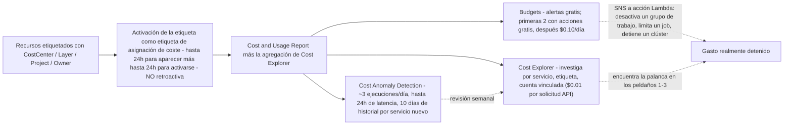
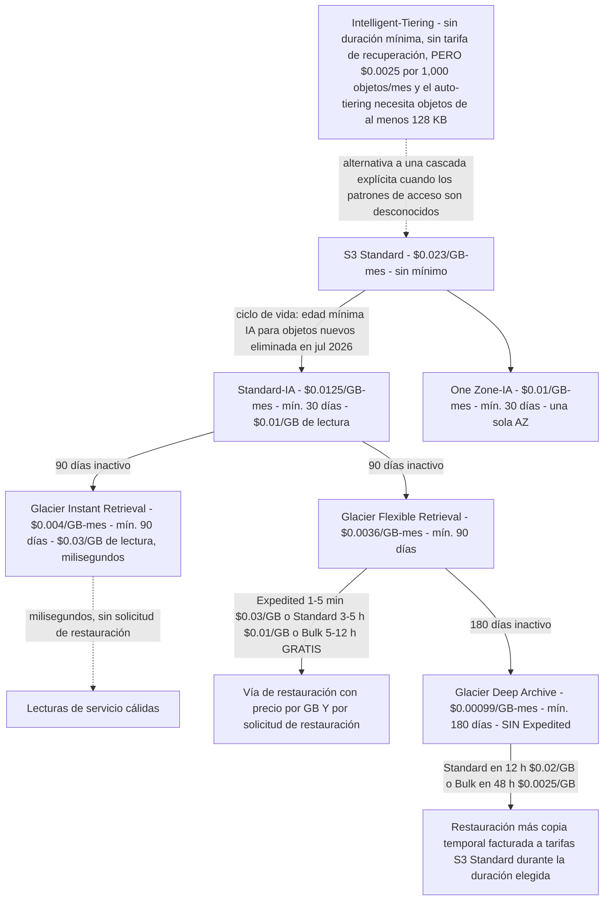
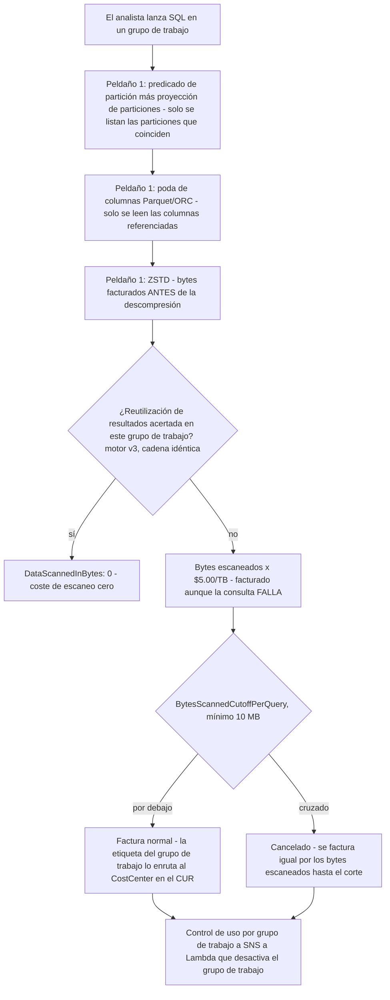
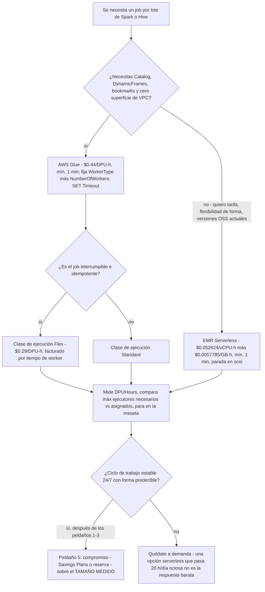

# Optimización de costes y ciclo de vida: de los prefijos calientes a Glacier Deep Archive

Las lecciones 01 to 15 construyeron un lakehouse que funciona: almacenamiento, formatos, tablas, ingesta, catálogo, transformación, consulta, almacén, orquestación, gobernanza, tratamiento de PII, seguridad y observabilidad. Cada una de esas decisiones lleva un **medidor** asociado, y para ahora esos medidores se han fusionado en una única factura mensual que nadie puede leer línea por línea. La mala noticia: el coste es la única propiedad del lakehouse que se degrada en silencio, porque la factura llega un mes después de la decisión que la provocó. La buena noticia: a diferencia de la corrección, el coste tiene una **escalera**: un orden fijo de operaciones que las propias guías de Well-Architected de AWS implican y que sigue todo caso de costes publicado por AWS.

Esta lección enseña esa escalera de principio a fin: **forma → temperatura → escala accidental → gasto sin atribuir → compromisos**, en ese orden, con las tarifas de us-east-1 de octubre de 2026 que convierten cada peldaño en aritmética y no en consejo. La única regla que organiza todo lo que viene abajo: *nunca compres un descuento sobre el tamaño equivocado, y nunca muevas un byte a una clase más fría antes de saber cuándo lo vas a leer de vuelta.*

```text
====================================================================
 LA ESCALERA DE COSTES - AWS DATA LAKEHOUSE, LECCIÓN 16 (us-east-1, oct 2026)
====================================================================
 Peldaño 1 FORMA ........ paga por menos bytes: columnar + compresión
                         + proyección; Athena factura los bytes
                         escaneados ANTES de la descompresión
                         ($5.00 / TB)
 Peldaño 2 TEMPERATURA .. cascada de ciclo de vida: Standard $0.023 ->
                         Standard-IA $0.0125 (mín. 30 d) ->
                         Glacier IR $0.004 (90 d) ->
                         Glacier FR $0.0036 (90 d) ->
                         Deep Archive $0.00099 (mín. 180 d)
 Peldaño 3 ACCIDENTAL ... BytesScannedCutoffPerQuery por grupo de
                         trabajo, Timeouts de job, Max RPU-hours,
                         ACCIONES de presupuesto (la cancelación
                         factura igual lo escaneado)
 Peldaño 4 ATRIBUCIÓN ... etiquetas de asignación de coste activadas
                         en los recursos: CostCenter / Layer /
                         Project (NO retroactivas)
 Peldaño 5 COMPROMISOS .. solo ahora compra descuentos: nodos
                         reservados de Redshift, Serverless
                         Reservations (24% / 45%), Savings Plans,
                         sobre el TAMAÑO MEDIDO
 Medidores .............. S3 GB-mes + solicitudes; Athena $5/TB
                         escaneado; Glue $0.44/DPU-h (mín. 1 min);
                         EMR Serverless $0.052624/vCPU-h +
                         $0.0057785/GB-h; Redshift node-h o RPU-h +
                         RMS $0.024/GB-mes; QuickSight $24 Author /
                         $3 Reader / $0.38 SPICE GB-mes; Kinesis
                         $0.015/shard-h; MSK Serverless
                         $0.75/clúster-h + particiones + GB; KMS
                         $1/clave + $0.03/10k solicitudes; NAT
                         $0.045/h + $0.045/GB
====================================================================
```

> [!NOTE]
> **Lee cada tarifa con una fecha.** Todos los precios de esta lección son **lista AWS de us-east-1, consultada 2026-10-11**, contrastados con la oferta publicada por la API Price List de AWS el **2026-09-28**. Otras regiones varían, y AWS cambia estas tablas: las *dimensiones* (GB-mes, TB escaneado, DPU-hora, RPU-hora, hora de shard, cuotas por objeto) son mucho más estables que las *tarifas*, así que aprende primero la dimensión y verifica después el número.

En esta lección aprenderás a:

- leer una **tabla de formas de coste por servicio** que nombra la unidad facturable de cada capa del lakehouse antes de tocar un solo palanca;
- recorrer la **cascada de ciclo de vida de S3**, cada clase de almacenamiento, duración mínima, tarifa de recuperación y vía de restauración, y calcular un **TCO de tres a cinco años** para una huella de 60 TB;
- caer a propósito, sobre el papel, en la **trampa de la cuota de monitorización de Intelligent-Tiering** con ocho millones de objetos diminutos, para que nunca lo hagas en producción;
- acotar la capa de consulta de **Athena** con cortes por grupo de trabajo, proyección de particiones, poda de columnas y ZSTD, y luego calcular **una factura mensual de 500 analistas** dos veces: antes y después de los reductores;
- ajustar **Glue** (DPU = 4 vCPU + 16 GB, $0.44/DPU-hora, mínimo de 1 minuto, timeout por defecto de 48 horas en Glue 4.0 y anteriores) y esbozar **EMR Serverless frente a Glue** en vCPU-horas y GB-horas;
- aplicar las palancas de **Redshift**: pausa/reanudación, Redshift Managed Storage a $0.024/GB-mes, créditos de Concurrency Scaling y reservas de Serverless;
- elegir entre el precio **por usuario** de QuickSight y la capacidad de sesencias de lector con un cálculo de punto de equilibrio, y evitar que la capacidad de **SPICE** suba sola;
- poner precio a las **formas de streaming** (horas de shard de Kinesis frente a GB a demanda, incrementos de 5 KB de Firehose, las cinco líneas de MSK Serverless) y a los **multiplicadores silenciosos** (solicitudes a KMS con y sin bucket keys, eventos de datos de CloudTrail, NAT frente a endpoints de puerta de enlace gratuitos);
- operar **Cost Explorer, Budgets y Cost Anomaly Detection** y etiquetar el estado con **CostCenter / Layer / Project** para que cada número posterior sea legible;
- estudiar **GE Aerospace** (ahorro anual estimado de más de 500,000 $ en Redshift) y **Transport for NSW** (reducción de ~80 % en costes de integración de datos con Glue), más un **recuadro de actualizaciones de 2026 con fuentes**;
- practicar con **doce preguntas de estilo examen** y cuatro comprobaciones interactivas (una gráfica de TCO, una asociación de palanca a servicio, un relleno de tarifas y un arrastrar y soltar de la propia escalera).

---

## 1. Anatomía de costes: el medidor de cada capa antes que la palanca

### 1.1 La escalera de cinco peldaños, y por qué el orden no es negociable

La disciplina de optimización de costes de AWS, documentada en el pilar de costes de Well-Architected y repetida en cada caso de costes que AWS publica, es una **secuencia**, no un menú. Cada peldaño es más barato y más seguro que el que tiene debajo:

1. **Forma**: deja de pagar por la *forma* equivocada de los datos. Los formatos columnares, la compresión y la proyección de columnas hacen que los escáneres lean menos bytes. En un medidor por escaneo, este es el cambio de mayor apalancamiento que existe, y no cuesta nada más que reescribir la ruta de escritura.
2. **Temperatura**: deja de pagar por la *temperatura* equivocada. Las reglas de ciclo de vida mueven los datos envejecidos a clases de almacenamiento más baratas con un coste de configuración de cero; solo pagas la solicitud de transición.
3. **Escala accidental**, deja de pagar por el gasto *accidental*: cortes de escaneo por grupo de trabajo, timeouts de job, presupuestos de Max RPU-hours, acciones de presupuesto. Son disyuntores, no optimizaciones, acotan la cola.
4. **Atribución**: deja de pagar por el gasto *sin atribuir*. Las etiquetas de asignación de coste por pipeline convierten una factura ilegible en N facturas legibles. Sin este peldaño, toda medición posterior es una conjetura.
5. **Compromisos**, solo *ahora* compra descuentos: nodos reservados de Redshift, Redshift Serverless Reservations, Savings Plans. Un compromiso baja el precio unitario y no hace nada por la cantidad, por eso el peldaño 5 sobre un estado sin optimizar es la forma de consolidar el desperdicio durante uno o tres años.

> [!IMPORTANT]
> **La escalera es también una regla de examen.** Dadas dos opciones que «reducen costes», la que está *antes* en la escalera es casi siempre la mejor primera respuesta: el diseño gana a la capacidad, la capacidad gana al modelo de precios, y un compromiso sobre el tamaño equivocado es el distractor clásico. Lee el enunciado buscando una restricción (ciclo de trabajo estable 24/7, tolerancia a interrupciones, SLA de latencia) antes de dejar que el peldaño 5 gane.

### 1.2 Formas de coste por servicio: la tabla que vuelve legible todo lo demás

Cada fila nombra primero la **unidad facturable**, después el **ancla de tarifa de us-east-1 de octubre de 2026**, y por último **el modo de fallo que infla la factura**. Una palanca que no ataca la unidad facturable de su servicio no es una palanca.

| Capa | Servicio | Unidad facturable | Ancla de tarifa (us-east-1, oct 2026) | Modo de fallo que la infla |
|---|---|---|---|---|
| Almacenamiento | S3 Standard / IA / clases Glacier | GB-mes + solicitudes de transición | $0.023 → $0.0125 → $0.004 → $0.0036 → $0.00099 por GB-mes | Sobrescrituras con versionado, versiones no vigentes que nunca caducan, objetos diminutos, clase equivocada para la temperatura |
| Almacenamiento | S3 Intelligent-Tiering | GB-mes **+ cuota de monitorización por objeto** | $0.0025 por 1,000 objetos/mes | Millones de objetos diminutos; la cuota de monitorización aplasta al almacenamiento |
| Almacenamiento | S3 Batch Operations | por job + por operación de objeto | $0.25/job + $1.00 por 1M de operaciones | Usado para lo que una regla de ciclo de vida gratuita ya hace |
| Catálogo | Glue Data Catalog | objetos de metadatos/mes | Primeros 1M gratis, después $1.00 por 100,000 objetos/mes | Versiones de tabla sin caducar, tablas huérfanas de pipelines con churn |
| Consulta | Athena SQL sobre S3 | **bytes escaneados** | $5.00 por TB (mínimo de 10 MB por consulta en federadas) | `SELECT *`, predicado de partición ausente, texto en vez de Parquet, sin reutilización de resultados |
| Consulta | Athena Capacity Reservations | DPU-horas | $0.30 por DPU-hora | Reservar para un pico que nunca llega; olvidar el granularidad de 1 minuto desde feb 2026 |
| Transformación | AWS Glue ETL / crawlers | DPU-horas (mín. 1 min; crawler mín. 10 min) | $0.44 por DPU-hora; Flex $0.29 | 10 DPUs por defecto, timeout por defecto de 2,880 minutos en Glue 4.0 y anteriores, ejecutores ociosos |
| Transformación | EMR Serverless | vCPU-horas + GB-horas (mín. 1 min) | $0.052624/vCPU-h + $0.0057785/GB-h | Formas de worker sobredimensionadas; aplicaciones dejadas corriendo |
| Almacén | Redshift provisionado | nodos-hora + Redshift Managed Storage | ra3.4xlarge $3.26/nodo-h; RMS $0.024/GB-mes | Clúster corriendo 24/7 para una ventana de lote de 8 horas; nodos reservados que la pausa no detiene |
| Almacén | Redshift Serverless | RPU-horas por segundo (mín. 60 s) + RMS | $0.375/RPU-h; base de 4 RPU = $1.50/h | Sin presupuesto de Max RPU-hours; sin reserva sobre uso estable |
| BI | QuickSight | por usuario-mes + SPICE GB-mes, o capacidad de sesencias | Author $24, Reader $3, SPICE $0.38/GB-mes; 500 sesiones/mes por $250 | Lectores inactivos facturados, datasets SPICE aparcados, ratchets de capacidad automática |
| Streaming | Kinesis Data Streams | horas de shard + unidades de payload PUT, o GB con suelo | $0.015/shard-h; $0.014/M unidades; a demanda $0.08/GB (Standard) con suelo de cuenta de 25 MB/s | Suelo a demanda pagado por ancho de banda nunca enviado; enhanced fan-out por consumer-shard |
| Streaming | Firehose | GB ingeridos en **incrementos de 5 KB** | $0.029/GB (primeros 500 TB); $0.045/GB a Iceberg desde Kinesis | Registros de menos de 5 KB facturados como 5 KB; complementos de particionado dinámico y entrega en VPC |
| Streaming | MSK Serverless | horas de clúster + horas de partición + GB de entrada/salida + almacenamiento | $0.75/clúster-h + $0.0015/partición-h + $0.10 entrada/GB + $0.05 salida/GB + $0.10/GB-mes | Elegir semántica Kafka cuando bastaría un servicio por GB |
| Seguridad | KMS | clave-mes + solicitudes | $1.00/clave-mes + $0.03 por 10,000 solicitudes (20,000 gratis/mes) | Sin bucket keys en un lago de alta QPS; claves por objeto en vez de una clave por prefijo |
| Auditoría | CloudTrail data events | eventos entregados a S3 | $0.10 por 100,000 data events | Registro de eventos de datos de todo el bucket; selectores avanzados sin usar |
| Red | NAT gateway | horas + GB procesados | $0.045/h + $0.045/GB | Tráfico de S3 forzado por el NAT cuando existe un endpoint de puerta de enlace gratuito |
| Red | Interface endpoint | horas de ENI por AZ + GB | $0.01/h por AZ + $0.01/GB (primer PB) | Usado para S3/DynamoDB, que tienen endpoints de puerta de enlace gratuitos |
| FinOps | Cost Explorer API / Budgets | solicitudes / presupuestos con acciones | $0.01 por solicitud API; presupuestos gratis, primeros 2 con acciones gratis y después $0.10/día | Sondeo con granularidad de hora a $0.01 por 1,000 registros de uso |

### 1.3 Etiquetado: el peldaño que vuelve legible cada número posterior

Cuatro claves de etiqueta cubren casi todas las necesidades de atribución de un lakehouse, aplicadas a **todos los recursos que admiten etiquetas**: buckets y prefijos de S3 (mediante etiquetas de objeto donde el servicio lo permite), jobs, crawlers y conexiones de Glue, grupos de trabajo de Athena, clústers y grupos de trabajo de Redshift, carpetas y datasets de QuickSight, streams de Kinesis, clústers MSK, NAT gateways y endpoints de VPC:

| Clave de etiqueta | Valores de ejemplo | Qué responde |
|---|---|---|
| `CostCenter` | `DA-4471`, `DA-4472`, `OPS-1180` | ¿Qué línea de presupuesto absorbe este gasto? |
| `Layer` | `bronze`, `silver`, `gold`, `serving`, `archive` | ¿En qué etapa de la arquitectura de medallion está esto? |
| `Project` | `ad-sales`, `fraud-scores`, `supply-chain-ods` | ¿A qué iniciativa de negocio sirve esto? |
| `Owner` / `Environment` / `Pipeline` | `data-eng`, `prod` / `staging`, `ingest-orders` | ¿A quién llamar, y es esto producción o un sandbox? |

Tres reglas duras, todas documentadas por AWS:

1. **Las etiquetas deben activarse como etiquetas de asignación de coste** antes de aparecer en Cost Explorer o en un informe de asignación de coste, y la activación puede tardar **hasta 24 horas** en que la clave aparezca en la página de activación más **otras hasta 24 horas** en surtir efecto.
2. **Las etiquetas no son retroactivas.** Solo afectan a los informes de facturación desde el momento de la activación. Una estrategia de etiquetado desplegada en octubre de 2026 no te dice nada sobre septiembre.
3. En **AWS Organizations**, las etiquetas de asignación de coste se activan **solo desde la cuenta de gestión (la que paga)**, y AWS recomienda *un número pequeño de claves de etiqueta consistentes*: la dispersión es en sí misma un coste, porque cada clave extra es un eje más con el que cuadrar.

### 1.4 Visibilidad antes que optimización: Cost Explorer, Budgets, Anomaly Detection

No puedes optimizar lo que no puedes ver, y los tres servicios de visibilidad de coste de AWS tienen tres trabajos distintos, y tres facturas distintas:

| Servicio | Trabajo | Coste (oct 2026) | Latencia y límites |
|---|---|---|---|
| **Cost Explorer** | Explorar y graficar el gasto por servicio, etiqueta, cuenta vinculada | Uso de consola gratis; **solicitudes de API $0.01 cada una** en la vista de facturación principal ($0.01 por fuente en vistas personalizadas); granularidad de hora **$0.01 por 1,000 registros de uso** para 14 días de historial | Datos procedentes de Cost Explorer; el detalle por hora cuesta dinero real a escala |
| **AWS Budgets** | Alertar (y actuar) sobre umbrales | **Alertas gratis**; primeros **dos presupuestos con acciones gratis**, después **$0.10 al día** cada uno; correos de informe de presupuesto **$0.01 cada uno** | Vía en tiempo real: las **acciones** de presupuesto son la única función de presupuesto que puede detener gasto |
| **Cost Anomaly Detection** | Encontrar picos inesperados automáticamente | Se apoya en Cost Explorer (sin cargo publicado aparte); **autoconfigurado desde 2023-03-27** con monitor de AWS Services y correo diario | Se ejecuta **~3 veces al día**; la detección puede tardar **hasta 24 horas**; un servicio recién suscrito necesita **10 días** de historial; **no** monitoriza productos de Marketplace de terceros: usa Budgets para esos |

La forma operativa que documenta AWS: **Budgets como disyuntor en tiempo real** (umbral → SNS → acción con Lambda), **Cost Anomaly Detection como red de seguridad semanal** (es lento por diseño), **Cost Explorer para la investigación** cuando cualquiera de los dos dispara. Ninguno de los tres puede atribuir el gasto a un pipeline sin las etiquetas de la sección 1.3.



> - **📚 ¿Sabías que…?** La herramienta de FinOps más barata de tu cuenta es una **acción de presupuesto**, no un cuadro de mando: los primeros dos presupuestos con acciones son gratis, y una acción puede desactivar un grupo de trabajo de Athena o desvincular una política IAM en cuanto se dispare un umbral. Cost Anomaly Detection, por muy inteligentes que sean sus modelos, no puede detener nada, y puede tardar hasta **24 horas** en notar una fuga que una acción de presupuesto habría cortado en minutos (documentación de AWS Budgets y Cost Anomaly Detection, consultado 2026-10-11).

---

## 2. S3: la cascada de ciclo de vida, y la factura de restauración que nadie modela

### 2.1 Cada clase, cada duración mínima, cada tarifa de recuperación

Esta es la tabla más valiosa de toda la lección. Las tarifas de almacenamiento son el titular; **las duraciones mínimas y las tarifas de recuperación es donde vive el diseño**.

| Clase / nivel | $/GB-mes | Duración mínima | Tarifa de recuperación $/GB | Tiempo de recuperación |
|---|---|---|---|---|
| Standard (primeros 50 TB/mes) | 0.023 | ninguna | 0 | milisegundos |
| Standard-IA | 0.0125 | **30 días** | 0.01 (fija) | milisegundos |
| One Zone-IA | 0.01 | **30 días** | 0.01 (fija) | milisegundos |
| Intelligent-Tiering Frecuente | 0.023 | ninguna | **0** | milisegundos |
| Intelligent-Tiering Infrecuente | 0.0125 | ninguna | **0** | milisegundos |
| Intelligent-Tiering Archive Instant | 0.004 | ninguna | **0** | milisegundos (rehidrata) |
| Intelligent-Tiering Archive | 0.0036 | ninguna | **0** | rehidrata con latencia |
| Intelligent-Tiering Deep Archive | 0.00099 | ninguna | **0** | rehidrata con latencia |
| Glacier Instant Retrieval (GIR) | 0.004 | **90 días** | 0.03 | milisegundos |
| Glacier Flexible Retrieval (GFR): Expedited | 0.0036 | **90 días** | 0.03 | **1 to 5 minutos** |
| Glacier Flexible Retrieval: Standard | 0.0036 | **90 días** | 0.01 | **3 to 5 horas** |
| Glacier Flexible Retrieval: Bulk | 0.0036 | **90 días** | **0 (gratis)** | **5 to 12 horas** |
| Glacier Deep Archive (GDA): Standard | 0.00099 | **180 días** | 0.02 | **en 12 horas** |
| Glacier Deep Archive: Bulk | 0.00099 | **180 días** | 0.0025 | **en 48 horas** |
| Glacier Deep Archive, Expedited |, |, | **no se ofrece** |, |
| Express One Zone (buckets de directorio) | 0.11 | ninguna | 0 | milisegundos unitarios |

A esto se suman los cargos del lado de la solicitud que completan el cuadro: las **solicitudes de transición** de ciclo de vida cuestan $0.01 por 1,000 a Standard-IA / One Zone-IA / Intelligent-Tiering, $0.02 por 1,000 a Glacier Instant Retrieval y $0.05 por 1,000 a Glacier Deep Archive; las **tarifas de solicitud de restauración** son $0.01 / $0.05 / $0.00 por 1,000 solicitudes para Expedited / Standard / Bulk; los objetos archivados además facturan **40 KB de metadatos por objeto**; y toda clase archivada cobra su **duración mínima entera**: un objeto eliminado o retransitionado fuera de Deep Archive en el día 30 sigue facturando 180 días.



### 2.2 Reglas de ciclo de vida frente a Batch Operations frente a movimientos manuales

Una **regla de ciclo de vida** transición o caduca objetos **existentes y nuevos** que coincidan con un filtro, y la propia configuración es gratis: solo pagas la solicitud de transición ($0.01 to $0.05 por 1,000). AWS no cobra nada por que la regla siga coincidiendo con los objetos de mañana. **S3 Batch Operations** es la vía retroactiva dirigida por manifiesto: $0.25 por job más $1.00 por millón de operaciones de objeto, con un manifiesto que suele producir **S3 Inventory** a $0.0025 por millón de objetos listados. **La resubida manual o el `CopyObject`** de millones de objetos quema cargos de solicitudes PUT/COPY, necesita una flota de cómputo, y abre una ventana en la que ambas copias facturan.

La regla práctica: **reclasificación por antigüedad = regla de ciclo de vida; reclasificación por etiqueta o manifiesto = Batch Operations**. Casi nunca necesitas Batch Operations para reclasificar objetos que simplemente envejecen, y pagar para que haga el trabajo de una regla de ciclo de vida es una factura que te autoinfliges.

Tres acciones de ciclo de vida más pertenecen en todo bucket de producción, porque el versionado sin ellas es un multiplicador silencioso: **caducar versiones no vigentes** (`NoncurrentDays`), **limitar cuántas versiones no vigentes se conservan** (`MaxNoncurrentVersions`, válido 1 to 100) y **abortar subidas multiparte incompletas**. Con el versionado activado, cada PUT crea una nueva versión vigente mientras la versión anterior sigue facturándose íntegramente a la tarifa de su clase: un bucket con mucho churn puede facturar varias veces su tamaño «lógico» hasta que existan estas tres reglas.

### 2.3 Economía de la restauración: la copia temporal es la verdadera sorpresa

Restaurar un objeto archivado factura **dos cosas**, y solo una de ellas es intuitiva:

1. la **tarifa de recuperación por GB** del nivel de velocidad elegido (tabla de arriba), más la tarifa de solicitud de restauración; **y**
2. una **copia restaurada temporal, cobrada a las tarifas de almacenamiento S3 Standard**, durante la duración que decidas conservarla: encima del objeto archivado que sigues pagando.

Así que una restauración de Deep Archive es barata en la línea de recuperación ($0.0025/GB en Bulk) y cara en el *plan*: 48 horas de latencia, una copia temporal a $0.023/GB-mes prorrateada, y ninguna opción Expedited a ningún precio. Las restauraciones de Deep Archive deben, por tanto, **programarse**, nunca improvisarse: Bulk para backfills planificados, Standard solo para emergencias reales de 12 horas. Y recuerda el precipicio de la duración mínima a la inversa: si tu patrón de acceso dice «podríamos leer esto dentro de 90 días», el mínimo de 180 días de Deep Archive significa que la clase es la equivocada, no que debas aceptar el riesgo.

> - **📚 ¿Sabías que…?** Deep Archive **no tiene nivel de recuperación Expedited**: las opciones de velocidad se detienen en Standard (en 12 horas) y Bulk (en 48 horas). Cualquier diagrama de arquitectura que muestre una vía «instantánea» de salida de Deep Archive está inventando un nivel que AWS no vende (documentación de Amazon S3 Glacier, consultado 2026-10-11).

### 2.4 Ejemplo resuelto E1: un lakehouse de 60 TB, tres años, y luego cinco

El escenario: un **lago operativo de 50 TiB**, 20 TiB calientes curados en S3 Standard, 25 TiB templados en Standard-IA, 5 TiB fríos en Glacier Instant Retrieval, más **10 TiB de historial de cumplimiento en Glacier Deep Archive**. Una **huella de 60 TiB**, mantenida tres años. AWS factura el GB como 1,073,741,824 bytes, así que de TiB a GB es ×1,024.

```text
Ejemplo resuelto E1 - TCO de ciclo de vida, lista us-east-1, en oct 2026
Huella: 20 TiB calientes + 25 TiB templados + 5 TiB fríos + 10 TiB archivados = 60 TiB

ALMACENAMIENTO MENSUAL
  Calientes .... 20,480 GB x $0.023 ......... $471.04
  Templados .... 25,600 GB x $0.0125 ........ $320.00
  Fríos .......  5,120 GB x $0.004 .........  $20.48
  Archivo ..... 10,240 GB x $0.00099 ........  $10.14
  TOTAL MENSUAL .............................. $821.66

LÍNEA BASE - los mismos 60 TiB en S3 Standard los tres años
  61,440 GB x $0.023 ......................... $1,413.12 / mes

TOTALES A TRES AÑOS (mantenimiento plano, sin eventos de recuperación)
  Con capas ...... $821.66 x 36 .............. $29,579.76  (~$29,580)
  Todo-Standard .. $1,413.12 x 36 ............ $50,872.32  (~$50,872)
  AHORRO ......... $591.46 / mes ............. $21,292.56  (~$21,293, ~42%)

EXTENSIÓN A CINCO AÑOS (misma suposición de mantenimiento plano)
  Con capas ...... $821.66 x 60 .............. $49,299.60
  Todo-Standard .. $1,413.12 x 60 ............ $84,787.20
  AHORRO ......... $35,487.60
```

```plot
{
  "type": "line",
  "title": "TCO acumulado: lakehouse de 60 TiB con capas frente a todo S3 Standard (ejemplo resuelto E1, lista us-east-1, en oct 2026)",
  "xLabel": "Años de retención",
  "yLabel": "Coste acumulado (USD)",
  "xKey": "year",
  "data": [
    {"year": "Year 1", "Tiered lifecycle waterfall": 9859.92, "All S3 Standard": 16957.44},
    {"year": "Year 2", "Tiered lifecycle waterfall": 19719.84, "All S3 Standard": 33914.88},
    {"year": "Year 3", "Tiered lifecycle waterfall": 29579.76, "All S3 Standard": 50872.32},
    {"year": "Year 4", "Tiered lifecycle waterfall": 39439.68, "All S3 Standard": 67829.76},
    {"year": "Year 5", "Tiered lifecycle waterfall": 49299.60, "All S3 Standard": 84787.20}
  ],
  "dataKeys": ["Tiered lifecycle waterfall", "All S3 Standard"]
}
```

La brecha se ensancha en **$591.46 cada mes** y es enteramente una decisión del peldaño 2: no cambió código, no se ajustó ninguna consulta, no se compró ningún compromiso. Ahora los dos eventos que rompen los modelos de archivo, **lecturas** y **la factura única de transición**, que pertenecen en la misma hoja de cálculo que el almacenamiento.

### 2.5 Ejemplo resuelto E1b: escenarios de restauración y la factura única de transición

El mismo estado de 60 TiB. ¿Cuánto cuesta **leer 1 TiB de vuelta**, según la vía, y cuánto costó **reclasificar 45 TiB existentes** del mismo?

```text
Ejemplo resuelto E1b - aritmética de recuperación + transición (us-east-1, oct 2026)

LEER 1 TiB (1,024 GB) DE CADA CAPA - solo tarifa de recuperación, por GB
  Desde Standard-IA (lectura IA fija) .... 1,024 x $0.01 ..... $10.24  (ms)
  Desde Glacier Instant Retrieval ........ 1,024 x $0.03 ..... $30.72  (ms)
  Desde Deep Archive vía BULK ............ 1,024 x $0.0025 ...  $2.56  (48 h)
  Desde Deep Archive vía STANDARD ........ 1,024 x $0.02 ..... $20.48  (12 h)
  MÁS para cada vía: la copia restaurada temporal a las tarifas de
  almacenamiento S3 Standard ($0.023/GB-mes, prorrateada a la
  duración de restauración que elijas) + tarifas de solicitud de
  restauración ($0.01 / $0.05 / $0.00 por 1,000 para
  Expedited / Standard / Bulk).
  LEER BULK DESDE DEEP ARCHIVE ES 8x MÁS BARATO QUE STANDARD - pero
  te cuesta 48 horas y la copia temporal. Ese intercambio ES el diseño.

TRANSICIÓN ÚNICA DE CICLO DE VIDA SOBRE UN LAGO EXISTENTE DE 45 TiB
  Objetos: 45 TiB con un promedio de juguete de 100 MB por fichero
           = 46,080 GB / 0.1 GB = 460,800 objetos
  A Standard-IA ........ 460,800 / 1,000 x $0.01 =  $4.61
  A Glacier IR .......... 460,800 / 1,000 x $0.02 =  $9.22
  A Deep Archive ........ 460,800 / 1,000 x $0.05 = $23.04
  TOTAL UNA VEZ ................................... $36.86
  Compara: el ahorro mensual por capas de este lago
  (E1) son cientos de dólares. La regla de ciclo de vida
  se paga en la SEMANA UNO. Un CopyObject manual de
  460,800 objetos facturaría además PUT/COPY a $0.005
  por 1,000 = $2.30 solo en solicitudes - y necesitaría
  una flota de cómputo, y abriría una ventana de doble copia.
```

### 2.6 Intelligent-Tiering: la trampa de la cuota de monitorización en objetos diminutos

Intelligent-Tiering es el valor por defecto más seguro cuando los patrones de acceso son **genuinamente desconocidos**: sin duración mínima, **sin tarifas de recuperación**, movimiento automático entre los niveles Frecuente, Infrecuente, Archive Instant, Archive y Deep Archive Access según el acceso observado (los objetos 30 días inactivos pasan al nivel Infrecuente, 90 días a Archive Instant, y Deep Archive Access exige un mínimo de 180 días consecutivos de inactividad). Pero es un **negocio de monitorización**: cobra **$0.0025 por 1,000 objetos al mes** por monitorización y automatización, y solo los objetos de **al menos 128 KB** son elegibles para el auto-tiering en absoluto. Para objetos templados grandes la cuota es un error de redondeo; para millones de objetos diminutos es la factura.

### 2.7 Ejemplo resuelto E2: ocho millones de objetos diminutos «salvados» por Intelligent-Tiering

Un lago de eventos aterriza fragmentos diminutos en Intelligent-Tiering «para ahorrar dinero». Nada de este diseño ahorra dinero.

```text
Ejemplo resuelto E2 - la trampa de monitorización de Intelligent-Tiering (us-east-1, oct 2026)
Escenario: 8,000,000 objetos con promedio de 4 KB, en Intelligent-Tiering
  Datos totales ... 8,000,000 x 4 KB = 32,000,000 KB = 30.52 GB

  Cuota de monitorización ... 8,000,000 / 1,000 x $0.0025 = $20.00 / mes
  Almacenamiento (Frecuente) 30.52 GB x $0.023 ...........  $0.70 / mes
  TOTAL ................................................ $20.70 / mes
  -> la CUOTA DE MONITORIZACIÓN es ~28x el almacenamiento que protege
  -> los objetos de menos de 128 KB NO son elegibles para el
     auto-tiering en absoluto, así que este diseño paga el negocio
     de la cuota y no recibe ninguno del beneficio del auto-tiering

  Los mismos 30.52 GB en S3 Standard plano ........... $0.70 / mes
  -> Intelligent-Tiering hizo este lago ~30x MÁS caro

ARREGLO (a) - agrega antes de aterrizar: compacta a objetos de 100 MB
  Objetos ....... 30.52 GB / 0.1 GB = ~305 objetos
  Monitorización . 305 / 1,000 x $0.0025 = $0.0008 / mes
  (también arregla el rendimiento de Athena - la misma palanca
  que el peldaño 1)

ARREGLO (b) - si los objetos genuinamente son >= 128 KB y están
  fríos, usa transiciones de CICLO DE VIDA a Standard-IA /
  Glacier en su lugar: $0.01-$0.05 por 1,000 solicitudes de
  transición, y NUNCA cuota de monitorización.

RECORDATORIO DE ESCALA: 100,000,000 objetos en Intelligent-Tiering =
$250/mes solo de monitorización, antes de un solo GB de almacenamiento.
```

La regla de decisión que sale de E2: **Intelligent-Tiering es para objetos grandes, templados, de acceso desigual y patrones desconocidos; las clases explícitas de ciclo de vida son para los objetos que entiendes; y ninguno de los dos pertenece a objetos de menos de 128 KB**: esos deberían compactarse al escribir, lo que es una corrección de coste y una corrección de rendimiento de consulta en un solo movimiento.

### 2.8 La replicación puede apuntar a una clase más barata, pero factura dos veces

La clase de almacenamiento de destino es un ajuste de replicación de primera clase: puedes replicar **directamente hacia Glacier Flexible Retrieval, Glacier Deep Archive, Intelligent-Tiering** y las demás clases (el destino `StorageClass` de CloudFormation acepta `DEEP_ARCHIVE`, `GLACIER`, `GLACIER_IR`, `INTELLIGENT_TIERING`, `ONEZONE_IA`, `STANDARD`, `STANDARD_IA`; por defecto se conserva la clase de origen). La región de DR, por tanto, nunca paga tarifas de Standard por una copia que nadie lee.

La trampa es aritmética, no de capacidad: **pagas por ambas copias**, más los costes de las solicitudes de replicación, más **$0.015 por millón de objetos al mes** en el bucket de origen por la monitorización de replicación. La replicación hacia una clase más barata es un **patrón de recuperación ante desastres y cumplimiento**, no un descuento de almacenamiento: modélizalo como «la copia de DR es bastante barata para quedarse para siempre», nunca como «esto reduce mi factura de S3 a la mitad».

---

## 3. La capa de consulta: Athena factura los bytes escaneados, así que cada escaneo es una decisión de diseño

### 3.1 El medidor y los cuatro reductores multiplicativos

Athena SQL sobre S3 cuesta **$5.00 por TB escaneado** en us-east-1: se cobra tanto para **consultas exitosas como fallidas** (las federadas añaden un mínimo de 10 MB por consulta y agregan entre fuentes de datos), más las cargos ordinarios de solicitudes de S3 por escribir y leer resultados. En un modelo de precios por escaneo, **ajustar es facturar**. Cuatro reductores independientes se apilan **multiplicativamente**:

1. **Particionado y proyección de particiones**: solo se listan y leen las particiones que coinciden. La proyección calcula los valores de partición a partir de las propiedades de la tabla en vez del catálogo, lo que evita por completo la consulta de metadatos; actívala y Athena ignora los metadatos de partición del catálogo, así que necesita predicados en todas las claves proyectadas y se degrada donde **más de la mitad de las particiones proyectadas están vacías**. Athena puede leer como máximo **1 millón de particiones en un solo escaneo** (las tablas de Glue admiten hasta 10 millones).
2. **Proyección de columnas**: Parquet y ORC leen solo las columnas referenciadas.
3. **Compresión**, **pagas por los bytes escaneados antes de la descompresión**, así que ZSTD/GZIP reducen a la vez la factura de consultas y la de S3. **ZSTD es la compresión por defecto de las tablas Iceberg en la versión 3 del motor** (nivel 3), y AWS recomienda el nivel 3 o 6 to 9 para escrituras Parquet/ORC; los niveles por encima de 19 necesitan memoria seria. Mantén los row groups de Parquet en los 128 MB por defecto y las stripes de ORC en 64 MB, reducirlos por debajo del valor por defecto no se recomienda.
4. **Reutilización de resultados**, las reejecuciones de una consulta idéntica en la **versión 3 del motor** y el **mismo grupo de trabajo** devuelven el resultado en caché con `DataScannedInBytes: 0`, hasta una antigüedad de **60 minutos por defecto** y **7 días como máximo**. El SQL no determinista (`rand()`, `shuffle()`) lo elude, y también lo eluden los **permisos a nivel de fila/columna de Lake Formation** y las **consultas federadas**, que siempre se reejecutan.

El propio ejemplo resuelto de AWS del mecanismo: 3 TB de texto sin comprimir, una columna seleccionada, sin comprimir = 3 × $5 = **$15**; con compresión 3:1 = **$5**; como Parquet con compresión 3:1 y selección de columnas 4:1 = **$1.25**. Tres palancas, doce veces más barato, la misma consulta.

### 3.2 Guardias de gasto por grupo de trabajo: disyuntores para la capa de consulta

Los grupos de trabajo son a la vez la unidad de aislamiento y la unidad de control de coste, y AWS documenta un patrón de producción con dos grupos de trabajo:

- **Corte por consulta**, `BytesScannedCutoffPerQuery` (mínimo de API **10,000,000 bytes = 10 MB**) cancela una consulta desbordada en cuanto cruza el umbral. La consulta cancelada **sigue facturando todo lo escaneado hasta el corte**, el corte acota la cola, nunca descuenta la cabeza.
- **Controles de uso por grupo de trabajo**: dispara una alarma SNS, y la escalada documentada es una **función Lambda que desactiva el grupo de trabajo** cuando un máximo histórico se dispara.
- **Etiquetas de asignación de coste en el grupo de trabajo**: etiqueta cada grupo de trabajo (digamos `Name=ad-hoc-users`, `Dept=analytics`) para que el gasto de Athena aterrice bajo el `CostCenter` correcto en el Cost and Usage Report.

Athena también vende **Capacity Reservations** a **$0.30 por DPU-hora** (una reserva de 160 DPU para una hora pico de 15 minutos cuesta 160 × $0.30 × 0.25 = **$12.00** en el ejemplo resuelto de AWS) y **sesiones Spark a $0.35 por DPU-hora**: la opción del peldaño 5 una vez que los peldaños 1 to 3 han hecho su trabajo. Existe un techo de **1,000 grupos de trabajo por región**, que es capacidad para un grupo de trabajo por equipo o pipeline, no uno por usuario.



### 3.3 Ejemplo resuelto E3: 500 analistas, 50 GB al día, antes y después de los reductores

Este es el cálculo que todo equipo de analítica debería poder reproducir de memoria, porque es el que decide si Athena es una línea de factura o un error de redondeo.

```text
Ejemplo resuelto E3 - carga de trabajo de analistas en Athena (us-east-1, oct 2026)
Población: 500 analistas, 50 GB escaneados por analista por día
laborable, 21 días laborables al mes. GB -> TB: 1,024 GB = 1 TB.

LECTURA A - 50 GB por analista por DÍA LABORABLE
  Por día ....... 500 x 50 GB = 25,000 GB = 24.414 TB
  Por día ....... 24.414 x $5.00 = $122.07
  Por mes ....... $122.07 x 21 = $2,563.47  (~$2,563)

LECTURA B - si el enunciado quería decir 50 GB por analista al MES
  Total ......... 500 x 50 GB = 25,000 GB = 24.414 TB
  Por mes ....... 24.414 x $5.00 = $122.07  (~$122)
  (la diferencia entre las dos lecturas es 21x - fija siempre la
  unidad antes de presentar un modelo de costes)

AHORA APILA LOS REDUCTORES DOCUMENTADOS SOBRE LA LECTURA A
  Particionado + columnar + proyección de columnas (el propio
  mecanismo 3 x 3 x 4 de la página de precios, plausible 10x menos
  de escaneo)
       ......................................... $2,563 -> ~$256 / mes
  Reutilización de resultados absorbiendo el 40% de las consultas
  repetidas de cuadro de mando
       ......................................... ~$256 -> ~$154 / mes

BARRERAS DE SEGURIDAD (peldaño 3) SOBRE LA MISMA CARGA DE TRABAJO
  Corte por consulta de 1 GB (1,073,741,824 bytes):
       1 GB x $5.00 / 1,024 GB = $0.0049 de coste máximo de escaneo
       por consulta matada
  Control por grupo de trabajo de 20 TB/mes con desactivación SNS
  a Lambda:
       20 x $5.00 = $100 de peor caso mensual absoluto antes de que
       la automatización corte la hemorragia

COMPARACIÓN DEL Peldaño 5 (capacidad, solo después de lo anterior)
  Capacity Reservation de 160 DPU para los 15 minutos de pico de
  cada hora:
       160 x $0.30 x 0.25 h = $12.00 por hora (ejemplo resuelto AWS)
```

La lección de E3 es la **ratio**: los reductores llevaron **~$2,563 hasta ~$154**, una reducción de 16×, antes de que nadie comprara nada. Un equipo que negocia un compromiso mientras sigue ejecutando `SELECT *` sobre ficheros de texto se ha saltado los peldaños 1 y 2 para ahorrar monedas en el peldaño 5.

---

## 4. Transformación: ajuste de DPU en Glue, facturación por minuto y el esbozo de EMR Serverless

### 4.1 Qué factura Glue realmente, y dónde muerden los valores por defecto

Glue ETL cuesta **$0.44 por DPU-hora**, **facturado por segundo con un mínimo de 1 minuto** (los crawlers llevan un mínimo de **10 minutos**; las tareas de Data Quality un mínimo de 1 minuto con un suelo de 2 DPU). **Una DPU son 4 vCPUs de cómputo y 16 GB de memoria**. Existen dos modelos de capacidad, separados por versión:

- **Los jobs al estilo de Glue 1.0** especifican capacidad aprovisionada mediante `MaxCapacity` en DPUs (**mínimo 2, máximo 100, por defecto 10**).
- **Los jobs de Glue 2.0 y posteriores no pueden fijar una capacidad máxima en absoluto**: especifican un **tipo de worker × número de workers**: G.1X = 1 DPU, G.2X = 2 DPU, hasta G.16X; **G.025X** es una cuarta parte de DPU para streaming de bajo volumen a un cuarto del coste; los workers R.\* son optimizados en memoria en **M-DPU** (4 vCPU + 32 GB); Z.2X es el worker de Ray (2 M-DPU, 8 workers de Ray). Los jobs de Spark asignan **2 a 100 DPUs, por defecto 10**; los jobs de shell de Python usan 0.0625 o 1 DPU. Los jobs creados sin versión usan por defecto **Glue 5.1**.

Tres valores por defecto se esconden en esa tabla: una **asignación por defecto de 10 DPUs**, un **timeout de job por defecto de 2,880 minutos (48 horas) en Glue 4.0 y anteriores** (480 minutos en Glue 5.0 y posteriores; máximo absoluto justo por debajo de 7 días), y la **clase de ejecución Flex a $0.29 por DPU-hora** para capacidad interrumpible, facturada por tiempo de worker en lugar de capacidad máxima × tiempo en reloj. El dimensionamiento es una actividad **medida**: compara los *ejecutores máximos necesarios* contra los *ejecutores máximos asignados*, y deja de escalar cuando el tiempo en reloj deje de mejorar: en el propio ejemplo publicado por AWS el job mejora de 10 DPUs / 6 minutos a 55 DPUs / 3 minutos y **100 DPUs no compran nada más**.

### 4.2 Ejemplo resuelto E4: un job desbordado, un job bien dimensionado, y la alternativa de EMR Serverless

```text
Ejemplo resuelto E4 - timeout ocioso de Glue, dimensionamiento, Flex, EMR Serverless
(lista us-east-1, en oct 2026)

EL BUG: un job de Glue 4.0 con 10 DPUs gira hasta el timeout por defecto
  Timeout por defecto ...... 2,880 minutos = 48 horas
  Coste sin tope .......... 10 DPUs x 48 h x $0.44 = $211.20  (una mala noche)
  Con Timeout=60 min ...... 10 DPUs x 1 h x $0.44 =   $4.40
  -> el PARÁMETRO TIMEOUT es una palanca de coste de 48x y no cuesta
     nada configurarlo. Glue 5.x usa por defecto 480 minutos (8 h) -
     sigue siendo un bug caro si nadie pone un límite más estrecho.

DIMENSIONAMIENTO (método: máx ejecutores necesarios vs máx asignados)
  Medido: máx ejecutores necesarios 17, asignados con 10 DPUs
  10 DPUs -> 6 minutos de reloj
  55 DPUs -> 3 minutos de reloj   (merece la pena)
  100 DPUs -> 3 minutos           (NO merece la pena - meseta)
  Regla: escala hacia fuera solo hasta que los ejecutores estén ociosos.

CLASE DE EJECUCIÓN FLEX (capacidad interrumpible)
  La propia comparación de AWS de un job:
    Standard, 6 DPUs x 0.25 h x $0.44 ........... $0.66
    Flex,     6 DPUs x 1/3  h x $0.29 ........... $0.58
  Mismo job, misma salida, capacidad más barata - un lote elegible
  para Flex que termina cuando hay capacidad disponible. Nunca
  pongas trabajo sensible a la latencia ni no idempotente en Flex.

HORA EQUIVALENTE DE EMR SERVERLESS (el esbozo de coste)
  Una DPU Glue G.1X = 4 vCPU + 16 GB
  Glue .............. $0.44 por DPU-hora
  EMR Serverless .... 4 vCPU x $0.052624 = $0.210496
                      16 GB  x $0.0057785 = $0.092456
                      TOTAL = $0.302952 ~ $0.303 por hora  (~31% menos)
  Pero la comparación es DE BORDE A BORDE: Glue conserva el Data
  Catalog, DynamicFrames, los job bookmarks y ninguna superficie de
  VPC ni de gestión de aplicaciones; EMR Serverless gana en tarifa,
  flexibilidad de forma de worker (1-16 vCPU, 2-120 GB por worker) y
  versiones actuales de Spark y Hive de código abierto - y ambos
  facturan un mínimo de 1 minuto con parada automática en ocio. El
  estimador público de costes de EMR Serverless de AWS analiza los
  event logs de Spark en core-hours y GB-hours para hacer esto exacto.
```

> - **📚 ¿Sabías que…?** Glue publica una **métrica de CloudWatch `DPUHours`** por ejecución de job (las dimensiones incluyen JobName, JobRunId, JobType, GlueVersion y ExecutionClass), de modo que una alarma de presupuesto puede dispararse por *DPU-horas consumidas*, y no por tiempo en reloj: la única forma fiable de atrapar el desbordamiento de E4 antes de que lo haga el timeout. Activar métricas de job, logs de aplicación y logging continuo añade cargos propios de CloudWatch, así que actívalos donde el valor de la alarma supere el coste del log (AWS Big Data Blog, 2023-04-28).



---

## 5. Redshift: pausa/reanudación, almacenamiento gestionado, créditos de concurrencia, RPU de Serverless

La pata del almacén del lakehouse tiene **tres medidores**, y la mayoría de los argumentos de precio de etiqueta los confunden:

1. **Cómputo, provisionado**: los nodos RA3 y RG se facturan por hora (el propio ejemplo resuelto de AWS precifica ra3.4xlarge en **$3.26 por nodo-hora** a demanda: 4 nodos × $3.26 × 730 horas = **$9,519.20 al mes**). Los nodos reservados descuentan esto en torno a **20 % (sin pago inicial)** hasta **42 to 76 % (pago total por adelantado)**.
2. **Almacenamiento, siempre separado**: **Redshift Managed Storage factura $0.024 por GB-mes** tanto si los datos están en SSD locales como en S3. Este es el punto de diseño de RA3: deja de pagar por disco local que solo estabas llenando de datos fríos. 10 TiB de almacenamiento gestionado = 10,240 GB × $0.024 = **$245.76 al mes**.
3. **Cómputo Serverless**, RPU-horas **por segundo con un mínimo de 60 segundos** a **$0.375 por RPU-hora** en us-east-1 (1 RPU ≈ 16 GB); la **base de 4 RPU es $1.50 por hora**; **no hay cargo mientras no se ejecuten consultas**, y Spectrum más Concurrency Scaling están incluidos. Acótalo con los ajustes de **Max RPU-hours** y de capacidad máxima; **las Serverless Reservations reducen el cómputo hasta un 24 % (1 año) o un 45 % (3 años)**, la respuesta del peldaño 5 para una carga serverless estable.

**Pausa/reanudación** suspende la facturación de cómputo **a demanda**: mientras está en pausa solo pagas el almacenamiento de copias de seguridad: lo que hace baratos los clústers de desarrollo/pruebas y los de ventana de lote. La trampa: **los cargos de nodos reservados siguen facturando durante la pausa**, porque compraste el nodo, no el tiempo encendido. **Concurrency Scaling** gana **una hora gratis de crédito de clúster transitorio cada 24 horas** por clúster activo, acumulable hasta **30 horas** (los créditos no caducan mientras viva el clúster), y después factura por segundo con un mínimo de un minuto **solo mientras el clúster transitorio sirve consultas**. Y **Spectrum en clústers provisionados factura $5.00 por TB escaneado**: el mismo medidor que Athena, así que el peldaño 1 (poda, diseño columnar) descuenta a ambos motores a la vez.

### 5.1 Ejemplo resuelto E5: el almacén que duerme

```text
Ejemplo resuelto E5 - formas de Redshift (lista us-east-1, en oct 2026)
Carga de trabajo: una consulta de 10 minutos cada día, más 10 TiB de
almacenamiento gestionado.

SERVERLESS EN EL SUELO DE 4 RPU
  Por consulta ... (600 s / 3,600 s) x 4 RPU x $0.375 = $0.25
  Por mes ........ $0.25 x 30 = $7.50 de cómputo
  Tiempo ocioso .. $0 (sin cargo cuando no hay consultas; el mínimo
                  de 60 segundos aplica por período de facturación,
                  no por hora ociosa)
  Almacenamiento  10,240 GB x $0.024 = $245.76 / mes
  TOTAL .......... ~$253 / mes

ALTERNATIVA PROVISIONADA - los mismos 10 TiB en RA3
  1 x ra3.4xlarge ....... $3.26 x 730 = $2,379.80 / mes de cómputo
  Ejemplo con 4 nodos .... 4 x $3.26 x 730 = $9,519.20 / mes
  Almacenamiento .... $245.76 (misma tarifa RMS en ambos casos)
  -> un clúster provisionado para una carga de 10 minutos al día
     paga por ~726 horas ociosas al mes, salvo que lo PAUSES: los
     clústers a demanda en pausa facturan solo almacenamiento de
     copias de seguridad (los cargos de nodos reservados NO se
     detienen - alquilaste el nodo).

Peldaño 5, AL FINAL: las Serverless Reservations reducen el cómputo
hasta un 24% (1 año) o un 45% (3 años); los nodos reservados ~20% a
42-76%. $7.50 x 36 meses = $270 de cómputo vitalicio - una reserva
del 45% ahorra ~$121 en tres años. Correcto, y casi sin sentido. Sobre
la cifra provisionada de $9,519.20 el mismo porcentaje es dinero
real - que es exactamente por lo que la escalera dice medir y
ajustar el tamaño PRIMERO.
```

---


## 6. La capa de BI: los dos ejes de precio de QuickSight y el pool de SPICE

QuickSight precifica **dos ejes a la vez**, y un estado de cuadros de mando puede optimizarse en cualquiera de los dos:

- **Por usuario (Enterprise):** Author **$24 por usuario-mes**, Reader **$3 por usuario-mes**, más **SPICE a $0.38 por GB-mes** más allá de los **10 GB incluidos con cada Author aprovisionado**. La edición Standard es **$9 por usuario-mes anual** (o $12 mensuales) con 10 GB por usuario incluidos y **$0.25 por GB adicional**. Cada dataset de SPICE en Enterprise admite un máximo de **1,000 millones de filas por 1 TB** de tamaño.
- **Capacidad:** sesencias de lector vendidas en packs: **500 sesiones al mes por $250** ($0.50 por sesión), con niveles anuales hasta **$0.40** a 50,000 sesiones/año, $0.28 a 200,000, $0.24 a 400,000, $0.20 a 800,000 y **$0.16 por sesión** a 1.6 millones de sesiones/año. **Una sesión es un período de 30 minutos**, no una visualización, y **el precio por capacidad es obligatorio para la actualización programada** de cuadros de mando.

El modelo por usuario gana con una población **conocida y estable**; la capacidad gana con un consumo **picos, incrustado o programático**. SPICE en sí es un **pool compartido por región**: la capacidad comprada en una región no puede usarse en otra, **los datasets permanecen en SPICE hasta que alguien los elimina**, y **la compra automática de capacidad está activada por defecto** en las cuentas creadas por consola, el clásico ratchet silencioso que sube tu pool y nunca lo baja (desactivarlo más tarde deja el pool actual como tu capacidad comprada). Por último, la elección del modo mueve el medidor: **Import (SPICE)** convierte el coste de consulta en un $/GB-mes fijo con retraso de actualización, mientras que **Direct Query** empuja cada interacción de visualización de vuelta a Athena/Redshift, la aritmética de bytes escaneados de la sección 3, multiplicada por el número de vistas de los cuadros de mando.

### 6.1 Ejemplo resuelto E6: 10 Authors, 400 Readers, 500 GB de SPICE

```text
Ejemplo resuelto E6 - mezcla de QuickSight (lista us-east-1, en oct 2026)

POR USUARIO (Enterprise)
  10 Authors x $24 ...................   $240
  400 Readers x $3 ..................  $1,200
  500 GB de SPICE x $0.38 ...........    $190
  TOTAL .............................  $1,630 / mes

ALTERNATIVA DE CAPACIDAD DE SESACIONES DE LECTOR (pack mensual de
500 sesiones, $250)
  A 8,000 sesiones/mes (20 por lector): 16 packs = $4,000
    -> el modelo por USUARIO GANA por $2,370
  A 2,000 sesiones/mes: 4 packs = $1,000 vs $1,200 por usuario
    -> la CAPACIDAD GANA por $200

PUNTO DE EQUILIBRIO (plan mensual): $3.00 por lector / $0.50 por sesión
  = 6 sesiones por lector al mes.
  Por debajo de 6 -> por usuario. Por encima de 6 -> capacidad. Los
  niveles anuales empujan el punto de equilibrio más arriba
  (50,000 sesiones/año = $20,000 = $0.40/sesión).

Y LAS PALANCAS SILENCIOSAS: 10 GB de SPICE están incluidos por Author
(10 Authors = 100 GB del pool antes del exceso); los datasets
aparcados en SPICE mantienen viva la capacidad - y la factura -; una
cuota de infraestructura de $250/mes por cuenta se aplica a las
cuentas con usuarios Pro o topics de Q&A.
La corrección operativa documentada: un cuadro de mando dirigido por
CUR que encuentre lectores facturados pero inactivos (patrones de
línea como qs-reader%, %-reader-pro%) y la utilización de SPICE
(%spice) - Glue a Athena sobre el Cost and Usage Report, visible en
QuickSight mismo.
```

> - **📚 ¿Sabías que…?** El precio de Reader está escrito solo para **interacciones de sesión manuales**: AWS se reserva el derecho de facturar a un lector a la tarifa más alta de Author si las sesiones de lector se usan para consultas programáticas o automatizadas. El análisis incrustado que sondea los cuadros de mando con un temporizador es la vía documentada de la factura de susto, y es también exactamente el uso que **requiere** precio por capacidad en lugar de por usuario (precios y preguntas frecuentes de Amazon QuickSight, consultado 2026-10-11).

---

## 7. Formas de streaming: horas de shard, GB con suelo, incrementos de 5 KB, horas de clúster

Los servicios de streaming se parecen mucho en un diagrama de arquitectura y facturan cuatro unidades distintas. El resumen relevante para el lakehouse: **Firehose + Kinesis son baratos por GB; MSK es caro por hora: elige MSK solo cuando necesites la semántica de Kafka que la alternativa no puede ofrecer.**

- **Kinesis Data Streams, provisionado:** horas-shard a **$0.015 por hora-shard**, las unidades de payload PUT contadas en **bloques de 25 KB** a **$0.014 por millón**, retención extendida opcional a **$0.020 por hora-shard**, y enhanced fan-out a **$0.015 por hora-shard por consumer-shard**.
- **Kinesis on-demand Standard:** por GB, con un **suelo a nivel de cuenta de 25 MB/s ingeridos y 25 MB/s recuperados** en todos los streams a demanda, los streams pequeños pueden pagar por ancho de banda que nunca envían. On-demand **Advantage** (introducido el 2025-11-04) elimina el cargo por hora del stream y reduce la ingesta a **$0.032/GB**, con un mínimo comprometido de **25 MiB/s**; la comparación publicada de AWS de 48 horas fue **$2,071.75 (Standard) frente a $823.44 (Advantage)**, un **~60 % menor**, en torno a **$228,125 anualizados** para esa carga de trabajo, y la propia advertencia de AWS es que las cargas con picos por debajo de 10 MiB/s deberían quedarse en Standard. La retención más allá de 24 horas cuesta en Standard +$0.10/GB hasta 7 días, frente a $0.023 por GB-mes en Advantage más allá de 24 horas hasta 365 días.
- **Firehose:** factura los GB **ingeridos en incrementos de 5 KB** (primeros 500 TB a **$0.029/GB**), un registro de 3 KB se factura como 5 KB, con complementos de conversión de formato, entrega en VPC y particionado dinámico, y **$0.045/GB** al entregar desde Kinesis a tablas Iceberg.
- **MSK Serverless:** **cinco** líneas de factura: horas de clúster **$0.75**, horas de partición **$0.0015**, data-in **$0.10/GB**, data-out **$0.05/GB**, almacenamiento **$0.10/GB-mes**. El ejemplo resuelto oficial de AWS (31 días, 100 particiones, 100 GB/día) suma **$1,299.60**: $558.00 + $111.60 + $310.00 + $310.00 + $10.00.

### 7.1 Ejemplo resuelto E7: tres formas de streaming, tres facturas

```text
Ejemplo resuelto E7 - formas de coste de streaming (us-east-1, en oct 2026)

FORMA A - Kinesis provisionado, 4 shards, un consumer de enhanced
fan-out, 1 TiB/mes ingeridos (los registros promedian 25 KB, así que
una unidad de payload PUT cada uno)
  Horas de shard .... 4 x 730 x $0.015 ............... $43.80
  Unidades de payload PUT . 1,073,741,824 KB / 25 = 42,949,673 unidades
                      = 42.95 millones x $0.014 ......  $0.60
  Enhanced fan-out .. 4 x 730 x $0.015 ............... $43.80
  TOTAL ............................................. ~$88.20 / mes
  LÉELO: el EFO (lado de lectura) cuesta tanto como los propios
  shards, y las unidades de payload son centavos cuando los registros
  pesan ~25 KB. Si los consumers pueden compartir iterators, borra la
  línea del EFO. La retención extendida añadiría 4 x 730 x $0.020 =
  $58.40 más.

FORMA B - Firehose, 10 TB/mes de registros REALES de 3 KB (incrementos
de 5 KB)
  Volumen facturado .. 10,240 GB x (5/3) = 17,066.67 GB
  Coste .............. 17,066.67 x $0.029 = $494.93
  La facturación exacta sería 10,240 x $0.029 = $296.96
  -> la sola regla del incremento añade ~$198 / mes (+67%) con
     registros diminutos. Agrega los registros antes de Firehose, o
     acepta el incremento como el precio de no hacer lotes.

FORMA C - MSK Serverless, el propio ejemplo de 31 días de AWS (100
particiones, 100 GB/día):
  $558.00 de clúster + $111.60 de particiones + $310.00 de data-in
  + $310.00 de data-out + $10.00 de almacenamiento = $1,299.60
  -> mismo plano de datos que las formas A+B, pero la HORA DE CLÚSTER
     domina. La semántica Kafka (grupos de consumers, particiones,
     MirrorMaker, pipelines exactly-once que ya ejecutas) es lo que
     compras aquí.
```

---

## 8. Los multiplicadores silenciosos: KMS, eventos de datos de CloudTrail y el impuesto NAT

### 8.1 Costes de solicitudes de KMS y la palanca de las bucket keys

SSE-KMS en un lago factura **$1.00 por clave gestionada por el cliente al mes** más **$0.03 por 10,000 solicitudes** por encima de un **nivel gratuito mensual de 20,000 solicitudes**. En un lago de alta QPS, la línea de **solicitudes** supera habitualmente a la línea de GET de S3: por eso las **bucket keys de S3**, que la documentación de AWS indica que reducen los costes de KMS **hasta un 99 %**, son higiene obligatoria y no una optimización. La palanca compañera son los **eventos de datos de CloudTrail**: la primera copia de los eventos de gestión es gratis (copias extra $2.00 por 100,000), pero **los eventos de datos de S3 cuestan $0.10 por 100,000 eventos entregados**: registrar eventos de datos de todo el bucket en un lago ocupado es una línea de cinco cifras, y la solución son los **selectores de eventos avanzados** acotados a prefijos sensibles (el análisis de *agregación* de eventos de datos cuesta más barato: $0.03 por 100,000). Los selectores de eventos avanzados nunca se mezclan con los selectores básicos en el mismo trail, y cada trail admite 500 de ellos.

### 8.2 NAT frente a endpoints: el ahorro de red de mayor confianza

Cada GB por un **NAT gateway** cuesta **$0.045**, más **$0.045 por hora** por AZ mientras esté aprovisionado y disponible. **Los endpoints de puerta de enlace para S3 y DynamoDB son gratuitos**, sin cargo por procesamiento de datos, sin cargo horario, y son la vía correcta para cualquier flota de ETL residente en VPC que hable con S3. Los **endpoints de interfaz** facturan en torno a **$0.01 por hora por AZ más $0.01 por GB** (primer PB, después $0.006 y $0.004), con cada hora de endpoint parcial facturada como una hora completa. Una flota de VPC que empuja el tráfico de S3 por el NAT arrastra un recargo no buscado de 3 to 5× en su red de ruta de datos *y* pierde la clave de condición `aws:SourceVpce` de la que depende el perímetro de red de la lección 14.

### 8.3 Ejemplo resuelto E8: las misiones laterales de cifrado, auditoría y red

```text
Ejemplo resuelto E8 - KMS, CloudTrail, NAT (lista us-east-1, en oct 2026)

KMS EN UN LAGO DE ALTA QPS - 50,000,000 descifrados SSE-KMS al mes
  Sin bucket keys .... 50,000,000 / 10,000 x $0.03 = $150.00
  Con bucket keys .... hasta 99% menos .............. <= $1.50
  Más ................ $1.00 por CMK al mes

EVENTOS DE DATOS DE CLOUDTRAIL S3
  Todo el lago, 500,000,000 eventos/mes:
       5,000 x $0.10 = $500.00
  Acotados por selectores de eventos avanzados a un prefijo sensible
  con 50,000,000 eventos:
       500 x $0.10 =  $50.00
  -> los selectores son una palanca de COSTE DE AUDITORÍA de 10x y
     una palanca de ENFOQUE de auditoría al mismo tiempo.

RED - una flota de ETL en VPC que mueve 1 TB/mes a S3, UNA AZ
  Por NAT ........ 1,024 GB x $0.045 + $0.045 x 730 = $78.93 / mes
  Por endpoint de puerta de enlace (S3) ................  $0.00 / mes
  Por un endpoint de interfaz de 2 AZ ...
       2 x ($0.01 x 730 + $0.01 x 1,024) = $35.08 / mes
  -> el endpoint de puerta de enlace es gratis, y es la ÚNICA vía
     que además produce aws:SourceVpce para el perímetro de red de
     la lección 14.
```

---

## 9. Poner la escalera a trabajar: comprobaciones interactivas sobre las propias palancas

### 9.1 Comprobación interactiva: asocia cada palanca con el medidor que ataca

```matching
{
  "question": "Asocia cada palanca de coste con el servicio cuya unidad facturable reduce realmente:",
  "pairs": [
    {"left": "La proyección de particiones, la poda de columnas y ZSTD reducen este medidor", "right": "Amazon Athena - $5.00 por TB escaneado, facturado antes de la descompresión y también en consultas fallidas"},
    {"left": "Un mínimo de 1 minuto en un medidor por segundo, con un timeout por defecto de 48 horas del que temer", "right": "AWS Glue ETL - $0.44 por DPU-hora, DPU = 4 vCPU + 16 GB, Flex a $0.29"},
    {"left": "Horas-vCPU más horas-GB con parada automática de ocio", "right": "Amazon EMR Serverless - $0.052624 por hora-vCPU y $0.0057785 por hora-GB"},
    {"left": "Horas-RPU por segundo con un mínimo de 60 segundos y una base de 4 RPU", "right": "Amazon Redshift Serverless - $0.375 por hora-RPU, más Redshift Managed Storage a $0.024 por GB-mes"},
    {"left": "Una cuota de monitorización y automatización por objeto sin tarifa de recuperación y sin duración mínima", "right": "S3 Intelligent-Tiering - $0.0025 por 1,000 objetos al mes; el auto-tiering necesita objetos de al menos 128 KB"},
    {"left": "Horas de clúster más horas de partición más GB de entrada y salida por cada GB", "right": "Amazon MSK Serverless: el ejemplo resuelto de AWS suma $1,299.60 al mes para una carga modesta de 100 particiones"},
    {"left": "$0.045 por hora más $0.045 por GB procesado", "right": "NAT gateway: la alternativa gratuita para el tráfico de S3 es un endpoint de puerta de enlace de VPC"},
    {"left": "GB ingeridos en incrementos de 5 KB a $0.029 por GB", "right": "Amazon Data Firehose: un registro de 3 KB se factura como 5 KB, un recargo del 67 por ciento sobre registros diminutos"}
  ],
  "explanation": "Cada palanca vive en exactamente un medidor. Athena mide bytes escaneados, Glue mide DPU-horas, EMR Serverless mide horas-vCPU/GB, Redshift Serverless mide horas-RPU más almacenamiento gestionado, Intelligent-Tiering mide objetos, MSK Serverless mide cinco cosas a la vez, NAT mide horas y gigabytes, y Firehose mide gigabytes redondeados hacia arriba en registros de 5 KB. Optimizar un lakehouse significa nombrar primero el medidor y luego elegir la palanca: que es por lo que la tabla de formas de coste por servicio de la sección 1.2 aparece antes que cualquier técnica de esta lección."
}
```

### 9.2 Comprobación interactiva: rellena las tarifas de las que depende el diseño

```fillblank
{
  "question": "Completa el calendario de tarifas de ciclo de vida y recuperación de S3 (us-east-1, en octubre de 2026):",
  "template": "Una transición de ciclo de vida a Standard-IA cuesta ${{1}} por 1,000 solicitudes, a Glacier Instant Retrieval ${{2}} por 1,000 y a Glacier Deep Archive ${{3}} por 1,000. Intelligent-Tiering cobra ${{4}} por 1,000 objetos al mes por monitorización y automatización. Leer fuera de Deep Archive cuesta ${{5}} por GB en Bulk (en 48 horas) y ${{6}} por GB en Standard (en 12 horas), y Deep Archive no ofrece nivel Expedited en absoluto.",
  "answers": {
    "1": "0.01",
    "2": "0.02",
    "3": "0.05",
    "4": "0.0025",
    "5": "0.0025",
    "6": "0.02"
  },
  "distractors": [
    "0.02",
    "0.05",
    "0.0004",
    "0.01",
    "0.03",
    "0.10",
    "0.00099",
    "0.0025"
  ],
  "explanation": "Las solicitudes de transición son $0.01 / $0.02 / $0.05 por 1,000 a Standard-IA, Glacier Instant Retrieval y Glacier Deep Archive respectivamente: tan baratas que una regla de ciclo de vida se paga sola en el primer mes en cualquier lago real (ejemplo resuelto E1b: 460,800 objetos reclasificados por $36.86 en total). La cuota de Intelligent-Tiering es por 1,000 objetos al MES, que es por lo que es un negocio de monitorización y una trampa con objetos diminutos (ejemplo resuelto E2). La recuperación de Deep Archive es $0.0025/GB en Bulk y $0.02/GB en Standard, sin opción Expedited: y ambas vías añaden después una copia temporal restaurada facturada a las tarifas de S3 Standard durante la duración de restauración que elijas."
}
```

### 9.3 Comprobación interactiva: ordena la escalera antes de tocar una factura

```dragdrop
{
  "question": "Ordena esta secuencia de optimización de costes en el orden en que debe aplicarse:",
  "items": [
    "Peldaño 1 FORMA: columnar más compresión más proyección, para que los escáneres lean menos bytes (Athena factura los bytes escaneados antes de la descompresión)",
    "Peldaño 2 TEMPERATURA: cascada de ciclo de vida de S3 hacia la clase de almacenamiento correcta, con duraciones mínimas y economía de restauración modeladas",
    "Peldaño 3 ESCALA ACCIDENTAL: disyuntores: BytesScannedCutoffPerQuery del grupo de trabajo, Timeouts de job, Max RPU-hours, acciones de presupuesto",
    "Peldaño 4 ATRIBUCIÓN: etiquetas de asignación de coste (CostCenter, Layer, Project) aplicadas y ACTIVADAS: no retroactivas, hasta 24 + 24 horas",
    "Peldaño 5 COMPROMISOS: solo ahora compra descuentos: nodos reservados, Serverless Reservations, Savings Plans, sobre el TAMAÑO MEDIDO"
  ],
  "correctOrder": [
    "Peldaño 1 FORMA: columnar más compresión más proyección, para que los escáneres lean menos bytes (Athena factura los bytes escaneados antes de la descompresión)",
    "Peldaño 2 TEMPERATURA: cascada de ciclo de vida de S3 hacia la clase de almacenamiento correcta, con duraciones mínimas y economía de restauración modeladas",
    "Peldaño 3 ESCALA ACCIDENTAL: disyuntores: BytesScannedCutoffPerQuery del grupo de trabajo, Timeouts de job, Max RPU-hours, acciones de presupuesto",
    "Peldaño 4 ATRIBUCIÓN: etiquetas de asignación de coste (CostCenter, Layer, Project) aplicadas y ACTIVADAS: no retroactivas, hasta 24 + 24 horas",
    "Peldaño 5 COMPROMISOS: solo ahora compra descuentos: nodos reservados, Serverless Reservations, Savings Plans, sobre el TAMAÑO MEDIDO"
  ],
  "explanation": "El orden es la lección entera: forma, después temperatura, después disyuntores, después atribución, después compromisos. Un compromiso baja un precio unitario y no hace nada por los bytes escaneados, las DPU-horas quemadas u los objetos escritos: que es por lo que el peldaño 5 sobre un parque sin optimizar es la forma de consolidar el desperdicio durante uno a tres años. La atribución se sitúa deliberadamente antes de los compromisos, porque no puedes defender una reserva en una revisión que no puedes atribuir, y las etiquetas no son retroactivas: activadas tarde, nunca cuentan la historia de los meses anteriores a la activación."
}
```

> - **📚 ¿Sabías que…?** La replicación puede apuntar directamente a una **clase de almacenamiento de destino más barata** (`DEEP_ARCHIVE`, `GLACIER`, `GLACIER_IR` y compañía son destinos de replicación legales): un diseño genuino de DR, ya que la copia aterriza fría sin que una regla de ciclo de vida dispare nunca. Lo que no es, es un descuento: pagas por **ambas** copias más las solicitudes de replicación más $0.015 por millón de objetos al mes de monitorización (documentación de la replicación de Amazon S3, consultado 2026-10-11).

---

### Actualizaciones de 2026 (en octubre de 2026)

> [!NOTE]
> **Qué se movió en la historia del coste entre 2025 y octubre de 2026**: cada línea con su fecha, porque cada una cambia un número de esta lección:
> - **Glue 6.0 es GA con una reducción de precio del 30 % (2026-08-21)**, Spark 4.1, Python 3.13, Iceberg v3, y la página de precios de Glue sigue citando **$0.44 por DPU-hora** para Spark ETL en 5.x y 6.x, de modo que la reducción llega como **trabajo hecho por DPU-hora**, no como una tarifa nueva; las tareas de Data Quality se listan a **$0.22 por DPU-hora**. Presupuesta en la misma dimensión de siempre y vuelve a medir el tiempo en reloj tras la actualización (AWS News Blog, 2026-08-21; AWS Glue Pricing, consultado 2026-10-11).
> - **Las propias reglas de ciclo de vida cambiaron (2026-07-16):** se **eliminó la edad mínima de 30 días antes de transicionar a Standard-IA u One Zone-IA**, así que los registros que están calientes durante horas ahora pueden ir directamente a IA. Mientras tanto, **el servicio independiente de bóvedas S3 Glacier dejó de aceptar nuevos clientes el 2025-12-15**: «Glacier» en la documentación actual significa las **clases de almacenamiento** de buckets corrientes (Instant / Flexible / Deep Archive), no la antigua API de bóvedas (documentación y precios de S3 de AWS, consultado 2026-10-11).
> - **S3 Tables redujo los costes de compactación hasta un 90 % (2025-07-01).** El Iceberg gestionado en S3 mantiene automáticamente tamaños de fichero óptimos: lo que elimina por completo la línea de DPU del job de compactación de la factura del lakehouse, el primer caso de este curso en que un *formato de tabla gestionado* es en sí una palanca de los peldaños 1 y 3 (AWS Storage Blog, 2025-07-01).
> - **Kinesis On-demand Advantage (anunciado 2025-11-04) y su aritmética de migración publicada:** sin cargo por hora de stream, **$0.032/GB de ingesta**, **compromiso de 25 MiB/s**, con la comparación de 48 horas de AWS en **$2,071.75 → $823.44 (~60 % menor)** y escenarios con mucho EFO aún más bajos: mientras que el **suelo de cuenta de 25 MB/s de ingesta *y* 25 MB/s de recuperación** del modo Standard sigue siendo la trampa para streams pequeños (AWS Big Data Blog, 2026-03-09; precios de Kinesis, consultado 2026-10-11).
> - **Brokers MSK Express y tablas de streaming para Apache Iceberg en S3 Tables (2026-07-30):** hasta **10 GB/s de ingesta** y hasta un **60 % menos de coste de ingesta** que el patrón anterior: la respuesta más reciente de la pata de streaming a «MSK es caro por hora» (AWS News Blog, 2026-07-30).
> - **Almacenamiento serverless de EMR Serverless (2025-12-02)** elimina la configuración de disco local y promete **hasta un 20 % menos de coste** en la versión 7.12 y posteriores, mientras que **Athena Capacity Reservations pasó a granularidad de 1 minuto (feb 2026)**: una ventana corta de lote nocturno ahora se factura en minutos, y no en horas (AWS What's New, 2025-12-02 y feb 2026; actualizaciones de analítica de AWS, consultado 2026-10-11).

---

## Casos Reales

AWS publica cómo se ve esta escalera en producción. Todas las cifras de abajo son **afirmaciones del cliente o de AWS y no auditadas**, con la fuente nombrada para que puedas comprobarlas: el punto examinable es el **patrón**: qué peldaño se movió, y en qué dirección.

### Caso A, GE Aerospace: modernizar un almacén operativo de datos en Redshift

| Elemento | Detalle |
|---|---|
| Cliente | **GE Aerospace** (aeroespacial y cadena de suministro) |
| Reto | Un almacén operativo de datos (ODS) de cadena de suministro que había superado su hogar en la nube comercial de Amazon Aurora: inicialmente se esperaba necesitar 1 to 2 TB, y había escalado hasta casi **6 TB**, con **más de 150 informes y procedimientos** que migrar (algunos con más de **10,000 líneas de código**), más requisitos de cumplimiento |
| Servicios | **Amazon Redshift**, migrado a **AWS GovCloud (US)** por cumplimiento impulsado por CMMC; prueba de concepto de noviembre a diciembre de 2022, y después una **migración multifase de 9 meses** de enero a septiembre de 2023 |
| Resultados | GE Aerospace **estima que ahorrará más de 500,000 $ en costes anuales**; el rendimiento de consultas mejoró **casi un 70 %**: «consultas que solían tardar hora y media se ejecutaban en 7 minutos usando Amazon Redshift» |
| Palanca usada | **Ajuste de tamaño más separación de cómso/almacenamiento en una carga operativa heredada**: la pata del almacén del lakehouse haciendo lo que describe la sección 5: generaciones de nodos modernas, almacenamiento gestionado, y una forma de carga (densa, gobernada, operativa de alta concurrencia) donde un almacén gana a un medidor por escaneo |
| Fuente | Caso de estudio de AWS, `solutions/case-studies/ge-aerospace-case-study/` (sin fecha; consultado 2026-10-11) |

Lee los 500,000 $ como **la propia estimación de GE de su ahorro**, nunca como una garantía de AWS ni como una tarifa que puedas aplicar a tu parque. El patrón transferible es la **secuencia**: PoC primero, nueve meses de migración por fases, el límite de cumplimiento (GovCloud) tratado como una entrada de arquitectura, y la victoria de coste llegando como un *subproducto de modernizar la carga de trabajo*, no como un descuento comprado sobre un sistema sobredimensionado.

### Caso B, Transport for NSW: más de 400 workflows ETL movidos a Glue, ~80 % más baratos

| Elemento | Detalle |
|---|---|
| Cliente | **Transport for NSW** (autoridad de transporte del estado, más de 2M de pasajeros/día, más de 25,000 empleados) |
| Reto | Más de **400 workflows de ingesta** en una plataforma de ETL de terceros con licencia, con coste de licencia continuo, restricciones operativas y dependencia de personas clave con experiencia en la plataforma heredada; los nuevos jobs de ingesta tardaban **varios meses** en construirse y desplegarse |
| Servicios | **AWS Glue** como servicio de integración de datos serverless (basado en Python), **AWS Step Functions** para orquestación y monitorización, **Amazon S3** como fundamento del lago de datos, RDS para compatibilidad hacia atrás |
| Resultados | **~80 % de reducción de los costes anuales de integración de datos**; los nuevos jobs de ingesta pasaron de varios meses a **menos de 3 semanas**; **más de 30 miembros del equipo** formados, distribuyendo la experiencia más allá de los especialistas heredados |
| Palanca usada | **Replataformar la capa de transformación a un medidor serverless por DPU-segundo**: las mismas economías de Glue de la sección 4 (sin licencias, sin clúster que dimensionar, facturación mínima de 1 minuto) aplicadas a escala de 400 workflows |
| Fuente | Caso de estudio de AWS, `solutions/case-studies/tfnsw-case-study/` (sin fecha; consultado 2026-10-11) |

La lectura de la lección 16 sobre TfNSW es que el **80 % vino del cambio de medidor y del cambio operativo juntos**: una plataforma con licencia factura por existir, Glue factura por las DPU-segundos realmente usadas. Pero repara en lo que hizo la migración *posible*: el soporte de Python y la formación de más de 30 personas: que es una palanca de personas, no de precios. Un tercer punto de referencia del mismo corpus de AWS: **Integral Ad Science** ejecutó **un grupo de trabajo de Athena por unidad de negocio con etiquetas de facturación por departamento y límites de consulta** (AWS Big Data Blog, 2021-09-23): el diseño de las secciones 1.3 y 3.2, en producción.

| Caso | Peldaño que demuestra | Dirección |
|---|---|---|
| GE Aerospace | Peldaño 1 + peldaño 5 en la pata del almacén: moderniza la carga de trabajo y entonces se gana su (estimación del cliente) >500,000 $/año | El rendimiento y el coste mejoran a la vez: consultas ~70 % más rápidas |
| Transport for NSW | Peldaño 1 en la capa de transformación: cambia una plataforma con licencia por un medidor serverless por segundo | ~80 % menos de coste anual de integración de datos, más de 400 workflows |
| Integral Ad Science | Peldaño 3 + peldaño 4: grupos de trabajo por unidad de negocio con etiquetas de facturación y límites de consulta | Gasto atribuible y acotado por departamento |

- **📚 ¿Sabías que…?** Los dos porcentajes principales son **páginas de cliente sin fecha**, así que llevan «consultado en octubre de 2026» en lugar de una fecha de publicación, y ambos describen **migraciones específicas**, no garantías de servicio. El >500,000 $ de GE Aerospace es una *estimación*; el ~80 % de TfNSW cubre *solo los costes de integración de datos*, no toda la factura de analítica. Citar cualquiera de los dos como «Redshift ahorra un 70 %» o «Glue es un 80 % más barato» es el tipo de deriva para la que existe la disciplina de fuentes de este curso (casos de estudio de AWS, consultado 2026-10-11).

---

## Preguntas de Práctica (Practice Questions)

```question
{
  "id": "lh-16-q1",
  "type": "multiple-choice",
  "question": "Un objeto de cumplimiento se transiciona a S3 Glacier Deep Archive y, porque un proyecto fue cancelado, se elimina en el día 30. ¿Qué factura AWS, en octubre de 2026?",
  "options": [
    "180 días completos de almacenamiento Deep Archive: la duración mínima de almacenamiento se cobra entera aunque el objeto se elimine antes",
    "Solo 30 días de almacenamiento, porque el objeto existió 30 días y la facturación de ciclo de vida es proporcional",
    "Solo los $0.05 por 1,000 solicitudes de transición, porque los objetos archivados eliminados antes de su duración mínima son gratis",
    "Nada más allá de la solicitud de transición: Deep Archive no tiene duración mínima de almacenamiento"
  ],
  "correct": 0,
  "explanation": "S3 Glacier Deep Archive tiene una duración mínima de almacenamiento de 180 días, y los objetos eliminados (o retransitionados hacia fuera) antes de ella siguen facturando el mínimo completo. Standard-IA y One Zone-IA facturan 30 días completos, las clases Glacier 90 días. Ese precipicio es por lo que hacer churn de datos fríos entre clases puede costar más que dejarlos en Standard, y por lo que el peldaño 2 de la escalera exige saber cuándo volverás a leer los datos antes de elegir la clase."
}
```

```question
{
  "id": "lh-16-q2",
  "type": "multiple-choice",
  "question": "Un lago de eventos guarda 8,000,000 objetos de 4 KB de promedio en S3 Intelligent-Tiering para ahorrar dinero. En oct 2026, ¿cuál es solo la cuota mensual de monitorización y automatización, y cuál es el hecho de diseño decisivo?",
  "options": [
    "$20.00 al mes, y es aproximadamente 28 veces los ~$0.70 de almacenamiento que protege: los objetos de menos de 128 KB no son elegibles para el auto-tiering en absoluto",
    "$0.70 al mes, porque la cuota de monitorización solo se aplica a objetos de más de 128 KB",
    "$2.00 al mes, porque la cuota es $0.0025 por 1,000 objetos al AÑO",
    "$20.00 al mes, pero se reembolsa una vez que los objetos se mueven solos al nivel Deep Archive Access"
  ],
  "correct": 0,
  "explanation": "La cuota es $0.0025 por 1,000 objetos al MES: 8,000,000 / 1,000 x $0.0025 = $20.00, frente a 30.52 GB de almacenamiento que cuestan unos $0.70: y AWS documenta un tamaño mínimo de objeto de 128 KB para el auto-tiering, así que estos objetos nunca reciben el beneficio tampoco. Solución: compactar a objetos grandes al escribir (una corrección de coste y de rendimiento de Athena a la vez) o, para datos genuinamente fríos de >=128 KB, transiciones de ciclo de vida a $0.01-$0.05 por 1,000 solicitudes sin cuota de monitorización."
}
```

```question
{
  "id": "lh-16-q3",
  "type": "multiple-choice",
  "question": "La consulta de un analista es cancelada por BytesScannedCutoffPerQuery después de escanear 40 GB. ¿Cuál es el cargo de Athena a $5.00/TB, y qué te compra realmente el corte?",
  "options": [
    "Unos $0.195 por los 40 GB escaneados antes de la cancelación: el corte acota la cola, nunca descuenta la cabeza, y las consultas fallidas también se facturan",
    "Nada: las consultas canceladas no las factura Athena",
    "Unos $0.0049, porque el mínimo del grupo de trabajo se aplica a toda consulta sin importar el volumen escaneado",
    "El escaneo proyectado completo, porque un corte cancela la consulta pero factura igual la estimación"
  ],
  "correct": 0,
  "explanation": "40 GB x $5.00 / 1,024 GB por TB = unos $0.195, facturado aunque la consulta fallara: AWS afirma que se cobra por los datos que la consulta escaneó hasta el punto de cancelación, y por las consultas fallidas en general. El valor del corte está en acotar la cola: un corte de 1 GB limita cualquier desbordamiento a unos $0.0049 de coste de escaneo (1 x $5 / 1,024), y los controles de uso por grupo de trabajo con un gancho de desactivación SNS a Lambda acotan el peor caso mensual antes de que la automatización corte la hemorragia."
}
```

```question
{
  "id": "lh-16-q4",
  "type": "multiple-choice",
  "question": "Un job de Glue 4.0 queda girando por un bug hasta el timeout por defecto, con 10 DPUs asignadas y $0.44 por DPU-hora. ¿Cuál es el coste máximo de cómputo de ese único bug, y cuál es la corrección documentada más barata?",
  "options": [
    "$211.20 (10 DPUs x 48 horas), corregido ajustando el parámetro Timeout del job: Glue 4.0 usa por defecto 2,880 minutos, Glue 5.x 480 minutos",
    "$2,112.00, corregido reduciendo el número de DPU por debajo del mínimo de 2 DPU",
    "$4.40, porque Glue cancela por defecto cualquier job que exceda una hora",
    "$44.00, porque Glue factura un máximo de 100 DPU-horas por ejecución de job"
  ],
  "correct": 0,
  "explanation": "Glue 4.0 y anteriores usan por defecto un timeout de 2,880 minutos (48 horas); 10 x 48 x $0.44 = $211.20, frente a $4.40 con Timeout puesto a 60 minutos: una palanca de 48x que no cuesta nada tirar. Glue 5.0 y posteriores usan por defecto 480 minutos, y el máximo absoluto es justo por debajo de 7 días. La cifra de 2 DPU es la asignación mínima, no un umbral de cancelación, y no existe ningún tope por hora."
}
```

```question
{
  "id": "lh-16-q5",
  "type": "multiple-choice",
  "question": "El worker equivalente de un job Spark por lotes es 4 vCPU y 16 GB (una DPU G.1X de Glue). En oct 2026, ¿cuál es la comparación de tarifas por hora, y qué sigue abogando por mantener el job en Glue?",
  "options": [
    "EMR Serverless cuesta unos $0.303/hora frente a los $0.44/DPU-hora de Glue (aproximadamente un 31 % menos), pero Glue aporta el Data Catalog, DynamicFrames, los job bookmarks y ninguna superficie de VPC ni de aplicación que gestionar",
    "EMR Serverless cuesta unos $0.44/hora, idéntico a Glue, así que la elección es puramente operativa",
    "Glue es más barato a unos $0.30/hora, porque las DPU se facturan en incrementos de 15 minutos",
    "EMR Serverless factura por TB escaneado, así que siempre es más barato que cualquier servicio basado en DPU"
  ],
  "correct": 0,
  "explanation": "EMR Serverless factura $0.052624 por hora-vCPU más $0.0057785 por hora-GB: 4 x $0.052624 + 16 x $0.0057785 = unos $0.303/hora, aproximadamente un 31 % por debajo de los $0.44 por DPU-hora de Glue para la misma forma de 4 vCPU + 16 GB, con mínimo de 1 minuto y parada en ocio en ambos. El argumento de Glue es la integración y la superficie operativa, no la tarifa. La comparación correcta es siempre el coste extremo a extremo del job incluyendo reintentos y tiempo ocioso, y ninguno de los dos servicios factura por TB escaneado (eso son Athena y Spectrum)."
}
```

```question
{
  "id": "lh-16-q6",
  "type": "multiple-choice",
  "question": "Un clúster de Redshift provisionado con nodos reservados se pausa para un fin de semana tranquilo. ¿Qué factura AWS durante la pausa, en octubre de 2026?",
  "options": [
    "Solo el almacenamiento de copias de seguridad: la pausa suspende la facturación de cómputo a demanda, pero los cargos de nodos reservados continúan porque alquilaste el nodo, no el tiempo encendido",
    "Nada en absoluto, porque la pausa suspende toda la facturación incluidas las reservas",
    "Cómputo a demanda completo, porque un clúster en pausa sigue reservando capacidad",
    "Redshift Managed Storage deja de acumular también, porque no hay consultas en ejecución"
  ],
  "correct": 0,
  "explanation": "La pausa/reanudación suspende la facturación de cómputo a demanda, mientras está en pausa solo pagas el almacenamiento de copias de seguridad, lo que hace baratos los clústers de desarrollo/pruebas y los de ventana de lote. Los cargos de nodos reservados no se detienen, y Redshift Managed Storage ($0.024/GB-mes) sigue acumulándose con independencia de la actividad de consultas. Esa es la trampa de «solo púsalo»: la pausa ahorra el medidor a demanda, no el compromiso que ya asumiste, que es por lo que el peldaño 5 va al final de la escalera."
}
```

```question
{
  "id": "lh-16-q7",
  "type": "multiple-choice",
  "question": "Una cuenta de QuickSight Enterprise tiene 400 lectores. Con el pack de capacidad mensual de 500 sesiones ($250 por pack = $0.50 por sesión) frente al precio de $3 por lector, ¿a partir de qué uso gana la capacidad?",
  "options": [
    "Por encima de 6 sesiones por lector al mes - $3.00 / $0.50 = 6, así que 2,400 sesiones/mes es el punto de cruce para 400 lectores",
    "Por encima de 60 sesiones por lector al mes, porque las sesiones se facturan por ventana de 30 minutos",
    "La capacidad nunca gana en el plan mensual; solo los niveles anuales (hasta $0.16 por sesión) pueden vencer al precio por usuario",
    "A cualquier nivel de uso, porque el precio por capacidad elimina también la cuota de infraestructura de $250 por cuenta"
  ],
  "correct": 0,
  "explanation": "El punto de equilibrio es $3.00 por lector / $0.50 por sesión = 6 sesiones por lector al mes. A 8,000 sesiones/mes (20 por lector) los packs cuestan $4,000 frente a $1,200 por usuario, así que gana por usuario; a 2,000 sesiones/mes los packs cuestan $1,000 frente a $1,200, así que gana la capacidad. Una sesión es una ventana de 30 minutos (no una visualización), la capacidad es obligatoria para la actualización programada, y la cuota de infraestructura de $250/mes se aplica a las cuentas con usuarios Pro o topics de Q&A: el precio por capacidad no la elimina."
}
```

```question
{
  "id": "lh-16-q8",
  "type": "multiple-choice",
  "question": "Un equipo ejecuta un único stream pequeño de Kinesis on-demand Standard y nota que la factura no concuerda con su ingesta. En oct 2026, ¿cuál es la explicación documentada?",
  "options": [
    "On-demand Standard factura un suelo a nivel de cuenta de 25 MB/s ingeridos Y 25 MB/s recuperados en todos los streams a demanda: los streams pequeños pagan por ancho de banda que nunca envían",
    "On-demand Standard factura por hora-shard, así que un stream poco usado sigue pagando por sus shards",
    "On-demand Standard exige un compromiso de 25 MiB/s, y la facturación empieza en ese mínimo sin importar el modo",
    "No hay ningún suelo; la discrepancia debe ser el enhanced fan-out, que factura por consumer-shard"
  ],
  "correct": 0,
  "explanation": "El mínimo de 25 MB/s de ingesta Y 25 MB/s de recuperación es de toda la cuenta para on-demand Standard: una trampa real para los streams pequeños. El COMPROMISO de 25 MiB/s pertenece a On-demand Advantage (introducido el 2025-11-04), que elimina el cargo por hora de stream y reduce la ingesta a $0.032/GB; la advertencia de AWS es que las cargas con picos por debajo de 10 MiB/s deberían quedarse en Standard. El enhanced fan-out es una línea genuinamente aparte ($0.015 por hora-shard por consumer), pero no es el suelo."
}
```

```question
{
  "id": "lh-16-q9",
  "type": "multiple-choice",
  "question": "Un lago realiza 50,000,000 descifrados SSE-KMS al mes. Sin bucket keys la carga de solicitudes es de $150/mes. ¿Qué entregan los ahorros de bucket keys documentados por AWS, y cuál es la carga mensual de claves de cualquier forma?",
  "options": [
    "Hasta un 99 % menos de coste de solicitudes: unos $1.50 o menos: más $1.00 por clave gestionada por el cliente al mes",
    "Exactamente un 50 % menos, más $0.03 por clave al mes",
    "Las bucket keys eliminan también el cargo por clave, así que el total cae a unos $1.50",
    "Las bucket keys son solo una función de rendimiento; la carga de solicitudes de $150 no cambia"
  ],
  "correct": 0,
  "explanation": "AWS documenta que las bucket keys de S3 pueden reducir los costes de KMS hasta un 99 %: 50,000,000 / 10,000 x $0.03 = $150 cae a unos $1.50 o menos, encima del $1.00 por CMK al mes que no cambia (con un nivel gratuito mensual de 20,000 solicitudes sobre la carga de solicitudes). Por eso la lección 14 llama a las bucket keys la palanca de mayor ROI de cualquier bucket de analítica: en un lago de alta QPS la línea de SOLICITUDES de KMS puede superar a la línea de GET de S3, y desactivar el cifrado para ahorrar dinero es el intercambio equivocado tanto en seguridad como en coste."
}
```

```question
{
  "id": "lh-16-q10",
  "type": "multiple-choice",
  "question": "Una flota de ETL residente en VPC mueve 1 TB al mes a S3 a través de un NAT gateway en una AZ. En oct 2026, ¿cuál es el coste mensual de red, y cuál es la corrección documentada?",
  "options": [
    "$78.93 (1,024 GB x $0.045 más $0.045 x 730 horas), corregido con un endpoint de puerta de enlace VPC gratuito para S3: sin cargos por procesamiento de datos ni horarios",
    "$46.08, corregido con un endpoint de interfaz a $0.01 por GB",
    "$78.93, corregido aprovisionando un segundo NAT gateway por redundancia",
    "$32.85, corregido activando S3 Intelligent-Tiering en el bucket"
  ],
  "correct": 0,
  "explanation": "El NAT factura $0.045 por GB procesado MÁS $0.045 por hora mientras esté aprovisionado: 1,024 x $0.045 = $46.08, más 730 x $0.045 = $32.85, total $78.93 al mes por AZ por un terabyte. AWS documenta que los endpoints de VPC de tipo puerta de enlace para S3 (y DynamoDB) no tienen cargos por procesamiento de datos ni horarios, y el endpoint de puerta de enlace es además la única vía que produce la clave de condición aws:SourceVpce sobre la que se construye el perímetro de red de la lección 14. Los endpoints de interfaz cuestan $0.01/hora por AZ más $0.01/GB, quedando en unos $35.08 para un despliegue de 2 AZ, más barato que el NAT, y aun así no gratuito."
}
```

```question
{
  "id": "lh-16-q11",
  "type": "multiple-choice",
  "question": "Un equipo de plataforma aplica las etiquetas CostCenter/Layer/Project a todos los recursos del lakehouse a principios de octubre y espera que la factura de octubre esté atribuida por completo. ¿Qué documenta AWS sobre las etiquetas de asignación de coste?",
  "options": [
    "Las etiquetas deben activarse como etiquetas de asignación de coste (hasta 24 horas para que aparezcan, hasta 24 más para activarse), y NO son retroactivas: solo se atribuyen los costes desde el momento de la activación",
    "Las etiquetas atribuyen los costes automáticamente en cuanto se aplican a un recurso, sin ningún paso de activación",
    "Las etiquetas son retroactivas hasta 12 meses una vez activadas, así que se atribuirá el año completo",
    "En AWS Organizations cada cuenta activa sus propias etiquetas de forma independiente, así que no se necesita ninguna acción del pagador"
  ],
  "correct": 0,
  "explanation": "AWS documenta tres reglas que deciden esto: se requiere activación (las etiquetas definidas por el usuario y las generadas por AWS se activan por separado), la activación puede tardar hasta 24 horas en que aparezca una clave más otras hasta 24 horas en surtir efecto, y las etiquetas no son retroactivas: solo afectan a los informes de facturación desde el momento de la activación. En Organizations, la activación ocurre solo desde la cuenta de gestión (la que paga), y AWS recomienda un número pequeño de claves de etiqueta consistentes (CostCenter, Layer, Project, Owner) en lugar de una dispersión de etiquetas."
}
```

```question
{
  "id": "lh-16-q12",
  "type": "multiple-choice",
  "question": "Tu parque de 60 TiB (E1) contiene una clase de datos que se leerá definitivamente una vez, en bloque, dentro de unos seis meses. La sola economía del almacenamiento favorece a Glacier Deep Archive. ¿Qué hecho convierte a Deep Archive en la clase equivocada?",
  "options": [
    "La duración mínima de almacenamiento de 180 días de Deep Archive: una lectura a los seis meses cae dentro del mínimo, y la clase está diseñada para datos que permanecen 180+ días",
    "Deep Archive cobra una tarifa de recuperación por cada byte almacenado, a diario",
    "Deep Archive no admite transiciones de ciclo de vida desde Standard",
    "La recuperación de Deep Archive se factura solo por solicitud, sin tarifa por GB"
  ],
  "correct": 0,
  "explanation": "Las duraciones mínimas son la restricción de diseño del peldaño 2: Standard-IA 30 días, las clases Glacier 90 días, Deep Archive 180 días. Una lectura por lotes programada a los seis meses no está perseguida por sí misma, pero una clase elegida para una retención de seis meses se sitúa en el punto equivocado de la escalera: Glacier Flexible Retrieval (mínimo de 90 días, recuperación Bulk gratis en 5-12 horas) o los niveles de archivo de Intelligent-Tiering (sin mínimo, sin tarifa de recuperación, en su lugar una cuota de monitorización por objeto) son las respuestas documentadas para lecturas por lotes conocidas en un horizonte más corto. Y las demás opciones son simplemente falsas: la recuperación Bulk de Deep Archive es $0.0025/GB con solicitudes de restauración gratis, admite transiciones de ciclo de vida como cualquier otra clase, y no tiene cargo de almacenamiento por día más allá de la tarifa de GB-mes."
}
```

> [!WARNING]
> ⚠️ **Trampas de examen y de producción de esta lección: recorre esta lista antes de tocar una factura:**
> - **Las duraciones mínimas son precipicios.** IA = 30 días, clases Glacier = 90 días, Deep Archive = 180 días: eliminados o retransitionados antes, igual facturas el mínimo completo.
> - **«Restaurar Glacier es gratis» es falso.** El almacenamiento es barato; la restauración factura una tarifa de recuperación por GB **más** una copia temporal a tarifas de S3 Standard durante la duración que elijas, y Deep Archive **no tiene nivel Expedited**.
> - **El «sin tarifa de recuperación» de Intelligent-Tiering se compra con una cuota por objeto** ($0.0025 por 1,000 objetos/mes), y el auto-tiering necesita objetos de al menos 128 KB: millones de objetos diminutos es un recargo de ~28×, no un ahorro.
> - **La cancelación en Athena no es un reembolso**: los bytes escaneados antes del corte se facturan igual, y las consultas fallidas también se facturan.
> - **La proyección de particiones no es velocidad gratis**: ignora los metadatos de partición del catálogo, necesita predicados en todas las claves proyectadas, y se degrada donde más de la mitad de las particiones proyectadas están vacías; el límite de 1 millón de particiones por escaneo sigue vigente.
> - **La reutilización de resultados no se activará donde la gobernanza sea estricta**: los permisos a nivel de fila/columna de Lake Formation y las consultas federadas siempre se reejecutan; el SQL no determinista también la elude.
> - **Los valores por defecto de Glue son generosos**: 10 DPUs asignadas, un timeout por defecto de 48 horas en Glue 4.0 y anteriores (480 minutos en 5.x), y cada métrica o log extra que actives tiene su propio cargo de CloudWatch.
> - **Flex es más barato pero interrumpible**: $0.29 frente a $0.44 por DPU-hora; nunca trabajo sensible a la latencia ni no idempotente.
> - **Los nodos reservados de Redshift siguen facturando en pausa**, y los créditos de Concurrency Scaling se acumulan hasta **30 horas por clúster activo**: no son una asignación por días de calendario.
> - **SPICE de QuickSight es por región y pegajoso**: los datasets permanecen hasta que se eliminen, la compra automática puede subir el pool en silencio, y una «sesión» son 30 minutos, con el uso programático reclasificable como facturación de Author.
> - **Kinesis a demanda tiene un suelo a nivel de cuenta** de 25 MB/s de ingesta **y** 25 MB/s de recuperación; Advantage añade un compromiso de 25 MiB/s.
> - **El NAT es el impuesto al lakehouse más pasado por alto**: $0.045/GB más $0.045/hora frente a un endpoint de puerta de enlace S3 gratuito que además activa `aws:SourceVpce`.
> - **Las etiquetas de coste no rellenan el pasado**, la detección de anomalías de coste tiene hasta 24 horas de retraso por diseño, y **no necesitas Batch Operations** para reclasificar objetos corrientes que envejecen: una regla de ciclo de vida ya procesa los objetos existentes a las tarifas de solicitud de transición.

> [!IMPORTANT]
> **Veredicto comparativo: ciclo de vida primero frente a reconstruir en un servicio más barato frente a herramientas FinOps de terceros**
> - **Frente a reconstruir la carga de trabajo en un servicio «más barato»** (mover un lago de S3/Athena a un almacén con descuento, o cambiar Glue por un proveedor de ETL más barato): reconstruir convierte un *gasto operativo que controlas con una regla de ciclo de vida* en un *proyecto de migración*. El ~80 % de ahorro de integración de datos de Transport for NSW (caso de estudio de AWS, consultado 2026-10-11) vino de cambiar el **medidor**: plataforma con licencia que factura por existir → Glue que factura por DPU-segundo: más un ciclo de entrega de tres semanas y más de 30 personas formadas, que es un replataformar con costes de personas, no un interruptor. El >500,000 $/año estimado de GE Aerospace (estimación del cliente) vino de modernizar un ODS heredado en Redshift a lo largo de un programa de nueve meses con un PoC primero. Ambos son legítimos, y ambos son **trabajo de peldaños 1 y 5 a escala de almacén**, no sustitutos de la cascada de ciclo de vida que puedes desplegar esta misma tarde por 36.86 $ de solicitudes de transición.
> - **Frente a las herramientas FinOps de terceros** (plataformas de inteligencia de coste, productos de marketplace de compromisos, showback SaaS): AWS ya incluye los tres trabajos que compra la mayoría de los equipos, **Cost Explorer** para investigar ($0.01 por solicitud API), **Budgets** para alertar y actuar (alertas gratis; los dos primeros presupuestos con acciones gratis, después $0.10/día), y **Cost Anomaly Detection** para encontrar picos automáticamente (~3 ejecuciones/día, hasta 24 horas de latencia). Lo que ninguna herramienta nativa de AWS hace es la *organización*: taxonomía de etiquetas, showback y chargeback, planificación de capacidad reservada entre cuentas, y negociación con proveedores. La división defendible: **activa las etiquetas CostCenter/Layer/Project y conecta las acciones de presupuesto primero** (peldaño 4, después el 3), y compra una plataforma de FinOps solo cuando el problema de atribución multcuenta sea mayor que las etiquetas más el CUR, recordando que todas las herramientas leen el mismo CUR, así que la herramienta nunca arregla por ti el gasto sin etiquetar.
> - **Frente a no hacer nada (sin reglas de ciclo de vida, sin cortes por grupo de trabajo, sin etiquetas)**: la diferencia es la aritmética que ya has calculado: un parque de 60 TiB con capas ahorra **~$591/mes (~$21,293 en tres años)** frente a todo-Standard (E1), un corte de grupo de trabajo acota un desbordamiento a **$0.0049 por GB** de escaneo de cabeza (E3), y un endpoint de puerta de enlace lleva una línea de NAT de **$78.93/mes** a **$0** (E8). No hacer nada no es una elección neutral; es la factura de todo-Standard, sin cortes y sin etiquetar.
> - **El veredicto en una frase:** en octubre de 2026, **recorre la escalera en orden, da forma a los datos para que los escáneres lean menos, baja la cascada de clases de almacenamiento con reglas de ciclo de vida y costes de restauración modelados, acota la escala accidental con cortes por grupo de trabajo, timeouts de job y acciones de presupuesto, activa las etiquetas CostCenter/Layer/Project para que cada dólar sea atribuible, y solo entonces compra compromisos o replataforma un servicio o adquiere herramientas FinOps, porque un descuento, una migración o un cuadro de mando sobre un parque sin optimizar simplemente hace el desperdicio legible, no pequeño.**

> [!SUCCESS]
> **Conclusiones Clave (Key Takeaways):**
> 1. **El coste tiene una escalera, no un menú:** forma (columnar + compresión + proyección) → temperatura (cascada de ciclo de vida de S3) → escala accidental (cortes, timeouts, Max RPU-hours, acciones de presupuesto) → atribución (etiquetas de asignación de coste) → compromisos (nodos reservados, Serverless Reservations, Savings Plans). Cada peldaño es más barato y más seguro que el que tiene debajo; un compromiso sobre el tamaño equivocado consolida el desperdicio durante 1 to 3 años.
> 2. **Nombra el medidor antes que la palanca:** S3 factura GB-mes y solicitudes; Athena **$5.00/TB escaneado** (antes de la descompresión, también en consultas fallidas); Glue **$0.44/DPU-hora** (DPU = 4 vCPU + 16 GB, mínimo de 1 minuto, Flex $0.29, crawler mínimo de 10 minutos); EMR Serverless **$0.052624/h-vCPU + $0.0057785/h-GB**; Redshift nodos-hora **o** RPU-horas más RMS a $0.024/GB-mes; QuickSight $24/$3 más SPICE $0.38/GB-mes o packs de sesencias; Kinesis $0.015/hora-shard; MSK Serverless cinco líneas de factura; KMS $1/clave + $0.03 por 10,000 solicitudes; NAT $0.045/hora + $0.045/GB.
> 3. **La cascada de S3, con sus precipicios:** Standard $0.023 → Standard-IA $0.0125 (mín. 30 días, $0.01/GB leídos) → Glacier IR $0.004 (90 días, $0.03/GB) → Glacier FR $0.0036 (90 días; Expedited/Standard/Bulk $0.03/$0.01/gratis) → Deep Archive $0.00099 (180 días; Standard $0.02/GB en 12 h, Bulk $0.0025/GB en 48 h, **sin Expedited**). Las restauraciones facturan además una **copia temporal a tarifas de S3 Standard** durante la duración de restauración.
> 4. **Aritmética de TCO que puedes reproducir:** 60 TiB con capas = **$821.66/mes** frente a **$1,413.12** todo-Standard → **~$29,580 frente a ~$50,872 en tres años** (~$21,293 ahorrados, ~42%), ensanchando a **$49,300 frente a $84,787 en cinco años**; reclasificar 45 TiB existentes por regla de ciclo de vida cuesta **$36.86 una vez**, frente a movimientos manuales que facturan dos veces las copias y necesitan una flota.
> 5. **Intelligent-Tiering es un negocio de monitorización:** $0.0025 por 1,000 objetos/mes sin tarifa de recuperación ni duración mínima: **$20/mes sobre 8 millones de objetos diminutos frente a $0.70 de almacenamiento**, y los objetos de menos de 128 KB no se auto-clasifican en absoluto. Compacta los objetos pequeños al escribir (corrección de coste **y** de Athena), o usa clases explícitas de ciclo de vida para los datos que entiendes.
> 6. **Los cuatro reductores de Athena se multiplican:** particionado/proyección (límite de 1M de particiones por escaneo; la proyección necesita predicados en todas las claves y falla donde >50 % de las particiones proyectadas están vacías) × poda de columnas × compresión (ZSTD es el valor por defecto de Iceberg en nivel 3; AWS recomienda 3 o 6 to 9) × reutilización de resultados (motor v3, mismo grupo de trabajo, 60 minutos por defecto / 7 días máximo, **desactivada** con permisos de fila/columna de Lake Formation y federación). Calculado: 500 analistas × 50 GB/día = **~$2,563/mes → ~$154** tras los reductores, con un corte de 1 GB por consulta que acota un desbordamiento a **$0.0049** y un control de grupo de trabajo de 20 TB que limita el mes a **$100**.
> 7. **Los valores por defecto de Glue son el amplificador del bug:** 10 DPUs por defecto, **timeout por defecto de 2,880 minutos (48 horas) en Glue 4.0 y anteriores** (480 minutos en 5.x), un job girando con 10 DPUs = **$211.20**, o **$4.40** con `Timeout` a 60 minutos. Dimensiona comparando el máximo necesario frente a los ejecutores asignados (AWS se estanca en 55 DPUs; 100 no compra nada), usa Flex a $0.29 para lotes interrumpibles, y compara EMR Serverless a **~$0.303/hora** para la misma forma de 4 vCPU/16 GB, de borde a borde, no por la tarifa de etiqueta.
> 8. **Redshift tiene tres medidores:** nodos-hora (ra3.4xlarge $3.26/h → 4 nodos = $9,519.20/mes), **RMS $0.024/GB-mes** tanto en SSD como en S3, y RPU-horas de Serverless por segundo ($0.375/h-RPU, base de 4 RPU = $1.50/h, mínimo de 60 segundos, sin cargo por ocio). La pausa detiene **solo** el cómputo a demanda: los nodos reservados y el RMS siguen facturando; Concurrency Scaling acumula hasta 30 horas gratis por clúster activo; las Serverless Reservations recortan hasta 24 %/45 % (1/3 años).
> 9. **QuickSight alcanza el equilibrio a 6 sesiones por lector al mes** en el plan mensual ($3/usuario frente a $0.50/sesión): 400 Readers + 10 Authors + 500 GB de SPICE = **$1,630/mes** por usuario; los packs de capacidad ganan por encima del punto de equilibrio y son **obligatorios para la actualización programada**. SPICE es por región, pegajoso y comprado automáticamente por defecto, y Direct Query empuja cada interacción de visualización de vuelta al medidor de bytes escaneados de Athena.
> 10. **Streaming y los multiplicadores silenciosos:** Kinesis provisionado es horas-shard + unidades PUT de 25 KB con EFO a $0.015/h-shard por consumer; on-demand Standard tiene un **suelo de cuenta de 25 MB/s + 25 MB/s**, Advantage (2025-11-04) elimina las horas de stream a $0.032/GB con un compromiso de 25 MiB/s (la comparación publicada de 48 h de AWS: $2,071.75 → $823.44, ~60 % menor); Firehose factura **incrementos de 5 KB** (+67 % sobre registros de 3 KB); MSK Serverless está dominado por la hora ($1,299.60 en el propio ejemplo de AWS). Las bucket keys de KMS recortan hasta un **99 %** ($150 → ≤$1.50 en 50M de descifrados), los selectores acotados de eventos de datos de CloudTrail recortan $500 → $50, y un endpoint de puerta de enlace S3 gratuito lleva los $78.93 de NAT a $0.
> 11. **La visibilidad son los peldaños 3 to 4, no un añadido:** Budgets alerta gratis (primeros dos con acciones gratis, después $0.10/día) y puede *actuar*; Cost Anomaly Detection autoconfigurado desde 2023-03-27 se ejecuta ~3×/día con hasta 24 horas de latencia; la API de Cost Explorer cuesta $0.01/solicitud. Las etiquetas (`CostCenter`, `Layer`, `Project`, más Owner/Environment/Pipeline) deben **activarse**: hasta 24 + 24 horas, **no retroactivas**, solo desde la cuenta pagadora en Organizations.
> 12. **Anclas de casos:** **GE Aerospace** estima **>500,000 $ de ahorro anual** y consultas ~70 % más rápidas migrando un ODS de cadena de suministro de ~6 TB de Aurora a Redshift en GovCloud (PoC nov, dic 2022, migración de 9 meses; estimación del cliente, consultado 2026-10-11); **Transport for NSW** redujo los costes anuales de integración de datos **~80 %** al mover más de 400 workflows ETL con licencia a Glue con Step Functions y S3, y los nuevos jobs pasaron de meses a menos de tres semanas (consultado 2026-10-11). Ambos son migraciones específicas, nunca garantías de servicio, y ambos son trabajo del peldaño 1 a escala, que es exactamente por lo que la escalera sigue empezando por una regla de ciclo de vida.
