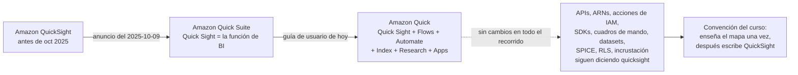
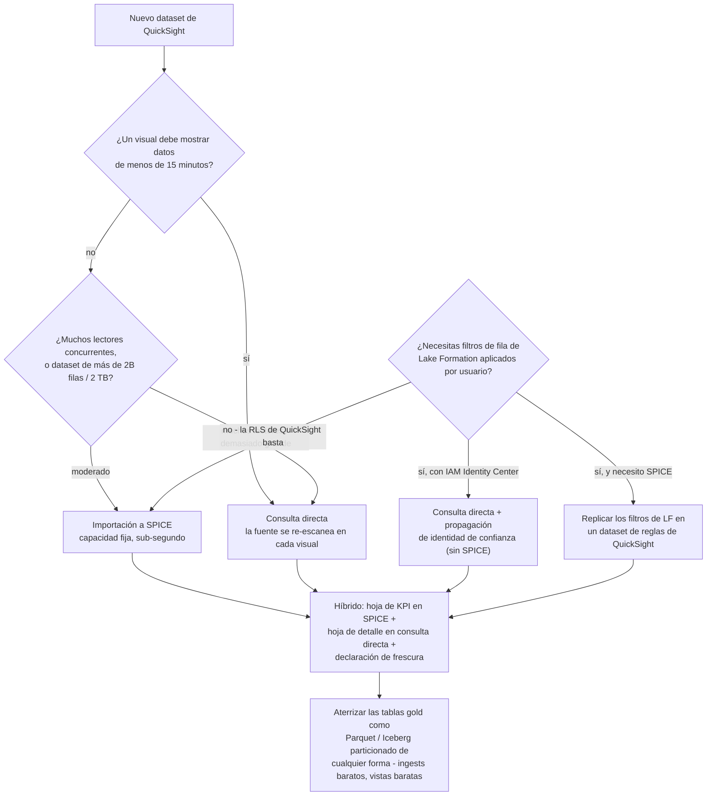
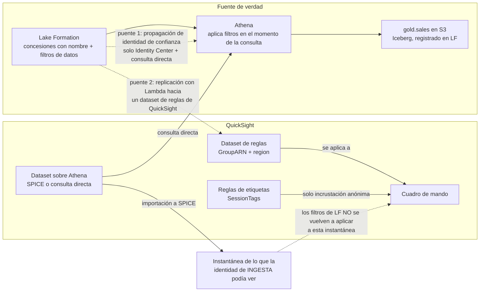
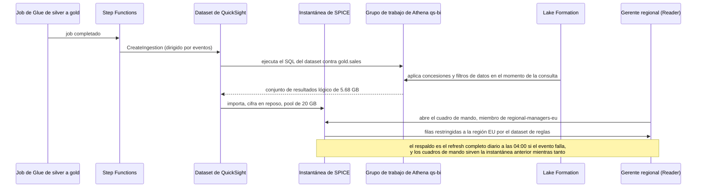
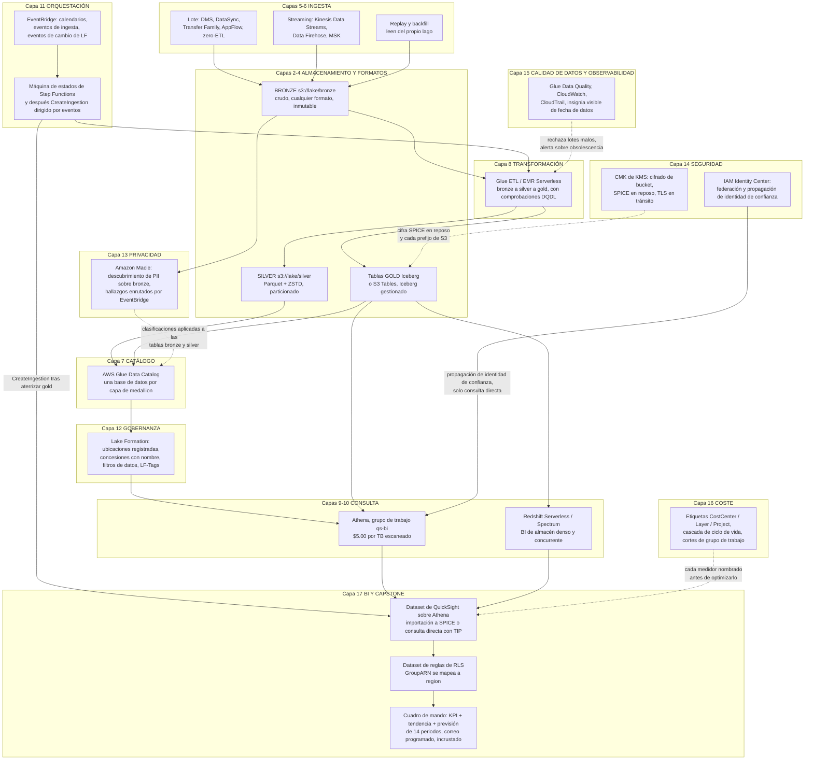

# BI con QuickSight y el capstone integral del lakehouse

Dieciséis lecciones construyeron algo que produce números: bronze en S3, silver y gold como tablas Iceberg, un catálogo de Glue, Step Functions sosteniendo el calendario, Lake Formation decidiendo quién puede leer cada fila, Macie encontrando los datos personales, Glue Data Quality rechazando los lotes malos y una escalera de costes que nadie tiene permitido saltarse. Nada de eso es el punto de un lakehouse. El punto es que una **gerente regional en Frankfurt** abre un enlace un lunes por la mañana y ve sus regiones, sus tiendas, sus ingresos, en menos de dos segundos — y no ve los de nadie más.

Esta es la lección. La capa de BI es donde cada decisión aguas arriba o se paga sola o te avergüenza: una concesión de Lake Formation que falta aparece como un cuadro de mando vacío, una instantánea de SPICE aparece como uno obsoleto, una elección de columna de texto frente a numérico aparece como una seguridad a nivel de fila que deja de funcionar en silencio, y una consulta directa sin podar aparece en la factura de Athena tres semanas después. Configurarás QuickSight de principio a fin, y después darás un paso atrás y redibujarás todo el curso como **una arquitectura de referencia con diecisiete capas**, más el plan de 30/60/90 días que lleva a un equipo hasta allí.

```text
====================================================================
 QUICKSIGHT BI + CAPSTONE - AWS DATA LAKEHOUSE, LECCIÓN 17
                   (lista us-east-1, en oct 2026)
====================================================================
 NOMBRES ....... servicio = Amazon Quick (antes QuickSight; anunciado
                como Quick Suite 2025-10-09); función de BI = Quick
                Sight; las APIs / ARNs / acciones de IAM siguen
                diciendo quicksight - por eso este curso escribe QuickSight
 EDICIONES ..... Standard: $9 usuario/mes anual o $12 mensual,
                10 GB de SPICE por usuario, solo refresh COMPLETO
                Enterprise: refresh incremental, RLS, CLS,
                carpetas, incrustación, 2B de filas o 2 TB por dataset
 PERSONAS ...... Author $24 | Author Pro $40 | Reader $3 |
                Reader Pro $20 | el Admin se factura como Author
 SPICE ......... $0.38 / GB-mes (en Standard $0.25 / GB extra);
                10 GB incluidos por Author, agrupados por Región
                y por cuenta; tamaño lógico = 12 B por celda
                numérica o de fecha + 24 B + longitud UTF-8 por texto
 CUOTAS ........ $250 / mes por cuenta si HAY cualquier usuario Pro,
                topic de Q o Dashboard Q&A activado
 MODO CONSULTA . SPICE (instantánea, capacidad fija, sub-segundo)
                vs consulta directa (fresca, re-escanea, timeout de
                visual de 2 minutos) vs híbrido (recomendado por AWS)
 ATHENA ........ $5.00 por TB escaneado - cada vista de consulta
                directa lo paga otra vez
 RLS ........... tres mecanismos: dataset de reglas usuario/grupo
                (solo texto, <=999 registros por usuario) | reglas
                de etiquetas (solo incrustación ANÓNIMA) | filtros
                de datos de Lake Formation (Athena, en el momento
                de la consulta, solo consulta directa - SPICE
                congela las filas que vio en la ingesta)
 CAPSTONE ...... 17 capas: niveles de S3 -> formatos/Iceberg ->
                ingesta -> catálogo -> Glue -> Athena/
                Redshift -> orquestación -> Lake Formation ->
                Macie -> seguridad -> calidad de datos -> coste ->
                QuickSight
====================================================================
```

> [!NOTE]
> **Cómo usar esta lección.** Las secciones 1–8 son la mitad de configuración de QuickSight: léelas una vez y luego resuelve las cuatro comprobaciones interactivas a medida que aparecen (asociación de SPICE, gráfica del modo de consulta, relleno de RLS y arrastrar y soltar del orden de construcción). La sección 9 es la construcción capstone que deberías poder reproducir sobre papel. Las secciones 10–11 son el resumen del curso: un diagrama integrado y una hoja de ruta por fases. Todo aquí está fechado en **octubre de 2026**; donde las propias páginas de AWS discrepan, la discrepancia se nombra en vez de suavizarse.

Al final de esta lección sabrás:

- decir qué cambió y qué **no** cambió cuando QuickSight se convirtió en Quick Suite y después en Amazon Quick, y tasar un despliegue real línea por línea;
- elegir entre **SPICE y consulta directa** usando el medidor de bytes escaneados de Athena en lugar de una intuición, y defender la elección con aritmética;
- dimensionar un **dataset de SPICE** a partir de una lista de columnas con la fórmula de tamaño lógico, y programar actualizaciones que ni choquen ni queden obsoletas en silencio;
- conectar correctamente una **fuente del lakehouse** — Athena a través de Lake Formation, un manifiesto de S3 para extracts, Redshift para cargas de trabajo densas de almacén;
- construir la cadena de contenido **dataset → análisis → cuadro de mando → tema → carpeta**, y elegir una familia de visuales a propósito;
- separar los **tres mecanismos de seguridad a nivel de fila** y decir, para cada uno, a quién aplica, qué tipos de datos restringe y cuánto te cuesta;
- ensamblar las **diecisiete capas** en una sola arquitectura de referencia y secuenciarlas a lo largo de un plan de **30/60/90 días**;
- leer los resultados publicados de **Trustly** en QuickSight como los lee un profesional: como un resultado de cliente con una fecha, nunca como una garantía del servicio.

---

## 1. Nombrar lo que estás configurando

Antes de un solo ajuste: el **2025-10-09** AWS anunció que «Amazon QuickSight está evolucionando hacia Amazon Quick Suite», con la mitad de BI renombrada como **Quick Sight** y «Más allá de las capacidades de BI conocidas (ahora llamadas Quick Sight), Quick Suite introduce varias funciones impulsadas por IA» (AWS BI Blog, 2025-10-09). La guía de usuario de hoy describe el servicio como **Amazon Quick**, que «evolucionó desde Amazon QuickSight. QuickSight continúa como Amazon Quick Sight, una función dentro de Quick» (Quick User Guide, *What is Amazon Quick?*, consultado 2026-10-11).

La mitad operativa de ese anuncio es la parte que realmente necesitas:

> «Todo tu entorno de QuickSight, incluidos cuadros de mando, datasets y análisis, permanece sin cambios… Tus integraciones existentes de API siguen funcionando como antes, y no se requiere ninguna migración de datos.» — AWS BI Blog, 2025-10-09

y

> «Todas las APIs, SDKs e integraciones existentes de QuickSight siguen funcionando sin cambios.» — Quick User Guide, consultado 2026-10-11



Dos consecuencias para todo lo que viene abajo:

1. **Los ARNs y las acciones de IAM siguen diciendo `quicksight`.** Un ARN de usuario sigue siendo `arn:aws:quicksight:{region}:{account}:user/{namespace}/{username}`, el rol de servicio por defecto sigue siendo `aws-quicksight-service-role-v0`, y cada API que toques en esta lección (`CreateIngestion`, `GenerateEmbedUrlForRegisteredUser`, `CreateAccountCustomization`) conserva su nombre antiguo (AWS Machine Learning Blog, 2026-06-08; AWS Builder Center, 2026-03-27).
2. **Las tablas de precios se mudaron a la marca nueva.** Las tarifas de abajo se leyeron en la página de precios de QuickSight el **2026-10-11**, donde las trae el panel de Quick Suite.

- **📚 ¿Sabías que…?** La abreviatura de «Quick Suite» a «Amazon Quick» **no tiene fecha en ninguna parte de la propia documentación de AWS**. Las publicaciones del 2025-10-09 dicen Quick Suite; la guía de usuario simplemente dice Amazon Quick, sin una fila de anuncio para el segundo renombrado. La afirmación defendible es «anunciado como Quick Suite en octubre de 2025; para octubre de 2026 la guía de usuario llama al servicio Amazon Quick» — asignar una fecha precisa a la abreviatura sería inventar una fuente.

---

## 2. Personas, ediciones y la pila de precios de octubre de 2026

### 2.1 Las tres personas, y por qué los Admins se facturan como Authors

| Persona | Qué pueden hacer | Asignación de SPICE | Se factura como |
|---|---|---|---|
| **Author** | Conectarse a fuentes de datos, crear datasets, análisis y cuadros de mando, compartirlos | Aporta **10 GB** al pool de la cuenta | $24/usuario/mes |
| **Author Pro** | Todo lo que hace un Author, más Q Topics, construcción de cuadros de mando en lenguaje natural, resúmenes ejecutivos, historias de datos, escenarios | Crédito de 10 GB | $40/usuario/mes |
| **Reader** | Abrir cuadros de mando, filtrar, profundizar, exportar CSV, suscribirse a alertas — «Los lectores no tienen capacidad SPICE asignada» | **Ninguna** | $3/usuario/mes |
| **Reader Pro** | Reader más las capacidades de Quick Suite Professional: resúmenes, historias, escenarios | Ninguna | $20/usuario/mes |
| **Admin** | Gestión de usuarios, compra de SPICE y de suscripciones, **más todas las capacidades de autoría** | Aporta 10 GB | «A efectos de facturación, los Autores y los Administradores de QuickSight se reconocen como Autores» |
| **Admin Pro** | Admin más las capacidades Pro | Aporta un crédito de 10 GB | Se factura a las tarifas de Author Pro |

Fuente de cada fila: página de precios de QuickSight y FAQs, consultada el **2026-10-11**.

La trampa de esa tabla es la fila de Admin: un Admin que «solo gestiona usuarios» sigue siendo un Author en la factura. La segunda trampa es que **los Readers no retienen SPICE en absoluto** — SPICE es propiedad de la cuenta, no del usuario.

### 2.2 Dos ediciones, y solo una de ellas hace seguridad a nivel de fila

| | **Standard** | **Enterprise** (la predeterminada para organizaciones) |
|---|---|---|
| Precio de plaza | $9/usuario/mes anual, $12 mensual | $24 Author / $3 Reader, más los niveles Pro |
| SPICE incluido | 10 GB por usuario | 10 GB por licencia de Author, agrupados a nivel de cuenta |
| SPICE extra | $0.25 por GB | **$0.38 por GB-mes** |
| Cuota por dataset | 25,000,000 filas o 25 GB | **2,000,000,000 filas o 2 TB** (lo que llegue primero) |
| Refresh | **Solo refresh completo** | Completo **o incremental** (solo fuentes de datos SQL) |
| RLS / CLS | No | **Sí** |
| Carpetas, incrustación, carpetas restringidas | No | Sí (la incrustación es solo de Enterprise) |
| Vía de compra | API `CreateAccountSubscription` | Valor por defecto de la consola |

Fuentes: página de precios, *Data source quotas*, *Refreshing SPICE data*, *Using row-level security*, *Embedding overview* — todas consultadas el 2026-10-11.

> [!IMPORTANT]
> **Una cifra que hay que enseñar con cuidado.** La documentación de cuotas y el blog de mejores prácticas de 2024 dicen ambos que SPICE en Enterprise sostiene **2,000,000,000 de filas o 2 TB por dataset**, y el historial del documento registra la subida a 2,000,000,000 de filas el **2025-06-30**. La página de precios, leída el 2026-10-11, sigue imprimiendo «un máximo de 1,000,000,000 de filas por 1 TB de tamaño». Usa la cifra de las **docs**, nombra el conflicto y nunca cites la página de precios con su 1B/1TB como vigente.

### 2.3 Ejemplo resuelto E1 — tasar un despliegue real, línea por línea

Un equipo despliega **3 Authors, 1 Admin, 60 Readers**, un dataset de SPICE de **52 GB**, **sin usuarios Pro, sin topics de Q, sin Dashboard Q&A** (lista de us-east-1, en oct 2026).

```text
Plazas          4 x $24 (3 Authors + 1 Admin; el Admin se factura como Author) = $ 96.00
Lectores       60 x $3                                                = $180.00
SPICE incl.    4 x 10 GB = 40 GB, agrupado a nivel de cuenta
Déficit        52 GB - 40 GB = 12 GB x $0.38                         = $  4.56
Cuota Pro/Q&A  sin usuario Pro, sin topic, Dashboard Q&A apagado      = $  0.00
                                                      TOTAL MENSUAL = $280.56
```

Ahora dos cambios que parecen pequeños en una diapositiva:

```text
Promover un Author a Author Pro           $40 - $24 = +$16.00
Activar Dashboard Q&A (sin topic)         +$250.00 por cuenta al mes
                                                      TOTAL MENSUAL = $546.56
```

La cuota de infraestructura **duplicó la factura** por una sola bandera de función. Se aplica «si tu cuenta tiene alguno de los siguientes: al menos un usuario Pro / Q&A activado mediante topics / Dashboard Q&A activado» (página de precios y FAQs, consultada 2026-10-11), y — la parte que atrapa a la gente — eliminar los usuarios Pro no la detiene mientras exista un Q Topic en **cualquier** Región de la cuenta (AWS re:Post Knowledge Center, 2026-08-27).

---

## 3. SPICE: qué es, cuánto cuesta y cómo lo rellenas

### 3.1 El motor en un párrafo

SPICE es el **Super-fast, Parallel, In-memory Calculation Engine**: una instantánea materializada y actualizable de tu dataset construida a partir de «una combinación de almacenamiento columnar, tecnologías en memoria… y generación de código de máquina» (AWS BI Blog, *Best practices for Amazon QuickSight SPICE and direct query mode*, 2024-07-17). En la edición Enterprise la instantánea está **cifrada en reposo** — gestionada por AWS por defecto, o con una clave gestionada por el cliente en AWS KMS — y cifrada en tránsito con TLS (misma fuente; *Importing data into SPICE*, consultado 2026-10-11).

Cuatro propiedades deciden cada elección de diseño que vas a hacer:

- **La capacidad se agrupa por cuenta y por Región de AWS**, no por usuario: «La capacidad de SPICE se asigna por separado para cada Región de AWS… compartida por todas las personas que usan QuickSight en una sola Región de AWS» (*Managing SPICE memory capacity*, consultado 2026-10-11).
- **La compra automática de capacidad está activada por defecto** en las cuentas creadas desde la consola, y «la compra automática de capacidad no admite el decremento automático» — puede hacer crecer tu pool, nunca encogerlo. Desactívala con la capacidad sobreasignada y la *siguiente* ingesta o refresh fallará.
- **Se te cobra por la consulta de origen en la ingesta**, no en el momento de verla: «Si usas una fuente de datos que cobra por consulta, se te cobra por consultar los datos cuando creas el dataset y más adelante cuando actualizas el dataset» (*Importing data into SPICE*).
- **Los cuadros de mando siguen sirviendo la instantánea anterior mientras corre un refresh** — y después de uno fallido, sin ningún banner de obsolescencia en el lienzo por defecto.

### 3.2 Tamaño lógico: la aritmética que decide tu factura de capacidad

Lo que consume capacidad no es el fichero Parquet en S3 ni el recuento de filas — es el **tamaño lógico**, calculado después de la coerción de tipos y de las columnas calculadas:

```text
Tamaño lógico del dataset en bytes =
      (número de celdas numéricas  x 12 bytes)
    + (número de celdas de fecha    x 12 bytes)
    + SUM(24 bytes + longitud codificada en UTF-8  por celda de texto)
```

Fuente: *Importing data into SPICE*, consultado 2026-10-11. «Solo los cambios guardados en el dataset se aplican a la capacidad de SPICE».

### 3.3 Ejemplo resuelto E2 — dimensionar el dataset del capstone antes de ingerirlo

La tabla gold del capstone `gold.sales` contiene **40,000,000 filas**, unos **3 GB de Parquet** en S3. El dataset de QuickSight usa este SQL personalizado (fíjate en lo que se descartó):

```sql
SELECT  order_id,
        date_trunc('day', order_ts) AS order_day,
        region,
        store_id,
        product,
        qty,
        revenue
FROM gold.sales
```

Tamaño lógico por fila:

| Columna | Tipo tras la coerción | Bytes por celda |
|---|---|---|
| `order_id` | numérico | 12 |
| `order_day` | fecha | 12 |
| `region` | texto (2 caracteres) | 24 + 2 = 26 |
| `store_id` | texto (6 caracteres) | 24 + 6 = 30 |
| `product` | texto (14 caracteres) | 24 + 14 = 38 |
| `qty` | numérico | 12 |
| `revenue` | numérico | 12 |
| **Por fila** | | **142 bytes** |

```text
40,000,000 filas x 142 bytes = 5,680,000,000 bytes = 5.68 GB lógicos
Pool de cuenta = 2 Authors x 10 GB = 20 GB incluidos
Veredicto      = 5.68 GB cabe con 14.32 GB de margen; SPICE extra = $0.00
Trampa         = el Parquet en S3 pesa 3 GB; el TAMAÑO LÓGICO es 5.68 GB.
                Las columnas de texto anchas son las que revientan
                primero el tope de GB.
```

Dos movimientos hicieron que cupiera: **descartar columnas sin uso** en el SQL (una columna de texto `customer_note` de 200 caracteres de media habría añadido `24 + 200` bytes por fila — 8.96 GB por sí sola, lo que ya habría superado el pool) y **truncar el timestamp a una fecha**, el mismo movimiento que hace posible el refresh incremental y la seguridad a nivel de fila en absoluto.

- **📚 ¿Sabías que…?** Los cuatro pasos de preparación de datos **Append, Aggregate, Pivot y Unpivot no pueden ejecutarse en el momento de la consulta** — son *exclusivos de SPICE*, lo que significa que QuickSight los materializa en SPICE en lugar de ejecutarlos en cada carga de visual (*SPICE-only features*, consultado 2026-10-11). Eso los convierte en la palanca documentada de «preagregar para encoger tu dataset»: un paso de agregación aplicado en el momento de la autoría se paga una vez por refresh en lugar de en cada visualización.

### 3.4 Refresh: calendarios, cuotas y el fallo que no verás

| Regla | Valor | Fuente (fecha) |
|---|---|---|
| Frecuencias de calendario | cada 15 min, 30 min, por horas, diario, semanal, mensual | Refreshing SPICE data (2026-10-11) |
| Precisión del calendario | la ingesta se ejecuta **dentro de los 10 minutos** de la hora programada | igual |
| Calendarios por dataset | **hasta 5** | AWS re:Post, 2026-06-26 |
| Refresh completos a demanda | **32 por dataset cada 24 horas** (los calendarios no se ven afectados) | BI Blog, 2024-07-17 |
| Refresh incrementales a demanda | **100 por dataset cada 24 horas** | igual |
| Refresh incremental | **solo fuentes de datos SQL**; necesita una columna de fecha más una ventana de retrospectiva; un checkpoint interno registra el último refresh completo | Refreshing SPICE data (2026-10-11) |
| Edición Standard | solo refresh completo | igual |
| Durante el refresh | los cuadros de mando sirven la **instantánea anterior** | BI Blog, 2024-07-17 |
| Notificación de fallo | `FailureConfiguration.EmailAlert.AlertStatus=ENABLED` | Automate SPICE refreshes via APIs, 2025-12-29 |
| Eliminar la configuración incremental | dispara un refresh **completo** la próxima vez | Refreshing SPICE data (2026-10-11) |

De ahí salen directamente dos reglas operativas. **Escalona los calendarios** para que los datasets no se disparen todos en el mismo minuto (AWS re:Post, 2026-06-26), y trata un refresh fallido como un **incidente**, porque el cuadro de mando seguirá renderizando con gusto los números de ayer como si nada hubiera pasado.

### 3.5 Buenas prácticas de autoría en SPICE

1. **Selecciona columnas en el momento de la autoría.** Cada columna de texto que arrastras al dataset se factura a `24 + longitud UTF-8` bytes por fila, para siempre. Desselecciona lo que ningún visual use.
2. **Agrega antes de importar.** Usa el paso Aggregate exclusivo de SPICE — o agrega en la capa gold, que es aún mejor — cuando un cuadro de mando necesite medidas por día en lugar de por transacción.
3. **Convierte las claves sobre las que vas a restringir.** La seguridad a nivel de fila solo funciona en campos de **texto**, así que convierte las claves de región numéricas o de fecha a cadena en el SQL del dataset (sección 7).
4. **Programa después del ETL, nunca cerca de él.** Un refresh completo diario a las 04:00 que se dispara antes de que termine el job de silver a gold importa la instantánea equivocada y la reporta con confianza. La llamada `CreateIngestion` dirigida por eventos desde Step Functions después del job es la versión determinista; el calendario es solo el suelo.
5. **Un dataset, muchos cuadros de mando.** El consumo en cualquier número de cuadros de mando y usuarios «no genera cargos» — el medidor es capacidad en GB-mes, no visualizaciones (página de precios, consultada 2026-10-11).

```matching
{
  "question": "Asocia cada concepto de SPICE con lo que realmente significa en QuickSight (documentación de QuickSight, consultada 2026-10-11):",
  "pairs": [
    {"left": "El propio SPICE (Super-fast, Parallel, In-memory Calculation Engine)", "right": "Una instantánea actualizable construida con almacenamiento columnar, tecnologías en memoria y generación de código de máquina; cifrada en reposo en la edición Enterprise"},
    {"left": "Tamaño lógico", "right": "12 bytes por celda numérica o de fecha, más 24 bytes más la longitud UTF-8 por celda de texto, calculado después de la coerción de tipos y de las columnas calculadas - esto es lo que cuenta tu factura de GB"},
    {"left": "Capacidad incluida", "right": "10 GB aportados por cada licencia de Author o Admin aprovisionada, agrupados a nivel de cuenta y por Región de AWS; los Readers no aportan nada"},
    {"left": "Refresh incremental", "right": "solo fuentes de datos SQL; consulta únicamente la ventana de retrospectiva definida en una columna de fecha, rastreada por un checkpoint interno desde el último refresh completo"},
    {"left": "Pasos de preparación exclusivos de SPICE", "right": "Append, Aggregate, Pivot y Unpivot - materializados en SPICE en lugar de ejecutados en el momento de la consulta, y por eso son la palanca de preagregación"},
    {"left": "Comportamiento de la instantánea durante un refresh", "right": "Los cuadros de mando siguen sirviendo la instantánea anterior mientras corre un refresh - y después de uno fallido, sin banner de obsolescencia por defecto"}
  ],
  "explanation": "Cada uno de estos seis es un lugar donde los equipos improvisan y después reciben una factura sorpresa o un cuadro de mando obsoleto. El tamaño lógico no es el tamaño del fichero (E2: 3 GB de Parquet eran 5.68 GB lógicos); la capacidad es propiedad de la cuenta, no del usuario; el refresh incremental depende de una fuente SQL más una columna de fecha; los cuatro pasos exclusivos de SPICE son la vía autorizada para encoger un dataset; y el comportamiento de la instantánea es exactamente por lo que las alertas de fallo y un cuadro de texto de «fecha de datos» son obligatorios y no opcionales."
}
```

---

## 4. SPICE frente a consulta directa: la factura de Athena es el desempate

### 4.1 El intercambio, enunciado en las dos direcciones

| | **Importación a SPICE** | **Consulta directa** |
|---|---|---|
| Frescura | Desde el último refresh | En cada carga de visual |
| Cargo de la fuente | Solo ingesta (una vez por refresh) | **Cada visualización, cada interacción** |
| Rendimiento | Sub-segundo, consistente, miles de lectores concurrentes | Igual que el rendimiento de la fuente; la concurrencia cae en Athena o Redshift |
| Límites duros | 2B de filas o 2 TB por dataset (Enterprise); capacidad en GB-mes | **Timeout de generación de visual de 2 minutos** — «no todos los controladores de base de datos reaccionan al timeout de 2 minutos» (una consulta de Redshift puede seguir corriendo) |
| Seguridad a nivel de fila | Se aplican tus reglas de RLS de QuickSight | Se aplican **tus** reglas de RLS **y** los filtros de Lake Formation |
| Forma del coste | Fija y predecible; escala con el tamaño del dataset | Variable; escala con **número de visualizaciones x bytes escaneados** |
| Mejor para | Hojas de KPI, difusión amplia, ejecutivos, incrustación | Detalle con poca tolerancia a la frescura, tablas muy anchas, exploración puntual |

Fuentes: *Data source quotas* (2026-10-11); mejores prácticas del AWS BI Blog (2024-07-17).

### 4.2 El híbrido recomendado por AWS

La propia guía de AWS no es «elige uno»: usa una **hoja de aterrizaje de SPICE** para los KPI agregados actualizados diaria o incrementalmente, más una **hoja de detalle de consulta directa**, y avisa al lector de la inconsistencia de frescura entre ambas (BI Blog, 2024-07-17). El patrón existe porque los dos modos de fallo son opuestos — SPICE falla por quedar obsoleto, la consulta directa falla por ser lenta y cara.



### 4.3 Ejemplo resuelto E3 — el mismo cuadro de mando, dos medidores

**Escenario.** 200 lectores, 4 visualizaciones de cuadro de mando cada uno al día, cada visualización escaneando **200 MB** de Parquet con poda de particiones en modo de consulta directa, frente a los mismos datos importados en un dataset de SPICE de **6 GB**. Athena cuesta **$5.00 por TB escaneado** (precios de Amazon Athena, consultados 2026-10-11).

```text
CONSULTA DIRECTA, optimizada (200 MB por vista)
  por día   = 200 lectores x 4 vistas x 0.2 GB =    160 GB
  por mes   = 160 GB x 30                    =  4,800 GB = 4.8 TB
  Athena    = 4.8 TB x $5.00                 =  $24.00 / mes

CONSULTA DIRECTA, sin podar (3 GB por vista: sin predicado de partición,
sin poda de columnas - la misma pregunta de negocio, la misma respuesta)
  por día   = 200 x 4 x 3 GB                 =  2,400 GB = 2.4 TB
  por mes   = 2.4 TB x 30                    =    72 TB
  Athena    = 72 TB x $5.00                  = $360.00 / mes

SPICE (dataset de 6 GB, refresh completo diario)
  capacidad = 6 GB x $0.38                   =   $2.28 / mes
  ingesta   = 30 refreshes x ~3 GB escaneados =     90 GB = 0.09 TB
  Athena    = 0.09 TB x $5.00                =   $0.45 / mes
  TOTAL     =                                =   $2.73 / mes
```

El punto de equilibrio es aritmética, no opinión: el coste de la capacidad de SPICE iguala al coste de Athena cuando

```text
TB escaneados al mes = (SPICE GB x $0.38) / $5.00
                     = (6 x 0.38) / 5 = 0.456 TB = 456 GB / mes
a 0.2 GB por vista  = 456 / 0.2      = 2,280 vistas / mes
                     = unas 76 vistas / día
```

Por debajo de unas 76 vistas al día, la consulta directa es más barata **y** más fresca; por encima, SPICE gana y sigue ganando, porque la línea de SPICE es **plana en número de visualizaciones**. La columna sin podar es la que debería preocuparte: la misma forma de SQL sin poda de particiones es **15 veces la factura** — que es por lo que los reductores de la lección 09 son un prerrequisito de esta lección y no un extra opcional.

> [!WARNING]
> ⚠️ **Nunca apuntes una población grande de lectores a una consulta directa sin podar.** Tres razones documentadas: cada carga de visual re-escanea a $5.00 por TB; QuickSight impone un **timeout de generación de visual de 2 minutos** que algunos controladores ignoran (una consulta de Redshift puede seguir corriendo más allá de él); y la concurrencia cae en la fuente, de modo que un pico de 200 lectores se convierte en un problema del grupo de trabajo de Athena. Si un cuadro de mando debe ser de consulta directa, pon los predicados de partición y la poda de columnas en el **SQL del dataset**, no en manos del lector.

### 4.4 Ejemplo resuelto E4 — la factura híbrida

Mismo público, **4,000 visualizaciones al día**: 3,600 aterrizan en la hoja de KPI de SPICE, 400 caen en la hoja de detalle de consulta directa a 200 MB cada una.

```text
Hoja SPICE       3,600 vistas x $0.00                 = $  0.00
Hoja detalle     400 x 0.2 GB = 80 GB/día x 30 días   = 2.4 TB -> $12.00
Capacidad SPICE  6 GB x $0.38                          = $  2.28
MENSUAL                                          TOTAL = $14.28
Equivalente todo-directo: 4,000 x 0.2 GB x 30 = 24 TB  = $120.00
                                                            ------
AHORRO                                                 $105.72 / mes
```

Añade el cuadro de texto de la advertencia en la hoja de consulta directa — «las filas de detalle son en vivo; los mosaicos de KPI se actualizan cada día a las 04:00 UTC» — y tienes la forma recomendada por AWS con su coste cuantificado.

- **📚 ¿Sabías que…?** Athena factura **bytes escaneados, redondeados al megabyte más cercano, con un mínimo de 10 MB por consulta** para las fuentes federadas — así que un cuadro de mando que renderiza 40 visuales pequeños de consulta directa puede facturar 40 mínimos en lugar de un solo escaneo fusionado. Fusionar filtros y emitir menos consultas y más anchas mediante parámetros del dataset es una palanca de coste tanto como de rendimiento (precios de Amazon Athena, consultados 2026-10-11).

```plot
{
  "type": "line",
  "title": "Consulta directa en Athena frente a SPICE: misma carga de trabajo de 0.2 GB por vista, dataset de 6 GB a $0.38/GB-mes (en oct 2026)",
  "xLabel": "Visualizaciones de cuadro de mando por mes",
  "yLabel": "Coste mensual (USD)",
  "xKey": "views",
  "data": [
    {"views": 500, "Direct query at $5.00/TB": 0.5, "SPICE import (flat in views)": 2.28},
    {"views": 1000, "Direct query at $5.00/TB": 1.0, "SPICE import (flat in views)": 2.28},
    {"views": 2000, "Direct query at $5.00/TB": 2.0, "SPICE import (flat in views)": 2.28},
    {"views": 2280, "Direct query at $5.00/TB": 2.28, "SPICE import (flat in views)": 2.28},
    {"views": 5000, "Direct query at $5.00/TB": 5.0, "SPICE import (flat in views)": 2.28},
    {"views": 10000, "Direct query at $5.00/TB": 10.0, "SPICE import (flat in views)": 2.28},
    {"views": 25000, "Direct query at $5.00/TB": 25.0, "SPICE import (flat in views)": 2.28}
  ],
  "dataKeys": ["Direct query at $5.00/TB", "SPICE import (flat in views)"]
}
```

Las líneas se cruzan en torno a **2,280 visualizaciones al mes** — unas 76 al día. A la izquierda del cruce, la consulta directa es más barata *y* más fresca; a la derecha, SPICE cuesta lo mismo si lo miran 10 personas o 10,000. La línea de SPICE también esconde un cargo fijo de ingesta de **$0.45/mes** (E3), que mueve el cruce solo marginalmente.

---

## 5. Fuentes del lakehouse: Athena, el manifiesto de S3 y Redshift

QuickSight admite una lista larga de fuentes — Athena, Aurora, el Glue Data Catalog, OpenSearch, Redshift, Redshift Spectrum, S3, S3 Tables, RDS, más BigQuery, Databricks, Snowflake, Trino y Q Business — con una regla dura de ubicación: **«Los clústeres de Amazon Redshift, las bases de datos de Amazon Athena y las instancias de Amazon RDS deben estar en AWS»** (*Supported data sources*, consultado 2026-10-11). Para este curso, tres importan.

| Fuente | Para qué sirve | Datos de configuración que debes conocer |
|---|---|---|
| **Amazon Athena** | La vía lakehouse por defecto: QuickSight a Athena al Glue Data Catalog a Iceberg/Parquet en S3 | Necesita un grupo de trabajo (`AthenaParameters.WorkGroup`), un ARN de rol y `IdentityCenterConfiguration.EnableIdentityPropagation` para la propagación de identidad de confianza. Aquí es donde se hacen cumplir los permisos de Lake Formation. |
| **Amazon S3 vía manifiesto JSON** | Importación directa de ficheros de extracts: CSV, TSV, JSON, CLF, ELF | `fileLocations.URIs` / `URIPrefixes` más `globalUploadSettings` (formato, delimitador, cualificador de texto, `containsHeader`); **hasta 1,000 ficheros por manifiesto**. Correcto para un extract plano, **equivocado para una tabla de lakehouse gobernada** — elude por completo el catálogo, los metadatos de Iceberg y Lake Formation. |
| **Amazon Redshift / Spectrum** | BI denso, concurrente y siempre encendido sobre tablas de almacén o tablas externas del lago | Debe estar en AWS; además es capaz de propagación de identidad de confianza, de modo que los permisos de fila y de columna del lado de la fuente se propagan en lugar de re-declararse en QuickSight. |

La regla de decisión para este curso: **todo lo gobernado vive detrás de Athena** (o Redshift), nunca detrás de un manifiesto. Un manifiesto es un volcado de ficheros — sin entrada de catálogo, sin time travel, sin concesión de Lake Formation, sin filtro de datos.

```json
{
  "fileLocations": [
    { "URIs": [ "s3://lake/extracts/2026/10/*.csv" ] }
  ],
  "globalUploadSettings": {
    "format": "CSV",
    "delimiter": ",",
    "textQualifier": "\"",
    "containsHeader": "true"
  }
}
```

Un manifiesto como el de arriba se importa bien y sigue siendo la respuesta equivocada para `gold.sales`: en cuanto importen la gobernanza a nivel de fila, la evolución de esquema o el time travel, la vía de Athena es la única que hereda lo que construyeron las lecciones 04, 07 y 12.

Dos detalles de conexión que fallan en silencio:

- El rol de servicio de QuickSight — por defecto **`aws-quicksight-service-role-v0`** — necesita **sus propias concesiones de Lake Formation**, además de las concesiones dadas a los ARNs de usuario y de grupo de QuickSight (*Using AWS Lake Formation with Amazon QuickSight*, consultado 2026-10-11; AWS Builder Center, 2026-03-27).
- Con **S3 Tables** (Iceberg gestionado) el catálogo es `s3tablescatalog`, no el catálogo por defecto de Glue: necesitas `glue:GetCatalog` sobre ese ARN de catálogo, y debes usar **SQL personalizado**, porque el explorador de tablas solo muestra el catálogo por defecto (AWS Builder Center, 2026-03-27).

Y la regla de ordenación de la propia guía de AWS: consigue que la consulta funcione **primero en Athena**, y después abre QuickSight — un paso que separa un problema de Lake Formation de un problema de QuickSight.

---

## 6. El modelo de contenido: datasets, análisis, cuadros de mando, temas y carpetas

```text
Fuente de datos (Athena / manifiesto de S3 / Redshift)
      |
      v
Dataset  ---- modo: SPICE o consulta directa
      |        + SQL personalizado, joins, campos calculados,
      |          claves únicas; el dataset de reglas de RLS se
      |          adjunta AQUÍ, no al cuadro de mando
      v
Análisis  ---- editable, multi-hoja, hasta 500 campos
      |        calculados; filtros, parámetros, acciones,
      |        exploración descendente, visuales de previsión
      |        y de anomalías, what-if (what-if existe SOLO en
      |        un análisis, nunca en un cuadro de mando)
      v
Publicar
      |
      v
Cuadro de mando  ---- instantánea de solo lectura del análisis,
                 hasta 1,000 versiones conservadas, compartido
                 con grupos, correos programados, incrustado
```

**Familias de visuales** disponibles en un análisis: barras y columnas (apiladas), mapa de calor, líneas y áreas, dispersión, tartas y donuts, treemap, embudo, medidor/KPI, nube de palabras, diagrama de caja, histograma, mapa de dispersión, **mapa de capas**, **componente de imagen**, **Highcharts**, tablas y tablas dinámicas, y widgets de texto con narrativa automática (historial de documentos de la Quick User Guide y documentación de previsión/insight, consultada 2026-10-11).

**Temas.** El servicio trae cuatro ARNs de temas iniciales — `arn:aws:quicksight::aws:theme/CLASSIC`, `.../MIDNIGHT`, `.../SEASIDE`, `.../RAINIER` — y el valor por defecto de la cuenta o del espacio de nombres se establece con `CreateAccountCustomization` / `UpdateAccountCustomization` mediante un `DefaultTheme`, lo que exige que el tema esté compartido primero (*Setting a default theme*, consultado 2026-10-11). Los cuadros de mando incrustados añaden **tematización en tiempo de ejecución** desde Embedding SDK 2.5.0 en adelante (`setTheme`, `setThemeOverride`, hasta cinco temas precargados).

**Carpetas (Enterprise).** Carpetas personales, carpetas compartidas y **carpetas compartidas restringidas** — las restringidas se crean solo a través de la API `CreateFolder` y obligan a que los recursos creados desde su contenido permanezcan dentro del árbol de carpetas. Lee el límite con cuidado: cubre análisis, cuadros de mando, datasets, fuentes de datos y topics, pero **no** superficies más nuevas como los agentes de chat, que aún pueden recuperar detalles de un dataset dentro de una carpeta restringida (*Organizing assets into folders*, consultado 2026-10-11).

> [!NOTE]
> **Dos límites que vale la pena memorizar porque aparecen como sorpresas.** El historial de versiones de cuadros de mando conserva hasta **1,000 versiones** (historial de documentos, 2025-03-28), y un análisis permite **500 campos calculados**, subidos de 200 el 2025-08-15. Ambos son lo bastante grandes para que nadie los toque por accidente y lo bastante pequeños para que una migración muy plantillizada acabe por alcanzarlos.

---

## 7. Seguridad a nivel de fila: tres mecanismos que no son intercambiables

Esta es la sección que decide si tu cuadro de mando del capstone es una victoria de gobernanza o una fuga de datos. Hay **tres** mecanismos a nivel de fila, resuelven problemas distintos y **ninguno de ellos se convierte en otro automáticamente**.

### 7.1 Mecanismo uno — un dataset de reglas de usuario o grupo (Enterprise)

Una tabla de permisos adjunta a tu dataset: una columna de identidad (`UserName` y `GroupName`, o `UserARN` y `GroupARN`) más **una columna por campo restringido**. La adjuntas con «Conceder acceso al dataset».

| Regla | Valor |
|---|---|
| Modo de acceso | **Solo concesión de acceso** — el modo denegar se eliminó el 2020-12-06 |
| Valores vacíos | NULL en una columna restringida significa **todos los valores** para esa identidad |
| Identidad ausente | Un usuario o grupo sin fila de regla ve **ninguna fila** |
| Registros por usuario | **999 o menos** registros de regla aplicados por usuario (directos más los de vía de grupos) |
| Valores de filtro en SPICE | **192,000 o menos** por campo restringido |
| Tipos de datos | **Solo texto** (string/char/varchar) — «Por el momento no funciona con campos de fecha ni numéricos» |
| Bandera del dataset de reglas | `UseAs: RLS_RULES` — una vez puesta no se puede cambiar |
| Datos sucios | La ingesta a SPICE de un dataset de reglas **falla** con filas no válidas o celdas sobredimensionadas en lugar de saltárselas |
| Reglas vacías | Se omiten como medida de seguridad; QuickSight trata NULL, cadenas vacías y cadenas como `,,,` como sin valor |
| Propietarios del dataset | **Siguen viendo todos los datos** — a los propietarios no se les restringe |
| Detección de anomalías | **No admitida** en datasets que usan seguridad a nivel de fila |

Fuentes: *Using row-level security* y *Using RLS with user-based rules*, consultadas 2026-10-11.

Una ingesta del dataset de reglas rota deja por tanto el dataset restringido con **ninguna regla seleccionada**, lo que significa que los lectores no ven nada hasta que adjuntes reglas nuevas. Monitoriza el estado de la ingesta y activa las alertas por correo de fallo.

### 7.2 Mecanismo dos — reglas basadas en etiquetas (solo incrustación anónima)

Las reglas de etiquetas mapean una clave de etiqueta a una columna e inyectan valores en tiempo de ejecución a través de `SessionTags` en `GenerateEmbedUrlForAnonymousUser`, configuradas mediante `RowLevelPermissionTagConfiguration.TagRules` (`TagKey`, `ColumnName`, `TagMultiValueDelimiter`, `MatchAllValue`). La declaración de alcance de AWS es inequívoca: las reglas basadas en etiquetas existen cuando «estás usando cuadros de mando incrustados y quieres asegurar los datos de usuarios no aprovisionados (usuarios no registrados)», y se admiten **solo** para incrustación anónima — no para `GenerateEmbedURLForRegisteredUser`, no para el `GetDashboardEmbedUrl` heredado y no para la identidad de consola (*Using RLS with tag-based rules*, consultado 2026-10-11).

### 7.3 Mecanismo tres — Lake Formation en el origen, a través de Athena

Registra la ubicación de S3 en Lake Formation, revoca `IAMAllowedPrincipals`, y concede `SELECT` y `DESCRIBE` (más permisos de filtro de datos) a los **ARNs de usuario y de grupo de QuickSight** en Enterprise, y también al **rol de servicio**. Esos filtros los aplica **Athena en el momento de la consulta**, que es todo el problema y toda la oportunidad:

- un dataset de **consulta directa** respeta los filtros de datos de Lake Formation por usuario;
- un dataset de **SPICE** no, porque «cuando se usa SPICE, los datos se importan (replican) y por tanto los derechos en el origen no pueden usarse» (AWS Big Data Blog, *Automate replication of row-level security from AWS Lake Formation to Amazon QuickSight*, 2025-05-07).

AWS documenta exactamente **dos puentes** a través de ese hueco:

1. **Propagación de identidad de confianza (TIP).** Solo IAM Identity Center, solo consulta directa — «no se puede usar QuickSight SPICE con la propagación de identidad de confianza». La identidad del lector se propaga a Athena, a Redshift y a Lake Formation cuando entra en juego Redshift Spectrum, de modo que los permisos a nivel de esquema, tabla, fila y columna se hacen cumplir en el origen y esto «elimina la necesidad de crear reglas adicionales de seguridad a nivel de fila y de columna en QuickSight» (AWS BI Blog, 2024-05-16; entrada del historial de documentos «Trusted identity propagation support with Athena data sources», 2025-06-30).
2. **Replicación automatizada.** Una Lambda lee `ListDataCellFilters` y `ListPermissions`, transforma los predicados PartiQL en filas del dataset de reglas de QuickSight y actualiza un dataset de RLS de QuickSight. Funciona **con SPICE** y **sin** Identity Center — pero debe re-ejecutarse en cada cambio de Lake Formation, y la ventana de retardo es un riesgo que asumes tú.



- **📚 ¿Sabías que…?** La frase «las etiquetas se convierten en RLS» describe **dos funciones no relacionadas**. Las etiquetas de Lake Formation impulsan el alcance de *tabla y columna* y no pueden llevar filtros de datos de fila en absoluto, mientras que las reglas de etiquetas de QuickSight impulsan la seguridad a nivel de fila **solo para incrustación anónima**. No hay ninguna función documentada de AWS que mapee una sobre la otra — para gerentes regionales registrados necesitas un **dataset de reglas de usuario/grupo**, punto y final (documentación de QuickSight y Lake Formation, consultada 2026-10-11).

### 7.4 Ejemplo resuelto E5 — qué mecanismo para qué público

| Público | ¿Registrado? | ¿Necesita SPICE? | Mecanismo correcto |
|---|---|---|---|
| Gerentes regionales que abren un enlace compartido de cuadro de mando | Sí (grupos de IAM Identity Center) | Sí, para mañanas sub-segundo | **Dataset de reglas de usuario/grupo** indexado en `GroupARN`, una columna `region` |
| Analistas que ejecutan SQL ad-hoc en Athena con su propia identidad | Sí | No — consulta directa | **Filtros de datos de Lake Formation**, aplicados en el origen |
| Clientes de un portal incrustado sin cuentas de QuickSight | No | Opcional | **Reglas de etiquetas** mediante `GenerateEmbedUrlForAnonymousUser` más `SessionTags` |
| Una columna regulada como `customer_tax_id` oculta a la mayoría de los lectores | Sí | Cualquiera de los dos | **Seguridad a nivel de columna** (`ColumnLevelPermissionRule`, máximo 100 ARNs de principal) *o* permisos de columna de Lake Formation — elige una deliberadamente |

```fillblank
{
  "question": "Completa los tres mecanismos de seguridad a nivel de fila y el límite duro que arrastra cada uno (documentación de QuickSight, consultada 2026-10-11):",
  "template": "1) Un dataset de reglas de {{1}} concede solo acceso (el modo denegar se eliminó en 2020), funciona solo sobre campos de texto y tiene un tope de {{2}} registros de regla por usuario. 2) Las reglas basadas en etiquetas inyectan valores mediante SessionTags y solo se admiten para la incrustación {{3}}. 3) Los filtros de datos de Lake Formation los aplica Athena en el momento de la {{4}}, de modo que los datasets de consulta directa los respetan mientras una importación a SPICE {{5}} las filas que pudo ver en la ingesta.",
  "answers": {
    "1": "usuario/grupo",
    "2": "999",
    "3": "anónima",
    "4": "consulta",
    "5": "congela"
  },
  "distractors": [
    "basadas en etiquetas",
    "a nivel de columna",
    "del rol de servicio",
    "192000",
    "100",
    "1000",
    "usuario registrado",
    "consola",
    "IAM Identity Center",
    "ingesta",
    "autoría",
    "publicación del cuadro de mando",
    "replica",
    "ignora",
    "vuelve a aplicar"
  ],
  "explanation": "El mecanismo 1 es el dataset de reglas de usuario/grupo: solo concesión de acceso desde el 2020-12-06, solo campos de texto (las claves numéricas y de fecha deben convertirse primero a cadena), 999 registros de regla por usuario y 192,000 valores de filtro por campo restringido cuando el dataset vive en SPICE. El mecanismo 2 son las reglas de etiquetas, que existen solo para incrustación anónima - GenerateEmbedUrlForAnonymousUser más SessionTags, no usuarios registrados y no la consola. El mecanismo 3 es Lake Formation, aplicado por Athena en el momento de la consulta: por eso la consulta directa hereda los filtros del lado de la fuente y por eso una importación a SPICE congela las filas que su identidad de ingesta pudo ver. La seguridad a nivel de columna es un control aparte (ColumnLevelPermissionRule, hasta 100 principales por regla) y no sustituye a ninguno de los tres."
}
```

> [!WARNING]
> ⚠️ **SPICE descarta en silencio los filtros de fila de Lake Formation.** Una importación es una instantánea de lo que la **identidad de ingesta** podía ver; después, los lectores del cuadro de mando en SPICE los gobierna solo la RLS de QuickSight, nunca los filtros de datos de Lake Formation. Tres diseños defendibles — elige uno y escríbelo: **(a)** consulta directa más propagación de identidad de confianza (solo IAM Identity Center, sin SPICE); **(b)** replicar los filtros de datos de Lake Formation a un dataset de reglas de QuickSight con un calendario y hacerte dueño de la ventana de retardo; **(c)** hacer de la RLS de QuickSight el **único** plano de control de filas para esa tabla y dejar de conceder filtros de Lake Formation por usuario para ella. Lo que no es defendible es conceder filtros de Lake Formation por usuario *e* importar a SPICE *y* asumir que se aplican ambos.

---

## 8. Q, visuales de ML e incrustación: mapa a nivel de conciencia

### 8.1 Lenguaje natural y funciones generativas

El linaje son tres generaciones de una misma idea: QuickSight Q, después **Amazon Q in QuickSight** (GA 2024-04-30), después integrado en Amazon Quick (2025-10-09). Lo que importa operativamente en octubre de 2026:

- **El Q&A está incluido en las plazas de Reader y de Author, pero activarlo cuesta dinero.** Crea **Q Topics** (modelos semánticos curados con instrucciones personalizadas, creados por **Author Pro**) o activa el **Dashboard Q&A** de un clic (disponible desde 2025-01-31, sin necesidad de topic) — y cualquiera de las dos cosas enciende la **cuota de infraestructura de $250/mes por cuenta**.
- **Los Q Topics se facturan y siguen siendo creables.** No se encontró ninguna declaración de AWS que los deprecie, aunque el Dashboard Q&A se promocione como la vía sin topics.
- Existe capacidad de **preguntas de Amazon Q** por lotes para escenarios incrustados y de escala: 500 preguntas/mes por $250, 60,000/año por $18,000, 600,000/año por $120,000 (página de precios, consultada 2026-10-11).
- **Las plazas Pro** añaden construcción de cuadros de mando en lenguaje natural, resúmenes ejecutivos, historias de datos generativas y escenarios.
- La **barra de búsqueda de Q** incrustada se etiqueta como Classic; el sustituto declarado por AWS es la experiencia **Generative Q&A** incrustada.

### 8.2 Visuales impulsados por ML

| Visual | Requisitos y valores por defecto | Señal de coste |
|---|---|---|
| **Forecast** | Punto y clic, no se requiere experiencia en ML; por defecto **14 periodos** hacia delante; estacionalidad **1–180** con Automatic como valor por defecto; banda de intervalo de predicción; límites de previsión; exclusión automática de valores atípicos e imputación de valores que faltan | Gratis dentro del visual |
| **What-if** | Existe **solo dentro de un análisis**, nunca en un cuadro de mando; solo una métrica | Gratis dentro del análisis |
| **Detección de anomalías** | Necesita al menos una dimensión en Time, una medida en Values y una dimensión en Categories; hasta 4 dimensiones de mayor contribución; niveles de severidad; el recálculo programado se ejecuta solo en cuadros de mando **publicados**; **no admitida en datasets que usan RLS** | Alertas y métricas de anomalía: **$0.50 por 1,000** evaluadas (nivel 1–1M), bajando a $0.05 por encima de 100M |
| **Autonarrativas** | Resúmenes en lenguaje natural; usa ML solo cuando se incrusta en ellas un cálculo de previsión o de anomalía | Gratis |

Fuentes: *Forecasting and what-if scenarios*, *Insights and anomaly detection*, página de precios — todas consultadas el 2026-10-11.

### 8.3 Incrustación, a nivel de conciencia

Solo Enterprise, con dos vías de autenticación: **usuarios registrados** (`GenerateEmbedUrlForRegisteredUser`, más copia con un clic) y **usuarios anónimos** (`GenerateEmbedUrlForAnonymousUser`, etiquetas de sesión para RLS, sin aprovisionamiento de usuarios). Las listas blancas de dominio deben usar HTTPS y admitir hasta **100 dominios**, estáticos más los añadidos en tiempo de ejecución. El `amazon-quicksight-embedding-sdk` de npm suministra callbacks, conexión de control, tematización en tiempo de ejecución y vistas incrustadas compartidas.

La nota de seguridad que AWS añadió el **2026-01-27** merece tratamiento de advertencia: orientación explícita contra las **vulnerabilidades de evasión** de `AllowedEmbeddingDomains`, más orientación de RLS multitenante — porque una lista blanca permisiva combinada con RLS basada en etiquetas es exactamente la combinación en la que un portal multitenante se equivoca.

**El precio para un público incrustado** son Readers aprovisionados a $3 o **capacidad de sesión de lector**: una sesión es un **periodo de 30 minutos**, 500 sesiones cuestan $250 al mes con sesiones extra a $0.50, y los planes anuales van desde 50,000/año por $20,000 hasta **$0.16 por sesión** en el plan de 1.6M/año. La capacidad anual es además lo que elimina la marca «Powered by Quick», y **el precio de capacidad es obligatorio para la actualización programática de cuadros de mando**.

- **📚 ¿Sabías que…?** El precio de Reader está escrito **solo para interacciones de sesión manuales**: AWS «se reserva el derecho de cobrar por el lector a la tarifa mensual más alta de Author» si las sesiones de lector se usan para consultas programáticas o automatizadas (QuickSight FAQs, consultado 2026-10-11). Una pantalla de pared que sondea un cuadro de mando con un temporizador es la vía documentada del shock de factura — y es precisamente el uso que requiere precio de capacidad en lugar de plazas.

---

## 9. Ejemplo resuelto capstone: de gold.sales a SPICE, a la RLS regional y al cuadro de mando del gerente

Todo lo de las lecciones 01–16 converge ahora en una sola construcción. Puesta en marcha: tabla Iceberg `gold.sales` con las columnas `order_id, order_ts, region, store_id, product, qty, revenue`, **40,000,000 filas**, unos 3 GB de Parquet en S3, registrada en Lake Formation, grupo de trabajo de Athena `qs-bi`.

**Paso 1 — Concesiones de Lake Formation.** `SELECT` y `DESCRIBE` sobre `gold.sales` al ARN del grupo `QuickSight_Authors` **y** a `aws-quicksight-service-role-v0`. Revoca `IAMAllowedPrincipals` de la ubicación registrada.

**Paso 2 — Dataset sobre Athena, en modo SPICE.** SQL personalizado con las columnas sin uso descartadas, `order_ts` truncado a `order_day`, `region` convertida a texto (la RLS necesita texto). Tamaño lógico **5.68 GB** (E2), dentro de los 20 GB del pool incluido.

**Paso 3 — Refresh.** Refresh completo diario a las **04:00 UTC** después del job de silver a gold, **más** una llamada `CreateIngestion` dirigida por eventos desde Step Functions cuando ese job termine — el calendario es el suelo, el evento es la verdad. Retrospectiva incremental semanal de 7 días sobre `order_day` si la tabla es de mucha inserción. Mantente por debajo del tope de **32 refreshes completos a demanda cada 24 horas**.

**Paso 4 — Dataset de reglas de RLS.** Crea `rls_region_rules` con las columnas `GroupARN, region`; las filas mapean `arn:…:group/default/regional-managers-eu` a `EU` y `…-us` a `US`; márcala con `UseAs: RLS_RULES`, lo cual es irreversible. Adjúntala al dataset con «Conceder acceso al dataset».

**Paso 5 — Verificar de tres formas.** El autor ve todas las regiones (a los propietarios del dataset no se les restringe); un miembro de `regional-managers-eu` ve solo la UE; una exportación CSV respeta la misma restricción.

**Paso 6 — Construir y publicar.** Una hoja de KPI (ingresos, pedidos, valor medio de pedido por región), una hoja de tendencia con una **previsión de ML de 14 periodos** y un insight de anomalía sobre los ingresos diarios; publicar, compartir con el grupo como Reader y suscribir a los gerentes regionales a un informe de correo programado (la entrega de correo programada respeta la RLS).

**Paso 7 — Poner precio** (us-east-1, en oct 2026):

```text
E6 - COSTE MENSUAL DEL CAPSTONE
  2 Authors                            2 x $24 = $ 48.00
  40 Readers                          40 x $3  = $120.00
  Capacidad SPICE  5.68 GB dentro de los 20 GB incluidos = $  0.00
  Ingesta Athena   30 refreshes x ~3 GB escaneados = 90 GB = 0.09 TB
                   0.09 TB x $5.00                       = $  0.45
  Métricas de anomalía 8,000 evaluaciones / mes = 8 x $0.50 = $  4.00
  Cuota de infraestructura Pro / Q&A (ninguna activada)   = $  0.00
                                                     TOTAL = $172.45
  Opcional: +10 GB de SPICE comprado = 10 x $0.38         = +$  3.80
  Opcional: Author Pro + Dashboard Q&A = +$16 + $250     = +$266.00
```



**Lo que demuestra esta construcción.** Cada lección anterior es portante: sin la lección 04 la tabla es un montón de ficheros; sin la 07 Athena no puede resolver `gold.sales`; sin la 12 el gerente ve todas las regiones; sin la 15 el cuadro de mando reporta datos malos con confianza; sin la 16 el respaldo de consulta directa cuesta tranquilamente más que toda la línea de BI.

---

## 10. El capstone: diecisiete capas como una sola arquitectura de referencia

Abajo está el curso entero como un único diagrama. Léelo como una **columna vertebral** que va de izquierda a derecha (ingerir, almacenar, catalogar, transformar, consultar, servir), con **planos de control** envolviéndola (orquestación, gobernanza, privacidad, seguridad, calidad, coste), y nota que QuickSight es el único nodo que un usuario de negocio toca alguna vez.



### 10.1 Las diecisiete capas, y la decisión que cada una posee

| # | Lección | Capa | La decisión que posee | El fallo que ves en la lección 17 |
|---|---|---|---|---|
| 1 | 01 | Patrón de arquitectura | Lago frente a almacén frente a lakehouse; medallion; lote, Lambda o Kappa | Ninguna fuente única de verdad a la que apuntar un cuadro de mando |
| 2 | 02 | Fundamento de S3 | Buckets, prefijos, clases de almacenamiento, ciclo de vida | La factura crece y los cuadros de mando no |
| 3 | 03 | Formatos y compresión | Parquet, ZSTD, tamaño de fichero | Athena escanea demasiado; SPICE ingiere demasiado |
| 4 | 04 | Formatos de tabla abiertos | ACID de Iceberg, time travel, evolución de esquema | Escritores concurrentes corrompen la tabla gold |
| 5 | 05 | Ingesta por lotes | Patrones de carga, deduplicación, idempotencia | Filas duplicadas en el mosaico de KPI |
| 6 | 06 | Ingesta de streaming | Kinesis y MSK, buffering, ventana de replay | El cuadro de mando «casi en tiempo real» tiene seis horas |
| 7 | 07 | Glue Data Catalog | Bases de datos, tablas, esquema, particiones | Athena no puede resolver `gold.sales` |
| 8 | 08 | Transformación | Jobs de Glue y EMR, bronze a silver a gold | Una tabla gold vacía o parcial a las 04:00 |
| 9 | 09 | Capa de consulta de Athena | Grupos de trabajo, poda, proyección, cortes | El cuadro de mando de consulta directa cuesta más que las plazas de BI |
| 10 | 10 | Redshift y Spectrum | Almacén para concurrencia densa, puente al lago | 500 lectores concurrentes superan el timeout |
| 11 | 11 | Orquestación | Step Functions más EventBridge | El refresh se dispara antes de que termine el ETL |
| 12 | 12 | Lake Formation | Registro, concesiones, filtros de datos, LF-Tags | Un gerente ve todas las regiones |
| 13 | 13 | Macie y PII | Descubrimiento, clasificación, enmascarado | La PII se va en un CSV exportado |
| 14 | 14 | Seguridad | KMS, IAM Identity Center, límites de red | El dataset es legible por el principal equivocado |
| 15 | 15 | Calidad de datos y observabilidad | Comprobaciones DQDL, lineage, frescura | El cuadro de mando muestra datos malos con confianza |
| 16 | 16 | Coste y ciclo de vida | Etiquetas, cascada de ciclo de vida, right-sizing | La línea de BI es la parte más pequeña de la factura |
| 17 | 17 | **BI y capstone** | SPICE frente a consulta directa, RLS, cuadros de mando, incrustación | **La razón por la que existen las otras dieciséis** |

- **📚 ¿Sabías que…?** La propia página *What is a Data Lakehouse?* de AWS nombra la misma columna vertebral que describe esta tabla — ingesta, almacenamiento, metadatos, API, semántica/consumo — y la capa semántica es donde se sientan las herramientas de BI. Las diecisiete lecciones son una expansión de las cinco capas publicadas de AWS hasta las decisiones servicio por servicio que un equipo realmente tiene que tomar, y por eso el diagrama del capstone tiene diecisiete casillas pero solo cinco columnas de flujo (páginas What-is de AWS, consultadas 2026-10-11).

---

## 11. La hoja de ruta de implementación de 30/60/90 días

Una arquitectura de referencia es una imagen; una hoja de ruta es un orden de operaciones. La regla que gobierna la secuencia es simple: **nada aguas abajo puede construirse antes de que aquello de lo que depende exista y haya sido verificada.** No puedes conceder sobre una ubicación no registrada, no puedes refrescar antes de que haya una tabla, no puedes restringir filas sobre una columna que sigue siendo numérica.

| Fase | Días | Objetivo | Criterios de salida — todos deben pasar antes de seguir |
|---|---|---|---|
| **1 — Fundamento** | 1–30 | Bronze, silver y gold en S3; formatos; catálogo; primera ingesta | Tabla gold de Iceberg consultable en Athena; reglas de ciclo de vida aplicadas; claves KMS en su sitio; bases de datos de Glue por capa de medallion; escaneo de Macie sobre bronze completado; una fuente de streaming aterrizando |
| **2 — Datos de confianza** | 31–60 | Transformación, orquestación, gobernanza, vía de almacén | Step Functions ejecuta bronze a gold de extremo a extremo con comprobaciones de DQ; registro de Lake Formation hecho, `IAMAllowedPrincipals` revocado, concesiones dadas **tanto** a los ARNs de usuario/grupo **como** a `aws-quicksight-service-role-v0`; grupo de trabajo de Athena `qs-bi` cercado con un corte de bytes escaneados; vía de Redshift Serverless probada para BI denso |
| **3 — Activación** | 61–90 | QuickSight, RLS, cuadros de mando, incrustación, cierre de coste | Dataset de SPICE actualizándose con un calendario dirigido por eventos; RLS verificada para tres personas; cuadros de mando publicados, tematizados y compartidos; precio de público lector elegido con el punto de equilibrio de sesiones calculado; etiquetas `CostCenter`/`Layer`/`Project` activadas y todo el stack tasado |

```dragdrop
{
  "question": "Ordena la construcción del capstone según el orden en que realmente debe ejecutarse (lecciones 02-17):",
  "items": [
    "Día 1-30 FUNDACIÓN - buckets bronze/silver/gold, clases de almacenamiento y ciclo de vida, claves KMS, bases de datos de Glue, tablas gold de Iceberg, escaneo de Macie sobre bronze (lecciones 02, 03, 04, 07, 13)",
    "Día 1-30 INGESTA - aterrizaje por lotes más una fuente de streaming hacia bronze, con comprobaciones de calidad de datos en el punto de entrada (lecciones 05, 06, 15)",
    "Día 31-60 TRANSFORMAR Y ORQUESTAR - jobs de Glue de bronze a silver a gold, máquina de estados de Step Functions, calendarios de EventBridge (lecciones 08, 11)",
    "Día 31-60 GOBERNAR - registrar ubicaciones de S3 en Lake Formation, revocar IAMAllowedPrincipals, conceder a los ARNs de usuario y de grupo de QuickSight Y a aws-quicksight-service-role-v0 (lecciones 12, 14)",
    "Día 31-60 CONSULTAR - grupo de trabajo de Athena qs-bi con BytesScannedCutoffPerQuery y poda de particiones, más Redshift Serverless para concurrencia densa (lecciones 09, 10)",
    "Día 61-90 ACTIVAR BI - dataset de QuickSight sobre Athena en modo SPICE, refresh después del ETL, dataset de reglas de RLS, cuadros de mando, temas, incrustación (lección 17)",
    "Día 61-90 CERRAR EL CÍRCULO - activar las etiquetas CostCenter/Layer/Project, poner precio a todo el stack, ajustar el tamaño y re-baselinear (lección 16)"
  ],
  "correctOrder": [
    "Día 1-30 FUNDACIÓN - buckets bronze/silver/gold, clases de almacenamiento y ciclo de vida, claves KMS, bases de datos de Glue, tablas gold de Iceberg, escaneo de Macie sobre bronze (lecciones 02, 03, 04, 07, 13)",
    "Día 1-30 INGESTA - aterrizaje por lotes más una fuente de streaming hacia bronze, con comprobaciones de calidad de datos en el punto de entrada (lecciones 05, 06, 15)",
    "Día 31-60 TRANSFORMAR Y ORQUESTAR - jobs de Glue de bronze a silver a gold, máquina de estados de Step Functions, calendarios de EventBridge (lecciones 08, 11)",
    "Día 31-60 GOBERNAR - registrar ubicaciones de S3 en Lake Formation, revocar IAMAllowedPrincipals, conceder a los ARNs de usuario y de grupo de QuickSight Y a aws-quicksight-service-role-v0 (lecciones 12, 14)",
    "Día 31-60 CONSULTAR - grupo de trabajo de Athena qs-bi con BytesScannedCutoffPerQuery y poda de particiones, más Redshift Serverless para concurrencia densa (lecciones 09, 10)",
    "Día 61-90 ACTIVAR BI - dataset de QuickSight sobre Athena en modo SPICE, refresh después del ETL, dataset de reglas de RLS, cuadros de mando, temas, incrustación (lección 17)",
    "Día 61-90 CERRAR EL CÍRCULO - activar las etiquetas CostCenter/Layer/Project, poner precio a todo el stack, ajustar el tamaño y re-baselinear (lección 16)"
  ],
  "explanation": "El almacenamiento y los formatos van primero porque cada capa posterior los lee; la ingesta sigue porque una capa bronze vacía no puede transformarse; la transformación y la orquestación van antes que la conexión de gobernanza porque necesitas una tabla que exista y aterrice en calendario antes de que nadie conceda sobre ella; el registro en Lake Formation debe preceder a la conexión de QuickSight, de lo contrario el dataset se construye contra una ubicación no registrada y todo lector falla después; el grupo de trabajo de Athena debe existir antes de que los cuadros de mando apunten a él, o la cerca de coste es retroactiva; QuickSight es deliberadamente el sexto, no el primero - la capa de BI consume garantías, no las crea; y el etiquetado de coste cierra la secuencia porque es la única fase que puede poner precio a todo lo anterior."
}
```

### 11.1 Ejemplo resuelto E7 — dimensionar el público incrustado antes de comprar nada

Un ISV incrusta un cuadro de mando en una aplicación multitenante para **50,000 visitantes mensuales**, con una media de **2 sesiones de 30 minutos** cada uno — **100,000 sesiones al mes**, o 1.2 millones al año.

```text
(a) Readers aprovisionados  50,000 x $3                = $150,000 / mes
(b) Capacidad de sesiones   500 x $250 base              =    $250.00
    mensual                 + 99,500 sesiones extra x $0.50 = $49,750.00
                               total capacidad mensual   = $50,000.00
(c) Capacidad anual, plan de 1.6M/año                    = $258,000 / año
                                                          = $21,500.00 / mes
(d) Híbrido: 200 Readers del personal a 200 x $3 = $600 / mes, más
    incrustaciones anónimas de clientes servidas con capacidad anual = personal + (c)
```

Lee esto como un **ejercicio de aritmética, no como una fórmula publicada por AWS** — AWS no publica ninguna guía de punto de equilibrio entre capacidad y plazas, y la definición de sesión de 30 minutos significa que un usuario que reabre un cuadro de mando cuatro veces al día consume cuatro sesiones. Lo que los números sí establecen es la dirección: con 100,000 sesiones al mes, el precio por plaza no es una opción seria; la capacidad anual es unas **2.3 veces más barata** que la mensual para el mismo volumen; y solo el plan anual elimina la marca «Powered by Quick» y habilita la **actualización programática de cuadros de mando**.

---

### Actualizaciones de 2026 (en octubre de 2026)

> [!NOTE]
> **Qué se movió en la historia de BI entre 2025 y octubre de 2026** — cada línea con su fecha, porque cada una cambia un número o un ajuste de esta lección:
> - **QuickSight se convirtió en Quick Suite, y después en Amazon Quick (anunciado el 2025-10-09).** La función de BI ahora es «Quick Sight»; **las APIs, los ARNs y las acciones de IAM siguen diciendo `quicksight`**, y «no se requiere ninguna migración de datos». Los precios se movieron con la marca: **Author Pro bajó de $50 a $40/mes**, Reader Pro a $20/mes ganó las capacidades de Quick Suite Professional, mientras que **Reader ($3) y Author ($24) siguen sin cambios**, y la **cuota de infraestructura de $250/mes por cuenta** se aplica siempre que exista un usuario Pro, un topic de Q o Dashboard Q&A (AWS News Blog y AWS BI Blog, 2025-10-09; precios de QuickSight, consultados 2026-10-11).
> - **Los límites de SPICE por dataset subieron a 2,000,000,000 de filas** (historial de documentos, 2025-06-30), con una entrada de documentación posterior de «SPICE capacity updates» el **2026-02-02** — mientras que la página de precios sigue imprimiendo «1,000,000,000 de filas por 1 TB», así que cita la página de cuotas y señala el conflicto.
> - **Soporte de propagación de identidad de confianza con fuentes de datos de Athena** (historial de documentos, 2025-06-30) hace que los permisos de fila y de columna de Lake Formation del lado de la fuente se apliquen por lector de QuickSight — pero solo con IAM Identity Center y solo en **consulta directa**, ya que «no se puede usar QuickSight SPICE con la propagación de identidad de confianza».
> - **Se añadió orientación de seguridad para la incrustación y el RLS multitenante el 2026-01-27**, advirtiendo específicamente de las vulnerabilidades de evasión de `AllowedEmbeddingDomains` — el cambio más importante para cualquiera que publique un portal incrustado.
> - **El refresh incremental en la nueva experiencia de preparación de datos llegó el 2026-04-15**, extendiendo el patrón de ventana de retrospectiva a la superficie de autoría más nueva (historial de documentos, consultado 2026-10-11).
> - **El acceso promocional de Author a las capacidades de Quick Enterprise dice ahora «hasta el 31 de diciembre de 2026»** en la página de precios (consultada 2026-10-11) — la publicación original del 2025-10-09 decía hasta el 30 de abril de 2026, así que trata la página posterior como vigente y la fecha anterior como historia.

---

## Casos Reales

Cada cifra de abajo es un **resultado de cliente que AWS eligió publicar**, nunca una promesa de AWS. Las páginas de caso no llevan fecha de publicación, así que lo que llevan es una fecha de consulta: **consultado en octubre de 2026**.

### Caso A — Trustly: insights 4x más rápidos, coste un 50 % menor, de 80 a 300 usuarios

| Elemento | Detalle |
|---|---|
| Cliente | **Trustly**, pagos de banca abierta — «conecta con más de 8,300 comerciantes a 650 millones de consumidores y 12,000 bancos» |
| Reto | Un equipo de datos que actuaba como cuello de botella: un analista pasaba **cuatro horas al día** manteniendo cuadros de mando, las peticiones ad-hoc se encolaban detrás de ese trabajo, y la BI se actualizaba con un calendario demasiado lento para las decisiones de riesgo y de producto |
| Servicios | **Amazon Redshift** (migración del almacén) + **Amazon QuickSight** (cuadros de mando, SPICE) + **Amazon Q in QuickSight** (autoservicio en lenguaje natural) |
| Migración | «Para febrero de 2023, Trustly se había migrado a Amazon Redshift e implementado QuickSight en **menos de 6 meses**» |
| Resultados | **4x más rápidos** para generar insights; **50 % de reducción de costes**; **220 usuarios nuevos incorporados** (de 80 a 300); cuadros de mando actualizados **cada 15 minutos en lugar de tres veces al día**; en 6 meses, **15,000 preguntas** enviadas a través de Amazon Q in QuickSight con un **89 % de precisión de respuesta** |
| Cita | «Hay una integración nativa entre Amazon Redshift y Amazon QuickSight… que redujo los problemas de datos y aumentó la calidad de los datos.» |
| Fuente | Caso de estudio de AWS, `solutions/case-studies/trustly-using-amazon-quicksight-case-study/` (sin fecha; consultado 2026-10-11) |

**Leyéndolo como un profesional.** Aquí se movieron tres palancas separadas, y vale la pena separarlas: el **ritmo de 15 minutos** es una decisión de calendario de refresh de SPICE (sección 3.4); el **crecimiento de usuarios con menor coste** es una decisión de economía por plaza frente a capacidad (ejemplo resuelto E8 más abajo); y el **89 % de precisión en 15,000 preguntas** es un *resultado de cliente sobre un conjunto de preguntas concreto* — no una garantía de precisión de Amazon Q, ni una afirmación que puedas reformular como «Amazon Q tiene un 89 % de precisión».

### Caso B — dos resultados más de QuickSight del mismo corpus

| Cliente | Lo que reporta AWS (consultado 2026-10-11) | Qué mecanismo de la lección 17 demuestra |
|---|---|---|
| **Rekor Systems** (AWS BI Blog, 2025-04-07) | Un lago de S3 con forma de **medallion bronze/silver/gold** y **Athena como fuente principal de QuickSight**; una **reducción del 85 % en los gastos anuales de herramientas de BI**; tiempos de carga de cuadro de mando un **20 % más rápidos**; **más de 400 usuarios activos**; cuadros de mando incrustados en el producto del cliente | La cadena exacta de gold a Athena a SPICE a incrustación de la sección 9 |
| **Whole Foods Market** (AWS BI Blog, 2024-12-02) | **Más de 25,000 usuarios**, **1 millón de visualizaciones de cuadro de mando al mes**; tiempos de carga recortados un **90 %, de 2–5 minutos a 5–10 segundos**; costes reducidos un **75 %**; permisos a nivel de fila y de columna aplicados en un entorno regulado | SPICE como palanca de concurrencia (sección 4) más RLS y CLS (sección 7) |

Ambos son **resultados de cliente**, no garantías de nivel de servicio — y ambos describen migraciones concretas, que es la única forma en que este curso permite citar un porcentaje.

### Caso C — el punto de equilibrio de Trustly, calculado con tarifas publicadas

Toma los **300 usuarios** publicados por Trustly y las tarifas de octubre de 2026 de la sección 2, y después encuentra el número de sesiones al que los Readers aprovisionados y la capacidad de sesión de lector cuestan lo mismo:

```text
E8 - SESIONES FRENTE A PLAZAS (300 lectores)
  Plazas              300 x $3                                = $ 900.00 / mes
  Punto de equilibrio $900 / $0.50 por sesión                 = 1,800 sesiones / mes
                      1,800 / 300 lectores                    = 6 sesiones por lector / mes
  A 4 sesiones        1,200 = $250 + 700 x $0.50              = $ 600.00 -> la capacidad ahorra $300
  A 6 sesiones        1,800 = $250 + 1,300 x $0.50            = $ 900.00 -> punto de equilibrio exacto
  A 10 sesiones       3,000 = $250 + 2,500 x $0.50            = $1,500.00 -> las plazas ahorran $600
  Comprobación anual  1,800/mes = 21,600/año, por debajo del nivel de 50,000/año
                      plan de 50,000/año = $20,000/año = $1,666.67/mes -> demasiado pequeño para batir al mensual
```

Esto es **aritmética sobre tarifas publicadas, no una fórmula de AWS** — AWS no publica ninguna guía de punto de equilibrio, y una «sesión» es un periodo de 30 minutos, de modo que un lector que reabre un cuadro de mando tres veces en una hora consume tres sesiones. La pregunta transferible para cualquier despliegue de BI es la que fuerza este ejercicio: **¿cuántas sesiones de 30 minutos consume un lector real al mes?** Mídelo antes de comprometerte, porque esa respuesta decide si un parque de 300 lectores cuesta $900, $600 o $1,500.

- **📚 ¿Sabías que…?** El ritmo de cuadro de mando de 15 minutos de Trustly es exactamente el **intervalo mínimo de calendario que ofrece QuickSight** — las frecuencias van de «Cada 15 minutos, cada 30 minutos, por horas, diario, semanal o mensual», y la ingesta ocurre **dentro de los 10 minutos** de la hora programada (*Refreshing SPICE data*, consultado 2026-10-11). Un cuadro de mando de «15 minutos» es en realidad un cuadro de mando de 15 a 25 minutos, y por eso una marca de tiempo visible de «fecha de datos» en el lienzo es práctica estándar y no decoración.

---

## Preguntas de Práctica (Practice Questions)

Doce ítems, todos en la serie `lh-17-qN`: una respuesta correcta, tres o cuatro distractores, con el desmontaje dentro de cada explicación. Precios de lista de us-east-1 **en octubre de 2026**.

```question
{
  "id": "lh-17-q1",
  "type": "multiple-choice",
  "question": "Un ingeniero lee que Amazon QuickSight se rebrandeó primero a Amazon Quick Suite y después a Amazon Quick, y le preocupa migrar una cuenta existente. ¿Qué afirmación es correcta en octubre de 2026?",
  "options": [
    "No se requiere ninguna migración: los cuadros de mando, los datasets y los análisis siguen igual, y las APIs, los SDKs y los ARNs aún usan el identificador de servicio quicksight",
    "Se requiere una migración de datos porque el formato de almacenamiento de SPICE cambió con el rebranding",
    "Todas las APIs de QuickSight existentes se renombraron a quick, así que hay que reescribir cada integración de SDK",
    "La seguridad a nivel de fila y la incrustación se retiraron y pasaron exclusivamente a Amazon Q"
  ],
  "correct": 0,
  "explanation": "AWS afirma directamente que el entorno, el contenido, las integraciones de API, los controles de seguridad y los permisos siguen iguales sin ninguna migración de datos, y la guía de usuario confirma que todas las APIs, SDKs e integraciones de QuickSight existentes siguen funcionando: los ARNs y las acciones de IAM todavía dicen quicksight. La función de BI se llama ahora Quick Sight dentro de Amazon Quick, y eso es un cambio de nombre, no un cambio de arquitectura."
}
```

```question
{
  "id": "lh-17-q2",
  "type": "multiple-choice",
  "question": "Una cuenta tiene 5 Authors, 100 Readers, ningún usuario Pro, ningún topic de Q y Dashboard Q&A desactivado. El uso de SPICE es de 45 GB contra un pool incluido de 50 GB. ¿Cuál es el total mensual en octubre de 2026?",
  "options": [
    "$420: 5 x $24 más 100 x $3, sin cuota de infraestructura y sin cargo extra de SPICE",
    "$670: las mismas plazas más la cuota de infraestructura de $250 por cuenta",
    "$439: las plazas más 5 GB de SPICE extra a $0.38 por GB",
    "$420 ahora, más $250 en cuanto exista un topic de Q en cualquier Región de AWS"
  ],
  "correct": 0,
  "explanation": "5 x $24 = $120 y 100 x $3 = $300, lo que da $420. La cuota de infraestructura de $250 solo se aplica cuando la cuenta tiene al menos un usuario Pro, un topic de Q o Dashboard Q&A activado, y no hay ninguno de los tres. La capacidad es 5 x 10 GB = 50 GB incluidos, y 45 GB de uso queda dentro, así que el SPICE extra es $0. La opción D es media verdad: un topic en cualquier Región dispararía la cuota, pero todavía no existe ningún topic."
}
```

```question
{
  "id": "lh-17-q3",
  "type": "multiple-choice",
  "question": "Un dataset de SPICE contiene 40 millones de filas con tres columnas numéricas, una columna de fecha y tres columnas de texto que promedian 2, 6 y 14 caracteres UTF-8. Usando la fórmula documentada de tamaño lógico, ¿aproximadamente cuánta capacidad consume?",
  "options": [
    "Unos 5.7 GB: 40 millones de filas de unos 142 bytes cada una",
    "Unos 3.0 GB: lo mismo que el tamaño del fichero Parquet en S3",
    "Unos 1.7 GB: 12 bytes por celda a través de las 14 celdas de una fila",
    "Unos 9.6 GB: las celdas de texto se cobran a 24 bytes más el ancho completo de la columna por fila"
  ],
  "correct": 0,
  "explanation": "Tamaño lógico = 12 bytes por celda numérica o de fecha + 24 bytes + longitud UTF-8 por celda de texto: 12 + 12 + 12 + 12 + (24+2) + (24+6) + (24+14) = 142 bytes por fila, y 40,000,000 x 142 = 5.68 GB. El fichero Parquet en S3 es irrelevante para la factura de SPICE: esa es la trampa, porque el tamaño en disco y el tamaño lógico divergen de golpe en cuanto existen columnas de texto."
}
```

```question
{
  "id": "lh-17-q4",
  "type": "multiple-choice",
  "question": "Un refresh programado de SPICE falla a las 04:00 y el equipo se entera dos días después, cuando los ejecutivos reportan números que están discretamente mal. ¿Qué control habría sacado esto a la luz?",
  "options": [
    "FailureConfiguration.EmailAlert en el refresh, más EventBridge sobre los eventos de ingesta y una caja de texto visible de «fecha de datos» dirigida por un campo calculado de fecha máxima",
    "Un intervalo de refresh más corto, porque los calendarios de 15 minutos no fallan como los diarios",
    "Cambiar el dataset a consulta directa, porque la consulta directa no puede fallar",
    "Subir el tope de refreshes a demanda por encima de 32 refreshes completos cada 24 horas"
  ],
  "correct": 0,
  "explanation": "Los cuadros de mando sirven la instantánea anterior durante Y después de un refresh fallido, sin aviso de obsolescencia por defecto, así que el silencio es el comportamiento por defecto y tienes que instrumentarlo. Las palancas documentadas son las alertas por correo de fallo, las reglas de EventBridge sobre los eventos de ingesta, las alarmas de CloudWatch y un indicador de frescura en el lienzo. La duración del intervalo y los topes de refresh no tienen nada que ver con detectar un fallo, y la consulta directa sí puede fallar: simplemente falla de forma visible en el visual."
}
```

```question
{
  "id": "lh-17-q5",
  "type": "multiple-choice",
  "question": "Un cuadro de mando de consulta directa tiene 200 lectores, 4 vistas cada uno al día, 200 MB escaneados por vista, y Athena cobra $5.00 por TB escaneado en octubre de 2026. ¿Cuál es el coste mensual de Athena, y cuál es la alternativa de SPICE para un dataset de 6 GB refrescado 30 veces al mes con unos 3 GB escaneados por refresh?",
  "options": [
    "Consulta directa $24.00 al mes; SPICE unos $2.73 al mes ($2.28 de capacidad más $0.45 de ingesta)",
    "Consulta directa $480.00 al mes; SPICE unos $2.28 al mes sin cargo de ingesta",
    "Consulta directa $24.00 al mes; SPICE unos $2.28 al mes porque los escaneos de ingesta son gratis",
    "Consulta directa $15.00 al mes; SPICE unos $4.56 al mes"
  ],
  "correct": 0,
  "explanation": "200 x 4 x 0.2 GB = 160 GB al día, x 30 = 4.8 TB, x $5.00 = $24.00. La capacidad de SPICE es 6 x $0.38 = $2.28, y las 30 ingestas escanean 90 GB = 0.09 TB x $5.00 = $0.45, porque una fuente cobrada por consulta te cobra cuando CREAS el dataset y otra vez en cada REFRESH. La ingesta nunca es gratis: simplemente se paga una vez por refresh en lugar de una vez por vista."
}
```

```question
{
  "id": "lh-17-q6",
  "type": "multiple-choice",
  "question": "La seguridad a nivel de fila debe restringir una columna numérica customer_tier en un dataset de SPICE. ¿Qué exige la documentación?",
  "options": [
    "Convertir la clave a una columna de texto en el SQL del dataset, porque la seguridad a nivel de fila funciona solo sobre datos textuales y no sobre campos de fecha ni numéricos",
    "Aplicar etiquetas LF de Lake Formation a la columna numérica, que QuickSight convierte automáticamente en reglas de RLS",
    "Convertir el dataset a consulta directa, ya que las restricciones numéricas solo funcionan en modo de consulta directa",
    "Usar en su lugar la seguridad a nivel de columna, porque es el equivalente numérico de la seguridad a nivel de fila"
  ],
  "correct": 0,
  "explanation": "La RLS está documentada como funcionando solo sobre campos con datos textuales, ni fechas ni campos numéricos, así que la solución es unir o convertir a una clave de texto como un código de región o de nivel. Las etiquetas LF llevan alcance de tabla y columna y no pueden llevar filtros de fila, y no existe documentado ningún mapeo automático de etiquetas a RLS. La seguridad a nivel de columna es un control aparte que oculta columnas enteras: no filtra filas por valor."
}
```

```question
{
  "id": "lh-17-q7",
  "type": "multiple-choice",
  "question": "Un ISV quiere seguridad a nivel de fila para un cuadro de mando incrustado cuyos espectadores no tienen ninguna cuenta de QuickSight. ¿Qué mecanismo se aplica?",
  "options": [
    "Reglas basadas en etiquetas entregadas mediante SessionTags en GenerateEmbedUrlForAnonymousUser: las reglas de etiquetas se admiten solo para incrustación anónima",
    "Un dataset de reglas de usuario/grupo indexado en UserARN, porque a cada espectador se le puede dar un usuario de IAM",
    "Propagación de identidad de confianza, porque funciona con la incrustación anónima y con SPICE a la vez",
    "Etiquetas LF de Lake Formation mapeadas a la RLS de QuickSight automáticamente en el momento de publicar el cuadro de mando"
  ],
  "correct": 0,
  "explanation": "Las reglas de etiquetas existen precisamente para espectadores no registrados: se admiten solo para incrustación anónima a través de GenerateEmbedUrlForAnonymousUser, con valores de etiqueta inyectados en tiempo de ejecución mediante SessionTags, y no se admiten para GenerateEmbedURLForRegisteredUser ni para GetDashboardEmbedUrl heredado. Un dataset de reglas necesita identidades que existan; la propagación de identidad de confianza necesita IAM Identity Center más consulta directa y no puede usarse con SPICE; y no existe documentado ningún mapeo automático de etiquetas LF a RLS de QuickSight."
}
```

```question
{
  "id": "lh-17-q8",
  "type": "multiple-choice",
  "question": "Un equipo concede filtros de datos de Lake Formation por usuario y después importa la tabla a SPICE. Los usuarios reportan que ven filas que no deberían ver. ¿Cuál es la explicación y la corrección correctas?",
  "options": [
    "Una importación a SPICE es una instantánea de lo que la identidad de ingesta podía ver, así que los filtros del lado de la fuente nunca se vuelven a aplicar: usa consulta directa con propagación de identidad de confianza, replica los filtros de LF en un dataset de reglas de QuickSight o haz de la RLS de QuickSight el único plano de control de filas",
    "El dataset está obsoleto: subir la frecuencia de refresh a cada 15 minutos vuelve a aplicar los filtros de Lake Formation",
    "Los filtros de Lake Formation solo se aplican a Redshift, así que los datasets con origen en Athena nunca los respetan",
    "Hay que restablecer la bandera UseAs: RLS_RULES del dataset de reglas, porque bloquea los filtros de Lake Formation"
  ],
  "correct": 0,
  "explanation": "AWS afirma que con SPICE los datos se importan y por tanto los derechos en el origen no pueden usarse; la frecuencia de refresh no cambia eso, porque cada refresh importa lo que la identidad de ingesta pueda ver. Los tres puentes documentados son la consulta directa con propagación de identidad de confianza (solo IAM Identity Center, sin SPICE), la replicación con Lambda de los filtros de datos de LF a un dataset de reglas de QuickSight (funciona con SPICE pero debe re-ejecutarse en cada cambio de LF) o consolidar el control de filas solo en la RLS de QuickSight."
}
```

```question
{
  "id": "lh-17-q9",
  "type": "multiple-choice",
  "question": "Hay que construir un dataset a partir de extracts CSV por horas que llegan a S3, y el equipo decide entre un manifiesto de S3 y una fuente de datos de Athena sobre una tabla Iceberg. ¿Qué afirmación lo decide?",
  "options": [
    "El manifiesto importa hasta 1,000 ficheros y elude por completo el catálogo, los metadatos de Iceberg y Lake Formation, así que todo lo gobernado debe estar detrás de Athena",
    "El manifiesto admite seguridad a nivel de fila, así que es equivalente a la vía de Athena para las tablas gobernadas",
    "Athena está limitada a 25 millones de filas por dataset, así que las tablas grandes deben usar un manifiesto",
    "Los manifiestos no pueden leer CSV, así que solo se pueden importar extracts en Parquet de esa forma"
  ],
  "correct": 0,
  "explanation": "Un manifiesto JSON lista URIs y prefijos de S3 con globalUploadSettings (CSV, TSV, JSON, CLF, ELF), tiene un tope de 1,000 ficheros y es un volcado de ficheros: sin entrada de catálogo, sin time travel, sin concesión de Lake Formation, sin filtro de datos. La seguridad a nivel de fila pertenece al dataset, pero sin Lake Formation detrás no tienes ninguna gobernanza del lado de la fuente. El límite de 25 millones de filas pertenece a la cuota de SPICE de la edición Standard, no a Athena, y los manifiestos sí aceptan CSV."
}
```

```question
{
  "id": "lh-17-q10",
  "type": "multiple-choice",
  "question": "Un ingeniero activa el refresh incremental en un dataset con origen en un manifiesto de S3 y no ve ningún beneficio. ¿Qué restricción documentada lo explica?",
  "options": [
    "El refresh incremental está disponible solo para fuentes de datos basadas en SQL en la edición Enterprise, y una importación de manifiesto no lo es; además una fuente con SQL personalizado puede no beneficiarse tampoco",
    "El refresh incremental exige más de cinco calendarios en el dataset",
    "El refresh incremental no está disponible porque el dataset usa SPICE",
    "El refresh incremental solo funciona cuando no se ha alcanzado el tope de 32 refreshes completos a demanda"
  ],
  "correct": 0,
  "explanation": "AWS documenta que la edición Standard solo puede hacer refresh completo, que Enterprise puede hacer refresh completo o incremental solo para fuentes de datos basadas en SQL, y que si tu dataset usa SQL personalizado el refresh incremental puede no beneficiarte. Una importación de manifiesto de S3 es una importación de ficheros, no una fuente SQL, así que no se aplica ninguna ventana de retrospectiva. Los conteos de calendarios, el modo SPICE y los topes de a demanda no tienen relación con la regla de elegibilidad."
}
```

```question
{
  "id": "lh-17-q11",
  "type": "multiple-choice",
  "question": "Un revisor de cumplimiento cita la cifra de 89 por ciento del caso de estudio de Trustly y pregunta si se puede exigir esa cifra a tu plataforma. ¿Cuál es la respuesta correcta?",
  "options": [
    "Es un resultado de cliente que AWS publicó desde el propio conjunto de preguntas de Trustly durante seis meses, consultado en octubre de 2026: no es una garantía de AWS ni una afirmación que puedas reformular como tasa de precisión de la plataforma",
    "Sí: AWS garantiza un 89 por ciento de precisión de respuesta en Amazon Q in QuickSight",
    "No: la cifra es una estimación de marketing sin fuente, así que no se puede citar en absoluto",
    "Sí, pero solo para los cuadros de mando con origen en Redshift, porque el caso usó Amazon Redshift"
  ],
  "correct": 0,
  "explanation": "La página del caso de estudio no lleva fecha de publicación, así que lleva una fecha de consulta (octubre de 2026), y sus números describen el uso de un solo cliente: 15,000 preguntas en seis meses de los equipos de riesgo, ciencia de datos, dirección, producto y ventas con un 89 por ciento de precisión. Los resultados de cliente nunca son garantías de AWS, la cifra es citable con atribución y no está condicionada a Redshift: la redacción correcta es siempre «AWS informa que Trustly logró…»."
}
```

```question
{
  "id": "lh-17-q12",
  "type": "multiple-choice",
  "question": "Un equipo planea incrustar cuadros de mando para un equipo interno de 25 personas y además refrescarlos programáticamente cada 15 minutos para una pantalla de pared. ¿Qué afirmación de precios es correcta en octubre de 2026?",
  "options": [
    "El refresh programático de cuadros de mando exige precio de capacidad; una sesión de lector de 30 minutos más un precio de Reader solo manual significa que el sondeo automatizado puede volver a tarifarse a tarifas de Author",
    "Las sesiones de Reader pueden usarse libremente para el sondeo automatizado, porque una sesión es un periodo fijo de 30 minutos",
    "El precio de capacidad es opcional para el refresh programático, y además elimina la marca Powered by Quick también en los planes mensuales",
    "Aprovisionar 25 Readers a $3 cada uno es siempre más barato que cualquier plan de capacidad"
  ],
  "correct": 0,
  "explanation": "La página de precios afirma que el precio de capacidad es obligatorio para el refresh programático de cuadros de mando con renderizado casi en tiempo real, y que solo los compromisos de capacidad anuales eliminan la marca Powered by Quick: los planes mensuales no. Las preguntas frecuentes añaden que el precio de Reader aplica solo a interacciones de sesión manuales y que AWS se reserva el derecho de cobrar la tarifa más alta de Author para el uso programático o automatizado. Que las plazas o la capacidad sean más baratas para 25 personas depende de las sesiones por lector, que es exactamente la aritmética de E7 y E8."
}
```

> [!WARNING]
> ⚠️ **La lista de trampas de la lección 17: recórrela antes de publicar un cuadro de mando:**
> - **SPICE descarta los filtros de fila de Lake Formation** en la ingesta: consulta directa con propagación de identidad, replica los filtros o haz de la RLS de QuickSight el único plano de control de filas — nunca asumas que se aplican los dos.
> - **La RLS es solo texto**, con un tope de 999 registros de regla por usuario y 192,000 valores de filtro por campo restringido en SPICE; los **propietas del dataset eluden la RLS por completo**, y la detección de anomalías no está disponible en datasets con RLS.
> - **Las reglas de etiquetas son solo para incrustación anónima**: ni incrustación de usuario registrado, ni consola, ni ningún mapeo de etiquetas de Lake Formation.
> - **Una ingesta del dataset de reglas rota falla cerrando**: filas no válidas o celdas sobredimensionadas detienen la ingesta y dejan el dataset restringido sin reglas seleccionadas. Monitoriza la ingesta y activa las alertas de fallo.
> - **Los refreshes fallan en silencio**: los cuadros de mando siguen sirviendo la instantánea anterior, sin aviso de obsolescencia por defecto.
> - **La cuota de infraestructura de $250 se dispara con facilidad**: un usuario Pro, un topic de Q en *cualquier* Región o Dashboard Q&A activado. Borrar usuarios Pro no la detiene mientras sobreviva un topic en otra parte.
> - **La consulta directa cobra cada vista** a $5.00 por TB e impone un timeout de visual de 2 minutos que algunos controladores ignoran.
> - **La capacidad de SPICE es por Región, agrupada por cuenta, con auto-compra activada por defecto y nunca auto-reducida**: desactivar la auto-compra estando sobre-asignado hace fallar el siguiente refresh.
> - **Las sesiones de Reader son solo para interacción manual**: el sondeo automatizado puede re-tarifarse a tarifas de Author, y solo la capacidad *anual* elimina la marca o habilita el refresh programático.
> - **Las carpetas restringidas no son herméticas**: cubren análisis, cuadros de mando, datasets, fuentes de datos y topics, pero los agentes de chat fuera de la carpeta aún pueden recuperar detalles de datasets de carpetas restringidas.

> [!IMPORTANT]
> **Veredicto comparativo — QuickSight nativo frente a Power BI sobre AWS frente a una mezcla de Tableau más QuickSight frente a una capa de BI de terceros incrustada**
> - **Frente a Power BI desplegado sobre AWS** (servidores de informes autoalojados o patrones de puerta de enlace sobre EC2 y S3): estás cambiando un medidor nativo de AWS, sin servidor, por usuario y capacidad, por un conjunto de licencias más máquinas virtuales que parcheas una y otra vez. El argumento de gobernanza es decisivo para *esta* arquitectura: los filtros de datos de Lake Formation los hace cumplir **Athena**, que es la misma vía que QuickSight ya usa, y la propagación de identidad de confianza lleva las identidades de IAM Identity Center hasta la fuente — capacidades que viven en el plano de control de AWS y no al lado. El modelado de filas y la amplitud de visuales de Power BI siguen siendo genuinamente fuertes, y no se cita ninguna cifra aquí porque los resúmenes de este curso no traen ninguna fuente de primera parte para su precios.
> - **Frente a una mezcla de Tableau más QuickSight**: una división defendible donde Tableau se queda con el trabajo analítico muy personalizado y de píxel ceñido, y QuickSight lleva los cuadros de mando gobernados y de dispersión amplia del lakehouse — el patrón que ilustran Rekor y Whole Foods con 400+ y 25,000+ usuarios respectivamente. El coste que pagas son dos capas semánticas, dos implementaciones de RLS y dos pilares de incrustación; el coste que evitas es forzar visuales complejos a medida dentro de una plantilla. Elige esto solo cuando un equipo con nombre necesita de verdad esos visuales, no porque una migración sea políticamente más fácil que una decisión.
> - **Frente a una capa de BI de terceros incrustada** (SDKs de incrustación de código abierto o de proveedor): atractivo cuando la superficie de incrustación *es* el producto y necesitas control total del DOM y de la tematización. La contraoferta de QuickSight es incrustación solo en Enterprise con rutas registradas o anónimas, una lista blanca HTTPS de 100 dominios, tematización en tiempo de ejecución desde la SDK 2.5.0, precio de capacidad de sesión hasta $0.16 por sesión en el plan anual de 1.6M/año — más la gobernanza nativa de AWS que un motor externo no puede heredar de Lake Formation. La trampa en ambos lados es la orientación del 2026-01-27 sobre la evasión de `AllowedEmbeddingDomains`: una lista blanca permisiva derrota la RLS que construiste en la sección 7.
> - **El veredicto en una frase:** para un lakehouse cuyos datos ya viven detrás de Lake Formation, Athena e IAM Identity Center, **QuickSight es el camino más corto desde una tabla gold gobernada hasta un cuadro de mando regional gobernado** — SPICE para la dispersión y una frescura que puedes programar, consulta directa o propagación de identidad de confianza cuando los filtros de fila del lado de la fuente deban aplicarse por usuario, un dataset de reglas de usuario/grupo para audiencias registradas, reglas de etiquetas solo para incrustaciones anónimas, y la hoja híbrida cuando los dos modos de fallo (obsoleto frente a caro) importan a la vez — porque cada alternativa reintroduce un segundo plano de permisos que Lake Formation no habla.

> [!SUCCESS]
> **Conclusiones Clave (Key Takeaways):**
> 1. **El rebranding cambió la marca, no la arquitectura:** el servicio es Amazon Quick (anunciado como Quick Suite el 2025-10-09), la función de BI es Quick Sight, y las APIs, los ARNs, las acciones de IAM, los cuadros de mando, los datasets, SPICE, RLS e incrustación no cambian — así que sigues configurando, automatizando y certificando contra `quicksight`.
> 2. **Pon precio al despliegue en cuatro líneas:** Author $24, Author Pro $40, Reader $3, Reader Pro $20 (Admin se factura como Author), SPICE $0.38 por GB-mes por encima de los 10 GB que aporta cada Author a la capacidad **agrupada por cuenta y por Región**, más la **cuota de infraestructura de $250 por cuenta** que disparan un usuario Pro, un topic de Q en cualquier Región o Dashboard Q&A (us-east-1, consultado 2026-10-11).
> 3. **SPICE es una instantánea con una fórmula:** tamaño lógico = 12 bytes por celda numérica o de fecha + 24 bytes + longitud UTF-8 por celda de texto; Enterprise admite 2,000 millones de filas o 2 TB por dataset (la página de precios con 1B/1TB está desactualizada); los pasos solo-SPICE de Append, Aggregate, Pivot y Unpivot son la vía autorizada para encoger un dataset; los calendarios de refresh van de cada 15 minutos a mensual, aterrizan dentro de los 10 minutos de la hora, se topan en cinco calendarios, y los cuadros de mando siguen sirviendo la instantánea anterior durante y después de un fallo.
> 4. **El modo de consulta es una decisión económica, no una preferencia:** la consulta directa re-escanea a **$5.00 por TB** en cada vista e impone un timeout de visual de 2 minutos, SPICE cuesta capacidad de GB-meses y es plano respecto al número de vistas, y el cruce para un dataset de 6 GB a 200 MB por vista está en unas **2,280 vistas al mes (76 al día)** — los dos mundos de E3 son $24 frente a $2.73, y la hoja híbrida de SPICE más consulta directa con un aviso de frescura es el punto medio recomendado por AWS a $14.28 frente a $120.
> 5. **Tres mecanismos de fila, ninguno intercambiable:** un **dataset de reglas de usuario/grupo** (solo concesión de acceso, solo texto, ≤999 registros por usuario, ≤192,000 valores de filtro por campo en SPICE, propietarios sin restricción, sin detección de anomalías); **reglas de etiquetas** solo para incrustación anónima mediante `SessionTags`; y los **filtros de datos de Lake Formation** que Athena hace cumplir en el momento de la consulta — que la consulta directa respeta y **SPICE descarta en silencio**, tendiendo puentes solo con la propagación de identidad de confianza (Identity Center, consulta directa, sin SPICE) o con la replicación con Lambda a un dataset de reglas.
> 6. **Cablea bien la fuente:** las tablas gobernadas viven detrás de **Athena** con concesiones de Lake Formation tanto a los ARNs de usuario/grupo de QuickSight como a `aws-quicksight-service-role-v0`, y `IAMAllowedPrincipals` revocado; un **manifiesto JSON de S3** (≤1,000 ficheros) es un volcado de ficheros sin catálogo, sin metadatos de Iceberg y sin gobernanza; **Redshift/Spectrum** cubre la concurrencia densa y lleva propagación de identidad de confianza.
> 7. **La cadena de contenido tiene una sola dirección:** dataset (modo, SQL, RLS adjunta aquí) → análisis (editable, 500 campos calculados, el what-if vive solo aquí) → cuadro de mando publicado (solo lectura, hasta 1,000 versiones) → tema (CLASSIC, MIDNIGHT, SEASIDE, RAINIER) → carpeta, donde **las carpetas compartidas restringidas son solo API y no contienen agentes de chat**.
> 8. **La construcción del capstone funciona de extremo a extremo:** tabla gold de ventas en Iceberg → concesiones de LF a autores y al rol de servicio → dataset de SPICE a **5.68 GB lógicos** dentro de un pool de 20 GB → refresh diario a las 04:00 más `CreateIngestion` dirigido por eventos → `rls_region_rules` marcada `UseAs: RLS_RULES` → verificada para autor, gerente de la UE y exportación CSV → cuadro de mando publicado con previsión y anomalía — **$172.45 al mes** para 2 Authors, 40 Readers, ingesta y métricas.
> 9. **Diecisiete capas, un orden:** almacenamiento y formatos, ingesta, transformación y orquestación, gobernanza y seguridad, consulta, después BI, después coste — la hoja de ruta de 30/60/90 existe porque no puedes conceder sobre una ubicación no registrada, refrescar antes de que exista una tabla ni restringir una columna numérica; y el etiquetado de coste cierra el círculo porque es la única fase que puede poner precio a las otras dieciséis.
> 10. **Lee los casos como casos:** Trustly (consultado 2026-10-11) reporta **insights 4x más rápidos, 50 % menos de coste, de 80 a 300 usuarios, cuadros de mando de 15 minutos en lugar de tres al día, y 15,000 preguntas de Amazon Q con un 89 % de precisión** — un resultado de cliente, no una garantía; la misma disciplina se aplica a la reducción del 85 % en gastos de BI de Rekor y a las cargas un 90 % más rápidas de Whole Foods. Sus economías son reproducibles: con 300 lectores el punto de equilibrio entre plazas y sesiones está en **6 sesiones por lector al mes** — aritmética sobre tarifas publicadas, nunca una fórmula de AWS.
