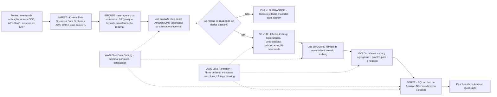
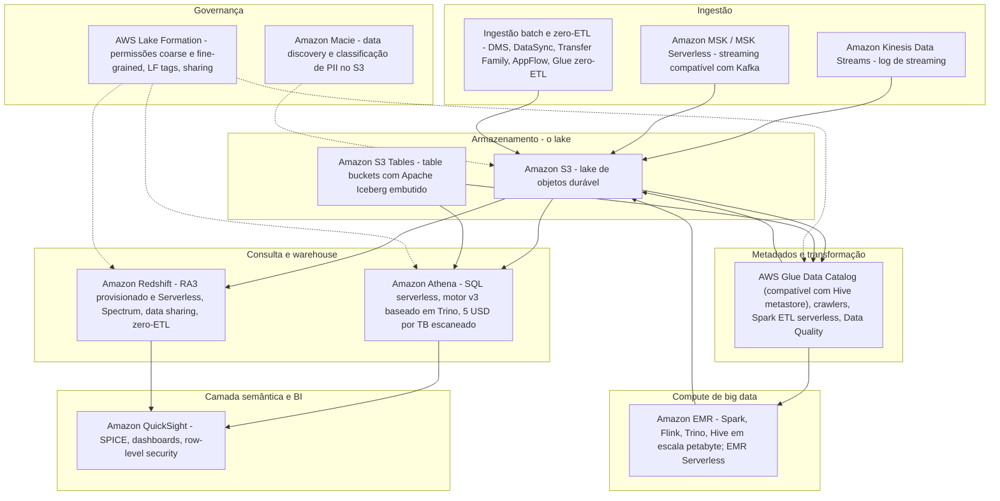
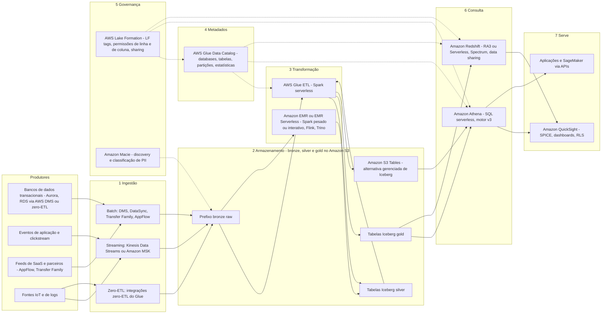
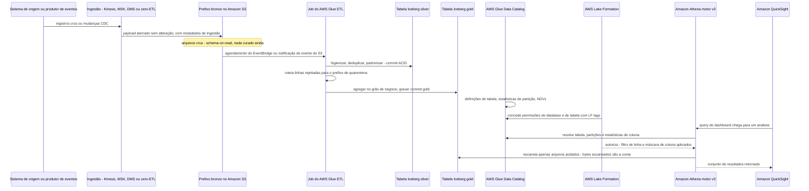
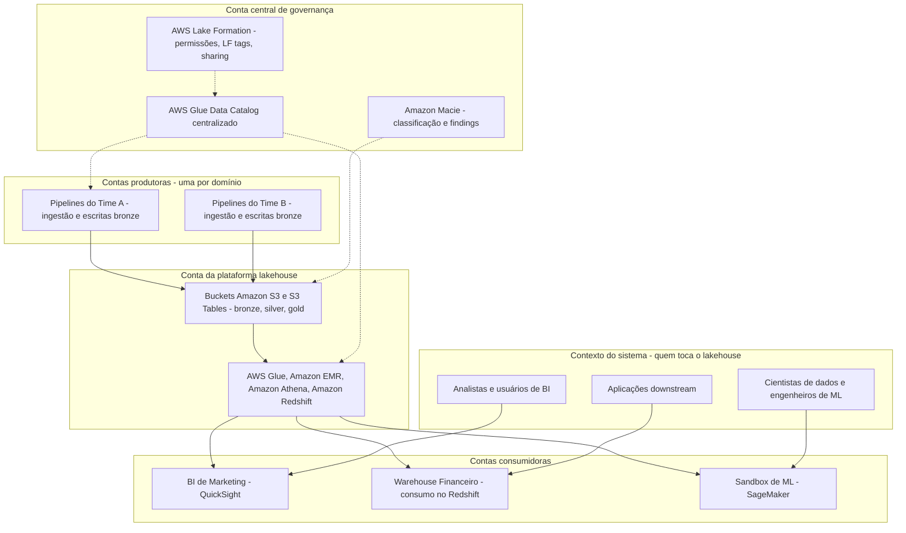

# Fundamentos da Arquitetura Lakehouse: Lakes, Warehouses e o Padrão Medalhão

A AWS define o termo assim: "Um lakehouse de dados é uma arquitetura de dados unificada que combina data warehouses e data lakes, oferecendo capacidades de analítica como estruturação, governança e geração de relatórios. O lakehouse de dados pode armazenar dados brutos em uma variedade de formatos, de milhares a centenas de milhares de fontes, em um local central" (AWS *What is a Data Lakehouse?*, acesso em 2026-10-11). A mesma página acrescenta a frase que governa cada decisão de design deste curso: "O compute de um lakehouse de dados é separado do armazenamento. Com armazenamento e compute separados, você pode escalar essas funções de forma independente para maximizar a economia de custos."

Isso é uma definição, ainda não uma arquitetura. Entre a frase e uma plataforma em funcionamento há três perguntas que esta lição responde: **qual store você realmente está construindo** (lake, warehouse ou lakehouse), **como os dados são estratificados dentro dele** (o padrão medalhão) e **como ele é processado** (batch, Lambda ou Kappa) — mais o mapa de serviços da AWS que implementa cada posição. Tudo da lição 02 até a lição 17 é detalhe de implementação do esqueleto que você constrói aqui.

A maioria das equipes encontra essas três palavras na ordem errada: escolhe os serviços primeiro, depois descobre que não tem nem uma fonte única de verdade nem um arquivo barato. Nós faremos ao contrário — o padrão primeiro, os serviços em segundo lugar.

**Nesta lição você vai:**

- separar um data lake, um data warehouse e um lakehouse usando as definições publicadas pela AWS e depois aplicar uma **tabela de decisão** a requisitos concretos;
- ler as seis diferenças publicadas pela AWS (timing de schema, qualidade de dados, usuários, adequação analítica, preço/desempenho, posture de custo) que decidem o store antes de qualquer serviço ser nomeado;
- entender por que **Parquet no Amazon S3 ainda não é um lakehouse** e que capacidades um formato de tabela aberto adiciona;
- atribuir responsabilidades às camadas medalhão **bronze, silver e gold** e mapear cada uma a primitivas reais da AWS (buckets, prefixos, databases do Glue, tabelas Iceberg);
- escolher entre os padrões de processamento **somente batch, Lambda e Kappa**, incluindo a armadilha de nomenclatura sobre a qual o próprio whitepaper da AWS avisa;
- posicionar dez serviços analíticos centrais — **S3, Glue, Athena, Redshift, QuickSight, Kinesis, MSK, EMR, Lake Formation, Macie** — em um único mapa de camadas;
- percorrer a **arquitetura de referência ponta a ponta** duas vezes: como diagrama de fluxo e como diagrama de sequência, além da visão de contêineres com múltiplas contas;
- resolver **sete exemplos resolvidos com preços** usando preços de lista reais (em out 2026), incluindo um **esboço de dimensionamento de pipeline de 10 TB/dia**;
- estudar três casos de clientes da AWS — **FINRA, Easygo e BMW Group** — e ler os números deles como um profissional deve ler;
- conferir a **caixa de atualizações de 2026** (S3 Tables, S3 Vectors, Glue 6.0, Quick Suite) e o **roadmap do curso** para as dezesseis lições que se seguem.

---

## 1. Lake, warehouse, lakehouse: as três definições que a AWS realmente publica

Três termos, três promessas diferentes. O caminho mais rápido para usá-los mal é tratá-los como tamanhos ("somos grandes demais para um warehouse") em vez de tratá-los como **contratos sobre schema, curadoria e acesso**.

### 1.1 O data warehouse

Página de comparação da AWS: "Um data warehouse armazena dados em formato estruturado. É um repositório central de dados pré-processados para analítica e business intelligence." A página de conceitos de data lake acrescenta o mecanismo: "Um data warehouse é um banco de dados otimizado para analisar dados relacionais vindos de sistemas transacionais e de aplicativos de linha de negócio. A estrutura dos dados e o schema são definidos antecipadamente… Os dados são limpos, enriquecidos e transformados para que possam atuar como a 'fonte única de verdade' em que os usuários podem confiar."

O movimento definidor do warehouse é **schema on write**: o formato e o padrão de qualidade são decididos *antes* dos dados chegarem, e é por isso que a mesma página pode atribuir a ele "relatórios em lote, BI e visualizações" e "dados altamente curados que servem como a versão central da verdade" (página de comparação da AWS, acesso em 2026-10-11). Na AWS, a expressão gerenciada desse padrão é o **Amazon Redshift** (RA3 provisionado e Serverless, com Spectrum para tabelas de lake).

### 1.2 O data lake

AWS: "Um data lake é um repositório centralizado que permite armazenar todos os seus dados estruturados e não estruturados em qualquer escala" (AWS *What is a Data Lake?*, rodapé da página "Updated 2025", acesso em 2026-10-11). A página de comparação fornece o counterpart do schema-on-write: o schema é "Escrito no momento da análise (schema-on-read)", a qualidade de dados é "Quaisquer dados que podem ou não ser curados" e a lista de analítica é "Machine learning, analítica exploratória, data discovery, streaming, analítica operacional, big data e profiling".

A disciplina de carga decorre disso: "As organizações normalmente usam ferramentas de Extract, Load, Transform (ELT). Elas carregam os dados no lake primeiro e os transformam apenas quando necessário." O argumento de custo é explícito — "data lakes oferecem um custo comparativamente menor para mais volume, especialmente para grandes quantidades de imagens e vídeos". O modo de falha é igualmente explícito, e você vai encontrá-lo em todo post-mortem: **"um data lake não gerenciado pode levar a data swamps. Data swamps são um estado de dados desorganizados que dificulta a extração de insights significativos"** (AWS *What is a Data Lakehouse?*, acesso em 2026-10-11).

### 1.3 O lakehouse

O lakehouse é a *combinação*, e a AWS tem o cuidado de chamá-lo de arquitetura, não de produto. O whitepaper legado da AWS o formula como um padrão: "Lake house — Uma lake house é um padrão arquitetural que combina os melhores elementos de data warehouses e data lakes. Lake houses permitem consultar dados entre o seu data warehouse, o seu data lake e bancos de dados operacionais… Com uma arquitetura lake house, você pode armazenar dados em formatos de arquivo abertos no seu data lake e consultá-los no lugar, fazendo join com dados do data warehouse" (AWS *Data Warehousing on AWS*, banner da página: "This whitepaper is for historical reference only", acesso em 2026-10-11).

A AWS também publica as **camadas lógicas** desse padrão, que se tornam a espinha dorsal de todo este curso:

| Camada (ordem da AWS) | O que faz (redação da AWS, acesso em 2026-10-11) | Onde vive neste curso |
|---|---|---|
| Camada de ingestion | Traz dados batch, de streaming e zero-ETL das fontes | Lições 05 e 06 |
| Camada de armazenamento | Armazenamento de objetos; "algumas transformações de dados são realizadas após o armazenamento… transforme e armazene os dados em formato Parquet" | Lições 02 e 03 |
| Camada de metadados (também chamada de staging) | "fornece suporte a schema para governar, organizar e otimizar dados… transações ACID, indexação de arquivos, versionamento de dados e cache" | Lições 04, 07 e 12 |
| Camada de API | Acesso programático aos dados e ao seu catálogo | Lições 11 e 12 |
| Camada semântica (a mais alta) | "também conhecida como a camada de consumo de dados" — ferramentas de BI, relatórios | Lições 09, 10 e 17 |

> [!NOTE]
> **Por que as camadas importam mais que os rótulos.** Um lakehouse não é definido pelo logo de qual fornecedor está no cluster. Ele é definido pela combinação de (a) armazenamento aberto e barato, (b) uma camada de metadados transacional sobre esse armazenamento, (c) um catálogo que o governa e (d) compute independente que pode ler a mesma cópia. Remova qualquer um dos quatro e você tem uma arquitetura diferente, com um conjunto diferente de modos de falha.

### 1.4 A tabela de decisão

Esta é a tabela para manter aberta durante cada design review. Cada linha vem da comparação warehouse-versus-lake da página de comparação da AWS mais a página de definição de lakehouse (todas com acesso em 2026-10-11).

| Eixo de decisão | Data warehouse (Redshift) | Data lake (S3, cru) | Lakehouse (S3 + formato de tabela aberto + catálogo) |
|---|---|---|---|
| Timing de schema | Schema **on write** — "definido antecipadamente" | Schema **on read** — "escrito no momento da análise" | Schema on read, com **evolução imposta** e commits ACID por cima |
| Tipos de dados | Estruturado, relacional | "dados estruturados e não estruturados em qualquer escala" | Cru em qualquer formato no bronze; formatos abertos estruturados (Parquet/ORC/Avro) em silver/gold |
| Qualidade de dados | "Altamente curados… versão central da verdade" | "Quaisquer dados que podem ou não ser curados" | Curados **por camada**: bronze cru, silver validado, gold agregado |
| Usuários principais | Analistas de BI, consumidores de relatórios | ML/exploratório, data discovery, profiling | Ambos — analistas no gold, cientistas de dados no silver/bronze |
| Adequação analítica | "Relatórios em lote, BI e visualizações" | "ML, analítica exploratória, data discovery, streaming, analítica operacional, big data" | Todos os anteriores em **uma cópia de dados**, consultável no lugar |
| Preço / desempenho | Ajustado a desempenho; o preço segue nós/RPUs | "Custo comparativamente menor para mais volume" | Armazenamento e compute escalam de forma independente — AWS: "escale essas funções de forma independente para maximizar a economia de custos" |
| Modo de falha clássico | Rígido, caro para arquivos de petabyte, lento para onboardar novos formatos | **Data swamp**; "exige expertise técnica adicional" | Proliferação de tabelas e manutenção de arquivos sem governance se compactação e retenção forem ignorados |
| Servisços AWS típicos | Amazon Redshift (RA3, Serverless, data sharing) | Amazon S3 + catálogo do AWS Glue + Athena (ad hoc) | S3 / S3 Tables + Glue + Lake Formation + Athena **e** Redshift + QuickSight |
| Escolha quando… | "Dados relacionais estruturados, SLAs apertados de BI, fonte única de verdade curada" | Arquivos grandes e baratos, workloads de ML/exploratório, dados não estruturados mistos | Você precisa de estrutura de nível warehouse **e** armazenamento aberto em escala de lake, com vários motores em uma cópia |

**Como usar a tabela.** Comece na última linha e leia de baixo para cima. Se a frase de requisito contém *fonte única de verdade* e *SLAs apertados de BI*, você está na coluna 1. Se contém *imagens, vídeos, treino de modelo, schema desconhecido no ano que vem*, você está na coluna 2. Se contém *ambos, e eu me recuso a copiar os dados duas vezes*, você está na coluna 3 — e o FAQ do SageMaker Lakehouse declara o motivo econômico sem rodeios: "você não precisa migrar os seus dados… acesse e consulte os seus dados no lugar" (acesso em 2026-10-11).

Note que a AWS não apresenta isso como um concurso de tudo-ou-nada: "A maioria das grandes organizações usa uma combinação de data lakes, warehouses e marts em sua infraestrutura de armazenamento" (página de comparação da AWS, acesso em 2026-10-11). O lakehouse é a arquitetura que permite que essas peças compartilhem uma única cópia governada em vez de três.

```matching
{
  "question": "Relacione cada arquitetura à frase publicada pela AWS que a define (todas citadas, acesso em out 2026):",
  "pairs": [
    {"left": "Data warehouse", "right": "Um repositório central de dados pré-processados; o schema é definido antecipadamente e os dados se tornam a 'fonte única de verdade' em que os usuários podem confiar"},
    {"left": "Data lake", "right": "Um repositório centralizado para dados estruturados e não estruturados em qualquer escala, carregado primeiro e transformado apenas quando necessário (schema-on-read)"},
    {"left": "Data lakehouse", "right": "Uma arquitetura de dados unificada que combina data warehouses e data lakes, com compute separado do armazenamento para que cada um escale de forma independente"},
    {"left": "Data mart", "right": "Um subconjunto mais estreito de dados de warehouse para um único time ou área de assunto — a terceira coluna que a AWS agrupa com lakes e warehouses"},
    {"left": "Data swamp", "right": "O estado de um data lake não gerenciado: dados desorganizados que dificultam a extração de insights significativos"}
  ],
  "explanation": "Cada frase é uma citação direta da AWS, então o mapeamento é fixo e não questão de gosto. A frase do warehouse traz 'pré-processados' e 'antecipadamente' (schema on write); a do lake traz 'qualquer escala' e 'carregar primeiro, transformar quando necessário'; a do lakehouse traz 'unificada' mais 'armazenamento e compute separados'. Data mart é a estreita, e o data swamp é o que acontece quando um lake não recebe curadoria nem governança — a falha que as camadas silver e gold, somadas às permissões do Lake Formation, existem para prevenir."
}
```

- **📚 Você sabia?** A página de comparação da AWS trata lake, warehouse e mart como *inventário complementar*, não como rivais — "A maioria das grandes organizações usa uma combinação de data lakes, warehouses e marts em sua infraestrutura de armazenamento" (acesso em 2026-10-11). A armadilha funciona nos dois sentidos: qualquer documento de design que afirme que você precisa escolher exatamente um dos três está discutindo com a própria página da AWS.

---

## 2. Por que Parquet no Amazon S3 ainda não é um lakehouse

Esta é a confusão mais cara do campo, por isso ganha sua própria seção. Um bucket cheio de arquivos Parquet bem particionados e bem comprimidos é um **data lake**. Ele vira um lakehouse apenas quando uma camada de metadados transacional se assenta sobre ele.

O AWS Prescriptive Guidance é incomumente direto sobre o que falta aos lakes comuns. Lakes de objetos tradicionais/no formato Hive "não fornecem suporte a semântica de processamento ACID (atomicidade, consistência, isolamento e durabilidade)", e não podem nativamente:

- "Realizar atualizações e exclusões eficientes em nível de registro à medida que os dados mudam no seu negócio";
- "Gerenciar o desempenho de queries à medida que as tabelas crescem até milhões de arquivos e centenas de milhares de partições";
- "Garantir consistência de dados entre múltiplos escritores e leitores concorrentes";
- "Prevenir corrupção de dados quando operações de escrita falham no meio da operação";
- "Evoluir schemas de tabela ao longo do tempo sem (parcialmente) reescrever os datasets".

(Using Apache Iceberg on AWS — *Modern data lakes*, acesso em 2026-10-11.) A mesma fonte observa que essas lacunas são "particularmente prevalentes" para change data capture, privacidade/exclusão e ingestão de streaming — três workloads que este curso cobre nas lições 05, 06 e 13.

O formato de tabela aberto responde com uma lista de recursos que a AWS publica literalmente: "Excluir, atualizar e mesclar" · "Planejamento de scan rápido e filtragem avançada" · "Evolução completa de schema" · "Evolução de partição" · "Particionamento oculto" · "Rollback de versão" · "Time travel" · "Isolamento serializável" · "Escritores concorrentes" · "Formatos de arquivo abertos" (Parquet, Avro, ORC).

> [!WARNING]
> ⚠️ **A armadilha do "já temos Parquet".** Se o seu lake não consegue responder com segurança *quem gravou este arquivo, este commit está visível para outros leitores, posso voltar para ontem, posso excluir um único cliente sem reescrever partições*, então você tem um lake de arquivos com boa taxa de compressão — não um lakehouse. Antes de aprovar uma arquitetura, percorra os cinco bullets da AWS acima e aponte o componente que fornece cada um. "Nós escreveríamos código customizado para isso" é a resposta que vira um projeto de plataforma de vários anos; o formato de tabela é a resposta que vira a lição 04.

Dois fatos de apoio que você vai reutilizar em todo o curso: a AWS lista o Apache Iceberg como "suportado por serviços AWS como Amazon EMR, Amazon Athena, Amazon Redshift, AWS Glue e Amazon SageMaker", e "o Athena… usa o AWS Glue Data Catalog como o metastore do Iceberg" (Prescriptive Guidance, acesso em 2026-10-11). O catálogo e o formato de tabela são componentes diferentes que precisam ser desenhados juntos — uma distinção que a lição 07 torna operacional.

```fillblank
{
  "question": "Complete a frase que separa um data lake de um lakehouse na AWS:",
  "template": "{{1}} é a arquitetura unificada que combina a estrutura de um warehouse com armazenamento aberto em escala de lake; na AWS ela é montada a partir de formatos de arquivo abertos como Parquet mais um formato de tabela aberto como {{2}}, um catálogo compatível com Hive metastore no {{3}}, e permissões coarse ou fine-grained concedidas pelo {{4}}.",
  "answers": {
    "1": "Data lakehouse",
    "2": "Apache Iceberg",
    "3": "AWS Glue Data Catalog",
    "4": "AWS Lake Formation"
  },
  "distractors": ["Data mart", "Amazon Redshift Spectrum", "Amazon Athena", "Amazon Macie"],
  "explanation": "A AWS define o data lakehouse como a arquitetura unificada que combina warehouses e lakes com armazenamento e compute separados; o Iceberg é o formato de tabela aberto que a AWS documenta no EMR, Athena, Redshift, Glue e SageMaker; o Glue Data Catalog é o armazenamento de metadados compatível com Hive metastore que o Athena usa como metastore do Iceberg; e o Lake Formation é o serviço que 'fornece permissões de controle de acesso coarse e fine-grained'. O distrator principal, Amazon Macie, é um serviço de data discovery e classificação de PII — ele diz o que há no lake, mas não concede nem nega acesso de consulta."
}
```

---

## 3. O padrão medalhão: bronze, silver e gold

Uma vez tomada a decisão de store, a próxima pergunta é *que formato os dados assumem à medida que saem do cru e entram na confiança?* A resposta da AWS é a **arquitetura medalhão**, definida no próprio workshop do Builder Center da AWS como "um padrão de design de dados que promove qualidade, consistência e governança de dados por meio de uma abordagem em camadas" (acesso em 2026-10-11).

### 3.1 As três camadas e suas responsabilidades

| Camada | Redação da AWS sobre a responsabilidade | O que pode mudar aqui | Gate de qualidade típico | Implementação AWS típica |
|---|---|---|---|---|
| **Bronze** (cru) | "Ingesta dados brutos de várias fontes com transformação mínima" | Nada além do pouso: preservar o payload, timestamps de origem e metadados de ingestão | Schema descoberto, não imposto; contagem de linhas reconcilia com a origem | Prefixo ou bucket S3 por fonte; JSON/CSV/Avro cru; entrega via Firehose/Kinesis/DMS; registro com crawlers do Glue |
| **Silver** (higienizado) | "Aplica regras de qualidade de dados, deduplicação e padronização" | Tipos, nullability, chaves de dedupe, dimensões conformadas, mascaramento de PII | Regras de DQ explícitas passam; falhas roteadas para um caminho de quarentena | Tabelas Iceberg no S3 ou S3 Tables; job Spark do Glue/EMR; regras do Glue Data Quality (DQDL); máscaras de coluna do Lake Formation |
| **Gold** (pronto para o negócio) | "Cria datasets agregados e prontos para o negócio, otimizados para analítica" | Grão de agregação, medidas, dimensões lentamente mutáveis, nomes semânticos | Contrato de uma linha por entidade de negócio; SLA de frescor | Tabelas Iceberg ou materialized views; uma tabela por área de assunto; leitura via Athena/Redshift; dashboards no QuickSight |

Três propriedades desta tabela valem a pena memorizar. **Primeiro**, as camadas são *progressivas*: cada salto eleva a garantia e estreita o público. **Segundo**, a camada é um limite **lógico**, não um produto da AWS — bronze/silver/gold mapeiam para prefixos ou buckets S3, databases do Glue Data Catalog e tabelas Iceberg; a AWS apresenta o padrão em um workshop e em um blog, não como um serviço gerenciado. **Terceiro**, o caminho de quarentena faz parte do silver, não é um pensamento posterior: um registro que falha em uma regra precisa cair em algum lugar observável, em vez de desaparecer em silêncio.

### 3.2 O padrão medalhão na AWS, ponta a ponta



### 3.3 O que cada camada *não* é

- **Bronze não é uma zona de despejar e esquecer.** Ainda precisa de regras de retenção, criptografia e uma entrada no catálogo; a best practice **BP 3.7** do Well-Architected Data Analytics Lens é "Implementar políticas de retenção de dados para cada classe de dados no workload de analítica", e a **BP 3.5** é "Registrar classificações de dados no Data Catalog para que os workloads de analítica possam entender" (AWS Well-Architected Data Analytics Lens, data de publicação 2023-12-22, anunciado como lens em 26 de março de 2024; acesso em 2026-10-11).
- **Silver não é opcional** se você quer um lakehouse e não um swamp: é onde "um data lake não gerenciado pode levar a data swamps" é prevenido, uma tabela validada por vez. A Lens **BP 1.1** é "Validar a qualidade de dados dos sistemas de origem antes de transferir dados para analítica", e a **BP 1.2** é "Monitorar métricas operacionais dos jobs de processamento de dados e a disponibilidade dos dados de origem".
- **Gold não é "o extrato de relatório".** Ainda é uma tabela aberta que Athena, Redshift, SageMaker e motores de terceiros podem consultar no lugar — é isso que impede que ela vire um silo proprietário dois anos depois.

O ponto de partida prescritivo da AWS para um salto batch noturno, se você quer números em vez de opiniões: "Tamanho do arquivo: 128 MB, porque tarefas do Apache Spark processam dados em blocos de 128 MB"; "Tipo de escrita: copy-on-write"; "Variáveis de partição: year/month/day"; "Ordem de classificação: timestamp"; "Data catalog: AWS Glue Data Catalog" (AWS Prescriptive Guidance, arquiteturas de referência para Apache Iceberg na AWS, acesso em 2026-10-11).

**Exemplo resolvido E1 — quantos arquivos um dia de bronze realmente cria? (em out 2026)**

Uma fonte entrega **10 TB por dia** no bronze, e você segue o tamanho de arquivo alvo do Prescriptive Guidance de **128 MB** para que tarefas do Spark mapeiem um-para-um com os arquivos.

- 1 TB = 1,024 GB = 1,048,576 MB, logo 10 TB = **10,485,760 MB**
- 10,485,760 MB ÷ 128 MB = **81,920 arquivos por dia**
- Com particionamento year/month/day (a recomendação da AWS), uma única partição-dia recebe cerca de **82,000 objetos** — e é exatamente por isso que "tabelas crescem até milhões de arquivos" aparece na lista de problemas de lakes comuns da AWS, e por que a compactação (lição 04) e o planejamento de partições (lição 03) não são extras opcionais
- Um mês de bronze nesse ritmo: 81,920 × 30 = **2,457,600 arquivos**. Gerencie esse número com metadados do Iceberg, não com `ls` em um bucket

**Takeaway:** as camadas medalhão são baratas de descrever e caras de pular. O salto bronze→silver é onde a qualidade de dados mora, o salto silver→gold é onde o significado de negócio mora, e a faixa catálogo mais Lake Formation é o que torna ambos legíveis pelas pessoas certas.

- **📚 Você sabia?** A AWS publica uma versão de três frases desse padrão: com materialized views do Apache Iceberg no Amazon SageMaker, "você pode construir uma arquitetura medalhão Bronze, Silver e Gold como três statements SQL", e quando você configura o refresh agendado, "o AWS Glue Data Catalog usa compute Spark gerenciado para atualizar incrementalmente a materialized view" (AWS Big Data Blog, acesso em 2026-10-11). O padrão é portátil — o *mecanismo* (quem roda o refresh, em qual compute) é o que você realmente está escolhendo nas lições 08 e 11.


---

## 4. Batch, Lambda ou Kappa: escolhendo o padrão de processamento

As camadas medalhão dizem *que formato* os dados assumem. O padrão de processamento diz *quantos pipelines* você precisa construir, testar e operar. Existem três respostas documentadas, e a AWS publica as três.

### 4.1 Somente batch

Aterre arquivos ou streams no S3, processe em um agendamento (Glue ou EMR), sirva com Athena ou Redshift. A "batch layer" do whitepaper de Lambda produz "batch views" que são "armazenadas em uma camada de armazenamento persistente". Simples, o mais barato de rodar, e a latência é igual ao seu agendamento: um job noturno significa que dashboards estão, no pior caso, uma noite defasados, e cada arquivo que chega atrasado se silenciosamente no incidente da semana seguinte.

### 4.2 Arquitetura Lambda (o padrão)

O whitepaper da AWS a define como "um padrão de design de processamento de dados para lidar com quantidades massivas de dados e integrar processamento em lote e em tempo real dentro de um único framework". Dois caminhos rodam em paralelo:

- uma **batch layer** calculando *batch views* autoritativas — exatas, completas, recalculadas sobre o histórico inteiro;
- uma **speed layer** produzindo *incremental views* — "Kinesis Data Firehose – À medida que os dados são ingeridos em tempo real, os clientes podem usar o Kinesis Data Firehose para facilmente agregar e comprimir os dados para gerar incremental views";
- uma **camada de serving** onde "a query mesclada tem como objetivo unir e analisar os dados da batch view da batch layer e da incremental stream view da speed layer".

O custo operacional dessa correção é que você agora é dono de dois codepaths que precisam concordar, mais um passo de mescla que precisa reconciliar dados atrasados e fora de ordem.

### 4.3 Arquitetura Kappa

Um pipeline, um codebase, reprocessamento por replay. O walkthrough do Builder Center da AWS (18 de maio de 2026, acesso em 2026-10-11): "É Kappa: um único pipeline unificado de streaming que lida com tudo. Na AWS, isso significa Kinesis Data Streams, Spark Structured Streaming no EMR…" — com um formato de tabela no S3 como camada durável e uma "janela de replay de 24 horas: o Kinesis retém eventos" conforme apresentado naquele artigo.

Kappa troca a exatidão da batch layer por simplicidade operacional: a correção vem da capacidade de fazer replay do mesmo código sobre o mesmo log, o que só é possível dentro da janela de retenção do stream — tudo mais antigo precisa vir do lake (veja §8.2).

```mermaid
flowchart TB
    subgraph BATCH["Somente batch: um caminho agendado"]
        B1["Fontes"] --> B2["S3 raw / bronze"]
        B2 --> B3["Job do Glue ou EMR em um agendamento"]
        B3 --> B4["Tabelas silver e gold"]
        B4 --> B5["Athena / Redshift / QuickSight - o frescor é igual ao agendamento"]
    end
    subgraph LAMBDA["Padrão Lambda: dois caminhos paralelos"]
        L1["Fontes"] --> L2["Caminho batch: S3 depois Glue/Spark depois batch views"]
        L1 --> L3["Caminho speed: Kinesis / Firehose depois streaming job depois incremental views"]
        L2 --> L4["Camada de serving mescla batch views e incremental views"]
        L3 --> L4
        L4 --> L5["Athena / Redshift / QuickSight - menor latência para eventos recentes"]
    end
    subgraph KAPPA["Padrão Kappa: um caminho de streaming mais replay"]
        K1["Fontes"] --> K2["Kinesis Data Streams - janela de replay conforme apresentada: 24 horas"]
        K2 --> K3["Spark Structured Streaming no EMR ou Glue Real-Time Mode"]
        K3 --> K4["Formato de tabela no S3 - a cópia durável"]
        K4 --> K5["Reprocessar fazendo replay do stream, ou relendo o lake"]
        K4 --> K6["Athena / Redshift / QuickSight - um único codebase para manter"]
    end
```



### 4.4 A escolha, em uma tabela

| Padrão | Latência | Pipelines para manter | História de reprocessamento | Postura de custo (âncoras em out 2026) | Escolha quando |
|---|---|---|---|---|---|
| **Somente batch** | Igual à cadência do agendamento (minutos a 24 h) | Um | Re-executar o job sobre os arquivos no S3 | O mais barato: Glue a **$0.44 por DPU-hour** (1 DPU = 4 vCPU + 16 GB, cobrança por segundo, mínimo de 1 minuto); Athena a **$5.00 por TB escaneado** | "Tolerante a latência, custo mínimo" — relatórios diários ou horários, cargas de back-office |
| **Lambda** | Segundos para eventos recentes, mais a batch autoritativa | Dois (batch + speed) | O caminho batch é exato; o caminho speed faz replay dentro da retenção do stream | Dois codepaths, duas suítes de teste; o próprio blog de Lambda do Redshift da AWS observa que ambos os paradigmas "operam em silos, o que resulta em redundância de dados e overhead operacional para mantê-los" | Você precisa de recálculos históricos matematicamente completos **mais** views de baixa latência, e consegue operar dois pipelines |
| **Kappa** | Segundos a sub-segundos | Um | Replay do stream dentro da retenção; além dela, reler o lake | Um codebase; replay de histórico longo é mais lento que um job batch sobre arquivos colunares | "Real-time-first, um único codebase, custo de replay aceitável" |

> [!IMPORTANT]
> **⚠️ Arquitetura Lambda ≠ AWS Lambda.** O whitepaper diz isso ele mesmo: "A arquitetura Lambda é distinta e não deve ser confundida com o serviço de compute AWS Lambda." As três camadas *do padrão* são batch, speed e serving. O AWS Lambda (o serviço de functions) pode implementar peças de qualquer uma delas, mas nomear um serviço de functions não faz do seu design uma arquitetura Lambda — e uma design review que confunde os dois vai discutir a coisa errada durante uma hora.

**Exemplo resolvido E2 — um requisito, três arquiteturas, com preços (em out 2026)**

Requisito: clickstream de e-commerce + pedidos + dumps noturnos de ERP; a diretoria quer dashboards **em até 15 minutos** após o pouso dos dados, mais um sandbox de ciência de dados. Duzentos leitores de dashboard.

- **Custo compartilhado de serving:** 200 leitores × **$3 por usuário/mês** = **$600.00 por mês** (QuickSight Reader, página de preços com acesso em 2026-10-11).
- **Custo compartilhado de transformação batch:** um job noturno bronze→silver a 10 DPU × 20 minutos = 3.333 DPU-hours × **$0.44** = **$1.47 por noite**, ou seja, **$44.00 por mês**.
- **Custo compartilhado de consulta:** se a camada de BI escanear **1 TB por dia** no agregado, são 30 TB/mês × **$5.00 por TB** = **$150.00 por mês** no Athena.
- **(a) Somente batch:** apenas essas três linhas — cerca de **$794.00 por mês** de gasto serverless diretamente atribuível — mas o frescor do dashboard é igual à cadência do job, então um SLA de 15 minutos forçaria 96 execuções por dia em vez de uma, multiplicando a linha do Glue por ~96 e *ainda* falhando em modelar eventos ao vivo.
- **(b) Lambda:** o mesmo caminho batch mais um caminho speed de Kinesis → streaming job gravando incremental views nas mesmas tabelas gold. O frescor cai para segundos em eventos recentes; agora você é dono de dois codepaths mais a mescla. O caminho de streaming adiciona cobranças de Kinesis Data Streams e de compute de streaming — orçe essas separadamente, porque esta lição só ancora preços publicados pela AWS nas páginas de Glue, Athena e QuickSight.
- **(c) Kappa:** um único caminho de Kinesis → Spark Structured Streaming para o formato de tabela no S3, com backfills refeitos a partir do stream dentro da janela de replay de **24 horas** apresentada, e a partir do lake além dela.

**Veredito para este cenário:** o SLA de 15 minutos elimina o somente batch em qualquer contagem razoável de execuções, e um time de cinco pessoas não consegue confortavelmente manter dois codepaths de produção — então Kappa, com o lake (não o stream) como system of record do histórico. Isso é um *juízo sustentado pela tabela do §4.4*, não uma regra universal: se um requisito regulatório exigir recálculo exato em batch de cada view histórica, o Lambda continua sendo o padrão correto.

- **📚 Você sabia?** O whitepaper de Lambda fecha com um fato que explica por que todo este curso pode ser serverless: "Amazon Glue, Amazon S3, Amazon Athena e Amazon Kinesis são serviços serverless." Você pode rodar as camadas batch, speed e serving de qualquer um dos três padrões sem provisionar um cluster — e é por isso que as linhas de custo do E2 são citadas por hora e por TB, e não por instância (AWS Lambda Architecture whitepaper, acesso em 2026-10-11).

---

## 5. O panorama de serviços analíticos da AWS: onde cada serviço se encaixa

O próprio guia de estratégia da AWS resume o mapa em uma frase: "você pode executar streaming em tempo real com o Kinesis ou o Amazon MSK, processamento de dados com o Amazon EMR ou o AWS Glue, busca com o Amazon OpenSearch, queries ad hoc com o Athena e data warehousing com o Amazon Redshift" (AWS Prescriptive Guidance, *AWS modern data architecture*, acesso em 2026-10-11). A governança atravessa a frase inteira: "O AWS Lake Formation ajuda a governar dados e a compartilhá-los pela empresa. Além disso, você pode criar um data catalog exclusivo no AWS Glue e um glossário de negócios usando o Amazon DataZone… para permitir que seus funcionários encontrem os dados de que precisam."



### 5.1 O elenco, uma linha para cada

| Serviço | Camada que ocupa | Papel em uma linha (redação da AWS quando citada) | Âncora de preço para saber (em out 2026) |
|---|---|---|---|
| **Amazon S3** | Armazenamento | "S3 é o melhor lugar para construir data lakes" — armazenamento de objetos durável e escalável que guarda bronze/silver/gold | S3 Standard **$0.023 por GB-mês** (tier dos primeiros 50 TB); **$0.022** (51–100 TB); **$0.021** (500 TB+) |
| **Amazon S3 Tables** | Armazenamento (tabelas gerenciadas) | Table buckets: "o primeiro cloud object store com suporte embutido a Apache Iceberg", com compactação orientada por política, gerenciamento de snapshots e remoção de arquivos não referenciados | **$0.0265 por GB-mês** Standard (primeiros 50 TB); PUT **$0.005/1,000**, GET **$0.0004/1,000** |
| **AWS Glue** | Metadados + transformação | Data Catalog (compatível com Hive metastore), crawlers, Spark ETL serverless, Data Quality (DQDL), otimização e estatísticas de tabelas Iceberg | **$0.44 por DPU-hour**; 1 DPU = **4 vCPU + 16 GB**; cobrança por segundo, mínimo de 1 minuto |
| **Amazon Athena** | Consulta (SQL serverless) | SQL interativo sobre S3 e Iceberg; o motor v3 "é baseado em Trino"; workgroups separam usuários e limitam gasto | **$5.00 por TB escaneado**, "arredondado para o megabyte mais próximo, com mínimo de 10 megabytes por query" |
| **Amazon Redshift** | Warehouse + ponte para o lake | RA3/RG com Redshift Managed Storage, Serverless, tabelas externas Spectrum sobre Iceberg, data sharing, zero-ETL | Provisionado "começa em **$0.543 por hora**"; Serverless "começa em **$1.50 por hora**", taxa de exemplo **$0.375 por RPU-hour**; Managed Storage **$0.024 por GB-mês** |
| **Amazon QuickSight** | Semântico / BI | Extracts em memória SPICE, dashboards, row-level security, acesso de leitores baseado em capacidade | Author **$24 por usuário/mês**; Reader **$3 por usuário/mês**; Reader Capacity "A partir de **$250** para 500 sessões/mês" |
| **Amazon Kinesis Data Streams** | Ingestão de streaming | Log de eventos durável alimentando o bronze; o caminho speed do Lambda e o caminho único do Kappa | Retenção padrão apresentada como janela de replay de **24 horas** no walkthrough de Kappa da AWS (2026-05-18) |
| **Amazon MSK / MSK Serverless** | Ingestão de streaming | "Streaming compatível com Apache Kafka para clientes que querem a semântica do Kafka", nomeado ao lado do Kinesis no guia de modern data architecture | Precificado por broker-hour mais armazenamento — confirme na página de preços do MSK antes de citar em um business case |
| **Amazon EMR** | Compute de big data | "processamento de dados em escala petabyte, analítica interativa e machine learning usando frameworks open source como Apache Spark, Flink, Trino e Hive" em EC2, EKS, Outposts ou EMR Serverless | Instance-hours (EC2) ou uso serverless por segundo — orçe por job, não por mês |
| **AWS Lake Formation** | Governança | "fornece permissões de controle de acesso coarse e fine-grained para acessar dados, incluindo tabelas Iceberg consumidas pelo Athena ou pelo Amazon Redshift" | Sem cobrança de processamento de dados; o custo é disciplina de design, não dólares |
| **Amazon Macie** | Governança / discovery | Data discovery e classificação de PII na stack de segurança de modern data architecture ao lado de KMS, IAM, Secrets Manager e Audit Manager | Discovery por bucket mais findings de dados sensíveis por objeto |

### 5.2 Regras de posicionamento que sobrevivem à tabela

1. **O S3 é o piso.** Todo padrão da lição 01 aterra dados no S3 ou no S3 Tables primeiro; nada acima da camada de armazenamento pode virar o system of record.
2. **O Glue é a espinha, não apenas um executor de jobs.** Ele é dono do catálogo (camada de metadados) *e* da transformação serverless (bronze→silver→gold). A lição 07 é inteiramente este serviço.
3. **Athena e Redshift são alternativas sobre a mesma cópia, não rivais.** Ambos consultam S3/Iceberg; o Redshift adiciona concorrência gerenciada, materialized views, data sharing e uma experiência de warehouse a custo de nó/RPU, enquanto o Athena é serverless e pay-per-TB-scanned — ideal para uso ad hoc e federado (exemplo resolvido E6).
4. **O Lake Formation é uma faixa, não uma caixa.** Ele envolve o catálogo e as tabelas, e os seus grants valem entre motores, não para uma ferramenta.
5. **O Macie classifica; o Lake Formation autoriza; o Glue cataloga.** Três serviços, três empregos. Confundir os dois primeiros é uma falha de security review, não preciosismo de nomenclatura.
6. **O EMR é a ferramenta de potência.** Spark, Flink, Trino e Hive em escala petabyte quando o Glue serverless não basta — e o EMR Serverless quando você quer essa potência sem uma frota de clusters.

- **📚 Você sabia?** O Amazon Macie nunca aparece sozinho na lista de segurança de modern data architecture da AWS — ele é nomeado com "AWS Key Management Service (AWS KMS), AWS Identity and Access Management (IAM), AWS Secrets Manager, AWS Audit Manager e Amazon Macie" (AWS Prescriptive Guidance, acesso em 2026-10-11). Criptografia, identidade, armazenamento de segredos, evidência de auditoria e data discovery são cinco empregos diferentes; a lição 14 atribui cada um.

**Exemplo resolvido E3 — a conta do Athena é uma decisão de layout, não de query (em out 2026)**

A AWS publica esta escada exata na sua página de preços do Athena (acesso em 2026-10-11). Tabela: **3 TB** de texto não comprimido no S3, **quatro colunas iguais**, a query lê **uma coluna**.

| Layout | Bytes escaneados para uma coluna | Custo por query (a $5.00 por TB) |
|---|---|---|
| Texto cru, sem partições | 3 TB | **$15.00** |
| GZIP comprimido 3:1 | 1 TB | **$5.00** |
| GZIP + Parquet (colunar, 1 de 4 colunas) | 0.25 TB | **$1.25** |

A própria página da AWS declara a aritmética: "O preço para 3 TB escaneados é 3 * $5/TB = $15", terminando em "$1.25" para o caminho otimizado — uma **diferença de 12× para a mesma resposta**. Escale: 20 queries desse tipo por dia × 30 dias = 600 queries.

- Ingênuo: 600 × 3 TB = 1,800 TB × $5.00 = **$9,000.00 por mês**
- Otimizado: 600 × 0.25 TB = 150 TB × $5.00 = **$750.00 por mês**
- **Diferença mensal: $8,250.00** — comprada inteiramente com formato e poda de colunas, antes de qualquer cluster ser redimensionado

**Exemplo resolvido E4 — precificando um job do Glue de bronze para silver (em out 2026)**

A página de preços do Glue (acesso em 2026-10-11): "O preço de 1 DPU-hour é $0.44"; "Um único DPU fornece 4 vCPU e 16 GB de memória"; a cobrança é "em incrementos de 1 segundo, arredondada para o segundo mais próximo, com duração mínima de 1 minuto por execução."

- Job pequeno, 6 DPU × 15 minutos: 6 × 0.25 h = 1.5 DPU-hours × $0.44 = **$0.66 por execução**; 30 execuções noturnas = **$19.80 por mês**
- Salto mais pesado, 10 DPU × 20 minutos: 3.333 DPU-hours × $0.44 = **$1.47 por execução**; × 30 = **$44.00 por mês**
- O padrão do Interactive Session é **5 DPU** (mínimo de 2 DPU); uma sessão de data preview do Glue Studio usa **2 DPUs por até 30 minutos**, com parada automática — a exploração é cobrada por sessão, não por mês
- O trabalho de otimização de tabela (compactação, estatísticas, auto-refresh de materialized view, crawlers) é listado a **$0.44 por DPU-hour** também, então a manutenção é um item medido, não overhead de graça
- A versão importa: a AWS anunciou em 21 de agosto de 2026 que "AWS Glue 6.0 está agora geralmente disponível, com uma redução de preço de 30% e suporte completo ao Apache Iceberg v3". Use como âncora conservadora o medidor publicado de **$0.44** e relia a página de preços para a sua Região e versão do Glue antes de comprometer uma previsão

**Exemplo resolvido E5 — quanto a camada de serving custa em assentos (em out 2026)**

Página de preços do QuickSight (acesso em 2026-10-11): Author **$24 por usuário/mês**, Reader **$3 por usuário/mês**, Reader Capacity "A partir de $250 para 500 sessões/mês", mais "Uma taxa de infraestrutura de $250/mês por conta se a sua conta tiver qualquer um dos seguintes: pelo menos um usuário Pro; Q&A habilitado via tópicos; Dashboard Q&A habilitado."

- 10 authors + 200 readers: (10 × $24) + (200 × $3) = $240.00 + $600.00 = **$840.00 por mês**, com **nenhuma** taxa de infraestrutura de $250 (sem usuário Pro, sem tópicos de Q&A)
- Some um usuário Pro e a taxa de conta de **$250 por mês** passa a valer: **$1,090.00 por mês** para as mesmas 210 pessoas — um salto de 30% por uma única mudança de papel, e é por isso que o design de papéis é um controle de custo na lição 17
- Alternativa de capacidade para leitores ocasionais: a partir de **$250 para 500 sessões/mês**, o que vence 84 leitores casuais a $3 cada (84 × $3 = $252.00) e passa a perder além disso — o modelo de assento vence quando os leitores viram usuários diários

```plot
{
  "type": "bar",
  "title": "USD mensais para um lakehouse de 10 TB/dia, componente por componente (em out 2026)",
  "data": [
    {"Component": "S3 storage: 300 TB raw text", "USD per month": 7065.6},
    {"Component": "S3 storage: 100 TB after 3:1 Parquet", "USD per month": 2355.2},
    {"Component": "Athena: 30 TB scanned", "USD per month": 150.0},
    {"Component": "QuickSight: 200 readers", "USD per month": 600.0},
    {"Component": "Glue: 30 nightly ETL runs", "USD per month": 44.0},
    {"Component": "Redshift Serverless: 128 RPU-hours", "USD per month": 48.0}
  ],
  "xKey": "Component",
  "yKey": "USD per month",
  "xLabel": "Componente do lakehouse (todos os valores derivados dos preços de lista da AWS)",
  "yLabel": "USD por mês"
}
```

Leia o gráfico em ordem: **o armazenamento domina a ingestão crua** (a barra mais alta), então compressão e política de lifecycle são as primeira alavancas de custo (lições 02 e 16); os custos de consulta e de BI são uma ordem de grandeza menores e são controlados pelo layout (E3) e pelo modelo de assentos (E5); o compute para a transformação agendada é a menor linha de todas (E4) — e é por isso que "vamos economizar escrevendo menos jobs do Glue" quase nunca é a otimização certa.

---

## 6. Arquitetura de referência ponta a ponta

### 6.1 O fluxo: da fonte ao dashboard

Esta é a espinha à qual toda lição posterior se conecta. Leia da esquerda para a direita e observe os dois planos de controle pontilhados — catálogo e governança — que tocam *cada* estágio, e não um só.



Os subgrafos numerados são a ordem de camadas da AWS do §1.3 com as zonas medalhão do §3 desenhadas dentro da camada de armazenamento — uma imagem, dois vocabulários.

### 6.2 A mesma arquitetura como uma conversa

Diagramas de fluxo escondem *ordenação* e *gatilhos*. Este diagrama de sequência mostra o que realmente acontece em um dia de dados, e onde a conta é gerada.



Três detalhes que o diagrama de fluxo não mostra. **(1)** O limite do commit ACID fica em cada salto medalhão, então leitores nunca veem dados meio gravados. **(2)** A decisão do Lake Formation acontece *antes* dos bytes serem escaneados, e é por isso que a governança é barata de impor cedo e cara de remendar depois. **(3)** O evento de cobrança do Athena é o scan, não a contagem de queries — a quantidade que você controla são os bytes lidos, e é por isso que as lições 03, 04 e 09 reenunciam a escada do E3.

### 6.3 A visão de contêineres: produtores, catálogo central, consumidores

A arquitetura de referência de crescimento e escala do AWS Prescriptive Guidance separa as contas deliberadamente: "Uma camada de produtores de dados em contas AWS diferentes"; "Uma camada de consumidores de dados em contas AWS diferentes"; "Um catálogo centralizado em uma conta AWS"; e "O catálogo centralizado é a interface usada pelos produtores e consumidores de dados para compartilhar e consumir dados" — com a intenção declarada de "padronizar o compartilhamento e o consumo de dados, e escalar produtores e consumidores de forma independente sem aumentar a sua sobrecarga de gerenciamento."



As linhas pontilhadas são o ponto: **metadados e permissões viajam pela conta de catálogo central, enquanto dados e compute ficam onde são econômicos.** Essa é a disciplina de desacoplamento que o caso da FINRA concretiza no §10.

**Exemplo resolvido E6 — Athena ou Redshift Serverless para o mesmo dashboard? (em out 2026)**

Um dashboard lê **50 GB** de Parquet por dia. Preços das páginas de preços do Athena e do Redshift (acesso em 2026-10-11):

- **Athena:** 50 GB × 30 = 1,500 GB = **1.5 TB por mês** escaneados × **$5.00 por TB** = **$7.50 por mês**, mais zero de custo ocioso, porque não há cluster
- **Redshift Serverless:** 64 RPU por ~2 horas por dia = 128 RPU-hours × **$0.375 por RPU-hour** = **$48.00 por mês**, mais Redshift Managed Storage a **$0.024 por GB-mês** — o exemplo resolvido da própria página de preços lê "40 TB x 1,024 GB per TB x $0.024"
- **Razão:** cerca de **6.4×** mais caro para o caminho do Redshift neste workload — *antes* de contar o que o dinheiro extra compra: concurrency scaling (a página de preços observa "até uma hora de créditos grátis de Concurrency Scaling por dia" por cluster), materialized views, data sharing, e nenhuma ansiedade de scan por query
- **Regra prática:** acesso esparso, ad hoc, federado ou em rajadas → **Athena**; BI denso, concorrente, sempre ligado, com concorrência previsível → **Redshift Serverless**. Ambos leem a mesma cópia S3/Iceberg — você está escolhendo um *motor de serving*, não um segundo store de dados


---

## 7. Por que formatos de tabela abertos são inegociáveis

Um **formato de tabela aberto** adiciona uma camada de metadados transacional sobre formatos de arquivo abertos (Parquet, ORC, Avro) para que o lake se comporte como um banco de dados continuando neutro em fornecedor. A AWS declara a consequência prática — "o Iceberg suporta comandos SQL padrão de data warehousing para uso com tabelas de data lake" — e a consequência de negócio como um verdadeiro tudo-ou-nada: uma "plataforma totalmente integrada mas proprietária" versus um "data lake autoconstruído, intensivo em recursos, mas neutro em fornecedor" (AWS Prescriptive Guidance, acesso em 2026-10-11).

O que o formato compra para você, a partir da lista de recursos do Iceberg publicada pela AWS: **excluir, atualizar e mesclar**; **planejamento de scan rápido e filtragem avançada**; **evolução completa de schema**; **evolução de partição**; **particionamento oculto**; **rollback de versão**; **time travel**; **isolamento serializável**; **escritores concorrentes**; e **formatos de arquivo abertos**.

Por que "aberto" é a palavra operante: a equipe do S3 Tables registra a consequência de interoperabilidade — APIs de gerenciamento de tabela "compatíveis com o padrão Apache Iceberg REST Catalog, permitindo que você use qualquer motor de consulta compatível com Iceberg (por exemplo, Spark, Trino, PyIceberg ou DuckDB) para acessar dados tabulares diretamente do S3 Tables" (AWS Storage Blog, 2025-05-27). A escolha de motor vira uma decisão de deployment, não um projeto de migração.

### 7.1 Três posições na AWS hoje

| Opção | O que você é dono | O que a AWS é dona | Quando serve |
|---|---|---|---|
| **Iceberg auto-gerenciado no S3** | Compactação, retenção de snapshots, limpeza de arquivos órfãos, registro no catálogo | Durabilidade do armazenamento, Glue Data Catalog, motores de consulta | Controle total, plataforma Spark existente, sensibilidade a custo em escala extrema |
| **Amazon S3 Tables (table buckets)** | Design da tabela, queries, permissões | Manutenção de tabela orientada por política — compactação, gerenciamento de snapshots, remoção de arquivos não referenciados — mais APIs do Iceberg REST Catalog | A forma gerenciada quando você não quer rodar a manutenção você mesmo (veja a caixa de atualizações de 2026: custo de compactação até 90% menor) |
| **Amazon SageMaker Lakehouse** | Nada extra | Uma camada de unificação: "unifica todos os seus dados entre data lakes do Amazon S3 e data warehouses do Amazon Redshift, ajudando você a construir aplicações poderosas de analítica e IA/ML em uma única cópia de dados", consultável "a partir do SageMaker Unified Studio e de motores como Amazon EMR, AWS Glue, Amazon Redshift ou Apache Spark" | Você quer uma única cópia governada abrangendo lake e warehouse, com Lake Formation e o catálogo do Glue embaixo |

**Os números do Iceberg gerenciado que a AWS publica:** as S3 Tables são "especificamente otimizadas para workloads de analítica, resultando em vazão de query até 3x mais rápida e até 10x mais transações por segundo em comparação com tabelas auto-gerenciadas" (AWS What's New, 2024-12-03). Quotas registradas cinco meses após o lançamento: "suportando a criação de até 10,000 tabelas em cada table bucket… até 100,000 tabelas em 10 table buckets dentro de uma única Região AWS e conta AWS" (AWS Storage Blog, 2025-05-27).

> [!IMPORTANT]
> **A escolha de formato é uma decisão de década; a escolha de motor é uma decisão anual.** Porque o formato de tabela é aberto e o catálogo é compatível com Hive metastore (ou compatível com Iceberg REST), você pode adicionar Athena, Redshift, EMR, SageMaker ou um motor de terceiros depois sem reescrever os dados. Inverta a ordem — escolha primeiro um motor proprietário e depois tente exportar — e você herda exatamente a "plataforma totalmente integrada mas proprietária" contra a qual a AWS avisa. A lição 04 mergulha nos mecanismos do Iceberg; esta lição apenas fixa o princípio: **os arquivos são o payload, o formato de tabela é o contrato, o catálogo é o diretório.**

- **📚 Você sabia?** O suporte do Iceberg REST Catalog nas S3 Tables torna a pergunta "qual motor?" testável: se uma ferramenta fala o Iceberg REST Catalog, ela lê suas tabelas diretamente. A lista de exemplos da própria AWS é "Spark, Trino, PyIceberg ou DuckDB" (AWS Storage Blog, 2025-05-27) — incluindo um laptop rodando DuckDB. É isso que "aberto" compra para você e que uma exportação de warehouse nunca comprará.

---

## 8. Mini-cenários resolvidos: dimensionando o que você acabou de desenhar

### 8.1 O esboço de dimensionamento do pipeline de 10 TB/dia

**Exemplo resolvido E7 — 10 TB/dia, armazenamento, consulta e transformação (em out 2026)**

Âncora: a BMW Group "usa a AWS para processar 10 TB de dados diariamente de 1.2 milhões de veículos" (estudo de caso da AWS, acesso em 2026-10-11). Vamos dimensionar *armazenamento, consulta e transformação* para o mesmo ritmo diário, usando preços de lista lidos em 2026-10-11. Premissa de retenção: **30 dias** de dados quentes.

**Passo 1 — armazenamento cru.**

- 10 TB/dia × 30 dias = **300 TB por mês** = 307,200 GB (1,024 GB por TB)
- No tier dos primeiros 50 TB do S3 Standard de **$0.023 por GB-mês**: 307,200 × $0.023 = **$7,065.60 por mês**
- Os tiers de volume publicados pela AWS (51–100 TB a **$0.022**, 500 TB+ a **$0.021**) e qualquer política de lifecycle reduzem isso — trate $7,065.60 como o **teto conservador**, não como a fatura

**Passo 2 — os mesmos dados depois do Parquet a 3:1 (a razão do próprio exemplo de Athena da AWS).**

- 300 TB ÷ 3 = **100 TB** = 102,400 GB × $0.023 = **$2,355.20 por mês**
- **Economia: $4,710.40 por mês (−66.7%)** — só do formato, antes de qualquer query ser otimizada

**Passo 3 — consulta.**

- Se analistas e dashboards escanearem **1 TB por dia** no agregado: 30 TB × **$5.00 por TB** = **$150.00 por mês** no Athena
- Se eles em vez disso escanearem os 300 TB inteiros (tabela completa, sem particionamento): 300 × $5.00 = **$1,500.00 por mês** — dez vezes mais, pelas mesmas respostas, simplesmente porque particionamento e layout colunar foram pulados

**Passo 4 — transformação.**

- Um job noturno bronze→silver a 10 DPU × 20 minutos (do E4): **$1.47 por execução** → **$44.00 por mês**
- Um salto silver→gold do mesmo tamanho dobra isso para **$88.00 por mês**

**Passo 5 — o esboço.**

| Linha | Layout de texto cru | Layout Parquet + particionado |
|---|---|---|
| Armazenamento S3 (30 dias) | $7,065.60 | $2,355.20 |
| Athena (1 TB/dia escaneados) | $150.00 | $150.00 |
| ETL do Glue (dois saltos, 60 execuções) | $88.00 | $88.00 |
| **Total por mês** | **$7,303.60** | **$2,593.20** |

**Conclusão:** a 10 TB/dia a *decisão de formato* (linha 1) move cerca de **$4,710 por mês**, enquanto a *decisão de compute* (linha 3) move cerca de **$88**. Ordene o seu backlog de otimização de acordo — este é o argumento da própria AWS em miniature: conserte o layout dos dados antes de mexer no tamanho da infraestrutura. E repare no que o esboço **não** inclui: governança, monitoramento e as pessoas que operam a plataforma. Esses são custos reais, e é por isso que a lição 16 retorna a esta tabela com as alavancas de lifecycle e de rightsizing.

### 8.2 O teste de replay do Kappa

**Cenário 8.2 — seis meses de histórico, 24 horas de replay (em out 2026)**

Um time de fraude adota a stack do walkthrough de Kappa do Builder Center da AWS: Kinesis Data Streams → Spark Structured Streaming no EMR → formato de tabela no S3. O artigo apresenta uma **janela de replay de 24 horas** para o stream (2026-05-18).

- Uma requisição de compliance chega pedindo reprocessamento de **seis meses**. 24 horas ÷ 180 dias ≈ **0.6%** da janela necessária está disponível no stream.
- O movimento correto é reler o **lake**: a cópia durável no S3 atrás do formato de tabela, onde a retenção é governada pelas suas próprias regras de lifecycle (lições 02 e 16), não pela retenção do stream.
- **Regra de design que daí sai:** streams são transporte, lakes são registro. Nunca deixe o stream ser a sua única cópia de nada que você possa precisar reprocessar — e nunca dimensione um stream para armazenamento de arquivo, porque você pagaria preços de streaming para o serviço de arquivo.
- Cruzamento com o medalhão: um reprocessamento de seis meses re-executa os saltos silver e gold sobre o bronze, e é exatamente por isso que o bronze é retido cru e sem transformação, e por que os 2.4 milhões de arquivos bronze mensais do E1 são uma feature (recuperabilidade) e não apenas um custo.

### 8.3 O que os cenários têm em comum

Os dois mini-cenários fazem o mesmo movimento: **pegar um número publicado pela AWS, aplicar uma premissa declarada abertamente e deixar a aritmética decidir o backlog.** Razão de armazenamento primeiro, depois layout de consulta, depois tamanho do compute, depois assentos. Se você inverter essa ordem — dimensionar clusters antes de olhar o formato de arquivo e o particionamento — vai otimizar a linha de menor valor da tabela do E7 enquanto a conta de armazenamento, que é 95% do esboço antes da otimização, continua rodando.

---

## 9. Roadmap do curso: onde esta lição se encaixa

As lições 02–17 são a mesma arquitetura, camada por camada. Nada nas lições posteriores contradiz o esqueleto acima; elas preenchem as caixas.

| # | Lição | Camada que possui (do §1.3 / §6.1) | O que você vai conseguir fazer depois |
|---|---|---|---|
| 01 | Fundamentos da arquitetura lakehouse | O esqueleto inteiro | Escolher store, padrão e responsabilidades de camada (esta lição) |
| 02 | Fundamentos das classes de armazenamento do S3 | Armazenamento | Escolher storage classes e políticas de lifecycle para bronze, silver e gold |
| 03 | Formatos de dados e compressão | Armazenamento | Escolher formatos e compressão que encolhem a conta do Athena (E3) |
| 04 | Formatos de tabela abertos | Metadados | Implementar transações do Iceberg, time travel e evolução de partição |
| 05 | Ingestão batch | Ingestão | Aterrar arquivos, CDC e zero-ETL no bronze de forma confiável |
| 06 | Ingestão de streaming | Ingestão | Caminhos de Kinesis, MSK e Flink, e a semântica de replay deles (§8.2) |
| 07 | Glue Data Catalog | Metadados | Crawlers, databases, estatísticas — a espinha do metastore |
| 08 | Transformação em escala | Transformação | Jobs do Glue e do EMR; saltos bronze→silver→gold |
| 09 | Camada de consulta do Athena | Consulta | Workgroups, partition projection, motor v3, controle de custo |
| 10 | Ponte de lake do Redshift | Consulta / warehouse | Spectrum, tabelas externas, data sharing, zero-ETL |
| 11 | Orquestração orientada a eventos | API / controle | EventBridge, Step Functions, gatilhos agendados e por evento |
| 12 | Governança com Lake Formation | Governança | LF tags, permissões de linha e de coluna, sharing entre contas |
| 13 | PII, Macie e privacidade | Governança | Discovery, classificação, mascaramento, fluxos de exclusão |
| 14 | Segurança: KMS, IAM, rede | Governança | Criptografia, identidade, conectividade privada, auditoria |
| 15 | Qualidade, observabilidade, lineage | Metadados / ops | Regras de DQDL, métricas, lineage (Lens BP 1.2) |
| 16 | Otimização de custo e lifecycle | Armazenamento / ops | Tiering, compressão, rightsizing — o backlog de custo do E7 |
| 17 | Camada de BI do QuickSight | Semântico | SPICE, dashboards, RLS, o modelo de leitor/author do E5 |

Três hábitos para levar adiante: **cite uma fonte e uma data para cada número** (esta lição usou apenas páginas da AWS lidas em 2026-10-11); **nomeie a camada antes de nomear o serviço**; e **leia métricas de clientes como alegações contra a própria baseline deles**, nunca como garantias.

### Atualizações de 2026 (em outubro de 2026)

> [!NOTE]
> **O que mudou na camada de arquitetura desde a sua última design review.** Cada linha foi conferida contra uma fonte primária da AWS; as datas são as datas de publicação dessas fontes.
> - **O Iceberg gerenciado ficou mais barato de operar — custos de compactação das S3 Tables até 90% menores** ("S3 Tables… compactação gerenciada automaticamente… reduz os custos de compactação em até 90%", AWS Storage Blog, 2025-07-01), e a **replicação de tabelas** para tabelas Iceberg entre Regiões AWS foi anunciada em **2 de dezembro de 2025** (AWS What's New). Efeito prático para o §7: a coluna "a manutenção é sua" da tabela de Iceberg auto-gerenciado versus S3 Tables continua encolhendo, e a recuperação entre Regiões de tabelas gerenciadas vira uma configuração, não um projeto de replicação.
> - **A camada vetorial chegou: o Amazon S3 Vectors está geralmente disponível** — "2 bilhões de vetores por índice… consulta em menos de 100ms… −90% de custo versus auto-gerenciado" (post de anúncios de topo do AWS re:Invent 2025, 2025-12-01). Trate-o como a extensão do lakehouse em direção a workloads de IA e RAG: o mesmo armazenamento, o mesmo catálogo e a mesma governança, mais um tipo de dado. A lição 04 acrescenta os mecanismos.
> - **O AWS Glue 6.0 está geralmente disponível com redução de preço de 30% e Apache Iceberg v3 completo** — "uma redução de preço de 30% e o anúncio de suporte completo ao Apache Iceberg v3, versões mais novas do Apache Hudi e do Delta Lake", com runtime "Apache Spark 4.1, Python 3.13 e Scala 2.13" (AWS What's New, 2026-08-21). A camada de transformação do lakehouse agora é mais barata *e* capaz de v3 (VARIANT com shredding automático, deletion vectors, tipos geometry e geography); confira novamente a página de preços do Glue para a sua Região e versão antes de travar uma previsão.
> - **A camada de BI foi renomeada: o Amazon QuickSight está evoluindo para o Amazon Quick Suite** — "Amazon QuickSight is evolving into Amazon Quick Suite"; "'Quick Sight' é o recurso de BI dentro do Quick"; "APIs/ARNs still say quicksight" (AWS News Blog, 2025-10-09). Preços que importam para o §5 e o E5: **Reader $3** e **Author $24** inalterados, **Author Pro cortado de $50 para $40**, **Reader Pro $20**, e a **taxa de infraestrutura de $250 por mês por conta** passa a valer com qualquer usuário Pro ou tópicos de Q&A (AWS BI Blog, 2025-10-09). Dashboards, datasets e análises existentes permanecem inalterados; nenhuma migração é necessária.

---

## Casos Reais

A AWS publica como esta arquitetura se comporta sob carga. Cada número abaixo é **relatório do cliente dentro de uma página da AWS** — não auditado, datado, e nunca uma garantia para o seu workload. A parte transferível é o *padrão*: qual camada fez o trabalho, quais serviços a sustentaram, qual número se moveu. Todas as fontes foram acessadas em 2026-10-11, a menos que uma data de publicação seja indicada.

### Caso A — FINRA: desacoplando armazenamento, compute e catálogo (lição principal 01)

- **Contexto.** O regulador de valores mobiliários dos EUA "processa aproximadamente 6 terabytes de dados e 37 bilhões de registros em um dia médio… Em dias lotados, os mercados de ações podem gerar mais de 75 bilhões de registros" (AWS Public Sector Blog, publicado em 2017-10-03).
- **Problema.** A sua capacidade on-premises não conseguia acompanhar os picos do mercado; o design legado em HDFS "exigia mais de 2 PB de armazenamento no cluster com 60 instâncias hs1.8xlarge" (AWS Big Data Blog, publicado em 2016-11-21).
- **Arquitetura.** Um data lake em S3 com zonas crua, curada e de arquivo; Amazon EMR para compute de Hive, Spark e HBase; e o catálogo open source da própria FINRA — "Enter herd, our open source data catalog and orchestration tool… capture audit and data lineage information for our highly regulated environment" (2017-10-03).
- **Resultados, como a AWS os relatou em 2016–2017.** "Estendemos o padrão de data lake com EMR, HBase e Amazon S3 para permitir queries de acesso aleatório interativo em trilhões de registros abrangendo mais de 600 terabytes de dados" (2017-10-03); "economia de custos superior a 60%, redução drástica do tempo de recuperação ou upgrade"; um novo cluster HBase foi "capaz de lançar… e ficar pronto para aceitar queries em menos de 30 minutos porque os dados (HFiles) permanecem no S3. Isso teria levado quase dois dias no nosso cluster antigo", com "a maioria das queries retornando em menos de 3 segundos" (2016-11-21).
- **Takeaway para a lição 01.** Este é o §6.3 com as caixas renomeadas: armazenamento, compute e catálogo foram separados, então qualquer motor podia ler a mesma verdade do S3 e os clusters viraram descartáveis. **Um lakehouse é uma disciplina de desacoplamento, não um produto que você compra.** A frase da FINRA sobre reduzir "the cost of curiosity" é o business case para manter o bronze barato e aberto.

### Caso B — Easygo: um lakehouse moderno com padrão streaming-first (lições principais 09 e 01)

- **Contexto.** Uma empresa de jogos operando analítica em tempo quase real em operações globais (estudo de caso da AWS, acesso em 2026-10-11).
- **Arquitetura.** "A empresa implementou um padrão streaming-first usando o Amazon Kinesis para capturar e processar eventos em tempo real, o Amazon Simple Storage Service (Amazon S3) como data lake central, e o Amazon Athena para consulta mais rápida em datasets particionados. A Easygo também incorporou o Amazon Redshift Serverless", mais a "Integração zero-ETL do Amazon Aurora com o Amazon Redshift" para que os dados "se movam do Aurora PostgreSQL para o Amazon Redshift automaticamente" (estudo de caso da AWS, acesso em 2026-10-11).
- **Resultados (relatório do cliente).** "Os tempos de execução de query melhoraram em 95 por cento, com workloads que anteriormente exigiam até 1 hora agora concluídos em cerca de 10 minutos"; "redução de incidentes de dados em 80 por cento"; **9** horas de manutenção economizadas semanalmente — antes "pelo menos 3 engenheiros de diferentes departamentos precisavam passar cerca de 3 horas cada semana tratando interrupções de pipeline"; o frescor do limiar de fraude melhorou de 15–30 minutos de atraso para tempo quase real.
- **Citação.** "Mudar nossa arquitetura para um lakehouse mais moderno na AWS nos ajudou a melhorar o desempenho e a estabelecer uma fundação que podemos reutilizar à medida que crescemos em outros mercados" (Carine Oliveira, Engineering Manager).
- **Takeaway para a lição 01.** A Easygo é a coluna inclinada para o Kappa do §4 mais o mapa de serviços do §5 em produção: ingestão de streaming → lake em S3 → consulta serverless → warehouse para o lado relacional, com zero-ETL removendo uma cópia. Note o que se moveu: *frescor* (1 hora → cerca de 10 minutos) e *carga operacional* (−80% de incidentes de ingestão, −9 engineer-hours por semana) — ambos são resultados de camada e de padrão, não de hardware.

### Caso C — BMW Group: estratificação a 10 TB por dia (lição principal 07, reutilizada aqui)

- **Contexto.** "A BMW Group usa a AWS para processar 10 TB de dados diariamente de 1.2 milhões de veículos" (estudo de caso da AWS, acesso em 2026-10-11) — o mesmo ritmo diário que dimensionamos no E7.
- **Arquitetura.** "As camadas individuais de dados são armazenadas em buckets do Amazon S3, e seus schemas são registrados no AWS Glue Data Catalog." Os provedores ingerem e transformam "com serviços AWS como Amazon Kinesis Data Firehose, AWS Lambda, AWS Glue e Amazon EMR"; os consumidores então usam "serviços como Amazon Athena, Amazon SageMaker, AWS Glue e Amazon EMR".
- **O catálogo como superfície de produto.** Um Data Portal oferece um "'popularity index' baseado em padrões de uso de dados para mais de 500 usuários em toda a organização" — a interface de catálogo centralizado do §6.3, tornada visível para os usuários em vez de enterrada em uma conta de infraestrutura.
- **Takeaway para a lição 01.** Dois pontos para guardar: **(1)** um lakehouse real nesse ritmo mantém *camadas no S3 com schemas no Glue* — exatamente o mapeamento do §3 de medalhão para primitivas da AWS; **(2)** o catálogo é a interface de compartilhamento, e é por isso que a lição 07 ganha uma lição inteira em vez de um parágrafo.

**Mesmo padrão, indústria diferente** (reutilize este frame sempre que precisar defender a arquitetura para um não engenheiro):

| Indústria | Caso | Princípio de lakehouse que demonstra |
|---|---|---|
| Vigilância regulatória | FINRA (Caso A) | Desacoplar armazenamento, compute e catálogo; manter o bronze aberto e barato |
| Jogos, tempo quase real | Easygo (Caso B) | Ingestão streaming-first mais consulta serverless mais zero-ETL; frescor como KPI |
| Telemetria automotiva | BMW Group (Caso C) | Zonas S3 estratificadas mais um catálogo centralizado como interface de compartilhamento |


---

## Perguntas de Prática (Practice Questions)

Doze itens em formato cenário. Cada um tem exatamente quatro alternativas com uma resposta correta, e a explicação nomeia a alternativa errada mais tentadora para que você aprenda *por que* ela está errada, e não apenas qual letra marcar.

```question
{
  "id": "lh-01-q1",
  "type": "multiple-choice",
  "question": "Uma equipe de analítica tem três meses de eventos de clickstream como Parquet bem particionado em um bucket Amazon S3. Dois jobs do AWS Glue agora gravam na mesma tabela de forma concorrente, uma escrita falhada deixou arquivos meio gravados que o Amazon Athena lê como linhas corrompidas, e o negócio acabou de pedir para excluir o histórico de um único cliente sob demanda, sem reescrever partições inteiras. Qual capacidade ausente define melhor a diferença entre este bucket e um lakehouse?",
  "options": [
    "Uma camada de metadados transacional de formato de tabela (por exemplo, Apache Iceberg) que ofereça commits ACID, escritores concorrentes seguros e exclusões eficientes em nível de registro",
    "Um cluster Amazon EMR maior, porque falhas de query nessa escala são sempre um problema de capacidade de compute",
    "Um AWS Glue crawler agendado para que novos arquivos Parquet sejam registrados no catálogo automaticamente",
    "Mover os mesmos arquivos para um cluster Amazon Redshift para que um warehouse seja dono das escritas"
  ],
  "correct": 0,
  "explanation": "O AWS Prescriptive Guidance lista exatamente essas lacunas para lakes de armazenamento de objetos comuns: sem semântica ACID, sem atualizações ou exclusões nativas em nível de registro, sem consistência entre escritores concorrentes, e corrupção quando escritas falham no meio da operação. O distrator principal — um cluster Amazon EMR maior — é a resposta reflexo, mas adicionar compute não consegue tornar atômica uma camada de escrita não transacional; o EMR é o motor de transformação e de consulta, não o protocolo de commit. Um Glue crawler (terceira alternativa) só registra metadados, e o Redshift (quarta) abandonaria a premissa aberta de cópia única do lakehouse."
}
```

```question
{
  "id": "lh-01-q2",
  "type": "multiple-choice",
  "question": "Um banco precisa de dashboards certificados como a fonte única de verdade para relatórios regulatórios, sobre dados relacionais estruturados com um schema acordado antecipadamente, e interação em sub-segundos para 40 analistas. Os dados chegam já validados dos sistemas de core banking. A qual store a própria lógica de comparação da AWS aponta?",
  "options": [
    "Um data lake no Amazon S3, porque schema-on-read torna cada query futura de dashboard flexível",
    "Um data warehouse no Amazon Redshift: schema definido antecipadamente, altamente curado, otimizado para SQL rápido e BI",
    "Um data lakehouse, porque todo requisito deste curso é melhor atendido pelo padrão mais recente",
    "Um data mart construído a partir de extratos CSV em uma instância Amazon EC2"
  ],
  "correct": 1,
  "explanation": "A AWS define o warehouse como um repositório central de dados pré-processados cuja estrutura e schema são definidos antecipadamente para que possa atuar como a fonte única de verdade, com a adequação analítica listada como relatórios em lote, BI e visualizações. O distrator principal — um data lake no Amazon S3 porque schema-on-read é flexível — inverte o requisito: flexibilidade é o que você quer quando o schema AINDA não é conhecido, e a alternativa troca a garantia curada pela qual este banco está sendo auditado. A alternativa do lakehouse está errada por outro motivo: ela não é automaticamente a melhor resposta quando se pedem apenas garantias de nível warehouse."
}
```

```question
{
  "id": "lh-01-q3",
  "type": "multiple-choice",
  "question": "Durante uma design review do padrão medalhão, um engenheiro novo pergunta o que pertence à camada bronze, usando a redação do próprio workshop de medalhão da AWS. Qual responsabilidade está correta?",
  "options": [
    "Registros deduplicados e padronizados que passaram nas regras de qualidade de dados",
    "Datasets agregados e prontos para o negócio, otimizados para dashboards downstream",
    "Dados brutos ingeridos dos sistemas de origem com transformação mínima",
    "Linhas que falharam na validação, em quarentena até um analista aprová-las"
  ],
  "correct": 2,
  "explanation": "O workshop da AWS define a Bronze Layer (Raw Data) como a camada que ingere dados brutos de várias fontes com transformação mínima. O distrator principal — registros deduplicados e padronizados que passaram nas regras de qualidade de dados — é o trabalho da camada silver, que aplica regras de qualidade de dados, deduplicação e padronização. A segunda alternativa descreve o gold, e a quarentena é um ramo de roteamento do silver, não a definição de nenhuma camada medalhão."
}
```

```question
{
  "id": "lh-01-q4",
  "type": "multiple-choice",
  "question": "Um time de fraude quer que cada mudança de regra seja reproduzível contra o mesmo histórico de eventos, e o time quer explicitamente um único codebase de pipeline em vez de um caminho batch mais um caminho speed. Qual padrão corresponde ao requisito, e qual stack da AWS o walkthrough do Builder Center usa para implementá-lo?",
  "options": [
    "Arquitetura Lambda - uma batch layer no Amazon S3 mais uma speed layer no Kinesis, mescladas em uma camada de serving",
    "Arquitetura Kappa - um único pipeline de streaming: Kinesis Data Streams, Spark Structured Streaming no Amazon EMR e um formato de tabela no Amazon S3",
    "Somente batch - crawlers do AWS Glue em intervalos de 15 minutos sobre o prefixo bronze do S3",
    "Arquitetura Lambda implementada com funções do AWS Lambda substituindo a batch layer"
  ],
  "correct": 1,
  "explanation": "O requisito de um único codebase, com replay por releitura do histórico, é a definição de Kappa, e o artigo do Builder Center da AWS (2026-05-18) diz que é Kappa: um único pipeline unificado de streaming que lida com tudo, e na AWS isso significa Kinesis Data Streams, Spark Structured Streaming no EMR. O distrator principal — a alternativa da arquitetura Lambda — é o clássico quase-acerto: Lambda dá baixa latência, mas exige TANTO um caminho batch quanto um caminho speed com uma mescla na camada de serving, que é exatamente o custo de dois codebases que o time disse querer evitar. A alternativa somente batch não atende a intenção de latência, e a quarta confunde o padrão com o serviço de compute AWS Lambda."
}
```

```question
{
  "id": "lh-01-q5",
  "type": "multiple-choice",
  "question": "Uma equipe executa 600 queries ad hoc por mês contra um dataset de 3 TB de texto não comprimido no Amazon S3, lendo uma de quatro colunas de tamanho igual a cada vez. Usando o próprio exemplo publicado de preços do Athena da AWS (em out 2026), qual é a conta mensal antes da otimização, e o que ela se torna se os dados forem comprimidos com GZIP 3:1 e armazenados como Parquet colunar?",
  "options": [
    "$9,000.00 por mês caindo para $750.00 por mês",
    "$9,000.00 por mês caindo para $150.00 por mês",
    "$450.00 por mês caindo para $37.50 por mês",
    "$15.00 por mês independentemente do layout, porque o Athena cobra por query"
  ],
  "correct": 0,
  "explanation": "A página de preços do Athena da AWS declara o custo ingênuo como 3 TB vezes 5 USD por TB igual a 15 USD, e termina em 1.25 USD para Parquet comprimido lendo uma coluna de quatro, o que escaneia 0.25 TB. Escalado: 600 vezes 3 TB vezes 5 USD igual a $9,000.00; 600 vezes 0.25 TB vezes 5 USD igual a $750.00. O distrator principal — $9,000 caindo para $150 — é uma armadilha de aritmética: $150 corresponde a escanear apenas 30 TB por mês, e não os 150 TB implícitos em 600 vezes 0.25 TB. A quarta alternativa está errada porque o Athena é cobrado por terabyte escaneado, não por query, e a terceira subestima o caminho ingênuo por um fator de 20."
}
```

```question
{
  "id": "lh-01-q6",
  "type": "multiple-choice",
  "question": "Quarenta times consultam as mesmas tabelas Apache Iceberg a partir do Amazon Athena e do Amazon Redshift. Um novo requisito diz que os analistas devem ver todas as colunas exceto account_number, e apenas as linhas da sua própria região. Qual serviço carrega esta permissão, e o que o próprio AWS Glue Data Catalog fornece?",
  "options": [
    "O Amazon Macie classifica a PII, e o Glue Data Catalog impõe o filtro de linha no momento da query",
    "O AWS Lake Formation fornece permissões coarse e fine-grained, incluindo tabelas Iceberg consumidas pelo Athena ou pelo Redshift; o Glue Data Catalog armazena schema e metadados de tabela",
    "Políticas de recurso do AWS IAM no bucket S3 impõem tanto a máscara de coluna quanto o filtro de linha",
    "Os workgroups do Amazon Athena implementam row-level security automaticamente para cada tabela registrada"
  ],
  "correct": 1,
  "explanation": "A AWS declara que o Lake Formation fornece permissões de controle de acesso coarse e fine-grained para acessar dados, incluindo tabelas Iceberg consumidas pelo Athena ou pelo Amazon Redshift, enquanto o Glue Data Catalog é o armazenamento de metadados compatível com Hive metastore que o Athena usa como metastore do Iceberg. O distrator principal — o Amazon Macie — é o reflexo da equipe de segurança: o Macie faz data discovery e classificação de PII no S3, então ele diz QUAIS campos são sensíveis, mas nunca concede nem nega acesso de consulta. As políticas de S3 do IAM operam em nível de objeto e não conseguem expressar estas colunas, estas linhas, por principal, e os workgroups do Athena separam workloads e limitam gasto em vez de impor row-level security."
}
```

```question
{
  "id": "lh-01-q7",
  "type": "multiple-choice",
  "question": "Um job noturno de bronze para silver roda a 6 DPU por 15 minutos. Na tabela de preços do AWS Glue (em out 2026: $0.44 por DPU-hour, 1 DPU = 4 vCPU + 16 GB, cobrança por segundo com mínimo de 1 minuto), quanto custa uma execução, e quanto custam 30 execuções?",
  "options": [
    "$0.66 por execução e $19.80 para 30 execuções",
    "$2.64 por execução e $79.20 para 30 execuções",
    "$0.11 por execução e $3.30 para 30 execuções",
    "$0.44 por execução e $13.20 para 30 execuções"
  ],
  "correct": 0,
  "explanation": "15 minutos é 0.25 hora, então 6 DPU vezes 0.25 h igual a 1.5 DPU-hours, e 1.5 vezes $0.44 igual a $0.66 por execução; 30 execuções igual a $19.80. O distrator principal — $2.64 por execução — é o que você obtém multiplicando 6 DPU por $0.44 e esquecendo a duração inteiramente, o que superestima a conta em quatro vezes e é o erro mais comum em estimativas de Glue. $0.44 por execução trata erroneamente uma execução como exatamente um DPU-hour, independentemente da contagem de DPU, e $0.11 é o resultado de dividir em vez de multiplicar pelo quarto de hora."
}
```

```question
{
  "id": "lh-01-q8",
  "type": "multiple-choice",
  "question": "O marketing quer uma linha por campanha por dia com receita, spend e ROAS, atualizada toda noite e consumida diretamente pelos dashboards do Amazon QuickSight. No padrão medalhão, qual camada é dona desse dataset?",
  "options": [
    "Bronze, porque dados de marketing devem ser retidos exatamente como a fonte os entregou",
    "Silver, porque linhas deduplicadas e padronizadas são o que os dashboards consomem",
    "Gold, porque é um dataset agregado e pronto para o negócio, otimizado para analítica",
    "Uma quarta camada platina que a AWS prescreve para workloads de BI"
  ],
  "correct": 2,
  "explanation": "A definição de medalhão da AWS atribui ao gold o trabalho de criar datasets agregados e prontos para o negócio, otimizados para analítica — uma linha por campanha por dia com medidas computadas é exatamente isso. O distrator principal — silver, porque linhas deduplicadas são o que os dashboards consomem — é um quase-acerto: o silver guarda registros higienizados, conformados e validados em grão fino, que é a ENTRADA da agregação do gold, não o contrato dos dashboards. O bronze daria ao marketing o payload cru sem nenhuma medida, e a AWS não publica nenhuma camada platina — três camadas progressivas é o padrão publicado."
}
```

```question
{
  "id": "lh-01-q9",
  "type": "multiple-choice",
  "question": "Um arquiteto escreve em um documento de design: Vamos usar a arquitetura Lambda para a mescla de batch mais streaming. Qual correção o whitepaper da AWS sobre este padrão exige?",
  "options": [
    "Nenhuma correção é necessária - AWS Lambda e arquitetura Lambda são o mesmo serviço e o mesmo padrão",
    "O whitepaper avisa explicitamente que a arquitetura Lambda é distinta e não deve ser confundida com o serviço de compute AWS Lambda; as camadas do padrão são batch, speed e serving",
    "A arquitetura Lambda só se aplica fora da AWS; na AWS o padrão equivalente se chama Kappa",
    "A arquitetura Lambda exige funções do AWS Lambda como sua speed layer, então o documento já está correto"
  ],
  "correct": 1,
  "explanation": "O whitepaper da AWS declara literalmente que a arquitetura Lambda é distinta e não deve ser confundida com o serviço de compute AWS Lambda, e que suas três camadas são a batch layer que produz batch views, a speed layer que produz incremental views, e a camada de serving que as mescla. O distrator principal — o padrão exige AWS Lambda como speed layer — é a confusão que o whitepaper antecipa: a speed layer é um PAPEL que na AWS é tipicamente preenchido pelo Kinesis Data Streams ou pelo Data Firehose mais um job de streaming, não pelo serviço de functions. A terceira alternativa está errada porque a AWS publica o padrão para a sua própria nuvem, e a primeira alternativa é exatamente o erro que o aviso existe para prevenir."
}
```

```question
{
  "id": "lh-01-q10",
  "type": "multiple-choice",
  "question": "O seu time quer tabelas Apache Iceberg sem rodar a própria compactação, o gerenciamento de snapshots ou a remoção de arquivos órfãos. Qual afirmação sobre a opção gerenciada está correta em out 2026?",
  "options": [
    "O Amazon S3 Tables introduz table buckets - o primeiro cloud object store com suporte embutido a Apache Iceberg - com manutenção de tabela orientada por política, e a AWS declara até 3x mais vazão de query e até 10x mais transações por segundo em comparação com tabelas auto-gerenciadas",
    "O Amazon S3 Tables é um novo motor de warehouse compatível com Redshift que substitui inteiramente o AWS Glue Data Catalog",
    "O Amazon S3 Tables armazena apenas embeddings vetoriais para workloads de RAG e não pode conter tabelas analíticas relacionais",
    "O Amazon S3 Tables exige crawlers do AWS Glue 4.0 e não pode ser consultado pelo Amazon Athena"
  ],
  "correct": 0,
  "explanation": "A AWS anunciou as S3 Tables em 2024-12-03 como o primeiro cloud object store com suporte embutido a Apache Iceberg, com table buckets e manutenção de tabela orientada por política cobrindo compactação, gerenciamento de snapshots e remoção de arquivos não referenciados, além das alegações publicadas de 3x de vazão e 10x de TPS. O distrator principal — a alternativa só-vetorial — é a armadilha criada pela caixa de atualizações de 2026: o armazenamento vetorial no S3 é um serviço SEPARADO, o Amazon S3 Vectors, enquanto as S3 Tables guardam dados Iceberg tabulares ordinários que Athena, EMR, Redshift e Spark leem todos. A alternativa de motor de warehouse confunde uma camada de armazenamento com uma camada de consulta, e o requisito de Glue 4.0 está desatualizado — as S3 Tables trazem o seu próprio Iceberg REST Catalog."
}
```

```question
{
  "id": "lh-01-q11",
  "type": "multiple-choice",
  "question": "O data lake da AWS da FINRA - como a AWS relatou em 2016 e 2017 - mantém mais de 600 TB com trilhões de registros e atende queries interativas de acesso aleatório sobre ele, com economia de custos relatada superior a 60%. Qual leitura do caso é defensável?",
  "options": [
    "Qualquer lakehouse construído no Amazon S3 entregará queries em sub-3-segundos e 60% de economia, porque a AWS publicou os números em uma página oficial",
    "O valor veio do desacoplamento de armazenamento, compute e catálogo: os dados permaneceram no S3 enquanto clusters de EMR e HBase eram reconstruídos em menos de 30 minutos e qualquer motor podia ler a mesma verdade do S3 - um padrão, não a compra de um produto",
    "A FINRA substituiu o seu data lake por um warehouse proprietário totalmente gerenciado e aposentou o Amazon EMR",
    "O número de aproximadamente 6 TB por dia é uma cota de serviço da AWS, e não um workload de cliente"
  ],
  "correct": 1,
  "explanation": "As próprias linhas de arquitetura do caso - um padrão de data lake com EMR, HBase e S3, mais o catálogo herd open source da FINRA - mostram armazenamento, compute e catálogo separados, e a evidência operacional é de que um cluster ficou pronto para aceitar queries em menos de 30 minutos porque os dados permaneceram no S3. O distrator principal - generalizar queries em sub-3-segundos e 60% de economia para qualquer lakehouse em S3 - converte uma alegação de cliente não auditada, contra a própria baseline de 2016, em garantia, que é o uso padrão de estudos de caso. A terceira alternativa contradiz a arquitetura publicada, já que o EMR era central e não aposentado, e a quarta confunde o volume de ingestão de um cliente com uma cota da AWS."
}
```

```question
{
  "id": "lh-01-q12",
  "type": "multiple-choice",
  "question": "Você adota a stack do walkthrough do Builder Center da AWS: Kinesis Data Streams, depois Spark Structured Streaming no Amazon EMR, depois um formato de tabela no Amazon S3. O artigo apresenta uma janela de replay de 24 horas para o stream. Chega uma requisição de backfill para seis meses de histórico. Qual é o movimento correto?",
  "options": [
    "Fazer replay de todos os seis meses a partir do stream, porque o Kinesis retém eventos tempo suficiente para qualquer backfill",
    "Reprocessar a partir do lake - a cópia durável no Amazon S3 atrás do formato de tabela - porque a janela de replay apresentada do stream é de 24 horas, então o reprocessamento de histórico longo precisa vir dos dados já aterrados",
    "Rejeitar a requisição, porque uma vez que os eventos passam da janela de replay eles são irrecuperáveis em qualquer lugar",
    "Excluir as tabelas existentes e reiniciar o pipeline, porque replay sempre exige uma carga nova"
  ],
  "correct": 1,
  "explanation": "O artigo Kappa do AWS Builder Center (2026-05-18) apresenta uma janela de replay de 24 horas para os eventos do Kinesis, o que cobre cerca de 0.6% de um backfill de seis meses; a regra de design é de que streams são transporte e o lake é o registro, então o replay além da retenção do stream lê o bronze no S3 atrás do formato de tabela. O distrator principal - fazer replay de todos os seis meses a partir do stream - presume que a retenção do stream escala com a necessidade de arquivo, que é exatamente a armadilha que o artigo sinaliza. A terceira alternativa está errada porque os dados ainda existem no lake, e a quarta destrói o valor de time travel e de auditoria que o formato de tabela existe para proporcionar."
}
```

> [!WARNING]
> ⚠️ **Armadilhas de padrão desta lição — percorra esta lista antes de desenhar qualquer coisa:**
> - **Parquet no S3 não é um lakehouse** — sem ACID, escritores concorrentes seguros, time travel e exclusões eficientes você tem um lake de arquivos; os cinco bullets da AWS do §2 são a sua lista de verificação de aprovação.
> - **Arquitetura Lambda não é AWS Lambda** — o whitepaper diz isso explicitamente; as camadas do padrão são batch, speed e serving.
> - **Medalhão é um padrão, não um produto** — bronze, silver e gold são prefixos, databases do Glue e tabelas Iceberg; ninguém vende um serviço medalhão para você.
> - **Streams não são arquivos** — a janela de replay apresentada no walkthrough de Kappa é de 24 horas; aterre tudo que é durável no S3 (§8.2).
> - **O Athena cobra bytes escaneados, não queries** — $15.00 versus $1.25 pela mesma resposta (em out 2026); particionamento, formato colunar e poda de colunas são os controles de custo.
> - **A versão do Glue muda o medidor** — a taxa publicada é $0.44 por DPU-hour, e o Glue 6.0 anunciou uma redução de preço de 30% em 2026-08-21, então verifique versão e Região antes de prever.
> - **Macie classifica, Lake Formation autoriza, Glue cataloga** — três serviços, três empregos; misturá-los é uma falha de security review.
> - **Redshift versus Athena não é bom versus ruim** — ambos leem a mesma cópia S3/Iceberg; escolha o motor de serving a partir do padrão de acesso e da concorrência (E6), não do hábito.
> - **Números de estudo de caso são alegações de clientes** — os 6 TB/dia, os 600+ TB e a economia de >60% da FINRA (relatados em 2016–2017) e os 95% / 80% / 9 horas da Easygo (acesso em out 2026) são os resultados deles contra as próprias baseline deles, nunca garantias.
> - **S3 Tables não é S3 Vectors** — tabelas Iceberg gerenciadas versus um índice vetorial para IA e RAG; o distrator do q10 existe porque os dois nomes andaram juntos nos anúncios de 2025–2026.

> [!IMPORTANT]
> **Veredito Comparativo — construir em S3 + Glue versus somente warehouse versus um lakehouse de terceiros**
> - **Versus somente warehouse (Redshift como único store):** um warehouse sozinho entrega a fonte única de verdade curada, SLAs apertados de BI e concorrência gerenciada, mas precifica cada arquivo com a economia de um warehouse e reintroduz silenciosamente o problema da cópia que o lakehouse existe para matar. Escolha somente warehouse quando a frase de requisito mencionar apenas BI relacional estruturado e nada mais (§1.4, coluna 1). O híbrido que a AWS de fato documenta — warehouse para o núcleo curado, lakehouse para todo o resto, um único catálogo — é o que as lições 09 e 10 constroem.
> - **Versus uma plataforma lakehouse de terceiros:** uma stack proprietária integrada troca esforço de montagem por lock-in, e a AWS nomeia o trade-off explicitamente: "plataforma totalmente integrada mas proprietária" versus "data lake autoconstruído, intensivo em recursos, mas neutro em fornecedor". S3 + Glue + Iceberg + Lake Formation fica entre eles — formatos abertos e um catálogo aberto, com opções gerenciadas (S3 Tables, EMR Serverless, Glue Real-Time Mode) removendo a maior parte do imposto de autoconstrução. Se o seu time tem menos de cinco engenheiros de dados, a coluna gerenciada do §7.1 não é luxo; é a diferença entre uma plataforma e um segundo produto.
> - **Versus construir em S3 + Glue (o padrão do curso):** este é o formato de referência da própria AWS — S3 como "o melhor lugar para construir data lakes", Glue para catálogo e Spark serverless, Lake Formation para permissões uniformes, Athena ou Redshift servindo uma única cópia — medido a $5.00 por TB escaneado, $0.44 por DPU-hour e $3/$24 por assento (em out 2026). Pequeno, variável e reversível. O custo honesto é a montagem: compactação, retenção, regras de qualidade e design de permissões são seus, a menos que você adote as S3 Tables para Iceberg gerenciado. Escolha isso quando você quer vários motores em uma cópia, ML e BI na mesma governança, e um caminho de saída de qualquer motor único.
> - **O veredito em uma frase:** se a frase *cópia única de dados* aparece no requisito, construa o lakehouse em S3 + Glue com um formato de tabela aberto; se a frase *BI certificado com SLAs apertados e nada mais* aparece, um design somente warehouse não é uma arquitetura menor — é um contrato diferente, e fingir o contrário é como projetos de lakehouse morrem no mês nove.

> [!SUCCESS]
> **Pontos Principais (Key Takeaways):**
> 1. Um **lakehouse de dados** é, nas palavras da AWS, "uma arquitetura de dados unificada que combina data warehouses e data lakes", cujo "compute é separado do armazenamento" para que cada um escale de forma independente (acesso em 2026-10-11) — uma arquitetura, nunca um nome de produto.
> 2. A diferença tripla é um **contrato, não um tamanho**: warehouse = schema on write, altamente curado, adequação a BI; lake = schema on read, qualquer escala, "quaisquer dados que podem ou não ser curados"; lakehouse = ambos, em uma cópia, governado por camada.
> 3. A **tabela de decisão** (§1.4) é o artefato da revisão: timing de schema, tipos de dados, posture de qualidade, usuários, adequação analítica, preço/desempenho, modo de falha, serviços, e a frase "escolha quando…".
> 4. **Parquet no S3 não é um lakehouse.** As cinco capacidades ausentes que a AWS nomeia — ACID, update/delete em nível de registro, desempenho com milhões de arquivos, consistência entre escritores concorrentes, escritas seguras contra corrupção, evolução de schema sem reescrita — são exatamente o que um formato de tabela aberto adiciona.
> 5. **As camadas medalhão possuem garantias diferentes:** bronze = cru, transformação mínima; silver = regras de qualidade, deduplicação, padronização (mais quarentena); gold = datasets agregados e prontos para o negócio. A camada é lógica — ela mapeia para prefixos S3, databases do Glue e tabelas Iceberg.
> 6. **Batch, Lambda e Kappa** são padrões de processamento com contagens de pipeline diferentes: um caminho, dois caminhos mais uma mescla, ou um caminho de streaming com replay. A arquitetura Lambda "é distinta e não deve ser confundida com o serviço de compute AWS Lambda" (whitepaper da AWS).
> 7. **Streams são transporte; o lake é o registro.** O walkthrough de Kappa da AWS apresenta uma janela de replay de 24 horas, então tudo mais antigo precisa ser reprocessado a partir do S3/Iceberg (§8.2).
> 8. **Dez serviços, cinco camadas:** S3 (+ S3 Tables) armazenam; Glue cataloga e transforma; Athena e Redshift consultam e fazem warehouse; QuickSight serve a camada semântica; Kinesis, MSK e EMR alimentam e computam; Lake Formation e Macie governam e classificam.
> 9. **A conta do Athena é uma decisão de layout:** 3 TB ingênuo = $15.00 por query, Parquet comprimido lendo uma de quatro colunas = $1.25 — 12× (em out 2026); a 600 queries por mês isso é $9,000.00 versus $750.00.
> 10. **Glue e QuickSight são medidos em valores pequenos:** um job de 6 DPU × 15 minutos custa $0.66 a $0.44 por DPU-hour, e 200 leitores mais 10 authors custam $840.00 por mês a $3 e $24 por usuário — o custo fixo da plataforma é armazenamento e disciplina, não compute.
> 11. **O esboço de 10 TB/dia (E7) define a ordem do seu backlog:** 300 TB cru são ~$7,065.60 por mês versus ~$2,355.20 depois do Parquet 3:1, enquanto um salto ETL noturno custa apenas $44.00 — otimize formato e lifecycle primeiro, tamanho do cluster por último.
> 12. **Arquitetura de referência em uma linha:** produtores → Kinesis/MSK/DMS/zero-ETL → bronze no S3 → saltos Glue/EMR → Iceberg silver e gold → Glue Data Catalog + Lake Formation em cada estágio → Athena/Redshift → QuickSight, opcionalmente dividido entre contas de produtores, de governança e de consumidores.
> 13. **Formatos abertos são a porta de saída que você vai gostar de ter mantido:** o Iceberg REST Catalog significa que "qualquer motor de consulta compatível com Iceberg (por exemplo, Spark, Trino, PyIceberg ou DuckDB)" pode ler as mesmas tabelas, e o Iceberg gerenciado (S3 Tables) soma manutenção orientada por política com as alegações publicadas pela AWS de "até 3x" de vazão e "até 10x" de TPS.
> 14. **Leia casos como padrões com datas:** a FINRA desacoplou armazenamento, compute e catálogo para consultar mais de 600 TB interativamente com economia relatada superior a 60% (blogs da AWS, 2016–2017); a Easygo ganhou queries 95% mais rápidas, 80% menos incidentes de ingestão e 9 engineer-hours por semana de volta (acesso em out 2026); a BMW processa 10 TB por dia de 1.2 milhões de veículos com camadas no S3 e schemas no Glue (acesso em out 2026).
> 15. **Estado da stack em outubro de 2026:** custos de compactação das S3 Tables até 90% menores (2025-07-01) com replicação de tabelas anunciada (2025-12-02); S3 Vectors geralmente disponível para IA/RAG (2025-12-01); Glue 6.0 com redução de preço de 30% e Iceberg v3 completo (2026-08-21); QuickSight evoluindo para o Amazon Quick Suite com Reader $3 e Author $24 inalterados (2025-10-09) — e a arquitetura desta lição absorve as quatro sem um redesign.
