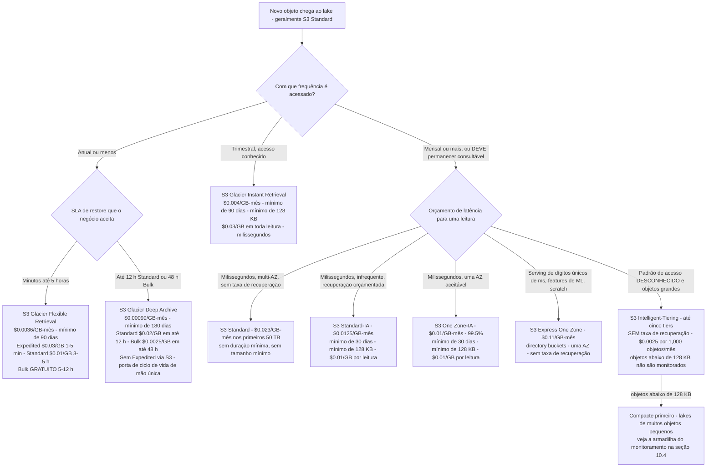
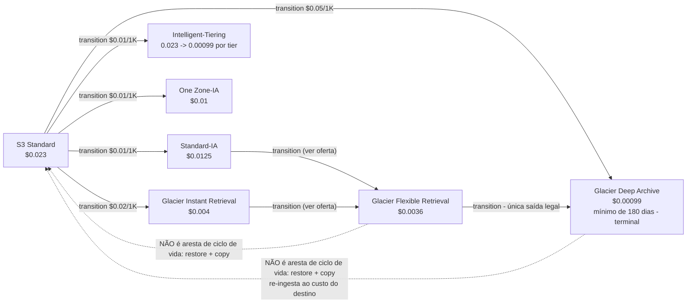
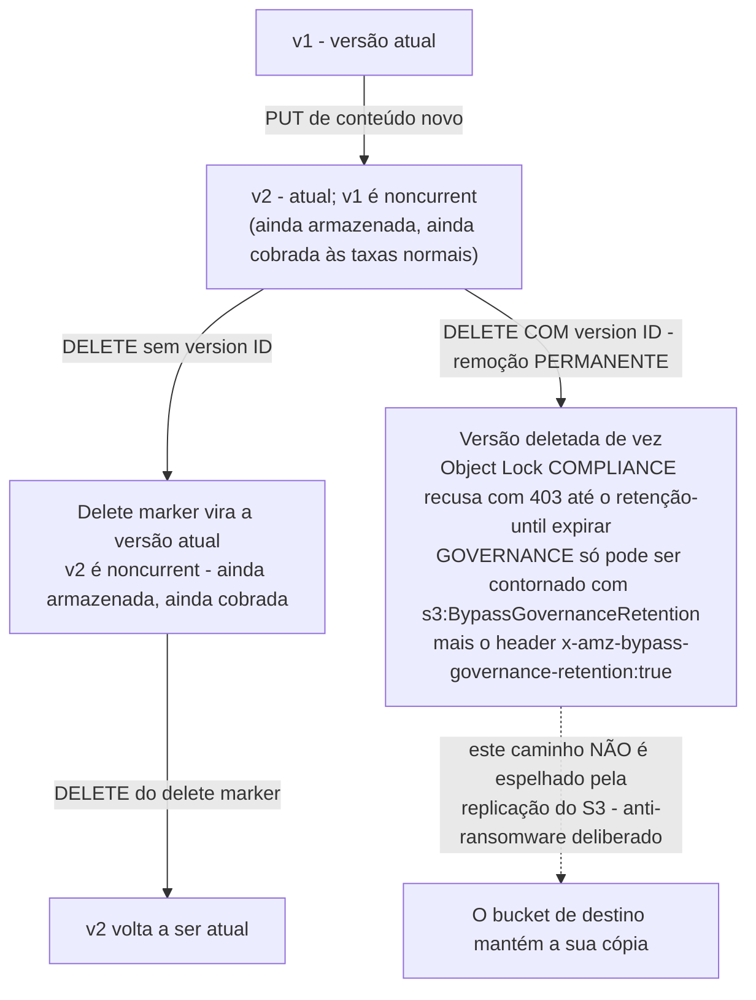
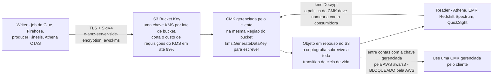

# S3 como Fundação do Data Lake: Classes de Armazenamento, Glacier e Durabilidade

Todo lakehouse deste curso se apoia em uma premissa: **Amazon S3 é o substrato**. O Glue rastreia ele, o Athena varre ele, o Redshift Spectrum monta ele, o Lake Formation concede sobre ele, o Macie inspeciona ele, o QuickSight lê ele. Nada a jusante salva um lake cuja camada de armazenamento foi desenhada por acidente — e no S3, "por acidente" tem um preço definido. A classe de armazenamento errada te cobra uma taxa de recuperação em cada byte que um motor lê; o layout de prefixo errado engasga a ingestão em 3,500 escritas por segundo; o tamanho de objeto errado adiciona 40 KB de metadados de arquivo por arquivo; o desenho de retenção errado transforma uma regra de ciclo de vida em uma porta de mão única com uma fatura mínima de 180 dias.

A boa notícia é que o modelo de custo do S3 é *conhecível*. Toda taxa desta lição vem da oferta do AWS Price List para Amazon S3 em `us-east-1` (data de publicação **2026-09-28**, vigência **2026-09-01**, acesso em **outubro de 2026**), mais o user guide do S3, a página de preços e o FAQ da AWS (acessados em outubro de 2026). Faça a aritmética você mesmo; é a única maneira de desenhar um lake que ainda seja acessível no sétimo ano.

```text
 =============================================================
  ESCADA DE CLASSES DE ARMAZENAMENTO DO S3 - lista us-east-1, em out 2026
 -------------------------------------------------------------
  Classe                    $/GB-mês   Duração mín.  Recuperação
  S3 Express One Zone        0.11      nenhuma       nenhuma
                             apenas directory buckets, uma AZ
  S3 Standard                0.023     nenhuma       nenhuma
                             próximos 450 TB 0.022, depois 0.021
  S3 Standard-IA             0.0125    30 dias       $0.01/GB
  S3 One Zone-IA             0.01      30 dias       $0.01/GB
  S3 Intelligent-Tiering     0.023 -> 0.00099 em cinco tiers
                             + $0.0025 por 1,000 objetos/mês
                             sem taxa de recuperação, sem duração mínima
  S3 Glacier Instant Ret.    0.004     90 dias       $0.03/GB
  S3 Glacier Flexible Ret.   0.0036    90 dias       $0-$0.03/GB
  S3 Glacier Deep Archive    0.00099   180 dias      $0.0025-$0.02/GB
  Reduced Redundancy         descontinuada - "We recommend not
                             using this storage class" (docs do S3)
 -------------------------------------------------------------
  Toda classe: durabilidade projetada de 99.999999999%. O que muda
  é disponibilidade, footprint de AZ, latência, duração mínima,
  tamanho mínimo faturável de objeto e taxas de recuperação.
 =============================================================
```

Nesta lição você vai:

- ler **a tabela completa de classes de armazenamento** — as oito classes mais cada tier do Glacier, com tempo de recuperação, taxa de recuperação e duração mínima de armazenamento;
- percorrer a **árvore de decisão de classes de armazenamento** e a **cascata de ciclo de vida de mão única** como diagramas mermaid, e depois ordenar a cascata você mesmo em um drag-and-drop interativo;
- modelar **versionamento, replicação, Object Lock (WORM) e legal holds**, incluindo exatamente quais mutações a replicação *não* espelha;
- escolher entre **SSE-S3, SSE-KMS, DSSE-KMS e SSE-C**, e usar um **S3 Bucket Key** para reduzir o custo de requisições do KMS "em até 99 por cento";
- desenhar **buckets, prefixos e chaves de partição no estilo Hive** contra o modelo de **≥3,500 requisições de escrita / ≥5,500 de leitura por segundo por prefixo**;
- aplicar **Block Public Access** (quatro configurações) e os oito **padrões de bucket policy** que um lake privado precisa;
- construir o plumbing de governança — **S3 Inventory** e **S3 Batch Operations** — que regras de ciclo de vida e replicação ao vivo não fazem sozinhas;
- calcular à mão **cinco modelos de custo com números reais**: a escada de classes de 1 TiB, um restore de Deep Archive de 50 TiB, um desenho de throughput de prefixo quente, um TCO de 7 anos de ciclo de vida até Deep Archive, um break-even de Intelligent-Tiering e a armadilha dos 40 KB de metadados de arquivo;
- estudar **dois casos nomeados de clientes da AWS** (Nasdaq e Siemens), ler a **caixa de atualizações de 2026** e praticar com **12 questões no estilo de exame** mais quatro verificações interativas.

---

## 1. As oito classes: uma durabilidade, oito economias

### 1.1 A tabela comparativa (em out 2026)

Amazon S3 oferece oito classes de armazenamento atuais mais uma classe descontinuada. A AWS documenta as duas lado a lado na comparação de classes de armazenamento do user guide do S3 (acesso em out 2026). Todas compartilham **durabilidade projetada de 99.999999999%** — onze nines — então durabilidade nunca é o discriminador. O que discrimina é disponibilidade projetada, footprint de AZ, duração mínima de armazenamento, tamanho mínimo faturável de objeto e taxas de recuperação.

| Classe de armazenamento | $/GB-mês (us-east-1, lista 2026-09-28) | Design | AZs | Duração mín. de armazenamento | Tam. mín. faturável | Taxa de recuperação |
|---|---|---|---|---|---|---|
| **S3 Standard** | 0.023 primeiros 50 TB · 0.022 próximos 450 TB · 0.021 acima de 500 TB | 99.99% | ≥3 | nenhuma | nenhuma | nenhuma |
| **S3 Standard-Infrequent Access** | 0.0125 | 99.9% | ≥3 | **30 dias** | **128 KB** | **$0.01/GB** |
| **S3 Intelligent-Tiering** | FA 0.023→0.021 · IA 0.0125 · Archive Instant 0.004 · Archive 0.0036 · Deep Archive 0.00099 | 99.9% | ≥3 | nenhuma | nenhuma | **nenhuma** (taxa de monitoramento no lugar) |
| **S3 One Zone-Infrequent Access** | 0.01 | 99.5% | **1** | **30 dias** | **128 KB** | **$0.01/GB** |
| **S3 Express One Zone** | 0.11 | 99.95% (SLA de 99.9%) | **1** | nenhuma | nenhuma | nenhuma (transferência de dados $0.0032 up / $0.0006 down por GB) |
| **S3 Glacier Instant Retrieval** | 0.004 | 99.9% | ≥3 | **90 dias** | **128 KB** | **$0.03/GB** |
| **S3 Glacier Flexible Retrieval** | 0.0036 | 99.99% *depois que você restaura os objetos* | ≥3 | **90 dias** | nenhuma (+40 KB de metadados) | **escalonada: $0–$0.03/GB** |
| **S3 Glacier Deep Archive** | 0.00099 | 99.99% *depois que você restaura os objetos* | ≥3 | **180 dias** | nenhuma (+40 KB de metadados) | **escalonada: $0.0025–$0.02/GB** |
| Reduced Redundancy | 0.0240→0.0220 | descontinuada | — | — | — | — |

Três detalhes dessa tabela causam mais dano do que qualquer outro:

1. **S3 Express One Zone é uma classe de directory buckets.** Ela vive em um tipo de bucket diferente (`--bucket-prefix` directory buckets), é de uma única AZ e custa **$0.11/GB-mês** — cerca de **4.8× o armazenamento do S3 Standard** — em troca de latência consistente de dígitos únicos de milissegundo. É um tier de *serving/scratch*, nunca o lake de registro.
2. **Intelligent-Tiering não tem taxa de recuperação nenhuma.** Ele troca essa taxa por uma **cobrança de monitoramento por objeto**: $0.0025 por 1,000 objetos por mês (oferta do AWS Price List, 2026-09-28). Objetos menores que 128 KB não são monitorados e não pagam taxa — o que é ao mesmo tempo uma armadilha e uma dica (seção 10).
3. **As três classes Glacier não são "S3 mais lento."** Duas delas (Flexible Retrieval, Deep Archive) não podem ser lidas com `GetObject` de modo algum até que você execute um **restore** assíncrono. Esse único fato driveia todo desenho de arquivo deste curso.

### 1.2 Exemplo resolvido E1 — a escada mensal de 1 TiB

**Em out 2026 (lista us-east-1).** Quanto custa simplesmente *manter* 1 TiB = **1,024 GB** por um mês em cada classe?

```text
Exemplo resolvido E1 - custo mensal de 1 TiB (1,024 GB), us-east-1, em out 2026
S3 Standard ............ 1,024 GB x $0.023   = $23.552 / mês
S3 Standard-IA ......... 1,024 GB x $0.0125  = $12.800 / mês  (+ $0.01/GB por leitura)
S3 One Zone-IA ......... 1,024 GB x $0.01    = $10.240 / mês  (+ $0.01/GB por leitura)
Glacier Instant Ret. ... 1,024 GB x $0.004   =  $4.096 / mês  (+ $0.03/GB por leitura)
Glacier Flexible Ret. .. 1,024 GB x $0.0036  =  $3.686 / mês  (restore obrigatório)
Glacier Deep Archive ... 1,024 GB x $0.00099 =  $1.014 / mês  (restore obrigatório)
S3 Express One Zone .... 1,024 GB x $0.11    = $112.640 / mês (+ requisições + dados)
Intelligent-Tiering .... 1,024 GB x $0.023   = $23.552 / mês se tudo ficar em
                        Frequent Access, MAIS $0.0025 por 1,000 objetos/mês
```

Duas leituras dessa escada importam. Primeiro, **Deep Archive é 23× mais barato que Standard para manter** ($1.014 vs $23.552) — e é exatamente por isso que o tier de arquivo é uma decisão de *retenção*, não de desempenho. Segundo, **Express One Zone é 4.8× mais caro que Standard para manter** — e é por isso que ele hospeda tabelas gold de serving e feature stores de ML, nunca bronze.

O **FAQ do S3** diz isso sem rodeios: "From just $0.00099 per GB-month … S3 Glacier Deep Archive offers the lowest cost storage in the cloud" (acesso em out 2026). Uma ressalva que vale carregar: a oferta do AWS Price List de `us-east-1` de 2026-09-28 contém os SKUs de *staging* do Deep Archive e de Intelligent-Tiering Deep Archive Access, mas **nenhum SKU standalone de armazenamento Deep Archive** — então trate $0.00099 como publicado pela AWS, e não confirmado pela lista de preços, e verifique de novo antes de comprometer um arquivo de sete dígitos com ele.

- **📚 Você sabia?** Reduced Redundancy (`RRS`) ainda aparece na lista de preços do S3 a $0.0240→0.0220/GB-mês, mas o user guide do S3 diz apenas: "Não recomendamos o uso dessa classe de armazenamento" (acesso em out 2026). Ele é *mais* caro que o S3 Standard com *menos* redundância. Qualquer alternativa de estilo de exame, deck de fornecedor ou runbook legado que ainda roteie dados para o RRS está errado em out 2026.

---

## 2. A família Glacier: cada tier, cada taxa, cada relógio

"Glacier" são três classes de armazenamento e cinco tiers de restore, e a diferença entre elas é a diferença entre uma query que retorna em milissegundos e um ticket que fecha amanhã.

### 2.1 A tabela de arquivo

| Classe | Duração mín. de armazenamento | Cobrança | Caminho de recuperação | Tier | Taxa de recuperação $/GB | Tempo típico de recuperação | Taxa da requisição de restore |
|---|---|---|---|---|---|---|---|
| **Glacier Instant Retrieval** | 90 dias | trimestral | `GetObject` direto | — | **$0.03 fixa** (toda leitura) | **milissegundos** | n/a |
| **Glacier Flexible Retrieval** | 90 dias | semestral | `RestoreObject` obrigatório | **Expedited** | $0.03 | **1–5 minutos** | $0.01 / 1,000 |
| | | | | **Standard** | $0.01 | **3–5 horas** | $0.05 / 1,000 |
| | | | | **Bulk** | **$0 (gratuito)** | **5–12 horas** | $0.00 / 1,000 |
| **Glacier Deep Archive** | **180 dias** | anual | `RestoreObject` obrigatório | **Standard** | $0.02 | **em até 12 horas** | $0.05 / 1,000 |
| | | | | **Bulk** | **$0.0025** | **em até 48 horas** | $0.00 / 1,000 |
| | | | | **Expedited** | **não oferecido via S3** | — | — |

Fontes: comparação de storage classes do S3 Glacier e bullets dos tiers (user guide, acesso em out 2026); preços de recuperação e de requisição de restore da oferta `us-east-1` de 2026-09-28; "S3 Glacier Flexible Retrieval Bulk data retrievals and requests are free of charge" e "As requisições DELETE e CANCEL são gratuitas" (página de preços do S3, acesso em out 2026).

Leia a tabela na vertical e três regras saltam fora:

- **Glacier Instant Retrieval é a única classe de arquivo que um motor de query lê diretamente** — milissegundos, mas todo byte lido custa **$0.03/GB**, sete vezes e meia a própria taxa de armazenamento.
- **O tier Bulk do Glacier Flexible Retrieval é gratuito mas lento**: $0.00/GB, tipicamente 5–12 horas. O FAQ formula assim: "Bulk retrievals typically complete within 5—12 hours, and are free of charge."
- **Deep Archive não tem tier Expedited via S3.** O caminho publicado mais rápido é Standard a $0.02/GB "within 12 hours"; Bulk a $0.0025/GB leva "within 48 hours". A tabela comparativa em outro ponto do mesmo guia cita o intervalo como "9 to 48 hours" — planeje contra os bullets dos tiers, não contra o melhor caso.

### 2.2 Um restore não é um GET

Este é o mecânico mais mal compreendido de todo o modelo de preços do S3, então ele ganha o seu próprio diagrama.

```mermaid
sequenceDiagram
    participant C as Cliente / job adjacente ao Athena
    participant A as Objeto arquivado (GLACIER ou DEEP_ARCHIVE)
    participant T as Cópia temporária em S3 Standard
    C->>A: RestoreObject (tier: Expedited / Standard / Bulk)
    Note over A: Você paga o $/GB de recuperação do tier<br/>mais a taxa da requisição de restore por 1,000
    A-->>C: 202 Accepted - o restore é assíncrono
    Note over A,T: Espera: 1-5 min (Expedited) / 3-5 h / 5-12 h<br/>/ 12 h (GDA Standard) / 48 h (GDA Bulk)
    A->>T: S3 cria uma cópia temporária, cobrada às taxas do S3 Standard
    C->>T: GetObject na cópia restaurada (um GET ordinário)
    Note over T: A cópia temporária é cobrada a ~$0.023/GB-mo por TODA<br/>a duração que você escolheu, quer você leia ou não
    T-->>C: Bytes do objeto
    Note over T: A cópia temporária expira; o original arquivado fica<br/>GLACIER / DEEP_ARCHIVE para sempre - HeadObject nunca muda de classe
```

A própria página de preços da AWS afirma a consequência: "Quando você restaura um arquivo, você paga tanto pelo arquivo… quanto por uma cópia… restaurada temporariamente (cobrada na taxa de armazenamento do S3 Standard por uma duração de tempo que você escolher)" (acesso em out 2026). Então a fatura completa de um restore tem **quatro componentes**: armazenamento de arquivo (ainda acumulando) + a taxa de recuperação por GB do tier + a taxa de requisição de restore por 1,000 + **armazenamento S3 Standard na cópia temporária por toda a duração escolhida**. O original arquivado nunca muda de classe — `HeadObject` continua reportando `GLACIER` ou `DEEP_ARCHIVE` depois de um restore bem-sucedido.

### 2.3 Exemplo resolvido E2 — restaurando 50 TiB do Deep Archive

Uma produtora de mídia precisa devolver uma biblioteca de broadcast de **50 TiB (51,200 GB)** dentro de uma janela de cinco dias. Mantenha a cópia restaurada por **5 dias**.

```text
Exemplo resolvido E2 - economia de restore a partir do Glacier Deep Archive, us-east-1, em out 2026
Volume ............... 50 TiB = 51,200 GB
Janela de retenção ... 5 dias (a cópia temporária é cobrada como S3 Standard pela janela inteira)

Opção A - tier Standard ($0.02/GB, tipicamente em até 12 horas)
  Recuperação ........ 51,200 GB x $0.02      = $1,024.00
  Cópia Standard tmp . 51,200 GB x $0.023 x 5/30 =   $196.27
  TOTAL ..............                            $1,220.27

Opção B - tier Bulk ($0.0025/GB, tipicamente em até 48 horas)
  Recuperação ........ 51,200 GB x $0.0025    =   $128.00
  Cópia Standard tmp . (igual)                 =   $196.27
  TOTAL ..............                            $  324.27

Delta ................ $1,220.27 - $324.27 = $896.00 economizados por ~36 horas extras de espera
Taxa de restore ...... $0.05 por 1,000 restores Standard (irrelevante nesta contagem de objetos)
```

**Veredito:** **Bulk para recuperações planejadas; Standard apenas quando o relógio do negócio é mais curto que 48 horas.** O delta de $896 é pura taxa de recuperação — a cobrança da cópia temporária é idêntica nos dois caminhos, e é por isso que a cópia temporária, não a taxa de recuperação, domina qualquer retenção *longa*. Precisa dos dados em menos de 15 minutos? Deep Archive não te ajuda: não existe tier Expedited via S3, então um SLA de mesma hora significa que os dados nunca deveriam ter saído do Standard, do Standard-IA ou do Glacier Instant Retrieval.

> [!WARNING]
> ⚠️ **Nunca modele um arquivo como "armazenamento barato que você recupera instantaneamente."** A duração mínima de armazenamento do Deep Archive é **180 dias**: se você fizer transition de um objeto para dentro e o deletar ou reclassificar antes do dia 180, você é cobrado pelos 180 dias inteiros. A AWS é explícita — "Se você criar uma regra de expiração de ciclo de vida que faça objetos que estiveram no armazenamento S3 Glacier Deep Archive por menos de 180 dias expirarem, você é cobrado por 180 dias" (docs de ciclo de vida do S3, acesso em out 2026). E a saída é uma porta de mão única: **você não pode sair do Deep Archive via transition de ciclo de vida.** O único caminho de saída é restore + copy para um novo objeto à custa da classe de destino, o que reinicia o relógio de duração mínima daquela classe.

```matching
{
  "question": "Relacione cada classe de armazenamento ou tier de restore com seu comportamento de recuperação e taxa publicados (lista us-east-1, em out 2026):",
  "pairs": [
    {"left": "S3 Standard ou S3 Intelligent-Tiering (tiers Frequent / Infrequent / Archive Instant)", "right": "Nenhuma taxa de recuperação - Intelligent-Tiering cobra $0.0025 por 1,000 objetos por mês de monitoramento no lugar disso"},
    {"left": "S3 Standard-Infrequent Access ou One Zone-Infrequent Access", "right": "Milissegundos, mas uma taxa fixa de $0.01 por GB em cada byte lido"},
    {"left": "S3 Glacier Instant Retrieval", "right": "GetObject direto em milissegundos, com taxa de recuperação fixa de $0.03 por GB"},
    {"left": "Glacier Flexible Retrieval - Expedited", "right": "$0.03 por GB, tipicamente restaura o objeto em 1-5 minutos, $0.01 por 1,000 requisições de restore"},
    {"left": "Glacier Flexible Retrieval - Standard", "right": "$0.01 por GB, tipicamente restaura o objeto em 3-5 horas, $0.05 por 1,000 requisições de restore"},
    {"left": "Glacier Flexible Retrieval - Bulk", "right": "Gratuito ($0.00 por GB e $0.00 por 1,000 requisições), tipicamente 5-12 horas"},
    {"left": "Glacier Deep Archive - Standard", "right": "$0.02 por GB, tipicamente em até 12 horas, $0.05 por 1,000 requisições de restore - e não existe tier Expedited via S3"},
    {"left": "Glacier Deep Archive - Bulk", "right": "$0.0025 por GB, tipicamente em até 48 horas, $0.00 por 1,000 requisições de restore"}
  ],
  "explanation": "Três mecanismos cumulativos: taxas de leitura fixas por GB (Standard-IA, One Zone-IA, Glacier Instant Retrieval); taxas de restore escalonadas mais uma cópia temporária em S3 Standard (Glacier Flexible Retrieval, Glacier Deep Archive); e nenhuma taxa de recuperação no Standard, no Express One Zone e no Intelligent-Tiering - este último substitui por uma taxa de monitoramento por objeto. Regra de ouro da página de preços do S3: tudo que um motor de query pode varrer pertence ao Standard, ao Intelligent-Tiering ou ao Glacier Instant Retrieval. O tier Bulk do Deep Archive são os bytes mais baratos da nuvem para manter e os bytes mais baratos para mover, ao custo de uma espera de 48 horas."
}
```

- **📚 Você sabia?** O serviço standalone **Amazon Glacier vault** — um produto separado, com suas próprias vault APIs e ARNs — "is no longer accepting new customers as of December 15, 2025" (página de preços do S3 Glacier, acesso em out 2026). A AWS agora recomenda: "Recomendamos usar as classes de armazenamento S3 Glacier dentro do serviço Amazon S3 para todos os seus dados de longo prazo." Em 2026, "Glacier" em uma conversa de design significa três classes de armazenamento em um bucket S3 normal, não um vault.

---

## 3. Escolhendo uma classe: a árvore de decisão e a cascata

### 3.1 A árvore de decisão de classes de armazenamento

Frequência de **acesso**, **latência** exigida e se o objeto é **recriável** decidem a classe — nessa ordem. Os rótulos das folhas carregam o preço e o relógio que você está assinando.



Dois ramos merecem o comentário:

- **"Acesso desconhecido" não significa automaticamente Intelligent-Tiering.** Significa Intelligent-Tiering *uma vez que os objetos são grandes o suficiente para serem monitorados* (≥128 KB) e poucos o bastante para a taxa de monitoramento não ser a fatura inteira. Para um arquivo trimestral conhecido, Glacier Instant Retrieval costuma ser mais barato — a seção 10.3 faz o break-even.
- **One Zone-IA é um trade de durabilidade, não só um desconto.** Disponibilidade de 99.5% em uma única AZ significa uma pergunta genuína sobre se os dados podem ser recriados. Lakes usam ele para dados derivados *reprodutíveis*, nunca para a única cópia de dados brutos de origem.

### 3.2 A cascata de ciclo de vida é de mão única

Amazon S3 "supports a waterfall model for transitioning between storage classes" (user guide de ciclo de vida do S3, acesso em out 2026). Objetos fluem para baixo; não fluem para cima. As setas de retorno no diagrama abaixo **não** são arestas de ciclo de vida — são operações de restore-and-copy que você roda à mão ou via S3 Batch Operations, e cada uma reinicia o relógio de duração mínima da classe de destino e cobra de novo à taxa de destino.



Regras que os docs de ciclo de vida do S3 põem por escrito (acesso em out 2026):

- "You can't create a single Lifecycle rule that transitions objects from one storage class to another before the minimum storage duration period has passed."
- "O transition de objetos para a classe de armazenamento S3 Glacier Deep Archive só pode ir em um sentido."
- "An object is eligible for only one S3 Lifecycle action per day. When multiple rules match, Amazon S3 applies the least costly action."
- Precedência: exclusão permanente > transition > criação de delete markers. Quando uma transition de Glacier Flexible Retrieval e uma de Standard-IA são elegíveis ao mesmo tempo, "Amazon S3 chooses the S3 Glacier Flexible Retrieval transition."
- Uma configuração comporta **até 1,000 regras** — "This limit is not adjustable."
- Desde **setembro de 2024**, "Objetos menores que 128 KB não fazem transition por padrão para nenhuma classe de armazenamento."

```dragdrop
{
  "question": "Ordene a cascata de classes de armazenamento, da classe em que um objeto chega até a classe de arquivo terminal - o mais barato e mais lento por último:",
  "items": [
    "S3 Standard - $0.023/GB-mês, sem duração mínima, sem taxa de recuperação - a zona quente onde todo objeto chega e a única classe que motores de query varrem livremente",
    "S3 Standard-IA - $0.0125/GB-mês, duração mínima de 30 dias, tamanho mínimo faturável de 128 KB, taxa de recuperação fixa de $0.01/GB",
    "S3 Glacier Instant Retrieval - $0.004/GB-mês, mínimo de 90 dias, mínimo de 128 KB, recuperação fixa de $0.03/GB, ainda em milissegundos",
    "S3 Glacier Flexible Retrieval - $0.0036/GB-mês, mínimo de 90 dias, restore assíncrono obrigatório, recuperações Bulk gratuitas mas de 5-12 horas",
    "S3 Glacier Deep Archive - $0.00099/GB-mês, mínimo de 180 dias, restore assíncrono obrigatório, até 12 horas Standard / 48 horas Bulk, terminal"
  ],
  "correctOrder": [
    "S3 Standard - $0.023/GB-mês, sem duração mínima, sem taxa de recuperação - a zona quente onde todo objeto chega e a única classe que motores de query varrem livremente",
    "S3 Standard-IA - $0.0125/GB-mês, duração mínima de 30 dias, tamanho mínimo faturável de 128 KB, taxa de recuperação fixa de $0.01/GB",
    "S3 Glacier Instant Retrieval - $0.004/GB-mês, mínimo de 90 dias, mínimo de 128 KB, recuperação fixa de $0.03/GB, ainda em milissegundos",
    "S3 Glacier Flexible Retrieval - $0.0036/GB-mês, mínimo de 90 dias, restore assíncrono obrigatório, recuperações Bulk gratuitas mas de 5-12 horas",
    "S3 Glacier Deep Archive - $0.00099/GB-mês, mínimo de 180 dias, restore assíncrono obrigatório, até 12 horas Standard / 48 horas Bulk, terminal"
  ],
  "explanation": "Esta é a cascata publicada, lida da esquerda para a direita por preço caindo e fricção subindo: Standard (sem mínimos, sem taxa de recuperação) -> Standard-IA ou One Zone-IA ou Intelligent-Tiering ou Glacier Instant Retrieval -> Glacier Flexible Retrieval -> Glacier Deep Archive. Cada salto custa uma requisição de transition ($0.01 para IA/One Zone-IA/Intelligent-Tiering, $0.02 para Glacier Instant Retrieval, $0.05 por 1,000 para Deep Archive, lista us-east-1 em out 2026), inicia o relógio de duração mínima da classe de destino no dia em que a regra é satisfeita, e não pode ser desfeito por outra regra. Apenas o Intelligent-Tiering cobra depois que o movimento físico termina; para qualquer outra classe, a cobrança vira no momento em que a regra dispara."
}
```

---

## 4. Durabilidade, versionamento e replicação

### 4.1 Versionamento: três estados, cobrança de objeto inteiro

S3 Versioning é de nível de bucket e tudo-ou-nada, com exatamente três estados: **sem versionamento** (o padrão), **habilitado** e **suspenso**. O user guide da AWS é direto sobre a cobrança: "Cada versão de um objeto é o objeto inteiro; não é apenas um diff… se você tem três versões de um objeto armazenadas, você é cobrado por três objetos" (acesso em out 2026).

| Mecanismo | Comportamento |
|---|---|
| `PUT` (qualquer) | Cria uma nova versão atual; a versão anterior vira noncurrent (não atual) e **ainda é cobrada** |
| `DELETE` sem version ID | Insere um **delete marker**; retorna `200 OK`; versões anteriores permanecem recuperáveis por version ID |
| `DELETE` com version ID | Remove aquela versão **permanentemente** — este é o único delete de verdade |
| `NoncurrentVersionExpiration` | Deleta versões noncurrent após N dias, com teto opcional via `MaxNoncurrentVersions` (**1–100**) |
| Habilitado → sem versionamento | **Impossível.** "After you version-enable a bucket, it can never return to an unversioned state. But you can *suspend* versioning on that bucket." |

Versionamento é pré-requisito de duas coisas que você vai precisar depois: **S3 Object Lock** (que só funciona em buckets com versionamento) e **S3 replication** (que exige versionamento nos dois lados, origem e destino).



### 4.2 Replicação: CRR, SRR e a parede da classe arquivada

Cross-Region Replication (CRR) e Same-Region Replication (SRR) são o mesmo mecanismo com destinos diferentes. Versionamento deve estar habilitado nos dois lados. O que é replicado por padrão (docs de replicação do S3, acesso em out 2026):

- **Replicado:** objetos criados *depois* da configuração, metadados de objeto, tags, anotações, atualizações de ACL, **retenção de Object Lock**, e objetos criptografados com SSE-S3 / SSE-KMS / DSSE-KMS / SSE-C.
- **Não replicado por padrão:** objetos que são eles mesmos réplicas (sem encadeamento), **delete markers** quando a configuração usa um elemento `Filter`, **exclusões permanentes de versão**, mudanças de subrecurso de nível de bucket, e delete markers criados por ciclo de vida.
- **NÃO replicável de modo algum até ser restaurado:** objetos em **Glacier Flexible Retrieval, Glacier Deep Archive, Intelligent-Tiering Archive Access e Intelligent-Tiering Deep Archive Access**. Palavras exatas da AWS: "You cannot replicate these objects until you restore them and copy them to a different storage class."

Três consequências operacionais para um lake:

1. **CRR não é um backup ao vivo de toda mutação.** Com a versão de configuração atual (um `Filter`), delete markers não são replicados a menos que você habilite explicitamente a replicação de delete markers, e exclusões por version ID nunca são espelhadas — deliberadamente, para que um principal comprometido não apague a cópia de DR deletando versões na origem.
2. **Backfill retroativo precisa de S3 Batch Replication.** Replicação ao vivo cobre apenas objetos criados depois da configuração; tudo mais antigo é um job de Batch Operations.
3. **Monitoramento custa $0.015 por 1 milhão de objetos por mês** no bucket de origem (oferta de 2026-09-28). **Não existe SKU separado de "$0.02 por GB replicado"** nessa oferta — você paga armazenamento do bucket de destino e transferência de dados inter-regional ordinária por cima da taxa de monitoramento. Não ensine a cifra por GB sem re-verificar a aba de preços de Replication.

- **📚 Você sabia?** A replicação do S3 carrega **as informações de retenção do Object Lock para as réplicas**: "it applies those same retention controls to your destination buckets" (docs de replicação do S3, acesso em out 2026). É isso que transforma o CRR em uma segunda cópia de *conformidade*, e não meramente em uma segunda cópia — a data de retenção sobrevive ao salto de Região.

---

## 5. Object Lock: WORM para zonas reguladas do lake

S3 Object Lock "uses a *write-once-read-many* (WORM) model" e "funciona apenas em buckets que têm o S3 Versioning habilitado" (user guide do S3, acesso em out 2026). Ele protege uma **versão** de objeto, não uma key — e essa distinção é onde a maioria dos designs falha.

| Proteção | Comportamento |
|---|---|
| **Retention period** | Uma data fixa de retenção, ou (desde 2026-09-08) **retenção variável**, cujo retenção-until é recalculado como "agora + duração" enquanto um **event-based hold** está aplicado |
| **Legal hold** | Sem data de expiração; exige `s3:PutObjectLegalHold` para remover; independente da retenção |
| **Modo COMPLIANCE** | "A protected object version can't be overwritten or deleted by any user, including the root user in your AWS account… The only way to delete an object under the compliance mode before its retention date expires is to delete the associated AWS account." |
| **Modo GOVERNANCE** | Principais ordinários são bloqueados; um principal com `s3:BypassGovernanceRetention` **e** o header explícito de requisição `x-amz-bypass-governance-retention:true` pode contornar |
| **O que o lock NÃO impede** | Novas versões da mesma key (um `PUT` ainda passa), e `DELETE`s simples (que retornam `200 OK` e adicionam um delete marker) |

A AWS tem o Object Lock "avaliado pela Cohasset Associates para uso em ambientes sujeitos às regulamentações da SEC 17a-4, CFTC e FINRA" (acesso em out 2026) — e é exatamente por isso que as histórias de dados regulados deste curso (arquivos de vigilância no estilo FINRA, a camada de conformidade da Nasdaq) recorrem a ele.

> [!IMPORTANT]
> 🔒 **Object Lock trava versões, não keys — então a imutabilidade do lake precisa de três peças, não de uma.** Retenção e legal holds "não impedem a criação de novas versões do objeto, nem a adição de delete markers por cima do objeto." A imutabilidade de verdade para uma zona bronze é: (1) Object Lock (COMPLIANCE na zona auditada, GOVERNANCE nos outros lugares); (2) uma bucket policy **negando `s3:DeleteObjectVersion`** a todo mundo fora do retention role; e (3) uma bucket policy **negando `s3:BypassGovernanceRetention` e `s3:PutObjectLegalHold`** a todos os principais não-admin. Sem (2), um `PUT` cria em silêncio uma versão nova, destravada, por cima da sua travada.

- **📚 Você sabia?** Um limite de regra único que a maioria das pessoas ignora: uma configuração de S3 Lifecycle "can have up to 1,000 rules" e o filtro de cada regra pode usar "an object key name prefix, one or more object tags, object size, or any combination of these" (docs da API do S3, acesso em out 2026) — e **você não pode usar uma bucket policy para impedir exclusões ou transitions por uma regra de ciclo de vida**. Object Lock para *principais*; expiração de ciclo de vida é uma ação do *serviço*, então designs de zona auditada casam Object Lock com regras de ciclo de vida que param deliberadamente antes do limite da retenção.

---

## 6. Criptografia: SSE-S3, SSE-KMS, DSSE-KMS, SSE-C e Bucket Keys

Desde **5 de janeiro de 2023**, "todos os novos uploads de objetos para o Amazon S3 são criptografados automaticamente, sem custo adicional e sem impacto no desempenho" — esse padrão é **SSE-S3** (user guide do S3, acesso em out 2026). Todo o resto é um upgrade com preço e restrição.

| Esquema | Quem segura a chave | Custo extra | Restrições rígidas |
|---|---|---|---|
| **SSE-S3** (padrão) | AWS, por objeto | Nenhum | Não pode ser compartilhado entre contas como *chave* — os objetos ainda são legíveis por qualquer um com acesso IAM ao bucket |
| **SSE-KMS** | AWS KMS, a chave gerenciada pela AWS `aws/s3` ou uma **CMK gerenciada pelo cliente** | Taxas de requisição do KMS por `GenerateDataKey` / `Decrypt` | A CMK **precisa estar na mesma Região do bucket**; **apenas chaves simétricas**; escrita exige `kms:GenerateDataKey`, leitura exige `kms:Decrypt`; **a chave `aws/s3` não pode ser compartilhada entre contas** |
| **DSSE-KMS (dupla camada)** | Duas chaves KMS independentes | **$0.003/GB criptografado + $0.003/GB descriptografado** (oferta de 2026-09-28) | Para workloads que precisam de duas camadas independentes de autoridade de chave |
| **SSE-C** | **Você**, fornecida em toda requisição TLS | Nenhum da AWS | A AWS não guarda nada; todo `GET`/`PUT`/`COPY` deve carregar a chave via TLS, ou falha |

Três upgrades que um lake tipicamente precisa:

1. **Um S3 Bucket Key.** "Using a bucket-level key for SSE-KMS can reduce your AWS KMS request cost by up to 99 percent" (user guide do S3, acesso em out 2026). Nos volumes de escrita de um lake — centenas de milhares de chamadas `PutObject` por dia — a fatura de requisições do KMS é a diferença entre o SSE-KMS ser acessível e ser uma linha de item.
2. **Uma CMK gerenciada pelo cliente para qualquer coisa entre contas.** "Objects encrypted using SSE-KMS with AWS managed keys can't be shared cross-account. If you need to share SSE-KMS data cross-account, you must use a customer managed key." Conceda `kms:Decrypt` à conta consumidora e habilite o Bucket Key.
3. **A criptografia sobrevive às transitions de classe** — mas note a nota de rodapé da cobrança: "Objects in S3 Glacier Flexible Retrieval and S3 Glacier Deep Archive are billed at S3 Standard storage class rates when you upload them using multipart uploads." Sempre aterrice no Standard (ou complete o multipart upload prontamente) e deixe o ciclo de vida fazer a transition.



Duas armadilhas de formato de requisição que valem decorar: requisições SSE-KMS precisam chegar via **TLS com SigV4**, e você **não deve** enviar headers de criptografia em `GET`/`HEAD` — o S3 responde **HTTP 400**.

---

## 7. Buckets, prefixos e chaves de partição: o modelo de desempenho

### 7.1 O S3 escala por prefixo, não por bucket

A documentação de desempenho do S3 enuncia o modelo exatamente assim: "your application can achieve at least **3,500 PUT/COPY/POST/DELETE or 5,500 GET/HEAD requests per second per partitioned Amazon S3 prefix**. There are no limits to the number of prefixes in a bucket… if you create 10 prefixes… you could scale your read performance to 55,000 read requests per second" (acesso em out 2026). A escalada é gradual, e clientes veem erros **`503 Slow Down`** enquanto ela sobe.

```text
Exemplo resolvido E3 - desenho de throughput de prefixo quente, em out 2026
Demanda de ingestão . 1,500 objetos/segundo de 64 KB cada = 96 MB/s

Prefixo único  raw/events/2026-10-11/events.json.gz
  Teto de escrita .. 3,500 escritas/s  -> apenas 2.3x de folga (3,500 / 1,500)
  Teto de bytes .... 3,500 x 64 KB = 224 MB/s por prefixo
  Modo de falha .... 503 Slow Down sustentado assim que o emissor escala

16 prefixos com hash  raw/events/dt=2026-10-11/hour=07/shard-{000..015}.json.gz
  Teto de escrita .. 16 x 3,500 = 56,000 escritas/s -> ~37x de folga
  Teto de bytes .... 16 x 224 MB/s = 3.5 GB/s

Lado da leitura - um scan de dia inteiro tocando 24 partições horárias (24 prefixos)
  Teto de leitura .. 24 x 5,500 = 132,000 GET/s
```

O incidente composto descrito no material de laboratório do Well-Architected da AWS bate com esse formato: um job de ingestão de streaming escrevia **800 objetos pequenos/segundo** em `s3://lake-prod/raw/events/2026-10-11/events.json.gz` — um prefixo só — o throughput desabou em ~3,500 escritas/s com `503 Slow Down` sustentado, e fazer re-sharding da key do producer para 16 prefixos `shard-{000..015}` restaurou a folga para ~56,000 escritas/s **sem nenhuma outra mudança**. A *distribuição* de partições é um controle de desempenho independente da *semântica* de partição.

### 7.2 Chaves de partição são o layout físico

Para tabelas no estilo Hive, **o layout da key *é* o layout físico da partição**: `s3://lake/events/dt=2026-10-11/hour=07/part-…parquet`. Regras de desenho que valem em Glue, Athena, EMR e Redshift Spectrum:

| Regra | Por quê |
|---|---|
| Primeiro colunas de baixa cardinalidade e alta filtragem: `dt=` → `region=` → `source=` | A poda de partições filtra pelas keys iniciais; um `user_id` na frente não poda nada e explode o catálogo |
| **Nunca** particione por uma key de alta cardinalidade (`user_id`, `request_id`, `order_id`) | Milhões de partições = metadados do Glue inchados, fan-out de LIST, custo de planejamento do Athena |
| Nomenclatura consistente (`dt=`, nunca misturar `dt=` e `date=`) | Crawlers do Glue e projeção de partições do Athena precisam concordar com o layout físico |
| Objetos Parquet de **128 MB–1 GB** como alvo | Abaixo de ~128 MB, o overhead colunar de footer/dicionário e o custo por GET dominam; este também é o irmão mais velho do piso de ciclo de vida de 128 KB |
| Desenhe as keys para que cada **zona** (bronze / silver / gold / arquivo) seja endereçável por `Prefix`, `Tag` ou `ObjectSizeGreaterThan` | Lifecycle, Object Lock e statements de bucket policy são todos escopados por prefixo/tag/tamanho |
| O particionamento oculto do Iceberg desacopla o transform *lógico* da key | Mas o prefixo S3 do arquivo ainda determina qual orçamento de requisições por prefixo você consome |

- **📚 Você sabia?** Requisições `LIST` não são gratuitas e não são precificadas como `GET`: "As requisições LIST para qualquer classe de armazenamento são cobradas na mesma taxa das requisições PUT, COPY e POST do S3 Standard" — **$0.005 por 1,000** (página de preços do S3 e oferta de 2026-09-28). Requisições `DELETE` e `CANCEL`, em contraste, são gratuitas. Este é um segundo argumento, mais silencioso, para um fan-out moderado de prefixos: mais prefixos significam mais fan-out de LIST/GET em scans de bucket inteiro e mais metadados de partição no Glue, então faça shard pelas suas partições reais de tempo, não sinteticamente até o limite.

```fillblank
{
  "question": "Complete as afirmações de desempenho e desenho do S3 com os números publicados (todos em outubro de 2026):",
  "template": "Por prefixo particionado, o Amazon S3 sustenta pelo menos {{1}} requisições PUT/COPY/POST/DELETE por segundo e {{2}} requisições GET/HEAD por segundo, e não há limite para o número de prefixos - dez prefixos de leitura, portanto, escalam para {{3}} requisições GET/HEAD por segundo. Enquanto essa escalada sobe, clientes veem erros {{4}}. Transições padrão de ciclo de vida ignoram objetos menores que {{5}} KB, objetos arquivados carregam {{6}} KB de metadados adicionais por objeto, e uma configuração de S3 Lifecycle pode conter no máximo {{7}} regras.",
  "answers": {
    "1": "3500",
    "2": "5500",
    "3": "55000",
    "4": "503 Slow Down",
    "5": "128",
    "6": "40",
    "7": "1000"
  },
  "distractors": ["1000", "2000", "11000", "429 Throttling", "64", "32", "100", "10000", "5000"],
  "explanation": "3,500 requisições de escrita e 5,500 de leitura por segundo por prefixo particionado, prefixos ilimitados, 10 prefixos = 55,000 GET/HEAD por segundo (docs de desempenho do S3, acesso em out 2026). A escalada é gradual e aparece como 503 Slow Down - não 429. O tamanho mínimo de transition de ciclo de vida é de 128 KB (em vigor desde setembro de 2024), objetos arquivados adicionam 40 KB de metadados (32 KB à taxa da classe de arquivo mais 8 KB às taxas do S3 Standard), e 1,000 regras de ciclo de vida é um limite rígido e não ajustável. Os distratores são os números de escala de shard de outros serviços da AWS e as duas metades do overhead de 40 KB."
}
```

---

## 8. Trancando o lake: Block Public Access e bucket policies

### 8.1 Block Public Access é o interruptor de emergência

"By default, new buckets, access points, and objects don't allow public access." Por cima desse padrão, **S3 Block Public Access fornece quatro configurações** — `BlockPublicAcls`, `IgnorePublicAcls`, `BlockPublicPolicy` e `RestrictPublicBuckets` — e "if the block public access settings… differ, then Amazon S3 applies the most restrictive combination" (user guide do S3, acesso em out 2026).

| Nível | Comportamento |
|---|---|
| Access point | Override por endpoint |
| Bucket | Por bucket; "we recommend that you also turn on all four settings for each bucket to comply with AWS Security Hub Foundational Security Best Practices control S3.8" |
| Conta | "When you apply block public access settings to an account, the settings apply to all AWS Regions globally" |
| Organização | "At the organization level, all four settings are applied together as a unified policy" — e configurações de organização sobrepõem as da conta |

A recomendação da AWS para uma conta de lake é inequívoca: "recomendamos que você ative todas as quatro configurações… para a sua conta." Lembre-se da armadilha de camadas: **desligar o BPA em um bucket não faz nada se a conta ou a organização ainda bloqueiam**, e o S3 sempre impõe a combinação mais restritiva. "Público" significa uma ACL ou política concedendo a `AllUsers`/`AuthenticatedUsers`, ou uma bucket policy com um principal curinga não restringido por um `aws:PrincipalArn`, `aws:PrincipalOrgID`, `aws:SourceAccount`, `aws:SourceArn`, `aws:SourceVpc`, `aws:SourceVpce`, `aws:SourceIp` ou `s3:DataAccessPointArn` fixos.

### 8.2 Oito padrões de bucket policy para um lake privado

Block Public Access impede o bucket de ir para o ar; a política abaixo impede todo o resto que um data lake realmente precisa recusar. Um statement `Deny` com `"Principal": "*"` *restringe* acesso em vez de conceder, então ele compõe limpo com as quatro configurações de BPA deixadas ligadas.

```json
{
  "Version": "2012-10-17",
  "Statement": [
    {
      "Sid": "DenyNonTLS",
      "Effect": "Deny",
      "Principal": "*",
      "Action": "s3:*",
      "Resource": [
        "arn:aws:s3:::lakehouse-prod",
        "arn:aws:s3:::lakehouse-prod/*"
      ],
      "Condition": { "Bool": { "aws:SecureTransport": "false" } }
    },
    {
      "Sid": "DenyPutObjectUnlessSSEKMS",
      "Effect": "Deny",
      "Principal": "*",
      "Action": "s3:PutObject",
      "Resource": "arn:aws:s3:::lakehouse-prod/*",
      "Condition": {
        "StringNotEquals": { "s3:x-amz-server-side-encryption": "aws:kms" }
      }
    },
    {
      "Sid": "DenyPutObjectWithWrongKey",
      "Effect": "Deny",
      "Principal": "*",
      "Action": "s3:PutObject",
      "Resource": "arn:aws:s3:::lakehouse-prod/*",
      "Condition": {
        "StringNotEquals": {
          "s3:x-amz-server-side-encryption-aws-kms-key-id":
            "arn:aws:kms:us-east-1:111122223333:key/0000aaaa-1111-bbbb-2222-cccc3333dddd"
        }
      }
    },
    {
      "Sid": "DenyVersionDeletesOutsideRetentionRole",
      "Effect": "Deny",
      "Principal": "*",
      "Action": "s3:DeleteObjectVersion",
      "Resource": "arn:aws:s3:::lakehouse-prod/*",
      "NotPrincipal": {
        "AWS": "arn:aws:iam::111122223333:role/lake-retention-admin"
      }
    }
  ]
}
```

Notas sobre o JSON, porque cada statement codifica uma regra fácil de errar sutilmente:

- **Uma condição por statement nos checks de SSE-KMS.** Um único statement com duas chaves `StringNotEquals` só se aplica quando *ambas* as condições casam, o que deixaria passar uma requisição com o header de criptografia certo mas a chave errada. Dois statements = duas negações independentes.
- **O statement 2 sozinho está incompleto** sem o statement 3: fixar o algoritmo não fixa a chave, e uma chave não fixada é um raio de blast não fixado.
- A lista completa de padrões para um lake (docs de bucket policy e condition keys do S3, acesso em out 2026): (1) negar não-TLS; (2) negar `PutObject` a menos que SSE-KMS; (3) fixar o ARN da CMK; (4) negar `DeleteObjectVersion` fora do retention role; (5) grants escopados por prefixo como `arn:aws:s3:::lakehouse-prod/raw/*` para roles de engenharia; (6) fixação de Região com `aws:RequestedRegion`; (7) fixação de organização com `aws:PrincipalOrgID`; (8) restrições de origem de service principal (`aws:SourceArn` + `aws:SourceAccount`) para Lake Formation, Glue, Athena e Macie — mais tetos de retenção via `s3:object-lock-remaining-retention-days`.

> [!WARNING]
> ⚠️ **Uma bucket policy não consegue parar uma regra de S3 Lifecycle.** A AWS afirma isso diretamente: "You can't use a bucket policy to prevent deletions or transitions by an S3 Lifecycle rule." Um `Deny s3:DeleteObject` para todo mundo protege contra *principais*, não contra expiração do lado do serviço. Ao contrário, objetos cujo status de replicação é `Pending` ou `Failed` não são agidos até que a replicação tenha sucesso — então uma regra de ciclo de vida não expira em silêncio um objeto meio-replicado, e um desenho de DR que assume expiração imediata precisa contabilizar o lag.

---

## 9. O plumbing de governança: S3 Inventory e S3 Batch Operations

Regras de ciclo de vida e replicação ao vivo cobrem o movimento para *frente*. Dois serviços cobrem todo o resto, e ambos são baratos o suficiente para que pulá-los seja uma economia falsa.

### 9.1 S3 Inventory — o snapshot agendado de metadados

S3 Inventory produz "comma-separated values (CSV), Apache optimized row columnar (ORC) or Apache Parquet output files that list your objects and their corresponding metadata on a daily or weekly basis" (user guide do S3, acesso em out 2026). As propriedades que importam para um lake:

| Propriedade | Valor |
|---|---|
| Formatos | CSV+GZIP, ORC+ZLIB, Parquet+Snappy |
| Cadência | Diária, ou semanal ("a report is generated every Sunday (UTC time zone)") |
| Primeiro relatório | "It might take up to 48 hours for Amazon S3 to deliver the first inventory report." |
| Impacto em requisições | "S3 Inventory does not use the `List` API operations to audit your objects and does not affect the request rate of your bucket." |
| Destino | "Must be in the same AWS Region as the source bucket" |
| Campos | Classe de armazenamento, status de criptografia, access tier do Intelligent-Tiering + data de referência, status de replicação, retenção-until-date / mode / legal hold do Object Lock, version ID, IsLatest, delete marker, data de expiração de ciclo de vida |
| Consulta | "with standard SQL queries by using Amazon Athena, Amazon Redshift Spectrum" |
| Preço | **$0.0025 por 1 milhão de objetos listados** (oferta de 2026-09-28) |

Essa lista de campos é um pipeline de auditoria: quem está travado, até quando, em qual tier, replicado ou não — consultável no Athena, sem uma única chamada `ListObjectsV2` contra o bucket ao vivo.

### 9.2 S3 Batch Operations — governança retroativa

S3 Batch Operations é dirigido por manifesto: construa o manifesto a partir de um relatório do S3 Inventory, escolha uma operação, pague por job e por objeto. Lista us-east-1, em out 2026: **$0.25 por job** e **$1.00 por milhão de objetos processados** (oferta de 2026-09-28).

As operações que regras de ciclo de vida e replicação ao vivo *não* fazem:

- **Aplicar retroativamente retenção de Object Lock** ou legal hooks a milhões de objetos pré-existentes;
- **Restaurar milhões de objetos Glacier** (o único caminho sensato de rodar uma recuperação em massa como a E2 em escala);
- **Batch Replication** para backfill de objetos anteriores à configuração de replicação;
- **Aplicar SSE-KMS em massa** depois de uma mudança de política de chave;
- Copiar, taggear, atualizar ACLs, ou invocar uma função Lambda por objeto.

```text
Exemplo resolvido E4 - custo do Batch Operations para trancar uma zona, us-east-1, em out 2026
Escopo .............. 12,000,000 objetos bronze existentes precisam de retenção Object Lock
Manifesto ........... um relatório do S3 Inventory (já ~$0.03 para 12M de objetos listados)
Taxa de job ......... $0.25 por job                      = $  0.25
Processamento ....... 12,000,000 / 1,000,000 x $1.00     = $ 12.00
TOTAL ...............                                   = $ 12.25 único
Compare ............. um único engenheiro escrevendo isso com o SDK por uma semana
                        custa muito mais que a fatura inteira do Batch Operations
```

O padrão para internalizar: **Inventory é o lado da leitura (o que temos, em que estado), Batch Operations é o lado da escrita (mudar tudo isso, uma vez), e o ciclo de vida é a ordem permanente (continuar fazendo isso conforme os objetos envelhecem).** S3 Select, aliás, não faz parte desse kit para designs novos — a AWS o fechou para novos clientes em 25 de julho de 2024 e documenta o Athena como a abordagem recomendada para query de data lakes (AWS Storage Blog, 2024-07-25).

---

## 10. Matemática de custo do ciclo de vida: TCO de Deep Archive e a armadilha do Intelligent-Tiering

### 10.1 Exemplo resolvido E5 — o título: TCO de 7 anos com uma cascata de ciclo de vida

Um lake de conformidade mantém **100 TiB (102,400 GB)** de Parquet com média de **256 MB** por objeto (≈**409,600 objetos**), escrito uma vez, consultado por 90 dias, depois arquivado por 7 anos. Todos os preços em lista us-east-1, em out 2026.

```text
Exemplo resolvido E5 - lake de conformidade de 100 TiB, TCO de 7 anos, lista us-east-1, em out 2026
Volume ......... 100 TiB = 102,400 GB; objetos de 256 MB -> 409,600 objetos

CAMINHO A - ficar em S3 Standard o tempo todo (87 meses)
  Tier 1 (primeiros 50 TB) . 51,200 GB x $0.023 = $1,177.60 / mês
  Tier 2 (próximos 50 TB) .. 51,200 GB x $0.022 = $1,126.40 / mês
  Total mensal ............. $2,304.00
  87 meses ................. 87 x $2,304.00 = $200,448.00

CAMINHO B - cascata de ciclo de vida: 90 dias em Standard, depois Glacier Deep Archive
  Fase 1 - 90 dias (3 meses) em Standard ... 3 x $2,304.00 = $6,912.00
  Transition para Deep Archive no dia 90:
    409,600 objetos / 1,000 x $0.05 ......... $    20.48 único
  Fase 2 - 84 meses em Deep Archive:
    Armazenamento . 102,400 GB x $0.00099 ... $   101.376 / mês
    Metadados ..... 409,600 x 8 KB  = 3.125 GB x $0.023  = $0.072 / mês
                    409,600 x 32 KB = 12.500 GB x $0.00099 = $0.012 / mês
    Total mensal ............. ~ $101.46
    84 meses ................. 84 x $101.46 = $8,522.64
  TOTAL DO CAMINHO B .. $6,912.00 + $20.48 + $8,522.64 = $15,455.12

ECONOMIA ........ $200,448.00 - $15,455.12 = $184,992.88 (~92%)
```

```plot
{
  "type": "bar",
  "title": "TCO de 7 anos para um lake de conformidade de 100 TiB (exemplo resolvido E5, lista us-east-1, em out 2026)",
  "xLabel": "Design",
  "yLabel": "Custo total em 87 meses (USD)",
  "xKey": "design",
  "data": [
    {"design": "S3 Standard for all 87 months", "total_usd": 200448},
    {"design": "90 days Standard, then Glacier Deep Archive", "total_usd": 15455}
  ]
}
```

A economia de ~$185,000 é real, e é condicionada a exatamente três coisas: os dados genuinamente ficam **≥180 dias** no Deep Archive (caso contrário a duração mínima te cobra de qualquer jeito), um SLA de restore de **12 horas / 48 horas** é aceitável, e os objetos são **grandes o bastante** para o overhead de 40 KB de metadados permanecer uma margem de erro (e é: ~$0.08/mês em 409,600 objetos). Erre qualquer uma das três e o modelo quebra — e é por isso que a seção 10.4 existe.

### 10.2 Exemplo resolvido E6 — break-even do Intelligent-Tiering

A mesma pergunta que todo lake faz: **10 TiB (10,240 GB), acesso desconhecido, 200 milhões de objetos.** Deveria ser Intelligent-Tiering, ou uma classe explícita?

```text
Exemplo resolvido E6 - Intelligent-Tiering vs classes explícitas, lista us-east-1, em out 2026
Opção 1 - Intelligent-Tiering, tudo fica em Frequent Access
  Armazenamento . 10,240 GB x $0.023 .................. $235.52 / mês
  Monitoramento . 200,000 (mil-objetos) x $0.0025 ..... $500.00 / mês
  TOTAL ................................................ $735.52 / mês
  -> a taxa de MONITORAMENTO é 68% da fatura antes de um único byte mudar de tier

Opção 2 - compactar para 20,000 objetos de ~512 MB, depois Intelligent-Tiering
  Armazenamento . 10,240 GB x $0.023 .................. $235.52 / mês
  Monitoramento . 20 x $0.0025 ........................ $   0.05 / mês
  TOTAL ................................................ $235.57 / mês
  -> compacte PRIMEIRO, depois deixe o Intelligent-Tiering trabalhar

Opção 3 - se o acesso é genuinamente trimestral, escolha uma classe explicitamente
  Glacier Instant Retrieval ... 10,240 GB x $0.004 = $ 40.96 / mês + $0.03/GB lido
  S3 Standard-IA .............. 10,240 GB x $0.0125 = $128.00 / mês + $0.01/GB lido
  Volume de leitura no break-even .. ($128.00 - $40.96) / ($0.03 - $0.01)
                              = $87.04 / $0.02 = 4,352 GB lidos por mês
  -> ler MENOS que 4,352 GB/mês: Glacier Instant Retrieval vence
  -> ler MAIS que 4,352 GB/mês: Standard-IA vence
```

### 10.3 Exemplo resolvido E7 — a armadilha dos 40 KB de metadados de arquivo

Todo objeto movido para Glacier Flexible Retrieval ou Glacier Deep Archive carrega **40 KB de metadados adicionais**: "32 KB… cobrados na taxa padrão daquela classe de armazenamento" mais "an additional 8 KB… charged at the S3 Standard rate" (docs de archival storage do S3, acesso em out 2026). Em arquivos Parquet de 256 MB isso é invisível. Em um lake de arquivos JSON minúsculos, isso *é* a fatura.

```text
Exemplo resolvido E7 - arquivando 1,000,000 objetos de 5 KB cada no Deep Archive
Dados ................. 1,000,000 x 5 KB  = ~4.7 GB de bytes reais
Overhead de metadados . 1,000,000 x 40 KB = ~38 GB de overhead faturável
                       32 KB à taxa do Deep Archive: 32 GB x $0.00099 = $0.032 / mês
                        8 KB à taxa do S3 Standard:  8 GB x $0.023   = $0.184 / mês
                       total do overhead ............................ ~$0.216 / mês
Custo dos dados ....... 4.7 GB x $0.00099 ............................ ~$0.005 / mês
Resultado ............. o OVERHEAD custa ~43x os DADOS que ele descreve,
                       porque 8 KB dele são cobrados à taxa do S3 Standard

Versão ampliada da mesma armadilha (um incidente composto real):
  4.2 bilhões de arquivos JSON com média de 41 KB, em ciclo de vida para Deep Archive
  Overhead ............ 4.2 B x 40 KB ~= 156 TiB de apenas metadados faturáveis
  Requisições ......... 4,200,000 (milhares) x $0.05 = $210,000 ÚNICO
  E desde set de 2024, todo objeto abaixo de 128 KB é EXCLUÍDO da
  transition por padrão - então a maior parte desse corpus jamais teria migrado
Conserto .............. compacte para objetos Parquet de ~256 MB ANTES de arquivar
```

### 10.4 A armadilha da taxa de monitoramento do Intelligent-Tiering

> [!WARNING]
> ⚠️ **Intelligent-Tiering não é otimização gratuita — é uma assinatura por objeto.** O preço é **$0.0025 por 1,000 objetos por mês, para sempre**, inclusive para objetos que ficam em Frequent Access e nunca se movem. A **100 milhões de objetos** isso é **$250/mês**; a **5 bilhões de objetos** são **$12,500/mês de puro monitoramento** (oferta de 2026-09-28). Dois modos de falha, ambos observados em lakes reais: (a) objetos **abaixo de 128 KB nunca são monitorados e não pagam taxa** — então um lake de muitos objetos pequenos move *nada* para tiers mais baratos e economiza *nada* enquanto ainda paga taxas Standard; (b) objetos que *são* monitorados pagam a taxa mesmo quando a automação conclui corretamente "deixa ele em Frequent Access". Intelligent-Tiering **não tem taxa de recuperação**, o que o torna genuinamente mais barato que Glacier Instant Retrieval para acesso genuinamente desconhecido — mas apenas depois que os objetos são grandes e poucos o bastante para $0.0025 por 1,000 ser ruído. **Conserte o tamanho do objeto primeiro, depois faça tiering.**

Uma segunda armadilha, mais silenciosa, da mesma família: **multipart uploads para classes Glacier são cobrados às taxas de armazenamento do S3 Standard** até que todas as parts completem e o S3 aplique a classe de verdade. Aterrice no Standard (ou termine o upload prontamente) e deixe o ciclo de vida fazer a transition do objeto completado.

### Atualizações de 2026 (em outubro de 2026)

> [!NOTE]
> **O que mudou no S3 do qual esta lição depende:**
> - **2026-07-16 — a idade mínima de transition de 30 dias para Standard-IA e One Zone-IA sumiu.** "Agora você pode fazer transition de objetos para as classes de armazenamento S3 Standard-IA e S3 One Zone-IA imediatamente após a criação" (AWS What's New, 2026-07-16). Logs quentes por horas agora podem ir direto para IA no dia um — mas a **duração mínima de armazenamento de 30 dias** ainda se aplica, então um objeto deletado no dia 10 ainda é cobrado por 30 dias.
> - **2026-09-08 — S3 Object Lock ganha retenção variável e event-based holds.** "Variable retention… change retention periods per object" e "event-based holds… place and release holds in response to events" (AWS What's New, 2026-09-08). Políticas WORM dinâmicas agora são expressíveis sem um bucket novo.
> - **2025-04-10 — cortes de preço do S3 Express One Zone.** Armazenamento −31%, requisições PUT −55%, requisições GET −85% (AWS What's New, 2025-04-10; o armazenamento em us-east-1 foi de $0.16 → $0.11/GB-mês). Express One Zone agora é um tier plausível de serving gold, não uma curiosidade de custo.
> - **2025-12-15 — o serviço standalone Amazon Glacier vault parou de aceitar novos clientes.** "Amazon S3 Glacier standalone vault service is no longer accepting new customers as of December 15, 2025" (página de preços do S3 Glacier, acesso em 2026-10-11). Designs novos usam as classes de armazenamento S3 Glacier em buckets ordinários.
> - **2025-11-07 — S3 Object Lambda está em manutenção.** Sem novos clientes a partir dessa data (AWS Service Availability Updates, 2025-10-01). Tutoriais mais antigos que usavam Object Lambda para transforms on-the-fly do lake devem usar Glue ou Athena CTAS no lugar.
> - **2025-01-27 — Amazon S3 Metadata está GA**, permitindo que você "query object metadata using Amazon Athena" através de tabelas S3 Metadata gerenciadas (AWS News Blog, 2025-01-27) — um complemento ao S3 Inventory para consultas operacionais.

---

## Casos Reais

### Caso A — Nasdaq: query-in-place, com uma saída de conformidade

**Nasdaq (operadora de bolsa, serviços financeiros).** Como o estudo de caso da AWS descreve (página do ano 2020, acesso em out 2026), a Nasdaq migrou para Amazon Redshift em 2014, cresceu um cluster para **70 nós até 2018**, e estava ingerindo **30–55 bilhões de registros — mais de 4 TB — toda noite** de milhares de fontes. A contenção entre carga e query no warehouse era a restrição. A correção foi o padrão que este curso chama de lakehouse: um **data lake de 15 TB no Amazon S3 consultável in place** via Redshift Spectrum, que a própria Nasdaq chama de "lake house architecture". A AWS reporta queries do **Redshift "32 percent faster"** e conclusão de data-load de 90% **5 horas mais cedo**, e um AWS Data Lab de janeiro de 2019 (quatro dias) sustentou o salto "from 30 billion records to 70 billion records a day."

O motivo de a Nasdaq aparecer *nesta* lição é a saída, não a aceleração: a AWS posiciona o lake S3 com **Glacier e Object Lock** como a camada de arquivo/conformidade ao lado dos dados quentes consultáveis. Isso é a árvore de decisão de classes de armazenamento virando real — janelas recentes ficam em S3 Standard para o Spectrum e o Redshift varrerem, e a cauda regulatória de múltiplos anos é um arquivo com Object Lock e gerenciado por ciclo de vida. A lição: **arquivo é uma decisão de retenção com um SLA de restore anexado**, exatamente como no exemplo resolvido E5.

*Resultados relatados por cliente a partir de uma página da AWS sem data; não é um compromisso da AWS. Carimbe a data: como a AWS reportou em 2020.*

### Caso B — Siemens: 5–7 TB por dia, e os server access logs do S3 como trilha de auditoria

**Siemens (manufatura industrial e tecnologia; Cloud Security Operations).** Segundo o estudo de caso da AWS (página sem data, acesso em out 2026), a Siemens governa **800+ contas AWS** e onboardinga **5–7 TB/dia de dados de segurança** no Amazon Security Lake, encaminhando apenas **600 GB** adiante para o Splunk — uma **redução de 90% de volume** — para uma economia reportada de **$1.3 milhão por ano**. O onboarding de logs novos caiu de "several weeks" para **1–2 dias**, e o tempo de identificação de causa raiz caiu **75%**. Uma investigação identificou os dados afetados no S3 em **10 minutos versus several days**.

O detalhe relevante para a lição está na lista de fontes onboardingadas: **VPC Flow Logs, S3 server access logs e AWS WAF logs**. O server access logging do S3 é a própria caixa-preta do lake — cada requisição registrada, no lake, às taxas Standard — e é o complemento nativo do S3 para os S3 data events do CloudTrail. Note a armadilha de nome que a própria AWS avisa: Amazon Security Lake é um serviço de agregação de logs de segurança no S3; ele **não** é AWS Lake Formation, que governa permissões (lição 12).

---

## Perguntas de Prática (Practice Questions)

```question
{
  "id": "lh-02-q1",
  "type": "multiple-choice",
  "question": "Um arquivo de conformidade mantém exatamente 100 TiB (102,400 GB) em S3 Glacier Deep Archive. Usando os preços de lista de us-east-1 em outubro de 2026, qual é a cobrança mensal de armazenamento?",
  "options": [
    "$101.38 por mês (102,400 GB x $0.00099)",
    "$1,013.76 por mês (102,400 GB x $0.0099)",
    "$2,304.00 por mês (as taxas tier-1 mais tier-2 do S3 Standard)",
    "$23.55 por mês (a taxa Standard de 1 TiB, aplicada por TiB por engano)"
  ],
  "correct": 0,
  "explanation": "Deep Archive é $0.00099 por GB-mês (FAQ do S3 da AWS, acesso em out 2026), então 102,400 x 0.00099 = $101.376, que arredonda para $101.38. A alternativa B está errada por um fator 10x, a C é a fatura do S3 Standard para o mesmo volume (o contrafactual no exemplo resolvido E5), e a D é 1 TiB de Standard ($23.552), não 100 TiB de Deep Archive. Some ~$0.08/mês se os objetos também carregarem o overhead de 40 KB de metadados de arquivo nesta contagem de objetos."
}
```

```question
{
  "id": "lh-02-q2",
  "type": "multiple-choice",
  "question": "Você mantém 10 TiB (10,240 GB) que pode viver em S3 Standard-IA ($0.0125/GB-mês + $0.01/GB lido) ou S3 Glacier Instant Retrieval ($0.004/GB-mês + $0.03/GB lido). Em outubro de 2026, a que volume mensal de leitura as duas opções custam o mesmo?",
  "options": [
    "4,352 GB lidos por mês",
    "435 GB lidos por mês",
    "8,704 GB lidos por mês",
    "43,520 GB lidos por mês"
  ],
  "correct": 0,
  "explanation": "Delta de armazenamento: (10,240 x $0.0125) - (10,240 x $0.004) = $128.00 - $40.96 = $87.04 por mês. Delta da taxa de leitura: $0.03 - $0.01 = $0.02 por GB. Break-even = $87.04 / $0.02 = 4,352 GB lidos por mês. Abaixo disso, Glacier Instant Retrieval é mais barato; acima, Standard-IA é. Este é o exemplo resolvido E6, e é por isso que 'arquivar tudo trimestralmente' não é uma regra - é um problema de aritmética."
}
```

```question
{
  "id": "lh-02-q3",
  "type": "multiple-choice",
  "question": "Um job precisa ler 2 TiB do S3 Glacier Deep Archive em até 6 horas, mantendo a cópia restaurada por 4 dias. Qual afirmação está correta (lista us-east-1, em outubro de 2026)?",
  "options": [
    "Deep Archive Bulk a $0.0025/GB satisfaz o SLA, porque Bulk completa em até 12 horas",
    "Deep Archive não tem tier Expedited via S3; Standard a $0.02/GB tipicamente restaura em até 12 horas, então um SLA de 6 horas não pode ser atendido a partir do Deep Archive a nenhum preço",
    "Deep Archive Standard restaura em até 12 horas, então escolher Expedited a $0.03/GB encurta para 1-5 minutos",
    "Depois de RestoreObject, HeadObject reporta S3 Standard, e o original arquivado é deletado"
  ],
  "correct": 1,
  "explanation": "Deep Archive oferece apenas dois tiers via S3: Standard ($0.02/GB, tipicamente em até 12 horas) e Bulk ($0.0025/GB, tipicamente em até 48 horas). Não existe tier Expedited para Deep Archive via S3 - Expedited pertence ao Glacier Flexible Retrieval (1-5 minutos, $0.03/GB). Bulk é mais lento que Standard, não mais rápido, e um restore nunca muda a classe de armazenamento do original arquivado: HeadObject continua a reportar GLACIER ou DEEP_ARCHIVE para sempre, e você paga taxas de S3 Standard na cópia temporária por toda a duração que solicitar."
}
```

```question
{
  "id": "lh-02-q4",
  "type": "multiple-choice",
  "question": "Qual conjunto de durações mínimas de armazenamento está correto em outubro de 2026?",
  "options": [
    "S3 Standard-IA 30 dias, Glacier Instant Retrieval 90 dias, Glacier Flexible Retrieval 90 dias, Glacier Deep Archive 180 dias",
    "S3 Standard-IA 30 dias, Glacier Instant Retrieval 30 dias, Glacier Flexible Retrieval 90 dias, Glacier Deep Archive 90 dias",
    "Todas as classes Glacier 180 dias, todas as classes IA 30 dias",
    "Nenhum mínimo restou - em julho de 2026 os mínimos de 30 dias foram removidos para toda classe de armazenamento"
  ],
  "correct": 0,
  "explanation": "Standard-IA e One Zone-IA: 30 dias. Glacier Instant Retrieval e Glacier Flexible Retrieval: 90 dias. Glacier Deep Archive: 180 dias (docs de classes de armazenamento do S3, acesso em out 2026). A mudança de julho de 2026 removeu a IDADE MÍNIMA de 30 dias antes de você poder fazer transition para Standard-IA ou One Zone-IA - a DURAÇÃO MÍNIMA de armazenamento, que é o que é cobrado em uma exclusão antecipada ou uma re-transition, permanece inalterada."
}
```

```question
{
  "id": "lh-02-q5",
  "type": "multiple-choice",
  "question": "Um producer de streaming escreve 1,500 objetos pequenos por segundo em s3://lake/raw/events/events.json.gz (um prefixo) e vê erros 503 Slow Down. Fazer re-sharding da key para 16 prefixos é a correção por causa de qual limite publicado?",
  "options": [
    "Cada prefixo sustenta pelo menos 3,500 requisições de escrita por segundo, e não há limite para o número de prefixos - 16 prefixos dão ~56,000 escritas/s de folga",
    "Buckets são limitados a 3,500 escritas por segundo no total, então 16 buckets são necessários",
    "Cada prefixo sustenta 5,500 escritas por segundo, e o S3 suporta no máximo 16 prefixos",
    "503 Slow Down significa que a conta esgotou a cota de requisições do S3 e precisa ser aumentada pelo suporte"
  ],
  "correct": 0,
  "explanation": "O modelo de desempenho do S3 é por prefixo particionado: pelo menos 3,500 PUT/COPY/POST/DELETE e 5,500 GET/HEAD requisições por segundo, sem limite na contagem de prefixos (acesso em out 2026). Um prefixo dá apenas 2.3x de folga sobre 1,500 escritas/s e apresenta 503 Slow Down enquanto a escalada sobe; 16 prefixos elevam o teto para 56,000 escritas/s. Os limites não são por bucket, os números de leitura e escrita são diferentes (5,500 é leitura), e 503 Slow Down é o sinal de throttling documentado - não uma cota de conta para a qual você abre um ticket."
}
```

```question
{
  "id": "lh-02-q6",
  "type": "multiple-choice",
  "question": "Um lake mantém 5 bilhões de objetos em S3 Intelligent-Tiering e nenhum saiu de Frequent Access. Qual é a cobrança mensal de monitoramento, lista us-east-1, em outubro de 2026?",
  "options": [
    "$12,500 por mês (5,000,000 mil-objetos x $0.0025)",
    "$500 por mês - a taxa se aplica apenas a objetos que de fato mudam de tier",
    "$250 por mês, porque objetos abaixo de 128 KB são excluídos e a maioria dos logs é pequena",
    "$0 - Intelligent-Tiering não tem taxa de recuperação, então não tem taxa nenhuma"
  ],
  "correct": 0,
  "explanation": "Intelligent-Tiering cobra $0.0025 por 1,000 objetos por mês de monitoramento e automação, permanentemente, quer o objeto se mova ou não (oferta de 2026-09-28). 5 bilhões / 1,000 = 5,000,000 x $0.0025 = $12,500 por mês de puro monitoramento. É verdade que objetos abaixo de 128 KB não são monitorados e não pagam taxa - mas esses objetos também nunca saem da taxa de Frequent Access, então a 'economia' é ilusória. 'Sem taxa de recuperação' está correto e é exatamente por isso que a taxa de monitoramento existe."
}
```

```question
{
  "id": "lh-02-q7",
  "type": "multiple-choice",
  "question": "Uma retenção COMPLIANCE de 7 anos de S3 Object Lock está definida em uma versão de objeto. Qual ação tem sucesso?",
  "options": [
    "Um principal com s3:BypassGovernanceRetention envia DELETE com o header x-amz-bypass-governance-retention:true",
    "O usuário root da conta AWS sobrescreve a versão de objeto antes de a data de retenção expirar",
    "O dono da conta deleta a conta AWS inteira - a única forma documentada de remover cedo uma versão protegida por COMPLIANCE",
    "Uma regra de ciclo de vida configurada para expirar o objeto após 90 dias, porque o ciclo de vida ignora Object Lock"
  ],
  "correct": 2,
  "explanation": "No modo COMPLIANCE 'a protected object version can't be overwritten or deleted by any user, including the root user in your AWS account… The only way to delete an object under the compliance mode before its retention date expires is to delete the associated AWS account' (user guide do S3, acesso em out 2026). O header de bypass e s3:BypassGovernanceRetention aplicam-se apenas ao modo GOVERNANCE. Expiração de ciclo de vida não dispara em objetos com Object Lock - eles não expiram enquanto estão travados."
}
```

```question
{
  "id": "lh-02-q8",
  "type": "multiple-choice",
  "question": "Uma segunda conta AWS precisa ler um bucket de lake cujos objetos usam SSE-KMS. Qual design está correto em outubro de 2026?",
  "options": [
    "Manter a chave gerenciada pela AWS aws/s3 e adicionar uma política IAM na conta consumidora - chaves gerenciadas pela AWS são automaticamente compartilháveis",
    "Usar uma CMK gerenciada pelo cliente na mesma Região do bucket, conceder kms:Decrypt à conta consumidora, e habilitar um S3 Bucket Key para reduzir o custo de requisições do KMS em até 99 por cento",
    "Mudar o bucket para SSE-C para que o consumidor forneça a chave em cada requisição e nenhum envolvimento do KMS seja necessário",
    "Copiar os objetos para a conta do consumidor com CopyObject - objetos SSE-KMS sempre replicam entre contas"
  ],
  "correct": 1,
  "explanation": "'Objects encrypted using SSE-KMS with AWS managed keys can't be shared cross-account. If you need to share SSE-KMS data cross-account, you must use a customer managed key' (user guide do S3, acesso em out 2026). A CMK precisa estar na mesma Região do bucket, apenas simétrica, com kms:Decrypt concedido ao consumidor; um S3 Bucket Key reduz o custo de requisições do KMS 'by up to 99 percent'. SSE-C forçaria todo leitor a possuir e transmitir a chave em toda requisição TLS - um non-starter para uma frota de motores. Criptografia não é um mecanismo de replicação."
}
```

```question
{
  "id": "lh-02-q9",
  "type": "multiple-choice",
  "question": "Uma regra de ciclo de vida faz transition de um objeto de 100 GB de S3 Standard para Glacier Deep Archive 10 dias após o upload. O que a regra de fato custa, em outubro de 2026?",
  "options": [
    "Armazenamento Deep Archive mais $0.05 por 1,000 requisições de transition - o mínimo de 180 dias só se aplica a exclusões",
    "Armazenamento Deep Archive mais a requisição de transition, e a duração mínima de armazenamento de 180 dias começa a ser cobrada imediatamente - deletar ou re-fazer transition dele dentro de 180 dias ainda cobra os 180 dias inteiros",
    "Nada até o dia 180, porque o S3 espera a duração mínima expirar antes de cobrar a classe de destino",
    "Taxas de S3 Standard pelos 180 dias inteiros, depois taxas de Deep Archive - a cobrança só vira quando o movimento físico termina"
  ],
  "correct": 1,
  "explanation": "Você é cobrado à taxa da classe de destino 'starting from the date the lifecycle rule is satisfied, even if the physical transition has not yet occurred' - apenas o Intelligent-Tiering cobra depois do movimento físico. A duração mínima de armazenamento é aplicada na saída: um objeto que expira do Deep Archive antes de 180 dias é cobrado por 180 dias (docs de ciclo de vida do S3, acesso em out 2026). Transições para Deep Archive não podem ser agendadas dentro do mínimo porque uma única regra não pode fazer transition antes que a duração mínima de origem expire - e não existe nenhuma transition legal para fora do Deep Archive."
}
```

```question
{
  "id": "lh-02-q10",
  "type": "multiple-choice",
  "question": "Versionamento está habilitado em um bucket de lake. Um usuário com s3:DeleteObject mas sem version ID chama DELETE em um objeto com três versões armazenadas. O que acontece, e o que é cobrado?",
  "options": [
    "As três versões são permanentemente deletadas e a cobrança para imediatamente",
    "Um delete marker é inserido; a versão anterior vira noncurrent mas ainda é armazenada e ainda é cobrada como um objeto inteiro",
    "Apenas a versão mais antiga é deletada; o delete marker a substitui",
    "O delete falha com 403 porque o versionamento está habilitado"
  ],
  "correct": 1,
  "explanation": "Um DELETE sem version ID insere um delete marker e retorna 200 OK; a versão anterior do objeto vira noncurrent. 'Each version of an object is the entire object; it is not just a diff… if you have three versions of an object stored, you are charged for three objects' (user guide do S3, acesso em out 2026). Apenas um DELETE que nomeia um version ID remove uma versão permanentemente - e em um bucket com Object Lock essa chamada é recusada com 403 enquanto a retenção roda. Versões noncurrent são limpas por NoncurrentVersionExpiration, com teto opcional via MaxNoncurrentVersions (1-100)."
}
```

```question
{
  "id": "lh-02-q11",
  "type": "multiple-choice",
  "question": "Uma regra de replicação cross-Region está configurada em um bucket com versionamento. Qual objeto NÃO é replicado para o destino?",
  "options": [
    "Um novo objeto criptografado com SSE-KMS criado depois da configuração de replicação, incluindo suas tags e a retenção de Object Lock",
    "Um objeto armazenado em S3 Glacier Deep Archive",
    "Uma atualização de ACL em um objeto já replicado",
    "Um novo objeto cujo status de replicação é definido como Pending na criação"
  ],
  "correct": 1,
  "explanation": "A AWS lista explicitamente as classes não replicáveis: objetos em 'S3 Glacier Flexible Retrieval, S3 Glacier Deep Archive, S3 Intelligent-Tiering Archive Access, or S3 Intelligent-Tiering Deep Archive Access' não podem ser replicados 'until you restore them and copy them to a different storage class' (docs de replicação do S3, acesso em out 2026). Objetos criptografados novos, metadados, tags, atualizações de ACL e retenção de Object Lock replicam sim. Cobertura retroativa para objetos anteriores à regra é um job separado de S3 Batch Replication, e exclusões permanentes de versão nunca são espelhadas - deliberadamente."
}
```

```question
{
  "id": "lh-02-q12",
  "type": "multiple-choice",
  "question": "Uma AWS Organization liga as quatro configurações de S3 Block Public Access, e o dono de um bucket então desliga Block Public Access em um bucket de lake. Qual é a postura resultante?",
  "options": [
    "Aquele bucket fica totalmente público - configurações de bucket sempre sobrepõem as de organização",
    "O bucket permanece bloqueado, porque configurações em nível de organização aplicam os quatro controles como uma política unificada e o S3 sempre impõe a combinação mais restritiva das configurações aplicáveis",
    "Apenas BlockPublicPolicy é religado no bucket; as outras três permanecem desligadas",
    "Block Public Access não pode ser configurado em nível de organização - apenas nos níveis de conta e de bucket"
  ],
  "correct": 1,
  "explanation": "Block Public Access existe nos níveis de access point, bucket, conta e organização; 'if the block public access settings… differ, then Amazon S3 applies the most restrictive combination', configurações de conta aplicam-se globalmente entre Regiões, e 'at the organization level, all four settings are applied together as a unified policy' (user guide do S3, acesso em out 2026). Desligar o BPA em um bucket, portanto, não muda nada enquanto a organização (ou a conta) ainda bloqueia. A AWS recomenda as quatro configurações no nível da conta e de novo por bucket (controle Security Hub FSBP S3.8)."
}
```

> [!WARNING]
> ⚠️ **Armadilhas de dia de exame e de dia de design desta lição:**
> - **Restore não é GET** — você paga armazenamento de arquivo + o $/GB de recuperação do tier + a taxa da requisição de restore + **armazenamento S3 Standard na cópia temporária por toda a duração que você escolheu**; o original arquivado nunca muda de classe.
> - **Deep Archive é uma porta de mão única** — sem saída via ciclo de vida, sem tier Expedited via S3, **duração mínima de 180 dias cobrada mesmo na expiração antecipada**.
> - **Durações mínimas também são cobradas na transition de saída** — mover 100 TiB para Glacier Instant Retrieval no dia 10 e para fora no dia 30 cobra os 90 dias inteiros; uma regra também não pode agendar uma transition antes que a duração mínima de origem expire.
> - **Quatro armadilhas separadas de objetos pequenos** — IA e GIR cobram um piso de 128 KB; desde setembro de 2024 objetos abaixo de 128 KB não fazem transition por padrão; as classes Glacier adicionam 40 KB de metadados por objeto; Intelligent-Tiering não monitora objetos abaixo de 128 KB. Um conserto só: compacte antes de arquivar.
> - **Intelligent-Tiering cobra $0.0025 por 1,000 objetos/mês para sempre** — inclusive para objetos que nunca saem de Frequent Access. Sem taxa de recuperação, sim; com taxa de monitoramento.
> - **Multipart uploads para classes Glacier são cobrados às taxas do S3 Standard** até o upload completar.
> - **Object Lock protege versões, não keys** — um PUT cria uma versão nova, destravada, e um DELETE simples insere um delete marker; você também precisa de um deny em `s3:DeleteObjectVersion` e em `s3:BypassGovernanceRetention`.
> - **CRR não é um backup completo** — delete markers (com um `Filter`) e exclusões permanentes de versão não são replicados, e classes arquivadas não podem ser replicadas até serem restauradas.
> - **Por prefixo, não por bucket** — 3,500 requisições de escrita / 5,500 de leitura por segundo por prefixo, prefixos ilimitados, `503 Slow Down` enquanto escala.
> - **Uma bucket policy não consegue parar uma regra de ciclo de vida** — e a cobrança de ciclo de vida vira quando a regra é *satisfeita*, não quando o movimento termina (Intelligent-Tiering excetuado).
> - **SSE-KMS entre contas exige uma CMK gerenciada pelo cliente** — a chave gerenciada pela AWS `aws/s3` não pode ser compartilhada; a CMK precisa estar na Região do bucket e ser simétrica.
> - **S3 Select está fechado para novos clientes** (25 de julho de 2024) — Athena é a recomendação documentada para query de lakes.

> [!IMPORTANT]
> **Veredito Comparativo — lake no S3 versus EFS/FSx versus HDFS versus object stores de terceiros**
> - **Contra EFS / FSx (sistemas de arquivos):** esses dão semântica POSIX/NFS e latência de diretório único, que é exatamente o que um workload de HPC ou de home directory em lift-and-shift precisa — e exatamente o que um lake não precisa. Na arquitetura deste curso eles aparecem nas *bordas*: AWS DataSync copia entre NFS/SMB/HDFS e S3, EFS ou FSx (e o modo Enhanced suporta locais de FSx for Lustre); AWS Transfer Family fronteia SFTP/FTPS/FTP/AS2 sobre S3 ou EFS; Storage Gateway File Gateway escreve tráfego NFS/SMB através do S3. O lake de registro fica no S3 porque é o que Glue, Athena, Redshift Spectrum, Lake Formation, Macie e QuickSight foram construídos para ler — semântica de sistema de arquivos não te compra nada a jusante e te custa a escada de classes de armazenamento, a automação de ciclo de vida e o modelo de desempenho por prefixo.
> - **Contra HDFS (clusters autogerenciados):** os números estão datados mas são direcionais — como a AWS reportou em 2016–2017, o footprint HDFS legado da FINRA tinha "mais de 2 PB de armazenamento no cluster com 60 instâncias hs1.8xlarge" para 700 TB comprimidos (replicação 3×), substituído por 100 nós m3.2xlarge com os dados no S3, com um cluster EMR/HBase "ready to accept queries in less than 30 minutes" contra "almost two days" para recarregar o HDFS, "most queries returning in less than 3 seconds", e "cost savings of over 60%". HDFS amarra a durabilidade ao uptime do cluster e força uma cópia para rebalancear; a durabilidade projetada de 99.999999999% do S3 e os tiers de ciclo de vida tornam o armazenamento uma linha independente e elástica. Trate aquelas cifras da FINRA como um marco de 2016–2017, não como o pricing de hoje.
> - **Contra object stores de terceiros / de outra nuvem:** o *conceito* é o mesmo em todo lugar — um tier quente, um tier infrequente e um tier de arquivo com latência de restore — e é por isso que a árvore de decisão da seção 3.1 transfere quase inalterada. O que não transfere é a integração: o catálogo deste curso (Glue), a governança (Lake Formation), os motores (Athena, EMR, Redshift Spectrum) e o BI (QuickSight) são todos construídos contra APIs do S3, condition keys do S3 (`s3:x-amz-server-side-encryption`, `s3:object-lock-remaining-retention-days`), S3 Inventory e S3 Batch Operations. AWS DataSync suporta "other clouds" como fontes e destinos, então híbrido é operacionalmente possível; mas o conjunto de fontes deste curso contém **nenhuma tabela de preços verificada entre provedores**, então não decore nenhuma — re-verifique o pricing ao vivo dos dois provedores antes de qualquer business case de migração.
> - **Contra S3 Express One Zone e S3 Tables (mesmo serviço, adjacentes):** Express One Zone ($0.11/GB-mês, directory buckets, dígitos únicos de ms) é o tier de *serving* para tabelas gold e feature stores — não é um lake. S3 Tables (Iceberg gerenciado, $0.0265/GB-mês para os primeiros 50 TB na oferta de 2026-09-28, com compactação automática) é a camada de tabelas gerenciadas que fica *em cima* da economia de armazenamento do S3; as lições 04 e 16 cobrem quando fazer esse trade.

> [!SUCCESS]
> **Pontos Principais (Key Takeaways):**
> 1. **Oito classes, uma durabilidade (99.999999999%).** Em out 2026 (lista us-east-1): Standard **$0.023/GB-mês** (0.022 nos próximos 450 TB, 0.021 depois), Standard-IA **$0.0125**, One Zone-IA **$0.01**, Intelligent-Tiering **0.023→0.00099 em cinco tiers + $0.0025 por 1,000 objetos/mês**, Express One Zone **$0.11** (directory buckets), Glacier Instant Retrieval **$0.004**, Glacier Flexible Retrieval **$0.0036**, Glacier Deep Archive **$0.00099** (publicado pela AWS; não confirmado pela lista de preços). Reduced Redundancy está descontinuada — "Não recomendamos o uso dessa classe de armazenamento."
> 2. **Mínimos:** Standard-IA/One Zone-IA **30 dias + 128 KB**; Glacier Instant Retrieval **90 dias + 128 KB**; Glacier Flexible Retrieval **90 dias**; Deep Archive **180 dias**; Standard/Intelligent-Tiering/Express One Zone **nenhum**. Exclusão, sobrescrita *ou transition* antes do mínimo cobra o mínimo inteiro, e a mudança de julho de 2026 removeu apenas a *idade mínima* de 30 dias, não a duração.
> 3. **Economia de recuperação:** taxas fixas de leitura por GB (Standard-IA **$0.01**, One Zone-IA **$0.01**, Glacier IR **$0.03**); nenhuma taxa de recuperação no Standard, no Express One Zone e no Intelligent-Tiering. Glacier Flexible Retrieval — Expedited **$0.03/GB, 1–5 min**; Standard **$0.01/GB, 3–5 h**; Bulk **gratuito, 5–12 h**. Deep Archive — Standard **$0.02/GB, em até 12 h**; Bulk **$0.0025/GB, em até 48 h**; **sem Expedited via S3**. Taxas de requisição de restore: $0.01/$0.05/$0.00 por 1,000 (Expedited/Standard/Bulk).
> 4. **Um restore não é um GET:** você paga a taxa de recuperação, a taxa da requisição de restore e **armazenamento S3 Standard na cópia temporária por toda a duração solicitada**; o objeto arquivado continua reportando `GLACIER`/`DEEP_ARCHIVE` para sempre. 50 TiB mantidos 5 dias: **≈$1,220.27 Standard vs ≈$324.27 Bulk** — um delta de **$896** por ~36 horas extras de espera.
> 5. **Ciclo de vida é uma cascata de mão única** com um teto rígido de **1,000 regras**, uma ação por objeto por dia, precedência de ação menos custosa, um **piso padrão de transition de 128 KB** desde setembro de 2024, e cobrança que vira **quando a regra é satisfeita** (Intelligent-Tiering excetuado). Deep Archive não tem saída via ciclo de vida.
> 6. **TCO de título (E5):** 100 TiB / 409,600 objetos por 7 anos — **$200,448** chapados em Standard vs **$15,455** com uma janela de 90 dias em Standard e uma cauda de Deep Archive (transition de $20.48 única; arquivo ≈$101.46/mês incluindo ~$0.08 de metadados de 40 KB) — uma economia de **~$185,000 (~92%)**, condicionada a retenção de ≥180 dias e a um SLA de restore aceitável de 12 h/48 h.
> 7. **Intelligent-Tiering é uma assinatura:** $0.0025 por 1,000 objetos/mês para sempre (**$250/mês a 100M de objetos, $12,500/mês a 5B**), objetos abaixo de 128 KB sem monitoramento, sem taxa de recuperação. Break-even da E6: a 10 TiB, Glacier IR vs Standard-IA cruzam em **4,352 GB lidos/mês**.
> 8. **O overhead de 40 KB de metadados de arquivo** (32 KB à taxa do arquivo + 8 KB à Standard) transforma 1M × 5 KB de objetos em ~38 GB de overhead faturável custando ~43× os próprios dados; 4.2B de arquivos minúsculos dariam ~156 TiB de overhead e **$210,000** em requisições de transition. Compacte para Parquet de 128 MB–1 GB primeiro.
> 9. **Versionamento:** três estados (habilitado nunca volta a sem versionamento); cada versão é um objeto inteiro, cobrado separadamente; DELETE sem version ID insere um delete marker; `MaxNoncurrentVersions` é 1–100. Versionamento é o pré-requisito de Object Lock e de replicação.
> 10. **Replicação:** versionamento exigido nos dois lados; retenção, tags, metadados e objetos SSE-* replicam; delete markers (com um `Filter`), exclusões permanentes de versão e objetos **Glacier Flexible Retrieval / Deep Archive / IT Archive Access / IT Deep Archive Access não replicam**; backfill é S3 Batch Replication; monitoramento é **$0.015 por 1M de objetos de origem/mês**.
> 11. **Object Lock** é WORM sobre uma *versão*, COMPLIANCE (imutável até para root; só a exclusão da conta destrava) ou GOVERNANCE (contornável com `s3:BypassGovernanceRetention` + o header explícito); retenção e legal holds não impedem novas versões nem delete markers; avaliado pela Cohasset para SEC 17a-4, CFTC e FINRA.
> 12. **Criptografia:** SSE-S3 padrão desde **2023-01-05** sem custo; SSE-KMS precisa de uma CMK simétrica na mesma Região, `kms:GenerateDataKey` para escrever e `kms:Decrypt` para ler, e uma **CMK gerenciada pelo cliente para entre contas**; um **S3 Bucket Key** reduz o custo de requisições do KMS **em até 99%**; DSSE-KMS é **$0.003/GB criptografado + $0.003/GB descriptografado**; SSE-C carrega a chave em toda requisição TLS.
> 13. **Desempenho e layout:** ≥**3,500 requisições de escrita / ≥5,500 de leitura por segundo por prefixo particionado**, prefixos ilimitados (`503 Slow Down` enquanto escala); particione colunas de baixa cardinalidade e alta filtragem primeiro (`dt=` → `region=` → `source=`), nunca `user_id`; LIST é cobrado à taxa de PUT do Standard ($0.005/1K) enquanto DELETE e CANCEL são gratuitos.
> 14. **Trancamento e plumbing de governança:** as quatro configurações de **Block Public Access**, a combinação mais restritiva vence, configurações de conta globais, as de organização sobrepõem; negar não-TLS, negar `PutObject` não-criptografado ou com chave errada, negar `DeleteObjectVersion` fora do retention role; **S3 Inventory** ($0.0025/1M de objetos, diário ou semanal, primeiro relatório em até 48 h, consultável no Athena, sem impacto da API List) alimenta **S3 Batch Operations** ($0.25/job + $1.00/M de objetos) para retenção retroativa, restores, Batch Replication e re-criptografia em massa.
