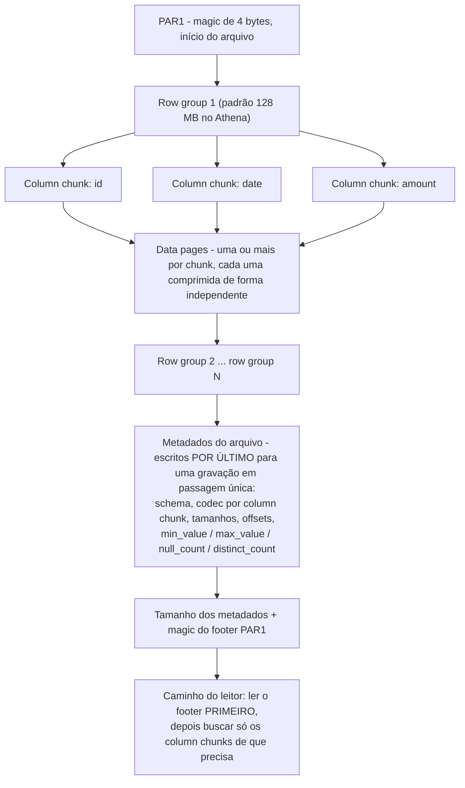
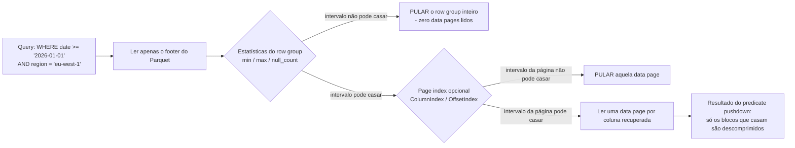
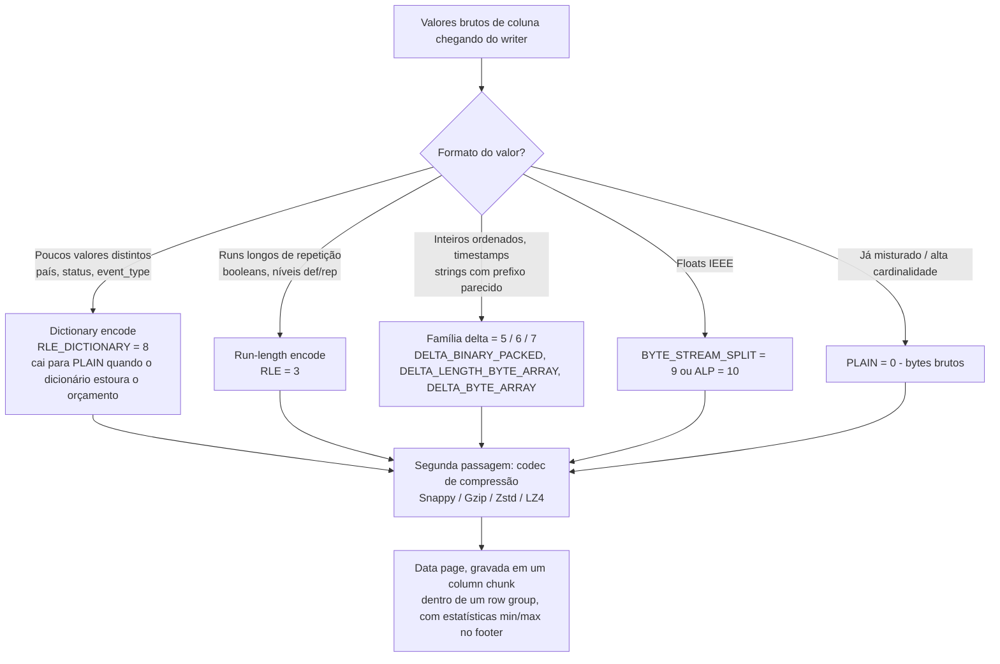
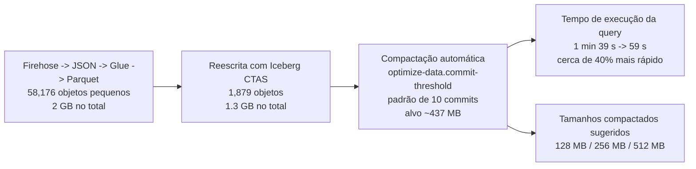
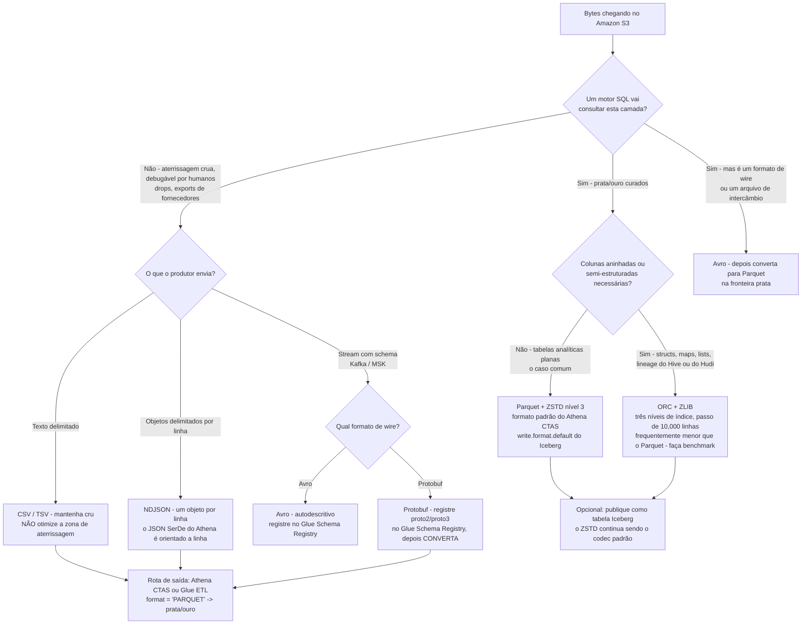

# Formatos de Dados e Compressão: CSV, JSON, Avro, Parquet e ORC

O Amazon Athena precifica uma única coisa: "Consultar dados comprimidos é mais rápido e também mais barato porque você paga pelo número de bytes varridos antes da descompressão" (Amazon Athena User Guide, *Compression formats*, acesso em 2026-10-11). Todo o resto de um design de lakehouse — partições, workgroups, tamanhos de cluster, regras de ciclo de vida — fica a montante de uma decisão que você toma na primeira semana e depois convive por anos: **qual formato de arquivo, qual codec de compressão e de que tamanho deve ser cada objeto.**

A AWS publica a mesma decisão como uma história de custos em três passos na própria página de preços: uma tabela de 3 TB com quatro colunas, uma única query de uma coluna, cobrada a **$5.00 por TB varrido** em outubro de 2026. Texto sem compressão = **$15.00**. Gzip no texto a 3:1 = **$5.00**. Gzip *e* conversão para Parquet, de modo que só uma das quatro colunas seja lida = **$1.25**. Mesma query, mesma resposta, mesmos dados — um spread de 12× criado inteiramente por escolhas de formato e compressão.

É por isso que esta lição vem antes dos formatos de tabela, antes do ETL, antes da camada de consulta. Se os bytes estiverem errados, nenhum tuning de motor devolve esse dinheiro.

**Nesta lição você vai:**

- ler corretamente a **anatomia linha versus colunar** — row groups, column chunks, data pages, footers, estatísticas `min`/`max`, o page index opcional — e ver exatamente onde acontece o **predicate pushdown**;
- usar a **matriz de formatos** para CSV, JSON, Avro, Parquet, ORC e Protobuf: orientação, schema in-file, splittability, tipos aninhados e qual motor AWS realmente vai ler cada um;
- aplicar a **matriz de evolução de schema** por formato, incluindo por que o Parquet lê por *nome* enquanto o ORC lê por *índice* e o que isso te custa;
- explicar **encodings** — dictionary + RLE, run-length encoding, a família delta, `BYTE_STREAM_SPLIT` — e por que eles rodam *antes* da compressão;
- escolher entre **Snappy, Gzip, Zstd e LZ4** com números de benchmark de terceiros datados na mão, em vez de folclore;
- dimensionar arquivos na faixa de **128 MB – 1 GB** e diagnosticar (e depois corrigir) o **problema dos arquivos pequenos**;
- percorrer um **fluxo de decisão de quando usar qual** da zona de aterrissagem crua até o gold;
- resolver **sete exemplos resolvidos com números reais em outubro de 2026** — a aritmética do Athena, as razões de codec, o desastre de contagem de arquivos do micro-batch, um CTAS de 420 GB de CSV → Parquet, o fator de expansão do JSON, a recomendação Iceberg + ZSTD e a decisão de codec para uma tabela quente;
- estudar **casos reais nomeados de clientes da AWS** — o "data swamp" de arquivos Parquet da Vanguard e o lake colunar da Nasdaq — além da Woot.com e da ZS;
- ler a **caixa de atualizações de outubro de 2026** (Glue 6.0 Iceberg v3, S3 Metadata, compactação do S3 Tables) e responder **doze questões no estilo de exame** com quatro verificações interativas.

---

## 1. Linha versus colunar: a anatomia que define sua conta

### 1.1 Um formato de linha armazena registros, inteiros e repetidos

CSV, TSV, NDJSON, Avro e Protobuf são **formatos de linha**: os campos de um registro ficam juntos. A vantagem é exatamente o que um produtor precisa — escrever o registro inteiro, ler o registro inteiro, anexar o próximo registro. A desvantagem aparece no momento em que uma query toca um campo só, dos quarenta.

`SELECT amount FROM events WHERE date >= '2026-01-01'` contra texto orientado a linha tem que percorrer cada byte de cada linha e pular os trinta e nove campos de que não precisa. Não existe como pular direto para a coluna `amount`, porque a coluna `amount` não existe como região contígua em lugar nenhum do arquivo.

O JSON acrescenta um segundo custo, mais silencioso: **as chaves se repetem em cada registro**. A matriz de formatos do digest diz isso sem rodeios: JSON tem "no in-file schema (keys repeat per record)". O Avro resolve essa metade do problema ao embutir um JSON schema no arquivo (e manter o schema do writer ao lado dos dados para a schema resolution), mas continua orientado a linha.

### 1.2 Um formato colunar armazena campos, inteiros e repetidos

Parquet e ORC são **colunares**: os valores de uma coluna ficam juntos, então uma query de 2 das 40 colunas lida algo como 2/40 dos dados mais os metadados. Isso não é uma razão de marketing — é o mecanismo pelo qual o Athena cobra. A própria página de armazenamento colunar do Athena diz que o predicate pushdown "enables Athena queries to fetch only the blocks it needs … it uses statistics from data block predicates, such as max/min values, to determine whether to read or skip the block" (acesso em 2026-10-11).

### 1.3 …e ambos são, na verdade, híbridos (PAX)

A descrição honesta não é "linha" nem "colunar", e sim **PAX**: um híbrido que particiona linhas horizontalmente primeiro e depois armazena as colunas de cada partição separadamente. Como diz o survey acadêmico de 2023: "both Parquet and ORC employ the PAX format. The DBMS first partitions a table horizontally into row groups. It then stores tuples column-by-column within each row group" (arXiv 2304.05028, 2023-11-07 — fonte acadêmica de terceiros).

Daí seguem duas consequências, e as duas caem em prova:

1. **"Linha versus colunar" é um espectro, não um interruptor.** Reconstituir uma linha completa ainda toca uma unidade de localidade (um row group, um stripe) — só que uma muito menor do que um arquivo de texto inteiro.
2. **O tamanho da unidade é um knob de tuning, não uma constante.** O Athena documenta os padrões: "O tamanho padrão dos row groups é 128 MB e o dos stripes, 64 MB … Diminuir o tamanho do row group ou do stripe … não é recomendado" (acesso em 2026-10-11).

### 1.4 Anatomia de um arquivo Parquet, ponta a ponta

A própria documentação de formato do Parquet descreve um arquivo que começa e termina com um magic number de 4 bytes `PAR1`, guarda um ou mais row groups e grava **os metadados do arquivo por último**, de modo que o writer faz uma única passagem. O contrato do leitor é o espelho: "Os leitores devem primeiro ler os metadados do arquivo para encontrar todos os column chunks de que precisam" (parquet.apache.org/docs/file-format/, acesso em 2026-10-11).



O README do parquet-format acrescenta dois fatos que valem decorar: "A file consists of one or more row groups. A row group contains exactly one column chunk per column. Column chunks contain one or more pages", e dados aninhados usam "a codificação Dremel com níveis de definição e repetição".

A orientação de tamanho varia por workload, e os dois números são oficiais:

| Fonte | Tamanho recomendado de row group / bloco | Público |
|---|---|---|
| Docs de performance tuning do Athena (acesso em 2026-10-11) | **128 MB** padrão; diminuir "not recommended" | SQL interativo no S3 |
| Docs de throttling do S3 no Athena (acesso em 2026-10-11) | bloco Parquet **128 MB**, stripe ORC **64 MB** | scans paralelos |
| README do parquet-format (acesso em 2026-10-11) | **512 MB – 1 GB** | leituras em massa em layouts estilo HDFS |
| Configuração do Iceberg (acesso em 2026-10-11) | row group **128 MB**, page **1 MB**, limite de linhas por page **20,000**, dicionário **2 MB** | gravações de formato de tabela |
| Faixa desta lição | **128 MB – 1 GB por arquivo de dados** | lakehouse no S3 |

### 1.5 Estatísticas, page index e predicate pushdown

O footer carrega `Statistics {min_value, max_value, null_count, distinct_count}` por column chunk (`parquet.thrift`, acesso em 2026-10-11). Um predicado de query é avaliado contra esses intervalos *antes que qualquer data page seja lida*:



A documentação de page index do Parquet descreve o payoff com precisão: "a page index is optional metadata for a ColumnChunk, containing statistics for DataPages that can be used to skip those pages", e "A single-row lookup in a row group … will only read one data page per retrieved column" (acesso em 2026-10-11).

O equivalente no ORC *não* é opcional e é mais fino por padrão. O ORC fornece "three level of indexes within each file: file level … stripe level … row level — statistics … for each set of 10,000 rows within a stripe" (orc.apache.org/docs/indexes.html, acesso em 2026-10-11), e "As of Hive 1.2, the indexes can include bloom filters". O passo de 10,000 linhas é o `orc.row.index.stride=10,000` do Hive. O ORC também dimensiona seus blocos de compressão em **256 KiB** (`orc.compress.size=262,144`), de modo que um bloco de que não se precisa nunca chega a ser descomprimido.

> [!NOTE]
> **Predicate pushdown é um recurso de estatísticas, não um recurso de compressão.** A compressão decide quantos bytes um scan custa; as estatísticas decidem se o scan acontece. Uma tabela com compressão ZSTD perfeita e sem estatísticas min/max ainda vai ler todos os row groups. O próprio enunciado do Athena é "read or **skip** the block" — pular é que é o ganho.

- **📚 Você sabia?** Os crawlers do Glue descobrem o schema de um arquivo lendo *partes* diferentes de formatos diferentes: Avro "Lê o schema no começo do arquivo", Parquet "Lê o schema no fim do arquivo", ORC "Reads the file metadata", e o JSON lê o começo (AWS Glue classifiers, acesso em 2026-10-11). É por isso que um objeto Parquet truncado, com o footer faltando, é indecifrável para um crawler, enquanto um objeto Avro truncado não é.

### 1.6 Exemplo resolvido E1 — a aritmética de $15 → $5 → $1.25 (em out 2026)

O exemplo publicado pela própria AWS (`aws.amazon.com/athena/pricing/`, acesso em 2026-10-11): uma tabela de 3 TB com quatro colunas, uma query que lê uma única coluna, Athena sob demanda a **$5.00 por TB varrido**.

| Design | Bytes varridos | Custo por query |
|---|---|---|
| Texto sem compressão, sem poda de colunas | 3.00 TB | 3.00 × $5.00 = **$15.00** |
| Mesma tabela, Gzip a 3:1 | 1.00 TB | 1.00 × $5.00 = **$5.00** |
| Gzip + Parquet, a query toca 1 das 4 colunas | 0.25 TB | 0.25 × $5.00 = **$1.25** |

Escale: a **600 queries por mês** isso dá **$9,000.00** contra **$3,000.00** contra **$750.00** — um delta mensal de **$8,250.00** entre o pior e o melhor design sobre dados idênticos. A compressão comprou os primeiros 3×; o layout colunar mais o predicate pushdown comprou os próximos 4×.

Note a ordem. A compressão ajuda na proporção dos bytes varridos; a poda de colunas multiplica isso. Você não chega aos $1.25 com CSV só com gzip, e não chega neles com Parquet se toda query selecionar as quatro colunas.

## 2. A matriz de formatos: CSV, JSON, Avro, Parquet, ORC e Protobuf

### 2.1 A matriz central

Seis formatos, quatro eixos. Tudo na tabela vem da documentação da AWS e da Apache citada no digest (todos com acesso em 2026-10-11).

| Formato | Orientação | Schema in-file | Divisível quando comprimido | Tipos aninhados | Leitura no Athena | Escrita no Athena | Papel principal na AWS |
|---|---|---|---|---|---|---|---|
| **CSV / TSV** | linha | não (linha de cabeçalho opcional) | **não** — um stream gzip = um split | não | sim (LazySimple / OpenCSV) | CTAS `TEXTFILE` | aterrissagem crua, arquivos de fornecedores |
| **JSON / NDJSON** | linha | não (chaves repetem por registro) | gzip não; faixas de bytes sem compressão sim | sim | sim (Hive JSON, OpenX) | CTAS `JSON` | aterrissagem crua, dumps de API |
| **Avro** | linha | **sim** — JSON schema embutido | por bloco, não divisível por byte de texto | sim | sim (Avro SerDe) | CTAS `AVRO` | intercâmbio de streaming / Kafka, manifests do Iceberg |
| **Parquet** | colunar híbrido (row groups) | **sim** — footer | **sim** — pages / row groups | sim (níveis def/rep do Dremel) | sim | sim (**padrão do CTAS**) | analytics prata e ouro curados |
| **ORC** | colunar híbrido (stripes) | **sim** — footer + postscript | **sim** — stripes | sim (struct / map / union) | sim | sim | lineage do Hive, arquivos de dados do Iceberg e do Hudi |
| **Protobuf** | linha (wire) | não — `.proto` é externo | **não** | sim | **não está na lista de SerDe**; só como entrada do conector Kafka | não | formato de wire de streaming → é preciso converter |

Três linhas merecem comentário.

**Protobuf não é um formato de lakehouse consultável no Athena.** A tabela de SerDes suportados do Athena lista Ion, Avro, Parquet, CSV, JSON, ORC, TSV e formatos de log — o Protobuf está ausente. O que o Protobuf *tem* são duas posições legítimas na AWS: como entrada do **Glue Schema Registry** ("Protocol Buffers (Protobuf) versions proto2 and proto3 without support for `extensions` or `groups`", acesso em 2026-10-11), e como entrada do **conector MSK do Athena** ao lado de JSON, CSV e AVRO. Aterrisse, converta, consulte — nessa ordem.

**O Firehose converte JSON e nada mais.** "Amazon Data Firehose can convert the format of your input data from JSON to Apache Parquet or Apache ORC before storing the data in Amazon S3 … If you want to convert an input format other than JSON, such as comma-separated values (CSV) … use AWS Lambda to transform it to JSON first" (docs do Firehose, acesso em 2026-10-11). Com a conversão habilitada, o Amazon S3 é o único destino, a compressão do lado do S3 fica desabilitada e "Snappy compression happens automatically" usando framing compatível com Hadoop.

**NDJSON é o único formato de JSON que o Athena aceita bem.** O JSON SerDe do Athena é orientado a linha, então um objeto JSON por linha (JSON Lines) funciona e JSON pretty-printed ou embrulhado em array não funciona. Aterrisse NDJSON, não JSON bonitinho.

### 2.2 Splittability: a propriedade que todo mundo entende ao contrário

A concepção mais comum desta lição: *"Parquet é comprimido, então não é divisível."* Errado. O próprio blog Top-10 de tuning do Athena da AWS (2017-03-24) afirma: "Os arquivos Parquet e ORC são sempre divisíveis porque esses formatos comprimem seções dos arquivos separadamente e têm metadados que contêm as posições dentro dos arquivos."

O que **não** é divisível é *texto* comprimido:

- "a maioria dos arquivos de texto comprimidos não é divisível" — um `gzip.csv` de 2 GB é **um split** e portanto **um worker**;
- **bzip2 e LZO** são as exceções divisíveis entre os codecs de texto, mas "não recomendado se você quer desempenho e compatibilidade";
- a própria regra de tamanho do blog: "mire em splits de cerca de 128 MB".

O Athena reforça o teto de paralelismo para dados comprimidos: o **número de arquivos** é o teto de workers. Um arquivo gigante significa um worker, independentemente do tamanho do cluster.

| Layout | Divide em trabalho paralelo? | Por quê |
|---|---|---|
| Parquet + Snappy / Zstd / Gzip / LZ4 | **Sim, sempre** | pages e row groups comprimem de forma independente; o footer registra os offsets |
| ORC + Zlib / Snappy / Zstd / LZ4 | **Sim, sempre** | stripes comprimem de forma independente; o footer do stripe registra os offsets |
| `gzip.csv` (um objeto) | **Não** | um único stream deflate não pode ser entrado no meio |
| `bzip2.csv` / `lzo.csv` | Sim, mas desaconselhado | blocos divisíveis, ferramental e compatidade fracos |
| `.csv` sem compressão | Sim (faixas de bytes) | ao preço de pagar todos os bytes varridos em toda query |

> [!IMPORTANT]
> ⚠️ **Não encolha row groups ou stripes para "fazer as queries pularem mais".** O guidance de performance do Athena é explícito: "Decreasing the row group or stripe size … is not recommended", e o motivo é aritmético — unidades menores significam mais footers, mais estatísticas, mais setups de dicionário e mais overhead por arquivo, o que *aumenta* o custo de scan em vez de reduzi-lo. Um benchmark de terceiros com 10 M de linhas encontrou row groups de 128k linhas produzindo **87.41 MiB** contra **68.61 MiB** com row groups de 1 M de linhas nos mesmos dados (aicodeinvest.com, 2026-07-19 — terceiros). Encolher é um conserto para um predicado patológico, não um padrão.

### 2.3 Evolução de schema: a matriz que ninguém ensina até quebrar

O Athena publica uma matriz por formato do que sobrevive a qual mudança de schema (`handling-schema-updates-chapter.md`, acesso em 2026-10-11). A razão mecânica por trás da tabela cabe em uma linha: **"By default, Parquet will access columns by name and ORC by index (ordinal value)"**.

| Mudança | CSV / TSV | JSON | Avro | Parquet (leitura por nome, padrão do Athena) | ORC (leitura por índice, padrão do Athena) |
|---|---|---|---|---|---|
| Renomear uma coluna | ✔ | ✘ | ✘ | ✘ | ✔ |
| Adicionar uma coluna no **final** | ✔ | ✔ | ✔ | ✔ | ✘ (precisa de `orc.column.index.access=false`) |
| Adicionar uma coluna no **início / meio** | ✘ | ✔ | ✔ | ✔ | ✘ |
| Remover uma coluna | ✘ | ✔ | ✔ | ✔ | ✘ |
| Reordenar colunas | ✘ | ✔ | ✔ | ✔ | ✘ |
| Mudar o tipo de uma coluna | ✔ (tabelas particionadas) | ✔ (tabelas particionadas) | ✔ com promotion | ✔ (tabelas particionadas) | ✔ (tabelas particionadas) |

Leia a tabela como designer, não a decore:

- **Parquet com leitura por nome** te compra add / remove / reorder e te custa o rename. Vire `parquet.column.index.access=true` e você ganha rename ao preço de add/remove/reorder. Isso é uma *decisão de design de schema*, não uma configuração de performance.
- **ORC é o espelho**: rename funciona, mudança estrutural não funciona, até você virar `orc.column.index.access=false`.
- **Avro** vai mais longe porque sua spec define uma **Schema Resolution** formal: schema do writer mais schema do reader, promotions como "int … long, float, double", "string is promotable to bytes", e defaults para campos que o writer não tem — com a regra de que "files or systems that store Avro data should always include the writer's schema."
- **O Iceberg escapa em grande parte dessa tabela**, porque armazena field IDs e seus próprios metadados de schema (lição 04). Arquivos crus no S3 ainda obedecem a cada linha da matriz acima.

### 2.4 Interativo — correlacione o formato com suas características

```matching
{
  "question": "Correlacione cada formato de dados com a característica que de fato governa como ele se comporta na AWS (todos em out 2026):",
  "pairs": [
    {"left": "CSV / TSV", "right": "Orientado a linha, sem schema in-file, e um CSV com gzip é um único split indivisível - um worker para o arquivo inteiro"},
    {"left": "NDJSON (JSON Lines)", "right": "Orientado a linha com chaves repetidas por registro; o JSON SerDe do Athena é orientado a linha, então um objeto por linha funciona e JSON pretty-printed não funciona"},
    {"left": "Avro", "right": "Orientado a linha mas autodescritivo: o JSON schema está embutido no arquivo, e a schema resolution suporta type promotion com defaults"},
    {"left": "Parquet", "right": "PAX híbrido em row groups com um footer escrito por último; padrão do CTAS do Athena, e sempre divisível independentemente do codec"},
    {"left": "ORC", "right": "PAX híbrido em stripes de ~64 MB com três níveis de índice, incluindo um passo de 10,000 linhas, lido por ordinal de coluna por padrão no Athena"},
    {"left": "Protobuf", "right": "Um formato de wire com definição .proto externa - ausente da lista de SerDe do Athena, então precisa ser convertido antes de poder ser consultado"}
  ],
  "explanation": "A orientação separa CSV/JSON/Avro/Protobuf (registro a registro) de Parquet/ORC (column chunks dentro de row groups ou stripes). As armadilhas específicas da AWS são: texto com gzip nunca é divisível, o leitor de JSON do Athena precisa de NDJSON, Avro é o único formato de linha que carrega seu próprio schema, o status de padrão do CTAS do Parquet, o passo de índice de 10,000 linhas e o acesso ordinal a colunas do ORC, e a ausência do Protobuf na tabela de SerDe - ele existe apenas como entrada do conector Kafka e do Schema Registry, que precisa aterrissar e depois converter."
}
```

- **📚 Você sabia?** O Athena vai ler silenciosamente alguns arquivos comprimidos de forma errada porque usa a extensão do arquivo como chave: "extensões de arquivo em maiúsculas como `.GZ` … não são reconhecidas pelo Athena" (acesso em 2026-10-11). Um script de CLI que grava `part-00000.csv.GZ` em vez de `.gz` produz uma tabela que lista arquivos mas não varre nada. Mantenha todas as extensões em minúsculas.

## 3. Encodings: o que acontece antes da compressão

A compressão é a *segunda* passagem. A primeira é o **encoding** — converter valores tipados em uma representação de bytes que explora a forma da coluna. Tanto o Parquet quanto o ORC aplicam essa camada, e é dela que vem a maior parte do ganho de tamanho de verdade.

### 3.1 Dictionary encoding + RLE — o cavalo de batalha de baixa cardinalidade

Para uma coluna com poucos valores distintos (códigos de país, flags de status, nomes de eventos), o writer monta um dicionário de valores únicos e substitui cada ocorrência por um ID inteiro pequeno. Esses IDs depois passam por run-length encoding. O registro de encodings do Parquet chama essa combinação de `RLE_DICTIONARY` (valor de enum **8**).

A regra de fallback importa mais que o caminho feliz: **"Se o dicionário crescer grande demais … a codificação recua para a codificação plain"** (parquet.apache.org, modificado em 2026-02-24). Colunas de alta cardinalidade — IDs de usuário, UUIDs, timestamps com precisão de microssegundo — estouram o orçamento do dicionário e caem silenciosamente para `PLAIN`, que aí é comprimido só pelo codec.

Um exemplo medido dessa falésia: desligar o dictionary encoding em *uma única* coluna de um arquivo Parquet de 10 M de linhas acrescentou **18.79 MiB** (aicodeinvest.com, 2026-07-19 — benchmark de terceiros). O orçamento padrão de dicionário do Iceberg é `write.parquet.dict-size-bytes = 2097152` (2 MB).

### 3.2 Run-length encoding e bit packing

**RLE** só compensa quando os valores realmente se repetem — booleanos, colunas de status ordenadas e os níveis de definição/repetição que o Dremel usa para dados aninhados. **Bit packing** guarda inteiros pequenos no número mínimo de bits e é amigável a SIMD.

O survey acadêmico de 2023 traça a linha prática: o Parquet só muda para RLE quando o run length ≥ 8, enquanto o ORC entrega quatro encodings de inteiros separados. Nos testes deles, isso ajudou o Parquet a varrer mais rápido, enquanto os zone maps mais finos do ORC ajudaram point lookups seletivos (arXiv 2304.05028, 2023-11-07 — terceiros).

### 3.3 A família delta e os encodings de float

- **`DELTA_BINARY_PACKED`** (enum 5) — deltas entre inteiros ordenados, muito eficaz em timestamps e números de sequência ordenados.
- **`DELTA_LENGTH_BYTE_ARRAY`** (enum 6) e **`DELTA_BYTE_ARRAY`** (enum 7) — para strings com prefixos e comprimentos parecidos.
- **`BYTE_STREAM_SPLIT`** (enum 9) e **`ALP`** (enum 10) — para colunas de ponto flutuante.

O kit equivalente do ORC, na própria especificação: "type specific readers and writers that provide light weight compression techniques such as dictionary encoding, bit packing, delta encoding, and run length encoding … Additionally, ORC can apply generic compression using zlib, or Snappy on top of the lightweight compression."

O registro completo de encodings do Parquet em out 2026: `PLAIN=0`, `PLAIN_DICTIONARY=2` (descontinuado), `RLE=3`, `BIT_PACKED=4`, `DELTA_BINARY_PACKED=5`, `DELTA_LENGTH_BYTE_ARRAY=6`, `DELTA_BYTE_ARRAY=7`, `RLE_DICTIONARY=8`, `BYTE_STREAM_SPLIT=9`, `ALP=10`.



> [!WARNING]
> ⚠️ **É no encoding que a razão vem; o codec é um passe de polimento.** O benchmark de terceiros com dois datasets mediu Parquet plain (sem codec) em **564 MB** e **760 MB** contra CSVs de origem de **1,761 MB** e **2,983 MB** — só o encoding levou os dados a algo como **32%** e **25.5%** do CSV. Adicionar um codec levou isso a **8–18%**, dependendo do codec e do dataset (jeronimo.dev, 2025-01-16 — terceiros). Se um arquivo colunar *não* é muito menor que o CSV, o bug costuma ser uma coluna patológica (ID de alta cardinalidade, lista aninhada sem limite), não o codec faltando.

---

## 4. Codecs de compressão: Snappy, Gzip, Zstd, LZ4

### 4.1 O trade em um único eixo

A própria página de compressão do Parquet enquadra isso como um espectro: "The Parquet format supports several compression codecs covering different areas in the compression ratio / processing cost spectrum" — SNAPPY, GZIP, LZO, BROTLI, LZ4 (framing Hadoop descontinuado), ZSTD, LZ4_RAW (acesso em 2026-10-11).

| Codec | Velocidade de compressão | Velocidade de descompressão | Razão | Onde a AWS usa |
|---|---|---|---|---|
| **Snappy** | muito rápida | muito rápida (">3.5 GB/s", terceiros) | a mais fraca das quatro | escolha automática do Firehose com conversão de formato; padrão típico de Spark/PyArrow; selecionável para CTAS em Parquet e ORC |
| **LZ4 / LZ4_RAW** | muito rápida | muito rápida (">3.5 GB/s", terceiros) | a mais fraca, parecida com a do Snappy | selecionável para CTAS em ORC; **o Athena não grava Parquet com LZ4** (leitura suportada) |
| **Gzip** | **a mais lenta para escrever** | moderada, boa razão | forte | **padrão do Athena CTAS para Parquet** em tabelas estilo Hive; **o padrão do ORC no Hive é ZLIB** |
| **Zstd** | rápida, níveis ajustáveis **1–22** | ~1 GB/s (terceiros), plano entre níveis | **melhor equilíbrio** | **padrão do Athena para tabelas Iceberg, nível 3**; recomendação do AWS Prescriptive Guidance para Iceberg |
| LZO | rápida | rápida | fraca–moderada | divisível com suporte a índice, mas ferramental fraco; o Athena não grava Parquet com ela |
| Brotli | lenta | — | muito forte | **não é caminho de escrita na AWS** — não designe em cima dela |

### 4.2 O que a AWS recomenda, com as palavras da própria AWS

- **Zstd para Iceberg.** "Recomendamos usar o codec de compressão ZSTD porque ele equilibra GZIP e Snappy … o Snappy pode oferecer o melhor desempenho geral de leitura e escrita, mas tem uma taxa de compressão menor que GZIP e ZSTD" (AWS Prescriptive Guidance, *Apache Iceberg on AWS — general best practices*, acesso em 2026-10-11).
- **Níveis do Zstd.** "níveis de 1 a 22 … o Athena usa o nível de compressão ZSTD 3 por padrão … recomendamos usar o nível padrão 3 ou um nível na faixa de 6 a 9 … use níveis maiores que 19 com cautela." A propriedade `compression_level` é suportada **apenas no Athena engine version 3** (acesso em 2026-10-11).
- **Gzip é amplo e confiável.** "GZIP … is the default write compression format for files in the Parquet and text file storage formats" para tabelas Hive com engine v2/v3, e "provides good compression ratios and has wide range support" (acesso em 2026-10-11).
- **Zstd é o mais novo e o equilibrado.** "a newer compression format with a good balance between performance and compression ratio" (acesso em 2026-10-11).

### 4.3 Benchmarks de terceiros datados (rotulados como tal)

Nenhum dos números abaixo é publicado pela AWS; todos são datados e, em princípio, reproduzíveis.

**Benchmark de codecs em Parquet de 10 M de linhas** (aicodeinvest.com, **2026-07-19**):

| Codec | Tamanho do arquivo (MiB) | Tempo de escrita (s) | % do tamanho sem compressão |
|---|---|---|---|
| nenhum | 125.06 | 0.714 | 100.0% |
| **snappy** | 102.17 | 0.876 | 81.7% |
| **lz4** | 102.65 | 0.858 | 82.1% |
| **gzip** | 74.90 | **44.363** | 59.9% |
| **zstd nível 3** | **68.61** | 0.942 | **54.9%** |
| zstd nível 9 | 68.52 | 2.384 | 54.8% |

Duas leituras dessa tabela: **o gzip foi ~47× mais lento para escrever que o zstd nível 3 (44.363 ÷ 0.942) e ainda produziu um arquivo *maior***, e **o zstd nível 9 comprou 0.09 MiB por 2.5× o tempo de escrita do nível 3**. A escolha de nível não é de graça — é exatamente por isso que o Athena recomenda 3 ou 6–9 e alerta acima de 19.

**Dois datasets públicos, Parquet com e sem codecs** (jeronimo.dev, **2025-01-16**, terceiros): os CSVs de origem de **1,761 MB** e **2,983 MB** viraram — Parquet sem compressão **564 / 760 MB**; snappy **220 / 542**; gzip **146 / 448**; zstd **148 / 430**; lz4_raw **209 / 547**; lzo **215 / 518**. Segundos de escrita nos mesmos dois datasets: nenhum **25.0 / 57.9**; snappy **25.2 / 56.4**; **gzip 39.3 / 91.1** (algo como +50%); zstd **27.3 / 64.1**; lz4_raw **24.9 / 56.5**; lzo **26.0 / 56.1**. O overhead de descompressão medido foi de **10–20%**.

**Micro-benchmark de codecs** (mamonas.dev, **2025-08-18**, terceiros): Snappy e LZ4 descomprimem a ">3.5 GB/s"; o Zstd mantém algo como **1 GB/s** entre os níveis; o gzip é o mais lento; o Zstd no nível 19 escreve extremamente devagar.

**Migração de produção da Uber** (blog de engenharia da Uber, **2022-01-24**, terceiros): ao mover suas top-10 tabelas "From GZIP to ZSTD … ~7% drops in storage size, while from SNAPPY to ZSTD, we see ~39% reduction", e "~~79% size reduction" contra o sem compressão. A compute também caiu: **870,472 → 639,184 → 213,914 vCoreSeconds** em Snappy → Gzip → Zstd num único trimestre medido — uma redução de **75.4%** do Snappy para o Zstd.

```plot
{
  "type": "bar",
  "title": "Tamanho do arquivo Parquet por codec, 10 M de linhas (benchmark de terceiros, aicodeinvest.com, 2026-07-19)",
  "xLabel": "Codec",
  "yLabel": "Tamanho do arquivo (MiB)",
  "xKey": "codec",
  "data": [
    {"codec": "uncompressed", "mib": 125.06},
    {"codec": "LZ4", "mib": 102.65},
    {"codec": "Snappy", "mib": 102.17},
    {"codec": "Gzip", "mib": 74.90},
    {"codec": "Zstd level 3", "mib": 68.61},
    {"codec": "Zstd level 9", "mib": 68.52}
  ]
}
```

```plot
{
  "type": "bar",
  "title": "Tempo de escrita das mesmas 10 M de linhas - repare no Gzip (terceiros, aicodeinvest.com, 2026-07-19)",
  "xLabel": "Codec",
  "yLabel": "Tempo de escrita (segundos)",
  "xKey": "codec",
  "data": [
    {"codec": "uncompressed", "seconds": 0.714},
    {"codec": "LZ4", "seconds": 0.858},
    {"codec": "Snappy", "seconds": 0.876},
    {"codec": "Zstd level 3", "seconds": 0.942},
    {"codec": "Zstd level 9", "seconds": 2.384},
    {"codec": "Gzip", "seconds": 44.363}
  ]
}
```

### 4.4 Interativo — os padrões de codec, preencha-os

```fillblank
{
  "question": "Complete as frases sobre os padrões de codec da AWS com os valores publicados (todos em outubro de 2026):",
  "template": "O CTAS do Athena gravando Parquet para uma tabela estilo Hive usa por padrão compressão {{1}}, porque o formato padrão do CTAS é {{2}} e o codec padrão de Parquet dele é {{1}}. O Athena gravando uma tabela Iceberg usa por padrão {{3}} no nível de compressão {{4}}, e o AWS Prescriptive Guidance recomenda {{3}} para Iceberg como o equilíbrio entre GZIP e Snappy. Para ORC, o codec padrão do CTAS é {{5}}, e a propriedade de tabela do Hive por trás dele é orc.compress={{6}}. O Athena não VAI GRAVAR Parquet comprimido com LZ4 ou LZO - leituras são suportadas - e extensões em maiúsculas como {{7}} não são reconhecidas de todo.",
  "answers": {
    "1": "GZIP",
    "2": "PARQUET",
    "3": "ZSTD",
    "4": "3",
    "5": "ZLIB",
    "6": "ZLIB",
    "7": ".GZ"
  },
  "distractors": ["SNAPPY", "ORC", "AVRO", "LZ4", "BROTLI", "1", "9", "22", ".gz.GZ", ".GZIP", "ZLIB", "nível 6"],
  "explanation": "Padrões do CTAS (docs de ctas-considerations do Athena, acesso em out 2026): formato PARQUET; para Parquet você pode usar GZIP ou SNAPPY e 'the default is GZIP'; para ORC você pode usar LZ4, SNAPPY, ZLIB ou ZSTD e 'the default is ZLIB'. As tabelas Iceberg do Athena usam por padrão ZSTD nível 3, que também é a recomendação do AWS Prescriptive Guidance para Iceberg. Repare na armadilha da pergunta: ZLIB e ZSTD são codecs diferentes - ZLIB é o algoritmo do Gzip, e é o padrão do ORC, não o do Iceberg. 'O padrão do Parquet é Snappy' é um distrator tirado das convenções de Spark/PyArrow; diga sempre motor mais tipo de tabela quando disser 'padrão'."
}
```

- **📚 Você sabia?** "Snappy" aparece duas vezes nesta lição com dois trabalhos diferentes: é um **codec** que você escolhe para Parquet ou ORC, e é o que o **Firehose aplica automaticamente** sempre que a conversão de formato de registro está habilitada ("However, Snappy compression happens automatically … The framing format for Snappy … is compatible with Hadoop"). É por isso que a documentação do Firehose manda você definir `CompressionFormat` como `UNCOMPRESSED` quando a conversão está ligada — senão você comprime duas vezes e paga as duas.

### 4.5 Exemplo resolvido E2 — aritmética de codec em uma tabela de staging de 10 GB por hora (em out 2026)

Um pipeline estagina **10 GB por hora** e o caminho de escrita é limitado por CPU. Usando o benchmark de terceiros de 10 M de linhas acima (aicodeinvest.com, 2026-07-19) como proxy de escala:

| Codec | Bytes armazenados por 10 GB estacionados (razão aplicada) | Custo relativo de escrita |
|---|---|---|
| Snappy | 10 GB × 0.817 = **8.17 GB** | linha de base (0.876 s) |
| Zstd nível 3 | 10 GB × 0.549 = **5.49 GB** | **+7.5%** sobre o Snappy (0.942 s) |
| Gzip | 10 GB × 0.599 = **5.99 GB** | **~51× mais lento** que o Zstd-3 (44.363 s) |

Leitura dos números: **o Zstd nível 3 bate o Gzip nos *dois* eixos nesta execução** — arquivo menor *e* cinquenta vezes mais rápido para escrever. Não existe cenário nesta tabela em que o Gzip vença; ele perde em razão para o Zstd e perde em velocidade para tudo. O Snappy é 2.7 GB/hora maior que o Zstd-3 (≈ **65 GB/dia**, ≈ **23.7 TB/ano** ao longo de 365 dias de estagiação contínua) por uma economia no caminho de escrita que ninguém consegue medir.

As regras defensáveis:

- **estagiação limitada de escrita → Snappy** (ou LZ4), porque Firehose e Spark já têm esse padrão e a perda de razão é o preço do throughput;
- **tabelas curadas limitadas de armazenamento ou de scan → Zstd nível 3**, que é o padrão do Iceberg no Athena e a recomendação do AWS Prescriptive Guidance;
- **nunca escolha Gzip para gravação de Parquet por causa da velocidade de escrita** — o Gzip existe no mundo porque é o padrão de *CTAS* do Athena, não porque seja o melhor codec.

## 5. Dimensionamento de arquivos e o problema dos arquivos pequenos

### 5.1 A faixa

| Restrição | Número | Fonte (acesso em 2026-10-11) |
|---|---|---|
| Bloco Parquet / row group padrão do Athena | **128 MB** | docs de performance tuning + docs de throttling do S3 do Athena |
| Stripe ORC padrão do Athena | **64 MB** | docs do Athena; Hive `orc.stripe.size=67,108,864` |
| Recomendação do parquet-format para leituras em massa | **512 MB – 1 GB** | README do parquet-format |
| Row group / page / dict do Iceberg | **128 MB / 1 MB / 2 MB** | configuração do Iceberg (1.10.2) |
| Stripe / bloco ORC do Iceberg | **64 MB / 256 MB** | configuração do Iceberg (1.10.2) |
| Pico de load do Redshift | **blocos de origem de 1 GB** | AWS Big Data Blog, 2020-01-02 |
| Alvos de compactação sugeridos | **128 / 256 / 512 MB** | AWS Big Data Blog, 2023-10-03 |
| **Faixa desta lição para arquivos de dados no S3** | **128 MB – 1 GB** | síntese do acima |

Abaixo de algo como **128 MB** por arquivo, o overhead por objeto domina: custo de `GET`/`LIST` do S3, tempo de listagem, setup de footer e dicionário, metadados de partição do Glue — e, o que o Athena declara diretamente, **"Para arquivos pequenos, o overhead do formato colunar supera os benefícios."** Acima de algo como **1 GB** você começa a perder paralelismo de split e a aumentar o custo de retry de uma task que falha.

### 5.2 Exemplo resolvido E3 — o desastre de contagem de arquivos do micro-batch (em out 2026)

Uma equipe grava **1 TB por dia** em **micro-batches de 5 segundos**, acreditando que micro-batches dão frescor.

- Arquivos por dia: 86,400 s ÷ 5 s = **17,280 arquivos/dia**
- Bytes por arquivo: 1,000 GB ÷ 17,280 ≈ **58 MB** — já abaixo da faixa
- Em um mês: **≈ 518,400 objetos**, cada um com seu próprio footer, seu próprio `GET` no S3, sua própria entrada de listagem

Agora coalesça para a faixa da lição:

- A **1 GB** por arquivo: 1,000 GB ÷ 1 GB = **1,000 arquivos/dia** (redução de 17×)
- A **128 MB** por arquivo: 1,000 ÷ 0.128 = **7,813 arquivos/dia** (redução de 2.2×)

O sintoma que você realmente vai ver não é "lento", e sim **o tempo de planejamento virando uma parcela relevante do tempo total de execução da query** — o Athena enumerando centenas de milhares de objetos, montando um plano e depois varrendo uma quantidade minúscula de dados. O conserto é compactação (lição 04) ou dimensionamento de escrita (lição 08), nunca um retorno ao CSV.

### 5.3 O funil dos arquivos pequenos, medido

O caso EMR + Iceberg da própria AWS (AWS Big Data Blog, **2023-10-03**) é o conjunto de números mais limpo deste curso:



Cada passo desse funil é um conserto de **formato e tamanho de arquivo**, não de compute: nenhum cluster foi redimensionado, nenhuma query foi reescrita, nenhuma partição foi adicionada. Os objetos simplesmente passaram a ter o formato certo no tamanho certo.

- **📚 Você sabia?** Formatos colunares tornam os arquivos pequenos *piores*, não melhores. A página de performance tuning do Athena diz em voz alta: "Para arquivos pequenos, o overhead do formato colunar supera os benefícios." Um arquivo Parquet de 40 KB ainda carrega um par de magic `PAR1`, um footer com schema completo, estatísticas e estado do dicionário — overhead que pode exceder os próprios dados. Texto puro de 40 KB ao menos não tem footer para escrever.

---

## 6. Quando usar qual: o fluxo de decisão

### 6.1 O fluxo



### 6.2 A regra camada por camada

| Camada do lakehouse | Formato | Por quê, com a fonte |
|---|---|---|
| **Aterrissagem crua (bronze)** | O que o produtor enviar — CSV, NDJSON, Avro, Protobuf | Não otimize a zona de aterrissagem; otimize a **saída** dela. O Firehose converte JSON → Parquet/ORC na entrega; o CSV precisa passar por Lambda → JSON antes. |
| **Curada (prata / ouro)** | **Parquet + ZSTD (nível 3)** | O formato padrão do Athena CTAS é Parquet (codec padrão GZIP); o Iceberg usa `write.format.default=parquet` com `write.parquet.compression-codec=zstd`; o Prescriptive Guidance recomenda ZSTD. |
| **Hive / Hudi / tipos complexos** | **ORC + ZLIB** | Athena: "ORC files are often smaller than Parquet files, and ORC indexes can make querying faster. In addition, ORC supports complex types such as structs, maps, and lists." |
| **Intercâmbio de streaming** | Avro ou Protobuf → converter | O Glue Schema Registry suporta Avro v1.11.4, JSON, Protobuf proto2/proto3 com **8** modos de compatibilidade (NONE, DISABLED, BACKWARD, BACKWARD_ALL, FORWARD, FORWARD_ALL, FULL, FULL_ALL). |
| **Arquivo** | Parquet + ZSTD, ciclo de vida para tiers Glacier | Objetos idênticos, sem o imposto de descomprimir antes de consultar. Arquivos de *texto* com gzip precisam ser totalmente descomprimidos antes de qualquer query. |

### 6.3 Exemplo resolvido E4 — CSV → Parquet com Athena CTAS (em out 2026)

**Entrada:** 420 GB de CSV delimitado por quebras de linha em `s3://lake/raw/ghcn/`, **60 colunas**.

**Passo 0 — DDL da tabela crua e baseline.**

```sql
CREATE EXTERNAL TABLE raw_ghcn (
  id        string,
  date      string,
  element   string,
  datavalue bigint
  -- ... 56 further columns ...
)
ROW FORMAT DELIMITED
FIELDS TERMINATED BY ','
STORED AS TEXTFILE
LOCATION 's3://lake/raw/ghcn/';

SELECT count(*) FROM raw_ghcn WHERE date >= '2015';
-- record Data Scanned: text cannot prune columns
```

**Passo 1 — CTAS.** Este é o padrão oficial da AWS (Athena *CTAS INSERT INTO ETL*, mais o walkthrough do AWS Big Data Blog de 2019-11-27):

```sql
CREATE TABLE ghcn_parquet
WITH (
  format             = 'PARQUET',          -- CTAS default, stated explicitly
  parquet_compression = 'ZSTD',             -- CTAS default would be GZIP; SNAPPY for hot writes
  partitioned_by      = ARRAY['year_col'],
  external_location   = 's3://lake/silver/ghcn/'
)
AS SELECT
  id, date, element, datavalue,
  substr(date, 1, 4) AS year_col
FROM raw_ghcn
WHERE cast(substr(date, 1, 4) AS bigint) BETWEEN 2015 AND 2025;
```

Uma única instrução define formato, codec, particionamento e localização, **e registra automaticamente a tabela no Glue Data Catalog**. (Formatos aceitos pelo CTAS: `PARQUET`, `ORC`, `AVRO`, `JSON`, `TEXTFILE` — Parquet se você omitir `format`.)

**Passo 2 — incremental.** `INSERT INTO ghcn_parquet SELECT … WHERE year_col = '2026';`

**Passo 3 — a aritmética.** Aplicando o resultado de dois datasets de terceiros (Parquet + codec ≈ **9–15%** do CSV; jeronimo.dev, 2025-01-16 — terceiros, não uma garantia da AWS):

- 420 GB × 0.09 → 420 GB × 0.15 = **≈ 38 GB – 63 GB** no S3
- query de uma coluna lê 63 GB ÷ 60 colunas ≈ **1.05 GB**
- custo: 1.05 GB a $5.00/TB ≈ **$0.005** contra 420 GB a $5.00/TB ≈ **$2.10** — uma redução de **≈400× por query**

**Passo 4 — verifique.** Confira *Data Scanned* no console do Athena, `aws s3 ls --summarize` no prefixo prata, e confirme que os objetos caem na faixa de **128 MB – 1 GB**, e não em quilobytes.

**Passo 5 — guardrails.** Limite de uso de dados do workgroup, partition projection em `year_col` e uma política de mudança de schema de crawler do Glue `MergeNewColumns`.

O walkthrough publicado do CTAS da AWS chegou em "Size of dataset after parquet with snappy compression - **1.2 GB**", e a nota dele é a lição: "the file sizes are pretty small. Merging them into larger files … would lead to faster query execution."

### 6.4 Exemplo resolvido E5 — o fator de expansão do JSON (em out 2026)

Pegue um registro de sensor de seis campos e compare as representações. Isto é **aritmética trabalhada sobre um registro ilustrativo**, não um benchmark publicado — o fato que ele demonstra (o JSON repete chaves por registro) vem da matriz de formatos da §2.1.

**CSV (52 bytes):**

```text
2026-10-11T04:15:00Z,device-7734,eu-west-1,21.5,ok,4
```

**NDJSON (107 bytes):**

```text
{"ts":"2026-10-11T04:15:00Z","device":"device-7734","region":"eu-west-1","temp":21.5,"status":"ok","seq":4}
```

- Expansão: 107 ÷ 52 = **2.06×** — a mesma informação, **106% maior**
- Dos 107 bytes, **45 bytes (42%)** são tokens de nome de campo repetidos (`"ts":`, `"device":`, `"region":`, `"temp":`, `"status":`, `"seq":`) mais as chaves — estrutura que nunca muda entre registros
- A **1,000,000 registros/dia**: CSV ≈ **52 MB/dia** (≈ 19.0 GB/ano), JSON ≈ **107 MB/dia** (≈ 39.1 GB/ano) — **≈ 20.1 GB/ano de pura repetição**, antes de qualquer compressão
- E os codecs de compressão tratam os dois como texto opaco: Gzip e Zstd comprimem a repetição *um pouco*, mas só um formato colunar a remove estruturalmente ao guardar cada campo uma vez por row group

A consequência de design: a repetição do JSON não é um problema de armazenamento que você resolve com um codec melhor, é um problema de **representação** que você resolve com uma conversão na fronteira prata — exatamente o que faz a conversão de formato de registro do Firehose ou um CTAS.

### 6.5 Exemplo resolvido E6 — a recomendação Iceberg + ZSTD (em out 2026)

AWS Prescriptive Guidance, *Apache Iceberg on AWS — general best practices* (acesso em 2026-10-11), declara a recomendação: "recomendamos usar o codec de compressão ZSTD porque ele equilibra GZIP e Snappy … o Snappy pode oferecer o melhor desempenho geral de leitura e escrita, mas tem uma taxa de compressão menor que GZIP e ZSTD." A própria glossa do Athena sobre o mesmo par: Zstd é "a newer compression format with a good balance between performance and compression ratio" (acesso em 2026-10-11).

A configuração do próprio Iceberg a confirma como o padrão entregue (`iceberg.apache.org/docs/1.10.2/configuration/`, acesso em 2026-10-11):

```text
write.format.default              = parquet
write.parquet.compression-codec    = zstd
write.parquet.row-group-size-bytes = 134217728   (128 MB)
write.parquet.page-size-bytes      = 1048576     (1 MB)
write.parquet.page-row-limit       = 20000
write.parquet.dict-size-bytes      = 2097152     (2 MB)
write.avro.compression-codec       = gzip
write.orc.stripe-size-bytes        = 67108864    (64 MB)
write.orc.block-size-bytes         = 268435456   (256 MB)
write.orc.compression-codec        = zlib
```

E o Athena já o grava: "ZSTD is the default compression for Iceberg tables … level 3 by default."

**A aritmética.** Pegue uma tabela Iceberg de 10 TB e compare codecs usando as medições de produção da Uber (blog de engenharia da Uber, **2022-01-24** — terceiros):

| Mudança | Delta de armazenamento em 10 TB | Direção |
|---|---|---|
| Gzip → Zstd | −7% ⇒ **9.30 TB** | menor |
| Snappy → Zstd | −39% ⇒ **6.10 TB** | muito menor |
| Sem compressão → Zstd | −79% ⇒ **2.10 TB** | dramaticamente menor |

À taxa do Athena de **$5.00/TB varrido**, o ganho do codec é um ganho de *scan*, porque o Athena cobra os bytes que lê do S3 — "você paga pelo número de bytes varridos antes da descompressão" (acesso em 2026-10-11). Então a mesma tabela de 10 TB varrida mensalmente custa cerca de **$50.00** sem compressão, cerca de **$46.50** se tivesse sido Gzip (−7% para o Zstd implica que o Zstd fica 7% abaixo do Gzip), cerca de **$30.50** se tivesse sido Snappy (−39%) e cerca de **$10.50** se tivesse sido gravada como Zstd sem compressão (−79%). São razões de armazenamento de terceiros aplicadas à taxa de lista da AWS — rotule-as assim e mantenha os dois efeitos separados: **o codec encolhe os bytes que você varre; o layout colunar mais o predicate pushdown encolhe o número de colunas e de row groups que você varre de todo.** O $1.25 da E1 veio dos dois; esta tabela só mostra o primeiro.

**A disciplina de nível:** nível **3** por padrão, **6–9** se você mediu o trade, **>19 com cautela**, e `compression_level` só no **Athena engine version 3**. A própria Uber usou o nível 19 para backfills frios e níveis baixos em caminhos de streaming — leitura é constante entre níveis, escrita não (terceiros, 2022-01-24).

> [!NOTE]
> **Parquet em Snappy ou Parquet em Zstd não é uma pergunta de "qual está certo" — é uma pergunta de "qual restrição aperta".** Snappy: a escolha automática do Firehose, o padrão usual de Spark/PyArrow, a resposta certa quando throughput de escrita e CPU dominam. Zstd nível 3: o padrão do Iceberg no Athena e a escolha do AWS Prescriptive Guidance, a resposta certa quando armazenamento e custo de scan dominam. Ambos são defensáveis; só um combina com o seu gargalo.

### 6.6 Exemplo resolvido E7 — escolhendo um codec para uma tabela de staging quente (em out 2026)

Uma equipe precisa escolher um codec para uma tabela de staging que é gravada continuamente e lida por dashboards a cada cinco minutos. Insumos de decisão a partir dos números do digest:

| Insumo | Valor | Fonte (datada) |
|---|---|---|
| Tempo de escrita, 10 M de linhas: Snappy / Zstd-3 / Gzip | 0.876 s / 0.942 s / **44.363 s** | aicodeinvest.com, 2026-07-19 (terceiros) |
| Tamanho, 10 M de linhas: Snappy / Zstd-3 / Gzip | 102.17 / **68.61** / 74.90 MiB | mesma |
| Throughput de descompressão, Snappy/LZ4 vs Zstd | ">3.5 GB/s" vs ≈ **1 GB/s** | mamonas.dev, 2025-08-18 (terceiros) |
| Padrão do Iceberg no Athena | **Zstd nível 3** | docs do Athena, acesso em 2026-10-11 |
| Recomendação do Prescriptive Guidance | **Zstd** | AWS Prescriptive Guidance, acesso em 2026-10-11 |

**Veredito:** Zstd nível 3. Ele é 33% menor que o Snappy por uma penalidade de 7.5% no tempo de escrita, e o Gzip é eliminado nos dois eixos. Se a tabela fosse um buffer de ingestão write-only de alto volume, sem leituras analíticas, o Snappy seria a resposta correta no lugar — o número de throughput de descompressão é o único argumento a favor do Snappy, e ele aperta só quando leituras dominam a CPU.

---

### Atualizações de 2026 (em outubro de 2026)

> [!NOTE]
> **O que mudou nos formatos de arquivo dos quais esta lição depende:**
> - **2026-08-21 — AWS Glue 6.0 está GA com Iceberg v3.** "AWS Glue 6.0 is now generally available, delivering a 30% price reduction and introducing full support for Apache Iceberg v3" — incluindo "VARIANT data type with automatic shredding", "deletion vectors for high-performance row-level updates", "geometry and geography data types", valores de coluna UNKNOWN e DEFAULT; o runtime migra para Spark 4.1.1 / Python 3.13 com Iceberg 1.11.0, Hudi 1.1.1 e Delta 4.2.0 (AWS News Blog, 2026-08-21; notas de release do Glue, acesso em 2026-10-11). Relevância do formato: VARIANT é um tipo semiestruturado que ainda precisa ser fisicamente shreddado em colunas Parquet — é a camada de encoding da §3 que torna isso compensador.
> - **2025-07-01 — custos de compactação automática do S3 Tables cortados em até 90%.** "S3 Tables… automatically managed compaction… reduces compaction costs by up to 90%" enquanto elas "maintain optimal file sizes and layout without manual intervention" (AWS Storage Blog, 2025-07-01). Essa é a resposta gerenciada ao problema dos arquivos pequenos da §5 — a faixa de 128 MB–1 GB é mantida para você, em vez de por um job agendado do Glue.
> - **2025-01-27 — Amazon S3 Metadata está GA.** "S3 Metadata makes it easy to query and filter S3 object metadata using SQL… you can query object metadata using Amazon Athena" (AWS News Blog, 2025-01-27) — útil exatamente para auditar distribuições de formato e tamanho em um bucket sem um ciclo completo de S3 Inventory.
> - **2025-03-14 — Firehose para S3 Tables está GA.** O destino "converts incoming records to Iceberg-compatible Parquet and writes to managed S3 Tables" e "supports schema evolution on a subset of types" (AWS Big Data Blog, 2025-03-14) — o caminho de aterrissagem de streaming da §6 agora contorna o passo de CTAS por completo.
> - **2026-07-30 — streaming tables do MSK para Apache Iceberg no Amazon S3 Tables.** "up to 10 GB/s ingest" e "reduce ingest costs by up to 60%" com MSK Express brokers (AWS News Blog, 2026-07-30) — a aterrissagem de streaming agora grava Parquet compatível com Iceberg diretamente, o que aumenta a aposta em acertar o codec e o dimensionamento de row group na hora da escrita.

---

## Casos Reais

### Caso A — Vanguard: um "data swamp" de arquivos Parquet ainda é um data swamp

**Vanguard (gestão de investimentos; Financial Advisor Services "FAS 360").** Em um AWS Big Data Blog datado de **2026-03-18**, a Vanguard descreve o ponto de partida de sua modernização em uma frase: "migrating from a fragmented **'data swamp' of Parquet files on Amazon Simple Storage Service (Amazon S3)** to a structured, unified system." Dois anos depois do trabalho, a AWS reporta **20 TB no Amazon Redshift e outros 150 TB no data lake do S3**, **600+ jobs de ETL do AWS Glue (um aumento de 30×)**, **300+ tabelas**, **250+ materialized views do Redshift**, **500+ dashboards do Tableau** e **500,000+ queries de usuários por mês**. A Vanguard agora está "curating data products on the data lake using Apache Iceberg format and leveraging AWS Glue for metrics computation and data lake integration."

O ângulo de *desta* lição para este caso é desconfortável e importante: **os arquivos já eram Parquet.** Só o formato não os salvou. Parquet sem disciplina de dimensionamento, sem um formato de tabela que forneça ACID e snapshots, e sem dono transforma um lake em um swamp tão eficaz quanto CSV cru — a matriz de formatos da §2 é um insumo *necessário*, não suficiente. O conserto da Vanguard foi adicionar a camada que faltava (produtos de dados em Iceberg, com domínios donos), não trocar o formato de arquivo.

*Números relatados pelo cliente a partir de um blog da AWS publicado em 2026-03-18; não é um compromisso da AWS.*

### Caso B — Nasdaq: arquivos de lake colunar sob a carga de uma bolsa

**Nasdaq (operadora de bolsa, serviços financeiros).** Segundo o estudo de caso da AWS (página com ano 2020, acesso em out 2026), a Nasdaq construiu "the foundation of a new data lake on Amazon Simple Storage Service (Amazon S3)" em 2018 e adotou o Redshift Spectrum para "consultar dados tanto no data warehouse quanto no data lake do Amazon S3" — o que a AWS chama de "a lake house architecture". O perfil de ingestão noturno foi de **"30 billion to 55 billion records and surpassing 4 terabytes"** de milhares de fontes; o lake guardava **15 terabytes de dados no Amazon S3** consultáveis in place; os resultados reportados foram queries do Redshift **"32 percent faster"** e a marca de 90% do data-load atingida **5 horas mais cedo**. Robert Hunt, VP de Software Engineering, é citado: "Amazon S3 gave us a solution that enables zero contention between data loading and querying processes."

Por que ele pertence aqui: 4 TB por noite, consultados na manhã seguinte, é exatamente o workload para o qual a matriz de formatos existe. O layout colunar mais o predicate pushdown é o que permite a uma bolsa varrer uma noite de registros para uma pergunta de vigilância sem ler cada coluna de cada registro — e a própria citação de "zero contention" da Nasdaq é a lição de separação de storage/compute da lição 01 aparecendo no nível do byte.

*Números relatados pelo cliente a partir de uma página de estudo de caso da AWS sem data (marca de ano 2020, acesso em out 2026); não é um compromisso da AWS.*

### Caso C — Woot.com: por que o CSV quebrou e o Parquet não

**Woot.com (varejo).** Em um AWS Big Data Blog datado de **2019-01-22**, a equipe reporta que exportar colunas de texto para CSV "conflicted with the commas present in the text data. We opted to use AWS Glue to export data from RDS to S3 in Parquet format" — o Parquet é "unaffected by commas because it encodes columns directly." Duas lições em uma linha: a fragilidade do delimitador do CSV é um risco de *correção*, não só de performance, e o AWS Glue ETL gravando `format="parquet"` é a segunda das duas rotas de conversão sancionadas, ao lado do Athena CTAS.

*Blog da AWS, 2019-01-22; datado, trate como evidência histórica do padrão, não como pricing ou performance atuais.*

---

## Perguntas de Prática (Practice Questions)

```question
{
  "id": "lh-03-q1",
  "type": "multiple-choice",
  "question": "Uma tabela de 3 TB com quatro colunas é consultada por uma única coluna. Usando o exemplo resolvido publicado pelo Amazon Athena em outubro de 2026, qual é a progressão de custo do texto sem compressão, para Gzip, para Gzip + Parquet?",
  "options": [
    "$15.00 -> $5.00 -> $1.25",
    "$15.00 -> $7.50 -> $3.75",
    "$5.00 -> $2.50 -> $1.25",
    "$15.00 -> $5.00 -> $5.00 porque a compressão sozinha remove todo o custo de scan de colunas"
  ],
  "correct": 0,
  "explanation": "A página de preços do Athena publica exatamente essa escada a $5.00 por TB varrido: 3 TB sem compressão = $15.00; Gzip a 3:1 = 1 TB = $5.00; Gzip mais Parquet lendo 1 das 4 colunas = 0.25 TB = $1.25. A compressão comprou os primeiros 3x; o layout colunar mais o predicate pushdown comprou os próximos 4x. A opção D é o erro clássico: compressão escala bytes, poda de colunas escala colunas, e você precisa das duas."
}
```

```question
{
  "id": "lh-03-q2",
  "type": "multiple-choice",
  "question": "Um engenheiro de dados afirma: 'Arquivos Parquet são comprimidos com Zstd, então não podem ser divididos entre workers.' Qual resposta está correta em outubro de 2026?",
  "options": [
    "Correto - qualquer compressão remove a splittability, e é por isso que o Athena recomenda Parquet sem compressão para scans paralelos",
    "Incorreto - Parquet e ORC são sempre divisíveis porque as seções são comprimidas separadamente e os metadados registram suas localizações; o que não é divisível é texto comprimido com gzip",
    "Parcialmente correto - Parquet é divisível só com Brotli, e ORC só com Zlib",
    "Correto para o Parquet, mas os stripes do ORC são legíveis de forma independente do codec"
  ],
  "correct": 1,
  "explanation": "O blog de tuning do Athena da AWS afirma que Parquet e ORC 'are always splittable because these formats compress sections of the files separately, and have metadata that contains the locations within the files'. Um único CSV com gzip é um stream deflate e, portanto, um split e um worker. Bzip2 e LZO são divisíveis entre os codecs de texto, mas são explicitamente 'not recommended if you want performance and compatibility'."
}
```

```question
{
  "id": "lh-03-q3",
  "type": "multiple-choice",
  "question": "Um job do Glue renomeia a coluna `datavalue` para `value` em uma tabela Parquet existente lida pelo Athena com as configurações padrão, e depois adiciona uma nova coluna no final do schema. Qual afirmação está correta em outubro de 2026?",
  "options": [
    "As duas funcionam - Parquet suporta qualquer mudança de schema independentemente das configurações",
    "O add funciona, o rename não: Parquet lê colunas por nome por padrão, e o rename exige virar parquet.column.index.access=true, o que depois custa o suporte a add/remove/reorder",
    "O rename funciona, o add não: Parquet lê colunas por índice por padrão",
    "Nenhuma funciona, a menos que a tabela seja convertida para Iceberg primeiro"
  ],
  "correct": 1,
  "explanation": "A matriz de handling-schema-updates do Athena afirma que, por padrão, 'Parquet will access columns by name and ORC by index (ordinal value)'. Leitura por nome dá add em qualquer lugar, remove e reorder, mas não rename; leitura por índice (parquet.column.index.access=true) inverte esse trade. ORC é o espelho exato, com orc.column.index.access. Mudanças de tipo funcionam apenas em tabelas particionadas. O Iceberg escapa boa parte disso ao armazenar field IDs - mas só se você o adotar (lição 04)."
}
```

```question
{
  "id": "lh-03-q4",
  "type": "multiple-choice",
  "question": "Qual conjunto de padrões de formato do Amazon Athena CTAS está correto em outubro de 2026?",
  "options": [
    "Formato padrão PARQUET; codec padrão do Parquet SNAPPY; codec padrão do ORC LZ4",
    "Formato padrão PARQUET; codec padrão do Parquet GZIP; codec padrão do ORC ZLIB",
    "Formato padrão ORC; codec padrão do Parquet ZSTD; codec padrão do ORC SNAPPY",
    "Formato padrão PARQUET; codec padrão do Parquet ZSTD; codec padrão do ORC ZLIB"
  ],
  "correct": 1,
  "explanation": "A documentação de CTAS do Athena: os resultados são armazenados em Parquet por padrão; para Parquet você pode usar GZIP ou SNAPPY e 'the default is GZIP'; para ORC você pode usar LZ4, SNAPPY, ZLIB ou ZSTD e 'the default is ZLIB'. ZSTD é o padrão das tabelas ICEBERG (nível 3), não do CTAS em Parquet - misturar esses dois 'padrões' é a opção D, o distrator mais tentador."
}
```

```question
{
  "id": "lh-03-q5",
  "type": "multiple-choice",
  "question": "Um produtor de streaming envia mensagens Protocol Buffers pelo Amazon MSK. Qual caminho as aterrissa como dados consultáveis no Amazon Athena?",
  "options": [
    "Aterrissar o Protobuf direto no S3 e registrá-lo com um crawler do Glue - o Athena lê Protobuf nativamente",
    "Registrar proto2/proto3 no Glue Schema Registry, aterrissar via conversão de formato de registro do Firehose em Parquet, depois consultar",
    "Aterrissar o Protobuf no S3 e apontar o conector MSK do Athena para o prefixo do S3 - Protobuf é um SerDe suportado pelo Athena",
    "Aterrissar o Protobuf no S3, converter com o Glue para Parquet (ou Avro) na fronteira prata, depois consultar - Protobuf não está na lista de SerDes suportados do Athena"
  ],
  "correct": 3,
  "explanation": "A tabela de SerDes suportados do Athena lista Ion, Avro, Parquet, CSV, JSON, ORC, TSV e formatos de log - o Protobuf está ausente. Ele aparece como formato do Glue Schema Registry (proto2/proto3, sem extensions ou groups) e como entrada do CONECTOR MSK do Athena, o que significa que é um formato de ingestão, não de consulta. A conversão de formato de registro do Firehose aceita apenas JSON como entrada (CSV precisa passar por Lambda -> JSON antes), o que elimina a opção B."
}
```

```question
{
  "id": "lh-03-q6",
  "type": "multiple-choice",
  "question": "Num benchmark de terceiros de Parquet com 10 M de linhas (aicodeinvest.com, 2026-07-19), o Gzip gravou em 44.363 s com 74.90 MiB enquanto o Zstd nível 3 gravou em 0.942 s com 68.61 MiB. Qual é a conclusão defensável?",
  "options": [
    "Gzip é a melhor escolha porque a razão é parecida e ele é mais amplamente suportado",
    "Gzip é algo como 47x mais lento para escrever que o Zstd nível 3 enquanto produz um arquivo maior, então o Gzip não tem caso em caminhos de escrita onde o Zstd está disponível",
    "Zstd nível 9 deveria ser preferido, já que níveis mais altos são de graça",
    "O benchmark também prova que o Gzip é inutilizável para leitura"
  ],
  "correct": 1,
  "explanation": "44.363 / 0.942 = 47.1, e 74.90 MiB > 68.61 MiB - o Gzip perde nos dois eixos nesta execução. O Zstd nível 9 comprou 0.09 MiB sobre o nível 3 por 2.5x o tempo de escrita, e é por isso que o Athena recomenda o nível 3 ou 6-9 e alerta acima de 19. Nada aqui fala de performance de leitura, então a opção D não tem apoio. Isso é evidência de terceiros, não uma garantia da AWS - rotule como tal."
}
```

```question
{
  "id": "lh-03-q7",
  "type": "multiple-choice",
  "question": "Um pipeline grava 1 TB por dia em micro-batches de 5 segundos. Quantos objetos ele cria por dia e qual é a faixa recomendada pela lição para arquivos de dados no S3 em outubro de 2026?",
  "options": [
    "17,280 objetos/dia; alvo de 128 MB - 1 GB por arquivo",
    "17,280 objetos/dia; alvo abaixo de 10 MB por arquivo para máximo paralelismo",
    "8,640 objetos/dia; alvo de 128 MB - 1 GB por arquivo",
    "17,280 objetos/dia; alvo de 512 KB para cada micro-batch ser seu próprio objeto"
  ],
  "correct": 0,
  "explanation": "86,400 segundos / 5 = 17,280 arquivos por dia, com cerca de 58 MB cada - já abaixo da faixa. A faixa da lição é 128 MB - 1 GB, sintetizada do bloco Parquet de 128 MB e do stripe ORC de 64 MB do Athena, da orientação de 512 MB - 1 GB do parquet-format, do pico de load de 1 GB do Redshift e dos alvos de compactação de 128/256/512 MB. O Athena alerta que, para arquivos pequenos, 'the overhead of the columnar format outweighs the benefits'."
}
```

```question
{
  "id": "lh-03-q8",
  "type": "multiple-choice",
  "question": "Qual afirmação sobre encodings versus compressão no Parquet está correta em outubro de 2026?",
  "options": [
    "A compressão roda primeiro e os encodings só são aplicados quando a compressão falha",
    "Os encodings (dictionary, RLE, delta) rodam antes da compressão, e o dictionary encoding cai silenciosamente para PLAIN quando o dicionário cresce demais - uma coluna de ID de alta cardinalidade é, portanto, uma falésia de compressão",
    "O dictionary encoding é obrigatório em toda coluna e nunca cai para o fallback",
    "O RLE só é aplicado a colunas de string"
  ],
  "correct": 1,
  "explanation": "A documentação de encodings do Parquet: 'If the dictionary grows too big ... the encoding will fall back to the plain encoding.' O encoding é a primeira passagem sobre os valores tipados; o codec é a segunda passagem sobre aqueles bytes. É por isso que desligar o dictionary encoding em uma coluna custou +18.79 MiB numa execução de terceiros com 10 M de linhas (2026-07-19), e é por isso que IDs de alta cardinalidade são a falésia clássica de compressão. O RLE também carrega os níveis de definição/repetição para dados aninhados, não só strings."
}
```

```question
{
  "id": "lh-03-q9",
  "type": "multiple-choice",
  "question": "O AWS Prescriptive Guidance recomenda ZSTD para Iceberg porque ele 'strikes a balance between GZIP and Snappy'. O que o Athena faz de fato por padrão para tabelas Iceberg e qual disciplina de nível se aplica?",
  "options": [
    "Gzip no nível 9, porque tabelas Iceberg sempre usam o codec padrão do CTAS",
    "ZSTD no nível 3; os níveis vão de 1-22, os níveis 6-9 são recomendados se medidos, acima de 19 exige cautela, e compression_level exige Athena engine version 3",
    "Snappy no nível 1, porque o Iceberg prioriza throughput de escrita acima de tudo",
    "ZSTD no nível 19, porque o nível utilizável mais alto sempre minimiza o custo total"
  ],
  "correct": 1,
  "explanation": "O Athena documenta 'ZSTD is the default compression for Iceberg tables ... level 3 by default', com níveis 1-22, recomendação do nível 3 ou 6-9, cautela acima de 19 e compression_level suportado apenas na engine version 3. A migração da Uber (2022-01-24, terceiros) usou o nível 19 só para backfills frios e níveis baixos em caminhos de streaming - leitura é constante entre níveis, escrita não."
}
```

```question
{
  "id": "lh-03-q10",
  "type": "multiple-choice",
  "question": "Uma equipe está escolhendo um formato de arquivo de dados para uma tabela com lineage do Hive que contém structs, maps e lists, e quer as estatísticas de skip embutidas mais finas. Qual escolha se encaixa, e qual é a ressalva honesta?",
  "options": [
    "Parquet, porque o Parquet suporta tipos aninhados e o ORC não suporta",
    "ORC - três níveis de índice incluindo um passo de 10,000 linhas mais bloom filters opcionais - com a ressalva de que o Athena diz que arquivos ORC são apenas FREQUENTEMENTE menores que os do Parquet, e um survey acadêmico de 2023 encontrou 'no clear winner' entre eles, então faça benchmark com seus próprios dados",
    "CSV, porque texto delimitado tem o menor custo de armazenamento de qualquer formato",
    "Avro, porque seu schema embutido dá o melhor predicate pushdown de qualquer formato de linha"
  ],
  "correct": 1,
  "explanation": "O ORC fornece índices de arquivo, de stripe e de row group com estatísticas a cada 10,000 linhas, bloom filters opcionais desde o Hive 1.2 e suporte nativo a struct/map/union - a página de armazenamento colunar do Athena diz que arquivos ORC são 'often smaller than Parquet files, and ORC indexes can make querying faster'. A ressalva é a palavra 'often': o survey de 2023 (arXiv 2304.05028) encontrou 'no clear winner between Parquet and ORC in terms of file sizes'. CSV não tem tipos aninhados nem estatísticas; Avro é orientado a linha e não faz skip de bloco de coluna."
}
```

```question
{
  "id": "lh-03-q11",
  "type": "multiple-choice",
  "question": "A conversão de formato de registro do Amazon Data Firehose está habilitada com o Amazon S3 como destino. Qual combinação de comportamentos está correta em outubro de 2026?",
  "options": [
    "A entrada pode ser JSON, CSV ou Avro; a compressão do S3 continua habilitada; nenhum codec é aplicado automaticamente",
    "A entrada precisa ser JSON (CSV exige pré-transformação por Lambda para JSON); o Amazon S3 é o único destino; a compressão do lado do S3 é desabilitada e o Snappy é aplicado automaticamente com framing compatível com Hadoop",
    "A entrada pode ser qualquer formato; a conversão grava só ORC; o Gzip é aplicado automaticamente",
    "A entrada precisa ser JSON; a conversão grava no S3 ou no Redshift; o LZ4 é aplicado automaticamente"
  ],
  "correct": 1,
  "explanation": "O Firehose documenta que converte 'from JSON to Apache Parquet or Apache ORC', que outras entradas como CSV precisam do AWS Lambda para transformar em JSON antes, que 'Amazon S3 is the only destination', que 'Amazon S3 compression gets disabled' e que 'Snappy compression happens automatically' com framing compatível com Hadoop. É por isso que você define CompressionFormat como UNCOMPRESSED quando a conversão está ligada - senão você comprime duas vezes."
}
```

```question
{
  "id": "lh-03-q12",
  "type": "multiple-choice",
  "question": "Qual linha da matriz de evolução de schema publicada pela AWS está correta em outubro de 2026?",
  "options": [
    "JSON suporta rename mas não reorder - as chaves são posicionais em JSON delimitado por linha",
    "CSV suporta add no início, remove e reorder mas não rename",
    "Parquet com leitura por nome suporta add em qualquer lugar, remove e reorder mas não rename; Avro adiciona ainda type promotion e defaults através da schema resolution",
    "ORC com leitura por índice suporta add, remove e reorder por padrão mas não rename"
  ],
  "correct": 2,
  "explanation": "A matriz: JSON suporta add em qualquer lugar, remove, reorder e mudança de tipo mas NÃO rename (a opção A inverte isso). CSV suporta rename, add no final e mudança de tipo mas NÃO add no início/meio, remove ou reorder (a opção B está errada). ORC com leitura por índice suporta rename por padrão, não add/remove/reorder (a opção D está errada). Parquet com leitura por nome mais a resolução formal de schema writer/reader do Avro - promotions como int..long e string..bytes, e defaults para campos que o writer não tem - é a linha correta."
}
```

> [!WARNING]
> ⚠️ **Armadilhas de formato e compressão desta lição — percorra esta lista antes de designar qualquer coisa:**
> - **"O padrão do Parquet é Snappy" está incompleto.** CTAS em Parquet no Athena usa **GZIP** por padrão; Iceberg no Athena usa **ZSTD nível 3**; Spark/PyArrow costumam usar Snappy. Diga sempre motor + tipo de tabela quando disser "padrão".
> - **Parquet comprimido continua divisível; CSV com gzip, não.** Um `gzip.csv` de 2 GB = um split = um worker, e a contagem de arquivos é o teto de workers para dados comprimidos.
> - **Nunca encolha row groups ou stripes abaixo do padrão para "pular mais"** — o Athena diz que diminuir não é recomendado, e o experimento de terceiros com 128k linhas produziu um arquivo *maior* (87.41 MiB vs 68.61 MiB).
> - **O Athena não grava Parquet com LZ4 ou LZO** (só leitura), e **extensões em maiúsculas como `.GZ` não são reconhecidas** — mantenha as extensões em minúsculas.
> - **Protobuf é formato de ingestão, não de consulta** — ausente da lista de SerDe; converta antes de consultar.
> - **Dictionary encoding não é bala de prata** — cai para PLAIN em alta cardinalidade; desligá-lo em uma coluna custou **+18.79 MiB** (terceiros, 2026-07-19).
> - **Zstd nível 19+ é para backfills frios** — o nível 9 economizou **0.09 MiB** sobre o nível 3 enquanto o tempo de escrita foi de **0.942 s → 2.384 s**; o Athena alerta acima de 19 e condiciona `compression_level` à engine version 3.
> - **Formato colunar não te salva de arquivos pequenos** — "Para arquivos pequenos, o overhead do formato colunar supera os benefícios"; conserte com compactação ou dimensionamento de escrita, nunca voltando ao CSV.
> - **"ORC é sempre menor que Parquet" não é fato** — o Athena diz *often*, e o survey de 2023 encontrou *no clear winner*. Faça benchmark com seus próprios dados.
> - **Conversão no Firehose + `CompressionFormat=GZIP` comprime em dobro** — com a conversão ligada, defina `UNCOMPRESSED` e deixe o Snappy acontecer lá dentro.

> [!IMPORTANT]
> **Veredito Comparativo — Parquet vs ORC vs Delta nativo vs Iceberg-ORC na AWS**
> - **Contra o ORC:** as vantagens do ORC são estruturais — três níveis de índice com um passo de 10,000 linhas, bloom filters opcionais, tipos nativos de struct/map/union, e a própria observação do Athena de que "Os arquivos ORC costumam ser menores que os arquivos Parquet, e os índices do ORC podem deixar a consulta mais rápida." As vantagens do Parquet são a amplitude do ecossistema: ele é o padrão do CTAS do Athena, o `write.format.default` do Iceberg, o padrão usual do Spark, e o formato que "works across Java/PyIceberg/Rust/Go/C++", enquanto o ORC no Iceberg é **somente Java**. O resultado do survey acadêmico de 2023 — "no clear winner between Parquet and ORC in terms of file sizes" — é a posição padrão correta: **Parquet, a menos que você tenha uma medida para o ORC** (lineage do Hive, tipos complexos, ou point lookups seletivos em que os zone maps ganham).
> - **Contra o Delta nativo:** os arquivos de dados do Delta Lake são **apenas Parquet** (AWS Big Data Blog, 2023-06-09) mais um log de transações que fornece ACID, snapshots e schema enforcement. Isso significa que toda tabela Delta herda o comportamento de encoding, codec e row group do Parquet da §3 à §5 — não existe uma história de codec Delta separada para aprender. Escolha Delta nativo quando seu parque de motores for centrado em Spark/Databricks e com muito MERGE; na AWS, com Athena e Redshift no loop, a diferença prática do Parquet-on-S3 é a camada do log de transações, não os bytes.
> - **Contra o Iceberg-ORC:** o Iceberg v1 permite explicitamente "immutable file formats: Parquet, Avro, and ORC", e as propriedades por formato do Iceberg expõem o dimensionamento de stripe (64 MB) e de block (256 MB) do ORC mais um codec zlib. A ressalva é a matriz de suporte: **os arquivos de dados ORC são somente Java** no Iceberg, então são seguros no EMR, no Glue Spark e em leitores Java, e inseguros se leitores PyIceberg, Rust, Go ou C++ precisarem ler a tabela. **Parquet no Iceberg** é a combinação portátil, e é o que o Iceberg entrega por padrão.
> - **O veredito em uma frase:** adote **Parquet + ZSTD nível 3** para as camadas curadas e **o que o produtor enviar** para a aterrissagem crua; escolha **ORC + ZLIB** apenas para lineage Hive/Hudi ou tipos complexos com um benchmark na mão; trate **Delta** como Parquet mais um log de transações e **Iceberg-ORC** como uma otimização somente Java — e lembre-se de que o lake de 150 TB da Vanguard *já era Parquet* antes de curadoria, donos e um formato de tabela aberto serem adicionados (§Caso A).

> [!SUCCESS]
> **Pontos Principais (Key Takeaways):**
> 1. **A conta é uma decisão de formato.** O Athena cobra **$5.00 por TB varrido** (em out 2026), e o próprio exemplo dele move **$15.00 → $5.00 → $1.25** na mesma query de uma coluna: a compressão compra 3×, o layout colunar mais o predicate pushdown compra os próximos 4×.
> 2. **Parquet e ORC são híbridos PAX**, não puro colunar: row groups horizontais (padrão de **128 MB** no Athena) ou stripes (padrão de **64 MB**) contendo column chunks, com o footer escrito por último para os leitores buscarem só o que precisam.
> 3. **Predicate pushdown é estatística.** `min_value / max_value / null_count / distinct_count` no footer do Parquet, o page index opcional e os índices de arquivo/stripe/row group do ORC com um **passo de 10,000 linhas** decidem se um bloco é lido ou pulado — é um recurso de layout, não de compressão.
> 4. **Splittability:** Parquet e ORC são **sempre** divisíveis independentemente do codec; **texto com gzip não é** — um arquivo, um split, um worker, e a contagem de arquivos é o seu teto de paralelismo.
> 5. **Evolução de schema é por formato e mecânica:** Parquet lê por **nome** (add/remove/reorder ✔, rename ✘), ORC lê por **índice** (rename ✔, add/remove/reorder ✘), CSV não adiciona no meio nem remove, JSON não renomeia, Avro acrescenta resolução formal de schema writer/reader com type promotion e defaults.
> 6. **Encodings rodam antes da compressão** — dictionary + RLE (`RLE_DICTIONARY=8`) para baixa cardinalidade, RLE e bit-packing para runs e níveis aninhados, a família delta (5/6/7) para dados ordenados, `BYTE_STREAM_SPLIT`/`ALP` para floats — e o dictionary **cai para PLAIN**, e é por isso que IDs de alta cardinalidade são uma falésia de compressão (**+18.79 MiB** de uma coluna, terceiros 2026-07-19).
> 7. **Veredito de codec:** Snappy/LZ4 são os mais rápidos com a razão mais fraca; Gzip é o mais lento para escrever (**44.363 s** contra **0.942 s** do Zstd-3 para 10 M de linhas, terceiros 2026-07-19, e *maior* em 74.90 vs 68.61 MiB); **Zstd nível 3** é o padrão do Iceberg no Athena e a recomendação do AWS Prescriptive Guidance, com níveis **1–22**, recomendados **3** ou **6–9**, cautela **>19**, só na engine v3.
> 8. **Dimensione arquivos em 128 MB – 1 GB.** Abaixo disso, overhead por objeto e setup de footer/dicionário dominam — Athena: "Para arquivos pequenos, o overhead do formato colunar supera os benefícios." Um pipeline de 1 TB/dia em lotes de 5 segundos cria **17,280 objetos/dia**; coalescar para 1 GB dá **1,000/dia**.
> 9. **O conserto dos arquivos pequenos é medido:** 58,176 objetos / 2 GB → 1,879 objetos / 1.3 GB via Iceberg CTAS → ~437 MB via compactação automática, cortando uma query de **1 min 39 s para 59 s (cerca de 40% mais rápido)** (AWS Big Data Blog, 2023-10-03).
> 10. **Duas rotas de conversão sancionadas:** Athena CTAS (formato, codec, particionamento, localização e registro automático em uma única instrução; depois `INSERT INTO` para incrementos) e AWS Glue ETL (`format="parquet"`) — com o Firehose convertendo **JSON → Parquet/ORC inline**, Snappy aplicado automaticamente, destino só no S3.
> 11. **Protobuf não é consultável no Athena** — ele existe como formato do Glue Schema Registry (Avro v1.11.4, JSON, proto2/proto3, **8** modos de compatibilidade) e como entrada do conector MSK; aterrissar → converter → consultar.
> 12. **O custo do JSON é estrutural, não comprimível:** num registro ilustrativo de seis campos, NDJSON é **2.06×** o CSV com **42%** de seus bytes gastos repetindo nomes de campo — ~**20.1 GB/ano** de pura repetição a 1 M de registros/dia antes de qualquer compressão.
> 13. **O Iceberg entrega Parquet + Zstd** (`write.format.default=parquet`, `write.parquet.compression-codec=zstd`, row group 128 MB, page 1 MB, dict 2 MB); os **arquivos de dados ORC do Iceberg são somente Java**, enquanto o Parquet funciona em Java/PyIceberg/Rust/Go/C++.
> 14. **Formato é necessário, não suficiente:** o **"data swamp" de arquivos Parquet no S3** reportado pela AWS para a Vanguard só virou um lake governado de 150 TB depois que curadoria, donos e produtos de dados em Iceberg foram adicionados (AWS Big Data Blog, 2026-03-18) — e o lake em escala de bolsa da Nasdaq mostra o pagamento quando o layout colunar encontra uma ingestão noturna de **30–55 bilhões de registros**.
> 15. **Estado em outubro de 2026:** Glue 6.0 GA com Iceberg v3 (VARIANT com shredding automático, deletion vectors, geometry) e redução de 30% no preço (2026-08-21); custos de compactação do S3 Tables reduzidos em até 90% (2025-07-01); S3 Metadata consultável no Athena (2025-01-27); Firehose → S3 Tables GA gravando Parquet compatível com Iceberg (2025-03-14) — a decisão de formato agora acontece na borda de streaming, então decida-a cedo.


