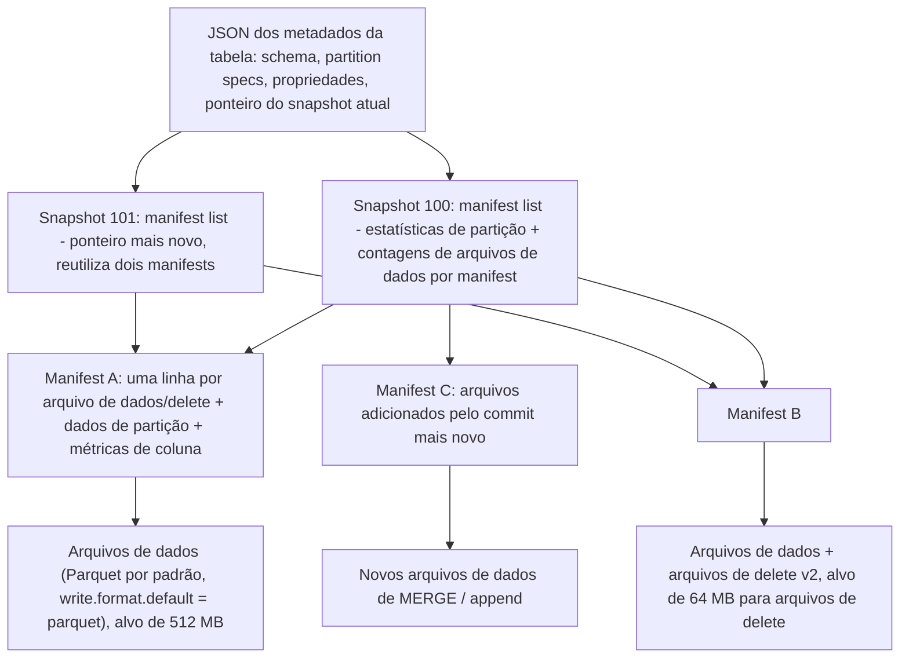
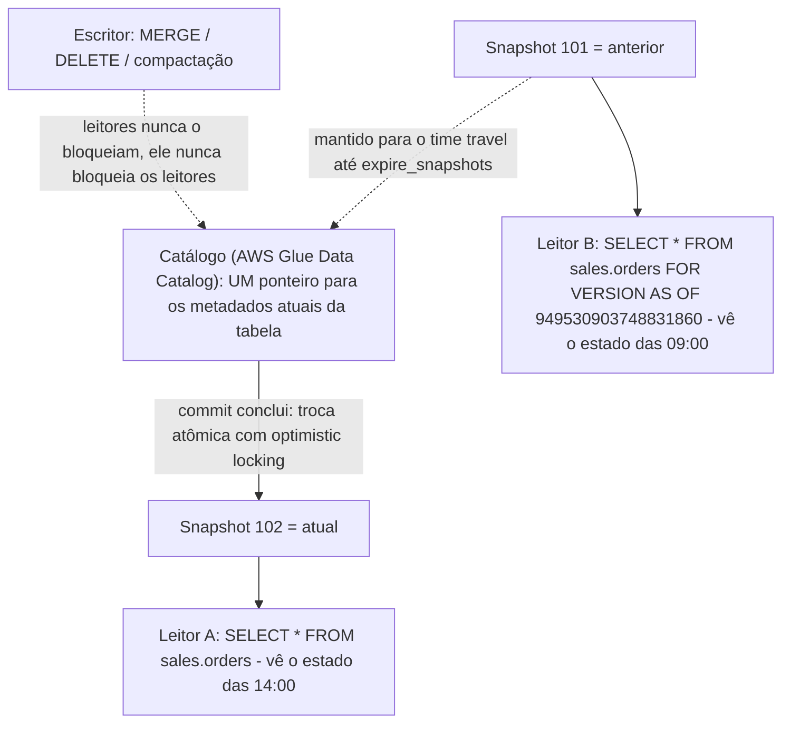
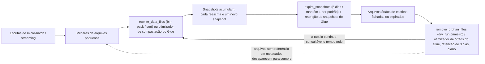
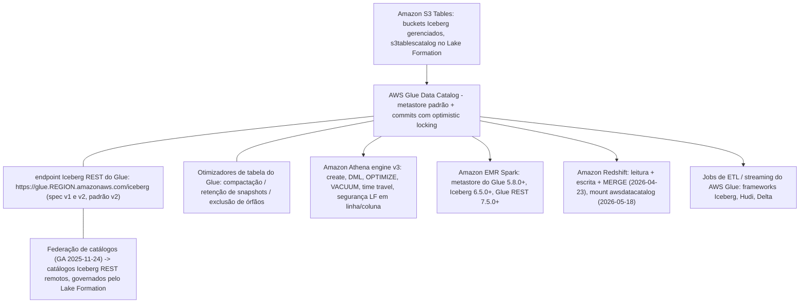
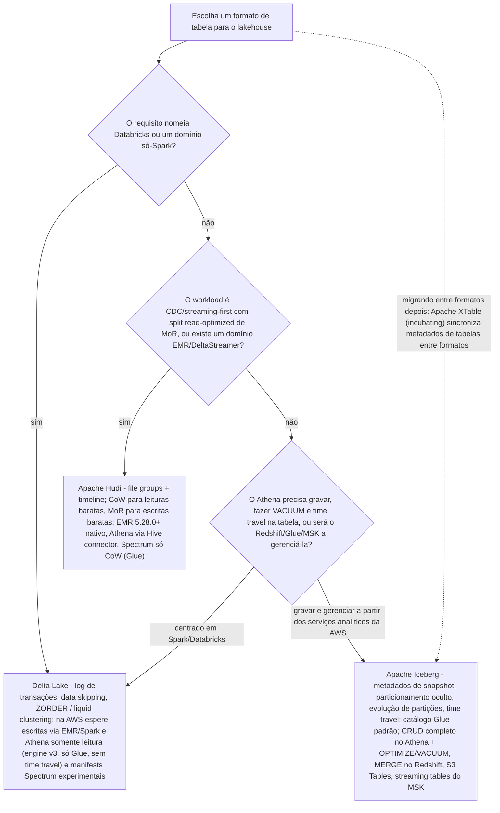

# Formatos de Tabela Abertos: Iceberg, Hudi e Delta no Lakehouse

A lição 3 colocou os bytes no Amazon S3 em Parquet. Bytes no S3 são um *file lake*: legíveis, baratos, duráveis — e não transacionais. Esta lição instala a camada que transforma aqueles arquivos em uma **tabela**: o formato de tabela aberto (open table format, OTF). Toda lição seguinte deste curso presume que ele exista. O Glue o rastreia (lição 07), o Athena o consulta (lição 09), o Redshift faz bridge para ele (lição 10), o Lake Formation concede permissões sobre ele (lição 12) e ninguém paga duas vezes por uma tabela de 30 milhões de arquivos (lição 16).

```text
=================================================================
 A SUPERFÍCIE DE DECISÃO DE FORMATOS DE TABELA ABERTOS (em out 2026)
=================================================================
 O que falta no S3 cru ..
   sem ACID, sem escritores concorrentes seguros, sem leitura de
   snapshot, sem delete barato em nível de linha, sem enforcement
   de schema
 Iceberg ................... árvore de metadados: JSON da tabela ->
                            manifest list -> manifests ->
                            arquivos de dados; isolamento de
                            snapshots, particionamento oculto,
                            evolução de partições, sort orders,
                            time travel
 Hudi ...................... file groups + instant timeline;
                            Copy-on-Write (reescreve Parquet) vs
                            Merge-on-Read (acrescenta logs Avro),
                            consultas read-optimized vs snapshot
 Delta ..................... commits ordenados em _delta_log/*.json;
                            data skipping por min/max, Z-Ordering,
                            liquid clustering (curva de Hilbert)
 Padrão na AWS ............. ICEBERG - a história transacional
                            completa do Athena, otimizadores do
                            Glue, Glue Iceberg REST, S3 Tables,
                            streaming tables do MSK
 Catálogo na AWS ........... AWS Glue Data Catalog (padrão);
                            endpoint Iceberg REST do Glue; Nessie,
                            JDBC, DynamoDB, Hive, Hadoop, REST
 Não confunda .............. snapshots com backups; "o Athena
                            suporta Delta" com "o Athena grava Delta"
=================================================================
```

Nesta lição você vai:

- explicar por que **ACID em armazenamento de objetos** precisa de uma camada de metadados, e o que um formato de tabela aberto adiciona sobre "Parquet mais um crawler";
- ler **a árvore de metadados do Iceberg** — JSON dos metadados da tabela, manifest lists, manifests, arquivos de dados e de delete — e saber o que cada nível armazena;
- aplicar **isolamento de snapshots, particionamento oculto, evolução de partições e sort orders** a DDL de tabela real;
- usar **time travel** na sintaxe do Spark e do Athena e precificar a **retenção de snapshots** que o mantém vivo;
- escrever e defender um **exemplo resolvido completo de MERGE / UPSERT / DELETE**, incluindo o passo de dedupe que evita o erro de linha de origem duplicada;
- executar os três verbos de manutenção — **`rewrite_data_files`, `remove_orphan_files`, `expire_snapshots`** — e mapear cada um ao seu **table optimizer do Glue** e ao equivalente no Athena;
- escolher um **catálogo** e justificar **AWS Glue Data Catalog como padrão na AWS**, além do endpoint Iceberg REST do Glue e da federação de catálogos;
- separar **Copy-on-Write do Merge-on-Read no Hudi** usando a timeline de instantes, e dimensionar a diferença de write amplification;
- listar os recursos do **Delta Lake** e seu nível exato de suporte no Athena, no EMR e no Redshift;
- usar a **matriz de integração da AWS** e o veredito **quando Iceberg vs Hudi vs Delta** em vez de discutir por hábito;
- estudar **dois casos de clientes da AWS** (Vanguard e Zeta Global) e uma **caixa de atualizações de outubro de 2026 com fontes**;
- praticar com **12 questões no estilo de exame** mais quatro verificações interativas.

---

## 1. Por que o armazenamento de objetos não faz ACID

### 1.1 O S3 é fortemente consistente e ainda assim não é transacional

O Amazon S3 oferece consistência forte de leitura após escrita para novos `PUT`s. Esse não é o problema. O problema é que um *commit de tabela* é uma operação **multi-objeto**: um escritor adiciona novos arquivos Parquet, remove os antigos e precisa fazer os leitores verem ou o estado antigo ou o novo — nunca uma mistura meio aplicada. O S3 não tem operação atômica que troque uma listagem de diretório, e não tem lock. Um "commit" implementado como `listar o prefixo e acreditar nele` é exatamente o modo de falha que a AWS Prescriptive Guidance lista para lakes de armazenamento de objetos puro: sem semântica ACID, sem update ou delete em nível de registro, sem consistência entre escritores concorrentes e corrupção quando uma escrita falha no meio do caminho.

Os três formatos de tabela abertos resolvem o mesmo problema do mesmo jeito: **commits de metadados append-only, com uma única troca atômica de ponteiro no final**.

| Formato | O que um commit fisicamente é | O que o torna atômico |
|---|---|---|
| **Iceberg** | Novo JSON de metadados da tabela apontando para uma nova manifest list | O **catálogo** troca o ponteiro (o Glue usa optimistic locking) |
| **Delta Lake** | Novo arquivo JSON em `_delta_log/` | Commit no log; os leitores resolvem para um snapshot consistente |
| **Hudi** | Novo instant na **timeline** (COMMIT / DELTA_COMMIT) | "O Hudi garante que as transições de estado são atômicas e consistentes com a timeline com base no instant time" |

A consequência para este curso: **o catálogo faz parte do protocolo de transação**, não é um serviço de listagem de diretório. É por isso que a Seção 6 trata o catálogo como uma decisão de design de primeira classe e por que o Athena só aceita tabelas Iceberg criadas contra o catálogo da AWS Glue.

### 1.2 O que um OTF de fato adiciona

Um formato de tabela aberto guarda uma **camada de metadados** sobre os seus arquivos. No Iceberg a cadeia é: **JSON dos metadados da tabela** (schema, partition specs, ponteiro do snapshot atual, propriedades) → **manifest list** (uma por snapshot, com estatísticas de partição de cada manifest) → **manifests** (uma linha por arquivo de dados ou de delete, com dados de partição e métricas de coluna) → **arquivos de dados e arquivos de delete** (Parquet por padrão, mais ORC e Avro). As garantias que decorrem dessa estrutura, nas palavras do próprio projeto Iceberg: *"Isolamento serializável — as leituras serão isoladas de escritas concorrentes e sempre usarão um snapshot já comprometido dos dados de uma tabela. As escritas suportarão remover e adicionar arquivos em uma única operação e nunca serão parcialmente visíveis. Os leitores não adquirirão locks."*

> [!IMPORTANT]
> **Um OTF é um contrato, não um esquema de compressão.** Parquet, ORC e Avro são *formatos de arquivo* — eles não dizem nada sobre quem pode escrever, o que um leitor pode ver ou como uma linha ruim é removida. Iceberg, Hudi e Delta são *formatos de tabela* — eles são donos de commits, snapshots, evolução de schema e exclusão, e delegam os bytes a um formato de arquivo. A lição 03 escolheu os bytes; esta lição escolhe o contrato.

- **📚 Você sabia?** As versões **1, 2 e 3** da spec do Iceberg são todas "completas e adotadas pela comunidade" (página da spec do Iceberg, acesso em 2026-10). A **v3** da spec é a que o AWS Glue 6.0 adotou em agosto de 2026 — mas adoção de uma versão de spec e *disponibilidade dos motores que a leem* são relógios diferentes, e a Seção 11 mostra por que isso importa na AWS.

---

## 2. Deep dive do Iceberg: a árvore de metadados

### 2.1 Manifest lists, manifests e por que as leituras são baratas

A spec do Iceberg é explícita sobre os dois níveis de metadados. *"Os arquivos de dados em snapshots são rastreados por um ou mais arquivos manifest que contêm uma linha para cada arquivo de dados da tabela, os dados de partição do arquivo e as métricas dele. Os dados de um snapshot são a união de todos os arquivos dos seus manifests."* E um nível acima: *"Os manifests que compõem um snapshot são armazenados em um arquivo manifest list. Cada manifest list armazena metadados sobre os manifests, incluindo estatísticas de partição e contagens de arquivos de dados."*

Duas decisões de design decorrem disso, e ambas são de nível entrevista:

1. **A manifest list carrega estatísticas de partição para que manifests inteiros possam ser pulados durante o planejamento** — você poda metadados antes de tocar em um arquivo de dados.
2. **Manifests são reutilizados entre snapshots.** A spec diz que os manifests são *"reutilizados entre snapshots para evitar reescrever metadados de mudança lenta"*. Uma tabela reescrita mil vezes não carrega mil cópias dos seus metadados de mudança lenta.



**A ordem de leitura importa**, e é o oposto do reflexo do Hive: você começa no *ponteiro* e desce, podando em cada nível, e só abre os arquivos Parquet cujas métricas sobreviveram.

```dragdrop
{
  "question": "Ordene os passos que um motor compatível com Iceberg dá para responder um SELECT, da chamada ao catálogo até os bytes:",
  "items": [
    "JSON dos metadados da tabela: ler o schema, a partition spec e o ponteiro para o snapshot atual",
    "Manifest list daquele snapshot: usar as estatísticas de partição e as contagens de arquivos de dados por manifest para pular manifests inteiros",
    "Arquivos manifest: ler uma linha por arquivo de dados/delete, com dados de partição e métricas de coluna, e podar de novo",
    "Arquivos de dados (Parquet/ORC/Avro) mais quaisquer arquivos de delete v2, lidos com merge-on-read onde os deletes se aplicam"
  ],
  "correctOrder": [
    "JSON dos metadados da tabela: ler o schema, a partition spec e o ponteiro para o snapshot atual",
    "Manifest list daquele snapshot: usar as estatísticas de partição e as contagens de arquivos de dados por manifest para pular manifests inteiros",
    "Arquivos manifest: ler uma linha por arquivo de dados/delete, com dados de partição e métricas de coluna, e podar de novo",
    "Arquivos de dados (Parquet/ORC/Avro) mais quaisquer arquivos de delete v2, lidos com merge-on-read onde os deletes se aplicam"
  ],
  "explanation": "A poda acontece nos metadados, duas vezes, antes de abrir um único byte de Parquet: a manifest list permite que um motor pule manifests inteiros usando as estatísticas de partição, e as linhas do manifest carregam métricas de min/max por arquivo para que os arquivos também sejam pulados. É por isso que o Iceberg consegue responder 'quais arquivos importam?' sem listar o S3, e é por isso que as tabelas de metadados do Athena ($manifests, $files, $partitions) são a superfície de depuração de uma consulta que leu demais. Começar pelos dados (uma listagem de diretório) é o hábito do Hive que este formato existe para quebrar."
}
```

### 2.2 Isolamento de snapshots: todo commit é um novo ponto no tempo, imutável

Toda escrita — append, MERGE, DELETE, UPDATE, compactação — produz um **novo snapshot** e mantém o antigo vivo. As leituras resolvem para exatamente um snapshot comprometido, então dois analistas às 09:00 e às 14:00 veem duas tabelas diferentes, cada uma individualmente consistente. É o que torna seguro rodar um MERGE noturno e um relatório ad-hoc ao mesmo tempo, e é o mecanismo sob o time travel (Seção 3).



### 2.3 Particionamento oculto

No Hive você declarava partições como colunas, as mantinha à mão, e toda consulta tinha que repetir o predicado de partição. O Iceberg inverte isso. O próprio projeto: *"Outros formatos de tabela como o Hive suportam particionamento, mas o Iceberg suporta particionamento oculto"* e *"O Iceberg evita ler partições desnecessárias automaticamente. Os consumidores não precisam saber como a tabela é particionada nem adicionar filtros extras às suas consultas."*

Você declara **transforms sobre as colunas de origem** — `days(event_ts)`, `month(ts)`, `bucket(N, id)`, `truncate(L, col)`, `years/months/days/hours`, identity — e o escritor calcula os valores de partição. O analista filtra pela coluna de *origem* (`WHERE event_ts >= TIMESTAMP '2026-10-01 00:00:00'`) e o motor poda. Não existe coluna de partição para selecionar nem coluna de partição para manter em sincronia.

- **📚 Você sabia?** A armadilha do particionamento oculto funciona nos dois sentidos. A cláusula `OPTIMIZE ... WHERE` do Athena diz *"Apenas colunas de partição são permitidas na cláusula WHERE"* (docs do Athena, acesso em 2026-10) — então o caminho de manutenção *fala* de partição, mesmo que o caminho de consulta deliberadamente não fale. Quando você compacta uma tabela Iceberg no Athena, você filtra pelo campo de partição que a tabela declara, não por qualquer coluna de negócio arbitrária.

### 2.4 Evolução de partições — mude o layout sem reescrever os dados

Como as consultas planejam sobre **valores de dados** e não sobre valores de partição, a própria partition spec pode evoluir. Docs do Iceberg: *"O particionamento de tabelas Iceberg pode ser atualizado em uma tabela existente porque as consultas não referenciam valores de partição"* e *"Os layouts de partição do Iceberg podem evoluir conforme necessário."* Os arquivos existentes mantêm o seu spec ID antigo; os novos arquivos são escritos com o novo spec; o motor reconcilia os dois no momento da leitura.

A evolução de schema usa o mesmo trilho somente-metadados. As operações suportadas são **Add, Drop, Rename, Update (alargamento de tipo) e Reorder**, e os docs são francos sobre o custo: *"As atualizações de schema do Iceberg são mudanças de metadados, então nenhum arquivo de dados precisa ser reescrito"* — o Iceberg rastreia cada coluna com um **ID único**, então uma coluna renomeada continua sendo a mesma coluna.

| Evolução | Custo no estilo Hive | Custo no Iceberg |
|---|---|---|
| Adicionar uma coluna | Reescrever ou deixar nulls sem rastreamento | Somente mudança de metadados |
| Renomear uma coluna | Quebra toda referência a jusante | Mudança de metadados (ID estável) |
| Alargar `int` → `long` | Reescrever | Mudança de metadados |
| **Adicionar particionamento `bucket(16, customer_id)`** | Reescrever a tabela | **Mudança de metadados; os arquivos antigos mantêm o spec antigo** |
| **Trocar `days(ts)` → `months(ts)`** | Reescrever a tabela | **Mudança de metadados; nenhum dado reescrito** |

### 2.5 Sort orders

Tabelas Iceberg podem carregar uma **sort order de nível de tabela** que os motores respeitam quando reescrevem arquivos. O exemplo dos docs: *"Para definir a ordem de escrita de uma tabela, use `WRITE ORDERED BY`: `ALTER TABLE prod.db.sample WRITE ORDERED BY category, id`"*, e *"MERGE INTO no Spark usará a ordenação da tabela."* Essa é a história do clustering no Iceberg: combinado com `rewrite_data_files`, você pode fazer bin-pack (padrão), ou ordenar, ou aplicar estratégias `zorder(...)` / `hilbert(...)` para colocar linhas relacionadas nos mesmos file groups — o mesmo trabalho que o Delta faz com `ZORDER BY` e liquid clustering (Seção 8), só que sob outro verbo.

- **📚 Você sabia?** Padrões que valem a pena memorizar porque aparecem tanto na matemática de compactação quanto em revisões de custo (docs de configuração do Iceberg, acesso em 2026-10): `write.format.default` = **parquet**; `write.target-file-size-bytes` = **536,870,912 bytes = 512 MB**; `write.delete.target-file-size-bytes` = **67,108,864 = 64 MB**; row-group do Parquet e `read.split.target-size` = **134,217,728 = 128 MB**; `read.split.planning-lookback` = **10**. O Athena escreve tabelas Iceberg com **ZSTD nível 3** como compressão padrão — então a pergunta "quanto custa armazenar uma escrita Iceberg do Athena" já pressupõe compressão.

---

## 3. Time travel e retenção de snapshots

### 3.1 Lendo uma tabela como ela era

Como os snapshots são imutáveis e retidos, "ler como era em" é uma consulta normal. O Spark 3.3 e posteriores suportam isso em SQL: *"O Spark 3.3 e posteriores suportam time travel em consultas SQL usando as cláusulas `TIMESTAMP AS OF` ou `VERSION AS OF`. A cláusula `VERSION AS OF` pode conter um snapshot ID long ou uma string com o nome de um branch ou tag."* A grafia do Athena é diferente (engine v3): use `FOR TIMESTAMP AS OF` depois do nome da tabela, ou `FOR VERSION AS OF`, onde a versão *"é o snapshot ID bigint"* — o próprio exemplo dos docs é `SELECT * FROM iceberg_table FOR VERSION AS OF 949530903748831860`.

```sql
-- Spark / EMR: two syntaxes, one snapshot
SELECT count(*) FROM sales.orders AS OF TIMESTAMP '2026-10-01 09:00:00';
SELECT count(*) FROM sales.orders VERSION AS OF 6918471130372145521;

-- Athena engine v3: FOR ... AS OF, bigint snapshot id
SELECT * FROM sales.orders FOR TIMESTAMP AS OF TIMESTAMP '2026-10-01 09:00:00';
SELECT * FROM sales.orders FOR VERSION AS OF 949530903748831860;

-- Athena metadata tables: the audit surface
SELECT committed_at, snapshot_id, operation FROM sales.orders$snapshots;
SELECT * FROM sales.orders$history;
SELECT file_path, file_size_in_bytes FROM sales.orders$files LIMIT 20;
SELECT * FROM sales.orders$manifests;
```

As tabelas de metadados do Athena para Iceberg são `$files`, `$manifests`, `$history`, `$partitions`, `$snapshots` e `$refs` — o que significa que "quem gravou este arquivo, quando, e qual snapshot o referencia" é uma pergunta de SQL, não uma pergunta de console do S3.

### 3.2 Retenção é uma decisão paga, não um recurso grátis

Cada commit *"produz um novo snapshot enquanto mantém os dados e metadados antigos em volta para isolamento de snapshots e time travel"* (docs dos procedures do Iceberg para Spark). Snapshots antigos são, portanto, **bytes armazenados**, e expirá-los é a operação destrutiva inversa. Os padrões:

| Parâmetro | Padrão | Fonte (acesso em 2026-10) |
|---|---|---|
| `expire_snapshots` `older_than` | **5 dias atrás** | iceberg.apache.org, procedures do Spark |
| `expire_snapshots` `retain_last` | **1** snapshot ancestral, independentemente da idade | idem |
| Branches / tags | Nunca expiram; *"O branch principal nunca expira"* | idem |
| Athena `vacuum_max_snapshot_age_seconds` | **432000 segundos = 5 dias** | docs de DDL de Iceberg do Athena |
| Otimizador de retenção de snapshots do Glue | **5 dias**, mantém **1** snapshot | docs dos otimizadores automáticos de tabela do Glue |
| Retenção de arquivos órfãos do Glue | **3 dias** (mínimo de 1 dia), roda cerca de **uma vez por dia** | docs de exclusão de órfãos do Glue |
| Retenção de snapshots para tabelas novas do Glue | **Desativada por padrão** | docs do Glue |

**Exemplo resolvido E1 — quanto custa uma janela de time travel (us-east-1, em out 2026)**

Uma tabela Iceberg de **1 TB (1,024 GB)** no S3 padrão cujos jobs reescrevem **20% dos seus bytes por dia** (MERGE mais compactação) acumula novas versões dos arquivos antigos:

```text
Novas versões (antigas) por dia . 1,024 GB x 20%           = 204.8 GB/dia
Reter 7 dias .................... 204.8 x 7                ~ 1,434 GB extra
  custo de armazenamento ......... 1,434 GB x $0.023/GB     ~ $33 / mês
Reter 30 dias ................... 204.8 x 30               ~ 6,144 GB extra
  custo de armazenamento ......... 6,144 GB x $0.023/GB     ~ $140 / mês
Expirar em 5 dias (padrão) ....... 204.8 x 5                ~ 1,024 GB extra
  custo de armazenamento ......... 1,024 GB x $0.023/GB     ~ $23 / mês
```

Mesma tabela, três políticas de retenção, uma diferença de **$117/mês** entre uma janela de 30 dias e a janela padrão de 5 dias — usando a taxa dos primeiros 50 TB do S3 Standard de **$0.023 por GB-mês** (preços do S3 da AWS, acesso em 2026-10). Ensine o *método*: armazenamento extra ≈ (bytes reescritos por dia × dias de retenção) × taxa. Um requisito de "precisamos de 90 dias de histórico de auditoria" é uma linha de armazenamento, não uma caixinha de seleção.

> [!WARNING]
> ⚠️ **Um snapshot não é um backup, e expirar um deles é irreversível.** Assim que o `expire_snapshots` (ou o `VACUUM` do Athena, ou o otimizador de retenção de snapshots do Glue) passar da sua janela de retenção, aquele ponto no tempo acabou — os arquivos que ele referenciava unicamente foram excluídos. O time travel responde *"como a tabela estava às 09:00?"*, não *"o bucket foi excluído"*, e ele não substitui versionamento do S3, replicação entre Regiões nem um drill de restore. E nunca conte versionamento do S3 e snapshots do Iceberg como duas redes de segurança independentes até precificar as duas; a E1 é a conta da segunda rede.

**Exemplo resolvido E2 — expire e depois prove que nada vivo se perdeu**

```sql
-- 1. dry-run the orphan sweep FIRST: files no metadata references
CALL prod.system.remove_orphan_files(
  table => 'sales.orders',
  dry_run => true,
  older_than => TIMESTAMP '2026-10-01 00:00:00');

-- 2. expire snapshots: keep a 7-day window, never drop the newest 7
CALL prod.system.expire_snapshots(
  table => 'sales.orders',
  older_than => TIMESTAMP '2026-10-04 00:00:00',
  retain_last => 7);

-- 3. verify the current snapshot still plans and reads
SELECT count(*) FROM sales.orders;
SELECT committed_at, operation FROM sales.orders$history ORDER BY committed_at DESC;
```

A ordem importa: **dry-run dos órfãos, depois expire, depois verifique.** Expirar snapshots primeiro pode órfãar arquivos cujas referências a própria expiração apagou, o que transforma uma limpeza limpa em uma limpeza barulhenta.

---

## 4. DML em nível de linha: MERGE, UPSERT e DELETE

### 4.1 Três estratégias físicas, uma superfície SQL

As operações de nível de linha do Iceberg resolvem para trabalho físico diferente, e saber qual delas rodou é o que diz se você acabou de pagar por I/O:

| SQL | Quando o filtro combina com… | O que o Iceberg faz |
|---|---|---|
| `DELETE` | Partições inteiras ou arquivos inteiros | **Delete somente de metadados** — os arquivos caem do snapshot, nenhum byte reescrito |
| `DELETE` | Linhas individuais | **Reescreve apenas os arquivos de dados afetados** (mais arquivos de delete v2 lidos com merge-on-read) |
| `UPDATE` / `MERGE` | Linhas dentro de arquivos | **Reescrita copy-on-write** dos arquivos tocados, comprometida como um commit de overwrite |
| `INSERT` | — | Novos arquivos de dados + um novo manifest + um novo snapshot |

O resumo da spec sobre `DELETE`: *"Se o filtro de delete combinar com partições inteiras da tabela, o Iceberg fará um delete somente de metadados. Se o filtro combinar com linhas individuais de uma tabela, então o Iceberg reescreverá apenas os arquivos de dados afetados."* E sobre `MERGE INTO`: *"O Iceberg suporta MERGE INTO reescrevendo arquivos de dados que contêm linhas que precisam ser atualizadas, em um commit de overwrite"*, com a recomendação explícita de que *"`MERGE INTO` é recomendado em vez de `INSERT OVERWRITE` porque o Iceberg pode substituir apenas os arquivos de dados afetados."* O Athena declara o lado de leitura do mesmo mecanismo: as consultas *"realizam merge-on-read de deletes por posição e por igualdade."*

**Exemplo resolvido E3 — um upsert de CDC que sobrevive à revisão (Spark em EMR, catálogo do Glue)**

Cenário: tabela Iceberg `sales.orders` particionada por `days(order_ts)`. Um lote CDC noturno pousa **50,000 linhas de mudança** no S3 como Parquet — **20,000 updates, 25,000 inserts, 5,000 deletes**.

```sql
-- Step 1: dedupe the CDC stream. Iceberg throws if ONE source record
-- can update MULTIPLE target rows, so kill duplicates before the join.
WITH ranked AS (
  SELECT c.*,
         ROW_NUMBER() OVER (
           PARTITION BY c.order_id
           ORDER BY c.change_time DESC) AS rn
  FROM   lakehaus.bronze_order_changes c
),
dedup AS (SELECT * FROM ranked WHERE rn = 1)

-- Step 2: one MERGE with three WHEN MATCHED branches + the insert
MERGE INTO sales.orders t
USING dedup s
ON  t.order_id = s.order_id
WHEN MATCHED AND s.op = 'd' THEN DELETE
WHEN MATCHED AND s.op = 'u' THEN UPDATE SET
       status = s.status, amount = s.amount, updated_at = s.change_time
WHEN NOT MATCHED AND s.op <> 'd' THEN INSERT
       (order_id, status, amount, order_ts, updated_at)
VALUES (s.order_id, s.status, s.amount, s.order_ts, s.change_time);

-- Step 3: verify against the snapshot history, not just the count
SELECT count(*) FROM sales.orders;
SELECT committed_at, operation, summary
FROM   sales.orders$snapshots
ORDER  BY committed_at DESC LIMIT 5;

-- Step 4: prove isolation - yesterday's reader still sees yesterday
SELECT count(*) FROM sales.orders VERSION AS OF 6918471130372145521;
```

Por que o passo 1 não é opcional, nas palavras dos docs: *"Apenas um registro nos dados de origem pode atualizar qualquer linha dada da tabela de destino, ou então um erro será lançado."* Um arquivo de CDC com duas linhas para o mesmo `order_id` (um lote reentregue, um update atrasado, uma partição fora de ordem) é suficiente para derrubar o job às 02:00. O Spark 3.5 também acrescentou `WHEN NOT MATCHED BY SOURCE ... THEN ...`, então linhas no destino sem contraparte na origem agora podem ser excluídas na mesma instrução.

```fillblank
{
  "question": "Complete o esqueleto MERGE do Iceberg exatamente como Spark/EMR e Redshift o soletram:",
  "template": "{{1}} INTO sales.orders t {{2}} dedup s ON t.order_id = s.order_id WHEN {{3}} AND s.op = 'd' THEN DELETE WHEN MATCHED THEN UPDATE SET status = s.status WHEN NOT {{4}} THEN INSERT (order_id, status) VALUES (s.order_id, s.status);",
  "answers": {
    "1": "MERGE",
    "2": "USING",
    "3": "MATCHED",
    "4": "MATCHED"
  },
  "distractors": ["JOIN", "INSERT", "UNMATCHED", "EXISTS", "UPSERT", "REPLACE"],
  "explanation": "As quatro palavras-chave estruturais são MERGE INTO ... USING ... ON ... WHEN [NOT] MATCHED. Os distratores são os erros que as pessoas realmente cometem: JOIN não é uma escrita em nível de linha, INSERT sozinho não pode atualizar, UNMATCHED é inglês mas não é sintaxe SQL aqui, e UPSERT é o conceito (o anúncio do Redshift chama o MERGE de forma de UPSERT) e não uma palavra-chave de instrução. Duas regras viajam com este esqueleto: exatamente um registro de origem pode combinar com uma linha de destino, e a origem deve ser deduplicada (ROW_NUMBER) antes de o MERGE rodar."
}
```

- **📚 Você sabia?** O Redshift alcançou exatamente esta instrução em **23 de abril de 2026**: *"O Amazon Redshift agora suporta operações de UPDATE, DELETE e MERGE em nível de linha em tabelas Apache Iceberg"*, incluindo *"tabelas Iceberg particionadas e não particionadas, incluindo S3 Tables"*, com transforms de partição suportados *"identity, bucket, truncate, year, month, day e hour"* — e a AWS afirma que *"as tabelas modificadas pelo Redshift são compatíveis com outros motores compatíveis com Iceberg, incluindo Amazon EMR e Amazon Athena."* Uma tabela, três escritores (MERGE do Redshift, append de streaming do Glue, DELETE analítico no Athena), arbitrados pelo optimistic locking do Glue.

> [!WARNING]
> ⚠️ **Dois limites que pegam times em produção:**
> - **O Lake Formation pode governar *leituras*, mas não estas operações.** Os docs do Athena são explícitos: *"você não pode usar o Lake Formation para gerenciar permissões de operações como VACUUM, MERGE, UPDATE ou OPTIMIZE com estes formatos de tabela."* Segurança de linha/coluna em SELECT é do Lake Formation; a superfície de *manutenção e escrita em nível de linha* é IAM mais a autorização do próprio motor. Projete esse controle de forma separada (lição 12).
> - **As superfícies de MERGE verificadas nesta lição são Spark (docs do Iceberg) e Redshift (anúncio da AWS, 2026-04-23).** As páginas de DML de Iceberg do Athena documentam INSERT/UPDATE/DELETE e OPTIMIZE/VACUUM — confira a referência atual de SQL do Athena antes de agendar um `MERGE` no Athena, porque as fontes desta lição não verificaram essa instrução. Nunca coloque um pipeline em produção sobre um recurso de SQL não verificado.

---

## 5. Manutenção: compactação, arquivos órfãos, expiração de snapshots

Arquivos pequenos são o imposto de micro-batch e de escritas de streaming, e o Iceberg dá a você três verbos para os três problemas diferentes. Misturá-los é o jeito de as tabelas morrerem em silêncio.

| Problema | Verbo (procedure do Spark) | Equivalente no Athena | Equivalente gerenciado da AWS |
|---|---|---|---|
| Muitos arquivos minúsculos, economia de scan ruim | `rewrite_data_files` (bin-pack padrão; `strategy => 'sort'`, `zorder(c1,c2)`, `hilbert(c1,c2)`) | `OPTIMIZE t REWRITE DATA USING BIN_PACK [WHERE …]` | Otimizador de **compaction** do Glue |
| Manifests demais atrapalhando o planejamento | `rewrite_manifests` | — | — |
| História e arquivos mortos acumulando | `expire_snapshots` + `remove_orphan_files` | `VACUUM t` (os dois jobs de uma vez) | Otimizadores de **retenção de snapshots** + **exclusão de arquivos órfãos** do Glue |

Detalhes que valem saber por verbo:

- **`rewrite_data_files`** faz bin-pack por padrão, aceita um filtro de partição `where` e opções como `min-input-files` e `remove-dangling-deletes`; `strategy => 'sort'` recebe `sort_order => 'zorder(c1,c2)'` ou `'hilbert(c1,c2)'`.
- **`remove_orphan_files`** exclui *"arquivos que não são referenciados em nenhum arquivo de metadados de uma tabela Iceberg"* e suporta `dry_run => true` — rode sempre o dry run primeiro.
- **`expire_snapshots`** remove snapshots antigos e os arquivos que apenas eles referenciam (padrões na Seção 3.2); snapshots referenciados por branches ou tags ficam protegidos.
- **`OPTIMIZE` do Athena** é *"transacional e suportado apenas para tabelas Apache Iceberg"*, só aceita predicados de **coluna de partição** em `WHERE`, e *"a ação de compactação é cobrada pela quantidade de dados escaneada durante o processo de reescrita."*
- **`VACUUM` do Athena** *"realiza expiração de snapshots e remoção de arquivos órfãos"*, regido por `vacuum_max_snapshot_age_seconds` (padrão **432000 s = 5 dias**; os exemplos dos docs definem **259200 s = 3 dias**).

**Exemplo resolvido E4 — a matemática dos arquivos pequenos e o gatilho do Glue (em out 2026)**

```text
Escritas do job de streaming .. 1,000 arquivos/dia x 8 MB   = 8 GB/dia
Após 30 dias .................. 30,000 arquivos             ~ 240 GB
Tamanho alvo de arquivo ........ write.target-file-size-bytes = 512 MB
Arquivos compactados teóricos .. 240 GB / 0.5 GB             = 469 arquivos
Gatilho de compactação do Glue  > 100 arquivos por tabela/partição
                                 E cada arquivo < 75% de 512 MB = 384 MB
Checagem do gatilho ............ 30,000 > 100 SIM; 8 MB < 384 MB SIM -> dispara
```

As próprias condições do Glue: *"No Data Catalog, o processo de compactação começa quando uma tabela ou qualquer uma das suas partições tem mais de 100 arquivos. Cada arquivo deve ser menor que 75% do tamanho alvo de arquivo. O tamanho alvo de arquivo é definido pela propriedade de tabela `write.target-file-size-bytes`, que tem padrão de 512 MB"* — e *"o Data Catalog realiza a compactação sem interferir em consultas concorrentes e suporta compactação apenas para tabelas no formato Parquet."* A redução de contagem de arquivos de ~64× (30,000 → 469) é o que transforma a sobrecarga de planejamento por consulta e de abertura de arquivo em um erro de arredondamento; a própria reescrita é trabalho cobrado, então compare bytes escaneados (Athena) ou DPU-seconds (Glue) com a economia na consulta.



**Exemplo resolvido E5 — gerenciado ou auto-gerenciado: precifique o prêmio das S3 Tables (em out 2026)**

Se você não quer rodar o loop da Seção 5 você mesmo, as S3 Tables fazem isso: *"O Amazon S3 Tables lida automaticamente com a manutenção contínua de tabelas, incluindo compactação, expiração de snapshots e limpeza de arquivos não referenciados."*

```text
Tamanho da tabela ............. 5 TB = 5,120 GB
S3 Standard .................. 5,120 x $0.023   = $117.76 / mês
S3 Tables - Standard ......... 5,120 x $0.0265  = $135.68 / mês
Prêmio pela manutenção gerada                       $17.92 / mês
Requisições GET das S3 Tables $0.0004 por 1,000 requisições
```

Um prêmio de **$17.92/mês** (cerca de 15%) compra o loop de manutenção inteiro — compactação, expiração de snapshots, limpeza de arquivos não referenciados — mais estatísticas do Iceberg ligadas por padrão para o Athena. Se isso é barato depende inteiramente de quantas horas de engenharia a Seção 5 custa para você; o ponto é que a troca é uma linha de custo que você consegue orçar, não um mistério.

- **📚 Você sabia?** A superfície de otimização de Iceberg do Athena tem uma segunda alavanca, mais silenciosa: *"indexação de colunas do Parquet … torna possível para o Athena realizar uma poda de dados mais precisa … aproveitando estatísticas min/max em nível de página"*, e *"as estatísticas do Iceberg são ligadas por padrão quando você usa as S3 Tables."* Então o mesmo arquivo alvo de 512 MB é mais barato de *pular* em uma S3 Tables do que em uma tabela não gerenciada cujas estatísticas ninguém coletou — manutenção é um controle de custo de consulta, não apenas um controle de contagem de arquivos.

---

## 6. Catálogos: o serviço de ponteiros e por que o Glue é o padrão

### 6.1 O que um catálogo faz

O catálogo é a metade **mutável** do design: ele mapeia `db.table` → a localização atual dos metadados da tabela e realiza (ou delega) o **commit atômico** que torna uma escrita visível. O Iceberg documenta implementações para **REST Catalog Protocol, AWS Glue, AWS DynamoDB, HadoopCatalog, HiveCatalog, JDBC e Nessie**. A notável não-AWS: **Nessie** é um *"Transactional Catalog for Data Lakes with Git-like semantics"* que *"works with Apache Iceberg tables"* e roda *"as a Docker image or on Kubernetes"*, com backends de armazenamento de versões incluindo RocksDB, Cassandra, BigTable, **DynamoDB** e MongoDB — ou seja, branches e tags estilo git sem sair das primitivas da AWS.

### 6.2 AWS Glue Data Catalog é o padrão na AWS

Três fatos fazem do Glue o padrão e não uma preferência:

1. **O Athena só aceita tabelas Iceberg registradas no Glue.** *"Tabelas apenas com catálogo AWS Glue — apenas tabelas Iceberg criadas contra o catálogo AWS Glue … são suportadas a partir do Athena"*, e *"o Athena suporta apenas o optimistic locking do Amazon Glue. Usar o Athena para modificar uma tabela Iceberg com qualquer outra implementação de lock causará perda potencial de dados e quebra de transações."*
2. **O Glue é dono do loop de manutenção gerenciado** (Seção 5), do **endpoint Iceberg REST** e da **federação de catálogos**.
3. **Todos os outros motores da AWS se plugam nele:** o EMR Spark usa o Glue como seu Hive metastore (release **5.8.0+**), como seu catálogo Iceberg (**6.5.0+**) e como o seu **Iceberg REST catalog** (**7.5.0+**); o Redshift exige que tabelas Iceberg estejam *"registered with AWS Glue Data Catalog"* para escrita.

O **endpoint Iceberg REST do Glue** (`https://glue.<region>.amazonaws.com/iceberg`) *"supports API operations specified in the Apache Iceberg REST specification"* e *"supports both Apache Iceberg table specifications — v1 and v2, defaulting to v2."* REST também é a emenda para a **federação de catálogos** (GA **24 de novembro de 2025**): *"It synchronizes metadata real-time across AWS Glue Data Catalog and remote catalogs when data teams query remote tables"*, utilizável a partir de *"Amazon Redshift, Amazon EMR, Amazon Athena, AWS Glue, third-party engines like Apache Spark, and Amazon SageMaker"*, com *"AWS Lake Formation for access controls."*



**Exemplo resolvido E6 — checklist de ligação do catálogo: uma tabela Iceberg, três motores**

```text
1. CREATE (Athena, engine v3) - registrado no Glue, transform de partição oculto
   CREATE TABLE sales.orders (
     order_id bigint, status string, amount decimal(12,2), order_ts timestamp
   )
   TBLPROPERTIES (
     'table_type' = 'ICEBERG',
     'partitioning' = '[days(order_ts)]',   -- hidden partition field
     'optimize_rewrite_data_file_threshold' = '100'
   )
   -- NOTE: 'EXTERNAL' is rejected: "External keyword not supported for
   -- table type ICEBERG"

2. WRITE (EMR Spark) - aponte a sessão para o mesmo catálogo do Glue
   spark.sql.catalog.spark_catalog = org.apache.iceberg.aws.glue.GlueCatalog
   spark.sql.catalog.spark_catalog.io-impl = org.apache.iceberg.aws.s3.S3FileIO
   spark.sql.extensions = org.apache.iceberg.spark.extensions.IcebergSparkSessionExtensions

3. UPSERT (Redshift) - external schema sobre o Glue, depois DML em nível de linha
   CREATE EXTERNAL SCHEMA lakehouse
     FROM GLUE DATABASE 'sales'
     IAM_ROLE 'arn:aws:iam::111122223333:role/redshift-lake';
   MERGE INTO lakehouse.orders t USING staging.orders_delta s
     ON t.order_id = s.order_id ...

4. GOVERN - grants do Lake Formation em SELECT (leituras), IAM em VACUUM/MERGE/OPTIMIZE
```

Tudo naquele checklist é a *mesma tabela no S3*: quatro motores, um ponteiro de metadados, nenhuma cópia. Note que os padrões Athena-for-Spark que a AWS publica são as mesmas três propriedades — `GlueCatalog`, `S3FileIO`, `IcebergSparkSessionExtensions` — e é por isso que um notebook e um console SQL conseguem gravar na mesma tabela sem um job de sync.

---

## 7. Apache Hudi: file groups, timeline, CoW vs MoR

### 7.1 A timeline

O Hudi organiza uma tabela como **file groups** sob um base path particionado e registra cada mudança de estado como um **instant** em uma **timeline**. Ações documentadas: **COMMIT, DELTA_COMMIT, REPLACE_COMMIT, CLEANS, COMPACTION, LOGCOMPACTION, CLUSTERING, INDEXING, ROLLBACK, SAVEPOINT**, com a garantia de que *"o Hudi garante que as transições de estado são atômicas e consistentes com a timeline com base no instant time."* A timeline suporta duas ordenações — **ordenação por commit time** e **ordenação por event time** — que é como as chegadas atrasadas de um stream se reconciliam com o que já foi escrito.

### 7.2 Copy-on-Write vs Merge-on-Read

| | **Copy-on-Write (CoW)** | **Merge-on-Read (MoR)** |
|---|---|---|
| Layout físico | *"exclusivamente formatos de arquivo columnar (ex.: parquet)"* | *"columnar (ex.: parquet) + baseado em linhas (ex.: avro)"* |
| Em UPDATE | *"versionar e reescrever os arquivos realizando uma mescla síncrona durante a escrita"* | acrescentar aos arquivos de log Avro; mesclar depois |
| Custo de escrita | Maior write amplification, maiores latências de escrita | *"nenhuma mescla síncrona acontecendo durante a escrita, resultando em menor write amplification e melhores latências de escrita"* |
| Custo de leitura | Rápido — scan columnar puro | A consulta de snapshot mescla base + log em tempo de execução; a consulta read-optimized lê só os arquivos base |
| Tipos de consulta | Snapshot + incremental | Snapshot + incremental + **read-optimized** |
| Frescor | Exato no commit | As consultas de snapshot expõem *"dados near-real time (alguns minutos)"* |
| Compactação | *"não aplicável a tabelas Copy-on-Write"* | Obrigatória: mescla os blocos de log em novos arquivos base |

A compactação no Hudi é, portanto, um serviço de tabela **exclusivo do MoR**: *"a compactação é um serviço de tabela empregado pelo Hudi especificamente em tabelas Merge-on-Read (MOR) para mesclar updates de arquivos de log baseados em linhas para o arquivo base columnar correspondente periodicamente"*, executada em dois passos — **Compaction Scheduling** e depois **Compaction Execution** — com a estratégia padrão `LogFileSizeBasedCompactionStrategy` (*"escolhe o arquivo de log com mais dados acumulados e não mesclados"*) e *"por padrão, a compactação é executada de forma assíncrona."*

**Exemplo resolvido E7 — write amplification de CoW vs MoR (ilustrativo, de primeiros princípios, não um benchmark da AWS)**

Mesma partição Parquet de 10 GB, **100 updates/dia tocando 1% das linhas**:

```text
Carga ......................... 10 GB partition, 100 updates/day on 1% of rows
CoW: reescreve os Parquet base envolvidos ~ 100 MB/dia de Parquet reescrito
     ~ 10x os bytes que o MoR grava para as mesmas mudanças (a mudança vai
     dentro dos arquivos inteiros reescritos, não como um delta)
MoR: acrescenta logs Avro     < 10 MB/dia acrescentados
     mescla adiada para a compactação assíncrona
Leituras: CoW snapshot = scan Parquet simples
          MoR snapshot = mescla base + log (frescor de poucos minutos)
          MoR read-optimized = apenas arquivos base, obsoletos até a compactação
```

A lição é a *forma* da troca, não os megabytes exatos: **CoW compra leituras baratas com write amplification; MoR compra escritas baratas com trabalho de mescla na leitura e um job de compactação que você precisa agendar.**

```plot
{
  "type": "bar",
  "title": "Bytes escritos por dia para os mesmos 100 MB de mudanças: Hudi CoW vs MoR (ilustrativo, Seção 7.2)",
  "xLabel": "Tipo de tabela",
  "yLabel": "Bytes escritos por dia (MB)",
  "xKey": "table_type",
  "data": [
    {"table_type": "Copy-on-Write (rewrite Parquet base files)", "bytes_written_mb": 100},
    {"table_type": "Merge-on-Read (append Avro logs)", "bytes_written_mb": 10}
  ]
}
```

- **📚 Você sabia?** A história de instalação do Hudi na AWS é mais antiga que a do Iceberg: *"em versões de release do Amazon EMR 5.28.0 e posteriores, o EMR instala os componentes do Hudi por padrão quando Spark, Hive, Presto ou Flink são instalados"* — e as versões entregues acompanham as linhas do EMR: emr-7.13.0 → **Hudi 1.0.2-amzn-2**, emr-6.15.0 → **0.14.0-amzn-0**, emr-5.36.2 → **0.10.1-amzn-1**. O AWS Glue 6.0 (2026-08-21) roda **Hudi 1.1.1** ao lado do Iceberg 1.11.0 e do Delta 4.2.0 — três formatos de tabela em um único runtime Spark.

### 7.3 Hudi na AWS: onde ele é realmente suportado

O Athena lê Hudi pelo Hive connector: *"supports snapshot queries on COPY_ON_WRITE tables, and snapshot and read optimized queries on MERGE_ON_READ Hudi tables."* O Redshift Spectrum também lê Hudi, mas com dois limites duros: *"Copy on Write Tables in Apache Hudi versions 0.5.2–0.11.x can be queried via Amazon Redshift Spectrum external tables"*, e *"As tabelas Hudi são suportadas apenas quando o AWS Glue Data Catalog é usado. Não é suportado quando você usa um Apache Hive metastore como catálogo externo."* O EMR 6.1.0+ além disso integra o Hudi com Trino (PrestoSQL).

---

## 8. Delta Lake: log de transações, estatísticas, Z-Ordering, liquid clustering

O Delta mantém um **log de transações ordenado** (`_delta_log/*.json`); os leitores resolvem um snapshot consistente a partir dele. Dois recursos de desempenho importam para este curso:

- **Data skipping** — *"as informações de data skipping são coletadas automaticamente quando você grava dados em uma tabela Delta Lake"* (min/max por coluna).
- **Z-Ordering** — *"Z-Ordering é uma técnica para colocar informações relacionadas no mesmo conjunto de arquivos … disponível no Delta Lake 2.0.0 e acima"*, sintaxe `OPTIMIZE events ZORDER BY (eventType)`, recomendado *"se você espera que uma coluna seja comumente usada em predicados de consulta e se essa coluna tem alta cardinalidade."*
- **Liquid clustering** substitui o ZORDER nas versões mais novas: *"OPTIMIZE ZORDER BY sempre recluster (ou seja, reescreve) todos os dados da tabela, resultando em alto write amplification"*, enquanto *"liquid clustering … usa a curva de Hilbert, uma curva fractal contínua de preenchimento de espaço, como técnica de clustering multidimensional, o que melhora significativamente o data skipping em relação ao ZORDER."*

O Iceberg chega ao mesmo destino por outra porta (`rewrite_data_files` com `sort`/`zorder`/`hilbert`, tabela com `WRITE ORDERED BY`) e o otimizador de compactação do Glue *"supports sort and Z-order strategies"*. **Mesmo objetivo, três casas SQL/API diferentes — não misture sintaxes entre formatos.**

### 8.1 Níveis de suporte a Delta na AWS (em out 2026)

| Motor | Suporte a Delta | Formulação exata / limite |
|---|---|---|
| **Amazon Athena** (engine v3) | **Somente leitura** | *"You can use Amazon Athena to read Delta Lake tables stored in Amazon S3 directly without having to generate manifest files or run the MSCK REPAIR statement"* — mas *"Tables with AWS Glue catalog only"*, *"V3 engine only"*, **"No time travel support"**, *"Read only — Write DML statements like UPDATE, INSERT, or DELETE are not supported"* |
| **Amazon EMR Spark** | **Leitura/escrita** | *"With Amazon EMR releases 6.9.0 and higher, you can use Apache Spark 3.x on Amazon EMR clusters with Delta Lake tables"*; releases recentes 7.x entregam `delta`, `hudi`, `iceberg` juntos |
| **Amazon Redshift Spectrum** | **Leitura experimental** | *"This is an experimental integration. Use with caution."* — uma tabela Delta é lida via um manifest (`GENERATE symlink_format_manifest` + `SymlinkTextInputFormat`) |
| **AWS Glue ETL** | Suporte de framework | O Glue 6.0 (2026-08-21) roda **Delta 4.2.0** com Iceberg 1.11.0 e Hudi 1.1.1 |

A consequência de design: **"o Athena suporta Delta" significa que o Athena consegue ler Delta.** Não projete um padrão de "upserts de Delta a partir do Athena"; na AWS, grave Delta a partir de EMR/Spark ou migre para o Iceberg e ganhe a história completa do Athena da Seção 5.

---

## 9. Matriz de integração da AWS (em outubro de 2026)

| Serviço | Iceberg | Hudi | Delta |
|---|---|---|---|
| **Amazon Athena** | Completo: create, DML, particionamento oculto, time travel, `OPTIMIZE`, `VACUUM`, segurança LF em linha/coluna (catálogo Glue, engine v3) | Leitura via Hive connector: CoW snapshot; MoR snapshot + read-optimized | **Somente leitura**, engine v3, só Glue, **sem time travel** |
| **Amazon EMR Spark** | Catálogo Glue 6.5.0+; Glue Iceberg REST 7.5.0+ | Instalado por padrão em 5.28.0+ (emr-7.13.0 → 1.0.2-amzn-2) | 6.9.0+ com Spark 3.x |
| **Amazon Redshift** | Leitura + escrita + UPDATE/DELETE/MERGE (2026-04-23); ALTER TABLE via `awsdatacatalog` (2026-05-18); MVs | Leitura Spectrum de **apenas CoW**, só catálogo Glue (0.5.2–0.11.x) | Leitura Spectrum via manifests symlink **experimentais** |
| **AWS Glue** | Data Catalog (padrão), endpoint Iceberg REST, otimizadores de tabela, federação, Schema Registry | Framework de ETL | Framework de ETL (Delta 4.2.0 no Glue 6.0) |
| **Amazon MSK** | **Streaming tables** gerenciadas → Iceberg em S3 Tables: **10 GBps**, **$10.00/TB entregue**, frescor de **5–15 min**, compactação inline, DLQ obrigatório, só brokers Express, só tabelas novas | — | — (CDC-to-Iceberg do Firehose descontinuado em 2025-09-15) |
| **Amazon S3 Tables** | Buckets Iceberg gerenciados: compactação automática, expiração de snapshots, limpeza de arquivos não referenciados; **$0.0265/GB-mês** nos primeiros 50 TB, GET **$0.0004/1,000** | — | — |
| **AWS Lake Formation** | Permissões de leitura incl. segurança em linha/coluna; **não** pode bloquear `VACUUM`/`MERGE`/`UPDATE`/`OPTIMIZE`; governa a federação de catálogos | Permissões de leitura | Permissões de leitura |
| **Amazon OpenSearch** | **Não é uma integração gerenciada** — o OpenSearch Ingestion não lista nenhuma fonte ou sink Iceberg; a fonte CDC Iceberg do Data Prepper (OSS) é experimental e **apenas CoW** | — | — |

```matching
{
  "question": "Relacione cada formato ou serviço à capacidade que ele de fato possui na AWS (em out 2026):",
  "pairs": [
    {"left": "Apache Iceberg", "right": "Árvore de metadados de snapshot com manifest lists; particionamento oculto e evolução de partições; time travel com VERSION AS OF / FOR VERSION AS OF"},
    {"left": "Apache Hudi", "right": "File groups mais uma timeline de instantes; Copy-on-Write reescreve Parquet, Merge-on-Read acrescenta logs Avro com uma visão read-optimized"},
    {"left": "Delta Lake", "right": "Commits JSON ordenados em _delta_log; data skipping automático por min/max, Z-Ordering (2.0+) e liquid clustering com curvas de Hilbert"},
    {"left": "Amazon Athena lendo Delta", "right": "Somente leitura no engine v3 com o catálogo Glue: sem time travel, sem UPDATE/INSERT/DELETE"},
    {"left": "AWS Glue Data Catalog", "right": "O serviço de ponteiros padrão: commits com optimistic locking mais otimizadores de compactação, retenção de snapshots e de arquivos órfãos"},
    {"left": "Amazon S3 Tables", "right": "Buckets de tabelas Iceberg gerenciados que rodam compactação, expiração de snapshots e limpeza de arquivos não referenciados para você"}
  ],
  "explanation": "Cada entrada é um limite de capacidade, não um clima: o Iceberg é dono dos snapshots e das partições ocultas, o Hudi é dono da timeline e do split CoW/MoR, o Delta é dono do log de transações ordenado e do clustering, o Athena sobre Delta é um leitor (engine v3, só Glue, sem time travel), o Glue é o ponto de commit mais o loop de manutenção gerenciado, e as S3 Tables são esse loop de manutenção como produto. Inverter qualquer par produz um design que não roda: DML de Delta no Athena, Lake Formation bloqueando VACUUM, ou um sink Iceberg do OpenSearch Ingestion — todos falham contra estes limites."
}
```

---

## 10. Quando escolher Iceberg, Hudi ou Delta na AWS

As superfícies gerenciadas da AWS são **Iceberg-first**. Toda a história transacional do Athena (`OPTIMIZE`, `VACUUM`, time travel, segurança de linha/coluna do Lake Formation), os otimizadores do Glue, o endpoint Iceberg REST do Glue, a federação de catálogos, as S3 Tables, as streaming tables do MSK e o DML em nível de linha do Redshift são tudo Iceberg-only ou Iceberg-first. Essa é a gravidade padrão; os outros dois formatos conquistam a seleção por restrição.



| Escolha… | Quando… | Aceite o custo de… |
|---|---|---|
| **Iceberg (padrão)** | Vários motores em uma cópia; Athena/Redshift/Glue/MSK no pipeline; você quer otimizadores gerenciados ou S3 Tables | Optimistic locking do Glue como árbitro do commit; atraso de versão entre releases da comunidade e o que o Athena documenta |
| **Hudi** | Ingestão CDC/streaming-first, um trade-off de leitura CoW-vs-MoR, ou um domínio Hudi existente em EMR/DeltaStreamer | Leituras Spectrum **apenas CoW, apenas Glue**; leituras no Athena via Hive connector |
| **Delta Lake** | Workloads centrados em Spark/Databricks, ou interoperabilidade obrigatória com o Databricks | Nos motores analíticos da AWS: **Athena somente leitura** (sem time travel, sem DML) e Spectrum baseado em manifests |

- **📚 Você sabia?** A saída de emergência entre formatos é um projeto, não uma reescrita: **Apache XTable (incubating)** *"syncs table metadata across formats"* (xtable.apache.org, acesso em 2026-10), então uma migração de formato é uma conversão de metadados, não uma conversão de Parquet. O fato espelho é sobre *catálogos*, não formatos: os arquivos de dados e de metadados do Iceberg são abertos no S3 e o catálogo guarda apenas o ponteiro — o Athena exige Glue, mas o EMR Spark pode usar catálogos Glue REST, Hive, Hadoop ou Nessie. O custo de migração é metadados de catálogo, não conversão de arquivos.

### Atualizações de 2026 (em outubro de 2026)

> [!NOTE]
> **O que mudou na camada de formatos de tabela de que esta lição depende:**
> - **2026-08-21 — AWS Glue 6.0: redução de preço de 30% e suporte completo a Iceberg v3.** *"AWS Glue 6.0 is now generally available, delivering a 30% price reduction and introducing full support for Apache Iceberg v3, newer versions of Apache Hudi and Delta Lake"* no Spark 4.1 / Python 3.13 (AWS News Blog, 2026-08-21); as notas de release do Glue listam **Apache Iceberg 1.11.0, Hudi 1.1.1, Delta 4.2.0** (acesso em 2026-10-11). O Iceberg v3 traz VARIANT com shredding automático, **deletion vectors**, tipos geometry/geography e valores de coluna DEFAULT — escolha o Glue 6.0 quando precisar de v3.
> - **2026-04-23 — DML em nível de linha no Iceberg via Redshift.** UPDATE, DELETE e MERGE (UPSERT) em tabelas Iceberg particionadas e não particionadas, **incluindo S3 Tables**, com transforms de partição identity/bucket/truncate/year/month/day/hour; a AWS afirma que os resultados são *"compatible with other Iceberg-compatible engines, including Amazon EMR and Amazon Athena."*
> - **2026-05-18 — ALTER TABLE no Iceberg via Redshift.** ADD/DROP/ALTER de colunas, RENAME COLUMN, SET TABLE PROPERTIES e ADD/DROP/REPLACE PARTITION FIELD, gravando via o mount **`awsdatacatalog`**.
> - **2026-07-30 — Streaming tables do MSK para Apache Iceberg em S3 Tables.** Brokers Express entregam tópicos Kafka em tabelas Iceberg gerenciadas: *"up to 10 GB/s ingest"*, redução de custo de ingestão anunciada *"by up to 60%"*, compactação inline (AWS News Blog, 2026-07-30). Este é o caminho atual recomendado pela AWS de streaming para Iceberg.
> - **2025-11-17 — Escritas Iceberg no Redshift GA**, e **2025-11-24 — Federação de catálogos do Glue para catálogos Iceberg remotos GA**, então motores da AWS podem consultar tabelas que vivem em catálogos REST remotos sob o Lake Formation.
> - **2025-12-02 — Replicação de tabelas das S3 Tables** (replicação Iceberg entre Regiões), mais **redução de 90% no custo de compactação em 2025-07-01**; e **Governed Tables foram retiradas** — escritas/transações terminaram em 2024-12-31, com `GetTableObjects`/`ListTransactions` removidos em 2025-02-17, então o alvo de migração é Iceberg padrão (S3 Tables ou auto-gerenciado) + permissões do Lake Formation.

---

## Casos Reais

### Caso A — Vanguard: de um "data swamp" de Parquet para produtos de dados Iceberg

**Vanguard (gestão de ativos, serviços financeiros).** O estudo de caso da AWS descreve a primeira onda de modernização da Vanguard estabelecendo *"FAS 360 as a centralized enterprise data warehouse, migrating from a fragmented 'data swamp' of Parquet files on Amazon Simple Storage Service(Amazon S3) to a structured, unified system."* Dois anos depois, a lista de escala publicada lê: **20 TB no Amazon Redshift e outros 150 TB no data lake do S3**, **600+ jobs de ETL do AWS Glue (um aumento de 30x)**, **300+ tabelas (crescimento de 3x)**, **250+ materialized views do Redshift**, **500+ dashboards do Tableau (expansão de 25x)** e **500,000+ queries de usuários/mês**.

A frase que faz o caso desta lição é da própria Vanguard: *"Vanguard is curating data products on the data lake using Apache Iceberg format and leveraging AWS Glue for metrics computation and data lake integration."* Em termos de arquitetura é uma forma multi-warehouse — um produtor RA3 com consumidores do Redshift Serverless usando *"zero-copy sharing"* — com **tabelas Iceberg como a camada gold curada no lake**.

Ângulo da lição: os 150 TB de Parquet da Vanguard viraram *produtos* apenas quando o Parquet se tornou **Iceberg com Glue atrás** — o formato mais o catálogo é o que faz 600 jobs do Glue e meio milhão de queries por mês serem tratáveis em vez de um exercício de listagem de arquivos. As camadas medalhão da lição 01 só pagam quando alguém as possui como uma tabela com um contrato.

*Números relatados pelo cliente em uma página de estudo de caso da AWS (sem data, acesso em 2026-10-11); não é uma promessa da AWS.*

### Caso B — Zeta Global: 10,000+ tabelas Iceberg e a regra dos 512 MB na prática

**Zeta Global (tecnologia de marketing).** Segundo o AWS Storage Blog (publicado em **2025-09-22**), a Zeta Global está *"managing over 10,000 Iceberg tables, ingesting hundreds of gigabytes of data daily, and processing 2 TB per day"* nas Amazon S3 Tables, cuja automação *"merges smaller data objects into larger 512 MB files."*

Esses 512 MB não coincidem com esta lição por acaso: é o mesmo padrão **`write.target-file-size-bytes` = 536,870,912** da Seção 2.5 e a mesma aritmética de limiar de **compactação do Glue** do exemplo resolvido E4 — exceto que a Zeta não roda o loop nenhum, porque as S3 Tables executam compactação, expiração de snapshots e limpeza de arquivos não referenciados como parte do serviço (Seção 5, E5).

Ângulo da lição: com **10,000 tabelas**, a manutenção manual é aritmeticamente impossível — um agendamento de `rewrite_data_files` por tabela seria um emprego em tempo integral. A decisão de formato e a decisão *gerenciado vs auto-gerenciado* são a mesma decisão nessa escala.

*Números relatados pelo cliente em um blog da AWS (2025-09-22); não é uma promessa da AWS.*

---

## Perguntas de Prática (Practice Questions)

```question
{
  "id": "lh-04-q1",
  "type": "multiple-choice",
  "question": "Um time coloca Parquet bem particionado no Amazon S3, o registra com um crawler do Glue e relata que dois jobs do Glue escrevendo de forma concorrente produziram uma listagem em que o Athena lê um estado meio aplicado, e que remover as linhas de um cliente exigiu reescrever prefixos inteiros. Qual capacidade ausente define melhor a lacuna?",
  "options": [
    "Uma camada de metadados transacional de formato de tabela que fornece commits ACID, leituras de snapshot e exclusão em nível de arquivo (não de prefixo)",
    "Um workgroup do Athena maior, porque falhas não transacionais são um problema de capacidade de concorrência",
    "S3 Transfer Acceleration, porque os arquivos chegam lentos demais para serem comprometidos atomicamente",
    "Agendamento do crawler do AWS Glue a cada minuto, para o catálogo notar os novos arquivos mais cedo"
  ],
  "correct": 0,
  "explanation": "O Amazon S3 oferece consistência forte de leitura após escrita para novos PUTs, mas não tem troca atômica multi-objeto nem lock, então 'listar o prefixo e acreditar nele' não é um commit. Os formatos de tabela abertos corrigem isso com commits de metadados append-only e uma única troca atômica de ponteiro no final - Iceberg via catálogo, Delta via _delta_log, Hudi via instants da timeline. Mais compute (opção B), transferência mais rápida (opção C) e um crawler mais rápido (opção D) deixam o protocolo de commit exatamente tão quebrado quanto era."
}
```

```question
{
  "id": "lh-04-q2",
  "type": "multiple-choice",
  "question": "Segundo a especificação do Iceberg, o que uma manifest LIST armazena e por que esse nível existe?",
  "options": [
    "Uma linha por arquivo de dados com dados de partição e métricas de coluna, para que as consultas leiam os arquivos diretamente dela",
    "Metadados sobre cada manifest, incluindo estatísticas de partição e contagens de arquivos de dados, para que o planejamento pule manifests inteiros antes de abri-los",
    "O conteúdo completo de cada row group do Parquet, em cache para merge-on-read",
    "Propriedades da tabela, como a sort order e o ponteiro do snapshot atual"
  ],
  "correct": 1,
  "explanation": "A especificação diz que 'os manifests que compõem um snapshot são armazenados em um arquivo manifest list' e que 'cada manifest list armazena metadados sobre os manifests, incluindo estatísticas de partição e contagens de arquivos de dados' - então a lista existe para podar manifests usando estatísticas de partição. A opção A descreve o nível do MANIFEST (uma linha por arquivo de dados/delete, com dados de partição e métricas); a opção C pertence aos arquivos de dados; a opção D pertence ao JSON dos metadados da tabela, um nível acima da manifest list. A ordem de leitura (metadados da tabela -> manifest list -> manifests -> arquivos de dados) é o primeiro exercício interativo da Seção 2.1."
}
```

```question
{
  "id": "lh-04-q3",
  "type": "multiple-choice",
  "question": "Um analista migrando do Hive escreve WHERE event_date = DATE '2026-10-01' contra uma tabela Iceberg particionada days(event_ts), e a consulta falha porque event_date não é uma coluna. Qual é a resposta correta?",
  "options": [
    "Materializar event_date como uma coluna física e fazer backfill dela em cada linha, depois manter as duas colunas em sincronia para sempre",
    "Voltar a tabela para partições visíveis no estilo Hive, para que os predicados da consulta casem com os nomes das partições",
    "Filtrar a coluna de origem (por exemplo WHERE event_ts >= TIMESTAMP '2026-10-01 00:00:00') e deixar o Iceberg podar as partições ocultas automaticamente",
    "Adicionar event_date à lista do SELECT para o motor derivá-lo durante o scan"
  ],
  "correct": 2,
  "explanation": "O Iceberg suporta particionamento oculto: os docs dizem 'o Iceberg evita ler partições desnecessárias automaticamente' e 'os consumidores não precisam saber como a tabela é particionada nem adicionar filtros extras às suas consultas'. Os valores de partição são calculados pelo escritor a partir de transforms sobre colunas reais, então você filtra a coluna de origem e a poda acontece mesmo assim. Fazer backfill de uma coluna derivada (A) recria a sobrecarga de manutenção do Hive, reverter o layout (B) abre mão da evolução de partições, e selecionar uma coluna (D) não poda nada."
}
```

```question
{
  "id": "lh-04-q4",
  "type": "multiple-choice",
  "question": "Um time de plataforma quer trocar sales.orders de days(order_ts) para months(order_ts) e acrescentar um campo bucket(16, customer_id), sem reescrever os dados existentes. Qual instrução está correta?",
  "options": [
    "O Iceberg suporta isso como mudanças de metadados: as consultas planejam sobre valores de dados e não sobre valores de partição, então os arquivos existentes mantêm o spec ID antigo e os novos arquivos usam o novo spec",
    "A tabela precisa ser recriada, porque as partition specs são imutáveis assim que um snapshot é comprometido",
    "Somente um INSERT OVERWRITE completo aplicará o novo spec aos arquivos antigos antes de as consultas rodarem",
    "A evolução de partições é suportada apenas quando o novo transform tem menos campos que o antigo"
  ],
  "correct": 0,
  "explanation": "Os docs do Iceberg dizem que 'o particionamento de tabelas Iceberg pode ser atualizado em uma tabela existente porque as consultas não referenciam valores de partição' e que 'os layouts de partição podem evoluir conforme necessário' - além de as operações de schema (Add, Drop, Rename, alargamento de tipo, Reorder) serem 'mudanças de metadados, então nenhum arquivo de dados precisa ser reescrito'. As opções B, C e D descrevem comportamento de Hive/INSERT OVERWRITE, que é exatamente o custo que o Iceberg remove. O mesmo trilho somente-metadados é o motivo de as sort orders poderem ser definidas depois com WRITE ORDERED BY."
}
```

```question
{
  "id": "lh-04-q5",
  "type": "multiple-choice",
  "question": "Um MERGE CDC noturno em sales.orders falha com um erro porque um order_id aparece duas vezes no lote de origem. O que a documentação do Iceberg diz que é a regra, e qual é a correção?",
  "options": [
    "O Iceberg aplica silenciosamente a última linha de origem que combina, então não é preciso corrigir nada",
    "Apenas um registro de origem pode atualizar qualquer linha dada da tabela de destino, ou um erro é lançado - deduplique a origem (por exemplo ROW_NUMBER() PARTITION BY order_id ORDER BY change_time DESC) antes do MERGE",
    "O Iceberg exige que a tabela de destino não seja particionada para MERGE, então remova o particionamento primeiro",
    "A correção é trocar MERGE por INSERT OVERWRITE na tabela inteira, o que o Iceberg recomenda em vez do MERGE"
  ],
  "correct": 1,
  "explanation": "Os docs de escrita do Spark são explícitos: 'Apenas um registro nos dados de origem pode atualizar qualquer linha dada da tabela de destino, ou então um erro será lançado.' Deduplique primeiro (exemplo resolvido E3, passo 1). A opção D inverte os docs - o Iceberg recomenda MERGE INTO em vez de INSERT OVERWRITE 'porque o Iceberg pode substituir apenas os arquivos de dados afetados'. O last-write-wins silencioso (A) e remover o particionamento (C) contradizem tanto a especificação quanto a história da evolução de partições da Seção 2.4."
}
```

```question
{
  "id": "lh-04-q6",
  "type": "multiple-choice",
  "question": "Uma tabela Parquet Iceberg no AWS Glue tem 10,000 arquivos de 8 MB cada em uma partição. Quando o otimizador de compactação do Glue começa, e qual é o tamanho alvo de arquivo para o qual ele trabalha?",
  "options": [
    "Imediatamente, porque o Glue compacta toda tabela Iceberg continuamente; alvo de 128 MB (o alvo de read split)",
    "Quando a tabela ou a partição ultrapassa 100 arquivos e cada arquivo fica abaixo de 75% do alvo - aqui 8 MB < 384 MB - compactando em direção ao alvo padrão de 512 MB (write.target-file-size-bytes)",
    "Somente quando a tabela cruza 1 TB, porque a compactação é acionada por bytes; alvo de 64 MB (o alvo de arquivos de delete)",
    "Nunca automaticamente - o Glue só compacta quando uma instrução OPTIMIZE do Athena é agendada pelo Lake Formation"
  ],
  "correct": 1,
  "explanation": "A AWS documenta o gatilho assim: 'o processo de compactação começa quando uma tabela ou qualquer uma das suas partições tem mais de 100 arquivos. Cada arquivo deve ser menor que 75% do tamanho alvo de arquivo', onde o alvo 'tem padrão de 512 MB' - então 75% de 512 MB é 384 MB, e as duas condições valem com 10,000 x 8 MB. A compactação é só de Parquet e roda 'sem interferir em consultas concorrentes'. Os números de 128 MB e 64 MB são os alvos de read split e de arquivo de delete (exemplo resolvido E4), e o Lake Formation não consegue bloquear o OPTIMIZE de jeito nenhum (aviso da Seção 4)."
}
```

```question
{
  "id": "lh-04-q7",
  "type": "multiple-choice",
  "question": "No Amazon Athena, o que o VACUUM faz em uma tabela Iceberg e o que controla a janela de snapshots dele?",
  "options": [
    "Ele reescreve arquivos de dados em bin-packs de 512 MB; a janela é definida por optimize_rewrite_data_file_threshold",
    "Ele realiza expiração de snapshots e remoção de arquivos órfãos; a janela de snapshots é vacuum_max_snapshot_age_seconds, padrão 432000 segundos (5 dias)",
    "Ele só exclui arquivos com mais de 3 dias; a janela é fixa em orphanFileRetentionPeriodInDays e não pode ser alterada",
    "Ele concede e revoga permissões do Lake Formation sobre snapshots históricos"
  ],
  "correct": 1,
  "explanation": "O Athena documenta que 'VACUUM performs snapshot expiration and orphan file removal. These actions reduce metadata size and remove files not in the current table state that are also older than the retention period specified for the table', com vacuum_max_snapshot_age_seconds no padrão de 432000 segundos (5 dias) e exemplos definindo 259200 (3 dias). A compactação é o OPTIMIZE, não o VACUUM (opção A); a retenção de órfãos é um padrão separado de 3 dias e é configurável (opção C); o Lake Formation não consegue gerenciar estas operações de jeito nenhum (opção D)."
}
```

```question
{
  "id": "lh-04-q8",
  "type": "multiple-choice",
  "question": "Um projetista propõe que o Athena cuide dos upserts do Delta Lake e do time travel de 30 dias. Com base no suporte a Delta documentado do Athena, o que há de errado nesse design?",
  "options": [
    "O Athena não consegue ler Delta de jeito nenhum; toda tabela Delta precisa primeiro ser convertida para Iceberg",
    "O suporte a Delta do Athena é somente leitura no engine v3 com o catálogo Glue e não tem time travel, então upserts e FOR TIMESTAMP AS OF não estão disponíveis para Delta",
    "O Athena suporta escritas de Delta, mas apenas no engine v2, então a versão do engine precisa ser rebaixada",
    "O Athena suporta time travel de Delta, mas exige que os arquivos de manifest sejam regenerados com MSCK REPAIR antes"
  ],
  "correct": 1,
  "explanation": "Os docs do Athena listam as limitações de Delta sem rodeios: 'Tables with AWS Glue catalog only', 'V3 engine only', 'No time travel support' e 'Read only - Write DML statements like UPDATE, INSERT, or DELETE are not supported' (CREATE EXTERNAL TABLE, SHOW e DESCRIBE são a DDL limitada). Ler funciona direto do S3 'without having to generate manifest files or run the MSCK REPAIR statement', que é o que a opção D inverte. A opção A exagera o limite; a opção C inverte o requisito de engine."
}
```

```question
{
  "id": "lh-04-q9",
  "type": "multiple-choice",
  "question": "Um pipeline de streaming atualiza uma tabela Hudi continuamente e precisa minimizar a latência de escrita e o write amplification, aceitando leituras de snapshot mais lentas e uma mescla adiada. Qual configuração está correta?",
  "options": [
    "Copy-on-Write, porque o CoW realiza uma mescla síncrona durante a escrita e portanto tem a menor latência de escrita",
    "Merge-on-Read, porque os updates são acrescentados a arquivos de log baseados em linhas com 'nenhuma mescla síncrona acontecendo durante a escrita', dando menor write amplification - e a compactação do MoR mescla os logs em arquivos base de forma assíncrona",
    "Copy-on-Read, porque o Athena só suporta o tipo de tabela Copy-on-Read",
    "Qualquer dos dois, porque a compactação do Hudi roda de forma idêntica para ambos e é obrigatória para o Copy-on-Write"
  ],
  "correct": 1,
  "explanation": "A página de conceitos do Hudi distingue os dois com precisão: o CoW 'stores data using exclusively columnar file formats' e os updates 'simply version & rewrite the files by performing a synchronous merge during write', enquanto o MoR combina arquivos base columnar com arquivos de log baseados em linhas e entrega 'lower write amplification and better write latencies'. A compactação existe apenas para o MoR - 'not applicable to Copy-on-Write (COW) tables' - então a opção D está errada, 'Copy-on-Read' (C) não existe, e a opção A troca as propriedades de latência."
}
```

```question
{
  "id": "lh-04-q10",
  "type": "multiple-choice",
  "question": "Um arquiteto propõe rotear um pipeline de ingestão do Amazon OpenSearch Service diretamente para uma tabela Iceberg em S3 Tables. Qual é a avaliação correta em outubro de 2026?",
  "options": [
    "Suportado: o OpenSearch Ingestion inclui um plugin sink de Iceberg ao lado do seu sink de S3",
    "Suportado apenas para tabelas Iceberg Merge-on-Read, que entregam o frescor near-real-time de que a busca precisa",
    "Não é uma integração gerenciada da AWS: a lista de plugins do OpenSearch Ingestion não contém nenhuma fonte ou sink de Iceberg, e a fonte Iceberg do Data Prepper de código aberto é experimental e apenas Copy-on-Write",
    "Suportado após habilitar o cross-account sharing do Lake Formation no bucket de tabelas do S3"
  ],
  "correct": 2,
  "explanation": "As fontes documentadas do OpenSearch Ingestion são DocumentDB, DynamoDB, HTTP, Kafka, Kinesis, OpenSearch, logs OTel, métricas OTel e S3, com sinks 'OpenSearch' e 'S3' - zero plugins de Iceberg. A fonte Iceberg do Data Prepper de código aberto existe mesmo, mas é experimental ('experimental.enabled_plugins.source: - iceberg') e declara 'Copy-on-Write (Cow) tables only. Merge-on-Read (MoR) tables are not supported.' O Lake Formation (D) governa leituras em tabelas existentes; ele não consegue criar uma integração que o serviço não entrega."
}
```

```question
{
  "id": "lh-04-q11",
  "type": "multiple-choice",
  "question": "Qual conjunto de números padrão de retenção está correto em outubro de 2026?",
  "options": [
    "expire_snapshots older_than 5 dias atrás com retain_last 1; Athena vacuum_max_snapshot_age_seconds 432000 (5 dias); retenção de snapshots do Glue 5 dias / mantém 1 e retenção de órfãos 3 dias rodando cerca de uma vez por dia",
    "expire_snapshots older_than 30 dias com retain_last 10; janela de vacuum do Athena 86400 segundos; retenção de snapshots do Glue 30 dias e retenção de órfãos 7 dias",
    "expire_snapshots older_than 24 horas com retain_last 0; janela de vacuum do Athena 43200 segundos; retenção do Glue desativada para todas as tabelas",
    "Os três motores compartilham um único ajuste configurável de 'histórico da tabela' armazenado na política de ciclo de vida do S3"
  ],
  "correct": 0,
  "explanation": "Os procedures do Iceberg têm padrão de older_than '5 dias atrás' e retain_last 1 (branches/tags protegidos; o branch principal nunca expira); o padrão do vacuum_max_snapshot_age_seconds do Athena é 432000 segundos = 5 dias; os otimizadores do Glue têm padrão de 5 dias / 1 snapshot para retenção e 3 dias para arquivos órfãos, rodando cerca de uma vez por dia - embora a retenção de snapshots esteja desativada por padrão para tabelas novas. A opção D confunde retenção de snapshots com ciclo de vida do S3, que gerencia classes de armazenamento de objetos, não histórico de tabelas."
}
```

```question
{
  "id": "lh-04-q12",
  "type": "multiple-choice",
  "question": "Um time está construindo na AWS e quer o formato com a superfície gerenciada mais profunda: SQL transacional completo no Athena, otimizadores do Glue e endpoint Iceberg REST, S3 Tables, streaming tables do MSK e DML em nível de linha no Redshift. Qual veredito está correto?",
  "options": [
    "Delta Lake, porque o seu log de transações é o único formato com semântica ACID",
    "Hudi, porque o Merge-on-Read é estritamente superior ao isolamento de snapshots para todo workload",
    "Iceberg - as superfícies gerenciadas da AWS são Iceberg-first; escolha Hudi para um caso CDC/MoR ou um domínio Hudi existente em EMR, e Delta para workloads centrados em Spark/Databricks em que o acesso do Athena na AWS é somente leitura",
    "Os três são equivalentes na AWS; a escolha só afeta as extensões de arquivo"
  ],
  "correct": 2,
  "explanation": "Toda capacidade nomeada é documentada como Iceberg-only ou Iceberg-first: OPTIMIZE/VACUUM/time travel e segurança de linha/coluna do LF no Iceberg (engine v3, catálogo Glue), otimizadores de tabela do Glue e o endpoint Iceberg REST, S3 Tables (apenas Iceberg gerenciado), streaming tables do MSK para S3 Tables, e o MERGE de 2026-04-23 do Redshift. O valor distintivo do Hudi é a timeline mais o split CoW/MoR no EMR; a postura do Delta na AWS é escritas via EMR/Spark com Athena somente leitura e manifests Spectrum experimentais. A opção A é falsa (os três oferecem ACID), a opção B confunde latência de escrita com frescor de leitura, e a opção D ignora a matriz de integração da Seção 9."
}
```

> [!WARNING]
> ⚠️ **Armadilhas de padrão desta lição — percorra esta lista antes de projetar qualquer coisa:**
> - **Parquet no S3 não é uma tabela.** Sem ACID, sem leituras de snapshot, sem delete barato em nível de linha até que um formato de tabela e um catálogo com commits atômicos entrem no loop (Seção 1).
> - **Hábitos de partição do Hive quebram consultas no Iceberg.** Filtre colunas de origem, não campos de partição ocultos — e lembre que o `OPTIMIZE ... WHERE` do Athena aceita **apenas colunas de partição**.
> - **Snapshots não são backups.** A expiração é destrutiva: `expire_snapshots` / `VACUUM` / retenção do Glue tudo apaga histórico, e a E1 precifica a janela em ~$23 contra ~$140 por mês para a mesma tabela de 1 TB.
> - **Deletes não liberam armazenamento por si só.** Os bytes voltam apenas depois de **compactação (reescrita) E expiração de snapshots**; escritas falhadas precisam do terceiro mecanismo, `remove_orphan_files` / o otimizador de órfãos do Glue — dry-run primeiro.
> - **"Athena suporta Iceberg" ≠ "suporta toda feature do Iceberg":** só catálogo Glue, só optimistic locking do Glue, **apenas tabelas v2**, engine v3, Parquet/ORC/Avro — e a página de docs acessada para esta lição listava **Iceberg 1.4.2**, que a AWS atualiza in place. Verifique de novo.
> - **MERGE tem duas pegadinhas:** apenas um registro de origem pode atualizar uma única linha de destino (deduplique primeiro), e o Lake Formation **não** consegue bloquear `MERGE`/`UPDATE`/`VACUUM`/`OPTIMIZE` — autorize esses com IAM e com o motor.
> - **A compactação do Glue é só de Parquet**, dispara acima de 100 arquivos com menos de 384 MB cada, e a exclusão de órfãos varre **a localização inteira da tabela** — duas tabelas compartilhando um prefixo podem apagar os arquivos uma da outra.
> - **O Delta no Athena é um leitor, não um caminho de escrita** (somente leitura, sem time travel, engine v3, só Glue), e o Delta no Spectrum é uma integração de manifest **experimental**; o Hudi no Spectrum é **CoW, só Glue, 0.5.2–0.11.x**.
> - **As streaming tables do MSK não são universais:** brokers Express, JSON + Glue Schema Registry, mesma conta/região, DLQ obrigatório, **uma tabela nova por canal, sem backfill** — elas não fazem MERGE em tabelas existentes.
> - **O OpenSearch Ingestion não tem sink de Iceberg.** Quem propõe "OSI → Iceberg" está errado em out 2026; a fonte Iceberg do Data Prepper é experimental e só CoW.

> [!IMPORTANT]
> **Veredito Comparativo — Iceberg vs Hudi vs Delta no lakehouse da AWS**
> - **Contra o Hudi:** o modelo de file groups e a instant timeline do Hudi compram um trade-off CoW/MoR genuíno — escritas baratas com mescla adiada e uma visão read-optimized, ou leituras baratas com reescritas síncronas — e a sua integração com o EMR é antiga e profunda (instalado por padrão desde a release 5.28.0; o emr-7.13.0 entrega Hudi 1.0.2-amzn-2; o Glue 6.0 roda 1.1.1). No lado de *serving*, porém, a superfície da AWS é mais fina: o Athena lê Hudi pelo Hive connector (CoW snapshot; MoR snapshot + read-optimized) e o Spectrum lê **apenas CoW, apenas Glue**. Escolha Hudi quando a frase do requisito contiver streaming CDC, um trade-off de leitura MoR, ou um domínio Hudi/DeltaStreamer existente — não por padrão.
> - **Contra o Delta Lake:** o `_delta_log` ordenado do Delta, o data skipping automático por min/max, o Z-Ordering (2.0+) e o liquid clustering (curva de Hilbert, substituindo o "alto write amplification" do ZORDER) são fortes em um mundo centrado em Spark/Databricks, e o Glue 6.0 roda Delta 4.2.0. Nos motores analíticos da AWS, porém, a postura é assimétrica: o Athena **lê** Delta nativamente (engine v3, só Glue) mas é **somente leitura e sem time travel**, e o Spectrum lê Delta apenas por uma integração de manifest symlink **experimental**. Escolha Delta quando o domínio for centrado em Spark/Databricks ou precisar interoperar com o Databricks; em domínios AWS-first você estaria escolhendo deliberadamente uma superfície de serving mais estreita.
> - **Contra o padrão da AWS (Iceberg, a escolha deste curso):** o Iceberg é onde a AWS concentra a capacidade gerenciada — a história transacional completa do Athena (`OPTIMIZE`, `VACUUM`, time travel, segurança de linha/coluna do LF), os três otimizadores do Glue e o endpoint Iceberg REST, a federação de catálogos (GA 2025-11-24), as S3 Tables (compactação automática, expiração de snapshots, limpeza de órfãos, **$0.0265/GB-mês**), as streaming tables do MSK (**10 GBps**, **$10.00/TB**, frescor de 5–15 min) e o MERGE do Redshift (2026-04-23). O preço dessa gravidade é honesto: atraso de versão entre a comunidade e o que o Athena documenta, o optimistic locking do Glue como árbitro do commit, e manutenção que você precisa agendar a menos que adote as S3 Tables (E5).
> - **O veredito em uma frase:** na AWS em outubro de 2026, **adicione o Iceberg como padrão**, escolha **Hudi apenas para uma restrição CDC/MoR ou Hudi existente**, escolha **Delta apenas para gravidade Spark/Databricks** — e se o requisito disser "uma tabela, vários motores, manutenção gerenciada, caminho de saída preservado", essa frase *é* Iceberg mais o catálogo do Glue (ou as S3 Tables), com o Apache XTable disponível como saída de emergência no nível dos metadados caso a restrição mude algum dia.

> [!SUCCESS]
> **Pontos Principais (Key Takeaways):**
> 1. **O armazenamento de objetos precisa de uma camada de metadados para ser uma tabela.** O S3 é fortemente consistente para novos `PUT`s, mas não tem troca atômica multi-objeto; os três formatos resolvem isso com commits de metadados append-only mais **uma única troca atômica de ponteiro no catálogo** — que é por que o catálogo faz parte do seu protocolo de transação.
> 2. **O Iceberg lê de cima para baixo e poda duas vezes:** JSON dos metadados da tabela → **manifest list** (estatísticas de partição e contagens de arquivos de dados por manifest) → **manifests** (uma linha por arquivo de dados/delete com dados de partição e métricas) → **arquivos de dados Parquet/ORC/Avro** (alvo de 512 MB, arquivos de delete de 64 MB, row groups/splits de 128 MB). Os manifests são **reutilizados entre snapshots**.
> 3. **O isolamento de snapshots é a garantia base:** todo commit cria um snapshot imutável; leitores nunca travam, escritores nunca bloqueiam leitores; o time travel é `TIMESTAMP/VERSION AS OF` no Spark e `FOR TIMESTAMP/VERSION AS OF` (snapshot id bigint) no Athena, com `$snapshots`, `$history`, `$files`, `$manifests`, `$partitions`, `$refs` como superfície de auditoria.
> 4. **Particionamento oculto e evolução são somente-metadados:** filtre colunas de origem, nunca campos de partição ocultos; partition specs, mudanças de schema (Add/Drop/Rename/alargamento/Reorder) e as sort orders de `WRITE ORDERED BY` mudam todos sem reescrever arquivos de dados.
> 5. **Retenção é uma conta, não uma caixinha:** os padrões são `expire_snapshots` **5 dias / retain_last 1**, `vacuum_max_snapshot_age_seconds` do Athena **432000 s**, retenção do Glue **5 dias / 1 snapshot** (desligada para tabelas novas) e órfãos **3 dias, diária**. E1: uma tabela de 1 TB reescrevendo 20%/dia custa **~$23/mês** em 5 dias contra **~$140/mês** em 30 dias ($0.023/GB).
> 6. **MERGE é o upsert, e dedupe é obrigatório:** `MERGE INTO … USING … ON … WHEN MATCHED [AND …] THEN DELETE/UPDATE … WHEN NOT MATCHED THEN INSERT`; *"Apenas um registro nos dados de origem pode atualizar qualquer linha dada da tabela de destino, ou então um erro será lançado."* O Redshift ganhou UPDATE/DELETE/MERGE no Iceberg em **2026-04-23** e ALTER TABLE via `awsdatacatalog` em **2026-05-18**.
> 7. **Três verbos de manutenção, três problemas:** `rewrite_data_files` (bin-pack/sort/zorder/hilbert) = arquivos pequenos; `expire_snapshots` = histórico; `remove_orphan_files` (dry-run primeiro) = arquivos não referenciados. No Athena, mapeia para `OPTIMIZE … REWRITE DATA USING BIN_PACK` (apenas predicados de partição, cobrado por bytes escaneados) e `VACUUM` (os dois jobs de expiração).
> 8. **O Glue gerencia o loop para você:** a compactação dispara acima de **100 arquivos** com menos de **75% de 512 MB = 384 MB** cada, **apenas Parquet**, sem interferência em consultas concorrentes; retenção **5 dias/1 snapshot**; órfãos **3 dias**, ~diária, mínimo de 1 dia — e nunca devem compartilhar um prefixo de tabela.
> 9. **O Glue Data Catalog é o padrão na AWS** (Athena: só Glue, só optimistic locking do Glue), com o **endpoint Iceberg REST** `https://glue.<region>.amazonaws.com/iceberg` (v1 e v2, padrão v2), a **federação de catálogos** (GA 2025-11-24, governada pelo Lake Formation), e os gates de EMR em **5.8.0 / 6.5.0 / 7.5.0**.
> 10. **Hudi = file groups + timeline.** CoW reescreve Parquet sincronamente (leituras rápidas, write amplification); MoR acrescenta logs Avro (escritas rápidas, merge-on-read, visão read-optimized); a compactação é **apenas do MoR**, assíncrona, padrão `LogFileSizeBasedCompactionStrategy`. E7: 100 MB de mudanças diárias custam ~100 MB gravados no CoW contra <10 MB no MoR (ilustrativo).
> 11. **Delta na AWS é assimétrico:** `_delta_log` + data skipping + Z-Ordering/liquid clustering no EMR (**6.9.0+**) e no Glue (**4.2.0** no Glue 6.0); **o Athena lê apenas** (engine v3, só Glue, sem time travel, sem DML) e as leituras do Spectrum são manifests symlink **experimentais**.
> 12. **O veredito: a gravidade da AWS = Iceberg.** SQL transacional completo no Athena, otimizadores do Glue + REST, S3 Tables, streaming tables do MSK (**10 GBps**, **$10.00/TB**, 5–15 min), MERGE no Redshift — escolha Hudi para CDC/MoR ou um domínio Hudi existente, Delta para gravidade Spark/Databricks, e lembre de que **o OpenSearch Ingestion não é uma integração de Iceberg**.
> 13. **Estado da camada em outubro de 2026:** Glue 6.0 GA (2026-08-21) com **redução de preço de 30%** e **Iceberg v3** (VARIANT, deletion vectors, geometry) roda Iceberg **1.11.0** / Hudi **1.1.1** / Delta **4.2.0**; escritas Iceberg no Redshift GA (2025-11-17) mais DML em nível de linha (2026-04-23); streaming tables do MSK para S3 Tables (2026-07-30); replicação das S3 Tables (2025-12-02); Governed Tables aposentadas (2024-12-31) em favor de Iceberg padrão + Lake Formation.
> 14. **Leia casos como padrões com datas:** a Vanguard transformou um "data swamp" de Parquet em **produtos de dados Iceberg no Glue** com lake de 150 TB / 20 TB de Redshift, 600+ jobs do Glue e 500k queries/mês (estudo de caso da AWS, sem data, acesso em 2026-10-11); a Zeta Global roda **10,000+ tabelas Iceberg / 2 TB por dia** nas S3 Tables com merges automáticos para arquivos de **512 MB** (blog da AWS, 2025-09-22) — números relatados pelo cliente, nunca promessas da AWS.


