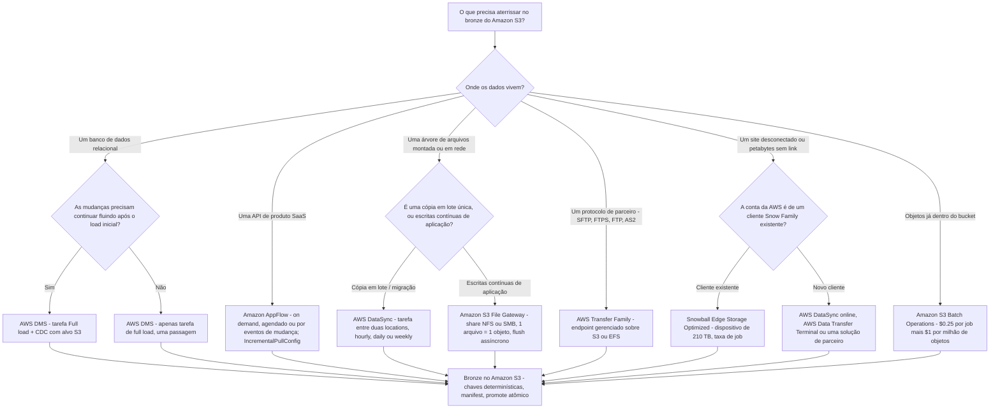
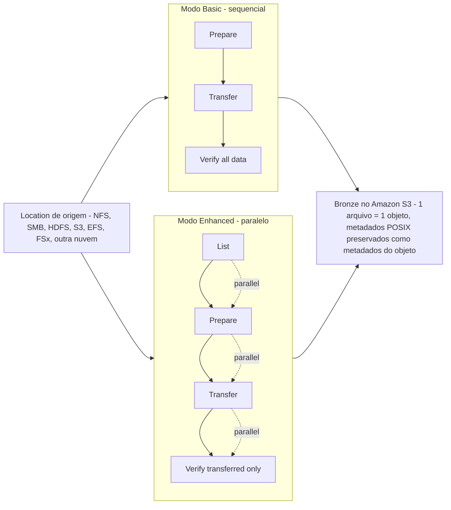
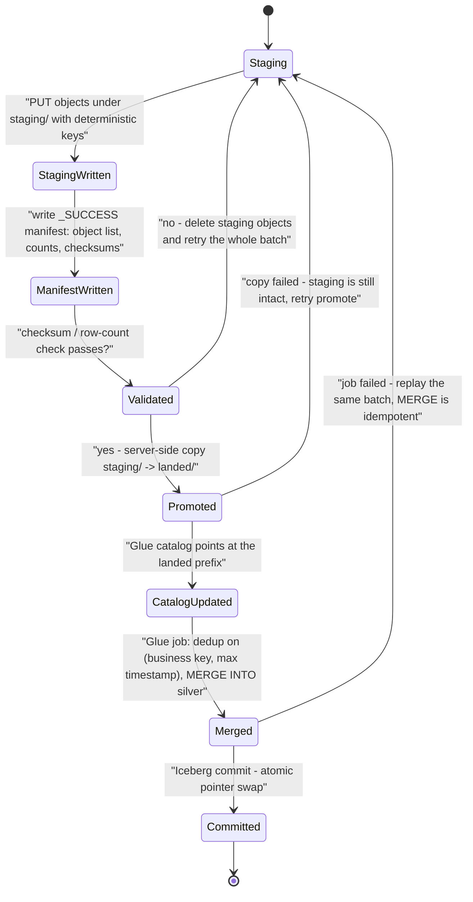
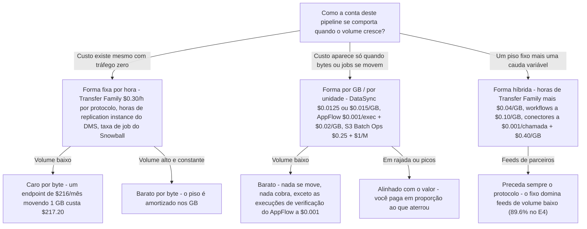
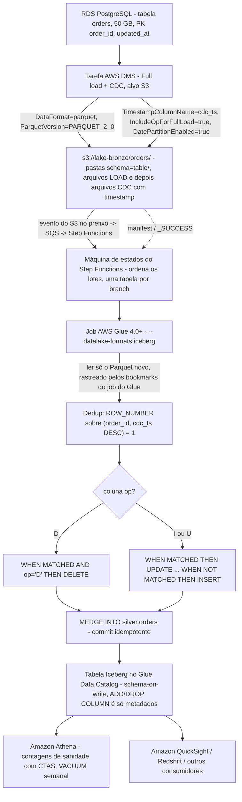

# Padrões de Ingestão em Lote: DMS, AppFlow, DataSync e Transfer Family

A lição 04 colocou um formato de tabela transacional sobre o Amazon S3. Esta lição é tudo o que acontece *antes* disso — a camada que move bytes. Um lakehouse com uma camada silver de Iceberg impecável e um serviço de ingress mal escolhido é um lakehouse com janela de lote de duas semanas, uma pasta bronze duplicada e um contrato de parceiro que você não consegue renegociar.

A verdade desconfortável sobre a ingestão em lote é que a escolha quase nunca é sobre throughput. Todo serviço desta lição consegue mover os dados. A escolha é sobre **quem controla a origem** (você, uma API de vendor, o cliente SFTP de um parceiro, um share montado), **se as mudanças precisam continuar fluindo** e **como a conta é formada** — horas fixas versus gigabytes.

```text
=====================================================================
 CAIXA DE FERRAMENTAS DE INGESTÃO EM LOTE — escopo da lição 05 (em out 2026)
---------------------------------------------------------------------
 Bancos de dados (RDBMS) ... AWS DMS — full load, full load + CDC,
                             CDC only -> Amazon S3 (CSV padrão,
                             parquet via DataFormat=parquet)
 APIs SaaS ................. Amazon AppFlow — on demand / schedule /
                             event, IncrementalPullConfig, 15 GB por
                             execução do Salesforce, $0.001/exec +
                             $0.02/GB
 Sistemas de arquivos
 (NFS/SMB/HDFS, outras
 nuvens) ................... AWS DataSync — agent or agentless,
                             Basic or Enhanced, hourly/daily/weekly,
                             TransferMode=CHANGED, verificação de
                             checksum
 Escritas híbridas
 contínuas ................. S3 File Gateway — NFS v3/v4.1, SMB
                             v2/v3, 1 arquivo = 1 objeto, flush
                             assíncrono
 Feeds de arquivos de
 parceiros ................. AWS Transfer Family — SFTP/FTPS/FTP/
                             AS2 -> S3 or EFS, $0.30/h por protocolo
 Offline em lote ........... Snowball Edge = LEGACY (apenas
                             clientes existentes desde 2025-11-07;
                             fim comercial 2026-12-31) -> DataSync,
                             Data Transfer Terminal, parceiros
 Reorganização no bucket ... Amazon S3 Batch Operations — $0.25/job
                             + $1 por milhão de objetos
---------------------------------------------------------------------
 Inegociável ............... S3 não tem primary keys, updates nem
                             integridade referencial — todo landing
                             precisa ser IDEMPOTENT ou você duplica
                             linhas já no primeiro retry.
=====================================================================
```

Nesta lição você vai:

- rodar a **matriz de seleção de serviço** — tipo de origem para serviço — e defender cada linha contra os dois concorrentes perdedores;
- configurar **AWS DMS full load + CDC no Amazon S3**: `DataFormat=parquet`, `CdcMaxBatchInterval`/`CdcMinFileSize`, `IncludeOpForFullLoad`, `TimestampColumnName`, `TargetTablePrepMode`, modos de carga paralela e `GlueCatalogGeneration`;
- nomear as **limitações do alvo S3** que decidem se a sua camada bronze é um landing limpo ou um gerador de duplicatas;
- montar **extrações incrementais do AppFlow** — agendas, eventos, filtros, offsets e o teto de 15 GB do Salesforce;
- posicionar **agents do DataSync**, escolher **Basic versus Enhanced**, agendar execuções com `TransferMode=CHANGED` e ler a história de verificação;
- subir endpoints, workflows e conectores do **Transfer Family** e precificá-los por hora de protocolo;
- usar o **S3 File Gateway** para escritas NFS/SMB híbridas e conhecer a lacuna de durabilidade dele;
- declarar corretamente as datas de encerramento do **Snowball Edge** (Snowcone 2024, novos clientes 2025-11-07, EOS 2026-12-31);
- aplicar os quatro **padrões de landing idempotentes** — chaves determinísticas, manifests, promote atômico, MERGE a partir de staging;
- comparar **formas de custo fixo por hora versus por GB** antes de se comprometer com uma arquitetura;
- percorrer um **fluxo resolvido DMS → bronze → Glue → Iceberg silver** de ponta a ponta;
- estudar **dois casos nomeados de clientes da AWS** (FINRA, Transport for NSW) e uma **caixa de atualização de outubro de 2026 com fontes**;
- praticar com **13 questões no estilo de exame** mais três verificações interativas.

---

## 1. Seleção de serviço: tipo de origem para serviço

### 1.1 A matriz

Esta é a lição inteira em uma tabela. Cada linha é uma *restrição*, não uma preferência — leia a coluna da esquerda primeiro.

| Tipo de origem | Serviço | Forma do movimento | Por que este |
|---|---|---|---|
| Banco de dados relacional (Aurora, RDS, Oracle / SQL Server / MySQL / PostgreSQL on-premises) | **AWS DMS** | Full load, full load + CDC ou somente CDC → S3 | Captura baseada em log mais um alvo S3 documentado com Parquet, batching, particionamento e geração opcional do catálogo do Glue |
| API SaaS (Salesforce, Slack, ServiceNow, SAP `SAPOData`, Zendesk, Marketo, …) | **Amazon AppFlow** | On demand, agendado ou por evento de mudança na origem → S3 / Redshift | Perfis de conector gerenciados, field maps, filtros e `IncrementalPullConfig` em vez de paginação escrita à mão |
| Árvore NFS / SMB / HDFS on-premises, ou outra nuvem, que você precisa **copiar** em lote | **AWS DataSync** | Tarefa entre duas *locations*, agendada, `TransferMode=CHANGED` | Pipeline paralelo, integridade de checksum sempre ativa, 1 arquivo ↔ 1 objeto com metadados POSIX preservados |
| Aplicação on-premises que precisa **continuar escrevendo** em um share que desemboca no S3 | **Amazon S3 File Gateway** | Leitura/escrita NFS/SMB contínua com cache local, flush assíncrono para o S3 | Arquivos mapeiam 1:1 para objetos (caminho = key), então aplicações existentes não mudam |
| Parceiro ou vendor que só fala **SFTP / FTPS / FTP / AS2** | **AWS Transfer Family** | Endpoint de protocolo gerenciado sobre S3 ou EFS, até 3 AZs | O protocolo sobrevive; o armazenamento vira um lake. Workflows opcionais pós-upload (decriptação PGP a $0.10/GB) |
| **Offline** na escala de petabytes ou um site sem link utilizável | ~~Snowball Edge~~ → **DataSync** / **AWS Data Transfer Terminal** / parceiro | Envio físico ou envio para instalação | Snow Family está fechada para novos clientes (2025-11-07) e chega ao end of support em 2026-12-31 |
| Re-tag / re-criptografar / re-localizar / re-armazenar objetos **já existentes no bucket** | **Amazon S3 Batch Operations** | Um job sobre um manifest de até 4 bilhões de objetos | Feito para reorganizações dentro do bucket — não para merges em nível de linha |

### 1.2 O fluxo de decisão



Duas regras que o fluxo codifica, ambas examináveis:

1. **Cópia versus atendimento.** O DataSync copia *de* uma location *para* outra location e termina. O File Gateway atende um share vivo cujos writes acabam caindo no S3. Eles resolvem metades diferentes de "os dados estão em NFS".
2. **Protocolo versus API.** O Transfer Family preserva um *protocolo* que o parceiro controla; o AppFlow preserva a *API de um vendor* com seus rate limits e paginação. Nenhum substitui o outro — o AppFlow não tem conector SFTP, e o Transfer Family não sabe paginar o Salesforce.

```matching
{
  "question": "Correlacione cada requisito de ingestão ao único serviço da AWS que o satisfaz (em out 2026):",
  "pairs": [
    {"left": "Um banco SQL Server precisa ser copiado para o S3 e depois mantido em sincronia com seu log de transações", "right": "AWS DMS - uma tarefa Full load + CDC com DataFormat=parquet e um endpoint de destino S3"},
    {"left": "Registros de conta do Salesforce precisam aterrissar em um bucket a cada hora e também em eventos de mudança", "right": "Amazon AppFlow - flows agendados mais flows por evento com IncrementalPullConfig e filtros dentro do flow"},
    {"left": "Uma árvore NFS on-premises de 40 TB precisa ser migrada uma vez e depois mantida em sincronia a cada hora", "right": "AWS DataSync - um agent no file server, uma tarefa com TransferMode=CHANGED em um agendamento"},
    {"left": "Uma aplicação legada precisa continuar escrevendo em /data/share enquanto objetos aparecem no S3", "right": "Amazon S3 File Gateway - share NFS v3/v4.1 ou SMB, um arquivo mapeia para um objeto com o caminho como key"},
    {"left": "Trinta parceiros de trading só vão enviar por SFTP, e isso não pode mudar", "right": "AWS Transfer Family - um endpoint SFTP gerenciado sobre S3, cobrado por hora de protocolo habilitada"},
    {"left": "Doze milhões de objetos ficaram com tags erradas depois de um job ruim", "right": "Amazon S3 Batch Operations - um único job dirigido por manifest a $0.25 mais $1 por milhão de objetos"}
  ],
  "explanation": "Cada enunciado nomeia uma restrição: sincronia por log de transações -> DMS; API de vendor com eventos -> AppFlow; cópia de arquivos única e depois delta -> DataSync; um share vivo que a aplicação já monta -> File Gateway; um protocolo controlado pelo parceiro -> Transfer Family; uma reorganização de objetos que já existem -> S3 Batch Operations. As duas confusões clássicas são DataSync vs File Gateway (tarefa de cópia vs share vivo) e Transfer Family vs AppFlow (protocolo vs API SaaS) - nenhum dos pares é intercambiável."
}
```

- **📚 Você sabia?** O DMS nomeia sua saída S3 mecanicamente: os arquivos de full load carregam um **contador hexadecimal incremental** (`LOAD00001.csv`, `LOAD00002.csv`, …), enquanto os arquivos de CDC recebem **timestamps** (`20141029-1134010000.csv`), e *toda tabela de origem não vazia ganha sua própria pasta* sob o caminho de destino (docs do S3 target do AWS DMS, acesso em 2026-10). É esse esquema de nomes que permite raciocinar sobre um landing idempotente — você consegue distinguir um arquivo de load de um arquivo de change só pela key.

---

## 2. AWS DMS: full load + CDC no Amazon S3

### 2.1 Os três tipos de tarefa, reenunciados para o lakehouse

| Tipo de tarefa | O que se move | Uso no lakehouse |
|---|---|---|
| **Full load** | Somente linhas existentes, uma passagem | Semear o bronze a partir de um snapshot, ou semear de novo após um landing ruim |
| **Full load + CDC** | Linhas existentes **e** mudanças capturadas enquanto o load roda | O padrão: semear o bronze e depois continuar alimentando-o |
| **Somente CDC** | Mudanças do log de transações a partir de um ponto inicial escolhido | Recuperação após um load, ou um change feed de longa duração |

Para um lakehouse o destino não é outro banco de dados — é um **prefixo no S3**, e é aqui que isso difere de todo tutorial de migração que você já leu.

### 2.2 Configurações do alvo S3 que realmente importam

A AWS documenta as configurações do alvo S3 que você vai usar em produção. Agrupadas por propósito (docs do S3 target do AWS DMS e referência da API `S3Settings`, acesso em 2026-10):

| Propósito | Configuração | Valor que você vai definir |
|---|---|---|
| Formato | `DataFormat` | `csv` (padrão) ou `parquet` — arquivos Parquet no S3 target suportados a partir do **DMS 3.4.7** |
| Localização | `BucketName`, `BucketFolder` | O prefixo bronze; o layout vira `s3://bucket/[folder]/schema/table/` |
| Tamanho dos arquivos CDC | `CdcMaxBatchInterval` (segundos), `CdcMinFileSize` (KB) | O próprio walkthrough de data lake da AWS: `3600` + `64000` para mirar arquivos de **≥ 64 MB** no Athena |
| Ordenação | `TimestampColumnName` | Adiciona uma coluna de timestamp de commit da origem (por exemplo `last_update_time`) para dedup e sequenciamento downstream |
| | `PreserveTransactions` + `CdcPath` | Somente pipelines CSV; preserva a ordem das transações sob `CdcPath` (**3.4.2+**) |
| Coluna de operação | `IncludeOpForFullLoad` | Marca as linhas de full load com `I` para que full load e CDC compartilhem o mesmo formato (**3.1.4+**, Parquet **3.4.7+**) |
| | `CdcInsertsOnly` / `CdcInsertsAndUpdates` | Estreitam a coluna de operação; **mutuamente exclusivas** — as duas true é inválido |
| Particionamento | `DatePartitionEnabled`, `DatePartitionSequence`, `DatePartitionDelimiter`, `DatePartitionTimezone` | Bronze particionado por data para Athena/Glue podarem |
| Compressão | `CompressionType`, `ParquetVersion`, `RowGroupLength`, `MaxFileSize` | Controles de tamanho do Parquet |
| Criptografia | `EncryptionMode`, `ServerSideEncryptionKmsKeyId` | SSE-KMS no landing |
| Catálogo | `GlueCatalogGeneration` | O DMS cria tabelas no Glue Data Catalog para os objetos que identifica durante a migração |
| Auth no S3 | `ServiceAccessRoleArn` | IAM role assumida pelo DMS para gravar no bucket |
| Forma do load | `TargetTablePrepMode`, `MaxFullLoadSubTasks`, modos de carga paralela | Ver §2.4 |

```fillblank
{
  "question": "Complete a configuração do endpoint S3 que o próprio walkthrough de data lake da AWS prescreve (valores em out 2026):",
  "template": "{{1}}=parquet faz o DMS gravar Parquet em vez de CSV; {{2}}=3600 e {{3}}=64000 miram arquivos de pelo menos 64 MB para o Athena; {{4}}=true carimba cada linha de full load com a letra de operação I para que os arquivos de full load e de CDC compartilhem o mesmo formato.",
  "answers": {
    "1": "DataFormat",
    "2": "CdcMaxBatchInterval",
    "3": "CdcMinFileSize",
    "4": "IncludeOpForFullLoad"
  },
  "distractors": ["BatchApply", "PreserveTransactions", "TargetTablePrepMode", "MaxFileSize", "CdcPath", "GlueCatalogGeneration", "RowGroupLength", "EncryptionMode"],
  "explanation": "As quatro configurações estruturais são DataFormat=parquet (arquivos Parquet no S3 target suportados a partir da 3.4.7), CdcMaxBatchInterval em SEGUNDOS, CdcMinFileSize em KILOBYTES (64000 KB = 64 MB) e IncludeOpForFullLoad (3.1.4+, Parquet 3.4.7+). Os distratores são os quase-acertos: BatchApply não é suportado em endpoints S3 e pode perder dados, PreserveTransactions é a alavanca de ordenação do CSV e conflita com o particionamento por data, TargetTablePrepMode controla arquivos de full load duplicados e não o formato do arquivo, MaxFileSize e RowGroupLength dimensionam o Parquet em vez de definir o piso do Athena, e GlueCatalogGeneration grava entradas de catálogo e não dados."
}
```

### 2.3 A linha do tempo de full load + CDC no S3

```text
Fase 1  CAPTURE ....... o CDC começa primeiro; as mudanças são
                        cacheadas na replication instance (memória,
                        depois spill para disco)
Fase 2  FULL LOAD ..... as linhas existentes são gravadas como
                        arquivos LOAD<hex>, tabelas carregando em
                        paralelo
Fase 3  APPLY ......... as mudanças cacheadas de cada tabela são
                        aplicadas assim que essa tabela termina o load
Fase 4  STEADY STATE .. arquivos CDC nomeados por timestamp seguem
                        chegando; observe CDCLatencySource /
                        CDCLatencyTarget
```

Duas coisas sobre o S3 mudam o quadro em relação a um destino de banco de dados:

- **O S3 não tem primary keys, updates nem integridade referencial** (AWS re:Post knowledge center, 2026-02-09). Os arquivos de CDC são, portanto, *arquivos de eventos*, não estados de tabela. Deduplicação e ordenação são trabalho seu no downstream — é exatamente para isso que servem `TimestampColumnName` e a coluna `op`.
- **A ordem das transações não é preservada por padrão.** Os docs dizem que "por padrão, para CDC, o AWS DMS armazena as mudanças de linha de cada tabela de banco de dados sem considerar a ordem das transações." Para CSV você pode definir `PreserveTransactions=true` com `CdcPath`; para Parquet você adiciona `TimestampColumnName` e reconstrói a ordem no job do Glue.

### 2.4 Full load paralelo e preparação da tabela de destino

| Alavanca | O que a AWS documenta |
|---|---|
| Tabelas em paralelo | `MaxFullLoadSubTasks` — o walkthrough de Oracle-to-S3 da AWS usa **49**; os modos de carga paralela são `ranges`, `partitions-optimized` e `partitions-auto`, e "com a opção ranges, o full load termina mais rápido" para uma tabela particionada |
| `TargetTablePrepMode` | **`DO_NOTHING`**, **`TRUNCATE`** (nome no console *Truncate*), **`DROP`** — o walkthrough escolhe `DO_NOTHING` "porque queremos controlar a retenção dos arquivos de execuções anteriores" |
| Tratamento de LOB | **O modo Full LOB não é suportado** em alvos S3 — escolha um `LOB Max Size` |
| Mudanças de schema durante o full load | **Não suportado.** DDL no meio do load tem que esperar o steady state |
| Classes de replication instance | T3, C5, C6i, R5, R6i (a tabela dos docs lista também R7i até `dms.r7i.48xlarge`, 192 vCPU / 1,536 GiB) |
| Opção serverless | DMS Serverless é a recomendação da AWS "para migrações heterogêneas ou replicações contínuas de dados com flutuações de dados" (1 DCU = 2 GB de RAM) |
| Validação | A validação de alvo S3 precisa de **DMS 3.5.0+** com `DataFormat=parquet`, roda **uma vez por dia às 00:00 UTC** via Athena CTAS, limita as tabelas com bucket do Athena a **100,000 buckets** e **falha em buckets gerenciados pelo Lake Formation** |

> [!WARNING]
> ⚠️ **Seis limitações do alvo S3 que decidem se o bronze é confiável** (docs do S3 target do AWS DMS, acesso em 2026-10):
> - **Não habilite versioning no bucket alvo do DMS** — os testes de conexão do endpoint podem falhar em um timeout de `list-object` do S3.
> - **`BatchApply` não é suportado para um endpoint S3** e "pode resultar em perda de dados" — deixe-o desligado.
> - **`TargetTablePrepMode=DO_NOTHING` pode gravar duplicatas** se a tarefa parar e for retomada abruptamente durante o full load. A orientação da AWS: prefira `TRUNCATE_BEFORE_LOAD` e, antes de reiniciar, **apague manualmente os arquivos de full load criados anteriormente**.
> - **Duas tarefas replicando a mesma tabela de origem para o mesmo bucket de destino gravam no mesmo arquivo.** Uma tabela de origem, uma tarefa, um prefixo.
> - **Mudanças de schema durante o CDC são registradas apenas pela metade:** truncate/drop/create/rename de tabela, add/drop/rename de coluna e mudança de tipo de coluna são capturados como DDL, mas *"nenhuma instrução ALTER é registrada no bucket S3 de destino, e o AWS DMS não altera registros criados anteriormente para corresponder à nova estrutura."* Arquivos novos simplesmente usam o formato novo.
> - **A validação não é uma contagem de linhas.** Somente diariamente à meia-noite UTC, somente Parquet, e quebra em buckets gerenciados pelo Lake Formation.

Esse quinto item é a frase mais importante desta lição: **o bronze é uma superfície schema-on-read.** Arquivos antigos mantêm formatos antigos para sempre. Apenas uma camada silver de Iceberg mais uma entrada no catálogo do Glue restaura a semântica de schema-on-write (lição 04) — que é exatamente o fluxo do §11.

### 2.5 Exemplo resolvido E1 — dimensionamento de CDC amigável ao Athena (em out 2026)

O passo a passo de SQL Server-to-data-lake da própria AWS diz as duas configurações e o motivo:

> "Como planejamos usar o Amazon Athena para consultar dados do nosso bucket do Amazon S3, precisamos garantir que o tamanho do arquivo de destino seja de pelo menos 64 MB. Especificamos as seguintes configurações de endpoint: `CdcMaxBatchInterval=3600` e `CdcMinFileSize=64000`." (AWS DMS SBS, acesso em 2026-10)

```text
Exemplo resolvido E1 - dimensionando um full load de 50 GB e uma hora de CDC
----------------------------------------------------------------
Origem .................. RDS PostgreSQL, tabela orders, 50 GB,
                         PK order_id, updated_at
Endpoint ................ DataFormat=parquet, ParquetVersion=
                          PARQUET_2_0, IncludeOpForFullLoad=true,
                          TimestampColumnName=cdc_ts,
                          DatePartitionEnabled=true (day),
                          CdcMaxBatchInterval=3600, CdcMinFileSize=
                          64000  (= meta de 64,000 KB)
Piso do Athena .......... >= 64 MB por arquivo (orientação do SBS da AWS)

Arquivos do full load ... 50 GB = 51,200 MB
                          51,200 / 64 = 800 arquivos
Janela de CDC ........... 3,600 s x 100 rows/s = 360,000 eventos
                          -> cerca de 1 arquivo Parquet por hora,
                          porque a AWS observa que arquivos Parquet
                          chegam MENORES que CdcMinFileSize (a taxa
                          de compressão varia), enquanto arquivos CSV
                          igualam CdcMinFileSize
Paralelismo ............. MaxFullLoadSubTasks (tabelas em paralelo)
                          x ranges / partitions-optimized /
                          partitions-auto para tabela particionada
Armadilha ............... full load travado + restart com
                          DO_NOTHING regrava arquivos LOAD* ->
                          duplicatas
```

A cadeia examinável: **o Athena quer arquivos ≥ 64 MB → `CdcMinFileSize=64000` KB e `CdcMaxBatchInterval=3600` s → o Parquet chega menor que a meta por causa da compressão → logo, uma suposição ingênua de "um arquivo por hora" está errada para Parquet e certa para CSV.**

---

## 3. Amazon AppFlow: SaaS para S3 com extrações incrementais

### 3.1 Conectores, gatilhos e o contrato incremental

Os valores de `ConnectorType` de origem do AppFlow incluem `Salesforce`, `Slack`, `Servicenow`, `SAPOData` (SAP), `Zendesk`, `Marketo`, `Googleanalytics`, `Datadog`, `S3`, `Redshift`, `Snowflake`, `CustomConnector` e `EventBridge`, entre outros; os destinos de flows do Salesforce incluem **Amazon S3**, Amazon Redshift, Amazon EventBridge, Snowflake e Zendesk (docs do CloudFormation `SourceFlowConfig` e guia do conector Salesforce, acesso em 2026-10).

| Alavanca | Comportamento (em out 2026) |
|---|---|
| Gatilho | **On demand**, **agendado** ou **por evento de mudança na origem** ("um flow disparado por evento roda quando o Amazon AppFlow detecta uma mudança nos dados de destino no serviço de armazenamento do CRM") |
| Extração incremental | `IncrementalPullConfig` — transfere "somente os registros que foram adicionados ou alterados desde a última execução bem-sucedida do flow" |
| Primeira execução agendada | "O primeiro flow disparado por schedule vai puxar **30 dias** de registros passados no momento da primeira execução do flow" |
| Offset | Protege contra o atraso de timestamping do lado da origem: registros novos ou alterados entre `T0 − t` e `T1 − t` são importados em `T1` |
| Poda / filtro | **Filters** dentro do flow ("especifique quais dados o flow transfere") e validações rodam *antes* do landing |
| Teto do Salesforce | **15 GB por execução de flow** ≈ **7.5 milhões de registros** a 2 KB de média (registros podem chegar a 4 KB) — quebre extrações maiores com filtros |
| Cota de perfis | Cota mole de **100 connector profiles por conta da AWS** |
| Pré-requisito | Salesforce precisa de um Connected App; ServiceNow precisa de "nenhuma configuração prévia, nem para a AWS nem para a ServiceNow" |

### 3.2 Exemplo resolvido E2 — quanto custa uma extração agendada do Salesforce (em out 2026)

A página de preços da AWS publica a aritmética em vez de uma tabela de taxas. A partir dos exemplos de us-east-1 e Frankfurt (acesso em 2026-10): **$0.001 por execução bem-sucedida de flow**, **$0.02 por GB processado** e — criticamente — *"As execuções de flow para verificar novos dados contarão para os seus custos de execução de flow, mesmo que não haja novos dados disponíveis."*

```text
Exemplo resolvido E2 - flow incremental horário Salesforce -> S3
------------------------------------------------------------
Cadência ............. a cada hora, 24 x 30 = 720 execuções/mês
                       + 1 execução por evento por dia útil
                       = 22 execuções a mais -> 742 execuções
Custo por execução ... 742 x $0.001 = $0.742  ->  $0.74
Volume ............... 600 GB alterados / mês
Custo de dados ....... 600 / 1 x $0.02 = $12.00
Total mensal ......... $0.74 + $12.00 = $12.74
Âncoras publicadas ... "1000 x $0.001 = $1 a day" (exemplo da AWS)
                       Frankfurt: "10 GB / (1 GB) x $0.02 = $0.20"
Execuções vazias ..... 742 verificações cobram mesmo com 0 linhas
                       alteradas
Teto do Salesforce ... 600 GB / 15 GB = 40 execuções no mínimo se a
                       extração fosse uma varredura única; filtros
                       mantêm cada execução confortavelmente abaixo
                       de 15 GB / 7.5M registros
```

Duas consequências de design saem da página de preços, não da lista de recursos:

1. **Uma cadência de polling é uma linha de custo.** Verificar a cada cinco minutos custa 8,640 execuções/mês em um mês de 30 dias, quer alguma coisa tenha mudado ou não. Defina o agendamento a partir do frescor que o *consumidor* precisa.
2. **A primeira extração de 30 dias é um evento de deduplicação.** Sua camada bronze recebe um mês de histórico na primeira execução e deltas depois, então o landing precisa ser idempotente (§9), ou o bronze do primeiro dia vai gravar em duplicata tudo que também chegou por outro caminho.

> [!IMPORTANT]
> ⚠️ **Não afirme que há landing em Parquet a partir do AppFlow sem rechecar os docs do formato de saída do S3.** As páginas oficiais recuperadas para esta lição mostram `fileType: CSV` e descrevem saída CSV/JSON; a saída em Parquet **não foi confirmada** no material recuperado. Trate o AppFlow como um aterrissador CSV/JSON até você verificar o contrário para a sua Região e o seu conector, e faça a conversão de formato na etapa do Glue.

- **📚 Você sabia?** O AppFlow cobra a *verificação*, não só a *mudança*: a própria página de preços da AWS afirma que execuções "para verificar novos dados contarão para os seus custos de execução de flow, mesmo que não haja novos dados disponíveis." Para flows de SAP a AWS mostra em vez disso um multiplicador de concorrência — "você aplica 9 processos concorrentes … (1+9) x $0.001 (custo do flow)" — então a paralelidade multiplica as cobranças de execução em vez de economizá-las (preços do AppFlow da AWS, acesso em 2026-10).

---

## 4. AWS DataSync: agents, modos de tarefa, agendamentos, verificação

### 4.1 Agent ou agentless?

Uma **tarefa** do DataSync copia entre duas **locations**. Se você precisa de um agent é decidido por onde essas locations vivem (docs do AWS DataSync, acesso em 2026-10):

| Par de locations | Precisa de agent? |
|---|---|
| NFS / SMB / HDFS on-premises ↔ S3, EFS, FSx | **Sim** — um agent de VM (ESXi, KVM, Nutanix AHV, Hyper-V) ou uma AMI no EC2 |
| Amazon S3 ↔ Amazon S3 na **mesma conta da AWS** | **Não** |
| Amazon S3 ↔ outro serviço de armazenamento da AWS **entre contas** | **Não** |
| Amazon S3 ↔ outra nuvem | **Não** no modo Enhanced |

Regras que mordem em produção:

- Uma location pode ter **até quatro agents no modo Basic e até quatro agents no modo Enhanced**, e *"Todos os agents associados a uma location precisam estar online antes que você possa iniciar sua tarefa de transferência. Se um dos agents estiver offline, você não consegue executar sua tarefa."* Multi-agent compra velocidade, não failover.
- Agents do modo Enhanced e agents do modo Basic **não são intercambiáveis** para a mesma location.
- NFS usa por padrão a **versão 4.1** (também 4.0 e 3.x) sobre **TCP 2049** (mais **111** para v3); os exports de destino precisam de `no_root_squash`, e o DataSync **não copia ACLs do NFSv4**.

### 4.2 Modos de tarefa Basic versus Enhanced

| | **Basic** | **Enhanced** |
|---|---|---|
| Pipeline | **Sequencial** prepare → transfer → verify | **Paralelo** list, prepare, transfer e verify |
| Verificação | Verifica **todos os dados por padrão** | Verifica **somente os dados transferidos** |
| Cota de contagem de objetos | **50 milhões** de itens/tarefa (on-prem ↔ AWS), **25 milhões** (AWS ↔ AWS) | **Praticamente ilimitada** |
| Orientação de memória | Aloque **64 GB de RAM** ao agent acima de 20 milhões de arquivos/objetos/diretórios | — |
| Forma de preço | **$0.0125/GB** copiado (exemplo da página de preços) | **$0.015/GB** + **$0.55 por execução de tarefa** (exemplo da página de preços) |
| Integridade | As checagens **sempre** rodam durante a transferência (checksum + comparação de metadados) | Igual |

Opções de tarefa que valem memorizar: `TransferMode=CHANGED`, `VerifyMode=ONLY_FILES_TRANSFERRED`, `ObjectTags=PRESERVE`, `LogLevel=TRANSFER`, mais filtros/manifests e **deletion mirroring** opcional (apagar no destino o que já não existe na origem). O agendamento é **hourly, daily ou weekly** direto no console.



### 4.3 Exemplo resolvido E3 — 20 TB do NFS para o S3, Basic versus Enhanced (em out 2026)

Usando as taxas impressas nos próprios exemplos resolvidos da AWS na página de preços do DataSync (acesso em 2026-10):

```text
Exemplo resolvido E3 - 20 TB NFS -> S3, uma vez e depois deltas diários
----------------------------------------------------------------
Modo Basic
  20 TB x 1024 GB = 20,480 GB
  transferência .. 20,480 x $0.0125 = $256.00
  taxa de execução  nenhuma
  checagem de cota  20,480 GB de muitos arquivos pequenos podem
                  exceder o teto de 50 milhões de itens/tarefa ->
                  faça shard da árvore em tarefas de <50M itens
                  (64 GB de RAM do agent acima de 20M)
  Subtotal ....... $256.00 + requisições PUT/GET do S3

Modo Enhanced
  transferência .. 20,480 x $0.015 = $307.20
  execuções ...... 30 execuções diárias x $0.55 = $16.50
  Subtotal ....... $323.70 + requisições PUT/GET do S3

Delta ........... Enhanced custa $67.70 a mais por mês aqui, e
                  compra: pipeline paralelo, contagens de objetos
                  praticamente ilimitadas, métricas por execução,
                  e verify-only-transferred em vez de verify-all
Âncora da AWS ... "(50 TB * 1024 GB copied using DataSync *
                  $0.015/GB) ... (1 task execution * $0.55) =
                  ... $797.58" (Enhanced)
                  "(50 TB copied into S3 * 1024 GB * $0.0125/GB)
                  = $656.38" (Basic)
```

**Leia a armadilha antes de copiar qualquer coisa.** O Storage Blog da AWS alerta que objetos semeados em um bucket por *outras ferramentas* não têm metadados do DataSync, então o DataSync executa `HEAD` + `GET` + uma cópia in-place — e objetos em classes de armazenamento de archive não podem receber `GET` de jeito nenhum, forçando uma retransmissão completa pela rede (mais uma nova versão se o versioning estiver ligado). O conselho do blog: *"use o DataSync para fazer a transferência inicial para o S3 sempre que possível"* e considere suspender o versioning do S3 no bucket. Faça o **primeiro** sync com o DataSync para um bucket vazio.

- **📚 Você sabia?** A detecção de "alterado desde a última execução" do DataSync depende dos **próprios metadados do DataSync**. O blog da AWS afirma que o DataSync "automaticamente copia cada arquivo como um único objeto S3 em um relacionamento 1:1 e preserva os metadados POSIX do arquivo de origem como metadados do objeto do Amazon S3" — e que objetos enviados por outras ferramentas disparam o caminho HEAD+GET+COPY (AWS Storage Blog, 2021-08-24). Um pipeline híbrido em que um feed SFTP de parceiro e o DataSync gravam o mesmo prefixo, portanto, vai pagar por recópias para sempre.

---

## 5. AWS Transfer Family: protocolos de parceiro para dentro do lake

### 5.1 O que é

O Transfer Family é um **endpoint totalmente gerenciado** falando SFTP (v3), FTPS, FTP, AS2 ou um navegador, sobre **Amazon S3** ou **Amazon EFS**, *"suporta até 3 Availability Zones e é respaldado por uma frota redundante com auto scaling."*

| Ponto de design | Opções e limites (em out 2026) |
|---|---|
| Tipo de endpoint | **Public** (somente SFTP), **VPC – Internet** (SFTP, FTPS, AS2), **VPC – Internal** (SFTP, FTP, FTPS, AS2) |
| Autenticação | Usuários gerenciados pelo serviço, **AWS Managed Microsoft AD** ou **API Gateway + Lambda** — autenticação por senha precisa de AD ou da amarração customizada |
| **Workflows** pós-upload | PGP decrypt / validate / notify — **$0.10/GB processado** |
| **Conectores SFTP** | Puxe de ou envie para servidores SFTP remotos: **$0.001 por chamada de conector** + **$0.40/GB**; 100/conta, 150 GiB/arquivo, 1,000 operações em fila, 50 MBps/conta, 5 sessões paralelas, 100 paths/s |
| Sessões / ociosidade | **10** sessões SFTP multiplexadas concorrentes por conexão; timeout de ociosidade de **1,800 s** (30 min) |
| Tamanho do arquivo | **5 TB** (o teto de objeto do S3) |
| Vazamento da semântica do S3 | Rename "Suportado apenas para arquivos. Rename que sobrescreveria um arquivo existente não é suportado"; **SETSTAT não suportado** com S3 |

> [!WARNING]
> ⚠️ **O Transfer Family cobra por hora de protocolo habilitada, mesmo ocioso.** O exemplo resolvido da AWS: SFTP a **$0.30/hora** → `$0.30 × 24 × 30 = $216` por mês, mais `$0.04 × GB` de dados movidos. Habilitar SFTP **e** FTPS no mesmo endpoint dobra a taxa fixa. Duas armadilhas do lado do cliente viajam junto: uploads de um client com múltiplas conexões contra o S3 podem "falhar de maneiras imprevisíveis" e deixar **uploads multipart órfãos que geram cobranças do Amazon S3**; e como o protocolo mapeia para o S3, um rename que sobrescreveria é rejeitado.

### 5.2 Exemplo resolvido E4 — a conta do feed do parceiro (em out 2026)

```text
Exemplo resolvido E4 - 30 parceiros em um endpoint SFTP (us-east-1)
----------------------------------------------------------------
Endpoint ............. somente SFTP, sempre ligado
  $0.30/h x 24 x 30 = $216.00
Dados ................ 400 GB de upload + 100 GB de download
  500 GB x $0.04  = $ 20.00
Workflow .............. 50 GB com PGP decrypt a $0.10/GB
  50 x $0.10      = $  5.00
Total mensal ......... $241.00
Forma ................ fixo de $216 = 89.6% da conta; neste volume
                        a hora de protocolo, e não os dados,
                        domina
Âncora publicada ..... exemplo dual-protocol de 1,000 usuários:
                        "$216 + $180 + $216 + $360 = $972"
                        (dois protocolos, dois sabores de endpoint)
Lição ................ habilitar um segundo protocolo "por segurança"
                        custa $180/mês antes de um byte se mover
```

---

## 6. Amazon S3 File Gateway: escritas NFS híbridas que aterrissam no S3

Um appliance do S3 File Gateway (VM, hardware ou EC2) exporta shares **NFS v3/v4.1** ou **SMB v2/v3**; *"Arquivos gravados em um file share se tornam objetos no Amazon S3, com o caminho como key. Existe um mapeamento um-para-um entre arquivos e objetos."*

| Propriedade | Detalhe (em out 2026) |
|---|---|
| Criptografia | **SSE-S3** por padrão; SSE-KMS e DSSE-KMS opcionais — "certifique-se de que seu file share usa o mesmo tipo de criptografia do bucket do Amazon S3" |
| Integridade | O File Gateway preenche o cabeçalho **`Content-MD5`**; toda transferência via HTTPS |
| Caminho de escrita | Os writes da aplicação são armazenados no **cache de forma síncrona** e depois enviados ao S3 de forma **assíncrona** |
| Mapeamento de bucket | **Um file share → um bucket**; múltiplos shares só podem compartilhar um bucket com "um prefixo de bucket S3 único e não sobreposto" |
| Capacidade de metadados | Capacidade padrão do gateway **Small** = metadados para até **5 milhões de arquivos**; **8** threads de upload do S3 por padrão |
| Preço | **$0.01/GB gravado na AWS**, primeiros **100 GB/mês grátis** por gateway, com teto de **$125 por gateway por mês**; **leituras são grátis** (requisições/armazenamento do S3 continuam valendo) |
| Escopo | "O S3 File Gateway não foi projetado para agir como um substituto completo de NAS corporativo. O S3 File Gateway emula um sistema de arquivos, mas não é um sistema de arquivos." |

A lacuna de durabilidade é o ponto operacional: os writes só são duráveis **depois** que o cache faz flush, então a AWS manda você *"garantir que a métrica do CloudWatch `CachePercentDirty` seja `0`"* antes de parar o host que roda o gateway. E com versioning ligado, uma única escrita de arquivo cria **duas** versões de objeto — uma para os dados, outra para a atualização de metadados.

**Quando escolher File Gateway em vez do DataSync:** se uma aplicação precisa *continuar escrevendo* por um caminho POSIX, é File Gateway. Se você precisa *copiar* uma árvore em um agendamento, é DataSync. Usar DataSync para fingir um share gravável, ou File Gateway para fingir uma migração, produzem o modo de falha errado.

---

## 7. Offline em lote: o padrão Snowball Edge (e o status dele em 2026)

Ensine o *padrão* — um disco enviado que aterrissa bytes verificados no S3 — mas ensine o **status do produto** corretamente, porque a maior parte do conteúdo da web aberta está desatualizada.

| Marco | Data | Consequência |
|---|---|---|
| **Snowcone descontinuado** | 2024-11-12 | Suporte a clientes existentes encerrou em 2025-11-12 |
| **Snowball Edge fechado para novos clientes** | 2025-11-07 | A AWS direciona novas necessidades de bulk offline para **AWS DataSync**, **AWS Data Transfer Terminal**, soluções de parceiros AWS |
| **Nenhum dispositivo Snow Family para novos clientes pedirem** | atual | "A AWS não vai mais oferecer nenhum dispositivo AWS Snow Family para novos clientes pedirem" |
| **Fim do suporte nas Regiões comerciais** | **2026-12-31** | Vale para dispositivos Storage Optimized **e** Compute Optimized |

Âncoras de dispositivo e preço para quem mantém um deploy existente (preços do Snowball da AWS, us-east-1, acesso em 2026-10): **Storage Optimized 210 TB** úteis; **On-Demand Job Fee até 100 TB (inclui 15 dias) $1,800**; **101 TB–210 TB $3,200**; **$250 por dia** além de 15 dias; **$9,885 por mês**; **compromisso de 1 ano adiantado $97,268**; armazenamento no dispositivo compatível com S3 **$0.01 por GB-mês** ou **$0.12 por GB-ano**. O Compute Optimized chega a **104 vCPUs, 416 GB de memória e 28 TB de SSD NVMe dedicado**.

- **📚 Você sabia?** O *padrão* offline sobrevive ao produto. Com o Snowcone fora e o Snowball Edge restrito, a própria nota de migração da AWS aponta para o DataSync em transferências online, **Data Transfer Terminal** para uploads físicos seguros e parceiros — a pergunta de arquitetura ("como 500 TB chegam ao S3?") ainda tem as mesmas três respostas, mudou só a ordem de preferência (AWS Snow device updates, 2024-11-12; docs da mudança de disponibilidade do Snowball Edge, acesso em 2026-10).

---

## 8. Amazon S3 Batch Operations: reorganizando o que já aterrou

O S3 Batch Operations é a ferramenta de reparo para um landing que deu errado e a ferramenta de migração para um layout de prefixo que você está mudando. Um job executa uma operação sobre um **manifest**:

- copiar objetos, atualizar criptografia server-side, definir tags ou ACLs de objetos, iniciar restores do S3 Glacier Flexible Retrieval, invocar uma função **AWS Lambda**, Object Lock e Batch Replication;
- tamanho padrão do manifest de **4 bilhões de objetos**, subindo para **20 bilhões** para Copy, Object Tagging, Object Lock, Lambda invoke e Batch Replication;
- formato de manifest `S3BatchOperations_CSV_20180820`, comumente gerado a partir do **S3 Inventory**;
- preço: **$0.25 por job** + **$1.00 por milhão de objetos processados** (preços do S3 da AWS, acesso em 2026-10).

### 8.1 Exemplo resolvido E5 — reparando um landing com tags erradas (em out 2026)

```text
Exemplo resolvido E5 - 12,000,000 de objetos taggeados após um job ruim
----------------------------------------------------------------
Taxa de job ............. 1 x $0.25      = $  0.25
Por objeto .............. 12,000,000 / 1,000,000 x $1.00
                        = 12 x $1.00    = $ 12.00
Subtotal ................                = $ 12.25
                     (+ requisições PUT de tagging do S3 para os objetos)
Âncora publicada ........ o próprio exemplo de 1,000,000 de objetos
                          da AWS totaliza "$1.25"
Contraste .............. um loop de SDK por objeto são os mesmos
                          12M PUTs, mas com seus próprios retries,
                          throttling e sem completion report
Escopo ................. SOMENTE nível de objeto - tags, keys,
                          criptografia, ACLs, restore, Lambda.
                          Merges em nível de linha são do Iceberg
                          (lição 04), não do Batch Operations
```

---

## 9. Landing idempotente: os quatro padrões

Tudo até aqui produz *arquivos*. O S3 aceita de bom grado o mesmo arquivo duas vezes, e a orientação da própria AWS é direta: **"O Amazon S3 não suporta primary keys, updates ou integridade referencial."** Então a camada de landing — a parte entre o mover e o formato de tabela — precisa de um contrato à prova de retry.

| # | Padrão | Mecanismo | Falha que ele derrota |
|---|---|---|---|
| 1 | **Chaves determinísticas** | Codificar origem, tabela, data de partição e um hash de conteúdo/lote na key para que um retry **sobrescreva** em vez de acrescentar | Objetos duplicados de um upload reprocessado |
| 2 | **Arquivos manifest** | Gravar um `_SUCCESS`/manifest listando objetos, contagens de linhas e checksums; consumidores leem um lote **somente quando o manifest dele está completo** | Jobs downstream lendo um lote meio gravado (o padrão Step Functions + SQS + manifest) |
| 3 | **Promote atômico** | Gravar em `staging/…` e depois copiar server-side (`CopyObject`) para `landed/…` | Leitores vendo arquivos parciais; note que o rename do Transfer Family é **sem sobrescrita**, então a promoção é uma cópia e não um move |
| 4 | **MERGE a partir de staging** | Aterrar arquivos raw de forma imutável e depois `MERGE INTO silver USING staging` com dedup por business key + timestamp | Um arquivo CDC reexecutado mudando o silver duas vezes — o commit continua idempotente |



### 9.1 Ordenando os passos

```dragdrop
{
  "question": "Ordene a sequência de landing idempotente, da escrita raw até uma linha silver commitada:",
  "items": [
    "Gravar os arquivos raw em um prefixo de staging usando chaves determinísticas - origem, tabela, data de partição e um hash de conteúdo ou de lote dentro da key",
    "Gravar um manifest ou objeto _SUCCESS listando os objetos do lote, as contagens de linhas e os checksums",
    "Validar o lote - checksums e contagens batem com o manifest, ou o lote é descartado e reprocessado",
    "Promover atomicamente - cópia server-side de staging/ para landed/ para que leitores nunca observem um lote parcial",
    "Atualizar a entrada do Glue Data Catalog para o prefixo landed",
    "Executar o job do Glue: dedupe pela business key com max(timestamp), depois MERGE INTO na tabela Iceberg silver"
  ],
  "correctOrder": [
    "Gravar os arquivos raw em um prefixo de staging usando chaves determinísticas - origem, tabela, data de partição e um hash de conteúdo ou de lote dentro da key",
    "Gravar um manifest ou objeto _SUCCESS listando os objetos do lote, as contagens de linhas e os checksums",
    "Validar o lote - checksums e contagens batem com o manifest, ou o lote é descartado e reprocessado",
    "Promover atomicamente - cópia server-side de staging/ para landed/ para que leitores nunca observem um lote parcial",
    "Atualizar a entrada do Glue Data Catalog para o prefixo landed",
    "Executar o job do Glue: dedupe pela business key com max(timestamp), depois MERGE INTO na tabela Iceberg silver"
  ],
  "explanation": "A ordem é gravar -> atestar -> validar -> promover -> catálogo -> merge. Duas propriedades tornam isso idempotente: chaves determinísticas significam que um retry sobrescreve em vez de acrescentar, e o manifest é a porta que impede o downstream de ler um lote meio gravado. A promoção é uma CÓPIA server-side em vez de um rename porque o S3 não tem rename atômico e o rename do Transfer Family recusa-se a sobrescrever. O MERGE final é o que torna seguro um arquivo CDC reexecutado - dedupe primeiro (apenas um registro de origem pode corresponder a uma linha de destino), depois MERGE, então uma segunda execução do mesmo lote deixa o silver inalterado."
}
```

### 9.2 O MERGE que torna o replay seguro

A partir das próprias receitas de CDC-into-Iceberg da AWS (Big Data Blog, 2022-06-15 atualizado em maio de 2023; 2023-02-14): o DMS fornece o atributo `op` para dados CDC incrementais, mas **não** para o load inicial, a menos que você defina **`IncludeOpForFullLoad=true`**; o job do Glue deduplica pela coluna `last_update_time` que o `TimestampColumnName` adicionou e então executa

```sql
MERGE INTO silver.orders s
USING staged_orders d
   ON s.order_id = d.order_id
WHEN MATCHED AND d.op = 'D' THEN DELETE
WHEN MATCHED THEN UPDATE SET s.status = d.status, s.updated_at = d.updated_at
WHEN NOT MATCHED THEN INSERT (order_id, status, updated_at)
VALUES (d.order_id, d.status, d.updated_at);
```

### 9.3 Exemplo resolvido E6 — quanto custa um replay (em out 2026)

```text
Exemplo resolvido E6 - o mesmo lote CDC entregue duas vezes
----------------------------------------------------------------
Lote ............. arquivo CDC com 5,000 eventos para 800
                     order_ids distintos, cdc_ts carimbado por
                     TimestampColumnName
Execução 1 - INSERT INTO ingênuo
                     linhas no silver +5,000 -> total 5,000 para
                     essas keys
Execução 2 - replay do MESMO arquivo
                     linhas no silver +5,000 -> total 10,000  (dobrado)
                     o count(*) do Athena agora está errado para
                     todo dashboard downstream, em silêncio
Execução 1 - dedupe e depois MERGE
                     ROW_NUMBER() OVER (PARTITION BY order_id
                     ORDER BY cdc_ts DESC) = 1  -> 800 linhas
                     MERGE: 320 deletes 'D', 480 upserts I/U
                     linhas no silver para essas keys = 800 líquidas
Execução 2 - replay do MESMO arquivo
                     dedupe de novo -> mesmas 800 linhas
                     MERGE casa de forma idêntica -> variação líquida 0
                     Resultado: commit idempotente, contagem de
                     linhas inalterada
Regra ............. "Apenas um registro nos dados de origem pode
                     atualizar qualquer linha dada da tabela de
                     destino, ou então um erro será lançado" -
                     dedupe primeiro, sempre, antes de o MERGE rodar
```

- **📚 Você sabia?** Um restart de tarefa do DMS pode fabricar duplicatas sozinho. A orientação da AWS para `TargetTablePrepMode=DO_NOTHING` é que uma tarefa que para durante o full load "grava os arquivos de full load de novo quando reinicia" — então você precisa ou trocar para `TRUNCATE_BEFORE_LOAD`, ou apagar manualmente os arquivos `LOAD*` anteriores antes de reiniciar (AWS re:Post, 2026-02-09). Idempotência não é só sobre o seu job do Glue; é também sobre o comportamento de restart do mover.

---

## 10. Forma de custo: fixo por hora versus por GB

Antes de se comprometer com uma arquitetura, descubra qual dessas três formas a conta vai ter. Elas se comportam de forma completamente diferente conforme o volume cresce.

```text
=====================================================================
 FORMAS DE CUSTO (taxas publicadas, exemplos de us-east-1, em out 2026)
---------------------------------------------------------------------
 FIXO POR HORA / CAPACIDADE FIXA
   Transfer Family .... $0.30 por hora de protocolo habilitada
                        -> $216/mês por protocolo, ocioso ou não
   AWS DMS ............. horas de replication instance (ou DCUs no
                         Serverless; 1 DCU = 2 GB de RAM) + storage
                         (100 GB GP2 em C4/R4/R5, 50 GB em T2/T3)
                         + Multi-AZ recomendado para trabalho contínuo
   Snowball Edge ....... $1,800 (<=100 TB, 15 dias) / $3,200
                         (101-210 TB) / $250 por dia extra
                         / $9,885 por mês
 POR GB / POR UNIDADE
   DataSync ............ Basic $0.0125/GB; Enhanced $0.015/GB
                         + $0.55 por execução de tarefa
   AppFlow ............. $0.001 por execução bem-sucedida + $0.02/GB
   S3 Batch Operations . $0.25 por job + $1.00 por milhão de objetos
   File Gateway ........ $0.01/GB gravado, primeiros 100 GB grátis,
                         teto de $125/gateway/mês, leituras grátis
 HÍBRIDO (piso fixo + variável)
   Dados do Transfer Family  $0.30/h/protocolo + $0.04/GB movidos
   Workflows de transferência  $0.10/GB processado (ex.: PGP decrypt)
   Conectores SFTP ...... $0.001/chamada + $0.40/GB
=====================================================================
```



O exemplo resolvido do §5.2 é a prova: um feed de parceiro de 500 GB no Transfer Family custa **$241**, dos quais **$216 (89.6%)** são hora de protocolo. Os mesmos 500 GB pelo DataSync na taxa Basic seriam 500 × $0.0125 = **$6.25**. O Transfer Family continua sendo a resposta correta — porque o *parceiro* é a restrição — mas você deveria saber que está comprando compatibilidade de protocolo, não banda.

> [!IMPORTANT]
> ⚠️ **Não cite um $/hora de instância do DMS de memória.** A AWS renderiza dinamicamente a tabela de instâncias do DMS sob demanda, e os números capturados para esta lição não puderam ser verificados na página de preços (eles aparecem apenas em blogs de terceiros). A estrutura verificada é: **classes** de instância (T3, C5, C6i, R5, R6i, R7i), storage incluído (**100 GB GP2** nas classes C4/R4/R5, **50 GB** em T2/T3), **$0.075 por vCPU-hora** para créditos de CPU do T3 em modo ilimitado, **1 DCU = 2 GB de RAM** para o DMS Serverless, "toda transferência de dados para dentro do AWS DMS é grátis" e tráfego DMS↔RDS na mesma AZ grátis. Puxe a taxa ao vivo de `aws.amazon.com/dms/pricing/` antes de modelar uma conta.

---

## 11. Fluxo resolvido de ponta a ponta: DMS → bronze → Glue → Iceberg silver

### 11.1 O fluxo



### 11.2 O roteiro, passo a passo (em out 2026)

```text
Exemplo resolvido E7 - orders do RDS (50 GB) em uma tabela Iceberg silver
--------------------------------------------------------------------
Passo 1  ENDPOINT DMS (alvo S3)
         DataFormat=parquet ......... Parquet a partir do DMS 3.4.7
         ParquetVersion=PARQUET_2_0
         IncludeOpForFullLoad=true .. linhas de full load carregam 'I',
                                       então full load e CDC
                                       compartilham o formato
                                       (3.1.4+, parquet 3.4.7+)
         TimestampColumnName=cdc_ts . timestamp de commit da origem
                                       para dedup + ordenação
         DatePartitionEnabled=true .. partições diárias para poda
         CdcMaxBatchInterval=3600 ... uma hora de mudança por arquivo
         CdcMinFileSize=64000 ....... meta de >= 64 MB para o Athena
         ServiceAccessRoleArn ....... IAM role para gravar no bucket
         GlueCatalogGeneration ...... tabelas Glue opcionais criadas
                                       conforme o DMS migra
Passo 2  TASK
         Tipo: Full load, replicação contínua
         TargetTablePrepMode: DO_NOTHING (controla retenção) - e
           portanto NUNCA reinicie no meio de um full load sem
           limpar os arquivos LOAD* anteriores
         MaxFullLoadSubTasks / ranges / partitions-auto para o
           full load particionado; LOB Max Size (sem modo Full LOB)
Passo 3  ORQUESTRAÇÃO
         evento do S3 -> SQS -> Step Functions; o SQS segura a ordem
         dos lotes, o Step Functions faz fan-out por tabela, os
         bookmarks do job do Glue rastreiam quais arquivos CDC são novos
Passo 4  JOB DO GLUE (silver)
         ler o Parquet bronze -> dedup sobre (order_id, max cdc_ts)
         -> separar op: D vs I/U -> MERGE INTO silver.orders
         -> evolução de schema via Iceberg ADD/DROP COLUMN
Passo 5  VERIFICAR
         contagens de sanidade com Athena CTAS; validação S3 do DMS
         se você quiser (3.5.0+, parquet, diário 00:00 UTC, não em
         buckets do LF); VACUUM semanal para expirar snapshots
Números . 50 GB / 64 MB = ~800 arquivos de full load
         3,600 s x 100 rows/s = 360,000 eventos CDC/hora
         Parquet comprime abaixo de CdcMinFileSize -> menos
         arquivos, menores, que o equivalente em CSV
```

Cada ingrediente desse bloco vem dos padrões publicados pela AWS: Step Functions + SQS ordenando com jobs do Glue criando a camada silver (Big Data Blog, 2024-10-30), um bookmark de job do Glue dirigindo `MERGE` incremental com dedup por `last_update_time` (2023-02-14) e duas tarefas DMS separando as pastas de full load e de CDC particionado por data para um `MERGE` nativo do Athena (2023-04-27).

### Atualizações de 2026 (em outubro de 2026)

> [!NOTE]
> **O que mudou na ingestão em lote de que esta lição depende** — cada linha com fonte e data:
> - **2025-05-14 — O Firehose ganhou uma hierarquia multi-catalog do Glue.** O histórico de documentos do Firehose registra suporte a "Glue multi-catalog hierarchy", então uma entrega pode mirar um catálogo não padrão como as **S3 Tables** em vez de apenas o catálogo Glue padrão da conta (Amazon Data Firehose User Guide, histórico de documentos, acesso em 2026-10-11). Relevância: o lado de *destino* da ingestão agora tem uma opção Iceberg gerenciada ao lado de DMS → bronze → Glue.
> - **2025-01-27 — Amazon S3 Metadata ficou GA.** "S3 Metadata makes it easy to query and filter S3 object metadata using SQL… you can query object metadata using Amazon Athena" — os metadados de objetos aterrissam em tabelas do S3 Metadata que aparecem no Glue Data Catalog / Athena (AWS News Blog, 2025-01-27). Relevância: auditar *o que* um landing realmente produziu (tamanhos, keys, contagens) sem um ciclo completo de S3 Inventory.
> - **2026-08-21 — AWS Glue 6.0 ficou GA com redução de preço de 30%.** "AWS Glue 6.0 is now generally available, delivering a 30% price reduction and introducing full support for Apache Iceberg v3", com Spark 4.1, Python 3.13 e **Spark Declarative Pipelines** para orquestração embutida (AWS News Blog, 2026-08-21). Relevância: a etapa de MERGE do §11 fica mais barata e pode carregar a própria orquestração.
> - **2025-11-07 — Snowball Edge fechado para novos clientes.** "AWS Snowball Edge devices will only be available to existing customers. New customers should explore AWS DataSync for online transfers, AWS Data Transfer Terminal for secure physical transfers, or AWS Partner solutions" (AWS Snow device updates, aviso de 2024-11-12; docs da disponibilidade do Snowball Edge, acesso em 2026-10).
> - **2026-12-31 — Fim do suporte dos dispositivos Snowball nas Regiões comerciais.** "On December 31, 2026, AWS will discontinue support for AWS Snowball devices in all AWS commercial Regions. This includes both the AWS Snowball Edge Storage Optimized and Compute Optimized devices" (aws.amazon.com/snowball, acesso em 2026-10). Qualquer runbook que ainda diga "peça um Snowball" precisa ser reescrito neste trimestre.

---

## Casos Reais

A AWS publica como esses padrões ficam em produção. Todos os números abaixo são **afirmações de cliente ou da AWS, não auditados**, com a fonte nomeada para você conferir — o ponto examinável é o **padrão**, não o marketing.

### Caso A — FINRA: validando e catalogando arquivos na escala de um regulador

| Elemento | Detalhe |
|---|---|
| Cliente | **FINRA** — o regulador do mercado financeiro dos EUA, rodando vigilância de mercado em escala nacional |
| Desafio | Analytics on-premises de capacidade fixa não acompanhava os dados de mercado enquanto cumpria deveres regulatórios de auditoria e lineage |
| Forma da ingestão | Dados de mercado chegam das bolsas como **arquivos sobre SFTP/HTTPS**, validados (a AWS lista **AWS Lambda para validação de arquivos** entre os serviços) e depois catalogados antes de o analytics ler — com **Amazon S3** como camada de landing e arquivo |
| Serviços | Data lake + arquivo **Amazon S3**, validação de arquivos com **AWS Lambda**, **Amazon EMR** (Hive, Presto, Apache HBase no S3), EC2 Spot, marts de Redshift, KMS, e o catálogo open source da própria FINRA, o **herd**, como fonte única de verdade |
| Resultados (como a AWS reportou em 2016–2017) | ~**6 TB** e **37 bilhões de registros** em um dia comum, **75 bilhões+ de registros** em dias cheios; **600+ TB** com "trilhões de registros" consultáveis interativamente; **mais de 60%** de economia movendo o HBase para o S3; cluster pronto em **menos de 30 minutos** versus "quase dois dias"; a maioria das consultas **abaixo de 3 segundos** |
| Lição aqui | Ingest, validar, catalogar e só então processar — e, sempre que possível, *"processar diretamente contra os dados no Amazon S3"* em vez de copiá-los primeiro para um store local do motor |
| Fonte | AWS Public Sector Blog, 2017-10-03; AWS Big Data Blog, 2016-11-21 (acesso em 2026-10) |

> "Estendemos o padrão de data lake com EMR, Hbase e Amazon S3 para permitir consultas interativas de acesso aleatório em trilhões de registros abrangendo mais de 600 terabytes de dados." — AWS Public Sector Blog, 2017-10-03

Leia a FINRA como um caso de **ingestão em lote**, não só de arquitetura: os arquivos aterram, são validados antes que qualquer coisa os leia (esse é o seu passo de manifest/verificação), são catalogados (sua entrada no Glue) e só então são consultados. A disciplina de **validar antes da leitura** é a mesma, não importa se o mover é Transfer Family, DataSync ou DMS.

*Honestidade de data: estes são números de 2016–2017 de uma plataforma que mudou desde então — trate-os como marcos históricos, nunca como o estado atual da FINRA.*

### Caso B — Transport for NSW: mais de 400 workflows de ingestão fora do ETL licenciado

| Elemento | Detalhe |
|---|---|
| Cliente | **Transport for NSW** — agência de transportes australiana, 25,000+ funcionários, 2M+ passageiros/dia |
| Desafio | **Mais de 400** workflows legados de ingestão ETL em uma plataforma de terceiros licenciada, com prazos de meses para adicionar novos feeds e dependência de pessoas-chave em expertise legada |
| Serviços | **AWS Glue** (integração de dados serverless, Python), **AWS Step Functions** (orquestração e monitoramento), **Amazon S3** (fundação do data lake), RDS para retrocompatibilidade |
| Resultados (relatados pelo cliente) | Custos anuais de integração de dados cortados em **~80%**; novos jobs de ingestão com build-and-deploy em **"Less than 3 weeks"** (antes, vários meses); **30+** membros do time treinados; expertise distribuída além dos especialistas legados |
| Lição aqui | A conta da ingestão em lote raramente é só a conta do mover — licença, prazo e risco de pessoa-chave fazem parte da forma de custo (§10) |
| Fonte | Estudo de caso da AWS, sem data, acesso em 2026-10-11 |

| Caso | Padrão que ele demonstra | Seção |
|---|---|---|
| FINRA | Arquivos entram → validar → catalogar → consultar no S3; processar contra o lake em vez de copiar para o motor | §1, §9 |
| Transport for NSW | Substituir workflows ETL licenciados por ingestão serverless + orquestração; forma de custo além de $/GB | §10 |

- **📚 Você sabia?** O "30+ membros do time treinados" da Transport for NSW é a metade operacional do argumento de custo: a AWS observa que o time "também conseguiu distribuir a expertise entre vários membros existentes" quando a plataforma passou a ser o Glue baseado em Python em vez de uma ferramenta especializada (estudo de caso da AWS, acesso em 2026-10-11). O corte de 80% no custo é a manchete; a remoção da dependência de pessoas-chave é normalmente o motivo de essas migrações persistirem.

## Perguntas de Prática (Practice Questions)

```question
{
  "id": "lh-05-q1",
  "type": "multiple-choice",
  "question": "Uma tarefa DMS aterra CDC no Amazon S3 e as consultas do Athena seguem escaneando arquivos minúsculos. O próprio walkthrough de data lake da AWS prescreve dois S3Settings para corrigir isso. Qual par está correto (em outubro de 2026)?",
  "options": [
    "CdcMaxBatchInterval=60 e CdcMinFileSize=1000, porque o Athena prefere muitos objetos pequenos",
    "CdcMaxBatchInterval=3600 e CdcMinFileSize=64000, mirando arquivos de pelo menos 64 MB",
    "MaxFileSize=64 e RowGroupLength=100, porque os row groups do Parquet são o controle de tamanho do arquivo",
    "BatchApply=true e PreserveTransactions=true, porque o batching produz arquivos maiores"
  ],
  "correct": 1,
  "explanation": "O passo a passo da AWS diz textualmente: 'Como planejamos usar o Amazon Athena para consultar dados do nosso bucket do Amazon S3, precisamos garantir que o tamanho do arquivo de destino seja de pelo menos 64 MB' e prescreve CdcMaxBatchInterval=3600 (segundos) com CdcMinFileSize=64000 (quilobytes). A AWS observa ainda que os arquivos Parquet chegam menores que essa meta porque a compressão varia, enquanto os arquivos CSV a igualam. BatchApply não é suportado em endpoints S3 e pode perder dados, então a opção D está desqualificada de imediato."
}
```

```question
{
  "id": "lh-05-q2",
  "type": "multiple-choice",
  "question": "Um banco de dados de origem ganha uma nova coluna enquanto uma tarefa de full load do DMS ainda está rodando, e ALTERs acontecem depois durante o CDC. O que aterrissa no prefixo bronze do S3?",
  "options": [
    "Nada - o DMS aborta a tarefa quando o schema de origem muda durante o full load",
    "A coluna é acrescentada a todos os objetos gravados anteriormente, porque alvos S3 são reescritos para casar",
    "Nenhuma instrução ALTER é registrada no bucket S3 de destino e registros criados anteriormente não são alterados; arquivos novos simplesmente usam a nova estrutura, e mudanças de schema durante o full load não são suportadas",
    "O DMS grava um objeto _ALTER.json separado por instrução DDL que o Athena aplica automaticamente"
  ],
  "correct": 2,
  "explanation": "A AWS documenta as duas metades: 'Mudanças na estrutura da tabela de origem durante o full load não são suportadas', e para DDL em CDC, 'nenhuma instrução ALTER é registrada no bucket S3 de destino, e o AWS DMS não altera registros criados anteriormente para corresponder à nova estrutura.' O DDL suportado se resume a truncate/drop/create/rename de tabela, add/drop/rename de coluna e mudança de tipo de coluna - e mesmo assim arquivos antigos mantêm formatos antigos. A consequência é que o bronze é schema-on-read; apenas uma camada silver de Iceberg mais uma entrada no catálogo do Glue restaura a semântica de schema-on-write."
}
```

```question
{
  "id": "lh-05-q3",
  "type": "multiple-choice",
  "question": "Uma tarefa de full load do DMS usando TargetTablePrepMode=DO_NOTHING para no meio de um load de 50 GB e é reiniciada. O que o operador deve fazer primeiro (em outubro de 2026)?",
  "options": [
    "Nada - DO_NOTHING significa que o DMS detecta e pula automaticamente os arquivos LOAD já gravados",
    "Apagar os arquivos de full load criados anteriormente antes de reiniciar, ou trocar a tarefa para TRUNCATE_BEFORE_LOAD - um restart regrava os arquivos de full load e produz duplicatas",
    "Habilitar BatchApply no endpoint S3 para que a segunda passagem reconcilie as linhas",
    "Ligar o versioning do bucket para os objetos duplicados virarem a versão anterior"
  ],
  "correct": 1,
  "explanation": "A AWS afirma que se você definir TargetTablePrepMode como DO_NOTHING e a tarefa parar durante o full load, 'a tarefa grava os arquivos de full load de novo quando reinicia', e aconselha definir TRUNCATE_BEFORE_LOAD - e que antes de reiniciar você deve apagar manualmente os arquivos de full load criados anteriormente. BatchApply é explicitamente não suportado para endpoints S3 e 'pode resultar em perda de dados'. Versioning é o oposto do conselho da AWS: os docs do alvo S3 desaconselham habilitar versioning porque timeouts de list-object podem quebrar os testes de conexão do endpoint."
}
```

```question
{
  "id": "lh-05-q4",
  "type": "multiple-choice",
  "question": "Um time agenda um flow do AppFlow do Salesforce para o Amazon S3. Qual afirmação sobre extrações incrementais e custo está correta (em outubro de 2026)?",
  "options": [
    "A primeira execução agendada puxa apenas as linhas alteradas na última hora, e as execuções de verificação vazias são grátis",
    "O primeiro flow disparado por schedule puxa 30 dias de registros passados, e as execuções de flow que verificam novos dados cobram $0.001 cada mesmo quando nada mudou",
    "Extrações incrementais exigem um conector customizado, e a cobrança é apenas por GB a $0.02/GB",
    "Flows disparados por evento não podem ser combinados com flows agendados nos mesmos objetos de origem"
  ],
  "correct": 1,
  "explanation": "A AWS documenta que 'O primeiro flow disparado por schedule vai puxar 30 dias de registros passados no momento da primeira execução do flow' - um load de histórico único que o seu landing precisa absorver de forma idempotente - e a página de preços afirma que 'As execuções de flow para verificar novos dados contarão para os seus custos de execução de flow, mesmo que não haja novos dados disponíveis' a $0.001 por execução bem-sucedida mais $0.02/GB. O IncrementalPullConfig é padrão nos conectores suportados, e flows disparados por evento são um tipo de gatilho documentado ao lado dos schedules."
}
```

```question
{
  "id": "lh-05-q5",
  "type": "multiple-choice",
  "question": "Uma árvore NFS on-premises de 40 TB precisa ser copiada para o S3 uma vez e depois sincronizada a cada hora, transferindo apenas os arquivos alterados. Qual configuração está correta (em outubro de 2026)?",
  "options": [
    "AWS Transfer Family com um endpoint SFTP, porque o SFTP preserva a árvore POSIX",
    "Amazon S3 File Gateway com flush de cache agendado, porque a aplicação já usa NFS",
    "AWS DataSync com um agent no file server, um agendamento e TransferMode=CHANGED, dimensionado para que cada tarefa fique abaixo da cota de itens do modo Basic",
    "AWS DMS com S3 como origem e NFS como destino, usando uma tarefa de full load"
  ],
  "correct": 2,
  "explanation": "O requisito é uma tarefa de cópia com detecção de mudanças: as opções de tarefa do DataSync incluem agendamento mais 'Transferring only the data that's changed since the previous task execution' (TransferMode=CHANGED), e um agent é obrigatório para NFS. A cláusula de dimensionamento importa: o modo Basic é limitado a 50 milhões de itens por tarefa (25 milhões de AWS para AWS) e a AWS aconselha pelo menos 64 GB de RAM do agent acima de 20 milhões de itens - então uma árvore de 40 TB com arquivos pequenos pode precisar de shard em várias tarefas, ou do modo Enhanced para contagens de objetos praticamente ilimitadas. O Transfer Family é para parceiros que precisam continuar falando um protocolo, o File Gateway é para escritas contínuas de aplicação e não para migração, e o DMS não usa NFS como destino."
}
```

```question
{
  "id": "lh-05-q6",
  "type": "multiple-choice",
  "question": "Uma location do DataSync é atendida por quatro agents e um deles fica offline. O que acontece quando você inicia a tarefa?",
  "options": [
    "A tarefa roda nos três agents restantes, porque múltiplos agents fornecem failover automático",
    "A tarefa não pode iniciar - todos os agents associados a uma location precisam estar online antes que a tarefa rode",
    "O DataSync cai automaticamente para o modo agentless",
    "Apenas locations no modo Enhanced exigem todos os agents online; o modo Basic tolera um agent offline"
  ],
  "correct": 1,
  "explanation": "A AWS documenta que uma location pode ter até quatro agents Basic e até quatro agents Enhanced, mas 'Todos os agents associados a uma location precisam estar online antes que você possa iniciar sua tarefa de transferência. Se um dos agents estiver offline, você não consegue executar sua tarefa.' Essa é a armadilha: múltiplos agents compram throughput, não alta disponibilidade. A operação agentless é uma propriedade separada de certos pares de locations (S3 para S3 na mesma conta, S3 para outro serviço de armazenamento da AWS entre contas, S3 para outra nuvem no modo Enhanced) - não é um fallback para um agent offline."
}
```

```question
{
  "id": "lh-05-q7",
  "type": "multiple-choice",
  "question": "Trinta parceiros enviam 400 GB e baixam 100 GB por mês por um único endpoint SFTP do Transfer Family, e 50 GB passam por decriptação PGP em um workflow. Qual é o total mensal em us-east-1 (em outubro de 2026)?",
  "options": [
    "$21.20 - $0.30/hora é rateado pelas horas em que os parceiros realmente estão conectados",
    "$241.00 - $216 de horas de endpoint mais $20 de dados mais $5 de processamento de workflow",
    "$236.00 - o processamento de workflow está incluído na hora de endpoint",
    "$500.00 - $0.04/GB vale apenas para uploads, com mínimo fixo de 500 GB"
  ],
  "correct": 1,
  "explanation": "O próprio exemplo de preços da AWS: SFTP a $0.30/hora dá $0.30 x 24 x 30 = $216 por mês independentemente do tráfego; os dados são $0.04/GB enviados e recebidos, então 500 GB = $20; etapas de workflow como o PGP Decrypt são $0.10/GB processado, então 50 GB = $5. Total $241. A hora de endpoint nunca é rateada pelo uso, o processamento de workflow é uma cobrança separada, e a cobrança de dados cobre as duas direções e não só os uploads."
}
```

```question
{
  "id": "lh-05-q8",
  "type": "multiple-choice",
  "question": "Um cliente NOVO da AWS em outubro de 2026 precisa mover 80 TB de um site com um link de rede utilizável mas banda limitada. Qual abordagem está correta?",
  "options": [
    "Pedir um dispositivo Snowball Edge Storage Optimized com a taxa de job de $1,800 - a Snow Family continua sendo o padrão para transferências em massa",
    "Usar o AWS DataSync para a transferência online, ou AWS Data Transfer Terminal / um parceiro para um upload físico - o Snowball Edge está disponível apenas para clientes existentes desde 2025-11-07 e o suporte nas Regiões comerciais termina em 2026-12-31",
    "Usar o Amazon AppFlow em incrementos de 15 GB, porque 80 TB exigem cerca de 5,334 execuções de flow",
    "Usar o AWS DMS com S3 como origem e destino, rodando uma tarefa de full load ao contrário"
  ],
  "correct": 1,
  "explanation": "A AWS afirma que, a partir de 2025-11-07, os dispositivos Snowball Edge estão disponíveis apenas para clientes existentes, que a AWS 'não vai mais oferecer nenhum dispositivo AWS Snow Family para novos clientes pedirem', e que o suporte para dispositivos Snowball em todas as Regiões comerciais termina em 2026-12-31. Novos clientes são direcionados ao DataSync (online), ao Data Transfer Terminal (físico) ou a parceiros. O AppFlow é uma ferramenta de API SaaS limitada a 15 GB por execução do Salesforce - não um mover em massa - e o DMS não usa S3 como origem em sentido de cópia reversa para esse propósito."
}
```

```question
{
  "id": "lh-05-q9",
  "type": "multiple-choice",
  "question": "Doze milhões de objetos foram taggeados incorretamente por um job anterior. Qual é o custo de um único job do S3 Batch Operations que corrige as tags (em outubro de 2026)?",
  "options": [
    "$0.25, porque a cobrança por milhão vale apenas para jobs acima de 20 bilhões de objetos",
    "$12.25 - $0.25 por job mais 12 x $1.00 por milhão de objetos processados",
    "$12.00 - a taxa de job de $0.25 é dispensada para operações de tagging",
    "$12,000,000 - o Batch Operations cobra $1 por objeto"
  ],
  "correct": 1,
  "explanation": "A AWS precifica o S3 Batch Operations a $0.25 por job mais $1.00 por milhão de objetos processados; o próprio exemplo publicado da AWS totaliza $1.25 para 1,000,000 de objetos. Então 12,000,000 de objetos dá 12 x $1.00 = $12.00 mais a taxa de job de $0.25 = $12.25, antes das requisições PUT normais de tagging do S3. Os tetos de tamanho de job (4 bilhões por padrão, 20 bilhões para copy/tagging/Object Lock/Lambda/Batch Replication) são limites de capacidade, não faixas de preço - e o Batch Operations é em nível de objeto, então correções em nível de linha ainda pertencem a um MERGE do Iceberg."
}
```

```question
{
  "id": "lh-05-q10",
  "type": "multiple-choice",
  "question": "Uma aplicação escreve por um share NFS do S3 File Gateway. Um operador quer parar o host do gateway para manutenção. O que precisa ser verdade primeiro?",
  "options": [
    "O bucket precisa ter o versioning desligado, porque o versioning conflita com o cache do gateway",
    "A métrica do CloudWatch CachePercentDirty precisa ser 0 - os writes são armazenados de forma síncrona no cache e só depois enviados de forma assíncrona para o S3",
    "Todos os file shares mapeados para o bucket precisam ser apagados, porque um bucket suporta apenas um share",
    "O gateway precisa ser trocado para o modo Enhanced para que a verificação rode antes do shutdown"
  ],
  "correct": 1,
  "explanation": "A AWS exige que, antes de você parar a instância que hospeda o gateway, 'garantir que a métrica do CloudWatch CachePercentDirty seja 0' - os writes da aplicação ficam duráveis no cache local primeiro e são enviados ao S3 de forma assíncrona, então um cache diferente de zero significa que os dados não chegaram ao armazenamento durável. A opção C está errada: cada file share mapeia para um bucket, mas múltiplos shares podem usar o mesmo bucket desde que usem prefixos únicos e não sobrepostos. Não existe modo Enhanced no File Gateway - isso é conceito do DataSync - e o versioning não precisa ser desligado (embora ele dobre as versões de objeto, já que uma escrita de arquivo cria uma versão para os dados e outra para os metadados)."
}
```

```question
{
  "id": "lh-05-q11",
  "type": "multiple-choice",
  "question": "Um arquivo CDC é entregue duas vezes no bronze e o job do Glue roda duas vezes. Qual design deixa a tabela silver correta após as duas execuções?",
  "options": [
    "INSERT INTO silver para cada arquivo bronze, confiando no versioning do S3 para desfazer a segunda escrita",
    "Deduplicar pela business key com max(TimestampColumnName) e depois MERGE INTO silver - um registro de origem pode atualizar no máximo uma linha de destino, então um replay é um no-op",
    "Apagar a partição do silver antes de cada execução, para que a segunda a reconstrua do zero",
    "Definir PreserveTransactions=true no endpoint S3, o que torna arquivos CDC duplicados impossíveis"
  ],
  "correct": 1,
  "explanation": "O S3 não tem primary keys, updates nem integridade referencial, então a correção precisa vir do padrão de escrita: dedupe sobre (business key, max timestamp) e depois MERGE, que é idempotente porque uma segunda execução casa as mesmas linhas e produz o mesmo estado líquido. As receitas de CDC-into-Iceberg da AWS adicionam IncludeOpForFullLoad=true para que as linhas de full load carreguem 'I' e o MERGE possa ramificar pelo op. O versioning do S3 não desfaz writes de aplicação; apagar a partição descarta linhas não relacionadas e não é idempotente sob falha parcial; e o PreserveTransactions preserva a ORDEM das transações na saída CSV de CDC - ele não deduplica nada."
}
```

```question
{
  "id": "lh-05-q12",
  "type": "multiple-choice",
  "question": "Um time quer que o DMS crie tabelas do Glue Data Catalog para os objetos que ele identifica enquanto replica para o S3, e quer validar os dados replicados. Qual combinação está correta (em outubro de 2026)?",
  "options": [
    "GlueCatalogGeneration no endpoint S3, mais validação de dados - que exige DMS 3.5.0 ou superior, DataFormat=parquet, roda uma vez por dia às 00:00 UTC e falha em buckets gerenciados pelo Lake Formation",
    "GlueCatalogGeneration funciona apenas com alvos CSV, e a validação roda continuamente contra contagens de linhas",
    "Um crawler do Glue precisa ser apontado para o prefixo; o DMS não pode criar entradas de catálogo, e a validação está disponível em todas as versões do DMS",
    "GlueCatalogGeneration também aplica mudanças de schema retroativamente em objetos gravados anteriormente"
  ],
  "correct": 0,
  "explanation": "A lista de propriedades dos S3Settings inclui GlueCatalogGeneration, e a AWS anunciou a capacidade de criar um Glue Data Catalog dos objetos identificados pelo DMS durante migração ou replicação. A validação em alvos S3 precisa de DMS 3.5.0+, DataFormat=parquet, usa Athena CTAS, roda 'durante o change data capture (CDC) apenas uma vez por dia, à meia-noite (00:00) UTC', limita as tabelas com bucket do Athena a 100,000 buckets e falha quando o alvo S3 é gerenciado pelo AWS Lake Formation. A opção D repete o mito que esta lição desmente: o DMS nunca reescreve registros criados anteriormente depois de uma mudança de DDL."
}
```

```question
{
  "id": "lh-05-q13",
  "type": "multiple-choice",
  "question": "Um feed de parceiro de volume baixo move 1 GB por mês. Qual afirmação sobre a forma de custo está correta (em outubro de 2026)?",
  "options": [
    "Transfer Family e DataSync custam o mesmo, porque ambos cobram por GB movido",
    "Transfer Family é uma forma fixa por hora - $0.30/hora dá $216/mês mais $0.04/GB, então cerca de $216.04 da conta são a hora de protocolo, não os dados",
    "S3 Batch Operations é a opção mais barata a $0.25 por job independentemente do volume",
    "File Gateway é o mais barato porque as leituras na AWS são grátis"
  ],
  "correct": 1,
  "explanation": "O Transfer Family é cobrado pelos protocolos habilitados no seu endpoint mais os dados movidos - o próprio exemplo da AWS calcula $0.30 x 24 x 30 = $216 e $0.04 x 1 GB x 30 = $1.20 para 1 GB/dia. A 1 GB por mês a perna de dados é $0.04, então a hora fixa domina: cerca de $216.04. O DataSync, em contraste, é por GB ($0.0125 Basic / $0.015 Enhanced), então os mesmos 1 GB custam centavos. O S3 Batch Operations conserta objetos que já estão em um bucket - não é um caminho de ingress. As leituras do File Gateway são grátis, mas as escritas custam $0.01/GB com teto de $125/gateway/mês, e ele é um share vivo, não um feed de parceiro."
}
```

> [!WARNING]
> ⚠️ **Armadilhas de padrão desta lição — percorra esta lista antes de projetar qualquer coisa:**
> - **O S3 não tem primary keys, updates nem integridade referencial.** Arquivos CDC são arquivos de eventos. Dedupe e ordenação são *seu* trabalho — `TimestampColumnName` mais MERGE, nunca `INSERT INTO`.
> - **`DO_NOTHING` + restart = duplicatas.** Limpe os arquivos `LOAD*` anteriores ou use `TRUNCATE_BEFORE_LOAD` antes de reiniciar um full load.
> - **`BatchApply` em um alvo S3 pode perder dados.** Deixe-o desligado. Não habilite versioning no bucket alvo do DMS tampouco (timeouts de list-object quebram os testes de endpoint).
> - **`CdcInsertsOnly` e `CdcInsertsAndUpdates` são mutuamente exclusivas**, e esquecer `IncludeOpForFullLoad` quebra qualquer MERGE que ramifica pelo `op`.
> - **`PreserveTransactions` (CSV) ≠ `TimestampColumnName` (Parquet).** Eles resolvem metades diferentes da ordenação e conflitam com `DatePartitionEnabled`/`AddColumnName`.
> - **O bronze é schema-on-read.** O DMS não vai reescrever arquivos antigos depois de um DDL; só um silver de Iceberg + catálogo do Glue dá schema-on-write.
> - **A validação S3 do DMS não é uma contagem de linhas** — diariamente às 00:00 UTC, só Parquet, teto de 100,000 buckets no Athena, e falha em buckets gerenciados pelo Lake Formation.
> - **A detecção de "alterado" do DataSync depende dos metadados próprios do DataSync** — objetos semeados por fora levam HEAD+GET+COPY, objetos em tier de archive são reenviados; faça o *primeiro* sync com o DataSync para um bucket vazio.
> - **As cotas do modo Basic mordem em silêncio** (50M / 25M itens por tarefa) e **todos os agents de uma location precisam estar online** para iniciar uma tarefa.
> - **O Transfer Family cobra horas de protocolo enquanto ocioso**; habilite só os protocolos que os parceiros realmente usam e impeça clients de uploads com múltiplas conexões (uploads multipart órfãos).
> - **Conselhos sobre Snowball de conteúdo antigo estão desatualizados** — Snowcone descontinuado em 2024-11-12, Snowball Edge fechado para novos clientes em 2025-11-07, fim comercial em 2026-12-31.
> - **A primeira execução agendada do AppFlow puxa 30 dias**, e execuções de verificação vazias ainda cobram $0.001 cada.
> - **O flush assíncrono do File Gateway é uma lacuna de durabilidade** — nunca pare um host com `CachePercentDirty > 0`.
> - **Os números de estudo de caso são afirmações não auditadas do cliente** — os 6 TB / 37 bilhões de registros da FINRA são o relatório da AWS de 2017, não uma garantia atual.

> [!IMPORTANT]
> **Veredito Comparativo — DMS versus CDC nativo/zero-ETL versus loaders Lambda customizados versus ferramentas de terceiros**
> - **Contra o CDC nativo ou zero-ETL:** o caminho gerenciado sem pipeline da AWS é real, mas o destino dele é um *warehouse*, não o bronze — a Easygo moveu Aurora PostgreSQL para o Amazon Redshift automaticamente com a **Aurora zero-ETL Integration for Redshift** e reportou incidentes relacionados à ingestão de dados em queda de **80%** (estudo de caso da AWS, acesso em 2026-10-11). Escolha isso quando o consumidor *é* Redshift. Escolha o DMS quando você precisa primeiro de um **S3 bronze**, porque é onde vive o caminho documentado: uma tarefa Full load + CDC com `DataFormat=parquet`, `TimestampColumnName`, `CdcPath`/particionamento por data e `GlueCatalogGeneration` opcional. O CDC nativo ganha em simplicidade operacional; o DMS ganha em controle da forma do landing e em reexecutabilidade.
> - **Contra um loader Lambda customizado:** uma Lambda que faz polling de uma tabela e dá PUT no S3 precisa implementar paginação, checkpointing, throttling e retries na mão — e depois reimplementar a semântica de merge de qualquer jeito, porque "o Amazon S3 não suporta primary keys, updates ou integridade referencial" (AWS re:Post, 2026-02-09). O DMS entrega captura baseada em log, colunas de operação `I`/`U`/`D`, paridade com `IncludeOpForFullLoad`, batching de CDC (`CdcMaxBatchInterval` / `CdcMinFileSize`), particionamento por data e validação baseada em Athena de fábrica. **Veredito:** um loader Lambda é defensável para uma tabela pequena, de pouca mudança, puxada em um agendamento; para qualquer coisa com CDC é uma reimplementação do DMS com comportamento de restart pior. Reserve a Lambda para a cola *ao redor* do landing — fan-out de eventos, checagens de manifest, etapas do Step Functions — não para a captura em si.
> - **Contra ferramentas de ETL/replicação de terceiros:** a Transport for NSW rodava **400+** workflows de ingestão em uma plataforma de ETL de terceiros licenciada e cortou os custos anuais de integração de dados em **~80%**, levando novos jobs de "several months" para **"Less than 3 weeks"** depois de migrar para Glue + Step Functions (estudo de caso da AWS, acesso em 2026-10-11). Essa é a forma do argumento de terceiros invertida: você compra amplitude de conectores e uma UI de transformação, e paga em custo de licença, dependência de pessoa-chave e prazo. **Veredito:** mantenha uma ferramenta de terceiros onde ela é genuinamente diferenciada — um motor que o DMS não suporta, ou uma camada de transformação que o seu time reconstruiria de qualquer forma — e mova todo o resto para DMS + Glue para que a conta volte a ser de forma orientada por uso.
> - **O veredito em uma frase:** neste lakehouse da AWS em outubro de 2026, **o DMS é o padrão para banco de dados → bronze** (full load + CDC, Parquet, chaves determinísticas, manifest, promote atômico), **o nativo/zero-ETL ganha quando o destino é um warehouse**, **os loaders Lambda são para a orquestração ao redor do landing e não para a captura**, e **o ETL de terceiros fica apenas onde é insubstituível** — com todos os caminhos convergindo para o mesmo contrato de landing idempotente e o mesmo MERGE do Iceberg para o silver.

> [!SUCCESS]
> **Pontos Principais (Key Takeaways):**
> 1. **Seleção é restrição, não preferência:** bancos de dados → **AWS DMS**; APIs SaaS → **Amazon AppFlow**; árvores de arquivos para copiar → **AWS DataSync**; shares híbridos vivos → **S3 File Gateway**; protocolos de parceiro → **AWS Transfer Family**; bulk offline → DataSync / Data Transfer Terminal / parceiro (**Snowball Edge só para clientes existentes desde 2025-11-07, EOS 2026-12-31**); reorganização dentro do bucket → **S3 Batch Operations** ($0.25/job + $1/milhão de objetos).
> 2. **DMS → S3 o básico:** CSV por padrão, **`DataFormat=parquet` a partir do DMS 3.4.7**; arquivos de full load chamados `LOAD<hex>`, arquivos de CDC nomeados por timestamp, uma pasta por tabela de origem; batching de CDC para o Athena via **`CdcMaxBatchInterval=3600` + `CdcMinFileSize=64000`** (meta ≥ 64 MB); **`IncludeOpForFullLoad`** dá um `I` às linhas de full load; **`TimestampColumnName`** fornece a chave de dedup/sequenciamento.
> 3. **Limites rígidos do alvo S3 do DMS:** sem modo Full LOB, sem mudança de schema durante o full load, sem `BatchApply`, sem versioning do bucket, uma tarefa por tabela de origem → caminho no bucket, ALTERs registrados mas nunca aplicados a registros anteriores — e **`DO_NOTHING` + restart duplica arquivos de full load**. A validação no S3 precisa de **3.5.0+**, Parquet, roda **diariamente às 00:00 UTC** e falha em buckets gerenciados pelo Lake Formation.
> 4. **AppFlow:** gatilhos são **on demand / schedule / event**; a **primeira execução agendada puxa 30 dias**; `IncrementalPullConfig` + offset trata o atraso de timestamp da origem; **15 GB ≈ 7.5M registros** por execução no Salesforce; cota mole de **100 profiles/conta**; **$0.001 por execução (verificações vazias cobram) + $0.02/GB**.
> 5. **DataSync:** agent obrigatório para **NFS/SMB/HDFS**, agentless para pares de armazenamento AWS na mesma conta e S3 ↔ outra nuvem no Enhanced; **Basic** = sequencial, verifica tudo, cotas de **50M/25M itens**, **$0.0125/GB**; **Enhanced** = paralelo, verifica só o transferido, objetos praticamente ilimitados, **$0.015/GB + $0.55/execução**; todos os agents de uma location precisam estar online; checagens de integridade sempre rodam; **1 arquivo ↔ 1 objeto com metadados POSIX**.
> 6. **Transfer Family:** SFTP/FTPS/FTP/AS2/navegador para **S3 ou EFS** em até **3 AZs**; endpoints Public / VPC-Internet / VPC-Internal; autenticação por senha precisa de AD ou API Gateway + Lambda; **$0.30/h por protocolo + $0.04/GB**, workflows **$0.10/GB**, conectores **$0.001/chamada + $0.40/GB**; **10** sessões SFTP multiplexadas/conexão, timeout de ociosidade de **1,800 s**, rename não pode sobrescrever, SETSTAT não suportado.
> 7. **File Gateway:** NFS v3/v4.1, SMB v2/v3; caminho = key, 1:1 arquivo↔objeto; SSE-S3 por padrão com verificação por MD5; **um share → um bucket** (prefixos únicos se compartilhado); **$0.01/GB gravado**, primeiros 100 GB grátis, teto de **$125/gateway/mês**, leituras grátis; **`CachePercentDirty` precisa ser 0** antes de parar o host; versioning dobra as versões de objeto.
> 8. **Landing idempotente = chaves determinísticas → manifest → validar → promote atômico (cópia server-side, não rename) → catálogo → dedupe + MERGE.** Um lote CDC reexecutado deve deixar o silver inalterado: dedupe primeiro sobre (business key, max `cdc_ts`), depois `MERGE INTO … WHEN MATCHED AND op='D' THEN DELETE … WHEN NOT MATCHED THEN INSERT`.
> 9. **A forma de custo decide a conta antes do volume:** fixo por hora (Transfer Family **$216/mês/protocolo**, horas/DCUs de instância do DMS, taxas de job do Snowball **$1,800 / $3,200**) versus por GB (DataSync, AppFlow, Batch Operations, File Gateway) versus híbrido — a 1 GB/mês um endpoint do Transfer Family custa cerca de **$216.04**, e é por isso que a primeira pergunta do §10 é sempre "isso cobra com tráfego zero?".
> 10. **A forma de ponta a ponta:** DMS full load + CDC → bronze em Parquet (chaves determinísticas + manifest) → evento do S3 → SQS → Step Functions → job do Glue com bookmarks → dedupe → **MERGE no Iceberg silver** → contagens CTAS no Athena + `VACUUM` semanal → BI. Bronze é schema-on-read; silver é schema-on-write.
> 11. **Padrões de caso:** a FINRA aterra arquivos de bolsa por SFTP/HTTPS, **valida antes que qualquer coisa os leia**, cataloga e processa diretamente contra o S3 (6 TB / 37 bilhões de registros por dia, lake de 600+ TB — AWS, 2017); a Transport for NSW cortou custos de integração de dados em **~80%** e o prazo de novas ingestões de meses para **menos de 3 semanas** ao substituir 400+ workflows ETL licenciados por Glue + Step Functions (AWS, acesso em 2026-10-11).
> 12. **Estado em outubro de 2026:** a hierarquia **Glue multi-catalog** do Firehose (2025-05-14) pode mirar as S3 Tables; **Amazon S3 Metadata** GA (2025-01-27) torna os metadados do landing consultáveis por SQL no Athena; **Glue 6.0** GA (2026-08-21) com **redução de preço de 30%**, Spark 4.1 e Declarative Pipelines; **Snowball Edge** fechado para novos clientes (2025-11-07) com fim comercial em **2026-12-31**.

