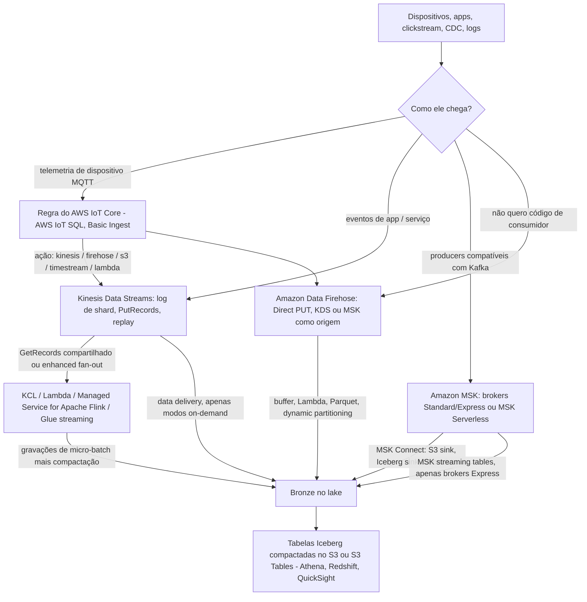
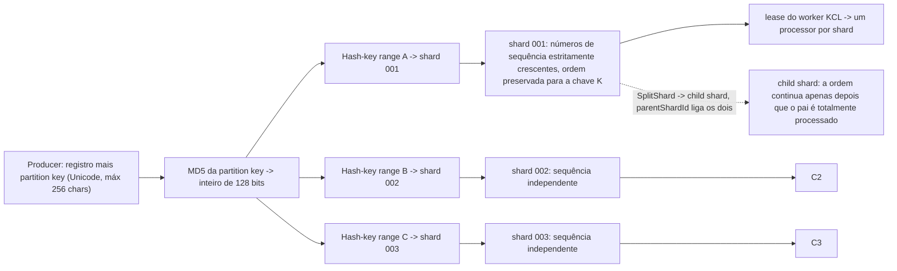
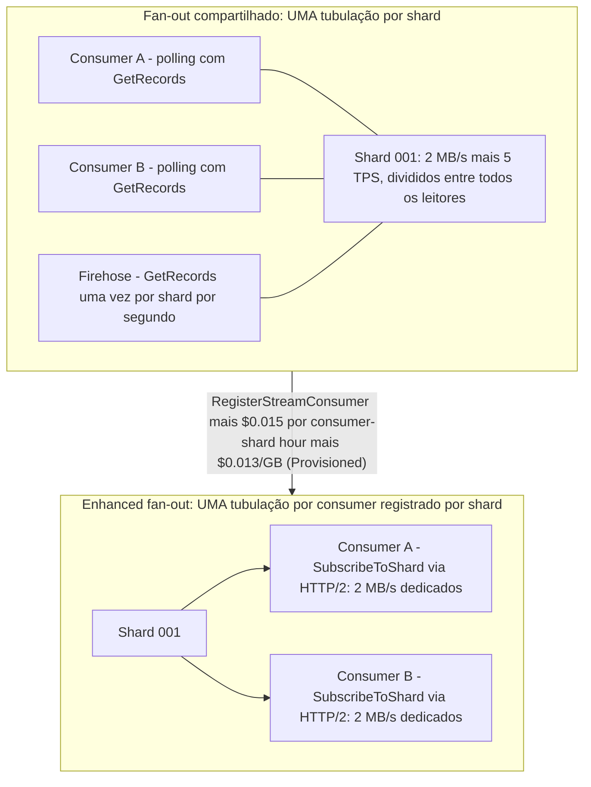
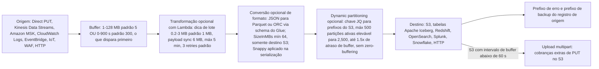
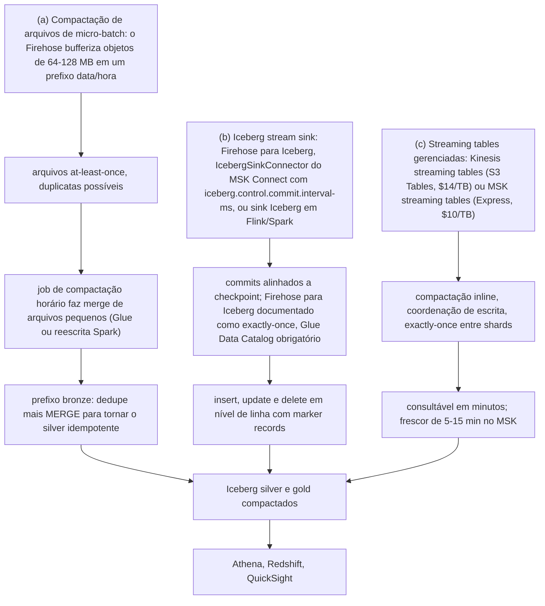
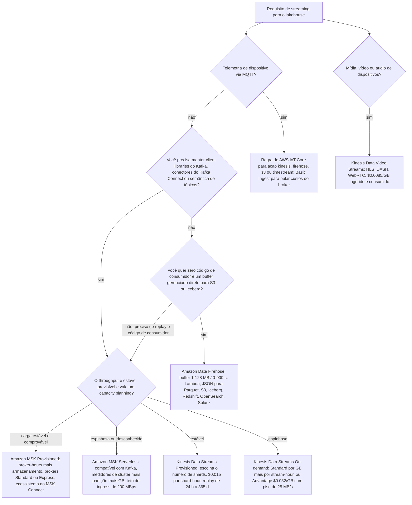

# Ingestão de Streaming: Kinesis, Amazon MSK e Landing de Streams no Lake

As lições 02 até 05 colocaram arquivos, formatos e tabelas no Amazon S3. Até aqui, tudo foi *movido* em lotes. Esta lição é sobre a outra metade da ingestão: **eventos que chegam continuamente e precisam pousar no lake sem perder a ordem, duplicar em silêncio ou custar discretamente mais do que a equipe de analytics recupera.** Ao final, você será capaz de dimensionar um stream do Kinesis a partir de um número de registros por segundo, explicar exatamente onde a ordenação termina, decidir quando uma hot key é um problema de partition key e não de capacidade, configurar um buffer do Firehose que dispara na condição certa e defender um landing bronze idempotente mesmo com o pipeline em at-least-once.

```text
==================================================================
 INGESTÃO DE STREAMING NO LAKEHOUSE — a superfície de decisão
                                     (em outubro de 2026)
==================================================================
 Kinesis Data Streams ....... log de eventos serverless, baseado em shard
   contrato de shard ......... 1 MB/s de escrita + 1,000 rec/s IN
                               2 MB/s de leitura + 5 TPS de leitura OUT
   modos de capacidade ....... Provisioned | On-demand Standard
                               | On-demand Advantage (piso de 25 MB/s)
   ordenação ................. por partition key, dentro de um shard
   fan-out ................... GetRecords compartilhado 2 MB/s OU
                               enhanced fan-out 2 MB/s DEDICADO
 Amazon Data Firehose ....... serviço de entrega, NÃO um processador
   buffers .................. 1-128 MB / 0-900 s (S3 padrão 5/300)
   opcional ................ Lambda transform -> JSON to Parquet
                               -> dynamic partitioning -> destino
   semântica ................. at-least-once no S3; exactly-once
                               apenas no destino Iceberg
 Amazon MSK ................. Apache Kafka gerenciado
   provisioned .............. brokers Standard + Express ($/broker-hr)
   MSK Serverless ........... $/cluster-hr + $/partition-hr + GB
   MSK Connect .............. Kafka Connect 2.7.1 / 3.7.x
   sinks .................... S3 sink, Iceberg sink, Firehose,
                               MSK streaming tables (só Express)
 AWS IoT Core ............... MQTT -> regra AWS IoT SQL -> ação
                               (kinesis, firehose, s3, timestream...)
 Landing .................... arquivos de micro-batch + compactação
                               | Iceberg stream sink + intervalo de commit
                               | streaming tables gerenciadas (inline)
 Balanço de semântica ....... at-least-once + MERGE idempotente
                               versus alegações documentadas de exactly-once
==================================================================
```

Nesta lição você vai:

- enunciar o **contrato de shard**, 1 MB/s de escrita e 1,000 registros/s de entrada, 2 MB/s de leitura e 5 transações de leitura/s de saída, por shard, nos *dois* modos de capacidade, e saber o que **não** mudou quando os registros passaram a 10 MiB;
- escolher entre **Provisioned, On-demand Standard e On-demand Advantage**, incluindo o piso de 25 MB/s em nível de conta que faz do Advantage a resposta errada em volume baixo;
- rastrear uma **partition key pelo MD5 até um intervalo de hash-key e um shard**, e explicar por que a ordenação é uma promessa por chave e não para o stream inteiro;
- detectar e corrigir uma **hot key** quando o auto-scaling do on-demand não pode te ajudar;
- dimensionar **fan-out compartilhado versus enhanced fan-out** e precificar a diferença;
- trabalhar com o **KPL** (collection, aggregation, rate limiting) e o **KCL** (leases, checkpoints, `parentShardId`), e saber a data de fim de suporte do KCL 1.x;
- configurar o **Amazon Data Firehose** de ponta a ponta: tamanho e intervalo de buffer, lotes de transformação com Lambda, conversão de JSON para Parquet contra um schema do Glue, limites do dynamic partitioning e prefixos de erro;
- pousar dados de streaming com os três **padrões de landing bronze** e acoplar o rótulo certo de semântica de entrega a cada seta;
- rodar o padrão **at-least-once para MERGE idempotente** que torna seguro promover bronze de arquivos puros;
- rotear **telemetria de dispositivos** pelas regras do AWS IoT Core e saber para que serve o Kinesis Data Video Streams;
- comparar **Amazon MSK provisionado, MSK Serverless, MSK Connect e MSK streaming tables**, com a aritmética de break-even entre broker e serverless;
- estudar **dois casos de clientes da AWS** (Cisco Webex no MSK, VMware Carbon Black no Kinesis) e uma **caixa de atualização de outubro de 2026 com fontes**;
- praticar com **12 questões no estilo de exame** mais quatro verificações interativas.

---

## 1. O mapa de serviços: cinco caminhos do evento para o lake

Todo design de streaming na AWS é uma composição das mesmas cinco peças. Confundi-las é o erro de arquitetura mais comum nesse espaço, porque duas delas *parecem* tubulações e apenas uma delas é um log que você pode dar replay.

| Peça | O que é | O que não é |
|---|---|---|
| **Amazon Kinesis Data Streams** | **Log de eventos** serverless e baseado em shard, com replay, ordenação por partition key e fan-out de consumidores | Não é motor de transformação; não tem janelas nem SQL |
| **Amazon Data Firehose** | **Pipeline de entrega** gerenciado: buffer, Lambda opcional, conversão de formato opcional, destino | Não é um log; você não dá replay em um stream do Firehose, e ele não faz windowing |
| **Amazon MSK** | **Apache Kafka gerenciado**: brokers Standard/Express provisionados ou MSK Serverless, mais Kafka Connect via MSK Connect | Não é serverless no sentido de "não pensar em capacidade": você ainda raciocina sobre partições, brokers e armazenamento |
| **AWS IoT Core** | **Ingress de dispositivos MQTT** com regras de AWS IoT SQL que fazem fan-out das mensagens para outros serviços | Não é camada de armazenamento; a ação da regra assume um papel do IAM e cobra o serviço *alvo* |
| **Amazon Managed Service for Apache Flink** | **Processamento stateful** com janelas em event-time, checkpoints e semântica de *processamento* exactly-once | Não é serviço de ingestão: ele lê streams e grava em sinks |



- **📚 Você sabia?** O nome Firehose na sua frente é cosmético, mas carrega peso para material mais antigo: a AWS renomeou **Amazon Kinesis Data Firehose** para **Amazon Data Firehose** em **9 de fevereiro de 2024**, e afirma que *"não há outras mudanças, incluindo endpoints do serviço, APIs, AWS Command Line Interface (AWS CLI), políticas de acesso do AWS Identity and Access Management (IAM) e métricas do Amazon CloudWatch"* (AWS What's New, 2024-02-09; histórico de documentos do Firehose, acesso em 2026-10). Então as ações de IAM continuam sendo `firehose:*`, e um blog antigo que fala "Kinesis Data Firehose" está descrevendo exatamente o mesmo serviço que você está configurando hoje.

```matching
{
  "question": "Correlacione cada componente de streaming com o papel que ele realmente desempenha em um design de ingestão de lakehouse (em out 2026):",
  "pairs": [
    {"left": "Amazon Kinesis Data Streams", "right": "Log de eventos serverless baseado em shard, com replay; 1 MB/s de escrita + 1,000 registros/s e 2 MB/s de leitura por shard; ordenação por partition key"},
    {"left": "Amazon Data Firehose", "right": "Pipeline de entrega gerenciado: buffer por tamanho ou intervalo, transformação opcional com Lambda, conversão opcional de JSON para Parquet, e depois S3 / Iceberg / Redshift / OpenSearch / Splunk"},
    {"left": "Amazon MSK", "right": "Apache Kafka gerenciado: brokers Standard e Express provisionados ou MSK Serverless, com Kafka Connect implantado pelo MSK Connect"},
    {"left": "AWS IoT Core", "right": "Ingress de dispositivos MQTT com regras de AWS IoT SQL cujas ações (kinesis, firehose, s3, timestream, lambda, sqs...) cada uma assume um papel do IAM"},
    {"left": "Amazon Managed Service for Apache Flink", "right": "Processamento de streams stateful com janelas em event-time e checkpoints; o substituto do Kinesis Data Analytics for SQL descontinuado"},
    {"left": "Amazon Kinesis Data Video Streams", "right": "Ingestão de mídia e binários serializados no tempo a partir de dispositivos conectados, com reprodução HLS/DASH e WebRTC"}
  ],
  "explanation": "Cada entrada é uma fronteira de capacidade: Kinesis Data Streams é o log com replay, Firehose é um pipeline de entrega que agrega e (opcionalmente) transforma, MSK é Kafka gerenciado com o ecossistema do Kafka Connect, IoT Core é ingress de MQTT mais fan-out por regras, Managed Service for Apache Flink é onde vivem as janelas, e Kinesis Video Streams carrega mídia e não registros. Os erros clássicos são tratar o Firehose como um log a que se pode dar replay, esperar que o Firehose faça janelas de tumbling (ele não faz; isso é Flink), ou escrever código de consumidor customizado quando só o Firehose já teria entregue os dados."
}
```

---

## 2. Kinesis Data Streams: o contrato de shard

### 2.1 Um número governa tudo

Uma **shard** é *"uma sequência de registros de dados identificada de forma única em um stream"* e *"uma unidade básica de throughput de um Kinesis data stream."* O contrato, idêntico nos modos de capacidade provisioned e on-demand, é:

```text
POR SHARD (ambos os modos de capacidade, em out 2026)
  ESCRITA ...... 1 MB/s  E  1,000 registros/s   (o que estourar primeiro)
  LEITURA ...... 2 MB/s  E  5 transações de leitura/s (2,000 registros/s)
  GetRecords ... até 10 MB e 10,000 registros por chamada; excesso -> throttle de 5 s
  REGISTRO ..... até 10 MiB (desde 2025-10-28); PutRecords <= 500 registros
                 e <= 10 MiB por requisição, partition keys incluídas
  RETENÇÃO ..... padrão 24 h; mínimo 24 h; máximo 8,760 h (365 dias)
```

Duas coisas são verdadeiras ao mesmo tempo e os alunos rotineiramente colapsam as duas em uma: **bytes e contagem de registros são limites independentes.** Um stream de registros de 400 bytes bate na parede de 1,000 registros/s com apenas 0.38 MB/s, então registros por segundo limita muito antes dos bytes. Em sentido inverso, registros de 2 KB a 1,000/s usam apenas 2 MB/s do orçamento de *leitura*, mas exatamente a taxa completa de *escrita* em registros.

A mudança de tamanho de registro de 2025 é a armadilha desta seção. Em **28 de outubro de 2025** a AWS elevou o tamanho máximo de registro *"até 10MiB, um aumento de dez vezes em relação ao limite anterior"* e dobrou o teto de requisição do `PutRecords` para 10 MiB, afirmando claramente que *"os limites de throughput individuais de shard de 1MiB/s para escritas e 2MiB/s para leituras permanecem inalterados"*, registros grandes *"expelem temporariamente até 10MiB/s, terminando por fazer média de 1MiB por segundo."* A AWS recomenda manter registros grandes em *"1-2% do seu total de registros para um desempenho ótimo."* A página de conceitos ainda carrega a frase antiga de que *"o data blob pode ter até 1 MB"* (acesso em 2026-10); a página de limites e o anúncio de outubro de 2025 são os fatos atuais.

- **📚 Você sabia?** `PutRecords` é deliberadamente **não atômico**: o AWS Big Data Blog registra que *"o PutRecords sempre retorna um resultado 200, mesmo que alguns registros dentro do lote tenham falhado"* e que *"uma falha de um único registro não interrompe o processamento dos registros seguintes."* Então um 200 OK do `PutRecords` significa *a requisição foi aceita*, não *o seu lote pousou*, você precisa inspecionar `FailedRecordCount` e os valores de `ErrorCode` por registro. Em um único host, um loop cru de `PutRecord` mediu cerca de 5,500 RPS com `PutRecords` em lote versus cerca de **76,000 RPS** pelo KPL, *"cerca de 800 vezes maior"* (AWS Big Data Blog, 2015-08-07).

### 2.2 Modos de capacidade: três formas, um contrato

| Modo | O que você escolhe | Forma de cobrança | Teto (em out 2026) |
|---|---|---|---|
| **Provisioned** | Número de shards; `UpdateShardCount` / split / merge | $0.015 por shard-hour (**$0.36/dia/shard**) + $0.014 por 1 milhão de unidades de payload PUT | Cota de shards da conta: **20,000** em `us-east-1`, `us-west-2`, `eu-west-1`; 1,000 ou 6,000 nas demais |
| **On-demand Standard** | Nada: ele se adapta | Cobrança horária por stream (o próprio exemplo da AWS implica **$0.040/stream-hour** em US-East) + **$0.08/GB in**, **$0.040/GB out** | Stream novo começa em **4 MB/s de escrita, 8 MB/s de leitura**; escala até **10 GB/s de escrita, 20 GB/s de leitura** em `us-east-1` / `us-west-2` / `eu-west-1`, **200/400 MB/s** em outras Regiões |
| **On-demand Advantage** | Um compromisso em nível de conta | **$0.032/GB in**, **$0.016/GB out**, sem cobrança horária por stream, **sem surcharge de enhanced fan-out** | Mínimo de **25 MB/s de ingestão e 25 MB/s de recuperação** na conta inteira; warm throughput até **10 GiB/s** |

Regras práticas que saem dessa tabela:

- **Você pode trocar de modo duas vezes a cada 24 horas por stream**: uma barreira de proteção, não um toggle livre. Projete a troca como um evento, não como um loop.
- **On-demand não é "sem limites."** Um stream on-demand novo começa em 4/8 MB/s, Regiões não principais estouram em 200/400 MB/s, e, o ponto importante, o on-demand *"se adapta automaticamente para lidar com padrões de distribuição de dados desiguais **a menos que uma única partition key exceda os limites de 1 MB/s de throughput e 1000 registros por segundo de uma shard**."*
- **Advantage é mais barato por GB, mas tem um piso.** O anúncio é explícito: a conta *"compromete-se a fazer streaming com pelo menos 25 MiB/s de ingestão de dados e 25 MiB/s de uso de recuperação de dados"*, em troca de dados ingeridos com preço **60% menor**, recuperação **60% menor**, recuperação de enhanced fan-out **68% menor** e retenção estendida **77% menor** (AWS Big Data Blog, 2025-11-03). Um stream de desenvolvimento de 0.5 MB/s vai pagar por 25 MB/s que não usa.

### 2.3 Retenção: da janela de replay para o arquivo de longo prazo

A retenção padrão é **24 horas**, e é o *mínimo*; `IncreaseStreamRetentionPeriod` aceita até **8,760 horas (365 dias)**. Três faixas de custo ficam atrás desse controle:

| Janela de retenção | O que custa (Provisioned, US-East) |
|---|---|
| 24 h (padrão) | Inclusa na hora de shard |
| 24 h a 7 dias (estendida) | **+$0.020 por shard-hour** |
| 7 a 365 dias (longo prazo) | **$0.023/GB-mês** de armazenamento + **$0.021/GB** recuperados pelo consumidor padrão `GetRecords` |

Replay é o motivo de a retenção existir: o Kinesis *"fornece a ordenação de registros, bem como a capacidade de ler e/ou repetir os registros na mesma ordem para múltiplas Amazon Kinesis Applications."* Uma janela de 24 horas significa que um bug de consumidor descoberto às 09:00 pode ser corrigido e reprocessado a partir das 09:00 do dia anterior, e nada mais do que isso. Se o seu landing bronze-no-S3 é a cópia durável (lição 05), a retenção do stream é um orçamento de *reprocessamento*, não a sua estratégia de backup.

---

## 3. Partition keys, ordenação e shards quentes

### 3.1 O caminho que um registro realmente percorre

O producer fornece uma **partition key**: *"Partition keys são strings Unicode, com um limite máximo de comprimento de 256 caracteres para cada chave."* A AWS então usa *"uma função hash MD5 … para mapear partition keys para valores inteiros de 128 bits e para mapear os registros de dados associados para shards usando os hash key ranges das shards."* Todos os registros que compartilham uma chave caem na mesma shard, e é por isso que *"a Kinesis Client Library (KCL) entrega todos os registros de uma dada partition key para o mesmo record processor."*



Ordenação, enunciada com precisão, tem exatamente três escopos e nenhum a mais:

1. **Dentro de uma shard**: *"os registros que o Kinesis Data Streams recebe por uma chamada `GetRecords` são estritamente ordenados por número de sequência."*
2. **Dentro de uma partition key**: a chave sempre mapeia para uma shard, então a ordem local à chave sobrevive.
3. **Mesmo cliente, mesma chave, opt-in**: `SequenceNumberForOrdering` *"garante números de sequência estritamente crescentes, para puts do mesmo cliente e para a mesma partition key … Se este parâmetro não for definido, os registros são ordenados de forma grosseira com base no tempo de chegada."*

Não existe **ordem para o stream inteiro**, e o `PutRecords` nem ordena dentro do próprio lote. Se o seu `MERGE` downstream assume uma sequência global, você projetou uma garantia que o serviço não oferece.

### 3.2 Exemplo resolvido E1, registros/s limita primeiro: dimensionamento e custo

**Cenário (em out 2026):** 2,500 registros/s com média de 400 bytes, contínuo 24x7, US East (N. Virginia).

```text
E1  NÚMERO DE SHARDS + CUSTO MENSAL (31 dias = 744 horas)
--------------------------------------------------------------------
Passo 1 - bytes/s ....... 2,500 x 400 B = 1,000,000 B/s
                          = 1,000,000 / 1,048,576 = 0.954 MB/s
                          0.954 MB/s < 1 MB/s  -> 1 shard bastaria
Passo 2 - registros/s ... 2,500 / 1,000 = 2.5  -> arredonda PARA CIMA
                          para 3 shards
                          RESTRIÇÃO LIMITANTE = registros por segundo
Passo 3 - Provisioned ... 3 x $0.015 x 744 = $33.48 shard-hours
         unidades PUT ... 400 B -> 1 payload unit por registro
                          2,500 x 86,400 x 31 = 6,696,000,000 unidades
                          / 1,000,000 x $0.014 = $93.74
         TOTAL .......... $33.48 + $93.74 = $127.22 / mês
Passo 4 - On-demand Standard (mesmo workload)
         400 B arredonda PARA CIMA para 1 KB -> 2,500 KB/s ingeridos
         2,500 x 86,400 x 30 / 1,048,576 = 6,180 GB / mês
         dados in ....... 6,180 x $0.080 = $494.40
         dados out ...... 6,180 x $0.040 = $247.20
         horas de stream  744 x $0.040   =  $29.76
         TOTAL .......... $771.36 / mês
--------------------------------------------------------------------
Veredito: provisioned é ~6x mais barato ($127 vs $771) para um perfil
plano; on-demand compra a saída da matemática de shard para tráfego
espinhoso ou desconhecido. Escolha pela variância, não pela média.
```

Note as duas regras de arredondamento que deixam as faturas de streaming surpreendentes: o data-in do Kinesis arredonda **cada registro para cima até 1 KB** (*"se os seus registros de dados têm 4.5 KB cada, o Kinesis Data Streams vai contar cada registro como 5 KB"*), enquanto o medidor PUT provisionado cobra em **unidades de payload de 25 KB**. Um pipeline de registros de 900 bytes é cobrado como 1 KB por registro em on-demand e como uma unidade por registro em provisioned, e são os registros por segundo que dimensionam as suas shards de qualquer forma.

```plot
{
  "type": "bar",
  "title": "E1: mesmo workload plano, dois modos de capacidade (US-East, 31 dias, em out 2026)",
  "xLabel": "Modo de capacidade",
  "yLabel": "Custo mensal (USD)",
  "xKey": "mode",
  "data": [
    {"mode": "Provisioned: 3 shards + PUT units", "usd_per_month": 127.22},
    {"mode": "On-demand Standard: 6,180 GB in/out", "usd_per_month": 771.36}
  ]
}
```

### 3.3 Exemplo resolvido E2: a hot key que o auto-scaling não conserta

**Cenário:** uma única chave `tenant_id = acme` envia 1,500 registros/s de 80 bytes.

```text
E2  DETECÇÃO DE HOT KEY
--------------------------------------------------------------------
Bytes ......... 1,500 x 80 B = 120,000 B/s = 0.114 MB/s
                0.114 MB/s << 1 MB/s           -> bytes estão OK
Registros ..... 1,500 rec/s > 1,000 rec/s      -> LIMITE EXCEDIDO
Resultado ..... WriteProvisionedThroughputExceeded NAQUELE shard
                enquanto shards vizinhos ficam ociosos. Isso é
                verdade até no modo on-demand: o auto-scaling
                adiciona shards, mas uma chave ainda faz hash
                para exatamente uma shard.
Correções .....
  (a) mudar o esquema de chave: acme:<event_id> ou acme:<uuid>
      -> distribui entre as shards; você abre mão da ordenação
         por tenant
  (b) manter a ordenação, SplitShard, aceitar o custo
  (c) agregar no producer (KPL) - ver E4
```

Os próprios remédios da AWS: *"use a operação de split-shard … Se a localidade ou a ordenação baseada na partition key atual não for necessária, mude o esquema da partition key para aumentar a distribuição dela. Se a aplicação producer estiver excedendo o limite de throughput de uma shard devido a uma única partition key (problema de hot key), mude o esquema da partition key."* Producers avançados podem contornar o mapeamento MD5 com `ExplicitHashKey` para posicionar uma chave deliberadamente: útil para drenar uma shard quente, perigoso se você usá-lo para maquiar um design de chave que deveria mudar.

```fillblank
{
  "question": "Complete a aritmética de dimensionamento de shard para 2,500 registros/s de 400 bytes cada (exemplo resolvido E1, em out 2026):",
  "template": "Bytes por segundo = {{1}} x 400 B = 1,000,000 B/s = 0.954 MB/s, abaixo do teto de escrita de 1 MB/s. Registros por segundo: {{1}} / 1,000 = 2.5, então o stream precisa de {{2}} shards. Custo Provisioned para 31 dias = {{2}} x $0.015 x 744 = {{3}}.",
  "answers": {
    "1": "2,500",
    "2": "3",
    "3": "$33.48"
  },
  "distractors": ["1", "2", "4", "10", "$44.64", "$11.16", "2.5", "1,000"],
  "explanation": "As duas restrições são avaliadas de forma independente e você sempre leva o maior número de shards: 0.954 MB/s caberia em uma shard em bytes, mas 2,500 registros/s divididos pelo teto de 1,000 registros/s dão 2.5, que arredonda para cima para 3 shards. 3 x $0.015 x 744 = $33.48 de horas de shard em um mês de 31 dias; os $93.74 de unidades de payload PUT em E1 são um medidor separado. $44.64 é o custo de enhanced fan-out para 4 shards x 1 consumer em E3, $11.16 é uma shard por 744 horas, e 2.5 é a resposta sem arredondamento que subdimensionaria o stream."
}
```

- **📚 Você sabia?** Uma heurística útil de produção vem da plataforma de fraude da Chime Financial: o texto da AWS sobre a stack de streaming deles observa *"chegamos a um mapeamento 1:1 entre Kinesis Shard e núcleo de vCPU"* enquanto ingeriam *"mais de 1 milhão de eventos por segundo"* com latência de ponta a ponta *"menos de 15 segundos"* (AWS Big Data Blog, 2023-09-19). Trate como a regra de bolso de dimensionamento de workers de um único time para uma frota de KCL, não como uma cota de serviço: a contagem de workers ainda precisa ser no mínimo igual à contagem de shards para paralelismo, e todo lease vive no DynamoDB.

---

## 4. Fan-out: leituras compartilhadas versus enhanced fan-out

Um stream só é útil se vários consumidores conseguem lê-lo. O Kinesis dá você dois mecanismos com economias genuinamente diferentes.

| | **Fan-out compartilhado** (`GetRecords`) | **Enhanced fan-out** (`SubscribeToShard`) |
|---|---|---|
| Throughput | **2 MB/s e 5 TPS por shard, compartilhados** por todos os consumidores | **2 MB/s por shard, dedicados** a cada consumidor registrado |
| Modelo | Pull via HTTP; você faz polling | Push via HTTP/2; o serviço entrega |
| Registro | Nenhum | `RegisterStreamConsumer`, depois `SubscribeToShard` |
| Sessão | O seu loop | A conexão vive **até 5 minutos**, depois re-subscribe; **1 chamada/s por consumer por shard** |
| Custo (Provisioned) | Incluso | **$0.015 por consumer-shard hour** + **$0.013/GB** recuperado |
| Limite de consumidores | Sem limite | **50** consumidores registrados (On-demand Advantage), **20** caso contrário |
| KCL | Caminho `GetRecords` | KCL **2.0+ habilita automaticamente** |

A frase da FAQ que importa: *"Os consumidores de fan-out compartilhado todos compartilham os 2 MB/s de throughput de leitura e o limite de cinco transações por segundo de uma shard … Um consumidor de enhanced fan-out recebe sua própria cota de 2 MB/s de throughput de leitura."* Adicione um segundo consumidor em polling e a taxa efetiva de leitura de cada um cai pela metade, o sintoma clássico de produção em que "adicionar um consumidor deixou tudo mais lento."

### 4.1 Exemplo resolvido E3: dimensionamento de fan-out e a conta do EFO

**Cenário:** um stream de 4 shards com três leitores: (a) um poller de Lambda usando o caminho compartilhado, (b) uma aplicação Flink que precisa de baixa latência, (c) o Firehose lendo do Kinesis Data Streams.

```text
E3  FAN-OUT (4 shards, 3 consumers, Provisioned, 744 h)
--------------------------------------------------------------------
Pool compartilhado . 4 shards x 2 MB/s = 8 MB/s TOTAL, compartilhado
                     4 shards x 5 TPS  = 20 TPS de leitura TOTAL
Firehose ............ faz polling do GetRecords uma vez por shard por
                     segundo, então é um inquilino permanente do pool
App Flink ........... precisa se registrar no enhanced fan-out, senão
                     compete com o Firehose pelos mesmos 8 MB/s
Custo EFO ........... 4 shards x 1 consumer x $0.015 x 744 h
                     = $44.64 / mês
                   + $0.013 por GB realmente recuperado
On-demand Advantage -> o mesmo EFO NÃO tem surcharge consumer-shard
```

O comportamento na própria FAQ do Firehose é o que força a decisão: *"O Firehose chama o GetRecords() do Kinesis Data Streams uma vez a cada segundo para cada shard do Kinesis."* Se o Firehose é o seu sink, assuma que o pool compartilhado já está falado.



---

## 5. Producers e consumers: KPL, KCL e a tabela de lease

### 5.1 KPL: collection, aggregation, rate limiting

A **Kinesis Producer Library** roda como *"um processo separado, e comunica-se com o seu processo pai de usuário via IPC"*, e faz quatro trabalhos: retries automáticos, **collection** (agrupar muitos registros em requisições `PutRecords`), **aggregation** (empacotar muitos registros de usuário em *um* registro do Kinesis) e rate limiting por shard com um token bucket *"por padrão … definido 50 por cento acima do limite real da shard."* Ela também publica métricas do CloudWatch em seu nome e adiciona latência até `RecordMaxBufferedTime`.

**Exemplo resolvido E4, o aggregation derrota o teto de registros/s.**

```text
E4  AGGREGATION DO KPL vs PutRecords CRU (1 shard)
--------------------------------------------------------------------
Entrada ......... 1,000 registros de usuário/s, 512 B cada = 512 KB/s
Caminho cru ..... 1,000 registros Kinesis/s -> exatamente no teto
                  de 1,000 registros/s da shard (sem folga)
                  bytes usados: 512 KB/s de um orçamento de 1 MB/s
Agregado ........ empacota 1,000 x 512 B em 10 x 50 KB de registros
                  registros Kinesis/s: 1,000 -> 10  (folga de 100x)
                  bytes inalterados: 512 KB/s
Ambos caminhos .. limites de bytes idênticos; só o contador de
                  REGISTROS se move. É por isso que registros
                  pequenos são o caso para o qual existe o
                  aggregation do KPL.
```

O exemplo da própria AWS bate: *"Com o aggregation do KPL, você pode empacotar 1,000 registros em apenas 10 registros do Kinesis Data Streams, reduzindo o RPS para 10 (a 50 KB cada)"*, e *"O limite de registros por segundo do Kinesis Data Streams é o que limita clientes com registros menores que 1 KB."*

Portabilidade é o imposto. Pela matriz de uso da AWS, um producer em qualquer linguagem diferente de Java **não pode usar o KPL**, e um producer Java do KPL alimentando um consumer não-Java **precisa desabilitar o aggregation**: caso contrário o consumer tem que desagregar registros que nunca esperou. `PutRecords` cru é portável; o batching, o tratamento de falha parcial, os retries e o backoff são seus.

### 5.2 KCL: leases, checkpoints e `parentShardId`

A **Kinesis Client Library** é compilada no seu consumer e te dá:

- **Leases**: *"Cada shard é vinculada a apenas um worker por um lease em qualquer momento dado"*, rastreado em uma **tabela de lease** do DynamoDB. O KCL 3.x cria três tabelas por padrão (lease, métricas de worker, estado do coordinator); **a partir do KCL 3.5 o formato de tabela única consolida todos os metadados na tabela de lease**.
- **Checkpointing**: *"o processo de armazenar persistentemente a posição do último registro processado com sucesso em uma shard"*, armazenado nessa tabela de lease. Reinicie a partir do checkpoint, não a partir de "agora".
- **`parentShardId`**: *"Usado para garantir que a shard pai seja totalmente processada antes que o processamento comece nas shards filhas. Isso garante que os registros sejam processados na mesma ordem em que foram colocados no stream."* Este é o único mecanismo que mantém a ordenação através de um evento de reshard.

Duas datas importam aqui. **O KCL 1.x chegou ao fim de suporte em 30 de janeiro de 2026**, e a orientação da AWS é *"migrar as suas aplicações KCL usando a versão 1.x para a versão mais recente do KCL"*: nesta lição essa data já passou, então qualquer consumer 1.x está rodando com tempo emprestado. E o KCL não é infraestrutura de graça: as tabelas do DynamoDB (capacidade on-demand recomendada) e as métricas do CloudWatch acompanham, e worker count ≥ shard count é um requisito de paralelismo, não uma preferência de tuning.

> [!WARNING]
> ⚠️ **Quatro afirmações de streaming que são falsas como estão escritas:**
> - **"O modo on-demand conserta hot keys."** Não conserta. Uma única partition key ainda não pode exceder **1 MB/s ou 1,000 registros/s**: essa é a definição de hot key, e ela vale em todos os modos de capacidade.
> - **"A ordenação é para o stream inteiro."** A ordenação vale **por partition key, dentro de uma shard.** `PutRecords` não ordena o próprio lote, e `SequenceNumberForOrdering` só ordena writes de mesma chave vindos do mesmo cliente.
> - **"O segundo consumidor cortou nossas leituras pela metade, então compre mais shards."** Com `GetRecords` compartilhado a correção é **enhanced fan-out** (ou um só consumidor), não shards, e o Firehose já está fazendo polling do pool compartilhado uma vez por shard por segundo.
> - **"O Firehose faz janelas de tumbling."** Nenhuma página de documentação do Firehose descreve windowing de qualquer tipo; janelas de tumbling, sliding e em event-time são uma feature do **Managed Service for Apache Flink.** A antiga casa do `TUMBLE()`, o Kinesis Data Analytics for SQL, parou de aceitar novas aplicações em **15 de outubro de 2025** e foi excluído a partir de **27 de janeiro de 2026**.

---

## 6. Amazon Data Firehose: um serviço de entrega, não um processador

### 6.1 O pipeline, etapa por etapa

O Firehose é *"um serviço totalmente gerenciado para entregar dados de streaming em tempo real para destinos como o Amazon Simple Storage Service (Amazon S3), Amazon Redshift, Amazon OpenSearch Service, Amazon OpenSearch Serverless, Splunk, Apache Iceberg Tables e qualquer endpoint HTTP customizado."* Suas etapas, em ordem:

1. **Origem**: Direct PUT, Kinesis Data Streams, Amazon MSK, CloudWatch Logs, EventBridge, IoT, WAF, Network Firewall, HTTP.
2. **Buffer**: *"o Amazon Data Firehose armazena em buffer os dados de streaming recebidos até um certo tamanho ou por um certo período de tempo antes de entregá-los aos destinos"*; a condição que for atendida primeiro dispara a entrega.
3. **Transformação com Lambda (opcional)**: invoke por lote, payload limitado a **6 MB** síncrono, invocação de até **5 minutos**, **3 retries** por padrão (configurável de 0 a 300).
4. **Conversão de formato de registro (opcional)**: JSON para **Parquet ou ORC** usando um schema no **AWS Glue Data Catalog** (deserializer, schema, serializer).
5. **Dynamic partitioning (opcional)**: chaveamento por JQ em prefixos do S3, até **500 partições ativas** (elevável para 2,500).
6. **Destino**, S3, tabelas Iceberg, Redshift (via S3 + `COPY`), OpenSearch, Splunk, Snowflake, HTTP, mais prefixos de erro e de backup.



### 6.2 Exemplo resolvido E5: qual condição de buffer dispara primeiro

**Dicas de buffering para um destino S3: tamanho 1 to 128 MB (padrão 5), intervalo 0 to 900 s (padrão 300).**

```text
E5  DIMENSIONAMENTO DE BUFFER (em out 2026)
--------------------------------------------------------------------
Caso A - ingestão sustentada de 6 MB/s, tamanho de buffer = 64 MB
  tempo p/ encher ... 64 MB / 6 MB/s = 10.7 s
  vs intervalo ...... 10.7 s << 300 s  -> TAMANHO dispara primeiro
  objetos/minuto .... 60 / 10.7 = 5.6
  objetos/hora ...... ~336      objetos/dia ~ 8,064 x 64 MB
  volume diário ..... ~512 GB -> 8,064 objetos é um landing saudável,
                                 compactável (lição 04)
Caso B - ingestão sustentada de 0.1 MB/s, tamanho de buffer = 5 MB (padrão)
  tempo p/ encher ... 5 / 0.1 = 50 s
  vs intervalo ...... 50 s << 300 s  -> ainda tamanho, mas os objetos
                                 têm ~5 MB: território de arquivos
                                 pequenos
  tempo até 300 s ... 0.1 x 300 = 30 MB de objetos se você subir o
                      aviso de tamanho acima de 30 MB
Regra de bolso (docs da API da AWS) ...
  "defina este parâmetro em um valor maior que a quantidade
   de dados que você normalmente ingere no stream do Firehose
   em 10 segundos. Por exemplo, se você normalmente ingere
   dados a 1 MiB/s, o valor deve ser 10 MiB ou mais."
  -> 6 MB/s x 10 s = 60 MB, então 64 MB é a escolha certa.
```

Três modificadores mudam a aritmética:

- **A conversão de formato sobe o piso.** Com a conversão habilitada você *"não pode definir `SizeInMBs` em um valor menor que 64"*, e *"O valor passa a ser 128 quando você a habilita."*
- **O dynamic partitioning custa latência.** *"O Firehose usa buffering multi-stage internamente. Portanto, o atraso de ponta a ponta de um lote de registros pode ser 1.5 vezes o tempo de dica de buffering configurado"*, e o zero buffering não está disponível com a feature.
- **Buffering abaixo de 60 segundos muda a fatura do S3.** *"O Firehose usa upload multipart para o destino S3 quando você configura um intervalo de tempo de buffer menor que 60 segundos … você verá algum aumento nos custos de API `PUT` do S3."*

> [!IMPORTANT]
> ⚠️ **A conversão de formato é uma feature estreita com quatro paredes duras.** A entrada precisa ser **JSON** (pré-converta CSV com Lambda); o destino precisa ser **Amazon S3**: *"Se você habilitar a conversão de formato de registro, não pode definir o destino do Amazon Data Firehose como Amazon OpenSearch Service, Amazon Redshift ou Splunk. Com a conversão de formato habilitada, o Amazon S3 é o único destino"*; o schema precisa existir no **Glue Data Catalog**; e `CompressionFormat` precisa estar definido como **`UNCOMPRESSED`** porque *"a compressão Snappy acontece automaticamente como parte do processo de conversão."* O limite prático de linha é de **32 MB**, e a conversão é cobrada a **$0.018 por GB convertido.** Qualquer coisa que afirme "o Firehose converte CSV para Parquet diretamente" está descrevendo uma feature que não existe.

- **📚 Você sabia?** A página de cotas do Firehose contém discretamente o argumento de escala para o Kinesis como origem: o Direct PUT no Firehose é limitado (em `us-east-1`/`us-west-2`/`eu-west-1`) a *"500,000 registros/segundo, 2,000 requisições/segundo e 5 MiB/segundo"*, mas *"Quando o Kinesis Data Streams é configurado como a origem dos dados, esta cota não se aplica, e o Amazon Data Firehose escala para cima e para baixo sem limite."* E como o Firehose lê *"uma vez a cada segundo para cada shard do Kinesis"*, os dois serviços compartilham o seu dimensionamento de shards: mais shards significam mais leituras paralelas do Firehose, não apenas mais capacidade de escrita.

---

## 7. Landing no lake com o Firehose

### 7.1 O que o Firehose realmente promete

A semântica de entrega difere por destino, e esta é a área mais citada fora de contexto em toda a lição:

| Caminho | Semântica documentada |
|---|---|
| Firehose para S3 / Redshift / OpenSearch / Splunk | **At-least-once.** *"O Amazon Data Firehose usa semântica de pelo menos uma vez para a entrega de dados. Em circunstâncias raras, como timeout de requisição durante a tentativa de entrega, a nova tentativa de entrega do Firehose pode introduzir duplicatas se a requisição anterior acabar passando."* |
| Firehose para **tabelas Apache Iceberg** | **Exactly-once.** *"O Firehose garante entrega exactly-once para tabelas Iceberg"* e *"aplica automaticamente operações de insert, update e delete"*, exigindo o AWS Glue Data Catalog (AWS Prescriptive Guidance, acesso em 2026-10) |
| Streaming tables do Kinesis para S3 Tables | *"coordenação de escrita e semântica de entrega exactly-once em todas as shards do seu stream"* (AWS Big Data Blog, 2026-08-31) |
| Managed Service for Apache Flink | Semântica de *processamento* exactly-once com checkpoints |

A consequência de projeto: **qualquer coisa que pouse como arquivos puros em um prefixo bronze é at-least-once.** Duplicatas não são um bug que você configura para longe: elas são o contrato. Você torna a *tabela* correta downstream (Seção 9.3), não a entrega perfeita.

### 7.2 Exemplo resolvido E6: uma fatura do Firehose para um landing JSON to Parquet no lake

**Cenário:** 100 registros/s x 3 KB, JSON convertido para Parquet, entregue no S3, US East (N. Virginia), 30 dias.

```text
E6  FATURA MENSAL DO FIREHOSE (em out 2026)
--------------------------------------------------------------------
Tamanho faturado . 3 KB arredonda PARA CIMA para 5 KB
Volume ............ (100 reg/s x 5 KB) / 1,048,576
                    x 86,400 s x 30 d = 1,235.96 GB
1. Ingestão ....... 1,235.96 x $0.029   =  $35.84
                    (origem Direct PUT / Kinesis Data Streams,
                     primeiro tier de 500 TB)
2. Conversão de formato 1,235.96 x $0.018   =  $22.25
                    (JSON para Parquet, por GB convertido)
3. Dynamic partitioning (uso da feature no formato do exemplo da AWS)
   GB processados .   741.58 x $0.020   =  $14.83
   objetos S3 ..... 11,866 / 1,000 x $0.005 = $0.06
                    (mais $0.07 por hora de processamento JQ se usado)
--------------------------------------------------------------------
TOTAL .............. = $72.98 / mês
```

O ponto didático é a forma da fatura, não os centavos: **a ingestão é a alavanca menor quando você liga features.** Conversão e dynamic partitioning juntos mais que dobram os $35.84 base, e cada um deles é uma *feature que você escolheu* em troca de Parquet consultável em prefixos particionados em vez de um monte de JSON. Note também as taxas dependentes da origem: uma **origem Kinesis Data Streams** cobra **$0.029/GB**, uma **origem Amazon MSK** cobra **$0.055/GB** sem arredondamento de 5 KB, logs cedidos **$0.13/GB**, um **destino Iceberg** (origem Kinesis) **$0.045/GB**, e entrega por VPC **$0.01/GB mais $0.01 por AZ-hour**.

### 7.3 Data delivery do Kinesis e streaming tables (sem Firehose)

Em outubro de 2026 um stream do Kinesis pode pousar no lake **sem** o Firehose. O data delivery suporta *"dois tipos de destino: streaming tables em Apache Iceberg e buckets Amazon S3 de propósito geral"*, com *"compactação inteligente embutida [que] elimina a proliferação de arquivos pequenos."* Requisitos e preços:

| Destino | Requisito | Preço (em out 2026) |
|---|---|---|
| **S3** de propósito geral | Apenas modo de capacidade on-demand | **$0.011/GB** (On-demand Advantage), **$0.0275/GB** (Standard) |
| **Streaming tables** (Iceberg em S3 Tables) | Apenas modo de capacidade on-demand | **$0.014/GB** (Advantage), **$0.035/GB** (Standard); o blog da AWS afirma **$14/TB** para S3 Tables e **$11/TB** para S3 |

Resultados declarados pela AWS para as streaming tables: *"reduzir custos de data delivery para S3 Tables em até 50% em comparação com alternativas autogerenciadas e reduzir custos de consulta downstream em até 30% por meio da compactação inteligente embutida"*, com os dados *"consultáveis em minutos após serem publicados no seu stream."* O modo provisionado não suporta data delivery nem streaming tables: um fato que tira o modo provisionado da consideração para este padrão.

---

## 8. Regras do AWS IoT Core e Kinesis Data Video Streams

### 8.1 MQTT, regra, ação, lake

O AWS IoT Core é o ingress de telemetria de dispositivos. Uma **regra** avalia uma mensagem MQTT com **AWS IoT SQL** e invoca uma ou mais **ações**. A lista documentada de ações inclui `kinesis` (Kinesis Data Streams), `firehose`, `s3`, `timestream`, `lambda`, `sqs`, `sns`, `dynamodb`, `kafka` (Apache Kafka), `stepFunctions`, `openSearch`, `republish`, `cloudWatch`, `location`, `influxDB` e `iotSiteWise`.

A ação do Kinesis leva três parâmetros que você precisa acertar: o `stream`, a `partitionKey`, *"geralmente composta por uma expressão (por exemplo, `${topic()}` ou `${timestamp()}`)"*, e o `roleArn`, *"Um papel do IAM que o AWS IoT pode assumir para executar a operação `kinesis:PutRecord`."* Escolher `${topic()}` significa que todas as mensagens de um mesmo tópico MQTT fazem hash para uma shard: elegante para ordenação, um gerador de hot key em volume. Escolher uma chave no nível do dispositivo ou do evento espalha a carga e derruba a ordenação por tópico.

Um controle de custo vale decorar: *"Você também pode usar o recurso Basic Ingest para enviar com segurança os dados dos dispositivos para os serviços AWS listados anteriormente, sem incorrer em custos de mensageria. O recurso Basic Ingest otimiza o fluxo de dados removendo o broker de mensagens publish/subscribe do caminho de ingestão."* Se os dados nunca precisam de fan-out por MQTT, não pague pelo salto do broker.

### 8.2 Kinesis Data Video Streams: a faixa de mídia, em resumo

O **Amazon Kinesis Video Streams** carrega *"mídia de dispositivos conectados para a AWS, para armazenamento, análise, machine learning (ML), reprodução e outros processamentos"*, com reprodução gerenciada **HLS** e **DASH**, **WebRTC** para streaming bidirecional de latência ultra-baixa, e integrações com Rekognition Video e SageMaker. É a resposta certa para câmeras, áudio e binários serializados no tempo: não para registros de eventos em JSON.

Preços em US East (em out 2026): **$0.0085/GB ingerido**, **$0.0085/GB consumido** (consumo HLS **$0.0119/GB**), armazenamento **$0.023/GB-mês** no tier quente; o WebRTC acrescenta **$0.03 por mês** por canal de sinalização ativo, **$2.25 por milhão** de mensagens de sinalização e **$0.12 por mil** de minutos de streaming TURN. Um **warm storage tier** (feature datada de **26 de novembro de 2025**) oferece ingestão a **$0.0100 por 1,000 fragmentos persistidos** e armazenamento a **$0.0125/GB-mês** com **retenção mínima de 30 dias**, o equivalente em vídeo ao ajuste de retenção de streams do Kinesis.

- **📚 Você sabia?** A regra de IoT mais barata costuma ser a que você apaga. Regras com curingas podem casar com a maioria das mensagens, e cada ação assume um papel do IAM e cobra o serviço *alvo*, então uma única regra ampla fazendo fan-out para Kinesis *e* Firehose *e* S3 são três faturas para uma mensagem. Projete o SQL da regra com a mesma estreiteza com que você projetaria um índice de banco de dados, e recurra ao Basic Ingest quando o broker não acrescenta nada.

---

## 9. Amazon MSK: Kafka gerenciado e como sair do stream para a tabela

### 9.1 Provisioned versus Serverless

| | **MSK Provisioned** | **MSK Serverless** |
|---|---|---|
| Unidade de capacidade | Brokers (`kafka.m7g.large` recomendado para produção; M7g usa Graviton) | Cluster + partições, com auto-scaling |
| Cobrança | Broker-hours + armazenamento GB-mês: **pago mesmo ocioso** | Cluster-hour + partition-hour + GB in/out + armazenamento GB-mês |
| Exemplo publicado (31 dias) | 2,232 broker-hours x $0.204 = **$455.33** + 1,516.13 GB-months x $0.10 = **$151.61** = **$606.94** | 744 h x $0.75 = $558 + 74,400 partition-hours x $0.0015 = $111.60 + 3,100 GB x $0.10 = $310 + 6,200 GB x $0.05 = $310 + $10 storage = **$1,299.60** |
| Cotas | Tipos de broker Standard e **Express** | **200 MBps de ingress / 400 MBps de egress** por cluster; **5/10 MBps por partição**; mensagem máxima de **8 MiB**; **2,400** partições líder (**120** compactadas); **500** consumer groups; **10** clusters por conta; **5** VPCs de cliente por cluster |
| Streaming tables | **Apenas brokers Express**: *"Brokers Standard e Amazon MSK Serverless não são suportados"* | Não suportado |

A própria orientação da AWS sobre tamanho de broker: *"Brokers M7g usam processadores AWS Graviton … Brokers M7g oferecem melhor desempenho por preço em relação a instâncias M5 comparáveis"* e *"Brokers M7g e M5 são recomendados para cargas de trabalho de produção."* A lógica de break-even é o exercício: **o provisioned tem um piso fixo** (horas equivalentes a três brokers, mais armazenamento que você pague chegue tráfego ou não), enquanto **o serverless mede partições e bytes**, então um stream contínuo de alto volume pode custar mais no Serverless do que em brokers provisionados, e o teto de ingress de 200 MBps é uma parada dura, não um aviso.

**Exemplo resolvido E8: a forma do break-even (exemplos publicados pela AWS, em out 2026).**

```text
E8  MSK PROVISIONED vs SERVERLESS (formatos de exemplo publicados)
--------------------------------------------------------------------
Provisioned ....... $455.33 broker-hours + $151.61 storage
                    = $606.94 / mês
Serverless ........ $558.00 cluster-hours
                  + $111.60 partition-hours (74,400 x $0.0015)
                  + $310.00 dados in   (3,100 GB x $0.10)
                  + $310.00 dados out  (6,200 GB x $0.05)
                  +  $10.00 storage
                    = $1,299.60 / mês
Lógica crossover .. piso fixo de broker vs medidores por partição/byte
                    + brokers Express (medidor próprio de ingestão
                      por GB) + capacidade do MSK Connect que você deploya
Leitura ........... $606.94 são 3 brokers x 744 h que você paga
                    mesmo com tráfego zero; $1,299.60 é um medidor
                    que segue a carga, mas não pode exceder 200 MBps
                    de entrada.
```

### 9.2 MSK Connect e sinks de stream para o lake

O **MSK Connect** *"facilita que desenvolvedores façam streaming de dados para dentro e para fora dos seus clusters Apache Kafka … usa as versões 2.7.1 ou 3.7.x do Kafka Connect"*, pode *"implantar conectores desenvolvidos por terceiros como o Debezium … ou implantar um conector existente sem mudanças de código"*, e *"Conectores escalam automaticamente para se ajustar às mudanças de carga e você paga apenas pelos recursos que usa"*, com reinício automático de tasks e PrivateLink para conectividade privada.

Os caminhos de sink que importam para este curso:

- **S3 sink** (conector Confluent no MSK Connect): `"connector.class": "io.confluent.connect.s3.S3SinkConnector"`, com `"flush.size": "1"` controlando o tamanho do objeto e a capacidade provisionada expressa como `mcuCount` / `workerCount`.
- **Iceberg sink**: a receita de lake em CDC em tempo real publicada pela AWS é *MSK Connect + Iceberg Kafka Connect* (AWS Big Data Blog, 2026-02-03), onde o `iceberg.control.commit.interval-ms` do conector define com que frequência os offsets do stream viram snapshots da tabela.
- **Firehose com MSK como origem**: caminho na console: *"Em Origem, escolha Amazon MSK. Em Destino, escolha Apache Iceberg Tables."* Note o preço: ingestão com origem MSK é **$0.055/GB** contra **$0.029/GB** de uma origem Kinesis.
- **MSK streaming tables**, tópicos Kafka materializados como Iceberg em S3 Tables: *"Brokers Amazon MSK Express gravam os seus registros como arquivos de dados Apache Parquet e fazem commit deles na tabela"*, escalando até *"10 GBps de throughput de entrega"* a **$10.00 por TB entregue**, frescor configurado **entre 5 e 15 minutos**, com **bucket de dead-letter queue obrigatório** e a ressalva explícita de que *"Um Channel não faz backfill de dados produzidos anteriormente, apenas dados produzidos após a habilitação são entregues."*

Para trabalho de laboratório, o **MSK Data Generator** do awslabs é um conector *source* do Kafka Connect (`genkp.<topic>.with` para a partition key, `genv.<field>.with` para os valores) implantável no MSK Connect ou em um container ECS, o equivalente de streaming de um script de seed.

### 9.3 Exemplo resolvido E7: bronze at-least-once para silver idempotente

**Cenário:** o Firehose entregou uma janela de 10 minutos de arquivos JSON-to-Parquet em `s3://lake/bronze/events/dt=2026-10-11/hr=09/`, e um retry duplicou 1,412 deles. Promova para uma tabela silver de Iceberg.

```text
E7  PROMOÇÃO IDEMPOTENTE (Spark SQL contra Iceberg)
--------------------------------------------------------------------
Passo 1 - conte o estrago
  SELECT count(*) FROM bronze;               -- 1,412,180 linhas
  SELECT count(DISTINCT event_id) FROM bronze; -- 1,410,768
  -> 1,412 linhas duplicadas, exatamente como o at-least-once prevê

Passo 2 - dedupe dentro do lote (chave natural + event time mais recente)
  CREATE OR REPLACE TEMP VIEW staged AS
  SELECT * FROM (
    SELECT *, ROW_NUMBER() OVER (
      PARTITION BY event_id ORDER BY event_ts DESC, ingest_ts DESC
    ) AS rn FROM bronze
  ) WHERE rn = 1;

Passo 3 - merge, com chave na chave natural, condicionado ao event time
  MERGE INTO silver.events t
  USING staged s ON t.event_id = s.event_id
  WHEN MATCHED AND s.event_ts > t.event_ts THEN UPDATE SET *
  WHEN NOT MATCHED THEN INSERT *;

Passo 4 - prove a idempotência rodando OS PASSOS 2-3 DE NOVO
  SELECT count(*) FROM silver;  -- inalterado: 1,410,768
  (Um INSERT INTO ingênuo teria dobrado as linhas para 2,823,948.)
```

Regras que viajam com este padrão: **o `MERGE` do Iceberg aceita apenas um registro de origem por linha de destino**: dedupe primeiro, sempre; e a condição `s.event_ts > t.event_ts` faz de um evento mais antigo reexecutado um no-op em vez de um downgrade. A alternativa é pular arquivos puros completamente e usar um destino exactly-once (Firehose para Iceberg, ou streaming tables), onde a coordenação de escrita cuida das duplicatas para você.



**O balanço de semântica, enunciado uma vez e nunca borrado:**

- **Arquivos puros em bronze = at-least-once.** Planeje dedupe (id determinístico do evento mais janela de commit) ou `MERGE` em um id surrogado com um timestamp de origem monotonicamente crescente.
- **Exactly-once documentado existe, mas com escopo:** o **destino Iceberg** do Firehose (*"o Firehose garante entrega exactly-once para tabelas Iceberg"*), as **streaming tables do Kinesis** (*"semântica de entrega exactly-once em todas as shards"*) e o **processamento exactly-once do Flink**.
- **"Exactly-once" em um slide de vendor não é a mesma afirmação que "exactly-once na documentação."** Pergunte qual destino, qual catálogo, e o que acontece em um timeout de entrega.

```dragdrop
{
  "question": "Ordene as etapas de um caminho de streaming que pousa eventos como dados consultáveis, compactados e idempotentes no lake (como projetado nesta lição):",
  "items": [
    "Produzir: PutRecords / KPL para um shard do Kinesis, ou publicar em um tópico do MSK com partition key",
    "Trabalho opcional em trânsito: transformação Lambda do Firehose, ou agregação com janelas do Managed Service for Apache Flink",
    "Lote: o aviso de tamanho ou intervalo de buffer do Firehose dispara, ou um micro-batch de consumidor se acumula",
    "Pousar no bronze: prefixo S3 de objetos Parquet, ou um Iceberg stream sink gravando em um intervalo de commit",
    "Compactar: merge horário de arquivos pequenos, conversão de formato do Firehose a 64-128 MB, ou compactação inline gerenciada",
    "Tornar idempotente: dedupe por event_id, ou MERGE do Iceberg condicionado a chave natural mais event time",
    "Servir: registrado no Glue Data Catalog para Athena, Redshift e QuickSight"
  ],
  "correctOrder": [
    "Produzir: PutRecords / KPL para um shard do Kinesis, ou publicar em um tópico do MSK com partition key",
    "Trabalho opcional em trânsito: transformação Lambda do Firehose, ou agregação com janelas do Managed Service for Apache Flink",
    "Lote: o aviso de tamanho ou intervalo de buffer do Firehose dispara, ou um micro-batch de consumidor se acumula",
    "Pousar no bronze: prefixo S3 de objetos Parquet, ou um Iceberg stream sink gravando em um intervalo de commit",
    "Compactar: merge horário de arquivos pequenos, conversão de formato do Firehose a 64-128 MB, ou compactação inline gerenciada",
    "Tornar idempotente: dedupe por event_id, ou MERGE do Iceberg condicionado a chave natural mais event time",
    "Servir: registrado no Glue Data Catalog para Athena, Redshift e QuickSight"
  ],
  "explanation": "A ordem é produzir, depois transformar (opcional), depois lotar, depois pousar, depois compactar, depois tornar idempotente e depois servir. Duas posições confundem as pessoas: a transformação acontece ANTES do buffer disparar (uma Lambda do Firehose vê o lote que o buffer entregou a ela), e a compactação vem depois do landing mas ANTES da promoção para o silver, porque arquivos pequenos são um problema de custo de consulta que você resolve no bronze, enquanto duplicatas são um problema de correção que você resolve com dedupe ou MERGE. Pular a etapa de idempotência é o que transforma uma entrega at-least-once em dashboards silenciosamente errados, o balanço da Seção 9.3 existe justamente porque arquivos bronze não podem prometer exactly-once."
}
```

---

## 10. Escolha: a matriz de decisão



| Escolha… | Quando… | Aceite o custo de… |
|---|---|---|
| **Kinesis Data Streams (Provisioned)** | Throughput plano e comprovável; você quer replay e horas de shard baratas | Matemática de shard, operações de split/merge e trocas de modo de capacidade limitadas a 2 por 24 h |
| **Kinesis Data Streams (On-demand)** | Tráfego espinhoso ou desconhecido; você valoriza não fazer matemática de shard | Precificação por GB ($0.08/GB Standard) ou o **piso de conta de 25 MB/s** do Advantage |
| **Amazon Data Firehose** | Você quer entrega sem código de consumidor, transformação opcional e Parquet | Sem replay, sem janelas, **at-least-once no S3** e latência de buffering (até ~1.5x o aviso com dynamic partitioning) |
| **Amazon MSK** | Clients do Kafka, Kafka Connect, Debezium, contratos baseados em tópicos existentes | Raciocínio de capacidade de broker/partição, armazenamento que você paga com ociosidade e o teto de ingress de 200 MBps no Serverless |
| **Kafka de terceiros ou autogerenciado** | Você já o roda e tem a equipe: exatamente o que a Cisco e a Airties deixaram | Patching, instâncias one-size-fits-all superprovisionadas, indisponibilidades e a conta da migração (5 meses na Cisco) |
| **AWS IoT Core mais Kinesis** | Telemetria de dispositivo via MQTT que precisa de fan-out baseado em regras | Papéis de IAM por ação e cobrança por serviço em cada ação de regra |

---

### Atualizações de 2026 (em outubro de 2026)

> [!NOTE]
> **O que mudou na camada de streaming entre 2025 e outubro de 2026: cada linha com fonte e data:**
> - **27 de janeiro de 2026, o Kinesis Data Analytics for SQL acabou.** Sem correções de bugs após **2025-09-01**, sem novas aplicações após **2025-10-15**, e *"As aplicações serão excluídas a partir de 27 de janeiro de 2026"*; os alvos de migração são **Amazon Managed Service for Apache Flink** e Flink Studio (aviso de descontinuação do AWS Kinesis Analytics User Guide, acesso em 2026-10-11). Qualquer tutorial que crie uma aplicação KDA SQL agora falha.
> - **30 de julho de 2026: MSK streaming tables para Apache Iceberg em S3 Tables.** Brokers Express materializam tópicos Kafka como Iceberg gerenciado: *"até 10 GB/s de ingestão"*, custo de ingestão reduzido *"em até 60%"*, compactação inline, **$10.00/TB entregue**, frescor de 5 to 15 minutos, DLQ obrigatório, **sem backfill** (AWS News Blog, 2026-07-30; MSK Developer Guide, acesso em 2026-10). Brokers Standard e MSK Serverless não são suportados.
> - **Agosto de 2026, data delivery do Kinesis para S3 e S3 Tables.** Streaming tables e entrega em S3 de propósito geral são **apenas modos on-demand**, com *"compactação inteligente embutida"* e precificação declarada em **$14/TB** para S3 Tables e **$11/TB** para S3 (AWS Big Data Blog, 2026-08-31), o Firehose não é mais o único caminho de stream para o lake.
> - **15 de setembro de 2025, CDC-to-Iceberg do Firehose descontinuado** (suporte encerrado), e **24 de setembro de 2025, banco de dados como origem (prévia pública) removido**; o destino Firehose para S3 Tables foi para GA em **14 de março de 2025** e o suporte multi-catalog do Glue (gravação em catálogos não padrão como S3 Tables) em **14 de maio de 2025** (histórico de documentos do Firehose, acesso em 2026-10-11).
> - **28 de outubro de 2025: registros de até 10 MiB.** *"um aumento de dez vezes em relação ao limite anterior"* mais um teto de 10 MiB no `PutRecords`, enquanto *"os limites de throughput de shard de 1MiB/s para escritas e 2MiB/s para leituras permanecem inalterados"* (AWS Big Data Blog, 2025-10-28).
> - **3 de novembro de 2025: On-demand Advantage.** **$0.032/GB in, $0.016/GB out**, sem cobrança horária por stream, sem surcharge de recuperação de enhanced fan-out, warm throughput até **10 GiB/s**, contra um compromisso de conta de **25 MB/s de ingestão mais 25 MB/s de recuperação** (AWS Big Data Blog, 2025-11-03). Mais barato por GB, errado em volume baixo.
> - **26 de novembro de 2025: warm tier do Kinesis Video Streams**: **$0.0100 por 1,000 fragmentos persistidos** ingeridos, **$0.0125/GB-mês** de armazenamento, retenção **mínima de 30 dias** (AWS IoT Blog, 2026-01-04).

---

## Casos Reais

### Caso A, Cisco Webex: 12 clusters MSK e o plantão que você recupera

**Cisco (plataforma de observabilidade do Webex).** O estudo de caso da AWS descreve uma frota de Kafka autogerenciado para a stack de observabilidade/ELK cuja carga operacional recaía sobre um time superprovisionando *"instâncias de tamanho único para todos"* enquanto indisponibilidades atingiam milhares de usuários internos. A própria migração foi dimensionada com honestidade: *"A equipe de observabilidade gastou 5 meses engenheirando a migração do Kafka autogerenciado para o Amazon MSK e depois implementou a nova stack em 6 semanas."*

O estado estável publicado é o número que torna concreta a seção de MSK desta lição: *"O sistema inteiro é composto por 12 clusters Amazon MSK com um total de 66 brokers. O sistema lida de forma transparente com um throughput diário de 147 TB de dados e mais de 100 bilhões de mensagens."* Efeitos downstream: *"Mais de 4,000 desenvolvedores, gerentes e membros de equipe do Webex … se beneficiaram"*, e *"reduziu o tempo de transporte de dados do backend para o usuário, de modo que os tempos de recuperação ficam abaixo de 10 segundos."* O resumo da AWS do desfecho: *"A Cisco reduziu sua sobrecarga operacional a praticamente zero, com economia de custos e menos indisponibilidades de serviço."* Robert Labrie, gerente de observabilidade do Webex: *"Rodamos uma stack de observabilidade federada globalmente em escala, e simplesmente funciona."*

Ângulo da lição: **Kafka gerenciado converte um problema de equipe em um problema de capacidade.** O protocolo, os clients e o ecossistema Connect permaneceram; o que desapareceu foi o babysitting de brokers, e a linha dos 5 meses de migração é o preço honesto dessa troca. 66 brokers em 12 clusters também é a escala em que a aritmética de broker-hours da Seção 9.1 deixa de ser uma curiosidade de planilha.

*Números relatados pelo cliente em uma página de estudo de caso da AWS (sem data, acesso em 2026-10-11); não é um compromisso da AWS.*

### Caso B, VMware Carbon Black: 1 PB por dia e a elasticidade de shard como alavanca de custo

**VMware Carbon Black (segurança de endpoint).** Da página de clientes do Kinesis Data Streams da AWS: *"A VMware Carbon Black analisa mais de um trilhão de eventos todos os dias … Agora eles processam 1 PB de dados de streaming por dia com custos operacionais e de infraestrutura reduzidos."* A arquitetura ingere de *"milhões de dispositivos de edge distribuídos"* para o **Amazon Kinesis Data Streams**, com analítica em tempo real em milissegundos.

A citação que explica *por que* Kinesis em vez de uma frota de brokers é de Stoyan Dimkov, Staff Engineer e Software Architect: *"Quando os dados de clientes individuais aumentam ou diminuem, podemos usar a elasticidade do Amazon Kinesis Data Streams para escalar a computação para cima ou para baixo, processando os dados de forma confiável enquanto gerenciamos nosso custo de forma eficaz."*

Ângulo da lição: a 1 PB/dia o número interessante não é a contagem de shards: é que **a elasticidade por workload de cliente é o modelo de custo.** Dimensionar esse stream é a aritmética de E1 em escala (1 PB/dia é em média cerca de 11.6 MB/s antes de réplicas, o que o on-demand absorve sem uma planilha de shards), e as oscilações de volume por cliente são exatamente o que torna doloroso o planejamento de shards provisionados.

*Números relatados pelo cliente em uma página de cliente de produto da AWS (sem data, acesso em 2026-10-11); não é um compromisso da AWS.*

### Caso C, TrueCar: remover o agendamento, não afinar o motor

**TrueCar (mercado automotivo).** Na mesma página de clientes do Kinesis da AWS: *"Ao adotar uma estratégia de dados de streaming com o Amazon Kinesis Data Streams, a TrueCar melhorou em 48 vezes a velocidade de insight da analítica de clickstream, automatizou seu processo de extract, transform, load (ETL) e melhorou a observabilidade de suas métricas."* **48x** é uma história de latência, não de throughput, o agendamento do ETL em lote era o gargalo, e o stream o removeu.

*Números relatados pelo cliente em uma página de cliente de produto da AWS (sem data, acesso em 2026-10-11); não é um compromisso da AWS.*

---

## Perguntas de Prática (Practice Questions)

```question
{
  "id": "lh-06-q1",
  "type": "multiple-choice",
  "question": "Em outubro de 2026, qual é o contrato de throughput por shard no Amazon Kinesis Data Streams, e ele difere entre modos de capacidade?",
  "options": [
    "1 MB/s de escrita e 1,000 registros/s de entrada, 2 MB/s de leitura e 5 transações de leitura/s de saída, nos modos provisioned e on-demand",
    "10 MB/s de escrita e 2,000 registros/s de entrada, 20 MB/s de leitura em on-demand; 1 MB/s e 1,000 registros/s em provisioned",
    "1 MB/s de escrita em provisioned e 4 MB/s de escrita em on-demand, porque on-demand começa em 4 MB/s por shard",
    "2 MB/s de escrita e 2 MB/s de leitura por shard, com contagem de registros ilimitada porque os registros agora têm 10 MiB"
  ],
  "correct": 0,
  "explanation": "A AWS documenta o mesmo contrato de shard nos dois modos: 'Cada shard pode suportar até 1 MB/s ou 1,000 registros/s de throughput de escrita ou até 2 MB/s ou 2,000 registros/s de throughput de leitura', e um shard suporta '1 MB/s e 1000 registros por segundo para escritas e 2 MB/s para leituras nos modos de capacidade on-demand e provisioned'. O número 4/8 MB/s é a capacidade INICIAL de um STREAM ON-DEMAND NOVO, não um limite por shard, e a mudança de 10 MiB de 2025-10-28 elevou o tamanho do registro e da requisição PutRecords deixando explicitamente inalterados os limites por shard de 1 MB/s e 1,000 registros/s."
}
```

```question
{
  "id": "lh-06-q2",
  "type": "multiple-choice",
  "question": "Um time com um perfil de ingestão estável de 0.8 MB/s quer mover o seu stream do Kinesis para On-demand Advantage porque as taxas por GB parecem mais baratas. O que a documentação de outubro de 2026 diz?",
  "options": [
    "Advantage é sempre mais barato que provisioned, porque não há cobrança horária por stream nem uso mínimo",
    "Advantage exige um compromisso em nível de conta de pelo menos 25 MB/s de ingestão de dados e 25 MB/s de dados recuperados, então um stream de 0.8 MB/s pagaria por capacidade que não usa",
    "Advantage só funciona em eu-west-1 e eleva o limite por shard para 10 MB/s de escrita",
    "Advantage remove o limite de 1,000 registros/s por shard, então hot keys são resolvidas automaticamente"
  ],
  "correct": 1,
  "explanation": "O anúncio do On-demand Advantage afirma que a conta 'compromete-se a fazer streaming com pelo menos 25 MiB/s de ingestão de dados e 25 MiB/s de uso de recuperação de dados' em troca de taxas de ingestão e recuperação 60% menores, recuperação de enhanced fan-out 68% menor e retenção estendida 77% menor, sem cobrança fixa por stream-hour. A 0.8 MB/s esse piso é cerca de 31x o uso real. A opção D é falsa em todos os modos: uma única partition key ainda não pode exceder 1 MB/s ou 1,000 registros/s, e é exatamente por isso que a hot key de E2 sobrevive ao auto-scaling do on-demand."
}
```

```question
{
  "id": "lh-06-q3",
  "type": "multiple-choice",
  "question": "Um producer envia 1,500 registros/s de 80 bytes sob uma única partition key e recebe WriteProvisionedThroughputExceeded em uma shard enquanto outras shards ficam ociosas. Qual afirmação está correta?",
  "options": [
    "Aumente o número de shards ou troque para o modo de capacidade on-demand; as shards adicionais vão absorver a hot key",
    "Os bytes estão dentro dos limites (0.114 MB/s), mas 1,500 registros/s excede o limite de 1,000 registros/s por chave; corrija o esquema de chave (por exemplo tenant:event_id) ou use SplitShard",
    "Reduza o tamanho do registro para abaixo de 64 bytes para que ele caiba na janela de aggregation",
    "Defina SequenceNumberForOrdering para que o Kinesis roteie a chave entre as shards em ordem de chegada"
  ],
  "correct": 1,
  "explanation": "A página de dimensionamento da AWS é explícita de que o on-demand 'se adapta automaticamente para lidar com padrões de distribuição de dados desiguais a menos que uma única partition key exceda os limites de 1 MB/s de throughput e 1000 registros por segundo de uma shard'. Aqui os bytes são 1,500 x 80 B = 0.114 MB/s (ok), mas registros/s limita primeiro. Os remédios do post de write-throughput: mudar o esquema da partition key para aumentar a distribuição, aceitando a perda da ordenação por chave, ou usar split-shard. Adicionar shards não tira uma chave existente da shard dela; um registro menor ainda conta como um registro; SequenceNumberForOrdering só ordena puts de mesma chave do mesmo cliente."
}
```

```question
{
  "id": "lh-06-q4",
  "type": "multiple-choice",
  "question": "Dois pollers de Lambda e um delivery stream do Firehose leem o mesmo stream Kinesis de 4 shards, e a latência do consumidor piorou depois que o segundo poller foi adicionado. Qual é a correção certa e a forma de custo dela (modo Provisioned, em out 2026)?",
  "options": [
    "Registre os consumidores para enhanced fan-out, para que cada um receba 2 MB/s dedicados por shard via SubscribeToShard; 4 shards x 1 consumer x $0.015 x 744 h = $44.64/mês mais $0.013/GB recuperado",
    "Dobre o número de shards, porque as leituras compartilhadas se limitam a 1 MB/s por shard",
    "Troque o stream para On-demand Advantage, que triplica automaticamente a cota de leitura compartilhada",
    "Habilite a retenção de longo prazo, que adiciona uma tubulação de leitura dedicada por consumidor"
  ],
  "correct": 0,
  "explanation": "Os consumidores de GetRecords compartilhado 'todos compartilham os 2 MB/s de throughput de leitura e o limite de cinco transações por segundo de uma shard', então um segundo poller corta pela metade a taxa efetiva de cada um. O enhanced fan-out dá a cada consumidor registrado 'sua própria cota de 2 MB/s de throughput de leitura' via HTTP/2 usando SubscribeToShard, com re-subscrição após a conexão de 5 minutos e 1 chamada/s por consumer por shard. O custo provisionado é $0.015 por consumer-shard hour mais $0.013/GB: 4 x 0.015 x 744 = $44.64. O Firehose é um inquilino permanente do pool compartilhado porque chama GetRecords uma vez por shard por segundo. O número de shards não muda a tubulação compartilhada de 2 MB/s por shard, e a retenção não tem relação com o fan-out de leitura."
}
```

```question
{
  "id": "lh-06-q5",
  "type": "multiple-choice",
  "question": "Um stream do Firehose ingere de forma sustentada 6 MB/s com tamanho de buffer definido em 64 MB e intervalo de buffer de 300 segundos. Qual condição dispara, e qual é o padrão de landing resultante?",
  "options": [
    "O intervalo de 300 segundos dispara, produzindo um objeto de 1,800 MB a cada cinco minutos",
    "A condição de tamanho de 64 MB dispara após cerca de 10.7 segundos, produzindo cerca de 5.6 objetos por minuto (cerca de 512 GB/dia) que um job de compactação precisa fazer merge",
    "Nenhuma dispara, porque com dynamic partitioning habilitado o Firehose bufferiza indefinidamente",
    "Zero-buffering é aplicado automaticamente porque 6 MB/s excede o teto de lote do Lambda"
  ],
  "correct": 1,
  "explanation": "64 MB / 6 MB/s = 10.7 s, muito abaixo do intervalo de 300 s, então o tamanho dispara primeiro: coerente com a própria regra de bolso da AWS de que o aviso de tamanho deve exceder 'a quantidade de dados que você normalmente ingere no stream do Firehose em 10 segundos' (6 MB/s x 10 s = 60 MB, então 64 MB está correto). 60/10.7 = 5.6 objetos por minuto, cerca de 8,064/dia a 64 MB cada. A opção A inverte qual condição dispara; a opção C confunde dynamic partitioning, que multiplica o atraso em até 1.5x e proíbe zero-buffering, com buffering ilimitado; a opção D inventa uma configuração automática de zero-buffer que não existe."
}
```

```question
{
  "id": "lh-06-q6",
  "type": "multiple-choice",
  "question": "Um time habilita a conversão de JSON para Apache Parquet em um stream do Firehose com destino Amazon Redshift. Qual conjunto de restrições documentadas está correto?",
  "options": [
    "A entrada deve ser JSON, S3 é o único destino permitido com a conversão de formato habilitada, o buffer SizeInMBs não pode ficar abaixo de 64, o schema deve existir no AWS Glue Data Catalog, e CompressionFormat deve ser UNCOMPRESSED porque o Snappy é aplicado durante a conversão",
    "Qualquer formato de entrada, incluindo CSV, é convertido diretamente, e o Redshift pode ser o destino direto da conversão de formato",
    "O tamanho do buffer pode continuar em 5 MB, e GZIP deve ser definido explicitamente para os arquivos Parquet",
    "A conversão de formato funciona apenas com dynamic partitioning e exige um intervalo de buffer de zero segundo"
  ],
  "correct": 0,
  "explanation": "A documentação do Firehose declara as cinco paredes: a conversão é de JSON (pré-converta CSV com Lambda); 'Com a conversão de formato habilitada, o Amazon S3 é o único destino'; 'você não pode definir SizeInMBs em um valor menor que 64' (o padrão passa a ser 128); o schema é criado 'no AWS Glue Data Catalog'; e 'Você deve definir CompressionFormat como UNCOMPRESSED' porque 'a compressão Snappy acontece automaticamente como parte do processo de conversão'. O limite prático de linha é 32 MB e a conversão cobra $0.018/GB. As opções B, C e D contradizem cada uma dessas regras documentadas."
}
```

```question
{
  "id": "lh-06-q7",
  "type": "multiple-choice",
  "question": "Um pipeline pousa JSON como objetos Parquet em um prefixo bronze do S3 via Firehose. Um arquiteto afirma que o landing é exactly-once e que a lógica de MERGE downstream pode ser pulada. Qual é a avaliação correta?",
  "options": [
    "Correto: o Firehose bufferiza para Parquet, e objetos Parquet são gravados atomicamente, então duplicatas são impossíveis",
    "Correto para qualquer destino: o Firehose documenta entrega exactly-once para todos os destinos desde 2024",
    "Incorreto: o Firehose usa semântica at-least-once para o S3 e pode duplicar após um timeout mais um retry bem-sucedido; exactly-once é documentado apenas para o destino Iceberg (e para streaming tables), então o bronze precisa de dedupe ou de um MERGE idempotente",
    "Incorreto, mas a correção é habilitar dynamic partitioning, que restaura a entrega exactly-once para o S3"
  ],
  "correct": 2,
  "explanation": "A FAQ do Firehose afirma que ele 'usa semântica de pelo menos uma vez para a entrega de dados' e que 'a nova tentativa de entrega do Firehose pode introduzir duplicatas se a requisição anterior acabar passando'. As afirmações de exactly-once têm escopo: o AWS Prescriptive Guidance diz que 'o Firehose garante entrega exactly-once para tabelas Iceberg' (Glue Data Catalog obrigatório), e as streaming tables do Kinesis anunciam 'semântica de entrega exactly-once em todas as shards'. O dynamic partitioning muda o layout de prefixos e adiciona até 1.5x de atraso: ele não muda a semântica de entrega. O exemplo resolvido E7 é a mitigação obrigatória para bronze de arquivos puros."
}
```

```question
{
  "id": "lh-06-q8",
  "type": "multiple-choice",
  "question": "Um time quer semântica de tópicos do Kafka, CDC com Debezium e um landing de stream para Iceberg. Qual configuração é válida em outubro de 2026?",
  "options": [
    "MSK Serverless com MSK Connect e a feature embutida de streaming tables, porque streaming tables suportam todo tipo de broker",
    "MSK Provisioned com brokers Express mais MSK Connect (Kafka Connect 2.7.1 ou 3.7.x, por exemplo Debezium ou um Iceberg sink), ou MSK streaming tables (somente Express, $10.00/TB, frescor de 5-15 min, DLQ obrigatório, sem backfill)",
    "MSK Serverless com o channel de streaming table de Iceberg habilitado por padrão, fazendo backfill do histórico de tópicos existente na habilitação",
    "MSK Provisioned com brokers Standard e streaming tables, porque brokers Express não conseguem gravar Parquet"
  ],
  "correct": 1,
  "explanation": "O MSK Connect documenta Kafka Connect 2.7.1/3.7.x com conectores de terceiros como o Debezium e sem mudanças de código. Streaming tables exigem um 'cluster Amazon MSK Provisioned com brokers Express. Brokers Standard e Amazon MSK Serverless não são suportados', gravam Parquet, custam $10.00/TB com frescor de 5-15 minutos e dead-letter queue obrigatória, e explicitamente 'não fazem backfill de dados produzidos anteriormente: apenas dados produzidos após a habilitação são entregues'. Isso descarta A, C e D. Note também a diferença de preço da origem Firehose se você rotear o MSK pelo Firehose: $0.055/GB para uma origem MSK contra $0.029/GB para uma origem Kinesis."
}
```

```question
{
  "id": "lh-06-q9",
  "type": "multiple-choice",
  "question": "Um producer em Java usando o KPL envia 1,000 registros de usuário por segundo de 512 bytes cada para uma shard, e um consumer em Python começa a falhar ao analisar registros. Qual é a causa mais provável e o remédio documentado?",
  "options": [
    "O producer excedeu 1 MB/s; o remédio é adicionar shards até que os bytes caibam",
    "O aggregation do KPL empacotou os registros de usuário em menos registros do Kinesis, e o consumer não-Java precisa ter o aggregation desabilitado (ou o producer deve usar PutRecords cru); sem aggregation o caminho cru já estaria no teto de 1,000 registros/s da shard de qualquer jeito",
    "O rate limiter do KPL deu throttle a 50% do limite da shard; aumente RecordMaxBufferedTime para 10 segundos",
    "PutRecords é atômico, então o lote parcial foi rejeitado; habilite retries com backoff no consumer"
  ],
  "correct": 1,
  "explanation": "A matriz de integração do KPL da AWS afirma que com um producer KPL em Java mais um consumer não-Java você 'deve desabilitar o aggregation', e que um producer não-Java não pode usar o KPL de forma alguma porque ele roda como um processo separado via IPC. O aggregation é exatamente a feature que empacotaria registros de 1,000 x 512 B em cerca de 10 x 50 KB de registros do Kinesis, que um consumer em Python que espera um registro de usuário por registro do Kinesis não consegue analisar. Os bytes são apenas 512 KB/s de um orçamento de 1 MB/s. O padrão do rate limiter é um token bucket 'definido 50 por cento acima do limite real da shard', não 50% dele. PutRecords é explicitamente NÃO atômico: ele 'sempre retorna um resultado 200, mesmo que alguns registros dentro do lote tenham falhado'."
}
```

```question
{
  "id": "lh-06-q10",
  "type": "multiple-choice",
  "question": "Qual conjunto de fatos sobre o KCL está correto em outubro de 2026?",
  "options": [
    "Cada shard pode ser alugada por vários workers ao mesmo tempo; checkpoints são armazenados no Amazon S3; KCL 1.x é totalmente suportado até 2027",
    "Cada shard é vinculada a apenas um worker por um lease em qualquer momento dado, checkpoints persistem o último registro processado com sucesso na tabela de lease do DynamoDB, parentShardId condiciona o processamento das shards filhas à total processação da pai, e KCL 1.x chegou ao fim de suporte em 30 de janeiro de 2026",
    "KCL 3.x sempre cria exatamente três tabelas do DynamoDB e nunca as consolida; leases são armazenados no próprio Kinesis",
    "parentShardId é usado apenas para faturar split de shards e não tem efeito na ordenação de registros"
  ],
  "correct": 1,
  "explanation": "A página de conceitos do KCL diz 'Cada shard é vinculada a apenas um worker por um lease em qualquer momento dado' e define checkpointing como persistir 'a posição do último registro processado com sucesso em uma shard' na tabela de lease do DynamoDB. parentShardId é documentado como garantindo 'que a shard pai seja totalmente processada antes que o processamento comece nas shards filhas... de modo que os registros sejam processados na mesma ordem em que foram colocados no stream'. O fim de suporte do KCL 1.x foi 30 de janeiro de 2026, data que já passou. KCL 3.x cria três tabelas por padrão MAS 'A partir do KCL 3.5, você pode usar o formato de tabela única', então o 'nunca' da opção C está errado, e a afirmação de lease exclusivo da opção A contradiz o modelo de lease."
}
```

```question
{
  "id": "lh-06-q11",
  "type": "multiple-choice",
  "question": "Telemetria de dispositivo chega no tópico MQTT sensors/plant7/temperature. A regra precisa espalhar a carga de escrita entre as shards do Kinesis e evitar pagar taxas de broker MQTT quando nenhum fan-out pub/sub é necessário. Qual design é documentado?",
  "options": [
    "Use uma regra do AWS IoT com uma ação kinesis cuja partitionKey é uma expressão como o tópico MQTT ou uma chave no nível do dispositivo/evento, assumindo um papel do IAM que permite kinesis:PutRecord; use o Basic Ingest quando o broker não acrescenta nada, porque ele 'remove o broker de mensagens publish/subscribe do caminho de ingestão'",
    "Use uma regra do AWS IoT com partitionKey definida como a string literal 'shard' para que todos os registros caiam em uma shard para ordenação, e sempre roteie pelo broker para durabilidade",
    "Anexe a ação kinesis diretamente ao tópico MQTT sem um papel do IAM, porque o IoT Core usa acesso service-linked",
    "Use Basic Ingest junto com uma regra com curinga que faz fan-out de cada mensagem para kinesis, firehose e s3 simultaneamente para minimizar custo"
  ],
  "correct": 0,
  "explanation": "A ação de regra do Kinesis documenta três parâmetros: stream, partitionKey ('geralmente composta por uma expressão (por exemplo, o tópico MQTT ou um timestamp)') e roleArn - 'Um papel do IAM que o AWS IoT pode assumir para executar a operação kinesis:PutRecord'. O Basic Ingest é documentado para enviar dados de dispositivo para serviços AWS 'sem incorrer em custos de mensageria' ao 'remover o broker de mensagens publish/subscribe do caminho de ingestão': o que só ajuda se os dados nunca precisarem de pub/sub por MQTT. Uma única partition key literal é uma hot key por construção (E2), uma ação sem papel falha na invocação, e um fan-out por curinga multiplica o custo porque cada ação assume um papel do IAM e cobra o serviço alvo."
}
```

```question
{
  "id": "lh-06-q12",
  "type": "multiple-choice",
  "question": "Qual veredito comparativo está correto para ingestão de streaming em um lakehouse da AWS em outubro de 2026?",
  "options": [
    "Firehose é a resposta padrão para todo stream, porque ele oferece replay, windowing e entrega exactly-once para todos os destinos",
    "Amazon MSK Serverless é sempre mais barato que brokers provisionados porque não existem broker-hours",
    "Kinesis Data Streams é o log com replay serverless para streams de app e eventos (provisioned para carga plana, on-demand para carga espinhosa); Firehose é um pipeline de entrega sem replay e com semântica at-least-once no S3; Amazon MSK é a escolha compatível com Kafka quando clients, conectores e contratos de tópico importam; Kafka autogerenciado ou de terceiros continua apenas onde a equipe e o requisito de protocolo pesam mais que os 5 meses de migração da Cisco",
    "Kinesis Data Streams e Amazon MSK são intercambiáveis, diferindo apenas em preço"
  ],
  "correct": 2,
  "explanation": "O veredito segue as fronteiras de capacidade das Seções 1, 6, 9 e 10: Kinesis oferece replay (24 h a 365 d), ordenação por chave e fan-out de consumidores, mas não tem janelas; Firehose bufferiza e opcionalmente transforma, mas não pode ser dado replay, não faz janela, e é at-least-once no S3 com exactly-once apenas no destino Iceberg; MSK traz clients do Kafka, Kafka Connect/Debezium e semântica de tópico ao custo de capacity planning de broker ou partição; Kafka autogerenciado foi o que a Cisco substituiu (12 clusters, 66 brokers, 147 TB/dia, 5 meses de migração). A opção A concede ao Firehose propriedades que ele explicitamente não tem, e a opção D ignora o replay, o escopo de ordenação, o ecossistema Connect e o balanço de semântica de entrega."
}
```

> [!WARNING]
> ⚠️ **Armadilhas de padrão desta lição: percorra esta lista antes de projetar qualquer coisa:**
> - **On-demand não conserta hot keys.** Uma partition key ainda não pode exceder **1 MB/s ou 1,000 registros/s** em nenhum modo de capacidade; a correção é o esquema de chave ou `SplitShard`.
> - **A ordenação é por partition key, por shard.** Nunca projete uma premissa de sequência global, e lembre-se de que `PutRecords` não ordena o próprio lote.
> - **Leituras compartilhadas são uma tubulação por shard.** Um segundo consumidor em polling corta a taxa pela metade; a correção é o **enhanced fan-out** ($0.015/consumer-shard hour + $0.013/GB em Provisioned, sem surcharge no Advantage), não mais shards, e o Firehose já está fazendo polling uma vez por shard por segundo.
> - **Firehose não é log nem motor de janela.** Sem replay, sem janelas de tumbling/sliding (isso é Managed Service for Apache Flink), buffering de até ~5 minutos por padrão e de até **1.5x o aviso** com dynamic partitioning.
> - **At-least-once no S3 é o contrato.** Exactly-once é documentado apenas para o **destino Iceberg** (Glue Data Catalog obrigatório) e para **streaming tables**; o bronze precisa de dedupe ou de um `MERGE` idempotente (E7).
> - **Paredes da conversão de formato:** JSON na entrada, **somente S3**, `SizeInMBs` ≥ **64**, schema do Glue presente, `CompressionFormat` = **UNCOMPRESSED** (o Snappy é aplicado na serialização), limite prático de linha de 32 MB, **$0.018/GB**.
> - **Registros de 10 MiB não mudaram o contrato de shard.** Registros e requisições `PutRecords` foram para 10 MiB em 2025-10-28; **1 MB/s de escrita e 1,000 registros/s por shard continuam inalterados**, e a AWS recomenda manter registros grandes em 1 to 2% da contagem de registros.
> - **Streaming tables do MSK são só Express, só dados novos, DLQ obrigatório**: brokers Standard e MSK Serverless não são suportados, e um Channel não faz backfill.
> - **Retenção é uma fatura:** retenção estendida **+$0.020/shard-hour**, longo prazo **$0.023/GB-mês + $0.021/GB recuperados**; o data delivery do Kinesis e as streaming tables exigem modos de capacidade **on-demand**.

> [!IMPORTANT]
> **Veredito Comparativo: Kinesis versus MSK versus Firehose versus Kafka autogerenciado/de terceiros**
> - **Contra o Amazon MSK:** Kinesis é o log serverless, com replay e baseado em shard, com ordenação por chave, enhanced fan-out e agora **data delivery nativo** para S3 ($11/TB) e streaming tables de Iceberg em S3 Tables ($14/TB): sem código de consumidor, sem brokers, sem protocolo Kafka. MSK é o que você escolhe quando **clients do Kafka, conectores do Kafka Connect/Debezium ou contratos baseados em tópico** são inegociáveis; você paga com raciocínio de capacidade de broker/partição, armazenamento que você financia enquanto ocioso e o teto de **200 MBps de ingress** do MSK Serverless. Os 12 clusters / 66 brokers / 147 TB por dia da Cisco são a forma da aposta no MSK: protocolo preservado, plantão excluído.
> - **Contra o Amazon Data Firehose:** Firehose **não é concorrente dos logs: ele é consumidor deles.** Ele não tem replay, não tem janelas e tem semântica **at-least-once** para o S3; o que ele compra é zero código de consumidor, uma transformação opcional com Lambda, **JSON para Parquet** contra um schema do Glue, dynamic partitioning e **exactly-once documentado para tabelas Iceberg**. Escolha-o quando o requisito for "pousar corretamente e barato", não "processar em trânsito". A taxa dele com origem MSK (**$0.055/GB** contra **$0.029/GB** do Kinesis) é um insumo real de projeto.
> - **Contra o Managed Service for Apache Flink:** agregação com janelas, joins e *processamento* exactly-once vivem aqui, não no Firehose. O Kinesis Data Analytics for SQL descontinuado (excluído a partir de **2026-01-27**) é a resposta errada em qualquer enunciado que o nomeie.
> - **Contra Kafka autogerenciado / de terceiros nas suas próprias instâncias:** ainda legal, ainda às vezes exigido por política, mas leia primeiro os 5 meses de migração da Cisco, e note que a Airties moveu dezenas de milhões de access points de IoT do Kafka em EC2 para o Kinesis Data Streams e reportou uma **redução de 33% nos custos mensais totais de infraestrutura** (AWS Big Data Blog, 2025-05-29). O *ecossistema* do Kafka sobrevive à mudança: o MSK Connect roda o Debezium e o Confluent S3 sink sem mudanças.
> - **O veredito em uma frase:** em outubro de 2026, **adote por padrão o Kinesis Data Streams para logs de app/eventos e o Firehose (ou o data delivery nativo) para o landing no lake; escolha o Amazon MSK quando semântica de Kafka e conectores forem o requisito; recorra ao Managed Service for Apache Flink no momento em que aparecerem janelas ou joins stateful; e mantenha Kafka autogerenciado apenas onde uma restrição declarada pesa mais que a conta de operações e o custo da migração.**

> [!SUCCESS]
> **Pontos Principais (Key Takeaways):**
> 1. **O contrato de shard é o modelo de capacidade inteiro:** **1 MB/s de escrita + 1,000 registros/s de entrada, 2 MB/s de leitura + 5 TPS de leitura de saída**, por shard, nos modos *tanto* provisioned *quanto* on-demand. A mudança de 2025 para **registros de 10 MiB / requisições `PutRecords` de 10 MiB** não o tocou.
> 2. **Três modos de capacidade, três faturas:** Provisioned (**$0.015/shard-hour** + unidades de payload PUT), On-demand Standard (**$0.08/GB in, $0.040/GB out**, por stream-hour no exemplo), On-demand Advantage (**$0.032/GB in, $0.016/GB out**, sem stream-hour, **piso de conta de 25 MB/s + 25 MB/s**). E1: o mesmo workload plano de 2,500 reg/s custa **$127.22** provisioned contra **$771.36** on-demand Standard.
> 3. **A ordenação tem apenas três escopos:** dentro de uma shard (números de sequência), dentro de uma partition key (MD5 para hash-key range para uma shard), e ordenação opt-in de mesmo cliente via `SequenceNumberForOrdering`. Não existe ordem para o stream inteiro.
> 4. **Hot key é bug de design de chave, não bug de capacidade.** E2: 1,500 reg/s de 80 B são 0.114 MB/s (ok), mas estoura 1,000 reg/s em uma shard: em *todos* os modos. Corrija com `tenant:event_id`, `SplitShard` ou aggregation do KPL.
> 5. **Economia de fan-out:** `GetRecords` compartilhado = **uma tubulação de 2 MB/s + 5 TPS por shard para todo mundo**; enhanced fan-out = **2 MB/s dedicados por consumer registrado por shard** via `SubscribeToShard` (conexões de 5 minutos, 1 chamada/s), precificado a **$0.015/consumer-shard hour + $0.013/GB** em Provisioned e **livre desse surcharge no Advantage**. E3: 4 shards = **$44.64/mês**. O Firehose faz polling do pool compartilhado uma vez por shard por segundo.
> 6. **Assimetria KPL/KCL:** KPL (producer só-Java, sidecar via IPC) dá collection, aggregation (1,000 x 512 B → 10 x 50 KB de registros) e rate limiting por token bucket a 150% do limite da shard; KCL dá leases (um worker por shard), checkpoints no DynamoDB e ordenação por `parentShardId` através de resharding, e **o KCL 1.x está em fim de suporte desde 30 de janeiro de 2026**.
> 7. **Firehose é serviço de entrega:** buffer **1 to 128 MB (padrão 5) / 0 to 900 s (padrão 300)**, o que dispara primeiro; Lambda opcional (**lotes de 0.2 to 3 MB, payload de 6 MB, 5 min, 3 retries**); **JSON→Parquet/ORC** opcional (somente S3, ≥64 MB, schema do Glue, `UNCOMPRESSED`, $0.018/GB); dynamic partitioning opcional (**≤500 partições ativas**, atraso de 1.5x, sem zero-buffering). E5: a 6 MB/s um buffer de **64 MB** enche em **10.7 s**.
> 8. **O balanço de semântica:** S3/Redshift/OpenSearch/Splunk = **at-least-once** (duplicatas após timeout + retry); **destino Iceberg = exactly-once** (Glue Data Catalog obrigatório); **streaming tables do Kinesis = exactly-once entre shards**; Flink = *processamento* exactly-once. O dedupe + `MERGE` condicionado ao tempo de E7 é a resposta para arquivos puros.
> 9. **Padrões de landing:** arquivos de micro-batch mais compactação; Iceberg stream sink com intervalo de commit (Firehose→Iceberg, Iceberg sink do MSK Connect); streaming tables gerenciadas com compactação inline (**Kinesis $14/TB para S3 Tables, MSK $10/TB via brokers Express, frescor de 5 to 15 min, DLQ obrigatório, sem backfill**).
> 10. **MSK é Kafka gerenciado, não mágica:** provisioned = broker-hours mais armazenamento que você paga com ociosidade ($606.94 no exemplo de 3 brokers da AWS); Serverless = cluster-hour + partition-hour + GB ($1,299.60 no exemplo publicado de Ohio) com teto de **200 MBps de ingress**. O MSK Connect (Kafka Connect 2.7.1/3.7.x) traz Debezium e o Confluent S3 sink sem mudanças de código.
> 11. **Faixas de dispositivo e mídia:** regras do IoT Core roteiam MQTT para `kinesis`/`firehose`/`s3`/`timestream`/... com um papel de IAM por ação, partition keys por substitution template e **Basic Ingest** para pular as taxas de broker; o Kinesis Video Streams trata mídia a **$0.0085/GB** ingerido e consumido (warm tier desde 2025-11-26).
> 12. **Estado da camada em outubro de 2026:** KDA for SQL excluído (**2026-01-27**) → Managed Service for Apache Flink; MSK streaming tables GA (**2026-07-30**, 10 GB/s, −60% no custo de ingestão); data delivery nativo do Kinesis e streaming tables (apenas on-demand); CDC-to-Iceberg do Firehose descontinuado (**2025-09-15**); On-demand Advantage no ar (**2025-11-03**); registros de 10 MiB no ar (**2025-10-28**).
> 13. **Leia os casos como padrões com datas:** o Cisco Webex roda **12 clusters MSK / 66 brokers / 147 TB + 100 bilhões de mensagens por dia** para **4,000+** usuários depois de uma migração de **5 meses** e implementação em 6 semanas, com recuperação abaixo de **10 segundos** (estudo de caso da AWS, sem data, acesso em 2026-10-11); o VMware Carbon Black faz streaming de **1 PB/dia** de milhões de dispositivos de edge para o Kinesis e creditou a elasticidade pelo gerenciamento do custo (página de cliente da AWS, sem data, acesso em 2026-10-11); a TrueCar reporta **48x** mais velocidade de insight em clickstream. Números relatados pelo cliente, nunca compromissos da AWS.
