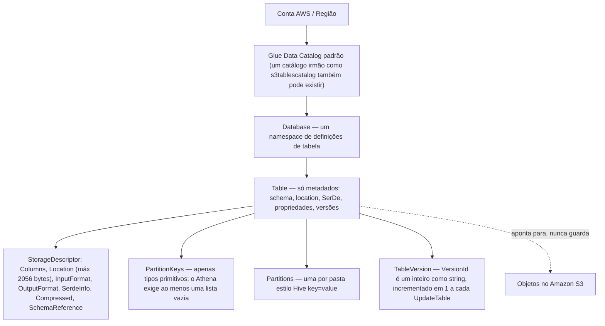
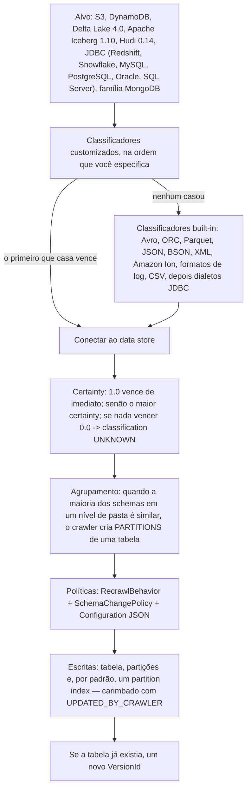
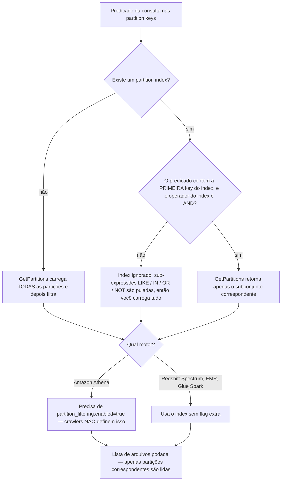
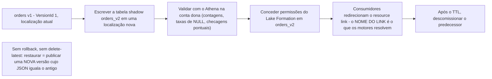
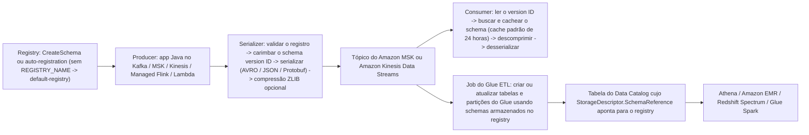
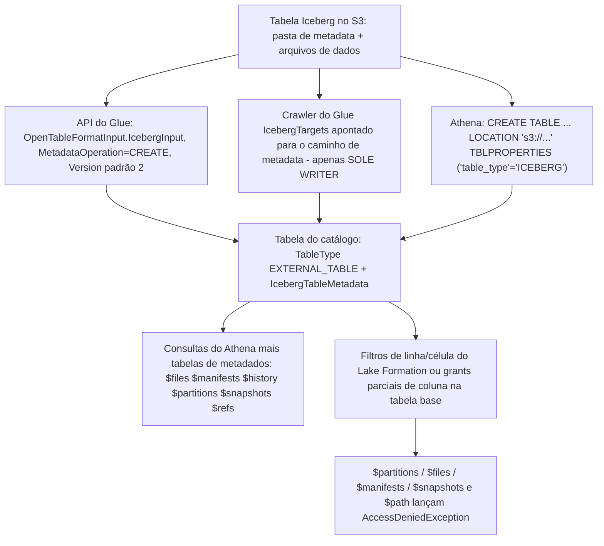
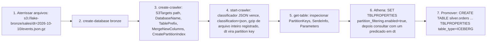
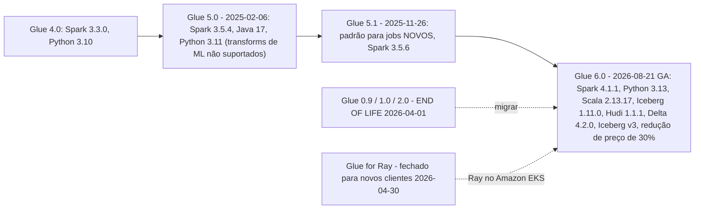

# Glue Data Catalog: Crawlers, Partições e Gestão de Schema

As lições 02 até 06 colocaram bytes no Amazon S3: classes de armazenamento, formatos, formatos de tabela, ingestão em lote e streaming. Nada disso é consultável por um usuário de SQL até que outra coisa exista — uma **descrição** de onde os arquivos estão, o que eles contêm, como desserializá-los e quais deles valem a pena ler. Essa descrição é o **AWS Glue Data Catalog**, e esta lição é sobre possuí-la: o que um objeto de catálogo de fato é, como um crawler escreve um, como partições e partition indexes evitam que o `GetPartitions` carregue o mundo inteiro, como versões de tabela permitem que uma mudança de schema seja auditada e movida para *frente*, como o Schema Registry estende a mesma disciplina para streams, e onde o Lake Formation tira as permissões de você e as dá para uma tabela de grants.

```text
====================================================================
 GLUE DATA CATALOG — a superfície de decisão de metadados (em out 2026)
====================================================================
 Modelo ........ conta/Região -> catalog -> database -> table
                -> partitions   SÓ METADADOS, não guarda bytes
   table ....... StorageDescriptor (Columns, Location, InputFormat,
                 OutputFormat, SerdeInfo, Compressed, SchemaReference)
                 + PartitionKeys (apenas tipos primitivos)
                 + Parameters (classification, compressionType)
                 + TableType EXTERNAL_TABLE | GOVERNED
                 + VersionId (inteiro como string, +1 por update)
 Descoberta .... crawler: classificadores customizados NA SUA ORDEM
                 -> o primeiro que casa vence -> built-ins ->
                 inferir -> escrever
   certainty ... 1.0 vence de imediato | senão o maior | senão UNKNOWN
   recrawl ..... CRAWL_EVERYTHING | CRAWL_NEW_FOLDERS_ONLY
                 (incremental) | CRAWL_EVENT_MODE (S3 -> SQS)
   mudança ..... UpdateBehavior LOG | UPDATE_IN_DATABASE
                 DeleteBehavior LOG | DELETE_FROM_DATABASE |
                 DEPRECATE_IN_DATABASE ; MergeNewColumns no JSON
   preço ....... $0.44 por DPU-hour, por segundo, piso de 10 minutos
                 1 DPU = 4 vCPU + 16 GB; crawlers são OPCIONAIS
 Velocidade .... partition index: sublista das partition keys,
                 máx 3/tabela, só AND, a primeira key precisa
                 aparecer no predicado; o Athena ainda precisa de
                 partition_filtering.enabled = true
 Versão ........ GetTableVersions (MaxResults 1-100); SEM rollback,
                 sem delete-latest -> blue/green = nova versão ou
                 tabela shadow + troca via resource link
 Stream ........ Glue Schema Registry: grátis, criptografado com KMS,
                 8 modos de compatibilidade, AVRO/JSON/PROTOBUF,
                 validação apenas a partir da SEGUNDA versão
 Govern ........ Lake Formation é dono dos GRANTS; Glue é dono dos
                 OBJECTS; resource link = só DESCRIBE + DROP
 Iceberg ....... table_type=ICEBERG, Glue = o metastore,
                 $files $snapshots $history ... no Athena
====================================================================
```

Nesta lição você vai:

- ler o **modelo de objetos do Data Catalog** — catalog, database, table, partitions, `StorageDescriptor`, `SerDeInfo`, `SchemaReference`, `Parameters`, `TableType` — e os limites de bytes que o moldam;
- rodar um crawler na sua cabeça: **classificadores customizados na ordem que você especifica, o primeiro sucesso vence, pontuação de certainty**, heurísticas de agrupamento por pasta e os três ajustes de política (`RecrawlPolicy`, `SchemaChangePolicy`, `Configuration`);
- precificar um crawler corretamente — **$0.44 por DPU-hour, por segundo, com piso de 10 minutos** — e saber que a API é uma alternativa gratuita;
- separar **crawls incrementais** de **crawls por eventos do S3**, incluindo o que cada um é cego para ver;
- defender um **padrão de design de propriedade exclusiva** para crawlers sem pretender que a AWS entrega um toggle de "crawler exclusivo";
- usar **partition indexes** do jeito que o motor realmente os usa: regra da primeira key, só `AND`, máximo de três por tabela e o flag de opt-in do Athena;
- operar **versões de tabela**: o que o `UpdateTable` arquiva, por que não existe rollback e como um **deploy blue/green de metadados** é montado a partir de uma tabela shadow mais uma troca de resource link;
- governar schema de streaming com o **Glue Schema Registry**: hierarquia, cotas, os oito modos de compatibilidade e o caminho de SerDe de producer/consumer;
- fazer a passagem para o **Lake Formation** de forma limpa: quem é dono dos objetos, quem é dono dos grants e o que um resource link dá e não dá para você;
- ligar o **Glue como catálogo do Iceberg** e ler as tabelas de metadados de Iceberg do Athena — incluindo onde o Lake Formation as bloqueia;
- executar um fluxo **crawl → registro → Athena** de ponta a ponta e depois classificar uma mudança de schema como **segura ou quebradora**;
- estudar o caso do **BMW Group** e uma **caixa de atualização de outubro de 2026 com fontes**;
- praticar com **12 questões no estilo de exame** mais três verificações interativas.

---

## 1. O modelo de objetos do Data Catalog

### 1.1 A árvore, e a frase da qual tudo depende

A AWS descreve o Data Catalog como um serviço que *"captura e gerencia automaticamente o schema das suas fontes de dados, incluindo inferência, evolução e versionamento de schema"* e lista os consumidores dele como Amazon Athena (*"Armazene e consulte metadados de tabelas no Data Catalog para os dados do Amazon S3 usando SQL"*), Amazon Lake Formation (*"Defina e gerencie centralmente políticas de acesso a dados de granulação fina"*) e Amazon EMR (*"Acesse fontes de dados definidas no Data Catalog para processamento de big data"*) (docs do AWS Glue Data Catalog, acesso em 2026-10). Uma camada de metadados, vários motores — essa é a aposta arquitetural inteira.

A propriedade que sustenta tudo é esta: **uma tabela de catálogo não é dados.** Ela é um registro de *como encontrar e interpretar* dados que vivem em outro lugar, quase sempre um prefixo S3. Apagar a tabela não apaga os objetos; dois databases podem apontar para o mesmo prefixo; e uma tabela cujo `Location` está errado ainda "existe" e ainda retorna zero linhas.



### 1.2 O objeto de tabela campo a campo

| Campo | O que ele decide | Restrição documentada (acesso em 2026-10) |
|---|---|---|
| `Name` | O identificador que os motores resolvem | *"Para compatibilidade com Hive, este deve ser inteiramente em minúsculas"* |
| `DatabaseName` | Qual namespace é dono dele | Obrigatório em toda tabela |
| `StorageDescriptor` | **O contrato físico**: colunas, location, formato de arquivo, SerDe | `Location` ≤ **2056 bytes**; `AdditionalLocations` carrega os caminhos de tabelas Delta |
| `PartitionKeys` | A ordem das chaves estilo Hive, separada das colunas de dados | *"Apenas tipos primitivos são suportados como partition keys"*; para o Athena sem chaves você ainda precisa passar uma **lista vazia** |
| `Parameters` | Propriedades livres da tabela | *"Cada valor é uma string UTF-8, com no máximo **512000** bytes"* |
| `TableType` | Quem se considera o dono | `EXTERNAL_TABLE` para tabelas criadas pelo Glue; `GOVERNED` — *"Usado pelo AWS Lake Formation. O AWS Glue Data Catalog entende `GOVERNED`"* |
| `IsRegisteredWithLakeFormation` | Se as permissões do LF se aplicam | Flag booleana definida no registro |
| `VersionId` | Qual revisão esta linha é | Inteiro como string, incrementado em 1 |
| `IcebergTableMetadata` | O estado Iceberg mais recente | format version, schemas, partition specifications, sort orders |

Dentro do `StorageDescriptor`, as peças que você realmente vai tocar são poucas:

- **`Columns`** — a lista inline de colunas. Pode legitimamente estar *vazia*, porque…
- **`SchemaReference`** — *"Um objeto que referencia um schema armazenado no AWS Glue Schema Registry. Ao criar uma tabela, você pode passar uma lista vazia de colunas para o schema e usar uma schema reference."* Esta é a dobradiça entre o catálogo de lote e o registry de streaming (Seção 5).
- **`Location`** — a URI do S3 (ou o handle JDBC/DynamoDB) que a tabela lê.
- **`InputFormat` / `OutputFormat`** — nomes de classes Hive como `TextInputFormat` / `IgnoreKeyTextOutputFormat`. O catálogo é com formato Hive de propósito: nomes em minúsculas, classes de I/O Hive, nomes de SerDe Hive.
- **`SerdeInfo`** — `Name`, `Parameters` e `SerializationLibrary`, por exemplo `org.apache.hadoop.hive.serde2.columnar.ColumnarSerDe`, ou `LazySimpleSerDe` (o padrão do classificador CSV built-in) e `OpenCSVSerde` (o que você troca quando os campos do CSV são entre aspas).
- **`Compressed`, `BucketColumns`, `SortColumns`, `SkewedInfo`, `StoredAsSubDirectories`** — dicas físicas do Hive que o motor pode ou não explorar.

- **📚 Você sabia?** Os `Parameters` da tabela são onde os achados do crawler pousam, e a AWS diz exatamente quais deles são para você: *"Esperamos que os usuários consumam as propriedades `classification` e `compressionType`. Outras propriedades, incluindo estimativas de tamanho da tabela, são usadas para cálculos internos, e não garantimos a precisão delas."* Então `recordCount`, `sizeKey`, `objectCount` e `averageRecordSize` são dicas para a aritmética do próprio crawler — nunca insumos de um plano de capacidade. As duas nas quais você deve se basear são `classification` (como fazer o parse dos arquivos) e `compressionType` (se um *arquivo inteiro* foi comprimido — a compressão interna do Parquet deliberadamente não o preenche) (docs de propriedades de tabela do crawler do AWS Glue, acesso em 2026-10).

```text
E0  LENDO UM OBJETO DE TABELA (o que importa, o que é decoração)
--------------------------------------------------------------------
aws glue get-table --database-name bronze --name sales_events

  Name ...................... sales_events        (minúsculas, regra do Hive)
  TableType ................ EXTERNAL_TABLE       (criada por crawler)
  PartitionKeys ............ [{dt: string}]       (só primitivos)
  StorageDescriptor
    Location ............... s3://lake-bronze/sales/
    InputFormat ............ org.apache.hadoop.mapred.TextInputFormat
    SerdeInfo
      SerializationLibrary . org.apache.hive.hcatalog.data.JsonSerDe
  Parameters
    classification ......... json      <- como o Athena faz o parse
    compressionType ........ gzip      <- compressão de arquivo inteiro
    UPDATED_BY_CRAWLER ..... nightly_sales_crawler
    recordCount ............ 41_882_110   <- DICA, não um contrato
--------------------------------------------------------------------
Ordem de leitura: TableType -> PartitionKeys -> Location -> SerdeInfo
               -> Parameters.classification. Todo o resto você pode
               ignorar até que uma consulta se comporte estranho.
```

---

## 2. Crawlers: classificação, classificadores e a ordem de execução

### 2.1 Os cinco passos documentados pela AWS

A AWS é direta sobre o status do crawler: *"Você pode usar um AWS Glue crawler para popular o AWS Glue Data Catalog com databases e tabelas. Este é o método principal usado pela maioria dos usuários do AWS Glue."* O fluxo de trabalho documentado é fixo: os classificadores customizados rodam **"na ordem que você especifica"**; depois os built-ins; depois o crawler conecta ao store, infere o schema e escreve uma tabela carregando o rótulo `classification` do classificador vencedor. A regra que governa todo o resto: *"O primeiro classificador customizado a reconhecer com sucesso a estrutura dos seus dados é usado para criar um schema."* Classificadores abaixo do vencedor são ignorados (docs do crawler do AWS Glue, acesso em 2026-10).



### 2.2 Classificadores, certainty e a armadilha do CSV

Um classificador *"lê os dados em um data store. Se reconhecer o formato dos dados, gera um schema. O classificador também retorna um número de certainty."* A pontuação é determinística e vale a pena memorizar:

| Certainty | Resultado |
|---|---|
| `1.0` de qualquer classificador | A AWS usa essa saída imediatamente |
| Nenhum `1.0`, mas algum valor > `0.0` | O **maior** certainty vence |
| Nada acima de `0.0` | O crawler escreve a string de classificação padrão **`UNKNOWN`** |

Os classificadores built-in são tentados em uma ordem documentada que passa por Avro, ORC, Parquet, JSON, BSON, XML, Amazon Ion, formatos de log, CSV, Redshift, MySQL, PostgreSQL, Oracle, SQL Server e DynamoDB. Formatos comprimidos que ainda podem ser classificados são **ZIP (apenas arquivos single-file), BZIP, GZIP, LZ4 e Snappy**.

O CSV tem três gates documentados que derrubam as pessoas: o schema precisa ter **pelo menos duas colunas e duas linhas**; as heurísticas de header precisam casar (colunas de header inteiro lidas como STRING, menos de 150 caracteres exceto a última, nomes válidos por regex, e o header deve diferir das linhas de dados) ou as colunas degradam para `col1`, `col2`, …; e o classificador CSV built-in emite **`LazySimpleSerDe`**, que estraga strings entre aspas — *"se os dados do CSV contiverem strings entre aspas, edite a definição da tabela e troque a biblioteca do SerDe para `OpenCSVSerde`."*

E a armadilha de prateleira longa: *"Se você mudar a definição de um classificador, quaisquer dados que foram previamente crawled usando o classificador não são reclassificados."* Editar a regra não reescreve o histórico; você precisa apontar um crawler para os dados antigos de novo.

```matching
{
  "question": "Correlacione cada conceito de crawler com o que ele realmente faz (AWS Glue, em out 2026):",
  "pairs": [
    {"left": "Classificadores customizados ordenados", "right": "Rodam antes dos built-ins, na ordem que você especifica; o primeiro classificador customizado a reconhecer com sucesso a estrutura dos dados cria o schema e tudo abaixo dele é ignorado"},
    {"left": "Pontuação de certainty", "right": "A confiança de um classificador: 1.0 é aceito de imediato, caso contrário o maior certainty vence, e se nada exceder 0.0 a tabela é escrita com classification UNKNOWN"},
    {"left": "RecrawlBehavior = CRAWL_NEW_FOLDERS_ONLY", "right": "Crawl incremental: um crawl completo primeiro, depois apenas partições NOVAS são adicionadas; não detecta modificações nem exclusões de partições existentes e trava os alvos S3 de edição"},
    {"left": "RecrawlBehavior = CRAWL_EVENT_MODE", "right": "Crawl por eventos do S3: consome notificações do S3 de uma fila SQS e lista apenas a subpasta que disparou o evento, limitado a 100.000 mensagens por crawl, sem custo quando a fila está vazia"},
    {"left": "SchemaChangePolicy UpdateBehavior = LOG", "right": "Registra as diferenças de schema e deixa a definição existente da tabela em paz; tabelas e partições novas ainda são criadas, então LOG sozinho não é um congelamento completo"},
    {"left": "Partition index", "right": "Uma sublista armazenada das partition keys da tabela para o GetPartitions buscar um subconjunto em vez de tudo: máximo 3 por tabela, só AND, e a primeira key do index deve aparecer no predicado"}
  ],
  "explanation": "Cada entrada é um ajuste distinto com um raio de impacto distinto: classificadores decidem o schema, certainty decide qual classificador vence, RecrawlPolicy decide O QUE é re-listado (novas pastas versus subpastas dirigidas por eventos versus tudo), SchemaChangePolicy decide O QUE acontece com os metadados que ele já encontrou, e o partition index decide com que barato o GetPartitions consegue responder. As duas confusões clássicas são tratar UpdateBehavior=LOG como um congelamento (tabelas e partições novas ainda aparecem) e esperar que um index ajude uma consulta cujo predicado omite a primeira key do index."
}
```

### 2.3 Nomes, agrupamento e a armadilha do resultado vazio

Nomes gerados por crawler seguem regras duras: *"Apenas caracteres alfanuméricos e underscore (`_`) são permitidos. Qualquer prefixo customizado não pode ter mais de 64 caracteres. O comprimento máximo do nome não pode passar de 128 caracteres… Se nomes de tabela duplicados forem encontrados, o crawler adiciona um sufixo de string hash."*

Agrupamento é votação majoritária, não regra: *"Quando a maioria dos schemas em um nível de pasta é similar, o crawler cria partições de uma tabela em vez de tabelas separadas. Para influenciar o crawler a criar tabelas separadas, adicione a pasta raiz de cada tabela como um data store separado."* Erre isso e você herda o aviso explícito da AWS: *"Se objetos tiverem schemas diferentes, o Athena não reconhece objetos diferentes dentro do mesmo prefixo como tabelas separadas… Isso pode levar a consultas no Athena que retornam zero resultados."*

- **📚 Você sabia?** O crawler é o caminho padrão, não o único. A página de preços diz isso com todas as letras: *"O uso dos crawlers do Amazon Glue é opcional, e você pode popular o Amazon Glue Data Catalog diretamente pela API."* Isso importa para custo e para controle — o `CreateTable` escreve exatamente o schema que você pretende, sem loteria de classificador, sem votação majoritária de pasta e sem piso de cobrança de 10 minutos. Times que curam um punhado de tabelas de alto valor devem escrevê-las à mão e reservar os crawlers para a cauda longa (página de preços do AWS Glue e mirror da partição China, acesso em 2026-10-11).

### 2.4 Políticas de recrawl: incremental versus evento do S3

São duas otimizações diferentes, e elas falham em duas direções diferentes.

| | Incremental (`CRAWL_NEW_FOLDERS_ONLY`) | Evento do S3 (`CRAWL_EVENT_MODE`) |
|---|---|---|
| Primeira execução | Sempre um crawl completo | Sempre uma listagem completa |
| Execuções seguintes | Adiciona **apenas partições novas** | Lista **apenas a subpasta que disparou o evento** |
| Cego para | Modificações **e** exclusões de partições existentes | Qualquer coisa que não produziu um evento; partições excluídas são recriadas a menos que *"All object removal events"* estejam configurados |
| Força | `UpdateBehavior=LOG`, `DeleteBehavior=LOG`; *"você não pode mudar os data stores alvo do Amazon S3 ao editar o crawler"* | *"Apenas um único alvo é suportado pelo crawler"*; alvos do Data Catalog precisam estar todos no mesmo bucket |
| Teto | — | **100.000 mensagens por crawl**; curinga `s3://%` não suportado; SQS em uma VPC privada não suportado |
| Forma de custo | Uma execução agendada por vez | *"Não haverá custo se não houver eventos na fila"* |

A forma da CLI para o modo incremental é `--recrawl-policy RecrawlBehavior=CRAWL_NEW_FOLDERS_ONLY --schema-change-policy UpdateBehavior=LOG,DeleteBehavior=LOG`.

### 2.5 Política de mudança de schema: três comportamentos, um documento JSON

Por padrão *"crawlers atualizam o schema no Data Catalog para casar com a fonte de dados sendo crawled"* — o que significa que um retipo em um arquivo novo pode reescrever sua tabela em silêncio e cunhar uma nova versão. Os ajustes da API são `SchemaChangePolicy.UpdateBehavior ∈ {LOG, UPDATE_IN_DATABASE}` e `DeleteBehavior ∈ {LOG, DELETE_FROM_DATABASE, DEPRECATE_IN_DATABASE}`. O *"Add new columns only"* e o *"Ignorar a mudança e não atualizar a tabela no Data Catalog"* da console são faces de UI dos mesmos campos, expressos no documento `Configuration`:

```json
{
  "Version": 1.0,
  "CrawlerOutput": {
    "Tables": { "AddOrUpdateBehavior": "MergeNewColumns" },
    "Partitions": { "AddOrUpdateBehavior": "InheritFromTable" }
  },
  "Grouping": { "TableGroupingPolicy": "CombineCompatibleSchemas" },
  "CreatePartitionIndex": true
}
```

`MergeNewColumns` é o comportamento aditivo e seguro; `LOG` é o comportamento de congelar-e-deixar-humanos-decidirem; e o padrão `UPDATE_IN_DATABASE` é o que pode retipar colunas nas suas costas.

> [!WARNING]
> ⚠️ **Três armadilhas de crawler que aparecem em produção, não em tutoriais:**
> - **`UpdateBehavior=LOG` não para tabelas novas nem partições novas.** Ele para *updates em tabelas existentes*. Adicione `"Partitions": {"AddOrUpdateBehavior": "InheritFromTable"}` ao documento `Configuration` se você também quiser que os metadados das partições fiquem congelados.
> - **Editar um classificador nunca reclassifica o histórico.** Dados previamente crawled mantêm a classificação antiga; você precisa de um novo crawler apontado para o prefixo antigo.
> - **Dois crawlers escrevendo uma tabela é legal e com condição de corrida.** Nada na API impede isso. A única restrição de *single-writer* documentada é a regra do Iceberg na Seção 7.2 — e é exatamente por isso que o padrão de propriedade da próxima subseção é uma escolha de design que você precisa impor você mesmo.

### 2.6 Crawlers "exclusivos": um padrão de design, não um recurso da AWS

Uma nota importante de honestidade: **a AWS não entrega uma opção de crawler chamada "exclusivo" ou "não exclusivo."** Se você ver essa moldura, é uma convenção de time, não um checkbox de console. O que a AWS *documenta* são três restrições duras de single-writer/single-target:

1. **Iceberg:** *"Use um crawler Iceberg apenas quando ele for o único writer de uma tabela do Data Catalog. Não o use ao lado de writers concorrentes como otimizadores de tabela, Apache Spark ou outros motores que fazem commit diretamente na mesma tabela… Se outro writer modificar a tabela do Data Catalog enquanto o crawler está rodando, o crawler falha ao atualizar a tabela."*
2. **Crawlers por eventos do S3:** *"Apenas um único alvo é suportado pelo crawler, seja para alvos do Amazon S3 ou do Data Catalog."*
3. **Crawlers com credenciais do Lake Formation:** *"Atualmente, apenas um único alvo de catálogo com uma única tabela de catálogo é permitido ao usar uma tabela do Data Catalog como alvo de um crawler."*

Tudo mais amplo — "um crawler é dono de uma tabela", "uma tabela tem exatamente um writer", "o prefixo bronze é crawled apenas pelo `nightly_sales_crawler`" — é o **padrão de propriedade exclusiva**: uma convenção onde você dá a cada tabela um único crawler, um único `TablePrefix` e uma única `Configuration`, para que churn de versão e corridas de classificação não possam ocorrer. Adote-o deliberadamente; não o cite como um recurso da AWS.

### 2.7 Exemplo resolvido E1 — o que um crawler realmente custa

```text
E1  CUSTO DE UM CRAWLER COM O PISO DE 10 MINUTOS  (us-east-1, em out 2026)
--------------------------------------------------------------------
Taxa: $0.44 por DPU-hour, cobrado por segundo, arredondado para cima,
      com duração MÍNIMA DE 10 MINUTOS para cada crawl.
      1 DPU = 4 vCPU + 16 GB de memória.

(a) Um crawl, 2 DPUs, tempo real de execução 95 segundos
    cobrável = max(95 s, 600 s) = 600 s = 0.1667 h
    2 DPU x 0.1667 h x $0.44            = $0.147 por crawl
    (os 405 segundos que você não usou ainda são cobrados)

(b) O próprio exemplo publicado da AWS: 2 DPUs x 0.5 h x $0.44 = $0.44

(c) O mesmo crawler em um cron horário, 30 dias
    24 x $0.147 = $3.52 por dia
    30 x $3.52  = $105.61 por mês  ~= $106/mês
    ... para um prefixo que pode nunca ter mudado.

(d) Forma do whitepaper de modelagem de custo: 10 minutos x 1 DPU
    1 x (10/60) x $0.44 = $0.073 por crawl

(e) Alternativa dirigida por eventos: o crawler lista apenas a
    subpasta que disparou, e em um dia com fila SQS vazia
    "Não haverá custo se não houver eventos na fila".
--------------------------------------------------------------------
Veredito: o piso de 10 minutos, não a taxa de DPU, é o que faz um
crawl horário de um prefixo quieto desperdiçar dinheiro. Mate o
agendamento, troque para CRAWL_EVENT_MODE, ou caia no DDL do CreateTable.
```

```plot
{
  "type": "bar",
  "title": "E1: um crawler de 2 DPUs a $0.44/DPU-hour com piso de 10 minutos (us-east-1, em out 2026)",
  "xLabel": "Escolha de agendamento",
  "yLabel": "Custo de 30 dias (USD)",
  "xKey": "schedule",
  "data": [
    {"schedule": "Hourly cron (24 runs/day, all billed at the floor)", "usd_per_month": 105.61},
    {"schedule": "Crawl only when S3 events arrive (empty queue = $0)", "usd_per_month": 4.41}
  ]
}
```

A segunda barra assume 30 crawls disparados por evento por mês — um por dia de mudança real — no mesmo piso de $0.147. Leia como uma forma, não como uma previsão: **você está pagando por agendamentos, não por descoberta.**

---

## 3. Particionamento, partition indexes e a via da projeção

### 3.1 Como as partições entram no catálogo

Segmentos de pasta estilo Hive `key=value/` são descobertos pelo crawler quando os schemas em um nível são similares; a pasta vira uma linha de partição chavesada por aqueles valores, e as chaves viram as `PartitionKeys` da tabela (apenas tipos primitivos). O trabalho declarado do catálogo inclui exatamente isso: ele *"é projetado para computar estatísticas e registrar partições para ajudar a tornar consultas aos seus dados eficientes e eficazes. Também é projetado para manter um histórico de versões de schema para que você possa entender como seus dados mudaram ao longo do tempo."*

Crawlers também constroem a camada de desempenho para você: *"Um crawler cria partition indexes para alvos do Amazon S3 e do Delta Lake por padrão"*, desabilitável com `--configuration '{"Version": 1.0, "CreatePartitionIndex": false}'`.

### 3.2 O que um partition index faz — e quando ele não faz nada

Sem um index, *"o AWS Glue carrega todas as partições da tabela e depois filtra as partições carregadas usando a expressão da consulta."* Com um, o catálogo busca um subconjunto. As regras são estreitas e todas testáveis:

| Regra | Valor |
|---|---|
| O que é | *"Um partition index é uma sublista de partition keys definidas na tabela"* |
| Máximo por tabela | **3** |
| Tipos de key suportados | Date (`YYYY-MM-DD`, intervalo `0000-01-01`–`9999-12-31`), String/Char/Varchar, Numérico (int, bigint, long, tinyint, smallint) |
| Operadores lógicos | *"A solução de indexação atualmente suporta apenas o operador lógico `AND`. Sub-expressões com os operadores `LIKE`, `IN`, `OR` e `NOT` são ignoradas."* |
| Regra da primeira key | *"A primeira key do index deve ser passada na expressão para que os indexes sejam usados no filtro."* |
| Custo | *"Para uma tabela com 'n' partições, 1 partition index resultará em 'n' itens de partition index. 'm' partition indexes na mesma tabela resultarão em 'm*n' itens de partition index. Cada item de partition index será cobrado…"* |
| Motores que o usam | Redshift Spectrum, Amazon EMR, AWS Glue ETL Spark DataFrames — *"…[Athena] e dynamic frames do AWS Glue ETL exigem que você siga passos extras"* |
| Passo extra do Athena | `ALTER TABLE … SET TBLPROPERTIES ('partition_filtering.enabled' = 'true')` |
| Partições criptografadas | *"Criar partition indexes para partições criptografadas não é suportado."* |
| Memória de falha | Códigos de falha `ENCRYPTED_PARTITION_ERROR`, `INVALID_PARTITION_TYPE_DATA_ERROR`, `MISSING_PARTITION_VALUE_ERROR`, `UNSUPPORTED_PARTITION_CHARACTER_ERROR`, `INTERNAL_ERROR`; *"Cada tabela armazena os últimos 10 indexes com falha."* |

E um aviso de lock-in: tabelas criadas por crawler *"não têm a variável `partition_filtering.enabled` por padrão"* — então um crawler pode construir o index e o Athena ainda o ignorará até você virar a propriedade.



- **📚 Você sabia?** Partition indexes são *objetos de metadados cobráveis*, e eles se multiplicam. Uma tabela com 50.000 partições e 3 indexes consome 50.000 partições **mais 150.000 itens de index** — mais a tabela, as versões dela, o database dela. O free tier do Data Catalog conta *"uma tabela, versão de tabela, partição, partition indexes, estatísticas, database ou catálogo"* como objetos separados, então o design de index é uma decisão de custo tanto quanto de desempenho (docs de preços do AWS Glue e de partition index, acesso em 2026-10).

### 3.3 Partition projection: a via que contorna o catálogo

Existe um terceiro jeito de colocar valores de partição em uma consulta, e ele está deliberadamente fora do escopo aqui: **a partition projection do Amazon Athena**, que computa valores e localizações de partição em tempo de consulta em vez de ler metadados registrados. A própria lista de recursos do AWS Glue a coloca ao lado do partition filtering sob o título do Athena e aponta para a documentação do Athena. Esta lição é dona do lado do *catálogo* — partições registradas e os indexes sobre elas; a configuração de projeção em si pertence à lição da camada de consulta (ver Lição 09). Por agora, segure uma distinção: um index deixa o `GetPartitions` mais barato, a projeção deixa o `GetPartitions` desnecessário.

### 3.4 Exemplo resolvido E2 — a conta dos objetos de metadados

```text
E2  O QUE O "FREE TIER" REALMENTE CONTA  (em out 2026)
--------------------------------------------------------------------
Preços: os primeiros 1.000.000 de objetos de metadados armazenados
        são grátis, depois $1.00 por 100.000 objetos acima de um
        milhão, por mês. Os primeiros 1.000.000 de acessos são grátis.
        Um objeto de metadado = tabela | versão de tabela | partição |
        partition indexes | estatísticas | database | catálogo.

Uma tabela "orders", granularidade diária, 365 partições, 3 partition indexes:
    365 partições
  + 3 indexes x 365 partições = 1.460 itens de index
  + 1 tabela
  + 6 versões de tabela
  = 1.832 objetos

40 tabelas assim no ambiente            = 73.280 objetos
Outros domínios (databases, stats, etc.) = 926.720 objetos
                                        ------------
Total                                    = 1.000.000 de objetos  -> $0

Vire o cenário: 2.400.000 de objetos
  acima do free tier = 1.400.000
  1.400.000 / 100.000 = 14 blocos x $1.00  = $14.00 / mês
--------------------------------------------------------------------
Lição: derrubar um index em uma tabela de 365 partições remove 365
objetos cobráveis. Derrubar o index inteiro remove 1.095.
```

---

## 4. Versionamento de tabelas e deploy blue/green de schema

### 4.1 O versionamento é automático e só avança

Todo `UpdateTable` arquiva a linha anterior e incrementa o `VersionId` — *"Um `VersionId` é a representação em string de um inteiro. Cada versão é incrementada em 1."* A recuperação é `GetTableVersion` / `GetTableVersions` (*"Recupera uma lista de strings que identificam as versões disponíveis de uma tabela especificada"*, `MaxResults` **1–100**), cada entrada sendo um `Table` completo mais o seu `VersionId`. O serviço é documentado para *"manter um histórico de versões de schema para que você possa entender como seus dados mudaram ao longo do tempo."*

### 4.2 Não existe rollback — só publicar para frente

Este é o fato que os times descobrem em um incidente. Uma thread do re:Post respondida pela AWS (2023-11-22, revisada pela AWS) afirma: *"Não é possível 'rollback' para uma versão anterior per se, e também não é possível deletar a versão mais recente da tabela (nem na console nem via API/CLI), então a única opção é publicar uma nova versão de schema idêntica àquela para a qual você quer restaurar."* O caminho documentado é pela console: navegue até a versão que você quer, **Edit Schema as JSON**, depois **Save as new table version**.

Então "rollback" é um nome errado. O deploy de metadados é **append-only na prática**: você pode ler cada versão histórica, difar duas delas e publicar uma nova — mas não consegue remover o head.

### 4.3 Dois padrões blue/green, ambos montados com partes documentadas

| Padrão | Mecanismo | Quando |
|---|---|---|
| **Tabela shadow + troca de link** | Escrever `orders_v2` em uma localização nova, validá-la, conceder permissões aos consumidores nela, e então redirecionar o **resource link** que os motores resolvem; descomissionar o predecessor após um TTL | Mudanças breaking, e qualquer ambiente gerido por Lake Formation em que o nome do link é a interface estável |
| **Publicar a versão N+1** | Validar primeiro, então chamar `UpdateTable` uma vez; usar diffs do `GetTableVersions` para detectar regressões | Mudanças aditivas sob `MergeNewColumns`, onde o nome lógico não pode se mover |

Para blue/green de *dados* existe uma primitiva mais barata que qualquer uma das duas: snapshots do Iceberg deixam a entrada de catálogo manter sua forma enquanto os dados rolam para frente e para trás (Lição 04).



### 4.4 Exemplo resolvido E3 — um cutover blue/green de metadados com resource link

```text
E3  BLUE/GREEN ENTRE CONTAS EM UMA TABELA GOVERNED
--------------------------------------------------------------------
Setup: a Conta A é dona de shared.orders (Lake Formation, TableType
       GOVERNED) e a compartilha com a Conta B via AWS RAM.
       B criou o resource link "orders" -> shared.orders.

Passo 1  A: CREATE shared.orders_v2 em s3://lake-gold/orders-v2/
           (API do Glue, ou Athena CREATE TABLE ... TBLPROPERTIES)
Passo 2  A: validar no Athena - SELECT count(*), checagens de taxa de NULL
Passo 3  A: conceder a B SELECT no ALVO shared.orders_v2
           (conceder apenas no link não concede nada no alvo)
Passo 4  B: reapontar (ou recriar) seu link local chamado "orders"
           para shared.orders_v2 - nenhum SQL de consumidor muda, porque
           o nome do link é o que os motores resolvem
Passo 5  observar pela janela de TTL; comparar diffs do GetTableVersions
Passo 6  A: descomissionar o predecessor quando o tráfego esvaziar

Regras que fazem isso funcionar:
  * permissões de resource link são só DESCRIBE e DROP
  * deletar um link NUNCA deleta o recurso linkado
  * criar um link não checa se o alvo existe
  * compartilhamento entre contas roda via AWS RAM: shares da mesma
    organização chegam imediatamente, outras organizações precisam aceitar
--------------------------------------------------------------------
```

---

## 5. Glue Schema Registry: compatibilidade para streams e lotes

### 5.1 A hierarquia de objetos e o que ela custa

O registry é a contraparte streaming do catálogo: *"O AWS Glue Schema Registry permite que você descubra, controle e evolua centralmente schemas de streams de dados"*, com integrações para **Apache Kafka, Amazon MSK, Amazon Kinesis Data Streams, Amazon Managed Service for Apache Flink e AWS Lambda**. A hierarquia é `Registry → Schema → SchemaVersion → SchemaVersionMetadata`, onde um `Schema` carrega um `DataFormat`, um modo de `Compatibility` e um `SchemaCheckpoint`.

| Item | Valor (acesso em 2026-10) |
|---|---|
| Formatos | **AVRO (v1.11.4)**; **JSON** com JSON Schema Draft-04/06/07 (validação Everit); **Protocol Buffers** proto2 e proto3, *"sem suporte a `extensions` ou `groups`"* |
| Modos de compatibilidade | **8**: `NONE`, `DISABLED`, `BACKWARD`, `BACKWARD_ALL`, `FORWARD`, `FORWARD_ALL`, `FULL`, `FULL_ALL` |
| Registries por Região | **100** (duro) |
| Versões de schema por Região | **10.000** (duro) |
| Payload do schema | **170 KB** (duro); API `SchemaDefinition` ≤ **170.000 bytes** |
| Metadados de versão | **10** pares chave-valor por versão de schema (soft) |
| Checkpoint | Padrão é a primeira versão; editar a definição do schema ou o modo de compatibilidade na console move o checkpoint para a versão mais recente |
| Preço | *"O uso do AWS Glue Schema Registry é oferecido sem custo adicional"* / *"serverless e gratuito para usar"* |
| Criptografia | *"Schemas armazenados no Schema Registry são sempre criptografados em repouso usando uma chave do AWS Key Management Service (AWS KMS) gerenciada pelo serviço"*; TLS em trânsito; apenas políticas IAM baseadas em identidade |

A compatibilidade é imposta no registro: para todo modo exceto `DISABLED`, *"a validação das configurações de compatibilidade será aplicada apenas a partir da segunda versão quando a API `RegisterSchemaVersion` for usada"*, e o `DISABLED` *"restringe a adição de quaisquer versões de schema adicionais após a primeira versão de schema."*

```fillblank
{
  "question": "Complete o contrato de compatibilidade do Schema Registry usando os próprios nomes de modo da AWS (em out 2026):",
  "template": "Os oito modos de compatibilidade são {{1}}, {{2}}, {{3}}, {{4}}, {{5}}, {{6}}, {{7}} e {{8}}. A validação de compatibilidade é aplicada apenas a partir da {{9}} versão do schema, um modo de {{10}} bloqueia toda versão após a primeira, e reenviar uma definição de schema idêntica retorna o ID de schema EXISTENTE em vez de criar um duplicado.",
  "answers": {
    "1": "NONE",
    "2": "DISABLED",
    "3": "BACKWARD",
    "4": "BACKWARD_ALL",
    "5": "FORWARD",
    "6": "FORWARD_ALL",
    "7": "FULL",
    "8": "FULL_ALL",
    "9": "segunda",
    "10": "DISABLED"
  },
  "distractors": ["STRICT", "BACKWARD_COMPATIBLE", "FORWARD_ALL", "FULL_TRANSITIVE", "LATEST", "FIRST", "SCHEMA_REGISTRY", "AVRO", "JSON", "PROTOBUF", "default-registry", "SCHEMA_CHECKPOINT"],
  "explanation": "A AWS documenta exatamente oito modos: NONE, DISABLED, BACKWARD, BACKWARD_ALL, FORWARD, FORWARD_ALL, FULL, FULL_ALL. BACKWARD significa que leitores novos lidam com dados atuais + anteriores, FORWARD significa que leitores atuais lidam com dados atuais + próximos, FULL é ambos, e as variantes _ALL comparam contra todas as versões anteriores em vez de apenas o checkpoint. A validação começa na SEGUNDA versão porque não há nada com o que ser compatível na v1; DISABLED é um congelamento, que é útil como intenção e fatal como engano. NONE não faz nenhuma checagem - tudo bem para um registry de dev, nunca para um compartilhado."
}
```

### 5.2 O caminho do SerDe, do producer ao consumer



Duas propriedades desse diagrama são fáceis de perder. Primeiro, o registry **não é só de streaming**: *"você pode criar ou atualizar tabelas e partições do AWS Glue usando schemas armazenados no registry"*, e uma tabela de catálogo pode delegar sua lista de colunas inteiramente a um `SchemaReference`. Segundo, o acesso entre contas tem uma forma dura — *"o AWS Glue Schema Registry não suporta políticas baseadas em recurso"*, então um registry entre contas é alcançado assumindo um role baseado em identidade na conta dona, não por uma política de recurso.

### 5.3 Exemplo resolvido E4 — um exercício de compatibilidade em um schema Avro

```text
E4  EXERCÍCIO DE COMPATIBILIDADE DO REGISTRY  (modo aplicado no RegisterSchemaVersion)
--------------------------------------------------------------------
v1 registro Avro:
  first  (string, REQUIRED)
  last   (string, REQUIRED)
  email  (string, REQUIRED)
  phone  (string, OPTIONAL)

Sob BACKWARD (leitores novos precisam ler dados atuais + anteriores):
  + remover o "email" required         -> REGISTRA
      (leitores novos ignoram um campo que mensagens antigas simplesmente não têm)
  + adicionar o "zip" required         -> FALHA
      (leitores novos exigem um campo que mensagens antigas nunca carregaram)
  + adicionar o "zip" optional         -> REGISTRA

Sob FORWARD (leitores atuais precisam ler dados atuais + próximos):
  + adicionar o "phone" required       -> REGISTRA
  + deletar o "first" required         -> FALHA
      (leitores atuais ainda pedem um campo que mensagens novas derrubaram)

Notas práticas:
  * Registrar a MESMA definição de novo retorna o schema ID
    existente - nenhuma versão duplicada é criada.
  * GetSchemaVersionsDiff retorna um JsonPatch SYNTAX_DIFF
    (resposta limitada a 340.000 bytes).
  * CheckSchemaVersionValidity checa sintaxe SEM efeitos colaterais
    e NÃO faz checagem de compatibilidade - não confunda os dois.
--------------------------------------------------------------------
```

- **📚 Você sabia?** O free tier do registry não é uma promoção, é a arquitetura: o Schema Registry é *"serverless e gratuito para usar"*, enquanto o Data Catalog ao lado cobra por objetos e o crawler que o popula cobra por DPU-second. Então a governança de schema mais barata na AWS é a de streaming — um time pode registrar milhares de versões Avro sob `BACKWARD_ALL` de graça e ainda gastar seis dígitos com crawlers escaneando o mesmo dado conceitual em partições (docs do AWS Glue Schema Registry e de preços, acesso em 2026-10).

---

## 6. A passagem para o Lake Formation: quem é dono de quê

### 6.1 Um catálogo, dois donos

A frase única que resolve a maior parte da confusão: *"As tabelas de metadados do AWS Lake Formation contêm informações sobre dados no data lake, incluindo informações de schema, informações de partição e localização dos dados. Estas tabelas são armazenadas no AWS Glue Data Catalog."* O Lake Formation não tem uma segunda cópia dos seus metadados — ele tem uma **camada de permissões sobre os mesmos objetos**.

| Preocupação | Dono | Evidência no objeto |
|---|---|---|
| Objetos de metadado: databases, tabelas, partições, versões | **AWS Glue** | `VersionId`, `UPDATED_BY_CRAWLER`, `Parameters` definidos pelo crawler |
| Grants: quem pode SELECT/DESCRIBE/ALTER, em granularidade de database/tabela/coluna/linha/célula | **AWS Lake Formation** | `TableType=GOVERNED`, `IsRegisteredWithLakeFormation=true` |
| Identidade do principal: quem é `analyst-role` afinal | **IAM** | Políticas de role, não campos de catálogo |
| Os bytes em si | **Amazon S3** | `StorageDescriptor.Location` |

Tabelas LF podem nascer de cinco jeitos: *"Executar um crawler no AWS Glue"*, *"Criar e executar um workflow"*, criação manual via console do Lake Formation, API do Glue ou CLI, *"Criar uma tabela usando o Amazon Athena"*, ou *"Criar um resource link para uma tabela em uma conta externa."* E a propriedade começa na criação: *"Quando um principal cria uma tabela no Data Catalog, todas as permissões do Lake Formation na tabela são concedidas ao principal, com a capacidade de conceder essas permissões a outros."* Preço é um não-fator: *"Não há cobranças separadas ao criar permissões do Lake Formation ou ao usar permissões do Lake Formation com serviços AWS integrados."*

### 6.2 Resource links: a regra dos dois saltos

Um resource link é *"um objeto do Data Catalog que é um link para um database ou tabela local ou compartilhado… você pode usar o nome do resource link em qualquer lugar onde usaria o nome do database ou da tabela."* Quatro regras decidem se o seu share funciona:

1. Permissões de link são **apenas DESCRIBE e DROP**.
2. *"Conceder permissões em um resource link não concede permissões no database ou tabela alvo (linkado). Você deve conceder permissões no alvo separadamente."*
3. Criar um precisa do `CREATE_TABLE`/`CREATE_DATABASE` do Lake Formation **mais** o `glue:CreateTable`/`glue:CreateDatabase` do IAM.
4. *"Quando você cria um resource link, nenhuma checagem é feita para ver se o recurso compartilhado alvo existe… Se você deletar um resource link, o recurso compartilhado linkado não é dropado."*

O fluxo entre contas roda via **AWS RAM**: *"Se a sua conta estiver na mesma organização AWS da conta que concede, o recurso compartilhado fica disponível para você imediatamente. Porém, se a sua conta não estiver na mesma organização, o AWS RAM envia um convite."* E uma pequena assimetria de API que vale conhecer: DESCRIBE é implicitamente concedido com qualquer outra permissão, mas *"Você não pode conceder DESCRIBE a um usuário que tem select parcial em uma tabela."*

### 6.3 Crawling como principal do LF

Um crawler pode rodar *com* permissões do Lake Formation em vez de IAM cru do S3. O setup documentado é: registrar a localização S3 no Lake Formation; conceder a permissão **Data location** à role do crawler; conceder à role o `Create` no database de saída; adicionar `lakeformation:GetDataAccess` à role; então habilitar *"Use Lake Formation credentials for crawling Amazon S3 data source"* (`LakeFormationConfiguration.UseLakeFormationCredentials=true`). Lembre da restrição da Seção 2.6: apenas um único alvo de catálogo com uma única tabela de catálogo é permitido neste modo.

> [!IMPORTANT]
> **A passagem em uma linha:** o Glue é dono do **objeto** e das **versões** dele; o Lake Formation é dono dos **grants** naquele objeto; o IAM é dono do **principal**; o S3 é dono dos **bytes**. Um problema de permissão quase nunca é consertado na console do Glue — cheque `IsRegisteredWithLakeFormation` primeiro, depois o grant, depois o role.

---

## 7. Ligações do catálogo Iceberg

### 7.1 O Glue é o metastore do Iceberg

Existem duas formas documentadas de colocar uma tabela Iceberg no catálogo:

- **API do Glue** — `OpenTableFormatInput.IcebergInput` com `MetadataOperation=CREATE` (`Version` padrão 2). O objeto `Table` então carrega `IcebergTableMetadata`: format version, schemas, partition specifications, sort orders.
- **Amazon Athena** — *"O Athena cria tabelas Iceberg v2"*, e a pista é a propriedade: defina `'table_type' = 'ICEBERG'` em `TBLPROPERTIES`. Tentar a rota de tabela externa falha: *"Executar CREATE EXTERNAL TABLE resulta na mensagem de erro External keyword not supported for table type ICEBERG."*
- **Crawler do Glue** — aponte um crawler `IcebergTargets` para *"um caminho do Amazon S3 que contém o metadata das suas tabelas Iceberg"*; ele *"registra no Data Catalog"* e *"suporta merge de schemas entre snapshots e atualiza o local do arquivo de metadata mais recente no Amazon Glue Data Catalog."* O suporte é Apache Iceberg **1.10**, tabelas v2 e v3 incluindo `VARIANT`, `UNKNOWN`, `Geography` e `Geometry` — sujeito à **regra do sole writer** da Seção 2.6.

### 7.2 Tabelas de metadados do Athena, e onde o Lake Formation as corta

O Athena expõe internos do Iceberg como pseudo-tabelas anexadas ao nome real: **`$files`, `$manifests`, `$history`, `$partitions`, `$snapshots`, `$refs`** — `SELECT * FROM "dbname"."tablename$files"`. A versão do motor 3 suporta Parquet, ORC e Avro para Iceberg.

A pegadilha é uma fronteira de governança: *"O Lake Formation não avalia as tabelas de metadados do Iceberg. Portanto, as tabelas de metadados do Iceberg são restritas se houver quaisquer filtros de linha ou célula do Lake Formation na tabela base, ou se você não tiver permissões para ver todas as colunas na tabela base. Nestes casos, quando você consulta as tabelas de metadados do Iceberg $partitions, $files, $manifests e $snapshots, ela falha e você recebe um erro AccessDeniedException. Além disso, a coluna de metadados $path tem as mesmas restrições do Lake Formation."*



### 7.3 Exemplo resolvido E5 — promovendo o bronze para um silver Iceberg

```text
E5  PROMOÇÃO, LADO DO CATÁLOGO  (Amazon Athena, em out 2026)
--------------------------------------------------------------------
Antes: bronze.sales_events - tabela externa, JSON + gzip,
       particionada por dt, somente leitura, schema dono do crawler.

(1) CREATE TABLE silver.orders (
      order_id string, customer_id string, amount decimal(12,2),
      status string
    )
    PARTITIONED BY (dt string)
    LOCATION 's3://lake-silver/orders/'
    TBLPROPERTIES ('table_type'='ICEBERG');
    -- NÃO CREATE EXTERNAL TABLE: isso é rejeitado para ICEBERG

(2) INSERT INTO silver.orders SELECT ... FROM bronze.sales_events;

(3) Depois, evoluir o silver sem tocar em um único arquivo de dado:
    ALTER TABLE silver.orders ADD COLUMNS (trace_id string);
    ALTER TABLE silver.orders DROP COLUMN status;
    ALTER TABLE silver.orders CHANGE COLUMN amount amount decimal(14,2);

(4) Auditar o que aconteceu:
    SELECT * FROM "silver"."orders$snapshots";
    SELECT * FROM "silver"."orders$history";

Por que o silver e não o bronze? Em uma tabela externa estilo Hive,
ALTER TABLE e os arquivos discordam (Seção 9). No Iceberg a mudança
é metadata-only, e é a razão inteira de as tabelas silver serem onde
a evolução de schema pertence.
--------------------------------------------------------------------
```

---

## 8. Exemplo resolvido E6 — crawl → registro → Athena, de ponta a ponta



```text
E6  SETE COMANDOS DE UM BANCO VAZIO ATÉ UMA CONSULTA PODADA
--------------------------------------------------------------------
Dados: s3://lake-bronze/sales/dt=2026-10-10/events.json.gz

1) aws glue create-database --database-input '{"Name":"bronze"}'

2) aws glue create-crawler \
     --name nightly_sales_crawler \
     --role arn:aws:iam::111122223333:role/GlueCrawlerRole \
     --database-name bronze \
     --table-prefix sales_ \
     --targets 'S3Targets=[{Path=s3://lake-bronze/sales/}]' \
     --configuration '{"Version":1.0,
        "CrawlerOutput":{"Tables":{"AddOrUpdateBehavior":"MergeNewColumns"},
                         "Partitions":{"AddOrUpdateBehavior":"InheritFromTable"}},
        "Grouping":{"TableGroupingPolicy":"CombineCompatibleSchemas"},
        "CreatePartitionIndex":true}'

3) aws glue start-crawler --name nightly_sales_crawler
   -> classificadores customizados rodam em ordem; nenhum match aqui,
      então o classificador JSON built-in vence -> classification = json
   -> gzip de arquivo inteiro popula compressionType
   -> a pasta dt= vira partition key + um partition index em dt
   -> o nome da tabela é sales_events (prefixo sales_ + nome inferido)

4) aws glue get-table --database-name bronze --name sales_events
   -> confirmar PartitionKeys, SerdeInfo.SerializationLibrary,
      Parameters.classification e UPDATED_BY_CRAWLER

5) Athena (mesma conta, mesma Região do catálogo):
   ALTER TABLE bronze.sales_events
     SET TBLPROPERTIES ('partition_filtering.enabled'='true');

6) Athena:
   SELECT dt, count(*) FROM bronze.sales_events
    WHERE dt = '2026-10-10' GROUP BY dt;
   -> poda para uma partição APENAS por causa do passo 5

7) Promover:
   CREATE TABLE silver.orders (...)
   LOCATION 's3://lake-silver/orders/'
   TBLPROPERTIES ('table_type'='ICEBERG');

Custo do passo 3 em out 2026: $0.44/DPU-hour, por segundo, com
mínimo de 10 minutos - veja E1 antes de colocar isso em um cron.
--------------------------------------------------------------------
```

---

## 9. Exemplo resolvido E7 — evolução de schema, seguro versus quebrador

### 9.1 A tabela de auditoria

Comece com uma tabela externa estilo Hive `events(id string, ts string, payload string)` particionada por `dt`, catalogada por um crawler.

| Mudança proposta | Classe | Por quê |
|---|---|---|
| `ALTER TABLE events ADD COLUMNS (trace_id string)` | **Segura** | *"Adiciona colunas depois das colunas existentes e antes das colunas de partição."* Arquivos antigos leem `NULL` para a coluna nova; partições novas carregam valores |
| Nova partição `dt=2026-10-11` | **Segura** | Aditiva; nenhum metadado existente muda |
| Ampliação de `int` → `bigint` | **Segura** | Relaxar um tipo mantém todo valor existente legível |
| `ALTER TABLE events CHANGE COLUMN ts ts timestamp` | **Quebradora** | As strings dos arquivos antigos deixam de ser parseáveis como o novo tipo |
| `ALTER TABLE events DROP COLUMN payload` | **Quebradora** | Quebra todo `SELECT *` e toda projeção que nomeia a coluna |
| Renomear ou reordenar uma partition key **depois** que um partition index existe | **Quebradora** | O index fica inválido; valores indexados que falham nas checagens de tipo são rejeitados |
| Mudar o `Location` da tabela | **Quebradora** | Todo motor agora lê um conjunto diferente de arquivos sob o mesmo nome |
| Adicionar uma coluna com tipo `date` no Athena | **Não funciona** | *"ALTER TABLE ADD COLUMNS não funciona para colunas com o datatype `date`. Para contornar esse problema, use o datatype `timestamp`."* |

### 9.2 A sobreposição da política do crawler

A mesma divisão em três existe do lado do crawler, e ela decide se uma mudança chega como um PR ou como uma surpresa:

| Política | Efeito | Use quando |
|---|---|---|
| `MergeNewColumns` | Updates apenas aditivos | Bronze/silver onde a fonte pode ganhar colunas a qualquer momento |
| `LOG` | Nada existente é atualizado; humanos decidem | Tabelas curadas onde um retipo precisa ser revisado |
| `UPDATE_IN_DATABASE` (padrão) | Update completo, nova versão cunhada | Você confia completamente no schema da fonte |

Para silvers Iceberg, `ALTER TABLE ADD/DROP/CHANGE COLUMN` é metadata-only e não reescreve nada — é por isso que a evolução pertence lá em vez de um bronze dono de crawler.

```dragdrop
{
  "question": "Ordene os passos de uma evolução de schema SEGURA em uma tabela externa estilo Hive catalogada por um crawler do Glue (como desenhada nesta lição):",
  "items": [
    "Classificar a mudança: aditiva (segura) ou quebradora - nunca comece rodando o crawler",
    "Definir ou confirmar o comportamento de mudança de schema do crawler: MergeNewColumns para aditiva, LOG quando um humano precisa revisar",
    "Aplicar ALTER TABLE ... ADD COLUMNS para que a coluna nova caia depois das colunas existentes e antes das colunas de partição",
    "Escrever dados novos sob uma partição NOVA para que os arquivos antigos continuem lendo NULL para a coluna nova",
    "Validar no Athena: contar as linhas, depois checar a taxa de NULL da coluna nova contra as expectativas",
    "Difar as versões resultantes com GetTableVersions para confirmar que apenas as colunas pretendidas mudaram"
  ],
  "correctOrder": [
    "Classificar a mudança: aditiva (segura) ou quebradora - nunca comece rodando o crawler",
    "Definir ou confirmar o comportamento de mudança de schema do crawler: MergeNewColumns para aditiva, LOG quando um humano precisa revisar",
    "Aplicar ALTER TABLE ... ADD COLUMNS para que a coluna nova caia depois das colunas existentes e antes das colunas de partição",
    "Escrever dados novos sob uma partição NOVA para que os arquivos antigos continuem lendo NULL para a coluna nova",
    "Validar no Athena: contar as linhas, depois checar a taxa de NULL da coluna nova contra as expectativas",
    "Difar as versões resultantes com GetTableVersions para confirmar que apenas as colunas pretendidas mudaram"
  ],
  "explanation": "A classificação vem primeiro porque decide se um crawler pode tocar na tabela de todo; a política do crawler vem em segundo porque decide o que acontece no PRÓXIMO crawl, não neste; ALTER TABLE em terceiro porque muda o catálogo; partição nova em quarto porque em uma tabela estilo Hive os arquivos antigos são imutáveis e a coluna nova precisa ser introduzida por dados novos; validação em quinto; diff de versão por último, porque cada um daqueles passos cunhou um VersionId e o diff é o seu trilho de auditoria. Pular o passo 1 é como um rename quebrador é absorvido por um crawl UPDATE_IN_DATABASE padrão, e pular o passo 4 é como uma checagem de taxa de NULL falha em linhas escritas antes da mudança."
}
```

- **📚 Você sabia?** A distinção segura/quebradora não é cosmética para custo: em uma tabela externa estilo Hive um `ADD COLUMNS` "seguro" não custa nada porque nenhum arquivo de dado é reescrito, enquanto em formatos sem schema-no-metadata a mesma mudança pode forçar uma reescrita. O Iceberg fica na ponta barata — o `ALTER TABLE` lá é uma operação de metadata — e é por isso que a forma recomendada é *evoluir no silver, congelar o bronze* (docs do `ALTER TABLE` do AWS Athena e de evolução de schema do Iceberg, acesso em 2026-10).

---

## 10. Estado das versões do Glue: a plataforma sob o catálogo

O catálogo em si é agnóstico de versão, mas todo crawler, job e biblioteca SerDe que você anexa a ele roda em uma versão do Glue, e em outubro de 2026 a escada tem um degrau inferior duro.



### Exemplo resolvido E8 — o caminho de upgrade que um time de catálogo realmente roda

```text
E8  GLUE 4.0 -> 6.0, CHECKLIST RELEVANTE PARA CATÁLOGO  (em out 2026)
--------------------------------------------------------------------
1) AWS Glue upgrade analysis
   Analisa jobs do Glue 2.0-em-diante e recomenda migração para a
   versão mais recente; rode pela console ou pela CLI antes de tocar
   em uma única definição. (Docs: "AWS Glue upgrade analysis")

2) Escolher o alvo
   5.1 = padrão atual para jobs NOVOS (2025-11-26)
   6.0 = GA 2026-08-21, Spark 4.1.1 / Python 3.13 / Scala 2.13.17,
         Iceberg 1.11.0, Hudi 1.1.1, Delta 4.2.0, "redução de
         preço de 30%", EMRFS removido, disponível em todas as
         Regiões AWS Commercial, AWS GovCloud (US) e AWS China

3) Use o Spark Upgrade Agent para jobs existentes, ou selecione
   Glue 6.0 no dropdown de versão para os novos.

4) Verifique a superfície do Iceberg v3 que você está catalogando:
   VARIANT com shredding automático, deletion vectors,
   tipos geometry e geography, UNKNOWN, valores de coluna DEFAULT.

5) Varra os degraus mortos
   0.9 / 1.0 / 2.0 atingiram end of life em 2026-04-01 - "AWS Glue
   will stop existing job runs and interactive sessions on EOL
   versions. EOL versions will be removed from AWS Glue SDKs and
   APIs."
   Python shell 3.6 atingiu end of support em 2026-03-31 (jobs
   existentes continuam rodando, nenhum novo).
   Glue for Ray fechado para novos clientes em 2026-04-30.

6) Rode o crawler de novo para qualquer tabela Iceberg cujos tipos
   v3 você agora precisa refletidos no catálogo - lembre da regra
   do sole writer.
--------------------------------------------------------------------
```

---

### Atualizações de 2026 (em outubro de 2026)

> [!NOTE]
> **O que mudou no Glue Data Catalog entre 2025 e outubro de 2026 — cada linha com fonte e data:**
> - **21 de agosto de 2026 — AWS Glue 6.0 ficou GA com redução de preço de 30% e Iceberg v3.** *"AWS Glue 6.0 is now generally available, delivering a 30% price reduction and introducing full support for Apache Iceberg v3, newer versions of Apache Hudi and Delta Lake… AWS Glue 6.0 also upgrades runtime to Apache Spark 4.1, Python 3.13, and Scala 2.13."* As release notes fixam **Spark 4.1.1 / Python 3.13 / Scala 2.13.17**, **Iceberg 1.11.0 / Hudi 1.1.1 / Delta 4.2.0**, e **EMRFS foi removido**; *"Available in all AWS Commercial, AWS GovCloud (US), and AWS China regions."* (AWS News Blog, 2026-08-21; release notes do Glue, acesso em 2026-10-11.)
> - **26 de novembro de 2025 — Glue 5.1 virou a versão padrão para jobs novos** (Spark 3.5.6, Python 3.11), então um crawler ou job novo que você crie hoje não está no 4.0 a menos que você peça (release notes / histórico de documentos do Glue, acesso em 2026-10-11).
> - **1 de abril de 2026 — Glue 0.9, 1.0 e 2.0 atingiram end of life**, com end of support datado de 1º de junho de 2022 para 0.9/1.0: *"AWS Glue will stop existing job runs and interactive sessions on EOL versions. EOL versions will be removed from AWS Glue SDKs and APIs."* **Python shell 3.6** atingiu end of support em **31 de março de 2026**, e **Glue for Ray fechou para novos clientes em 30 de abril de 2026** (páginas de política de suporte de versões do Glue e de disponibilidade do Ray, acesso em 2026-10-11).
> - **2026 — a ferramenta de upgrade analysis é o ponto de entrada documentado da migração**: *"AWS Glue upgrade analysis"* analisa jobs do Glue ≥ 2.0 e recomenda migração para a versão mais recente, via console ou CLI, ao lado do Spark Upgrade Agent (AWS Glue User Guide, acesso em 2026-10-11).
> - **A partir de 13 de março de 2025 — o catálogo S3 Tables é um segundo catálogo, não o padrão.** S3 Tables vivem no **`s3tablescatalog`**, registram no Lake Formation para permissões de granulação fina, e exigem a permissão IAM **`glue:GetCatalog`** naquele catálogo ARN — o Firehose ganhou suporte a *"Glue multi-catalog hierarchy"* em **14 de maio de 2025** para poder escrever em catálogos não padrão (AWS Big Data Blog, 2025-03-13; histórico de documentos do Firehose, acesso em 2026-10-11).
> - **Preços em 2026-10-11:** crawlers, Spark ETL e Python shell a **$0.44 por DPU-hour**; requisições do Data Catalog listadas a **$1.00 por 100.000 Catalog requests** com os primeiros 1.000.000 de objetos de metadados grátis; **Glue Data Quality a $0.22 por DPU-hour**; Schema Registry e permissões do Lake Formation continuam grátis (página de preços do AWS Glue, acesso em 2026-10-11).

---

## Casos Reais

### Caso A — BMW Group: o catálogo é o produto, não o subproduto

**BMW Group (veículos conectados).** O estudo de caso da AWS abre com a escala: *"O BMW Group usa a AWS para processar 10 TB de dados diariamente de 1,2 milhão de veículos."* O trabalho anterior foi uma tentativa de 2015 — *"em 2015 o BMW Group criou um data lake centralizado on-premises que coleta e combina dados anonimizados de sensores em veículos, sistemas operacionais e data warehouses"* — que não conseguiu carregar a demanda multi-tenant.

A frase que faz deste um caso da Lição 07 e não um caso de arquitetura: *"As camadas individuais de dados são armazenadas em buckets do Amazon S3, e seus schemas são registrados no AWS Glue Data Catalog."* Providers e consumidores são separados de propósito: *"Providers de dados ingerem e transformam dados com serviços da AWS como Amazon Kinesis Data Firehose, AWS Lambda, AWS Glue e Amazon EMR. Consumers de dados podem então usar serviços como Amazon Athena, Amazon SageMaker, AWS Glue e Amazon EMR."* Repare no que é compartilhado entre os dois lados — **o catálogo**, não as contas.

E a camada de adoção em cima dele: um Data Portal *"oferecendo um 'popularity index' baseado em padrões de uso de dados para mais de 500 usuários em toda a organização."* A popularidade é computada a partir do *uso dos dados catalogados*, que é o detalhe que transforma uma lista de tabelas em um produto.

Ângulo da lição: **um lake S3 catalogado pelo Glue mais um portal legível por humanos é o que de fato democratiza um lake.** Providers registram os schemas uma vez; consumidores em contas separadas os descobrem pela mesma camada de metadados; o popularity index do portal responde à pergunta que sozinho o catálogo não consegue — *qual dessas 300 tabelas alguém está usando?* Os 10 TB/dia da BMW de 1,2 milhão de veículos é o volume; o portal de 500 usuários é o mecanismo de adoção. Reconstrua essa forma com o E6 (crawl e registro) e o E3 (compartilhar sem copiar).

*Números relatados pelo cliente em uma página de estudo de caso da AWS (sem data, acesso em 2026-10-11); não é um compromisso da AWS.*

---

### Caso B — Vanguard FAS 360: de um data swamp para produtos de dados catalogados

**Vanguard (Financial Advisor Services, "FAS 360").** O AWS Big Data Blog (2026-03-18) abre no estado antes: *"A primeira onda de modernização da Vanguard estabeleceu o FAS 360 como um data warehouse corporativo centralizado, migrando de um 'data swamp' fragmentado de arquivos Parquet no Amazon Simple Storage Service (Amazon S3) para um sistema unificado e estruturado."* O catálogo foi o que tornou o estado depois sobrevivível. Dois anos depois, os números publicados são: *"20 TB de volume de dados no Amazon Redshift e outros 150 TB no data lake do S3 · 600+ jobs do AWS Glue ETL (um aumento de 30x)… · 300+ tabelas (crescimento de 3x)… · 250+ materialized views do Amazon Redshift otimizando o desempenho de consultas… 500.000+ consultas de usuários/mês"* — e a camada de curadoria em cima: *"A Vanguard está curando produtos de dados no data lake usando o formato Apache Iceberg e aproveitando o AWS Glue para computação de métricas e integração do data lake."*

Ângulo da lição: **um salto de 30x em jobs de ETL e um salto de 3x em tabelas só é seguro quando cada job lê através do catálogo, nunca através de caminhos ad-hoc.** A BMW mostra o catálogo como a superfície de adoção para 500 humanos; a Vanguard mostra o catálogo como o contrato para 600 jobs automatizados. Mesmo AWS Glue Data Catalog, dois motivos diferentes para ele existir: descoberta para pessoas, *estabilidade para pipelines*. Os produtos de dados curados com Iceberg são o endpoint desse contrato — a evolução de schema vira metadata-only (Seção 9), e o Glue computa as métricas que a camada multi-warehouse do Redshift então serve.

*Números relatados pela AWS no AWS Big Data Blog, publicado em 2026-03-18 (acesso em 2026-10-11); relatados pelo cliente, não é um compromisso da AWS.*

---

## Perguntas de Prática (Practice Questions)

```question
{
  "id": "lh-07-q1",
  "type": "multiple-choice",
  "question": "Qual afirmação sobre o modelo de objetos do AWS Glue Data Catalog está correta em outubro de 2026?",
  "options": [
    "Uma tabela de catálogo armazena as linhas que descreve, então apagar a tabela remove os objetos S3 subjacentes",
    "Uma tabela é só metadados: carrega um StorageDescriptor (Location, InputFormat/OutputFormat, SerdeInfo), PartitionKeys apenas de tipos primitivos, Parameters, TableType e um VersionId, e aponta para dados que vivem em outro lugar",
    "PartitionKeys podem ser de qualquer tipo desde que declaradas antes das colunas de dados",
    "Nomes de tabela podem usar quaisquer caracteres porque a compatibilidade com Hive só se aplica a nomes de banco de dados"
  ],
  "correct": 1,
  "explanation": "A AWS documenta que o Data Catalog captura e gerencia schema, inferência, evolução e versionamento, enquanto a linha da tabela em si aponta para os dados através de StorageDescriptor.Location/InputFormat/OutputFormat/SerdeInfo. PartitionKeys são restritas a tipos primitivos ('Only primitive types are supported as partition keys'), e para o Athena uma tabela sem chaves ainda precisa receber uma lista vazia. Nomes de tabela devem ser inteiramente em minúsculas 'For Hive compatibility'. Nada no catálogo guarda dados, e é por isso que dropar uma tabela nunca dropa objetos do S3."
}
```

```question
{
  "id": "lh-07-q2",
  "type": "multiple-choice",
  "question": "Um crawler tem dois classificadores customizados configurados: um classificador CSV delimitado por ponto e vírgula listado PRIMEIRO (certainty 0.9) e um classificador JSON listado SEGUNDO (certainty 1.0). Qual resultado a AWS documenta?",
  "options": [
    "O classificador JSON vence, porque certainty 1.0 sobrepõe a ordem da lista",
    "O classificador CSV vence, porque classificadores customizados rodam na ordem que você especifica e o primeiro classificador bem-sucedido cria o schema",
    "Os dois rodam e o Glue faz merge dos dois schemas em uma tabela",
    "Nenhum roda; apenas classificadores built-in são consultados quando existem classificadores customizados"
  ],
  "correct": 1,
  "explanation": "A AWS afirma que o crawler roda os classificadores customizados 'in the order that you specify' e que 'The first custom classifier to successfully recognize the structure of the data is used to create a schema. Custom classifiers lower in the list are skipped.' A pontuação de certainty (1.0 vence de imediato, senão o maior, senão UNKNOWN) governa a seleção de classificador DENTRO do fallback built-in e entre classificadores que realmente casam - ela não sobrepõe a sua ordenação explícita dos classificadores customizados. Classificadores built-in só são tentados quando nenhum classificador customizado casou."
}
```

```question
{
  "id": "lh-07-q3",
  "type": "multiple-choice",
  "question": "Um time habilita um crawl incremental (CRAWL_NEW_FOLDERS_ONLY) sobre um prefixo S3. Qual limitação eles precisam aceitar?",
  "options": [
    "O crawler só rodará uma vez; todos os crawls subsequentes precisam ser disparados manualmente",
    "Crawls incrementais não detectam modificações nem exclusões de partições existentes, forçam LOG para o comportamento de update e delete, e os data stores alvo do S3 não podem ser editados enquanto o modo está ligado",
    "Crawls incrementais se recusam a criar partition indexes e precisam ser pareados com uma fila de eventos do S3",
    "Crawls incrementais cobram em dobro da taxa de DPU porque rodam continuamente"
  ],
  "correct": 1,
  "explanation": "A AWS documenta que a primeira execução é um crawl completo e 'Subsequent crawls after the initial full crawl will be incremental, where the crawler identifies and adds only the new partitions', que 'Incremental crawls don't detect modifications or deletions of existing partitions. This configuration is best suited for data sources with a stable schema', e que quando a opção está ligada 'you can't change the Amazon S3 target data stores when editing the crawler' e 'It will not update deleted objects in the Data Catalog'. A forma da CLI é --recrawl-policy RecrawlBehavior=CRAWL_NEW_FOLDERS_ONLY com UpdateBehavior=LOG e DeleteBehavior=LOG. A precificação é inalterada, a $0.44/DPU-hour com piso de 10 minutos."
}
```

```question
{
  "id": "lh-07-q4",
  "type": "multiple-choice",
  "question": "Um crawl dirigido por eventos do S3 (CRAWL_EVENT_MODE) está configurado. Qual conjunto de restrições documentadas está correto?",
  "options": [
    "Ele pode mirar múltiplas localizações S3 mais uma tabela do Data Catalog, usa uma fila SQS, e não tem limite de mensagens por crawl",
    "Ele suporta o curinga s3://% para crawl em toda a conta, e cobra apenas pelas mensagens consumidas",
    "Ele lista apenas a subpasta que disparou o evento, consome mensagens SQS limitadas a 100.000 por crawl, suporta apenas um único alvo, e não custa nada quando a fila está vazia; partições excluídas são recriadas a menos que todos os object removal events estejam configurados",
    "Ele substitui o estágio de classificador inteiramente, então schemas são inferidos do payload do evento em vez dos objetos"
  ],
  "correct": 2,
  "explanation": "A AWS afirma que o crawler lista 'all the files from the subfolder which triggered the event instead of listing the full Amazon S3 or Data Catalog target', que 'The maximum number of messages to consume is 100,000 messages per crawl', que 'Only a single target is supported by the crawler', que 'There will be no cost if there are no events in the queue', e que 'The everything path wildcard is not supported: s3://%' - com partições excluídas recriadas a menos que todos os object removal events estejam configurados. A classificação ainda acontece nos objetos em si; o evento apenas decide o que é listado."
}
```

```question
{
  "id": "lh-07-q5",
  "type": "multiple-choice",
  "question": "Em outubro de 2026, qual é a forma de custo de uma única execução de um AWS Glue crawler?",
  "options": [
    "$0.44 por DPU-hour, cobrado por segundo com mínimo de 10 minutos por crawl, onde 1 DPU = 4 vCPU e 16 GB de memória",
    "$0.44 por crawl flat, independente do tempo de execução ou da contagem de DPUs",
    "$0.22 por DPU-hour, cobrado por minuto com mínimo de 1 minuto",
    "Grátis, porque apenas jobs de ETL são medidos; crawlers estão incluídos na taxa do Data Catalog"
  ],
  "correct": 0,
  "explanation": "A página de preços afirma que você 'paga uma taxa horária, cobrada por segundo, para crawlers (descobrindo dados) e jobs de extract, transform, load (ETL)', que 'A single Data Processing Unit (DPU) provides 4 vCPU and 16 GB of memory', e que você é 'billed in increments of 1 second, rounded up to the nearest second, with a 10-minute minimum duration for each crawl'. O exemplo da própria AWS é 2 DPUs x 0.5 hour x $0.44 = $0.44. $0.22/DPU-hour é a taxa do Glue Data Quality, não a do crawler. Crawlers são medidos separadamente do armazenamento de objetos de metadados do Data Catalog."
}
```

```question
{
  "id": "lh-07-q6",
  "type": "multiple-choice",
  "question": "Uma tabela tem partition keys (region, dt) e um partition index em (region, dt). Quais consultas o index realmente vai servir?",
  "options": [
    "Qualquer consulta com uma cláusula WHERE que toca dt de qualquer forma, porque a ordem do index não importa",
    "Apenas consultas cujo predicado contém region - a PRIMEIRA key do index - e apenas onde o operador do index é AND; sub-expressões LIKE, IN, OR e NOT são ignoradas, e um máximo de 3 indexes existe por tabela",
    "Toda consulta, uma vez que partition_filtering.enabled está definido na tabela",
    "Apenas consultas que usam BETWEEN, porque indexes suportam exclusivamente operadores de intervalo"
  ],
  "correct": 1,
  "explanation": "A regra da AWS é que 'The first key of the index should be passed in the expression for the indexes to be used in filtering', que 'The indexing solution currently only supports the AND logical operator' com 'Sub-expressions with the operators LIKE, IN, OR, and NOT are ignored', e que um máximo de 3 partition indexes pode existir por tabela. Sem um index o Glue 'loads all the partitions of the table, and then filters the loaded partitions'. O Athena ainda precisa de ALTER TABLE ... SET TBLPROPERTIES ('partition_filtering.enabled'='true'), mas esse flag não resgata um index cuja primeira key está faltando no predicado."
}
```

```question
{
  "id": "lh-07-q7",
  "type": "multiple-choice",
  "question": "Um crawler com UpdateBehavior=UPDATE_IN_DATABASE (o padrão) retipa uma coluna de int para string em um arquivo novo. O que acontece, e o que teria evitado isso?",
  "options": [
    "Nada muda; crawlers nunca modificam uma definição de tabela existente",
    "A tabela é atualizada no lugar sem nova versão, então a mudança é invisível",
    "A definição da tabela é atualizada e um novo VersionId é cunhado; definir UpdateBehavior=LOG (opcionalmente com CrawlerOutput.Partitions.AddOrUpdateBehavior=InheritFromTable) ou usar AddOrUpdateBehavior=MergeNewColumns teria evitado ou limitado a mudança",
    "O crawler deleta a tabela e a recria do zero, perdendo todas as partições"
  ],
  "correct": 2,
  "explanation": "A AWS documenta que 'By default, crawlers updates the schema in the Data Catalog to match the data source being crawled', com UpdateBehavior em {LOG, UPDATE_IN_DATABASE} e DeleteBehavior em {LOG, DELETE_FROM_DATABASE, DEPRECATE_IN_DATABASE}. Todo UpdateTable arquiva a linha anterior e incrementa o VersionId ('a string representation of an integer... incremented by 1'), então a mudança é visível - através do GetTableVersions. O 'Add new columns only' e o 'Ignore the change and don't update the table' da console mapeiam para CrawlerOutput.Tables.AddOrUpdateBehavior = MergeNewColumns no Configuration JSON ou para UpdateBehavior=LOG."
}
```

```question
{
  "id": "lh-07-q8",
  "type": "multiple-choice",
  "question": "Uma versão de schema precisa ser restaurada após uma edição ruim de tabela. O que a AWS documenta em outubro de 2026?",
  "options": [
    "Chamar DeleteTableVersion na versão mais recente, depois recriar a anterior pela console",
    "Rollback não é possível e a versão mais recente não pode ser deletada via console, API ou CLI; publique uma NOVA versão idêntica à alvo - por exemplo Edit Schema as JSON na versão antiga, depois Save as new table version",
    "Versões expiram automaticamente após 24 horas, então esperar restaura o schema anterior",
    "A restauração só é possível deletando e recriando o database, o que cascata para todas as tabelas"
  ],
  "correct": 1,
  "explanation": "Uma thread do re:Post respondida e revisada pela AWS (2023-11-22) afirma: 'It is not possible to rollback to a previous version per se and also you cannot delete the latest version of the table (neither on the console nor via API/CLI) so the only option is to publish a new schema version that is identical to the one you want to restore back to', com a rota pela console sendo Edit Schema as JSON e depois Save as new table version. É por isso que o blue/green de metadados (E3) é construído para frente - uma tabela shadow mais uma troca de resource link - em vez de por reversão."
}
```

```question
{
  "id": "lh-07-q9",
  "type": "multiple-choice",
  "question": "Sob o modo de compatibilidade BACKWARD do Glue Schema Registry, qual par de mudanças registra corretamente?",
  "options": [
    "Adicionar um campo required registra; derrubar um campo required também registra",
    "Derrubar um campo required registra (leitores novos ignoram o que mensagens antigas não têm), enquanto adicionar um campo required falha (leitores novos exigiriam um campo que mensagens antigas nunca carregaram); adicionar um campo OPTIONAL registra",
    "Tanto adicionar quanto derrubar campos required falham, porque BACKWARD proíbe qualquer mudança em nível de campo",
    "Nada registra; apenas NONE e DISABLED permitem mudanças após a versão 1"
  ],
  "correct": 1,
  "explanation": "BACKWARD significa que leitores novos precisam lidar tanto com dados atuais quanto anteriores. Derrubar um campo required é seguro para eles (eles simplesmente não o procuram em mensagens antigas), então registra; adicionar um campo required é inseguro (mensagens antigas não têm esse campo), então RegisterSchemaVersion retorna um erro; adicionar um campo optional registra porque leitores toleram a ausência dele. A AWS documenta oito modos - NONE, DISABLED, BACKWARD, BACKWARD_ALL, FORWARD, FORWARD_ALL, FULL, FULL_ALL - e observa que a validação 'will be applied only from the second version onwards', com DISABLED bloqueando toda versão após a primeira."
}
```

```question
{
  "id": "lh-07-q10",
  "type": "multiple-choice",
  "question": "A Conta B precisa consultar uma tabela do Lake Formation compartilhada pela Conta A. Qual sequência está correta?",
  "options": [
    "A Conta A concede SELECT no seu resource link na Conta B, e as permissões do alvo são herdadas automaticamente",
    "A Conta A compartilha a tabela via AWS RAM e concede permissões na tabela ALVO; a Conta B cria um resource link local para ela e concede DESCRIBE naquele link - permissões de link (apenas DESCRIBE e DROP) e permissões do alvo são separadas, e deletar o link nunca deleta o alvo",
    "A Conta B cria um resource link primeiro; o Lake Formation então auto-cria a tabela alvo no catálogo da Conta B",
    "A Conta A pode compartilhar a tabela com uma política de bucket S3 sozinha; nenhum grant do Lake Formation é necessário uma vez que o RAM entregou o share"
  ],
  "correct": 1,
  "explanation": "A AWS documenta que 'A resource link is a Data Catalog object that is a link to a local or shared database or table', que 'resource link permissions are only DESCRIBE and DROP', que 'Granting permissions on a resource link doesn't grant permissions on the target... You must grant permissions on the target separately', e que 'If you delete a resource link, the linked shared resource is not dropped' (nem a existência é checada na criação). A entrega entre contas roda via AWS RAM: shares da mesma organização são imediatos, caso contrário um convite precisa ser aceito. O criador de uma tabela gerenciada pelo LF detém automaticamente todas as permissões do LF nela e pode sub-conceder."
}
```

```question
{
  "id": "lh-07-q11",
  "type": "multiple-choice",
  "question": "Um time quer evoluir o schema de uma tabela Iceberg a partir do Amazon Athena. Qual afirmação está correta?",
  "options": [
    "CREATE EXTERNAL TABLE é a instrução exigida para qualquer tabela Iceberg, e ALTER TABLE reescreve todos os arquivos de dados",
    "O Athena cria tabelas Iceberg v2 e exige TBLPROPERTIES ('table_type'='ICEBERG') - CREATE EXTERNAL TABLE é rejeitado para esse tipo - enquanto ALTER TABLE ADD/DROP/CHANGE COLUMN é metadata-only; note que ADD COLUMNS não funciona para colunas date, então use timestamp",
    "O Athena suporta apenas tabelas Iceberg v3, e toda mudança de schema força uma reescrita completa da tabela",
    "Tabelas Iceberg não são registradas no Glue Data Catalog de todo; elas vivem apenas no S3"
  ],
  "correct": 1,
  "explanation": "A AWS afirma 'Athena creates Iceberg v2 tables' e que 'Running CREATE EXTERNAL TABLE results in the error message External keyword not supported for table type ICEBERG', com a correção sendo table_type='ICEBERG' em TBLPROPERTIES. A evolução de schema no Athena é ALTER TABLE ADD COLUMNS / DROP COLUMN / CHANGE COLUMN, e 'ALTER TABLE ADD COLUMNS does not work for columns with the date datatype. To workaround this issue, use the timestamp datatype instead.' Tabelas Iceberg SÃO catalogadas no Glue - o objeto Table carrega IcebergTableMetadata, e um crawler pode registrar o caminho de metadata de uma tabela Iceberg (apenas sole writer)."
}
```

```question
{
  "id": "lh-07-q12",
  "type": "multiple-choice",
  "question": "Qual veredito comparativo está correto para a camada de metadados de um lakehouse AWS em outubro de 2026?",
  "options": [
    "Tabelas nativas do Athena são um metastore separado do Glue Data Catalog, então deveriam ser escolhidas em vez do Glue para governança",
    "Um Hive metastore auto-gerenciado é sempre mais barato que o Glue porque nenhuma hora de DPU é cobrada",
    "O Glue Data Catalog é o padrão, com formato Hive, metastore multi-motor (Athena, EMR, Lake Formation, Redshift Spectrum, jobs do Glue) com crawlers a $0.44/DPU-hour e piso de 10 minutos; tabelas criadas através do Athena ainda são objetos do Glue; um Hive metastore auto-gerenciado troca a conta pela operação que você agora é dono; e catálogos alternativos como o s3tablescatalog das S3 Tables são escolhidos quando o formato de tabela é gerenciado em vez do metastore",
    "Glue Data Catalog, tabelas nativas do Athena e um Hive metastore são três stores diferentes que cada um precisa ser populado separadamente"
  ],
  "correct": 2,
  "explanation": "A AWS lista Athena, Lake Formation e EMR como consumidores do Data Catalog, e a própria documentação do Lake Formation diz que suas tabelas de metadados 'are stored in the AWS Glue Data Catalog' - então o Athena é um CAMINHO de criação/consulta para o Glue, não um store concorrente (uma das cinco maneiras documentadas de criar uma tabela LF é 'Create a table using Amazon Athena'). O Glue é com formato Hive por design: nomes de tabela em minúsculas, InputFormat/OutputFormat e nomes de classes SerDe do Hive, tipos EXTERNAL_TABLE. Crawlers são opcionais ('you can populate the Amazon Glue Data Catalog directly through the API') e medidos a $0.44/DPU-hour com mínimo de 10 minutos. Um Hive metastore auto-gerenciado remove esse medidor e adiciona o serviço que você opera, dá backup e aplica patch. O S3 Tables fica no s3tablescatalog separado, que precisa de glue:GetCatalog e registro no Lake Formation."
}
```

> [!WARNING]
> ⚠️ **Armadilhas de padrão desta lição — percorra esta lista antes de tocar em um catálogo:**
> - **O crawler não é o único writer.** Crawlers são opcionais; o `CreateTable` é isento da loteria de classificador *e* do piso de cobrança de 10 minutos.
> - **`UpdateBehavior=LOG` não é um congelamento.** Tabelas e partições novas ainda aparecem; pareie-o com `CrawlerOutput.Partitions.AddOrUpdateBehavior=InheritFromTable`.
> - **Editar um classificador nunca reclassifica o histórico.** Aponte um novo crawler para o prefixo antigo.
> - **Crawls incrementais são cegos para edições e exclusões.** Uma mudança de schema one-off exige um crawl completo temporário.
> - **Crawls por eventos do S3 deletam apenas o que contam para você.** Sem *"All object removal events"*, o próximo crawl recria a partição; apenas um alvo é permitido.
> - **`partition_filtering.enabled` é trabalho seu, não do crawler.** Crawlers constroem o index; o Athena o ignora até você definir a propriedade da tabela.
> - **A forma do index é com forma de consulta.** Máx 3 por tabela, a primeira key deve aparecer no predicado, só `AND` — e uma vez que um index existe você não pode renomear nem retipar suas keys.
> - **Todo item de index é cobrável.** `m` indexes × `n` partições = `m × n` objetos cobrados após o primeiro milhão.
> - **Nunca existe rollback.** Você não pode deletar a versão mais recente da tabela; restauração significa publicar uma nova versão.
> - **Resource links não são permissões.** DESCRIBE/DROP no link, mais um grant separado no alvo.
> - **Crawlers Iceberg precisam ser o sole writer**, e filtros de linha/célula do Lake Formation fazem `$partitions`, `$files`, `$manifests`, `$snapshots` e `$path` lançarem `AccessDeniedException`.
> - **`CREATE EXTERNAL TABLE` falha no Iceberg**, e `ALTER TABLE ADD COLUMNS` falha em `date`.

> [!IMPORTANT]
> **Veredito Comparativo — Glue Data Catalog versus tabelas nativas do Athena versus um Hive metastore auto-gerenciado versus um catálogo de terceiros/alternativo**
> - **Versus tabelas nativas do Athena:** este é um *caminho de criação*, não um metastore concorrente. Uma das cinco maneiras documentadas de criar uma tabela do Lake Formation é *"Criar uma tabela usando o Amazon Athena"*, e tabelas Iceberg criadas pelo Athena chegam ao Glue com `table_type='ICEBERG'`. O que você ganha é sem conta de crawler e sem loteria de classificador — você escreve exatamente o schema que pretende. O que você não ganha é independência: o objeto, o histórico de `VersionId` dele, as partições e os grants do LF ainda são do Glue. Escolha isto para tabelas curadas que você consegue descrever em DDL; mantenha crawlers para a cauda longa. **O passo 7 do E6** é o padrão.
> - **Versus um Hive metastore auto-gerenciado:** você remove o medidor de DPU e herda o serviço — um processo de metastore, o store de backing, backups, upgrades, e a encanagem de IAM que todo motor precisa para alcançá-lo. O Glue é deliberadamente com formato Hive (nomes de tabela em minúsculas, `InputFormat`/`OutputFormat` do Hive, nomes de classes SerDe do Hive, `EXTERNAL_TABLE`), então o schema portável é real; a operação não é. O próprio material de caso da AWS mostra o trade em escala: a FINRA rodava *"herd, our open source data catalog and orchestration tool"* como sua fonte única de verdade ao lado de S3 e EMR — uma escolha defensável para um ambiente altamente regulado que precisa ser dono de suas ferramentas de metadados, e exatamente o workload que o Glue agora absorve. Escolha auto-gerenciado apenas quando ser dono do metastore for em si um requisito.
> - **Versus catálogos de terceiros e alternativos:** um **catálogo open source que você opera** (um deployment de Hive metastore ou um produto de catálogo de terceiros) compra portabilidade entre nuvens e motores ao preço do trabalho de governança da Seção 6 — Lake Formation, resource links e compartilhamento via RAM simplesmente não existem lá. Um **catálogo AWS alternativo** é o movimento oposto: as Amazon S3 Tables vivem no **`s3tablescatalog`**, não no catálogo Glue padrão, registram no Lake Formation para permissões de granulação fina, e precisam da permissão IAM **`glue:GetCatalog`** naquele catálogo ARN — você está comprando operações de formato de tabela *gerenciadas* (compactação, tratamento de snapshots) em vez de um modelo de metadados diferente. Um **catálogo de glossário de negócio/governança** (Amazon DataZone, agora a espinha dorsal de governança do SageMaker Unified Studio) é uma camada *acima* de qualquer um desses, não um substituto de nenhum.
> - **O veredito de uma frase:** em outubro de 2026, **padronize no Glue Data Catalog com Lake Formation por cima — é o único dos quatro que é simultaneamente o metastore do Athena/EMR/Spectrum/Lake Formation; crie tabelas curadas através do Athena ou da API e crawled apenas a cauda longa; recorra ao `s3tablescatalog` quando quiser operações Iceberg gerenciadas para você; e Hive auto-gerenciado apenas quando ser dono do metastore for um requisito declarado que sobreponha a conta de operações.**

> [!SUCCESS]
> **Pontos Principais (Key Takeaways):**
> 1. **Uma tabela de catálogo é metadados, nunca dados.** O modelo de objetos é `account/Region → catalog → database → table → partitions`, onde a tabela carrega um `StorageDescriptor` (Location ≤ 2056 bytes, `InputFormat`/`OutputFormat` do Hive, `SerdeInfo.SerializationLibrary`, `SchemaReference` opcional), `PartitionKeys` apenas primitivos (o Athena ainda quer uma lista vazia se você não tem nenhuma), `Parameters` de forma livre (≤ 512.000 bytes por valor), `TableType` (`EXTERNAL_TABLE` ou `GOVERNED`) e um `VersionId`.
> 2. **Crawlers rodam classificadores customizados primeiro, na sua ordem — o primeiro sucesso vence.** Certainty decide o resto: `1.0` vence de imediato, senão o maior valor, senão `classification=UNKNOWN`. Agrupamento por pasta é votação majoritária, e *"Se objetos tiverem schemas diferentes, o Athena… pode levar a consultas no Athena que retornam zero resultados."* Editar um classificador nunca reclassifica o histórico.
> 3. **A precificação de crawler é um problema de piso, não de taxa:** **$0.44/DPU-hour, por segundo, mínimo de 10 minutos por crawl**, 1 DPU = 4 vCPU/16 GB. E1: 2 DPUs × 95 s ainda cobra 600 s = **$0.147**; um cron horário do mesmo crawler = **$3.52/dia ≈ $106/mês**. Crawlers são opcionais — a API é isenta tanto do piso quanto da loteria de classificador.
> 4. **Dois modos de recrawl, duas cegueiras.** `CRAWL_NEW_FOLDERS_ONLY` adiciona apenas partições novas e nunca vê edições nem exclusões (e trava seus alvos S3); `CRAWL_EVENT_MODE` lista apenas a subpasta disparada a partir do SQS, limita a **100.000 mensagens/crawl**, permite um único alvo, e *"Não haverá custo se não houver eventos na fila."*
> 5. **"Crawler exclusivo" é um padrão de design, não uma opção da AWS.** As únicas regras documentadas de single-writer são o requisito de **sole writer** do Iceberg, o alvo único do crawler por eventos do S3, e a única tabela de catálogo do crawler com credenciais do Lake Formation.
> 6. **Partition indexes são estreitos por design:** máx **3 por tabela**, uma sublista de partition keys, só `AND` (`LIKE`/`IN`/`OR`/`NOT` ignorados), a **primeira key do index precisa estar no predicado**, `m × n` itens de index cobráveis — e o Athena precisa de `'partition_filtering.enabled'='true'`, que crawlers **não** definem. Indexes deixam o `GetPartitions` mais barato; a projeção (Lição 09) o torna desnecessário.
> 7. **Metadados são append-only.** Todo `UpdateTable` cunha `VersionId + 1`; não existe rollback nem delete-latest. Blue/green portanto significa ou uma **tabela shadow mais uma troca de resource link** (permissões de link são DESCRIBE/DROP, separadas do grant do alvo) ou **publicar a versão N+1** após validação, difada com `GetTableVersions` (`MaxResults` 1–100).
> 8. **O Schema Registry é grátis e com formato de streaming, mas não é só de streaming:** 8 modos de compatibilidade (`NONE`, `DISABLED`, `BACKWARD`, `BACKWARD_ALL`, `FORWARD`, `FORWARD_ALL`, `FULL`, `FULL_ALL`), AVRO 1.11.4 / JSON Draft-04-06-07 / Protobuf proto2–proto3, **100 registries e 10.000 versões de schema por Região, payload de 170 KB**, criptografado com KMS em repouso, validação apenas a partir da **segunda** versão, sem políticas de recurso (entre contas = role assumption). E4: sob BACKWARD, derrubar required registra, adicionar required falha.
> 9. **Lake Formation é dono dos grants, Glue é dono dos objetos, IAM é dono dos principals, S3 é dono dos bytes.** As tabelas de metadados do LF *"are stored in the AWS Glue Data Catalog"*; o criador da tabela recebe todas as permissões do LF; entre contas roda via AWS RAM; um resource link é um nome, não uma permissão.
> 10. **Ligações do Iceberg:** o Athena cria tabelas **v2** via `TBLPROPERTIES ('table_type'='ICEBERG')` — `CREATE EXTERNAL TABLE` é rejeitado — crawlers registram um caminho de metadata Iceberg **apenas como sole writer**, e o Athena expõe `$files`, `$manifests`, `$history`, `$partitions`, `$snapshots`, `$refs`; filtros de linha/célula do Lake Formation ou grants parciais de coluna fazem `$partitions`/`$files`/`$manifests`/`$snapshots` e `$path` lançarem `AccessDeniedException`.
> 11. **Seguro versus quebrador:** `ALTER TABLE … ADD COLUMNS` aditivo (cai antes das colunas de partição), partições novas e ampliação de tipo são seguros; retipes, drops, renomes de partition key após um index existir e mudanças de `Location` são quebradores — e `date` não pode ser adicionado de todo no Athena (use `timestamp`). Do lado do crawler: `MergeNewColumns` = aditivo, `LOG` = revisão, padrão `UPDATE_IN_DATABASE` = pode retipar nas suas costas.
> 12. **Estado da plataforma em outubro de 2026:** Glue 6.0 GA em **2026-08-21** (Spark 4.1.1, Python 3.13, Iceberg 1.11.0, Iceberg v3, redução de preço de 30%, EMRFS removido); **5.1** é o padrão para jobs novos desde **2025-11-26**; **0.9/1.0/2.0 atingiram end of life em 2026-04-01**; Python shell 3.6 EOS em **2026-03-31**; Glue for Ray fechou para novos clientes em **2026-04-30**; `s3tablescatalog` é um catálogo separado que precisa de `glue:GetCatalog`; e o BMW Group registra os schemas por trás de **10 TB/dia de 1,2 milhão de veículos** neste catálogo enquanto um Data Portal mostra um popularity index para **500+ usuários** — o catálogo é o produto.
