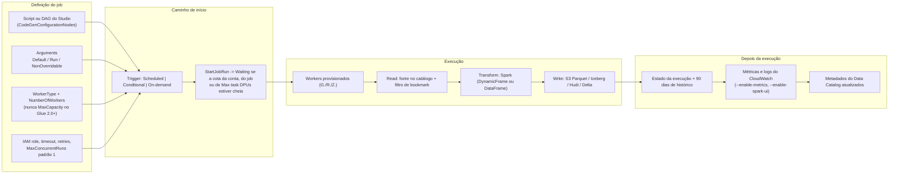
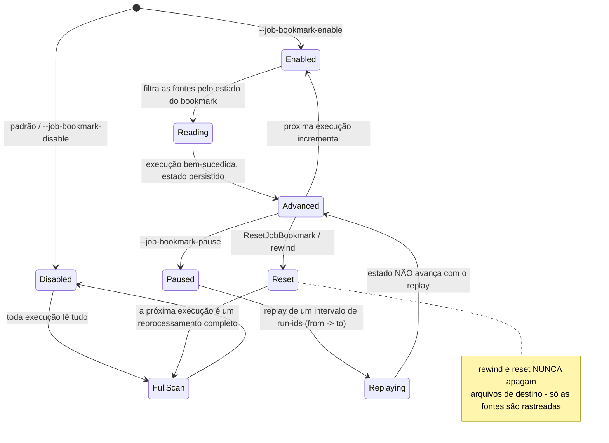
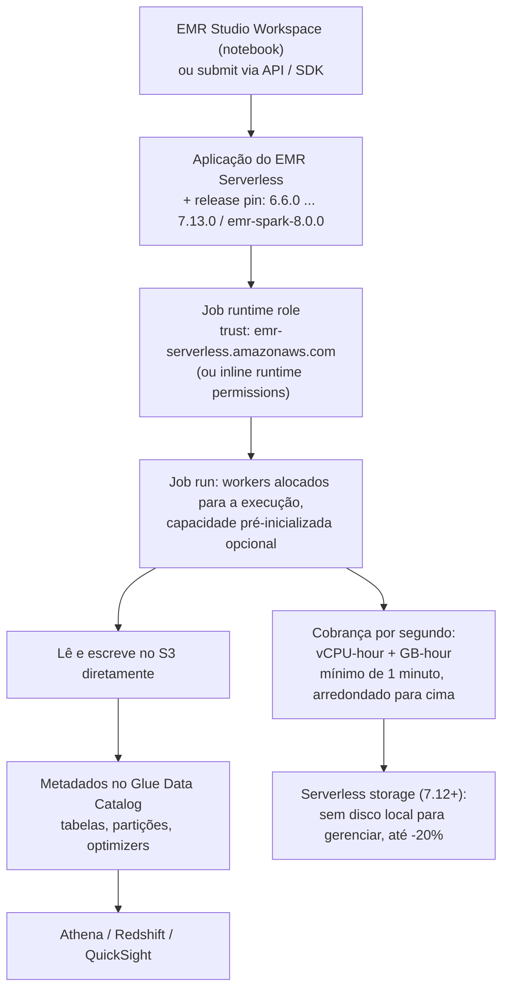
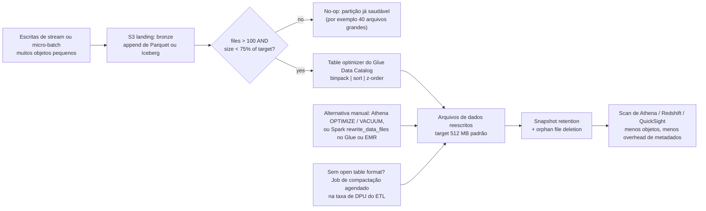
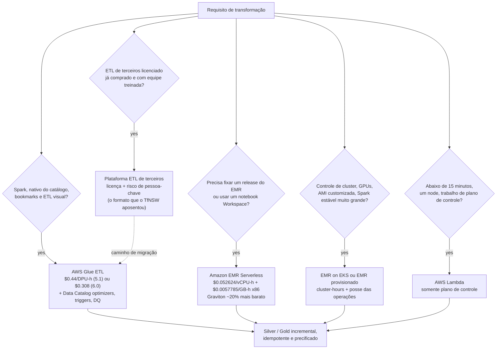

# Transformação em Escala: AWS Glue, EMR Serverless e Lambda

As lições 01 até 07 deram a você um lake: layout no S3, formatos de arquivo, open table formats, ingestão em lote e streaming, e um catálogo. Nada disso é ainda *curado*. Esta lição é sobre a camada que faz a curadoria, **os motores que leem raw e bronze, limpam, deduplicam e gravam silver e gold**, e sobre as três coisas que decidem se essa camada é barata, correta, ou ambas: **qual motor você roda, quanta capacidade você mantém enquanto ele roda, e se a segunda execução produz duplicatas.**

```text
====================================================================
 A SUPERFÍCIE DE DECISÃO DA TRANSFORMAÇÃO - AWS LAKEHOUSE (em out 2026)
====================================================================
 Glue ETL (Spark) ...... Spark serverless; Data Catalog acoplado;
                          DynamicFrame ou DataFrame; job bookmarks;
                          workers G./R./Z.; cobrado em DPU-hours
 Glue for Ray .......... pandas / Ray Datasets em Graviton Z.2X
                          (M-DPU); fechado para novos clientes em 30 abr 2026
 Python shell .......... um processo EC2, sem Spark, 0.0625 ou 1 DPU
 Glue Studio ........... canvas de ETL visual + notebooks + editor
                          de script sobre os mesmos motores (um DAG)
 EMR Serverless ........ trem de releases completo do EMR (6.6.0 a 7.13.0 e
                          emr-spark-8.0.0); vCPU + GB por segundo;
                          Workspaces; capacidade pré-inicializada
 EMR on EKS ............ contêineres do EMR nos seus clusters EKS,
                          cobrado com um uplift de vCPU/GB
 EMR provisionado ...... controle do cluster inteiro, operações do cluster inteiro
 Lambda ................ bisturi do plano de controle de 15 min / 10 GB -
                          não é um motor de ETL
-----------------------------------------------------------------------------
 Unidade de conta ...... Glue: 1 DPU = 4 vCPU + 16 GB
                         M-DPU (workers R e Ray) = 4 vCPU + 32 GB
                         EMR Serverless: vCPU-seconds + GB-seconds
 Razão de idempotência . bookmarks (lado da fonte) | dynamic partition
                         overwrite | Iceberg MERGE + snapshots |
                         prefixo de staging + promoção atômica | watermarks
====================================================================
```

Nesta lição você vai:

- modelar o **job Glue ETL**: anatomia, precedência de argumentos, o teto de 260 KB, triggers, cotas de concorrência e o comportamento de fila de jobs de 2024;
- separar **DynamicFrame de DataFrame** e dirigir `resolveChoice` com a ação certa antes de qualquer escrita;
- operar **job bookmarks**: Enable / Disable / Pause, no que as fontes S3 e JDBC realmente se baseiam, por que rewind nunca apaga os seus outputs, e como isso difere do `MERGE` do Iceberg;
- dimensionar **workers**: G.1X até G.16X, workers de memória otimizada R, o Z.2X do Ray, o streaming G.025X, tetos de `--executor-cores` e auto scaling;
- criar conteúdo com **Glue Studio**: ETL visual, notebooks e o editor de script, e ler a **matriz de versões do Glue em outubro de 2026**, o que cada linha custa e o que ela quebra;
- rodar **EMR Serverless**, aplicações, Workspaces, fixação de release, cobrança, e saber exatamente quando ele vence o Glue, mais **Lambda** para o plano de controle e nunca para o plano de dados;
- aplicar **padrões de lakehouse com Spark**: dynamic partition overwrite, AQE, skew, shuffle partitions e compactação de arquivos pequenos;
- escrever um **job Glue PySpark resolvido** da leitura do catálogo até o Iceberg silver, e precificar cada drill na tabela de preços de outubro de 2026;
- estudar **dois casos de clientes da AWS** (Transport for NSW, Vanguard) mais uma **caixa de atualizações de 2026 com fontes**;
- praticar com **11 questões no estilo de exame** e cinco verificações interativas.

---
## 1. A escada de motores: cinco caminhos do raw ao silver

A AWS posiciona um número pequeno de caminhos de transformação para o trabalho em lote de lakehouse, e eles não são intercambiáveis. A escada vai do *mais integrado, menos flexível* para o *mais flexível, mais operacional*:

| Motor | O que é | Medidor | Ponto ideal |
| --- | --- | --- | --- |
| **Glue ETL (`glueetl`)** | Spark serverless com Data Catalog, DynamicFrame e integração com job bookmarks | DPU-hour | Lote de lakehouse padrão: leituras do catálogo, escritas particionadas, execuções incrementais |
| **Glue streaming (`gluestreaming`)** | Mesmo motor, sinks do Structured Streaming | DPU-hour | Landings em micro-batch no bronze e no silver |
| **Python shell (`pythonshell`)** | Python nativo em uma única instância EC2, sem Spark | 0.0625 ou 1 DPU | Movimentação de arquivos, pulls de API, jobs minúsculos que cabem em um node |
| **Glue for Ray (`glueray`)** | pandas / Ray Datasets em Graviton Z.2X | M-DPU-hour | Lógica com forma de pandas em escala; fechado para novos clientes desde 30 abr 2026 |
| **Glue Studio** | Plano de autoria e operações (visual, notebook, script) sobre os motores acima | igual ao do motor | Times que querem um DAG, previews, schedules e versionamento sem possuir o Spark |
| **Amazon EMR Serverless** | Trem de releases completo do EMR, sem clusters; Workspaces para notebooks | vCPU-hour + GB-hour | Quando você precisa de uma versão de runtime do EMR, ou workloads com forma de EMR sem operações de cluster |
| **Amazon EMR (EKS / provisionado)** | Contêineres do EMR no seu cluster EKS, ou clusters inteiros | horas de EC2 / EKS (+ uplift no EKS) | Clusters sticky, AMIs customizadas, Spark estável muito grande |
| **AWS Lambda** | Funções orientadas a eventos | GB-second + requests | Orquestração, validação de arquivos, registro de partições: **não** reescritas de tabela |

Duas propriedades dessa escada importam mais que qualquer lista de features. Primeiro, **somente o Glue ETL tem job bookmarks ligados ao modelo de job**, o processamento incremental é um argumento de primeira classe, não código que você escreve. Segundo, **Glue e EMR Serverless cobram de formas diferentes**: DPU-hours contra vCPU-hours mais GB-hours, então um número de manchete "por DPU" e um "por vCPU" nunca podem ser comparados sem normalizar a memória (a Seção 13 faz a aritmética).

> [!NOTE]
> Tudo nesta lição está carimbado **em outubro de 2026**. Glue 1.0, 2.0 e 0.9 atingiram **fim de vida em 1 de abril de 2026**: qualquer tutorial que os fixe agora falha no início do job, e a política de suporte de versões do Glue é explícita de que *"o AWS Glue interromperá execuções de jobs e sessões interativas existentes em versões com EOL."*

---
## 2. O modelo de job do Glue ETL: anatomia, argumentos, triggers, fila

### 2.1 O que um job de fato é

Um job do Glue é uma definição mais execuções. A definição é: script (ou DAG visual), tipo de worker e número de workers, IAM role, connections e security settings opcionais, argumentos padrão, timeout, retries, `MaxConcurrentRuns`, e os triggers que o iniciam. Uma execução é uma execução limitada com um estado e um histórico retido.



`MaxConcurrentRuns` começa em **1**, e o histórico de execuções do job é retido por **90 dias**: dois números que valem a pena decorar, porque uma execução parada em `WAITING` está te dizendo sobre cota ou sobre a posição do trigger, não sobre o seu código.

### 2.2 Argumentos: três camadas, um teto rígido

Argumentos são como um script genérico se torna um pipeline específico. Três camadas se aplicam, nesta precedência:

1. **`NonOverridableArguments`** (mais alta: você não consegue burlá-las em tempo de execução)
2. **`Arguments` da execução** fornecidos no `StartJobRun`
3. **`DefaultArguments`** no job

e o payload inteiro de argumentos tem um **tamanho máximo de 260 KB**. Esse teto é a razão pela qual você nunca inlina um megabyte de SQL ou um blob base64 nos argumentos: coloque o SQL em um objeto do S3 e referencie-o com `--extra-py-files`, `--extra-jars` ou `--additional-python-modules`.

Os argumentos que aparecem em quase todo job de lakehouse:

| Argumento | Efeito |
| --- | --- |
| `--job-bookmark-option` | `job-bookmark-enable` / `--job-bookmark-disable` / `job-bookmark-pause` (mais `--job-bookmark-from` / `--job-bookmark-to`) |
| `--datalake-formats` | `hudi,delta,iceberg` (Glue 3.0+): os formatos de tabela em jogo |
| `--enable-auto-scaling` | `true` liga o auto scaling **e a cobrança por worker** entre min e max workers |
| `--executor-cores` | Tarefas do Spark que podem rodar em paralelo; **não deve exceder 2x o número de vCPUs no tipo de worker** |
| `--enable-metrics`, `--enable-spark-ui`, `--enable-continuous-cloudwatch-log` | Observabilidade |
| `--extra-py-files`, `--extra-jars`, `--additional-python-modules` | Dependências |
| `--python-virtual-env` | Ambiente virtual Python gerenciado pelo cliente (Glue 5.0+, argumento storage-prefix no 6.0+) |
| `--TempDir`, `--conf` | Espaço temporário e configuração crua do Spark (a Seção 10 vive aqui) |

- **📚 Você sabia?** `--executor-cores` tem um teto documentado: ele *"não deve exceder 2x o número de vCPUs no tipo de worker."* Em um G.1X (4 vCPUs) isso significa no máximo 8; em um G.2X, 16. Sobrescrever além disso não adiciona paralelismo: atormenta memória e disco, o que então *parece* um problema de skew, mas não é (referência de argumentos de job do AWS Glue, acesso em out 2026).

### 2.3 Triggers: scheduled, conditional, on-demand

Os triggers do Glue vêm em três sabores, **Scheduled** (um schedule), **Conditional** (sobre o *status de um job ou crawler anterior*) e **On-demand**, com estados de ciclo de vida `CREATED`, `ACTIVATED`, `DEACTIVATED`. Duas regras rígidas mordem na prática:

- você pode anexar um **máximo de 2 crawlers a um único trigger**;
- uma cadeia conditional só funciona se a cadeia em si for **iniciada por trigger** a partir de uma raiz scheduled ou on-demand: um job lançado manualmente não dispara os triggers conditionais a jusante.

### 2.4 Fila em vez de falha no teto de concorrência

Antes de setembro de 2024, atingir *Max concurrent job runs per account*, *per-job concurrency* ou *Max task DPUs per account* falhava a chamada `StartJobRun` redondamente, e os times construíam loops de retry do Step Functions para absorver isso. A AWS Glue job queuing (disponibilidade geral, AWS Big Data Blog, 3 set 2024) mudou o formato: *"quando as execuções do job estão em estado Waiting, o recurso de fila de jobs do AWS Glue escalona os jobs automaticamente sempre que possível."* O modo de falha vira uma posição na fila, e a capacidade se libera conforme outras execuções terminam.

```dragdrop
{
  "question": "Ordene o ciclo de vida de uma execução ETL do Glue, da autoria até o output observável (como projetado nesta lição):",
  "items": [
    "Autorar: definir o job: script ou DAG do Studio, WorkerType + NumberOfWorkers, IAM role, argumentos padrão (bookmark option, datalake formats)",
    "Iniciar: um trigger Scheduled, Conditional ou On-demand dispara, ou StartJobRun é chamado; se uma cota de conta, de job ou de Max task DPUs por conta estiver cheia, a execução entra em Waiting e é escalonada",
    "Provisionar: workers são alocados para a execução (tipo G., R. ou Z.), auto scaling entre min e max quando --enable-auto-scaling=true",
    "Ler: as fontes são resolvidas a partir do Data Catalog; bookmarks filtram objetos do S3 pelo horário da última modificação, ou linhas JDBC pela chave sequencial, usando transformation_ctx",
    "Transformar: o Spark roda a lógica: assente os choice types com resolveChoice primeiro quando a fonte os traz, depois map, depois convert",
    "Gravar: o sink pousa Parquet, Iceberg, Hudi ou Delta no S3 com particionamento escolhido para evitar o problema dos arquivos pequenos",
    "Commit e observação: o estado da execução é persistido, o histórico é mantido por 90 dias, métricas e logs vão para o CloudWatch, os metadados do Data Catalog são atualizados"
  ],
  "correctOrder": [
    "Autorar: definir o job: script ou DAG do Studio, WorkerType + NumberOfWorkers, IAM role, argumentos padrão (bookmark option, datalake formats)",
    "Iniciar: um trigger Scheduled, Conditional ou On-demand dispara, ou StartJobRun é chamado; se uma cota de conta, de job ou de Max task DPUs por conta estiver cheia, a execução entra em Waiting e é escalonada",
    "Provisionar: workers são alocados para a execução (tipo G., R. ou Z.), auto scaling entre min e max quando --enable-auto-scaling=true",
    "Ler: as fontes são resolvidas a partir do Data Catalog; bookmarks filtram objetos do S3 pelo horário da última modificação, ou linhas JDBC pela chave sequencial, usando transformation_ctx",
    "Transformar: o Spark roda a lógica: assente os choice types com resolveChoice primeiro quando a fonte os traz, depois map, depois convert",
    "Gravar: o sink pousa Parquet, Iceberg, Hudi ou Delta no S3 com particionamento escolhido para evitar o problema dos arquivos pequenos",
    "Commit e observação: o estado da execução é persistido, o histórico é mantido por 90 dias, métricas e logs vão para o CloudWatch, os metadados do Data Catalog são atualizados"
  ],
  "explanation": "A ordem é autorar, iniciar, provisionar, ler, transformar, gravar, commit. Duas posições confundem as pessoas: a fila acontece no INICIAR, não depois do provisionamento: execuções em Waiting são escalonadas antes de os workers existirem; e o filtro de bookmarks acontece no LER, que é a razão de trocar a fonte sem trocar o transformation_ctx pular arquivos silenciosamente. O commit vem por último, que é a razão de uma execução falhada deixar o estado do bookmark intacto enquanto os arquivos de destino já gravados permanecem: a razão pela qual a Seção 11 pareia bookmarks com uma estratégia idempotente do lado da escrita."
}
```

---
## 3. DynamicFrame versus DataFrame, e `resolveChoice`

### 3.1 As duas representações

Um **DataFrame** do Spark precisa de um schema antes que os dados possam ser carregados: esse é o seu contrato. Um **DynamicFrame** do Glue quebra esse contrato de propósito, porque a ingestão real pousa dados inconsistentes:

> *"cada registro é autodescrevível, então nenhum schema é necessário inicialmente. Em vez disso, o AWS Glue calcula um schema sob demanda quando necessário, e codifica explicitamente as inconsistências de schema usando um tipo choice (ou union)."*

Esse tipo choice é poderoso e perigoso. É poderoso porque um JSON amostrado por crawler onde `price` é número em algumas linhas e string em outras carrega sem falhar. É perigoso porque o choice sobrevive até o seu caminho de escrita e degrada colunas silenciosamente para um tipo geral.

DynamicFrame dá a você uma caixa de ferramentas de transforms, `apply_mapping`, `drop_fields`, `filter`, `join`, `map`, `mergeDynamicFrame`, `relationalize`, `rename_field`, `resolveChoice`, `select_fields`, `spigot`, `split_fields`, `split_rows`, `unbox`, `union`, `unnest`, `unnest_ddb_json`, `write`, das quais `relationalize` é a que as pessoas esquecem: ele *"Converte um DynamicFrame em uma forma que cabe em um banco de dados relacional"* desconcolando colunas aninhadas e pivoteando colunas de array em uma lista de frames.

### 3.2 `resolveChoice`: assente o schema antes de mapear

`resolveChoice` recebe especificações `(field_path, action)`. As ações são:

| Ação | Significado | Use quando |
| --- | --- | --- |
| `cast:{{type}}` | Cast; valores não castáveis viram `null` | Um tipo domina e você pode aceitar nulls para o resto |
| `project:{{type}}` | Projeta para um tipo; **valores do outro tipo são descartados** | Você quer apenas o subconjunto bem formado |
| `make_cols` | Promove um choice em colunas irmãs | Layouts com uma coluna por variante |
| `make_struct` | Embala o choice em um struct | Uma representação aninhada é preferível |
| `match_catalog` (choice mode) | Resolve contra o schema de uma tabela do Data Catalog | O catálogo é a fonte da verdade, o padrão do lakehouse |

Você também pode converter com `toDF(options)`, onde `options` é uma lista de objetos `ResolveOption`: mesma ideia, amarrado ao DataFrame.

### 3.3 Exemplo resolvido E1: uma coluna `price` de tipo misto

```text
Entrada (DynamicFrame from_catalog, 4,000,000 linhas, Glue 5.1)
  price: choice<int, string>     97.3% int, 2.7% string ("1,249.50", "N/A")
  currency: string               100% string, 3 valores
  event_id: string               sem ambiguidade
Caminho A - DynamicFrame (legado, código com forma de Glue 4.0)
  resolveChoice(specs=[("price", "cast:double")])
  apply_mapping(...)                      # rename / cast / nest / drop
  toDF() -> write
  Resultado: 97.3% preenchido, 2.7% null; o cast nunca lança exceção.
Caminho B - Spark DataFrame (direção padrão no Glue 5.1 / 6.0)
  F.col("price").cast("double")           # try_cast onde disponível
  .dropna / .filter / quarantine de nulls para uma tabela de erros
  Resultado: as mesmas linhas, mas você é dono da política de nulls explicitamente.
Caminho C - project em vez de cast
  resolveChoice(specs=[("price", "project:double")])
  Resultado: as 2.7% de linhas string são DESCARTADAS, não nullificadas.
          Escolha isto apenas quando as linhas string são known-bad.
Regra de decisão: cast quando faltante é aceitável, project quando o outro
tipo é lixo, match_catalog quando o catálogo define a verdade.
```

> [!IMPORTANT]
> ⚠️ **A ordem não é negociável: `resolveChoice` → `apply_mapping` → `toDF()` → write.** Converter para um DataFrame enquanto um choice type genuíno ainda está aberto força a coluna para um tipo geral (geralmente `string`) e derrota silenciosamente o cast que você ia performar. A diferença é um `double` limpo contra uma tabela de strings com padding, e a segunda falha na aritmética a jusante, não no seu job.

### 3.4 a dobradiça do Glue 5.0+ para a qual você precisa planejar

As release notes dizem isso explicitamente: *"O controle de acesso em nível de tabela com Dynamic Frame / GlueContext e permissões do AWS Lake Formation suportado no Glue 4.0 ou anterior não é suportado no Glue 5.0."* Um script que se apoia em DynamicFrame **e** no enforcement de Lake Formation em nível de tabela via GlueContext é, portanto, um artefato do Glue ≤4.0. No 5.1 e no 6.0 a direção é o FGAC (fine-grained access control) nativo do Spark: DataFrames puros mais row filters e column masks do Lake Formation. Migrar um script com `resolveChoice` + `apply_mapping` da era 3.0 sem adotar FGAC significa manter o código e perder o enforcement.

---
## 4. Job bookmarks: execuções incrementais sem reler tudo

### 4.1 O que é um bookmark

> *"O AWS Glue rastreia dados que já foram processados durante uma execução anterior de um job de ETL persistindo informações de estado da execução do job."*

O estado é persistido por job e indexado por `transformation_ctx`, o rótulo que você anexa a cada source e sink no script. Mantenha a source e o seu `transformation_ctx` estáveis; troque um caminho sem trocar a chave e o estado deixa de casar com o que você acha que ele casa.

Os três modos que você define com `--job-bookmark-option`:

| Modo | Comportamento | Use para |
| --- | --- | --- |
| `job-bookmark-enable` | Rastreia **e avança** o estado a cada execução bem-sucedida | Batch incremental em estado estável |
| `job-bookmark-disable` | **O padrão.** Sem estado: toda execução é um full scan | Tabelas pequenas, recompute completo, primeira execução de debug |
| `job-bookmark-pause` | Processa um intervalo de execuções `--job-bookmark-from` / `--job-bookmark-to`, mas **o estado não é atualizado** | Backfill de uma janela sem quebrar o progresso para frente |



### 4.2 No que cada tipo de fonte se baseia

- **Amazon S3:** *"Os job bookmarks do AWS Glue verificam o horário da última modificação dos objetos para verificar quais objetos precisam ser reprocesados."* Os formatos suportados dependem da versão: v0.9 suporta JSON, CSV, Avro e XML; **v1.0 e posterior adicionam Parquet e ORC**.
- **JDBC:** *"O AWS Glue usa por padrão a primary key como a chave do bookmark, desde que ela seja sequencialmente crescente ou decrescente (sem lacunas)."* Chaves surrogate, não sequenciais, precisam de uma bookmark key explícita.

### 4.3 A lista de falhas: leia isto antes de mandar para produção

- **Disable é o padrão.** Esquecer `--job-bookmark-option=job-bookmark-enable` reproprocessa tudo silenciosamente a cada execução, e a sua conta não diz nada sobre isso.
- **Não troque a propriedade da fonte de dados com o bookmark habilitado.** A AWS lista isso como best practice exatamente pela razão acima: estado stale mais um caminho novo pula ou relê arquivos duas vezes.
- **Rewind e reset não limpan destinos.** *"Quando você dá rewind ou reset em um bookmark, o AWS Glue não limpa os arquivos de destino… Apenas arquivos de fonte são rastreados com job bookmarks."* Idempotência do lado da escrita é trabalho **seu** (Seção 11).
- **Pause é para backfill, não para estado estável.** Ele reproprocessa uma janela de run-IDs e não avança: perfeito para reexecutar 102 e 103, errado como modo diário.
- **Listagens grandes podem esgotar o driver.** Use o **AWS Glue Amazon S3 file lister** para datasets grandes em vez de deixar o driver enumerar milhões de chaves.

### 4.4 Exemplo resolvido E2, o drill de backfill

```text
Job incremental noturno, bookmarks ENABLED, transformation_ctx = "datasource_events"
  execução 100 ....... sucesso  (o estado avança até o fim da execução 100)
  execução 101 ....... sucesso
  execução 102 ....... SUCESSO mas gravou uma partição envenenada
  execução 103 ....... sucesso
  execução 104 ....... sucesso
  execução 105 ....... sucesso  (o estado atual aponta para depois de 105)
Objetivo: reconstruir apenas as execuções 102-103, sem corromper o estado para frente.
Passo 1  --job-bookmark-option=job-bookmark-pause
        --job-bookmark-from=101  --job-bookmark-to=103
        -> a execução reproprocessa a janela 102-103; o estado do bookmark NÃO avança.
Passo 2  O replay grava em um prefixo de output SEPARADO (s3://.../silver_replay/)
        Por quê: bookmarks nunca apagam arquivos de destino, então gravar por cima
        do prefixo original deixaria uma mistura de objetos antigos e novos.
Passo 3  Valide as partições reprocesadas, depois promova (copy + rename atômico,
        ou MERGE do Iceberg na tabela silver indexado em event_id).
Passo 4  Retome a operação normal com
        --job-bookmark-option=job-bookmark-enable: a próxima execução agendada
        continua a partir do estado para frente não corrompido.
Custo do drill (4 x workers G.1X x 30 min, Glue 5.1 @ $0.44/DPU-h):
        4 x 0.5 h = 2 DPU-h x $0.44 = $0.88   ($0.616 no Glue 6.0 @ $0.308)
```

- **📚 Você sabia?** O estado do bookmark não se limita a JSON e CSV: a partir do Glue 1.0, os bookmarks do S3 também persistem estado para entradas em **Parquet e ORC**, então o bronze parquetizado que você construiu na Lição 05 é amigável a bookmarks, o folclore da era 0.9 de "somente JSON/CSV" está desatualizado (guia de desenvolvedor do AWS Glue, monitor continuations, acesso em out 2026).

```fillblank
{
  "question": "Complete a semântica dos job bookmarks usando o próprio vocabulário do guia de desenvolvedor da AWS (em out 2026):",
  "template": "Para origens de dados no Amazon S3, os AWS Glue job bookmarks verificam o {{1}} dos objetos para decidir o que precisa ser reprocesado. Com --job-bookmark-option={{2}}, o estado é rastreado e avança após cada execução bem-sucedida. Com {{3}}, um intervalo de run-ids definido por --job-bookmark-from e --job-bookmark-to é reproprocessado enquanto o estado NÃO é atualizado. Resetar ou dar rewind em um bookmark {{4}} os arquivos já gravados no destino.",
  "answers": {
    "1": "horário da última modificação",
    "2": "job-bookmark-enable",
    "3": "job-bookmark-pause",
    "4": "não apaga"
  },
  "distractors": ["contagem de linhas", "valores de partição", "checksum do objeto", "job-bookmark-disable", "regrava", "job-bookmark-from", "tamanho do arquivo", "limpa"],
  "explanation": "A verificação do bookmark no S3 é explicitamente o horário da última modificação dos objetos. job-bookmark-enable é o modo que rastreia e avança; job-bookmark-pause é o modo de backfill, que reproprocessa a janela de execuções from/to sem avançar o estado; e rewind ou reset nunca limpa o destino: a AWS afirma que apenas arquivos de fonte são rastreados com job bookmarks, então a idempotência do lado da escrita (partition overwrite, MERGE do Iceberg ou um prefixo de staging) precisa ser tratada pelo próprio job."
}
```

---
## 5. Workers, DPUs e M-DPUs: de onde vêm a conta e o OOM

### 5.1 A unidade

> *"Uma DPU é uma medida relativa de poder de processamento que consiste em 4 vCPUs de capacidade de compute e 16 GB de memória."*

E a variante de memória otimizada: *"DPUs de Memória Otimizada (M-DPUs): workers do tipo R usam M-DPUs, que fornecem o dobro da alocação de memória para um dado tamanho comparado a DPUs padrão"*: **32 GB por 4 vCPU**. Tudo a jusante (preço, triagem de OOM, a comparação Glue-versus-EMR) decorre dessas duas frases.

### 5.2 Catálogo de workers (em out 2026)

| Worker | DPU | vCPU / memória | Disco (livre) | Notas |
| --- | --- | --- | --- | --- |
| **G.1X** | 1 | 4 vCPU / 16 GB | 94 GB (~44 GB livres) | Worker geral com o formato padrão |
| **G.2X** | 2 | 8 vCPU / 32 GB | 138 GB (~78 GB livres) | Folga para o equivalente a dois executors |
| **G.4X** | 4 | 16 vCPU / 64 GB | 256 GB (~230 GB livres) | Drivers grandes e planos largos |
| **G.8X** | 8 | 32 vCPU / 128 GB | 512 GB (~485 GB livres) | Mesmo motivo, o dobro |
| **G.12X** | 12 | 48 vCPU / 192 GB | 768 GB (~741 GB livres) | **Somente Spark ETL do Glue 4.0+** |
| **G.16X** | 16 | 64 vCPU / 256 GB | 1024 GB (~996 GB livres) | **Somente Spark ETL do Glue 4.0+** |
| **R.1X, R.8X** | 1 to 8 M-DPU | 4 vCPU / **32 GB** por M-DPU |, | Memória otimizada: mesmo CPU, o dobro de RAM |
| **G.025X** | 0.25 | 2 vCPU / 4 GB | 84 GB | **Streaming** (Glue 3.0+), 0.25 DPU |
| **Z.2X** | 2 M-DPU | 8 vCPU / 64 GB | 128 GB | **Somente Ray**; até 8 Ray workers do autoscaler |

> [!WARNING]
> ⚠️ **Não existe tipo de worker Snowball no enum atual.** A página de worker-types e a API de Jobs listam **Standard, G.1X…G.16X, R.1X…R.8X, G.025X e Z.2X** e mais nada: valide qualquer tipo de worker contra esse enum antes de projetar capacidade sobre ele, porque material mais antigo sobre formatos exóticos ou Edge/Snowball não bate com a API em out 2026. Workers maiores também têm gates: **G.12X e G.16X estão disponíveis apenas para jobs Spark ETL do AWS Glue versão 4.0 ou posterior**, e eles não estão presentes em toda Região.

> [!IMPORTANT]
> ⚠️ **Workers G não compram memória por CPU.** Todo worker G mantém a razão **4 vCPU: 16 GB**; somente o R (e o worker Z do Ray) a dobra. Mover de G.1X para G.4X **não** conserta um broadcast join com out-of-memory, ele te dá a mesma razão quatro vezes mais rápido e quatro vezes mais largo. OOM → **R.**; volume de shuffle ou skew → **mais workers**; um stage genuinamente lento e single-threaded → um **worker maior**; um plano de query enorme → **G.4X ou G.8X**, porque *"Tipos de worker maiores não beneficiam apenas os executors do Spark, mas também os casos em que o Spark driver precisa de capacidade maior, por exemplo, porque o plano de query do job é bastante grande."*

### 5.3 Capacidade: `MaxCapacity` é legado, workers são o presente

- `AllocatedCapacity` está **depreciado**: *"Use MaxCapacity instead."*
- Para jobs do Glue 2.0+: *"você não pode especificar uma Maximum capacity. Em vez disso, você deve especificar um Worker type e o Number of workers. Não defina MaxCapacity se estiver usando WorkerType e NumberOfWorkers."*
- Onde `MaxCapacity` ainda se aplica: **pythonshell** 0.0625 ou 1 DPU; **glueetl/gluestreaming** legado na faixa de 2 to 100 DPUs, padrão **10**, sem alocação fracionária de DPU.
- **Auto scaling**: `--enable-auto-scaling=true` liga o auto scaling *e a cobrança por worker*, com `NumberOfWorkers` atuando como o máximo.

```matching
{
  "question": "Correlacione cada formato de worker do Glue com o workload para o qual ele realmente serve (em out 2026):",
  "pairs": [
    {"left": "G.1X (1 DPU, 4 vCPU, 16 GB, 94 GB de disco)", "right": "Fan-out paralelo econômico: muitas partições pequenas onde a razão 4 vCPU : 16 GB não é a restrição"},
    {"left": "G.4X e G.8X (4 e 8 DPU)", "right": "Jobs pesados em plano: multi-joins largos e planos lógicos fortemente particionados onde o Spark DRIVER precisa de capacidade, não só os executors"},
    {"left": "R.1X a R.8X (M-DPU, 4 vCPU : 32 GB)", "right": "Estages limitados por memória: grandes broadcast joins e caches que dão OOM na razão G de 16 GB por DPU"},
    {"left": "Z.2X (2 M-DPU, 8 vCPU, 64 GB, 128 GB de disco)", "right": "Somente Glue for Ray: lógica pandas e Ray Datasets, até 8 Ray workers do autoscaler, apenas clientes existentes"},
    {"left": "G.025X (0.25 DPU, 2 vCPU, 4 GB, 84 GB de disco)", "right": "Jobs de streaming no Glue 3.0+ que precisam de um footprint pequeno por worker em vez de um DPU completo"},
    {"left": "pythonshell a 0.0625 DPU", "right": "Python em instância única sem Spark algum: movimentação de arquivos, chamadas de API, código de cola do plano de controle"}
  ],
  "explanation": "Cada linha evita um modo de falha específico: G.1X é o padrão econômico; G.4X e G.8X existem por causa do tamanho do plano no driver, não da RAM dos executors; workers R são a resposta ao OOM porque dobram a memória por vCPU; Z.2X é o único worker de Ray; G.025X é só de streaming; pythonshell é a faixa sem Spark. O erro clássico é comprar um G.4X para consertar um OOM: a razão G nunca muda, então a correção estrutural para pressão de memória é um worker R ou menos colunas no shuffle."
}
```

### 5.4 Exemplo resolvido E3: dimensionar e precificar um batch de 400 GB

```text
Entrada: 400 GB Parquet, alvo ~paralelismo de 8 vias -> 10 x G.1X = 10 DPU
Tempo de execução: 1 hora (auto scaling desligado para o drill)
  Glue 5.1 / 4.0 / 3.0   10 DPU-h x $0.44  = $4.40 por execução
  Glue 6.0               10 DPU-h x $0.308 = $3.08 por execução   (-30%)
  Glue 5.1 + Flex        10 DPU-h x $0.29  = $2.90 por execução
  Glue 6.0 + Flex        10 DPU-h x $0.203 = $2.03 por execução
Noturno para um mês de 30 dias:
  5.1 padrão   $4.40 x 30 = $132.00
  6.0 padrão   $3.08 x 30 =  $92.40
  5.1 Flex     $2.90 x 30 =  $87.00
  6.0 Flex     $2.03 x 30 =  $60.90
Flex é descontado porque a execução é INTERRUPTIBLE - aceitável para
backfills e recomputes sem SLA, nunca para uma sessão interativa ou um
pipeline amarrado a latência.
```

### 5.5 Exemplo resolvido E4, o mesmo job quando a memória, não a velocidade, é a restrição

```text
Sintoma: um broadcast join dá OOM a 10 x G.1X (10 DPU, 160 GB no total, 16 GB/worker)
Correção errada: 10 x G.4X -> 40 DPU, ainda 16 GB por 4 vCPU: mesma razão, mais dinheiro.
Correção certa: workers de memória otimizada em uma classe de CPU comparável.
  4 x R.4X = 16 M-DPU  ->  16 M-DPU-h x $0.52  = $8.32 / h  (Glue 5.1)
                            16 M-DPU-h x $0.364 = $5.82 / h  (Glue 6.0)
Alternativa: reescrever o stage como pandas no Glue for Ray (clientes existentes)
  Z.2X = 2 M-DPU por worker-hour x $0.44 = $0.88 / h, 64 GB por worker,
  autoscalado até 8 Ray workers.
Leia os três números juntos: $8.32 compram 16 M-DPU de Spark; $0.88 compram
2 M-DPU de Ray. Os mesmos dólares compram 18x mais capacidade nominal no Ray -
que é exatamente a razão de a resposta depender de a lógica ter forma de Spark
ou de pandas, não de qual preço de manchete parece menor.
```

```plot
{
  "type": "bar",
  "title": "Taxas de workers do Glue em outubro de 2026: uma hora com alocação total (us-east-1)",
  "xLabel": "Combinação de worker e versão",
  "yLabel": "USD por hora",
  "xKey": "combo",
  "data": [
    {"combo": "10 x G.1X on Glue 5.1 (10 DPU)", "usd_per_hour": 4.40},
    {"combo": "10 x G.1X on Glue 6.0 (10 DPU)", "usd_per_hour": 3.08},
    {"combo": "10 x G.1X Flex on Glue 5.1", "usd_per_hour": 2.90},
    {"combo": "4 x R.4X on Glue 5.1 (16 M-DPU)", "usd_per_hour": 8.32},
    {"combo": "4 x R.4X on Glue 6.0 (16 M-DPU)", "usd_per_hour": 5.82},
    {"combo": "Ray Z.2X on Glue for Ray (2 M-DPU)", "usd_per_hour": 0.88}
  ]
}
```

- **📚 Você sabia?** O disco é a restrição silenciosa: **o G.1X expõe 94 GB de disco, mas apenas cerca de 44 GB estão livres**: spills de shuffle e dados intermediários locais grandes pousam lá. Se a Spark UI mostra spill pesado em um G.1X, você está limitado por disco e não por CPU, e a correção é um G.4X (256 GB, cerca de 230 GB livres) ou shuffle storage em nuvem (tipos de worker do AWS Glue, acesso em out 2026).

---
## 6. Glue Studio: ETL visual, notebooks e o editor de script sobre o mesmo motor

O Glue Studio não é um serviço diferente, é o plano de autoria e operações. A AWS oferece três formas de entrada: **Visual ETL** (uma interface visual focada no fluxo de dados), **um notebook de código interativo** (baseado em Jupyter) e **um editor de script** onde você escolhe o motor, Python shell, Ray, Spark (Python) ou Spark (Scala). O pitch visual é exato: *"você pode compor visualmente workflows de transformação de dados e executá-los sem emenda no motor de ETL serverless baseado no Apache Spark do AWS Glue… usando uma interface de arrastar e soltar sem precisar aprender Spark ou escrever código."*

O que faz dela mais do que uma ferramenta de diagrama:

- O grafo visual compila através de **`CodeGenConfigurationNodes`**: *"A representação de um grafo acíclico dirigido no qual tanto o componente visual do AWS Glue Studio quanto a geração de código do AWS Glue Studio se baseiam."* O canvas e o script gerado são duas visões de um DAG.
- Existem dois sabores de código: *"a versão original, ou Classic, e uma versão mais nova e simplificada."* Leia as duas antes de assumir que o script gerado é ilegível.
- O editor traz as abas **Script, Job details, Runs, Data quality, Schedules e Version Control**, mais schema em nível de node e dados de exemplo no diagrama.
- **O preview de dados roda em sessões interativas**: consumo real de DPU, não um preview grátis no hover.
- **Job Notebooks** dão superfícies de notebook serverless suportadas por AWS Glue Interactive Sessions, salváveis e agendáveis como jobs; jobs de exemplo incluem *"Visual ETL job to join multiple sources"*, *"Spark notebook using Pandas"* e *"Spark notebook using SQL"*.

> [!NOTE]
> Ray é a faixa esquisita: o canvas visual do Studio **não** suporta jobs de Ray: *"Visual jobs in AWS Glue Studio are not yet supported"* para Ray, então esse caminho é só editor de script ou sessões interativas. Escolha a experiência de autoria antes de prometer a um stakeholder de negócio um canvas de point-and-click em um workload Ray.

---
## 7. A matriz de versões do Glue (out 2026) e o Glue for Ray

### 7.1 A matriz

| Versão do Glue | Spark | Python | Scala / Java | Open table formats | Status em out 2026 |
| --- | --- | --- | --- | --- | --- |
| **6.0** | **4.1.1** | **3.13** | 2.13.17 / 17 | Hudi 1.1.1, **Iceberg 1.11.0**, Delta 4.2.0, **Iceberg v3** | GA 21 ago 2026; novos: Spark Declarative Pipelines, Spark Connect para Interactive Sessions, UDFs e UDTFs Python nativos do Arrow, `--python-virtual-env` gerenciado pelo cliente; **EMRFS removido (S3A é o único conector S3), AWS SDK for Java v1 removido** |
| **5.1** | 3.5.6 | 3.11 | 2.12.18 / 17 | Hudi 1.0.2, Iceberg 1.10.0, Delta 3.3.2 | **Padrão para jobs criados sem especificar uma versão do Glue**; FGAC (fine-grained access control) nativo do Spark |
| **5.0** | 3.5.4 | 3.11 |, / 17 |, | Estável anterior; **sem controle de Lake Formation em nível de tabela via GlueContext** (esse caminho é ≤4.0); a linha de release nota transforms de ML não suportados |
| **4.0 (Spark)** | 3.3.0 | 3.10 |: / 8 | Primeiro suporte nativo a Hudi, Delta Lake e Iceberg, mais o S3-based Cloud Shuffle Storage Plugin | Ainda rodando, legado para trabalho novo; DynamicFrame mais controle em nível de tabela do LF via GlueContext vive aqui |
| **4.0 (Ray)** | Ray 2.4.0 | 3.9 |, |, | VPC não disponível atualmente; US East (N. Virginia), US East (Ohio), US West (Oregon), Asia Pacific (Tokyo), Europe (Ireland) |
| **3.0** | 3.1.1 | 3.7 |: / 8 | `--datalake-formats` introduzido | Velho mas vivo |
| **2.0 / 1.0 / 0.9** |: |: |: |: | **Fim de vida em 1 de abril de 2026: execuções de jobs e sessões interativas existentes são interrompidas** |

Duas ferramentas ficam sob essa tabela: uma **ferramenta de análise de upgrade** que inspeciona jobs do Glue ≥2.0 e recomenda um alvo de migração, e um **Spark Upgrade Agent** para mover jobs existentes para o 6.0.

### 7.2 Glue for Ray: resumo, e o que mudou

Jobs de Ray usam *"os mesmos jobs do AWS Glue e sessões interativas que você usa com o AWS Glue para Spark"*, rodam em workers baseados em Graviton medidos em **M-DPUs (4 vCPU e 32 GB cada)**, e hoje têm exatamente um tipo de worker: **Z.2X** (2 M-DPU, 8 vCPU, 64 GB de memória, 128 GB de disco, até 8 Ray workers do autoscaler). O pitch é pandas sem reescrita: *"execute os seus workflows pandas contra big data em escala empresarial: com apenas algumas linhas de código"*: mais auto scaling embutido no modelo de job do Glue e a relação preço-desempenho do Graviton.

O reality check de outubro de 2026: **o AWS Glue for Ray não está mais aberto a novos clientes** (fechado em 30 de abril de 2026); clientes existentes continuam rodando jobs, não há planos de novas features além de segurança e disponibilidade, e a AWS documenta um caminho de migração para **Ray no Amazon Elastic Kubernetes Service** com uma tabela de mapeamento de argumentos (`--min-workers` → `workerGroupSpecs.minReplicas`, `--pip-install` → Ray runtime-env `pip`) e um exemplo de `ray job submit`. Duas consequências para o projeto: não proponha Ray para um time que ainda não é cliente, e não construa um caminho crítico de lakehouse novo em uma faixa em modo de manutenção.

---
## 8. EMR Serverless: o trem de releases do EMR sem o cluster

### 8.1 Formato e setup

O EMR Serverless é um modelo de **aplicação + runtime role + job submission**. Você cria uma aplicação, concede uma job runtime role confiada por `emr-serverless.amazonaws.com`, aponta para o S3 e, opcionalmente, cria um **EMR Studio Workspace** para notebooks interativos: *"você precisa especificar um bucket S3 e a service role mínima para o EMR Serverless criar um Workspace."* Os Workspaces vêm com um conjunto pré-instalado útil para Python e PySpark: **ggplot, matplotlib, numpy, pandas, plotly, bokeh, scikit-learn, scipy**.

**A seleção de release é flexível e por aplicação.** *"With Amazon EMR 6.6.0 and higher, deploy EMR Serverless"*; a lista atual vai de **EMR Serverless 7.13.0 até 6.6.0**, mais o **AWS runtime for Apache Spark (`emr-spark-8.0.0`)** e sua variante de preview. Essa liberdade de fixação é a maior diferença arquitetural do Glue: você escolhe o runtime do EMR em vez da versão do Spark que o Glue acaba expondo.

**A capacidade é elástica por execução, não por cluster.** Você não dimensiona um cluster; a aplicação aloca workers para a execução e você é cobrado por segundo pelo que ela usa, com **capacidade pré-inicializada** disponível quando a latência de spin-up importa. Duas adições de 2025 encolhem tanto o custo quanto a proliferação de IAM: **serverless storage** (2 dez 2025, release 7.12 e superior), *"No need to configure local disk or manage instances"*, com custo reduzido *"by up to 20%"*, e **inline runtime permissions** (22 jul 2025), que *"grant temporary permissions to jobs at runtime without creating separate IAM roles per job."*



### 8.2 EMR on EKS e EMR provisionado: um parágrafo cada

**EMR on EKS** roda contêineres do EMR em clusters Kubernetes que você já opera. O preço é o uplift do EMR por cima do seu gasto com Kubernetes e EC2: **$0.01012 por vCPU-hour mais $0.00111125 por GB-hour** (sob demanda, contexto us-east-1), e *"EMR on EKS cluster costs $0.10 per hour."* Escolha-o quando você tem um estate de EKS, precisa de isolamento de workload por namespace de time, ou precisa misturar EMR Spark com outros serviços em contêiner.

**EMR provisionado** são clusters inteiros: você escolhe tipos e quantidades de instância, você é dono do comportamento de scaling, e você paga pela capacidade esteja ela ocupada ou ociosa. Ele permanece a resposta defensável para GPUs, AMIs customizadas, clusters sticky e Spark estável muito grande. Trate qualquer aritmética de markup por hora de cluster como algo que você reverifica contra a lista de preços ao vivo do EC2 para a sua Região antes de imprimi-la: as taxas verificadas para esta lição são Glue DPU e M-DPU, EMR Serverless vCPU e GB, e o uplift do EMR on EKS acima.

### 8.3 Quando o EMR Serverless vence o Glue (e quando não vence)

| Requisito | Glue ETL | EMR Serverless |
| --- | --- | --- |
| Data Catalog, crawlers, bookmarks, ETL visual do Studio em um produto | **Sim: nativo** | Lê o catálogo, mas sem faixa de bookmark ou visual |
| Fixar um release ou runtime específico do EMR (6.6 → 7.13, `emr-spark-8.0.0`) | Não: só a matriz de versões do Glue | **Sim** |
| Workspace de notebook com pandas e scikit-learn pré-instalados | Sessões interativas em um medidor de DPU | **Sim: Workspaces** |
| Granularidade da cobrança | DPU-hour / M-DPU-hour | **vCPU-hour + GB-hour, por segundo** |
| Optimizers de tabela Iceberg no produto | **Sim: optimizers do Data Catalog** | Spark manual `rewrite_data_files` |
| Migrar uma frota existente de notebooks EMR | Reescrever para argumentos do Glue | **Leve o job, mantenha o runtime** |
| Integração mais apertada com job bookmarks e Glue Studio | **Sim** | Não |

### 8.4 Exemplo resolvido E5, o mesmo job de 8 vCPU / 32 GB em dois medidores

```text
Job: 8 vCPU, 32 GB de memória, roda 1 hora (us-east-1, em out 2026)
EMR Serverless, x86:
  8  x $0.052624 / vCPU-h = $0.420992
  32 x $0.0057785 / GB-h  = $0.184912
  total                    = $0.605904  ~= $0.61 / h
EMR Serverless, Graviton (ARM):
  8  x $0.042094 / vCPU-h = $0.336752
  32 x $0.004628  / GB-h  = $0.148096
  total                    = $0.484848  ~= $0.48 / h   (~20% abaixo do x86)
Capacidade equivalente no Glue, normalizada primeiro por vCPU:
  8 vCPU na razão G = 2 DPU -> 2 x G.2X, ou 2 x G.4X = 8 DPU de folga
  8 DPU x $0.44  = $3.52 / h  (Glue 5.1)
  8 DPU x $0.308 = $2.464 / h (Glue 6.0)
Cross-check por vCPU-second (aritmética derivada, não um line item da AWS):
  x86      $0.052624 / 3600 ~= $1.4618e-5 por vCPU-second
  Graviton $0.042094 / 3600 ~= $1.1693e-5 por vCPU-second
Lição: nunca compare um número de manchete de DPU com um de vCPU. Normalize para
vCPU E memória, depois some o tempo de startup, as cobranças do Data Catalog e
qualquer capacidade pré-inicializada que você mantém quente.
```

- **📚 Você sabia?** O EMR Serverless anuncia tanto um free tier de armazenamento, *"O free tier é 20 GB de armazenamento padrão por mês durante 12 meses a partir do seu uso inicial"*, quanto *"Per-second billing (rounded up, with a minimum of 1 minute)."* Esse piso de 1 minuto é a razão de uma invocação de Spark de seis segundos ainda custar um minuto de vCPU e memória (preços do AWS EMR, acesso em out 2026).

---
## 9. Lambda para transforms leves: o bisturi do plano de controle

O Lambda pertence a esta lição porque ele continua aparecendo em arquiteturas de lakehouse: validando arquivos na chegada, registrando partições, fazendo fan-out de trabalho por tenant, promovendo um prefixo de staging. Ele *não* está aqui como motor de ETL, porque as cotas dizem que ele não pode ser um:

| Limite | Valor (limites do AWS Lambda, acesso em out 2026) |
| --- | --- |
| Timeout | **1 a 900 segundos (15 minutos)** |
| Alocação de memória | **128 MB a 10,240 MB**; **1,769 MB ≈ 1 vCPU** |
| Armazenamento temporário (`/tmp`) | **512 MB a 10,240 MB** |
| Deployment package | zip de **250 MB unzipped**; imagem de contêiner de **10 GB** |
| Concorrência da conta | **1.000** execuções concorrentes por padrão |
| Churn de ambiente | **~1.000 novos execution environments criados a cada 10 segundos** |

**Use Lambda para:** fan-out de eventos (S3 → EventBridge → Step Functions → Glue), validação de arquivos no landing, registro de partições no catálogo, correções minúsculas de S3 para S3 em um intervalo estreito de chaves, trocas de promoção em staging, e a cola de orquestração entre jobs.

**NÃO use Lambda para:** reescritas de tabela completas, joins que precisam de shuffle além do `/tmp`, qualquer coisa que se aproxime de 15 minutos de compute contínuo, pacotes que não caibam em 250 MB unzipped, ou um fan-out que exceda a concorrência da conta e dê throttle. Cada um desses é um job do Glue ou do EMR Serverless com um plano de partições, não uma função.

### 9.1 Exemplo resolvido E6, o teto de concorrência chega antes do timeout

```text
Cenário: 1,500 eventos object-created chegam em um burst; cada invocação
de Lambda processa um objeto e leva 4 segundos.
Concorrência padrão da conta = 1,000.
  1,500 eventos concorrentes -> 1,000 rodam, 500 recebem throttle imediato.
  Com uma DLQ e retries os 500 são absorvidos, mas a latência do burst dobra
  para eles. A criação de ambientes (~1,000 novos ambientes a cada 10 segundos)
  não é a restrição limitante neste tamanho; a concorrência é.
Checagem do pior caso contra a parede de 15 minutos:
  Se uma invocação precisa reescrever 40 GB através de um teto de /tmp de
  10,240 MB, isso são 4 passagens completas mais round trips de rede -
  exatamente a forma que estoura os 900 segundos.
Veredito: 1,500 validores de arquivo minúsculos = Lambda (com uma DLQ para os 500).
         Reescrita de tabela de 40 GB = Glue ETL (10 x G.1X, $4.40/h no 5.1)
         ou EMR Serverless (cerca de $0.61/h x86 para 8 vCPU / 32 GB).
```

> [!WARNING]
> ⚠️ **O Lambda não é um motor de ETL.** O timeout de 15 minutos, o pacote de imagem de 10 GB / zip de 250 MB e o teto de /tmp de 10 GB o tornam estruturalmente errado para reescritas em escala de lakehouse: use-o para orquestração e micro-correções. Um design de "Lambda ETL" que funciona na demo morre no primeiro sweep de partições de fim de mês.

---
## 10. Padrões de lakehouse com Spark: partições, AQE, skew, shuffle, arquivos pequenos

### 10.1 Dynamic partition overwrite

Quando um job reescreve um *conjunto* de partições em vez de fazer append, você quer os objetos antigos naquelas partições embora e todo o resto intocado. O Spark expressa isso como `spark.sql.sources.partitionOverwriteMode=dynamic`, definido no Glue através de `--conf`. Usado com cuidado é uma ferramenta limpa de idempotência: rode o job duas vezes e o output é o mesmo, porque as partições que você gravou foram substituídas em vez de duplicadas.

Dois caveats que valem enunciar: partition overwrite é *escopado a partição*, então não faz nada por updates em nível de linha (isso é território do `MERGE` do Iceberg), e a opção de algoritmo de rename que a AWS documenta para caminhos de partição aninhada duplicados (`--enable-rename-algorithm-v2`) está documentada como disponível **somente no AWS Glue versão 1.0**: não assuma que ela se aplica a um job moderno do Glue 4.x ou 5.x.

### 10.2 AQE, skew e shuffle partitions: os três dials do `--conf`

Os três vivem no `--conf`, e os três mudam o formato do plano em tempo de execução e não o seu código:

- **AQE (adaptive query execution)**: deixa o Spark replanejar uma vez que os limites de shuffle são conhecidos: coalescindo partições de shuffle super-paralelas, convertendo sort-merge joins em broadcast joins quando as estatísticas permitem, e consertando joins enviesados.
- **Shuffle partitions**, o grau de paralelismo pós-shuffle. Poucas demais num shuffle grande significa stragglers e spill; muitas demais num job pequeno significa milhares de tarefas minúsculas cujo overhead de scheduling domina o trabalho.
- **Skew handling**, uma hot key faz uma única tarefa fazer todo o trabalho enquanto 200 ficam ociosas. A escada de correção: mude ou salte a chave, habilite o adaptive skew handling, ou faça repartition para longe da coluna ofensiva. Adicionar workers não ajuda skew de chave única, a mesma tarefa singular ainda é dona da chave.

### 10.3 Arquivos pequenos: o ciclo de vida da compactação

> *"Ter milhares de objetos pequenos do Amazon S3 em uma tabela de data lake aumenta o overhead de metadados e afeta o desempenho de leitura."*

O Glue Data Catalog traz **compactação gerenciada para tabelas Iceberg**, que *"performa compaction sem interferir em queries concorrentes e suporta compactação apenas para tabelas em formato Parquet."* Ela dispara em uma regra, não em um schedule:

- **mais de 100 arquivos** em uma tabela ou partição, **e**
- arquivos **menores que 75% do tamanho de arquivo alvo**, onde o alvo vem de `write.target-file-size-bytes` (**padrão 512 MB**, então o threshold de gatilho é 384 MB).

Estratégias: **binpack** (o padrão do Iceberg: *"Combina arquivos pequenos em arquivos maiores, tipicamente mirando tamanhos acima de 100MB"*), **sort** e **z-order** para pruning multi-dimensional. Dois optimizers irmãos cuidam da housekeeping: **snapshot retention** e **orphan file deletion**, com `deleteFileThreshold` começando em **100** deletes em um arquivo de dados antes de a compactação considerá-lo.



Dois fatos surpreendem as pessoas: **a compactação está desabilitada por padrão para tabelas novas**, e ela **cobra na taxa de DPU do Glue ETL** ($0.44 por DPU-hour: compactação é sua própria linha na lista de preços, não uma feature grátis do catálogo).

### 10.4 Exemplo resolvido E7, o optimizer dispara, e quanto custa?

```text
Tabela: events, partição p=2026-10-11
  120 arquivos x 50 MB cada, alvo = write.target-file-size-bytes (padrão)
Aritmética do threshold:
  75% x 512 MB = 384 MB
  50 MB < 384 MB   -> condição de tamanho VERDADEIRA
  120 > 100        -> condição de contagem VERDADEIRA
  -> o optimizer DISPARA; binpack reescreve ~6.0 GB em ~12 arquivos de 512 MB
  Execução: 4 x G.1X por 30 minutos = 4 x 0.5 = 2 DPU-h
        2 x $0.44  = $0.88 por execução de compactação (taxa do Glue ETL)
        2 x $0.308 = $0.616 no Glue 6.0
Contra-exemplo: a partição p=2026-10-10 tem 40 arquivos de 480 MB cada
  480 MB >= 384 MB  -> condição de tamanho FALSA
  -> sem rewrite, $0.00. Compactação é dirigida por threshold, não por um cron.
Escolha de estratégia:
  binpack -> arquivos só maiores (mais barato; conserta a CONTAGEM de arquivos)
  sort    -> layout ordenado para pruning em uma sort key
  z-order -> pruning multi-dimensional (custa mais, refaz o layout)
```

- **📚 Você sabia?** Compactação é um *produto*, não um script que você mantém: o Data Catalog oferece três table optimizers, **Compaction, Snapshot retention e Orphan file deletion**, configuráveis em nível de catálogo através do console do Lake Formation ou da API `UpdateCatalog`, com setup via CLI usando `aws glue create-table-optimizer --type compaction`. O Athena adiciona `OPTIMIZE` e `VACUUM` manuais nas mesmas tabelas (table optimizers do AWS Glue, acesso em out 2026).

---
## 11. Idempotência: bookmarks versus MERGE versus watermarks

Correção em escala é a mesma pergunta toda vez: *se esta execução acontecer duas vezes, a tabela ainda está certa?* A resposta nunca é "bookmarks vão cuidar disso."

| Mecanismo | O que ele garante | O que ele **não** faz |
| --- | --- | --- |
| **Job bookmarks** (Enable) | Pula **fontes** já processadas, S3 last-modified, chave sequencial JDBC, então o input não é relido | Não toca destinos; rewind e reset **nunca apagam arquivos de output** |
| **Bookmark Pause** | Reprocessa uma janela de run-IDs sem avançar o estado (backfill) | Não limpa o que o replay grava |
| **Dynamic partition overwrite** | Substitui exatamente as partições gravadas nesta execução | Não toca linhas dentro de partições intocadas; sem update em nível de linha |
| **MERGE do Iceberg + snapshot isolation** | Upsert em nível de linha em uma chave natural; leitores concorrentes veem um snapshot consistente | Exige que você defina a chave, a condição e o dedup da fonte |
| **Prefixo de staging + promoção atômica** | Consumidores veem o antigo ou o novo, nunca uma escrita parcial | Exige um passo de promoção que você também precisa tornar idempotente |
| **Watermarks (streaming)** | Delimita dados tardios para que operadores stateful possam descartar estado | É um conceito de streaming; não existe equivalente de bookmark para um stream |

A checklist que decorre dos fatos desta lição:

1. Dê a todo source e sink um **`transformation_ctx` estável**: ele é a chave do estado.
2. Habilite bookmarks explicitamente; disable é o padrão.
3. Nunca troque uma propriedade de fonte enquanto um bookmark está vivo.
4. Pareie bookmarks com uma **estratégia idempotente do lado da escrita**, dynamic partition overwrite, `MERGE` do Iceberg, ou um prefixo de staging, porque só as fontes são rastreadas.
5. Para Iceberg, prefira **MERGE sobre appends cegos**; snapshot isolation dá leitores que nunca veem estado meio-gravado.
6. Para sinks de streaming, lembre-se da janela de manutenção: *"AWS Glue will restart the job within 3 hours of the specified maintenance window"*: projete sinks para **at-least-once mais um commit idempotente**.

> [!WARNING]
> ⚠️ **A frase mais cara da engenharia de lakehouse é "nós damos rewind e reexecutamos, então estamos seguros."** Rewind relê inputs; ele não remove outputs. Sem partition overwrite, `MERGE` ou uma promoção em staging, um rewind te deixa uma tabela cheia de duplicatas que nenhuma camada de query vai te avisar.

---
## 12. Esqueleto resolvido de um job Glue PySpark: leitura do catálogo até o Iceberg silver

Tudo até aqui, em um job. Esta é a forma de um build silver no Glue 5.1 ou 6.0: fonte de catálogo com bookmarks ligados, um passo explícito de settle de schema onde a fonte traz choice types do Glue, dedup em uma chave natural, uma quarentena de erros, e uma escrita Iceberg que é segura de repetir.

```python
# AWS Glue ETL (Spark) - silver build
# Job arguments (defaults on the job, overridable per run):
#   --job-bookmark-option      = job-bookmark-enable
#   --datalake-formats         = iceberg
#   --enable-auto-scaling      = true          (NumberOfWorkers = max)
#   --enable-metrics           = true
#   --enable-continuous-cloudwatch-log = true
#   --conf spark.sql.sources.partitionOverwriteMode=dynamic
#   --conf spark.sql.adaptive.enabled=true
# Workers: 10 x G.1X (10 DPU) -> Glue 5.1 $0.44/DPU-h | Glue 6.0 $0.308/DPU-h

import sys
from awsglue.context import GlueContext
from awsglue.job import Job
from awsglue.utils import getResolvedOptions
from pyspark.context import SparkContext
from pyspark.sql import functions as F

args = getResolvedOptions(sys.argv, [
    "JOB_NAME", "source_db", "source_table", "silver_table", "run_date"
])

sc = SparkContext()
glue_ctx = GlueContext(sc)
spark = glue_ctx.spark_session
job = Job(glue_ctx)
job.init(args["JOB_NAME"], args)          # run state begins here

# --- 1. READ: catalog table, bookmark-filtered by transformation_ctx -------
# transformation_ctx is the bookmark state key: rename it only when you
# intend to invalidate the incremental state for this source.
frame = glue_ctx.create_dynamic_frame.from_catalog(
    database=args["source_db"],
    table_name=args["source_table"],
    transformation_ctx="datasource_events",
)
df = frame.toDF()

# --- 2. SETTLE SCHEMA: only when the source carries Glue choice types ------
# order matters: resolve choice -> map -> DataFrame semantics (Section 3)
# frame = frame.resolveChoice(specs=[("price", "cast:double")])

# --- 3. CLEAN + DEDUP: dropDuplicates is what makes a replay safe ----------
clean = (
    df.dropDuplicates(["event_id"])                      # idempotent on replay
      .withColumn("event_time", F.col("event_time").cast("timestamp"))
      .withColumn("price", F.try_cast("price", "double"))   # bad strings -> NULL
      .filter(F.col("event_time") >= F.to_timestamp(F.lit(args["run_date"])))
      .filter(F.col("event_id").isNotNull())
      .withColumn("silver_partition", F.lit(args["run_date"])))

# --- 4. WRITE: Iceberg silver plus an error quarantine, safe to repeat ------
# Append + MERGE (Iceberg) for row-level idempotency, or dynamic partition
# overwrite for whole-partition replacement (Section 10).
for name, part in ((args["silver_table"], clean.filter(F.col("price").isNotNull())),
                   (args["silver_table"] + "_errors", clean.filter(F.col("price").isNull()))):
    (part.repartition("silver_partition").write.format("iceberg")
         .mode("append").saveAsTable(name))

# --- 5. COMMIT: run state, including bookmark state, is persisted ----------
job.commit()
```

### 12.1 O que configurar ao lado do código

```text
Argumentos do job .... --job-bookmark-option=job-bookmark-enable, --datalake-formats=iceberg,
                   --enable-auto-scaling=true (NumberOfWorkers = max), --enable-metrics,
                   --enable-spark-ui, --enable-continuous-cloudwatch-log
Workers ........... 10 x G.1X (10 DPU) para um input de ~400 GB; mude para workers R apenas
                   quando um stage der OOM em memória, não em velocidade
Concorrência ....... MaxConcurrentRuns = 1 (bookmarks não são concurrency-safe)
Timeout ........... explícito; o default em branco é 480 min no Glue 5.0+ (2,880 min <= 4.0)
Dependências ...... --extra-py-files ou --python-virtual-env, nunca 260 KB de código inline
```

### 12.2 Exemplo resolvido E8: precificando este job

```text
Execução: 10 x G.1X = 10 DPU por 30 minutos, noturno, 30 dias
  DPU-hours por execução ..... 10 x 0.5 = 5 DPU-h
  Glue 5.1 .............. 5 x $0.44  = $2.20 / execução  -> $66.00 / mês
  Glue 6.0 .............. 5 x $0.308 = $1.54 / execução  -> $46.20 / mês
  Glue 5.1 + Flex ....... 5 x $0.29  = $1.45 / execução  -> $43.50 / mês
  Compactação (separada)  4 x G.1X x 30 min = 2 DPU-h = $0.88 / execução
  Total do mês (5.1, padrão + compactação) = $66.00 + $26.40 = $92.40
  Total do mês (6.0, padrão + compactação) = $46.20 + $18.48 = $64.68
  Nota do auto scaling: com --enable-auto-scaling=true você cobra por worker
  entre min e max, então um job ocioso em 4 workers entre 02:00 e
  02:40 não paga por 10 o tempo todo.
```

---
## 13. Aritmética de custo: DPU-hours, vCPU-seconds e o desconto Flex

### 13.1 A tabela de preços de outubro de 2026

Todas as taxas do Glue abaixo vêm do CSV da oferta do AWS Price List para o AWS Glue (publicação 2026-10-06, vigência 2026-10-01, us-east-1); as taxas do EMR vêm da página de preços do EMR e do mapa de preços do EMR Serverless (acesso em 2026-10).

| Medidor | Unidade | Preço (USD) |
| --- | --- | --- |
| Job Glue ETL (Glue 2.0 to 5.1, workers Standard/G) | DPU-hour | **$0.44** |
| Job Glue ETL (Glue 6.0+) | DPU-hour | **$0.308** |
| Job Glue ETL Flex (Glue 2.0 to 5.1) | DPU-hour | **$0.29** |
| Job Glue ETL Flex (Glue 6.0+) | DPU-hour | **$0.203** |
| Workers R de memória otimizada (Glue 2.0 to 5.1) | M-DPU-hour | **$0.52** |
| Workers R de memória otimizada (Glue 6.0+) | M-DPU-hour | **$0.364** |
| Job Glue for Ray (Z.2X) | M-DPU-hour | **$0.44** |
| Sessão interativa do Glue (Spark ou Ray) | DPU / M-DPU-hour | **$0.44** |
| Crawler do Glue | DPU-hour | **$0.44** |
| **Compactação Iceberg (optimizer do Data Catalog)** | DPU-hour | **$0.44** |
| Armazenamento do Data Catalog | por 100k objetos/mês, primeiro 1M grátis | **$1.00** ($0.00001/objeto) |
| Requests do Data Catalog | por 1M, primeiro 1M grátis | **$1.00** |
| EMR Serverless x86 | vCPU-hour / GB-hour | **$0.052624 / $0.0057785** |
| EMR Serverless Graviton (ARM) | vCPU-hour / GB-hour | **$0.042094 / $0.004628** |
| Armazenamento do EMR Serverless (além do free tier) | GB-hour | **$0.000111** |
| Uplift do EMR on EKS | vCPU-hour / GB-hour | **$0.01012 / $0.00111125** (mais cluster EKS **$0.10/h**) |

### 13.2 Exemplo resolvido E9: três medidores, um job

```text
Pergunta: quanto custa de fato 15 minutos de compute?
A) Glue 5.1, 8 DPU (2 x G.4X)
   8 DPU x 0.25 h x $0.44 = $0.88
B) Glue 6.0, os mesmos 8 DPU
   8 x 0.25 x $0.308      = $0.616
C) EMR Serverless x86, 8 vCPU / 32 GB por 900 s
   (cobrança por segundo, arredondada para cima, piso de 1 minuto aplicável)
   vCPU   8 x $0.052624 x 0.25 h = $0.105248
   memória 32 x $0.0057785 x 0.25 h = $0.046228
   total                           = $0.151476 ~= $0.15
D) Glue pythonshell, 0.0625 DPU, 15 minutos
   0.0625 x 0.25 x $0.44 = $0.006875   (se couber em um node e sem Spark)
E) Lambda: não comparável neste eixo de forma alguma - medidor diferente, uma
   parede rígida de 15 minutos e um teto de /tmp de 10 GB (Seção 9).
O vencedor em preço é D, em capacidade é A ou B, em fixação de runtime é C.
Escolha por requisito, não pelo menor número.
```

### 13.3 O armazenamento do catálogo também é uma conta

O armazenamento do Data Catalog é **$1.00 por 100.000 objetos por mês, primeiro 1.000.000 de objetos grátis** ($0.00001 cada), mais $1.00 por milhão de requests (primeiro milhão grátis): um lake com **5.000.000** de objetos de tabela e partição custa `(5,000,000 − 1,000,000) × $0.00001 = $40.00 per month`. Uma coluna de partição de alta cardinalidade que explode a contagem de objetos é, portanto, uma decisão de *armazenamento e catálogo* tanto quanto de desempenho de query (Lição 07).

---
## 14. A matriz de decisão



### Atualizações de 2026 (em outubro de 2026)

> [!NOTE]
> **O que mudou na camada de transformação entre 2025 e outubro de 2026: cada linha com fonte e data:**
> - **21 de agosto de 2026: AWS Glue 6.0 está GA com redução de preço de 30% e Iceberg v3.** Spark **4.1.1**, Python **3.13**, Scala **2.13.17**; open table formats Hudi **1.1.1**, Iceberg **1.11.0**, Delta **4.2.0**; Iceberg v3 traz *"VARIANT data type with automatic shredding"*, *"deletion vectors for high-performance row-level updates"* e tipos geometry/geography; mais Spark Declarative Pipelines, Real-Time Mode streaming, UDFs e UDTFs Python nativos do Arrow, e o Spark Upgrade Agent para migrar jobs existentes. Disponível em todas as Regiões AWS Commercial, AWS GovCloud (US) e AWS China (AWS News Blog, 2026-08-21; release notes do Glue, acesso em 2026-10-11).
> - **21 de agosto de 2026: a era do EMRFS termina no Glue 6.0.** *"EMRFS is removed"* e o S3A é o único conector S3; o AWS SDK for Java v1 foi embora em favor somente do v2. Qualquer job que carregue configurações `fs.s3.consistent.*` ou imports do SDK v1 quebra no 6.0 (release notes do Glue, acesso em 2026-10-11).
> - **26 de novembro de 2025: Glue 5.1 é a versão padrão para jobs novos** (Spark 3.5.6, Python 3.11); **1 de abril de 2026: Glue 0.9, 1.0 e 2.0 atingiram fim de vida**, com execuções existentes interrompidas; **31 de março de 2026: fim do suporte do Python shell 3.6** (jobs existentes continuam rodando, sem novos) (política de suporte de versões do Glue e histórico de documentos, acesso em 2026-10-11).
> - **30 de abril de 2026: AWS Glue for Ray fechado para novos clientes.** Clientes existentes rodam normalmente, mas *"não planejamos introduzir novos recursos no AWS Glue for Ray, exceto melhorias de segurança e disponibilidade"*, e o caminho de migração documentado é Ray no Amazon EKS (Guia de Usuário do Glue, acesso em 2026-10-11).
> - **2 de dezembro de 2025, serverless storage do EMR Serverless.** *"No need to configure local disk or manage instances"*, com custos reduzidos *"by up to 20%"*, disponível para o release **7.12 e posterior**; **22 de julho de 2025, inline runtime permissions** deixam você *"grant temporary permissions to jobs at runtime without creating separate IAM roles per job"* (AWS What's New, 2025-12-02 e 2025-07-22).
> - **Final de 2025: preview do EMR Spark 4.0.1** entra na lista de releases do EMR Serverless ao lado do **AWS runtime for Apache Spark (`emr-spark-8.0.0`)** e do EMR Serverless 7.13.0, alargando a escolha de fixação de runtime contra a matriz fixa de versões do Glue (compilação de anúncios de analytics da AWS, 2026-01-07; versões de release do EMR Serverless, acesso em 2026-10-11).

---
## Casos Reais

### Caso A, Transport for NSW: ~80% a menos em integração de dados, e um lead time medido em semanas

**Transport for NSW (agência de transporte do governo de NSW, 2M+ passageiros por dia, 25.000+ funcionários).** O estudo de caso da AWS descreve um estate legado no qual *"CMAI used a third-party Extract, Transform, and Load (ETL) platform… to manage more than 400 ingestion workflows"*, uma plataforma licenciada que *"Over time, this approach introduced two critical risks, cost in ongoing licensing and operating constraints."* O time migrou esses workloads de ETL para o **AWS Glue**, com **AWS Step Functions** para orquestração e monitoramento, **Amazon S3** como fundação do data lake, e **Amazon RDS** retido para compatibilidade retroativa durante a convergência.

Os resultados relatados, da faixa de benefícios do estudo de caso: *"reduction in data integration costs 80%"*, e *"to build and deploy new ingestion jobs, down from several months Less than 3 weeks"*, com *"More team members able to manage data workflows on cloud native tools, removing dependency on legacy platform expertise."* O mecanismo é nomeado diretamente: *"Because AWS Glue supports Python… the team was also able to distribute expertise across several existing team members"*, e especialistas da AWS treinaram *"over 30 team members."*

O ângulo da lição: **ETL serverless é tanto uma correção organizacional quanto uma técnica.** A economia de ~80% é a manchete, mas as duas vitórias estruturais são as que sobrevivem à fatura: um lead time de *menos de 3 semanas* substituindo um tempo de fila de vários meses, e a propriedade do pipeline se espalhando para além de um único grupo com habilidade de plataforma. Nos termos desta lição, o TfNSW trocou um medidor de licença por DPU-hours (Seção 13), um scheduler sob medida por triggers e Step Functions (Seção 2), e uma dependência de pessoa-chave por habilidades de Python.

*Números relatados pelo cliente em uma página de estudo de caso da AWS (sem data, acesso em 2026-10-11); não é um compromisso da AWS. Mantenha o arredondamento relatado: ~80 por cento, "Less than 3 weeks".*

```plot
{
  "type": "bar",
  "title": "Transport for NSW: índice de custo relatado de integração de dados (ETL legado = 100)",
  "xLabel": "Ambiente",
  "yLabel": "Índice de custo (legado = 100)",
  "xKey": "estate",
  "data": [
    {"estate": "Legacy third-party ETL (400+ workflows)", "index": 100},
    {"estate": "AWS Glue after migration", "index": 20}
  ]
}
```

### Caso B, Vanguard: 600+ jobs Glue ETL como escala operacional

**Vanguard (gestão de ativos).** No AWS Big Data Blog de 18 de março de 2026, a modernização de dois anos da Vanguard de um *"fragmented 'data swamp' of Parquet files on Amazon Simple Storage Service"* para um sistema estruturado publicou os números operacionais dela: *"20 TB in data volume in Amazon Redshift and another 150 TB in S3 data lake"*, *"600+ AWS Glue ETL jobs (a 30x increase)"*, *"300+ tables (3x growth)"*, *"250+ Amazon Redshift materialized views"* e *"500,000+ user queries/months."* A camada de lakehouse é explícita: *"Vanguard is curating data products on the data lake using Apache Iceberg format and leveraging AWS Glue for metrics computation and data lake integration."*

O ângulo da lição: **600+ jobs do Glue é o que "transformação em escala" realmente parece em produção**: nessa contagem as preocupações das Seções 2, 4 e 11 deixam de ser teoria: a fila de jobs substitui retries fail-fast no teto de concorrência, valores de `transformation_ctx` estáveis importam porque ninguém consegue auditar manualmente 600 chaves de estado, `MERGE` e compactação gerenciada são load-bearing, e uma mudança de $0.44 para $0.308 por DPU-hour é um line item que você sente. *Números relatados pelo cliente em um AWS Big Data Blog (publicado em 2026-03-18; acesso em 2026-10-11); não é um compromisso da AWS.*


## Perguntas de Prática (Practice Questions)

```question
{
  "id": "lh-08-q1",
  "type": "multiple-choice",
  "question": "Um time pousa JSON raw no S3 toda noite e precisa de um job Spark que leia incrementalmente uma tabela do Glue Data Catalog, grave uma tabela silver Iceberg, e seja agendado do mesmo console dos seus crawlers. Qual motor é o melhor encaixe em outubro de 2026?",
  "options": [
    "Amazon EMR provisionado, porque um cluster dá o máximo de controle sobre o Spark",
    "AWS Lambda, porque o job termina em menos de 15 minutos e o Lambda é sempre a opção mais barata",
    "AWS Glue ETL (glueetl), porque ele acopla Data Catalog, job bookmarks, triggers e agendamento do Studio em um único modelo de job",
    "Glue for Ray, porque código pandas é sempre mais rápido que Spark para JSON"
  ],
  "correct": 2,
  "explanation": "Glue ETL é o único motor da escada com job bookmarks ligados ao modelo de job ao lado do Data Catalog, triggers e Glue Studio. EMR provisionado funcionaria, mas compra operações de cluster que ninguém pediu; Lambda tem uma parede de 15 minutos, uma imagem de 10 GB e um teto de /tmp de 10 GB e não é um motor de ETL; Glue for Ray está fechado para novos clientes desde 30 de abril de 2026 e não tem faixa visual no Studio."
}
```

```question
{
  "id": "lh-08-q2",
  "type": "multiple-choice",
  "question": "Um job do Glue 5.1 é submetido via CLI com MaxCapacity: 10 e WorkerType: G.2X / NumberOfWorkers: 5. O que a API de Jobs diz?",
  "options": [
    "Ambos são aceitos: MaxCapacity é um alias legado e é arredondado silenciosamente para a alocação de workers",
    "AllocatedCapacity é o campo a usar no lugar, já que MaxCapacity está depreciado para todos os tipos de job",
    "Para Glue 2.0 ou posterior você não deve definir MaxCapacity ao usar WorkerType e NumberOfWorkers; especifique apenas o tipo e a contagem de workers, porque um tipo de job de qualquer forma não pode ter alocação fracionária de DPU",
    "MaxCapacity sobrescreve as configurações de worker, então o job roda a 10 DPU de qualquer forma"
  ],
  "correct": 2,
  "explanation": "A Job API declara: 'For AWS Glue version 2.0 or later jobs, you cannot specify a Maximum capacity. Instead, you should specify a Worker type and the Number of workers. Do not set MaxCapacity if using WorkerType and NumberOfWorkers.' AllocatedCapacity está depreciado em favor de MaxCapacity, não o contrário, e MaxCapacity ainda se aplica apenas a formatos legados (pythonshell 0.0625 ou 1 DPU; glueetl 2-100 DPU, padrão 10, sem alocação fracionária)."
}
```

```question
{
  "id": "lh-08-q3",
  "type": "multiple-choice",
  "question": "Uma coluna DynamicFrame 'price' contém inteiros em 97.3% das linhas e strings no resto. Você precisa manter todas as linhas, emitir um NULL para valores não parseáveis, e então aplicar apply_mapping. Qual é a chamada correta?",
  "options": [
    "resolveChoice(specs=[(\"price\", \"project:double\")]) - project mantém todas as linhas",
    "toDF() primeiro para o Spark inferir o tipo, depois apply_mapping, depois resolveChoice",
    "resolveChoice(specs=[(\"price\", \"cast:double\")]) antes de apply_mapping e antes de toDF(); cast transforma em null o que não pode ser convertido",
    "apply_mapping primeiro com um alvo double, porque apply_mapping resolve choice types sozinho"
  ],
  "correct": 2,
  "explanation": "cast:{{type}} coerce e nullifica o que não consegue converter, o que casa com 'manter todas as linhas'; project:{{type}} DESCARTA valores do outro tipo, então falha no requisito. A ordem documentada é resolveChoice, depois apply_mapping, depois toDF() - converter para um DataFrame enquanto um choice type ainda está aberto força a coluna para um tipo geral (geralmente string) e derrota o cast. apply_mapping assume um tipo por coluna já assentado; ele não resolve choices."
}
```

```question
{
  "id": "lh-08-q4",
  "type": "multiple-choice",
  "question": "Um job do Glue dá OOM em um broadcast join grande com 10 x G.1X workers. Qual resposta combina com a documentação de workers?",
  "options": [
    "Mover para workers G.4X: mais DPU sempre aumenta a memória por vCPU",
    "Mover para workers R de memória otimizada da família R, porque workers do tipo R usam M-DPUs com o dobro da alocação de memória para um dado tamanho (4 vCPU : 32 GB em vez de 4 vCPU : 16 GB)",
    "Mover para G.16X, que reduz à metade a razão de CPU para memória",
    "Habilitar --executor-cores bem acima de 2x os vCPUs do worker para dar mais memória a cada executor"
  ],
  "correct": 1,
  "explanation": "Workers G mantêm a razão 4 vCPU : 16 GB em todo tamanho, então G.1X para G.4X é mais da mesma razão, não mais memória por core; somente workers R (e Z) usam M-DPUs a 32 GB por 4 vCPU. Sobrescrever --executor-cores além do teto documentado de 2x os vCPUs do worker atormenta memória e disco em vez de adicionar capacidade. A consequência de custo é E4: 4 x R.4X = 16 M-DPU a $0.52/M-DPU-h = $8.32/h no Glue 5.1."
}
```

```question
{
  "id": "lh-08-q5",
  "type": "multiple-choice",
  "question": "Um job de batch de 400 GB roda a cada hora por um mês em 10 x G.1X (10 DPU, 1 hora por execução). Nas taxas de outubro de 2026 em us-east-1, qual é o custo mensal no Glue 5.1 versus Glue 6.0, e o que o Flex muda?",
  "options": [
    "Glue 5.1 = $4.40 por execução; Glue 6.0 = $3.08 por execução; Flex no 5.1 = $2.90 por execução: mas Flex é interruptible, então é só para trabalho sem SLA",
    "Glue 5.1 = $3.08 por execução; Glue 6.0 = $4.40 por execução, porque o 6.0 adiciona features na mesma taxa",
    "Glue 5.1 = $4.40 por execução; Glue 6.0 = $4.40 por execução, já que o corte de 30% só se aplica a crawlers",
    "Flex = $0.44 por execução em toda versão, porque Flex é um serviço separado"
  ],
  "correct": 0,
  "explanation": "10 DPU x 1 h: 10 x $0.44 = $4.40 no Glue 5.1, 10 x $0.308 = $3.08 no Glue 6.0 (offer CSV, vigência 2026-10-01), e Flex no 2.0-5.1 é $0.29/DPU-h = $2.90 (6.0 Flex $0.203 = $2.03). Ao longo de 30 execuções isso é $132.00, $92.40 e $87.00 respectivamente. A pegadinha é semântica, não aritmética: a capacidade Flex é interruptible, então ela é para backfills e recomputes sem SLA: nunca sessões interativas ou pipelines amarrados a latência."
}
```

```question
{
  "id": "lh-08-q6",
  "type": "multiple-choice",
  "question": "Você precisa precificar uma hora de Spark de 8 vCPU / 32 GB tanto no EMR Serverless quanto no Glue. Qual comparação está correta (us-east-1, em out 2026)?",
  "options": [
    "EMR Serverless x86 custa cerca de $0.61/h (8 x $0.052624 + 32 x $0.0057785), Graviton cerca de $0.48/h, enquanto 8 DPU no Glue custa $3.52/h no 5.1 e $2.464/h no 6.0: normalize vCPU e memória antes de comparar",
    "EMR Serverless cobra em DPU-hours, então as duas contas são diretamente comparáveis",
    "Glue é sempre mais barato, porque DPU-hours incluem memória de graça",
    "EMR Serverless tem um piso de uma hora, então um job de 15 minutos cobra uma hora cheia"
  ],
  "correct": 0,
  "explanation": "O EMR Serverless mede vCPU-hours e GB-hours separadamente: 8 x $0.052624 = $0.420992 mais 32 x $0.0057785 = $0.184912, totalizando $0.605904 no x86; Graviton é $0.336752 + $0.148096 = $0.484848. O 8 DPU comparável do Glue é 8 x $0.44 = $3.52 (5.1) ou 8 x $0.308 = $2.464 (6.0). Serverless cobra por segundo com piso de 1 minuto, não por hora, e Glue cobra DPU-hours onde 1 DPU = 4 vCPU + 16 GB: então taxas de manchete nunca podem ser comparadas sem normalizar CPU e memória."
}
```

```question
{
  "id": "lh-08-q7",
  "type": "multiple-choice",
  "question": "Uma partição Iceberg tem 120 arquivos de 50 MB cada e o write.target-file-size-bytes alvo está no padrão de 512 MB. O que a compactação gerenciada faz, e quanto ela custa?",
  "options": [
    "Ela reescreve: 50 MB fica abaixo de 75% de 512 MB (384 MB) e a contagem excede 100, então binpack roda: cerca de 2 DPU-h em 4 x G.1X por 30 minutos = $0.88 na taxa de DPU do ETL",
    "Ela não faz nada, porque compactação só roda em um schedule que você configura",
    "Ela reescreve apenas se você também definir uma sort key, porque binpack não consegue reduzir contagens de arquivo",
    "Ela é grátis, porque table optimizers são uma feature do Data Catalog sem medidor de compute"
  ],
  "correct": 0,
  "explanation": "A compactação começa quando uma tabela ou partição tem mais de 100 arquivos E cada arquivo é menor que 75% do tamanho de arquivo alvo; 75% x 512 MB = 384 MB, então arquivos de 50 MB com contagem de 120 satisfazem as duas condições. Binpack é a estratégia padrão do Iceberg. Não é um schedule: uma partição com 40 arquivos de 480 MB é um no-op: e não é grátis: compactação cobra na taxa de DPU do Glue ETL de $0.44/DPU-h (4 x G.1X x 0.5 h = 2 DPU-h = $0.88). Compactação também está desabilitada por padrão para tabelas novas."
}
```

```question
{
  "id": "lh-08-q8",
  "type": "multiple-choice",
  "question": "Uma proposta move o build silver noturno para o AWS Lambda porque 'funções são serverless e baratas'. Qual objeção é sustentada pelos limites documentados?",
  "options": [
    "Lambda não consegue ler do Amazon S3 nem gravar nele, então nenhum pipeline de lake pode usá-lo",
    "Lambda não tem timeout, então o custo é imprevisível em vez de limitado",
    "O build precisa de mais de 15 minutos e mais de 10 GB de espaço temporário: Lambda limita a 900 segundos, 10,240 MB de memória (1,769 MB é cerca de 1 vCPU), 10,240 MB de /tmp, zips de 250 MB unzipped ou imagens de 10 GB, e 1.000 execuções concorrentes por padrão: uma reescrita de tabela é um job do Glue ou do EMR Serverless",
    "Os preços do Lambda são mais altos que os do Glue para todo workload, então nunca é econômico"
  ],
  "correct": 2,
  "explanation": "A página de limites limita o timeout a 1 a 900 segundos, a memória a 128-10,240 MB (cerca de 1 vCPU em 1,769 MB), /tmp a 512 MB a 10,240 MB, pacotes a 250 MB unzipped ou uma imagem de 10 GB, e a concorrência padrão da conta a 1.000 com cerca de 1.000 novos ambientes a cada 10 segundos. Esses limites tornam o Lambda o bisturi certo do plano de controle: validação de arquivos, registro de partições, fan-out: e estruturalmente errado para reescritas em escala de lakehouse. Lambda não é bloqueado do S3; ele é bloqueado por duração, tamanho de pacote e shuffle."
}
```

```question
{
  "id": "lh-08-q9",
  "type": "multiple-choice",
  "question": "Um job noturno com bookmarks habilitados precisa reexecutar a partição de terça-feira passada depois de um bug de lógica. Qual é o design idempotente correto?",
  "options": [
    "Definir job-bookmark-option como job-bookmark-pause com um intervalo de execuções from/to para o estado para frente não avançar, gravar o replay em um prefixo separado ou MERGEá-lo na tabela, depois voltar para job-bookmark-enable: porque rewind nunca apaga arquivos de destino",
    "Chamar ResetJobBookmark e reexecutar com bookmarks ainda gravando no mesmo prefixo, porque reset remove o output antigo",
    "Deixar bookmarks habilitados e simplesmente reenviar os objetos de fonte; o bookmark vai reprocesá-los automaticamente",
    "Trocar permanentemente para job-bookmark-disable, o que torna toda execução idempotente por definição"
  ],
  "correct": 0,
  "explanation": "Pause reproprocessa a janela de execuções escolhida sem atualizar o estado, o que preserva o progresso para frente enquanto você reconstrói a partição ruim. Como só arquivos de fonte são rastreados e rewind 'does not clean the target files', gravar direto por cima do prefixo original deixa um estado misto, então o replay vai para um prefixo de staging (ou é MERGEado) e depois é promovido. Reenviar fontes muda os horários de última modificação e perturba o estado do bookmark sem te dar idempotência do lado da escrita, e Disable compra reprocessamento completo, não correção."
}
```

```question
{
  "id": "lh-08-q10",
  "type": "multiple-choice",
  "question": "Um job do Glue 4.0 falha no startup no Glue 6.0 com NoClassDefFoundError para uma classe com.amazonaws.services.s3, e suas configurações fs.s3.consistent.* são ignoradas. Qual é a leitura correta das release notes do 6.0?",
  "options": [
    "Glue 6.0 removeu o EMRFS, deixando o S3A como o único conector S3, e removeu o AWS SDK for Java v1 em favor somente do v2, então o código deve migrar ou o job deve ficar em uma versão 5.x como o padrão 5.1",
    "Glue 6.0 mantém o EMRFS atrás de um flag de compatibilidade que está desligado por padrão",
    "A correção é adicionar os jars antigos via --additional-python-modules, o que restaura filesystems removidos",
    "Glue 6.0 só mudou o Python; bibliotecas Scala e Java estão intocadas"
  ],
  "correct": 0,
  "explanation": "As release notes do 6.0 (GA 2026-08-21) declaram 'EMRFS is removed' com S3A como o único conector S3, e 'AWS SDK for Java v2 only (v1 removed)'; o runtime também migrou para Spark 4.1.1, Python 3.13 e Scala 2.13.17. Então as configurações fs.s3.consistent.* estão stale e imports do SDK v1 não conseguem resolver. --additional-python-modules não pode restaurar uma classe removida (e o 5.0+ aponta para --python-virtual-env no lugar), e não existe flag legada. As duas opções honestas são migrar o código ou fixar GlueVersion em 5.1, o padrão para jobs novos."
}
```

```question
{
  "id": "lh-08-q11",
  "type": "multiple-choice",
  "question": "Qual veredito comparativo para transformação em escala de lakehouse está correto em outubro de 2026?",
  "options": [
    "Glue é sempre mais barato que EMR Serverless porque DPU-hours são um medidor único",
    "Lambda deve carregar a camada de batch, com Glue reservado apenas para sessões interativas",
    "Glue ETL é o padrão para Spark incremental nativo do catálogo com bookmarks e Studio; EMR Serverless quando você precisar fixar um release do EMR ou quiser Workspaces; EMR on EKS ou provisionado para controle de cluster e GPUs; Lambda para trabalho de plano de controle abaixo de 15 minutos; e uma plataforma ETL de terceiros licenciada apenas quando as skills e contratos existentes pesam mais que a licença e o risco de pessoa-chave que o TfNSW aposentou",
    "Plataformas ETL de terceiros são sempre a escolha mais segura, porque os serviços AWS mudam com muita frequência"
  ],
  "correct": 2,
  "explanation": "O veredito segue as fronteiras de capacidade das Seções 1, 8, 9 e 14: Glue é dono do Data Catalog, job bookmarks, triggers, ETL visual e dos table optimizers de Iceberg; EMR Serverless é dono da fixação de runtime (6.6.0 a 7.13.0 mais emr-spark-8.0.0) e de Workspaces em um medidor de vCPU/GB por segundo; EMR on EKS e clusters provisionados compram controle ao preço das operações; Lambda é limitado por 900 segundos e 10 GB; e a faixa de terceiros é exatamente o que o Transport for NSW substituiu - 400+ workflows movidos para o Glue com uma redução relatada de ~80% no custo e lead times cortados de meses para menos de três semanas. A opção A compara medidores incompatíveis, e a opção B inverte os papéis dos dois motores."
}
```

> [!WARNING]
> ⚠️ **Armadilhas de padrão desta lição: percorra esta lista antes de projetar qualquer coisa:**
> - **`MaxCapacity` e `WorkerType`+`NumberOfWorkers` nunca viajam juntos** no Glue 2.0+; `AllocatedCapacity` está depreciado, e usuários de CLI ainda tropeçam nisso enquanto o console esconde o campo.
> - **Workers G mantêm 4 vCPU: 16 GB.** OOM → **R.** (M-DPU, 32 GB por 4 vCPU); shuffle ou skew → mais workers; plano de query gordo → G.4X/G.8X para o **driver**; G.12X/G.16X exigem Glue 4.0+ e não estão em toda Região.
> - **Bookmarks nunca apagam outputs.** Disable é o padrão; Pause é só para backfill; uma fonte trocada com `transformation_ctx` estável pula arquivos; rewind deixa duplicatas a menos que você o pareie com partition overwrite, `MERGE` do Iceberg ou uma promoção em staging.
> - **`resolveChoice` → `apply_mapping` → `toDF()`.** `cast` nullifica o que não consegue converter, `project` descarta; e o controle de Lake Formation em nível de tabela via GlueContext é um caminho do Glue ≤4.0 que o 5.0+ não suporta.
> - **O payload de argumentos limita a 260 KB** e a precedência é NonOverridable > run > default; `--executor-cores` deve ficar ≤ 2x os vCPUs do worker; `MaxConcurrentRuns` começa em 1 e bookmarks não são concurrency-safe.
> - **Compactação é dirigida por threshold, só Parquet, desligada por padrão e cobrada a $0.44/DPU-h**: ela dispara acima de 100 arquivos *e* abaixo de 75% de um alvo de 512 MB, nunca no schedule que você presumiu.
> - **Flex é interruptible** ($0.29 / $0.203 DPU-h): só backfills. **Ray está fechado para novos clientes** (30 abr 2026) e sem faixa visual no Studio. **Glue 0.9/1.0/2.0 estão EOL** (1 abr 2026) e **Glue 6.0 não tem EMRFS nem SDK v1**.
> - **O teto do Lambda é estrutural**: 900 s, 10,240 MB, 10 GB `/tmp`, 250 MB unzipped, 1.000 de concorrência padrão: um motor de ETL ele não é.

> [!IMPORTANT]
> **Veredito Comparativo: Glue versus EMR Serverless versus EMR provisionado versus Lambda versus terceiros**
> - **Contra o Amazon EMR Serverless:** ambos rodam Spark, mas os medidores e as promessas diferem. Glue dá você o Data Catalog, **job bookmarks**, triggers, ETL visual do Glue Studio e os **table optimizers de Iceberg** a **$0.44/DPU-h (≤5.1)** ou **$0.308/DPU-h (6.0)**; EMR Serverless dá **release pinning** (6.6.0 → 7.13.0, `emr-spark-8.0.0`), **Workspaces** com pandas e scikit-learn pré-instalados, e cobrança **vCPU + GB** por segundo: cerca de **$0.61/h x86 ou $0.48/h Graviton** para 8 vCPU / 32 GB. Escolha Glue para pipelines incrementais nativos do catálogo; escolha EMR Serverless quando o runtime do EMR ou a frota de notebooks é o requisito (e sempre normalize vCPU *e* memória antes de comparar).
> - **Contra o EMR on EKS e o EMR provisionado:** você está comprando controle, AMIs customizadas, GPUs, isolamento por namespace, clusters sticky, e pagando com cluster-hours, capacidade que você financia com ociosidade, e operações. EMR on EKS acrescenta um uplift documentado de **$0.01012/vCPU-hour + $0.00111125/GB-hour** mais **$0.10/h** para o cluster EKS. Recorra a eles quando uma restrição declarada (GPU, AMI, protocolo, escala) pesar mais que a simplicidade serverless, não por hábito.
> - **Contra o AWS Lambda:** Lambda vence o plano de controle, validação de arquivos, registro de partições, fan-out, trocas em staging, e perde o plano de dados por construção: **900 segundos**, **10,240 MB**, **10 GB `/tmp`**, **250 MB unzipped / imagem de 10 GB**, **1.000** execuções concorrentes por padrão. Um sweep de partições de fim de mês é um job do Glue ou do EMR Serverless com um plano de partições.
> - **Contra uma plataforma ETL licenciada de terceiros:** legal, às vezes exigido contratualmente, e precificado como uma licença mais uma dependência de pessoa-chave. O Transport for NSW moveu **400+ workflows de ingestão** para Glue + Step Functions + S3 e reportou uma **redução de ~80%** nos custos anuais de integração de dados com novos jobs construídos em **menos de 3 semanas** (estudo de caso da AWS, sem data, acesso em 2026-10-11). A migração também espalhou as skills de Python por **30+ membros treinados do time**: a metade organizacional da economia.
> - **O veredito em uma frase:** em outubro de 2026, **adote por padrão o AWS Glue ETL para Spark batch nativo do catálogo, incremental e governado; troque para EMR Serverless quando precisar fixar um release do EMR ou rodar Workspaces; mantenha EMR on EKS ou clusters provisionados para o controle que o serverless não oferece; use Lambda estritamente para o plano de controle; e mantenha ou adote uma plataforma ETL de terceiros apenas onde um contrato ou skill set existente pesa mais que a licença e o modelo de posse que o TfNSW aposentou.**

> [!SUCCESS]
> **Pontos Principais (Key Takeaways):**
> 1. **A escada tem quatro degraus e um bisturi:** Glue ETL (Spark serverless + Data Catalog + bookmarks), Glue streaming, Python shell (0.0625/1 DPU), Glue for Ray (Z.2X, **fechado para novos clientes em 30 abr 2026**), depois **EMR Serverless** para fixação de runtime, **EMR on EKS/provisionado** para controle, e **Lambda** somente para o plano de controle.
> 2. **Anatomia do job:** script ou DAG do Studio → argumentos (precedência **NonOverridable > run > default**, máx **260 KB**) → `WorkerType` + `NumberOfWorkers` (**nunca `MaxCapacity`** no Glue 2.0+) → triggers (**Scheduled / Conditional / On-demand**, máx **2 crawlers** cada) → execuções com **`MaxConcurrentRuns` = 1** por padrão e **90 dias** de histórico; desde **set 2024**, esgotamento de cota cai em **Waiting** e sobe conforme a capacidade se libera.
> 3. **DynamicFrame versus DataFrame:** DynamicFrames adiam o schema e codificam conflitos como **choice types**; assente-os com **`resolveChoice` → `apply_mapping` → `toDF()`**, usando **`cast`** (nullifica), **`project`** (descarta), `make_cols`, `make_struct` ou **`match_catalog`**. Controle de Lake Formation em nível de tabela via GlueContext é um caminho **≤4.0**; 5.1/6.0 empurram FGAC nativo do Spark.
> 4. **Bookmarks:** **Enable** avança, **Disable é o padrão**, **Pause** reproprocessa uma janela de execuções `from`/`to` **sem avançar**; S3 indexa no **horário da última modificação** (Parquet/ORC a partir do v1.0+), JDBC em uma **primary key sequencial**; e **rewind/reset nunca apagam arquivos de destino**: idempotência é trabalho de quem grava.
> 5. **Workers:** **1 DPU = 4 vCPU + 16 GB**; **M-DPU = 4 vCPU + 32 GB** (R e Z). G.1X 94 GB de disco (~44 livres) → G.16X 1024 GB (~996 livres); **G.12X/G.16X exigem Glue 4.0+**; **G.025X** é só de streaming; **Z.2X** é só de Ray; `--executor-cores` ≤ **2× os vCPUs do worker**; OOM → **R**, jobs pesados em plano → **G.4X/G.8X**.
> 6. **Taxas (us-east-1, em out 2026):** Glue ETL **$0.44/DPU-h (2.0 to 5.1)** vs **$0.308 (6.0+)**; Flex **$0.29 / $0.203**; workers R **$0.52 / $0.364 por M-DPU-h**; Ray **$0.44/M-DPU-h**; crawler, compactação e sessões interativas **$0.44**; EMR Serverless **$0.052624/vCPU-h + $0.0057785/GB-h** x86, **$0.042094 + $0.004628** Graviton, por segundo com **piso de 1 minuto**; uplift do EMR on EKS **$0.01012/vCPU-h + $0.00111125/GB-h** + **$0.10/h** de cluster.
> 7. **Aritmética resolvida para guardar:** 10 × G.1X × 1 h = **$4.40 (5.1) / $3.08 (6.0) / $2.90 Flex** · 4 × R.4X = 16 M-DPU = **$8.32/h** · Ray Z.2X = **$0.88/h** · 8 vCPU / 32 GB × 1 h = **$0.61 x86 / $0.48 Graviton vs $3.52 Glue 5.1** · 10 DPU × 30 min = **$2.20/execução, $66.00/mês** · compactação 4 × G.1X × 30 min = **$0.88** · 5M de objetos de catálogo = **$40/mês** depois do 1M grátis.
> 8. **Padrões de Spark:** dynamic partition overwrite (`spark.sql.sources.partitionOverwriteMode=dynamic`) para reescritas escopadas a partição; **AQE**, **shuffle partitions** e **skew handling** via `--conf` (salte ou mude a chave: mais workers nunca consertam skew de chave única); arquivos pequenos consertados por **compactação gerenciada do Iceberg** (>100 arquivos **e** <75% de um alvo de **512 MB**, só Parquet, **desligada por padrão**, binpack/sort/z-order) ou `OPTIMIZE`/`VACUUM` do Athena.
> 9. **Razão de idempotência:** bookmarks cobrem **somente as fontes**; **dynamic partition overwrite** substitui partições inteiras; **MERGE do Iceberg + snapshot isolation** cuida das linhas; **prefixo de staging + promoção atômica** protege os consumidores; **watermarks** pertencem ao streaming. Nunca reclame uma garantia do lado da escrita a partir de uma feature do lado da fonte.
> 10. **Glue 6.0 (GA 21 ago 2026):** Spark **4.1.1**, Python **3.13**, Scala **2.13.17**, Iceberg **1.11.0** / Hudi **1.1.1** / Delta **4.2.0**, **Iceberg v3**, **corte de preço de 30%**, **EMRFS removido (somente S3A)** e **sem AWS SDK for Java v1**; **5.1 é o padrão** para jobs novos; **0.9/1.0/2.0 estão EOL** (1 abr 2026).
> 11. **Âncoras de caso:** **Transport for NSW** moveu **400+** workflows de ETL de terceiros para **Glue + Step Functions + S3** com RDS para compatibilidade, reportando um corte de **~80%** nos custos anuais de integração de dados, novos jobs em **menos de 3 semanas** (de vários meses) e **30+** pessoas treinadas; **Vanguard** roda **600+ jobs Glue ETL** sobre um lake S3 de **150 TB** mais **20 TB** no Redshift, curando produtos de dados em **Iceberg** com Glue (estudo de caso da AWS, sem data, e AWS Big Data Blog, 2026-03-18; acesso em 2026-10-11: números relatados pelo cliente).
