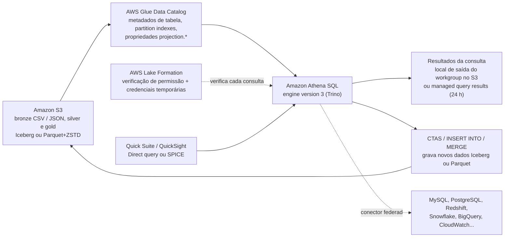
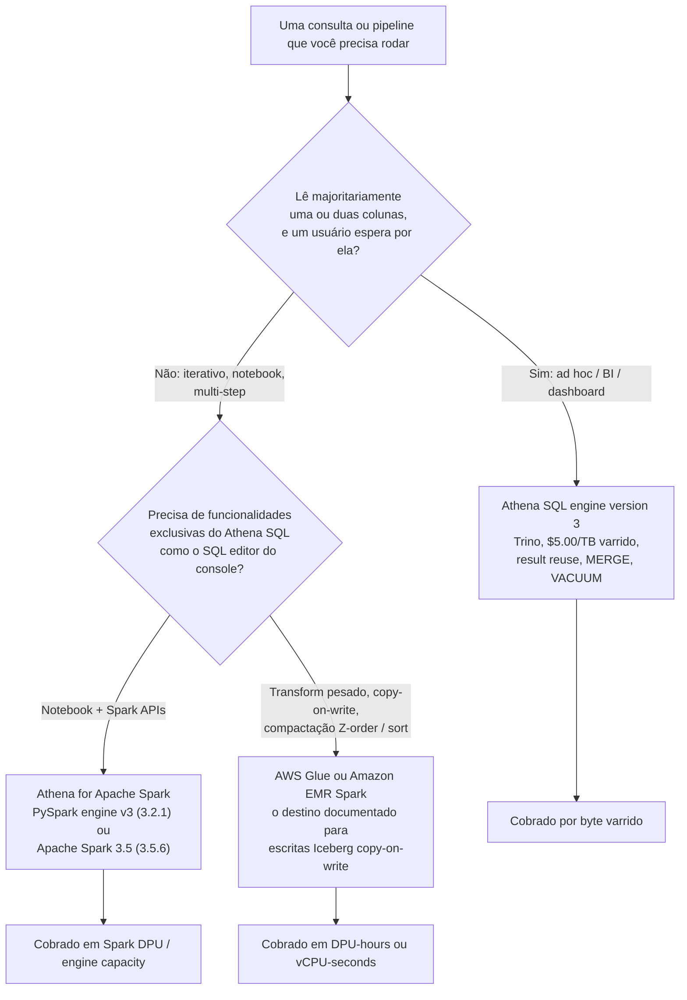
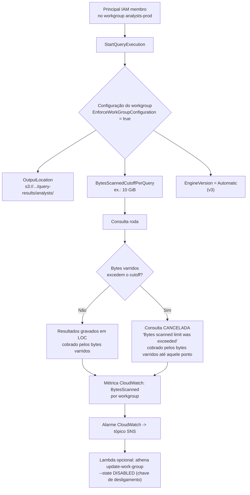
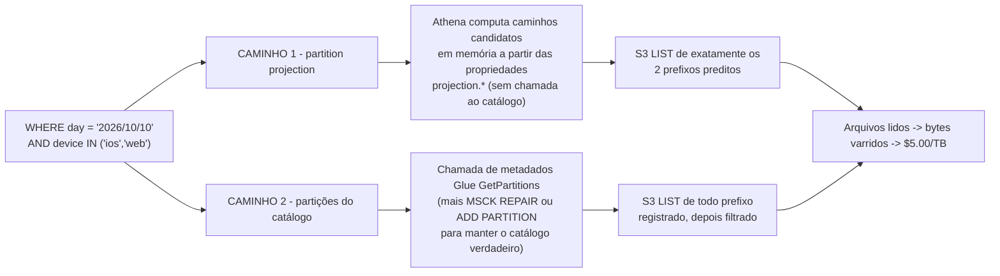
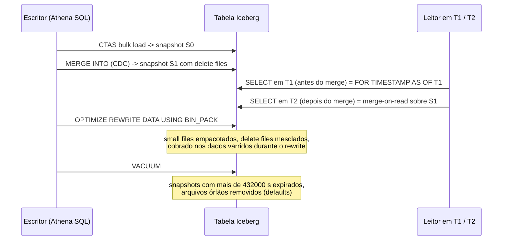
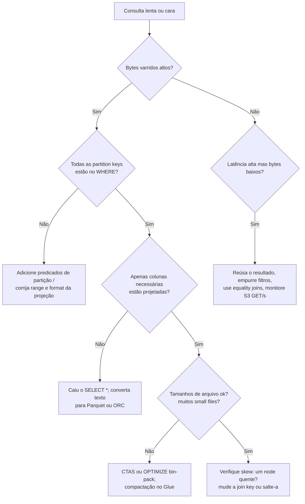
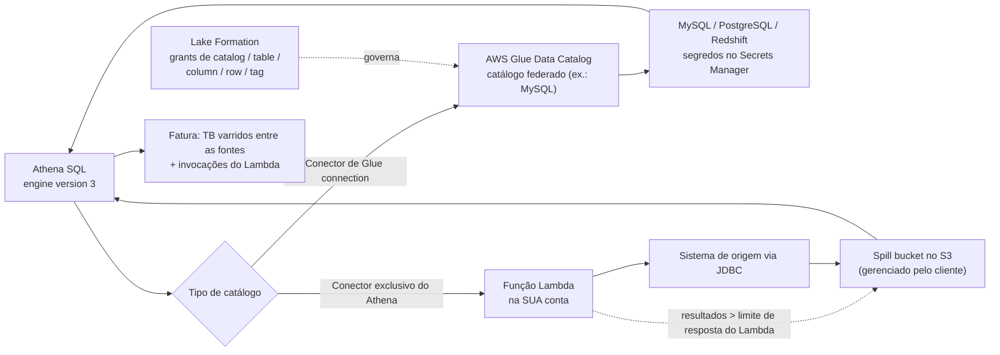

# Athena como o Motor de Consulta do Lakehouse: Custo, Desempenho e Iceberg SQL

As lições 01 até 08 deram a você armazenamento, formatos, tabelas, pipelines e um catálogo. Nada disso responde à pergunta que um usuário de negócio realmente faz: *posso consultar isso, com que velocidade, e quanto vai custar?* **O Amazon Athena é a resposta que a AWS coloca na frente dos usuários de SQL**: serverless, sem cluster para dimensionar, sem licença para comprar, e uma fatura que é função direta de quanto dado a sua consulta lê. Essa última propriedade é a lição inteira: **em um modelo de precificação por varredura, tuning é faturamento, e faturamento é tuning.**

```text
====================================================================
 A SUPERFÍCIE DE DECISÃO DO ATHENA — AWS LAKEHOUSE (em out de 2026)
====================================================================
 Motor ............ Athena SQL engine version 3 (Trino, atual)
                    Athena SQL engine version 2 (Presto, obsoleto)
                    Athena for Apache Spark: PySpark engine v3
                    (Spark 3.2.1) ou Apache Spark 3.5 (3.5.6 / EMR 7.12)
 Medidor .......... $5.00 por TB varrido, mínimo de 10 MB por consulta
                    DDL e consultas falhadas: sem cobrança
                    consultas canceladas: cobradas até o cancelamento
                    Capacity Reservations: $0.30 por DPU-hour
 Plano de controle  workgroup = engine version + local dos resultados +
                    BytesScannedCutoffPerQuery + métricas CloudWatch +
                    result reuse / managed results
 Tabelas .......... Tabelas Hive do AWS Glue Data Catalog e Apache Iceberg
                    (S3 Tables via a federation s3tablescatalog)
 Particionamento ... MSCK REPAIR / ADD PARTITION  vs  partition
                    projection (enum, integer, date, injected)
 Escritas ......... CTAS, INSERT INTO, UNLOAD, MERGE INTO, UPDATE,
                    DELETE (Iceberg, merge-on-read, só engine v3)
 Manutenção ........ OPTIMIZE ... REWRITE DATA, VACUUM
 Governança ....... Verificações de permissão do Lake Formation em
                    cada consulta
 Federation ....... Conectores de Glue connection (sem Lambda do cliente
                    para certos conectores desde 2026-04-21) + conectores
                    exclusivos do Athena que rodam no SEU Lambda
-----------------------------------------------------------------------------
 Não é isto ........ Atualizações Iceberg copy-on-write (use Glue/EMR Spark)
                    transações multi-statement (não é o modelo do Athena)
                    S3 Select (fechado para novos clientes em 2024-07-25)
====================================================================
```

Nesta lição você vai:

- separar os **três caminhos de motor**, Athena SQL engine version 3, engine version 2 obsoleto, e as duas versões de release do **Athena for Apache Spark**, e saber qual funcionalidade vive em qual caminho;
- precificar consultas a **$5.00 por TB varrido**, reproduzir a própria história de compressão da AWS de **$15 → $5 → $1.25**, e computar uma **carga analítica mensal** em uma tabela de 1 TB;
- construir **workgroups** que cortam varreduras desgovernadas, fixam o **local de saída dos resultados** e isolam times do histórico de consultas uns dos outros;
- escolher entre **Hive-style partitioning** e **partition projection**, e então escrever um `CREATE EXTERNAL TABLE` projetado pronto para copiar com `storage.location.template`;
- converter arquivos brutos com **CTAS** e resolver o que **RTAS** significa e não significa em Athena SQL;
- escrever **Iceberg SQL**: time travel através da mudança de cláusula `FOR SYSTEM_TIME AS OF` → `FOR TIMESTAMP AS OF`, a tabela de metadados **`$snapshots`**, **`MERGE INTO`** transacional, `OPTIMIZE` e `VACUUM`;
- ajustar com as alavancas documentadas, **dimensionamento de arquivos, partition e column pruning, pushdown, ordem de join, skew**, e reproduzir uma **redução de varredura de ~60x antes/depois** em uma tabela sintética;
- usar **query result reuse** e **managed query results** sem acreditar que são um cache geral;
- conectar **fontes federadas** via JDBC e outros conectores, e aplicar permissões do **Lake Formation** até colunas e linhas;
- estudar **dois casos de clientes da AWS** (Easygo, Integral Ad Science) mais uma **caixa de atualização de 2026 com fontes**;
- praticar com **11 questões no estilo de exame** e três verificações interativas.

---

## 1. Os três caminhos de motor: SQL v3, SQL v2 e Athena for Apache Spark

### 1.1 O que o Athena de fato é na stack

Athena é o serviço SQL interativo serverless da AWS sobre dados no Amazon S3 e sobre fontes federadas. Em termos de lakehouse, ele é a **camada de consulta**: lê tabelas registradas no **AWS Glue Data Catalog**, tabelas externas Hive-style e tabelas **Apache Iceberg**, e não exige que você provisione ou ajuste um cluster. Statements DDL gravam metadados no Glue Data Catalog; statements DML/DQL leem (e, no Iceberg, escrevem) arquivos de dados no S3.

Essa separação importa para o custo: **DDL é grátis e leituras são medidas**, então o design da sua tabela (formato, colunas, partições) decide o tamanho de toda fatura futura.



### 1.2 O engine version 3 é o atual; a versão 2 está obsoleta

**Athena engine version 3** é o motor SQL atual, e é **baseado em Trino**: a FAQ do Athena afirma *"Athena for SQL uses Trino with full standard SQL support"* e *"we aim to stay within 60-90 days of open-source Trino launches"* (FAQ do Athena, acesso em 2026-10-11). A página de referência do engine version 3 acrescenta que a AWS introduziu *"a continuous integration approach to open source software management that improves concurrency with the Trino and Presto projects"*.

A AWS publicou um benchmark contra o seu antecessor: em **TPC-DS na escala de 3 TB**, o engine version 3 mostrou **~20% de melhoria de performance de consulta** sobre a release mais recente do engine version 2 (AWS Big Data Blog, 2022-10-13).

Funcionalidades que existem **apenas** no engine version 3 (esta lista é cobrada em prova):

| Funcionalidade | Caminho |
|---|---|
| Query result reuse | só engine v3 |
| `MERGE INTO` | engine v3, apenas tabelas Iceberg |
| `VACUUM` / `OPTIMIZE ... REWRITE DATA` | engine v3, só Iceberg |
| `compression_level` ZSTD | só engine v3 |
| Lake Formation fine-grained access expandido com Iceberg | engine version 3 obrigatório |
| Time travel `FOR TIMESTAMP AS OF` / `FOR VERSION AS OF` | sintaxe do engine v3 |

**Engine version 2** é baseado em Presto e está **obsoleto**. A AWS documenta que workgroups ficam definidos como **Automatic** (a AWS os atualiza) ou **Manual** engine version, e que *"Athena upgrades your workgroups when a version is no longer offered"* (User Guide do Athena, versionamento de motor, acesso em 2026-10-11). Uma resposta de funcionário da AWS no AWS re:Post (2024-02-23) afirma que a versão 2 está obsoleta e que um workgroup não pode mais ser rebaixado para ela. **Não existe data publicada de fim de suporte** para o v2, e **não existe engine version 4**, a versão 3 é a mais recente em outubro de 2026.

- **📚 Você sabia?** Os drivers de cliente são versionados separadamente do motor: **JDBC 3.8.0 foi lançado em 2026-06-03** e **ODBC 2.3.0.0 em 2026-08-21**, enquanto APIs obsoletas do data catalog do Athena (`athena:RunQuery` e afins) mais JDBC abaixo de 3.x e ODBC abaixo de 2.x pararam de funcionar em **2025-10-31**. Um erro de conexão que parece "do lado do Athena" muitas vezes é um fim de vida de driver do outro lado (notas de release do User Guide do Athena, acesso em 2026-10-11).

### 1.3 Athena for Apache Spark: duas versões de release, uma escolha imutável

Cargas Spark rodam em um **tipo de workgroup separado**. Um workgroup Spark não pode usar o editor de consultas SQL do Athena, e um workgroup SQL não pode usar o editor de notebooks Spark; o tipo de motor analítico de um workgroup é **imutável após a criação** (User Guide do Athena: considerações e limitações do Spark, acesso em 2026-10-11).

| Versão de release | Runtime | De onde você o dirige | Notas |
|---|---|---|---|
| **PySpark engine version 3** | Apache Spark **3.2.1** | Notebooks Athena no console + APIs de notebook | Não pode ser atualizado in place para Spark 3.5 |
| **Apache Spark version 3.5** | Apache Spark **3.5.6** no **Amazon EMR 7.12** | Notebooks do SageMaker Unified Studio, clientes Spark Connect | Sem notebooks Athena no console, sem Calculation APIs |

O anúncio What's New de 2025-11-21 afirma que o Athena for Apache Spark *"now runs on Spark 3.5.6"*, é *"optimized for open table formats including Apache Iceberg and Delta Lake"*, suporta **Spark Connect**, e *"now enforces table-level access controls defined in AWS Lake Formation"*. O motor Spark serverless roda em **micro-VMs Firecracker** e *"launches and scales in seconds"* (AWS Big Data Blog, 2026-07-02).

Duas armadilhas: você **não pode atualizar um workgroup de PySpark engine version 3 para Apache Spark version 3.5** (crie um workgroup novo), e **consultas de view entre motores não são suportadas**: uma view criada pelo Athena SQL não é consultável pelo Athena for Spark.



```matching
{
  "question": "Correlacione cada caminho de motor com a carga de trabalho para a qual ele é a resposta documentada (em out de 2026):",
  "pairs": [
    {"left": "Athena SQL engine version 3 (Trino)", "right": "SQL interativo sobre S3 e Iceberg: dashboards, análise ad hoc, time travel, MERGE INTO, VACUUM, result reuse: cobrado a $5.00 por TB varrido"},
    {"left": "Athena SQL engine version 2 (Presto)", "right": "Caminho obsoleto: sem result reuse, sem MERGE INTO, sem VACUUM, antiga cláusula de time travel FOR SYSTEM_TIME AS OF, atualizado automaticamente pela AWS quando uma versão deixa de ser oferecida"},
    {"left": "Athena for Apache Spark - PySpark engine version 3", "right": "Notebooks Athena no console e APIs de notebook no Apache Spark 3.2.1; não pode ser atualizado in place para Spark 3.5"},
    {"left": "Athena for Apache Spark - Apache Spark version 3.5", "right": "Spark 3.5.6 no Amazon EMR 7.12 dirigido do SageMaker Unified Studio ou de clientes Spark Connect; sem notebooks Athena no console"},
    {"left": "AWS Glue ou Amazon EMR Spark", "right": "A rota documentada para atualizações Iceberg copy-on-write, sorts e compactação Z-order que o Athena SQL (somente merge-on-read) não realiza"}
  ],
  "explanation": "Os caminhos não são funcionalidades intercambiáveis com preços diferentes; são capacidades diferentes. O Athena SQL v3 é dono da carga interativa por TB varrido e de todo statement de manutenção em nível de linha. O Athena SQL v2 é um caminho de compatibilidade que a AWS aposenta. As duas versões de release do Spark diferem em suporte a notebooks e não podem ser convertidas uma na outra dentro de um workgroup. A manutenção Iceberg copy-on-write precisa sair do Athena: o AWS Prescriptive Guidance aponta para outros motores como Apache Spark no Amazon EMR ou AWS Glue para esse trabalho."
}
```

---

## 2. Precificação: $5.00 por TB varrido, e por que formato é um controle de custo

### 2.1 O medidor

| Regra | Valor (preço de lista US East, acesso em 2026-10-11) |
|---|---|
| Cobrança de varredura de dados por consulta | **$5.00 por TB** varrido |
| Arredondamento | para cima até o megabyte mais próximo, **mínimo de 10 MB por consulta** |
| DDL (`CREATE`/`ALTER`/`DROP`, gerenciamento de partições) | **sem cobrança** |
| Consultas falhadas | **sem cobrança** |
| Consultas canceladas | **cobradas pelos bytes varridos até o cancelamento** |
| Consultas federadas | por TB varrido **agregado entre fontes de dados**, mais cobranças de invocação do AWS Lambda |
| Capacity Reservations | **$0.30 por DPU-hour**; consultas no workgroup reservado **não** são cobradas por TB varrido |

A FAQ da AWS afirma que compressão, particionamento e conversão colunar reduzem o custo por consulta em **30% a 90%**. Essa afirmação não é abstração de marketing: a página de precificação percorre a aritmética ela mesma.

### 2.2 Exemplo resolvido E1: a própria história de compressão em três passos da AWS

O exemplo canônico da página de precificação é uma tabela com **4 colunas de tamanho igual**, armazenada como **texto não comprimido**, totalizando **3 TB** no S3, onde a consulta lê **uma coluna**:

```sql
-- Read one column of four from a 3 TB uncompressed text table
SELECT customer_id, SUM(amount)
FROM   lakehouse.raw.transactions_raw   -- 3 TB, 4 equal columns, plain text
GROUP  BY customer_id;
```

| Passo | O que mudou | Bytes varridos | Custo |
|---|---|---|---|
| 1 | Texto não comprimido, arquivo inteiro lido | 3 TB | **$15.00** (3 × $5) |
| 2 | Compressão 3x (classe GZIP) | ~1 TB | **$5.00** |
| 3 | Parquet: compressão 3x **e** 4x menos colunas lidas | 0.25 TB | **$1.25** |

A AWS afirma o *"3x de economia com compressão e 4x de economia lendo apenas uma coluna"*, dando *"$1.25"*. Leia isso como uma regra de design: **a primeira alavanca (compressão) e a segunda (column pruning) multiplicam, não somam.** Uma variante moderna de lakehouse, ZSTD no default do Iceberg, que o Athena grava no **nível 3**, comprime ainda melhor, mas a AWS não publica ratio oficial para ela, então trate qualquer número de "10x com Zstd" como ilustrativo e de sua responsabilidade medir.

### 2.3 Exemplo resolvido E2: tabela de 1 TB, um mês de consultas analíticas

**Cenário (todos os números em out de 2026):** uma tabela fato, **1 TB não comprimido**, **10 colunas de largura igual**, **365 partições diárias**. A consulta de dashboard lê **uma coluna** e filtra para **um dia**. O time roda **30 consultas por dia × 22 dias úteis = 660 consultas por mês**.

```sql
-- The dashboard query: 1 column, 1 day, 10 MB floor never binds
SELECT region, COUNT(*) AS orders
FROM   lakehouse.gold.orders
WHERE  order_date = DATE '2026-10-10'
  AND  region = 'EU';
```

| # | Forma da tabela | Bytes varridos por consulta | Custo por consulta | 660 consultas / mês |
|---|---|---|---|---|
| A | Texto puro, `SELECT *`, sem filtro de partição | 1 TB | $5.000000 | **$3,300.00** |
| B | Texto + GZIP 3:1, ainda `SELECT *` | 0.333 TB | $1.666667 | **$1,100.00** |
| C | Parquet + Snappy 3:1, **1 de 10 colunas** | 0.0333 TB | $0.166667 | **$110.00** |
| D | + **daily partition pruning** (1 de 365 dias) | 91.3 MB | $0.000435 | **$0.29** |
| E | D + **query result reuse** (uma computação por hora) | 91.3 MB × 176 horas | $0.000435 | **$0.08** |

A linha C é `0.333 TB ÷ 10 colunas = 0.0333 TB` varridos; a linha D divide isso por 365 de novo porque apenas uma partição é aberta: `0.0333 ÷ 365 = 91.3 MB`, que é `0.0000871 TB × $5 = $0.000435` por consulta, e `660 × $0.000435 ≈ $0.29`. A linha E assume que a mesma query string se repete dentro de uma janela de reuso de 60 minutos ao longo de 8 horas × 22 dias = 176 computações distintas.

**O anti-padrão para precificar também:** a mesma tabela Parquet consultada com `SELECT *` lê as dez colunas, então o ganho da linha C desaparece: `0.333 TB → $1.67 por consulta → $1,100 por mês`, purely de uma projection list.

```plot
{
  "type": "bar",
  "title": "660 consultas de dashboard por mês em uma tabela de 1 TB (us-east-1, em out de 2026)",
  "xLabel": "Formato da tabela e formato da consulta",
  "yLabel": "USD por mês",
  "xKey": "scenario",
  "data": [
    {"scenario": "A: text, SELECT *, no partition filter", "usd_per_month": 3300.00},
    {"scenario": "B: text + GZIP 3:1, SELECT *", "usd_per_month": 1100.00},
    {"scenario": "C: Parquet + Snappy, 1 column", "usd_per_month": 110.00},
    {"scenario": "D: C + daily partition pruning", "usd_per_month": 0.29},
    {"scenario": "E: D + query result reuse", "usd_per_month": 0.08},
    {"scenario": "Anti-pattern: Parquet SELECT *", "usd_per_month": 1100.00}
  ]
}
```

O gráfico de barras é o argumento para tratar **formato, projection list e predicado de partição como decisões de faturamento**: a diferença entre a linha A e a linha D é um fator de cerca de **11,000**, e nem um byte disso veio de um motor mais rápido.

- **📚 Você sabia?** O **piso de 10 MB** limita uma única consulta a `10 MB x $5 / 1,048,576 MB` = **$0.0000477**. É por isso que a linha D nunca é zero, e por isso que um dashboard que dispara 500 consultas minúsculas por dia ainda registra uma fatura, mas é também por isso que DDL grátis vale dinheiro de verdade: você pode reconstruir o formato e as partições de uma tabela a tarde inteira de graça e pagar por isso apenas no primeiro SELECT.

### 2.4 Os outros dois medidores

**Capacity Reservations** são a alternativa de gasto previsível: reserve **DPUs** e o workgroup associado para de incorrer em cobranças por TB. Um DPU é **4 vCPU e 16 GB de memória**; a reserva mínima é **4 DPUs** (incrementos de 4), com até **100 reservas e 1,000 DPUs por conta e Região**. O exemplo resolvido da própria página de precificação:

```text
Peak half hour .... 160 DPU x $0.30 per DPU-hour x 0.25 hours = $12.00
Off-peak .........  16 DPU x $0.30 per DPU-hour x 0.75 hours =  $3.60
                                                per hour ..... $15.60
```

Desde **2026-02-01** as reservas são compráveis com **granularidade de 1 minuto e mínimo de 4 DPUs**, o que a AWS diz entregar *"cost savings up to 95% for short-duration query workloads"*, e *"você paga apenas pela capacidade que reserva e não há cobranças pelos dados varridos"* (AWS What's New, 2026-02-01).

**Consultas federadas** cobram por TB varrido *"aggregated across data sources, rounded up to the nearest megabyte with a 10 megabyte minimum per query, unless Provisioned Capacity is used"*, e *"invocam funções AWS Lambda na sua conta, e você é cobrado pelo uso do Lambda às tarifas padrão"* (preços do Athena, acesso em 2026-10-11). Federation, portanto, tem **dois medidores, não um**.

---

## 3. Workgroups: o plano de controle operacional

Um workgroup é a unidade de isolamento e aplicação do Athena. Ele delimita **histórico de consultas, consultas salvas e local dos resultados**, e carrega as configurações que decidem qual engine version roda, como os resultados são criptografados, e **quanto dado uma consulta tem permissão de ler antes de morrer**.

| Configuração do workgroup (API do Athena) | O que ela faz |
|---|---|
| `ResultConfiguration.OutputLocation` | Prefixo S3 para resultados de consulta: exigido do cliente ou do workgroup, senão o Athena erro *"no output location is provided"* |
| `EnforceWorkGroupConfiguration` | Configurações do workgroup sobrepõem as do cliente (é assim que admins vencem) |
| `BytesScannedCutoffPerQuery` | Limite de uso de dados por consulta; faixa válida mínima de **10,000,000 bytes** (10 MB) |
| `PublishCloudWatchMetricsEnabled` | Emite métricas do workgroup nas quais você pode gerar alarme |
| `EngineVersion` | Automatic (a AWS atualiza) ou Manual |
| `ExecutionRole` / `EngineConfiguration` | Workgroups Spark: IAM role e dimensionamento de DPU |
| `ManagedQueryResultsConfiguration` | Armazenamento de resultados de propriedade do Athena no lugar do seu bucket |
| `CustomerContentEncryptionConfiguration` / `RequesterPaysEnabled` | Criptografia de resultados; tratamento de bucket requester-pays |



### 3.1 Exemplo resolvido E3: cercando analistas com um cutoff por consulta

O campo do console é **Data scanned limit**, válido de **10 MB a 7 EB**. O campo da API é `BytesScannedCutoffPerQuery`. Um analista roda um full-table scan de uma tabela de **50 GB** com um cutoff de **10 GiB**:

```bash
aws athena create-work-group \
  --name analysts-prod \
  --configuration '{
    "ResultConfiguration":{"OutputLocation":"s3://lakehouse-demo/query-results/analysts/"},
    "EnforceWorkGroupConfiguration":true,
    "PublishCloudWatchMetricsEnabled":true,
    "BytesScannedCutoffPerQuery":10737418240
  }' \
  --description "Ad hoc analyst workgroup, 10 GiB per-query scan ceiling"
```

| Resultado | Bytes cobrados | Custo a $5.00/TB |
|---|---|---|
| Sem o cutoff (tabela de 50 GB lida) | 50 GB = 0.0488 TB | **≈ $0.24** |
| Com o cutoff de 10 GiB (cancelado no teto) | 10 GiB = 0.00977 TB | **≈ $0.05** |

O próprio artigo de workgroups da AWS pareia isso com um alarme CloudWatch **por workgroup** e uma função Lambda que **desabilita o workgroup** quando um threshold agregado é ultrapassado (AWS Big Data Blog, 2019-07-18): os dois controles são complementares: o cutoff **por consulta** para um statement ruim, o alarme **por workgroup** para um batch desgovernado.

### 3.2 Local de saída e isolamento de admins de analistas

`OutputLocation` é onde result sets, arquivos de manifest e metadados de execução pousam, e é o objeto da pergunta de segurança da Seção 10: **resultados de consulta não podem ser registrados no Lake Formation**, então o prefixo do bucket é governado apenas por S3/IAM. Pareie o local com a membership do workgroup para que o SQL text e os result sets de cada população fiquem visíveis apenas para ela; este é exatamente o padrão que a Integral Ad Science publicou: *"By defining an Athena workgroup per business unit, IAS also takes advantage of assigning per-department billing tags and query limits to help with cost management"* (AWS Big Data Blog, 2021-09-23).

> [!WARNING]
> ⚠️ **Um scan cutoff limita uma fatura; ele não torna a consulta grátis.** Quando o `BytesScannedCutoffPerQuery` dispara, a consulta é **cancelada e cobrada por cada byte que leu até aquele ponto**: um scan parcial de 11 GB ainda custa dinheiro, e um workgroup de 50 analistas cada um disparando um teto de 10 GiB diariamente são `50 × 10 GiB × $5/TB ≈ $2.44/dia` de trabalho *cancelado*. Segunda armadilha: **o prefixo de resultados e o histórico de consultas estão fora do alcance do Lake Formation**, então um analista que consegue listar o workgroup pode ler SQL e arquivos de resultado de dados para os quais ele pode não ter grant na tabela de origem. Alinhe a membership do workgroup com os seus grants do Lake Formation em vez de confiar que o bucket de resultados faz isso.

---

## 4. Particionamento versus partition projection

### 4.1 O caminho clássico: pastas key=value e um job de registro

Hive-style partitioning grava segmentos `order_date=2026-10-10/` sob o local da tabela, e o catálogo não sabe que eles existem até você rodar `MSCK REPAIR TABLE` ou `ALTER TABLE ADD PARTITION`. O mecanismo funciona, e traz dois custos operacionais: **um passo de registro em todo pipeline de ingestão**, e um **teto de contagem de partições**, o Glue suporta tabelas com até **10 milhões de partições**, mas **o Athena pode escanear no máximo 1 milhão de partições em uma única consulta**, e cada partition key extra multiplica o número de arquivos que as suas escritas produzem.

### 4.2 O caminho da projeção: calcule os caminhos, não liste-os

Partition projection coloca a lógica de partição em **propriedades de tabela** em vez de no catálogo. A documentação do Athena é explícita: *"During query execution, Athena uses this information to project the partition values instead of retrieving them from the AWS Glue Data Catalog or external Hive metastore… removes the need to manually create partitions."* Não há job de repair, sem sync de catálogo, e sem passo de registro de partição no pipeline, e *"queries for values that are beyond the range bounds defined for partition projection do not return an error… returns zero rows"*.

Existem **quatro** tipos de projeção (User Guide do Athena: tipos suportados para partition projection, acesso em 2026-10-11):

| Tipo | Propriedade que o define | Range / comportamento |
|---|---|---|
| `enum` | `projection.{col}.values` | Lista de literais separada por vírgula, ex.: `ios,android,web` |
| `integer` | `projection.{col}.range` (+ `.interval`, `.digits` opcionais) | Em qualquer lugar de um signed long Java, −2^63 a 2^63−1 |
| `date` | `projection.{col}.range` + `.format` (+ `.interval`, `.interval.unit`) | Padrão Java DateTimeFormatter; o range pode usar `NOW`, `NOW+1MONTH` |
| `injected` | `projection.{col}.type = injected` | Somente string; os valores vêm da cláusula `WHERE` da consulta em tempo de execução |

### 4.3 Exemplo resolvido E4: uma tabela projetada pronta para copiar

```sql
CREATE EXTERNAL TABLE web_events (
  event_time timestamp,
  url        string,
  user_id    string
)
PARTITIONED BY (
  `day`    string,
  device   string
)
LOCATION 's3://lakehouse-demo/events/'
TBLPROPERTIES (
  'projection.enabled'            = 'true',
  'projection.day.type'           = 'date',
  'projection.day.format'         = 'yyyy/MM/dd',
  'projection.day.range'          = '2024/01/01,NOW',
  'projection.day.interval'       = '1',
  'projection.day.interval.unit'  = 'DAYS',
  'projection.device.type'        = 'enum',
  'projection.device.values'      = 'ios,android,web,other',
  'storage.location.template'     = 's3://lakehouse-demo/events/${day}/${device}/'
);
```

```sql
-- Correct: both keys bounded, predicate format matches yyyy/MM/dd exactly
SELECT count(*)
FROM   web_events
WHERE  `day`   = '2026/10/10'
  AND  device IN ('ios','web');
```

Cinco pontos didáticos saem desse statement:

1. **`MSCK REPAIR TABLE` nunca é necessário**: novos dias aparecem simplesmente por serem gravados no S3.
2. **O predicado deve casar com o formato configurado.** Com `.format = 'yyyy/MM/dd'`, o valor `2026/10/10` funciona; `DATE '2026-10-10'` e `2026-10-10` não funcionam.
3. **`storage.location.template` deve conter um placeholder por partition column e terminar com `/`**: senão o Athena compõe caminhos que você não escreveu.
4. **Valores fora do range retornam zero linhas, silenciosamente.** Um ticket de "os dados estão sumindo" muitas vezes é um `.range` que termina em `NOW-1MONTH`.
5. **Sempre delimite toda key projetada.** Omitir `device` faz o Athena LISTar todo prefixo daquele dia contra o orçamento S3 compartilhado de **5,500 requisições GET por segundo por prefixo particionado**.



```fillblank
{
  "question": "Complete o contrato de partition projection usando os nomes de tipo e as chaves de propriedade do próprio Athena (em out de 2026):",
  "template": "Uma tabela pode usar qualquer combinação de quatro tipos de projeção: {{1}}, {{2}}, {{3}} e {{4}}. A projeção é ativada com {{5}} = 'true', um layout S3 customizado é declarado com {{6}}, uma coluna enum é definida por projection.<column>.{{7}}, uma coluna de data precisa carregar tanto um range quanto um {{8}} escrito como padrão Java DateTimeFormatter, e uma coluna injected recebe seus valores da cláusula WHERE da consulta como condições estáticas de {{9}}: qualquer outra coisa levanta CONSTRAINT_VIOLATION. Consultas fora do range projetado retornam {{10}} linhas em vez de um erro.",
  "answers": {
    "1": "enum",
    "2": "integer",
    "3": "date",
    "4": "injected",
    "5": "projection.enabled",
    "6": "storage.location.template",
    "7": "values",
    "8": "format",
    "9": "igualdade",
    "10": "zero"
  },
  "distractors": ["string", "range", "bucket", "hashed", "computed", "dynamic", "partition.enabled", "projection.values", "location.template", "mask", "pattern", "literal", "NULL", "uma", "-1", "um erro"],
  "explanation": "Os quatro tipos suportados são enum, integer, date e injected, e podem ser combinados livremente em uma tabela. projection.enabled ativa o mecanismo; storage.location.template sobrepõe a composição de caminhos e deve conter um placeholder por partition column. Enum usa projection.<col>.values; date precisa de range mais format (Java DateTimeFormatter); injected é somente string e é fornecido em tempo de consulta como condições estáticas de igualdade: um range, LIKE ou predicado ausente em uma coluna injected é CONSTRAINT_VIOLATION. Predicados fora do range não são erros: o Athena retorna zero linhas, e é por isso que um range estreito demais parece dado sumido."
}
```

- **📚 Você sabia?** A projeção não remove o teto de varredura: ela remove o custo de **catálogo**. O Athena ainda lê no máximo **1 milhão de partições por consulta**, e os partition indexes do Glue existem para tabelas com dezenas de milhares de partições e além. Projection é a resposta para *"meus metadados de partição são enormes"*; indexes e pruning são a resposta para *"minhas partições são muitas mas registradas"*.

---

## 5. CTAS: transformando arquivos brutos em uma tabela que você pode se dar ao luxo de consultar

### 5.1 `CREATE TABLE AS SELECT` e as armadilhas de propriedade

CTAS materializa o resultado de uma consulta em uma nova tabela, o que o torna o job de ETL mais barato possível: sem cluster, sem passo separado, e **o próprio CTAS é trabalho com forma de DDL que ainda conta como DML para cotas de serviço**. As propriedades documentadas:

| Propriedade | Tabela Hive | Tabela Iceberg |
|---|---|---|
| `format` | ORC, PARQUET, AVRO, JSON, ION, TEXTFILE: **deve ser minúsculo** | ORC, PARQUET, AVRO |
| Formato padrão | **PARQUET** se omitido | **PARQUET** se omitido |
| Particionamento | `partitioned_by = ARRAY['col', ...]` | `partitioning = ARRAY['month(dt)', ...]` (transforms) |
| Tipo de tabela / local | `external_location` | `table_type = 'ICEBERG'`, `is_external = false`, `location = ...` **obrigatório** |
| Compressão de escrita | Parquet default **GZIP** (GZIP ou SNAPPY); ORC default **ZLIB** (LZ4, SNAPPY, ZLIB, ZSTD) | Default **ZSTD** no **nível 3**; níveis 1 to 22 via `compression_level` (só engine v3) |
| Bucketing | `bucketed_by`, `bucket_count` (máx 100 combinações bucket × partição) | n/a: use partition transforms |

Dois limites duros para memorizar: **100 partições por statement CTAS** (e por `INSERT INTO`), que falha como `HIVE_TOO_MANY_OPEN_PARTITIONS`, e a contabilização de DML em cotas de serviço mencionada acima.

### 5.2 Exemplo resolvido E5: CSV bruto para Iceberg silver, em um statement

```sql
CREATE TABLE lakehouse.silver.orders
WITH (
  table_type                    = 'ICEBERG',
  is_external                   = false,
  format                        = 'PARQUET',
  location                      = 's3://lakehouse-demo/silver/orders/',
  partitioning                  = ARRAY['month(order_date)'],
  vacuum_min_snapshots_to_keep  = 10,
  vacuum_max_snapshot_age_seconds = 604800
)
AS SELECT
  order_id,
  customer_id,
  status,
  total_amount,
  CAST(order_ts AS timestamp) AS order_ts,
  CAST(order_ts AS date)      AS order_date
FROM lakehouse.bronze.orders_raw
WHERE order_id IS NOT NULL;
```

Note o que **não** está nesse statement: `format` é minúsculo (`FORMAT` maiúsculo falha a consulta), `partitioning` usa um **transform** do Iceberg em vez de `partitioned_by`, e `location` é fornecido porque CTAS Iceberg não aceita `external_location`.

> [!IMPORTANT]
> **CTAS é uma escrita com três faturas anexadas.** (1) Ele conta como **DML contra cotas de serviço**, então um loop de statements CTAS pode bater numa cota muito antes de bater num teto de custo. (2) Ele é limitado a **100 partições por statement**. (3) Em dados registrados no Lake Formation, CTAS exige **permissão IAM `s3:` de escrita no local de destino além dos** seus grants de leitura do Lake Formation: um usuário com direitos de SELECT perfeitos e sem política IAM de escrita recebe um erro de permissão no momento do sucesso, não no parse.

### 5.3 A questão do RTAS

`REPLACE TABLE AS SELECT` está documentado na **documentação de Spark do projeto Iceberg**, e você o encontrará em material baseado em Spark. Ele **não** aparece nas páginas de `CREATE TABLE AS SELECT` / CTAS do user guide do Athena SQL em 2026-10-11, então em Athena SQL os padrões de substituição são: **CTAS para uma tabela nova e depois swap**, **`INSERT OVERWRITE` para tabelas Hive**, ou **Spark** (Glue, EMR ou Athena for Apache Spark) quando você realmente precisa de um replace in place. Não assuma que RTAS existe em Athena SQL porque existe em docs do Iceberg; essa suposição falha no parse na frente de um usuário.

---

## 6. Iceberg SQL: time travel, snapshots, MERGE e manutenção

### 6.1 Lendo uma tabela como de um momento

O Athena *"can perform read, time travel, write, and DDL queries on Apache Iceberg tables"*, e expõe tabelas de metadados **`$files`, `$manifests`, `$history`, `$partitions`, `$snapshots`, `$refs`**. A cláusula que você usa depende do engine version, e este é o bug de migração mais comum da lição:

| Engine version 2 (obsoleto) | Engine version 3 (atual) | Significado |
|---|---|---|
| `FOR SYSTEM_TIME AS OF <ts>` | **`FOR TIMESTAMP AS OF <ts>`** | Lê o snapshot vigente em um horário de relógio |
| `FOR SYSTEM_VERSION AS OF <id>` | **`FOR VERSION AS OF <id>`** | Lê um snapshot ID específico |

Timestamps escritos sem fuso horário são interpretados como **UTC**. A documentação do Athena afirma a substituição diretamente: *"As cláusulas `FOR SYSTEM_TIME AS OF` e `FOR SYSTEM_VERSION AS OF` no Athena engine version 2 foram substituídas pelas cláusulas `FOR TIMESTAMP AS OF` e `FOR VERSION AS OF` no Athena engine version 3."*

```sql
-- Engine version 3 time travel
SELECT * FROM lakehouse.silver.orders
FOR TIMESTAMP AS OF current_timestamp - INTERVAL '1' HOUR;

-- Snapshot inventory, straight from the metadata table
SELECT snapshot_id, committed_at, operation, summary
FROM   "lakehouse"."orders$snapshots"
ORDER  BY committed_at DESC;

-- Diff two snapshots by joining them
SELECT t.order_id, t.status AS now, p.status AS then_
FROM        lakehouse.silver.orders t
JOIN        lakehouse.silver.orders p
        ON  t.order_id = p.order_id
WHERE t.status <> p.status
  AND t.order_id IN (
        SELECT order_id FROM lakehouse.silver.orders
        FOR TIMESTAMP AS OF current_timestamp - INTERVAL '1' DAY)
```

### 6.2 `MERGE INTO`: o upsert transacional, somente merge-on-read

`MERGE INTO` *"is transactional and is supported only for Apache Iceberg tables in Athena engine version 3"*. Você pode usar um número arbitrário de cláusulas `WHEN`; **a primeira cláusula que casa por linha de origem executa**, e o Athena levanta um erro de usuário se **uma linha de destino casa com múltiplas linhas de origem**.

```sql
MERGE INTO lakehouse.silver.orders AS t
USING lakehouse.bronze.orders_cdc AS s
   ON t.order_id = s.order_id
WHEN MATCHED AND s.op = 'U' THEN
  UPDATE SET status = s.status, total_amount = s.total_amount
WHEN MATCHED AND s.op = 'D' THEN
  DELETE
WHEN NOT MATCHED THEN
  INSERT *;
```

O limite para memorizar: *"Athena SQL does not currently support the copy-on-write approach. The UPDATE, MERGE INTO, and DELETE FROM operations always use the merge-on-read approach with positional deletes, regardless of specified table properties"*: essas propriedades de tabela são ignoradas, e trabalho copy-on-write pertence ao **Apache Spark no Amazon EMR ou AWS Glue** (user guide do Athena; AWS Prescriptive Guidance, ambos com acesso em 2026-10-11).



### 6.3 Manutenção: `OPTIMIZE` e `VACUUM`

```sql
-- Bin-pack the recent partitions; only partition columns may appear in WHERE
OPTIMIZE lakehouse.silver.orders
REWRITE DATA USING BIN_PACK
WHERE order_date >= DATE '2026-09-01';

-- Expire old snapshots and remove orphan files (defaults shown)
VACUUM lakehouse.silver.orders
vacuum_max_snapshot_age_seconds = 432000,
vacuum_min_snapshots_to_keep     = 1,
vacuum_max_metadata_files_to_keep = 100;
```

`OPTIMIZE` é *"suportado apenas para tabelas Apache Iceberg"* e *"apenas colunas de partição são permitidas na cláusula WHERE"*; ele é **cobrado pelos dados varridos durante o rewrite**, então uma tabela já compacta custa aproximadamente nada. `VACUUM` realiza **expiração de snapshots e remoção de arquivos órfãos**; as cobranças da API do S3 para essas requisições ainda se aplicam. Se você prefere não agendar nenhum dos dois, os **table optimizers do Glue** podem rodar compactação, retenção de snapshots e limpeza de órfãos automaticamente.

- **📚 Você sabia?** Uma view fixada (pinned) é a maneira mais barata de expor "o estado de cinco minutos atrás" sem que os usuários escrevam SQL de time travel: o próprio blog de upsert da AWS fixa uma view com `FOR TIMESTAMP AS OF current_timestamp + interval '-5' minute`, então consumidores downstream sempre leem um estado anterior estável enquanto o `MERGE INTO` continua gravando novos snapshots por baixo deles (AWS Big Data Blog, 2023-04-27).

> [!WARNING]
> ⚠️ **Dois statements Iceberg falham de maneiras que parecem problemas de dados.** Primeiro, rodar `FOR SYSTEM_TIME AS OF` no engine version 3 é um **erro de sintaxe**, não um fallback silencioso, e um timestamp ingênuo é lido como **UTC**, então uma string de horário local desloca o seu snapshot em horas. Segundo, `MERGE INTO`, `OPTIMIZE` e `VACUUM` são **engine v3, só Iceberg**: aponte-os para uma tabela Hive ou para o engine version 2 e o statement falha na validação. Finalmente, merge-on-read significa que todo `UPDATE`/`DELETE`/`MERGE` deixa **delete files para trás**, se você nunca roda `OPTIMIZE`, o custo de leitura e a latência crescem monótonamente.

---

## 7. Ajuste de performance: as nove alavancas

### 7.1 Dimensionamento e layout de arquivos

| Alavanca | Número documentado |
|---|---|
| Tamanho de bloco Parquet | **128 MB** default |
| Tamanho de stripe ORC | **64 MB** default; stripes menores que **8 MB** são lidos inteiros |
| Small files | Cada arquivo extra adiciona trabalho de S3 LIST/GET contra **5,500 requisições GET/segundo por prefixo particionado** |
| Compressão | Iceberg no engine v3 default para **Parquet + ZSTD (nível 3)**; Athena não consegue *escrever* Parquet com LZ4 ou LZO (leituras são suportadas) |
| Tipos complexos | Parquet com arrays/maps/structs pode derrotar o column pruning (problema conhecido documentado): a solução documentada é **ORC** |
| Bucketing | Distribua por filter keys de alta cardinalidade para que uma lookup leia um bucket; **máx 100 combinações bucket × partição** |

### 7.2 Pruning, pushdown, joins e skew

1. **Partition pruning** só acontece se a consulta filtra **todas** as partition keys; a projeção o torna gratuito, mas não o torna automático.
2. **Column pruning** é a diferença entre a linha C e a linha A no E2: projete as colunas de que você precisa e nunca use `SELECT *` em SQL de produção.
3. **Predicate pushdown** para row groups do Parquet / stripes do ORC usa estatísticas min/max: é por isso que escritas ordenadas ou clustered fazem pruning melhor que escritas aleatórias.
4. **Ordem de join**: ponha a **tabela maior no lado LEFT (probe)** de um hash join distribuído, e prefira **joins de igualdade** a `LIKE` ou predicados de desigualdade.
5. **Skew**: *"Se muitas linhas têm os mesmos valores para as colunas usadas na condição de join, um node pode acabar tendo que processar uma grande parte do join em si, enquanto outros nodes ficam ociosos."* Mais workers nunca consertam skew de uma única key: mude ou salte a key, ou estreite o `PARTITION BY` da janela.
6. **Formato da consulta**: `LIMIT` com `ORDER BY`, `UNION ALL` sobre `UNION`, números sobre strings, `regexp_like` sobre um `LIKE` sem âncora, `approx_distinct` sobre `COUNT(DISTINCT)`, e `UNLOAD` para exports de resultado grandes em vez de uma escrita única de CSV.
7. **S3 Select não está nesta lista**: a AWS o fechou para novos clientes em **2024-07-25**, anunciou nenhuma nova capacidade, e nomeia o **Athena como a abordagem recomendada** para consultar dados no S3 (AWS Storage Blog, 2024-07-25). Artigos de tuning mais antigos que o recomendam estão desatualizados.



### 7.3 Exemplo resolvido E6: reproduzindo um ~60x antes/depois com pruning

Este é o drill sintético que concretiza o caso da Easygo abaixo. Uma tabela Parquet de **400 GB** com **60 partições diárias** (~6.67 GB por dia) e **10 colunas**, consultada para **um dia**:

```sql
-- BEFORE: no partition predicate at all
SELECT * FROM lakehouse.gold.clickstream;                 -- scans 400 GB

-- AFTER (stage 1): partition predicate only, same column list
SELECT * FROM lakehouse.gold.clickstream
WHERE  event_date = DATE '2026-10-10';                    -- scans 6.67 GB

-- AFTER (stage 2): partition predicate + a real column list
SELECT session_id, event_type
FROM   lakehouse.gold.clickstream
WHERE  event_date = DATE '2026-10-10';                    -- scans ~0.67 GB
```

```text
ANTES ........... 400 GB varridos
                 400/1024 x $5.00 = $1.9531 por consulta

DEPOIS estágio 1  400 GB / 60 partições = 6.67 GB
                 6.67/1024 x $5.00 = $0.0326 por consulta
                 ratio 400 / 6.67 = 60x menos bytes  <- o alvo do lab

DEPOIS estágio 2  6.67 GB / 10 colunas x 2 lidas = 1.33 GB
                 (2 de 10 colunas projetadas)
                 1.33/1024 x $5.00 = $0.0065 por consulta
                 ratio acumulado 400 / 1.33 = 300x
```

O estágio 1 sozinho, **a mesma consulta com um predicado de partição adicionado**, é o drill de **60x**: motor idêntico, formato idêntico, lista de colunas idêntica, sessenta vezes menos bytes. O estágio 2 é a segunda alavanca, independente, da Seção 2.2, e ela multiplica em vez de somar.

Trate **~60x** como o alvo do lab que você pode reproduzir em dados sintéticos, e mantenha o número publicado pelo próprio cliente separado: a Easygo reporta **95% mais rápido em performance de consulta**, não um speedup de 60x (o caso da Easygo abaixo). Nunca restate um como o outro.

---

## 8. Cache de resultados: reuso, managed results e o que não é cacheado

### 8.1 Query result reuse

Reuso é *"a previous execution of the query within the same workgroup… if Athena finds a match, it bypasses execution and returns the query result from the previous, matching execution."* Suas regras (só engine version 3):

| Propriedade | Valor |
|---|---|
| Disponibilidade | **só Athena engine version 3** |
| Chave de match | query string idêntica + mesmo workgroup + result config casando + access checks |
| Idade máxima padrão | **60 minutos** (`MaxAgeInMinutes`, faixa **0 to 10,080** = 7 dias) |
| Em um hit | **zero bytes varridos** |
| API | `StartQueryExecution --result-reuse-configuration ResultReuseByAgeConfiguration={Enabled=...,MaxAgeInMinutes=...}` |
| **Nunca** se aplica com | row/column filters do Lake Formation, **consultas federadas**, UDFs, Hive metastores externos, funções não determinísticas (`RAND()`, `CURRENT_TIME`), ou managed query results |

**Managed query results** são a funcionalidade separada que remove o seu bucket inteiro: *"Os resultados das consultas ficam disponíveis por 24 horas. Os resultados são armazenados sem custo para você durante esse período"*, recuperados via `GetQueryResults` / `GetQueryResultsStream` com escopo de workgroup. Managed results **não suportam** result reuse: você escolhe um ou outro.

### 8.2 Exemplo resolvido E7, o que o reuso vale

Um dashboard emite **40 consultas idênticas por hora** contra uma tabela atualizada toda noite; cada run varre **0.2 GB**.

```text
Sem reuso ....... 40 x 0.2 GB = 8 GB/hora
                  8/1024 x $5.00 = $0.039/hora
                  x 24 h x 30 d  = $28.13/mês   (~$29)

Com reuso ....... 1 computação/hora (janela de 60 minutos)
                  0.2 GB x 720 h = 144 GB
                  144/1024 x $5.00 = $0.70/mês   (~$0.72)

QuickSight SPICE  o ingest é cobrado quando o dataset é criado e em
                  cada refresh; leituras de dashboard seguintes são grátis
```

O pareamento com a camada de BI é o ponto: **SPICE cobra o refresh, o reuso cobra o re-run idêntico, e a direct query cobra cada renderização do dashboard.** A AWS diz isso de forma direta para Quick Suite / QuickSight: *"Se você usa uma fonte de dados que cobra por consulta, você é cobrado pela consulta dos dados quando cria o dataset pela primeira vez e depois quando atualiza o dataset."*

- **📚 Você sabia?** O reuso é **delimitado por workgroup por design**. Dois times emitindo SQL byte a byte idêntico em workgroups diferentes não enxergam os resultados cacheados um do outro, o que é uma funcionalidade de governança, não um bug: impede que o resultado reusado de um time satisfaça as permissões diferentes de Lake Formation de outro time.

---

## 9. Consultas federadas: JDBC e companhia, via Lambda

Consultas federadas do Athena empurram filtros e projeções para o sistema de origem, então um join contra um banco OLTP vivo não puxa a tabela inteira primeiro. Existem **duas famílias de conector** (User Guide do Athena: run federated queries, acesso em 2026-10-11):

| Família | Runtime | Lake Formation | Desde 2026-04-21 |
|---|---|---|---|
| **Conectores federados do AWS Glue Data Catalog** | Usa uma **Glue connection**; credenciais via Secrets Manager | Suportado em níveis de catalog, database, table, column, row e tag | *"certain newly created connectors are automatically registered as Glue Data Catalogs and do not use a Lambda function in your AWS account"* |
| **Conectores federados do Athena data catalog** | Específicos do Athena; **exigem uma função Lambda na sua conta** | Não podem ser registrados como catálogos federados do Glue | Inalterado |

Detalhes práticos:

- O genérico **`AthenaJdbcConnector` (2022.4.1) está obsoleto**: use os conectores específicos de banco para **MySQL, PostgreSQL, Redshift, Oracle, SQL Server**, mais DynamoDB, DocumentDB, OpenSearch, Timestream, BigQuery, Snowflake, CloudWatch e TPC-DS na matriz de conectores.
- **Multiplexer handlers** roteiam por nome de catálogo, então uma única Lambda pode servir vários catálogos; credenciais vêm do **AWS Secrets Manager**.
- Resultados maiores que o limite de resposta do Lambda **transbordam (spill) para um bucket S3 do cliente** (parâmetros de spill bucket), e federation cross-account precisa de **política Lambda baseada em recurso + acesso ao spill bucket + AssumeRole**.
- **Passthrough queries** (table functions) empurram o statement inteiro para a origem em conectores suportados.
- **Faturamento:** por TB varrido entre as fontes **mais** cobranças de invocação do Lambda: modele os dois antes de prometer uma economia de federation.



---

## 10. Lake Formation: o que é aplicado, e o que não é

Para dados registrados no Lake Formation, *"Each time an Athena principal… runs a query on data registered using Lake Formation, Lake Formation verifies that the principal has the appropriate Lake Formation permissions… Lake Formation vends temporary credentials to Athena, and the query runs."* Fine-grained access, **filtros de coluna, de linha/célula, LF-Tags**, para Iceberg, Hudi, Delta e Hive **exige Athena engine version 3**.

Os limites são a parte cobrada em prova:

| Governado pelo Lake Formation | **Não** governado pelo Lake Formation |
|---|---|
| Leituras de dados S3 registrados + metadados do Data Catalog | **Escritas** (CTAS precisa de permissão IAM de escrita S3) |
| Filtros em nível de coluna, linha e célula; LF-Tags | Dados **não registrados** no Lake Formation |
| Conectores federados de Glue connection | **Buckets de resultados de consulta**: não podem ser registrados |
| | **Histórico de consultas**: com escopo de workgroup, então delimite workgroups pelos grants |
| | **Prefixos de destino de CTAS/`INSERT`** sem direitos IAM `s3:` |

Lembre-se também de que `lakeformation:GetDataAccess` é exigido no caminho do principal, e **recursos S3 CSE-KMS registrados no Lake Formation não podem ser consultados no Athena**.

---

### Atualizações de 2026 (em outubro de 2026)

> [!NOTE]
> **O que mudou no Athena entre 2025 e outubro de 2026**: cada linha datada, porque cada uma muda o que você constrói:
> - **Engine version 3 continua sendo o motor atual e não existe versão 4.** Tutoriais que dizem "Athena engine v3" estão atuais; qualquer coisa alegando v4 não existe como produto. Workgroups em **Automatic** são atualizados pela AWS quando uma versão deixa de ser oferecida (docs de versionamento de motor do Athena, acesso em 2026-10-11).
> - **Managed query results (jun 2025)** permitem *"run SQL queries without providing an Amazon S3 bucket for query result storage"*, com resultados retidos **de graça por 24 horas** e depois auto-apagados, e são **incompativeis com result reuse** (user guide do Athena, acesso em 2026-10-11).
> - **CTAS para Amazon S3 Tables (ago 2025)** e, mais amplamente, *"CREATE TABLE AS SELECT (CTAS) queries for S3 Tables"* agora aparecem nas release notes do Athena; S3 Tables são alcançadas pelo catálogo federado do Glue `s3tablescatalog/{{bucket}}` e precisam de `glue:GetCatalog` explícito (release notes do Athena; atualizações de analytics da AWS, acesso em 2026-10-11).
> - **Materialized views (nov 2025)** entraram no conjunto de funcionalidades do Athena, ao lado de **notebooks do Athena for Apache Spark** e **notebooks serverless com Athena for Apache Spark** anunciados no re:Invent 2025 (compêndio de anúncios de analytics da AWS, 2026-01-07; principais anúncios do re:Invent 2025, 2025-12-01).
> - **Capacity Reservations de 1 minuto com mínimo de 4 DPUs (2026-02-01)** substituem o formato de compra mais antigo de 1 hora / mínimo maior, para *"cost savings up to 95% for short-duration query workloads"* e *"no data scanned charges"* no workgroup reservado (AWS What's New, 2026-02-01).
> - **Athena for Apache Spark agora roda Spark 3.5.6 (2025-11-21)** com Spark Connect, notebooks do SageMaker Unified Studio e **enforcement em nível de tabela do Lake Formation**; **autenticação IAM para S3 Tables (mar 2026)** e **conectores gerenciados (abr 2026)** completam as mudanças de governança e federation (AWS What's New, 2025-11-21; atualizações de analytics da AWS, acesso em 2026-10-11).

- **📚 Você sabia?** O anúncio no **re:Invent 2025** de um **notebook serverless com Athena for Apache Spark** fecha uma lacuna de longa data: notebooks Spark sem cluster e sem um serviço de notebook separado: é por isso que "use um notebook" parou de ser um argumento contra o Athena.

---

## Casos Reais

A AWS publica como esses mecanismos aparecem em produção. Todo número abaixo é **reportado pelo cliente e não auditado**, com a fonte nomeada para você conferir, o ponto cobrado em prova é o **padrão**, não o marketing.

### Caso A, Easygo: um lakehouse streaming-first onde o Athena faz as consultas

| Elemento | Detalhe |
|---|---|
| Cliente | **Easygo**, plataforma de entretenimento digital (Stake, Kick.com; Melbourne) |
| Desafio | Cargas de detecção de fraude e BI 24/7 desaceleraram sob **pico de consulta concorrente**; ETL legado de Aurora PostgreSQL causava incidentes de ingestão e **limiares de fraude obsoletos** (15 to 30 minutos atrasados); expansão para mercados regulados exigia arquitetura consistente e específica por região |
| Serviços | **Amazon Kinesis** (ingestão streaming-first), **Amazon S3** (data lake central), **Amazon Athena** (consultas particionadas), **Amazon Redshift Serverless**, **Aurora zero-ETL Integration with Redshift**, AWS KMS, VPCs privadas |
| Resultados | *"increased query performance by 95 percent"*; *"reduced data incidents by 80 percent"*; **9 horas de engenharia por semana** economizadas (3 engenheiros × ~3 horas); cargas de consulta que *"previously required up to 1 hour now completed in about 10 minutes"* |
| Mapeamento na lição | **Seção 7** (partition pruning) + **Seção 3** (isolamento por workgroup da concorrência de pico) |
| Fonte | Estudo de caso da AWS `easygo-aws-case-study` (sem data; acesso em 2026-10-11) |

> "Changing our architecture to a more modern lakehouse on AWS helped us improve performance and set up a foundation we can reuse as we grow into other markets.": Carine Oliveira, Engineering Manager, Easygo (estudo de caso da AWS, acesso em 2026-10-11)

A linha de arquitetura que a AWS publica é a própria espinha da lição: *"a streaming-first pattern using Amazon Kinesis to capture and process events in real time, Amazon Simple Storage Service(Amazon S3) as the central data lake, and Amazon Athena for faster querying on partitioned datasets."* **Datasets particionados + Athena** são as Seções 4 e 7 em uma frase.

**Leia os números corretamente.** A métrica publicada é **95% mais rápido**, o que para a carga citada de 1 hora significa **~10 minutos**, um fator de cerca de **6**, não 60. O número de **~60x** da Seção 7.3 é um **alvo de lab sintético** (uma tabela de 400 GB escaneada inteira versus um dia e duas colunas) que você pode reproduzir você mesmo para sentir o que o pruning faz. Restar o 95% da Easygo como "60x mais rápido" ou "duas ordens de grandeza" cita errado uma métrica de cliente.

```plot
{
  "type": "bar",
  "title": "Easygo: tempo de consulta relatado antes e depois (estudo de caso da AWS, acesso em out de 2026)",
  "xLabel": "Carga de trabalho",
  "yLabel": "Minutos",
  "xKey": "phase",
  "data": [
    {"phase": "Before: legacy ETL + unpartitioned querying", "minutes": 60},
    {"phase": "After: streaming-first lakehouse with Athena", "minutes": 10}
  ]
}
```

### Caso B, Integral Ad Science: um workgroup por unidade de negócio

| Elemento | Detalhe |
|---|---|
| Cliente | **Integral Ad Science (IAS)**, ad-tech measurement |
| Desafio | Analytics self-service para múltiplas unidades de negócio em um lake **S3 / Glue / EMR / Athena** de 2020, aplicando controles estilo GDPR/CCPA; regras de permissão por tabela já contavam **na centena** |
| Serviços | **AWS Lake Formation** (grants, controle em nível de coluna, tag-based access control), **Amazon Athena** (workgroups por unidade de negócio), Glue Data Catalog, EMR, Okta SSO |
| Resultados | *"With Lake Formation tag-based access controls, IAS reduced hundreds of permission rules down to precisely two rules"*; *"By defining an Athena workgroup per business unit, IAS also takes advantage of assigning per-department billing tags and query limits to help with cost management"* |
| Mapeamento na lição | **Seção 3** (workgroups como cerca de custo) + **Seção 10** (grants LF) |
| Fonte | AWS Big Data Blog, 2021-09-23 (acesso em 2026-10-11) |

O ângulo da lição: **workgroups são a unidade de faturamento e Lake Formation é a unidade de dados, e eles precisam estar alinhados.** A IAS usou tags para *quem pode ver o quê* e workgroups para *quem pode escanear quanto*: dois controles, duas perguntas diferentes, nenhum substituto do outro.

| Caso | Padrão do Athena que demonstra | Seção |
|---|---|---|
| Easygo | Datasets particionados consultados pelo Athena dentro de um lakehouse streaming-first | 4, 7, 12 |
| Integral Ad Science | Workgroups por unidade de negócio com billing tags e limites de consulta | 3, 10 |

- **📚 Você sabia?** Os dois casos são **snapshots datados**: o blog da IAS é de **2021** e o estudo de caso da Easygo é **sem data**, então trate os números deles como o estado daquela migração, não como uma especificação atual: a mesma disciplina que a lição 07 aplica a crawlers e a lição 08 aplica a taxas de DPU.

---

## Perguntas de Prática (Practice Questions)

```question
{
  "id": "lh-09-q1",
  "type": "multiple-choice",
  "question": "Um time precisa de query result reuse, MERGE INTO em Iceberg, VACUUM e filtros de dados em nível de linha do Lake Formation no Athena. O que a documentação exige?",
  "options": [
    "Athena engine version 2, porque a compatibilidade com Presto é mantida para essas funcionalidades",
    "Athena engine version 3, porque result reuse, MERGE INTO, VACUUM, compression_level ZSTD e Lake Formation fine-grained access expandido todos exigem engine version 3",
    "Athena for Apache Spark, porque todo statement Iceberg é exclusivo do Spark no Athena",
    "Qualquer engine version, já que são funcionalidades de catálogo e não de motor"
  ],
  "correct": 1,
  "explanation": "O engine version 3 é o motor atual baseado em Trino e é documentado como obrigatório para result reuse, MERGE INTO (só Iceberg), VACUUM/OPTIMIZE, compression_level ZSTD e Lake Formation fine-grained access expandido. O engine version 2 está obsoleto e não tem nada disso; o Athena for Apache Spark é um caminho de workgroup separado que nem consegue rodar o editor Athena SQL."
}
```

```question
{
  "id": "lh-09-q2",
  "type": "multiple-choice",
  "question": "Uma tabela de texto não comprimido de 3 TB com 4 colunas iguais é consultada em uma coluna. Usando apenas o exemplo de precificação publicado pela AWS, qual é a progressão de custo depois de compressão 3x e depois de converter para Parquet?",
  "options": [
    "$15.00 -> $5.00 -> $1.25",
    "$15.00 -> $10.00 -> $7.50",
    "$5.00 -> $1.67 -> $0.42",
    "$15.00 -> $15.00 -> $5.00, porque compressão não muda os bytes cobrados"
  ],
  "correct": 0,
  "explanation": "A página de preços do Athena afirma 3 TB varridos = 3 x $5/TB = $15; com um ganho de compressão 3x a consulta custa $5; e com 'a 3x savings from compression and 4x savings for reading only one column' no Parquet a consulta custa $1.25. As duas alavancas multiplicam (1/3 x 1/4 = 1/12 de 3 TB = 0.25 TB), não somam."
}
```

```question
{
  "id": "lh-09-q3",
  "type": "multiple-choice",
  "question": "A consulta de um analista atinge o BytesScannedCutoffPerQuery do workgroup depois de ler 10 GiB de uma tabela de 50 GB. O que é cobrado, e o que o controle realmente garante?",
  "options": [
    "Nada é cobrado, porque uma consulta cancelada é sempre grátis",
    "Os 50 GB inteiros são cobrados, porque o plano de consulta cobria a tabela inteira",
    "10 GiB são cobrados a $5.00/TB (cerca de $0.05 em vez de cerca de $0.24); o cutoff limita a fatura daquele statement mas não a elimina, e alarmes CloudWatch por workgroup mais uma Lambda opcional de kill switch são o controle agregado",
    "10 GiB são cobrados mais uma taxa de cancelamento igual a 50% do scan completo"
  ],
  "correct": 2,
  "explanation": "O Athena documenta que exceder o limite de dados escaneados por consulta cancela a consulta, e que consultas canceladas são cobradas pelos bytes varridos até o cancelamento. 10 GiB = 0.00977 TB x $5 = cerca de $0.05; os 50 GB não cancelados dariam cerca de $0.24. O blog de workgroups da AWS pareia o cutoff por consulta com um alarme CloudWatch por workgroup que pode invocar o Lambda para desabilitar o workgroup: um cutoff delimita um statement, um alarme delimita a frota."
}
```

```question
{
  "id": "lh-09-q4",
  "type": "multiple-choice",
  "question": "Uma tabela de telemetria é gravada diariamente em s3://lake/events/2026/10/10/ e o time está cansado de rodar MSCK REPAIR TABLE depois de cada load. Qual design remove o job de repair inteiramente?",
  "options": [
    "Partition projection: defina projection.enabled=true com uma projeção de data e um storage.location.template, porque o Athena projeta os valores de partição em tempo de consulta em vez de lê-los do Glue Data Catalog",
    "Um Glue crawler em agendamento diário, porque crawlers são o único jeito de registrar partições",
    "ALTER TABLE ADD PARTITION na mesma transação da escrita, porque projeção não lida com datas",
    "Remover a partition column inteira, já que projeção exige tabelas não particionadas"
  ],
  "correct": 0,
  "explanation": "Partition projection armazena a lógica de partição (type, range, format, interval) mais um template de caminho opcional em propriedades de tabela, então o Athena computa as localizações de partição em memória em tempo de consulta: sem lookups no catálogo e sem passo de registro de partição. O caminho do crawler ainda precisa de agendamento e o caminho do ADD PARTITION ainda precisa de um statement; projeção também funciona para colunas enum, integer e injected, não só datas, e valores fora do range retornam zero linhas em vez de um erro."
}
```

```question
{
  "id": "lh-09-q5",
  "type": "multiple-choice",
  "question": "Uma tabela usa projection.customer_id.type = 'injected' com um storage.location.template contendo ${customer_id}. Uma consulta filtra customer_id BETWEEN '100' AND '999'. O que acontece?",
  "options": [
    "O Athena reescreve o range em um conjunto de prefixos S3 e os escaneia",
    "O Athena levanta CONSTRAINT_VIOLATION, porque a cláusula WHERE da coluna injected deve conter apenas condições estáticas de igualdade e pelo menos uma tal condição deve estar presente",
    "O Athena silenciosamente retorna zero linhas, que é o comportamento documentado para todos os erros de projeção",
    "O Athena faz fallback listando o local inteiro da tabela"
  ],
  "correct": 1,
  "explanation": "Projeções injected recebem seus valores da consulta em tempo de execução, e a documentação exige condições estáticas de igualdade naquela coluna: um range, LIKE ou predicado ausente produz CONSTRAINT_VIOLATION. O comportamento de zero linhas se aplica a valores fora do RANGE projetado das projeções enum/integer/date, não a um predicado malformado em uma coluna injected, e não existe fallback silencioso de tabela inteira."
}
```

```question
{
  "id": "lh-09-q6",
  "type": "multiple-choice",
  "question": "Você roda CTAS para criar uma tabela Iceberg particionada por mês com Parquet comprimido com ZSTD. Qual statement está correto?",
  "options": [
    "Use FORMAT = 'PARQUET' com partitioned_by = ARRAY['month(dt)'] - os parâmetros são case-insensitive e Hive-style para todos os tipos de tabela",
    "Use format = 'PARQUET' (nome de parâmetro minúsculo, valor maiúsculo) com partitioning = ARRAY['month(dt)'], table_type = 'ICEBERG', is_external = false e location: e lembre que CTAS é limitado a 100 partições por statement e conta como DML para cotas de serviço",
    "CTAS Iceberg ignora partitioning e sempre usa external_location",
    "CTAS é isento de cotas porque é uma declaração DDL"
  ],
  "correct": 1,
  "explanation": "O nome do parâmetro deve ser minúsculo - 'format': ou a consulta falha; valores são maiúsculos. CTAS Iceberg precisa de table_type='ICEBERG', is_external=false e uma location, e usa partitioning = ARRAY[transform] em vez de partitioned_by. CTAS é tratado como DML para fins de cota de serviço e permite no máximo 100 partições por statement (HIVE_TOO_MANY_OPEN_PARTITIONS). Iceberg default para Parquet com ZSTD no nível 3."
}
```

```question
{
  "id": "lh-09-q7",
  "type": "multiple-choice",
  "question": "Uma view escrita para Athena engine version 2 usa FOR SYSTEM_TIME AS OF '2026-10-10 00:00:00'. Depois que o workgroup migrou para engine version 3, qual é a migração correta?",
  "options": [
    "Mantenha a cláusula; FOR SYSTEM_TIME AS OF ainda é aceita no engine version 3 por compatibilidade",
    "Substitua por FOR TIMESTAMP AS OF (e FOR VERSION AS OF para snapshot IDs); timestamps sem fuso horário são interpretados como UTC, então inclua um fuso explícito ou armazene em UTC",
    "Substitua por FOR SNAPSHOT AS OF, que é a grafia do engine version 3",
    "Remova o time travel inteiramente, porque o engine version 3 derrubou a funcionalidade"
  ],
  "correct": 1,
  "explanation": "A documentação do Athena afirma que FOR SYSTEM_TIME AS OF e FOR SYSTEM_VERSION AS OF no engine version 2 foram substituídos por FOR TIMESTAMP AS OF e FOR VERSION AS OF no engine version 3: um erro de sintaxe, não um aviso, quando a cláusula antiga é reutilizada. Timestamps ingênuos são lidos como UTC, então uma string de horário local move o snapshot silenciosamente. Time travel em si é uma funcionalidade central do Iceberg no Athena, ao lado das tabelas de metadados $snapshots, $history e $files."
}
```

```question
{
  "id": "lh-09-q8",
  "type": "multiple-choice",
  "question": "Um engenheiro define write.update.mode e propriedades de tabela relacionadas em uma tabela Iceberg, esperando que o UPDATE e o MERGE INTO do Athena reescrevam os arquivos de dados (copy-on-write). O que o Athena de fato faz?",
  "options": [
    "Ele honra as propriedades de tabela quando a tabela está no Glue Data Catalog",
    "Ele as ignora: o Athena SQL sempre usa merge-on-read com positional deletes para UPDATE, MERGE INTO e DELETE FROM, então copy-on-write exige outro motor como Apache Spark no Amazon EMR ou AWS Glue",
    "Ele realiza copy-on-write apenas em S3 Tables",
    "Ele falha, a menos que a tabela seja criada por CTAS"
  ],
  "correct": 1,
  "explanation": "O Athena documenta que não suporta a abordagem copy-on-write para esses statements: UPDATE, MERGE INTO e DELETE FROM sempre usam merge-on-read com positional deletes, independentemente das propriedades de tabela especificadas: essas propriedades são ignoradas. A compactação copy-on-write dos dados reescritos pertence, portanto, ao Spark no EMR ou AWS Glue. A corolária é que merge-on-read deixa delete files para trás, então OPTIMIZE REWRITE DATA (engine v3, só Iceberg) faz parte do caminho de escrita, não um arrumo opcional."
}
```

```question
{
  "id": "lh-09-q9",
  "type": "multiple-choice",
  "question": "Uma consulta de join varre poucos bytes mas leva minutos, e o monitoramento mostra um worker a 100% enquanto os outros ficam ociosos. Qual remédio combina com o tuning guidance da AWS?",
  "options": [
    "Adicione mais workers, porque skew é um problema de capacidade e escala com o tamanho do cluster",
    "Habilite speculative execution no Athena, que reinicia stragglers em outros nodes",
    "Mude ou salte a join key para que as linhas se distribuiam uniformemente, estreite o PARTITION BY da função de janela, ponha a tabela maior no lado probe (esquerdo), e prefira equality joins: skew é um problema de distribuição de key, não de contagem de nodes",
    "Mude a tabela para texto comprimido para que mais linhas caibam por node"
  ],
  "correct": 2,
  "explanation": "O tuning guidance da AWS descreve skew com precisão: quando muitas linhas compartilham o mesmo valor de join key um node processa uma grande parte do join enquanto outros nodes ficam ociosos. A correção é escolha de key e redesenho de consulta (equality joins, tabela maior no lado esquerdo/probe, PARTITION BY mais estreito ou agregações reescritas) - não mais workers, que apenas espalham uma carga já desbalanceada. O Athena não tem knob documentado de speculative execution, e texto comprimido leria mais colunas, não menos."
}
```

```question
{
  "id": "lh-09-q10",
  "type": "multiple-choice",
  "question": "Um dashboard emite SQL idêntico a cada poucos minutos e o time habilita query result reuse com MaxAgeInMinutes = 60. Qual situação NÃO será servida de um resultado anterior?",
  "options": [
    "A mesma query string emitida pelo mesmo workgroup uma hora depois, sem matching row no cache",
    "A mesma query string emitida 10 minutos depois em um workgroup diferente",
    "A mesma query string emitida 10 minutos depois no mesmo workgroup enquanto um row-level data filter do Lake Formation está em vigor",
    "A mesma query string emitida 10 minutos depois no mesmo workgroup com a mesma result configuration"
  ],
  "correct": 2,
  "explanation": "O reuso casa por query string idêntica mais o mesmo workgroup mais result configuration casando mais access checks, com idade máxima padrão e configurável (padrão 60 minutos, faixa 0-10,080 minutos). Ele explicitamente não se aplica quando row/column filters do Lake Formation estão em vigor, nem com consultas federadas, UDFs, Hive metastores externos, funções não determinísticas ou managed query results: então a opção C é respondida por uma execução fresca. A opção A é simplesmente um miss; um workgroup diferente (B) nunca compartilha um resultado cacheado por design."
}
```

```question
{
  "id": "lh-09-q11",
  "type": "multiple-choice",
  "question": "Qual veredito comparativo sobre a camada de consulta do AWS lakehouse está correto em outubro de 2026?",
  "options": [
    "Athena é sempre a opção mais barata, porque $5.00 por TB varrido é menor que qualquer medidor de warehouse",
    "Athena substitui o warehouse inteiramente, então Redshift, EMR e motores de terceiros deveriam ser aposentados",
    "Athena (engine v3) é a camada SQL serverless, cobrada por TB varrido, para consultas ad hoc e BI sobre S3 e Iceberg, incluindo MERGE, time travel e federation; Redshift é o warehouse provisionado ou Serverless com seu próprio medidor de compute e materialized views; Amazon EMR é onde você roda Spark (e motores open source que você opera) para copy-on-write e transforms pesados; e um deployment Snowflake on AWS é um warehouse medido separadamente que o Athena também pode consultar in place através de um conector federado em vez de copiar",
    "Snowflake-on-AWS não pode fazer parte de um AWS lakehouse porque o Athena não consegue alcançá-lo"
  ],
  "correct": 2,
  "explanation": "Cada motor responde a uma pergunta diferente: o Athena troca controle de cluster por zero operações e um medidor puro por varredura (com um Capacity Reservation de escape a $0.30/DPU-hour); o Redshift compra performance previsível de warehouse com medição por RPU/node e leituras e escritas Iceberg; o EMR escolha de motor e release pinning ao custo de operações, e é o destino documentado para trabalho Iceberg copy-on-write que o Athena se recusa a fazer; o Snowflake on AWS é um warehouse gerenciado com sua própria medição que também aparece na matriz de conectores do Athena, então federation (consultar in place) e migração (copiar) estão ambos disponíveis. A opção A confunde um medidor com um custo total: um SELECT * sem pruning em 1 TB custa $5.00 por consulta: e a opção D contradiz a matriz de conectores."
}
```

> [!WARNING]
> ⚠️ **Armadilhas de padrão desta lição: percorra esta lista antes de projetar qualquer coisa:**
> - **`FOR SYSTEM_TIME AS OF` é sintaxe do engine v2.** No engine version 3 use `FOR TIMESTAMP AS OF` / `FOR VERSION AS OF`; timestamps ingênuos são **UTC**.
> - **`format` em CTAS deve ser minúsculo**; o valor é maiúsculo. CTAS Iceberg usa `partitioning = ARRAY['month(col)']`, `location` e `is_external = false`: nunca `partitioned_by` / `external_location`.
> - **Athena nunca faz copy-on-write.** `UPDATE`/`MERGE`/`DELETE` são merge-on-read independentemente das propriedades da tabela; `MERGE INTO`, `OPTIMIZE` e `VACUUM` são **engine v3, só Iceberg**.
> - **CTAS ≠ grátis**: cotas de serviço DML, **100 partições por statement**, e **escrita IAM S3** exigida em dados registrados no Lake Formation.
> - **Um scan cutoff ainda cobra**, bytes lidos até o cancelamento, e **buckets de resultados e histórico de consultas estão fora do Lake Formation**, então alinhe workgroups com grants.
> - **Consultas de projeção fora do range retornam zero linhas silenciosamente**; colunas injected exigem predicados de **igualdade estática** ou você recebe `CONSTRAINT_VIOLATION`.
> - **Result reuse não é um cache geral**: mesmo workgroup, string idêntica, engine v3, e desligado sob LF row/column filters, federation, UDFs, metastores externos, funções não determinísticas e managed results.
> - **S3 Select não é uma opção de tuning**: fechado para novos clientes em **2024-07-25**; Athena é a abordagem recomendada pela AWS para consultar dados no S3.
> - **Não existe Athena engine version 4**, e engine version 2 não pode ser rebaixado de volta.

> [!IMPORTANT]
> **Veredito Comparativo: Athena vs Redshift vs EMR (Trino/Spark) vs Snowflake on AWS**
> - **Versus Amazon Redshift:** Redshift é um **warehouse**: nós RA3 provisionados ou RPUs Serverless, compute always-on ou reservado, materialized views, data sharing, e desde 2025-11-17 a capacidade de **escrever** tabelas Iceberg bem como lê-las. Athena é um medidor **por varredura** sem custo ocioso e sem capacidade para right-sizing. Escolha Redshift quando uma carga estável e de alta concorrência roda o tempo todo e latência previsível importa mais que zero operações; escolha Athena quando o volume de consultas é em burst, os dados já vivem no S3, e você quer que a fatura rastreie o uso exatamente. Ambos medem leituras residentes no S3 aos mesmos **$5.00/TB varridos** (Spectrum), então a escolha é arquitetural, não uma comparação de preço.
> - **Versus Amazon EMR (Spark, ou Trino que você opera você mesmo):** EMR compra **escolha de motor, release pinning e copy-on-write**: a AWS aponta explicitamente atualizações Iceberg copy-on-write para *"other engines such as Apache Spark on Amazon EMR or AWS Glue"* (AWS Prescriptive Guidance, acesso em 2026-10-11). Você paga com clusters ou Workspaces, patching e operações. O próprio Trino é o projeto open source que o Athena engine v3 rastreia dentro de **60 to 90 dias** (FAQ do Athena); rodar Trino você mesmo significa possuir aquela cadência em troca de remover o medidor por varredura e os feature gates do Athena.
> - **Versus Snowflake on AWS:** um warehouse gerenciado que mantém **a sua própria cópia** de tudo o que você carrega, com sua própria medição, e simultaneamente uma **fonte de dados federada** na matriz de conectores do Athena, então você pode consultá-lo in place sem copiar. **A AWS não publica preço de lista do Snowflake**, então compare **medidores e custos de movimentação de dados**, nunca taxas manchete: por-TB-varrido em dados que permanecem no S3 versus capacidade provisionada de warehouse em dados que foram copiados para dentro. Default para Athena quando o lake é o system of record; default para um warehouse quando um time precisa de semântica de warehouse (transações, tetos de concorrência, BI governado) sobre um subset curado.
> - **O veredito em uma frase:** em outubro de 2026, **use Athena engine v3 como a camada SQL serverless default sobre o seu lake S3/Iceberg, cercado por workgroups, governado pelo Lake Formation, e custeado por byte varrido; recorra ao Redshift para cargas sustentadas de warehouse e escrita Iceberg, ao EMR (Spark/Trino) quando você precisa de copy-on-write ou controle de motor, e ao Snowflake on AWS quando a semântica de warehouse dele ou contratos existentes pesam mais no trade de copiar-e-medir, com a federation permitindo consultar o Snowflake in place em vez de duplicá-lo.**

> [!SUCCESS]
> **Pontos Principais (Key Takeaways):**
> 1. **Três caminhos, não um:** Athena SQL **engine version 3** (Trino, atual, result reuse, `MERGE INTO`, `VACUUM`, `compression_level` ZSTD, Lake Formation access expandido); Athena SQL **engine version 2** (Presto, obsoleto, sintaxe `FOR SYSTEM_TIME AS OF`); **Athena for Apache Spark** como **PySpark engine v3 (Spark 3.2.1, notebooks de console)** ou **Apache Spark 3.5 (3.5.6 no EMR 7.12, Spark Connect/SageMaker)**, sem upgrade in place entre as versões do Spark, sem views entre motores, e **não existe engine version 4**.
> 2. **O medidor:** **$5.00 por TB varrido**, arredondado para o MB mais próximo com **piso de 10 MB** (piso de **$0.0000477** por consulta); **DDL e consultas falhadas grátis**; **consultas canceladas cobradas até o cancelamento**; federation adiciona cobranças de **Lambda**; **Capacity Reservations** cobram **$0.30/DPU-hour** com **1 DPU = 4 vCPU + 16 GB**, **mínimo de 4 DPUs** desde **2026-02-01**, e **sem cobranças de dados varridos** no workgroup reservado.
> 3. **História de compressão (da própria AWS):** 3 TB de texto, 4 colunas, 1 coluna lida → **$15 → $5 (compressão 3x) → $1.25 (Parquet: compressão 3x × column pruning 4x)**; alavancas multiplicam. Em uma tabela de 1 TB / 10 colunas / 365 partições, **660 consultas por mês** custam **$3,300 → $110 → $0.29** conforme você sai de `SELECT *` em texto para colunar mais partition pruning, e **~$0.08** com result reuse.
> 4. **Workgroups são o plano de controle:** `OutputLocation`, `EnforceWorkGroupConfiguration`, `EngineVersion`, `PublishCloudWatchMetricsEnabled` e **`BytesScannedCutoffPerQuery`** (mínimo da API **10,000,000 bytes**; console **10 MB, 7 EB**), um cutoff de 10 GiB transforma um runaway de 50 GB em **≈$0.05 em vez de ≈$0.24**, e alarmes CloudWatch por workgroup mais disable via Lambda são a chave de desligamento da frota.
> 5. **Particionamento vs projeção:** Hive partitioning precisa de `MSCK REPAIR`/`ADD PARTITION` e enfrenta o teto de **1 milhão de partições por consulta**; projeção (`projection.enabled=true`, tipos **enum / integer / date / injected**, `storage.location.template`) computa caminhos em memória, não precisa de job de repair, retorna **zero linhas fora do range**, e exige predicados de **igualdade estática** em colunas injected.
> 6. **CTAS:** `format` **minúsculo**, default **PARQUET** (default Iceberg de compressão **ZSTD nível 3**), Iceberg precisa de `table_type`/`is_external`/`location`/**`partitioning = ARRAY[transform]`**, **100 partições por statement**, **cotas de serviço DML**, **escrita IAM S3** em dados registrados no LF, e **RTAS não é uma funcionalidade do Athena SQL** em 2026-10-11 (use CTAS + swap, `INSERT OVERWRITE`, ou Spark).
> 7. **Iceberg SQL:** time travel `FOR TIMESTAMP AS OF` / `FOR VERSION AS OF` (v3) substituindo `FOR SYSTEM_TIME AS OF` / `FOR SYSTEM_VERSION AS OF` (v2), tabelas de metadados **`$snapshots` `$history` `$files` `$manifests` `$partitions` `$refs`**, **`MERGE INTO`** transacional (Iceberg, engine v3, primeira `WHEN` que casa), **somente merge-on-read**, mais **`OPTIMIZE ... REWRITE DATA USING BIN_PACK`** (cobrado nos dados varridos) e **`VACUUM`** (defaults **432000 s / 1 snapshot / 100 arquivos de metadados**).
> 8. **Alavancas de tuning:** blocos Parquet de **128 MB**, stripes ORC de **64 MB** (**<8 MB lidos inteiros**), compacte small files contra **5,500 GET/s por prefixo**, faça pruning com predicados em **todas** as partition keys, projete apenas as colunas necessárias (ou use **ORC** onde tipos complexos do Parquet derrotam o pruning), ponha a **tabela maior no lado probe**, conserte **skew na key**, use `LIMIT`+`ORDER BY`, `UNION ALL`, `regexp_like`, `approx_distinct`, `UNLOAD`, e esqueça **S3 Select** (fechado para novos clientes em **2024-07-25**).
> 9. **Cache:** result reuse é **engine v3, mesmo workgroup, query string idêntica**, default **60 min** (máx **10,080**), **zero bytes varridos** em um hit, e indisponível sob **LF row/column filters, federation, UDFs, metastores externos, funções não determinísticas e managed results**; **managed query results** são grátis por **24 horas** mas não podem ser reusados. O reuso transformou um dashboard de **~$29/mês** em **~$0.72/mês**.
> 10. **Federation e governança:** conectores de Glue connection (Lake Formation em catalog/database/table/column/row/tag; **desde 2026-04-21 certos novos rodam sem Lambda do cliente**) versus conectores exclusivos do Athena (**sempre Lambda**, **spill bucket** além do limite de resposta do Lambda); **`AthenaJdbcConnector` está obsoleto** perante conectores por banco. Lake Formation **vende credenciais temporárias em cada consulta** mas **não** governa escritas, dados não registrados, **buckets de resultados** ou **histórico de consultas**: CTAS adicionalmente precisa de **escrita IAM S3**.
> 11. **Âncoras de caso:** **Easygo** reporta **95% mais rápido em performance de consulta** (uma carga de uma hora para **~10 minutos**), **80% menos incidentes de ingestão de dados** e **9 horas de engenharia/semana** economizadas em um lakehouse streaming-first de **Kinesis → S3 → Athena em datasets particionados** mais Redshift Serverless e Aurora zero-ETL (estudo de caso da AWS, sem data, acesso em 2026-10-11: reportado pelo cliente; o número de **~60x** nesta lição é um drill sintético de pruning, não o número da Easygo). **Integral Ad Science** cortou **centenas de regras de permissão para duas** com LF-Tags e rodou **um workgroup do Athena por unidade de negócio** com **billing tags e limites de consulta** (AWS Big Data Blog, 2021-09-23).
