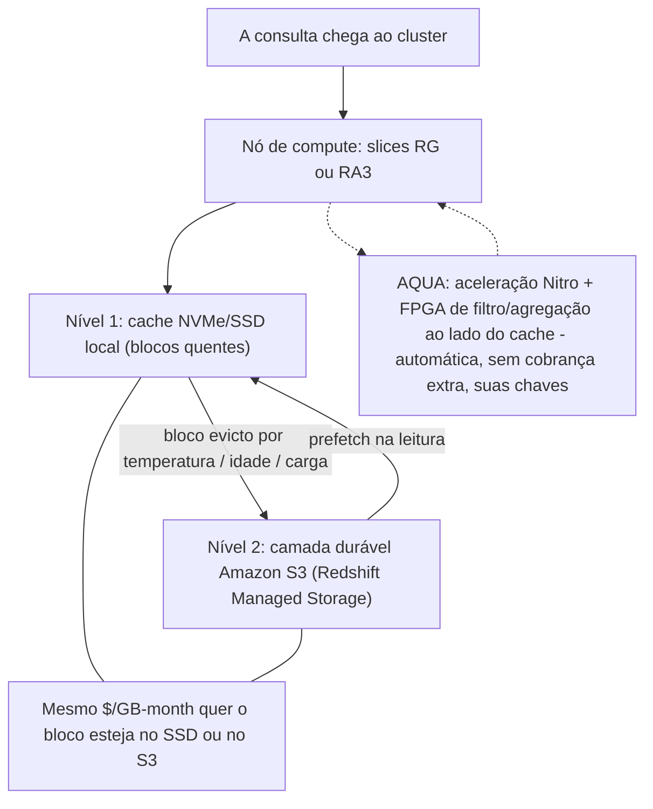
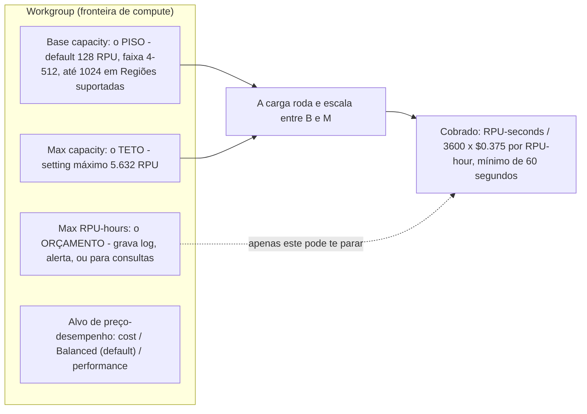
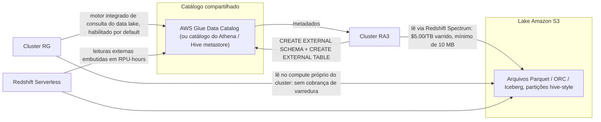
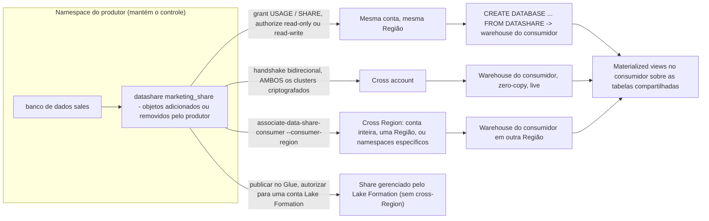
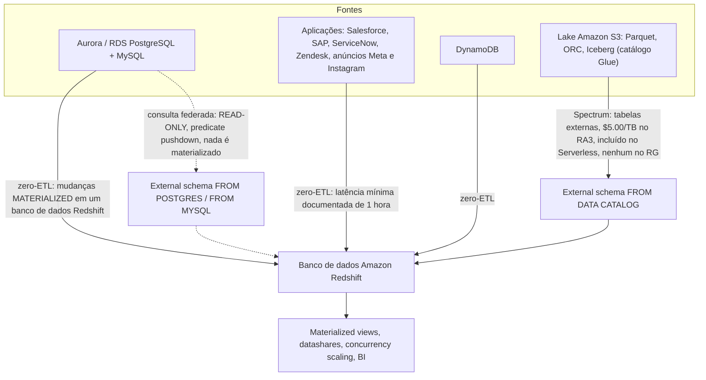
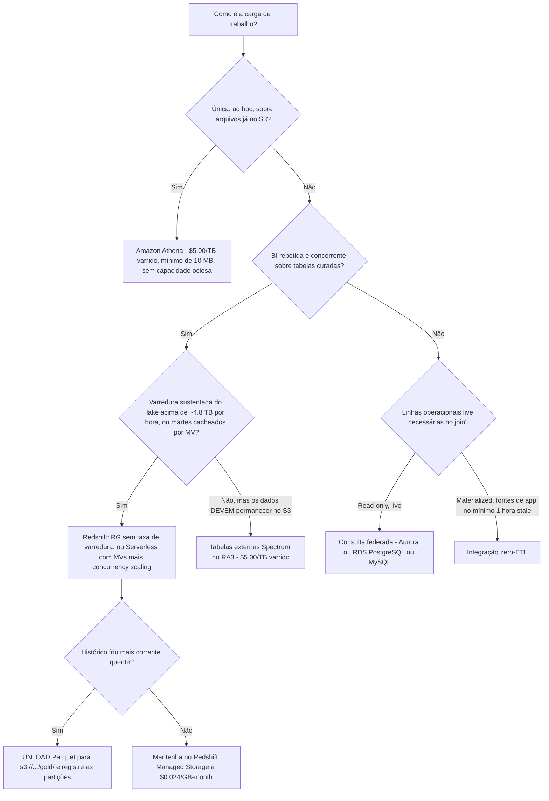

# Redshift no Lakehouse: Spectrum, Serverless, Data Sharing e Federation

A lição 09 colocou um motor de consulta sobre o lake. Esta lição coloca um **warehouse** ao lado dele, e depois mostra como esse warehouse deixa de ser um jardim murado. O Amazon Redshift é a metade *governada e stateful* do AWS lakehouse: ele possui um warehouse (Redshift Managed Storage), e se projeta para fora em três direções documentadas, **Spectrum / o motor integrado de consulta do data lake** (formatos abertos no S3), **data shares** (outros warehouses Redshift) e **esquemas externos federados** (Aurora/RDS). Tudo o que você construiu nas lições 01 to 09, layout no S3, Parquet e Iceberg, crawlers do Glue, grants do Lake Formation, se conecta ao mesmo catálogo Glue/Lake Formation que o Redshift já consome.

A regra de ensino desta lição é curta: **o Redshift é onde o SQL repetido, governado e concorrente pousa.** Ele não é "Athena, só que maior."

```text
====================================================================
 SUPERFÍCIE DO LAKEHOUSE REDSHIFT - AWS DATA LAKEHOUSE (em out de 2026)
====================================================================
 Warehouse ....... RA3 ou RG provisionado (a partir de $0.543/hora sob demanda)
                   Redshift Serverless (mínimo de 4 RPU, $0.375/RPU-hour)
 Storage ......... Redshift Managed Storage, $0.024 por GB-month
                   cache SSD + camada durável S3, cobrados SEPARADAMENTE
 Leitura do lake . tabelas externas Spectrum no RA3: $5.00/TB varrido
                   motor integrado de consulta do data lake no RG: sem taxa de varredura
                   no Serverless: embutido em RPU-hours, não medido
 Puxar ........... consulta federada: Aurora/RDS PostgreSQL + MySQL,
                   read-only, predicate pushdown, nada é materializado
                   zero-ETL: Aurora/RDS/DynamoDB/apps -> banco Redshift
 Compartilhar ... datashares: mesma conta, cross account,
                   cross Region; produtor mantém o controle
 Cache ........... materialized views (+ auto refresh) e
                   concurrency scaling (banco de crédito diário grátis)
 Tabelas abertas . Iceberg READ via external schema (registrado no Glue)
                   Iceberg WRITE via CREATE TABLE ... USING ICEBERG,
                   INSERT / DELETE / UPDATE / MERGE (GA 2025-11-17)
 Exportar ........ UNLOAD (...) TO 's3://.../gold/' FORMAT AS PARQUET
 Não é isto ...... varreduras ad hoc únicas sobre S3 bruto = Amazon Athena
====================================================================
```

Nesta lição você vai:

- explicar o **split compute/armazenamento do RA3** e precificar o **Redshift Managed Storage** independentemente das node hours, e então dizer o que o **AQUA** é agora que seu switch de habilitar/desabilitar sumiu;
- ler o anúncio do **RG** corretamente: uma família de nós Graviton com um **motor integrado de consulta do data lake**, GA **2026-05-12**, que remove a cobrança de varredura do Spectrum;
- dimensionar o **Redshift Serverless** em **RPUs** e separar seus **três tetos**: capacidade base, Max capacity e o orçamento de Max RPU-hours;
- enunciar a **regra 1:1 entre namespace e workgroup** e dizer qual objeto possui a identidade de storage e qual possui o compute;
- escrever **DDL de tabela externa do Spectrum** de ponta a ponta, external schema, tabela externa, registro de partições, e precificá-la a **$5.00 por TB varrido**;
- explicar por que **partition projection é uma funcionalidade do Athena**, e o que isso te custa no Redshift;
- percorrer uma **cadeia de permissões de datashare** entre produtor e consumidor, mesma conta, cross account e cross Region;
- separar **consulta federada** (live, read-only) de **zero-ETL** (materializado, no mínimo 1 hora stale para fontes de aplicação) de **Spectrum** (varre arquivos);
- usar **materialized views**, **auto refresh** e **concurrency scaling** como a resposta de concorrência, incluindo a mudança de auto-refresh de **27 de fevereiro de 2026**;
- ler **e escrever Apache Iceberg** a partir do Redshift, e reconhecer que **`WRITE UNLOAD TO` não é uma cláusula do Redshift**;
- pousar uma **camada gold em Parquet** com `UNLOAD ... PARTITION BY` e registrá-la no catálogo;
- calcular você mesmo o ponto de equilíbrio de **Athena $5/TB versus RPU do Serverless**, com as taxas de outubro de 2026;
- estudar **Vanguard, Nasdaq, Easygo e GE Aerospace**, uma **caixa de atualizações de 2026 com fontes**, e **catorze questões no estilo de exame** com três verificações interativas.

---

## 1. RA3 e Redshift Managed Storage: o split compute/armazenamento

### 1.1 Dois medidores, um warehouse

O guia de management da AWS enuncia o design em uma frase: *"Nós RG e RA3 com managed storage permitem que você otimize seu data warehouse escalando e pagando por compute e managed storage independentemente."* Essa é a ideia inteira: você dimensiona um cluster por quanto dado você **processa** por dia, não por quanto você **armazena**.

O managed storage é um armazenamento de dois níveis: *"SSDs grandes e de alto desempenho em cada nó RG e RA3 para armazenamento local rápido e Amazon S3 para armazenamento durável de longo prazo"*, com deslocamento automático quando os dados crescem além dos SSDs locais. A linha que importa para a sua fatura: *"Você paga a mesma taxa baixa por Redshift managed storage, independentemente de os dados ficarem em SSDs de alto desempenho ou no Amazon S3."* A taxa é de **$0.024 por GB-month** (us-east-1, preços do AWS Redshift, em outubro de 2026), e não há cobranças de transferência entre nó e storage dentro do mecanismo.

| Família de nós | Modelo de storage | Consultas do lake passam por | Status neste curso |
|---|---|---|---|
| **RA3** | Managed storage (cache SSD + S3), escala independentemente dos nós | **Redshift Spectrum** (cobrança de varredura por TB) | Ainda amplamente implantado; a arquitetura de referência para o Spectrum |
| **RG** (Graviton) | Managed storage, escala independentemente dos nós | **Motor integrado de consulta do data lake** no compute próprio do cluster | Família provisionada recomendada desde o GA **2026-05-12** |
| **DC2** | Apenas disco local: adicione nós para adicionar storage | Spectrum | Recomendado apenas "para conjuntos de dados abaixo de 1 TB (comprimidos)" |

Formatos RA3 e tetos de managed storage por nó (AWS management guide, acesso em 2026-10-11): `ra3.large` 2 vCPU / 16 GiB / 2 slices / 8 TB, `ra3.xlplus` 4 / 32 / 2 / 32 TB, `ra3.4xlarge` 12 / 96 / 4 / 128 TB, `ra3.16xlarge` 48 / 384 / 16 / 128 TB. Formatos RG: `rg.large` 2 / 16 / 2 / 8 TB, `rg.xlarge` 4 / 32 / 2 / 32 TB, `rg.4xlarge` 16 / 128 / 8 / 128 TB, `rg.12xlarge` 48 / 384 / 16 / 128 TB.



**Exemplo resolvido E1, o mês de RA3 publicado pela AWS (taxas em outubro de 2026, us-east-1)**

```text
Compute         4 x ra3.4xlarge x $3.26/hora x 730 horas    = $9,519.20
Managed storage 40 TB = 40 x 1,024 GB = 40,960 GB
                40,960 GB-month x $0.024/GB-month           =   $983.04
Spectrum        20 TB varridos x $5.00/TB                   =   $100.00
                                                              ----------
Total do mês (soma das três linhas publicadas pela AWS, derivada) = $10,602.24
```

A AWS publica a mesma aritmética só para o storage: *"managed storage será cobrado a $0.024/GB-Month … 51,250 GB-month x $0.024 por GB-month = $1,230"*. O ponto examinável é estrutural: **a linha de $983.04 não desaparece quando você pausa o cluster**, e não tem nada a ver com quão ocupados estão os nós. Qualquer resposta que cite um preço único de warehouse "por TB por hora" fundiu dois medidores independentes.

### 1.2 AQUA: aceleração que você não configura mais

**AQUA (Advanced Query Accelerator)** aproxima o trabalho de redução e agregação dos dados. O post de lançamento (AWS News Blog, **2021-04-14**) afirma que ele *"reduz o tráfego de rede, descarrega trabalho das CPUs nos nós RA3 e permite que o AQUA melhore o desempenho dessas consultas em até 10x, sem custo extra e sem alterações de código"*, construído sobre *"o AWS Nitro System e aceleração personalizada baseada em FPGA"*, com o volume enviado ao compute *"geralmente muito menor (frequentemente apenas 5% do original)"* e *"Todos os dados em cache pelo AQUA são criptografados usando suas chaves."*

O que mudou: o switch sumiu. A referência da API `AquaConfiguration` diz *"A operação que usa esta estrutura está aposentada. O Amazon Redshift determina automaticamente se deve usar o AQUA"*, e a resposta do re:Post (2023-11-15) acrescenta que *"A opção de ligar o AQUA por cluster individual não está mais disponível para os usuários."*

> [!IMPORTANT]
> Trate o **AQUA como uma técnica interna de desempenho da qual você se beneficia, não como uma configuração que você ajusta.** Qualquer material que te diga a "habilitar o AQUA no console" está obsoleto, e o número de "até 10x" deve ser citado sempre com sua data de **2021-04-14**: nenhuma página da AWS de 2025 to 2026 o reenuncia. A AWS não publica uma lista atual de nós com AQUA habilitado, então nunca afirme uma.

### 1.3 RG: a família que remove o pedágio do Spectrum

Em **2026-05-12** a AWS anunciou a disponibilidade geral das **instâncias RG com um motor integrado de consulta de data lake**: *"As instâncias RG oferecem melhor desempenho, executando cargas de data warehouse até 2.2x mais rápido que as instâncias RA3 a um preço 30% menor por vCPU … desempenho até 2.4x mais rápido que o RA3 para Apache Iceberg e até 1.5x mais rápido que o RA3 para Apache Parquet."* O post companheiro (2026-05-19) é mais direto sobre o mecanismo: com RA3, as consultas do lake eram descarregadas para o Spectrum, que *"introduzia sobrecarga de rede, adicionava latência e impunha uma cobrança de varredura de $5/TB em cada consulta"*: enquanto as instâncias RG *"eliminam as cobranças de varredura por TB do Amazon Redshift Spectrum"* e *"O motor integrado de consulta do data lake está habilitado por default."*

`rg.large` e `rg.12xlarge` chegaram em **2026-07-01**, disponíveis *"no current track (P202) apenas"*, com opções On-Demand e Reserved Instance de 1 e 3 anos.

- **📚 Você sabia?** O motor traz um truque de estatísticas que vale a pena memorizar: o **JIT ANALYZE** *"coleta e usa estatísticas automaticamente para tabelas de data lake durante a execução da consulta"*, o que elimina o ritual manual de `ANALYZE` antes de consultar que as tabelas externas de outra forma exigem (AWS Big Data Blog, 2026-05-19). E o guia de getting-started observa que o motor integrado *"também suporta consultas a dados em buckets do Amazon S3 localizados em uma AWS Region diferente"*: leituras cross-Region do lake funcionam, com cobranças de transferência de dados anexadas.

---

## 2. Redshift Serverless: RPUs, namespaces e workgroups

### 2.1 Um RPU é 16 GB de memória

O Serverless não tem cluster para dimensionar. Você define a capacidade em **RPUs**, e a AWS define *"Um RPU fornece 16 GB de memória."* O faturamento é *"pelas cargas que você executa em RPU-hours em base por segundo, com cobrança mínima de 60 segundos"*, e *"não há cobrança pelo tempo de inicialização do data warehouse."*

| Parâmetro do Serverless | Valor (docs da AWS, acesso em 2026-10-11) |
|---|---|
| Unidade | **1 RPU = 16 GB de memória** |
| Taxa (us-east-1) | **$0.375 por RPU-hour** |
| Preço de entrada | **a partir de $1.50 por hora** (4 RPU x $0.375) |
| Capacidade base | default **128**; **4 to 512** em geral, **até 1024** em Regiões suportadas |
| Passos | 4 a 8 em passos de 4; 8 a 512 em passos de 8; 512 a 1024 em passos de 32 |
| Teto de Max capacity | setting máximo de **5.632 RPUs** por workgroup |
| Grão do faturamento | por segundo, **mínimo de 60 segundos** por transação |
| Incluído na taxa de RPU | **Redshift Spectrum** e **concurrency scaling** |
| Acoplamento do storage | 4 RPU de base suportam até 32 TB; 8 to 16 RPU até 128 TB; acima de 128 TB é preciso 32 ou mais RPU |

O piso de 4 RPU chegou em estágios e agora é amplo: o What's New de **2026-05-01** estendeu o **mínimo de 4 RPU** a mais 7 Regiões, descrevendo um ponto de partida de **4 RPUs** a *"$1.50 por hora"* com *"até 32 TB de Redshift managed storage, … um máximo de 100 colunas por tabela e 64 GB de memória."*

### 2.2 Três tetos, e apenas um deles protege sua carteira

Esta é a parte mais confusa do Serverless, então separe os três knobs explicitamente:

| Knob | O que delimita | Onde se aplica | Protege a carteira? |
|---|---|---|---|
| **Capacidade base (Base capacity)** | O piso / ponto de partida (default **128** RPUs) | Por workgroup | Não: define o piso, não a fatura |
| **Max capacity (MaxRPU)** | *"a contagem mais alta de RPUs que o Amazon Redshift Serverless usa para fins de scaling"* | Por workgroup, setting máximo **5.632** | Não: limita o desempenho |
| **Limite de uso de Max RPU hours** | Um orçamento que *"grava uma entrada de log, alerta ou para consultas"* | Por workgroup | **Sim**: a única guarda |

Há também um slider de **alvo de preço-desempenho**: *"Otimiza para custo / Balanced / Otimiza para desempenho"*, *"habilitado por default para todos os novos workgroups Serverless e definido como Balanced."* O uso é auditável em `sys_serverless_usage`, que retorna `charged_seconds`.



### 2.3 Namespace versus workgroup, e a regra 1:1

A AWS é precisa aqui: *"Para isolar cargas e gerenciar diferentes recursos … você pode criar namespaces e workgroups e gerenciar recursos de storage e compute separadamente."* Um **workgroup** é *"uma coleção de recursos de compute … RPUs, VPC subnet groups e security groups … limites de acesso e de uso."* Um **namespace** possui a identidade do lado do storage: bancos de dados, snapshots, autenticação e a chave KMS: *"Por default, o Amazon Redshift Serverless cria namespaces com uma chave padrão do AWS Key Management Service, mas você pode especificar outra chave para criptografar seus dados."*

> [!WARNING]
> ⚠️ **"Cada namespace pode ter apenas um workgroup associado a ele. Consequentemente, cada workgroup pode estar associado a apenas um namespace."** Times rotineiramente esperam que um namespace se disperse em vários workgroups isolados. Ele não pode. Isolamento entre dev/test/prod portanto significa **múltiplos namespaces**, cada um com sua própria chave KMS, bancos de dados e snapshots, e não múltiplos workgroups sob um namespace.

**Exemplo resolvido E2: economia de 4 RPU e o piso de 60 segundos (taxas em outubro de 2026, us-east-1; aritmética derivada da taxa publicada pela AWS)**

```text
Checagem do preço de entrada:  4 RPU x $0.375 por RPU-hour   = $1.50 / hora  (bate com a AWS)

Uma consulta de 10 minutos por dia, 4 RPU:
  (600 s / 3600 s) x 4 RPU x $0.375                 = $0.25 / dia
  $0.25 x 30 dias                                   = $7.50 / mês

A armadilha dos 60 segundos - 100 consultas de dashboard de um segundo/dia, mesmo 4 RPU:
  100 x 60 s (o mínimo cobrado) x 4 RPU             = 24,000 RPU-seconds
  24,000 / 3600                                      = 6.67 RPU-hours
  6.67 x $0.375                                      = $2.50 / dia
  $2.50 x 22 dias úteis                              = $55.00 / mês
  ...por um segundo de trabalho real por consulta.
```

A própria orientação da AWS sobre o segundo bloco: *"Para consultas muito curtas (como subsecond), isso pode inflar custos. Para mitigar isso, agrupe consultas sempre que possível para maximizar a utilização de recursos dentro da janela de 60 segundos"* (AWS Big Data Blog, 2025-08-22). Serverless não significa grátis-quando-ocioso; significa **nada de ocioso entre consultas, e uma fatura de um minuto para cada uma delas**.

- **📚 Você sabia?** As reservas do Serverless são um compromisso no nível de quem paga: *"gerenciadas no nível da conta pagadora da AWS, e as reservas podem ser compartilhadas entre várias contas AWS"*, valendo *"até 24% em todas as cargas do Redshift Serverless"* na opção de 1 ano, e até **45% para um prazo de 3 anos** na página de preços: enquanto *"créditos grátis não se aplicam a reservas."* A capacidade reservada é medida por hora e faturada por segundo, com taxas sob demanda se aplicando acima do nível de RPU reservado.

---

## 3. Redshift Spectrum: tabelas externas sobre o lake S3

### 3.1 O contrato do catálogo

O Spectrum é como um cluster **RA3** lê arquivos que permanecem no S3. A página de visão geral nomeia os três catálogos possíveis: *"O catálogo de dados externo pode ser o AWS Glue, o data catalog que acompanha o Amazon Athena, ou o seu próprio Apache Hive metastore … Alterações no catálogo de dados externo ficam imediatamente disponíveis para qualquer um dos seus clusters Amazon Redshift."* Como o catálogo é compartilhado, **as tabelas Glue que seu crawler construiu na lição 07 já são visíveis para o Redshift**: você só precisa do external schema que aponta para elas.

Os formatos de arquivo suportados (matriz de arquivos de dados do Spectrum, acesso em 2026-10-11) incluem **Parquet** (colunar, leituras paralelas, divididas por row group), **ORC** (stripe), **RCFile**, **TextFile**, **SequenceFile**, **RegexSerDe**, **OpenCSV**, **AVRO**, **Ion** e **JSON**. A recomendação da AWS é explícita: *"Recomendamos usar um formato de arquivo de armazenamento colunar, como o Apache Parquet."* O Spectrum varre *"os arquivos na pasta especificada e em quaisquer subpastas"* mas *"ignora arquivos ocultos e arquivos que começam com ponto, sublinhado ou cerquilha (., _ ou # ) ou terminam com til (~)"*: uma regra que vai esconder silenciosamente uma exportação cujo prefixo começa com `_`.

### 3.2 Exemplo resolvido E3: DDL de tabela externa, ponta a ponta

```sql
-- Step 1: register a Glue database as an external schema on the cluster
CREATE EXTERNAL SCHEMA spectrum
FROM DATA CATALOG
DATABASE 'lakehouse_gold'
IAM_ROLE 'arn:aws:iam::123456789012:role/RedshiftSpectrumRole';

-- Step 2: define the external table over the Parquet gold prefix
CREATE EXTERNAL TABLE spectrum.orders (
    order_id     BIGINT,
    customer_id  BIGINT,
    order_total  DECIMAL(12,2),
    order_date   DATE
)
PARTITIONED BY (order_month DATE)
STORED AS PARQUET
LOCATION 's3://lakehouse-demo/gold/orders/';

-- Step 3: partitions must be registered explicitly - Spectrum only scans
--         folders that were added
ALTER TABLE spectrum.orders
ADD PARTITION (order_month = DATE '2026-09-01')
LOCATION 's3://lakehouse-demo/gold/orders/order_month=2026-09-01/';

-- Step 4: prune with the partition key; only that month's Parquet is scanned
SELECT order_date, SUM(order_total) AS revenue
FROM   spectrum.orders
WHERE  order_month = DATE '2026-09-01'
GROUP  BY order_date
ORDER  BY order_date;

-- Step 5: audit what is actually registered before you trust a zero-row result
-- Query SVV_EXTERNAL_PARTITIONS to find the partitions that exist
SELECT *
FROM   svv_external_partitions
WHERE  table_name = 'orders';
```

Dois detalhes causam o estrago em produção: **o registro de partições é explícito**, *"O Redshift Spectrum varre apenas arquivos em um local do Amazon S3 que foi explicitamente adicionado usando `ALTER TABLE … ADD PARTITION`"*, e as pseudocolunas são cobráveis, porque *"Selecionar `$size`, `$path` ou `$spectrum_oid` acarreta cobranças porque o Redshift Spectrum varre os arquivos de dados no Amazon S3 para determinar o tamanho do conjunto de resultados."*

### 3.3 Exemplo resolvido E4: a fatura do Spectrum (o exemplo de três linhas da própria AWS, em outubro de 2026)

Uma tabela, **100 colunas**, a consulta lê **uma** coluna:

| Layout dos mesmos dados | Bytes varridos | Custo do Spectrum a $5.00/TB |
|---|---|---|
| Texto sem compressão | 4 TB | 4 x $5.00 = **$20.00** |
| Mesmos dados, GZIP a 4:1 | 1 TB | 1 x $5.00 = **$5.00** |
| Mesmos dados, GZIP + Parquet, 1 coluna lida | 10 GB | 0.01 x $5.00 = **$0.05** |

Três alavancas, três mecanismos: a **compressão** encolhe cada byte, o **formato colunar** deixa o motor pular colunas de que não precisa, e o **partition pruning** pula arquivos inteiros. Em uma tabela de 100 colunas essas alavancas abrangem três ordens de grandeza: de **$20.00 para $0.05** com a pergunta idêntica.

O medidor em si: *"cobrado pelo número de bytes varridos pelo Redshift Spectrum, arredondado para o megabyte seguinte, com um mínimo de 10 MB por consulta"* e *"Não há cobranças por statements de Data Definition Language (DDL) … nem por consultas falhadas."* Até 9,9 MB varridos ainda fatura o mínimo de 10 MB.

### 3.4 Onde o $5/TB se aplica e onde não se aplica

| Caminho | Cobrança de varredura? | Fonte (em outubro de 2026) |
|---|---|---|
| Spectrum em **RA3 / DC2** provisionado | **Sim: $5.00/TB varrido** | Página de preços do Redshift |
| Consultas externas no **Redshift Serverless** | **Não**: *"inclusos nos … valores de RPU-hr"* | Página de preços do Redshift |
| Consultas do lake em instâncias **RG** | **Não**: *"O Redshift Spectrum não é necessário para as instâncias Redshift RG"* | Página de preços do Redshift; Big Data Blog 2026-05-19 |

> [!WARNING]
> ⚠️ **Nunca cite "$5/TB para o Redshift" como uma regra universal.** A frase correta é *"as cobranças de varredura por TB se aplicam a leituras Spectrum de clusters RA3/DC2 provisionados."* O Serverless dobra varreduras externas em RPU-hours, e o RG não tem camada Spectrum alguma. Uma questão que oferece "$5/TB no Redshift Serverless" como armadilha está testando exatamente isso.



### 3.5 Partition projection é só do Athena: diga isso em termos de Redshift

A própria redação da AWS é inequívoca: *"O partition projection é utilizável apenas quando a tabela é consultada através do Amazon Athena. Se a mesma tabela for lida através de outro serviço como o Amazon Redshift Spectrum … os metadados padrão de partição são usados."* Então o truque de projeção que deixa o Athena livre de `ADD PARTITION` **não** se transfere. No Redshift você compensa com um de três mecanismos: `ALTER TABLE … ADD PARTITION` explícito, **`CREATE EXTERNAL TABLE AS`** (que *"particiona novos arquivos de acordo com aquelas partition keys e registra novas partições no catálogo externo automaticamente"*), ou um **crawler do Glue**.

- **📚 Você sabia?** A AWS também diz que *"Materialized views sobre tabelas Spectrum podem melhorar muito o custo e o desempenho."* Uma MV sobre uma tabela externa é a forma documentada de parar de pagar a mesma varredura duas vezes: você paga uma vez no refresh, e depois lê o resultado. A seção 7 desmonta isso, incluindo quais refreshes permanecem incrementais.

---

## 4. Data sharing: produtor e consumidor, sem cópias

### 4.1 O que um datashare de fato é

*"Com o data sharing do Amazon Redshift, você pode compartilhar com segurança o acesso a dados live entre clusters Amazon Redshift, workgroups, contas AWS e AWS Regions sem mover ou copiar os dados manualmente. Como os dados são live, todos os usuários veem as informações mais atualizadas e consistentes."* Níveis compartilháveis: *"bancos de dados, schemas, tabelas, views (incluindo views regulares, late-binding e materialized views) e funções definidas pelo usuário SQL (UDFs)"*, com permissões como `SELECT`, `INSERT`, `UPDATE` em tabelas e `USAGE`, `CREATE` em schemas.

"Live" e "zero-copy" são as duas palavras para memorizar: **nada é duplicado**, o consumidor lê o storage do produtor, e o produtor pode revogar a qualquer momento: *"Quando as permissões são revogadas, os clusters consumidores perdem imediatamente o acesso aos objetos compartilhados e param de vê-los na lista de INBOUND datashares em SVV_DATASHARES."*

### 4.2 Mesma conta, cross account, cross Region

| Escopo | Handshake | Condição extra |
|---|---|---|
| Mesma conta, mesma Região | Produtor concede, consumidor associa | Nada além dos grants |
| **Cross account** | Bidirecional: *"produtor autoriza, consumidor associa (ou recusa)"* | *"Para data sharing entre contas, tanto o cluster do produtor quanto o do consumidor devem estar criptografados."* |
| **Cross Region** | `associate-data-share-consumer` com `--consumer-region` | Três escolhas de escopo: *"uma conta AWS inteira abrangendo todas as suas AWS Regions"*, *"uma AWS Region específica em uma conta AWS"*, ou *"namespaces específicos dentro de uma AWS Region"* |
| Publicado no Glue | A autorização vai para o Lake Formation | *"você só pode conceder autorização do datashare a uma conta Lake Formation"* |

A própria escolha da autorização é binária e explícita: *"Somente leitura em [nome do cluster ou nome do workgroup]"* versus *"Leitura e escrita em [nome do cluster ou nome do workgroup]"*, exposta no CLI como `authorize-data-share … [--allow-writes | --no-allow-writes]`. Escrita é um privilégio concedido pelo produtor: permiti-la apenas *autoriza* o que o produtor de fato concedeu.

### 4.3 Controle do produtor, grants granulares e shares gerenciados pelo Lake Formation

O produtor nunca perde o volante: *"Como administrador do produtor, você mantém o controle dos datasets que está compartilhando. Você pode adicionar novos objetos ao datashare ou removê-los dele."*

**Não existe produto chamado "Redshift managed access"**: não escreva essa frase como nome de funcionalidade. O que existe, e o que a documentação descreve, é um conjunto de mecanismos que juntos te dão acesso gerenciado e granular:

- **Controle retido pelo produtor**: adicione, remova e revogue objetos a qualquer momento.
- **Compartilhamento granular com `WITH PERMISSIONS`**: *"Se você cria um banco de dados `WITH PERMISSIONS`, pode conceder permissões granulares sobre objetos do datashare a diferentes usuários e roles. Sem isso, todos os usuários e roles com permissão USAGE concedida no banco de dados do datashare recebem todas as permissões em todos os objetos."*
- **Datashares gerenciados pelo AWS Lake Formation**: *"O Amazon Redshift atualmente suporta data sharing via Lake Formation ao compartilhar dentro da mesma conta ou entre contas. O compartilhamento cross-Region não é suportado atualmente."*
- **Permissões federadas do Redshift** com IAM Identity Center: introduzidas porque *"O data sharing tradicional do Amazon Redshift não suporta políticas RLS ou DDM em tabelas compartilhadas"* (AWS Big Data Blog, 2026-01-05).

> [!IMPORTANT]
> **O `WITH PERMISSIONS` inverte o padrão, nas duas direções.** Sem ele, `USAGE` no banco compartilhado concede **tudo** dentro dele (supercompartilhamento). Com ele, `USAGE` concede **nada** até você adicionar `GRANT`s no nível do objeto: que é a causa número um de *"meu consumidor conectou bem e não vê nenhuma tabela."* Os dois modos de falha são respondidos por uma única decisão, tomada na hora do `CREATE DATABASE`.

**Exemplo resolvido E5: a cadeia de permissões do datashare (SQL do produtor e depois SQL do consumidor)**

```sql
-- ================= PRODUCER =================
-- 1. Create the datashare from one source database
CREATE DATASHARE marketing_share OF DATABASE sales;

-- 2. Add exactly what should leave the warehouse
ALTER DATASHARE marketing_share ADD SCHEMA public.public_stats;

-- 3. Grant to the consumer account (SHARE lets them add consumers)
GRANT USAGE ON DATASHARE marketing_share
  TO ACCOUNT '222222222222';

-- 4. Authorize - deliberately WITHOUT --allow-writes (read-only share)
--    aws redshift authorize-data-share --consumer-account 222222222222
--    aws redshift associate-data-share-consumer --consumer-account 222222222222

-- ================= CONSUMER =================
-- 5. Mount the share. WITH PERMISSIONS = fine-grained from here on.
CREATE DATABASE mkt_db WITH PERMISSIONS
  FROM DATASHARE marketing_share OF ACCOUNT '111111111111';

-- 6. USAGE alone now grants NOTHING - add the object grants
GRANT USAGE ON DATABASE mkt_db TO ROLE bi_user;
GRANT SELECT ON mkt_db.public.public_stats TO ROLE bi_user;

-- 7. Verify what the consumer can actually see: inbound datashares
--    are listed in SVV_DATASHARES, and they disappear the moment
--    the producer revokes the grant
SELECT *
FROM   svv_datashares;
```

Duas restrições documentadas para manter na sua cabeça: *"Você não pode criar um datashare sobre objetos de banco de dados criados a partir de um datashare existente"* (copie para uma tabela local primeiro, e depois compartilhe essa), e a visibilidade de metadados no consumidor é limitada ao que o datashare expõe: `SVV_ALL_*`, `SVV_REDSHIFT_*` e `SVV_REDSHIFT_DATABASES` não viram um diretório do produtor.



- **📚 Você sabia?** Data sharing não é só para tabelas. Os consumidores podem incluir o **AWS Data Exchange**, e um namespace consumidor adicionado a um share não precisa de um passo de autorização separado: *"Se você está adicionando um namespace como consumidor de dados, não precisa realizar a autorização."* E sobre a pergunta que todos fazem: compartilhar não tem uma linha de fatura separada, e é por isso que a formulação honesta é "sem cópia, sem segunda fatura de storage", nunca "grátis".

---

## 5. Consultas federadas: ler o banco de dados operacional no lugar

### 5.1 O caminho do pushdown

*"As consultas federadas podem trabalhar com bancos de dados externos no Amazon RDS for PostgreSQL, Amazon Aurora PostgreSQL-Compatible Edition, Amazon RDS for MySQL e Amazon Aurora MySQL-Compatible Edition."* O caminho de execução é documentado em três passos: o nó líder busca metadados remotos, os nós de compute emitem subconsultas com predicados empurrados, e as linhas são redistribuídas: *"Para reduzir o movimento de dados pela rede e melhorar o desempenho, o Amazon Redshift distribui parte do cálculo das consultas federadas diretamente para os bancos de dados operacionais remotos."* Cada execução é registrada em `SVL_FEDERATED_QUERY`.

**Exemplo resolvido E6: um único statement que faz join do banco de dados operacional com o warehouse e o lake**

```sql
-- External schema over a PostgreSQL-family source (read-only)
CREATE EXTERNAL SCHEMA app_db
FROM POSTGRES
DATABASE 'orders_prod'
IAM_ROLE 'arn:aws:iam::123456789012:role/RedshiftFederationRole'
-- Source credentials live in AWS Secrets Manager and are referenced
-- through the IAM role above

-- Live operational rows + warehouse rows + Spectrum rows, one statement
SELECT c.customer_id,
       c.region,
       COUNT(DISTINCT f.order_id) AS open_orders,   -- federated: app_db
       SUM(w.order_total)         AS book_revenue,  -- warehouse table
       SUM(l.refund_total)        AS refunds        -- Spectrum: s3://gold/
FROM   app_db.customers            c
LEFT   JOIN warehouse.fact_orders  w ON w.customer_id = c.customer_id
LEFT   JOIN spectrum.refunds       l ON l.customer_id = c.customer_id
WHERE  c.signup_date >= DATE '2026-01-01'
GROUP  BY c.customer_id, c.region;
```

### 5.2 Os limites são a lição

| Restrição | Valor (docs da AWS, acesso em 2026-10-11) |
|---|---|
| Direção | *"As consultas federadas suportam acesso de leitura a fontes de dados externas. Você não pode escrever nem criar objetos de banco de dados na fonte de dados externa."* |
| Direção reversa | *"As consultas federadas não habilitam acesso ao Amazon Redshift a partir de um cluster de banco de dados RDS ou Aurora."* |
| Versões | Aurora/RDS PostgreSQL **9.6 ou posterior**; Aurora/RDS MySQL **5.6 ou posterior** |
| Portas | PostgreSQL **5432**, MySQL **3306** |
| Isolamento no MySQL | *"isolamento de transação no nível READ COMMITTED"* |
| Cross-Region | *"normalmente incorrem em latência de rede e cobranças de faturamento"* |
| Centro de custo | Frequentemente a **fonte**: as cobranças do Aurora são baseadas em uso/IOPS, então a qualidade do pushdown é um controle de custo |

O uso principal é *"fazer join de linhas operacionais live com linhas do warehouse e do S3 em um único statement"*, não replicá-las. Federation não torna uma tabela fonte particionável nem colunar: ela apenas empurra predicados.

---

## 6. Integrações zero-ETL: o que chega ao Redshift

**Zero-ETL é replicação, não consulta.** As mudanças fluem para dentro de um banco de dados Redshift automaticamente, então materialized views, data sharing e RBAC do Redshift todos se aplicam ao resultado.

A lista de fontes suportadas capturada da documentação do Redshift em **2026-10-11** (a AWS adiciona fontes com frequência e a disponibilidade por Região varia, então carimbe com data sempre que citá-la):

| Categoria | Fontes |
|---|---|
| Bancos Aurora / RDS | **Amazon Aurora MySQL**, **Amazon Aurora PostgreSQL**, **Amazon RDS for MySQL**, **Amazon RDS for PostgreSQL**, **Amazon RDS for Oracle** |
| Outros dados AWS | **Amazon DynamoDB**, **Oracle Database@AWS** |
| Aplicações | **Salesforce**, **Salesforce Marketing Cloud Account Engagement**, **SAP**, **ServiceNow**, **anúncios Instagram**, **anúncios Meta**, **Zendesk** |
| Autogerenciados | **MySQL**, **PostgreSQL**, **SQL Server**, **Oracle** |

Notas de versão e escala: Aurora MySQL **3.05.2 ou posterior** e Aurora PostgreSQL **16.4 / 17.4 ou posterior** para destinos Redshift; *"até cinco integrações do mesmo cluster Aurora"* (AWS What's New, 2025-03-12); o zero-ETL de Aurora PostgreSQL *"suporta um máximo de 100 bancos de dados"*; e *"A AWS não cobra uma taxa adicional pela integração zero-ETL do Aurora com o Amazon Redshift"*: você paga pelos recursos Aurora e Redshift já em uso.

A linha de latência é a que muda arquiteturas: *"A latência mínima para uma integração zero-ETL com aplicações é de 1 hora. Você pode aumentá-la ainda mais definindo um REFRESH_INTERVAL diferente de zero."* As integrações de bancos Aurora/RDS são em tempo quase real; as integrações de **aplicação** não são.

> [!IMPORTANT]
> **Zero-ETL não é consulta federada, e Spectrum também não é.** Eles respondem a três perguntas diferentes:
> - **Zero-ETL**, *o que chega ao Redshift?* Uma cópia das mudanças, então RBAC, MVs e shares se aplicam, com fontes de aplicação **no mínimo 1 hora** stale.
> - **Consulta federada**: *posso ler a fonte sem copiar?* Live, **read-only**, apenas famílias PostgreSQL/MySQL, faturado contra o seu compute Redshift *e* as IOPS da fonte.
> - **Spectrum**: *posso ler arquivos no S3?* Cobranças de varredura por TB em RA3/DC2, embutidas em RPU-hours no Serverless, ausentes no RG.
>
> Diagramas de arquitetura que borram esses três produzem a resposta errada toda vez.



---

## 7. Materialized views, auto refresh e concurrency scaling

### 7.1 A superfície das MVs

As MVs do Redshift podem ficar sobre **tabelas locais**, **tabelas de datashare**, **tabelas Spectrum/externas** e **tabelas federadas**: *"Você também pode basear materialized views em tabelas externas criadas usando Spectrum ou consulta federada."* O refresh é escolhido por você: incremental quando possível, caso contrário *"Se um refresh incremental não for possível, o Amazon Redshift realiza um refresh completo."* O refresh incremental também é suportado em objetos compartilhados: *"O refresh incremental também é suportado para uma materialized view baseada em uma tabela datashare ou em uma materialized view."*

```sql
-- MV over the Spectrum table from E3: pay the scan once, not per dashboard
CREATE MATERIALIZED VIEW spectrum.orders_monthly
AUTO REFRESH YES
AS
SELECT order_month,
       COUNT(*)         AS orders,
       SUM(order_total) AS revenue
FROM   spectrum.orders
GROUP  BY order_month;
```

`AUTO REFRESH` tem default **NO**, e é recusado de imediato quando *"a definição da materialized view inclui funções mutáveis ou esquemas externos"* ou quando você define *"uma materialized view sobre outra materialized view."* O status fica em `SVL_MV_REFRESH_STATUS`.

A qualidade do refresh sobre dados externos é específica: refresh incremental é suportado em *"tabelas padrão de data lake após DELETE no S3 ou PUT com overwrite"* quando a view não agrega, e em *"tabelas Apache Iceberg após INSERT, DELETE, UPDATE ou compactação de tabela."*

### 7.2 A mudança de auto-refresh de 27 de fevereiro de 2026

A redação atual da AWS: *"A partir de 27 de fevereiro de 2026, as consultas Auto REFRESH das materialized views do Amazon Redshift são executadas como consultas de usuário em vez de processos autonômicos em segundo plano … habilitadas apenas para clusters Amazon Redshift Provisioned no CURRENT Track da release de patch P198 e mais recente. Atualmente está desabilitado no Serverless."* O auto refresh também permanece limitado pela carga: *"O Amazon Redshift prioriza suas cargas sobre o autorefresh e pode parar o autorefresh para preservar o desempenho da carga do usuário."*

> [!WARNING]
> ⚠️ **Auto refresh não é um scheduler.** Ele é limitado sob carga, indisponível quando a definição inclui funções mutáveis ou esquemas externos, **desabilitado no Serverless**, e, desde **2026-02-27**, compete por prioridade de consulta de usuário em clusters provisionados no track CURRENT. Quando existe um SLA de frescor, use um `REFRESH MATERIALIZED VIEW` agendado ou o scheduler do console e leia `SVL_MV_REFRESH_STATUS`; não entregue um SLA ao autorefresh.

**Exemplo resolvido E7: dimensionamento de MV e de concorrência na escala da Vanguard (números do cliente, AWS Big Data Blog 2026-03-18)**

```text
Dados (publicados):  250+ materialized views, 500+ dashboards,
                     500,000+ consultas de usuário por mês

(a) Volume diário de consultas  500,000 / 22 dias úteis  ~ 22,727 consultas / dia
(b) Política de MV              AUTO REFRESH YES onde não há SLA rígido;
                                REFRESH agendado onde existe
(c) Dimensionamento Serverless  capacidade base = o piso sustentado;
                                Max capacity  = o teto do pico;
                                Max RPU-hours = a guarda de orçamento
(d) Burst provisionado          1 hora creditada por 24 h, acumulável até 30 h,
                                mínimo de 1 minuto por ativação -> um pico de
                                40 minutos na segunda-feira em um cluster ativo
                                é coberto pelo banco de créditos a $0 extra
```

### 7.3 Concurrency scaling: a faixa de burst

*"Você é cobrado pelos clusters de concurrency-scaling apenas pelo tempo em que estão executando consultas ativamente."* Os créditos acumulam como *"uma hora de créditos de Concurrency Scaling cluster a cada 24 horas enquanto seu cluster principal está em execução"*, com *"uma cobrança mínima de um minuto cada vez que um Concurrency Scaling cluster é ativado"*, e *"Você pode acumular até 30 horas de créditos grátis de Concurrency Scaling para cada cluster ativo. Os créditos não expiram enquanto seu cluster não for terminado."* A página da funcionalidade afirma que esses créditos são *"suficientes para as necessidades de concorrência de 97% dos clientes do Redshift."*

**Exemplo resolvido E8, o que um burst de fato custa (em outubro de 2026)**

```text
Cluster de referência (página de preços da AWS): 10 x rg.4xlarge em US-West-1
                                                  = $33.66 por hora
Taxa por segundo           $33.66 / 3600 = $0.00935 por segundo

Banco grátis:  1 hora por 24 h por cluster ATIVO, limitado a 30 horas.
               Um cluster ZERO tem ZERO horas acumuladas; um cluster
               PAUSADO para de acumular.

Além do crédito (aritmética derivada: 2 clusters transitórios x 300 s):
               $0.00935 x 300 x 2 = $5.61  (o número publicado do incidente)
Total da hora: $33.66 + $5.61     = $39.27
```

O parâmetro a conhecer é `max_concurrency_scaling_clusters`, cujo limite default é **10** (AWS News Blog, 2019-03-27), e a regra contraintuitiva de que a acumulação de créditos *"aplica-se a operações de leitura e de escrita."* No **Serverless** você nunca vê essa linha de fatura: *"Você não precisa pagar por concurrency scaling e Redshift Spectrum separadamente porque ambos estão incluídos com o Amazon Redshift Serverless."*

- **📚 Você sabia?** Concurrency scaling e materialized views nem sempre se compõem: *"Em tabelas Apache Iceberg, o concurrency scaling não é suportado para criação e refresh de materialized views."* Se a sua MV fica sobre Iceberg, a faixa de burst está indisponível para o caminho de criação e refresh daquela MV: planeje capacidade em vez de créditos.

---

## 8. Iceberg com Redshift: leia, escreva e o mito do UNLOAD

### 8.1 Leitura

Tabelas Iceberg são lidas através de um external schema sobre o **AWS Glue Data Catalog**, *"Tabelas Iceberg devem ser registradas no AWS Glue Data Catalog"*, usando notação explícita ou auto-mount:

```sql
-- Explicit external schema over a Glue-registered Iceberg table
CREATE EXTERNAL SCHEMA iceberg_lake
FROM DATA CATALOG
DATABASE 'lakehouse_curated'
IAM_ROLE 'arn:aws:iam::123456789012:role/RedshiftSpectrumRole';

-- Two-part access to an Iceberg table
SELECT event_ts, user_id, event_type
FROM   iceberg_lake.clickstream
WHERE  event_ts >= TIMESTAMP '2026-10-01 00:00:00';
```

Qual motor faz a varredura depende da família de nós, e a AWS diz isso diretamente: *"Os tipos de instância RG e o Redshift Serverless usam seu próprio compute para processar consultas de data lake, enquanto os tipos de instância RA3 usam o Redshift Spectrum."* A lista de getting-started de formatos legíveis é *"Iceberg, Parquet, ORC, RCFile, TextFile, SequenceFile, RegexSerDe, OpenCSV e AVRO."*

### 8.2 Escrita

As escritas Iceberg ficaram GA em **2025-11-17**. Statements suportados: `CREATE TABLE … USING ICEBERG`, `CREATE TABLE … USING ICEBERG AS SELECT`, `INSERT INTO`, `DELETE`, `UPDATE`, `MERGE`, `ALTER`, `DROP TABLE`: em *"tanto clusters Amazon Redshift provisionados quanto instâncias Amazon Redshift Serverless."*

```sql
-- Create an open-format gold table in the lake
CREATE TABLE iceberg_lake.customer_360 USING ICEBERG
AS
SELECT customer_id,
       MIN(order_date)   AS first_order,
       SUM(order_total)  AS lifetime_value
FROM   warehouse.orders
GROUP  BY customer_id;

-- Idempotent upsert into a table someone else may also write
MERGE INTO iceberg_lake.customer_360 t
USING   staging.customer_360_stg s
ON      t.customer_id = s.customer_id
WHEN MATCHED THEN UPDATE SET lifetime_value = s.lifetime_value
WHEN NOT MATCHED THEN INSERT (customer_id, lifetime_value)
                   VALUES (s.customer_id, s.lifetime_value);
```

Para escrever em uma tabela **que o Redshift não criou**, quatro condições devem valer: *"A tabela deve ser uma tabela Iceberg v2; A tabela deve usar Parquet como formato de dados padrão; A tabela não deve ter compressão de metadados definida como True; A tabela não deve habilitar Write-Audit-Publish (WAP)."* E também: *"Identidade federada não é suportada ao escrever em tabelas Apache Iceberg."*

> [!WARNING]
> ⚠️ **Não existe cláusula `WRITE UNLOAD TO` no Redshift.** Nenhuma sintaxe assim aparece na referência do `UNLOAD` ou na referência SQL de escritas Iceberg, então nunca a escreva e nunca a marque como correta. Os dois caminhos de escrita suportados são:
> - **DML Iceberg no warehouse**: `CREATE TABLE … USING ICEBERG [AS SELECT]`, `INSERT`, `DELETE`, `UPDATE`, `MERGE`.
> - **Exportação em formato aberto para um prefixo S3**: `UNLOAD ('…') TO 's3://…' FORMAT AS PARQUET PARTITION BY (…)`, que é o padrão de exportação gold da seção 9.
>
> Use-os como dois passos em um pipeline, nunca como um statement inventado.

### 8.3 Materialized views Iceberg e registro no catálogo

As MVs Iceberg são a variante em formato aberto: *"As materialized views Iceberg são armazenadas como tabelas Iceberg padrão e são acessíveis a qualquer motor analítico que suporte o formato Iceberg, incluindo Apache Spark, Amazon Athena e Trino."* O refresh concorrente usa *"controle otimista de concorrência (OCC) através do mecanismo de update condicional do AWS Glue Data Catalog."* A disponibilidade é mais estreita do que você imagina: suportadas *"apenas no Redshift Serverless e provisionado … tipos de instância RA3 e DC2 … não são suportados"*, então **RG ou Serverless**, não RA3.

Você também pode registrar um cluster provisionado inteiro ou um namespace serverless com o Glue Data Catalog para que outros motores o leiam através da **Iceberg REST API**, com *"O AWS Lake Formation gerencia as permissões"* e notação de três partes `database@namespace-catalog.schema.table`. Objetos que **não** são registrados: external schemas, tabelas externas, UDFs, procedures, *"tabelas com políticas de row-level security ou dynamic data masking anexadas"* e objetos em maiúsculas ou com maiúsculas misturadas.

---

## 9. COPY e UNLOAD: pousando a camada gold

### 9.1 COPY para dentro

O `COPY` ingere do S3 em Parquet, ORC, CSV, JSON ou Avro usando um IAM role. É o caminho de volume, e é a contraparte de tudo nesta lição: o que entra com `COPY` é curado no warehouse e sai de volta com `UNLOAD`.

### 9.2 UNLOAD para fora, o padrão de exportação gold

O `UNLOAD` grava *"o resultado de uma consulta em um ou mais arquivos de texto, JSON ou Apache Parquet no Amazon S3"*, com criptografia SSE-S3 ou SSE-KMS. Parquet é o default documentado para uma camada gold: *"O formato Parquet é até 2x mais rápido para dar UNLOAD e consome até 6x menos armazenamento no Amazon S3, comparado com formatos de texto"*, e a AWS nomeia o downstream explicitamente: *"Você pode então analisar seus dados com o Redshift Spectrum e outros serviços AWS como Amazon Athena, Amazon EMR e Amazon SageMaker AI."*

**Exemplo resolvido E9: UNLOAD para o gold, e depois torná-lo consultável (o passo que todos esquecem)**

```sql
-- 1) Export gold to S3 as Hive-partitioned Parquet, SSE-KMS
UNLOAD ('SELECT order_id, customer_id, order_total, order_date
         FROM gold.orders
         WHERE order_date >= ''2026-01-01''')
TO 's3://lakehouse-demo/gold/orders/'
IAM_ROLE 'arn:aws:iam::123456789012:role/RedshiftS3Unload'
FORMAT AS PARQUET
PARTITION BY (order_date)
ENCRYPTED KMS_KEY_ID 'arn:aws:kms:us-east-1:123456789012:key/1234abcd-12ab-34cd-56ef-1234567890ab'
MANIFEST VERBOSE
ALLOWOVERWRITE;

-- 2) Registration is NOT automatic: UNLOAD "doesn't make any calls to
--    an external catalog", so register it yourself
CREATE EXTERNAL TABLE spectrum.orders_gold (
    order_id    BIGINT,
    customer_id BIGINT,
    order_total DECIMAL(12,2)
)
PARTITIONED BY (order_date DATE)
STORED AS PARQUET
LOCATION 's3://lakehouse-demo/gold/orders/';

-- 3) Then add the partitions (or run a Glue crawler)
ALTER TABLE spectrum.orders_gold
ADD PARTITION (order_date = DATE '2026-09-01')
LOCATION 's3://lakehouse-demo/gold/orders/order_date=2026-09-01/';
```

| Opção do UNLOAD | Faixa ou regra (em outubro de 2026) |
|---|---|
| `FORMAT AS` | `CSV`, `PARQUET` ou `JSON` |
| `PARTITION BY (…) [INCLUDE]` | Pastas por convenção Hive, escritas automaticamente |
| `MANIFEST [VERBOSE]` | Lista dos arquivos escritos |
| `ENCRYPTED [AUTO]` com `KMS_KEY_ID` | SSE-KMS ao lado do SSE-S3 |
| `MAXFILESIZE` | 5 MB a **6.2 GB** (default 6.2 GB) |
| `ROWGROUPSIZE` | 32 to 128 MB (default 32 MB); precisa de `ra3.4xlarge`, `ra3.16xlarge`, `rg.4xlarge`, `rg.12xlarge` ou `dc2.8xlarge` |
| `ALLOWOVERWRITE`, `CLEANPATH`, `PARALLEL`, `REGION`, `EXTENSION` | Higiene de caminho e controle de paralelismo |

A **alternativa assimétrica** é o `CREATE EXTERNAL TABLE AS` (CETAS), que *"suporta apenas dois formatos de arquivo, TEXTFILE e PARQUET"*, mas que *"particiona novos arquivos de acordo com aquelas partition keys e registra novas partições no catálogo externo automaticamente."* Escolha o CETAS quando você quer que o passo de registro desapareça; escolha o `UNLOAD` quando está exportando o resultado de uma consulta existente.

> [!IMPORTANT]
> **Duas armadilhas do UNLOAD com data anexada.** Primeira: *"O comando UNLOAD não faz nenhuma chamada a um catálogo externo"*, uma exportação gold com `PARTITION BY` é invisível para o Athena e o Spectrum até você rodar `ALTER TABLE … ADD PARTITION`, criar a tabela externa, ou rodar um crawler do Glue. Segunda: a criptografia client-side para COPY e UNLOAD fechou para novos clientes em **2025-04-30**, e depois de **2026-04-30** *"você não poderá mais usar criptografia client-side para COPY e UNLOAD"*, ensine apenas SSE-S3 e SSE-KMS. E lembre que nomes de prefixo começando com `_` ou `.` são tratados como ocultos pelo Spectrum.

---

## 10. Estimativa de custo resolvida: Athena $5/TB versus RPU do Redshift Serverless

Todas as taxas abaixo são publicadas; **a aritmética é nossa** e está rotulada como derivada. Taxas: Athena sob demanda **$5.00 por TB varrido**; Redshift Serverless **$0.375 por RPU-hour**; Redshift Managed Storage **$0.024 por GB-month**; Spectrum **$5.00 por TB varrido** em RA3/DC2 (todos us-east-1, em outubro de 2026).

**Exemplo resolvido E10: a constante de ponto de equilíbrio (derivada das taxas publicadas)**

```text
Um workgroup Serverless de 64 RPU rodando por uma hora:
    64 RPU x $0.375 por RPU-hour          = $24.00
Athena a $5.00/TB iguala isso varrendo:
    $24.00 / $5.00 por TB                 = 4.8 TB na mesma hora

    ABAIXO de ~4.8 TB por hora de dados varridos -> o medidor do Athena é mais barato
    ACIMA de ~4.8 TB por hora                    -> manter o Redshift quente é mais barato
```

**Exemplo resolvido E11: dois cenários (derivados das taxas publicadas, em outubro de 2026)**

```text
CENÁRIO A - ad hoc, pouco carregado (o território do Athena)
  30 consultas/dia, cada uma podada para 100 GB de Parquet = 3 TB/dia
  Athena:         3 TB x $5.00                     = $15.00 / dia
                  $15.00 x 22 dias úteis           = $330.00 / mês
  Serverless a 8 RPU com o piso de 60 segundos:
                  30 x 60 s x 8 RPU = 14,400 RPU-s = 4 RPU-hours
                  4 x $0.375                       =   $1.50 / dia
                  $1.50 x 22                       =  $33.00 / mês
  mais managed storage se os mesmos 5 TB forem armazenados:
                  5 x 1,024 x $0.024              = $122.40 / mês
                  Total do Serverless              ~ $155.40 / mês

CENÁRIO B - BI estável em escala (o território do Redshift)
  workgroup de 64 RPU ativo 8 h/dia x 22 dias:
                  64 x 8 x 22 = 11,264 RPU-hours x $0.375 = $4,224.00
  mais 10 TB de managed storage: 10 x 1,024 x $0.024          =   $245.76
                  Total do Redshift                            ~ $4,469.76 / mês
  Fatura equivalente do Athena = $4,469.76 / $5.00 = 894 TB varridos por mês
                                = cerca de 40.6 TB por dia
```

Leia o Cenário A com honestidade: o Serverless é mais barato *somente se* você for rodar o workgroup de qualquer forma. A vitória real do Athena nesse cenário é **zero capacidade ociosa e zero compromisso do lado do storage**: uma análise única não precisa de warehouse algum. Leia o Cenário B como o ponto de cruzamento: se os dashboards varrem mais do que cerca de **40 TB por dia** *e* precisam de resultados cacheados por MV mais alta concorrência, o Redshift é mais barato e estruturalmente correto.



> [!IMPORTANT]
> **Não invente um número oficial de cruzamento.** A AWS publica os *medidores*, por varredura para Athena e Spectrum, RPU-hours ou node-hours mais managed storage para Redshift, e o ponto de equilíbrio acima é **nossa aritmética a partir dessas taxas publicadas, em outubro de 2026**, e não um limite publicado pela AWS. Enuncie-o como uma constante derivada, mostre os inputs, e nunca o apresente como um número da AWS.

---

## 11. Consolidando a decisão: três verificações interativas

### 11.1 Matching: capacidade para o motor

```matching
{
  "question": "Correlacione cada capacidade do lakehouse com o mecanismo do Redshift que de fato a entrega (em outubro de 2026):",
  "pairs": [
    {"left": "Consultar arquivos Parquet que DEVEM permanecer no S3, a partir de um cluster RA3", "right": "Tabelas externas do Redshift Spectrum - $5.00 por TB varrido, arredondado para o MB seguinte, mínimo de 10 MB por consulta, DDL e consultas falhadas grátis"},
    {"left": "Consultar os mesmos arquivos S3 a partir de um cluster RG sem cobrança de varredura", "right": "O motor integrado de consulta do data lake: habilitado por default no RG, então o Spectrum não é necessário e sua cobrança por TB nunca aparece"},
    {"left": "Dar acesso live a uma tabela a um segundo warehouse em outra conta, sem cópia", "right": "Um datashare: produtor autoriza, consumidor associa, ambos os clusters criptografados, então CREATE DATABASE... FROM DATASHARE"},
    {"left": "Fazer join de linhas live do Aurora PostgreSQL com linhas do warehouse e do S3 em um único statement", "right": "Uma consulta federada: external schema FROM POSTGRES, read-only, predicados empurrados para a fonte, registrada em SVL_FEDERATED_QUERY"},
    {"left": "Fazer as mudanças de Salesforce, SAP, ServiceNow ou DynamoDB pousarem dentro de um banco de dados Redshift", "right": "Uma integração zero-ETL: os dados são materializados no Redshift, e as fontes de aplicação têm latência mínima documentada de 1 hora"},
    {"left": "Absorver um pico de dashboard de segunda-feira sem fila", "right": "Concurrency scaling: até 1 hora grátis por 24 horas por cluster ativo, acumulável até 30 horas, mínimo de 1 minuto por ativação"}
  ],
  "explanation": "Seis capacidades, seis medidores diferentes. Spectrum e o motor RG são os dois caminhos de leitura do lake e diferem apenas em quem paga a cobrança de varredura; datashares são o caminho warehouse-a-warehouse e nunca tocam no S3; consulta federada é live mas read-only e limitada às famílias PostgreSQL e MySQL; zero-ETL materializa uma cópia, então MVs, RBAC e shares se aplicam, mas as fontes de aplicação ficam no mínimo 1 hora stale; concurrency scaling é uma faixa de burst com um banco grátis de créditos, não uma funcionalidade de storage ou de compartilhamento. O erro clássico de prova é escolher federation quando o requisito diz que os dados devem ser materializados, ou zero-ETL quando o requisito diz ler a fonte no lugar."
}
```

### 11.2 Arrastar e soltar: quando escolher Redshift

```dragdrop
{
  "question": "Ordene a decisão de lakehouse do mais barato e simples para o mais comprometido, de modo que cada passo só dispare quando o anterior falhar:",
  "items": [
    "É SQL ad hoc único sobre arquivos S3 brutos, sem warehouse desejado? -> Amazon Athena a $5.00/TB varrido",
    "É BI repetida e concorrente sobre tabelas curadas? -> Redshift provisionado (RG ou RA3) ou Redshift Serverless em RPU-hours",
    "Os dados DEVEM permanecer no S3 mas ainda serem joined a partir do warehouse? -> tabelas externas Spectrum no RA3, ou o motor integrado no RG",
    "Vários times precisam das mesmas tabelas governadas sem cópias? -> um datashare com controle retido pelo produtor e WITH PERMISSIONS",
    "Linhas live do Aurora ou RDS devem aparecer no join? -> consulta federada para read-only, zero-ETL para uma cópia materializada",
    "Há uma agregação repetida ou um SLA de frescor documentado? -> uma materialized view com AUTO REFRESH YES ou um REFRESH agendado, mais concurrency scaling para o pico"
  ],
  "correctOrder": [
    "É SQL ad hoc único sobre arquivos S3 brutos, sem warehouse desejado? -> Amazon Athena a $5.00/TB varrido",
    "É BI repetida e concorrente sobre tabelas curadas? -> Redshift provisionado (RG ou RA3) ou Redshift Serverless em RPU-hours",
    "Os dados DEVEM permanecer no S3 mas ainda serem joined a partir do warehouse? -> tabelas externas Spectrum no RA3, ou o motor integrado no RG",
    "Vários times precisam das mesmas tabelas governadas sem cópias? -> um datashare com controle retido pelo produtor e WITH PERMISSIONS",
    "Linhas live do Aurora ou RDS devem aparecer no join? -> consulta federada para read-only, zero-ETL para uma cópia materializada",
    "Há uma agregação repetida ou um SLA de frescor documentado? -> uma materialized view com AUTO REFRESH YES ou um REFRESH agendado, mais concurrency scaling para o pico"
  ],
  "explanation": "A ordem é a ordem do comprometimento. Athena primeiro porque não precisa de warehouse e cobra apenas o que varre; Redshift segundo porque BI repetida e concorrente é a razão de existir do warehouse; Spectrum terceiro porque mantém os dados no S3 enquanto faz o join; datashares quarto porque multiplicam warehouses sem multiplicar storage; federation ou zero-ETL quinto porque alcançam para fora do lake inteiramente, e a escolha entre eles é leitura-live versus cópia-materializada; e MVs mais concurrency scaling por último porque são otimizações que você adiciona quando a forma da carga de trabalho já está correta. Pular direto para o Redshift em uma consulta única é como times compram 128 RPUs de base de que nunca precisaram."
}
```

### 11.3 Preencher os espaços em branco, o contrato do Serverless

```fillblank
{
  "question": "Complete o contrato do Redshift Serverless com os números da própria AWS (em outubro de 2026):",
  "template": "Os medidores do Redshift Serverless funcionam em RPU-hours: {{1}} RPU equivale a {{2}} GB de memória, e a taxa em us-east-1 é de ${{3}} por RPU-hour, cobrada por segundo com uma cobrança mínima de {{4}} segundos por transação. A capacidade base padrão é {{5}} RPUs, o teto de Max capacity de um workgroup chega a no máximo {{6}} RPUs, e as varreduras externas do S3 não custam nada extra porque o Redshift Spectrum está {{7}} na taxa de RPU em vez de ser medido separadamente.",
  "answers": {
    "1": "1",
    "2": "16",
    "3": "0.375",
    "4": "60",
    "5": "128",
    "6": "5632",
    "7": "incluído"
  },
  "distractors": ["2", "8", "32", "64", "0.543", "1.50", "5.00", "30", "512", "1024", "1280", "medido separadamente", "cobrado a $5.00/TB", "excluído", "isento"],
  "explanation": "A AWS define um RPU como 16 GB de memória, publica $0.375 por RPU-hour em us-east-1 (o valor de $1.50 é o preço de entrada de 4 RPU por HORA, não a taxa de RPU), e cobra por segundo com mínimo de 60 segundos. A capacidade base tem default 128 RPUs e é ajustável de 4 a 512 em geral, até 1024 em Regiões suportadas; o teto de scaling de Max capacity chega a 5.632 RPUs por workgroup. O Spectrum é explicitamente incluído: 'Você não precisa pagar por concurrency scaling e Redshift Spectrum separadamente porque ambos estão incluídos com o Amazon Redshift Serverless.' As armadilhas são citar $1.50 como a taxa de RPU, citar $5.00/TB contra o Serverless, e confundir capacidade base com Max capacity."
}
```

---

### Atualizações de 2026 (em outubro de 2026)

> [!NOTE]
> **O que mudou na história do lakehouse Redshift entre o fim de 2025 e outubro de 2026**: cada linha verificada contra uma fonte primária da AWS, e cada uma importa porque muda o comportamento atual:
> - **Redshift escreve Apache Iceberg, GA desde 2025-11-17**: *"O Redshift pode escrever em tabelas Iceberg… GA"*, suportando `INSERT`/`UPDATE`/`DELETE`/`MERGE` em tabelas Iceberg gerenciadas no **AWS Glue** ou no **Amazon S3 Tables** (AWS News Blog / AWS What's New, 2025-11-17; roundup de analytics do re:Invent 2025, 2026-01-07). Ler-depois-escrever em uma tabela aberta única é agora um loop nativo do Redshift, não um pipeline.
> - **Redshift Serverless caiu para um mínimo de 4 RPU** (AWS What's New, 2025-06-30, estendido a mais 7 Regiões em **2026-05-01**): entrada tão baixa quanto **$1.50 por hora**, **32 TB** de managed storage suportados nesse tamanho, **64 GB** de memória, máximo de **100 colunas** por tabela.
> - **JIT ANALYZE** (2025-07-15 / 2025-11-18) compila consultas sob demanda para melhor desempenho na primeira execução e coleta estatísticas automaticamente para tabelas de data lake durante a execução: pareado com a família **RG**, GA **2026-05-12** com `rg.xlarge` e `rg.4xlarge`, depois `rg.large` e `rg.12xlarge` em **2026-07-01** (apenas current track P202).
> - **O auto refresh de materialized views mudou de comportamento em 2026-02-27**: as consultas de auto-refresh agora rodam **como consultas de usuário** em vez de processos autonômicos em segundo plano, apenas em clusters provisionados no CURRENT track no patch **P198** e mais recente, e *"Atualmente está desabilitado no Serverless."*
> - **Python UDFs acabaram**: *"O Amazon Redshift não suportará mais o uso de Python UDFs após 30 de junho de 2026"*, com aplicação em fases: redesenhe tudo que depende deles, incluindo políticas de masking e definições de materialized view.
> - **Caminhos de comprometimento se alargaram**: as reservas do Serverless são escopadas ao pagador e valem até **24%** (1 ano) ou **45%** (3 anos) de desconto sobre demanda, enquanto o Redshift ML continua grátis para criar e prever localmente, com treinamento medido em células a **$20 por milhão** (primeiros 10M), **$15** (próximos 90M) e **$7** acima de 100M, com `MAX_CELLS` com default de **1,000,000**.

- **📚 Você sabia?** Duas armadilhas de fato obsoleto ficam nesta caixa. Primeira, algumas páginas de whitepaper da AWS ainda rotulam o AQUA como *"(preview)"*: ignore aquele rótulo e prefira o guia de management atual. Segunda, qualquer afirmação de que o Redshift só consegue **ler** Iceberg está errada desde **2025-11-17**. Nesse tópico, um post antigo da AWS não é fonte; a página atual da documentação é.

---

## Casos Reais

A AWS publica como essas abstrações aparecem em produção. Cada número abaixo é **afirmação do cliente ou da AWS e não auditado**, com a fonte nomeada para que você possa conferir, o ponto examinável é o **padrão**, não o marketing.

### Caso A, Vanguard: um lake de 150 TB e um warehouse de 20 TB, unidos por data shares

| Elemento | Detalhe |
|---|---|
| Cliente | **Vanguard**, Financial Advisor Services (FAS 360) |
| Desafio | Um "data swamp" fragmentado de arquivos Parquet no S3 que precisava virar um warehouse corporativo governado sem duplicar dados entre domínios |
| Serviços | **Amazon Redshift** (RA3 provisionado como **produtor** mais **consumidores Redshift Serverless** com data sharing zero-copy), **AWS Glue ETL**, **Apache Iceberg** curado via Glue, **materialized views do Redshift**, Tableau |
| Resultados (dois anos depois) | **20 TB no Redshift mais 150 TB no data lake S3**; **600+ jobs de Glue ETL (um aumento de 30x)**; **300+ tabelas (crescimento de 3x)**; **250+ materialized views do Redshift**; **500+ dashboards do Tableau (expansão de 25x)**; **500,000+ consultas de usuário por mês** |
| Fonte | AWS Big Data Blog, "How Vanguard transformed analytics with Amazon Redshift multi-warehouse architecture", **2026-03-18** |

> "arquitetura multi-warehouse que aproveita as capacidades avançadas de data sharing do Amazon Redshift para isolamento de cargas e scaling independente": AWS Big Data Blog, 2026-03-18

O padrão examinável: **a razão é a arquitetura.** 150 TB de lake contra 20 TB de warehouse significa que o warehouse retém o que é consultado repetidamente e governado de perto, enquanto o lake retém todo o resto, e os dois são ponteados por Spectrum e leituras integradas de um lado e datashares zero-copy do outro. Note também onde as MVs ficam: **250+ materialized views** é a resposta de concorrência da seção 7 operando em escala de produção, e é como meio milhão de consultas por mês são atendidas.

### Caso B, Nasdaq: consultar no lugar remove o penhasco noturno

| Elemento | Detalhe |
|---|---|
| Cliente | **Nasdaq**, bolsa de valores |
| Desafio | Até 2018, um cluster Redshift de **70 nós** ingeria *"dados de mercado financeiro de milhares de fontes todas as noites, variando de 30 bilhões a 55 bilhões de registros e ultrapassando 4 terabytes"*, com carga e consulta disputando os mesmos recursos |
| Serviços | Fundação de data lake **Amazon S3**, compute **Amazon Redshift**, **Redshift Spectrum** para consultas do lake, arquivo **S3 Glacier**, **S3 Object Lock**, AWS IAM |
| Resultados | Um lake S3 de **15 TB** consultado no lugar; *"contenção zero entre processos de carregamento e consulta de dados"*; **consultas do Redshift 32 por cento mais rápidas**; o **marco de 90 por cento de conclusão de carga de dados 5 horas mais cedo**; suporte ao salto *"de 30 bilhões de registros para 70 bilhões de registros por dia"* |
| Fonte | Material de estudo de caso da AWS, ano da página 2020 (digest 18, fonte S5; acesso em 2026-10-11) |

> "A Nasdaq começou a usar o Amazon Redshift Spectrum, um recurso que potencializa uma arquitetura lake house para consultar dados tanto no data warehouse quanto no data lake do Amazon S3.": material de estudo de caso da AWS (acesso em 2026-10-11)

O padrão examinável é o com o qual esta lição abriu: **o Spectrum transforma o lake em algo com o qual o warehouse pode fazer join, em vez de algo que ele precisa absorver.** A própria Nasdaq chama o arranjo de *"arquitetura lake house"*. "Carregar tudo no warehouse primeiro" não é a resposta da AWS em escala de bolsa: a resposta é consultar no lugar mais um warehouse dimensionado para as consultas.

### Caso C, Easygo: zero-ETL do Aurora para o Redshift Serverless

| Elemento | Detalhe |
|---|---|
| Cliente | **Easygo**, plataforma de entretenimento operando em mercados regulados |
| Desafio | Cargas concorrentes de pico de detecção de fraude e de BI, mais ETL legado do Aurora PostgreSQL que causava incidentes de ingestão e limiares de fraude stale |
| Serviços | **Amazon Kinesis** (streaming primeiro), **Amazon S3** como lake central, **Amazon Athena**, **Amazon Redshift Serverless**, **integração zero-ETL do Amazon Aurora com o Redshift**, AWS KMS, VPCs privados |
| Resultados | Desempenho de consulta melhorado em **95 por cento** (cargas que antes levavam até **1 hora** agora cerca de **10 minutos**); **80 por cento menos** relatórios de incidentes de dados; **9 horas por semana** de manutenção economizadas |
| Fonte | Material de estudo de caso da AWS (digest 18, fonte S7; acesso em 2026-10-11) |

Isto é a seção 6 em produção: **streaming primeiro para o S3, Athena particionado para leituras ad hoc, Redshift Serverless para a camada governada, e zero-ETL do Aurora alimentando-o**: quatro mecanismos, nenhum pipeline de replicação construído à mão.

### Caso D, GE Aerospace: densidade de warehouse atrás de uma fronteira de compliance

| Elemento | Detalhe |
|---|---|
| Cliente | **GE Aerospace**, divisão de cadeia de suprimentos |
| Desafio | Um armazenamento de dados operacional originalmente no Amazon Aurora que *"inicialmente esperava que seu banco de dados exigisse 1 to 2 TB, mas acabou escalando para quase 6 TB"*, mais um requisito de conformidade CMMC |
| Serviços | **Amazon Redshift** no **AWS GovCloud (US)**; prova de conceito nov: dez 2022, depois uma **migração de 9 meses de janeiro a setembro de 2023**; **150+** relatórios migrados, alguns excedendo **10,000 linhas de código** |
| Resultados | Melhoria de desempenho de consulta de **quase 70 por cento** (consultas de 90 minutos agora **7 minutos**); economia anual estimada **superior a $500,000** |
| Fonte | Estudo de caso da AWS, sem data (digest 18, fonte S13; acesso em 2026-10-11) |

O padrão examinável é que **os inputs da arquitetura incluem a fronteira de compliance**: GovCloud (US) é onde a carga de trabalho vive porque o requisito do fornecedor exigiu, e a densidade de warehouse, não o headcount, produziu a economia. Nunca generalize isso para "Redshift é compatível com CMMC"; a afirmação é sobre a Região.

```plot
{
  "type": "bar",
  "title": "Footprints de lakehouse do Redshift publicados por clientes da AWS (acesso em out. 2026)",
  "data": [
    {"Case and metric": "Vanguard - S3 lake (TB)", "Value": 150},
    {"Case and metric": "Vanguard - Redshift (TB)", "Value": 20},
    {"Case and metric": "Nasdaq - S3 lake queried in place (TB)", "Value": 15},
    {"Case and metric": "GE Aerospace - Aurora ODS before migration (TB)", "Value": 6}
  ],
  "xKey": "Case and metric",
  "yKey": "Value",
  "xLabel": "Caso e métrica",
  "yLabel": "Terabytes"
}
```

Passe o mouse sobre qualquer barra para ler a afirmação: a Vanguard publica **150 TB de lake contra 20 TB de warehouse**, a Nasdaq publica **15 TB** consultáveis no lugar, e a GE Aerospace publica um armazenamento Aurora que cresceu para **quase 6 TB** antes de migrar. Unidades diferentes de propósito, o ponto é o *formato* de cada footprint, não um ranking.

| Caso | Padrão do Redshift que demonstra | Seção |
|---|---|---|
| Vanguard | **Data sharing zero-copy** multi-warehouse mais MVs a 500,000 consultas/mês | 4, 7 |
| Nasdaq | **Spectrum** consultando no lugar em um lake de 15 TB; carga e consulta desacopladas | 3 |
| Easygo | **Zero-ETL** do Aurora para o **Redshift Serverless**, streaming primeiro | 2, 6 |
| GE Aerospace | Densidade de warehouse e fronteira de compliance como inputs da arquitetura | 1 |

- **📚 Você sabia?** Cada porcentagem nesta seção é **uma medição de um cliente em uma carga de trabalho**, não uma especificação: os **250+ MVs** e **600+ jobs do Glue** da Vanguard são contagens no patrimônio deles, o **95 por cento** do Easygo e os **quase 70 por cento** da GE Aerospace são resultados auto-reportados de migrações específicas, e nenhum deles se transfere para o seu cluster por default (material de caso publicado pela AWS, acesso em 2026-10-11).

---

## Perguntas de Prática (Practice Questions)

```question
{
  "id": "lh-10-q1",
  "type": "multiple-choice",
  "question": "Qual afirmação sobre RA3 e Redshift Managed Storage está correta em outubro de 2026?",
  "options": [
    "Compute e storage são medidos independentemente: os SSDs locais são um cache, o Amazon S3 é a camada durável, e a taxa é a mesma de $0.024 por GB-month quer um bloco esteja no SSD ou no S3",
    "Managed storage é embutido no preço de node-hour, então um warehouse de 40 TB custa o mesmo que um de 1 TB",
    "Os dados são armazenados apenas em discos locais do nó, então remover um nó sempre representa risco de perda de dados",
    "Managed storage é cobrado apenas enquanto o cluster está executando consultas"
  ],
  "correct": 0,
  "explanation": "A AWS afirma que nós RG e RA3 com managed storage permitem que você 'escale e pague por compute e managed storage independentemente', que a camada SSD é para 'armazenamento local rápido' com o S3 como 'armazenamento durável de longo prazo', e que 'Você paga a mesma taxa baixa... independentemente de os dados ficarem em SSDs de alto desempenho ou no Amazon S3' - $0.024/GB-month em outubro de 2026. O storage acumula quer o cluster esteja ocupado ou não, e é por isso que o próprio exemplo de 40 TB da AWS soma $983.04 de storage acima de $9,519.20 de node hours."
}
```

```question
{
  "id": "lh-10-q2",
  "type": "multiple-choice",
  "question": "Um colega de time diz que vai habilitar o AQUA no cluster RA3 para a carga analítica. Qual é a resposta correta?",
  "options": [
    "O AQUA deve ser habilitado por cluster através da API ModifyAquaConfiguration antes da primeira consulta",
    "O AQUA está totalmente aposentado e não afeta mais o desempenho do Redshift",
    "As operações AquaConfiguration estão aposentadas e o Redshift agora determina automaticamente se deve usar o AQUA, então não há switch de console ou API para configurar: e a alegação de até 10x carrega sua data de 2021-04-14",
    "O AQUA aplica-se apenas a workgroups do Redshift Serverless"
  ],
  "correct": 2,
  "explanation": "A referência da API afirma 'A operação que usa esta estrutura está aposentada. O Amazon Redshift determina automaticamente se deve usar o AQUA', e a resposta do re:Post de 2023-11-15 acrescenta que a opção por cluster 'não está mais disponível para os usuários'. O AQUA nunca foi uma funcionalidade exclusiva do Serverless e não sumiu: ele é automático. O número de desempenho 'até 10x' vem do AWS News Blog de 2021-04-14 e nenhuma página AWS de 2025-2026 o repete, então ele sempre carrega essa data."
}
```

```question
{
  "id": "lh-10-q3",
  "type": "multiple-choice",
  "question": "Qual afirmação sobre as instâncias Redshift RG está correta em outubro de 2026?",
  "options": [
    "Os nós RG precisam do Redshift Spectrum para consultas de data lake e acrescentam uma cobrança de varredura de $5.00/TB para elas",
    "Os nós RG usam um motor integrado de consulta do data lake habilitado por default, GA 2026-05-12, entregando cargas de warehouse até 2.2x mais rápidas a um preço 30% menor por vCPU que o RA3, e eliminando as cobranças de varredura por TB do Spectrum",
    "Os nós RG são um tipo de capacidade exclusivo do Serverless e não podem ser provisionados como cluster",
    "Os nós RG removeram a camada de managed storage e armazenam tudo em NVMe local"
  ],
  "correct": 1,
  "explanation": "O AWS News Blog de 2026-05-12 anuncia o RG com 'até 2.2x mais rápido que as instâncias RA3 a um preço 30% menor por vCPU', até 2.4x para Apache Iceberg e 1.5x para Apache Parquet, e 'O motor integrado de consulta do data lake está habilitado por default'. O follow-up de 2026-05-19 diz que as instâncias RG 'eliminam as cobranças de varredura por TB do Amazon Redshift Spectrum', e a página de preços diz que 'O Redshift Spectrum não é necessário para as instâncias Redshift RG'. O RG é uma família provisionada (rg.large, rg.xlarge, rg.4xlarge, rg.12xlarge) que ainda usa managed storage."
}
```

```question
{
  "id": "lh-10-q4",
  "type": "multiple-choice",
  "question": "Seu time quer ambientes Serverless de dev, teste e produção totalmente isolados, cada um com sua própria chave KMS, bancos de dados e snapshots. O que a documentação da AWS exige?",
  "options": [
    "Três workgroups dentro de um namespace, porque um namespace pode hospedar muitos workgroups",
    "Três namespaces, porque cada namespace pode ter apenas um workgroup associado a ele e cada workgroup apenas um namespace",
    "Três contas AWS, porque workgroups não podem ser isolados por chave de criptografia",
    "Nada de especial: namespaces são rótulos lógicos e todo o isolamento é automático"
  ],
  "correct": 1,
  "explanation": "A AWS afirma frontalmente: 'Cada namespace pode ter apenas um workgroup associado a ele. Consequentemente, cada workgroup pode estar associado a apenas um namespace.' O namespace possui a identidade do lado do storage (bancos de dados, snapshots, chave KMS: criada com uma chave padrão que você pode trocar); o workgroup possui o compute (RPUs, VPC subnet groups, security groups, limites de uso). Então três ambientes isolados com três chaves significam três namespaces, cada um pareado com seu próprio workgroup."
}
```

```question
{
  "id": "lh-10-q5",
  "type": "multiple-choice",
  "question": "Um workgroup Serverless mostra capacidade base 128, Max capacity 256 e um limite de uso de Max RPU hours. Qual desses de fato protege seu orçamento?",
  "options": [
    "A capacidade base, porque ela define o portanto o gasto mínimo",
    "O Max capacity, porque ele limita a taxa de RPU com a qual você escala",
    "O limite de uso de Max RPU hours, porque ele grava uma entrada de log, alerta ou para consultas: a capacidade base é o piso, o Max capacity é o teto de desempenho, e nenhum dos dois limita o gasto total",
    "O slider de alvo de preço-desempenho, porque defini-lo como Otimiza para custo limita a fatura"
  ],
  "correct": 2,
  "explanation": "A AWS distingue três controles separados: capacidade base (o ponto de partida, default 128 RPUs, ajustável de 4 a 512 com até 1024 em Regiões suportadas), Max capacity ('a contagem mais alta de RPUs que o Amazon Redshift Serverless usa para fins de scaling', setting máximo de 5.632 por workgroup) e o limite de uso de Max RPU hours, que 'grava uma entrada de log, alerta ou para consultas': o único que delimita o gasto. O alvo de preço-desempenho (cost, Balanced por default, ou performance) otimiza o comportamento do scaling, não o teto do custo total."
}
```

```question
{
  "id": "lh-10-q6",
  "type": "multiple-choice",
  "question": "Em um cluster RA3 provisionado, quanto custa uma consulta do Spectrum, em outubro de 2026?",
  "options": [
    "$5.00 por TB varrido, arredondado para o megabyte seguinte com um mínimo de 10 MB por consulta; statements DDL e consultas falhadas são grátis",
    "$5.00 por TB retornado, independentemente de quanto foi varrido",
    "$5.00 por TB varrido em todo deployment do Redshift, incluindo Serverless e RG",
    "Nada: as cobranças do Spectrum foram embutidas nos preços dos nós"
  ],
  "correct": 0,
  "explanation": "A página de preços diz que você 'é cobrado pelo número de bytes varridos pelo Redshift Spectrum, arredondado para o megabyte seguinte, com um mínimo de 10 MB por consulta' e que 'Não há cobranças por statements de Data Definition Language (DDL) ... nem por consultas falhadas'. É por TB varrido, não retornado, e não é universal: no Serverless as consultas externas são 'inclusas nos ... valores de RPU-hr', e 'O Redshift Spectrum não é necessário para as instâncias Redshift RG'."
}
```

```question
{
  "id": "lh-10-q7",
  "type": "multiple-choice",
  "question": "Um banco de dados consumidor criado FROM DATASHARE sem WITH PERMISSIONS é montado, e USAGE é concedido à role analyst_team. O que acontece?",
  "options": [
    "O analyst_team não vê nada até que grants SELECT no nível do objeto sejam adicionados",
    "O analyst_team recebe todas as permissões em todos os objetos dentro do banco de dados do datashare",
    "A conexão falha porque USAGE não pode ser concedido em um banco de dados de datashare",
    "Apenas o administrador do produtor pode ver os objetos"
  ],
  "correct": 1,
  "explanation": "A AWS é explícita: sem WITH PERMISSIONS, 'todos os usuários e roles com permissão USAGE concedida no banco de dados do datashare recebem todas as permissões em todos os objetos dentro do banco de dados do datashare'. O WITH PERMISSIONS inverte o padrão para o outro lado, USAGE então concede nada até você adicionar GRANTs no nível do objeto, que é a causa usual de 'o consumidor conecta e não vê nenhuma tabela'. A opção A descreve o caminho do WITH PERMISSIONS, não o padrão."
}
```

```question
{
  "id": "lh-10-q8",
  "type": "multiple-choice",
  "question": "Qual conjunto de restrições para data sharing entre contas e entre Regiões está correto?",
  "options": [
    "Cross account exige um handshake bidirecional e ambos os clusters criptografados; cross Region pode ser delimitado a uma conta inteira, uma Região específica, ou namespaces específicos; shares gerenciados pelo Lake Formation não suportam cross Region",
    "Cross account não exige handshake se ambos os clusters estiverem criptografados; cross Region não é suportado de modo algum",
    "Cross account não exige criptografia; shares gerenciados pelo Lake Formation suportam compartilhamento cross Region",
    "Shares cross Region devem copiar os dados primeiro, e shares gerenciados pelo Lake Formation suportam compartilhamento cross Region"
  ],
  "correct": 0,
  "explanation": "A AWS documenta que 'Para data sharing entre contas, tanto o cluster do produtor quanto o do consumidor devem estar criptografados', com um handshake bidirecional (produtor autoriza, consumidor associa ou recusa); a associação cross Region oferece três escolhas: uma conta inteira abrangendo todas as suas Regiões, uma Região específica, ou namespaces específicos: via associate-data-share-consumer --consumer-region; e para datashares do Lake Formation, 'O compartilhamento cross-Region não é suportado atualmente.' Nada é copiado em nenhum desses caminhos."
}
```

```question
{
  "id": "lh-10-q9",
  "type": "multiple-choice",
  "question": "Qual afirmação separa corretamente consultas federadas de integrações zero-ETL?",
  "options": [
    "Consultas federadas copiam linhas para o Redshift para reuso rápido posterior; zero-ETL consulta a fonte no lugar",
    "Consultas federadas são consultas read-only com pushdown contra Aurora e RDS PostgreSQL e MySQL nas quais nada é materializado; zero-ETL materializa as mudanças da fonte em um banco de dados Redshift, com latência mínima documentada de 1 hora para fontes de aplicação",
    "Ambas as funcionalidades copiam dados, mas zero-ETL é restrito ao DynamoDB",
    "Consultas federadas permitem escritas na fonte, e zero-ETL não tem piso de latência"
  ],
  "correct": 1,
  "explanation": "A AWS diz que consultas federadas 'suportam acesso de leitura a fontes de dados externas' e 'Você não pode escrever nem criar objetos de banco de dados na fonte de dados externa', cobrindo RDS e Aurora PostgreSQL e MySQL com predicados empurrados para a fonte. Zero-ETL é o formato oposto: as mudanças são materializadas dentro do Redshift (então RBAC, MVs e datashares se aplicam), e para fontes de aplicação 'A latência mínima para uma integração zero-ETL com aplicações é de 1 hora'. Federation é live mas read-only; zero-ETL é uma cópia e pode ficar stale."
}
```

```question
{
  "id": "lh-10-q10",
  "type": "multiple-choice",
  "question": "O que a mudança de materialized views de 27 de fevereiro de 2026 fez?",
  "options": [
    "O Auto REFRESH tornou-se obrigatório em todas as cargas",
    "As consultas Auto REFRESH agora são executadas como consultas de usuário em vez de processos autonômicos em segundo plano, habilitadas apenas para clusters provisionados no CURRENT track no patch P198 ou mais recente, e atualmente desabilitadas no Serverless",
    "O Auto REFRESH foi removido e substituído apenas por REFRESH manual",
    "O Auto REFRESH agora roda apenas em workgroups do Serverless"
  ],
  "correct": 1,
  "explanation": "A documentação de refresh da AWS afirma: 'A partir de 27 de fevereiro de 2026, as consultas Auto REFRESH das materialized views do Amazon Redshift são executadas como consultas de usuário em vez de processos autonômicos em segundo plano... habilitadas apenas para clusters Amazon Redshift Provisioned no CURRENT Track da release de patch P198 e mais recente. Atualmente está desabilitado no Serverless.' O Auto REFRESH continua opt-in (o default é NO), continua recusado para definições com funções mutáveis, esquemas externos ou MVs aninhadas, e continua limitado pela carga: então um SLA pertence a um REFRESH agendado, não ao autorefresh."
}
```

```question
{
  "id": "lh-10-q11",
  "type": "multiple-choice",
  "question": "Você precisa gravar resultados curados para fora do Redshift para que Athena e Spark os leiam como tabelas gold em formato aberto. Qual é o design correto em outubro de 2026?",
  "options": [
    "UNLOAD (...) TO 's3://.../gold/' FORMAT AS PARQUET PARTITION BY (col), depois registre as partições com ALTER TABLE ADD PARTITION, CREATE EXTERNAL TABLE, ou um crawler do Glue: o UNLOAD não faz nenhuma chamada a um catálogo externo",
    "UNLOAD (...) WRITE UNLOAD TO 's3://.../gold/', que tanto escreve quanto registra partições",
    "UNLOAD com criptografia client-side, que permanece disponível para todos os novos clientes",
    "UNLOAD para CSV com PARTITION BY, porque Parquet não pode ser particionado"
  ],
  "correct": 0,
  "explanation": "A AWS documenta UNLOAD para texto, JSON ou Apache Parquet (até 2x mais rápido e até 6x menos storage que texto) com FORMAT AS CSV, PARQUET ou JSON e PARTITION BY seguindo a convenção Apache Hive: e explicitamente: 'O comando UNLOAD não faz nenhuma chamada a um catálogo externo.' Não existe cláusula WRITE UNLOAD TO em lugar algum nas referências do UNLOAD ou de escritas Iceberg. A criptografia client-side fechou para novos clientes em 2025-04-30 e está indisponível depois de 2026-04-30, e o particionamento em Parquet funciona bem."
}
```

```question
{
  "id": "lh-10-q12",
  "type": "multiple-choice",
  "question": "Qual afirmação sobre Iceberg e Redshift está correta em outubro de 2026?",
  "options": [
    "O Redshift só consegue ler tabelas Iceberg; todas as escritas devem ser feitas pelo AWS Glue",
    "As escritas Iceberg ficaram GA em 2025-11-17 e suportam CREATE TABLE... USING ICEBERG, INSERT, DELETE, UPDATE e MERGE em clusters provisionados e Serverless, desde que o Glue registre a tabela: e tabelas de terceiros devem ser v2, Parquet, sem compressão de metadados e sem WAP",
    "Materialized views Iceberg são suportadas em RA3, DC2, RG e Serverless de igual forma",
    "Identidade federada (IAM_ROLE SESSION) é exigida para todas as escritas Iceberg"
  ],
  "correct": 1,
  "explanation": "A AWS anunciou escritas Iceberg GA em 2025-11-17 com o conjunto de statements USING ICEBERG e INSERT, DELETE, UPDATE, MERGE em ambos clusters provisionados e Serverless; tabelas 'devem ser registradas no AWS Glue Data Catalog'; e escrever em uma tabela que o Redshift não criou exige v2, formato padrão Parquet, sem compressão de metadados e sem WAP. MVs Iceberg são 'suportadas apenas no Redshift Serverless e provisionado ... tipos de instância RA3 e DC2 ... não são suportados'. E o oposto é verdadeiro para escritas: 'Identidade federada não é suportada ao escrever em tabelas Apache Iceberg.'"
}
```

```question
{
  "id": "lh-10-q13",
  "type": "multiple-choice",
  "question": "Usando as taxas publicadas de outubro de 2026, quanto custa um workgroup Serverless de 64 RPU rodando por uma hora, e que volume de varredura do Athena o iguala a $5.00 por TB?",
  "options": [
    "$24.00, o que iguala o Athena varrendo 4.8 TB: um ponto de equilíbrio derivado, abaixo do qual o medidor do Athena é mais barato",
    "$24.00, o que iguala o Athena varrendo 24 TB",
    "$1.50, o que iguala o Athena varrendo 0.3 TB",
    "$5.00, o que iguala o Athena varrendo 1 TB"
  ],
  "correct": 0,
  "explanation": "64 RPU x $0.375 por RPU-hour = $24.00 pela hora (taxa em us-east-1, em outubro de 2026). O Athena a $5.00 por TB varrido iguala $24.00 em $24.00 / $5.00 = 4.8 TB. Isto é aritmética derivada de duas taxas publicadas, não um cruzamento publicado pela AWS: a AWS publica os medidores, não o limite: então deve ser rotulada sempre como derivada. O valor de $1.50 é o preço de entrada de 4 RPU por hora, e $5.00/TB é a própria taxa de varredura."
}
```

```question
{
  "id": "lh-10-q14",
  "type": "multiple-choice",
  "question": "Qual veredito comparativo para uma camada de consulta em um AWS lakehouse está correto em outubro de 2026?",
  "options": [
    "Athena, Redshift Spectrum, tabelas nativas do Redshift e um motor de terceiros são intermutáveis, então a escolha é puramente sobre preferência do time",
    "O Redshift Spectrum deveria substituir as tabelas nativas do Redshift para todas as cargas porque tabelas externas evitam cobranças de storage",
    "O Athena vence a economia ad hoc serverless por TB a $5.00/TB varrido sem capacidade ociosa; o Redshift Spectrum é esse mesmo medidor usado de dentro de um warehouse em RA3 ou DC2; as tabelas nativas do Redshift vencem joins complexos, martes cacheados por MV e BI concorrente sustentado, especialmente com RG (sem taxa de varredura) ou Serverless com MVs; e um motor de terceiros sobre formatos abertos como Trino ou Spark é escolhido quando a portabilidade do motor em Iceberg importa mais que a operação gerenciada pela AWS",
    "Motores de terceiros são sempre mais baratos porque o Redshift cobra por consulta"
  ],
  "correct": 2,
  "explanation": "O veredito segue os medidores documentados ao longo desta lição: o Athena cobra $5.00 por TB varrido sem infraestrutura; o Redshift Spectrum é esse medidor idêntico aplicado a arquivos S3 lidos de um cluster provisionado RA3 ou DC2, e desaparece no Serverless (embutido em RPU-hours) e no RG (motor integrado); as tabelas nativas do Redshift cobram node-hours ou RPU-hours mais $0.024/GB-month de managed storage e compram concurrency scaling, MVs e datashares; um motor aberto autogerenciado como Trino ou Spark é a faixa de portabilidade em tabelas gerenciadas por Iceberg, e a própria AWS observa que MVs Iceberg são 'acessíveis a qualquer motor analítico que suporte o formato Iceberg, incluindo Apache Spark, Amazon Athena e Trino'. O Redshift não cobra por consulta, e tabelas externas ainda precisam de partições registradas."
}
```

> [!WARNING]
> ⚠️ **Armadilhas de padrão desta lição: percorra esta lista antes de projetar qualquer coisa:**
> - **`$5/TB` não é um preço para o Redshift inteiro.** É Spectrum em **RA3/DC2** provisionado apenas; o Serverless embute varreduras externas em RPU-hours, e o RG **não tem camada Spectrum alguma**.
> - **Partition projection é só do Athena.** Uma leitura Spectrum da mesma tabela usa metadados padrão de partição, então partições não registradas retornam **zero linhas**, não um erro: confira `SVV_EXTERNAL_PARTITIONS`.
> - **`WITH PERMISSIONS` inverte o padrão.** Sem ele, `USAGE` concede tudo; com ele, `USAGE` concede nada até você adicionar `GRANT`s no nível do objeto.
> - **Shares cross account exigem criptografia nos dois lados**, e datashares gerenciados pelo Lake Formation são **apenas mesma conta e cross account**: nunca cross Region.
> - **Namespace e workgroup são 1:1.** Um namespace não pode se dispersar em vários workgroups isolados; três ambientes significam três namespaces.
> - **Apenas o limite de Max RPU hours protege sua carteira.** A capacidade base é um piso, o Max capacity é um teto de desempenho, e o mínimo de 60 segundos torna caros dashboards subsecond conversadores.
> - **Auto refresh não é um scheduler**: opt-in via `AUTO REFRESH YES` (default **NO**), limitado sob carga, recusado para funções mutáveis / esquemas externos / MVs aninhadas, **desabilitado no Serverless**, e rodando como consulta de usuário desde **2026-02-27** (provisionado P198+).
> - **Não existe `WRITE UNLOAD TO`.** Escritas Iceberg são `USING ICEBERG` mais `INSERT`/`DELETE`/`UPDATE`/`MERGE`; exportação para S3 é `UNLOAD... FORMAT AS PARQUET`: dois passos, nunca um statement inventado.
> - **UNLOAD não registra nada.** Uma exportação com `PARTITION BY` é invisível para Athena e Spectrum até `ALTER TABLE... ADD PARTITION`, `CREATE EXTERNAL TABLE`, ou um crawler rodar.
> - **`$path` e `$size` são cobráveis** porque selecioná-los força uma varredura: um hábito de depuração que multiplica silenciosamente o custo do Spectrum.
> - **Consulta federada é read-only e unidirecional** (PostgreSQL 9.6+, MySQL 5.6+, portas 5432/3306); zero-ETL materializa em vez disso; Spectrum varre arquivos. Borrar os três produz a arquitetura errada.
> - **Python UDFs não são suportados depois de 2026-06-30**, e a criptografia client-side para COPY/UNLOAD acabou depois de **2026-04-30**.
> - **Créditos grátis de concurrency scaling** acumulam 1 hora por 24 h por cluster **ativo**, acumulam apenas até **30 horas**, e custam nada no Serverless porque já estão embutidos.

> [!IMPORTANT]
> **Veredito Comparativo: Amazon Athena vs Redshift Spectrum vs tabelas nativas do Redshift vs um motor de terceiros**
> - **Versus Amazon Athena:** ambos medem **$5.00 por TB varrido** com um **mínimo de 10 MB**, então a diferença não é a taxa, e sim o comprometimento. O Athena é *"consultas SQL ad hoc interativas contra dados no Amazon S3, sem infraestrutura ou clusters"*: sem capacidade ociosa, sem fatura do lado do storage, e ele herda funcionalidades exclusivas do Athena como **partition projection**. Escolha o Athena para varreduras únicas, esparsas e altamente podadas sobre arquivos que já vivem no S3, especialmente quando não há warehouse para justificar.
> - **Versus Redshift Spectrum:** o Spectrum é **o medidor do Athena usado de dentro de um warehouse**, os mesmos $5.00/TB, o mesmo piso de 10 MB, DDL e consultas falhadas grátis, mas disponível a uma sessão SQL do Redshift que precisa fazer join de linhas externas com tabelas do warehouse em um único statement. O que você ganha é o join; o que você paga é a cobrança de varredura em RA3/DC2, mais a disciplina explícita de registro de partições que a projeção do Athena remove. Spectrum **não** é necessário no RG e está **incluído** nos RPU-hours do Serverless.
> - **Versus tabelas nativas do Redshift:** esta é a resposta de concorrência sustentada. Tabelas nativas cobram **node-hours ou RPU-hours mais $0.024/GB-month de managed storage**, e em troca compram materialized views com refresh automático ou agendado, **concurrency scaling** com um banco grátis de créditos (1 hora por 24 h, acumulável até 30 horas), **datashares** para fan-out zero-copy, row-level security e dynamic data masking. Escolha-as para joins complexos repetidos, martes cacheados por MV e BI de alta concorrência, o formato da Vanguard de **250+ MVs e 500,000+ consultas/mês**, e recorra ao **RG** quando quiser leituras do lake sem o pedágio do Spectrum.
> - **Versus um motor de terceiros:** um motor aberto autogerenciado sobre os mesmos formatos abertos (a própria AWS observa que materialized views Iceberg são *"acessíveis a qualquer motor analítico que suporte o formato Iceberg, incluindo Apache Spark, Amazon Athena e Trino"*) compra **portabilidade**, o seu SQL e as suas tabelas Iceberg não ficam presos a um serviço, e cobra pelo cluster que você opera, pelos upgrades que você agenda e pela governança que você reconstrói você mesmo. Escolha-o apenas quando portabilidade do motor ou um conjunto de skills não-AWS existente for um requisito explícito; a AWS não publica benchmark cara a cara contra ele, então nunca cite um.
> - **O veredito em uma frase:** em outubro de 2026, **default para Athena em economia ad hoc por TB sem warehouse, use Redshift Spectrum para leituras do lado do warehouse de dados que devem permanecer no S3 em RA3/DC2, use tabelas nativas do Redshift para joins complexos, martes cacheados por MV e BI concorrente sustentado (RG quando puder, Serverless quando a carga for em picos), e leve um motor aberto de terceiros apenas quando a portabilidade em Iceberg pesar mais que a operação gerenciada pela AWS.**

> [!SUCCESS]
> **Pontos Principais (Key Takeaways):**
> 1. **Dois medidores, nunca um:** RA3 e RG dividem a fatura: compute (node-hours ou **RPU-hours**) mais **Redshift Managed Storage a $0.024/GB-month**, com SSD local como cache sobre o S3 à *mesma* taxa e sem cobranças de transferência entre nó e storage; o próprio mês da AWS é **$9,519.20 + $983.04 + $100.00 = $10,602.24** (em outubro de 2026).
> 2. **AQUA é automático agora:** a API `AquaConfiguration` está *aposentada* e o Redshift *"determina automaticamente se deve usar o AQUA"*: não há switch, não há lista de nós, e a alegação de *"até 10x"* pertence ao post de **2021-04-14**.
> 3. **RG remove o pedágio:** GA **2026-05-12**, *"até 2.2x mais rápido que o RA3 a um preço 30% menor por vCPU"* (2.4x Iceberg, 1.5x Parquet), motor integrado de consulta do data lake **habilitado por default**, então *"O Redshift Spectrum não é necessário para as instâncias Redshift RG"*; `rg.large` e `rg.12xlarge` chegaram em **2026-07-01** (apenas P202).
> 4. **Serverless em uma linha:** **1 RPU = 16 GB**, **$0.375/RPU-hour** (entrada **$1.50/hora** a 4 RPU), por segundo com **mínimo de 60 segundos**, base default **128** (**4 to 512**, até **1024** em Regiões suportadas), teto de Max capacity **5,632**, e apenas o limite de **Max RPU-hours** guarda o gasto; **namespace e workgroup são estritamente 1:1**, e Spectrum e concurrency scaling estão **incluídos** na taxa de RPU.
> 5. **Preços do Spectrum:** **$5.00/TB varrido**, arredondado para o MB seguinte, **mínimo de 10 MB**, DDL e consultas falhadas grátis: a própria escada da AWS é **4 TB texto $20 → GZIP 1 TB $5 → Parquet 10 GB $0.05**; **partition projection é só do Athena**, então Redshift precisa de `ALTER TABLE... ADD PARTITION`, auto-registro via CETAS, ou um crawler do Glue.
> 6. **Data sharing é live e zero-copy:** bancos de dados, schemas, tabelas, views e UDFs atravessam clusters, contas e Regiões; cross account precisa de **criptografia nos dois lados** mais um handshake bidirecional; **shares gerenciados pelo Lake Formation não suportam cross Region**; e **`WITH PERMISSIONS` inverte o padrão**: tudo, ou nada até você dar `GRANT`. Não existe produto chamado "Redshift managed access".
> 7. **Três caminhos de entrada, três respostas:** **federado** = live, read-only, apenas Aurora/RDS PostgreSQL e MySQL, nada é materializado; **zero-ETL** = materializado no Redshift, com fontes de aplicação **no mínimo 1 hora** stale (Aurora MySQL, Aurora PostgreSQL, RDS MySQL/PostgreSQL/Oracle, DynamoDB, Oracle Database@AWS, Salesforce, SAP, ServiceNow, Zendesk, anúncios Meta e Instagram, mais motores autogerenciados, em 2026-10-11); **Spectrum** = varre arquivos no S3.
> 8. **Concorrência é MVs mais créditos:** MVs sobre tabelas locais, de datashare, externas e federadas; `AUTO REFRESH YES` tem default **NO**, é limitado, está **desabilitado no Serverless**, e desde **2026-02-27** roda como consulta de usuário em provisionado **P198+**; concurrency scaling acumula **1 hora por 24 h até 30 horas** com **mínimo de 1 minuto**, e não é suportado para criação/refresh de MVs **em Iceberg**.
> 9. **Iceberg é leitura *e* escrita:** leituras passam por um external schema registrado no Glue (RG e Serverless usam seu próprio compute, RA3 usa Spectrum); escritas ficaram GA **2025-11-17** com `USING ICEBERG`, `INSERT`, `DELETE`, `UPDATE`, `MERGE`; tabelas de terceiros devem ser **v2 + Parquet + sem compressão de metadados + sem WAP**; MVs Iceberg precisam de **RG ou Serverless**; e **`WRITE UNLOAD TO` não existe**.
> 10. **Exportação gold é em dois passos:** `UNLOAD (...) TO 's3://.../gold/' FORMAT AS PARQUET PARTITION BY (...)`, Parquet é **até 2x mais rápido e 6x menor** que texto, depois **registe** com `ALTER TABLE... ADD PARTITION`, `CREATE EXTERNAL TABLE`, ou um crawler, porque *"O comando UNLOAD não faz nenhuma chamada a um catálogo externo."* CETAS (`TEXTFILE`/`PARQUET` apenas) auto-registra em vez disso.
> 11. **A estimativa de custo (derivada, em outubro de 2026):** 64 RPU × 1 h = **$24.00** = Athena varrendo **4.8 TB**; Cenário A (3 TB/dia ad hoc) = Athena **$330/mês** vs Serverless **~$155/mês** com storage; Cenário B (64 RPU × 8 h × 22 d) = **~$4,470/mês**, equivalente a Athena varrendo **~40.6 TB/dia**. A AWS publica os medidores, **não** o limite: rotule o ponto de equilíbrio sempre como derivado.
> 12. **Âncoras de caso:** a **Vanguard** opera um **lake de 150 TB + warehouse de 20 TB** com **250+ MVs**, **600+ jobs do Glue** e **500,000+ consultas/mês** entre produtor RA3 e consumidores Serverless unidos por data shares zero-copy (AWS Big Data Blog, 2026-03-18); a **Nasdaq** consulta um lake S3 de **15 TB** no lugar via Spectrum com consultas **32% mais rápidas** e conclusão de carga **5 horas** mais cedo; o **Easygo** pareia Redshift Serverless com zero-ETL do Aurora para consultas **95% mais rápidas**; a **GE Aerospace** migrou um ODS de ~6 TB para o Redshift no GovCloud para consultas **quase 70% mais rápidas** e economia anual **superior a $500,000** (números de cliente publicados pela AWS, acesso em 2026-10-11).
