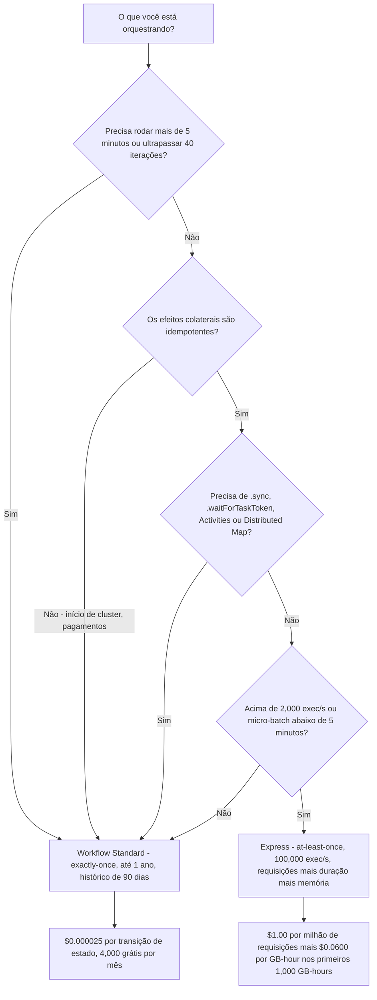
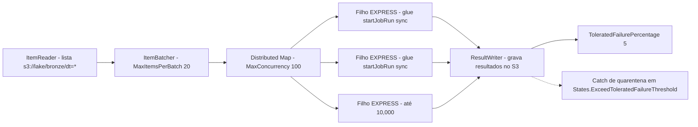
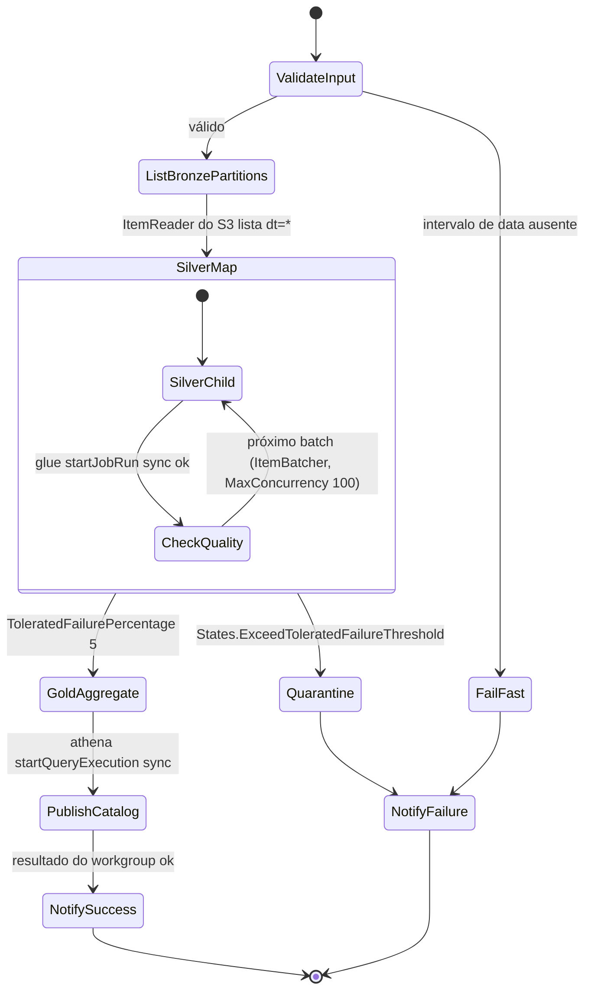
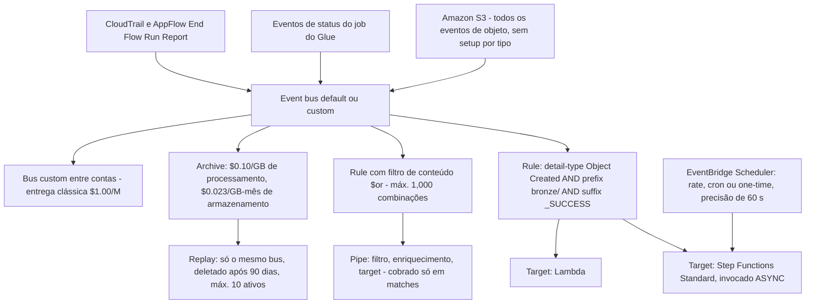
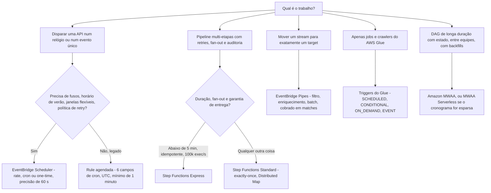

# Orquestrando o Lakehouse: Step Functions, EventBridge e MWAA

Dez lições adentro, você consegue aterrissar arquivos, convertê-los, curá-los em Iceberg, consultá-los com Athena e entregar o resultado ao Redshift. Nada disso responde às quatro perguntas que decidem se o lakehouse é um produto ou um passivo: **o que dá início à execução, em que ordem as etapas rodam, o que acontece quando uma etapa falha, e como rodar de novo sem gravar as mesmas linhas duas vezes?** Isso é orquestração, e é a camada onde a maioria dos incidentes de lakehouse realmente vive: não no SQL.

A regra de ensino desta lição é curta: **o orquestrador detém tempo, ordem, falha e reexecução; a computação detém os bytes.** Mantenha esses dois trabalhos separados e toda decisão de design posterior fica mais fácil.

```text
====================================================================
 A SUPERFÍCIE DE ORQUESTRAÇÃO DO LAKEHOUSE - em outubro de 2026
====================================================================
 STEP FUNCTIONS .... Standard  - exactly-once, até 1 ano,
                                 2,000 exec/s, 4,000 transições/s,
                                 $0.000025 por transição de estado,
                                 histórico de 90 dias, Distributed Map OK
                       Express  - at-least-once (assíncrono), até 5 minutos,
                                 100,000 exec/s, requisições + duração +
                                 blocos de 64 MB de memória, só Request Response
 EVENTBRIDGE ....... 4 tipos de bus: default, custom (Classic 2019,
                                 aprimorado em set de 2026), partner
                       rules    - 300/bus, 5 targets/rule, pattern de 2,048 ch
                       Pipes    - origem > filtro > enriquecimento > destino,
                                 cobrado só em matches, teto de 5 min
                       Scheduler- rate | cron | one-time, precisão de
                                 60 segundos, janela flexível de 1-1,440 min
                       Archive  - processamento $0.10/GB, armazenamento
                                 $0.023/GB-mês, replay $1.00/M
 AMAZON MWAA ........ Airflow sempre ligado: mw1.micro ... mw1.2xlarge,
                       workers 1-25 (default 10), schedulers 2-5
                       (default 2), Airflow 3.3.1 desde 2026-09-01,
                       MWAA Serverless GA 2025-11-17 a $0.08/task-hour
 GLUE WORKFLOWS ..... SCHEDULED | CONDITIONAL | ON_DEMAND | EVENT
                       triggers, <=100 componentes, histórico de 90 dias
 NÃO ISTO ........... "sync" como um terceiro tipo de workflow - existem
                       exatamente dois: Standard e Express (imutável)
====================================================================
```

Em esta lição você vai:

- separar os fluxos **Standard e Express** por garantia de entrega, teto de duração, taxa, padrões suportados e **custo por transição de estado**;
- ler e escrever **Amazon States Language**: os oito tipos de estado, os três padrões de integração e recursos de Task para **Glue, EMR, Lambda e a AWS SDK**;
- escolher entre **`Map` inline** e **Distributed Map**, e dimensionar `ItemReader`, `ItemBatcher` e `ResultWriter`;
- usar **`Parallel`**, **`Retry`**, **`Catch`**, **`TimeoutSeconds`** e **máquinas de estados aninhadas** para isolar fases e rotear falhas;
- conectar buses da **Amazon EventBridge**, event patterns, schedules, **Pipes com filtragem e enriquecimento**, **API Destinations** e **Archive/Replay**;
- dimensionar um ambiente **Amazon MWAA** e reconhecer os **padrões de DAG do Airflow** que o justificam;
- encadear **AWS Glue Workflows e triggers**, incluindo triggers `EVENT` iniciadas a partir do EventBridge;
- tornar reexecuções seguras com **nomes de execução determinísticos, dedup, checkpoints e transferência de watermark**;
- rodar um **backfill sobre partições por data** com um Distributed Map;
- aplicar uma **matriz de decisão de scheduler** e **roles de execução de menor privilégio**;
- trabalhar uma **máquina de estados de bronze a silver a gold com roteamento para quarentena**, dez exemplos resolvidos, uma **caixa de atualizações de outubro de 2026** com fontes, material de caso do **Transport for NSW**, três verificações interativas e **catorze questões no estilo de exame**.

---

## 1. A superfície de orquestração: cinco ferramentas, cinco trabalhos

### 1.1 As cinco primitivas

Toda pergunta de orquestração se reduz às mesmas cinco primitivas. Cada uma detém uma coisa diferente, e todo cheiro de design nesse espaço é uma primitiva usada para um trabalho que não lhe pertence.

| Primitiva | O que ela detém | Serviço AWS | Seção |
|---|---|---|---|
| **Máquinas de estados determinísticas de múltiplos passos** | Ordem, retries, ramificação, fan-out, histórico de auditoria por execução | **AWS Step Functions** | 2-5 |
| **Reação a eventos e gatilho por tempo** | Buses, patterns, schedules, Pipes, arquivos, roteamento entre contas | **Amazon EventBridge** | 6 |
| **Grafos acíclicos direcionados com UI de backfill** | Dependências de tarefas, retomada por checkpoint, janelas de catch-up, equipes | **Amazon MWAA** (Apache Airflow gerenciado) | 9 |
| **DAG dentro do serviço, sobre os próprios jobs de um engine** | Jobs e crawlers do Glue encadeados por triggers, um status de execução | **AWS Glue Workflows** | 10 |
| **Disparo único de uma API** | "Iniciar isso em um relógio ou em um evento" | **EventBridge Scheduler / rules** | 6.3 |

Os quatro prompts que você sempre deve responder antes de escolher: **O que inicia a execução?** (schedule, evento, chamada de API, sucesso upstream) **Em que ordem as etapas rodam?** (serial, paralelo, fan-out, condicional) **O que acontece em caso de falha?** (retry, catch, quarentena, alerta) **Como rodar de novo sem corromper os dados?** (nome idempotente, checkpoint, watermark, redrive).

- **📚 Você sabia?** As Step Functions alcançam **"mais de 14,000 ações de API de mais de 220 serviços da AWS"** segundo o AWS Compute Blog de 2025-11-04: um post anterior do AWS What's New de 2022-12-01 colocava a mesma cifra em *"mais de 200 serviços da AWS"*. O número é uma meta em movimento, mas o fato examinável é que a integração da AWS SDK é o escape hatch para qualquer coisa sem uma integração otimizada (AWS Compute Blog, 2025-11-04; AWS What's New, 2022-12-01).

---

## 2. AWS Step Functions: Standard versus Express

### 2.1 Dois tipos de workflow, e nenhum terceiro

Existem exatamente **dois** tipos de máquina de estados: **Standard** (o default) e **Express**. O tipo é **imutável**: escolhido na criação e nunca alterado depois. A palavra "sync" nomeia duas coisas *diferentes* e é a confusão mais comum deste serviço:

1. o **padrão de integração `.sync`** ("Executar um job"), onde um workflow **Standard** chama um serviço e bloqueia até o job terminar; e
2. **Express síncrono** (`StartSyncExecution`), onde uma execução Express é invocada de forma síncrona a partir do API Gateway, Lambda ou CLI e devolve o resultado.

| Eixo | **Standard** | **Express** |
|---|---|---|
| Garantia de entrega | Execução **exactly-once** | **At-least-once** (assíncrono) / **at-most-once** (síncrono) |
| Duração máxima | **1 ano** | **5 minutos** |
| Taxa de execução | 2,000 por segundo | 100,000 por segundo |
| Taxa de transição de estado | 4,000 por segundo | Quase ilimitada |
| Métrica de cobrança | **Por transição de estado** | Por requisição + duração + memória (blocos de 64 MB) |
| Histórico | 90 dias de histórico de execução | Apenas CloudWatch Logs |
| Distributed Map | **Suportado** | Não suportado |
| Activities | **Suportado** | Não suportado |
| `.sync` / `.waitForTaskToken` | **Suportado** | Não suportado: só Request Response |
| Melhor para | Ações **não-idempotentes** (iniciar um cluster EMR, pagamentos) | Ações **idempotentes** (micro-batch de alto volume) |

A AWS enuncia a regra sem meias-palavras: os Standard Workflows *"seguem um modelo exactly-once… adequado para orquestrar ações não-idempotentes, como iniciar um cluster do Amazon EMR ou processar pagamentos"*, enquanto os Express Workflows *"usam um modelo at-least-once… mais adequados para orquestrar ações idempotentes"* (Guia do Desenvolvedor do Step Functions, acesso em 2026-10-11).



> [!WARNING]
> **O Express não gerencia idempotência para você.** Os Standard Workflows *"retornam automaticamente uma resposta idempotente ao iniciar uma execução com o mesmo nome de um workflow em execução"*, o Express não, então duas execuções Express com o mesmo nome rodam **concorrentemente** e podem gravar em dobro. Lembre também: o Express **não** tem Distributed Map, **não** tem Activities, **não** tem `.sync` e **não** tem `.waitForTaskToken`. Um design de "fan-out serverless" que precise de qualquer um desses quatro precisa de um pai Standard (Guia do Desenvolvedor do Step Functions, acesso em 2026-10-11).

### 2.2 Exemplo resolvido E1: um pipeline diário com nove transições

A aritmética do próprio exemplo de preços da AWS, reproduzida com as taxas publicadas (us-east-1, acesso em 2026-10-11):

```text
Exemplo resolvido E1 - uma execução diária de bronze a silver a gold, 9 transições
--------------------------------------------------------------------------
  Transições do caminho feliz por execução     =   9
  Execuções por mês (1/dia x 30)               =  30
  Total de transições                          = 270
  Menos o free tier                            = 4,000  -> 0 cobráveis
  Conta                                         = $0.00

  Agora rode 100,000 vezes por mês:
  9 x 100,000                                  = 900,000 transições
  menos 4,000 grátis                           = 896,000 cobráveis
  896,000 x $0.000025                          = $22.40 / mês
```

O free tier é **4,000 transições de estado por mês**, sem prazo. Duas lições se escondem nesse número: um pipeline *diário* quase nunca gera uma conta de Step Functions que valha a pena considerar, e um de *alta frequência* gera.

### 2.3 Exemplo resolvido E2, o mesmo pipeline, duas métricas

Catorze estados, 30,000 execuções por mês, sem retries (derivado das taxas publicadas, em out de 2026):

```text
Exemplo resolvido E2 - Standard vs Express, mesma forma
-------------------------------------------------------
 STANDARD
   14 estados x 30,000 execuções           = 420,000 transições
   menos 4,000 grátis                      = 416,000 cobráveis
   416,000 x $0.000025                     = $10.40 / mês

 EXPRESS (mesma forma, 12 s por execução, 64 MB de memória cobrada)
   requisições: 30,000 / 1,000,000 x $1.00 =  $0.03
   duração:     30,000 x 12 s              = 360,000 s
                360,000 x 64 MB / 1024     = 22,500 GB-s
                22,500 / 3,600             = 6.25 GB-hours
                6.25 x $0.0600             =  $0.375
   total                                    =  ~$0.41 / mês
---------------------------------------------------
 O Express é ~25x mais barato AQUI - e só é válido se todo
 efeito colateral for idempotente e nada passar de 5 minutos.
```

O Express cobra a duração **arredondada para cima para os 100 ms seguintes**, em **blocos de 64 MB**, e a pegada de memória é calculada como `50 MB + tamanho da definição da máquina de estados + tamanho dos dados de execução x número de passos Parallel ou Map`. Os três níveis de duração que a AWS imprime no próprio Exemplo 4 são **$0.0600 por GB-hour** para os primeiros 1,000 GB-hours, **$0.0300** para os próximos 4,000 e **$0.01642** depois (Preços do Step Functions, acesso em 2026-10-11).

---

## 3. Amazon States Language e a camada de Task

### 3.1 Os oito tipos de estado

A Amazon States Language (ASL) é um documento baseado em JSON. Os tipos de estado que a AWS lista são **`Task`**, **`Choice`**, **`Wait`**, **`Pass`**, **`Succeed`**, **`Fail`**, **`Parallel`** e **`Map`**: oito deles, e a máquina de estados inteira são esses estados ligados por campos `Next` e `End` (Guia do Desenvolvedor do Step Functions, acesso em 2026-10-11).

- **`Task`** faz trabalho (chama Lambda, inicia um job do Glue, grava um item no DynamoDB).
- **`Choice`** ramifica conforme a entrada; **`Wait`** dorme; **`Pass`** remodela dados.
- **`Succeed`** e **`Fail`** encerram a execução deliberadamente.
- **`Parallel`** distribui sobre ramos **escritos na definição**.
- **`Map`** distribui sobre um **dataset**: inline ou Distributed (Seção 4).

Três cotas limitam a própria definição: o tamanho máximo da definição da máquina de estados é **1 MB** (duro), o tamanho máximo de entrada ou saída de uma tarefa, estado ou execução é **256 KiB** de dados codificados em UTF-8, e o tamanho máximo do histórico de execução é **25,000 eventos** para um workflow Standard.

### 3.2 Três padrões de integração, e quais serviços levam qual

Toda integração otimizada pode ser invocada de uma de três formas:

| Padrão | Sufixo | O que faz | Disponível em |
|---|---|---|---|
| **Request Response** (default) | *(nenhum)* | Dispara a API e devolve a resposta da API imediatamente | Standard **e** Express |
| **Run a job** | `.sync` | Chama o serviço e **bloqueia até o job terminar** | **somente Standard** |
| **Wait for a callback** | `.waitForTaskToken` | Injeta um task token, o entrega a um worker e espera `SendTaskSuccess` ou `SendTaskFailure` | **somente Standard** |

A matriz de integrações otimizadas da AWS separa os serviços de lakehouse com clareza:

- **`.sync` suportado:** `athena`, `batch`, `emr`, `emr-serverless`, `glue`, `glue:databrew`, `sagemaker`, `states` (as próprias Step Functions aninhadas).
- **Request Response mais callback (`.waitForTaskToken`), sem `.sync`:** `lambda`, `sns`, `sqs`, `dynamodb`, EventBridge.
- **Integração da AWS SDK:** Request Response em todos os serviços suportados; `.waitForTaskToken` somente em Standard; **nunca** `.sync`.

Então os recursos de Task concretos que você de fato vai escrever numa máquina de estados de lakehouse são:

```text
arn:aws:states:::glue:startJobRun.sync          # Glue, espera o job
arn:aws:states:::emr:addStep.sync               # step de cluster EMR
arn:aws:states:::emr-serverless:startJobRun.sync
arn:aws:states:::athena:startQueryExecution.sync
arn:aws:states:::lambda:invoke                   # Request Response
arn:aws:states:::dynamodb:putItem                # checkpoint / watermark
arn:aws:states:::states:startExecution.sync      # aninhado, devolve STRING
arn:aws:states:::states:startExecution.sync:2    # aninhado, devolve JSON
arn:aws:states:::states:startExecution.waitForTaskToken
arn:aws:states:<region>:aws-sdk:<service>:<ApiAction>   # 14,000+ ações
```

- **📚 Você sabia?** `startExecution.sync` e `startExecution.sync:2` **não** são intercambiáveis: `.sync` devolve a saída do filho **como string**, `.sync:2` devolve **como JSON**. Analisar o errado corrompe silenciosamente toda referência `Payload.$` a jusante, e a falha aparece muito depois como um campo ausente em vez de um erro de deploy (Guia do Desenvolvedor do Step Functions, acesso em 2026-10-11).

### 3.3 Exemplo resolvido E3, o orçamento de retry que você esqueceu de precificar

Retries não são grátis: *"Retries são tratados como transições de estado"*, e *"Se você incluir tratamento de erro com retry em qualquer etapa do seu workflow, cada retry será cobrado como uma transição de estado adicional"* (Preços do Step Functions, acesso em 2026-10-11).

```text
Exemplo resolvido E3 - quanto custa um bloco Retry generoso
-----------------------------------------------------------
  Retry em um estado Task do Glue:
    IntervalSeconds: 5, MaxAttempts: 4, BackoffRate: 2.0
    JitterStrategy: FULL, MaxDelaySeconds: 30

  Esperas entre tentativas    = 5 s, 10 s, 20 s  (limitado a 30 s)
  Transições extras quando o job acerta de primeira : 0
  Transições extras quando as 4 tentativas falham   : 4

  Uma máquina com 12 estados, cada estado com esse bloco Retry,
  10,000 execuções por mês, pior caso:
    caminho feliz    12 x 10,000                 = 120,000
    pior caso acresce 12 x 4 x 10,000            = 480,000
    total                                         600,000
    menos 4,000 grátis                            596,000
    596,000 x $0.000025                           = $14.90

  Mesma máquina com MaxAttempts: 0 em 6 dos 12 estados
    6 x 10,000 + 6 x 4 x 10,000 = 300,000 - 4,000 = 296,000
    296,000 x $0.000025                          =  $7.40
```

`MaxAttempts: 0` significa **nunca tentar de novo**: uma escolha válida e deliberada para uma etapa que falha permanentemente e deve ir direto para um `Catch`.

### 3.4 Retry, Catch, Timeout e Heartbeat: os defaults exatos

| Campo | Default | Observações |
|---|---|---|
| `IntervalSeconds` | **1** | Primeira espera de backoff |
| `MaxAttempts` | **3** | `0` = nunca tentar de novo |
| `BackoffRate` | **2.0** | Multiplicativo |
| `JitterStrategy` | **`NONE`** | Aceita `FULL` ou `NONE` |
| `MaxDelaySeconds` | *(não definido)* | Deve ser maior que 0 e menor que **31,622,401** |
| `TimeoutSeconds` | *(não definido)* | Limita uma tarefa; teto geral do Standard é 1 ano, do Express 5 minutos |
| `HeartbeatSeconds` | *(não definido)* | Detecta um worker travado via `SendTaskHeartbeat` |

Nomes de erro embutidos que você não deve misturar:

- **`States.ALL`**: deve aparecer **sozinho** num `Catcher` e **não** pode capturar `States.DataLimitExceeded` nem `States.Runtime`.
- **`States.TaskFailed`**: um curinga para qualquer erro conhecido **exceto** `States.Timeout`.
- **`States.Timeout`**, **`States.HeartbeatTimeout`**, **`States.Permissions`**, **`States.ItemReaderFailed`**, **`States.ResultWriterFailed`**, **`States.ExceedToleratedFailureThreshold`**.
- **`States.DataLimitExceeded`** é **terminal**: uma tarefa que emite um payload acima de **256 KiB** morre e nenhum catcher anexado aquele estado pode salvá-la.

Três regras estruturais que pegam engenheiros experientes:

1. **Catchers existem em `Task`, `Parallel` e `Map` apenas**: *"não para falhas de execução de máquina de estados de nível superior"*. Uma falha de execução inteira precisa ser tratada pelo **chamador**, por um **workflow aninhado** ou por uma **rule do EventBridge sobre o status da execução** (`FAILED` / `TIMED_OUT`).
2. Se uma **máquina de estados aninhada** lança um `States.Timeout`, o pai recebe **`States.TaskFailed`** no lugar.
3. Nos runtimes mais novos do Lambda, timeouts aparecem como **`Sandbox.Timedout`**: cashe com `Lambda.Unknown`, `Sandbox.Timedout` **e** `States.TaskFailed` juntos.

### 3.5 Activities: a faixa de callback que espera até um ano

Activities são uma construção **somente para Standard**: um worker de activity faz polling com `GetActivityTask`, mantém a tarefa viva enviando um heartbeat com `SendTaskHeartbeat` dentro do `TimeoutSeconds` configurado, e responde com `SendTaskSuccess` ou `SendTaskFailure`. Com heartbeats, *"uma activity no Step Functions pode esperar até um ano por uma execução terminar"*. Depois que a tarefa estoura o tempo, as Step Functions **invalidam o task token** e chamadas posteriores levantam `TaskTimedOut`.

### 3.6 Workflows aninhados: fases com histórico e retries próprios

Quatro recursos controlam o aninhamento: `states:startExecution` (dispara e esquece), `.sync` (espera, saída string), `.sync:2` (espera, saída JSON), `.waitForTaskToken` (callback). Aninhar compra **isolamento de histórico por fase**, **retries por fase** e **reuso**, mas o pai precisa poder *descobrir* que o filho terminou, e essa detecção tem dois caminhos com dois conjuntos de permissões diferentes:

- **polling**: precisa de `states:DescribeExecution`;
- **eventos do EventBridge**: precisa de `events:PutTargets`, `events:PutRule` e `events:DescribeRule`.

Omita o segundo conjunto e o pai **trava** em vez de falhar barulhento, que é o sintoma clássico.

### 3.7 Exemplo resolvido F1: preenchendo um fragmento real de ASL

```fillblank
{
  "question": "Complete as afirmações da Amazon States Language e de tratamento de erros com a palavra-chave, valor ou recurso exato (tudo em out de 2026):",
  "template": "Um estado Task que inicia um job do AWS Glue e bloqueia até o job terminar usa o recurso {{1}}. Um estado Task que injeta um token e espera um worker externo responder usa o padrão de integração {{2}}. Os defaults de Retry são IntervalSeconds {{3}}, MaxAttempts {{4}} e BackoffRate {{5}}, e um Catcher pode ser anexado apenas a estados Task, Parallel e Map: nunca a uma falha de execução de máquina de estados de nível superior.",
  "answers": {
    "1": "arn:aws:states:::glue:startJobRun.sync",
    "2": ".waitForTaskToken",
    "3": "1",
    "4": "3",
    "5": "2.0"
  },
  "distractors": [
    "arn:aws:states:::glue:startJobRun",
    "StartSyncExecution",
    ".sync:2",
    "0",
    "10",
    "1.5",
    "3.0"
  ],
  "explanation": "Esperar um job do Glue é o padrão .sync 'Run a job', então o recurso carrega o sufixo .sync e está disponível apenas em workflows Standard; .waitForTaskToken é o padrão de callback separado, usado por Lambda, API Gateway, ECS e activities. Os defaults de Retry publicados no guia do desenvolvedor são IntervalSeconds 1, MaxAttempts 3 e BackoffRate 2.0, com JitterStrategy NONE. O recurso simples glue:startJobRun é Request Response (retorna quando o job é submetido), .sync:2 pertence a máquinas de estados aninhadas e devolve JSON em vez de um task token, e 0 significa nunca tentar de novo."
}
```

---

## 4. Map, Distributed Map, Parallel e ItemBatcher

### 4.1 Quando o `Map` inline deixa de bastar

`Parallel` itera sobre ramos **fixos na definição**; `Map` itera sobre um **dataset**. O `Map` inline (default) roda suas iterações dentro do histórico de execução do *pai*, e isso cria três tetos duros:

| Restrição | `Map` inline | **`Map` Distributed** |
|---|---|---|
| Iterações concorrentes | **40** | Até **10,000** execuções filhas paralelas |
| Histórico | Divide o histórico de **25,000 eventos** do pai | Cada filho tem seu próprio histórico |
| Tamanho do dataset | Precisa caber em **256 KiB** de payload | Lido do **S3** via `ItemReader` |
| Tipo de workflow | Standard ou Express | **somente Standard** |
| Saída de resultados | No resultado da execução | Escrito no S3 via `ResultWriter` |

As condições próprias da AWS para mudar: use o modo Distributed quando *"o tamanho do seu dataset exceder 256 KiB"*, *"o histórico de eventos de execução do workflow exceder 25,000 entradas"*, ou *"você precisar de uma concorrência acima de 40 iterações simultâneas"* (Guia do Desenvolvedor do Step Functions, acesso em 2026-10-11).

> [!IMPORTANT]
> **O `Map` Distributed é um recurso somente de workflow Standard.** A AWS imprime um aviso explícito: *"O modo Distributed é suportado em workflows Standard, mas não é suportado em workflows Express."* Planeje o pai em cima disso, e observe que o bloco `Retry` de um Distributed Map, quando dispara, **cria um novo Map Run**, então um Map com muitos retries reexecuta discretamente cada filho. Limite `MaxAttempts` e prefira **redrive** para reexecuções de Map inteiro: redrive é somente Standard e só está disponível dentro do período redrive de execução de **14 dias**.

Específicos do Distributed Map que valem a pena decorar:

- Fontes do `ItemReader`: **objetos do S3** (CSV, JSON, JSONL, **Parquet**), ou **um manifest de dados do Athena**, o Compute Blog de 2025-11-04 confirma que o Distributed Map pode *"processar arquivos de manifest de dados do AWS Athena e Parquet diretamente, eliminando a necessidade de pré-processamento customizado"*.
- `ExecutionType` nos filhos: **`STANDARD`** ou **`EXPRESS`**: use filhos EXPRESS para unidades de fan-out curtas e idempotentes.
- `MaxConcurrency` / `MaxConcurrencyPath`: se não definidos ou zerados, as Step Functions *"não limitam a concorrência e executam 10,000 execuções filhas de workflow paralelas"*, e a AWS recomenda não exceder a capacidade de um serviço downstream como o Lambda.
- `ToleratedFailureCount` / `ToleratedFailurePercentage` e suas variantes `...Path`: **o default de porcentagem é zero**, o que significa que *"o workflow falha se qualquer uma de suas execuções filhas falhar ou estourar o tempo"*. Exceder o limiar levanta **`States.ExceedToleratedFailureThreshold`**, que precisa do seu próprio `Catch`.
- Cotas: **1,000** Map Runs abertos por conta/Região, **1,000** redrives por Map Run, **10,000** execuções filhas paralelas por Map Run (duro), e as Step Functions despacham filhos express a até **1,000 TPS** e filhos standard a até **100 TPS**.

### 4.2 `ItemBatcher`: a alavanca mais barata que você tem

O `ItemBatcher` agrupa itens para que cada filho receba `{"Items": [...]}` mais um `BatchInput` estático opcional. Dois pares de knobs: `MaxItemsPerBatch` / `MaxItemsPerBatchPath`, e `MaxInputBytesPerBatch` / `MaxInputBytesPerBatchPath`, o teto de bytes é **256 KiB**, o próprio limite de payload do Step Functions.

O número trabalhado da própria AWS: *"imagine que você executa um arquivo JSON de entrada que contém 1130 nodes. Se você especificar um valor máximo de itens de 100 para cada batch, o Step Functions cria 12 batches"* (Guia do Desenvolvedor do Step Functions, acesso em 2026-10-11). Use batching *"ao processar arquivos CSV grandes ou arrays JSON, ou grandes conjuntos de objetos do Amazon S3."*

### 4.3 Exemplo resolvido E4: aritmética de batch e seu efeito na fatura

```text
Exemplo resolvido E4 - 1,130 objetos bronze, três formas
-------------------------------------------------------
 FORMA A - sem batch, um filho por objeto
   filhos                                 = 1,130
   ~6 transições cada                     = 6,780 transições
   6,780 x $0.000025                      = $0.17

 FORMA B - MaxItemsPerBatch: 100
   filhos                                 = 12      (número da própria AWS)
   12 x 6                                 = 72 transições
   72 x $0.000025                         = $0.0018

 FORMA C - MaxInputBytesPerBatch: 262144
   os batches encolhem sempre que 100 itens passariam de 256 KiB,
   então a contagem real de batches é min(teto de itens, teto de bytes)

 ECONOMIA SÓ DE ORQUESTRAÇÃO A -> B          = ~90x
 (as DPU-hours do Glue são cobradas à parte e não mudam)
```

- **📚 Você sabia?** As métricas de observabilidade do Distributed Map anunciadas em 2025-09-18, **`ApproximateOpenMapRunsCount`**, **`OpenMapRunLimit`** e **`ApproximateMapRunsBacklogSize`**, existem porque a profundidade do fan-out fica invisível até você bater na cota de 1,000 Map Runs abertos. Coloque alarme na métrica de backlog antes do limite, não depois (AWS What's New, 2025-09-18; AWS Compute Blog, 2025-11-04).



### 4.4 Projetos de exemplo que valem a pena ler antes de você construir um

Dois projetos de exemplo da AWS são bons materiais didáticos: um pipeline de **dados de clima** onde *"os dados de clima são registrados em mais de 12,000 arquivos CSV"* com `MaxConcurrency` em **3,000**, copiando, depois analisando e depois reduzindo no DynamoDB; e um pipeline de **CSV de pedidos de envio** com *"10,000 linhas de um arquivo CSV"* processado em **lotes de 10** com `MaxConcurrency` **1,000**, gravando resultados no S3 por meio do `ResultWriter` (projetos de exemplo do Step Functions, acesso em 2026-10-11).

---

## 5. Uma máquina de estados de lakehouse trabalhada: bronze a silver a gold

Esta é a forma que você deve conseguir desenhar de memória. Um pai **Standard** hospeda um **Distributed Map** (o Express não poderia), os filhos rodam como execuções **EXPRESS** com `MaxConcurrency: 100` para que a concorrência de jobs do Glue em nível de conta nunca fique esgotada, e a falha parcial vai para a quarentena em vez de falhar em silêncio.



Notas de ensino, todas estruturais:

1. **`SilverMap` precisa ser Distributed**, o teto de 40 iterações de um Map inline e o histórico dividido de 25,000 eventos matariam uma execução com milhares de partições.
2. **`ItemBatcher.MaxItemsPerBatch: 20`** transforma milhares de arquivos em dezenas de filhos. Filhos são a unidade **tanto** de paralelismo **quanto** de cobrança.
3. **`Retry` no Map cria um novo Map Run**: limite `MaxAttempts` e use **redrive** (janela de 14 dias, somente Standard) para reexecuções de Map inteiro.
4. **`Catch` em `States.ExceedToleratedFailureThreshold`** leva a falha parcial para a quarentena. Sem ele, estourar o limiar é uma falha de execução não tratada.
5. **O watermark é gravado por último.** Registre `s3://lake/_checkpoints/silver/dt=2026-10-11.json` somente depois que `PublishCatalog` tiver sucesso: é isso que torna idempotente o retrigger do mesmo dia.
6. **A quarentena é um destino, não um estado.** Aterrisse as chaves de partição que falham em algum lugar que um humano ou um sistema de tickets possa ver.
7. **`ValidateInput` é um estado `Choice`**, e o ramo `FailFast` termina num estado `Fail`: uma saída barata e antecipada vence descobrir um intervalo de data ruim três horas dentro de um fan-out.

### 5.1 Exemplo resolvido E5: precificando esta máquina exata

```text
Exemplo resolvido E5 - a máquina de estados acima, uma execução diária
---------------------------------------------------------------------
 PAI (Standard)
   ~16 transições por execução x 31 execuções  =   496
 MAP (Distributed) - 90 partições na janela
   90 / 20 por batch  =  5 filhos (arredondado para cima)
   overhead de filho ~6 transições cada         =   30
 RESULT WRITER / publicação / notificação      =   ~10
  -------------------------------------------------------
  total                                        =  ~536 transições/mês
  menos 4,000 grátis                           =       0 cobráveis
  CONTA DE ORQUESTRAÇÃO                        =  $0.00 / mês

  As DPU-hours do Glue e a cobrança de varredura do Athena são a conta real.
  Orquestração é a camada barata - desenhe-a para correção,
  não para economizar centavos.
```

Esta é a lição de custo mais importante desta lição: **o Step Functions é um erro de arredondamento ao lado da computação que ele agenda.** Otimize para roteamento de falha e segurança de reexecução, não para contagem de transições: com a única exceção de políticas de retry ilimitadas (Seção 3.3).

---

## 6. Amazon EventBridge para o lakehouse

### 6.1 Buses, rules, cotas

A AWS dá a toda conta um **event bus default** que recebe eventos de mudança de estado dos serviços da AWS (eventos de management entram grátis; **data events** opcionais como os do S3 precisam ser habilitados). A página de preços descreve **quatro tipos de event bus**: o bus default; **dois buses custom**, *Custom event bus: Classic* (julho de 2019) e um **Custom event bus aprimorado lançado em setembro de 2026**, e um **partner event bus** para eventos de fornecedores de SaaS (Preços do Amazon EventBridge, acesso em 2026-10-11).

| Cota | Valor (em out de 2026) |
|---|---|
| Rules por event bus | **300** default (ajustável; 100 em af-south-1 e eu-south-1) |
| Event buses por conta/Região | **100** |
| Targets por rule | **5**: *não ajustável* |
| Tamanho do event pattern | **2,048** caracteres |
| Rules com curinga por bus | **30**: *não ajustável* |
| API Destinations / conexões / endpoints | 3,000 / 3,000 / 100; **300 invocações por segundo** por destination |

### 6.2 Event patterns

Os patterns casam com `source`, `detail-type`, `account`, `region` e `detail`, com o conjunto de operadores **`And`**, **`anything-but`** (incluindo formas prefix, suffix, ignore-case e wildcard), **`prefix`**, **`suffix`**, **`empty`**, **`equals-ignore-case`**, **`exists`**, **`null`**, intervalos **`numeric`**, **`$or`**, **`wildcard`** e **`cidr`**. Duas arestas afiadas: *"Atualmente, o caractere curinga é suportado apenas em regras de event bus"*, e qualquer pattern onde **`$or`** se expanda para mais de **1,000 combinações de regra** faz `PutRule`, `CreateArchive`, `UpdateArchive` e `TestEventPattern` lançarem **`InvalidEventPatternException`** (Guia do Usuário do EventBridge, acesso em 2026-10-11).

### 6.3 Schedules: rules legadas versus EventBridge Scheduler

As **rules** agendadas são explicitamente *"um recurso legado do EventBridge"* e a AWS *"recomenda que você use o Scheduler para invocar targets em um cronograma"*. O cron legado tem **seis campos obrigatórios** (minutos, horas, dia do mês, mês, dia da semana, ano) e *"expressões cron que levam a taxas mais rápidas que 1 minuto não são suportadas"*; tudo roda em **UTC**.

O **EventBridge Scheduler** é a resposta atual: três tipos de schedule, **rate-based, cron-based e one-time**, com *"precisão de 60 segundos"*, tratamento automático de **horário de verão** (numa lacuna de avanço a invocação é **pulada**), **janelas de tempo flexíveis** de **1 a 1,440 minutos**, políticas de retry e de idade de evento, e targets com template em centenas de serviços da AWS. Cotas: **10,000,000** schedules por Região, **5,000 TPS** de `CreateSchedule`, **1,000 TPS** de invocações.

**Preços:** **$1.00 por milhão de invocações** após **14,000,000 invocações grátis por mês** (Preços do EventBridge, acesso em 2026-10-11).

> [!WARNING]
> **Schedule não é exactly-once.** O Scheduler tem precisão de 60 segundos e, se você habilitar, uma janela flexível de até 1,440 minutos; a entrega aos targets é at-least-once. Nunca assuma que um cron disparou uma vez: é exatamente por isso que toda máquina de estados agendada precisa de um **nome de execução determinístico** (Seção 7).

### 6.4 Pipes: origem para filtro para enriquecimento para target

Um pipe é *"escolha a origem, adicione filtragem opcional, defina enriquecimento opcional e escolha o target"*: com ordenação preservada quando a origem a impõe, batching, relatório de falha parcial e seu próprio papel IAM sob **`pipes.amazonaws.com`**.

- **Origens:** DynamoDB Streams, streams do Kinesis, Amazon MQ, MSK, SQS e Apache Kafka (auto-gerenciado, Confluent Cloud, CloudKarafka, Redpanda). Não trate nenhuma lista publicada como exaustiva: a página da documentação da AWS é a autoridade.
- **Targets:** API destination, API Gateway, fila de jobs do Batch, grupo de logs do CloudWatch, task do ECS, event bus da mesma conta e mesma Região, delivery stream do Firehose, stream do Kinesis, Lambda (SYNC ou ASYNC), consultas do Redshift Data API, pipelines do SageMaker AI, tópico SNS (FIFO não suportado), fila SQS, **Step Functions** (Express SYNC ou ASYNC; **Standard precisa ser ASYNC**), Timestream.
- **Tetos de payload:** os Pipes aceitam **6 MB**, mas o target limita você: um target de event bus é **1 MB** e um target de máquina de estados do Step Functions é **256 KB**. Saída de enriquecimento acima do limite do target falha a invocação.
- **Tamanhos de batch são o mínimo entre origem e target:** Kinesis permite lotes de **10,000** registros, targets SQS só **10**, Firehose e Kinesis **500**, CloudWatch Logs **10,000**, event bus **10**, SNS **10**, então o pipe trava no menor número.
- **Teto de execução do pipe:** **5 minutos** incluindo enriquecimento e processamento do target: *"Este limite atualmente não pode ser aumentado."*
- **Defaults de concorrência:** SQS **1,250**; Kafka até a contagem de partições (**máx. 1,000**); Amazon MQ **5**; Kinesis e DynamoDB = `ParallelizationFactor` multiplicado pelo número de shards.
- **Falha parcial de batch** usa o formato de payload `{"batchItemFailures": [{"itemIdentifier": "id2"}]}`.
- **Cobrança:** *"Você é cobrado apenas pelos eventos que correspondem ao filtro"*: **$0.40 por milhão** de requisições, medido em blocos de 64 KB, após o filtro.

### 6.5 API Destinations, Archive e Replay

As **API Destinations** permitem que uma rule chame um endpoint HTTP externo por meio de uma conexão gerenciada pela AWS: **$0.20 por milhão de eventos**, com 3,000 destinations e 3,000 conexões por conta/Região e 300 invocações por segundo por destination.

**Archive e Replay** é a caixa preta de eventos do lake. *"Por padrão, o EventBridge armazena eventos no archive indefinidamente"*; *"Reproduzir eventos não os remove do archive… o EventBridge só remove eventos quando eles excedem o período de retenção do archive, ou quando você deleta o próprio archive"*; replays são **deletados após 90 dias**; você pode ter no máximo **10 replays ativos simultâneos** por conta por Região; e *"você só pode reproduzir eventos para o mesmo event bus que emitiu os eventos."*

### 6.6 O caminho de eventos do lakehouse: S3 direto no EventBridge

Com o EventBridge habilitado, o S3 entrega todo evento em nível de objeto sem configuração por tipo: uma rule filtra `source: aws.s3`, `detail-type: Object Created`, o nome do bucket, um `prefix` de `bronze/orders/` e um `suffix` de `_SUCCESS`, e aponta para uma máquina de estados, um Pipe, uma função Lambda ou uma fila SQS. Isso substitui as notificações de eventos S3 por tipo mais um fan-out por Lambda quando você precisa de muitos consumidores, filtragem por conteúdo, archives e roteamento entre contas.

### 6.7 Exemplo resolvido E6: a conta do lake orientado a eventos

```text
Exemplo resolvido E6 - 5,000,000 eventos S3 Object Created por mês
------------------------------------------------------------------
 CAMINHO 1 - bus custom clássico, uma rule -> Lambda (mesma conta)
   ingestão      5,000,000 / 1,000,000 x $1.00   = $5.00
   entrega na mesma conta                       = $0.00
   total                                        = $5.00 / mês

 CAMINHO 2 - um Pipe com 20% de match, batches de 10
   eventos com match 5,000,000 x 0.20           = 1,000,000
   requisições      1,000,000 / 10              =   100,000
   100,000 / 1,000,000 x $0.40                  =     $0.04

 CAMINHO 3 - adicione um Archive de tudo
   5,000,000 x 1 KB  = ~4.77 GB
   processamento     4.77 x $0.10               =     $0.48
   armazenamento (1 mês) 4.77 x $0.023          =     $0.11
   replay completo   5,000,000 / 1,000,000 x $1.00 =  $5.00
------------------------------------------------------------------
 Toda aritmética derivada de taxas publicadas (em out de 2026).
 Note as três métricas DIFERENTES: blocos por evento, GB de entrada e
 saída, requisição pós-filtro. Nunca misture as três numa tabela sem rótulo.
```

- **📚 Você sabia?** O S3 não faz você enumerar tipos de evento. Com o EventBridge habilitado na conta, *"você não precisa selecionar quais tipos de evento deseja entregar"*: todos fluem, incluindo *Object Created*, *Object Deleted*, *Restore Initiated / Completed / Expired*, *Storage Class Changed*, *Object Tags Added/Deleted*, *Retention Updated* e *Annotation Created/Removed*. O filtro pertence à **rule**, não a uma configuração de notificação por tipo (Guia do Usuário do Amazon S3, acesso em 2026-10-11).



---

## 7. Orquestração idempotente: sobrevivendo à segunda execução

### 7.1 Quatro mecanismos, na ordem em que você os constrói

| # | Mecanismo | O que ele te dá |
|---|---|---|
| 1 | **Nomeação determinística de execução** | Os Standard Workflows *"retornam automaticamente uma resposta idempotente ao iniciar uma execução com o mesmo nome de um workflow em execução"*: gatilhos duplicados colapsam |
| 2 | **Semântica exactly-once onde importa** | Standard para efeitos colaterais **não-idempotentes** (início de cluster EMR, pagamentos); Express é at-least-once, então writers precisam tolerar uma segunda chamada |
| 3 | **Writers idempotentes** | Prefixo de staging mais promote atômico, sobrescrita de partição dinâmica, `MERGE` do Iceberg: a defesa no plano de dados que o orquestrador não pode fornecer |
| 4 | **Checkpoint e transferência de watermark** | Persista o watermark **depois** de a camada confirmar; a próxima camada o lê como seu limite inicial |

Os nomes são **únicos por conta e Região**, limitados a **80 caracteres**, e o histórico de execução é retido por **90 dias** (reduzível para 30 por requisição de cota). Um padrão diário prático:

```text
  Nome da execução = "<camada>-<data-partição>-<origem>"
  ex.: "bronze-2026-10-11-orders"
       "silver-2026-10-11-orders"

  - entrega duplicada do mesmo marcador no EventBridge -> absorvida
  - uma data de partição genuinamente nova             -> nova execução
  - retrigger manual na mesma data                     -> no-op idempotente
```

### 7.2 Checkpoints e transferência de watermark

As Step Functions **não** rastreiam watermarks de dados; este é um padrão de engenharia construído sobre primitivas verificadas, não um recurso gerenciado. Persista o watermark **depois** da confirmação, em um destes: um **item do DynamoDB**, um **objeto marcador no S3** como `_checkpoints/silver/dt=2026-10-11.json`, um **snapshot id do Iceberg**, ou um **bookmark do job do Glue**. O leitor deve então tirar seu limite inicial desse watermark, o que faz a releitura de uma janela fechada ser um no-op em vez de uma gravação duplicada.

Três regras baratas de determinismo completam o quadro: derive chaves de objeto e identificadores de contexto de `(layer, partition_date, source)`; mantenha todo campo `Payload` downstream referenciado por caminhos `.$` em vez de assumido; e faça do marcador de sucesso a *única* coisa em que uma rule downstream filtra, de modo que uma gravação parcial nunca possa se passar por conclusão.

### 7.3 Exemplo resolvido E7: desenhando a reexecução segura

```text
Exemplo resolvido E7 - um marcador S3 duplicado chega às 02:00 e 02:00:04
-------------------------------------------------------------------------
 02:00:00  PutObject bronze/orders/dt=2026-10-11/_SUCCESS
 02:00:01  Rule do EventBridge dispara -> StartExecution
           Nome = "bronze-2026-10-11-orders"
           A máquina de estados inicia (Standard: exactly-once)
 02:00:04  Evento reentregue -> StartExecution, MESMO nome
           As Step Functions retornam a resposta idempotente para a
           execução em andamento - sem segunda execução
 02:14:00  O job grava as linhas silver num prefixo de STAGING com chave
           (layer, partition_date, source) - chaves determinísticas
 02:15:00  Promote atômico / MERGE do Iceberg - a segunda chamada converge
 02:15:01  Watermark gravado em _checkpoints/silver/dt=2026-10-11.json
           SÓ DEPOIS de a confirmação ter sucesso
 09:00:00  Um humano reexecuta o mesmo nome de execução
           -> o watermark já cobre a janela -> o leitor faz no-op
```

> [!IMPORTANT]
> **Idempotência é em camadas, não é um interruptor único.** O dedup por nome de execução só funciona em **Standard**; no Express ele não faz nada. Chaves determinísticas só ajudam se o *writer* as respeitar. Um watermark só ajuda se for gravado **depois** da confirmação, nunca antes. Remova qualquer uma das três camadas e as outras duas deixam de te proteger.

### 7.4 Ordenando o pipeline idempotente

```dragdrop
{
  "question": "Ordene as etapas de um pipeline de lakehouse reexecutável (idempotente), do gatilho a um watermark seguro:",
  "items": [
    "Inicie a execução com um nome determinístico derivado de camada, data de partição e origem: gatilhos duplicados num workflow Standard são absorvidos",
    "Liste exatamente uma janela de entrada usando um prefixo ou manifest determinístico, nunca um listing ao vivo e ilimitado",
    "Escreva as saídas num prefixo de staging determinístico com chave de camada, data de partição e origem, para que uma segunda gravação caia nas mesmas chaves",
    "Confirme atomicamente: sobrescrita de partição dinâmica, um MERGE do Iceberg ou um promote de prefixo de staging: para que uma chamada repetida convirja em vez de anexar",
    "Emita um marcador de sucesso ou objeto _SUCCESS em que as rules de evento downstream possam filtrar",
    "Persista o watermark ou checkpoint DEPOIS da confirmação, para que uma falha entre confirmação e checkpoint cause apenas uma releitura inofensiva",
    "Faça a próxima camada ler o watermark como seu limite inicial, tornando qualquer replay de uma janela fechada um no-op"
  ],
  "correctOrder": [
    "Inicie a execução com um nome determinístico derivado de camada, data de partição e origem: gatilhos duplicados num workflow Standard são absorvidos",
    "Liste exatamente uma janela de entrada usando um prefixo ou manifest determinístico, nunca um listing ao vivo e ilimitado",
    "Escreva as saídas num prefixo de staging determinístico com chave de camada, data de partição e origem, para que uma segunda gravação caia nas mesmas chaves",
    "Confirme atomicamente: sobrescrita de partição dinâmica, um MERGE do Iceberg ou um promote de prefixo de staging: para que uma chamada repetida convirja em vez de anexar",
    "Emita um marcador de sucesso ou objeto _SUCCESS em que as rules de evento downstream possam filtrar",
    "Persista o watermark ou checkpoint DEPOIS da confirmação, para que uma falha entre confirmação e checkpoint cause apenas uma releitura inofensiva",
    "Faça a próxima camada ler o watermark como seu limite inicial, tornando qualquer replay de uma janela fechada um no-op"
  ],
  "explanation": "A ordenação é o que torna isso seguro, não qualquer etapa isolada. O dedup colapsa primeiro os gatilhos duplicados; a listagem determinística delimita a janela; as chaves de staging determinísticas tornam o writer repetível; a confirmação atômica é o ponto de não-retorno da gravação em dobro; o marcador é o que as rules de evento filtram; e o watermark é gravado estritamente por último, de modo que uma queda antes dele apenas releia dados que a confirmação já tornou idempotentes. Gravar o watermark antes da confirmação é a única inversão que converte uma queda em perda silenciosa de dados."
}
```

---

## 8. Backfill com um Distributed Map sobre partições por data

Backfill é onde o Distributed Map deixa de ser uma curiosidade e vira a ferramenta mais barata que você tem: uma execução pai, centenas de filhos por partição de data, concorrência limitada pelo que o Glue de fato absorve.

### 8.1 Exemplo resolvido E8: um backfill de 90 dias

```text
Exemplo resolvido E8 - reconstruir 90 partições diárias
        dt=2026-07-13 ... dt=2026-10-10
---------------------------------------------------------------------------------
 ENTRADA
   90 prefixos de partição, ~40 arquivos Parquet cada = 3,600 objetos

 CONFIGURAÇÃO
   ItemReader          : objetos do S3 sob o prefixo bronze
   ItemBatcher         : MaxItemsPerBatch = 5
   filhos              : 3,600 / 5              = 720 workflows filhos
   MaxConcurrency      : 100   (teto de jobs do Glue, não 10,000)
   ExecutionType       : EXPRESS  (cada filho abaixo de 5 min, idempotente)
   corpo do filho      : glue:startJobRun.sync em um dia-partição
   ToleratedFailurePercentage : 5  ->  720 x 0.05 = 36 falhas toleradas
                              ultrapassá-lo levanta
                              States.ExceedToleratedFailureThreshold

 TRANSIÇÕES (derivado, em out de 2026)
   overhead do pai                            ~     8
   720 filhos x ~6 transições                 ~ 4,320
   total                                      ~ 4,328
   4,328 x $0.000025                          ~   $0.11 por backfill

 Compare: 3,600 filhos sem batch x 6 = 21,600 x $0.000025 = $0.54
 O batch cortou a conta de orquestração em ~5x; as DPU-hours do Glue
 dominam de qualquer forma.
```

Três regras para backfills de produção:

1. **Limite `MaxConcurrency` ao serviço downstream.** A própria orientação da AWS: *"recomendamos que você não exceda a capacidade de um serviço AWS downstream, como o AWS Lambda"*, e 10,000 filhos de uma vez estourariam a cota de jobs da conta no Glue na hora.
2. **Defina `ToleratedFailurePercentage` deliberadamente.** O default é **zero**, então uma única partição corrompida derruba o Map Run inteiro.
3. **Prefira redrive a `Retry` num `Map`.** Tentar de novo um estado `Map` *"cria um novo Map Run"*; redrive reusa o existente dentro da janela de 14 dias.

- **📚 Você sabia?** Um backfill também é o jeito mais barato de *testar* seu design de idempotência: reexecute uma janela que já foi confirmada e observe se o writer converge ou anexa. Se a segunda execução mudar as contagens de linhas, sua transferência de watermark está quebrada *antes* que um encontro a encontre por você.

---

## 9. Amazon MWAA: Airflow gerenciado para o lakehouse

### 9.1 O que um ambiente realmente é

A Amazon MWAA roda o Apache Airflow no **AWS Fargate**, workers, schedulers e um web server, apoiada por um **banco de metadados Aurora PostgreSQL de tenant único na sua própria VPC**, com DAGs e plugins armazenados num bucket S3. Os tamanhos vão de `mw1.micro`, `mw1.small`, `mw1.medium`, `mw1.large`, `mw1.xlarge` a `mw1.2xlarge`. Auto-scaling: **workers 10 default / 1 mínimo / 25 máximo**, voltando ao mínimo quando tarefas enfileiradas mais em execução ficam em zero por mais de dois minutos; **schedulers 2 default / 2 mínimo / 5 máximo**.

A orientação de dimensionamento da AWS é direta: *"Recomendamos escolher o menor tamanho necessário para suportar sua carga de trabalho."*

| Classe | Ambiente $/hora | Worker $/hora | Scheduler $/hora | Web server $/hora |
|---|---|---|---|---|
| `mw1.micro` | $0.29 |: |: |: |
| `mw1.small` | $0.49 | $0.055 | $0.055 | $0.055 |
| `mw1.medium` | $0.74 | $0.11 | $0.11 | $0.055 |
| `mw1.large` | $0.99 | $0.22 | $0.22 | $0.11 |
| `mw1.xlarge` | $1.98 | $0.44 | $0.44 | $0.22 |
| `mw1.2xlarge` | $3.96 | $0.88 | $0.88 | $0.44 |

Armazenamento do banco de metadados: **$0.10 por GB-mês**. Todas as taxas dos EUA Leste (Virgínia) a partir do arquivo de oferta da Lista de Preços da AWS publicado em 2026-09-11, acesso em 2026-10-11. O `mw1.xlarge` entrega **8 vCPU / 24 GB** para scheduler e worker com default de **40 tarefas** e até **2,000 DAGs**; o `mw1.2xlarge` entrega **16 vCPU / 48 GB**, **80 tarefas**, **4,000 DAGs**; um upgrade de tamanho de ambiente leva **20 a 30 minutos** para concluir.

Você paga *"pelo tempo em que seu Airflow Environment roda mais qualquer auto-scaling adicional"*, cobrado em **resolução de um segundo**: é por isso que a taxa do ambiente, não a do worker, domina a conta.

### 9.2 Higiene de versões

Em outubro de 2026 a MWAA oferece Airflow **3.3.1** (disponível desde 2026-09-01, Python 3.12), **3.2.1** (2026-05-19), **2.11.2** (2026-07-23), **2.11.0** (2026-01-07) e **3.0.6** (2025-10-01). **Em 30 de dezembro de 2025, a Amazon MWAA encerrou o suporte às versões v2.4.3, v2.5.1 e v2.6.3 do Apache Airflow.** A AWS se compromete a suportar pelo menos **três versões menores** em qualquer momento, pelo menos **12 meses** por versão, com **180 dias** de anúncio de fim de suporte.

Duas restrições que mordem: a MWAA suporta upgrades de versão **menor** in place, *"mas não para uma nova versão principal"*, então de Airflow 2 para 3 é migração, não upgrade, e a partir do Airflow **v2.7.2** seu arquivo de requirements precisa incluir uma declaração `--constraint`. A AWS também documenta que *"a Amazon MWAA atualmente não suporta o modo multi-team."*

### 9.3 Quais padrões de DAG de lakehouse a MWAA paga

O Airflow paga seu custo sempre ligado em exatamente quatro situações:

1. **Retomada por checkpoint em janelas longas.** O próprio blog da MWAA versus Step Functions da AWS de 2026-06-10 enquadra a MWAA em torno de *"retomar do último checkpoint bem-sucedido"* para *"processos de longa duração que se estendem por 2-12 horas"* sobre *"5-10 TB de dados de transações financeiras diariamente"*, contra a *"lógica de retry embutida com backoff exponencial"* e a *"execução paralela"* do Step Functions.
2. **DAGs legíveis entre equipes** com semântica `catchup`, sensors e uma UI para backfills.
3. **Backfills sazonais ou parametrizados** onde um analista escolhe um intervalo de datas e espera uma visão de progresso.
4. **Tipos de tarefa heterogêneos**, ECS, Bash, Python, APIs externas, sob um único grafo de dependências.

### 9.4 Exemplo resolvido E9: MWAA versus Step Functions por mês

```text
Exemplo resolvido E9 - 8 horas úteis por dia, mês de 31 dias (em out de 2026)
---------------------------------------------------------------------------
 AMAZON MWAA - ambiente medium
   ambiente     744 h x $0.74                 = $550.56
   workers      2 x 8 h x 31 = 496 h x $0.11  =  $54.56
   banco de metadados 10 GB x $0.10           =   $1.00
   total                                       $606.12 / mês
   -> a maior parte dessa conta roda quer um DAG execute ou não

 AWS STEP FUNCTIONS - Standard, mesma cadência
   60 estados x 62 execuções                   =  3,720 transições
   3,720 x $0.000025 (abaixo dos 4,000 grátis) =    $0.09 / mês
   a computação (Glue / Lambda) é idêntica nas duas colunas

 VEREDITO: MWAA compra UI, sensors, catchup, ergonomia de backfill e
 legibilidade de DAG entre equipes. Step Functions compra pay-per-run.
 Nenhuma das duas contas inclui a computação.
```

O exemplo de ambiente grande da própria AWS chega a **$1,047.46 por mês**, dos quais o ambiente ($736.56) mais os schedulers ($163.68) é algo como **86% de custo fixo**: que é exatamente a lacuna que o MWAA Serverless endereça. Um pipeline de **uma vez por dia** num ambiente medium custa **744 x $0.74 = $550.56 por mês antes de qualquer worker rodar**.

- **📚 Você sabia?** O **MWAA Serverless** (GA **2025-11-17**, disponível em 15 regiões da AWS no lançamento) é uma *opção de deployment separada*, não um nível de tamanho: os workflows são definidos em **YAML** (um DAG Python convertido para YAML), iniciados com **`start-workflow-run`**, escopados por IAM por workflow, e cobrados *"por tarefa, pela sua duração, com mínimo de 1 minuto"* a **$0.08 por hora** para a tarefa gerenciada pela AWS: com *"escala automática baseada na demanda do workflow"* e nenhum ambiente para dimensionar (Guia do Usuário do Amazon MWAA Serverless; AWS Big Data Blog, 2025-11-17).

---

## 10. AWS Glue Workflows e triggers de eventos

O Glue pode orquestrar **a si mesmo** sem Step Functions. *"Um trigger dispara sob demanda, com base em um cronograma, ou com base em uma combinação de eventos"*, com valores de `Type` **`SCHEDULED`**, **`CONDITIONAL`**, **`ON_DEMAND`** e **`EVENT`**.

| Detalhe | Regra (acesso em 2026-10-11) |
|---|---|
| Estados de job monitorados | `SUCCEEDED` / `STOPPED` / `FAILED` / `TIMEOUT` |
| Estados de crawler monitorados | `SUCCEEDED` / `FAILED` / `CANCELLED` |
| Crawlers por trigger | **Apenas dois** |
| Cadeias de dependência | Todos os jobs e crawlers de uma cadeia devem descender de **um único trigger agendado ou sob demanda** |
| Tamanho do workflow | **100 ou menos** jobs, crawlers e triggers em um workflow |
| Agrupamento de trigger `EVENT` | `EventBatchingCondition` = número de eventos mais um atraso de tempo; a janela de batch tem default de **15 minutos** |
| Gatilhos de início | Schedule, Sob demanda, **evento do EventBridge**: qualquer tipo de evento do EventBridge pode iniciar um workflow |
| Histórico de execução | **90 dias** |

Quatro armadilhas que valem a pena memorizar:

1. **Triggers condicionais só veem execuções iniciadas por um trigger.** Se um job foi iniciado de outra forma, sua conclusão nunca dispara o trigger condicional.
2. **Uma execução de workflow iniciada pelo EventBridge que falha consome seu evento**: *"aquele evento ou lote de eventos não é mais considerado para iniciar uma execução de workflow"*, e não há reentrega.
3. **O Glue não tenta de novo execuções de workflow que falham por limites de concorrência excedidos.**
4. **Crawlers e jobs não são intercambiáveis dentro de um trigger**, o teto de dois crawlers é uma regra dura, e exceder 100 componentes pode quebrar as operações de retomada e parada.

### 10.1 Exemplo resolvido E10: cadeia só de Glue versus Step Functions

```text
Exemplo resolvido E10 - o mesmo pipeline de 4 etapas, duas camadas de orquestração
----------------------------------------------------------------------------------
 (a) GLUE WORKFLOW
     Trigger de schedule -> Job A -> CONDITIONAL (SUCCEEDED) -> Job B
                       -> CONDITIONAL (SUCCEEDED) -> Crawler
     componentes : 1 trigger + 2 jobs + 1 crawler   = 4  (abaixo de 100)
     roteamento de falha : nenhum dentro de um trigger - a cadeia simplesmente para
     retry           : só por job, sem política de backoff no nível do trigger
     custo           : $0 extra - a orquestração Glue Blueprint/Workflow
                       está incluída com o Glue

 (b) STEP FUNCTIONS (Standard)
     EventBridge Scheduler -> Task A .sync
        Retry: IntervalSeconds 5, MaxAttempts 3, BackoffRate 2.0
        Catch: States.ALL -> QuarantineTask
     -> Task B .sync -> Task C (crawler) -> PublishCheckpoint -> Done
     transições por execução ~ 16, diário x 31 = 496 -> $0.00 (free tier)
     roteamento de falha : Catch explícito -> quarentena, mais uma rule
                       do EventBridge em execução FAILED para o caso de topo
     custo           : $0.00 / mês nessa cadência

 VEREDITO: os triggers do Glue vencem quando o DAG inteiro é Glue e você
 quer a cadeia mais barata possível. O Step Functions vence no momento em
 que você precisa de retries com backoff, um caminho de quarentena, etapas
 entre serviços, ou roteamento de falha de nível superior.
```

---

## 11. Segurança: roles de execução de menor privilégio

As roles de orquestração são uma superfície de escalada de privilégio, porque uma máquina de estados pode iniciar jobs que gravam no seu lake. O exemplo de menor privilégio do Distributed Map da própria AWS concede exatamente duas coisas:

```json
{
  "Effect": "Allow",
  "Action": ["states:StartExecution"],
  "Resource": "arn:aws:states:REGION:ACCOUNT:stateMachine:CHILD_NAME"
},
{
  "Effect": "Allow",
  "Action": ["states:DescribeExecution"],
  "Resource": "arn:aws:states:REGION:ACCOUNT:execution:CHILD_NAME:*"
}
```

A forma desse segundo statement é o ponto: **`StartExecution` recebe um ARN de máquina de estados; `DescribeExecution` e `StopExecution` recebem um ARN de execução.** Conceder `DescribeExecution` contra `stateMachine:...` não concede nada.

Um checklist completo de menor privilégio para um orquestrador de lakehouse:

| Preocupação | Controle |
|---|---|
| Quais jobs uma máquina de estados pode iniciar | Escopo `glue:StartJobRun`, `emr:AddJobFlowSteps` e `states:StartExecution` a **recursos nomeados**, nunca `Resource: "*"` |
| Detecção de conclusão do filho | `states:DescribeExecution` em `execution:<child>:*` **mais**, se você usar o caminho do EventBridge, `events:PutTargets`, `events:PutRule` e `events:DescribeRule` |
| Pipes | Principal da role **`pipes.amazonaws.com`**, escopado à origem, à função de enriquecimento e ao único target |
| Triggers `EVENT` do Glue | O Glue precisa de permissão para criar e descrever a rule do EventBridge que usa para iniciar o workflow |
| Acesso a dados | A role da **tarefa** (role de execução do Glue, EMR ou Lambda) carrega as permissões do Lake Formation e do S3: **nunca** entregue ao orquestrador `s3:*` porque uma tarefa precisa disso |
| Secrets e conexões | Referencie ARNs do Secrets Manager na definição da tarefa; não embuta credenciais na entrada do ASL |
| Auditoria | CloudTrail em `StartExecution`, `SendTaskSuccess`, `PutRule` e `PutTargets`; histórico de execução do Step Functions retido por 90 dias |

> [!IMPORTANT]
> **Dois erros de permissão causam falha silenciosa, não falha barulhenta.** Primeiro, omitir `events:PutTargets`, `events:PutRule` e `events:DescribeRule` para a detecção de workflow aninhado faz o pai **travar** em vez de dar erro. Segundo, apontar `states:DescribeExecution` para um ARN de **máquina de estados** em vez de um ARN de **execução** significa que a chamada é negada, e o sintoma é um pai que nunca avança. Ambos estão documentados na seção de workflows aninhados do Guia do Desenvolvedor do Step Functions (acesso em 2026-10-11).

---

## 12. A matriz de decisão do scheduler

### 12.1 A matriz

| Necessidade | Use | Por quê (em out de 2026) |
|---|---|---|
| Disparar **uma API** num relógio ou num evento único, de sub-minuto a mensal, muitos targets | **EventBridge Scheduler** | rate, cron ou one-time; fusos e horário de verão; precisão de 60 segundos; janela flexível de até 1,440 minutos; política de retry e de idade de evento; targets com template |
| Roteamento muitos-para-muitos, filtragem por conteúdo, archives, entre contas | **rules do EventBridge num bus** | 300 rules por bus, 5 targets por rule, operadores incluindo `$or` e `wildcard` |
| Mover um stream para **exatamente um** target com filtro e enriquecimento, sem código | **EventBridge Pipes** | origem, filtro, enriquecimento, target; ordem preservada; batching; cobrado só em matches |
| Multi-etapas de bronze a silver a gold com retries, fan-out, auditoria, roteamento de falha | **Step Functions Standard** | exactly-once, 1 ano, `.sync`, Distributed Map, histórico de 90 dias |
| Micro-batch de taxa muito alta abaixo de 5 minutos com efeitos colaterais idempotentes | **Step Functions Express** | 100,000 exec/s, preço por requisição mais duração, at-least-once |
| Apenas jobs e crawlers do **Glue**, encadeamento simples de sucesso/falha | **Triggers e Workflows do Glue** | cron, condicional ou início por EventBridge; um grafo; histórico de 90 dias; 100 componentes |
| DAGs de Airflow com estado, retomada por checkpoint, UI de backfill, dependências complexas, equipes | **Amazon MWAA** | ambiente sempre ligado, workers de 1 a 25, Airflow 3.3.1, idempotência por DAG e semântica `catchup` |
| Tarefas ocasionais no estilo Airflow **sem custo ocioso** | **MWAA Serverless** | pague por segundo de tarefa, mínimo de 1 minuto, workflows em YAML |

Duas entradas que pertencem ao quadro mas raramente são ensinadas:

- **cron numa instância EC2**: auto-operado, sempre ligado, sem histórico de execução, sem primitivas de retry, sem trilha de auditoria além dos seus próprios logs. É a linha de base da qual todo mundo começa, e é o que toda opção gerenciada está argumentando contra. Escolha-o apenas quando você já roda essa frota por outras razões e o cronograma é trivial.
- **Orquestradores de terceiros** (Airflow de código aberto que você opera você mesmo, ou um orquestrador comercial): você compra portabilidade de engine e o skill set que a equipe já tem, e assume o scheduler, o banco de metadados, upgrades e a plantão. A ZS publicou exatamente essa avaliação, comparando *"Amazon MWAA, Azkaban on Amazon EMR, e AWS Step Functions"* antes de escolher a MWAA com contas AWS por cliente para isolamento de tenant (AWS Big Data Blog, 2022-09-16).



### 12.2 Verificação de correspondência: padrão para ferramenta

```matching
{
  "question": "Correlacione cada padrão de orquestração com a ferramenta AWS que de fato o entrega (em out de 2026):",
  "pairs": [
    {"left": "Execução exactly-once de um ano que espera um job do Glue com .sync e distribui além de 40 iterações", "right": "Step Functions Standard com um Distributed Map"},
    {"left": "Micro-batch at-least-once de cinco minutos com 100,000 execuções por segundo cujos efeitos colaterais já são idempotentes", "right": "Step Functions Express apenas com integrações Request Response"},
    {"left": "Stream do Kinesis de entrada, filtro de conteúdo opcional, enriquecimento por Lambda que preserva a ordem, um target, cobrado só em matches", "right": "Amazon EventBridge Pipes"},
    {"left": "Invocação recorrente com fuso horário e tratamento de horário de verão, janela flexível de 1 a 1,440 minutos e política de retry", "right": "EventBridge Scheduler"},
    {"left": "Um grafo do Glue de jobs e crawlers com um único status de execução, um trigger CONDITIONAL e histórico de 90 dias", "right": "AWS Glue Workflow"},
    {"left": "DAG do Airflow com sensors, catchup, UI de backfill e retomada por checkpoint em um acervo multi-team", "right": "Amazon MWAA"},
    {"left": "Um marcador do S3 chegando duas vezes em quatro segundos não pode iniciar duas execuções concorrentes", "right": "Nome de execução determinístico num workflow Standard"}
  ],
  "explanation": "Cada item da coluna esquerda é um requisito real, e cada um mapeia para exatamente uma ferramenta pela capacidade documentada: o Distributed Map é somente Standard e o Map inline trava em 40 iterações; o Express suporta apenas integrações Request Response e não hospeda Distributed Map, Activities, .sync nem .waitForTaskToken; Pipes são origem-filtro-enriquecimento-target com cobrança pós-filtro a $0.40 por milhão de requisições; o Scheduler é o substituto recomendado das rules agendadas legadas e acrescenta fusos, horário de verão e janelas flexíveis; os Glue Workflows mantêm um grafo único dentro de um serviço; a MWAA compra a ergonomia do Airflow com um ambiente sempre ligado; e somente os Standard Workflows retornam uma resposta idempotente para uma execução em andamento com o mesmo nome."
}
```

---

### Atualizações de 2026 (em outubro de 2026)

> [!NOTE]
> **O que mudou na história de orquestração do lakehouse entre o fim de 2025 e outubro de 2026**: cada linha conferida contra uma fonte primária da AWS:
> - **AWS Glue 6.0 é GA desde 2026-08-21**: *"O AWS Glue 6.0 agora está disponível generalmente, com uma redução de preço de 30% e suporte completo ao Apache Iceberg v3"*, atualizando o runtime para Spark 4.1, Python 3.13 e Scala 2.13, e entregando **Spark Declarative Pipelines** mais o Real-Time Mode. Os Declarative Pipelines movem a resolução de dependências *para dentro* do job do Glue, o que encolhe o conjunto de pipelines que precisam de um orquestrador externo (AWS News Blog, 2026-08-21).
> - **Permissões de runtime inline do EMR Serverless, 2025-07-22**: *"conceder permissões temporárias a jobs em runtime sem criar roles IAM separadas por job"*, removendo o motivo mais comum de uma máquina de estados ter que passar uma role de execução gorda para cada job filho (AWS What's New, 2025-07-22).
> - **Painel de métricas do Step Functions, 2025-10-30**: *"métricas de uso e de faturamento em um único painel… para workflows standard e express"*, de modo que a métrica por transição finalmente é observável em vez de inferida da conta (AWS What's New, 2025-10-30).
> - **Fontes de dados e observabilidade do Distributed Map expandidas**: opções de fonte de dados e de saída alargadas em **2025-02-07** e de novo em **2025-09-18**, com novas métricas do CloudWatch `ApproximateOpenMapRunsCount`, `OpenMapRunLimit` e `ApproximateMapRunsBacklogSize`, e entradas de manifest do Athena mais Parquet processadas diretamente sem pré-processamento customizado (AWS What's New, 2025-02-07 e 2025-09-18; AWS Compute Blog, 2025-11-04).
> - **MWAA Serverless recebeu quatro atualizações em 2026**: notificações do EventBridge quando workflows e tarefas mudam de estado (**2026-06-11**), configurações de VPC compartilhada (**2026-06-29**), suporte a `PythonOperator` e `BashOperator` (**2026-08-18**) e disponibilidade em GovCloud (**2026-09-04**); o Apache Airflow **3.3.1** ficou disponível na MWAA em **2026-09-01** (AWS What's New, 2026-06-11 / 2026-06-29 / 2026-08-18 / 2026-09-04; Guia do Usuário do Amazon MWAA, acesso em 2026-10-11).
> - **A taxonomia de buses do EventBridge agora inclui um Custom event bus aprimorado lançado em setembro de 2026**, ao lado do Classic (julho de 2019), do bus default e dos buses partner: a página de preços o descreve apenas como *"um Custom event bus aprimorado lançado em setembro de 2026"*, com cobrança por GB de entrada e saída em vez de blocos de 64 KB (Preços do Amazon EventBridge, acesso em 2026-10-11). Trate qualquer afirmação mais profunda sobre esse bus como não verificada até uma página da documentação da AWS declará-la.

- **📚 Você sabia?** O padrão de roteamento S3 para EventBridge para Glue/Firehose **não** mudou em 2026, o que mudou é onde o resultado transformado pode aterrissar: **Firehose for S3 Tables foi para GA em 2025-03-14**, então a mesma cadeia orientada a eventos agora pode terminar numa **tabela Iceberg gerenciada** em vez de um prefixo cru (AWS Big Data Blog, 2025-03-14). A forma da orquestração está estável; os destinos se alargaram.

---

## Casos Reais

A AWS publica como essas abstrações aparecem em produção. Todo número abaixo é **afirmação do cliente ou da AWS e não auditado**, com a fonte nomeada para que você possa conferir, o ponto examinável é o **padrão**, não o marketing.

### Caso A, Transport for NSW: mais de 400 workflows fora de uma ferramenta de ETL licenciada

| Elemento | Detalhe |
|---|---|
| Cliente | **Transport for NSW** (Customer & Mobility Analytics & Insights), uma agência que atende uma rede de **mais de 2 milhões de passageiros por dia** com **mais de 25,000** funcionários |
| Desafio | **Mais de 400 workflows de ingestão** numa plataforma de ETL de terceiros licenciada, criando *"dois riscos críticos: custo em licenciamento contínuo e restrições operacionais"*, dependência de pessoas-chave e prazos de vários meses para adicionar um novo feed |
| Serviços | **AWS Glue** (ETL serverless, Python), **AWS Step Functions** para *"orquestração e monitoramento de workflows"*, **Amazon S3** como fundação do data lake bruto e processado, **Amazon RDS** para compatibilidade retroativa durante a convergência |
| Resultados | Custos anuais de integração de dados cortados em **~80 por cento**; novos jobs de ingestão de vários meses para **"Menos de 3 semanas"**; **30+** membros de equipe treinados em ferramentas cloud-native |
| Fonte | Estudo de caso da AWS, sem data (digest 18, fonte S12; acesso em 2026-10-11) |

> "A equipe também usou o AWS Step Functions, para melhorar a orquestração e o monitoramento de workflows… Para armazenamento escalável, a equipe adotou o Amazon Simple Storage Service (Amazon S3) como fundação do seu data lake.": estudo de caso da AWS (acesso em 2026-10-11)

A lição de orquestração é a que a própria AWS coloca na faixa de benefícios: **remover a conta da licença foi a vitória financeira, mas o Step Functions foi o mecanismo que transformou orquestração e monitoramento numa competência compartilhada em vez de uma especialidade.** *"Mais membros de equipe capazes de gerenciar workflows de dados em ferramentas nativas de nuvem, removendo a dependência de expertise em plataforma legada"* é um desfecho de orquestração, não de ETL.

### Caso B, TrueCar: remover o cronograma, não tuning no motor

| Elemento | Detalhe |
|---|---|
| Cliente | **TrueCar**, marketplace automotivo (analítica de clickstream) |
| Desafio | Alta latência da analítica de clickstream prejudicando desempenho e personalização do site; ETL frágil e manual; observabilidade fraca sobre suas próprias métricas |
| Serviços | Estratégia de streaming com **Amazon Kinesis Data Streams** mais analítica downstream e automação de ETL |
| Resultados | *"melhorou a velocidade de insight da analítica de clickstream em 48 vezes, automatizou seu processo de extract, transform, load (ETL) e melhorou a observabilidade de suas métricas"* |
| Fonte | Página de clientes do Amazon Kinesis Data Streams (digest 18, fonte S3; acesso em 2026-10-11) |

```plot
{
  "type": "bar",
  "title": "Transport for NSW e TrueCar, conforme publicado pela AWS (relato do cliente, acesso em out de 2026)",
  "data": [
    {"Metric": "TfNSW: annual data integration cost (index, legacy = 100)", "Value": 20},
    {"Metric": "TfNSW: time to build a new ingestion job (index, legacy = 100)", "Value": 5},
    {"Metric": "TrueCar: speed to insight improvement (multiplier, as published)", "Value": 48}
  ],
  "xKey": "Metric",
  "yKey": "Value",
  "xLabel": "Métrica (unidades diferentes, compare o formato, não a grandeza)",
  "yLabel": "Índice ou multiplicador"
}
```

O ponto de orquestração: os **48x** da TrueCar vieram de *remover o cronograma de batch*, não de um motor de consulta mais rápido. Quando o gatilho muda de um cron noturno para um evento, a camada de orquestração muda junto: que é o argumento da Seção 6 num único número de cliente. As barras do TfNSW são conversões em índice da redução de custo de *"80%"* publicada pela AWS e do prazo que caiu de *"vários meses"* para *"Menos de 3 semanas"*, mostradas contra uma linha de base legada de 100.

### Caso C, Cisco Webex: roteamento orientado a eventos a 147 TB por dia

| Elemento | Detalhe |
|---|---|
| Cliente | **Cisco Webex**, software de colaboração (plataforma de observabilidade) |
| Desafio | Clusters Kafka auto-gerenciados para a stack de observabilidade e ELK exigiam operação pesada, instâncias superdimensionadas de tamanho único, e indisponibilidades atingindo **4,000+** usuários internos |
| Serviços | **Amazon MSK**, **12 clusters, 66 brokers**, com a stack Elastic e Kibana ao redor na AWS |
| Resultados | *"throughput diário de 147 TB de dados e mais de 100 bilhões de mensagens"*; *"tempos de recuperação abaixo de 10 segundos"*; *"sobrecarga operacional praticamente zero"*; migração *"5 meses de engenharia… implementou a nova stack em 6 semanas"* |
| Fonte | Estudo de caso da AWS, sem data (digest 18, fonte S8; acesso em 2026-10-11) |

A leitura de orquestração: o volume de eventos da Cisco (**100+ bilhões de mensagens por dia**) é precisamente o regime onde um cron de polling não pode competir com um **event bus com filtro por conteúdo**, e onde o modelo origem, filtro, enriquecimento, target dos Pipes vence uma frota de consumidores sob medida. Decisões de roteamento nessa taxa pertencem a **patterns**, não a código.

| Caso | Padrão de orquestração que ele demonstra | Seção |
|---|---|---|
| Transport for NSW | Step Functions como camada de orquestração compartilhada e monitorada substituindo uma ferramenta de ETL licenciada | 2, 10 |
| TrueCar | Gatilho orientado a eventos substituindo um cronograma de batch | 6 |
| Cisco Webex | Filtragem por conteúdo e roteamento de eventos em escala de stream | 6 |

- **📚 Você sabia?** Todo número desta seção é **a medição de um cliente sobre uma carga de trabalho**, e as páginas do TfNSW e do Cisco estão **sem data**: a AWS publica apenas *"acesso em outubro de 2026"* para elas. Nunca os restate como especificações atuais da AWS; são instantâneos datados de migrações específicas (digest 18, fontes S3, S8, S12).

---

## Perguntas de Prática (Practice Questions)

```question
{
  "id": "lh-11-q1",
  "type": "multiple-choice",
  "question": "Qual afirmação sobre os tipos de workflow do Step Functions está correta em outubro de 2026?",
  "options": [
    "Existem três tipos: Standard, Express e Sync: escolhidos em runtime, por execução",
    "Existem exatamente dois tipos, Standard e Express, escolhidos na criação e imutáveis depois; .sync é um padrão de integração no Standard, e StartSyncExecution é a API síncrona do Express",
    "Express é um Standard mais leve e pode ser atualizado in place quando um workflow passa de cinco minutos",
    "Standard e Express diferem só em preço, não em garantia de entrega nem em integrações suportadas"
  ],
  "correct": 1,
  "explanation": "A AWS afirma 'When you create a state machine, you must choose a Type of either Standard (default) or Express' e que 'Workflow type is immutable'. Standard é exactly-once por até um ano e suporta.sync,.waitForTaskToken, Activities e Distributed Map; Express é at-least-once por até cinco minutos e suporta apenas integrações Request Response. 'Sync' nomeia duas coisas não relacionadas: o padrão de integração.sync e a API StartSyncExecution: nunca um terceiro tipo."
}
```

```question
{
  "id": "lh-11-q2",
  "type": "multiple-choice",
  "question": "Um workflow Standard com 14 estados roda 30,000 vezes por mês sem retries. Usando as taxas de us-east-1 em out de 2026, qual é a conta do Step Functions?",
  "options": [
    "$10.40 por mês - 420,000 transições menos os 4,000 do free tier igual a 416,000 cobráveis a $0.000025",
    "$11.00 por mês: o free tier não se aplica a workflows Standard",
    "$0.41 por mês: Standard é cobrado como Express",
    "$10.50 por mês: o free tier é deduzido depois, não antes, da multiplicação"
  ],
  "correct": 0,
  "explanation": "14 x 30,000 = 420,000 transições. O free tier é de 4,000 transições de estado por mês, restando 416,000 x $0.000025 = $10.40. O número $0.41 é o que a mesma forma custa no Express (requisições mais duração), que é uma métrica de cobrança completamente diferente. A AWS publica $0.000025 por transição e 4,000 transições grátis por mês (Preços do Step Functions, acesso em 2026-10-11)."
}
```

```question
{
  "id": "lh-11-q3",
  "type": "multiple-choice",
  "question": "Seu Distributed Map precisa processar um dataset maior que 256 KiB com mais de 40 iterações concorrentes. O que precisa ser verdade?",
  "options": [
    "O workflow pai precisa ser Standard, porque o Distributed Map não é suportado em workflows Express, e o próprio Map inline trava em 40 iterações concorrentes",
    "O pai pode ser Express, porque o Express tem uma taxa de transição de estado quase ilimitada",
    "O pai pode ser Express se os filhos declararem ExecutionType STANDARD",
    "O Map inline pode ser elevado acima de 40 iterações definindo MaxConcurrency"
  ],
  "correct": 0,
  "explanation": "A AWS imprime um aviso explícito: 'Distributed mode is supported in Standard workflows but not supported in Express workflows'. As três condições documentadas para mudar para o modo Distributed são um dataset acima de 256 KiB, histórico de execução acima de 25,000 entradas e a necessidade de mais de 40 iterações concorrentes: e 40 é o teto do Map inline definido pelo serviço, não pelo MaxConcurrency."
}
```

```question
{
  "id": "lh-11-q4",
  "type": "multiple-choice",
  "question": "Qual afirmação sobre tratamento de erros no Step Functions está correta?",
  "options": [
    "Catchers podem ser anexados a estados Task, Parallel e Map, mas não a falhas de execução de máquina de estados de nível superior; States.ALL deve aparecer sozinho num Catcher e não pode capturar States.DataLimitExceeded nem States.Runtime",
    "States.ALL captura todo erro, incluindo States.DataLimitExceeded, que portanto é retentável",
    "Catchers podem ser anexados a qualquer estado, incluindo a execução de topo, então um chamador nunca precisa tratar falha",
    "Retries são grátis porque reexecutam o mesmo estado"
  ],
  "correct": 0,
  "explanation": "A AWS afirma que catchers estão disponíveis 'for Task, Parallel and Map states, but not for top-level state machine execution failures', que States.ALL deve aparecer sozinho num Catcher e não pode capturar os tipos de erro terminais States.DataLimitExceeded e Runtime, e que States.DataLimitExceeded é terminal: um payload acima de 256 KiB mata a tarefa sem ser capturado. A AWS também observa que 'Retries are treated as state transitions', então todo retry é cobrado."
}
```

```question
{
  "id": "lh-11-q5",
  "type": "multiple-choice",
  "question": "Um bloco Retry está escrito como IntervalSeconds 5, MaxAttempts 4, BackoffRate 2.0, JitterStrategy FULL. Quais são as esperas entre tentativas?",
  "options": [
    "5 s, 10 s, 20 s: o backoff multiplica por 2.0 a cada vez e FULL jitter randomiza dentro dessa janela",
    "5 s, 5 s, 5 s: BackoffRate não tem efeito quando JitterStrategy está definido",
    "1 s, 2 s, 4 s: os defaults ignoram o IntervalSeconds explícito",
    "5 s, 15 s, 45 s: o backoff soma o intervalo cumulativamente"
  ],
  "correct": 0,
  "explanation": "Os defaults são IntervalSeconds 1, MaxAttempts 3, BackoffRate 2.0 e JitterStrategy NONE; sobrescrever IntervalSeconds para 5 com BackoffRate 2.0 resulta em 5, 10 e 20 segundos entre tentativas, com FULL jitter randomizando a espera dentro de cada janela. MaxDelaySeconds pode limitar a espera e deve ser maior que 0 e menor que 31,622,401. Não há espera depois da quarta tentativa: as esperas apenas separam tentativas."
}
```

```question
{
  "id": "lh-11-q6",
  "type": "multiple-choice",
  "question": "Qual integração de Task você deve usar para rodar um job do AWS Glue e bloquear até ele terminar?",
  "options": [
    "arn:aws:states:glue:startJobRun: Request Response retorna assim que o job é submetido",
    "arn:aws:states:glue:startJobRun.sync: o padrão.sync espera o job, e está disponível apenas em workflows Standard",
    "arn:aws:states:glue:startJobRun.waitForTaskToken -.sync não é suportado para o Glue",
    "A integração da AWS SDK, porque não existe integração otimizada para o Glue"
  ],
  "correct": 1,
  "explanation": "A matriz de integrações otimizadas da AWS lista glue entre os serviços que suportam o padrão 'Run a job (.sync)', ao lado de athena, batch, emr, emr-serverless, sagemaker, states e glue:databrew. Lambda, SNS, SQS e DynamoDB suportam padrões Request Response e de callback, mas não .sync. Como o Express suporta apenas integrações Request Response, esperar um job do Glue exige um workflow Standard."
}
```

```question
{
  "id": "lh-11-q7",
  "type": "multiple-choice",
  "question": "Um marcador _SUCCESS do S3 às vezes é entregue duas vezes, e você precisa que a segunda entrega seja inofensiva. O que torna isso verdade?",
  "options": [
    "Definir MaxAttempts como 0 no primeiro estado Task",
    "Nomear a execução deterministicamente: um workflow Standard retorna uma resposta idempotente quando já existe uma execução com o mesmo nome em execução, enquanto o Express não gerencia idempotência",
    "Habilitar janelas de tempo flexíveis no EventBridge Scheduler",
    "Elevar o limite de payload de 256 KiB com um ItemBatcher"
  ],
  "correct": 1,
  "explanation": "A AWS diz que os Standard Workflows 'automatically return an idempotent response on starting an execution with the same name as a currently-running workflow', enquanto o Express não gerencia idempotência: duas execuções Express com o mesmo nome rodam concorrentemente. MaxAttempts controla retries dentro de uma execução, não inícios duplicados; janelas flexíveis afetam schedules, não entrega de eventos; ItemBatcher molda filhos do Map, não o nome da execução."
}
```

```question
{
  "id": "lh-11-q8",
  "type": "multiple-choice",
  "question": "Qual conjunto de fatos sobre os EventBridge Pipes está correto em outubro de 2026?",
  "options": [
    "Um pipe é origem, filtro opcional, enriquecimento opcional, target; você é cobrado apenas pelos eventos que correspondem ao filtro; a execução de um pipe é limitada a 5 minutos; e targets de máquina de estados Standard devem ser invocados de forma assíncrona",
    "Pipes cobram por todo evento ingerido independentemente do filtro, e execuções de pipe podem rodar indefinidamente",
    "Pipes podem apontar para uma máquina de estados Standard de forma síncrona com REQUEST_RESPONSE",
    "Pipes aceitam 6 MB, então um target do Step Functions também aceitará 6 MB"
  ],
  "correct": 0,
  "explanation": "A AWS documenta 'choose the source, add optional filtering, define optional enrichment, and choose the target', que 'You are only charged for those events that match the filter', que 'Pipe executions are limited to a maximum of 5 minutes including the enrichment and target processing', e que para o Step Functions 'Standard workflows must be invoked asynchronously'. O teto de 6 MB do pipe não é o teto do target: um target de event bus é 1 MB e um target de máquina de estados é 256 KB."
}
```

```question
{
  "id": "lh-11-q9",
  "type": "multiple-choice",
  "question": "Qual afirmação sobre o agendamento no EventBridge está correta?",
  "options": [
    "Rules agendadas são a abordagem recomendada para todos os designs novos porque antecedem o EventBridge Scheduler",
    "Rules agendadas são um recurso legado e a AWS recomenda o Scheduler; o Scheduler oferece schedules rate, cron e one-time com precisão de 60 segundos, fusos, tratamento de horário de verão e janelas flexíveis de 1 a 1,440 minutos",
    "As invocações do Scheduler são exactly-once, então os nomes de execução não precisam ser determinísticos",
    "O cron legado aceita expressões mais rápidas que um minuto"
  ],
  "correct": 1,
  "explanation": "A AWS diz 'Scheduled rules are a legacy feature of EventBridge… We recommend that you use Scheduler to invoke targets on a schedule', e que 'All schedule types on EventBridge Scheduler invoke their targets with 60 second precision'. O Scheduler ajusta o horário de verão automaticamente (numa lacuna de avanço a invocação é pulada) e as janelas flexíveis vão de 1 a 1,440 minutos; o cron legado tem seis campos obrigatórios e taxas mais rápidas que um minuto não são suportadas. A entrega é at-least-once, então nomes determinísticos continuam importando."
}
```

```question
{
  "id": "lh-11-q10",
  "type": "multiple-choice",
  "question": "Qual conjunto de fatos sobre EventBridge Archive e Replay está correto?",
  "options": [
    "O replay apaga eventos do archive conforme eles são reproduzidos, e o replay pode apontar para qualquer bus da conta",
    "Por padrão os eventos são armazenados indefinidamente, reproduzi-los não os remove, replays são deletados após 90 dias, há no máximo 10 replays ativos simultâneos por conta e Região, e eventos só podem ser reproduzidos para o mesmo bus que os emitiu",
    "O armazenamento do Archive é cobrado por evento em vez de por GB",
    "Replays são grátis porque a ingestão no archive é grátis"
  ],
  "correct": 1,
  "explanation": "A AWS afirma 'By default, EventBridge stores events in the archive indefinitely', 'Replaying events does not remove them from the archive', 'EventBridge deletes replays after 90 days', 'you can have a maximum of ten active concurrent replays per account per Amazon Region', e 'you can replay events only to the same event bus that emitted the events'. Os preços são três métricas separadas: $0.10 por GB processado, $0.023 por GB-mês armazenado e $1.00 por milhão reproduzido à taxa de eventos custom."
}
```

```question
{
  "id": "lh-11-q11",
  "type": "multiple-choice",
  "question": "Um ambiente MWAA medium roda 8 horas úteis por dia num mês de 31 dias, com 2 workers e 10 GB de armazenamento de metadados. Qual é o total mensal aproximado em out de 2026?",
  "options": [
    "Cerca de $606.12: ambiente 744 h x $0.74 = $550.56, workers 496 h x $0.11 = $54.56, armazenamento 10 GB x $0.10 = $1.00",
    "Cerca de $84: só as janelas diárias de 8 horas são cobradas",
    "Cerca de $550.56: os workers estão incluídos com o ambiente",
    "Cerca de $449.11: essa é a taxa do ambiente small"
  ],
  "correct": 0,
  "explanation": "A MWAA cobra 'the time your Airflow Environment runs plus any additional auto-scaling', em resolução de um segundo, então o ambiente roda 744 horas quer um DAG execute ou não: 744 x $0.74 = $550.56. Dois workers por 8 h x 31 dias = 496 h x $0.11 = $54.56, mais 10 GB x $0.10 = $1.00, totalizando cerca de $606.12. $449.11 é o exemplo resolvido de ambiente small da AWS, e $550.56 isolado é o número de aviso do pipeline de uma vez por dia."
}
```

```question
{
  "id": "lh-11-q12",
  "type": "multiple-choice",
  "question": "Qual afirmação sobre triggers e workflows do AWS Glue está correta?",
  "options": [
    "Um único trigger pode ativar qualquer número de crawlers, e triggers condicionais observam todo job da conta",
    "Apenas dois crawlers podem ser ativados por um único trigger; todos os jobs e crawlers de uma cadeia de dependência devem descender de um único trigger agendado ou sob demanda; um workflow mantém no máximo 100 componentes; e uma execução iniciada pelo EventBridge que falha consome seu evento, sem reentrega",
    "O Glue tenta de novo automaticamente execuções de workflow que falharam porque limites de concorrência foram excedidos",
    "Triggers EVENT não podem agrupar: EventBatchingCondition não faz parte da API do Glue"
  ],
  "correct": 1,
  "explanation": "A AWS documenta todos os quatro: 'Only two crawlers can be activated by a single trigger'; todos os jobs ou crawlers de uma cadeia de dependência devem ser descendentes de um único trigger agendado ou sob demanda; 'Limit the total number of jobs, crawlers, and triggers within a workflow to 100 or less'; e 'If an event or batch of events starts a workflow run that eventually fails, that event or batch of events is no longer considered for starting a workflow run'. O Glue 'does not retry workflow runs that fail due to exceeded concurrency limits', e o EventBatchingCondition (tamanho do batch mais uma janela default de 15 minutos) está na API de Triggers."
}
```

```question
{
  "id": "lh-11-q13",
  "type": "multiple-choice",
  "question": "O pai de um workflow aninhado nunca avança embora o filho tenha terminado com sucesso. Qual lacuna de permissão é a causa mais provável?",
  "options": [
    "Faltar states:StartExecution na máquina de estados filho",
    "Faltar states:DescribeExecution para o polling e/ou events:PutTargets, events:PutRule e events:DescribeRule para o caminho do EventBridge: e DescribeExecution precisa mirar um ARN de execução, não um ARN de máquina de estados",
    "Faltar s3:ListBucket no prefixo de saída do filho",
    "Faltar events:PutEvents no bus default"
  ],
  "correct": 1,
  "explanation": "A AWS documenta que um pai detecta a conclusão do filho por polling, o que 'requires permission for states:DescribeExecution', ou via EventBridge, o que requer permissões para events:PutTargets, events:PutRule e events:DescribeRule. Ela também alerta que states:StartExecution precisa de um ARN de máquina de estados enquanto DescribeExecution e StopExecution precisam de um ARN de execução: então conceder DescribeExecution contra um ARN stateMachine silenciosamente não concede nada. O sintoma nos dois casos é um pai que trava em vez de dar erro."
}
```

```question
{
  "id": "lh-11-q14",
  "type": "multiple-choice",
  "question": "Qual veredito comparativo para orquestrar um lakehouse da AWS está correto em outubro de 2026?",
  "options": [
    "Step Functions, MWAA, triggers do Glue, cron em EC2 e um orquestrador de terceiros são intercambiáveis, então a escolha é puramente sobre preferência da equipe",
    "A MWAA deve sempre substituir o Step Functions porque o Airflow tem uma UI mais rica",
    "Step Functions Standard vence pipelines multi-etapas com estado, retries, fan-out por Distributed Map e auditoria de 90 dias a cerca de $0.025 por 1,000 transições; MWAA vence DAGs do Airflow de longa duração, com retomada por checkpoint, entre equipes e UI de backfill, pagos 24/7 a $0.74 por hora para um ambiente medium; triggers do Glue vencem cadeias puramente de Glue sem custo extra; cron em EC2 é a linha de base auto-operada sem primitivas de retry nem histórico de execução; e um orquestrador de terceiros compra portabilidade de engine ao custo de operar o scheduler você mesmo",
    "Triggers do Glue são sempre os mais baratos e devem substituir toda máquina de estados",
    "EventBridge Pipes podem substituir o Step Functions em qualquer pipeline multi-etapas"
  ],
  "correct": 1,
  "explanation": "O veredito segue as métricas e capacidades documentadas nesta lição: o Step Functions Standard cobra por transição de estado ($0.000025, 4,000 grátis por mês) e é a única opção que combina semântica exactly-once, execuções de um ano, esperas.sync e Distributed Map; a MWAA cobra um ambiente sempre ligado (744 h x $0.74 = $550.56 por mês para o medium antes dos workers) e compra a ergonomia do Airflow: sensors, catchup, UI de backfill, retomada por checkpoint; a orquestração do Glue está incluída com o Glue, mas não tem primitivas de retry nem de catch dentro de um trigger; cron em EC2 não tem auditoria nem retry no nível de serviço; e orquestradores de terceiros trocam a operação na AWS por portabilidade, que é exatamente a comparação que a ZS publicou ao avaliar MWAA, Azkaban no EMR e Step Functions. Pipes são uma ponte de stream ponto a ponto, não um orquestrador multi-etapas."
}
```

> [!WARNING]
> ⚠️ **Armadilhas de padrão desta lição: percorra esta lista antes de desenhar qualquer coisa:**
> - **Não existe um terceiro tipo de workflow.** Standard ou Express, escolhido uma vez, imutável. `.sync` é um padrão de integração; `StartSyncExecution` é a API síncrona do Express.
> - **O Express não faz Distributed Map, Activities, `.sync` nem `.waitForTaskToken`**: apenas integrações Request Response, cinco minutos no máximo.
> - **O `Map` inline trava em 40 iterações concorrentes** e divide o histórico de **25,000 eventos** do pai; loops longos por arquivo precisam ir para o Distributed.
> - **Retries custam dinheiro duas vezes.** Cada retry é uma transição de estado: mostre sempre `MaxAttempts` e `IntervalSeconds` em qualquer exemplo de custo.
> - **`States.ALL` deve ficar sozinho**, não pode capturar `States.DataLimitExceeded` nem `States.Runtime`, e `States.DataLimitExceeded` é **terminal**.
> - **Sem catchers no nível superior.** A falha de execução inteira deve ser tratada pelo chamador, por um workflow aninhado ou por uma rule do EventBridge em `FAILED` e `TIMED_OUT`.
> - **Idempotência por mesmo nome só existe no Standard.** Execuções Express com o mesmo nome rodam concorrentemente.
> - **`.sync` devolve uma string; `.sync:2` devolve JSON.** Analisar o errado corrompe referências `Payload.$` a jusante.
> - **Detecção aninhada precisa dos tipos de ARN certos**: `DescribeExecution` e `StopExecution` em `execution:...:*`, mais `events:PutTargets`, `events:PutRule` e `events:DescribeRule` se você usar o caminho de evento.
> - **Pipes: 6 MB de entrada, mas 1 MB para um bus e 256 KB para uma máquina de estados**; o tamanho do batch é o mínimo entre origem e target; execução de pipe no máximo **5 minutos**; targets de máquina de estados Standard precisam ser **ASYNC**.
> - **Cinco métricas do EventBridge, nunca uma tabela só**: o clássico cobra por **bloco de 64 KB**, o bus aprimorado por **GB de entrada e saída**, Pipes por **requisição pós-filtro**, API Destinations por **evento**, Scheduler por **invocação** depois de 14,000,000 grátis.
> - **Rules agendadas são legadas**: use o Scheduler para fusos, horário de verão e janelas flexíveis.
> - **Schedule não é exactly-once**: daí nomes de execução determinísticos em todo lugar.
> - **O Distributed Map tolera zero falhas por default**, e `States.ExceedToleratedFailureThreshold` precisa do seu próprio `Catch`.
> - **Transferência de watermark é um padrão de design, não um recurso gerenciado**: as Step Functions nunca rastreiam watermarks de dados para você.
> - **MWAA e Glue têm tetos duros**: a MWAA é sempre ligada (744 h vezes a taxa), e um workflow do Glue para em 100 componentes com apenas dois crawlers por trigger.

> [!IMPORTANT]
> **Veredito Comparativo: AWS Step Functions vs Amazon MWAA vs AWS Glue triggers vs cron em EC2 vs um orquestrador de terceiros**
> - **Contra o Amazon MWAA:** o Step Functions cobra **$0.000025 por transição de estado** (4,000 grátis por mês, us-east-1, em out de 2026) e entrega execução **exactly-once** por até um ano, histórico de 90 dias, esperas `.sync`, Distributed Map e retries por estado com backoff exponencial, mas sem UI de backfill, sem sensors, sem grafo de dependências legível por humanos. A MWAA cobra um **ambiente sempre ligado** (medium **$0.74 por hora**, ou seja, **$550.56 por mês** antes de qualquer worker) mais workers a **$0.055 a $0.88 por hora**, e em troca compra `catchup` do Airflow, sensors, UI de backfill, retomada por checkpoint e legibilidade de DAG entre equipes, a própria comparação da AWS de 2026-06-10 enquadra a MWAA em torno de *"retomar do último checkpoint bem-sucedido"* para processos de 2 a 12 horas. Escolha Step Functions para pipelines serverless pay-per-run; escolha MWAA quando humanos precisam ler, retomar e backfill do DAG.
> - **Contra os triggers e Workflows do AWS Glue:** a orquestração do Glue está **incluída** com o Glue, não precisa de serviço extra, e está certa quando o grafo inteiro é jobs e crawlers do Glue com encadeamento simples de sucesso/falha: um status de execução, histórico de 90 dias, no máximo 100 componentes e triggers `EVENT` iniciados a partir do EventBridge com janela de batch default de 15 minutos. O que falta é retry com backoff, um caminho explícito de quarentena, etapas entre serviços e roteamento de falha de nível superior. No momento em que você precisar de qualquer um desses quatro, mude para o Step Functions.
> - **Contra o cron em EC2:** auto-operado, sempre ligado, e a linha de base contra a qual toda opção gerenciada argumenta. Você mantém controle total do runtime e paga a frota de qualquer forma, mas **não tem histórico de execução, nem primitivas de retry, nem auditoria por etapa, nem roteamento de falha embutido**: você reconstrói os quatro você mesmo. Escolha-o apenas quando essa frota já existe por outras razões e o cronograma é trivial.
> - **Contra um orquestrador de terceiros** (Airflow auto-hospedado ou uma ferramenta comercial): você compra **portabilidade de engine** e um skill set que a equipe já tem, e assume o scheduler, o banco de metadados, upgrades e o plantão. A ZS publicou exatamente esse bake-off, *"We evaluated and experimented among Amazon MWAA, Azkaban on Amazon EMR, and AWS Step Functions"*, e escolheu a MWAA com contas AWS por cliente para isolamento (AWS Big Data Blog, 2022-09-16). Pegue a faixa de terceiros quando portabilidade ou um skill set existente não-AWS for um requisito declarado; a AWS não publica nenhum benchmark head-to-head contra ele, então nunca cite um.
> - **O veredito em uma frase:** em outubro de 2026, **chame o EventBridge Scheduler ou os Pipes quando uma única API precisar disparar num relógio ou num evento, o Step Functions Standard quando o pipeline precisar de ordem, retries, fan-out e auditoria, o Step Functions Express para micro-batches idempotentes de alta taxa abaixo de cinco minutos, os triggers do Glue quando o grafo inteiro é Glue, a MWAA quando humanos precisam ler e backfill de um DAG de longa duração com estado, e o MWAA Serverless, ou uma decisão deliberada de manter o cron, apenas quando o cronograma for esparsa demais para justificar um ambiente sempre ligado.**

> [!SUCCESS]
> **Pontos Principais (Key Takeaways):**
> 1. **Dois tipos de workflow, nunca três:** **Standard** é exactly-once, até **1 ano**, 2,000 exec/s, 4,000 transições/s, **histórico de 90 dias**, e suporta `.sync`, `.waitForTaskToken`, Activities e **Distributed Map**; **Express** é at-least-once (assíncrono) ou at-most-once (síncrono), até **5 minutos**, 100,000 exec/s, e suporta **apenas integrações Request Response**. O tipo é **imutável**; `.sync` é um padrão e `StartSyncExecution` é uma API.
> 2. **A métrica do Standard:** **$0.000025 por transição de estado** com **4,000 grátis por mês**: um pipeline diário de nove transições fatura **$0.00**, o mesmo pipeline com 100,000 execuções fatura **$22.40**, e um pipeline de 14 estados com 30,000 execuções fatura **$10.40** (us-east-1, em out de 2026). O Express mede de outro jeito: **$1.00 por milhão de requisições** mais duração a **$0.0600 / $0.0300 / $0.01642 por GB-hour** em **blocos de 64 MB**.
> 3. **ASL em uma linha:** oito estados, `Task`, `Choice`, `Wait`, `Pass`, `Succeed`, `Fail`, `Parallel`, `Map`, com três padrões de integração (Request Response, **`.sync`**, **`.waitForTaskToken`**), defaults de Retry de **IntervalSeconds 1 / MaxAttempts 3 / BackoffRate 2.0 / Jitter NONE**, e Catchers **somente em Task, Parallel e Map**. `States.ALL` deve ficar sozinho e não pode capturar `States.DataLimitExceeded` nem `States.Runtime`.
> 4. **Aritmética de fan-out:** o `Map` inline trava em **40** iterações e divide o histórico de **25,000 eventos** do pai; o **Distributed Map** é somente Standard, tem default de **10,000** filhos, tolera **zero** falhas por default e recria um Map Run no retry. O **`ItemBatcher`** transforma 1,130 objetos em **12 filhos** com `MaxItemsPerBatch: 100`, cortando as transições de orquestração em algo como **90x**.
> 5. **EventBridge em um bloco:** quatro tipos de bus (default, custom Classic 2019, **aprimorado em setembro de 2026**, partner); **300 rules por bus**, **5 targets por rule**, patterns de **2,048** caracteres; Pipes são **origem, filtro, enriquecimento, target** a **$0.40 por milhão de requisições pós-filtro** com teto de execução de **5 minutos**; Scheduler é **rate, cron ou one-time** com **precisão de 60 segundos** após **14,000,000 invocações grátis por mês**; archives custam **$0.10/GB** para processar, **$0.023/GB-mês** para armazenar, **$1.00 por milhão** para reproduzir, e os replays morrem após **90 dias** com máximo de **10** simultâneos.
> 6. **Idempotência é em três camadas:** um **nome de execução determinístico** (dedup somente no Standard, nomes de **80 caracteres**, histórico de 90 dias), um **writer idempotente** (prefixo de staging, promote atômico, `MERGE` do Iceberg) e um **watermark gravado estritamente depois da confirmação**: DynamoDB, um marcador S3, um snapshot do Iceberg ou um bookmark do Glue. As Step Functions **não** rastreiam watermarks para você.
> 7. **Backfill = Distributed Map sobre partições por data:** 90 partições vezes 40 arquivos com `MaxItemsPerBatch: 5` produzem **720** filhos EXPRESS a `MaxConcurrency: 100`, cerca de **4,328 transições** e algo como **$0.11** por backfill: orquestração é sempre insignificante ao lado das DPU-hours do Glue.
> 8. **MWAA é uma compra sempre ligada:** classes **`mw1.micro` a `mw1.2xlarge`** a **$0.29 a $3.96 por hora**, workers **1 to 25**, schedulers **2 to 5**, metadados a **$0.10/GB-mês**; só o ambiente medium já é **$550.56 por mês** e o exemplo grande da AWS totaliza **$1,047.46**, algo como **86%** fixo. O **MWAA Serverless** (GA **2025-11-17**) cobra **$0.08 por task-hour** com mínimo de **1 minuto** no lugar disso.
> 9. **Os Glue Workflows ficam dentro do Glue:** tipos de trigger **`SCHEDULED`, `CONDITIONAL`, `ON_DEMAND`, `EVENT`**, apenas **dois crawlers** por trigger, no máximo **100 componentes**, janela default de batch do EventBridge de **15 minutos**, histórico de execução de **90 dias**, e uma execução iniciada pelo EventBridge que falha **consome seu evento**, sem reentrega e sem retry por limite de concorrência.
> 10. **A segurança tem forma de ARN:** `states:StartExecution` em um ARN de **máquina de estados**, `states:DescribeExecution` e `StopExecution` em um ARN de **execução**, `events:PutTargets` / `PutRule` / `DescribeRule` para o caminho de evento aninhado, `pipes.amazonaws.com` para pipes, e a role de execução da **tarefa**, nunca a do orquestrador, carrega as permissões do Lake Formation e do S3.
> 11. **A decisão, em uma frase (out de 2026):** Scheduler ou Pipes para uma API num relógio ou num evento; **Step Functions Standard** para ordem, retries, fan-out e auditoria; **Express** para micro-batches idempotentes de alta taxa abaixo de cinco minutos; **triggers do Glue** quando o grafo inteiro é Glue; **MWAA** quando humanos precisam ler e backfill de um DAG com estado; **MWAA Serverless** apenas quando o cronograma for esparsa demais para justificar um ambiente sempre ligado.
