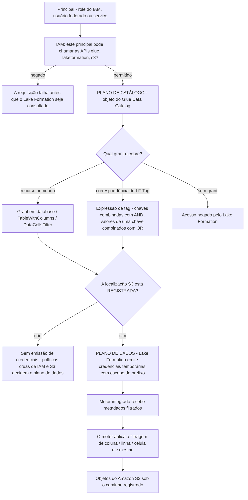
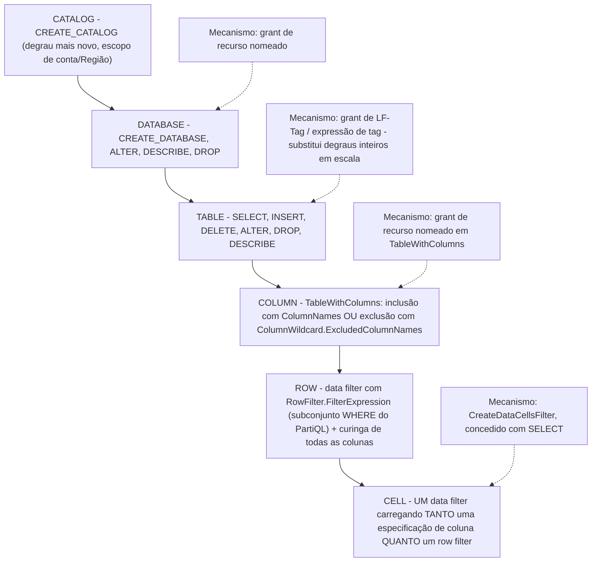
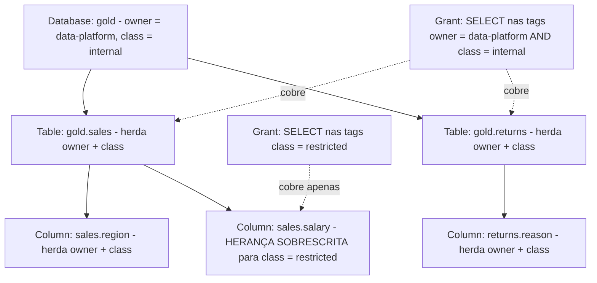
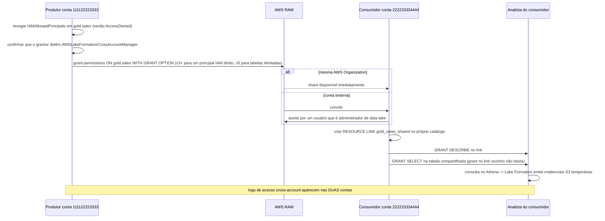
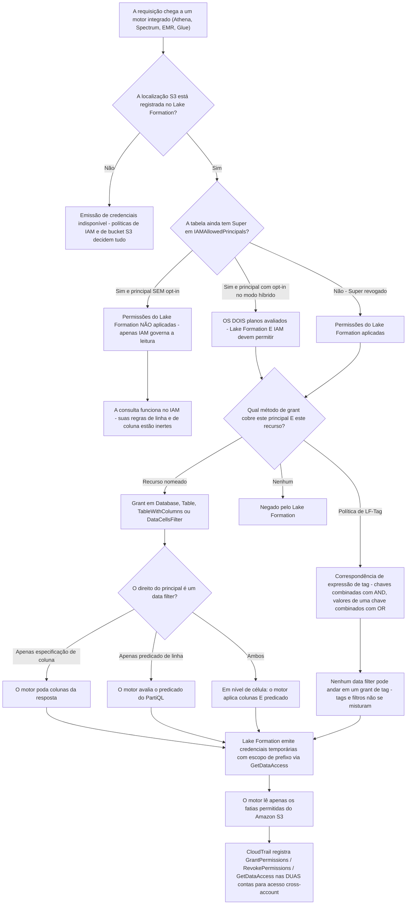

# Governança com Lake Formation: Permissões, Segurança em Nível de Linha/Coluna e Data Sharing

As lições 01 to 11 construíram a máquina: buckets, formatos, tabelas Iceberg, crawlers, jobs, um motor de consulta, um warehouse e um orquestrador. Cada uma dessas camadas produziu um novo lugar onde alguém tinha que responder à mesma pergunta: *quem pode ver isto?* Esta lição responde uma vez, centralmente, com **AWS Lake Formation**. O serviço não é um substituto do IAM e não é um catálogo; é uma **camada de permissões com formato de RDBMS** que fica sobre o Glue Data Catalog e emite credenciais temporárias com escopo para motores integrados, de modo que um único statement `GRANT` signifique algo na granularidade de **database, table, column, row e cell**.

A regra de ensino desta lição: **Lake Formation decide a visibilidade, IAM decide o alcance, e o motor faz a filtragem de fato.** Confunda esses três e cada sintoma desta lição vira um mistério.

```text
====================================================================
 SUPERFÍCIE DE GOVERNANÇA DO LAKE FORMATION (em out de 2026)
====================================================================
 Substitui ..... três superfícies de política sobrepostas: políticas
                 de identidade IAM para glue:*, políticas de
                 bucket/prefixo S3 para os dados, políticas de
                 recurso do catálogo Glue - todas efetivamente com
                 escopo de tabela ou de bucket
 Augmenta ...... IAM (ele "complementa o modelo de permissões do IAM");
                 IAM ainda autentica e ainda controla cada API de
                 plano de controle do Lake Formation
 Dois planos ... plano de catálogo (Glue + grants do LF)
                 plano de dados (S3 + credenciais temporárias
                 emitidas por role)
 ponte = RegisterResource na localização S3
 Modos ......... modo Lake Formation (revoga IAMAllowedPrincipals)
                 modo de acesso híbrido (os dois planos, opt-in por
                 principal)
 Escada ........ catalog -> database -> table -> COLUMN -> ROW -> CELL
 Coluna ........ TableWithColumns ColumnNames / ExcludedColumnNames,
                 ou uma especificação de coluna de data filter
                 (camadas de struct aninhadas)
 Linha / célula . DataCellsFilter, subconjunto WHERE do PartiQL,
                 expressão < 2.048 caracteres, <=100 por
                 principal por tabela
 TBAC .......... LF-Tag chave=valor, herança
                 database -> table -> column (sobrescrevível);
                 chaves combinadas com AND, valores de uma chave
                 combinados com OR
 Sharing ....... resource shares do AWS RAM; mesma organização
                 instantâneo, convite fora da organização;
                 versão 5 de cross-account = tabelas ilimitadas
                 por share (2026-02-11)
 Admins ........ <= 30 administradores de data lake por conta
 Preço ......... permissões, tags e sharing = $0;
                 Storage API cobra bytes varridos (mínimo de 10 MB)
 Armadilha ..... Super pré-concedido a IAMAllowedPrincipals
 default       até você revogá-lo - depois os grants parecem inertes
====================================================================
```

Nesta lição você vai:

- diagnosticar **o que o Lake Formation realmente substitui**, a dispersão de políticas de IAM-mais-S3, e o que ele deliberadamente *não* substitui;
- separar **localizações registradas no LF** do **modo de acesso híbrido** e prever qual plano de permissões responde a uma dada requisição;
- subir a **escada de granularidade de permissões** (database → table → column → row filter → cell) e nomear o mecanismo em cada degrau;
- construir a **política de analista resolvida**: `SELECT` em `gold.sales`, menos `salary`, linhas limitadas a `region = 'eu'`, como um único data filter em nível de célula;
- aplicar **LF-Tags e TBAC**: grants de tag, herança e as regras de correspondência AND-entre-chaves / OR-dentro-de-uma-chave;
- compartilhar **bancos de dados entre contas** por meio do AWS RAM, com o toggle de motor externo, callers confiáveis, acesso gerenciado e regras de administrador de data lake;
- posicionar **Athena, Redshift Spectrum, QuickSight, Glue e EMR** em uma matriz de suporte de motores e dizer o que quebra em cada célula;
- remover o padrão **`IAMAllowedPrincipals`** e executar a migração documentada em seis etapas;
- ler a **árvore de decisão de verificação de permissão** e escrever chamadas reais de `GrantPermissions` em JSON e CLI;
- estudar **três casos nomeados de clientes da AWS** (Integral Ad Science, FanDuel, Morningstar), uma **caixa de atualizações de outubro de 2026** com fontes, **nove exemplos resolvidos**, **cinco diagramas**, **três verificações interativas** e **doze questões no estilo de exame**.

---

## 1. O que o Lake Formation substitui: a dispersão de IAM e S3

### 1.1 Três superfícies, uma tabela, nenhuma linha

Antes do Lake Formation, um lake governado na AWS era montado a partir de três superfícies de política sobrepostas, e a AWS disse isso na disponibilidade geral em **2019-08-08**:

> "Antes você precisava usar políticas separadas para proteger o acesso a dados e metadados, e essas políticas só permitiam acesso em nível de tabela. Agora você pode dar acesso a cada usuário, de um local central, apenas às colunas que ele precisa usar.", AWS News Blog, *AWS Lake Formation, Now Generally Available* (2019-08-08)

| Superfície | O que podia expressar | Onde não podia chegar |
|---|---|---|
| **Políticas de identidade IAM** | `glue:*`, `lakeformation:*`, `s3:*` em ARNs escolhidos | Noção de *coluna*; um curinga que concede um prefixo inteiro concede uma tabela inteira |
| **Políticas de bucket/prefixo S3** | Quais principais podem ler qual prefixo | Com escopo de bucket ou prefixo; o blog de governança do Redshift Spectrum da AWS afirma que as políticas de bucket param de escalar "quando o número de combinações de níveis de acesso e usuários aumenta" |
| **Políticas de recurso do Glue Data Catalog** | Acesso a catálogos entre contas | Ainda com formato de tabela; nada abaixo da tabela, nada sobre linhas |

O Lake Formation adiciona uma **quarta** superfície que é deliberadamente modelada como um sistema de grants de banco de dados relacional:

> "Lake Formation fornece um modelo de permissões de sistema de gerenciamento de banco de dados relacional (RDBMS) para conceder ou revogar acesso a catálogos, databases, tabelas e colunas no Data Catalog com os dados subjacentes no Amazon S3.": Guia do Desenvolvedor do LF, *Onboarding to Lake Formation permissions* (acesso em 2026-10-11)

E ele **complementa** em vez de substituir o IAM:

> "Lake Formation fornece seu próprio modelo de permissões que complementa o modelo de permissões do IAM.": Guia do Desenvolvedor do LF, *Overview of data filtering* (acesso em 2026-10-11)

A divisão de trabalho, portanto, fica fixa pelo resto da lição: **IAM autentica e controla o plano de controle** (`GrantPermissions`, `GetDataAccess`, `glue:*`), **Lake Formation controla o plano de dados** decidindo quais metadados e quais credenciais temporárias com escopo um motor integrado recebe, e **o motor executa ele mesmo a filtragem de linha/coluna/célula**.



Dois fatos caem direto desse diagrama e ambos são examináveis:

1. **O registro é a única ponte entre os planos.** "A emissão de credenciais do Lake Formation não está disponível, mesmo com opt-in, a menos que a localização de dados esteja registrada no Lake Formation." (Guia do Desenvolvedor do LF, *Hybrid access workflow*, acesso em 2026-10-11.)
2. **Lake Formation não tranca o seu bucket.** "O modelo de permissões do Lake Formation não impede o acesso a localizações do Amazon S3 pela API ou pelo console do Amazon S3 se você tem acesso a elas através de políticas de IAM ou do Amazon S3. Você pode anexar políticas de IAM a principais para bloquear esse acesso." (Guia do Desenvolvedor do LF, *Underlying data access control*, acesso em 2026-10-11.)

### 1.2 Exemplo resolvido E1: contando a dispersão, depois contando a substituição

```text
CENÁRIO (aritmética derivada do conjunto de permissões documentado;
não é um número publicado pela AWS) - em out de 2026

Patrimônio ... 3 databases x 12 tabelas = 36 tabelas governadas
               4 times precisam de acesso de leitura (analistas,
               cientistas de dados, finanças, auditores)
               3 prefixos S3, um por database

MUNDO IAM + S3
  políticas de identidade IAM .... 4 políticas x até 36 ARNs de tabela
                                   = até 144 entradas de ARN
  políticas de prefixo S3 ......... 4 principais x 3 prefixos
                                   = 12 statements de permissão,
                                   reescritos em cada política de bucket
  política de recurso do catálogo Glue  apenas cross-account, com
                                        formato de tabela
  TOTAL de statements mantidos .... 144 + 12 = 156 (derivado)
  Adicionar um 5º time ............. +36 entradas de IAM +12
                                     statements de bucket = +48,
                                     toda vez

LAKE FORMATION, APENAS RECURSOS NOMEADOS
  SELECT por tabela ............... 4 x 36 = 144 grants (derivado)
  DESCRIBE por database ........... 4 x 3 = 12 grants (derivado)
  TOTAL ........................... 156 statements - mesma forma, mas
                                    agora em UM lugar com trilha de
                                    auditoria

LAKE FORMATION, BASEADO EM TAG (TBAC)
  exemplo de documentação da AWS .. 5 atribuições de tag + 8 grants
                                    de tag = 17 permissões efetivas
  resultado de produção da IAS .... "hundreds of permission rules
                                    down to precisely two rules"
                                    (AWS Big Data Blog, 2021-09-23)

CUSTO DE QUALQUER UM DOS TRÊS .... $0 pelas permissões em si
  "You pay $0 for the permissions in AWS Lake Formation because
   they are provided at no charge." - página de preços do Lake
   Formation (acesso em 2026-10-11)
```

**Leitura:** a primeira vitória do Lake Formation sobre o IAM cru *não* é menos statements: na granularidade de recurso nomeado você escreve o mesmo número. A primeira vitória é **centralização mais auditabilidade** (um único `ListPermissions` em vez de três famílias de política), e a segunda vitória, que chega na Seção 5, é **reduzir a contagem** com tags. A coluna de custo é a surpresa: a camada de governança em si é de graça, então a única pergunta de orçamento é quem a mantém.

- **📚 Você sabia?** A cobrança do Lake Formation tem exatamente três itens cobráveis em out de 2026, e nenhum deles é uma permissão. A **Storage API**, o mecanismo server-side independente de filtragem usado quando nenhum serviço de analytics da AWS processa os dados, cobra "pelo número de bytes varridos pela Storage API, arredondado para o próximo megabyte, com um mínimo de 10MB"; as **Governed Tables** cobram por arquivo rastreado, por chamada de API de metadados e por byte processado pelo otimizador de storage; e o próprio otimizador de storage cobra por byte. Grants, revogações, LF-Tags, sharing entre contas e a aplicação por Athena, Redshift, Glue e EMR são todos **$0** (página de preços do Lake Formation, acesso em 2026-10-11).

---

## 2. Registrado no LF versus híbrido: os dois modos de permissão

Um objeto do Data Catalog tem duas perguntas **ortogonais**, e a maior parte da confusão sobre Lake Formation vem de responder apenas uma delas:

| Pergunta | Resposta A | Resposta B |
|---|---|---|
| (a) A localização S3 subjacente está registrada? | **Registrada**, `RegisterResource` com uma role; LF assume essa role e emite credenciais temporárias | **Não registrada**, sem emissão, políticas de IAM e S3 decidem o plano de dados |
| (b) Qual modelo de permissão se aplica? | **Modo Lake Formation**, LF é o único modelo; `IAMAllowedPrincipals` revogado em todo lugar | **Modo de acesso híbrido**, os dois modelos coexistem, com opt-in por principal |

### 2.1 Registro: para que serve a role

> "Quando você registra uma localização, você especifica uma role do IAM que concede permissões de leitura/escrita naquela localização. O Lake Formation assume aquela role ao fornecer credenciais temporárias aos serviços AWS integrados.": Guia do Desenvolvedor do LF, *Set up AWS Lake Formation* (acesso em 2026-10-11)

Consequências práticas:

- a **role de registro**, não o chamador, detém as permissões duráveis de `s3:*`;
- os chamadores ainda precisam da permissão de IAM `lakeformation:GetDataAccess`, e "você deve definir o parâmetro Resource como `*`": qualquer outro valor de recurso não é suportado;
- registrar um prefixo cobre **toda tabela sob esse caminho de uma vez**, porque "várias tabelas podem compartilhar um prefixo S3. Quando você registra uma localização, todas as tabelas sob aquele caminho recebem emissão de credenciais de uma vez" (guia de melhores práticas do Lake Formation publicado pela AWS, acesso em 2026-10-11).

### 2.2 Modo de acesso híbrido: dois caminhos, principais com opt-in

> "O modo de acesso híbrido do AWS Lake Formation suporta dois caminhos de permissão para os mesmos objetos do AWS Glue Data Catalog." … "O modo de acesso híbrido aplica apenas as permissões `CREATE_TABLE`, `CREATE_PARTITION`, `UPDATE_TABLE` por default." … "principais com opt-in exigirão tanto permissões do Lake Formation quanto permissões de IAM para acessar os dados, enquanto principais sem opt-in continuarão a acessar dados usando apenas permissões de IAM.": Guia do Desenvolvedor do LF, *Hybrid access mode* (acesso em 2026-10-11)

Aquela última frase é o modo inteiro: **híbrido é um switch por principal, não por conta**, e é a ferramenta de migração reversível que a AWS recomenda:

> "Para facilitar a transição das permissões de data lake de um modelo de IAM e Amazon S3 para permissões do Lake Formation, recomendamos que você use o modo de acesso híbrido para o Data Catalog.": Guia do Desenvolvedor do LF, *Set up AWS Lake Formation* (acesso em 2026-10-11)

| Estado | `IAMAllowedPrincipals` na tabela | Localização registrada | Principal com opt-in? | Quem decide o acesso de leitura |
|---|---|---|---|---|
| Legado / default | presente (`Super`) | talvez | n/a | **Apenas IAM**: permissões individuais do Lake Formation não estão em vigor |
| Modo Lake Formation | revogada | sim | n/a | **Apenas Lake Formation** (mais IAM para as APIs) |
| Híbrido, sem opt-in | presente | sim | não | **Apenas IAM** |
| Híbrido, com opt-in | presente | sim | sim | **Ambos**: LF e IAM devem permitir |
| Registrado-mas-sem-opt-in | revogada | sim | não | regras de metadados do LF, mas sem opt-in não há porta dupla |

### 2.3 Exemplo resolvido E2: levando uma role ao modo híbrido

```bash
# ---- Step 0: see what the table looks like today -----------------
aws lakeformation get-effective-permissions-for-path \
  --catalog-id 111122223333 \
  --resource-arn arn:aws:glue:us-east-1:111122223333:table/gold/sales
# Expect to see: Super granted to IAMAllowedPrincipals
# (Lake Formation sets Super to that group on databases and tables
#  by default - LF Developer Guide, Permissions reference)

# ---- Step 1: register the location so vending can exist ---------
aws lakeformation register-resource \
  --resource-arn arn:aws:s3:::acme-lake/gold/ \
  --role-arn arn:aws:iam::111122223333:role/lf-registration-role \
  --use-service-linked-role   # or supply your own customer-managed role
# HybridAccessEnabled can be set on the resource for hybrid operation

# ---- Step 2: opt ONE role in (per-principal, reversible) ---------
aws lakeformation create-lakeformation-opt-in \
  --principal DataLakePrincipalIdentifier=arn:aws:iam::111122223333:role/analyst-eu \
  --hybrid-access-opt-in-detail HybridAccessEnabled=true

# ---- Step 3: now the analyst needs BOTH planes -------------------
#   IAM:   glue:GetTable / glue:GetPartitions + lakeformation:GetDataAccess
#   LF:    SELECT on gold.sales (Section 4)
# A principal that is NOT opted in keeps working on IAM alone,
# which is what makes this reversible:
aws lakeformation delete-lakeformation-opt-in \
  --principal DataLakePrincipalIdentifier=arn:aws:iam::111122223333:role/analyst-eu
```

**Verificações:** (a) o analista com opt-in que tem uma política de IAM mas *sem* grant de LF agora falha, prova de que a porta dupla está ativa; (b) a role sem opt-in continua lendo só com IAM, prova de que o modo é por principal; (c) `IsRegisteredWithLakeFormation` na tabela é `true` na visão do principal com opt-in e inalterado para todo mundo mais.

> [!IMPORTANT]
> **Registrado ≠ híbrido.** O registro responde *de onde vêm as credenciais*; o híbrido responde *qual modelo de permissão se aplica*. Daí seguem três modos de falha separáveis, e cada um tem um conserto diferente:
> - **Opt-in, localização não registrada** → o principal recebe regras de metadados do Lake Formation mas não recebe emissão de credenciais, então o plano de dados ainda se comporta como IAM cru.
> - **Registrada, ninguém com opt-in, `IAMAllowedPrincipals` ainda detendo `Super`** → permissões do Lake Formation não são aplicadas de modo algum; os seus novos grants são inertes.
> - **Nada disso, mas o analista mantém um `s3:GetObject` direto** → todo row filter desta lição é contornado. A limpeza de grants diretos de S3 é uma etapa da migração, não um extra opcional.

- **📚 Você sabia?** Os knobs no nível da conta que mantêm um database novo no plano antigo têm nomes exatos no console: **`Use only IAM access control for new databases`** e **`Use only IAM access control for new tables in new databases`**, respaldados na API por `CreateDatabaseDefaultPermissions` e `TableDefaultPermissions`, cujo default entregue é `[{"Principal":{"DataLakePrincipalIdentifier":"IAM_ALLOWED_PRINCIPALS"},"Permissions":["ALL"]}]` (Guia do Desenvolvedor do LF, *Changing the default settings for your data lake* e a API `DataLakeSettings`, acesso em 2026-10-11). A AWS deliberadamente **não** chama esse estado de "IAMOnly" em lugar algum: ensine os nomes documentados.

---

## 3. A escada de granularidade de permissões

### 3.1 O vocabulário

Tipos de recurso nos quais você pode conceder: **`Catalog`**, **`Database`**, **`Table`**, **`View`**, **`DataLocation`** (apenas `DATA_LOCATION_ACCESS` se aplica), **`LF_Tag`**, **`LF_TagPolicy` / `LFTagExpression`**.

O enum de permissões, conforme retornado por `ListPermissions` (referência da API do LF, acesso em 2026-10-11):

```text
ALL (= Super)  SELECT  INSERT  DELETE  ALTER  DROP  DESCRIBE
CREATE_DATABASE  CREATE_TABLE  DATA_LOCATION_ACCESS
CREATE_LF_TAG  ASSOCIATE  GRANT_WITH_LF_TAG_EXPRESSION
CREATE_LF_TAG_EXPRESSION  CREATE_CATALOG  SUPER_USER
```

Três regras sobre essa lista:

- `SELECT`, `INSERT` e `DELETE` são **tanto** permissões do Data Catalog **quanto** permissões de acesso a dados: são as que chegam ao S3.
- `Super` é aditivo e sobrevive a revogações parciais: "quando você revoga `Super`, as permissões `SELECT` e `INSERT` permanecem" (Guia do Desenvolvedor do LF, *Access control for metadata*, acesso em 2026-10-11).
- Conceder em **todas as tabelas de um database** concede implicitamente `DESCRIBE` nesse database, mas "essa concessão automática de permissão `DESCRIBE` não se aplica ao usar controle de acesso baseado em atributos (ABAC)".

### 3.2 A escada, desenhada



Tudo abaixo de `TABLE` é **expresso por apenas dois mecanismos**: um *filtro de coluna no próprio grant* (`TableWithColumns`) ou um *objeto de data filter* (`DataCellsFilter`). Escolha entre eles com uma pergunta: **eu preciso de linhas também?**

| Necessidade | Mecanismo | Objeto que você escreve |
|---|---|---|
| Tabela inteira | Grant de recurso nomeado | `{"Table": {"CatalogId", "DatabaseName", "Name"}}` |
| Algumas colunas, todas as linhas | Filtro de coluna no grant | `{"TableWithColumns": {"ColumnNames": [...]}}` ou `{"ColumnWildcard": {"ExcludedColumnNames": [...]}}` |
| Todas as colunas, algumas linhas | Data filter, em nível de linha | `{"AllRowsWildcard"}` + `RowFilter.FilterExpression` |
| Algumas colunas **e** algumas linhas | Data filter, em nível de célula | especificação de coluna **mais** `RowFilter` em um único `DataCellsFilter` |
| Alcance em massa sobre muitas tabelas | Grant de LF-Tag | `{"LFTagPolicy": {"TagKey", "TagValues"}}` |

### 3.3 Exemplo resolvido E3: a escada de quatro grants em uma tabela

```text
Objetivo: tornar gold.sales visível, útil e corretamente estreita para role/analyst-eu.

GRANT 1 - visibilidade (ainda sem dados)
  recurso  Database gold
  perms    DESCRIBE
  efeito   o database aparece na lista de objetos do Athena

GRANT 2 - a tabela (ainda toda linha, toda coluna)
  recurso  Table gold.sales
  perms    SELECT
  efeito   SELECT * FROM gold.sales retorna tudo - DEMAIS

GRANT 3 - apenas colunas (alternativa da Seção 4.1)
  recurso  TableWithColumns gold.sales,
           ExcludedColumnNames = [salary]
  perms    SELECT
  efeito   salary some dos resultados E dos metadados de
           glue:GetTable deste principal - mas ALL regions ainda
           retornam

GRANT 4 - linhas, colunas, um objeto (a política real, Seção 4)
  recurso  DataCellsFilter gold_sales_eu_no_salary
           RowFilter  = region = 'eu'
           Columns    = excluir salary
  perms    SELECT
  efeito   em nível de célula: apenas linhas da UE, menos a
           coluna salary

AUDIT após cada grant:
  aws lakeformation list-permissions --principal ...
  # permissão efetiva = UNION dos grants de recurso nomeado,
  # de tag-policy e de data filter - não existe primitiva de deny,
  # então um grant simples posterior de SELECT na mesma tabela
  # reinclui o que você excluiu
```

**Números em out de 2026:** um data filter precisa de `SELECT` **com a grant option** em todas as colunas da tabela para ser criado; **não há teto** de filtros por tabela, mas há um limite de **100 data filters por principal por uma única tabela**; e a expressão de linha deve ter **menos de 2.048 caracteres** (Guia do Desenvolvedor do LF, *Data filtering limitations* e suporte a PartiQL, acesso em 2026-10-11).

```matching
{
  "question": "Correlacione cada degrau de granularidade de permissão com o mecanismo do Lake Formation que o expressa:",
  "pairs": [
    {"left": "Database", "right": "Grant de recurso nomeado de CREATE_DATABASE, ALTER, DESCRIBE ou DROP em um recurso Database: não existem linhas ou colunas neste degrau"},
    {"left": "Table", "right": "Grant de recurso nomeado de SELECT, INSERT ou DELETE em um recurso Table: o degrau onde a maioria dos times para, e o único que o IAM cru podia aproximar"},
    {"left": "Column", "right": "TableWithColumns com inclusão por ColumnNames ou exclusão por ColumnWildcard.ExcludedColumnNames: ou a especificação de coluna dentro de um data filter, que é a única rota que alcança camadas de struct aninhadas"},
    {"left": "Row", "right": "Um data filter com um curinga de todas as colunas mais RowFilter.FilterExpression escrito no subconjunto WHERE do PartiQL, com menos de 2.048 caracteres"},
    {"left": "Cell", "right": "Um único data filter que carrega TANTO uma especificação de coluna QUANTO uma expressão de row filter, concedido com SELECT"}
  ],
  "explanation": "Quatro degraus, dois mecanismos: grants de recurso nomeado carregam database e table; filtros de coluna e data filters carregam coluna, linha e célula. As duas armadilhas são que colunas de struct aninhadas só são alcançáveis pela especificação de coluna de um data filter, e que a segurança em nível de célula é definida como especificação de coluna MAIS row filter em um objeto: não como dois grants separados. O filtragem de coluna não pode ser aplicado a colunas de chave de partição, e um grant baseado em tag não pode carregar um data filter de modo algum."
}
```

- **📚 Você sabia?** Três tetos valem a pena decorar porque são todos pequenos: **30** administradores de data lake por conta por default, **1.000** expressões de LF-Tag salvas por conta, e **100** data filters por principal por tabela (Guia do Desenvolvedor do LF, *Set up AWS Lake Formation*, *Managing LF-Tag expressions* e *Data filtering limitations*, todos com acesso em 2026-10-11). Um quarto, mais brando: o exemplo resolvido baseado em tags da própria AWS chega a **17** permissões efetivas a partir de apenas **5 atribuições de tag mais 8 grants de tag**.

---

## 4. Segurança em nível de linha e de coluna: a política de analista resolvida

### 4.1 A combinatoria: três controles, um tipo de objeto

> "Lake Formation usa filtragem de dados para alcançar segurança em nível de coluna, de linha e de célula." … "Quando você especifica o curinga 'todas as colunas' e fornece uma expressão de row filter, você está estabelecendo apenas segurança em nível de linha (filtragem de linha)." … "Quando você inclui ou exclui colunas e colunas aninhadas específicas e especifica 'todas as linhas' … você está estabelecendo segurança em nível de coluna." … "Quando você inclui ou exclui colunas específicas e também fornece uma expressão de row filter, você está estabelecendo segurança em nível de célula.": Guia do Desenvolvedor do LF, *Data filtering and cell-level security* (acesso em 2026-10-11)

| Campo de colunas | Campo de linhas | Controle que você obtém |
|---|---|---|
| `AllRowsWildcard` (todas as colunas) | predicado presente | **Segurança em nível de linha** |
| `ColumnNames` ou `ColumnWildcard.ExcludedColumnNames` | `AllRowsWildcard` | **Segurança em nível de coluna** |
| especificação de coluna **e** predicado | ambos presentes | **Segurança em nível de célula** |

Duas clarificações que economizam tempo real de depuração:

- **Filtrar coluna não é mascarar.** Excluir `salary` remove dos resultados *e* dos metadados de catálogo daquele principal. Nunca retorna um valor mascarado. Se o requisito é "mostrar apenas os quatro últimos dígitos", isso é uma view, uma transformação em camada de aplicação, ou o dynamic data masking do Amazon Redshift: não Lake Formation.
- **Disponibilidade:** "Cell-level security is available in all regions when using Athena engine version 3 or Amazon Redshift Spectrum." (Guia do Desenvolvedor do LF, *Data filtering limitations*, acesso em 2026-10-11.)

### 4.2 A linguagem do row filter: subconjunto do PartiQL, com arestas duras

| Regra | Valor (acesso em 2026-10-11) |
|---|---|
| Sintaxe | "a expressão tem a sintaxe de uma cláusula `WHERE` na linguagem PartiQL" |
| Comprimento | total **< 2.048 caracteres** (máximo da API 2048) |
| Operadores | `=, >, <, >=, <=, <>, !=, BETWEEN, IN, LIKE, NOT, IS [NOT] NULL` |
| Comparações | **você não pode comparar colunas com outras colunas** |
| Maiúsculas/minúsculas | "Todas as comparações de string e as correspondências de padrão `LIKE` diferenciam maiúsculas/minúsculas" |
| Tipos | `STRING/CHAR/VARCHAR`, tipos numéricos, `BOOLEAN`, `STRUCT` |
| Não suportados | `array` e `map` não são suportados; `struct` **é** |
| Chaves de partição | "Você não pode restringir o acesso em colunas que são chaves de partição" |
| Views / resource links | segurança em nível de célula não é suportada neles |
| Concorrência | "Se você aplica a expressão de filtro de todas-as-linhas em uma tabela concorrentemente com outras expressões de filtro com predicados, a expressão de todas-as-linhas prevalecerá" |

### 4.3 Exemplo resolvido E4, a política de analista: `gold.sales` menos `salary`, linhas = `region='eu'`

Isto é **segurança em nível de célula em um único objeto de data filter**, mais o grant de visibilidade que o torna utilizável.

```json
{
  "Name": "gold_sales_eu_no_salary",
  "DatabaseName": "gold",
  "TableName": "sales",
  "TableCatalogId": "111122223333",
  "RowFilter": { "FilterExpression": "region = 'eu'" },
  "ColumnWildcard": { "ExcludedColumnNames": ["salary"] }
}
```

```bash
# 1. create the filter - requires SELECT WITH GRANT OPTION on gold.sales
aws lakeformation create-data-cells-filter \
  --cli-input-json file://filter.json

# 2. grant SELECT through the filter, not on the bare table
aws lakeformation grant-permissions \
  --principal DataLakePrincipalIdentifier=arn:aws:iam::111122223333:role/analyst-eu \
  --resource '{"DataCellsFilter":{"TableCatalogId":"111122223333","DatabaseName":"gold","TableName":"sales","Name":"gold_sales_eu_no_salary"}}' \
  --permissions SELECT

# 3. visibility, so the table appears in the Athena explorer
aws lakeformation grant-permissions \
  --principal DataLakePrincipalIdentifier=arn:aws:iam::111122223333:role/analyst-eu \
  --resource '{"Table":{"CatalogId":"111122223333","DatabaseName":"gold","Name":"sales"}}' \
  --permissions DESCRIBE
```

**Quatro verificações de aprendiz, e o que cada uma prova:**

| Consulta executada como `role/analyst-eu` | Resultado esperado | O que prova |
|---|---|---|
| `SELECT salary FROM gold.sales` | erro / coluna ausente dos metadados | a metade de **coluna** do filtro de célula está ativa |
| `SELECT region, count(*) FROM gold.sales GROUP BY region` | apenas contagens de `'eu'` | a metade de **linha** está ativa |
| `SELECT * FROM gold.sales` | toda coluna **exceto** `salary`, apenas linhas da UE | as duas metades se compõem em segurança em nível de **célula** |
| `SELECT region FROM gold.sales` | funciona: porque `region` ainda é legível | a coluna de predicado do filtro deve estar na allow-list; decida deliberadamente se `region` permanece visível para os analistas |

**Contraste (mais barato, mais estreito):** conceder `TableWithColumns` com `ExcludedColumnNames = ["salary"]` entrega as colunas e nenhuma linha: uma resposta legítima quando o requisito é apenas "esconder PII", e o padrão que a FanDuel usou no **Caso B** abaixo. Adicionar `region = 'eu'` é o que te força a um data filter.

> [!WARNING]
> ⚠️ **Quatro maneiras como esta política se alarga silenciosamente de volta para acesso total:**
> - **Tags e data filters não se misturam.** "Você não pode aplicar data filters quando usa LF-Tags para gerenciar permissões em recursos do Data Catalog." (Guia do Desenvolvedor do LF, *Using AWS Lake Formation with Amazon Athena*, acesso em 2026-10-11.) Se `gold.sales` for coberto por um grant de tag, o seu row filter não é aplicado àquele caminho.
> - **Não existe primitiva de deny.** A permissão efetiva é a **união** dos grants de recurso nomeado, de tag-policy e de data filter. Um segundo grant simples de `SELECT` em `gold.sales` reinclui `salary` para o mesmo principal.
> - **Grant option e filtragem de coluna.** A referência de permissões afirma que você "can't include the grant option if column filtering is applied", enquanto o guia de granting descreve um caso de grant option mais estreito: verifique o comportamento atual do console na sua conta antes de projetar grants delegados de coluna (os docs da AWS discordam aqui em 2026-10-11; trate-o como não verificado).
> - **Colunas de chave de partição não podem receber filtragem de coluna**, e `IS [NOT] NULL` é inválido nelas: um esquema que particiona por `region` precisa que `region` permaneça legível, que é exatamente a quarta verificação acima.

---

## 5. LF-Tags e controle de acesso baseado em tags (LF-TBAC)

### 5.1 O que é uma tag

> "Cada LF-Tag é um par chave-valor, como `department=sales` ou `classification=restricted`. Uma chave pode ter múltiplos valores definidos.": Guia do Desenvolvedor do LF, *Tag-based access control (LF-TBAC)* (acesso em 2026-10-11)

Tags se anexam a **databases, tabelas e colunas**. Elas devem ser pré-definidas (uma chave e seus valores são criados com `CreateLFTag` antes que qualquer coisa possa carregá-las), e são o único mecanismo desta lição que deixa você conceder em um *atributo* em vez de em um objeto nomeado.

### 5.2 Herança e as regras de correspondência

> "Tabelas herdam LF-Tags de databases e colunas herdam LF-Tags de tabelas. Valores herdados podem ser sobrescritos" … "as chaves de tag são combinadas usando a operação AND, enquanto os valores são combinados usando a operação OR.": Guia do Desenvolvedor do LF, *Tag-based access control (LF-TBAC)* (acesso em 2026-10-11)



As duas regras de combinação, enunciadas uma vez e testadas para sempre:

- **Chaves diferentes em um único grant são combinadas com AND:** `owner = data-platform AND class = internal` corresponde apenas a recursos que carregam *ambas*.
- **Múltiplos valores da mesma chave são combinados com OR:** `class = internal OR class = restricted` corresponde a *qualquer um*.
- Exemplo dos docs: a expressão de tag `content_type:Sales AND location:US` "representa recursos relacionados a dados de vendas nos EUA"; expressões de LF-Tag salvas têm teto de **1.000 por conta**.

### 5.3 Três coisas que o TBAC muda no granting

1. **Você concede na tag, não na tabela.** O recurso do grant do principal é uma `LFTagPolicy` (ou uma `LFTagExpression`), então tabelas criadas *depois*, incluindo tabelas criadas por crawler, são cobertas automaticamente uma vez que herdam a tag.
2. **Você pode conceder a capacidade de taggear.** `ASSOCIATE` deixa um principal anexar uma tag; `DESCRIBE` deixa-o vê-la; `GRANT_WITH_LF_TAG_EXPRESSION` deixa-o usá-la como recurso de grant. Esta é a primitiva de delegação por trás dos data meshes.
3. **Permissões de todos os métodos são unidas.** O próprio conselho de migração da AWS: "(Recomendado) Depois de verificar que os principais têm acesso aos recursos corretos pelo método LF-TBAC, revogue as permissões que foram concedidas usando o método de recurso nomeado." Verifique primeiro, revoke depois: nunca o inverso.

### 5.4 Exemplo resolvido E5: reconstruindo a compressão da IAS com três tags

```text
PATRIMÔNIO (aritmética derivada, em out de 2026)
  3 databases x 12 tabelas = 36 tabelas
  4 principais com acesso de leitura

ROTA DE RECURSO NOMEADO
  SELECT por tabela ....... 4 x 36 = 144 grants
  DESCRIBE por database .. 4 x 3  =  12 grants
  TOTAL ..................        156 statements (derivado)
  Reorganizar um time ..... reemitir até 48 deles

ROTA LF-TBAC (forma da IAS: owner + class aplicados no DATABASE)
  Atribuições de tag ..... 3 databases x 2 chaves = 6 atribuições,
                           herdadas para baixo até 36 tabelas e
                           suas colunas (nada por tabela)
  Grants de tag .......... 4 principais x tag policy = 4 grants
  TOTAL .................. 10 statements, NENHUM dos quais nomeia
                           uma tabela

  Exemplo resolvido de documentação da AWS para a mesma ideia:
  5 atribuições + 8 grants = 17 permissões efetivas

A EXCEÇÃO QUE NUNCA DESAPARECE
  "but two analysts also need region = 'eu' rows only"
  -> 2 grants de recurso nomeado + data filter (data filters não
     podem andar em tags), total de 12 statements, com a exceção
     LISTADA para que possa ser revisada
```

**Leitura:** o custo da rota de tags é plano no número de tabelas e linear no número de *políticas*; a rota nomeada é linear em tabelas × principais. A IAS reportou a versão real disso: **"Com os controles de acesso baseados em tags do Lake Formation, a IAS reduziu centenas de regras de permissão a precisamente duas regras"** (AWS Big Data Blog, 2021-09-23). Observe onde a lista de exceções pousa: row filters são exatamente a funcionalidade que não pode ser dirigida por tags, então um patrimônio TBAC sempre carrega uma cauda curta e deliberada de recurso nomeado.

```fillblank
{
  "question": "Preencha os nomes das LF-Tags e a mecânica por trás do resultado da IAS:",
  "template": "A IAS anexou as chaves de LF-Tag {{1}} e {{2}} no nível do database, contou com a {{3}} para carregá-las para baixo até tabelas e colunas, e expressou o acesso como grants baseados em tag em vez de regras {{4}}.",
  "answers": {
    "1": "owner",
    "2": "class",
    "3": "inheritance",
    "4": "per-table"
  },
  "distractors": [
    "department",
    "classification",
    "team",
    "tier",
    "propagation",
    "aliasing",
    "row-filter",
    "cross-account"
  ],
  "explanation": "O relato do AWS Big Data Blog sobre a Integral Ad Science (2021-09-23) afirma que a IAS aplicou as tags owner e class no nível do database e contou com a herança, e que os controles de acesso baseados em tag reduziram centenas de regras de permissão a precisamente duas. A herança é database -> table -> column com valores sobrescrevíveis, então uma tag escrita uma vez no database alcança toda tabela sob ela, e o resultado é que nenhuma regras nomeia tabela alguma."
}
```

```plot
{
  "type": "bar",
  "title": "Contagem de regras de permissão para 4 principais conforme o patrimônio cresce (derivado, em out de 2026)",
  "data": [
    {"Tables in the database": "6 tables", "Named-resource grants": 24, "LF-TBAC rules": 10},
    {"Tables in the database": "12 tables", "Named-resource grants": 48, "LF-TBAC rules": 10},
    {"Tables in the database": "24 tables", "Named-resource grants": 96, "LF-TBAC rules": 10},
    {"Tables in the database": "36 tables", "Named-resource grants": 144, "LF-TBAC rules": 10}
  ],
  "xKey": "Tables in the database",
  "dataKeys": ["Named-resource grants", "LF-TBAC rules"],
  "xLabel": "Tabelas no database",
  "yLabel": "Regras de permissão mantidas"
}
```

Passe o mouse sobre um par de barras: grants de recurso nomeado escalam como **principais × tabelas** (derivado: 4 × 6 = 24 até 4 × 36 = 144), enquanto a rota de tags permanece em **6 atribuições + 4 grants = 10** independentemente da contagem de tabelas (derivado da forma da IAS de duas chaves aplicadas no nível do database). A curva de cruce é imediata, a rota de tags já é menor com seis tabelas, e é por isso que o exemplo baseado em tags da AWS é citado como simplificação *operacional* e não como uma funcionalidade de segurança.

---

## 6. Data sharing: bancos de dados entre contas, motores externos, callers confiáveis

### 6.1 Bancos de dados entre contas passam pelo AWS RAM

> "O Lake Formation usa o serviço AWS Resource Access Manager (AWS RAM) para compartilhar o recurso. Se a conta de grantee está na mesma organização que a conta de grantor, o recurso compartilhado fica disponível imediatamente; se a conta de grantee não está na mesma organização, o AWS RAM envia um convite para a conta de grantee aceitar ou rejeitar o grant do recurso.": Guia do Desenvolvedor do LF, *Cross-account data sharing* (acesso em 2026-10-11)

Existem dois métodos de grant, e a AWS recomenda um deles por nome: **controle de acesso baseado em tags do Lake Formation (LF-TBAC) (recomendado)** versus **recursos nomeados**. O blog que documenta o trade-off diz isso simplesmente: TBAC "é recomendado quando muitos recursos e entidades estão envolvidos."

**Pré-requisitos que são falhas duras, não conselhos** (Guia do Desenvolvedor do LF, *Cross-account prerequisites*, acesso em 2026-10-11):

1. Revogue **todas** as permissões do Lake Formation de `IAMAllowedPrincipals` no recurso primeiro: caso contrário o Lake Formation lança `AccessDeniedException`.
2. O grantor deve deter a política gerenciada pela AWS **`AWSLakeFormationCrossAccountManager`**.
3. Pelo menos um usuário na conta consumidora deve ser um **administrador de data lake** para ver os recursos compartilhados; "outros principais não podem acessar recursos compartilhados até que o administrador de data lake conceda permissões a eles."
4. Grants entre contas devem carregar a **grant option**, porque o admin do lado do consumidor re-concede localmente. "O principal que recebe o resource share não pode compartilhar o recurso com outros principais."

**Configurações de versão de cross-account** (`DataLakeSettings.Parameters.CROSS_ACCOUNT_VERSION`) decidem o que pode ser compartilhado: grants diretos para um principal IAM individual em outra conta precisam de **versão ≥ 3**; shares no modo híbrido precisam de **≥ 4**; a **versão 5** "melhora o sharing de recursos entre contas, permitindo que você compartilhe um número ilimitado de tabelas para outra conta, eliminando os limites anteriores de associação de recurso por tipo de recurso", está disponível "por meio do console ou da API do Lake Formation", e o **downgrade não é suportado** uma vez aplicada (AWS What's New, 2026-02-11; Guia do Desenvolvedor do LF, acesso em 2026-10-11).



### 6.2 Exemplo resolvido E6: compartilhando `gold.sales` para uma conta externa

```text
PRODUTOR 111122223333 -> CONSUMIDOR 222233334444   (em out de 2026)

PRE-FLIGHT (os três são falhas duras, não conselhos)
  1. aws lakeformation get-effective-permissions-for-path \
       --resource-arn arn:aws:s3:::acme-lake/gold/
     -> se Super / IAMAllowedPrincipals aparecer, REVOGUE-o primeiro
        (o Lake Formation lança AccessDeniedException caso contrário)
  2. o chamador produtor detém a política gerenciada pela AWS
     AWSLakeFormationCrossAccountManager
  3. versão de cross-account: >= 3 para um principal IAM direto,
     >= 4 para um share no modo híbrido, 5 (2026-02-11) para um
     número ILIMITADO de tabelas por resource share do RAM -
     e o downgrade NÃO é suportado uma vez que você atualiza
  4. a conta consumidora tem pelo menos UM administrador de data
     lake, caso contrário ninguém lá consegue nem ver o share

PRODUTOR - o grant deve carregar delegação
  aws lakeformation grant-permissions \
    --principal DataLakePrincipalIdentifier=arn:aws:iam::222233334444:role/partner-analyst \
    --resource '{"Table":{"CatalogId":"111122223333","DatabaseName":"gold","Name":"sales"}}' \
    --permissions SELECT \
    --permissions-with-grant-option SELECT

TRANSPORTE
  mesma AWS Organization ..... o share aparece imediatamente
  organização externa ........ convite do AWS RAM, deve ser aceito

LADO DO CONSUMIDOR (a etapa que todo mundo esquece)
  a. o admin aceita o share do RAM
  b. criar RESOURCE LINK gold_sales_shared no catálogo do consumidor
  c. GRANT DESCRIBE no link     <- grant no link apenas o torna visível
  d. GRANT SELECT na TABELA COMPARTILHADA para role/partner-analyst
  e. consulta no Athena pelo link -> credenciais S3 temporárias emitidas

LIMITES PARA CITAR
  "O principal que recebe o resource share não pode
   compartilhar o recurso com outros principais." -> sem
   re-sharing pelo destinatário
  logs de acesso cross-account aparecem nas DUAS contas, com o ARN
  completo do principal apenas se o destinatário optar por isso
  Apenas listas de inclusão (ColumnNames) são suportadas ao conceder
  para uma conta ou organização externa - sem rota de
  ExcludedColumnNames
```

**Verificações:** (a) um grant tentado enquanto `IAMAllowedPrincipals` ainda detém `Super` falha com `AccessDeniedException`; (b) um grant sem `--permissions-with-grant-option` deixa o admin do consumidor incapaz de conceder nada aos próprios analistas; (c) conceder apenas no link deixa a tabela invisível para as consultas: **grant no link ≠ grant no alvo**.

### 6.3 Callers confiáveis e o toggle de motor externo

Lake Formation emite credenciais temporárias apenas para **callers confiáveis**. "Cada um desses serviços AWS é um caller confiável para o Lake Formation, e o Lake Formation fornece acesso aos dados armazenados no Amazon S3 por meio de credenciais temporárias", o conjunto integrado sendo Athena, Redshift Spectrum, EMR e Glue (Guia do Desenvolvedor do LF, *Working with services*, acesso em 2026-10-11).

Qualquer outra coisa é opt-in, e o opt-in é um switch de três partes em `DataLakeSettings`:

| Configuração | Papel | Postura default |
|---|---|---|
| `AllowExternalDataFiltering` | deixa um motor de terceiros acessar metadados não filtrados e credenciais de acesso a dados | deve ser habilitada deliberadamente |
| `ExternalDataFilteringAllowList` | IDs de conta dos motores externos permitidos | vazia = ninguém |
| `AuthorizedSessionTagValueList` | valores de session tag que um chamador deve apresentar | a **chave** da session tag do STS é `LakeFormationAuthorizedCaller` |
| `AllowFullTableExternalDataAccess` | deixa um motor obter credenciais **sem** uma session tag quando o chamador tem acesso total aos dados | **false** por default: mantenha-a false |

> "Se você pretende analisar … usando motores de consulta de terceiros, você deve dar opt-in para permitir que motores externos acessem dados gerenciados pelo Lake Formation.": Guia do Desenvolvedor do LF, *Set up AWS Lake Formation* (acesso em 2026-10-11)

Uma discrepância de documentação para ser honesto: a referência da API `DataLakeSettings` mostra um exemplo de chave de session tag `LakeFormationTrustedCaller`, enquanto o guia de motores de terceiros e o blog de aplicação personalizada ambos especificam **`LakeFormationAuthorizedCaller`**. Duas fontes dizem a segunda, então use-a, mas não trate nenhum dos dois nomes como incontestado.

### 6.4 Acesso gerenciado e os papéis de administrador

| Papel | Pode fazer | Não pode fazer (restrição verificada) |
|---|---|---|
| **Administrador de data lake** | Registrar localizações, criar databases, rodar workflows de permissão, conceder/revogar qualquer coisa | "Não pode adicionar outros administradores de data lake"; teto de **30** por conta por default |
| **Administrador IAM** | Criar usuários, roles, políticas e *adicionar* administradores de data lake | Não pode conceder permissões do Lake Formation a menos que também seja admin do LF |
| **Criador de database/tabela** | `SUPER` implícito no que cria | Nada implícito em objetos que não criou |
| **Grantor com a grant option** | Re-conceder o que detém (`PermissionsWithGrantOption`) | Só pode delegar o que foi delegado a ele |
| **Criador de LF-Tag / expressão de tag** | Criar, atualizar, apagar tags e expressões salvas | Direitos implícitos cobrem as tags em si, não os dados |

Duas assimetrias que valem a pena internalizar:

- **Admin adicionado depois = zero acesso implícito a dados.** "administradores de data lake adicionados depois da criação do database podem conceder permissões mas não recebem automaticamente permissões de acesso a dados como SELECT ou DESCRIBE. Administradores que criam databases recebem permissões SUPER naqueles databases."
- **Acesso gerenciado é expresso como a grant option.** O padrão, uma equipe de plataforma segurando `PermissionsWithGrantOption` e equipes de domínio re-concedendo dentro de um escopo, é como o self-service "grantable" funciona sem entregar o catálogo inteiro.

- **📚 Você sabia?** A role de registro e a service-linked role são uma escolha real de design: o Lake Formation entrega uma service-linked role (`ServiceRoleForLakeFormationDataAccess`) para registro sem configuração, mas o guia de melhores práticas da AWS recomenda registrar com uma **role de gestão do cliente** quando você espera editar ou limitar o escopo dessa role depois. De qualquer forma o chamador ainda precisa de `lakeformation:GetDataAccess` com `Resource: "*"`, e adicioná-la é "um no-op quando nenhuma localização está registrada, então é seguro (e recomendado) adicioná-la desde o início" (guia de melhores práticas do Lake Formation publicado pela AWS, acesso em 2026-10-11).

```dragdrop
{
  "question": "Ordene as etapas que levam uma localização S3 de acesso apenas-IAM a um grant governado do Lake Formation, terminando com uma consulta de analista que funciona:",
  "items": [
    "Inventariar as permissões de IAM e Glue existentes com ListPermissions e GetEffectivePermissionsForPath",
    "Replicar essas permissões como grants do Lake Formation: deliberadamente um no-op enquanto IAMAllowedPrincipals ainda detém Super",
    "Adicionar lakeformation:GetDataAccess com Resource definido como * a toda política IAM de consumidor",
    "Registrar a localização S3 com uma role de IAM para que a emissão de credenciais se torne possível",
    "Revogar Super do grupo IAMAllowedPrincipals nos databases e tabelas dessa localização",
    "Desligar Use only IAM access control for new databases e for new tables in new databases",
    "Apagar as políticas finas de IAM e S3 antigas que os grants do Lake Formation agora substituem",
    "Consultar com Athena e confirmar que o Lake Formation emite credenciais temporárias com escopo de prefixo"
  ],
  "correctOrder": [
    "Inventariar as permissões de IAM e Glue existentes com ListPermissions e GetEffectivePermissionsForPath",
    "Replicar essas permissões como grants do Lake Formation: deliberadamente um no-op enquanto IAMAllowedPrincipals ainda detém Super",
    "Adicionar lakeformation:GetDataAccess com Resource definido como * a toda política IAM de consumidor",
    "Registrar a localização S3 com uma role de IAM para que a emissão de credenciais se torne possível",
    "Revogar Super do grupo IAMAllowedPrincipals nos databases e tabelas dessa localização",
    "Desligar Use only IAM access control for new databases e for new tables in new databases",
    "Apagar as políticas finas de IAM e S3 antigas que os grants do Lake Formation agora substituem",
    "Consultar com Athena e confirmar que o Lake Formation emite credenciais temporárias com escopo de prefixo"
  ],
  "explanation": "A ordem de atualização documentada é inventário -> replicar -> adicionar GetDataAccess -> verificar por localização -> revogar IAMAllowedPrincipals -> registrar -> desligar os defaults apenas-IAM -> apagar as políticas antigas. Os grants em estágios são intencionalmente inertes até que o grant de Super seja revogado, e é isso que torna a migração reversível: deregistrar a localização ou apagar o opt-in te coloca de volta no IAM. As duas etapas que as pessoas pulam são GetDataAccess (sem ela o motor não consegue obter credenciais emitidas mesmo com um grant perfeito) e apagar as políticas antigas (que caso contrário deixam uma bypass permanente ao redor de todo row filter)."
}
```

> [!WARNING]
> ⚠️ **A ordem de cross-account é o beco sem saída mais comum.** Revogue `IAMAllowedPrincipals` → conceda **com a grant option** → (fora da organização) o consumidor aceita o convite do RAM → o administrador de data lake do consumidor cria um **resource link** → o administrador re-concede **no objeto compartilhado**, não apenas no link. Um grant feito antes de o convite ser aceito parece não fazer nada; um grant feito com a permissão `IAMAllowedPrincipals` ainda anexada lança `AccessDeniedException`; e pular a grant option deixa o admin do consumidor incapaz de conceder nada aos analistas locais.

---

## 7. Matriz de suporte de motores: quem realmente aplica o quê

> "a filtragem real de colunas nas respostas de consulta é responsabilidade do serviço integrado. Clientes do Lake Formation que suportam filtragem em nível de coluna, incluindo Amazon Athena, Amazon Redshift Spectrum e Amazon EMR, filtram os dados com base nas permissões de coluna registradas no Lake Formation": Guia do Desenvolvedor do LF, *Limitations* (acesso em 2026-10-11)

| Motor | Tabela | Coluna | Linha / Célula | Ressalva que você deve ser capaz de enunciar |
|---|---|---|---|---|
| **Athena SQL** | Leitura/escrita | Sim | Sim | Célula precisa da **versão 3 do motor do Athena**; localizações de resultados de consulta do Athena **não podem** ser registradas, então os resultados são sempre território puro-IAM |
| **Athena Spark** | Não suportado | Não suportado | Não suportado | "O Athena Spark não suporta consultar tabelas do Data Catalog com permissões do Lake Formation." |
| **Redshift Spectrum** (cluster provisionado ou Serverless) | Leitura/escrita | Sim | Sim | Data filters no Lake Formation governam o acesso de linha/célula do Spectrum; **as próprias políticas de linha/coluna do Redshift em um datashare compartilhado *para* o Lake Formation são ignoradas**, o admin do LF deve recriá-las |
| **Spark on EMR (EC2)** | Leitura/escrita | Sim | Sim | Proteger o próprio cluster continua sendo seu trabalho |
| **Apache Hive on EMR (EC2)** | Leitura/escrita | Sim | **Não suportado** | Filtros de linha e de célula não se aplicam |
| **Hive em EMR Serverless / EMR on EKS** | Não suportado | Não suportado | Não suportado | Listado como não suportado na matriz de serviços |
| **AWS Glue ETL** | Leitura/escrita | **Acesso de leitura em Glue 5.0+** | **Acesso de leitura em Glue 5.0+** | A página de limitações ainda diz "Atualmente, o AWS Glue ETL não suporta filtragem de coluna": trate **caminhos de leitura em 5.0+** como suportados e **pré-5.0 e caminhos de escrita** como não suportados, e verifique no seu runtime |
| **Amazon QuickSight** | Via Athena | Via Athena | Via Athena | A edição Enterprise concede permissões de FGAC a usuários e grupos do QuickSight; a edição Standard concede a roles de IAM (default `aws-quicksight-service-role-v0`) |
| **Motores personalizados / de terceiros** | Opt-in | Opt-in | Opt-in | Session tag `LakeFormationAuthorizedCaller` mais a allow-list; nunca ligue isso como um atalho de solução de problemas |

### 7.1 Exemplo resolvido E7: posicionando oito motores na matriz

```text
Para cada motor: ONDE ele se encaixa, e O QUE quebra se você assumir o contrário?
(em out de 2026)

1. Athena SQL ................ tabela + coluna + linha/célula
                               break: filtros de célula precisam do
                               motor v3; o HISTORY de consultas é
                               governado por workgroups, não pelo
                               Lake Formation
2. Athena Spark .............. NÃO SUPORTADO
                               break: o caminho do notebook simplesmente
                               não consegue consultar tabelas com
                               permissões do Lake Formation
3. Hive em EMR Serverless .... NÃO SUPORTADO
                               break: nenhuma superfície de aplicação
                               alguma
4. job do Glue 3.0 ........... apenas tabela (caminho de leitura pré-5.0)
                               break: filtragem de coluna NÃO é aplicada
                               dentro do job - remova a coluna você mesmo
5. job do Glue 5.0 ........... tabela + coluna + linha/célula na LEITURA
                               break: caminho de escrita ainda não
                               verificado - nunca publique um job que
                               dependa dele
6. Spark on EMR EC2 .......... aplicação total via o plugin do LF
                               break: o hardening do cluster ainda é seu
7. Redshift Spectrum ......... aplicação total, incluindo data filters
                               break: políticas RLS/CLS do Redshift no
                               lado do produtor são IGNORADAS uma vez
                               que um datashare é compartilhado para o
                               Lake Formation
8. importação SPICE do QuickSight ... a aplicação acontece APENAS no
                               momento da IMPORTAÇÃO
                               break: leitores veem as linhas importadas;
                               row filters do LF não viajam para o SPICE
```

**Regra de bolso derivada da matriz:** Lake Formation publica metadados filtrados e credenciais com escopo; **o motor poda a resposta**. Qualquer motor fora dessa lista ou recusa a consulta: ou, pior, retorna dados não filtrados se você concedeu o opt-in de motor externo.

- **📚 Você sabia?** A integração do QuickSight tem um split de edição fácil de perder: a edição **Enterprise** deixa você "conceder permissões de controle de acesso fino (FGAC) a usuários e grupos individuais do QuickSight", enquanto os grants da edição **Standard** vão para **roles de IAM**, com a service role default chamada `aws-quicksight-service-role-v0`. Uma vez que o bucket de origem está registrado, "as configurações de acesso ao Amazon S3 no QuickSight são ignoradas, incluindo políticas de IAM de escopo reduzido para usuários e grupos": Lake Formation vira a fonte única de verdade (documentação do QuickSight e do AWS Big Data Blog, acesso em 2026-10-11).

---

## 8. O padrão `IAMAllowedPrincipals`, e a migração a partir dele

### 8.1 Por que seus grants parecem não fazer nada

> "O Lake Formation define a permissão `Super` em todos os databases e tabelas do Data Catalog para um grupo chamado `IAMAllowedPrincipals` por default. Se essa permissão de grupo existir … todos os principais da sua conta terão acesso ao recurso através das políticas de principal do IAM para o AWS Glue.": Guia do Desenvolvedor do LF, *Permissions reference* (acesso em 2026-10-11)

E a consequência, enunciada igualmente diretamente:

> "Essas configurações efetivamente fazem com que o acesso a recursos do Data Catalog e a localizações do Amazon S3 seja controlado exclusivamente por políticas do AWS Identity and Access Management (IAM). Permissões individuais do Lake Formation não estão em vigor.": Guia do Desenvolvedor do LF, *Changing the default settings for your data lake* (acesso em 2026-10-11)

Então o estado default de um lake novo ou longamente não modificado é: **Lake Formation instalado, mas desligado.** Os seus brilhantes grants são registrados, auditados e ignorados.

| Sintoma | Primeira verificação | Conserto |
|---|---|---|
| "Meus grants não mudaram nada; todo mundo ainda pode ler" | `ListPermissions` → `Super` em `IAMAllowedPrincipals` ainda está lá? | Revogue-o naquele recurso, ou coloque os principais em modo híbrido |
| "Grants funcionam para algumas roles, não para outras" | A localização está registrada? O principal tem opt-in? | Registrar + opt-in; ambos são necessários para a emissão |
| "O row filter existe mas um analista ainda vê tudo" | Eles detêm um segundo grant simples de `SELECT`, ou um grant de tag? | A permissão efetiva é uma **união**: revogue o grant que alarga |
| "O analista contorna tudo de qualquer jeito" | Eles ainda detêm `s3:GetObject` no prefixo? | Apague as permissões diretas de S3; Lake Formation não as revoga para você |
| "O grant entre contas lança `AccessDeniedException`" | `IAMAllowedPrincipals` no recurso compartilhado | Revogue-o **antes** do grant entre contas |

### 8.2 Exemplo resolvido E8: a migração documentada, ensaiada

```text
MICRO-PATRIMÔNIO: 1 bucket, 2 databases, 6 tabelas, 3 roles
(em out de 2026; as etapas seguem o guia de atualização do LF e o
 guia de transição publicado pela AWS)

ETAPA 1  INVENTÁRIO
  aws lakeformation list-permissions --resource-type TABLE
  aws lakeformation get-effective-permissions-for-path \
    --catalog-id 111122223333 \
    --resource-arn arn:aws:s3:::acme-lake/gold/
  mais GetTable / GetPartitions do CloudTrail e quaisquer
  entradas de insufficientLakeFormationPermissions
  -> escreve a lista de grants alvo

ETAPA 2  REPLICAR (no-op seguro)
  Recriar cada permissão encontrada como um grant do LF.
  Nada muda de comportamento ainda, porque Super ainda está em
  IAMAllowedPrincipals. Use essa janela inerte para revisar.

ETAPA 3  ARMAR OS CHAMADORES
  Adicionar lakeformation:GetDataAccess, Resource = "*", às três
  roles. Seguro adicionar antes de qualquer registro existir.

ETAPA 4  UMA LOCALIZAÇÃO POR VEZ
  a) verificar com GetEffectivePermissionsForPath
  b) revogar Super do IAMAllowedPrincipals nos databases e
     tabelas dessa localização
  c) registrar a localização (role de registro ou service-linked role)
  d) rodar a consulta canário do Athena para as três roles

ETAPA 5  FECHAR O DEFAULT
  Desligar Use only IAM access control for new databases e
  ...for new tables in new databases, para que nada se reaprote
  ao plano apenas-IAM.

ETAPA 6  APAGAR AS POLÍTICAS ANTIGAS
  Remover as políticas finas de IAM e S3 que você replicou.
  Deixá-las é um bypass permanente de todo filtro que você construiu.

ROLLBACK (prova que o design é reversível)
  Deregistrar a localização, ou no modo híbrido simplesmente apagar
  o opt-in com delete-lakeformation-opt-in. O IAM assume de novo.

DOIS PLANOS QUE A AWS PUBLICA
  Plano #1 (Por Recurso) - migrar tabela por tabela
  Plano #2 (Por Usuário)  - migrar usuário por usuário via opt-ins
                            híbridos
  Ambos são reversíveis; escolha por cenário, não por conta.
```

> [!WARNING]
> ⚠️ **A regra de ordenação que salva migrações:** *nunca revogue `IAMAllowedPrincipals` antes de ter validado que os grants do Lake Formation funcionam.* Como grants em estágios são um no-op enquanto o grant default `Super` existe, a sequência segura é sempre **estagiar → validar → revogar → registrar → verificar → apagar políticas antigas**. Inverter as duas primeiras etapas tira o lake do ar para todo mundo no momento em que você revoga, sem nada no lugar para substituí-lo.

---

## 9. O fluxo de verificação de permissão: uma árvore de decisão

Isto espelha o workflow de acesso híbrido documentado do Lake Formation e é a maneira mais rápida de transformar "não funciona" em uma única verificação.



Leia como uma **ordem de diagnóstico**: registro primeiro, `IAMAllowedPrincipals` segundo, método de grant terceiro, tipo de direito quarto. Pular direto para "está certo o meu SQL?" é a maneira mais cara de depurar Lake Formation.

---

## 10. Esboço trabalhado de API e CLI de Grant

### 10.1 As quatro formas de chamada que você realmente vai escrever

```json
[
  {
    "Principal": { "DataLakePrincipalIdentifier": "arn:aws:iam::111122223333:role/analyst-eu" },
    "Resource": { "Table": { "CatalogId": "111122223333", "DatabaseName": "gold", "Name": "sales" } },
    "Permissions": ["SELECT", "DESCRIBE"],
    "PermissionsWithGrantOption": []
  },
  {
    "Principal": { "DataLakePrincipalIdentifier": "arn:aws:iam::111122223333:role/analyst-eu" },
    "Resource": {
      "TableWithColumns": {
        "CatalogId": "111122223333",
        "DatabaseName": "gold",
        "Name": "sales",
        "ColumnWildcard": { "ExcludedColumnNames": ["salary"] }
      }
    },
    "Permissions": ["SELECT"]
  },
  {
    "Principal": { "DataLakePrincipalIdentifier": "arn:aws:iam::111122223333:role/finance-eu" },
    "Resource": {
      "LFTagPolicy": {
        "CatalogId": "111122223333",
        "TagKey": "class",
        "TagValues": ["restricted", "internal"]
      }
    },
    "Permissions": ["SELECT", "DESCRIBE"],
    "PermissionsWithGrantOption": ["DESCRIBE"]
  },
  {
    "Principal": { "DataLakePrincipalIdentifier": "arn:aws:iam::222233334444:role/partner-analyst" },
    "Resource": { "Table": { "CatalogId": "111122223333", "DatabaseName": "gold", "Name": "sales" } },
    "Permissions": ["SELECT"],
    "PermissionsWithGrantOption": ["SELECT"]
  }
]
```

```bash
# Batch, the way a migration actually issues grants
aws lakeformation batch-grant-permissions \
  --entries file://grants.json

# The same four shapes as one-liners
aws lakeformation grant-permissions \
  --principal DataLakePrincipalIdentifier=arn:aws:iam::111122223333:role/analyst-eu \
  --resource '{"Table":{"CatalogId":"111122223333","DatabaseName":"gold","Name":"sales"}}' \
  --permissions SELECT DESCRIBE

aws lakeformation grant-permissions \
  --principal DataLakePrincipalIdentifier=arn:aws:iam::111122223333:role/analyst-eu \
  --resource '{"TableWithColumns":{"CatalogId":"111122223333","DatabaseName":"gold","Name":"sales","ColumnWildcard":{"ExcludedColumnNames":["salary"]}}}' \
  --permissions SELECT

aws lakeformation grant-permissions \
  --principal DataLakePrincipalIdentifier=arn:aws:iam::111122223333:role/finance-eu \
  --resource '{"LFTagPolicy":{"CatalogId":"111122223333","TagKey":"class","TagValues":["restricted","internal"]}}' \
  --permissions SELECT DESCRIBE \
  --permissions-with-grant-option DESCRIBE

# Revoke is the same shape with a different verb - and because
# effective permissions are a UNION, revoke the WIDENING grant,
# not the narrow one.
aws lakeformation revoke-permissions \
  --principal DataLakePrincipalIdentifier=arn:aws:iam::111122223333:role/analyst-eu \
  --resource '{"Table":{"CatalogId":"111122223333","DatabaseName":"gold","Name":"sales"}}' \
  --permissions SELECT

# Audit: what does this principal actually hold today?
aws lakeformation list-permissions \
  --principal DataLakePrincipalIdentifier=arn:aws:iam::111122223333:role/analyst-eu

# Audit: what does this S3 path actually permit?
aws lakeformation get-effective-permissions-for-path \
  --catalog-id 111122223333 \
  --resource-arn arn:aws:s3:::acme-lake/gold/
```

### 10.2 Exemplo resolvido E9: lendo de volta um grant corretamente

```text
ENTRADA: o analista detém DOIS grants em gold.sales
  (a) DataCellsFilter gold_sales_eu_no_salary  -> SELECT
  (b) Table gold.sales                          -> SELECT  (adicionado depois "just to be safe")

PERMISSÃO EFETIVA (união, em out de 2026)
  linhas ....... TODAS as linhas, porque o grant (b) não carrega predicado
  colunas ...... salary VISÍVEL, porque o grant (b) não tem filtro de coluna
  resultado líquido  a política da Seção 4.3 é neutralizada

DIAGNÓSTICO
  list-permissions para role/analyst-eu mostra as duas entradas
  -> o bug não está no filtro, está no grant extra

CONCERTO
  revoke-permissions apenas em (b); manter (a)
  então re-executar as quatro verificações da Seção 4.3

CUSTO DA AUDITORIA ... $0 (permissões, grants, revogações e
  aplicação são todos de graça - página de preços do Lake
  Formation, acesso em 2026-10-11)
```

**Nota de design:** porque **não existe statement de deny** no Lake Formation, o menor privilégio significa *não conceder nada por default* e tratar cada novo grant como um evento de alargamento que deve ser reauditado. `ColumnWildcard.ExcludedColumnNames` apenas estreita o direito no qual é escrito.

---

### Atualizações de 2026 (em outubro de 2026)

> [!NOTE]
> **O que mudou na história da governança do Lake Formation entre o fim de 2024 e outubro de 2026**: cada linha verificada contra uma fonte primária da AWS, e cada uma muda o comportamento atual:
> - **As Governed Tables terminaram.** Escritas e transações pararam de ser suportadas depois de **2024-12-31**, e `GetTableObjects` / `ListTransactions` foram removidos em **2025-02-17**; o substituto que a AWS recomenda são formatos abertos de tabela padrão (Iceberg, incluindo Amazon S3 Tables) com permissões do Lake Formation por cima (AWS Big Data Blog, 2024-10-02; histórico de documentos do LF, acesso em 2026-10-11).
> - **A integração de catálogo das S3 Tables chegou em 2025-03-13.** Tabelas Iceberg gerenciadas no S3 agora se registram no Lake Formation para permissões finas: observe que o catálogo é o `s3tablescatalog`, não o catálogo Glue default, e os chamadores precisam de `glue:GetCatalog` naquele ARN de catálogo.
> - **A versão 5 de sharing entre contas (2026-02-11) remove o teto de tabelas.** "O Lake Formation configura um único resource share do AWS Resource Access Manager para um número ilimitado de tabelas para outra conta", atualizável pelo console ou pela API; **o downgrade não é suportado**. Shares diretos para um principal IAM externo ainda precisam de versão 3+, shares no modo híbrido de versão 4+.
> - **Permissões de tabela agora se estendem aos dados S3 subjacentes (2026-06-11).** `GetTemporaryDataLocationCredentials` deixa principais gerenciados pelo Lake Formation obterem acesso temporário ao S3 sem carregar uma política IAM de S3 separada: a resposta mais limpa até agora para o bypass "o seu analista ainda detém `s3:GetObject`".
> - **IAM Identity Center e propagação de identidade confiável para agentes de IA (2026-10-06).** Agentes do Bedrock podem consultar dados governados pelo Lake Formation sob a **identidade do usuário final**, que é a resposta de governança para acesso de agente em vez de uma service role compartilhada.
> - **Acesso cross-Region não é novo.** Consultar tabelas Glue/Lake Formation de outra Região por meio de resource links é documentado desde **2023-06-30**; não o apresente como uma funcionalidade de 2025 to 2026. O que é novo é o cross-account v5, a permissão-de-tabela-para-dados-S3 e a propagação de identidade.

- **📚 Você sabia?** Duas dessas atualizações são silenciosamente estruturais para esta lição. ABAC (controle de acesso baseado em atributos via tags) foi formalmente documentado em **2025-04-17**, e é por isso que grants de expressão de tag agora aparecem ao lado de grants de recurso nomeado na mesma lista de permissões; e o pôr do sol das Governed Tables significa que qualquer requisito de "sharing ACID governado" deve agora ser respondido com **Iceberg mais grants do Lake Formation**, não com um tipo de tabela aposentado.

---

## Casos Reais

A AWS publica como esses modelos de permissão se parecem em escala de produção. Todo número abaixo é **afirmação do cliente ou da AWS e não auditado**, com a fonte e a data nomeadas para que você possa verificar, o ponto examinável é o **padrão**, não o marketing.

### Caso A, Integral Ad Science: centenas de regras de permissão reduzidas a duas

| Elemento | Detalhe |
|---|---|
| Cliente | **Integral Ad Science (IAS)**, verificação de ad-tech |
| Desafio | Analytics de autoatendimento em várias unidades de negócio, com obrigações de privacidade sob **GDPR e CCPA**, entregues sem uma fila de onboarding baseada em ticket nem automação por tabela |
| Serviços | Data lake **Amazon S3** (implantado em 2020), **AWS Glue Data Catalog**, **Amazon EMR**, **Amazon Athena**, controle de acesso baseado em tags do **AWS Lake Formation**, **Okta** como provedor de identidade, um **workgroup do Athena por unidade de negócio** |
| Padrão | Duas chaves de LF-Tag aplicadas **no nível do database** (`owner`, `class`), carregadas por **herança** até tabelas e colunas; grants emitidos em tags em vez de em tabelas; workgroups por unidade de negócio carregando tags de cobrança e limites de consulta |
| Resultado | "Com os controles de acesso baseados em tags do Lake Formation, a IAS reduziu centenas de regras de permissão a precisamente duas regras"; "Tags são herdadas, então elas só precisam ser aplicadas no nível mais alto" |
| Fonte | AWS Big Data Blog, *Integral Ad Science secures self-service data lake using AWS Lake Formation*, **2021-09-23** (digest 18, fonte S9; acesso em 2026-10-11) |

O padrão examinável: **o ganho real do TBAC é operacional.** Uma ontologia de um punhado de tags herdadas substitui uma matriz ingovernável de grants por tabela: a aritmética da Seção 5.4 em produção. Observe também o que a IAS *não* pulou: controles em nível de coluna mais tagging carregaram a resposta de conformidade, e o grant de tag ainda precisava coexistir com quaisquer exceções em nível de linha que o negócio exigisse.

### Caso B, FanDuel: grants de coluna em vez de mascaramento baseado em cópia

| Elemento | Detalhe |
|---|---|
| Cliente | **FanDuel Group**, apostas esportivas e jogos: presença em **50 estados** e **mais de 8,5 milhões de clientes** |
| Desafio | Três data warehouses Amazon Redshift fundidos em uma plataforma (warehouse + lake); o design anterior dividia PII em arquivos separados com tags no S3, e cada nova fonte de dados custava **100 to 200 horas de tempo de desenvolvimento** |
| Serviços | **AWS Lake Formation** (localização S3 registrada, permissões baseadas em coluna), esquemas externos **Amazon Redshift Spectrum** vinculados por role, **AWS Glue** ETL escrevendo Parquet mais crawlers, grupos IAM/Redshift para sincronização de direitos |
| Padrão | Duas roles de analista: **`LimitedPIIAnalyst`** com acesso concedido a todas as colunas, **`NonPIIAnalyst`** com acesso concedido a colunas não-PII e atribuída aos analistas por default: um dataset, muitas views |
| Resultado | "O controle de acesso em nível de coluna do Lake Formation permitiu que eles protegessem os dados de PII, que de outra forma teria exigido uma abordagem complexa baseada em tags no S3. Isso economizou 100 to 200 horas de tempo de desenvolvimento para cada nova fonte de dados e novo footprint de dados." |
| Fonte | AWS Big Data Blog, *How FanDuel Group secures personally identifiable information in a data lake using AWS Lake Formation*, **2020-12-21** (digest 18, fonte S10; acesso em 2026-10-11) |

O padrão examinável: **grants em nível de coluna matam o mascaramento baseado em cópia.** O requisito "esconder PII dos analistas em geral" é satisfeito por *uma* exclusão `TableWithColumns` em *uma* tabela catalogada: sem segunda cópia dos dados, sem ritual de tagging por fonte. Esta é a alternativa mais barata da Seção 4, e é por isso que a FanDuel nunca precisou de row filters para aquele problema em particular.

### Caso C, Morningstar: uma ontologia de tags, dois planos de aplicação

| Elemento | Detalhe |
|---|---|
| Cliente | **Morningstar**, pesquisa de investimentos |
| Desafio | Governar um data lake *e* um warehouse Amazon Redshift a partir de uma única fonte de política, quando o Redshift não consome ontologia de tags nativamente |
| Serviços | **Controle de acesso baseado em tags do AWS Lake Formation (TBAC)** no lake; **Amazon Redshift** para o warehouse; um mapper construído sob medida traduzindo expressões de tag para statements `GRANT`/`REVOKE` do Redshift por grupo |
| Padrão | Fonte única de política → dois planos de aplicação; "nós escolhemos o controle de acesso baseado em tags do Lake Formation (LF-TBAC)" e "construímos dois componentes que tratam do mapeamento dos controles de acesso baseados em tag para permissões do Amazon Redshift" |
| Fonte | AWS Big Data Blog, *How Morningstar used tag-based access controls in AWS Lake Formation…*, **2023-04-06** (digest 12 fonte 49; digest 18 fonte S17; acesso em 2026-10-11) |

O padrão examinável: **a ontologia de tags é portátil, a aplicação não é.** O Redshift suporta direitos baseados em recurso mas não baseados em tag, então uma equipe que quer um único modelo de governança deve construir a tradução: que é precisamente o limite que a matriz de motores da Seção 7 está desenhando.

| Caso | Padrão do Lake Formation que demonstra | Seção |
|---|---|---|
| Integral Ad Science | **LF-TBAC** com tags no nível do database, herança e um resultado de duas regras | 5 |
| FanDuel | **Grants em nível de coluna** substituindo um design de PII com tag-S3/arquivo-duplo | 4, 7 |
| Morningstar | **Ontologia de tags mapeada para um segundo plano** (Redshift) | 5, 7 |

- **📚 Você sabia?** Todos os três casos datam de **2020 to 2023** e devem ser apresentados dessa forma: os 8,5 milhões de clientes da FanDuel e o "centenas → duas regras" da IAS são snapshots daquelas implantações na época em que a AWS os publicou, não estados atuais daquelas plataformas. As alegações de arquitetura deles, grants de coluna, tags herdadas, um workgroup por unidade de negócio, permanecem os padrões documentados; os números deles são históricos.

---

## Perguntas de Prática (Practice Questions)

```question
{
  "id": "lh-12-q1",
  "type": "multiple-choice",
  "question": "Antes do Lake Formation, um lake governado precisava de políticas de identidade IAM, políticas de bucket ou prefixo S3 e políticas de recurso do catálogo Glue. Qual é a descrição mais precisa do que o Lake Formation adiciona?",
  "options": [
    "Ele substitui o IAM inteiramente, então depois do onboarding nenhuma política de IAM é necessária para acesso a dados",
    "Ele adiciona uma camada de permissões com formato de RDBMS sobre o Data Catalog com grants até database, table, column, row e cell, enquanto o IAM ainda autentica e ainda controla as APIs de plano de controle do Lake Formation",
    "Ele substitui a política de bucket S3 por uma política de recurso do Glue da mesma granularidade de tabela",
    "Ele fornece um statement de deny que pode ser anexado a qualquer coluna, sobrescrevendo todos os outros grants"
  ],
  "correct": 1,
  "explanation": "A AWS descreve o Lake Formation como fornecedor de 'seu próprio modelo de permissões que complementa o modelo de permissões do IAM' e como um modelo de permissões RDBMS para catálogos, databases, tabelas e colunas. O IAM permanece como a Porta 1 para as APIs glue, lakeformation e s3, o Lake Formation decide a visibilidade e emite credenciais temporárias, e não existe primitiva de deny: o menor privilégio é alcançado por não conceder nada por default. O anúncio de GA é explícito de que as políticas separadas mais antigas 'só permitiam acesso em nível de tabela'."
}
```

```question
{
  "id": "lh-12-q2",
  "type": "multiple-choice",
  "question": "No modo de acesso híbrido, um principal com opt-in submete uma consulta. Qual declaração descreve corretamente como a requisição é avaliada?",
  "options": [
    "Apenas o Lake Formation é avaliado para principais com opt-in, porque o modo híbrido desabilita o IAM para eles",
    "Apenas o IAM é avaliado, porque o modo híbrido mantém o caminho legado autoritativo",
    "Tanto o Lake Formation quanto o IAM devem permitir a requisição para principais com opt-in, enquanto principais sem opt-in continuam a usar apenas o IAM; o modo aplica CREATE_TABLE, CREATE_PARTITION e UPDATE_TABLE por default",
    "O modo híbrido se aplica no nível da conta, então todo principal na conta deve passar nas duas verificações assim que qualquer principal dá opt-in"
  ],
  "correct": 2,
  "explanation": "A AWS afirma que 'principais com opt-in exigirão tanto permissões do Lake Formation quanto permissões de IAM para acessar os dados, enquanto principais sem opt-in continuarão a acessar dados usando apenas permissões de IAM', que o modo de acesso híbrido 'aplica apenas as permissões CREATE_TABLE, CREATE_PARTITION, UPDATE_TABLE por default', e que é um opt-in por principal. A emissão de credenciais ainda exige que a localização esteja registrada, então dar opt-in sem registro deixa o plano de dados no IAM cru."
}
```

```question
{
  "id": "lh-12-q3",
  "type": "multiple-choice",
  "question": "Você cria grants do Lake Formation em várias tabelas, mas todo principal IAM na conta ainda pode ler toda tabela pelas APIs do Glue. Qual é a causa mais provável?",
  "options": [
    "A política de bucket S3 é permissiva demais e deve ser reescrita antes de o Lake Formation avaliar qualquer coisa",
    "O Lake Formation define a permissão Super para o grupo IAMAllowedPrincipals em databases e tabelas por default, então o acesso ainda flui pelo IAM; revogue aquele grupo ou coloque os principais em modo de acesso híbrido",
    "Grants do Lake Formation não são avaliados para tabelas criadas antes de o Lake Formation ser habilitado na Região",
    "Grants devem ser reemitidos com a grant option antes de entrar em vigor"
  ],
  "correct": 1,
  "explanation": "A referência de permissões afirma que o Lake Formation define Super para IAMAllowedPrincipals por default e que enquanto essa permissão existe, todos os principais na conta recebem Super ou All no recurso através de suas políticas de IAM do Glue: permissões individuais do Lake Formation então não estão em vigor. O conserto documentado é revogar essa permissão ou migrar para o modo de acesso híbrido com opt-ins explícitos. Políticas de bucket não podem explicar a legibilidade em todo o catálogo, e a grant option não tem nada a ver com aplicação."
}
```

```question
{
  "id": "lh-12-q4",
  "type": "multiple-choice",
  "question": "Um analista deve ver toda linha de gold.sales mas apenas as colunas não-salary. Qual mecanismo único expressa isso?",
  "options": [
    "Um data filter com AllRowsWildcard mais uma expressão RowFilter de salary IS NULL",
    "Um grant de recurso nomeado em TableWithColumns usando inclusão com ColumnNames, ou ColumnWildcard com ExcludedColumnNames definido para salary",
    "Um grant de LF-Tag em class = internal, porque tags carregam definições de coluna",
    "Um grant de DESCRIBE no database mais SELECT na tabela"
  ],
  "correct": 1,
  "explanation": "Segurança em nível de coluna com todas as linhas é expressa ou como um filtro de coluna no próprio grant (TableWithColumns com uma lista de inclusão ou um curinga de exclusão) ou como a especificação de coluna de um data filter com um curinga de todas as linhas. Um predicado de linha sobre salary seria filtragem em nível de linha e descartaria linhas, não colunas. Tags não podem carregar listas de colunas, e DESCRIBE mais SELECT simples retorna toda coluna. Observe que colunas de chave de partição não podem receber filtragem de coluna de modo algum."
}
```

```question
{
  "id": "lh-12-q5",
  "type": "multiple-choice",
  "question": "Uma política deve mostrar aos analistas apenas linhas onde region = 'eu' E deve esconder a coluna salary. Qual construção produz segurança em nível de célula?",
  "options": [
    "Dois grants separados: uma exclusão TableWithColumns para salary e um segundo grant de row filter: juntos eles formam um filtro de célula",
    "Um data filter em gold.sales cujo RowFilter.FilterExpression é region = 'eu' e cujo ColumnWildcard.ExcludedColumnNames inclui salary, concedido com SELECT",
    "Um curinga de todas as colunas mais a expressão de linha: isso é célula por definição",
    "Uma lista de inclusão de colunas junto com AllRowsWildcard: isso é célula por definição"
  ],
  "correct": 1,
  "explanation": "A AWS define as combinações com precisão: todas as colunas mais uma expressão de linha é apenas nível de linha; colunas incluídas ou excluídas mais todas as linhas é apenas nível de coluna; colunas MAIS uma expressão de linha juntas em um único data filter é nível de célula. Dois grants separados não se compõem em um filtro de célula: eles se unem, e o grant mais amplo vence. Criar o filtro também requer SELECT com a grant option em todas as colunas da tabela, e a expressão deve ter menos de 2.048 caracteres."
}
```

```question
{
  "id": "lh-12-q6",
  "type": "multiple-choice",
  "question": "Qual conjunto de restrições em uma expressão de row filter do Lake Formation está correto em outubro de 2026?",
  "options": [
    "Comprimento total abaixo de 2.048 caracteres, sintaxe de cláusula WHERE do PartiQL, sem comparações coluna-com-coluna, array e map não suportados enquanto struct é suportado, e comparações de string e LIKE diferenciam maiúsculas/minúsculas",
    "Comprimento ilimitado, apenas SQL, comparações coluna-com-coluna incentivadas, e comparação de string sem distinção de maiúsculas",
    "Comprimento total abaixo de 512 caracteres, apenas operadores = e IN permitidos, e struct não suportado",
    "Expressões devem referenciar colunas de partição, e IS NULL é sempre válido nelas"
  ],
  "correct": 0,
  "explanation": "Os limites documentados são: expressão abaixo de 2.048 caracteres; sintaxe de uma cláusula WHERE do PartiQL; operadores =, >, <, >=, <=, <>, !=, BETWEEN, IN, LIKE, NOT, IS [NOT] NULL; você não pode comparar colunas com outras colunas; array e map não são suportados enquanto struct é suportado; todas as comparações de string e correspondências LIKE diferenciam maiúsculas/minúsculas. Colunas de chave de partição não podem ser usadas para restrições de coluna, e IS [NOT] NULL é inválido em colunas de partição."
}
```

```question
{
  "id": "lh-12-q7",
  "type": "multiple-choice",
  "question": "Uma tabela é coberta por um grant de LF-Tag, e você também quer um row filter de region = 'eu' para dois analistas. O que você deve fazer?",
  "options": [
    "Anexar a expressão de row filter ao grant de LF-Tag: grants de tag aceitam expressões de filtro como valores",
    "Usar a rota de recurso nomeado: criar um data filter e conceder SELECT naquele DataCellsFilter aos dois analistas, porque data filters não podem ser aplicados quando LF-Tags gerenciam permissões no recurso",
    "Codificar region como um novo valor de LF-Tag e adicioná-lo à tag policy, tags e filtros são intercambiáveis",
    "Row filters funcionam ao lado de grants de tag automaticamente; nenhuma configuração adicional é necessária"
  ],
  "correct": 1,
  "explanation": "A documentação do Athena/Lake Formation diz diretamente: 'Você não pode aplicar data filters quando usa LF-Tags para gerenciar permissões em recursos do Data Catalog.' Filtros de linha, de coluna e de célula portanto exigem o método de grant de recurso nomeado, e é por isso que um patrimônio baseado em tag sempre carrega uma lista curta de exceções de recurso nomeado. Como as permissões efetivas são uma união, adicionar um grant simples de SELECT em vez disso alargaria o acesso em vez de estreitá-lo."
}
```

```question
{
  "id": "lh-12-q8",
  "type": "multiple-choice",
  "question": "Um grant nomeia duas chaves de LF-Tag, owner = data-platform AND class = internal, e um segundo grant nomeia class = internal OR class = restricted. Como eles são avaliados?",
  "options": [
    "Ambos são condições AND, então toda tag nomeada deve corresponder",
    "Ambos são condições OR, então qualquer tag nomeada pode corresponder",
    "Chaves separadas são combinadas com AND, enquanto múltiplos valores da mesma chave são combinados com OR; tabelas herdam tags de databases e colunas herdam de tabelas, e valores herdados podem ser sobrescritos",
    "Chaves separadas são combinadas com OR e múltiplos valores da mesma chave com AND; a herança vai de coluna para tabela para database"
  ],
  "correct": 2,
  "explanation": "A AWS afirma que as chaves de tag são combinadas com a operação AND enquanto os valores são combinados com a operação OR, e que tabelas herdam LF-Tags de databases, colunas herdam de tabelas, com valores herdados sobrescrevíveis. Tags devem ser pré-definidas antes da atribuição. A direção da herança é database -> table -> column, nunca o inverso, e uma tag escrita no nível do database portanto alcança toda tabela sob ela: que é a economia inteira do caso da IAS."
}
```

```question
{
  "id": "lh-12-q9",
  "type": "multiple-choice",
  "question": "Uma conta produtora tenta compartilhar gold.sales com uma conta AWS externa e recebe AccessDeniedException do Lake Formation. Qual sequência de consertos está correta?",
  "options": [
    "Elevar a versão de cross-account para 5 primeiro, depois compartilhar: a configuração de versão sozinha remove a negação",
    "Revogar todas as permissões do Lake Formation de IAMAllowedPrincipals no recurso, garantir que o grantor detém AWSLakeFormationCrossAccountManager, conceder WITH GRANT OPTION, depois fazer o administrador de data lake do consumidor aceitar o share do RAM, criar um resource link e re-conceder localmente",
    "Anexar uma política de recurso do Glue à conta consumidora e copiar a tabela para cá: o sharing entre contas não usa Lake Formation",
    "Conceder diretamente ao principal externo sem a grant option, porque grants externos não podem carregar delegação"
  ],
  "correct": 1,
  "explanation": "A AWS lista os pré-requisitos: as permissões de IAMAllowedPrincipals devem ser revogadas primeiro ou o Lake Formation lança AccessDeniedException; o grantor deve deter a política gerenciada pela AWS AWSLakeFormationCrossAccountManager; pelo menos um administrador de data lake da conta consumidora deve existir para ver e re-conceder o share; e grants entre contas devem carregar a grant option. O Lake Formation usa o AWS RAM: shares da mesma organização aparecem imediatamente, fora de uma organização um convite deve ser aceito, e o consumidor então cria um resource link antes de conceder permissões reais no objeto compartilhado."
}
```

```question
{
  "id": "lh-12-q10",
  "type": "multiple-choice",
  "question": "Qual declaração sobre a aplicação de permissões do Lake Formation pelos motores está correta em outubro de 2026?",
  "options": [
    "Athena Spark suporta totalmente filtragem de coluna e de linha em tabelas do Data Catalog com permissões do Lake Formation",
    "Glue ETL aplica filtragem de coluna em todo runtime de job, incluindo escritas",
    "Athena SQL, Redshift Spectrum e Spark on EMR EC2 aplicam regras de tabela, coluna e linha, enquanto Athena Spark e Hive em EMR Serverless não são suportados, Hive on EMR EC2 não tem suporte a linha ou célula, e Glue 5.0+ suporta acesso de leitura enquanto caminhos pré-5.0 e de escrita não aplicam filtragem de coluna",
    "Todo serviço de analytics da AWS aplica permissões do Lake Formation de forma idêntica, porque o Lake Formation executa a filtragem centralmente antes de o motor rodar"
  ],
  "correct": 2,
  "explanation": "O Lake Formation publica metadados filtrados e credenciais emitidas; o serviço integrado executa a filtragem de fato, e é por isso que o suporte é desigual. Athena Spark não suporta consultar tabelas do Data Catalog com permissões do Lake Formation, Hive em EMR Serverless e EMR on EKS não são suportados, Hive on EMR EC2 carece de suporte a linha e célula, segurança em nível de célula precisa da versão 3 do motor do Athena ou de Redshift Spectrum, e a documentação do Glue ainda diz 'Atualmente, o AWS Glue ETL não suporta filtragem de coluna' enquanto a matriz de serviços credita o Glue 5.0+ com acesso de leitura: então apenas caminhos de leitura em 5.0+ são seguros de afirmar."
}
```

```question
{
  "id": "lh-12-q11",
  "type": "multiple-choice",
  "question": "O row filter do Lake Formation de um analista funciona no Athena, mas depois que um dashboard do QuickSight importa a tabela para o SPICE, leitores veem linhas que o filtro deveria ter removido. Qual é a explicação e o remédio corretos?",
  "options": [
    "QuickSight ignora o Lake Formation inteiramente; o conserto é reescrever o grant como uma política de IAM",
    "SPICE congela os dados no momento da importação, então row filters do Lake Formation não podem se aplicar à cópia importada: use consulta direta, propagação de identidade confiável com IAM Identity Center e consulta direta (sem SPICE), ou replique os filtros do Lake Formation em um dataset de regras de row-level-security do QuickSight",
    "O row filter deve ser reaplicado no dataset do SPICE usando o mesmo objeto de data filter do Lake Formation",
    "QuickSight Enterprise não pode usar o Lake Formation de modo algum; apenas a edição Standard com roles de IAM pode"
  ],
  "correct": 1,
  "explanation": "QuickSight alcança o Lake Formation através do Athena, e uma vez que o bucket de origem está registrado as próprias configurações de acesso ao S3 do QuickSight são ignoradas. Mas uma importação SPICE copia as linhas, então direitos do lado da origem não podem ser aplicados na cópia. As rotas documentadas pela AWS são consulta direta, propagação de identidade confiável (requer autenticação do IAM Identity Center e não pode usar SPICE, e só funciona para datasets de consulta direta), ou o padrão publicado pela AWS que replica data filters do Lake Formation em um dataset de regras de row-level-security do QuickSight. A edição Enterprise é a edição que concede FGAC a usuários e grupos do QuickSight: não é a limitação aqui."
}
```

```question
{
  "id": "lh-12-q12",
  "type": "multiple-choice",
  "question": "Qual veredito comparativo sobre governar um AWS lakehouse está correto em outubro de 2026?",
  "options": [
    "Lake Formation substitui IAM e políticas S3 completamente, então políticas de bucket devem ser apagadas no momento em que o Lake Formation é habilitado",
    "Lake Formation, permissões puras de IAM mais políticas S3 e ferramentas de governança de terceiros são equivalentes, então a escolha é apenas sobre preferência da equipe",
    "Lake Formation complementa o IAM com permissões de database-até-célula, controle de acesso baseado em tags e sharing entre contas a $0 pelas permissões; permissões puras de IAM mais políticas S3 param de escalar porque são efetivamente com escopo de tabela ou de bucket sem dimensão de linha ou coluna; e uma plataforma de governança de terceiros deve reconstruir a superfície de emissão de credenciais e de integração de motores que o Lake Formation entrega com Athena, Redshift Spectrum, EMR e Glue",
    "Governança de terceiros é sempre preferível porque os serviços da AWS não podem ser auditados"
  ],
  "correct": 2,
  "explanation": "As três opções diferem em escopo, não em gosto. Lake Formation explicitamente 'complementa o modelo de permissões do IAM' e cobra $0 por permissões, tags e sharing entre contas enquanto ainda exige IAM para o plano de controle; o próprio anúncio de GA da AWS diz que as políticas separadas anteriores 'só permitiam acesso em nível de tabela' e o blog de governança do Spectrum diz que políticas de bucket param de escalar conforme combinações de níveis de acesso e usuários crescem; e uma ferramenta de terceiros tem que reimplementar a emissão de credenciais de caller confiável para cada motor. IAM e políticas de bucket permanecem necessários: eles apenas não são suficientes, e o Lake Formation não revoga o s3:GetObject residual do analista."
}
```

> [!WARNING]
> ⚠️ **Armadilhas de padrão desta lição: percorra esta lista antes de projetar qualquer coisa:**
> - **"Meus grants não fazem nada"** quase sempre é `IAMAllowedPrincipals` ainda detendo `Super`, uma **localização não registrada**, ou um principal **sem opt-in**: nessa ordem de probabilidade.
> - **Registro ≠ híbrido.** O registro é sobre emissão de credenciais; o híbrido é sobre qual modelo de permissão se aplica, e é dado opt-in **por principal**.
> - **Lake Formation não revoga suas chaves de S3.** Qualquer principal detendo `s3:GetObject` no prefixo contorna todo row filter que você construir; apagar essas políticas é uma etapa da migração.
> - **Não existe statement de deny.** A permissão efetiva é a **união** dos grants de recurso nomeado, de tag-policy e de data filter: um segundo `SELECT` simples reinclui tudo o que você excluiu.
> - **Tags e data filters não se misturam.** Filtros de linha/coluna/célula precisam de um grant de recurso nomeado, então um patrimônio dirigido por tags sempre carrega uma lista de exceções documentada.
> - **Aritmética de filtros:** expressão **< 2.048 caracteres**, **≤ 100 data filters por principal por tabela**, precisa de `SELECT` **com a grant option**, **sem comparação coluna-com-coluna**, **sem array/map**, strings **case-sensitive**, **sem filtragem de coluna de chave de partição**, e **todas-as-linhas prevalece** sobre um predicado concorrente.
> - **Nível de célula precisa da versão 3 do motor do Athena ou de Redshift Spectrum**; Athena Spark, Hive em EMR Serverless e EMR on EKS não são suportados; Hive on EMR EC2 não tem linha/célula; **filtragem de coluna no Glue ETL apenas para caminhos de leitura em 5.0+**.
> - **SPICE do QuickSight não herda row filters do Lake Formation**: a importação é a fronteira do direito.
> - **Ordem de cross-account:** revogar `IAMAllowedPrincipals` → conceder **com a grant option** → aceitar o share do RAM → resource link → re-conceder no objeto compartilhado; shares diretos para principal precisam de versão **3+**, shares híbridos **4+**, e a versão **5** (2026-02-11) remove o teto de tabelas por share com **sem downgrade**.
> - **Admin ≠ acesso a dados:** um administrador de data lake adicionado depois que um database existe não recebe `SELECT` ou `DESCRIBE` implícitos, não pode adicionar outros administradores, e há um teto default de **30** por conta.

> [!IMPORTANT]
> **Veredito Comparativo: Lake Formation vs permissões puras de IAM + S3 vs uma plataforma de governança de terceiros**
> - **Versus permissões puras de IAM e políticas de bucket S3:** o IAM responde *alcance* (`glue:*`, `lakeformation:GetDataAccess` com `Resource: "*"`, `s3:*`) e as políticas de bucket respondem *perímetro de rede e de conta*; nenhuma das duas tem dimensão de coluna ou de linha. O próprio post de GA da AWS diz que as políticas separadas mais antigas "só permitiam acesso em nível de tabela", e o blog de governança do Spectrum diz que políticas de bucket param de escalar "quando o número de combinações de níveis de acesso e usuários aumenta". Escolha IAM cru para o que o IAM é bom, APIs, condições, escopo de organização, e aceite que cada time adicional custa outra reafirmação de cada regra de prefixo (Seção 1.2: **156 statements → +48 por novo time**, derivado).
> - **Versus uma plataforma de governança de terceiros:** o Lake Formation entrega a parte que um terceiro tem que reconstruir, emissão de credenciais de caller confiável para Athena, Redshift Spectrum, EMR e Glue, mais sharing entre contas dirigido pelo AWS RAM, e as permissões em si custam **$0**, com apenas a Storage API (bytes varridos, arredondados para o MB seguinte, **mínimo de 10 MB**), as Governed Tables e o otimizador de storage cobrando. Escolha um terceiro apenas quando a governança precisar abranger catálogos não-AWS ou motores não-integrados; espere reimplementar a matriz de motores da Seção 7 você mesmo.
> - **Versus não fazer nada (uma família de política por time):** a diferença não é nível de segurança, é *forma*. Grants do Lake Formation por recurso nomeado têm a mesma contagem que entradas de IAM até as tags chegarem; nesse ponto a contagem para de depender do volume de tabelas, o próprio exemplo da AWS colapsa em **17 permissões a partir de 5 atribuições + 8 grants**, e a IAS reporta **centenas → duas regras** (AWS Big Data Blog, 2021-09-23).
> - **O veredito em uma frase:** em outubro de 2026, **mantenha o IAM para autenticação e perímetro de rede, coloque todo objeto de catálogo sob grants do Lake Formation com `IAMAllowedPrincipals` revogado e localizações registradas, dirija o alcance em massa com LF-Tags, separe regras de linha e de célula como data filters de recurso nomeado, compartilhe pelo RAM com a grant option, e recorra a uma plataforma de terceiros apenas onde não existir um motor integrado para fazer a filtragem.**

> [!SUCCESS]
> **Pontos Principais (Key Takeaways):**
> 1. Lake Formation **complementa, nunca substitui, o IAM**: o IAM autentica e controla `glue:*` / `lakeformation:*` (com `GetDataAccess` fixado em `Resource: "*"`), o Lake Formation decide a visibilidade e emite credenciais temporárias com escopo de prefixo, e **o motor executa a filtragem real de coluna/linha/célula**.
> 2. **Duas perguntas ortogonais** decidem tudo: *a localização está registrada?* (emissão de credenciais) e *qual modelo de permissão se aplica?* (modo Lake Formation vs **modo de acesso híbrido**, onde principais com opt-in precisam dos **dois** planos e apenas `CREATE_TABLE`, `CREATE_PARTITION`, `UPDATE_TABLE` são aplicados por default).
> 3. **A escada de granularidade** é catalog → database → table → column → row → cell, carregada por exatamente dois mecanismos: **grants de recurso nomeado** (incluindo filtros de coluna `TableWithColumns`) e **data filters** (`DataCellsFilter`), com **grants de LF-Tag** como a sobreposição de escala em massa.
> 4. **Nível de linha** = curinga de todas as colunas + predicado; **nível de coluna** = especificação de coluna + todas-as-linhas; **nível de célula** = ambos em um único objeto. Sintaxe `WHERE` do PartiQL, **< 2.048 caracteres**, **≤ 100 filtros por principal por tabela**, sem comparação coluna-com-coluna, sem `array`/`map`, **case-sensitive**, **chaves de partição não podem receber filtragem de coluna**, e nível de célula precisa da **versão 3 do motor do Athena ou de Redshift Spectrum**.
> 5. **A política de analista resolvida** é um único data filter (`region = 'eu'` mais `ExcludedColumnNames: ["salary"]`) concedido com `SELECT`, mais um `DESCRIBE` separado para visibilidade, e deve ser reauditado após cada novo grant, porque permissões se **unem** e **não existe primitiva de deny**.
> 6. **LF-Tags** são pares chave/valor pré-definidos em databases, tabelas e colunas; a herança vai **database → table → column** e é sobrescrevível; **chaves separadas com AND, valores de uma chave com OR**; tags escalam porque grants nomeiam atributos, não tabelas: exemplo da AWS: **5 atribuições + 8 grants = 17 permissões**; IAS: **centenas de regras → duas** (2021-09-23).
> 7. **Tags e data filters nunca se combinam**: filtros de linha/coluna/célula exigem o método de recurso nomeado, então um patrimônio TBAC carrega uma lista de exceções de recurso nomeado deliberada e revisável.
> 8. **Sharing entre contas** roda pelo **AWS RAM**: revogue `IAMAllowedPrincipals` primeiro (senão `AccessDeniedException`), o grantor detém `AWSLakeFormationCrossAccountManager`, conceda **com a grant option**, mesma organização é instantâneo / fora da organização precisa de um convite, o **administrador de data lake** do consumidor (teto default **30**) cria um **resource link** e re-concede localmente; versões **3+** para principais IAM diretos, **4+** para híbrido, **5** (2026-02-11) para tabelas ilimitadas com **sem downgrade**.
> 9. **Callers confiáveis** são os motores integrados por default; motores de terceiros precisam de `AllowExternalDataFiltering` + `ExternalDataFilteringAllowList` + session tag **`LakeFormationAuthorizedCaller`** (o exemplo `LakeFormationTrustedCaller` da referência da API é uma discrepância documentada), e `AllowFullTableExternalDataAccess` deve permanecer **false**.
> 10. **Matriz de motores:** Athena SQL, Redshift Spectrum e Spark on EMR EC2 aplicam tudo; **Athena Spark, Hive em EMR Serverless e EMR on EKS não são suportados**; **Hive on EMR EC2 não tem linha/célula**; **Glue ETL apenas para caminhos de leitura em 5.0+**; QuickSight vai **pelo Athena** (Enterprise = FGAC a usuários/grupos, Standard = roles de IAM como `aws-quicksight-service-role-v0`) e **SPICE ignora row filters do Lake Formation**.
> 11. **A migração é em estágios e reversível:** inventário → replicar (um no-op seguro) → adicionar `GetDataAccess` → registrar → **revogar `IAMAllowedPrincipals`** → desligar os defaults *"Use only IAM access control"* → **apagar as políticas antigas de IAM/S3**; o rollback é deregistrar a localização ou apagar o opt-in. Nunca revogue antes de validar.
> 12. **Âncoras de caso:** **Integral Ad Science** cortou "centenas de regras de permissão a precisamente duas regras" com tags `owner`/`class` no nível do database e herança (AWS Big Data Blog, 2021-09-23); **FanDuel** substituiu um design de PII com tag-S3/arquivo-duplo de 100 to 200 horas por fonte por duas roles de grant de coluna, `LimitedPIIAnalyst` e `NonPIIAnalyst`, em **50 estados e 8,5M+ clientes** (2020-12-21); **Morningstar** mapeou uma única ontologia LF-TBAC sobre grants do Redshift porque o Redshift não consome direitos de tag nativamente (2023-04-06): números de cliente publicados pela AWS, com data, não auditados.
