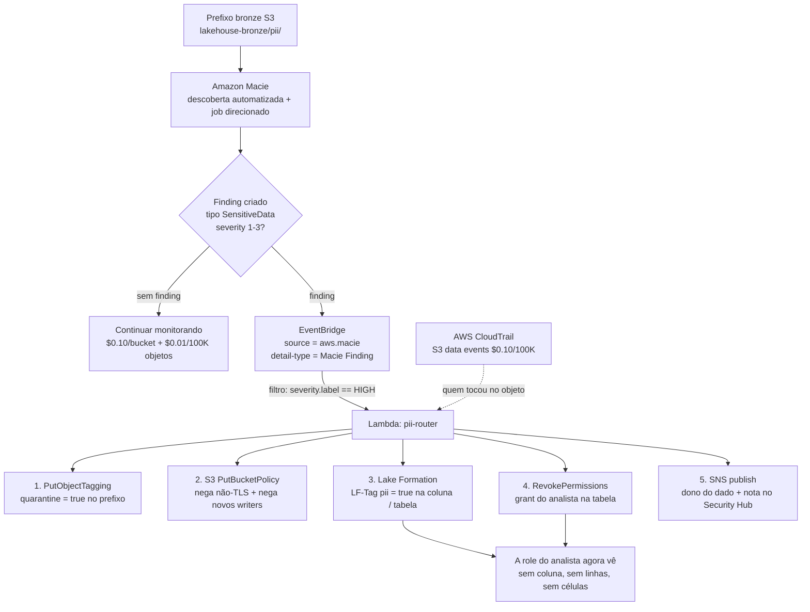
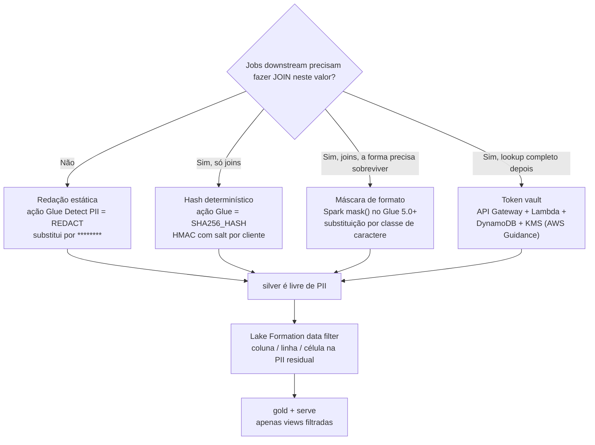
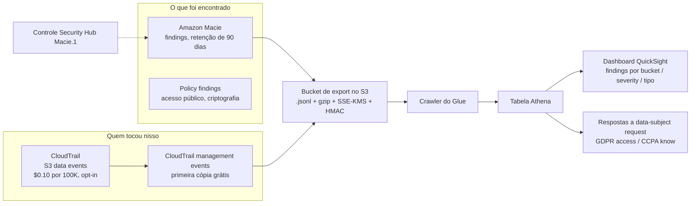
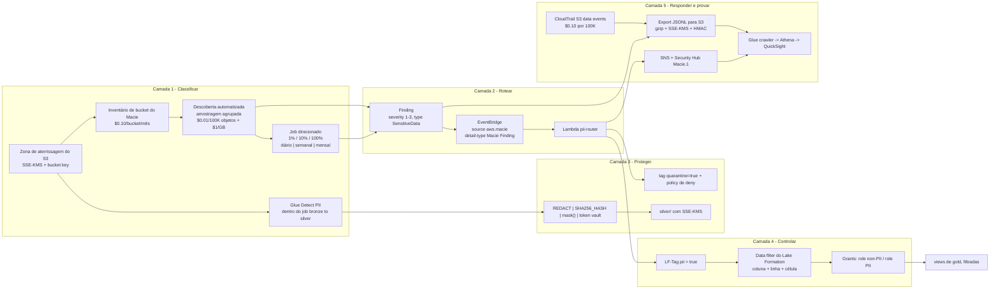

# Proteção de PII no Lakehouse: Amazon Macie, Mascaramento e Workflows de Privacidade

As lições 01 to 12 construíram um lakehouse rápido, barato e governável. Essa combinação cria uma nova obrigação: mais cedo ou mais tarde alguém coloca o endereço de e-mail, o número de telefone ou o documento nacional de um cliente em `s3://lakehouse/bronze/`, e você precisa poder **dizer onde ele está, quem pode ver, o que você fez a respeito, e quando você teria que apagá-lo**. Esta lição é a resposta, e a resposta é um *pipeline*, não um produto.

A regra de ensino desta lição: **classificar, rotear, proteger, controlar, responder: cinco camadas, cada uma com um serviço diferente, nenhuma delas opcional.** O Amazon Macie só faz a primeira. Tudo depois de um finding é *sua* rule do EventBridge, *sua* Lambda, *seu* job do Glue e *seu* grant do Lake Formation.

```text
====================================================================
 SUPERFÍCIE DE PROTEÇÃO DE PII (preços cheios us-east-1, em out de 2026)
====================================================================
 Classificar .... Amazon Macie: inventário + monitoramento de bucket,
                 descoberta automatizada de dados sensíveis (amostragem),
                 jobs de descoberta direcionada (1% / 10% / 100%)
                 AWS Glue: transformação Detect PII dentro de jobs,
                 sensitive data types gerenciados (incl. EMAIL)
 Rotear ........ EventBridge events, source = aws.macie,
                 detail-type = "Macie Finding" ->
                 Lambda / SNS / SQS / Security Hub custom actions
 Proteger ...... Glue REDACT / PARTIAL_REDACT / SHA256_HASH,
                 Spark mask() no Glue 5.0+, token vault
                 (API Gateway + Lambda + DynamoDB + KMS)
                 Criptografia default SSE-KMS + S3 Bucket Keys
 Controlar ..... Lake Formation data filters (coluna / linha / célula)
                 LF-Tags como pii = true, grants baseados em tag
 Responder ..... CloudTrail (quem), findings do Macie (o quê),
                 exports JSONL no S3 (evidência), retenção de 90 dias
 Preço ........ $0.10 por bucket S3 / mês
                 $0.01 por 100,000 objetos monitorados
                 $1.00 por GB inspecionado (free tier de 1 GB / mês)
                 trial grátis de 30 dias, até 150 GB, jobs excluídos
 Limite ....... O Macie vê apenas buckets S3 general purpose.
                 Tabelas Parquet e o catálogo Glue são trabalho do Glue,
                 não do Macie. O Macie encontra; ele nunca previne.
====================================================================
```

Nesta lição você vai:

- rodar o **pipeline de cinco camadas** ponta a ponta e nomear o serviço que detém cada camada, e nomear a camada que *não* tem serviço AWS nenhum (cola de roteamento);
- aprofundar o **Amazon Macie**: inventário e monitoramento, descoberta automatizada versus jobs direcionados, profundidade de amostragem, schedules, suporte de storage class e os limites duros de escopo;
- separar os **três números** que os alunos confundem constantemente: severity do finding (1 to 3), score de sensibilidade do bucket (−1 a 100) e `count` de ocorrência;
- escolher entre **managed data identifiers e custom data identifiers**, escrever uma regex de verdade e saber exatamente qual identifier você mesmo precisa construir (e-mail);
- ler o **schema do Finding** e rotear com ele por uma **rule do EventBridge** para uma Lambda que põe um prefixo em quarentena e marca `PII=true`;
- precificar um programa de classificação **até o dólar**, usando as três dimensões de cobrança e o dial de profundidade de amostragem;
- escolher uma **técnica de mascaramento pela exigência de fidelidade de join**, redigir, hashear, mascarar formato ou tokenizar, e evitar a armadilha de runtime do `mask()` no Glue 4.0 e no Athena;
- retrovincular a classificação à **segurança de coluna e linha do Lake Formation**, de modo que uma tag vire uma aplicação, não uma anotação;
- construir a **trilha de auditoria** a partir de data events do CloudTrail, findings do Macie e exports JSONL;
- lidar com **GDPR, CCPA e LGPD** na profundidade da AWS, incluindo por que o versionamento do S3 quebra discretamente o apagamento.

---

## 1. O pipeline de cinco camadas: classificar, rotear, proteger, controlar, responder

### 1.1 As camadas e quem as detém

| Camada | Pergunta que ela responde | Serviço que a detém | O que quebra se você pulá-la |
|---|---|---|---|
| **1. Classificar** | *Onde está a PII?* | Amazon Macie (objetos S3) + AWS Glue Detect PII (dados tabulares em jobs) | Você está chutando; a auditoria pede uma lista e você produz uma planilha |
| **2. Rotear** | *Quem reage, quão rápido?* | EventBridge (`source = aws.macie`) → Lambda / SNS / SQS / Security Hub | Findings se acumulam num console que ninguém abre |
| **3. Proteger** | *Como o valor armazenado se parece?* | Mascaramento Glue / Spark, token vault, criptografia SSE-KMS | Todo leitor do prefixo bruto vê a PII crua |
| **4. Controlar** | *Quem pode consultar isso?* | Lake Formation data filters + LF-Tags | O mascaramento é desfeito por quem tem `s3:GetObject` direto |
| **5. Responder e evidência** | *O que eu consigo provar?* | CloudTrail + findings do Macie + exports JSONL | Você não consegue responder "quando você soube?" |

Três propriedades desta tabela valem a pena memorizar:

1. **As camadas 1 e 5 são detectivas; as camadas 3 e 4 são preventivas; a camada 2 é a única cola.** O Macie nunca vai mascarar uma coluna nem revogar um grant: a ligação entre um finding e um controle é código que você escreve.
2. **A camada 1 se divide por engine.** O Macie inspeciona **buckets S3 general purpose**; a transformação Detect PII do Glue inspeciona **DataFrames dentro de um job**. Parquet no lake e colunas no Glue Data Catalog são território do Glue, não do Macie.
3. **A camada 4 precisa existir mesmo que a camada 3 esteja perfeita.** Uma tabela `silver` lindamente mascarada não faz nada pelo analista que contorna o lakehouse e lê `bronze/` com uma policy de IAM.

### 1.2 Exemplo resolvido E1: precificando um programa de classificação (us-east-1, em out de 2026)

Considere uma zona de aterrissagem bronze de **1 TB** com **2,000,000 objetos**, mais 14 buckets menores (15 buckets no total). O Macie cobra em três dimensões (Preços do Amazon Macie, acesso em 2026-10-11):

```text
EXEMPLO E1 - custo de classificação em regime estável, 15 buckets, 1 TB bronze
--------------------------------------------------------------------
Inventário e monitoramento de bucket
  15 buckets x $0.10 por bucket / mês            = $ 1.50 / mês
  (rateado diariamente; cobre até 10,000 buckets
   por conta e Região)

Objetos monitorados para descoberta automatizada
  2,000,000 objetos / 100,000 x $0.01            = $ 1.00 / mês
  (todos os 15 buckets contribuem para a contagem)

Dados inspecionados pela descoberta automatizada
  digamos 40 GB amostrados no mês
  (40 - 1) GB x $1.00  [free tier de 1 GB]       = $39.00 / mês

Um job de descoberta direcionada sobre o bucket de 1 TB
  1,024 GB x $1.00                               = $1,024 pontual
  + S3 GET/LIST: 2,000,000 GET x $0.004/10,000   = $ 0.80
  + ~2,000 LIST x $0.005/1,000                   = $ 0.01

TOTAL regime estável (sem jobs direcionados)      = $41.50 / mês
TOTAL com um job direcionado de varredura total   = $1,066.31 uma vez
```

**A lição dentro do exemplo:** a descoberta automatizada é a camada contínua barata; os jobs direcionados são a camada de precisão cara. O playbook de redução de custo da AWS (Security Blog, 2023-03-20) é exatamente esta aritmética: use a descoberta automatizada para *encontrar* os buckets de risco, amostre-os a **10%** (cerca de **$102** em 1,024 GB) para validar, e reserve a varredura completa de **$1/GB** para os poucos buckets que realmente importam.

- **📚 Você sabia?** O **trial grátis de 30 dias** cobre até **150 GB inspecionados por conta** e a dimensão de inventário de bucket, mas a página de preços é explícita que *"Qualquer job de descoberta de dados sensíveis que você criar não estará incluído no trial grátis de 30 dias"* (Preços do Amazon Macie, acesso em 2026-10-11). Uma equipe de demo que roda um job de 200 GB com amostragem de 100% no segundo dia do trial acaba se cobrando cerca de **$200**. O trial cobre a descoberta; ele não cobre *os seus* jobs.

---

## 2. Amazon Macie em profundidade

### 2.1 Inventário e monitoramento: a camada que está sempre ligada

O Macie *"avalia automaticamente e continuamente seus buckets S3 quanto à presença de dados sensíveis"* usando *"inventário e monitoramento de buckets, descoberta automatizada de dados sensíveis e machine learning (ML) para perfilar buckets e amostrar objetos"* (Guia do Usuário do Macie, *Automated sensitive data discovery: how it works*, acesso em 2026-10-11).

Três fatos fazem essa camada se comportar de modo diferente de um scan:

- **Os buckets são agrupados** *"por atributos como nome do bucket, tipos de arquivo e prefixos, para amostrar dados de forma ampla e economicamente em toda uma organização e minimizar a varredura de dados necessária"*. O agrupamento é por que uma amostra representativa pode ser estatisticamente útil sem tocar em cada objeto.
- **A cobertura é limitada a 10,000 buckets por conta e Região** (cota aumentada em 2024-12-06), e a cobrança é `$0.10 por bucket por mês`, rateada diariamente.
- **Os resultados não são instantâneos.** Os resultados da análise *"podem começar a aparecer em até 48 horas após habilitar a descoberta automatizada de dados sensíveis"*, e os scores ficam em `50 — Not yet analyzed` até que apareçam. Um bucket vazio pontua `1 — Not sensitive`, o que significa *sem dados*, não *sem PII*.

### 2.2 Descoberta automatizada versus jobs direcionados

São mecanismos diferentes com contas diferentes, e confundi-los é o mal-entendido mais comum do Macie.

| Propriedade | **Descoberta automatizada de dados sensíveis** | **Jobs de descoberta direcionada de dados sensíveis** |
|---|---|---|
| Gatilho | Contínua, ligada por default assim que habilitada | Você o cria: **pontual (on-demand)** ou **periódico (diário, semanal, mensal)** |
| Escopo | Amostra representativa em buckets agrupados | Objetos que atendem aos seus critérios (tamanho, data de criação, última modificação) |
| Amostragem | Agrupamento estatístico, perfil por bucket | **Profundidade de amostragem: 1, 10 ou 100 (por cento)** |
| Alimenta | **Score de sensibilidade e label** do bucket | Apenas findings: *"Eles não refletem os resultados de jobs de descoberta de dados sensíveis que você cria e executa"* |
| Cobrança | `$0.01 / 100K objetos` monitorados + `$1.00/GB` inspecionado | `$1.00/GB` inspecionado, **fora** do trial grátis |
| Critérios de objeto do job | n/a | Tamanho do objeto 0 B: 5 TB; última modificação de no máximo 1 ano atrás |
| Comportamento incremental | n/a | Jobs periódicos *"avaliam objetos novos e modificados que atendem aos critérios e foram adicionados ao bucket durante o schedule especificado"* |

Limites operacionais de job que valem a pena citar num documento de design (Guia do Usuário do Macie, *Quotas*, acesso em 2026-10-11): **50 jobs simultâneos**, **10,000 jobs por conta**, estouro da API de criação de job de **1 por 20 segundos**, findings exigem objetos de pelo menos **15 bytes**, e a janela de correspondência de padrão é de **4 KB de texto por objeto** (1 MB para o S3 Select). Findings de dados sensíveis são aparados em **15,000 findings por bucket por dia**, e policy findings são deduplicados numa janela de **15 minutos**.

- **📚 Você sabia?** A lista de *storage classes suportadas* do Macie é uma geradora de armadilhas: Standard, Standard-IA, One Zone-IA, Intelligent-Tiering, Reduced Redundancy e **Glacier Instant Retrieval** são inspecionados, mas **Glacier Deep Archive e Glacier Flexible Retrieval não são**, e objetos em **buckets de diretório do S3 Express não são inspecionados de jeito nenhum**. Objetos criptografados só são legíveis *"se os objetos forem criptografados com chaves SSE-KMS ou DSSE-KMS"* (Guia do Usuário do Macie, acesso em 2026-10-11). Um tier de arquivo cheio de exports legados não está "coberto": ele é invisível até ser restaurado.

### 2.3 Managed versus custom data identifiers

**Managed data identifiers (MDIs)** são detectores mantidos pela AWS. O quick reference lista **40**, agrupados em Credentials (`ACCESS_KEYS`, `AWS_ACCESS_KEYS`, `AWS_ACCOUNT_ID`, `DB_CREDENTIALS`, `ENCODED_PRIVATE_KEY`, `PRIVATE_KEY`, `SECRET_KEYS`, …), Financial information (`BANK_ACCOUNT_NUMBER`, `CREDIT_CARD_NUMBER`, `CVC_NUMBER`, …), Personal information: PHI (`DOB`, `DRIVERS_LICENSE`, `HEALTHCARE_NUMBER`, `MEDICAL_RECORD_NUMBER`, `PASSPORT_NUMBER`, `SSN`, …) e PII (`ADDRESS`, `GENDER`, `NAME`, `PHONE`, `POSTAL_CODE`, …).

**Custom data identifiers (CDIs)** são seus: *"Um custom data identifier ajuda você a detectar dados sensíveis em objetos S3… com base em critérios customizados que você especifica"*: uma **expressão regular**, um **dicionário de palavras e frases (keywords)**, e *"uma lista opcional de expressões regulares para texto a ignorar (ignore words)"* (Guia do Usuário do Macie, acesso em 2026-10-11).

| Knob | Managed (MDI) | Custom (CDI) |
|---|---|---|
| Mantido por | AWS, atualizado para você | Você, e **imutável depois da criação** |
| Quantidade | 40 no quick reference | **≤ 100 por conta e Região** |
| Regex | n/a | **≤ 4,096 caracteres**, ou **≤ 400** se houver janela de proximidade |
| Keywords | n/a | **≤ 20**, total de **≤ 400 caracteres** |
| Ignore words | n/a | **≤ 25**, cada uma de **≤ 40 caracteres** |
| Severity default | Definida pela AWS | **Medium**, sobrescrita por identifier |
| Endereço de e-mail | **Não existe `EMAIL` MDI** | É aqui que você o constrói |
| Allow list | n/a | **≤ 500 regexes, cada uma ≤ 100 caracteres**, para suprimir falsos positivos |

> [!WARNING]
> ⚠️ **"Macie detecta e-mails" é falso de fábrica.** Não existe **`EMAIL` managed data identifier** no Macie. Pior: o conjunto default de identifiers usado pela descoberta automatizada *"exclui os identifiers NAME, EMAIL, CREDIT_CARD, IP_ADDRESS e PHONE"* (Guia do Usuário do Macie, *Automated discovery settings*, acesso em 2026-10-11), o `EMAIL` nessa lista é um *rótulo de categoria* emprestado do vocabulário do Glue. No Macie, cobertura de e-mail significa um **custom data identifier**; no **AWS Glue**, o sensitive data type gerenciado **`EMAIL` existe**. Dois catálogos, duas respostas, e os alunos fundem as duas numa resposta errada o tempo todo.

### 2.4 Exemplo resolvido E2: um custom data identifier, regex por regex

Requisito: detectar números de membro da Northwind Health no formato `NWH` seguido de dez dígitos, em um prefixo bronze de documentos de apólice migrados, sem disparar em números de pedido nem em fixtures de teste.

```text
EXEMPLO E2 - custom data identifier "northwind-member-id"
--------------------------------------------------------------------
Regex (subconjunto PCRE, sem asserções lookahead / lookbehind):
    NWH[0-9]{10}
    -> casa com NWH0000123456, não com NWH-123456
    -> comprimento bem abaixo do teto de 4,096 caracteres;
       acrescente uma janela de proximidade e o teto cai para 400

Keywords (máx. 20, 400 caracteres no total, usadas para ancorar a regex):
    member_id   Member ID   policy_number   subscriber

Ignore words (máx. 25, cada uma máx. 40 caracteres - matam falsos positivos):
    test-NWH   sample-NWH   example-NWH   dummy-NWH   NWH0000000000

Janela de proximidade: keyword e regex precisam co-ocorrer dentro
    de uma janela curta uma da outra - a maior alavanca de precisão
    que você tem quando a regex sozinha está frouxa demais

Severity: identifiers customizados têm default Medium; defina High
    porque este é um identifier próximo a PHI.

Ciclo de vida: CDIs são IMUTÁVEIS. Aperte a regex depois e você
    CRIA um novo identifier, APOSENTA o antigo e reexecuta os jobs
    - você não pode editar discretamente a regra que produziu os
    findings do trimestre passado. Essa imutabilidade é a auditoria.

Cobertura: findings deste CDI aparecem ao lado dos findings de MDI nos
    mesmos objetos Finding e roteiam pela mesma rule do
    EventBridge da Seção 3.
```

Dois fatos de apoio: identifiers customizados *"são únicos para cada cliente e não são compartilhados com outros clientes"* (FAQ do Macie, página datada de 2025-09-30), não existe um marketplace de detectores da comunidade, e o controle de falsos positivos pertence às **allow lists** (até 500 regexes, 100 caracteres cada), não a um fork do identifier.

```matching
{
  "question": "Correlacione cada necessidade de detecção com o engine que de fato pode satisfazê-la em outubro de 2026:",
  "pairs": [
    {"left": "Endereços de e-mail em JSON cru no S3", "right": "Custom data identifier do Macie (regex + keywords) - o Macie não tem nenhum managed data identifier EMAIL"},
    {"left": "Endereços de e-mail dentro de um job do Glue sobre um DataFrame", "right": "Sensitive data type gerenciado EMAIL do AWS Glue, usado pela transformação Detect PII"},
    {"left": "SSNs dos EUA em objetos do S3", "right": "Managed data identifier SSN do Macie, e as categorias HIPAA / US do Glue se você estiver num job"},
    {"left": "Um bucket público, ou objetos enviados sem SSE-KMS", "right": "Policy check do Macie: um Policy finding, não um SensitiveData finding"},
    {"left": "Um formato de ID de fidelidade interno da empresa, único deste negócio", "right": "Custom data identifier do Macie: o caso de uso documentado de CDIs é tipos únicos da sua organização"},
    {"left": "Colunas de PII numa tabela Iceberg catalogada", "right": "Glue Detect PII dentro do job bronze-to-silver: o Macie lê objetos do S3, não tabelas do Data Catalog"}
  ],
  "explanation": "Três engines, três escopos: managed data identifiers do Macie para padrões padrão em objetos do S3, custom data identifiers do Macie para padrões específicos da organização em objetos do S3, e os sensitive data types gerenciados do Glue dentro de um job para dados tabulares. Policy findings são um quarto tipo, separado: postura do bucket, não conteúdo. A resposta-armadilha é EMAIL: o Glue tem, o Macie não."
}
```

### 2.5 O Finding: schema, severity, score, count

Um finding do Macie é um objeto JSON. O modelo de API `Finding` expõe `id`, `createdAt`, `updatedAt`, `partition`, `region`, `resourceArn`, `title`, `severity`, `type`, **`SensitiveData`** ou **`Policy`**, e `count`, descrito como *"O número total de ocorrências que foram observadas"* e *"sempre 1 para findings de dados sensíveis"* no nível de topo. O detalhe de ocorrência por identifier vive nos sub-objetos `occurrences`, que carregam seu próprio `count` e até **15** registros `location`. Findings são retidos por **90 dias** (aumentado de 30 em 2021-10-01).

Três números, três objetos diferentes: nunca os confunda:

| Número | Intervalo | Objeto que descreve | Fonte da verdade |
|---|---|---|---|
| **Severity do finding** | **1: Low, 2: Medium, 3: High** (sem Critical) | Um finding | *"Severity levels correspond to a range of 1 to 3"*; para policy findings combina *"a natureza do problema e o número de recursos afetados"* |
| **Score de sensibilidade** | **−1 … 100** | Um **bucket**, somente descoberta automatizada | `-1` erro de classificação · `1-49` não sensível · `50` ainda não analisado · `51-99` sensível · `100` atribuído manualmente, nunca calculado |
| **Count de ocorrência** | inteiro | Um identifier dentro de um finding | O `count` de topo é sempre 1 para findings de dados sensíveis; o detalhe está em `occurrences` |

A AWS é explícita de que o score *"não… implica nem indica de outra forma a criticidade ou importância que um bucket ou os objetos de um bucket possam ter para você"* (Guia do Usuário do Macie, *Sensitivity scoring for S3 buckets*, acesso em 2026-10-11). Um score de **100 é sempre uma sobrescrita manual**; o Macie nunca o atribui. Se a descoberta for desabilitada no nível da organização, scores e labels existentes persistem por **30 dias** e depois são redefinidos.

- **📚 Você sabia?** Os próprios findings do Macie são **artefatos sensíveis**. Os registros `location` de ocorrência descrevem onde uma correspondência foi encontrada no objeto, e o repositório de resultados do S3 grava arquivos **JSON Lines** (`*.jsonl`, comprimidos com gzip, criptografados com **SSE-KMS**), cada um carregando uma assinatura de **keyed-hash message authentication code (HMAC)** (adicionada em 2023-11-08). Trate os exports com o mesmo cuidado dos dados: os criptografe com uma chave restrita, limite `GetFinding` à equipe de segurança e faça o prefixo do export expirar com uma regra de lifecycle.

### 2.6 EventBridge: o contrato de roteamento

> "Quando o Macie detecta novos findings de dados sensíveis ou policy findings… ele publica os eventos correspondentes no EventBridge. O EventBridge então roteia os eventos para os targets que você especifica. Os targets podem incluir funções do AWS Lambda, tópicos do Amazon SNS e filas do Amazon SQS.": Guia do Usuário do Macie, *Findings, events, and EventBridge* (acesso em 2026-10-11)

Os dois campos em que você filtra:

```json
{
  "detail-type": "Macie Finding",
  "source": "aws.macie",
  "detail": {
    "type": "SensitiveData",
    "severity": { "level": 3, "label": "HIGH" },
    "category": "SensitiveData",
    "resourceArn": "arn:aws:s3:::lakehouse-bronze",
    "region": "us-east-1"
  }
}
```

As variedades de evento documentadas incluem *novos findings de dados sensíveis*, *novas ocorrências de findings de dados sensíveis existentes*, *novos policy findings* e *ocorrências subsequentes de policy findings existentes*, o que significa que **sua rule precisa ser idempotente**, porque um finding existente pode disparar de novo quando uma nova ocorrência aparece. O Security Hub ingere os mesmos findings, expõe o controle CSPM **`Macie.1` ("Amazon Macie should be enabled")** e oferece **custom actions** que transformam o clique de um botão de um humano numa segunda rule do EventBridge para uma Lambda (AWS Security Blog, 2022-07-18; repo de exemplo `aws-samples/security-hub-macie-remediation`).

### 2.7 Exemplo resolvido E3: profundidade de amostragem como dial de custo *e* de cobertura

Um bucket de **200 GB**, um único job direcionado, `$1.00 por GB inspecionado` (us-east-1, em out de 2026):

```text
EXEMPLO E3 - mesmo bucket, três profundidades de amostragem
--------------------------------------------------------------------
profundidade 1%   ->   2 GB inspecionados -> $   2.00
profundidade 10%  ->  20 GB inspecionados -> $  20.00
profundidade 100% -> 200 GB inspecionados -> $200.00
                      (antes de aplicar o free tier de 1 GB por mês
                       para descoberta de dados sensíveis, se não usado)

Leitura da cobertura:
  1%   - não encontra nada nos 99% dos objetos nunca amostrados.
         Um finding de um job de 1% descreve a AMOSTRA.
  10%  - a camada de validação do playbook de redução de custo da AWS:
         sinal suficiente para decidir se vale pagar pelo 100%.
  100% - a única profundidade em que um resultado negativo significa
         "este bucket está limpo" em vez de "este bucket
         estava majoritariamente não lido".

Teto de gasto: a descoberta direcionada tem cota de serviço default de
  5 TB por conta. Chegue a 5 TB e seus jobs direcionados PAUSAM.
  Ir além de 25 TB passa pelo AWS Support.
```

```plot
{
  "type": "bar",
  "title": "Custo da descoberta direcionada para um bucket de 200 GB por profundidade de amostragem (us-east-1, em out de 2026)",
  "data": [
    {"Sampling depth": "1%", "Inspection cost (USD)": 2},
    {"Sampling depth": "10%", "Inspection cost (USD)": 20},
    {"Sampling depth": "100%", "Inspection cost (USD)": 200}
  ],
  "xKey": "Sampling depth",
  "dataKeys": ["Inspection cost (USD)"],
  "xLabel": "Profundidade de amostragem",
  "yLabel": "USD, job pontual"
}
```

O eixo x é linear em dinheiro e *não-linear no que você aprende*: passar de 10% para 100% custa 10× e compra o único resultado que você consegue defender numa auditoria. Profundidade é um **dial de custo/cobertura, não uma configuração de qualidade**: não existe profundidade em que as regexes do Macie fiquem mais espertas.

---

## 3. O pipeline classificar → rotear: finding, Lambda, quarentena, tag

### 3.1 O diagrama de roteamento



A metade de cima é **detecção**; a metade de baixo é **prevenção**. As duas precisam existir, porque o Macie é *periódico* (com aquecimento de até 48 horas, depois a cadência que você escolher), enquanto o mascaramento do Glue da Seção 4 roda *por carga*. Um pipeline só com a metade de cima reporta danos; um pipeline só com a metade de baixo nunca fica sabendo dos dados que chegaram antes do job de mascaramento existir.

### 3.2 Exemplo resolvido E4: a rule e o handler

A rule do EventBridge, filtrada para findings de dados sensíveis de alta severidade:

```json
{
  "Source": "aws.macie",
  "detail-type": ["Macie Finding"],
  "detail": {
    "type": ["SensitiveData"],
    "severity": { "label": ["HIGH"] },
    "category": ["SensitiveData"]
  }
}
```

Os cinco efeitos colaterais do handler da Lambda, na ordem em que precisam rodar:

```text
EXEMPLO E4 - Lambda pii-router (a camada que a AWS não fornece)
--------------------------------------------------------------------
event detail -> extrair resourceArn, region, severity, occurrences

 1. CONTER PRIMEIRO, classificar depois.
    s3 PutObjectTagging na(s) chave(s) correspondente(s):
        quarantine = true, found-by = macie, finding-id = <id>
    -> uma regra de lifecycle agora pode expirar ou mover tudo que
       estiver taggeado quarantine = true sem lista de prefixos.

 2. APERTAR O BUCKET.
    PutBucketPolicy: nega s3:PutObject a menos que
        s3:x-amz-server-side-encryption = aws:kms
    (findings frequentemente significam que um objeto chegou sem
     criptografia ou por um caminho fora da regra default)

 3. TRANSFORMAR O FINDING EM MUDANÇA DE GRANT.
    lakeformation TagResource   -> pii = true na tabela + colunas
    lakeformation RevokePermissions -> derruba o grant do analista
    -> esta é a etapa que os alunos esquecem: uma tag é documentação
       ATÉ que exista um grant baseado em tag que a consuma.

 4. NOTIFICAR. SNS para o dono do dado, nota no Security Hub.

 5. IDEMPOTÊNCIA.
    O Macie emite eventos para NOVAS OCORRÊNCIAS de um finding EXISTENTE.
    Dedupe por finding id + conjunto de ocorrências, ou sua fila de
    tickets enche de duplicatas de um único objeto de 400 linhas.

 total: 1 rule + 1 function + 2 chamadas S3 + 2 chamadas LF + 1 publish
```

**Custo da própria camada de roteamento, em out de 2026:** a primeira cópia dos management events do CloudTrail é grátis; os **S3 data events do CloudTrail custam $0.10 por 100,000 eventos** e são **opt-in**: sem eles você não consegue responder *"quem leu o objeto"* depois de um incidente (Preços do AWS CloudTrail, acesso em 2026-10-11). Lambda, rules do EventBridge e SNS são medidos separadamente, mas neste volume são centavos.

```dragdrop
{
  "question": "Ordene o workflow de resposta a PII desde o momento em que um finding do Macie chega até o momento em que um analista é bloqueado:",
  "items": [
    "O Macie cria um finding SensitiveData com severity 3 (High) para um objeto em bronze/pii/",
    "O EventBridge casa com source aws.macie e detail-type Macie Finding, filtrado para severity HIGH",
    "A Lambda põe o objeto em quarentena taggando-o quarantine=true e nega novos puts sem criptografia no bucket",
    "A Lambda marca o recurso do Lake Formation com LF-Tag pii=true para que a classificação se torne legível por máquina",
    "A Lambda revoga o grant SELECT do analista existente, que foi emitido antes de os dados serem conhecidos como PII",
    "O Lake Formation avalia grants baseados em tag: a role do analista não corresponde mais a nenhum grant em pii=true",
    "O SNS notifica o dono do dado e o Security Hub registra o evento contra o controle Macie.1",
    "A sequência inteira é gravada no CloudTrail para que a linha do tempo da resposta possa ser reconstruída depois"
  ],
  "correctOrder": [
    "O Macie cria um finding SensitiveData com severity 3 (High) para um objeto em bronze/pii/",
    "O EventBridge casa com source aws.macie e detail-type Macie Finding, filtrado para severity HIGH",
    "A Lambda põe o objeto em quarentena taggando-o quarantine=true e nega novos puts sem criptografia no bucket",
    "A Lambda marca o recurso do Lake Formation com LF-Tag pii=true para que a classificação se torne legível por máquina",
    "A Lambda revoga o grant SELECT do analista existente, que foi emitido antes de os dados serem conhecidos como PII",
    "O Lake Formation avalia grants baseados em tag: a role do analista não corresponde mais a nenhum grant em pii=true",
    "O SNS notifica o dono do dado e o Security Hub registra o evento contra o controle Macie.1",
    "A sequência inteira é gravada no CloudTrail para que a linha do tempo da resposta possa ser reconstruída depois"
  ],
  "explanation": "Conter precede classificar, classificar precede revogar, revogar precede notificar: e a auditoria envolve tudo. Os dois erros de ordenação que importam: taggar (quarentena) antes de apertar a policy significa que a próxima gravação já está a caminho, e notificar antes de revogar significa que o dono do dado é informado de uma janela que ainda está aberta. Note também que a LF-Tag sozinha não bloqueia nada: sem o grant baseado em tag correspondente (ou sua revogação), pii=true é um rótulo."
}
```

---

## 4. Proteção no lake: detectar bronze → marcar → mascarar/tokenizar silver

Classificação sem transformação só diz *onde está o problema*. A resposta da medalha é uma transformação no **momento da escrita**: detectar no **bronze**, marcar na **fronteira do catálogo**, mascarar ou tokenizar no caminho para o **silver**, e deixar o Lake Formation guardar o que de PII residual sobrar.

### 4.1 Escolha a técnica pela pergunta "precisa fazer JOIN? precisa voltar?"



**Só estes quatro são padrões verificados da AWS.** Criptografia preservadora de formato (FPE no estilo AES-FF1) *não* é um recurso gerenciado de lakehouse da AWS: se você vir isso, é uma técnica de terceiros ou criptográfica geral, não algo que o Glue ou o Athena entregam.

### 4.2 Padrão A: redação estática, e a transformação Detect PII do Glue

A **transformação Detect PII** detecta *"informação pessoalmente identificável (PII)… colunas nos seus dados de entrada que podem conter dados PII"*, seja **por célula (default)** ou **por coluna**, onde você fornece uma porcentagem de amostragem e um limiar de correspondência. Suas quatro ações: **`Enrich`**, **`Redact` (default, substitui dados sensíveis por `********`)**, **`Partial redact`** e **`SHA-256 hash`**. Os níveis de sensibilidade são **`High`** e **`Low`**; as categorias são **`Universal`, `HIPAA`, `Networking`, `US`, `UK`, `CA`, `ES`, `IT`**; e *"Você também pode aplicar transformações diferentes a colunas diferentes usando overrides refinados"*. Na saída de jobs do Glue 3.0/4.0, os valores reportados de `actionUsed` são `DETECT`, `REDACT`, `PARTIAL_REDACT`, `SHA256_HASH`.

### 4.3 Padrão B: tokenização determinística que ainda faz join

Determinístico significa *a mesma entrada sempre produz o mesmo token*, então `GROUP BY hashed_email` ainda agrupa um cliente entre tabelas. Também significa que o mapeamento é reversível **em princípio** para entradas de baixa entropia: um espaço de telefone de 10 dígitos é enumerável, então um SHA-256 puro de um telefone está **a um ataque de dicionário de distância do plaintext**. As correções, em ordem de preferência:

1. **HMAC com chave e salt secreto** armazenado no Secrets Manager: mesmo determinismo, sem rainbow table. Use isto para telefone, SSN e valores no grau de postcode.
2. **Reserve o `SHA256_HASH` puro para identifiers de alta entropia**: UUIDs, números de conta com dígito verificador.
3. **Vault de tokenização completo** quando você precisa de reversibilidade *e* de remover a PII do caminho analítico: a arquitetura do AWS Guidance *Tokenization to Improve Data Security and Reduce Audit Scope on AWS* (revisado em 2024-07-23) é **API Gateway → Lambda → vault de tokens no DynamoDB criptografado com KMS**, com tokens carregando um HMAC para que os lookups sejam consistentes. A analítica a jusante consome apenas tokens; o vault é o único componente que pode algum dia ver o original.

### 4.4 Exemplo resolvido E5, o mesmo e-mail, quatro vezes, e por que diferem

```text
EXEMPLO E5 - determinismo, entropia e reversibilidade lado a lado
--------------------------------------------------------------------
Entrada: jane.doe@example.com   (alta entropia, milhões de valores
        possíveis - seguro para hashear deterministicamente)
Entrada: 5551234567             (10 dígitos - enumerável, inseguro)

1. REDACT (Glue Detect PII, default)
   jane.doe@example.com -> ********
   5551234567           -> ********
   Determinístico? sim (sempre a mesma máscara). Joinável? NÃO.
   Reversível? NÃO. Use quando nada a jusante precisa do valor.

2. SHA256_HASH (ação do Glue SHA256_HASH)
   jane.doe@example.com -> 9f2a... (estável entre jobs, joins funcionam)
   5551234567           -> 3c81... (estável - E enumerável: 10^10
                           candidatos podem ser hasheados offline
                           até o digest bater)
   Use o #2 apenas para identifiers de alta entropia.

3. HMAC com salt por cliente (Secrets Manager)
   mesma entrada -> mesmo token, mas o digest não pode ser
   atacado offline sem o salt. Esta é a resposta default para
   campos no grau de telefone / SSN / postcode.

4. Token vault (AWS Guidance, revisado 2024-07-23)
   jane.doe@example.com -> tok_8Qm2Rw   (item do DynamoDB, vault
                           criptografado com KMS guarda o mapeamento)
   Determinístico? sim (lookup com chave HMAC). Joinável? SIM.
   Reversível? SIM, pelo vault - e só pelo vault, que é o
   ponto: o caminho analítico nunca segura o plaintext.

Regra geral: faça duas perguntas por coluna - "precisa fazer JOIN?" e
"precisa VOLTAR?". Não/Não -> REDACT. Sim/Não -> hash ou HMAC.
Sim/Sim -> token vault.
```


### 4.5 Padrão C: mascaramento de formato com o `mask()` do Spark

A função SQL `mask()` do Spark (*"New in version 3.5.0"*) *"mascara uma coluna com caracteres default para letras, números e caracteres 'outros': 'X' (maiúscula), 'x' (minúscula), '0' (dígito) e '*' (outro)"*, e aceita caracteres de substituição como argumentos: `mask(col, upperChar, lowerChar, digitChar, otherChar)`.

### 4.6 Exemplo resolvido E6: um job do Glue, três proteções diferentes

Um DataFrame de **100,000 linhas de cliente** saindo do bronze para o silver (formato da API *Detect PII* do Glue, acesso em 2026-10-11):

```text
EXEMPLO E6 - bronze -> silver, overrides por coluna
--------------------------------------------------------------------
transformName = DetectSensitiveData
action              = REDACT          # default para tudo
sensitivityLevel    = HIGH
sampleFraction      = 1.0             # 0 < valor < 1
thresholdFraction   = 0.8             # detecção apenas por coluna
entityTypes         = [...]           # overrides refinados

plano por coluna (um job, três proteções diferentes):
  ssn       -> REDACT           => ********   (nunca necessário a jusante)
  email     -> SHA256_HASH      => 9f2a...    (marketing ainda faz join)
  phone     -> SHA256_HASH com um salt HMAC do Secrets Manager
              (SHA-256 puro é enumerável em 10 dígitos)
  first_name-> mask('X','x','0','*') no Glue 5.0+ => Jxxx Rxxxx
  loyalty_id-> apenas DETECT, deixado no lugar, LF-Tag pii = true
              para o Lake Formation decidir quem pode lê-lo

saída: silver/ , gravado com SSE-KMS
catálogo: o crawler taggeia as colunas, o job de classificação anexa
          LF-Tag pii = true
```

O ponto do exemplo resolvido: **um job produz três desfechos diferentes**, destruído, joinável e apenas *governado*, escolhidos por coluna pelo que o consumidor realmente precisa. Redação é irreversível; hashing preserva joins; tag-mais-grant preserva o valor apenas para roles autorizadas.

> [!WARNING]
> ⚠️ **O `mask()` não está onde os alunos acham que está.** O `mask()` do Spark é *"New in version 3.5.0"*. A matriz de versões do Glue é **Glue 4.0 = Spark 3.3.0** (sem `mask()`), **Glue 5.0 = Spark 3.5.4** (tem), **Glue 5.1 = Spark 3.5.6**, **Glue 6.0 = Spark 4.1.1**, então uma chamada `mask()` num job do Glue 4.0 falha **em runtime, não em tempo de compilação**, porque as funções são resolvidas dinamicamente. E **o Athena não consegue fazer isso de jeito nenhum**: o engine version 3 do Athena usa o conjunto de funções escalares de string do Trino, que **não contém função `mask()`**, use `regexp_replace` ou uma UDF no Athena, ou empurre o mascaramento para o Glue no momento da escrita. Duas arestas mais: a linha de assinatura da referência em Python e sua descrição em prosa imprimem caracteres default *diferentes*, então fixe o comportamento do qual você depende com argumentos explícitos; e não existe benchmark publicado pela AWS comparando `mask()` no Glue com `regexp_replace` no Athena, então trate isso como um trade-off arquitetural, não como um medido.

### 4.7 Padrão D, o backup de criptografia

Desde **2023-01-05**, todo upload novo no S3 é criptografado com **SSE-S3 por default e sem custo adicional**. Essa não é a postura que você quer para PII: o SSE-S3 usa chaves gerenciadas pela AWS, não lhe dá **granularidade de auditoria por chave** nem **controle de deny por key policy**. Buckets de PII devem, portanto, exigir **SSE-KMS**, defina a criptografia default do bucket como `aws:kms` *e* acrescente uma condição de bucket policy negando uploads que não sejam `aws:kms`, com **S3 Bucket Keys** ligados.

### 4.8 Exemplo resolvido E7: quanto custa o backup (us-east-1, em out de 2026)

```text
EXEMPLO E7 - conta do KMS para um bucket bronze de leitura pesada
--------------------------------------------------------------------
Carga de trabalho: 2,000,000 GETs / mês em um bucket de 1 TB

Sem bucket key (cada GET dispara requisições ao KMS):
  2,000,000 / 10,000 x $0.03      = $6.00 / mês em requisições de KMS
Com S3 Bucket Keys:
  A AWS documenta uma redução nos custos de requisição do KMS de
  "up to 99 percent" -> efetivamente centavos.

Custos fixos de qualquer forma:
  1 customer managed key              = $1.00 / mês por chave
  (uma chave por classe de dado por
   Região é o split usual: pii, geral, archive)

Preços de requisição do S3 para o mesmo tráfego (arquivo de oferta 2026-09-28):
  GET e todos os outros  $0.004 / 10,000   = $0.80 para 2M GETs
  PUT/LIST               $0.005 / 1,000
  Armazenamento Standard $0.023 / GB-mês

Armadilha: bucket keys NÃO são suportadas para DSSE-KMS
  (criptografia de camada dupla, suportada pelo Macie desde 2024-01-17).
  Camada de mais alta sensibilidade + bucket keys = escolha uma.

A key policy é o controle real: restrinja Decrypt à role do job do
  Glue, às credenciais do Lake Formation e à role de break-glass -
  então a "criptografia" também vira uma decisão de acesso.
```

- **📚 Você sabia?** Determinismo e reversibilidade puxam em direções opostas, e o próprio guia de tokenização da AWS existe justamente por isso. Um hash determinístico é *amigável a join mas atacável* para campos de baixa entropia; um token vault é *reversível mas exige um serviço de lookup*; uma redação é *segura mas final*. O paper de tokenização do AWS Guidance (revisado 2024-07-23) coloca o vault atrás do API Gateway com uma tabela do DynamoDB criptografada com KMS, o que também encolhe seu escopo de auditoria: o caminho analítico nunca segura o plaintext, então os sistemas que precisam de redução de escopo deixam de estar no escopo dela.

---

## 5. Retrovínculo do Lake Formation: da tag para a aplicação em coluna e linha

A classificação só vira segurança quando um permission consome a classificação. A lição 12 detém a mecânica de grants; esta seção é o formato específico de PII.

### 5.1 Os dois mecanismos

- **LF-Tags (controle de acesso baseado em tag, LF-TBAC)**: anexe `pii = true` (ou `data_class = phi`) a bancos de dados, tabelas e **colunas**. As strings de chave e valor têm **≤ 50 caracteres**, são armazenadas em minúsculas, com **≤ 50 tags por recurso do Lake Formation**, **≤ 10,000 tag keys** e **≤ 1,000 values por key**. Os grants então nomeiam *atributos*, de modo que toda tabela que um crawler cria herda a policy no momento em que alguém a taggeia.
- **Data filters**: *"Data filters in Lake Formation enable you to implement column-level, row-level and cell-level security on Data Catalog tables"*, expressos com uma expressão de row filter em **PartiQL**, colunas de inclusão (nível de coluna), colunas de exclusão (nível de célula) e as duas juntas (nível de célula). Podem ser compartilhados com contas, AWS Organizations, principals de IAM e roles de IAM.

### 5.2 Exemplo resolvido E8: uma tabela, duas roles, uma coluna de PII

```text
EXEMPLO E8 - o formato do grant de PII em gold.customers (Iceberg)
--------------------------------------------------------------------
Tabela: gold.customers
Colunas: customer_id, email, phone, ssn, segment, region
LF-Tags:  pii-email = true  (coluna)
          pii-ssn   = true  (coluna)
          domain    = customer (tabela)

GRANT 1  role analytics-non-pii
         SELECT em gold.customers
         Columns = customer_id, segment, region   (inclusão)
         -> segurança de nível de coluna: ssn e email
            não são apenas ocultas dos resultados, elas são
            excluídas para este principal

GRANT 2  role pii-analyst (nomeada, justificada, com prazo)
         SELECT em gold.customers  (todas as colunas)
         + um data filter limitando as linhas a region = 'eu'
         -> nível de célula: colunas completas, linhas restritas

GRANT 3  baseado em tag: SELECT where domain = customer
         emitido para a role de plataforma
         -> toda tabela futura taggeada domain = customer está
            coberta sem um novo grant

AUDIT:   list-permissions após cada grant; o Lake Formation não
         tem primitiva de deny, então um grant SELECT simples
         posterior na mesma tabela reincere o que você excluiu.
```

Os filtros de nível de célula também são como você *"mostra a coluna mas anula os valores"* **sem materializar uma cópia mascarada**: que é a resposta mais barata possível para "precisamos do schema para o dashboard mas não dos dados".

- **📚 Você sabia?** Os grants do Lake Formation são baratos de conceder demais *financeiramente* e caros de conceder demais *politicamente*: as verificações de permissão não custam nada, enquanto os motores integrados cobram pelo que varrem. Essa assimetria é por que o padrão de PII é sempre *restringir de mais por default, depois conceder exceções*, o modo de falha da abordagem oposta não é uma conta maior, é um incidente.

---

## 6. Auditoria: data events do CloudTrail, histórico do Macie e o repositório de evidências

### 6.1 O que cada artefato pode e não pode responder

| Pergunta | Artefato | Retenção / preço (em out de 2026) |
|---|---|---|
| *Onde está a PII?* | Findings do Macie + exports JSONL | Findings **90 dias**; detalhe do export no S3 **até 90 dias** no Macie, suas cópias no S3 indefinidamente |
| *Quem leu o objeto?* | **S3 data events** do CloudTrail | **$0.10 por 100,000 eventos**, **opt-in**; primeira cópia dos management events **grátis** |
| *Quem mudou um grant?* | Eventos de API do Lake Formation no CloudTrail | Primeira cópia dos management events grátis; cópias extras **$2.00 / 100,000** |
| *Qual é a postura atual?* | Security Hub `Macie.1` + policy findings do Macie | Janela de dedup de policy finding de **15 minutos** |
| *Quão sensível é este bucket?* | Score de sensibilidade do Macie | Redefine **30 dias** após desabilitação no nível da org |
| *O que exportamos e está íntegro?* | JSONL + gzip + SSE-KMS + **assinatura HMAC** | Sua regra de lifecycle decide |

### 6.2 O fluxo de evidências, desenhado



Duas propriedades deste diagrama valem a pena dizer em voz alta: **o bucket de export é o repositório de evidências de longo prazo** (o próprio Macie guarda informação detalhada por até 90 dias), e **o CloudTrail é a única perna que responde "quem"**, o Macie responde "o quê", nunca "quem leu". Essa divisão é toda a razão pela qual um programa de privacidade precisa dos dois serviços.

### 6.3 Exemplo resolvido E9, o pacote de evidências de um trimestre

```text
EXEMPLO E9 - pacote de auditoria de PII trimestral (custos em out de 2026)
--------------------------------------------------------------------
Entradas
  15 buckets, 500,000 eventos em nível de objeto S3 / trimestre
  4,000 findings do Macie no trimestre
  1 export JSONL por semana

Custos
  S3 data events do CloudTrail:
    500,000 / 100,000 x $0.10           = $0.50 / trimestre
  Inventário de bucket do Macie:
    15 x $0.10 x 3                      = $4.50 / trimestre
  Monitoramento de objetos do Macie:
    2,000,000 objetos / 100,000 x $0.01 x 3 = $3.00 / trimestre
  Inspecção do Macie (digamos 40 GB/mês):
    (40 - 1) x $1.00 x 3                = $117.00 / trimestre
                                          ----------------
  TOTAL                                  ~ $125 / trimestre

Montagem
  1. Crawler do Glue sobre os arquivos .jsonl exportados -> tabela Athena
  2. Athena: findings por bucket, severity, identifier, semana
  3. Dashboard QuickSight para a revisão de compliance
  4. O CloudTrail responde "quem", o Macie responde "o quê",
     o JSONL + HMAC responde "e podemos provar que o export
     não foi editado"

  Fonte do padrão: AWS Security Blog, "How to query and visualize
  Macie sensitive data discovery results with Athena and
  QuickSight", 2023-01-06 (DDL atualizado em 2023-02-21).
```

### 6.4 Exemplo resolvido para preencher, o contrato de roteamento

```fillblank
{
  "question": "Complete o contrato de roteamento do Macie e seus números de retenção:",
  "template": "Um finding do Macie chega ao EventBridge com detail-type {{1}} e source {{2}}. Findings são retidos por {{3}} dias, findings de dados sensíveis carregam valores de severity {{4}} numa escala de 1 a 3, e o score de sensibilidade de um bucket varia de {{5}} a 100.",
  "answers": {
    "1": "Macie Finding",
    "2": "aws.macie",
    "3": "90",
    "4": "1 (Low), 2 (Medium), 3 (High)",
    "5": "-1"
  },
  "distractors": [
    "Macie SensitiveData",
    "AWS Macie Event",
    "Macie Policy Finding",
    "aws.macie2",
    "aws.securityhub",
    "aws.s3",
    "30",
    "180",
    "365",
    "0 (Informational) through 4 (Critical)",
    "1 (Medium), 2 (High), 3 (Critical)",
    "LOW, MEDIUM, HIGH, CRITICAL",
    "0",
    "1",
    "50"
  ],
  "explanation": "Os eventos do EventBridge carregam detail-type 'Macie Finding' com source 'aws.macie'. Findings são retidos por 90 dias (aumentado de 30 em 2021-10-01). Severity é uma escala de 1-3 rotulada Low/Medium/High: não existe Critical e não existe 0. O score de sensibilidade vai de -1 (erro de classificação) a 100 (apenas sobrescrita manual); 50 significa 'ainda não analisado'."
}
```

---

## 7. Enquadramento de compliance: GDPR, CCPA e LGPD em profundidade AWS

Compliance é um **exercício de mapeamento, não uma feature flag**. Cada regulamento mapeia para camadas específicas da Seção 1, e cada um tem uma armadilha específica da AWS.

### 7.1 As três regulamentações, em escopo

| Regulamento | Em vigor | Enquadramento AWS (fonte, acesso em 2026-10-11) | Camadas que o carregam |
|---|---|---|---|
| **GDPR** | **25 de maio de 2018** | Dado pessoal é *"qualquer informação relativa a uma pessoa natural identificada ou identificável, incluindo nomes, endereços de e-mail e números de telefone"*; a AWS *"atuora tanto como processadora quanto como controladora"*; os Service Terms da AWS incluem os **SCCs adotados pela Comissão Europeia em junho de 2021**, aplicando-se automaticamente a transferências fora do EEA sem decisão de adequação | 1 (encontre), 3 (apague), 5 (prove) |
| **CCPA / CPRA** | Página atualizada pela última vez em **2025-08-08** | A AWS posiciona S3, CloudTrail, CloudWatch, Lambda, Glue, Athena e Lake Formation como ferramentas do lado do cliente para fluxos de trabalho de data-subject request, e declara que não vai "vender" nem "compartilhar" informações pessoais conforme definidas pelo CCPA/CPRA no contexto da prestação dos serviços | 1 (localize), 4 (revogue), 5 (evidência) |
| **LGPD** | **18 de setembro de 2020** | Aplica-se a organizações *"estabelecidas ou não no Brasil"* que tratam dados pessoais de pessoas no Brasil; a **ANPD** pode definir padrões técnicos mínimos; a AWS oferece explicitamente o **CloudTrail** como a ferramenta para saber *"quem tem acesso aos seus recursos, quando e de onde"* para notificação de incidentes | 1, 5 |

A AWS também mantém um **LGPD workbook** (AWS Security Blog, 2022-04-25) mapeando controles para CIS v8.0, NIST CSF, o NIST Privacy Framework e AWS CAF 3.0, útil quando um regulador pede um *framework* de controles em vez de uma lista de serviços. E observe a fronteira de responsabilidade compartilhada: a **HIPAA Eligible Services Reference** (atualizada pela última vez em **3 de setembro de 2026**) lista **Amazon Macie, AWS Lake Formation, AWS Glue, Amazon Athena, AWS Lambda, Amazon EventBridge, AWS CloudTrail, AWS KMS, Amazon S3, AWS Step Functions, Amazon GuardDuty** e mais, toda a cadeia de ferramentas desta lição é elegível *na configuração certa*, e a elegibilidade nunca transfere sua própria obrigação de compliance.

### 7.2 Exemplo resolvido E10: uma remoção consciente de versionamento

Pedido: excluir o cliente `C-123` do bronze e do silver, sob o Artigo 17 do GDPR (esquecimento) ou os equivalentes LGPD/CCPA.

```text
EXEMPLO E10 - uma remoção que sobrevive a uma auditoria
--------------------------------------------------------------------
 1. LOCALIZAR
    Athena sobre a tabela de export JSONL do Macie + um scan das
    partições Parquet: quais objetos, quais partições,
    quais linhas contêm C-123?  (a camada 1 se paga aqui)

 2. REESCREVER
    Job do Glue reescreve as partições Iceberg afetadas com a
    linha removida; commita um novo snapshot.

 3. APAGAR OS BYTES ANTIGOS - é onde as equipes falham
    Com versionamento LIGADO (a norma de um lake), DeleteObject
    apenas insere um DELETE MARKER e mantém as versões anteriores.
    -> DeleteObject com version IDs para toda versão não atual,
       E/OU uma regra de lifecycle expirando versões não atuais
       e delete markers.
    -> Um soft delete FALHA uma auditoria de esquecimento do GDPR.

 4. PURGAR AS CÓPIAS SECUNDÁRIAS DO VALOR
    - findings do Macie daquele objeto (auto-purge de 90 dias;
      apague antes se puder)
    - arquivos de export JSONL (carregam localizações de ocorrência)
    - extratos SPICE do QuickSight e caches do Athena, se
      materializarem o valor
    - entrada do vault de tokens, se tokenizou em vez de redigir

 5. REGISTRAR
    Sequência do CloudTrail = evidência de quem fez o quê, quando.
    Guarde o ticket do pedido, o ID da execução do job e o diff
    de contagem de linhas como o recibo do esquecimento.

CONFLITO A CONHECER: obrigações de retenção (WORM, Object Lock,
registros financeiros) bloqueiam a remoção enquanto duram.
"Esquecimento instantâneo" e "retenção imutável sobre os mesmos
objetos" não podem ser ambos verdadeiros - documente qual vence.
```

> [!WARNING]
> ⚠️ **O versionamento transforma "excluir" em soft delete.** Em buckets com versionamento, deletar a versão atual sem especificar um version ID significa que o Amazon S3 *"não exclui o objeto permanentemente. Em vez disso, o S3 adiciona um delete marker, emitindo um soft delete"*: você precisa remover **todas as versões não atuais e delete markers** para um esquecimento real (Amazon S3 User Guide, *Deleting objects*, acesso em 2026-10-11). A mesma armadilha pega exports do Macie e extratos do QuickSight: esquecimento é uma operação de *todo o sistema*, não uma operação de S3.

- **📚 Você sabia?** Evidência e esquecimento trabalham um contra o outro por design. Os findings do Macie contêm localizações de ocorrência e são retidos por **90 dias**; seus exports JSONL contêm o mesmo detalhe e são retidos até *sua* regra de lifecycle dizer o contrário. Um programa de privacidade defensável declara, portanto, antecipadamente **qual store é o sistema de registro da evidência, por quanto tempo ele vive, e qual é o procedimento de exclusão daquele store também**: caso contrário você satisfará um pedido de esquecimento no lakehouse enquanto a trilha de auditoria ainda segura o valor.

---

## 8. O fluxo resolvido ponta a ponta

Tudo desta lição, num único passe: bronze até serve, detecção até evidência:



Leia da esquerda para a direita mais uma vez: **cada caixa da Camada 1 custa dinheiro apenas quando dados são inspecionados; cada caixa das Camadas 3 to 4 não custa nada até alguém consultar; a Camada 5 é a única cuja saída você pode entregar a um regulador.**

### 8.1 A checklist de decisão antes de subir

```text
CLASSIFICAR [ ] Macie habilitado, admin delegado se multi-conta
             [ ] lista de prefixos alvo para jobs direcionados
             [ ] formatos de e-mail / específicos da org cobertos por CDIs
             [ ] Glue Detect PII ligado no bronze -> silver
ROTEAR      [ ] rule do EventBridge em source aws.macie
             [ ] rule filtra type + severity label
             [ ] handler é idempotente (novas ocorrências re-disparam)
PROTEGER    [ ] redact / hash / mask / vault escolhido POR COLUNA
             [ ] runtime do Glue checado: mask() precisa de Glue 5.0+
             [ ] campos de baixa entropia usam HMAC, não SHA-256 puro
             [ ] criptografia default do bucket = aws:kms + bucket key
             [ ] bucket policy DENY em uploads não-KMS
CONTROLAR   [ ] tags pii = true nas colunas
             [ ] role non-PII recebe grant de coluna por INCLUSÃO
             [ ] s3:GetObject direto no bronze removido
AUDITAR     [ ] S3 data events do CloudTrail LIGADOS para buckets de PII
             [ ] exports JSONL restritos + expirados por lifecycle
             [ ] pacote de evidências ensaiado uma vez (E9)
COMPLIANCE  [ ] runbook de esquecimento inclui version IDs
             [ ] cópias secundárias listadas (findings, extratos, vault)
             [ ] conflito retenção vs. esquecimento documentado
```

### Atualizações de 2026 (em outubro de 2026)

> [!NOTE]
> **O que mudou na história da PII entre 2024 e outubro de 2026**: cada linha verificada contra uma fonte primária da AWS:
> - **Managed data identifiers do Macie para mais documentos nacionais (2025-03).** Novos managed data identifiers cobrem identificadores nacionais da **Colômbia, Chile, Costa Rica e México**, os cartões **Banco Interoperabilidade de Pagamentos (SUBE)** e os tax IDs do Brasil: cada um é trabalho de regex customizado que você não precisa mais fazer (histórico de documentação do Macie, acesso em 2026-10-11).
> - **VPC interface endpoints para Macie em todas as Regiões (2025-07-02).** Findings e tráfego de API agora podem permanecer na rede da AWS, que é a condição usual de enterprise para habilitar Macie em toda a conta num projeto de VPC regulado.
> - **10,000 buckets por conta e Região para monitoramento preventivo (2024-12-06).** O teto de inventário que antes forçava sub-seleção de buckets aos 1,000 agora é grande o suficiente para a maioria das contas monitorar tudo a **$0.10/bucket/mês**.
> - **O próprio changelog do Macie está quieto.** A entrada mais recente do histórico de documentação é **2025-07-02**, então ensine profundidade de amostragem, imutabilidade dos CDIs, retenção de 90 dias e severity 1 to 3 como *comportamento atual*, nunca como "a atualização do Macie de 2026". Duas entradas antigas ainda importam: a retenção de findings passou de 30 para **90 dias em 2021-10-01**, e objetos criptografados com **DSSE-KMS** são suportados desde **2024-01-17**.
> - **O conjunto default de identifiers da descoberta automatizada é dinâmico** (desde 2023-08-02): a AWS atualiza quais managed identifiers rodam por default. Revise sua lista de exclusões após qualquer mudança de configuração e confirme com um **objeto canário** contendo um fixture conhecido, em vez de confiar no console.

---

## Casos Reais

A AWS publica como esses designs se comportam em escala de produção. Todo número abaixo é **afirmação do cliente ou da AWS e não auditado**, com fonte e data nomeadas para você poder conferir, o ponto examinável é o **padrão**.

### Caso A, FanDuel: duas roles, um grant de coluna, o ângulo de segurança

| Elemento | Detalhe |
|---|---|
| Cliente | **FanDuel Group**, apostas esportivas e jogos: presença em **50 estados** e mais de **8.5 milhões de clientes** |
| Problema | Três data warehouses do Amazon Redshift fundidos numa plataforma única (warehouse + data lake). A PII de clientes precisava ser separada dos analistas gerais **sem manter duas cópias de cada dataset** |
| Primeiro design (rejeitado) | Arquivos S3 separados, um com PII, um sem, taggeados e controlados por IAM, custando **"100 to 200 horas de tempo de desenvolvimento para cada fonte de dados ingerida"** |
| Serviços | **AWS Lake Formation** (localização S3 registrada, permissões baseadas em coluna), **Amazon Redshift Spectrum** schemas externos por role, **AWS Glue** ETL gravando Parquet mais crawlers, IAM/grupos Redshift para sincronização de entitlement |
| Padrão | Duas roles em **um dataset físico**: **`LimitedPIIAnalyst`**, acesso concedido a todas as colunas; **`NonPIIAnalyst`**, acesso concedido às colunas non-PII **e atribuída aos analistas por default** |
| Resultado | *"O controle de acesso baseado em coluna do Lake Formation permitiu que eles protegessem dados PII, o que de outra forma teria exigido uma abordagem complexa baseada em tags do S3. Isso economizou de 100 a 200 horas de tempo de desenvolvimento para cada nova fonte de dados e footprint de dados."* |
| Fonte | AWS Big Data Blog, *How FanDuel Group secures personally identifiable information in a data lake using AWS Lake Formation*, **2020-12-21** (digest 18, fonte S10; acesso em 2026-10-11) |

**O ângulo de segurança.** O design da FanDuel é uma estrutura *default-deny* fantasiada de performance. A propriedade perigosa de um design de dois arquivos não é o custo de armazenamento, é que **a cópia de PII existe como um objeto separadamente endereçável**, então cada nova fonte cria um segundo artefato que precisa da própria bucket policy, da própria higiene de tags e da própria revisão, e cada um desses é um lugar onde a cópia portadora de PII pode ficar largamente aberta. Colapsá-la em **um dataset mais um grant de coluna** remove o segundo artefato inteiramente: não existe "arquivo de PII" para taggear errado, não existe cópia sombra deslizando fora de compliance, e nenhuma policy de IAM pode conceder as colunas de PII sem também passar pelo Lake Formation. A atribuição default importa igualmente, `NonPIIAnalyst` é o que os analistas recebem *a menos que alguém os promova ativamente*, que é o único default defensável quando o ativo é o dado pessoal de um cliente.

Essa é a mesma lição da Seção 5.2, chegada pelo lado do incidente: **o controle de PII mais barato é o que torna a cópia não autorizada desnecessária.**

| Caso | Padrão que demonstra | Seção |
|---|---|---|
| FanDuel (2020-12-21) | Grant de coluna com duas roles substituindo mascaramento por cópia; 100 to 200 horas/fonte economizadas | 5 |
| Expedia Group | *"Expedia usou o Macie para proteção de dados em escala de petabytes"*: inventário + descoberta automatizada no lugar de regexes caseiras (re:Inforce 2022 TDR206) | 2 |
| Oportun | *"Oportun aumenta a precisão da descoberta de dados sensíveis em 95% usando o Amazon Macie"*: a precisão vem de identifiers ajustados e allow lists | 2 |

- **📚 Você sabia?** Os números da **Oportun** e da **Expedia** acima são *títulos de customer story* da AWS, citados verbatimamente de aws.amazon.com/macie (acesso em 2026-10-11). A AWS não publica a metodologia por trás do "95%" no próprio cartão, então apresente-o como uma afirmação de cliente com sua data: nunca como uma garantia da AWS ou como um benchmark contra o qual você possa planejar. A lição duradoura de ambas as histórias é arquitetural: **identifiers ajustados mais allow lists, em escala, em vez de um time de regex.**

---

## Perguntas de Prática (Practice Questions)

```question
{
  "id": "lh-13-q1",
  "type": "multiple-choice",
  "question": "O Amazon Macie cobra em três dimensões. Qual lista está correta em outubro de 2026 (us-east-1)?",
  "options": [
    "$0.10 por S3 bucket por mês, $0.01 por 100,000 objetos monitorados e $1.00 por GB inspecionado",
    "$0.01 por S3 bucket por mês, $0.10 por 100,000 objetos monitorados e $0.10 por GB inspecionado",
    "$1.00 por bucket por mês, $1.00 por 100,000 objetos e $0.10 por GB inspecionado",
    "Um preço único fixo por conta com inventário de buckets, monitoramento e inspeção ilimitados"
  ],
  "correct": 0,
  "explanation": "A página de preços lista exatamente três dimensões: buckets avaliados para inventário e monitoramento de bucket a $0.10 por bucket por mês (rateado diariamente, até 10,000 buckets por conta e Região), objetos monitorados para a descoberta automatizada de dados a $0.01 por 100,000, e dados inspecionados para a descoberta automatizada e direcionada de dados sensíveis a $1.00 por GB. O trial grátis cobre até 150 GB inspecionados em 30 dias, mas exclui explicitamente os jobs que você cria."
}
```

```question
{
  "id": "lh-13-q2",
  "type": "multiple-choice",
  "question": "Um stakeholder pergunta por que o Macie não está sinalizando endereços de e-mail na zona bronze. Qual é a explicação correta?",
  "options": [
    "O Macie detecta e-mail apenas em objetos CSV e Parquet; a zona bronze armazena JSON",
    "O Macie não tem nenhum managed data identifier EMAIL: cobertura de e-mail exige um custom data identifier, e o conjunto default da descoberta automatizada exclui NAME, EMAIL, CREDIT_CARD, IP_ADDRESS e PHONE de qualquer jeito; no AWS Glue o managed sensitive data type EMAIL existe",
    "O Macie requer o Amazon Textract para ler endereços de e-mail, e o Textract precisa ser habilitado por bucket",
    "A detecção de e-mail está disponível, mas apenas pelo tipo de policy finding, não pelos findings de dados sensíveis"
  ],
  "correct": 1,
  "explanation": "O quick reference de managed data identifiers lista 40 identifiers e nenhum deles é EMAIL. O conjunto default da descoberta automatizada ainda exclui NAME, EMAIL, CREDIT_CARD, IP_ADDRESS e PHONE: o EMAIL ali é um rótulo de categoria, não um identifier do Macie. Construir detecção de e-mail significa um custom data identifier (regex mais keywords). O catálogo de managed sensitive data types do Glue de fato inclui EMAIL, mas esse catálogo é usado pela transformação Detect PII dentro de um job, não pelo Macie."
}
```

```question
{
  "id": "lh-13-q3",
  "type": "multiple-choice",
  "question": "Uma rule do EventBridge precisa disparar apenas para findings novos e de alta severidade de dados sensíveis do Macie. Qual combinação de campos está correta?",
  "options": [
    "source = aws.macie2, detail-type = Macie SensitiveData",
    "source = aws.macie, detail-type = Macie Finding, com filtros de detail em type SensitiveData e severity label HIGH",
    "source = aws.securityhub, detail-type = Security Hub Finding",
    "source = aws.s3, detail-type = Object Created com um sufixo do Macie"
  ],
  "correct": 1,
  "explanation": "O Macie publica eventos com detail-type 'Macie Finding' e source 'aws.macie'. Você filtra o restante no bloco detail da rule: type (SensitiveData ou Policy) e severity label. O Security Hub também ingere findings do Macie, mas o evento nativo do Macie carrega aws.macie; eventos de object-created do S3 nunca carregam conteúdo do Macie."
}
```

```question
{
  "id": "lh-13-q4",
  "type": "multiple-choice",
  "question": "Um dashboard mostra um bucket com sensitivity score 100, um finding com severity 3 e uma contagem de ocorrências de 40. Qual afirmação está correta?",
  "options": [
    "Os três números descrevem o mesmo objeto e podem ser comparados diretamente",
    "O score de 100 foi atribuído manualmente: o Macie nunca calcula 100: severity 3 é High numa escala de 1 a 3, e count descreve ocorrências dentro de um finding; o score vale para o bucket e reflete apenas a descoberta automatizada",
    "Um score de 100 significa que o Macie inspecionou 100 por cento dos objetos do bucket",
    "Severity 3 significa que o bucket é Critical, e o score confirma isso"
  ],
  "correct": 1,
  "explanation": "Os três números são ortogonais. O sensitivity score é um atributo de bucket vindo apenas da descoberta automatizada, com faixa de -1 (erro de classificação) a 50 (ainda não analisado), passando por 51-99 (sensível), com 100 reservado para atribuição manual. Severity é por finding numa escala de 1 a 3 rotulada Low/Medium/High: não existe Critical. Count é detalhe de ocorrência dentro de um finding; o count de topo é sempre 1 para findings de dados sensíveis. A AWS também declara que o score não indica criticidade ou importância."
}
```

```question
{
  "id": "lh-13-q5",
  "type": "multiple-choice",
  "question": "Durante o trial grátis de 30 dias do Macie, uma equipe roda um job direcionado único sobre um bucket de 200 GB com profundidade de amostragem de 100%. Qual é a cobrança esperada (us-east-1, em out de 2026)?",
  "options": [
    "$0: jobs direcionados estão inclusos no trial grátis de 30 dias",
    "Cerca de $200 de inspeção, porque a página de preços declara que os jobs que você cria não estão inclusos no trial grátis de 30 dias",
    "Cerca de $20, porque apenas 10% do bucket é inspecionado por default",
    "$0.10, porque o inventário de bucket é a única dimensão faturável"
  ],
  "correct": 1,
  "explanation": "200 GB a $1.00 por GB inspecionado são cerca de $200, e a página de preços diz explicitamente que quaisquer jobs de descoberta de dados sensíveis que você criar não fazem parte do trial grátis de 30 dias (que cobre até 150 GB inspecionados por conta). A profundidade de amostragem é sua escolha - 10% seriam cerca de $20 e 1% cerca de $2: mas um job de 100% significa que 100% dos bytes são faturados."
}
```

```question
{
  "id": "lh-13-q6",
  "type": "multiple-choice",
  "question": "Um job do Glue 4.0 chama mask() numa coluna de DataFrame, e um analista pede o mesmo mascaramento no Athena engine version 3. O que acontece?",
  "options": [
    "Ambos funcionam; mask() está disponível no Glue 4.0 e no engine Trino do Athena",
    "O Glue 4.0 compila isso para uma redação automaticamente, e o Athena retorna silenciosamente o valor sem máscara",
    "O Glue 4.0 falha em runtime porque mask() é New in Spark 3.5.0 e o Glue 4.0 roda Spark 3.3.0, e o Athena não tem mask() nenhum: use regexp_replace ou uma UDF no Athena, ou empurre o mascaramento para Glue 5.0+",
    "Ambos falham a menos que o Amazon Macie seja habilitado no bucket antes"
  ],
  "correct": 2,
  "explanation": "A matriz de versões do Glue é Glue 4.0 = Spark 3.3.0, Glue 5.0 = Spark 3.5.4, Glue 5.1 = Spark 3.5.6, Glue 6.0 = Spark 4.1.1, e o mask() do Spark é new in 3.5.0: então um job do Glue 4.0 falha em runtime, já que as funções são resolvidas dinamicamente e não em tempo de compilação. O Athena engine version 3 é baseado em Trino e sua lista de funções escalares de string não contém mask(), então mascaramento em tempo de consulta ali significa regexp_replace ou uma UDF customizada."
}
```

```question
{
  "id": "lh-13-q7",
  "type": "multiple-choice",
  "question": "Marketing precisa fazer JOIN de silver.conversions com silver.customers pelo endereço de e-mail, mas o e-mail bruto não pode ficar legível. Qual técnica satisfaz o JOIN?",
  "options": [
    "Ação REDACT do Glue Detect PII, que substitui o valor por ********",
    "Um hash determinístico: SHA256_HASH do Glue, ou um HMAC com um salt por cliente armazenado no Secrets Manager: de modo que e-mails idênticos mapeiem para tokens idênticos",
    "Um token aleatório por linha, porque aleatorização é sempre mais segura que hashing",
    "Omitir a coluna de e-mail do silver inteiro e reler o bronze em tempo de consulta"
  ],
  "correct": 1,
  "explanation": "Fidelidade de JOIN exige determinismo: a mesma entrada deve produzir a mesma saída nas duas tabelas. O REDACT destrói a chave de JOIN, e tokens aleatórios por linha garantem que o JOIN nunca combine. Um hash determinístico ou HMAC preserva os JOINs: e como campos de baixa entropia como números de telefone são atacáveis por dicionário sob um SHA-256 puro, a forma com HMAC salteado é a escolha correta para eles. Reler o bronze em tempo de consulta anula o propósito do mascaramento."
}
```

```question
{
  "id": "lh-13-q8",
  "type": "multiple-choice",
  "question": "Um pedido de esquecimento do GDPR tem como alvo um cliente cujas linhas vivem em tabelas Iceberg apoiadas em S3 com versionamento. Qual sequência realmente apaga os dados?",
  "options": [
    "Chamar DeleteObject na versão atual de cada objeto afetado; o S3 remove os dados permanentemente",
    "Localizar as linhas, reescrever as partições afetadas, então deletar objetos por version ID e/ou expirar versões não atuais e delete markers com uma regra de lifecycle, e purgar cópias secundárias como findings do Macie, exports JSONL e extratos do QuickSight",
    "Desabilitar o Macie na conta para que os findings parem de referenciar o cliente, então deletar a versão atual do objeto",
    "Mover os objetos para Glacier Deep Archive; dado arquivado é considerado apagado"
  ],
  "correct": 1,
  "explanation": "Com versionamento ligado, deletar a versão atual sem um version ID apenas insere um delete marker: um soft delete que deixa as versões anteriores intactas. Esquecimento real exige remover todas as versões não atuais e delete markers, além de purgar todo outro store que materializou o valor: findings do Macie (retenção de 90 dias), exports JSONL carregando localizações de ocorrência, extratos SPICE e caches de resultado de consulta. Desabilitar o Macie não apaga nada e remove sua capacidade de encontrar os dados; arquivar muda a storage class, não a presença do dado."
}
```

```question
{
  "id": "lh-13-q9",
  "type": "multiple-choice",
  "question": "O design publicado da FanDuel usa grants de coluna do Lake Formation para que NonPIIAnalyst veja colunas non-PII por default enquanto LimitedPIIAnalyst vê todas as colunas. Qual é a propriedade de segurança que isso compra sobre o design anterior de dois arquivos?",
  "options": [
    "Criptografa as colunas de PII com uma chave KMS separada por role",
    "Remove a necessidade de uma cópia de PII separadamente endereçável, então não há segundo artefato para taggear errado ou deixar aberto, e todo acesso flui por um único caminho de grant governado sobre um dataset",
    "Faz o Macie escanear as colunas de PII duas vezes mais frequente",
    "Permite filtragem de nível de linha da PII sem nenhuma mudança de grant"
  ],
  "correct": 1,
  "explanation": "O design anterior da FanDuel separava a PII em arquivos S3 distintos controlados por tags e IAM, custando 100-200 horas por fonte de dados ingerida. O design de grant de coluna mantém um dataset físico único e expressa o entitlement como uma inclusão TableWithColumns, o que remove a cópia sombra inteiramente: nenhum segundo objeto para taggear errado, e nenhum caminho de IAM contornando a camada de governança. O filtro de linha é um mecanismo separado (um data filter com um predicado de linha) e não é implícito num grant de coluna."
}
```

```question
{
  "id": "lh-13-q10",
  "type": "multiple-choice",
  "question": "Um job direcionado de descoberta é executado com profundidade de amostragem de 1% e não reporta findings para um bucket de 400 GB. O que você pode concluir?",
  "options": [
    "O bucket não contém PII, porque o Macie não encontrou nada",
    "Nada sobre os outros 99% - um finding (ou sua ausência) de um job de 1% descreve apenas os objetos amostrados; profundidade de amostragem é um dial de custo e cobertura, não uma configuração de qualidade",
    "O sensitivity score do bucket agora é 100, confirmando que está limpo",
    "O job falhou silenciosamente, porque apenas 10% e 100% são profundidades de amostragem válidas"
  ],
  "correct": 1,
  "explanation": "As profundidades de amostragem válidas são 1, 10 e 100 por cento, então 1% é legal: e ele inspeciona apenas cerca de 4 GB dos 400 GB do bucket. Ausência de findings na amostra não é evidência sobre o restante. Note também que resultados de jobs direcionados nunca mudam o sensitivity score do bucket: scores vêm apenas da descoberta automatizada, e 100 num score é sempre uma atribuição manual."
}
```

```question
{
  "id": "lh-13-q11",
  "type": "multiple-choice",
  "question": "Você precisa exigir SSE-KMS num bucket de PII e manter baixo o custo de requisições do KMS. Qual configuração está correta?",
  "options": [
    "Definir a criptografia default como AES256 (SSE-S3), porque ele usa chaves KMS e é grátis",
    "Definir a criptografia default do bucket como aws:kms, acrescentar uma condição de bucket policy negando uploads que não sejam aws:kms, e habilitar os S3 Bucket Keys: observando que bucket keys não são suportadas para DSSE-KMS",
    "Habilitar DSSE-KMS com um S3 Bucket Key, já que criptografia de camada dupla também reduz os custos de requisição do KMS em até 99 por cento",
    "Deixar a criptografia no default SSE-S3 e acrescentar uma rule do CloudTrail no lugar disso"
  ],
  "correct": 1,
  "explanation": "AES256 é SSE-S3: chaves gerenciadas pela AWS, sem policy por chave, sem granularidade de CloudTrail por chave: inútil para uma postura de PII com deny por key policy. A forma correta é criptografia default do bucket definida como aws:kms, mais uma bucket policy que nega uploads não-KMS, com Bucket Keys habilitadas para reduzir os custos de requisição do KMS em até 99 por cento. Bucket keys são explicitamente não suportadas para DSSE-KMS, então criptografia de camada dupla e bucket keys são escolhas mutuamente exclusivas."
}
```

```question
{
  "id": "lh-13-q12",
  "type": "multiple-choice",
  "question": "Onde acontece a classificação de PII para uma tabela Iceberg catalogada na zona silver?",
  "options": [
    "No Amazon Macie, porque o Macie escaneia automaticamente cada objeto sob o prefixo S3 da tabela",
    "Nos policy findings do Macie, porque problemas de nível de tabela sempre são reportados como Policy findings",
    "No AWS Glue: a transformação Detect PII e os managed sensitive data types do Glue rodam dentro do job bronze-to-silver; o Macie inspeciona objetos de buckets general purpose do S3 e não lê o Glue Data Catalog nem os metadados do Iceberg",
    "No Amazon Athena, que classifica colunas durante o planejamento da consulta"
  ],
  "correct": 2,
  "explanation": "A superfície inteira de features do Macie mira buckets general purpose do S3: inventário, monitoramento, descoberta automatizada e jobs direcionados sobre objetos. Ele não lê o Data Catalog, os metadados do Iceberg nem o Redshift. Classificação tabular é trabalho do Glue: a transformação Detect PII mais os managed sensitive data types dentro de um job sobre o DataFrame. O Athena não tem nenhuma feature de classificação; mascaramento ali no máximo é regexp_replace em tempo de consulta."
}
```

> [!WARNING]
> ⚠️ **Armadilhas de padrão desta lição: percorra esta lista antes de projetar qualquer coisa:**
> - **O Macie encontra, nunca previne.** Qualquer opção redigida como *"O Macie mascara a coluna"*, *"O Macie bloqueia o upload"* ou *"O Macie revoga o grant"* está errada por construção: esses são o Glue, a bucket policy do S3 e o Lake Formation, ligados pela **sua** rule do EventBridge e pela Lambda.
> - **O Macie é só buckets general purpose do S3.** Não o catálogo do Glue, não os metadados do Iceberg, não o Redshift, não os buckets de diretório do S3 Express, não Deep Archive nem Glacier Flexible Retrieval até serem restaurados.
> - **Não existe `EMAIL` managed data identifier**, e o conjunto default da descoberta automatizada exclui NAME, EMAIL, CREDIT_CARD, IP_ADDRESS e PHONE. E-mail no Macie = um custom data identifier; e-mail no Glue = o tipo gerenciado `EMAIL`.
> - **Severity ≠ score ≠ count.** 1/2/3 por finding (sem Critical) · −1…100 por bucket, só da descoberta automatizada (100 é manual, 50 é "ainda não analisado") · detalhe de ocorrência com teto de 15 localizações por finding de dados sensíveis.
> - **Trial grátis ≠ jobs grátis.** 150 GB em 30 dias, e *"Quaisquer jobs de descoberta de dados sensíveis que você criar não estarão inclusos"*: um job de 200 GB a 100% custa cerca de $200 no segundo dia.
> - **Profundidade de amostragem é cobertura, não qualidade.** 1 / 10 / 100 por cento; um resultado de 1% descreve a amostra. Jobs direcionados nunca movem o sensitivity score, e a quota default de descoberta direcionada é de **5 TB**, com jobs **pausando** no teto.
> - **`mask()` precisa de Spark 3.5.0+**: Glue 5.0+ sim, Glue 4.0 não (falha em runtime), Athena não (`regexp_replace` no lugar).
> - **Determinismo ≠ anonimização para campos de baixa entropia**: salte seus hashes (HMAC) ou tokenize; SHA-256 puro de um número de telefone é enumerável.
> - **SSE-S3 ≠ SSE-KMS**, e **bucket keys não funcionam com DSSE-KMS**.
> - **Findings e exports são eles mesmos sensíveis**: localizações de ocorrência, retenção de 90 dias, SSE-KMS + HMAC nos exports; faça-os expirar.
> - **O versionamento torna delete um soft delete**: apague por version ID e expire versões não atuais, depois purgue findings, exports e extratos.
> - **CDIs são imutáveis e escopados por conta** (≤100 por conta/Região, regex ≤4,096 caracteres ou ≤400 com janela de proximidade, ≤20 keywords, ≤25 ignore words, severity default Medium): use **allow lists** (≤500 regexes, ≤100 caracteres cada) para suprimir falsos positivos em vez de bifurcar identifiers.

> [!IMPORTANT]
> **Veredito Comparativo: Amazon Macie vs. Macie + Lake Formation vs. DLP de terceiros vs. scan caseiro de regexes**
> - **Contra plataformas DLP de terceiros:** a fronteira do Macie é deliberada: buckets general purpose do S3, 40 managed identifiers mais os seus custom, findings retidos por 90 dias, EventBridge como único contrato de roteamento. Um DLP de terceiros só conquista seu lugar quando você precisa classificar *fora* do S3 (endpoints, SaaS, stores não-AWS) ou precisa de uma única linguagem de policy abrangendo os dois. Dentro de um lakehouse da AWS, um terceiro reimplementa o que você já tem aqui: inventário, amostragem, findings e administração em nível de organização por uma conta de admin delegada.
> - **Contra scan caseiro de regexes:** a aritmética é a da Seção 2.7. Uma Lambda percorrendo 2,000,000 objetos são cobranças de S3 GET *mais* sua computação *mais* a engenharia para manter o conjunto de padrões atual, e você ainda não tem sensitivity score, nem policy findings, nem semântica de allow list, nem histórico imutável de identifiers, nem controle do Security Hub para apontar a um auditor. A conta do Macie para aquele conjunto de buckets é `$0.10/bucket + $0.01/100K objetos + $1/GB inspecionado`, e a AWS entrega novos managed identifiers para novos formatos de documentos nacionais (Colômbia, Chile, Costa Rica, México, SUBE, tax IDs, 2025-03) enquanto seu repositório de regexes apodrece.
> - **Contra o Macie sozinho (detecção sem enforcement):** essa é a comparação real. Só detecção compra um dashboard; **Macie + Lake Formation** compra um enforcement: um finding que vira `PII=true` e um grant de coluna revogado é um controle, e o mesmo finding sem a etapa do Lake Formation é um ticket. O resultado da FanDuel (2020-12-21) é a forma da versão com enforcement: grants de coluna num dataset único, `NonPIIAnalyst` como default, 100 to 200 horas economizadas por fonte de dados porque não havia uma segunda cópia para proteger.
> - **O veredito de uma frase:** em outubro de 2026, **rode o Macie para classificação em todo prefixo de aterrissagem e bronze do S3, roteie seus findings pelo EventBridge para uma Lambda que coloque em quarentena e taggee, mascarare ou tokenize no caminho para o silver com o Glue (redija valores que você nunca precisa devolver, HMAC salteado ou um vault de tokens para valores que precisam fazer JOIN), enforce com filtros de coluna/linha/célula do Lake Formation dirigidos por tags `PII=true`, e mantenha os S3 data events do CloudTrail ligados para os buckets que importam: recorrendo a um DLP de terceiros apenas onde o dado vive fora do S3, e nunca a um scanner caseiro que você teria que auditar você mesmo.**

> [!SUCCESS]
> **Pontos Principais (Key Takeaways):**
> 1. Proteção de PII é **cinco camadas, não um produto**: classificar (Macie para objetos do S3, Glue Detect PII para dados tabulares) → rotear (EventBridge → Lambda) → proteger (mascarar, hashear, tokenizar, criptografar) → controlar (filtros do Lake Formation e LF-Tags) → responder (CloudTrail, findings, exports). O Macie é dono apenas da camada 1; **o Macie encontra, nunca previne**.
> 2. **As três dimensões de cobrança do Macie** (us-east-1, em out de 2026) são `$0.10 por bucket/mês`, `$0.01 por 100,000 objetos monitorados` e `$1.00 por GB inspecionado`, com um trial grátis de 30 dias / 150 GB que **exclui os jobs que você cria**; a quota de descoberta direcionada tem default de **5 TB** e os jobs **pausam** quando ela é atingida.
> 3. **Dois mecanismos de descoberta**: descoberta automatizada (amostragem agrupada representativa, alimenta o **sensitivity score** do bucket, aquecimento de 48 horas, scores resetam 30 dias após desabilitação) versus **jobs direcionados** (pontuais ou diário/semanal/mensal, critérios de objeto, profundidade de amostragem **1/10/100%**, resultados nunca movem o score).
> 4. **Identifiers**: 40 managed data identifiers **sem EMAIL**, versus custom data identifiers (regex ≤4,096 caracteres: ≤400 com janela de proximidade, ≤20 keywords, ≤25 ignore words de ≤40 caracteres, ≤100 por conta, **severity default Medium, imutáveis após criação**); falsos positivos são tratados por **allow lists** (≤500 regexes, ≤100 caracteres cada).
> 5. **Três números, nunca confundidos**: **severity do finding 1/2/3 = Low/Medium/High** (sem Critical) · **sensitivity score do bucket −1…100** (−1 erro de classificação, 50 ainda não analisado, 100 apenas manual) · **count** de ocorrência, onde o `count` de topo é sempre **1** para findings de dados sensíveis e o detalhe carrega até **15 localizações**.
> 6. **O contrato de roteamento é o EventBridge**: `detail-type = "Macie Finding"`, `source = "aws.macie"`, targets Lambda/SNS/SQS, findings retidos por **90 dias**, e como o Macie re-emite eventos para **novas ocorrências de um finding existente**, o handler deve ser idempotente.
> 7. **Mascaramento por exigência de JOIN**: sem JOIN → **REDACT** (default `********`) · com JOIN → **SHA256_HASH**, salteado com **HMAC para campos de baixa entropia** · forma precisa sobreviver → **Spark `mask()` (Glue 5.0+/Spark 3.5.0+, ausente do Glue 4.0 e do Athena)** · lookup completo → **token vault (API Gateway + Lambda + DynamoDB + KMS)**. Criptografia preservadora de formato não é uma feature gerenciada da AWS.
> 8. **Backup de criptografia**: exija **SSE-KMS** via criptografia default do bucket mais um deny na bucket policy (SSE-S3 desde 2023-01-05 é grátis, mas não dá controle por chave), habilite **Bucket Keys** para custos de requisição do KMS até **99% menores** (não suportado com **DSSE-KMS**), e observe o KMS a **$1/chave/mês + $0.03 por 10,000 requisições**.
> 9. **O Lake Formation transforma tags em enforcement**: LF-Tags (≤50 caracteres, ≤50 por recurso, ≤10,000 keys, ≤1,000 values/key) nas colunas mais **data filters** para segurança de nível de coluna, linha e célula; **não existe primitiva de deny**, então um grant `SELECT` simples posterior re-inclui o que você excluiu.
> 10. **Auditoria** = **S3 data events do CloudTrail a $0.10 por 100,000** (opt-in: sem eles você não consegue provar *quem leu* um objeto) + findings do Macie (90 dias) + exports JSONL (`.jsonl`, gzip, SSE-KMS, **assinados com HMAC**) consultados via Athena e QuickSight.
> 11. **Compliance é mapeamento**: GDPR (vigente desde **2018-05-25**), CCPA/CPRA (página da AWS atualizada em **2025-08-08**) e LGPD (vigente desde **2020-09-18**, ANPD define padrões mínimos, CloudTrail para evidências de notificação de incidente) todos caem nas mesmas camadas, e **o versionamento do S3 quebra o esquecimento**: delete markers são soft deletes, então esquecimento real precisa de deleção por version ID mais expiração por lifecycle de versões não atuais, além de purgar findings, exports e extratos.
> 12. **Âncora de caso, FanDuel** (AWS Big Data Blog, **2020-12-21**): em **50 estados** e mais de **8.5M** de clientes, um design de PII de dois arquivos com tags de S3 custando **100 to 200 horas por fonte de dados** foi substituído por **duas roles com grant de coluna do Lake Formation**: `LimitedPIIAnalyst` (todas as colunas) e `NonPIIAnalyst` (colunas non-PII, atribuída por default), provando o ponto de segurança de que **um dataset governado vence duas cópias**.
