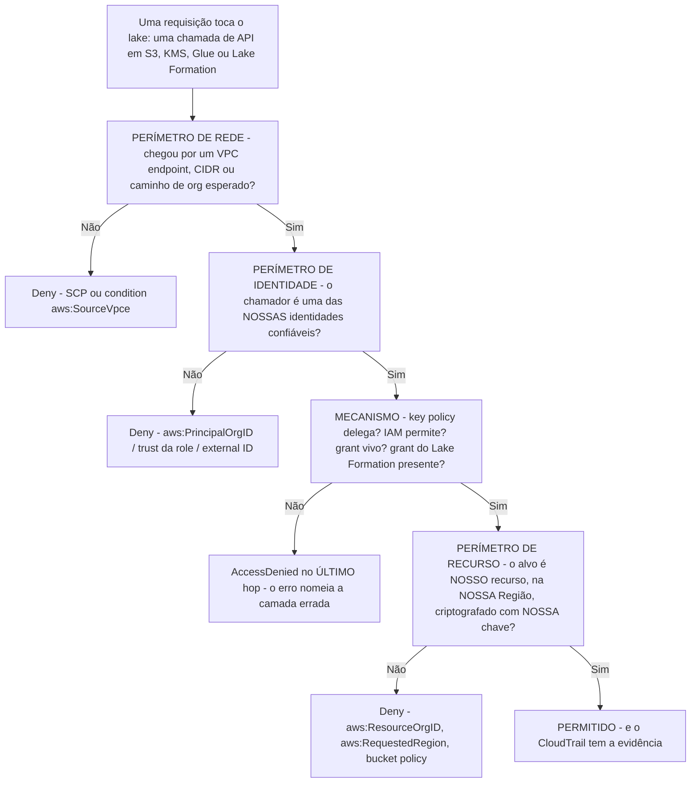
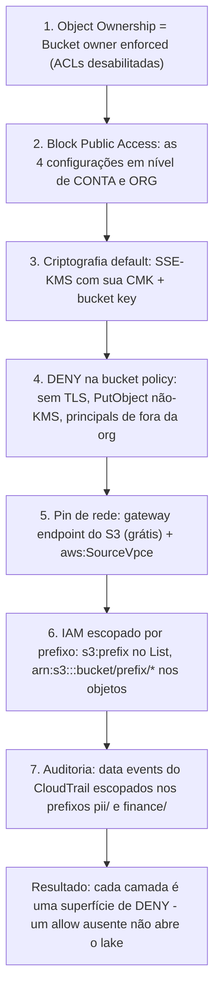
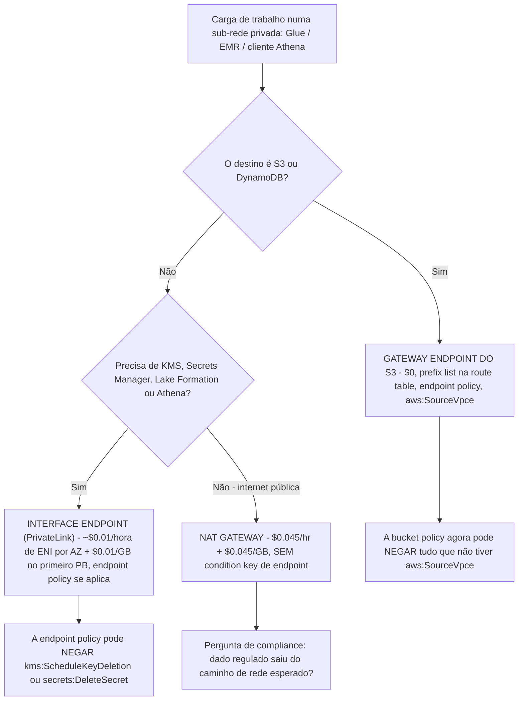
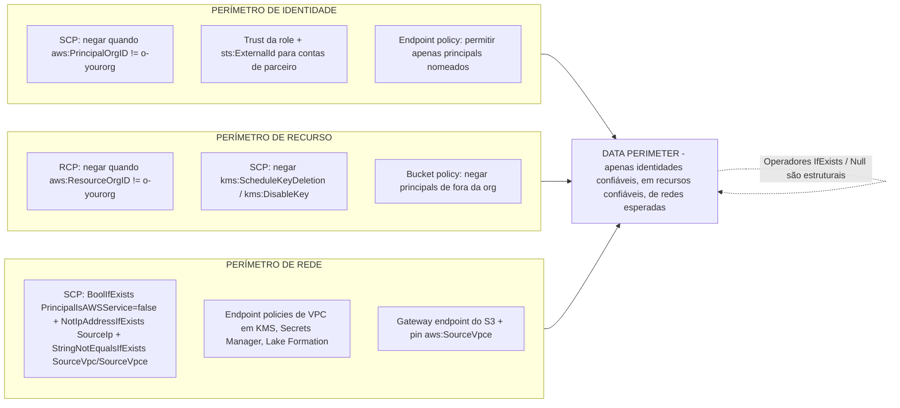
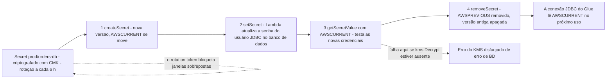
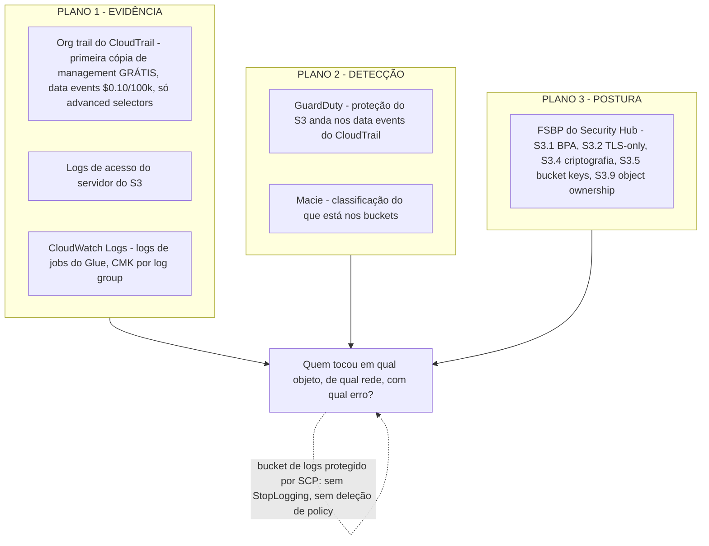

# Hardening de segurança: KMS, IAM de mínimo privilégio e isolamento de rede

As lições 01 to 13 construíram um lake que funciona: buckets, formatos, Iceberg, ingestão, um catálogo, transformação, uma camada de consulta, um warehouse, orquestração, governança com Lake Formation e tratamento de PII. Tudo o que você construiu é também um conjunto de **decisões que um atacante pode ler e que uma má configuração pode desfazer**. Uma CMK cuja key policy nunca delegou para a conta, uma bucket policy que prende o tráfego a um VPC endpoint que ninguém usa, um SCP escrito com o operador estrito em vez de `IfExists`, uma Lambda de rotação faltando uma action do KMS: cada um falha de um modo que nomeia o *último* hop no erro, não o controle quebrado.

Esta lição endurece o lakehouse na ordem em que a própria orientação de segurança da AWS a descreve: **identidades → chaves → defaults de storage → rede → guardrails de organização → secrets → auditoria**. A regra de ensino: *default não é enforced, allowed não é alcançável, e alcançável não é auditado*. Todo número abaixo está datado de **outubro de 2026**, e todo esboço de policy é um que você pode colar num sandbox antes que ele toque em produção.

```text
====================================================================
 ESPINHA DE HARDENING — AWS DATA LAKEHOUSE, LIÇÃO 14
====================================================================
 Chaves ........ CMK vs AWS managed vs AWS owned; key policy é o
                 portão, IAM o segundo portão, Deny explícito vence;
                 grants + grant tokens do CreateGrant para fluxos de
                 máquina do Lake Formation / Glue; Bucket Keys cortam
                 o custo de requisição do KMS em até 99%; rotation =
                 rotação de backing key (365d), rotação sob demanda
                 ou re-criptografia de dados (não são a mesma coisa);
                 chaves multi-Region para CRR do S3 (prefixo mrk-)
 Identidades ... service roles (glue.amazonaws.com, lakeformation
                 .amazonaws.com, encryption.athena.amazonaws.com);
                 external ID na TRUST DA ROLE, nunca na key
                 policy; condition keys s3:prefix (só List),
                 aws:SourceVpce / aws:SourceVpc,
                 família lakeformation:*, aws:PrincipalIsAWSService;
                 session policies e permission boundaries =
                 INTERSEÇÃO, Deny explícito sempre vence
 Storage ........ ordem de construção: Object Ownership com ACLs
                 desabilitadas -> Block Public Access x4 em conta+org
                 -> SSE-KMS CMK + bucket key -> deny-insecure ->
                 pin de rede -> IAM escopado por prefixo
 Rede ........... gateway endpoints (S3, DynamoDB) = $0 e a prefix
                 list da route table vence 0.0.0.0/0; interface
                 endpoints / PrivateLink = hora por AZ + por GB;
                 NAT $0.045/hr + $0.045/GB; endpoint policies como
                 um quinto deny surface
 Org ............ data perimeter = identidade x recurso x rede,
                 enforced com SCPs + RCPs + endpoint policies;
                 SCPs FILTRAM, nunca concedem; operadores
                 IfExists / Null são estruturais
 Secrets ......... rotação em 4 etapas com staging label
                 (createSecret -> setSecret -> getSecretValue ->
                 removeSecret), no mínimo a cada 4 horas, usuários
                 alternados, a Lambda precisa da CMK não só do secret
 Auditoria ...... org trail do CloudTrail: management primeira cópia
                 grátis, S3 data events $0.010 por 1,000 eventos,
                 escopo por advanced event selectors ou pague por isso
 Preços ......... KMS $1.00/chave/mês + $0.03 por 10,000 requisições;
                 gateway endpoint $0; NAT $0.045/hr + $0.045/GB;
                 exemplo PrivateLink $0.01/hora de ENI, processamento
                 de dados $0.01/GB (primeiro PB)  [em out de 2026]
====================================================================
```

Nesta lição você vai:

- escolher entre chaves **customer managed, AWS managed e AWS owned** para cada classe de dados do lakehouse, e justificar com as necessidades de auditoria e de raio de explosão;
- compor **key policy e IAM** corretamente, delegação primeiro, allow de identidade segundo, deny explícito sempre vencendo, e escrever o fluxo de **grant + grant token** que a automação do Lake Formation e do Glue precisa;
- fazer a **aritmética de custo do bucket key** e mostrar o que a rotação *re-criptografa e o que não* re-criptografa;
- escolher **chaves multi-Region apenas para os dois padrões para os quais elas existem**: replicação cross-Region e consumidores cross-Region;
- aplicar **service roles, external ID, condition keys, session policies e boundaries** como um único sistema de mínimo privilégio;
- construir o controle de acesso do S3 **em ordem de construção**: Object Ownership, Block Public Access em nível de conta, statements deny-insecure, pinagem de rede, escopo por prefixo;
- precificar **gateway endpoint vs interface endpoint vs NAT** para o mesmo tráfego de S3, com números de outubro de 2026;
- escrever **SCPs de data perimeter** (negação de Região, negação de PutObject não criptografado, negação de ACL pública) com os operadores `IfExists` que impedem que eles quebrem Athena e Glue;
- ligar a **rotação no Secrets Manager para credenciais JDBC do Glue**, incluindo o grant do KMS que todo mundo esquece;
- entregar quatro **artefatos JSON trabalhados**: uma role de job do Glue de mínimo privilégio, uma role cross-account de S3+KMS com external ID, um conjunto de SCP e um selector de data events escopado do CloudTrail com sua conta;
- estudar o **Security Lake da Siemens com 800 contas**, uma **caixa de atualização de outubro de 2026** com fontes, **três verificações interativas**, **seis diagramas** e **onze questões no estilo de exame**.

---

## 1. Contra o que o lake endurecido está se defendendo

O próprio enquadramento da AWS para o conjunto de controles desta lição é direto: a ameaça é **"UNINTENDED DATA DISCLOSURE DUE TO MISCONFIGURATIONS"**, não uma exploração inédita, mas uma bucket policy que alguém copiou, uma key policy que ninguém editou, uma Região que alguém deixou aberta (sessão IAM301 do AWS re:Inforce 2023, deck em d1.awsstatic.com, acesso em 2026-10-11). Um data perimeter é "um conjunto de controles preventivos que ajuda a garantir que apenas suas identidades confiáveis acessem recursos confiáveis a partir de redes esperadas", e tem exatamente três áreas, **identidade, recurso e rede** (AWS Security Blog, *Establishing a data perimeter on AWS*, data da página 2025-08-28).



Dois hábitos fazem o resto desta lição funcionar. Primeiro, **escreva denies, não só allows**, a própria orientação do time do S3 no re:Invent é "Sempre bloqueie o acesso ('Deny') quando… a request não corresponder à sua policy" (STG304, deck do re:Invent 2024, acesso em 2026-10-11). Segundo, **teste primeiro em uma conta non-production**, os posts de data perimeter da AWS dizem isso explicitamente: "Recomendamos que você teste e implante essas policies em uma conta de teste antes de aplicá-las em uma conta de produção" (AWS Security Blog, 2024-11-13).

> [!NOTE]
> Três planos respondem três perguntas diferentes, e confundi-los é a falha de auditoria mais comum: **CloudTrail** responde *quem chamou qual API em qual recurso, de qual rede, com qual código de erro*; **logs nativos dos serviços** (CloudWatch Logs, logs de acesso do servidor do S3, tabelas de sistema do Redshift) respondem *o que a carga de trabalho realmente fez*; **ferramentas de postura e detecção** (controles FSBP do Security Hub, GuardDuty, Macie) respondem *se o comportamento ou a configuração corresponde ao baseline*. Detecção não é retenção de evidência.

---

## 2. KMS para lakes: CMKs, AWS managed, AWS owned

### 2.1 Os três níveis de propriedade, nos eixos que importam para um lake

A documentação do KMS da AWS desenha os níveis por propriedade e visibilidade, não por força: "AWS KMS keys (KMS keys) are the fundamental logical entities of AWS KMS"; "AWS owned keys are KMS keys that AWS services use to protect your data… You can't view or manage AWS owned keys"; e "Resource policies for AWS managed keys are managed by the corresponding AWS service" (KMS Developer Guide: Concepts, acesso em 2026-10-11).

| Eixo | **Customer managed key (CMK)** | **AWS managed key** | **AWS owned key** |
|---|---|---|---|
| Onde vive | Sua conta, você a criou | Sua conta, criada pelo serviço | Uma conta de serviço: não é sua |
| Key policy | **Você é dono da única key policy** | Gerenciada pelo serviço; você não pode editar | Não exposta |
| Grants / conditions | **Sim**, você pode acrescentar grants e constraints | Não, nenhum controle próprio no nível da chave | Não |
| RCPs (resource control policies) | Aplicam-se | **Não se aplicam** ("RCPs don't apply to AWS managed keys") | Não endereçável |
| Compartilhamento cross-account | **Sim, via key policy** | Não | De forma transparente, gerenciado pelo serviço |
| Rotation | Opcional, default de 365 dias (`RotationPeriodInDays`, mín. 90) | Controlado pelo serviço, anual | Controlado pelo serviço |
| Custo, em out de 2026 | **$1.00 por chave por mês** + **$0.03 por 10,000 requisições** | Consumo faturado, sem taxa separada de chave que você controle | Não é faturado a você |
| Casa do lakehouse | Classes de dados bronze/silver/gold das quais você precisa provar controle de decrypt | Scratch, dev, logs de baixa sensibilidade | Caminhos de armazenamento internos do serviço |

A regra do lakehouse: **CMK quando você precisa provar *quem* descriptografou *qual classe* de dado; AWS managed quando conveniência basta e ninguém vai pedir para você enumerar decrypts.** Nunca espere que uma AWS owned key apareça na sua lista de chaves: essa ausência é por design, não um bug (KMS concepts, acesso em 2026-10-11).

- **📚 Você sabia?** O nível AWS managed no console é parcialmente legado: a documentação do KMS da AWS diz "As AWS managed keys que você vê no console são AWS managed keys legadas… os serviços da AWS usam um conjunto diferente de AWS managed keys daqueles que aparecem no console", e chaves legadas carregam o padrão de alias `aws/service`. É por isso que você consegue ver `aws/s3` numa lista do console e ainda encontrar serviços criptografando discretamente com chaves que nunca lhe serão mostradas (KMS concepts, acesso em 2026-10-11).

### 2.2 A key policy é o portão; o IAM é o segundo portão

Quatro frases do guia de key policies decidem quase todo ticket de suporte do KMS com que você vai trabalhar:

1. "Key policies are the primary way to control access to KMS keys."
2. "Toda chave do KMS deve ter exatamente uma key policy, que é criada quando você cria a chave do KMS."
3. "Um principal do IAM na mesma conta da chave do KMS pode usar policies do IAM para permitir acesso à chave do KMS somente se a key policy da chave do KMS permitir o principal."
4. "…an IAM deny statement in an IAM policy takes precedence… you can use IAM deny statements in IAM policies to prevent principals in the same AWS account from using the KMS key, even if the key policy allows it." (KMS Developer Guide: Key policies, acesso em 2026-10-11)

Leia como **dois portões que compõem em vez de empilhar**: a key policy responde *"esta conta ou role pode usar esta chave de jeito nenhum?"*; o IAM responde *"este chamador específico pode usá-la para esta action agora?"* O uso cross-account é **sempre** via key policy: uma policy de identidade na outra conta é inerte até que a key policy do produtor a nomeie. E um **deny** do IAM manda independente do que a key policy disse.

#### Exemplo resolvido E1: uma key policy que realmente delega (S3 + Glue + um leitor cross-account)

```json
{
  "Version": "2012-10-17",
  "Statement": [
    {
      "Sid": "Enable IAM User Permissions",
      "Effect": "Allow",
      "Principal": {"AWS": "arn:aws:iam::111122223333:root"},
      "Action": "kms:*",
      "Resource": "*"
    },
    {
      "Sid": "S3 Service-Principal Envelope",
      "Effect": "Allow",
      "Principal": {"Service": "s3.amazonaws.com"},
      "Action": ["kms:GenerateDataKey", "kms:Decrypt", "kms:DescribeKey"],
      "Resource": "*",
      "Condition": {
        "StringEquals": {"aws:SourceAccount": "111122223333"},
        "ArnLike": {"aws:SourceArn": "arn:aws:s3:::lakehouse-silver"}
      }
    },
    {
      "Sid": "Glue Job Role - Silver Layer",
      "Effect": "Allow",
      "Principal": {"AWS": "arn:aws:iam::111122223333:role/glue-etl-silver"},
      "Action": ["kms:Decrypt", "kms:GenerateDataKey", "kms:DescribeKey", "kms:ReEncrypt*"],
      "Resource": "*"
    },
    {
      "Sid": "Cross-Account Analyst - Decrypt Only",
      "Effect": "Allow",
      "Principal": {"AWS": "arn:aws:iam::444455556666:role/lake-reader"},
      "Action": ["kms:Decrypt", "kms:DescribeKey"],
      "Resource": "*"
    }
  ]
}
```

Repare na forma: `arn:aws:iam::<account>:root` significa **esta conta, via suas policies de IAM**, não "o usuário root é privilegiado"; service principals recebem conditions `aws:SourceAccount`/`aws:SourceArn` para que o delegado não possa ser apontado para o bucket de outra pessoa; e o leitor cross-account recebe **apenas decrypt**, nunca `kms:*`. Se você trocasse o principal do primeiro statement por `"*"` teria o buraco canônico. Se você tivesse *apenas* um allow de IAM na conta `444455556666` e não o statement quatro, o analista falharia com um erro que nomeia `kms:Decrypt` e não lhe ensina nada (falha classe F1: "Habilitei a CMK mas o serviço ainda não consegue criptografar").

### 2.3 Grants e grant tokens: a camada de máquina para máquina

Grants são o canal de permissão temporária que serviços e fluxos de SDK usam em vez de reescrever sua key policy: "Um grant é uma forma alternativa de definir permissões para chaves do AWS KMS"; "Cada grant aplica-se a apenas uma chave do KMS"; "Você não pode usar um grant para negar acesso"; e "`CreateGrant` is the only AWS KMS API operation that returns a grant token" (KMS Developer Guide: Grants, acesso em 2026-10-11).

O token existe porque mudanças de grantee e de encryption context são eventualmente consistentes: "A grant token… makes the permissions specified in a grant available immediately rather than after eventual consistency", e a lista completa de grants se estabiliza "within five minutes". Passe o token para a chamada seguinte de `Encrypt`/`GenerateDataKey` ou seu grant recém-criado vai parecer quebrado por minutos.

```text
Fatos sobre grants que vão te pergutar (quotas do KMS + docs de grants, acesso em 2026-10-11)
  Grants por uma única chave do KMS ..... 50,000 (ajustável)
  Grants por conta ...................... 100,000 (ajustável)
  Taxa de requisições do CreateGrant ..... 10 TPS (ajustável)
  Throttle do PutKeyPolicy .............. 1 requisição por chave a cada 10 segundos
  Deny via grant ....................... NÃO É POSSÍVEL (apenas revoke/retire)
  EncryptionContext / GrantConstraints .. apenas chaves de criptografia simétrica
  Constraint de SourceArn ............... todos os tipos de chave do KMS (desde 2024)
```

#### Exemplo resolvido E2, o fluxo CreateGrant + token para um job de re-criptografia do Lake Formation / Batch

```json
{
  "Sid": "S3 Batch Re-Encrypt of 4.1M Objects Under the New Key",
  "Version": "2012-10-17",
  "Statement": [
    {
      "Effect": "Allow",
      "Principal": {"AWS": "arn:aws:iam::111122223333:role/batch-reencrypt"},
      "Action": "kms:CreateGrant",
      "Resource": "*",
      "Condition": {
        "Bool": {"kms:GrantIsForAWSResource": "true"},
        "StringEquals": {"kms:GrantConstraintType": "EncryptionContextSubset"}
      }
    }
  ]
}
```

A sequência de chamadas importa mais que o JSON:

```bash
# 1. create the grant and CAPTURE the token (CreateGrant is the only API that returns one)
GRANT_TOKEN=$(aws kms create-grant \
  --key-id arn:aws:kms:us-east-1:111122223333:key/1234abcd-... \
  --grantee-principal arn:aws:iam::111122223333:role/batch-reencrypt \
  --operations Encrypt Decrypt ReEncrypt* GenerateDataKey \
  --constraints "EncryptionContextSubset={purpose=gdpr-migration}" \
  --grant-token 2>/dev/null || true)   # token is returned IN the response
# 2. pass it forward so the first encrypted write does not race propagation
aws s3 cp s://tmp/rekey-manifest.json s3://lakehouse-silver/manifests/ \
  --sse aws:kms --sse-kms-key-id $KEY_ARN   # S3 takes the grant via the role
# 3. retire it when the migration lands - grants do NOT expire by themselves
aws kms retire-grant --key-id $KEY_ARN --grant-id $GRANT_ID
```

Use grants para exatamente três padrões de lakehouse: **re-criptografias do S3 Batch Operations**, **fluxos de serviço que precisam de `GenerateDataKey` por dez minutos**, e **automação do Lake Formation / adjacente ao metastore** onde você não pode se dar ao luxo de editar uma key policy por execução. A própria orientação da AWS é pareá-los com IAM e key policies em vez de substituí-los: "We recommend using IAM policies and key policies together… Consider using grants to give temporary permissions to applications that are running on EC2 instances" (KMS, key policy vs IAM policy, acesso em 2026-10-11). Um grant esquecido é um privilégio permanente, e `RetireGrant`/`RevokeGrant` são as APIs de limpeza, ninguém audita o que eles nunca listam.

- **📚 Você sabia?** O KMS separa deliberadamente as permissões do lado de encrypt e do lado de decrypt para que um pipeline "somente escrita" seja expressível: `GenerateDataKeyWithoutPlaintext` retorna apenas a data key **embrulhada**, e o uso do plaintext ainda exige `kms:Decrypt` pelo chamador (AWS KMS service authorization reference, acesso em 2026-10-11). É por isso que uma role de job do Glue normalmente precisa de `kms:Decrypt` **e** `kms:GenerateDataKey`, enquanto uma role de ingestão que só embrulha pode receber o par mais estreito.

### 2.4 Bucket keys: o toggle de maior ROI em qualquer bucket de analytics

"Por padrão, o Amazon S3 criptografa todos os novos dados quando gravados em um bucket do S3": com SSE-S3 desde **2023-01-05**, sem custo adicional, mas objetos sob uma chave de criptografia default do KMS "são cobrados pela taxa de requisição do KMS de $0.03 por 10,000 requisições, mais a cobrança padrão de requisição do S3, mesmo quando a criptografia é aplicada automaticamente" (S3: data protection; S3: Using SSE-KMS, acesso em 2026-10-11). O bucket key existe para colapsar essas chamadas: "Usar uma chave em nível de bucket para SSE-KMS pode reduzir os custos de requisição do AWS KMS em até 99 por cento diminuindo o tráfego de requisições do Amazon S3 para o AWS KMS" (S3: Reducing the cost of SSE-KMS with Amazon S3 Bucket Keys, acesso em 2026-10-11).

#### Exemplo resolvido E3: aritmética de custo do bucket key num caminho de leitura quente de dashboard (em out de 2026)

```text
Camada gold, criptografada com KMS, lida por Athena + QuickSight:
  GETs por mês ...................................... 50,000,000
  Preço da requisição do KMS ......................... $0.03 / 10,000
  SEM bucket key    50,000,000 / 10,000 x $0.03 ...... $150.00 / mês
  COM bucket key    até 99% menos chamadas ao KMS
      conservador 99% ............................... ~$1.50 / mês
  Cobrança de GET do S3 (mesmo tráfego, $0.004 por 10,000,
    arquivo de oferta us-east-1, publicationDate 2026-09-28)  $20.00 / mês
  --------------------------------------------------------------
  Economia mensal só na linha do KMS ................. ~$148.50
```

Volumes menores ainda mostram a forma: 5,000 GETs de objeto criptografado custam **$0.015** em requisições do KMS sem um bucket key, trivial, e é exatamente por isso que as equipes esquecem de habilitar o toggle até o tráfego do dashboard chegar. Duas exclusões para decorar: **bucket keys não são suportadas para DSSE-KMS**, e **DSSE-KMS não é suportado para S3 Replication** (páginas de bucket-key e Using SSE-KMS do S3, acesso em 2026-10-11), então você não pode empilhar features de "criptografia máxima".

### 2.5 Rotation: três significados diferentes, só um deles re-criptografa algo

| Significado | O que faz | O que **não** faz | Superfície de controle |
|---|---|---|---|
| **Rotação automática anual** | O AWS KMS cria uma nova **backing key** a cada período; data keys são criptografadas com a backing key mais recente | Não toca em data keys existentes nem em ciphertext | Ligada por default para CMKs simétricas novas; período de **365 dias** desde maio de 2022 (era 1,095); `RotationPeriodInDays` mín. **90** |
| **Rotação sob demanda** (`RotateKeyOnDemand`) | Geração extra sob solicitação: a rota documentada para chaves **assimétricas** | Mesmo: nenhuma re-criptografia de dados | Gratuita; máx. **duas** chaves on-demand habilitadas por chave do KMS; **uma a cada 90 dias** por chave |
| **Re-criptografia de dados** | Reescreve objetos/registros sob novo key material (re-criptografia do S3 Batch Operations) | Não é automática, não é implícita por nada acima | Você a agenda; é a única resposta para uma suspeita de comprometimento de **data key** |

A AWS declara o limite sem rodeios: "key rotation will not mitigate the effect of a compromised data key" (KMS, Rotating AWS KMS keys, acesso em 2026-10-11). A elegibilidade também é uma parede, não uma preferência: a rotação automática suporta **apenas chaves do KMS de criptografia simétrica com key material gerado pelo AWS KMS** (`KeySpec SYMMETRIC_DEFAULT`, `KeyOrigin AWS_KMS`), assimétricas, HMAC, material importado e custom key stores precisam de rotação manual ou sob demanda. Duas notas operacionais que valem carregar: backing keys se acumulam para que ciphertext antigo continue descriptografando, e "the first two rotation generations of backing keys incur a full monthly key charge" (mesma página), então uma frota de CMKs de longa duração é uma linha mensal pequena mas não zero.

### 2.6 Chaves multi-Region: para CRR e consumidores cross-Region, mais nada

"Chaves multi-Region são chaves do AWS KMS que têm o mesmo key material e o mesmo key ID em diferentes Regiões da AWS"; você cria uma primary numa Região e "replicar a MRK para a mesma conta da AWS em outras Regiões da AWS"; você **não pode** converter uma chave existente em uma multi-Region key nem voltar atrás; e "cada chave multi-Region conta como uma chave do KMS em sua conta para as quotas do AWS KMS e para calcular seus custos do AWS KMS" (KMS: Multi-Region keys, acesso em 2026-10-11). Réplicas carregam o prefixo `mrk-` em seus key IDs.

A recompensa do cross-Region replication do S3: "O AWS S3 criptografa cada versão de objeto com uma data key criptografada com a chave do KMS na Região de origem… Se você usa uma chave multi-Region relacionada, o Amazon S3 descriptografa e re-criptografa as data keys na Região de destino": a data key em plaintext nunca sai da Região de destino, e você evita o hop de chave cross-Region que pagaria de outra forma ao replicar para uma chave *diferente*.

#### Exemplo resolvido E4: conta do MRK e decisão de CRR (em out de 2026)

```text
Cenário A - chaves single-Region, replicação para eu-west-1 com
uma CMK de destino diferente:
  CMK em us-east-1 ........................ 1 x $1.00 / mês
  CMK em eu-west-1 ........................ 1 x $1.00 / mês
  tratamento da data key .................. decrypt cross-Region +
                                            trabalho de re-cript
                                            no caminho de
                                            replicação (o delta
                                            exato por objeto não é
                                            citado aqui - a doc do
                                            S3 só diz que difere

Cenário B - par de chaves multi-Region relacionadas (primary + 1 réplica):
  cada réplica "conta como uma chave do KMS" ... 2 x $1.00 / mês
  data keys ................ descriptografadas e re-criptografadas
                              NA Região de destino
  rotation ................ a rotação anual da primary é copiada
                              para as réplicas automaticamente -
                              as réplicas não rotacionam sozinhas
  veredito ................ use APENAS se você realmente replica
                              ou serve cross-Region; do contrário
                              pagou em dobro por key policy desnecessária
```

Duas arestas duras: **uma chave SSE-KMS precisa estar na mesma Região do bucket** ("quando você usa criptografia SSE-KMS com um bucket do S3, as chaves do AWS KMS devem estar na mesma Região do bucket": S3, acesso em 2026-10-11), e o key material de MRK **não pode ser exportado**. Se sua replicação é same-Region, pare de ler esta subsection e mantenha chaves single-Region.

### 2.7 A matriz de KMS por serviço

Leia esta tabela como *"quem precisa estar na key policy, e o que o chamador precisa no IAM"*. Service principals e padrões de ARN recomendados vêm da página de integração de serviços do KMS (acesso em 2026-10-11).

| Serviço | O que criptografa com **sua** chave | Delegado na key-policy | Actions de IAM do chamador | Armadilha que custa um dia |
|---|---|---|---|---|
| **Amazon S3** | Objetos (SSE-KMS / DSSE-KMS), bucket key por cima | `s3.amazonaws.com` (+ conditions `aws:SourceAccount`/`aws:SourceArn`) | `kms:Decrypt`, `kms:GenerateDataKey`, `kms:DescribeKey` | A chave precisa estar na **mesma Região** do bucket; criptografia default ≠ enforced: negue `PutObject` sem `s3:x-amz-server-side-encryption: aws:kms` |
| **AWS Glue** | Dados intermediários do job, **CloudWatch Logs**, **job bookmarks** (SSE-KMS **apenas**), shuffle do Spark via SSE-S3 | `glue.amazonaws.com` | `kms:Decrypt`, `kms:GenerateDataKey`, `kms:DescribeKey` | Security configuration, job **e** chave precisam compartilhar a Região; bookmarks não têm **nenhuma opção SSE-S3** |
| **Glue Data Catalog** | Metadados do catálogo | Service role quando o modo é `SSE-KMS-WITH-SERVICE-ROLE` | `glue:UpdateCatalogEncryption` para admins | `CatalogEncryptionMode` = `DISABLED` \| `SSE-KMS` \| `SSE-KMS-WITH-SERVICE-ROLE`: `DISABLED` significa catálogo não criptografado |
| **Amazon Athena** | Resultados de consulta gravados no S3 (nível de workgroup) | `encryption.athena.amazonaws.com` com encryption context `aws:athena:workgroup-arn` | `kms:GenerateDataKey`, `kms:Decrypt`, `kms:DescribeKey` | Sem `EnforceWorkGroupConfiguration=true` um cliente **sobrescreve** a criptografia e o local de saída do workgroup |
| **Amazon Redshift** | Cluster: root key → database encryption key → cluster keys | Padrão `redshift.amazonaws.com` na key policy ou grants diretos | `kms:Encrypt`/`kms:Decrypt` para caminhos de admin | Apenas chaves simétricas; se a CMK ficar inacessível o cluster fica ilegível e **após 14 dias pode ser deletado** |
| **CloudWatch Logs** | Streams de log group | `logs.amazonaws.com`, encryption context `kms:EncryptionContext:aws:logs:arn` | `logs:AssociateKmsKey` para anexar a um grupo **existente** | Não dá para anexar uma CMK a um grupo existente **no console**; deletar a chave torna logs históricos irrecuperáveis |
| **AWS Lake Formation** | Não diretamente: ele **emite credenciais temporárias de S3/KMS** via `GetDataAccess` | A IAM role da localização registrada deve ter `kms:Decrypt` + `kms:GenerateDataKey` | Principals precisam de `lakeformation:GetDataAccess` com **`Resource: "*"`** | `GetDataAccess` **não** pode ser escopado a um ARN de recurso; LF não suporta ARNs de recurso em `Resource` |
| **AWS Secrets Manager** | Payload do secret | `secretsmanager.amazonaws.com`; a role da Lambda de rotação também precisa da chave | Role de rotação: `kms:Decrypt`, `kms:GenerateDataKey` | Faltar KMS na role de rotação aparece como um erro com cara de **banco de dados** em `getSecretValue` |
| **Amazon Quick (QuickSight)** | Dados SPICE e direct-query em repouso | Service principal do Quick com `kms:GenerateDataKey`, `kms:Decrypt` | Registre a CMK primeiro; a chave precisa estar na mesma Região da conta | Registrar uma CMK **não** re-criptografa SPICE existente: você precisa disparar um **full refresh** |

- **📚 Você sabia?** Uma security configuration do Glue são quatro coisas separadamente criptografáveis, e as equipes rotineiramente cobrem três: **dados intermediários no S3**, **CloudWatch Logs**, **job bookmarks** (apenas SSE-KMS) e **shuffle/spill do Spark** (apenas SSE-S3). Os bookmarks são o cavalo de Troia: um bookmark é o ponteiro do *já processado*, então deixá-lo no default é ao mesmo tempo um risco de correção e uma superfície de vazamento (docs de security-configuration do Glue, acesso em 2026-10-11).

---

## 3. Padrões de IAM: service roles, external ID, condition keys, sessions, boundaries

### 3.1 Service roles: a trust policy é a permissão

Todo engine deste curso roda sob uma **service role** cuja trust policy nomeia um service principal. O padrão é idêntico em toda a stack: o principal `glue.amazonaws.com` para jobs, `lakeformation.amazonaws.com` para a role de localização registrada, `encryption.athena.amazonaws.com` para criptografia de resultados do workgroup, `redshift.amazonaws.com` para caminhos de cluster, `logs.amazonaws.com` para criptografia de log group. A policy de identidade então faz o *escopo*: essa é a divisão de trabalho: **a trust decide quem pode criar a session; a policy de identidade decide o que a session pode fazer**.

A role do Lake Formation é o exemplo mais claro: "Lake Formation supplies temporary credentials that the caller, such as Amazon Athena, uses to access the data", e para localizações registrados no LF "You must specify an IAM role… This role is called the registered-location IAM role" (LF Developer Guide: Underlying data access permissions, acesso em 2026-10-11). Os consumidores (Athena, Redshift Spectrum, QuickSight) chamam `lakeformation:GetDataAccess`, e essa action **precisa** carregar `Resource: "*"` porque "AWS Lake Formation does not support specifying a resource ARN in the Resource element of the IAM policy" (LF service authorization reference, acesso em 2026-10-11).

### 3.2 External ID: o guard do confused deputy, na trust policy

"O problema do confused deputy é um problema de segurança que pode surgir quando um serviço é enganado a usar suas permissões em nome de outro principal", e "O external ID ajuda a evitar um confused deputy quando você usa a operação AssumeRole" (IAM User Guide: Providing access to third parties, acesso em 2026-10-11). Duas propriedades decidem onde ele pertence:

- A AWS "não trata o external ID como um segredo… não é um segredo, é um identificador compartilhado… deve ser único para o cliente", então ele **autentica intenção, não identidade**. A autenticação de verdade continua sendo o principal confiável na trust policy.
- O comprimento é de `2–1,224` caracteres (IAM quotas, acesso em 2026-10-11).
- Ele vive na **trust policy da role** sob `sts:ExternalId`: **nunca** na key policy do KMS e nunca numa policy de identidade. Colocá-lo na key policy é o erro de posicionamento mais comum de todos (classe F20).

#### Exemplo resolvido E5: a role cross-account de S3 + KMS com external ID

Três documentos precisam concordar: a **bucket policy do produtor**, a **key policy do produtor**, e a **trust da role mais a policy de identidade do consumidor**. Mais nada precisa de edição.

```json
{
  "Version": "2012-10-17",
  "Statement": [
    {
      "Sid": "TrustThePartnerPrincipalOnly",
      "Effect": "Allow",
      "Principal": {"AWS": "arn:aws:iam::999988887777:role/partner-etl"},
      "Action": "sts:AssumeRole",
      "Condition": {"StringEquals": {"sts:ExternalId": "acme-corp-lakehouse-2026"}}
    }
  ]
}
```

```json
{
  "Version": "2012-10-17",
  "Statement": [
    {
      "Sid": "ConsumerRole-ReadSharedPrefixAndKey",
      "Effect": "Allow",
      "Action": ["s3:ListBucket"],
      "Resource": "arn:aws:s3:::shared-bronze",
      "Condition": {"StringLike": {"s3:prefix": ["ingest/*", "ingest"]}}
    },
    {
      "Sid": "ConsumerRole-ObjectsOnly",
      "Effect": "Allow",
      "Action": ["s3:GetObject", "s3:PutObject"],
      "Resource": "arn:aws:s3:::shared-bronze/ingest/*"
    },
    {
      "Sid": "ConsumerRole-DecryptWithProducerKey",
      "Effect": "Allow",
      "Action": ["kms:Decrypt", "kms:DescribeKey", "kms:GenerateDataKey"],
      "Resource": "arn:aws:kms:us-east-1:111122223333:key/1234abcd-12ab-34cd-56ef-1234567890ab"
    }
  ]
}
```

O lado do produtor (não repetido aqui) é dois statements no estilo do E1: uma bucket policy permitindo `s3:GetObject`/`s3:PutObject` em `arn:aws:s3:::shared-bronze/ingest/*` para `arn:aws:iam::444455556666:role/lake-reader`, e uma key policy delegando `kms:Decrypt`/`kms:GenerateDataKey`/`kms:DescribeKey` para o mesmo ARN de role. O parceiro então chama:

```bash
aws sts assume-role \
  --role-arn arn:aws:iam::111122223333:role/lake-reader \
  --role-session-name acme-etl-2026-10-11 \
  --external-id acme-corp-lakehouse-2026
```

Se o seu consumidor é *a sua própria* segunda conta em vez de um terceiro, o external ID é opcional, mas é higiene barata, e tem 2 to 1,224 caracteres, é único por cliente e **não** é um segredo (IAM, third-party access, acesso em 2026-10-11). O que ele *não* é: um fator de autenticação. O ARN do principal confiável faz a autenticação; o external ID impede que um parceiro seja enganado ao assumir *sua* role quando pretendia a de outro cliente.

### 3.3 As condition keys que esta lição realmente usa

| Key | Aplica-se a | O que impõe | Armadilha |
|---|---|---|---|
| `s3:prefix` | **`ListObjectsV2` / `ListObjects` apenas** | Escopo o listing a um prefixo | "Amazon S3 doesn't evaluate `s3:prefix` in bucket policies for `GetObject`": pareie com wildcards de ARN de objeto |
| `s3:x-amz-server-side-encryption` | `PutObject` | Nega tudo que não for `aws:kms` | Criptografia default ainda permite que um cliente *envie* `AES256` a menos que você negue |
| `s3:x-amz-server-side-encryption-aws-kms-key-id` | `PutObject` | Fixa a CMK exata | A regra de mesma Região continua valendo |
| `aws:SourceVpce` | Todas as chamadas de S3/KMS por um endpoint | "the request originates from the specified interface VPC endpoint" (ou o gateway endpoint na própria documentação de policies do S3) | **Só existe se a chamada veio por um endpoint**; nunca use wildcard com ele |
| `aws:SourceVpc` | Chamadas escopadas a VPC | Restringe a uma VPC | Mesma regra de presença do `SourceVpce` |
| `aws:SecureTransport` | Todas as APIs HTTPS | Nega não-TLS (`false` → Deny) | Fica **redigido** quando serviços da AWS chamam S3 em seu nome |
| `aws:PrincipalIsAWSService` | Todas | `true` quando o chamador é um service principal da AWS | A correção documentada para o problema da redação: acrescente `false` ao seu deny de principals humanos |
| `aws:PrincipalOrgID` / `aws:ResourceOrgID` | Perímetros de org / de recurso | Só a sua org age / só recursos da sua org são tocados | `aws:ResourceOrgID` precisa de uma guarda `Null` para recursos não taggeados ou fora de organização |
| `aws:RequestedRegion` | SCP / identidade | Allow-lists de negação de Região | Serviços globais (CloudFront, IAM, Organizations, Route 53, Support, STS) precisam de um carve-out com `NotAction` |
| `lakeformation:DataFilter`, `LFPerm`, `Principal`, `CatalogId`, `DatabaseName`, `TableName`, `ResourceLink` | APIs admin do LF | Estreita quem pode conceder o quê, em qual objeto | `GetDataAccess` em si ainda precisa de `Resource: "*"` |
| `kms:ViaService`, `kms:GrantIsForAWSResource`, `kms:EncryptionContext:*` | KMS | Restringe "só pelo serviço X", "só para grants de recurso AWS", "só este context" | Constraints de grant com `EncryptionContext` são **apenas simétricas** |
| `sts:ExternalId` | Trust de `AssumeRole` | Guard do confused deputy | Pertence só à trust policy |

A regra de wildcard da página de condition keys do IAM é inegociável: "Don't use wildcard values (`*`) with `aws:SecureTransport`, `aws:SourceIp`, `aws:SourceVpce`, `aws:SourceVpc`, `aws:PrincipalOrgID`" (IAM: condition operators and keys, acesso em 2026-10-11).

### 3.4 Session policies e permission boundaries: a regra da interseção

Os três filtros de "permissão máxima" se comportam do mesmo jeito, e a redação da AWS é precisa:

- **Permission boundary**: "um recurso avançado para usar uma managed policy e definir as permissões máximas que uma policy baseada em identidade pode conceder a uma identidade do IAM"; "A permission boundary de uma entidade não concede à entidade nenhuma permissão" (IAM: permissions boundaries, acesso em 2026-10-11).
- **Session policy**: passada no `AssumeRole`, vale só para aquela session.
- **SCPs**: "elas especificam as permissões máximas para as contas membro"; "SCPs não concedem permissões… eles filtram" (Organizations: SCPs, acesso em 2026-10-11).

Avaliação: **permissões finais = identidade ∩ recurso ∩ session ∩ boundary ∩ SCP, e qualquer deny explícito em qualquer policy aplicável vence.** Boundaries são como você deixa um time de plataforma *criar* roles sem deixá-los escalar para `iam:*` ou `kms:*`; session policies são como uma role de job-runner pode receber um contexto mais apertado para uma execução.

#### Exemplo resolvido E6: boundary + session policy como uma interseção real

```json
{
  "Version": "2012-10-17",
  "Statement": [
    {
      "Sid": "Boundary-Developer-Role-Ceiling",
      "Effect": "Allow",
      "NotAction": ["iam:*", "organizations:*", "kms:ScheduleKeyDeletion", "kms:DisableKey", "s3:PutBucketPublicAccessBlock"],
      "Resource": "*"
    }
  ]
}
```

```text
Policy de identidade da role "lake-dev"   permite  s3:*, glue:*, athena:*, kms:Decrypt
Permission boundary "dev-ceiling"         permite  tudo EXCETO iam:*, org:*, deleção/
                                            desabilitação de chave, mudanças de BPA
Session policy passada no AssumeRole      permite  s3:GetObject/PutObject em silver/*
                                            + kms:Decrypt na CMK do silver
                                               --------------------------------
 RESULTADO (interseção) ................. apenas s3:Get/Put em silver/*,
                                          kms:Decrypt na CMK do silver,
                                          glue/athena vindos da identidade mas APENAS
                                          durante a session, e NUNCA
                                          iam:* independente da policy de identidade
 Deny explícito em qualquer lugar ........ vence tudo o de acima
```

A armadilha documentada: "`NotPrincipal`… quando você usa `NotPrincipal` em um deny statement junto com uma permission boundary… o deny statement pode ser aplicado inesperadamente" (IAM: permissions boundaries, acesso em 2026-10-11). Prefira escopo positivo com `Principal` ou conditions `aws:PrincipalArn` a denies com `NotPrincipal`.

```fillblank
{
  "question": "Preencha as condition keys que carregam cada controle desta lição:",
  "template": "Escopo por prefixo numa chamada de List usa {{1}}; prender o tráfego do lake a um caminho privado usa {{2}}; o deny de apenas-TLS é escrito em {{3}}; o carve-out que impede a redação de serviços da AWS de quebrar esse deny é {{4}}; e o guard de confused deputy na trust de uma role cross-account é {{5}}.",
  "answers": {
    "1": "s3:prefix",
    "2": "aws:SourceVpce",
    "3": "aws:SecureTransport",
    "4": "aws:PrincipalIsAWSService",
    "5": "sts:ExternalId"
  },
  "distractors": [
    "s3:ListBucket",
    "s3:ExistingObjectTag",
    "aws:SourceIp",
    "aws:SourceAccount",
    "s3:TlsVersion",
    "aws:ViaAWSService",
    "aws:PrincipalIsAnonymous",
    "aws:ExternalId",
    "sts:SourceIdentity"
  ],
  "explanation": "s3:prefix sempre escopa apenas ListObjectsV2/ListObjects: ponha-o em GetObject e ele não faz nada, e é por isso que acesso por prefixo é uma condition de List MAIS um wildcard de ARN de objeto. aws:SourceVpce é o pin de rede e só existe quando a chamada veio por um VPC endpoint, e é por isso que a AWS diz para nunca usá-lo com wildcard. aws:SecureTransport=false é o deny, mas o S3 redige SecureTransport, TlsVersion, SourceIp e VpcSourceIp quando Athena, Glue ou Lake Formation chamam em seu nome, então a correção documentada é aws:PrincipalIsAWSService=false na statement de principals humanos com um allow separado para service principals. sts:ExternalId pertence à trust policy da role e a AWS declara que não é um segredo: ele prova que o terceiro quis a role DESTE cliente."
}
```

### 3.5 Exemplo resolvido E7: a role de job do Glue de mínimo privilégio, ponta a ponta

Um job, uma role, quatro coisas criptografáveis, zero wildcards. Essa é a metade de identidade de uma security configuration do Glue; a security configuration em si (S3 SSE-KMS + CloudWatch SSE-KMS + **bookmark** SSE-KMS, tudo na mesma CMK, tudo na mesma Região do job) é a metade de criptografia.

```json
{
  "Version": "2012-10-17",
  "Statement": [
    {
      "Sid": "ReadBronzeWriteSilverOnly",
      "Effect": "Allow",
      "Action": ["s3:GetObject", "s3:PutObject", "s3:DeleteObject"],
      "Resource": [
        "arn:aws:s3:::lakehouse-bronze/events/*",
        "arn:aws:s3:::lakehouse-silver/*"
      ]
    },
    {
      "Sid": "ListOnlyThePrefixesThisJobTouches",
      "Effect": "Allow",
      "Action": ["s3:ListBucket", "s3:GetBucketLocation"],
      "Resource": ["arn:aws:s3:::lakehouse-bronze", "arn:aws:s3:::lakehouse-silver"],
      "Condition": {"StringLike": {"s3:prefix": ["events/*", "silver/*"]}}
    },
    {
      "Sid": "EnvelopeOperationsOnTheSilverKeyOnly",
      "Effect": "Allow",
      "Action": ["kms:Decrypt", "kms:GenerateDataKey", "kms:DescribeKey", "kms:ReEncrypt*"],
      "Resource": "arn:aws:kms:us-east-1:111122223333:key/1234abcd-12ab-34cd-56ef-1234567890ab"
    },
    {
      "Sid": "LogsOnlyIntoItsOwnLogGroup",
      "Effect": "Allow",
      "Action": ["logs:CreateLogGroup", "logs:CreateLogStream", "logs:PutLogEvents"],
      "Resource": "arn:aws:logs:us-east-1:111122223333:log-group:/aws-glue/jobs-glue-etl-silver-secconf*"
    },
    {
      "Sid": "CatalogReadAndWriteForThisDatabase",
      "Effect": "Allow",
      "Action": [
        "glue:GetDatabase", "glue:GetTable", "glue:GetPartitions",
        "glue:CreateTable", "glue:UpdateTable", "glue:BatchCreatePartition"
      ],
      "Resource": [
        "arn:aws:glue:us-east-1:111122223333:database/silver",
        "arn:aws:glue:us-east-1:111122223333:table/silver/*"
      ]
    },
    {
      "Sid": "FetchTheJdbcPasswordItself",
      "Effect": "Allow",
      "Action": ["secretsmanager:GetSecretValue", "secretsmanager:DescribeSecret"],
      "Resource": "arn:aws:secretsmanager:us-east-1:111122223333:secret:prod/orders-db-*"
    }
  ]
}
```

Trust policy da mesma role, e a única linha que torna tudo isso assumível:

```json
{
  "Version": "2012-10-17",
  "Statement": [
    {
      "Effect": "Allow",
      "Principal": {"Service": "glue.amazonaws.com"},
      "Action": "sts:AssumeRole",
      "Condition": {"StringEquals": {"aws:SourceAccount": "111122223333"}}
    }
  ]
}
```

O que torna isso mínimo privilégio em vez de "uma policy com uns ARNs nela": **um ARN de chave, duas raízes de bucket com uma condition `s3:prefix` no List, um prefixo de log group que casa apenas com a security configuration deste job, um único database do Glue e um secret**. Acrescente uma permission boundary (o teto do E5) por cima e nem um job comprometido consegue cunhar a si mesmo `iam:*`. O statement do KMS não é opcional: sem ele o job morre na primeira leitura criptografada com um erro que nomeia `kms:Decrypt` em vez do grant que falta (classe F1).

---

## 4. Hardening do S3, em ordem de construção

Controle de acesso num bucket de lake não é uma checklist que você completa em qualquer ordem; é uma pilha onde cada camada assume a de baixo. A ordem abaixo é a ordem própria do time do S3 no re:Invent (STG304, acesso em 2026-10-11): Block Public Access de conta e de bucket, Access Analyzer para achar exposição, Object Ownership com ACLs desabilitadas, bucket keys para SSE-KMS, gateway endpoints e policies deny-first.



### 4.1 Object Ownership: ACLs desligadas, o dono do bucket é dono de tudo

"Object Ownership is a bucket-level setting that you can use to disable access control lists (ACLs)… When Object Ownership is set to Bucket owner enforced, ACLs are disabled, and the bucket owner owns every object" (S3: Object Ownership, acesso em 2026-10-11). O caso de uso recomendado, nas palavras da AWS, inclui **"data lakes"**. Duas consequências: um upload carregando headers de ACL devolve `AccessControlListNotSupported` (um delicioso incidente de "por que meu job de cópia começou a falhar"), e disputas cross-account de propriedade de objeto deixam de existir porque não sobra nada para disputar.

### 4.2 Block Public Access: quatro configurações, nível de conta, nível de organização

As quatro configurações são `BlockPublicAcls` (ACLs em nível de bucket **e** de objeto), `IgnorePublicAcls` (o S3 ignora grants públicos que encontra), `BlockPublicPolicy` (bucket policies que ficam públicas são rejeitadas com "Access Denied") e `RestrictPublicBuckets` ("mesmo que a bucket policy permita acesso público… o Amazon S3 não permite acesso público", enquanto acesso same-account não é bloqueado) (S3: Block public access, acesso em 2026-10-11). Duas regras de escopo decidem se seu controle realmente existe: as configurações em nível de conta "são aplicadas a todos os buckets da conta, **mesmo aqueles criados depois que as configurações são ativadas**", e "Você pode aplicar todas as configurações do Block Public Access como uma única policy unificada no nível do AWS Organizations". Deixar o BPA de nível de org desligado significa que todo bucket *futuro* nasce potencialmente público até que quatro toggles sejam virados por alguém que se lembre.

### 4.3 A bucket policy deny-first

```json
{
  "Version": "2012-10-17",
  "Statement": [
    {
      "Sid": "DenyInsecureTransport",
      "Effect": "Deny",
      "Principal": "*",
      "Action": "s3:*",
      "Resource": ["arn:aws:s3:::lakehouse-silver", "arn:aws:s3:::lakehouse-silver/*"],
      "Condition": {"Bool": {"aws:SecureTransport": "false"}}
    },
    {
      "Sid": "DenyUnencryptedPutObject",
      "Effect": "Deny",
      "Principal": "*",
      "Action": "s3:PutObject",
      "Resource": "arn:aws:s3:::lakehouse-silver/*",
      "Condition": {"StringNotEquals": {"s3:x-amz-server-side-encryption": "aws:kms"}}
    },
    {
      "Sid": "DenyPublicAclHeaders",
      "Effect": "Deny",
      "Principal": "*",
      "Action": "s3:PutObject",
      "Resource": "arn:aws:s3:::lakehouse-silver/*",
      "Condition": {"StringEquals": {"s3:x-amz-acl": "public-read"}}
    },
    {
      "Sid": "DenyOutsideOrg",
      "Effect": "Deny",
      "Principal": "*",
      "Action": "s3:*",
      "Resource": ["arn:aws:s3:::lakehouse-silver", "arn:aws:s3:::lakehouse-silver/*"],
      "Condition": {"StringNotEquals": {"aws:PrincipalOrgID": "o-yourorgidhere"}}
    },
    {
      "Sid": "PinToGatewayEndpoint",
      "Effect": "Deny",
      "Principal": "*",
      "Action": "s3:*",
      "Resource": ["arn:aws:s3:::lakehouse-silver", "arn:aws:s3:::lakehouse-silver/*"],
      "Condition": {"StringNotEquals": {"aws:SourceVpce": "vpce-0abc1234def567890"}}
    },
    {
      "Sid": "HumanPrincipalsOnlyDenyList",
      "Effect": "Deny",
      "Principal": "*",
      "Action": "s3:ListBucket",
      "Resource": "arn:aws:s3:::lakehouse-silver",
      "Condition": {
        "StringNotEquals": {"s3:prefix": ["silver/*", "silver"]},
        "Bool": {"aws:PrincipalIsAWSService": "false"}
      }
    }
  ]
}
```

Leia os dois últimos statements juntos: `aws:SourceVpce` está presente **apenas quando a chamada veio por um endpoint**, e `aws:SecureTransport`/`aws:SourceIp`/`s3:TlsVersion` são **redigidos quando serviços da AWS chamam S3 em seu nome**: "Para evitar esse comportamento, inclua a condition key `aws:PrincipalIsAWSService` definida como `false` no mesmo statement das condition keys" (S3: Amazon S3 policy keys, acesso em 2026-10-11). Sem esse carve-out você quebra Athena/Glue/Lake Formation silenciosamente ou acredita ter um bucket só-TLS que seu caminho de serviço ignora. E lembre: **criptografia default não é enforcement**: "Default ≠ enforced"; apenas o statement `DenyUnencryptedPutObject` torna o SSE-KMS obrigatório.

```dragdrop
{
  "question": "Arraste os controles do bucket-lake do S3 para a ordem em que precisam ser construídos:",
  "items": [
    "6. IAM escopado por prefixo: s3:prefix no List, wildcard de ARN de objeto arn:aws:s3:bucket/prefix/* em Get/Put",
    "1. Object Ownership - Bucket owner enforced, ACLs desabilitadas, o dono do bucket é dono de cada objeto",
    "4. Bucket policy deny-first: sem TLS, PutObject não-KMS, headers de ACL pública, principals de fora da org",
    "2. Block Public Access: as quatro configurações em nível de conta, depois a policy unificada do Organizations",
    "5. Pin de rede: gateway endpoint gratuito do S3 mais statement de deny com aws:SourceVpce",
    "3. Criptografia default: SSE-KMS com uma customer managed key mais uma bucket key"
  ],
  "correctOrder": [
    "1. Object Ownership - Bucket owner enforced, ACLs desabilitadas, o dono do bucket é dono de cada objeto",
    "2. Block Public Access: as quatro configurações em nível de conta, depois a policy unificada do Organizations",
    "3. Criptografia default: SSE-KMS com uma customer managed key mais uma bucket key",
    "4. Bucket policy deny-first: sem TLS, PutObject não-KMS, headers de ACL pública, principals de fora da org",
    "5. Pin de rede: gateway endpoint gratuito do S3 mais statement de deny com aws:SourceVpce",
    "6. IAM escopado por prefixo: s3:prefix no List, wildcard de ARN de objeto arn:aws:s3:bucket/prefix/* em Get/Put"
  ],
  "explanation": "Propriedade primeiro, porque ACLs são a superfície legada com a qual todo o resto discute; Block Public Access segundo, porque é em nível de conta e vale para buckets que você ainda não criou; criptografia terceiro, porque o statement de deny do passo 4 só pode referenciar s3:x-amz-server-side-encryption depois que o default do bucket está definido; a policy de deny quarto, porque condições de deny só fazem sentido contra um baseline conhecido; pin de rede quinto, porque aws:SourceVpce só existe depois que um gateway endpoint está na route table; e IAM escopado por prefixo por último, porque policies de identidade são a única camada que você pode mudar sem tocar no recurso. O deck STG304 do re:Invent enuncia a doutrina do meio desta pilha: sempre bloquear o acesso (Deny) quando a requisição não corresponde à sua policy."
}
```

---

## 5. Isolamento de rede: gateway endpoints, PrivateLink, NAT e endpoint policies

### 5.1 Os três caminhos saindo de uma VPC, precificados

| Caminho | Serviços | Preço, em out de 2026 | O que te dá |
|---|---|---|---|
| **Gateway endpoint** | **Apenas S3 e DynamoDB** | **$0**: "There is no additional charge for using gateway endpoints" | Uma entrada de route table cuja prefix list **tem precedência sobre a rota do internet gateway (0.0.0.0/0)**, mais endpoint policies e `aws:SourceVpce` |
| **Interface endpoint / PrivateLink** | KMS, Secrets Manager, Lake Formation, Athena, CloudWatch Logs, Macie… | Por hora por AZ (hora cheia faturada, exemplo de **$0.01 por hora de ENI**) + dados processados (**$0.01/GB** no primeiro PB, $0.006/GB nos próximos 4 PB, $0.004/GB além de 5 PB) | Acesso privado a serviços, endpoint policies, tráfego que "stays within the AWS network" |
| **NAT Gateway** | Tudo que não está num caminho gateway | **$0.045/hora** + **$0.045/GB** processados; primeiros 1 GB/mês de processamento de dados grátis | Egress para internet de updates, APIs de terceiros, e nada do que você queira que um bucket de lake dependa |

Gateway endpoints são "um dispositivo virtual de roteamento… você acessa o endpoint usando uma rota na sua route table", e você anexa uma **endpoint policy** para permitir ou negar (VPC: Gateway endpoints, acesso em 2026-10-11). Interface endpoints são faturados de outro jeito: "Endpoints são cobrados por cada hora em que estão disponíveis em cada Availability Zone, com hora cheia cobrada independentemente do uso" (AWS PrivateLink pricing, acesso em 2026-10-11).

#### Exemplo resolvido E8: NAT vs gateway endpoint para 500 GB/mês de tráfego de S3 (em out de 2026)

```text
Caminho A - tráfego de S3 hairpinneado por um NAT gateway:
  NAT por hora ....... 730 horas x $0.045 ............ $32.85
  NAT dados .......... 500 GB x $0.045 .............. $22.50
  ----------------------------------------------------------
  Total mensal ...................................... $55.35
  aws:SourceVpce disponível? ......................... NÃO
  Sai do caminho de rede da AWS? ...................... sim, via IGW

Caminho B - mesmo tráfego por um gateway endpoint do S3:
  Cobrança do endpoint .............................. $0.00
  aws:SourceVpce disponível? ......................... SIM
  Precedência de rota ............................... prefix list vence
                                                    0.0.0.0/0
  ----------------------------------------------------------
  Total mensal ...................................... $0.00
  ECONOMIA LÍQUIDA por VPC ......................... ~$55.35/mês
```

Essa é a economia clássica de lakehouse: **grátis, e ainda compra uma condition key**. Mantenha o NAT apenas para egress não-S3.

#### Exemplo resolvido E9: a conta real da stack privada (3 interface endpoints)

```text
Uma AZ, três interface endpoints (KMS + Secrets Manager + Lake Formation):
  cobranças por hora ... 3 serviços x 1 ENI x 730 h x $0.01 ... $21.90
  dados pelo endpoint do KMS ... 200 GB x $0.01 ............. $2.00
  dados pelos endpoints SM + LF  20 GB x $0.01 x 2 .......... $0.40
  --------------------------------------------------------------
  Total de uma AZ ........................................ ~$24.30
  Duas AZs (cobrança de hora cheia POR AZ) ................ ~$48.60

Rede privada do lakehouse, mês inteiro (2 AZs, derivado):
  interface endpoints, 2 AZ x 3 svc x 2 ENI x 730 x $0.01   $43.80
  dados processados ~250 GB x $0.01 .......................... $2.50
  gateway endpoints (S3 + DynamoDB) ........................... $0.00
  6 CMKs x $1.00 + ~$2 em requisições com bucket key .......... $8.00
  data events do CloudTrail escopados (ver Seção 8) ......... $22.50
  --------------------------------------------------------------
  Total .............................................. ~$75-80 / mês
```

Misture deliberadamente: **gateway para S3 e DynamoDB, interface apenas onde não existe gateway**, e nunca assuma "VPC endpoint = grátis": só S3 e DynamoDB têm o free tier.



### 5.2 Endpoint policies: um quinto deny surface

Uma endpoint policy se aplica a **chamadas que atravessam aquele endpoint**, independentemente da policy de identidade, o que a torna o lugar natural para "não há deleção de chave a partir desta VPC" ou "apenas este secret". O próprio exemplo do Secrets Manager da AWS "allows `secretsmanager:GetSecretValue` on a specific secret ARN and denies `secretsmanager:DeleteSecret`" (Secrets Manager, VPC endpoints, acesso em 2026-10-11). Para o Lake Formation, o nome do serviço do endpoint é `com.amazonaws.region.lakeformation`, e endpoint policies chegaram junto com o suporte a PrivateLink em **2021-10-11**, o exemplo escopa `lakeformation:GetDataAccess`, exatamente a chamada que cunha credenciais temporárias de S3/KMS (LF, Connecting via PrivateLink, acesso em 2026-10-11).

```json
{
  "Version": "2012-10-17",
  "Statement": [
    {
      "Sid": "AllowOnlyTheLakehouseKeysAndBlockDeletions",
      "Effect": "Allow",
      "Principal": "*",
      "Action": ["kms:Decrypt", "kms:Encrypt", "kms:GenerateDataKey", "kms:DescribeKey", "kms:ReEncrypt*"],
      "Resource": ["arn:aws:kms:us-east-1:111122223333:key/*"]
    },
    {
      "Sid": "NeverDeleteOrDisableFromThisVpc",
      "Effect": "Deny",
      "Principal": "*",
      "Action": ["kms:ScheduleKeyDeletion", "kms:DisableKey", "kms:ReplicateKey"],
      "Resource": "*"
    }
  ]
}
```

A armadilha aqui é real: uma endpoint policy é **deny-by-default na prática**: omita `lakeformation:GetDataAccess` de um endpoint do LF e o lakehouse para de emitir credenciais; negue `s3:GetObject` no ARN de bucket errado e toda consulta falha. Teste num sandbox (a própria instrução dos posts de data perimeter).

---

## 6. Data perimeters: SCPs, RCPs e as três áreas de controle

### 6.1 O modelo

"Um data perimeter é um conjunto de controles preventivos… identidade, recurso e rede", enforced através de "service control policies (SCPs) do AWS Organizations, resource control policies (RCPs) do AWS IAM e… endpoint policies de VPC", e a AWS é explícita de que ele "não é um substituto para… autorização de granulação fina" (AWS Security Blog, 2025-08-28; IAM, Data perimeter policies, acesso em 2026-10-11). Os três perímetros mapeiam para três perguntas:

| Perímetro | Pergunta | Keys típicas | Tipo de controle |
|---|---|---|---|
| **Identidade** | Os chamadores são *nossas* identidades confiáveis? | `aws:PrincipalOrgID`, `aws:PrincipalOrgPaths`, `aws:PrincipalIsAWSService`, `aws:ViaAWSService`, trust da role + external ID | SCP / endpoint policy |
| **Recurso** | Os alvos são *nossos* recursos? | `aws:ResourceOrgID` (com guarda `Null`), tags, propriedade do bucket | **RCP** / SCP |
| **Rede** | A chamada veio de uma rede esperada? | `aws:SourceVpce`, `aws:SourceVpc`, `aws:SourceIp` | SCP / endpoint policy |

SCPs são a mecânica estrutural, e sua semântica é o que as pessoas erram: "SCPs don't grant permissions, they filter… an SCP never grants permissions"; eles "don't affect resource-based policies"; "don't apply to users or roles in the management account"; e "don't apply to service-linked roles… or service principals" (Organizations: Service control policies, acesso em 2026-10-11).



```matching
{
  "question": "Correlacione cada mecanismo de hardening com a falha que ele existe para prevenir:",
  "pairs": [
    {"left": "A key policy nunca delega para a conta ou role", "right": "O allow de IAM é inerte e a primeira escrita criptografada falha com um AccessDenied que nomeia a camada errada"},
    {"left": "sts:ExternalId ausente na trust de uma role de parceiro", "right": "Confused deputy: o serviço parceiro pode ser enganado a usar suas permissões contra a SUA role de cliente em vez da de outro cliente"},
    {"left": "Deny com aws:SourceVpce escrito, mas o tráfego ainda sai pelo NAT gateway", "right": "A condition key nunca está presente porque SourceVpce só aparece para chamadas por um endpoint: chamadores honestos são negados e o controle é teatro"},
    {"left": "s3:prefix colocado num statement de GetObject", "right": "Efeito nenhum: s3:prefix só é avaliado para ListObjectsV2 e ListObjects, então acesso por prefixo precisa da condition de List mais wildcards de ARN de objeto"},
    {"left": "Rotação automática habilitada e assumida como remediação para uma data key vazada", "right": "Data keys existentes nunca são re-embrulhadas, então a data key em plaintext vazada continua descriptografando o mesmo ciphertext: só re-criptografia resolve"},
    {"left": "SCP de perímetro de rede escrito com StringNotEquals estrito em vez de StringNotEqualsIfExists", "right": "Chamadas de serviço AWS e não-VPC não carregam SourceVpc/SourceVpce, então caminhos de Athena, Glue e Lake Formation são negados na sexta à tarde"},
    {"left": "Role da Lambda de rotação com o secret concedido, mas sem a CMK", "right": "A rotação morre em getSecretValue com um erro do KMS que parece exatamente com uma falha de banco de dados"},
    {"left": "Data events do CloudTrail habilitados em todo bucket", "right": "Opt-in, faturado a $0.10 por 100,000 eventos: selectors sem escopo transformam um mês de 500M de eventos numa linha de $500"}
  ],
  "explanation": "Todo mecanismo aqui é uma superfície de deny cujo modo de falha é invisível até alguém ler o contexto da requisição: a key policy porta o IAM, a trust policy porta o AssumeRole, condition keys de endpoint só existem em caminhos de endpoint, s3:prefix só escopa List, rotação nunca re-criptografa, operadores IfExists existem porque keys ausentes casariam de outro modo com um deny estrito, a Lambda de rotação precisa do secret e da sua chave, e data events são faturados por evento: selectors são um controle de custo tanto quanto de auditoria."
}
```

### 6.2 A disciplina do `IfExists`

O SCP canônico do AWS Security Blog (2024-11-13) é construído com três operadores não-estritos por uma razão documentada: "`aws:SourceVpc` e `aws:SourceVpce` só estão presentes no contexto da request se a chamada foi feita por um endpoint de VPC". Tire o `IfExists` e você nega toda chamada de serviço AWS e toda chamada não-VPC: que é exatamente como um data perimeter derruba Athena, Glue e Lake Formation na sexta-feira.

#### Exemplo resolvido E10, o conjunto de SCPs de quatro statements (cole numa OU non-production primeiro)

```json
{
  "Version": "2012-10-17",
  "Statement": [
    {
      "Sid": "DenyNonApprovedRegions",
      "Effect": "Deny",
      "Action": "*",
      "Resource": "*",
      "Condition": {"StringNotEquals": {"aws:RequestedRegion": ["us-east-1", "us-west-2"]}},
      "NotAction": ["cloudfront:*", "iam:*", "organizations:*", "route53:*", "support:*", "sts:*"]
    },
    {
      "Sid": "DenyUnencryptedPutObjectAndPublicAcl",
      "Effect": "Deny",
      "Action": ["s3:PutObject"],
      "Resource": "arn:aws:s3:::*",
      "Condition": {
        "StringNotEquals": {"s3:x-amz-server-side-encryption": "aws:kms"},
        "Null": {"s3:x-amz-server-side-encryption": "true"}
      }
    },
    {
      "Sid": "DenyDisablingOrgSecurityControls",
      "Effect": "Deny",
      "Action": [
        "s3:PutBucketPublicAccessBlock",
        "s3:DeleteBucketPolicy",
        "kms:ScheduleKeyDeletion",
        "kms:DisableKey",
        "cloudtrail:StopLogging",
        "organizations:LeaveOrganization"
      ],
      "Resource": "*"
    },
    {
      "Sid": "NetworkPerimeterExceptAwsServices",
      "Effect": "Deny",
      "Action": "*",
      "Resource": "*",
      "Condition": {
        "BoolIfExists": {"aws:PrincipalIsAWSService": "false", "aws:ViaAWSService": "false"},
        "NotIpAddressIfExists": {"aws:SourceIp": ["203.0.113.0/24"]},
        "StringNotEqualsIfExists": {
          "aws:SourceVpc": ["vpc-0abc1234"],
          "aws:SourceVpce": ["vpce-0abc1234def567890"]
        }
      }
    }
  ]
}
```

Três pontos didáticos sobre este documento. Primeiro, o allow-list com `NotAction` do statement um para serviços globais (CloudFront, IAM, Organizations, Route 53, Support, STS) é a **forma exata** tanto do exemplo de region deny da documentação do IAM quanto do guardrail do Control Tower, "AWS Control Tower provides a region deny policy… You cannot exclude your home Region" (Control Tower, primary Region deny policy, acesso em 2026-10-11). Segundo, o statement dois pareia `StringNotEquals` com `Null: true` para que um cliente que envie **nenhum** header de criptografia também seja negado, as duas conditions juntas cobrem "algoritmo errado" e "sem algoritmo". Terceiro, o `Deny` em `s3:PutBucketPublicAccessBlock` impede *desabilitar* o BPA, não *habilitá-lo*; não confunda a direção. A AWS publica versões curadas de todas essas em `aws-samples/service-control-policy-examples`, cujo README diz que os exemplos são "a starting point… test in a non-production environment", faça fork deles, nunca escreva `Deny *` à mão numa organização de produção.

> [!WARNING]
> ⚠️ **Armadilhas de SCP: percorra esta lista antes de anexar qualquer coisa:**
> - **SCPs filtram, nunca concedem.** Um SCP que "allows `s3:GetObject"` não faz nada por si só; a policy de identidade ainda precisa permitir.
> - **A conta de gestão é isenta.** Idem policies baseadas em recurso, service-linked roles e service principals: um SCP não impede um service principal de fazer o próprio trabalho.
> - **Solte `IfExists`/`Null` e você quebra o caminho de dados.** `aws:SourceVpc`/`aws:SourceVpce` só existem para chamadas por um endpoint; operadores estritos negam chamadas de serviço que nunca os carregam.
> - **Nunca use wildcard em `aws:SecureTransport`, `aws:SourceIp`, `aws:SourceVpce`, `aws:SourceVpc` ou `aws:PrincipalOrgID`.**
> - **`NotPrincipal` + Deny + permission boundary** é uma armadilha documentada: prefira principals positivos ou `aws:PrincipalArn`.
> - **RCPs não se aplicam a AWS managed keys.** Se seu guardrail espera restringir `aws/s3` ou `aws/logs`, não vai; use CMKs onde guardrails baseados em RCP importam.

---

## 7. Rotação de secrets para credenciais JDBC do Glue

Uma conexão JDBC do Glue nunca deve segurar uma senha em plaintext: guarde-a no **AWS Secrets Manager**, criptografe-a com uma CMK e deixe o schedule de rotação fazer o trabalho. A rotação é um protocolo de quatro etapas com **staging label**, e a ordem não é decorativa:

1. `createSecret`: a Lambda cria a nova versão e move o staging label `AWSCURRENT` para ela;
2. `setSecret`: a Lambda diz ao banco de dados para mudar as credenciais;
3. `getSecretValue` com `AWSCURRENT`: a Lambda recupera e testa as novas credenciais;
4. `removeSecret`, o label `AWSPREVIOUS` e a versão antiga são apagados.

(Secrets Manager: Rotating secrets that use AWS Lambda, acesso em 2026-10-11.)

| Regra | Valor |
|---|---|
| Schedule mínimo | **A cada 4 horas** (o rotation token evita execuções sobrepostas) |
| Estratégias | **Single user** (mesmo username, senha rotaciona, precisa de uma janela de baixo risco) vs **alternating users** (dois usernames se alternam: sem downtime por troca de senha; a escolha de produção) |
| Localização da Lambda | **Mesma conta e mesma Região** do secret; "the function… can't call another Lambda function" |
| DB anexado a VPC | A Lambda precisa de posicionamento de ENI **mais** um endpoint **de interface** do Secrets Manager (`com.amazonaws.region.secretsmanager`) |
| Resource policy do secret | Acrescente `AWS:SourceAccount` para que apenas a conta pretendida possa usar a função de rotação |
| A armadilha do KMS | A role de rotação precisa de `kms:Decrypt` + `kms:GenerateDataKey` na CMK do secret: sem elas, a rotação morre em `getSecretValue` parecendo um erro de **banco de dados** |

#### Exemplo resolvido E11: a role da Lambda de rotação para uma fonte JDBC do Glue

```json
{
  "Version": "2012-10-17",
  "Statement": [
    {
      "Sid": "TrustOnlySecretsManager",
      "Effect": "Allow",
      "Principal": {"Service": "secretsmanager.amazonaws.com"},
      "Action": "sts:AssumeRole",
      "Condition": {"StringEquals": {"aws:SourceAccount": "111122223333"}}
    },
    {
      "Sid": "RotateOneSecretOnly",
      "Effect": "Allow",
      "Action": [
        "secretsmanager:GetSecretValue",
        "secretsmanager:DescribeSecret",
        "secretsmanager:PutSecretValue",
        "secretsmanager:UpdateSecretVersionStage",
        "secretsmanager:TagResource"
      ],
      "Resource": "arn:aws:secretsmanager:us-east-1:111122223333:secret:prod/orders-db-*"
    },
    {
      "Sid": "TheKeyEveryoneForgets",
      "Effect": "Allow",
      "Action": ["kms:Decrypt", "kms:GenerateDataKey", "kms:DescribeKey"],
      "Resource": "arn:aws:kms:us-east-1:111122223333:key/1234abcd-12ab-34cd-56ef-1234567890ab"
    },
    {
      "Sid": "GlueJobReadsTheSameSecret",
      "Effect": "Allow",
      "Action": ["secretsmanager:GetSecretValue", "secretsmanager:DescribeSecret"],
      "Resource": "arn:aws:secretsmanager:us-east-1:111122223333:secret:prod/orders-db-*",
      "Condition": {"StringEquals": {"aws:PrincipalIsAWSService": "false"}}
    }
  ]
}
```

O exercício de falha que vale a pena rodar uma vez num sandbox: revogue o statement do KMS, dispare a rotação e veja-a falhar na etapa 3 com um erro que nomeia o secret ou o banco de dados em vez da chave. Depois restaure. Esse único experimento ensina o F25 melhor que qualquer tabela.



---

## 8. Auditoria: um org trail único, data events seletivos e a conta que você precisa escopar

O CloudTrail é o plano de evidência, e sua precificação tem uma armadilha: management events são baratos, data events não. "By default, CloudTrail doesn't log data events"; "Data events… are often high-volume activities… you are charged an additional fee for logging data events"; e você os seleciona com **advanced event selectors**, "You can't mix basic event selectors and advanced event selectors in a trail" (CloudTrail, Logging data events, acesso em 2026-10-11).

| Item | Preço / limite, em out de 2026 |
|---|---|
| Management events, **primeira cópia** | **Grátis** |
| Cópias adicionais de management events | **$2.00 por 100,000 eventos** |
| **Data events de S3 / Lambda / DynamoDB** | **$0.10 por 100,000 eventos** |
| Ingestão / consulta do CloudTrail Lake | **$0.75 por GB** / **$0.005 por GB escaneado** |
| Entrega no CloudWatch Logs | **$0.25 por GB** |
| Event History (console) | 90 dias, grátis |
| Advanced event selectors | **500 por trail**, 500 attribute operators por selector |

#### Exemplo resolvido E12: data events escopados e o que eles custam

```json
{
  "AdvancedEventSelectors": [
    {
      "Name": "BronzeLandingWritesOnly",
      "FieldSelectors": [
        {"Field": "eventCategory", "Equals": ["Data"]},
        {"Field": "resources.type", "Equals": ["AWS::S3::Object"]},
        {"Field": "resources.ARN", "StartsWith": ["arn:aws:s3:::lakehouse-bronze/"]},
        {"Field": "eventName", "Equals": ["PutObject", "CompleteMultipartUpload"]},
        {"Field": "readOnly", "Equals": ["false"]}
      ]
    },
    {
      "Name": "PIISilverReadsAndWrites",
      "FieldSelectors": [
        {"Field": "eventCategory", "Equals": ["Data"]},
        {"Field": "resources.type", "Equals": ["AWS::S3::Object"]},
        {"Field": "resources.ARN", "StartsWith": ["arn:aws:s3:::lakehouse-silver/pii/"]},
        {"Field": "eventName", "Equals": ["GetObject", "PutObject", "DeleteObject"]}
      ]
    },
    {
      "Name": "FreeManagementEventsForTheLake",
      "FieldSelectors": [
        {"Field": "eventCategory", "Equals": ["Management"]},
        {"Field": "eventName", "Equals": ["StartJobRun", "GrantPermissions", "CreateGrant", "PutKeyPolicy"]}
      ]
    }
  ]
}
```

```text
Conta de data events, em out de 2026 ($0.10 por 100,000 eventos de S3):
  Sem escopo: todos os buckets, 500M eventos/mês ... 500M/100k x $0.10 = $500.00
  Sem escopo: 3 buckets regulados, 100M eventos .... 100M/100k x $0.10 = $100.00
  Escopado aos prefixos pii/ + finance/, 50M .......  50M/100k x $0.10 =  $50.00
  Conjunto de selectors trabalhado, 22.5M eventos . 22.5M/100k x $0.10 =  $22.50
  ---------------------------------------------------------------
  Economia mensal só do escopo (caso de 500M) ............. $477.50
```

- **📚 Você sabia?** **A proteção S3 do GuardDuty e seu próprio trail de auditoria são objetos diferentes.** O GuardDuty "evaluates CloudTrail management events and CloudTrail data events for S3" e "enables its own trail for S3 protection, you don't need to configure CloudTrail data events yourself" (GuardDuty, S3 protection, acesso em 2026-10-11). Então um bucket pode ser *monitorado* enquanto seu trail de *evidência* não registra nada: detecção ≠ retenção de evidência. Mantenha seu próprio org trail com selectors escopos, envie-o para uma conta de logs separada, e proteja o bucket de logs com um SCP que nega `s3:DeleteBucketPolicy` e `cloudtrail:StopLogging` (Seção 6.2).



---

### Atualizações de 2026 (em outubro de 2026)

> [!NOTE]
> **O que mudou na história da segurança do lakehouse entre 2025 e outubro de 2026**: cada linha verificada contra uma fonte primária da AWS, e cada uma delas muda comportamento atual:
> - **As permissões de tabela do Lake Formation agora alcançam os dados do S3 subjacentes (2026-06-11).** `GetTemporaryDataLocationCredentials` permite que principals gerenciados pelo Lake Formation obtenham acesso temporário ao S3 sem carregar uma policy de S3 separada: a resposta mais limpa até agora para o bypass "o seu analista ainda detém `s3:GetObject`", que tornava o IAM de mínimo privilégio do plano de dados tão difícil (histórico de documentos do LF, acesso em 2026-10-11).
> - **Retention variável e holds baseados em eventos do S3 Object Lock (2026-09-08).** Períodos de retenção agora podem mudar **por objeto**, e holds podem ser colocados ou liberados em resposta a eventos: um controle WORM dinâmico para prefixos de lakehouse regulados em vez de um prazo fixo em todo o bucket (AWS What's New, 2026-09-08).
> - **Os buckets de diretório do S3 Express One Zone agora são um nível distinto que seu IAM precisa endereçar.** Buckets de diretório chegaram ao GA em **2023-11-28**, e a mudança de preço de **2025-04-10** cortou armazenamento em −31%, requisições PUT em −55% e GET em −85% para requisições de bucket de diretório, então uma camada gold quente movida para lá precisa que seus ARNs de recurso e policies faturadas por requisição sejam reavaliados (AWS What's New, 2025-04-10; comunicado de GA, 2023-11-28).
> - **Interface endpoints do Macie em todas as Regiões (2025-07-02).** O Macie entra na lista do PrivateLink ao lado de KMS, Secrets Manager e Lake Formation, então scans de descoberta e export de findings podem ficar no caminho privado (histórico de documentos do Macie, acesso em 2026-10-11).
> - **A assinatura pós-quântica do KMS é real, números de performance não são publicados.** O AWS KMS documenta suporte a ML-KMS (FIPS 204) para assinatura híbrida pós-quântica (2025): trate-o como um controle emergente para fluxos de code-signing e de parceiros externos, e **não** cite números de throughput para ele (histórico de documentos do KMS, acesso em 2026-10-11).

---

## Casos Reais

A AWS publica como esses controles se comportam em escala de produção. Todo número abaixo é **afirmação do cliente ou da AWS e não auditado**, com fonte e data nomeadas para você poder conferir, o ponto examinável é o **padrão**, não o marketing.

### Caso A, Siemens: um data lake de segurança com 800 contas que se paga

| Elemento | Detalhe |
|---|---|
| Cliente | **Siemens**, manufatura industrial / tecnologia: divisão de Cloud Security Operations |
| Desafio | Mais de **800 contas AWS** geravam logs de segurança (CloudTrail, VPC Flow Logs, logs de acesso do servidor do S3, AWS WAF e mais) que o time não conseguia armazenar centralmente, e o onboarding manual no Splunk levava semanas por fonte |
| Serviços | **Amazon Security Lake** como store central de agregação apoiado em S3, logs de acesso do servidor do **Amazon S3** e VPC Flow Logs como fontes, **Cribl** (AWS Partner) para rotear o subconjunto relevante adiante para o **Splunk** |
| Padrão | **Aterrissar tudo barato no S3, projetar no motor de análise apenas as fatias caras**: a mesma economia do lake de analytics, aplicada a telemetria de segurança |
| Resultado | "5 to 7 TB de dados de segurança diários" ingeridos, com "apenas os 600 GB mais relevantes" encaminhados: uma **redução de 90 por cento**; **$1.3 million** economizados por ano enquanto se agregavam mais logs; onboarding de novas fontes cortado para **1 to 2 dias** a partir de semanas; tempo de identificação de causa raiz reduzido em **75%**; numa investigação, "identified what data in Amazon S3 was impacted in an event within 10 minutes as opposed to several days" |
| Fonte | AWS case study, *Siemens Boosts Security Visibility Across 800+ AWS Accounts Using Amazon Security Lake* (sem data; acesso em 2026-10-11) |

A lição para este curso é estrutural: o funil da Siemens é o seu design de auditoria da Seção 8: **um ponto de coleta em nível de organização no S3, um caminho de saída filtrado por endpoint e policy, e uma decisão por prefixo sobre o que recebe o tratamento caro**. Repare também no que o caso *não* afirma: Security Lake é um serviço de agregação de logs de segurança, **não** AWS Lake Formation. As histórias de governança (IAS, FanDuel) pertencem à Lição 12; esta é sobre volume, retenção e o custo da evidência.

### Caso B, USAA: meça o perímetro antes de impô-lo

| Elemento | Detalhe |
|---|---|
| Cliente | **USAA**, apresentado na **sessão IAM301 do AWS re:Inforce 2023** (deck em d1.awsstatic.com, acesso em 2026-10-11) |
| Enquadramento de ameaça | "UNINTENDED DATA DISCLOSURE DUE TO MISCONFIGURATIONS": exatamente a classe de ameaça que os statements de deny desta lição miram |
| Padrão | Perímetros de identidade, recurso e rede impostos com **SCPs e RCPs**, precedidos por uma análise de impacto da atividade real das contas |
| Resultado como publicado | Após analisar chamadas cross-account: "Cross-org calls were to trusted vendors, remaining 70% to AWS-owned buckets": a medição que lhes disse quais principals e recursos estavam em escopo antes de apertar `aws:PrincipalOrgID` |
| Fonte | Deck do AWS re:Inforce 2023 IAM301 (2023; acesso em 2026-10-11) |

Leia os 70% como **um dado de caso de um deck público, não um benchmark de indústra**. A lição durável é a *sequência*: analisar primeiro (CloudTrail Lake ou Athena sobre seus próprios eventos: lembre-se de habilitar os S3 data events, ou a análise não tem nada para ler), depois impor, depois medir de novo.

---

## Perguntas de Prática (Practice Questions)

```question
{
  "id": "lh-14-q1",
  "type": "multiple-choice",
  "question": "Um bucket da camada bronze precisa provar, para um auditor, exatamente quais principals descriptografaram objetos nos últimos 90 dias, e uma conta de parceiro precisa de acesso de decrypt. Qual tier de chave está correto em outubro de 2026?",
  "options": [
    "Uma AWS managed key como aws/s3, porque é criada automaticamente e não pode ser mal configurada",
    "Uma customer managed key, porque você é dono da key policy, pode delegar cross-account por ela, pode acrescentar grants e conditions, e RCPs se aplicam a ela",
    "Uma AWS owned key, porque a AWS rotaciona ela e você pode listá-la no console para auditoria",
    "Qualquer tier é equivalente: o histórico de uso de chaves do CloudTrail é idêntico nos três tiers"
  ],
  "correct": 1,
  "explanation": "Apenas customer managed keys dão uma key policy editável (a única rota para compartilhamento cross-account), grants, conditions e cobertura de RCP; a página de concepts do KMS da AWS declara que as resource policies das AWS managed keys são gerenciadas pelo serviço e que RCPs não se aplicam a AWS managed keys, enquanto AWS owned keys não podem ser vistas nem gerenciadas de jeito nenhum. AWS managed keys são ótimas para camadas de scratch onde ninguém pede para você enumerar decrypts."
}
```

```question
{
  "id": "lh-14-q2",
  "type": "multiple-choice",
  "question": "Um colega acrescenta uma policy de IAM permitindo kms:Decrypt em uma CMK na mesma conta, mas um job do Glue ainda falha com AccessDenied. Qual explicação corresponde às regras de avaliação documentadas pela AWS?",
  "options": [
    "Policies de IAM nunca se aplicam ao KMS, então a correção é sempre um grant",
    "A key policy nunca delegou para aquela conta ou principal: um allow de IAM só tem efeito se a key policy permitir, enquanto um deny de IAM se aplica independentemente",
    "A key policy permite, mas denies de IAM sempre sobrepõem key policies",
    "O KMS exige uma policy de IAM e um grant; a key policy é apenas informativa"
  ],
  "correct": 1,
  "explanation": "O guia de key policies do KMS é explícito: um principal de IAM pode usar policies de IAM para permitir acesso a uma chave 'only if the key policy for the KMS key allows the principal', enquanto um statement de deny de IAM tem precedência mesmo quando a key policy permite. Então os dois portões compõem: key policy primeiro (este principal pode usar esta chave de jeito nenhum?), IAM segundo (este chamador pode usá-la para esta action agora?) - e eles não se empilham de forma aditiva."
}
```

```question
{
  "id": "lh-14-q3",
  "type": "multiple-choice",
  "question": "Um job de re-criptografia do S3 Batch cria um grant do KMS e a primeira escrita criptografada falha intermitentemente por cerca de cinco minutos. Qual é a correção documentada?",
  "options": [
    "Aumentar a quota de requisições criptográficas do KMS, que é o gargalo",
    "Substituir o grant por uma edição de key policy e esperar o PutKeyPolicy",
    "Passar o grant token devolvido pelo CreateGrant para a chamada seguinte, porque CreateGrant é a única API do KMS que devolve um e ele torna as permissões disponíveis imediatamente em vez de após consistência eventual",
    "Esperar o atraso de propagação de policy do IAM de 24 horas"
  ],
  "correct": 2,
  "explanation": "A AWS documenta que um grant token 'makes the permissions specified in a grant available immediately rather than after eventual consistency', que CreateGrant é a única API do KMS que devolve um, e que a lista completa de grants se estabiliza em cinco minutos. Sem o token a operação corre contra a janela de propagação, que é exatamente o sintoma de cinco minutos. Quotas não são o problema: CreateGrant roda a 10 TPS e operações criptográficas a 55,000 TPS."
}
```

```question
{
  "id": "lh-14-q4",
  "type": "multiple-choice",
  "question": "Um dashboard alimentado pelo QuickSight faz 50 milhões de GETs de S3 criptografados com KMS por mês. Com SSE-KMS default e sem bucket key, qual é a cobrança mensal de requisições do KMS (em out de 2026, $0.03 por 10,000 requisições), e o que muda ao habilitar um S3 Bucket Key?",
  "options": [
    "$150.00; bucket keys podem reduzir os custos de requisição do KMS em até 99%, levando a linha a cerca de $1.50",
    "$15.00; bucket keys cortam a cobrança pela metade",
    "$150.00; bucket keys não são suportadas para caminhos de leitura de analytics e não mudam nada",
    "$500.00; bucket keys afetam apenas escritas, não leituras"
  ],
  "correct": 0,
  "explanation": "50,000,000 / 10,000 x $0.03 = $150.00 por mês só em requisições do KMS. A AWS documenta que 'Using a bucket-level key for SSE-KMS can reduce AWS KMS request costs by up to 99 percent by decreasing the request traffic from Amazon S3 to AWS KMS', o que derruba a linha para perto de $1.50. Repare nas exclusões: bucket keys não são suportadas com DSSE-KMS, e DSSE-KMS não é suportado para S3 Replication."
}
```

```question
{
  "id": "lh-14-q5",
  "type": "multiple-choice",
  "question": "Uma revisão de segurança encontra que a rotação automática de uma CMK está habilitada há três anos. Qual afirmação é verdadeira?",
  "options": [
    "Todos os objetos existentes foram re-criptografados sob a backing key mais recente durante a última rotação",
    "A rotação apenas cria novas backing keys para data keys futuras - 'key rotation will not mitigate the effect of a compromised data key': então a remediação após um comprometimento suspeito significa re-criptografar os dados ou rotacionar os dados em si",
    "A rotação não é suportada para CMKs simétricas e só funciona em chaves assimétricas",
    "A rotação re-emite as data keys em plaintext armazenadas ao lado de cada objeto"
  ],
  "correct": 1,
  "explanation": "A AWS declara sem rodeios que a rotação não mitiga uma data key comprometida: backing keys anteriores são retidas para que ciphertext antigo continue descriptografando, e apenas data keys futuras são embrulhadas pela backing key mais recente. A rotação automática roda a cada 365 dias (desde maio de 2022; era 1,095) apenas para chaves simétricas de origem AWS_KMS: chaves assimétricas, HMAC e importadas precisam de rotação sob demanda (máx. duas habilitadas, uma a cada 90 dias, sem cobrança). Re-criptografar objetos existentes é um job separado do Batch Operations."
}
```

```question
{
  "id": "lh-14-q6",
  "type": "multiple-choice",
  "question": "Uma bucket policy acrescenta uma Condition restringindo s3:prefix a finance/ em GetObject, e o time reporta que os usuários ainda conseguem ler todo objeto. O que está errado?",
  "options": [
    "s3:prefix só afeta ListObjectsV2 e ListObjects: acesso escopado por prefixo precisa da condition de List MAIS wildcards de ARN de objeto como arn:aws:s3:bucket/finance/*",
    "s3:prefix precisa ser escrito com o operador StringNotEquals",
    "GetObject nunca avalia Conditions em bucket policies do S3",
    "s3:prefix só funciona quando Block Public Access está desabilitado"
  ],
  "correct": 0,
  "explanation": "O S3 documenta que 'Amazon S3 doesn't evaluate s3:prefix in bucket policies for GetObject': é uma key de escopo de List. Então 'restringir a um prefixo' são dois statements: s3:prefix em ListBucket (com um deny separado para outros prefixos) e ARNs de objeto escopados como arn:aws:s3:bucket/finance/* em GetObject/PutObject. As outras opções são inventadas: Conditions avaliam sim em GetObject, StringNotEquals num prefixo com wildcard negaria o seu próprio listing, e Block Public Access é ortogonal."
}
```

```question
{
  "id": "lh-14-q7",
  "type": "multiple-choice",
  "question": "Uma carga de trabalho Glue/EMR numa sub-rede privada move 500 GB por mês de tráfego de S3 por um NAT gateway. Usando os preços de outubro de 2026 (NAT $0.045/hora, $0.045/GB), quanto custa esse caminho por mês, e quanto custa o mesmo tráfego via um gateway endpoint do S3?",
  "options": [
    "NAT ≈ $55.35/mês (730 x $0.045 + 500 x $0.045); gateway endpoint $0: e só o caminho gateway te dá aws:SourceVpce",
    "NAT ≈ $22.50/mês; gateway endpoint ≈ $5.00/mês",
    "NAT ≈ $32.85/mês; gateway endpoint ≈ $0.045/GB",
    "Ambos custam cerca de $55/mês, mas o gateway endpoint é mais rápido"
  ],
  "correct": 0,
  "explanation": "730 horas x $0.045 = $32.85 mais 500 GB x $0.045 = $22.50, ou seja, $55.35 por mês por um caminho que ainda te nega a condition key de endpoint. A AWS declara que há 'no additional charge for using gateway endpoints', então o mesmo tráfego custa $0 em cobranças de endpoint: e a prefix list da rota gateway tem precedência sobre 0.0.0.0/0. Mantenha o NAT apenas para egress não-S3."
}
```

```question
{
  "id": "lh-14-q8",
  "type": "multiple-choice",
  "question": "Qual afirmação sobre service control policies numa Organização AWS está correta em outubro de 2026?",
  "options": [
    "SCPs concedem permissões a contas membros quando anexados a uma OU",
    "SCPs filtram permissões máximas: nunca concedem, não afetam policies baseadas em recurso, não se aplicam à conta de gestão, a service-linked roles nem a service principals, e um deny explícito em qualquer policy aplicável ainda vence",
    "SCPs se aplicam a todo principal, incluindo o root da conta de gestão",
    "SCPs se aplicam apenas a roles, não a usuários nem a sessions temporárias"
  ],
  "correct": 1,
  "explanation": "A documentação do Organizations é inequívoca: 'SCPs don't grant permissions, they filter', não afetam policies baseadas em recurso, não se aplicam a usuários ou roles na conta de gestão, e não se aplicam a service-linked roles nem a service principals. SCPs precisam ser anexados na root, numa OU ou numa conta e agem como um teto de permissão máxima intersectado com as policies de identidade, recurso, session e boundary: com qualquer deny explícito sobrescrevendo todos os allows."
}
```

```question
{
  "id": "lh-14-q9",
  "type": "multiple-choice",
  "question": "Uma integração de parceiro precisa assumir uma role cross-account que lê o prefixo bronze compartilhado e descriptografa com a sua CMK. Onde o external ID pertence, e qual é sua propriedade de segurança?",
  "options": [
    "Na key policy do KMS como condition em kms:Decrypt, porque chaves são o recurso sensível",
    "Na policy de identidade do parceiro, porque só o chamador pode defini-lo",
    "Na trust policy da role sob sts:ExternalId, ao lado de um principal escopado ao ARN do parceiro; a AWS declara que não é um segredo mas um identificador compartilhado que previne o problema do confused deputy, com comprimento de 2-1,224 caracteres",
    "Na bucket policy do S3 como s3:ExternalId, para que o bucket possa verificar o parceiro"
  ],
  "correct": 2,
  "explanation": "O external ID viaja na chamada AssumeRole e é avaliado pela condition sts:ExternalId da trust policy: nunca pela key policy nem por uma policy de identidade (esse é o erro de posicionamento documentado). A AWS diz explicitamente que não é um segredo: ele prova que o terceiro pretendia a role DESTE cliente, que é a defesa contra confused deputy. A key policy do produtor separadamente delega kms:Decrypt para o ARN da role consumidora, e a policy de identidade do consumidor concede kms:Decrypt mais s3:GetObject/ListBucket no prefixo compartilhado."
}
```

```question
{
  "id": "lh-14-q10",
  "type": "multiple-choice",
  "question": "Uma conta registra S3 data events em todo bucket com 500 milhões de eventos por mês. Usando o preço de outubro de 2026 de $0.10 por 100,000 eventos, qual é a conta mensal e qual é a remediação correta?",
  "options": [
    "$500/mês; escopo com advanced event selectors por resources.ARN StartsWith mais um allow-list de eventName: e observe que não dá para misturar selectors básicos e avançados num mesmo trail",
    "$50/mês; habilitar basic event selectors no lugar disso",
    "$5,000/mês; data events são faturados por GB",
    "$0, porque a primeira cópia de data events é grátis como management events"
  ],
  "correct": 0,
  "explanation": "500,000,000 / 100,000 x $0.10 = $500 por mês; escopar aos prefixos pii/ e finance/ com 50M de eventos dá $50, e o conjunto de selectors trabalhado pela própria AWS com 22.5M de eventos dá cerca de $22.50. Data events são opt-in - 'By default, CloudTrail doesn't log data events': e apenas a primeira cópia de MANAGEMENT events é grátis. Basic e advanced event selectors não podem ser misturados num mesmo trail."
}
```

```question
{
  "id": "lh-14-q11",
  "type": "multiple-choice",
  "question": "Qual veredito comparativo sobre hardening de um lakehouse da AWS está correto em outubro de 2026?",
  "options": [
    "Roles de administrador amplas são preferíveis, porque os grants do Lake Formation já restringem o que cada principal pode ver, então a amplitude do IAM não custa nada",
    "É obrigatória uma plataforma de privileged access management de terceiros, porque o AWS IAM não consegue expressar restrições cross-account ou baseadas em condition",
    "Service roles mais grants do Lake Formation são o default: service roles dão identidade por engine com trust policies, grants do Lake Formation carregam entitlements de tabela/coluna/linha a $0 para as permissões, e os perímetros de rede/chave/organização são impostos por statements de deny do S3, key policies do KMS e SCPs; amplas roles de admin perdem a história de auditoria e o PAM de terceiros precisa reconstruir o credential vending que o Lake Formation entrega com Athena, Redshift Spectrum, EMR e Glue: recorra a ele apenas onde não existir nenhum engine integrado",
    "As três abordagens são equivalentes, então a escolha é puramente preferência organizacional"
  ],
  "correct": 2,
  "explanation": "O veredito é sobre o que cada opção consegue expressar e provar. Service roles mais Lake Formation dão uma trust policy por engine, entitlements até nível de célula, e $0 para as permissões em si; os perímetros vêm de statements de deny, key policies e SCPs. Roles de admin amplas quebram a auditoria de 'quem descriptografou o quê' e convidam a classe de divulgação-não-intencional-por-má-configuração que a USAA enquadrou como ameaça. PAM de terceiros é uma opção real apenas para engines não-AWS ou não integrados, e precisa reimplementar o credential vending de chamador confiável para cada um."
}
```

> [!IMPORTANT]
> **Veredito Comparativo: service roles + Lake Formation vs. amplas roles de admin vs. PAM de terceiros**
> - **Contra amplas roles de admin** (`AdministratorAccess` para o time de plataforma, um `PowerUser` para todos os engenheiros): roles de admin transformam toda investigação de incidente num exercício de reconstrução: a trilha de auditoria do KMS registra *qual role*, não *qual controle* permitiu a chamada, e seus SCPs se tornam a única fronteira real porque a policy de identidade deixou de ser uma. O enquadramento de data perimeter existe justamente porque "UNINTENDED DATA DISCLOSURE DUE TO MISCONFIGURATIONS" é o modo de falha dominante (re:Inforce 2023 IAM301), e uma role ampla garante que você não conseguirá responder *por que* aquele principal pôde descriptografar. Escolha roles de admin apenas numa OU de break-glass, atrás de um SCP, com session policies e data events do CloudTrail ligados.
> - **Contra PAM de terceiros:** a AWS entrega as partes que um PAM precisa reconstruir: **service roles** por engine com trust policies (`glue.amazonaws.com`, `lakeformation.amazonaws.com`, `encryption.athena.amazonaws.com`), **external ID** para parceiros cross-account, **grants com tokens** para acesso de máquina com prazo, **permission boundaries** para criação delegada de roles, e **credential vending do Lake Formation** para Athena, Redshift Spectrum, EMR e Glue com permissões precificadas em **$0**. Recorra a PAM de terceiros apenas quando a frota abrange engines não-AWS ou quando fluxos de aprovação, acesso check-out/jIT e ticketing são requisitos de primeira classe que você não vai construir você mesmo.
> - **Contra não fazer nada (uma role compartilhada + defaults públicos do S3):** a diferença é *provável*. Bucket policies deny-first, Block Public Access de conta/org, ACLs desabilitadas, CMKs com key policies escopadas, gateway endpoints com `aws:SourceVpce` e SCPs de data perimeter são todos checks que o FSBP do Security Hub consegue pontuar (S3.1, S3.2, S3.4, S3.5, S3.9); uma role admin compartilhada não pontua nada, e a rede privada do lakehouse da Seção 5 custa cerca de **$75 to 80/mês** para chaves, endpoints e auditoria escopada.
> - **O veredito de uma frase:** em outubro de 2026, **rode service roles por engine com trust policies, ponha todo objeto do catálogo sob grants do Lake Formation (lembrando que `GetDataAccess` precisa de `Resource: "*"` e que desde 2026-06-11 permissões de tabela alcançam os dados do S3), prenda o plano de dados com policies deny-first do S3 e endpoints gateway/interface, embrulhe cada classe de dados numa CMK que você possa delegar mas não deletar facilmente, filtre a organização com SCPs estilo `IfExists` testados, rotacione secrets JDBC do Glue pelo protocolo de quatro etapas do Secrets Manager, e trate amplas roles de admin e PAM de terceiros como exceções documentadas em vez de defaults.**

> [!SUCCESS]
> **Pontos Principais (Key Takeaways):**
> 1. **Três tiers de chave, uma regra de decisão:** customer managed keys quando você precisa provar *quem* descriptografou *qual classe* (você é dono da key policy, grants e conditions; RCPs se aplicam; $1.00/chave/mês + $0.03 por 10,000 requisições em out de 2026), AWS managed para camadas de pura conveniência (o serviço é dono da policy, RCPs não se aplicam), AWS owned keys para caminhos internos de serviço (nunca na sua lista de chaves).
> 2. **Key policy depois IAM, deny sempre vencendo:** toda CMK tem exatamente uma key policy; um *allow* de IAM só funciona se a key policy delegou para o principal ou a conta; um *deny* de IAM se aplica independentemente; uso cross-account é *sempre* um statement da key policy, e `"Principal": "*"` num Allow é o buraco canônico.
> 3. **Grants são a camada de máquina:** uma chave por grant, apenas allow, **50,000 por chave**, sem expiração automática, constraints de `EncryptionContext` apenas simétricas, e `CreateGrant` é a única API do KMS que devolve um **grant token**, que torna as permissões efetivas imediatamente em vez de após a janela de propagação de cinco minutos.
> 4. **Bucket keys são a alavanca de ROI:** até **99% menos requisições ao KMS**, 50M de GETs criptografados/mês caem de **$150** para cerca de **$1.50**, com as exclusões de que DSSE-KMS não suporta bucket keys e DSSE-KMS não é suportado para S3 Replication.
> 5. **Rotation tem três significados:** rotação automática anual de backing key (**365 dias**, configurável a partir de 90), rotação sob demanda para chaves assimétricas (duas habilitadas, uma a cada 90 dias, grátis), e **re-criptografia de dados**: porque "key rotation will not mitigate the effect of a compromised data key".
> 6. **Chaves multi-Region existem só para CRR e consumidores cross-Region:** prefixo `mrk-`, sem conversão single↔multi, cada Região de réplica conta como uma chave do KMS para quota e custo, a rotação da primary se propaga, e um par MRK relacionado deixa o S3 "descriptografa e re-criptografa as data keys na Região de destino": enquanto uma chave SSE-KMS precisa estar sempre na mesma Região do seu bucket.
> 7. **Padrões de IAM que realmente restringem:** **service roles** por engine (principais `glue`, `lakeformation`, `encryption.athena`, `redshift`, `logs`, `s3` nas key policies), **external ID na trust policy da role** (não na key policy; 2 to 1,224 caracteres; "não é um segredo"), **session policies e permission boundaries como interseções**, e condition keys com suas armadilhas: `s3:prefix` é só de List, `aws:SourceVpce`/`aws:SourceVpc` só existem via endpoints e nunca podem receber wildcard, `aws:SecureTransport` é redigido para chamadores de serviço AWS (corrija com `aws:PrincipalIsAWSService: false`), e `lakeformation:GetDataAccess` exige `Resource: "*"`.
> 8. **Hardening do S3 é uma ordem de construção:** Object Ownership (ACLs desabilitadas) → Block Public Access ×4 em nível de conta **e** de org (cobre buckets que você ainda não criou) → SSE-KMS CMK + bucket key → policy deny-first (sem TLS, `PutObject` não-KMS, headers de ACL pública, principals de fora da org) → gateway endpoint + `aws:SourceVpce` → IAM escopado por prefixo. **Criptografia default não é enforcement**; só o statement de deny a torna obrigatória.
> 9. **Rede é um preço e uma condition key:** gateway endpoints para S3/DynamoDB são **$0** e vencem a rota 0.0.0.0/0; o caminho NAT para 500 GB/mês custa **$55.35** e não produz `aws:SourceVpce`; interface endpoints (KMS, Secrets Manager, Lake Formation) faturam ~$0.01/hora de ENI por AZ mais $0.01/GB (primeiro PB): uma stack privada de três serviços custa cerca de **$24.30/mês numa AZ**, e o plano completo do lakehouse privado fica em torno de **$75 to 80/mês**.
> 10. **Data perimeters são três perímetros e três tipos de controle**, identidade (`aws:PrincipalOrgID`, external ID), recurso (`aws:ResourceOrgID` com guarda `Null`, RCPs), rede (`aws:SourceVpce`/`SourceVpc`/`SourceIp`), impostos por SCPs, RCPs e endpoint policies, com operadores `IfExists`/`Null` estruturais porque essas keys estão ausentes para chamadas de serviço AWS e não-VPC; SCPs filtram, nunca concedem, e dispensam a conta de gestão, policies de recurso e service-linked roles.
> 11. **A rotação de secrets do Glue JDBC é um protocolo de quatro etapas** (`createSecret` → `setSecret` → `getSecretValue` com `AWSCURRENT` → `removeSecret`), com frequência de até a cada 4 horas, usuários alternados em produção, Lambda na mesma conta/Região, endpoint de interface para bancos em VPC, e a role de rotação precisa da **CMK**, não só do secret, ou você ganha uma falha do KMS com cara de banco de dados.
> 12. **Auditoria é escopada ou é cara:** primeira cópia de management grátis, S3 data events **$0.10 por 100,000** (500M de eventos sem escopo = **$500/mês**; escopados a `pii/` + `finance/` = **$50**), apenas advanced selectors (nunca misturados com os básicos), 500 por trail, e a proteção S3 do GuardDuty não substitui seu próprio trail de evidência. **Âncoras de caso:** **Siemens** aterrou **5 to 7 TB/dia** de dados de segurança no Security Lake, encaminhou **600 GB** (−90%), economizou **$1.3M/ano**, onboardou fontes em **1 to 2 dias** e respondeu uma pergunta de impacto no S3 em **10 minutos vs vários dias** (AWS case study, acesso em 2026-10-11); **USAA** mediu o tráfego cross-account antes de impor perímetros e achou que **70%** ia para buckets de propriedade da AWS (re:Inforce 2023 IAM301).
