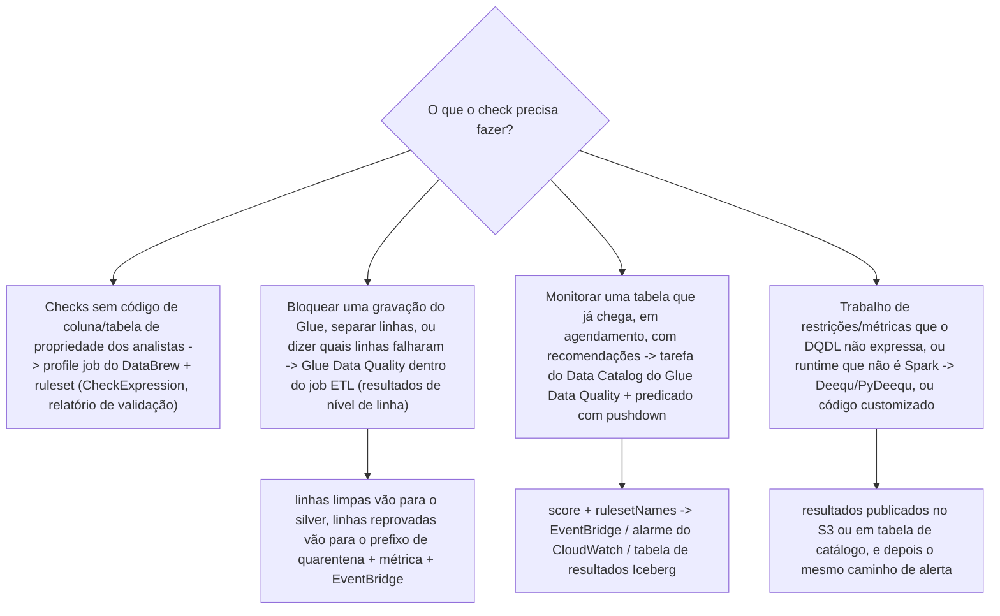
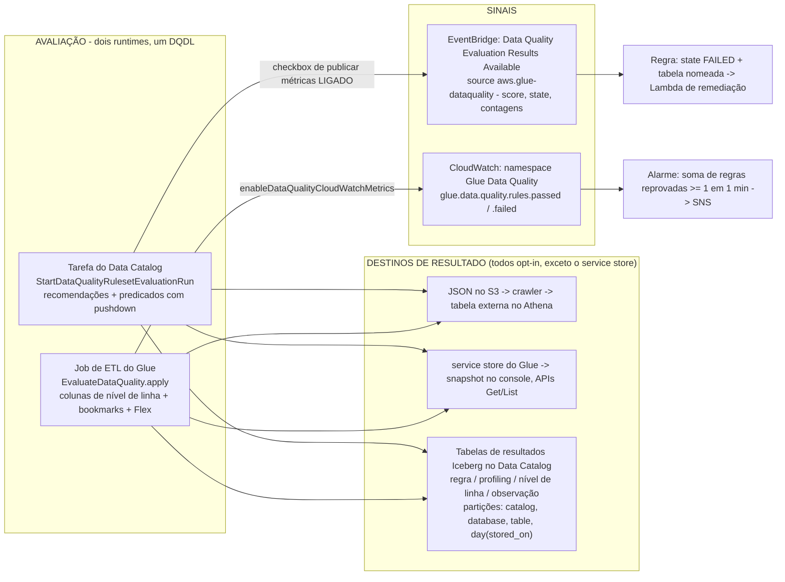
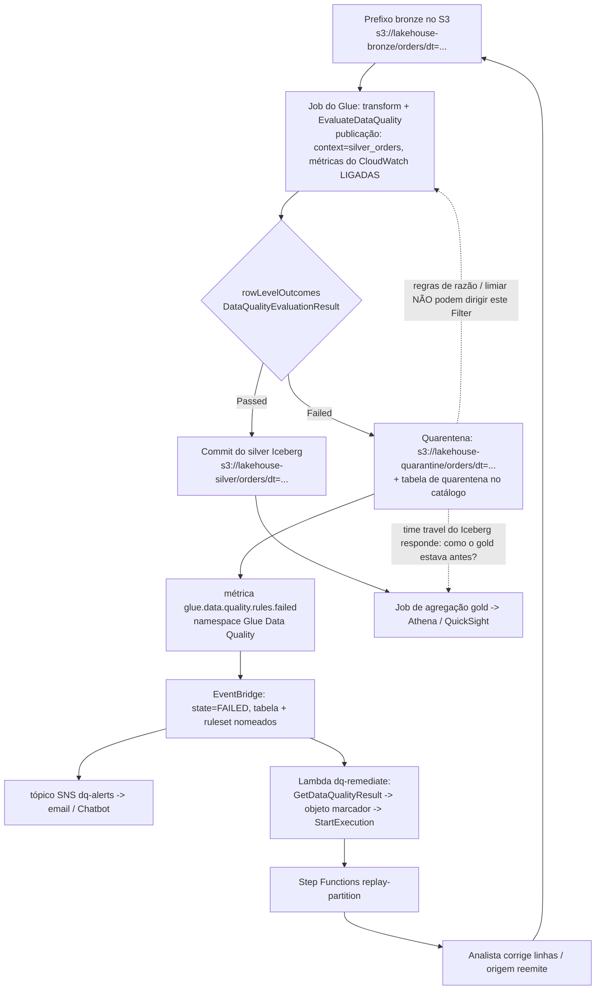
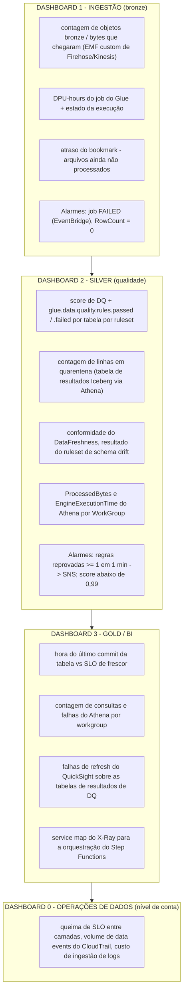
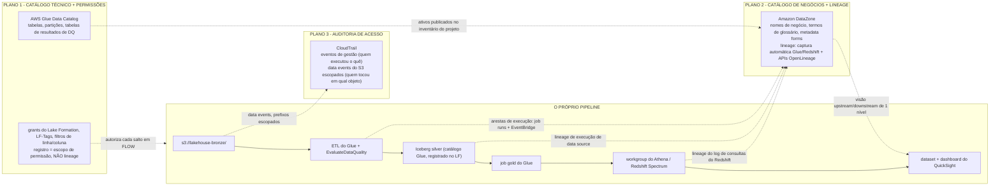

# Qualidade de Dados e Observabilidade: DQDL, Quarentena, Lineage e SLOs

As lições 01 to 14 construíram algo que funciona: um prefixo bronze, tabelas Iceberg, jobs do Glue, um catálogo, Athena e QuickSight, orquestração, grants do Lake Formation, controles de PII e um perímetro endurecido. Nada disso responde à pergunta que os seus consumidores realmente vão fazer; **vocês conseguem provar que os números gold de hoje estão certos, e conseguem me dizer o que mudou quando não estão?** Um lakehouse sem qualidade e observabilidade é um jeito muito rápido de mover dados errados.

Esta lição constrói a camada de prova na ordem em que a própria orientação da AWS organiza o assunto: **engines → regras → runtimes → resultados e sinais → quarentena → SLOs → observabilidade por camada → auditoria → lineage → remediação**. Duas ideias carregam tudo. Primeira, qualidade é um *passo de pipeline com saída*, não um dashboard: ela ou bloqueia uma gravação, ou separa linhas, ou levanta um sinal para alguém ser acionado. Segunda, observabilidade tem três planos distintos que os times confundem o tempo todo, o **catálogo Glue** guarda metadados técnicos e permissões, o **DataZone** guarda significado de negócio e lineage, o **CloudTrail** guarda quem chamou o quê. Todo número abaixo está datado de **outubro de 2026**.

```text
====================================================================
 QUALIDADE + OBSERVABILIDADE - ESPINHA DA AULA, AWS DATA LAKEHOUSE, AULA 15
====================================================================
 ENGINES ..... Glue Data Quality (DQDL, gerenciado, construído sobre o Deequ)
                 - tarefa do Data Catalog OU EvaluateDataQuality no job
               Deequ / PyDeequ - OSS, analyzers customizados, runtimes exóticos
               DataBrew - expressões de check sem código em profile jobs
               checks custom - Lambda / Glue / EMR à sua escolha
 REGRAS ...... Rules = [ ... ] preso a UMA tabela; 32 tipos de regra;
               expressões, cláusulas where, regras dinâmicas
               (RowCount > avg(last(10))), labels (team=finance),
               constantes, SQL de pré-processamento; 2.000 regras e
               65 KB por ruleset; sem colunas aninhadas ou de lista
 RUNTIMES .... tarefa do catálogo: recomendações (BASIC; ADVANCED via
                 Bedrock set 2026), predicados de partição com pushdown,
                 mínimo de 2 DPUs - mas NÃO nomeia registros com falha
               job ETL: colunas DataQualityRules* de nível de linha,
                 auto scaling, Flex, incremental por bookmark - mas
                 não há execuções de recomendação
 RESULTADOS .. JSON no S3 -> tabela externa + crawler -> Athena;
               service store -> console + APIs Get/List;
               tabelas Iceberg no Data Catalog (jul 2026),
               particionadas por catalog_id/database/table/day
 SINAIS ...... EventBridge "Data Quality Evaluation Results
                 Available" (source aws.glue-dataquality) com score,
                 state, rulesSucceeded/Failed/Skipped -
                 que só funciona enquanto "Publish metrics to
                 Amazon CloudWatch" permanecer SELECIONADO
               CloudWatch namespace Glue Data Quality:
                 glue.data.quality.rules.passed / .failed
 QUARENTENA .. warn | quarantine | halt (as três ações do
                 InsuranceLake); apenas resultados de nível de linha;
                 regras de razão e limiar não podem colocar em
                 quarentena; WAP = branch de staging do Iceberg ->
                 audit -> fast_forward para main
 SLO ......... P95(disponibilidade - evento) <= meta em três relógios:
                 tempo de evento / tempo de chegada / tempo de
                 disponibilidade; codificar como DataFreshness +
                 FileFreshness + alarmes de volume RowCount
 OBSERVABILIDADE um dashboard do CloudWatch por camada de medalhão;
               log groups do Glue /aws-glue/jobs/output, /error,
                 /logs-v2 (continuous logging, redirect Logs IA);
               métricas AWS/Athena do Athena; X-Ray para Lambda e
                 Step Functions - NÃO para executores do Spark
 AUDIT ....... eventos de gestão do CloudTrail (primeira cópia grátis)
               vs data events do S3 ($0.10 por 100.000, opt-in,
                 escopados por advanced event selectors, sem curingas)
 PLANES ...... Glue Data Catalog = metadados técnicos + permissões
                 (grants do Lake Formation; registro NÃO é lineage)
               Amazon DataZone = catálogo de negócios + lineage
                 (compatível com OpenLineage; captura automática
                 Glue/Redshift)
               CloudTrail = auditoria de acesso (quem chamou, não de
                 onde uma coluna foi derivada)
 Preços ...... exemplos do Glue DQ a $0.44 por DPU-hour (uma
                 segunda linha na mesma página lê $0.22 - veja E2);
               Flex $0.29; mínimo de 2 DPUs, cobrança de 1 minuto;
               anomaly detection 1 DPU por estatística;
               EventBridge $1.00 por milhão de custom events;
               métrica custom do CloudWatch $0.30 por métrica-mês
               [lista de us-east-1, em outubro de 2026]
====================================================================
```

Nesta lição você vai:

- escolher uma engine de qualidade no próprio mapeamento de Prescriptive Guidance da AWS, **Glue Data Quality, DataBrew, Deequ ou código customizado**, e defender o default;
- criar **DQDL**: rulesets presos a uma tabela, os quatro modificadores (expressões, `where`, regras dinâmicas, labels), os 32 tipos de regra, e quais deles podem gerar uma **linha** reprovada;
- rodar a avaliação nos **dois runtimes**, a tarefa do Data Catalog e o `EvaluateDataQuality` dentro de um job Glue, e saber exatamente o que cada um pode e não pode fazer;
- pousar resultados em **três destinos**: JSON no S3, o service store do Glue e **tabelas Iceberg no Data Catalog**, e depois lê-los no Athena;
- ligar os **sinais**: eventos do EventBridge, métricas do CloudWatch no namespace `Glue Data Quality`, alarmes, dashboards: incluindo o checkbox que mata os alertas em silêncio;
- construir o **padrão de quarentena** de ponta a ponta: separar as linhas, gravar o prefixo e a tabela de quarentena, emitir a métrica, o alerta, e rodar um backfill que permanece idempotente;
- calcular um **SLO de frescor** em três relógios e defender um número P95 com aritmética de verdade;
- escopar os **data events do CloudTrail** por prefixo sensível para que a trilha de auditoria não vire a maior linha da fatura;
- separar os **três planos**, catálogo Glue, catálogo de negócios e lineage do DataZone, auditoria do CloudTrail, e nomear apenas as fontes de lineage que a AWS de fato documenta;
- ligar um caminho de remediação **EventBridge → SNS → Lambda** que funcione, com o IAM que cabe;
- estudar **dois casos de clientes da AWS**, uma **caixa de atualização de outubro de 2026** com fontes, **onze questões de prova** e quatro verificações interativas.

---

## 1. Quatro engines de qualidade, uma decisão

### 1.1 O mapeamento da própria AWS

O Prescriptive Guidance da AWS publica uma tabela de mapeamento de soluções para checks de qualidade de dados. É a resposta correta mais rápida para "qual ferramenta":

| Necessidade | Engine | Onde roda | Escopo verificado |
|---|---|---|---|
| Condições sem código, no nível de coluna ou de tabela, para analistas | **AWS Glue DataBrew** | Profile job + ruleset | Sintaxe própria `CheckExpression`, **não** é DQDL; relatório de validação ao lado do perfil |
| Código customizado em um job do Glue **ou** regras sem código em tabelas de catálogo | **AWS Glue Data Quality** | Tarefa do catálogo ou transform ETL | DQDL, gerenciado, serverless, "construído sobre o framework open-source DeeQu" |
| Checks sob medida no seu próprio ETL, à sua escolha | **Checks customizados** | Lambda, Glue, EMR | O que você escrever |
| Relatório de métricas, validação de restrições e sugestão de restrições | **Deequ** (open source) | EMR, SageMaker, Glue com o JAR certo | Analyzers no estilo `CompletenessConstraint`, repositório de métricas, checks de anomalia |

(AWS Prescriptive Guidance: *Data quality checks*, acesso em 2026-10-11.)

Para o lakehouse deste curso a resposta é **Glue Data Quality por default**, com o DataBrew reservado ao profiling de analistas de negócio sobre conjuntos CSV/JSON, e PyDeequ apenas onde a customização no nível do Deequ é de fato necessária. Isso não é uma disputa de popularidade: o Glue DQ avalia *"tabelas e views do Amazon Athena suportadas que estão armazenadas no AWS Glue Data Catalog"* sobre o *"Amazon S3, Amazon Redshift, fontes JDBC compatíveis com o Data Catalog e formatos de data lake transacionais como Apache Iceberg, Apache Hudi e Delta Lake"*: esse é exatamente o substrato que você construiu nas Lições 02 to 08 (Glue Developer Guide, acesso em 2026-10-11).



- **📚 Você sabia?** O Glue Data Quality não é uma reimplementação: a AWS afirma que ele é *"construído sobre o framework open-source DeeQu"* e que não há *"Sem lock-in… permitindo que você mantenha as regras que está escrevendo em uma linguagem aberta"* (Glue Developer Guide, acesso em 2026-10-11). É por isso que uma regra DQDL se parece com o vocabulário de restrições do Deequ, e por que a biblioteca open source continua sendo um escape hatch legítimo para analyzers que o produto não expõe.

### 1.2 O que o "gerenciado" compra, em uma tabela

| | **Glue Data Quality** | **Deequ / PyDeequ** | **Regras do DataBrew** | **Great Expectations (faça você mesmo)** |
|---|---|---|---|---|
| Autoração | DQDL, console, API, nó do Studio | Restrições em Scala/Python | Expressões de check sem código | Suítes de expectations em Python |
| Execução gerenciada | Sim, tarefas serverless e integração com ETL | Não, você roda o Spark | Sim, dentro de profile jobs | Não, você hospeda |
| Recomendações de regra | Sim (BASIC; ADVANCED via Bedrock, set 2026) | Sugestão de restrição no código | Aba Recommendations no console | Não |
| Registros reprovados de nível de linha | **Sim, apenas no caminho ETL** | Sim, se você montar a separação | Não: os findings são agregados | Sim, se você montar |
| Alertas | EventBridge + CloudWatch, embutidos | Você monta a publicação no SNS | Evento do EventBridge por ruleset validado | Você monta |
| Postura de suporte AWS | Produto de primeira parte | Open source (comunidade/exemplos da AWS) | Produto de primeira parte | Não é uma oferta da AWS |

A última linha importa. O Great Expectations aparece nesta lição apenas como um framework **traga-o-você-mesmo**: a AWS não publica nenhuma oferta gerenciada de GX, a documentação legada do próprio GX fixa a integração com o AWS Glue em *"a versão mais recente do GX que suporta esta integração é o GX 0.15.50"*, e o walkthrough do conector do Glue Catalog é um post de parceiro. Trate o GX como *o seu* runner, para você versionar, aplicar patches e suportar.

---

## 2. DQDL: a linguagem, os modificadores, o contrato do ruleset

### 2.1 O contrato: `Rules = [ ... ]` preso a uma tabela

Um ruleset é uma lista entre colchetes e separada por vírgulas, presa a exatamente uma tabela de catálogo:

```text
Ruleset = 'Rules = [IsComplete "col1", IsPrimaryKey "col2", RowCount between 2000 and 8000]'
TargetTable = {'TableName': 'orders', 'DatabaseName': 'lakehouse_silver'}
```

Essa é a forma de `create_data_quality_ruleset` (Glue Developer Guide: *Using APIs to measure and manage data quality*, acesso em 2026-10-11). Dois limites definem o tamanho de um ruleset: **2.000 regras por ruleset** (*"Se seus rulesets forem maiores, recomendamos dividir em vários rulesets"*) e um **tamanho de ruleset de 65 KB**. Estatísticas são um orçamento separado: **100.000 estatísticas por conta**, armazenadas **gratuitamente** por **2 anos** (Glue pricing, acesso em 2026-10-11).

Uma exclusão de nível de linguagem para decorar: **"O DQDL não suporta atualmente dados de coluna aninhados ou de tipo lista."** Structs aninhados e arrays estão fora do escopo de alvos diretos de regra: aplane ou use `CustomSql` contra uma view pré-processada.

### 2.2 Os quatro modificadores que mudam a semântica

| Modificador | Desde | O que faz | Exemplo |
|---|---|---|---|
| **Expressões** | GA 2023-05-24 (produto) | Limiares, intervalos, enums, regex, `with threshold` | `Uniqueness "email" = 1.0`, `ColumnValues "currency" matches "^[A-Z]{3}$" with threshold > 0.999` |
| **Cláusula `where`** | 2024-06-26 | Filtra linhas *antes* de a regra avaliar | `Completeness "First_Name" > 0.95 where "weight > 10"` |
| **Regras dinâmicas** | preview 2023-11-27, GA 2024-08-07 | Limiares calculados a partir do histórico de execuções | `RowCount > avg(last(10))`, `Completeness "colA" between min(last(5)) - 1 and max(last(5)) + 1` |
| **Labels** | GA 2025-11-21 | Tags chave-valor escritas em DQDL para fatiar resultados por dono | label `team=finance`, consultável nos resultados de regra, nos resultados de nível de linha e nas respostas de API |

(Notas de versão do Glue DQ e AWS What's New, 2025-11-25, acesso em 2026-10-11.)

Três recursos de apoio completam o pacote: **constantes** (2025-11-21) permitem definir um valor uma vez e referenciá-lo no script inteiro, *"evitando problemas relacionados aos limites de tamanho de consulta"*; **consultas de pré-processamento** (GA 2025-11-25) rodam SparkSQL sobre a tabela *antes* da avaliação, pelo campo `PreProcessingQuery` de `DataQualityGlueTable`, para você derivar colunas, filtrar ou validar relações entre colunas; e **regras compostas complexas** (2024-11-22) permitem aninhar grupos AND/OR em vez de empilhar regras planas.

Repare na armadilha da coluna `with threshold`: essa cláusula só funciona com **ColumnValues, ColumnDataType e CustomSql**. Coloque-a em `Completeness` e você está escrevendo uma regra que o DQDL não vai avaliar do jeito que você imagina.

### 2.3 Os 32 tipos de regra, e os que podem nomear uma linha

A referência de tipos de regra do DQDL lista exatamente **32** tipos em outubro de 2026: AggregateMatch, AllStatistics, ColumnCorrelation, ColumnCount, ColumnDataType, ColumnExists, ColumnLength, ColumnNamesMatchPattern, ColumnValues, Completeness, CustomSql, DataFreshness, DatasetMatch, DistinctValuesCount, Distribution, Entropy, IsComplete, IsPrimaryKey, IsUnique, Mean, ReferentialIntegrity, RowCount, RowCountMatch, SchemaMatch, StandardDeviation, Sum, Uniqueness, UniqueValueRatio, DetectAnomalies, FileFreshness, FileMatch, FileUniqueness e FileSize.

Elas se dividem em quatro famílias:

```text
NÍVEL DE LINHA (pode nomear o registro problemático) ..... Completeness, IsComplete,
    IsUnique, IsPrimaryKey, Uniqueness, UniqueValueRatio, ColumnValues,
    ColumnLength, ColumnDataType, ColumnExists, DetectAnomalies,
    DataFreshness, CustomSql COM limiar de nível de linha, File* (não)
NÍVEL DE CONJUNTO (apenas agregado - NUNCA uma linha reprovada) .. RowCount,
    RowCountMatch, Mean, StandardDeviation, Sum, ColumnCount,
    ColumnExists, ColumnNamesMatchPattern, ColumnCorrelation,
    CustomSql (forma geral), AggregateMatch
ENTRE CONJUNTOS .................................. ReferentialIntegrity,
    DatasetMatch, AggregateMatch, SchemaMatch
ANALYZERS / CENTRADOS EM ARQUIVO ................ AllStatistics,
    Distribution, FileFreshness, FileMatch, FileUniqueness, FileSize
```

A própria documentação do Studio é franca sobre a divisão: regras de nível de conjunto *"não conseguem identificar registros de erro porque são aplicadas no nível do conjunto de dados"* (Glue Developer Guide: *Evaluating data quality with AWS Glue Studio*, acesso em 2026-10-11). Construa uma quarentena em cima de `RowCount` e você não vai colocar nada em quarentena.

### 2.4 Exemplo resolvido E1, o ruleset `orders` da camada silver

Alvo: `lakehouse_silver.orders`, uma tabela Iceberg particionada por `dt`, avaliada dentro do job bronze→silver **e** reavaliada diariamente como tarefa de catálogo.

```text
Exemplo resolvido E1 - ruleset DQDL para lakehouse_silver.orders, em outubro de 2026

Rules = [
    ColumnExists "order_id",
    ColumnExists "customer_id",
    ColumnExists "order_ts",
    IsPrimaryKey "order_id",                                    -- not-null + unique em uma regra só
    Completeness "customer_id" > 0.999,                         -- nível de linha, colocável em quarentena
    Completeness "order_ts" > 0.995,                            -- nível de linha, colocável em quarentena
    Uniqueness "order_id" > 0.999,                              -- tolera 0.1% de duplicatas
    ColumnValues "order_status" in ["created","paid","shipped","cancelled"]
        with threshold > 0.99,                                  -- até 1% de enum sujo é tolerado
    ColumnValues "currency" matches "^[A-Z]{3}$" with threshold > 0.999,
    ColumnValues "total_amount" > 0,
    RowCount > 1000,                                            -- guarda de pipeline morto
    RowCount <= avg(last(10)) * 1.5,                            -- guarda dinâmica de pico de volume
    DataFreshness "order_ts" > (now() - 2 days)
        where "dt = current_date - 1",                          -- frescor da partição de ontem
    CustomSql "SELECT order_id FROM primary WHERE total_amount != item_sum"
]

SCORE = regras aprovadas / regras avaliadas -> 14/14 = 1.00, 13/14 = 0.929
REGRAS CAPAZES DE QUARENTENA = o par Completeness, o Uniqueness,
    os três ColumnValues e o CustomSql de nível de linha
APENAS NÍVEL DE CONJUNTO = as duas regras de RowCount e o DataFreshness
    -> isso ALERTA (halt / notify), nunca separa linhas
```

Por que cada linha merece estar ali: `IsPrimaryKey` colapsa duas regras em uma; as formas com limiar em `ColumnValues` toleram menos de 1% de sujeira sem reprovar a execução inteira; `RowCount <= avg(last(10)) * 1.5` é uma guarda de pico **dinâmica** que não precisa de constante ajustada à mão; o `CustomSql` de nível de linha é a única regra aqui que pode te entregar uma lista de IDs de pedido para colocar em quarentena; e `DataFreshness … where "dt = current_date - 1"` limita o aviso de frescor à partição que *deveria* estar fresca em vez de gritar sobre a história inteira.

O walkthrough de getting-started da AWS mostra a mesma forma na tabela de tickets de exemplo, `IsComplete "SET_FINE_AMOUNT"`, `Uniqueness "TICKET_NUMBER" > 0.95`, `ColumnValues "PROVINCE" in [...]`, `ColumnLength "INFRACTION_DESCRIPTION" between 15 and 31`, com a ressalva importante da documentação: as recomendações *"facilitam o início… sem escrever código"*, mas as regras são geradas a partir de estatísticas *atuais*, então trate-as como um rascunho a apertar (acesso em 2026-10-11).

### 2.5 Recomendações de regra: BASIC e ADVANCED via Bedrock

`start_data_quality_rule_recommendation_run(DataSource={'GlueTable': {...}}, Role=role_arn)` devolve um `RunId`; busque `ResultIds` em `get_data_quality_ruleset_evaluation_run` e depois cada `get_data_quality_result(ResultId=…)`. As execuções de recomendação são **apagadas automaticamente depois de 90 dias**. Desde **2026-09-18 / 2026-09-25**, um modo **ADVANCED** usa o Amazon Bedrock com metadados da tabela e linhas amostradas para gerar DQDL: um assistente de rascunho, não uma aprovação.

```fillblank
{
  "question": "Preencha as palavras-chave de DQDL e do Glue Data Quality nas quais esta lição se apoia:",
  "template": "Um ruleset é escrito como {{1}} = [ lista de regras ] e fica preso a exatamente uma tabela de catálogo; um filtro aplicado antes de uma regra rodar é a cláusula {{2}}; um limiar calculado a partir do histórico de execuções, como RowCount > {{3}}(last(10)), é uma regra {{4}}; e a regra que verifica not-null e unicidade de uma vez só é {{5}}.",
  "answers": {
    "1": "Rules",
    "2": "where",
    "3": "avg",
    "4": "dynamic",
    "5": "IsPrimaryKey"
  },
  "distractors": [
    "Ruleset",
    "Expectations",
    "having",
    "filter",
    "max",
    "median",
    "composite",
    "anomaly",
    "IsUnique",
    "DistinctValuesCount"
  ],
  "explanation": "Rules = [... ] é a sintaxe literal de ruleset que a AWS usa no exemplo da API create_data_quality_ruleset. A cláusula where foi entregue em 2024-06-26 e filtra antes da avaliação, e é assim que você limita uma regra de frescor à partição de ontem. avg(last(10)) é a forma documentada de regra dinâmica: os limiares vêm do histórico, não de uma constante que alguém digitou uma vez. As regras dinâmicas ficaram GA em 2024-08-07 junto com a detecção de anomalias. IsPrimaryKey é a única regra que expressa not-null mais unique, e é por isso que ela substitui duas regras em todo ruleset de produção deste curso."
}
```

---

## 3. Dois runtimes: a tarefa do Data Catalog e o `EvaluateDataQuality` no job

Eles compartilham DQDL, EventBridge, métricas do CloudWatch, resultados no S3 e ações de IAM. Eles **não** são intercambiáveis.

| | **Tarefa do Data Catalog** (`StartDataQualityRulesetEvaluationRun`) | **Integrado ao ETL** (`EvaluateDataQuality.apply` / nó do Studio) |
|---|---|---|
| Identificar quais registros falharam | **"Não suportado"** | **"Suportado"**: resultados de nível de linha |
| Avaliação incremental | Predicados de partição com pushdown / de catálogo | **AWS Glue job bookmarks** |
| Auto scaling | Não suportado | Suportado |
| Recomendações de regra | Sim (sem recomendações dentro de execuções de ETL) | Não |
| Detecção de anomalias por ML, regras dinâmicas, EventBridge, CloudWatch, resultados no S3 | Suportado | Suportado |
| Execução Flex / DPU com auto-scaling |: | Suportado |
| Ação de falha | Score + evento | "Fail job after loading target data" → `AssertionError` |

(Glue Developer Guide: matriz de capacidades, acesso em 2026-10-11.)

### 3.1 Dentro do job

```python
from awsglue.transforms import EvaluateDataQuality

dq = EvaluateDataQuality.apply(
    frame=orders_frame,
    ruleset=ruleset,                       # Rules = [ ... ]
    publishing_options={
        "dataQualityEvaluationContext": "silver_orders",   # namespace; default "default_context"
        "enableDataQualityCloudWatchMetrics": True,        # default False
        "enableDataQualityResultsPublishing": True,        # default True -> Glue Studio "Data quality" tab
        "resultsS3Prefix": "s3://lakehouse-dq/results/"    # optional S3 sink
    })
```

A opção de saída do transform é a decisão que importa: **"Dados originais"** versus **"Adicionar novas colunas para indicar erros de qualidade dos dados"**. A segunda acrescenta quatro colunas: `DataQualityRulesPass`, `DataQualityRulesFail`, `DataQualityRulesSkip` (arrays de string) e `DataQualityEvaluationResult` (*"Passed"* ou *"Failed"* **no nível da linha**). A nota da própria AWS é a que vale decorar: *"seus resultados gerais podem ser FAIL, mas um registro específico pode passar."* As regras no Studio ficam *"dentro dos colchetes e… separadas por vírgulas"*: `Rules = [ Completeness "year" > 0.8, Completeness "month" > 0.8 ]`.

Qualidade incremental vem dos **job bookmarks**: para entradas no S3, a marca d'água é o **tempo de última modificação** do objeto, com um `maxBand` padrão de **900.000 ms (15 minutos)**, durante o qual a listagem *"provavelmente estará consistente"*. Bookmarks exigem `job.init` no início e `job.commit` no final, e dependem de um `transformation_ctx` único: omita-o e o operador não é rastreado de modo algum (que é exatamente como você relê uma dimensão de propósito a cada execução).

### 3.2 Três destinos de resultado, e desde julho de 2026 o catálogo é um deles

1. **Resultados JSON no S3** (opt-in via `resultsS3Prefix` ou o local de resultados da tarefa) → registre com um crawler, `CREATE EXTERNAL TABLE` com um SerDe JSON, `MSCK REPAIR TABLE`, e depois Athena. A AWS entrega o DDL completo, particionado por `year/month/day`.
2. **O service store do Glue** → legível por `GetDataQualityResult` / `ListDataQualityResults` e renderizado na aba **Data quality** do console; o **Data quality snapshot** mostra as últimas 10 execuções entre rulesets por default.
3. **Tabelas Iceberg no Data Catalog** (GA 2026-07-27) → quatro tipos de resultado em opt-in, **resultados de regra, de profiling, de nível de linha e de observação**, configurados via `--additional-run-options` em `StartDataQualityRulesetEvaluationRun` ou `additional_options` em um job ETL. **Nada é gravado por default**: *"Você precisa habilitar explicitamente cada tipo de resultado."*

```text
aws glue start-data-quality-ruleset-evaluation-run \
  --data-source '{"GlueTable": {"DatabaseName": "lakehouse_silver","TableName": "orders"}}' \
  --role arn:aws:iam::111122223333:role/glue-dq-task \
  --ruleset-names '["silver_orders_strict"]' \
  --additional-run-options '{
    "DataQualityRuleResults": {
      "WriteDataQualityRuleResultsEnabled": true,
      "CatalogTableConfig": {"DatabaseName": "quality_results","TableName": "rule_results"}
    }
  }'

CHAVES DE PARTIÇÃO de toda tabela de resultados ... catalog_id, database_name,
    table_name, day(stored_on)
COLUNAS DE RESULTADO DE REGRA ............ dq_result_id, rule_name,
    rule_description (a expressão DQDL), rule_result (PASS|FAIL),
    evaluation_message, evaluated_metrics MAP<STRING,DOUBLE>,
    catalog_id, database_name, table_name,
    ruleset_evaluation_run_id, started_on, completed_on,
    evaluated_rule, ruleset_name
COLUNAS DE NÍVEL DE LINHA ................ todas as colunas de origem +
    data_quality_rules_pass / _fail / _skip (ARRAY),
    data_quality_evaluation_result (Passed|Failed), stored_on,
    region, account_id
```

Esta é a maior mudança de 2026 no assunto desta lição: seu histórico de qualidade vira uma tabela Iceberg comum, com as mesmas ferramentas de Athena, Lake Formation, time travel e QuickSight do resto do lakehouse.

### 3.3 O contrato de alertas tem um checkbox escondido

Toda avaliação concluída emite um evento do EventBridge:

```json
{
  "detail-type": "Data Quality Evaluation Results Available",
  "source": "aws.glue-dataquality",
  "detail": {
    "contextType": "GLUE_DATA_CATALOG",
    "runId": "dqrun-9f2c...",
    "databaseName": "lakehouse_silver",
    "tableName": "orders",
    "catalogId": "111122223333",
    "resultID": "dqr-...",
    "rulesetNames": ["silver_orders_strict"],
    "state": "FAILED",
    "score": 0.928,
    "rulesSucceeded": 13,
    "rulesFailed": 1,
    "rulesSkipped": 0
  }
}
```

A variante de ETL usa `contextType: "GLUE_JOB"` com `jobId`, `jobName` e `evaluationContext`. O caminho paralelo do CloudWatch é igualmente simples: *"Cada avaliação do AWS Glue Data Quality emite um par de métricas chamadas `glue.data.quality.rules.passed`… e `glue.data.quality.rules.failed`"* sob o namespace **`Glue Data Quality`**, publicado **por tabela e por ruleset**.

> [!WARNING]
> **Não desmarque "Publish metrics to Amazon CloudWatch."** A AWS documenta isso de forma direta: para avaliações no Data Catalog e em jobs de ETL, *"a opção Publish metrics to Amazon CloudWatch, que vem selecionada por padrão, deve permanecer selecionada para que a publicação no EventBridge funcione."* Times desligam ela para economizar alguns dólares de métricas custom e perdem as métricas do CloudWatch *e* os eventos do EventBridge no mesmo clique: alarmes, notificações e remediação ficam em silêncio enquanto as regras continuam rodando e o score continua caindo. A consequência de IAM é a mesma chave: a publicação precisa de `cloudwatch:PutMetricData` **condicionado a** `"cloudwatch:namespace": "Glue Data Quality"`.

A preferência declarada da AWS: *"Nossa abordagem recomendada é configurar alertas de qualidade de dados usando o Amazon EventBridge, porque o Amazon EventBridge requer uma configuração única para alertar os clientes."* A alternativa com CloudWatch é um alarme padrão: `glue.data.quality.rules.failed`, estatística **Sum**, período de **1 minuto**, limiar **≥ 1**, ação = tópico SNS.



- **📚 Você sabia?** O **score** não é uma nota de qualidade que você passa adiante: a AWS o define como *"a porcentagem de regras de qualidade de dados que passaram para a entrada"*. Um ruleset com uma regra fraca pontua 1.0 enquanto 40% das linhas são lixo. É por isso que existem as colunas de nível de linha e as tabelas de resultado: score para o alerta, linhas para a correção (Glue Developer Guide, acesso em 2026-10-11).

---

## 4. Deequ, PyDeequ e DataBrew: os caminhos laterais verificados

### 4.1 Deequ: a engine, e onde ele ainda compensa

O anúncio do PyDeequ da AWS descreve o original: o Deequ *"é usado internamente na Amazon para verificar a qualidade de muitos grandes conjuntos de dados de produção… O sistema calcula métricas de qualidade de dados regularmente (com cada nova versão de um conjunto de dados), verifica restrições definidas pelos produtores de dados e publica os conjuntos de dados para os consumidores em caso de sucesso. Em casos de erro, a publicação do conjunto de dados pode ser interrompida e os produtores são notificados para agir."* Calcular → verificar → publicar-ou-parar é o loop que o Glue DQ colocou como produto em 2023 (AWS Big Data Blog, 2020-12-30, atualizado em junho de 2024).

Motivos legítimos restantes para rodar você mesmo o Deequ, segundo os próprios posts da AWS:

| Motivo | Veículo documentado pela AWS | Restrição dura |
|---|---|---|
| Analyzers/restrições customizados que o DQDL não expressa | PyDeequ no **EMR** | O JAR do Deequ **precisa corresponder** à sua versão do Spark: `pydeequ.deequ_maven_coord` → `com.amazon.deequ:deequ:2.0.3-spark-3.3`; *"é crítica a fornecer as coordenadas Maven corretas do Apache"* |
| **Validação de migração**: diff de métricas origem vs destino | Job no EMR grava resultados em uma tabela do Glue (por exemplo `db_deequ.db_migration_validation_result`), auditado no Athena | Mesmo pinning de JAR/Spark |
| Conjuntos de dados muito pequenos que precisam de startup rápida | **Deequ no AWS Lambda** com o Spark Runtime for AWS Lambda (SoAL) | O SoAL *"é maior que o limite de 250 MB para empacotamento de arquivo zip"* → imagem de contêiner; a AWS recomenda o Glue Data Quality *"para jobs Spark que rodam mais de 15 minutos ou arquivos maiores (mais de 1 GB)"* |
| Checks de anomalia sobre um repositório de métricas | `FileSystemMetricsRepository` + Holt-Winters, resultados no SNS | A receita publicada de Holt-Winters foi verificada *"no AWS Glue 2.0, pydeequ release/1_1_1, Spark 2.4 e deequ-1.1.0_spark-2.4-scala-2.11.jar (apenas)"*: fixe a versão ou não use |

O PyDeequ *"suporta Spark até a versão 3.3.0"* segundo as notas do PyDeequ 1.1.x que a AWS vincula, e *"pode funcionar dentro do Amazon EMR e do SageMaker"*. O resumo honesto de 2026: **a maior parte do valor do Deequ já está dentro do Glue Data Quality**; recorra à biblioteca quando o runtime for exótico ou a restrição não for expressível.

### 4.2 DataBrew: regras, mas não DQDL

A história de qualidade do DataBrew é um **ruleset de `CheckExpression`s avaliado dentro de um profile job**: *"Se qualquer um dos critérios de uma regra não for atendido, o ruleset como um todo reprova na validação"*, e a execução *"produz um relatório de validação além do perfil de dados"* no mesmo local. Forma da API: `CheckExpression`, `ColumnSelectors` (Name ou Regex), `Disabled`, `SubstitutionMap`, `Threshold` (Type/Unit/Value). Restrições a respeitar: **apenas colunas de tipos simples** (string, números, boolean) participam, e as regras ficam na aba **Recommendations** da tela de ruleset.

Ao concluir, *"o DataBrew envia um evento do Amazon CloudWatch com os detalhes dessa execução de job… para cada ruleset validado… e o evento contém o resultado (`SUCCEEDED`, `FAILED` ou `ERROR`)"* mais um link para o relatório. Esse evento é o seu padrão do EventBridge para checks de propriedade dos analistas. As métricas ficam no namespace **`AWS/DataBrew`**, o exemplo documentado é `SessionCount`.

> [!IMPORTANT]
> **As regras do DataBrew não são DQDL.** A sintaxe de expressão de check, o console, os eventos, o relatório e a semântica de falha são todos diferentes do Glue Data Quality. Copiar `Completeness "col" > 0.95` para um ruleset do DataBrew, ou um `CheckExpression` do DataBrew para um ruleset do Glue, falha nos dois sentidos. O Prescriptive Guidance da AWS mantém os dois separados por um motivo: DataBrew para checks de analista sem código, Glue Data Quality para DQDL embutido em job e em catálogo, Deequ para um relatório de métricas/restrições, código customizado para todo o resto.

### 4.3 Exemplo resolvido E2: quanto custa um gate de qualidade, e onde colocá-lo

O benchmark da própria AWS: **104 colunas, 1 milhão de linhas, 10 DPUs** (AWS Big Data Blog, 2024-03-12):

```text
Exemplo resolvido E2 - custo e colocação da execução de DQ, lista de us-east-1, em outubro de 2026
BENCHMARK (104 colunas, 1M linhas, 10 DPUs)
  0 regras ......... 53,2 s ... 0,15 DPU-hr .... $0,06
  10 regras ........ ~150 s ... 0,42 DPU-hr .... $0,18
  100 regras ....... -- ....... 0,52 DPU-hr .... $0,23
  400 regras ....... 445,7 s .. 1,24 DPU-hr .... $0,54
  -> o custo é dominado pela VARREDURA da tabela, não pela contagem de regras:
     "o custo… só começa a aumentar após avaliar rulesets com
      mais de 100 regras, permanecendo constante abaixo desse número."

COLOCAÇÃO, mesmo ruleset silver de 20 regras (30 execuções/mês)
  A. Tarefa de catálogo independente, 5 DPUs x 20 min
     5 x (20/60) x $0.44 ............................. $0.73 / execução
     $0.73 x 30 ..................................... $21.90 / mês
     na taxa Flex de $0.29 .......................... $0.48 / execução
  B. Dentro do job silver existente (6 DPUs, +5 min marginal)
     6 x (5/60) x $0.44 ............................. $0.22 / execução
     $0.22 x 30 ..................................... $6.60 / mês
     E você ganha resultados de nível de linha -> a quarentena funciona
  C. Add-on de anomaly detection: 20 estatísticas x 1 DPU x 15/3600 h x $0.44
     .............................................. +$0.037 / execução
     ("entre 10-20 segundos" por estatística, em média)
  D. Piso da tarefa de perfil/qualidade .............. 2 DPUs, mínimo de 1 minuto

CONFLITO DE PREÇO A VERIFICAR ANTES DE ORÇAR
  aws.amazon.com/glue/pricing traz dois números de DQ na mesma
  data de acesso (2026-10-11): os exemplos resolvidos do Data Quality
  calculam a $0.44 por DPU-hour (tarefa de recomendação 5 DPUs x 10 min
  = "$0.37"; avaliação de catálogo 5 DPUs x 20 min = "$0.73"; DQ de ETL
  6 DPUs x 20 min = "$0.88", Flex "$0.58"), enquanto uma linha da
  tabela de preços lê Glue Data Quality = "$0.22 por DPU-hour".
  Intervalo para a opção A: $11.00 - $21.90 / mês. Verifique no console.
```

Duas conclusões sobrevivem à ambiguidade de preço: **orçe pelo tamanho da tabela × frequência, não pela contagem de regras**, e para um desenho de quarentena a avaliação dentro do job domina porque é mais barata *e* é o único caminho que pode nomear as linhas.

---

## 5. Quarentena: um padrão, não um produto

### 5.1 Três ações, dois checkpoints

A InsuranceLake, sample da AWS Solutions Library, formaliza o que todo pipeline de produção precisa: três ações em dois checkpoints de pipeline:

| Ação | Comportamento | Use quando |
|---|---|---|
| **Warn** | Apenas registra ou notifica; o fluxo segue | Problemas cosméticas, primeiras execuções de uma regra nova |
| **Quarantine** | Remove as **linhas** reprovadas do fluxo e grava em um armazenamento de quarentena separado + uma tabela de quarentena no Data Catalog | Defeitos de nível de linha com significado de negócio |
| **Halt** | Para o pipeline / reprova o job | O conjunto de dados está inutilizável a jusante |

Checkpoints: `before_transform` (*"imediatamente após o mapeamento de schema… antes de qualquer transformação ser executada"*) e `after_transform` (*"logo antes de salvar os dados no bucket Cleanse"*). A regra que importa para o desenho do seu ruleset: *"a expressão de qualidade de dados precisa ser escrita usando resultados de nível de linha para avaliar e colocar linhas individuais em quarentena"* e *"regras que dependem de razões ou limiares não são suportadas como regras de quarentena."*

A InsuranceLake também mostra como fica um **halt por frescor** quando você quer que o pipeline pare em vez de separar:

```text
CustomSql 'SELECT count(*) FROM primary
           WHERE claims_last_updated >= now() - interval 24 hours' >= 1
```

### 5.2 A separação, em código

```python
from awsglue.transforms import EvaluateDataQuality, Filter

rowLevelOutcomes = EvaluateDataQuality.apply(
    frame=orders_frame,
    ruleset=quarantine_capable_ruleset,      # only row-level rules
    publishing_options={
        "dataQualityEvaluationContext": "silver_orders",
        "enableDataQualityCloudWatchMetrics": True,
        "enableDataQualityResultsPublishing": True,
        "resultsS3Prefix": "s3://lakehouse-dq/results/"
    })

clean = Filter.apply(frame=rowLevelOutcomes,
                     f=lambda r: r["DataQualityEvaluationResult"] == "Passed")
dirty = Filter.apply(frame=rowLevelOutcomes,
                     f=lambda r: r["DataQualityEvaluationResult"] != "Passed")

# clean  -> s3://lakehouse-silver/orders/dt=2026-10-10/   (Iceberg commit)
# dirty  -> s3://lakehouse-quarantine/orders/dt=2026-10-10/ + catalog table
# glue.data.quality.rules.failed metric -> EventBridge -> SNS/Lambda
```

A orientação do Studio da AWS também oferece uma variante de primeira parte: em **Data quality actions**, escolha **Fail job after loading target data**, que aparece como `AssertionError: The job failed due to failing DQ rules for node: …`: halt sem quarentena.

### 5.3 Exemplo resolvido E3, o loop de quarentena com números reais

```text
Exemplo resolvido E3 - um dia ruim em lakehouse_silver.orders, em outubro de 2026
Entrada ................................. 1.000.000 linhas, 480 arquivos
Regras avaliadas (capazes de quarentena) .. Completeness customer_id,
                                            Uniqueness order_id,
                                            ColumnValues order_status,
                                            CustomSql total_amount = item_sum
Linhas aprovadas ......................... 987.520  (98,752%)
Linhas em quarentena .....................  12.480  (1,248%)
  - customer_id nulo .....................    8.900
  - order_id duplicado ...................    2.310
  - order_status ilegal .................    1.150
  - divergência de valor ................      120   <- forma de linha do CustomSql
Score do ruleset ......................... 0,75 (3/4 regras aprovadas)
  -> o score diz "reprovado", as LINHAS dizem "1,248% do lote está sujo"
Gravação da quarentena ................... s3://lakehouse-quarantine/orders/
                                            dt=2026-10-10/  (~4,1 MB Parquet)
Alerta ................................. EventBridge state=FAILED -> SNS
                                            -> Lambda -> ticket + objeto marcador
Backfill ......................................................
  1. o analista corrige 120 linhas de valor a montante, reemite 340 arquivos corrigidos
  2. Step Functions "replay-partition" limpa a partição de quarentena
     de dt=2026-10-10 (a InsuranceLake limpa o armazenamento de quarentena
     e as tabelas no reload da partição)
  3. o mesmo job reprocessa a partição; bookmark rebobinado ou um novo
     transformation_ctx, saída para um prefixo NOVO ou MERGE no Iceberg
  4. commit do silver + refresh do gold; a tabela de resultados de DQ registra a aprovação
Custo do reprocesso (6 DPUs x 5 min marginal, $0.44/DPU-hr) ... $0.22
```

As duas últimas linhas são o ponto: **quarentena sem um caminho de backfill é só perda de dados com etapas extras.** E como agora os resultados são tabelas Iceberg, a pergunta "como o gold estava antes da partição ruim" se responde com time travel em vez de um restore.

### 5.4 Write-Audit-Publish: a forma nativa do Iceberg

O padrão WAP da AWS substitui a cópia física de quarentena por **branches**: grave tudo em uma branch `stg` → rode o Glue DQ contra ela → filtre as linhas aprovadas em uma branch `audit` → `fast_forward` para `main` com o procedimento `fast_forward` do Spark. O conjunto de regras de demonstração do blog verificava a temperatura do sensor *"entre −10 e 50 °C"*, e nomeia o trade-off com honestidade: *"O principal desafio do padrão WAP é a latência adicional que ele introduz."* A abordagem de dead-letter-queue (o prefixo de quarentena no S3) é a outra opção documentada: escolha pela latência que você pode pagar ou pelo armazenamento duplicado que você pode tolerar.



```dragdrop
{
  "question": "Arraste o loop de quarentena e backfill para a ordem em que ele precisa rodar:",
  "items": [
    "4. Emitir glue.data.quality.rules.failed e disparar o evento do EventBridge com state FAILED para a tabela e o ruleset nomeados",
    "1. Avaliar os resultados de nível de linha dentro do job do Glue com EvaluateDataQuality e acrescentar as quatro colunas DataQuality*",
    "6. O analista corrige as linhas de origem, e depois o replay-partition do Step Functions limpa a partição de quarentena daquele dt",
    "2. Filtrar por DataQualityEvaluationResult: as linhas Passed são gravadas na tabela Iceberg do silver",
    "7. Reprocessar a partição pelo mesmo job com um bookmark rebobinado ou um novo transformation_ctx, gravando em um prefixo novo ou fazendo MERGE, e depois atualizar o gold",
    "3. As linhas reprovadas são gravadas em s3://lakehouse-quarantine/<table>/dt=... mais uma tabela de quarentena no catálogo",
    "5. O SNS notifica um humano e a Lambda busca o GetDataQualityResult, deixa um objeto marcador e inicia a máquina de estados de replay"
  ],
  "correctOrder": [
    "1. Avaliar os resultados de nível de linha dentro do job do Glue com EvaluateDataQuality e acrescentar as quatro colunas DataQuality*",
    "2. Filtrar por DataQualityEvaluationResult: as linhas Passed são gravadas na tabela Iceberg do silver",
    "3. As linhas reprovadas são gravadas em s3://lakehouse-quarantine/<table>/dt=... mais uma tabela de quarentena no catálogo",
    "4. Emitir glue.data.quality.rules.failed e disparar o evento do EventBridge com state FAILED para a tabela e o ruleset nomeados",
    "5. O SNS notifica um humano e a Lambda busca o GetDataQualityResult, deixa um objeto marcador e inicia a máquina de estados de replay",
    "6. O analista corrige as linhas de origem, e depois o replay-partition do Step Functions limpa a partição de quarentena daquele dt",
    "7. Reprocessar a partição pelo mesmo job com um bookmark rebobinado ou um novo transformation_ctx, gravando em um prefixo novo ou fazendo MERGE, e depois atualizar o gold"
  ],
  "explanation": "A separação precisa acontecer antes de qualquer commit, ou as linhas ruins já estarão na tabela do silver. A gravação da quarentena e a métrica vêm da mesma avaliação, então o alerta nunca pode atrasar em relação aos dados. Notificação e remediação são alvos separados no mesmo evento: SNS para o humano, Lambda para os passos de máquina. O backfill de propósito limpa a partição de quarentena daquele dt antes de reexecutar: a InsuranceLake documenta exatamente esse comportamento, e o replay grava por meio de um bookmark rebobinado ou de um transformation_ctx novo, em um prefixo novo ou em um MERGE no Iceberg, porque um rewind não limpa os destinos e acrescentar duas vezes é a falha clássica de dados duplicados."
}
```

- **📚 Você sabia?** Bookmarks rastreiam **origens, não destinos**. A documentação da AWS diz de forma direta que *"quando você rebobina ou redefin um bookmark, o AWS Glue não limpa os arquivos de destino porque pode haver vários destinos e os destinos não são rastreados com job bookmarks."* É por isso que o passo de backfill acima grava em um prefixo novo ou faz MERGE, reexecutar no mesmo caminho anexa duplicatas que a sua regra `IsPrimaryKey` depois vai cumpridamente colocar em quarentena na próxima execução (Glue Developer Guide, job bookmarks, acesso em 2026-10-11).

---

## 6. SLOs de frescor: três relógios e a aritmética

### 6.1 Separe os relógios antes de definir uma meta

| Relógio | Definição | Onde você mede |
|---|---|---|
| **Tempo de evento** | Quando o evento de negócio aconteceu: carregado *nos dados* | Uma coluna de timestamp (`order_ts`) |
| **Tempo de chegada** | Quando o objeto atingiu o prefixo bronze | `LastModified` do S3 |
| **Tempo de disponibilidade** | Quando o commit do silver/gold tornou a consulta possível no Athena | Commit da tabela / timestamp do resultado |

**SLO de frescor = P95(disponibilidade − evento) ≤ meta.** O pipeline contribui com dois intervalos: *chegada − evento* (atraso de ingestão) e *disponibilidade − chegada* (atraso de processamento + DQ + backfill). O DQDL dá duas codificações: **`DataFreshness`** contra uma coluna de timestamp da tabela (*"Verifica se os dados estão frescos"*, métrica `Column.[Column].DataFreshness.Compliance`, resultados de nível de linha: Sim) e **`FileFreshness`** contra os timestamps de arquivo do S3 (caminho de arquivo/pasta + limiar, nível de linha: Não).

### 6.2 Exemplo resolvido E4: um SLO de 3 horas, aritmética P95

```text
Exemplo resolvido E4 - matemática do SLO de frescor, 30 lotes diários, em outubro de 2026
SLO: P95(disponibilidade - evento) <= 3 h = 180 min

INTERVALO                          MÉDIA     P95
CDC da origem: evento -> bronze .... 35 min   55 min
bronze -> silver (incl. DQ) ........ 12 min   22 min
silver -> gold + catálogo ..........  9 min   15 min
espera de orquestração (offset de
  agendamento + Step Functions) .... 38 min   70 min
                                 -------  -------
soma dos P95 (conservador, some
  os P95 de cada componente) ....... 94 min  162 min = 2,7 h

FOLGA vs SLO de 3 h ................  18 min
ALAVANCAS, da mais barata:
  1. cortar o offset de agendamento de 38 min (alinhamento de cron do EventBridge)
  2. paralelizar a agregação do gold
  3. ajustar o CDC / aumentar a concorrência do DQ
ESCALADA DE ALERTA:
  - DQDL: DataFreshness "order_ts" > (now() - 2 days) where dt = yesterday
  - CloudWatch: RowCount do silver = 0  (pipeline morto, não lento)
  - EventBridge: state do job Glue FAILED
  - Dashboard: tendência de P95 de frescor móvel de 7 dias
```

Some os P95 dos componentes em vez de fazer a média das médias, o P95 de uma soma é limitado pela soma dos P95, então 162 minutos é o número defensável para colocar na frente de um stakeholder, e os 18 minutos de folga dizem qual alavancagem puxar *antes* de estourar. A escada de falhas é deliberadamente redundante: uma regra de frescor pega dado **velho**, um alarme de `RowCount` zero pega um pipeline **morto**, e um evento de job FAILED pega o **crash**, três problemas diferentes que todos parecem com "o dashboard está velho".

```plot
{
  "type": "bar",
  "title": "E4: contribuição do P95 para um SLO de frescor de 3 horas (em outubro de 2026)",
  "xLabel": "Intervalo do pipeline (do tempo de evento à disponibilidade do gold)",
  "yLabel": "P95 em minutos",
  "xKey": "span",
  "data": [
    {"span": "CDC: event -> bronze landing", "p95_minutes": 55},
    {"span": "bronze -> silver incl. DQ", "p95_minutes": 22},
    {"span": "silver -> gold + catalog", "p95_minutes": 15},
    {"span": "Orchestration wait", "p95_minutes": 70},
    {"span": "Total P95 vs 180-min SLO", "p95_minutes": 162}
  ]
}
```

### 6.3 Codificando volume e schema drift como alarmes

| Sinal | DQDL / métrica | Forma do alarme | O que ele realmente significa |
|---|---|---|---|
| **Frescor** | `DataFreshness`, `FileFreshness`, `FileMatch` | `glue.data.quality.rules.failed` Sum ≥ 1, 1 min | Envelhecimento ou um feed parado |
| **Volume** | `RowCount > 1000`, `RowCount <= avg(last(10)) * 1.5` (dinâmico) | Mesma métrica, escopada ao ruleset de volume | Colapso (0 linhas) ou uma carga duplicada desenfreada |
| **Schema drift** | `SchemaMatch`, `ColumnExists`, `ColumnDataType`, `ColumnNamesMatchPattern`, `ColumnLength` | EventBridge em `state: FAILED` filtrado para o ruleset de schema → Lambda abre um ticket | Uma origem mudou de forma embaixo de você |
| **Value drift** | `ColumnValues … with threshold`, `DetectAnomalies` na métrica de outra regra | Alarme de score + estatísticas de anomalia (cobrado por estatística) | A distribuição mudou, não apenas quebrou |
| **Crash de pipeline** | n/a: evento de falha de job | EventBridge em job do Glue FAILED | Nada rodou |

O `DetectAnomalies` merece menção especial: ele *"verifica anomalias nas métricas relatadas por outro tipo de regra"*, o que transforma as regras de limiar de ontem em um baseline auto-ajustável: a **1 DPU por estatística**, por execução, e é por isso que a AWS recomenda habilitá-lo de forma seletiva.

---

## 7. Observabilidade operacional: um dashboard por camada

### 7.1 Logs por camada

| Camada | Para onde vão os logs | Notas |
|---|---|---|
| **Jobs do Glue** | `/aws-glue/jobs/output` (stdout/stderr), `/aws-glue/jobs/error` (system, daemon, Glue Logger), `/aws-glue/jobs/logs-v2` (continuous logging: driver + executor, em tempo real) | Redirecione com `--continuous-log-logGroup`; Glue 4.0+/5.0 *"todos os jobs têm capacidades de logging em tempo real"*; uma security configuration anexa o seu nome; groups criptografados com KMS precisam de `logs:AssociateKmsKey` |
| **Falhas de job do Glue** | Job insights no mesmo group `/aws-glue/jobs/logs-v2/` | `-job-insights-rca-driver` dá o **número da linha** do script que falhou, a última ação do Spark e uma lista concisa de eventos; um stream baseado em regra acrescenta a análise de causa raiz |
| **Custo dos logs** | Um group da classe **Logs Infrequent Access**, por exemplo `/aws-glue/jobs/logs-v2-infrequent-access`, apontado pelo `--continuous-log-logGroup` | Ressalvas: *"Você não pode mudar a classe de log de um group depois que ele é criado"*, e o Logs IA não pode ser visualizado no console padrão de Logs |
| **Redshift Serverless** | `/aws/redshift/<namespace>/<log_type>` para logs de conexão, de usuário e de atividade | Criados automaticamente se faltarem: com retenção **Never Expire**. Defina uma política de retenção ou a fatura cresce sem você |
| **Athena** | Métricas em `AWS/Athena` (opt-in por workgroup: *"publish query metrics to CloudWatch"*) + eventos de mudança de estado | `EngineExecutionTime`, `ProcessedBytes`, `TotalExecutionTime`; dimensões `QueryState`, `QueryType`, `WorkGroup`. O histórico detalhado de consultas tem **30 dias**: auditoria de longo prazo precisa de EventBridge → Lambda → Firehose → S3 |
| **Orquestração** | **X-Ray**: Lambda (modos de tracing `Active` vs `PassThrough`) e Step Functions (service map) | Traces graváveis por **7 dias**, consultáveis por **30 dias**; tamanho mínimo garantido de trace do Step Functions **100 KiB**. O X-Ray **não** rastreia executores do Spark dentro do Glue |

Configurações multi-conta centralizam com filtros de assinatura cross-account, um destino de logs Firehose/Kinesis, ou **CloudWatch Logs data centralization** no nível de Organizations (os nomes de log group de destino aceitam `${source.accountId}`, `${source.region}`, `${source.logGroup}`, `${source.org.id}`).

### 7.2 O mapa de dashboards

A recomendação do Prescriptive Guidance da AWS é um dashboard por preocupação: *"um dashboard do CloudWatch pode mostrar aos usuários o status das cargas… ou que porcentagem dos dados deles foi descartada por baixa qualidade ou quais fontes têm o máximo de falhas."* Para este lakehouse isso vira um dashboard por camada de medalhão mais um painel de operações de dados no nível da conta:



Free tier em outubro de 2026: **10** métricas custom, **3** dashboards referenciando até **50** métricas cada, **10** métricas de alarme, **1 milhão** de requisições de API e **5 GB** de ingestão de logs por mês; métricas custom custam **$0,30 por métrica-mês** nos primeiros 10.000, depois as faixas de $0,10 e $0,05. Dashboards e alarmes são **rateados por hora a partir da criação**: um alarme sem uso não é grátis, e alarmes de anomaly detection *"incurrem custos por cada métrica que você listar na expressão de métrica do alarme, mais dois custos adicionais de métrica de alarme."*

```matching
{
  "question": "Combine cada sinal observado com o alarme que você deveria construir sobre ele:",
  "pairs": [
    {"left": "glue.data.quality.rules.failed emitido para lakehouse_silver.orders", "right": "alarme do CloudWatch no namespace Glue Data Quality, estatística Sum, período de 1 minuto, limiar >= 1, ação = tópico SNS"},
    {"left": "evento do EventBridge detail-type Data Quality Evaluation Results Available com state FAILED", "right": "regra do EventBridge filtrando state FAILED mais databaseName/tableName/rulesetNames, alvo = Lambda de remediação e SNS"},
    {"left": "a tabela silver devolve zero linhas para a partição de hoje", "right": "alarme no sinal de volume (Rowcount / métrica EMF custom) em vez do score de DQ: um pipeline morto não é um problema de qualidade"},
    {"left": "uma regra SchemaMatch ou ColumnExists começa a reprovar depois de um release da origem", "right": "regra do EventBridge escopada ao ruleset de schema -> Lambda abre um ticket com o contexto do GetDataQualityResult"},
    {"left": "a execução do job do Glue termina em FAILED sem nenhum evento de DQ", "right": "EventBridge no evento de falha do job do Glue mais os streams de log job-insights-rca-driver: a falha aconteceu antes de a avaliação rodar"},
    {"left": "uma consulta do Athena varreu 10x o seu ProcessedBytes de costume", "right": "métrica do CloudWatch AWS/Athena ProcessedBytes por WorkGroup com um alarme de limiar: um sinal de custo e desempenho, não de qualidade"},
    {"left": "group de log de auditoria do Redshift Serverless crescendo com retenção default", "right": "defina uma política de retenção/IA em /aws/redshift/<namespace>/<log_type> - groups criados automaticamente têm default Never Expire"},
    {"left": "falha de executor do Spark dentro de um job do Glue", "right": "streams de continuous logging do CloudWatch Logs /aws-glue/jobs/logs-v2: o X-Ray não rastreia executores do Spark"}
  ],
  "explanation": "Cada sinal tem exatamente um lar: alarme das métricas de DQ no namespace Glue Data Quality, eventos de DQ roteados pelo EventBridge porque a AWS chama essa de abordagem de alerta recomendada, uma tabela com zero linhas precisa de um alarme de volume e não de score, regras de schema ganham a sua própria regra escopada para que os tickets carreguem o contexto certo, crashes pré-avaliação são eventos de job mais job insights, Athena ProcessedBytes é um sinal de custo em AWS/Athena, groups de log do Redshift criados automaticamente com Never Expire precisam de uma política de retenção, e falhas de Spark vivem no group de log /aws-glue/jobs/logs-v2 porque o X-Ray cobre apenas Lambda e Step Functions."
}
```

---

## 8. Data events do CloudTrail: prefixos escopados e a fatura

O CloudTrail é a **trilha de auditoria do plano de dados**, e, sem escopo, a fatura surpresa. *"Por padrão, trails e event data stores não registram data events. Cobranças adicionais se aplicam aos data events."* Habilitá-los exige advanced event selectors com `eventCategory` Equals `Data` e `resources.type` Equals `AWS:S3:Object`, escopados com `resources.ARN` `StartsWith`, repare que a barra final faz parte do ARN: `arn:aws:s3:lakehouse-bronze/`.

Regras da estrada:

- **"Seletores não suportam o uso de curingas como `*`"**: você enumera prefixos, não faz glob.
- Seletores básicos: até **5 event selectors** e **250 data resources** por trail; seletores avançados permitem **até 500 valores especificados** entre condições, e os dois estilos não podem ser misturados.
- Exclusões são filtros gratuitos: `{"Field": "eventSource", "NotEquals": ["s3lifecycle.amazonaws.com"]}` derruba o ruído de lifecycle; `readOnly = false` dá auditoria somente de escrita para uma landing zone.
- Preços: **data events $0.10 por 100.000** entregues ao S3 (agregações $0.03 por 100.000 analisados); **management events** primeira cópia grátis, cópias adicionais $2.00 por 100.000. Management events respondem *quem executou `StartJobRun` / `GrantPermissions` / `StartQueryExecution`*; data events respondem *quem tocou em qual objeto*.

### 8.1 Exemplo resolvido E5: três seletores, uma fatura

```text
Exemplo resolvido E5 - auditoria de data events escopada para o lakehouse, em outubro de 2026
Um trail, TRÊS seletores avançados (nunca o bucket inteiro):

SELETOR 1 - chegada no bronze (somente escrita)
  eventCategory = Data, resources.type = AWS::S3::Object
  resources.ARN StartsWith arn:aws:s3:::lakehouse-bronze/
  eventName Equals [PutObject, CompleteMultipartUpload], readOnly = false
  volume 20.000.000 events/mês
  custo . (20.000.000 / 100.000) x $0.10 ............. $20.00 / mês

SELETOR 2 - bucket de quarentena (leitura + escrita, pequeno, auditoria total)
  resources.ARN StartsWith arn:aws:s3:::lakehouse-quarantine/
  volume 500.000 events/mês
  custo . (500.000 / 100.000) x $0.10 ................ $0.50 / mês

SELETOR 3 - prefixo silver de PII (leitura + escrita)
  resources.ARN StartsWith arn:aws:s3:::lakehouse-silver/pii/
  volume 2.000.000 events/mês
  custo . (2.000.000 / 100.000) x $0.10 .............. $2.00 / mês
                                    -----------------------------
TOTAL ESCOPADO ................................. $22.50 / mês
EQUIVALENTE SEM ESCOPO (o próprio exemplo da AWS:
  300.000.000 events x $0.1/100.000) ............. $300.00 / mês
ECONOMIA ....................................... $277.50 / mês

Management events (primeira cópia grátis) mantêm a história do "quem executou o quê":
StartJobRun, GrantPermissions, StartQueryExecution -> dashboard grátis.
```

> [!WARNING]
> **Os data events do CloudTrail são a clássica fatura surpresa de analytics.** Eles vêm desligados por padrão, são cobrados **por evento**, e um prefixo bronze movimentado com uploads multipart emite tanto `PutObject` quanto `CompleteMultipartUpload` para cada objeto. Escopo um seletor por prefixo *sensível*, chegada no bronze, quarentena, PII no silver, e mantenha `readOnly = false` na landing zone, onde a auditoria de leitura não acrescenta nada. Desligado-por-padrão somado ao preço por evento é exatamente por que a AWS criou os advanced event selectors: *"seletores granulares para registrar data events, o que pode ajudar você a controlar custos registrando apenas os data events de interesse"* (CloudTrail User Guide, acesso em 2026-10-11).

---

## 9. Três planos: DataZone, o catálogo Glue, CloudTrail

### 9.1 Para que serve cada plano

| Plano | Serviço | Responde | Explicitamente **não** responde |
|---|---|---|---|
| **Catálogo técnico + permissões** | **AWS Glue Data Catalog** + **Lake Formation** | Quais tabelas/colunas/partições existem? Quem pode lê-las? | Quem as leu; de onde uma coluna foi derivada |
| **Catálogo de negócios + lineage** | **Amazon DataZone** | O que esses dados *significam*? De onde vieram e o que os consome? Em linguagem de negócio: *"catalogar dados em toda a sua organização com contexto de negócio"*, mais nomes de negócio, descrições, termos de glossário, metadata forms | Aplicação de permissões; auditoria de chamadas de API |
| **Auditoria de acesso** | **AWS CloudTrail** | Qual principal chamou qual API em qual recurso, quando, de onde? | Derivação no nível de coluna; significado de negócio |

O registro no Lake Formation autoriza o acesso a um local, é um escopo de permissão, não uma aresta de lineage. O CloudTrail registra atividade, não é um grafo de derivação. Apresentar qualquer um dos dois como "lineage" é a confusão mais comum deste espaço.

### 9.2 Lineage: as fontes que você consegue nomear de fato

| Fonte | O que você obtém | Status |
|---|---|---|
| **Execuções de data source do Glue no DataZone** | Nós de dataset para **ativos do Glue ou do Redshift publicados no catálogo do DataZone** são gerados automaticamente; a execução do Data Source *"busca informações dos metadados de tabela para montar o lineage"* para **tabelas S3, DynamoDB, Catalog, Delta Lake, Iceberg e Hudi armazenadas no Amazon S3**: **JDBC e DocumentDB/MongoDB não são suportados** | Verificado |
| **Histórico de consultas do Redshift no DataZone** | *"As executions de lineage capturam consultas executadas para um banco de dados dado e geram eventos de lineage"* | Verificado |
| **Eventos compatíveis com OpenLineage via APIs do DataZone** | O data lineage no DataZone é *"um recurso compatível com OpenLineage… de sistemas habilitados para OpenLineage ou por meio de APIs"*: schedulers, warehouses e engines SQL enviam eventos para dentro; **precisamos habilitar opt-in** porque algumas conexões/jobs podem ser de teste | Verificado (lado da ingestão) |
| **Execuções de job do Glue** | A API JobRun e os eventos de job do EventBridge dão as arestas S3 → tabela dos seus próprios pipelines | Verificado como metadado de execução |
| **QuickSight** | Entra nesta lição como **consumidor** das tabelas de resultados de DQ e de custo no Athena, o papel em que os próprios blogs da AWS o usam | Apenas consumidor |
| **CloudTrail** | Quem acessou o quê, o plano de auditoria acima | Auditoria, não lineage |

O DataZone fica **em cima** do catálogo de negócios: você cria data sources para Glue e Redshift, importa metadados técnicos para o inventário de um projeto, cura com nomes de negócio/termos de glossário/metadata forms, e publica: *"Apenas a versão mais recente do ativo do inventário pode ser publicada no catálogo."* Um consumidor então vê *"uma visualização do lineage desse ativo com 1 nível upstream e downstream."* É uma camada de governança e descoberta, **não** um substituto do AWS Glue Data Catalog que o Athena e o Redshift Spectrum consultam.

- **📚 Você sabia?** O lineage do DataZone chegou ao geral em **2024-12-03**, e o anúncio é explícito de que a captura é *automática para Glue e Redshift* e *programática para todo o resto*: os produtores *"hidratam as informações de lineage programaticamente criando nós de lineage customizados por meio de APIs que aceitam eventos compatíveis com OpenLineage de componentes de pipeline existentes, como schedulers, warehouses, ferramentas de análise e engines SQL."* Então o teste de integração do seu lakehouse é simples: publique um ativo do Glue, execute o seu data source, e veja se o nó upstream aparece, antes de prometer lineage ponta a ponta para alguém (AWS News Blog, 2024-12-03).



Legenda para decorar: **catálogo = metadados técnicos e permissões (Glue + Lake Formation); DataZone = catálogo de negócios e lineage; CloudTrail = auditoria de acesso. Três planos, três ferramentas.**

---

## 10. Exemplo resolvido E6: EventBridge → SNS → Lambda de remediação, ligado

### 10.1 A regra

```json
{
  "source": ["aws.glue-dataquality"],
  "detail-type": ["Data Quality Evaluation Results Available"],
  "detail": {
    "context": {
      "contextType": ["GLUE_DATA_CATALOG"],
      "databaseName": ["lakehouse_silver"],
      "tableName": ["orders"]
    },
    "state": ["FAILED"],
    "rulesetNames": ["silver_orders_strict"]
  }
}
```

### 10.2 Os alvos, em ordem

**Alvo 1, tópico SNS `dq-alerts`** (email / Chatbot para o canal humano). A entrega do SNS para Lambda e SQS é isenta de cobrança de entrega do SNS, *"Sem cobrança por entregas para SQS Queues. Aplica-se a precificação padrão do SQS"*, e idem para o Lambda.

**Alvo 2: Lambda `dq-remediate`**:

```python
import json, os, boto3
from datetime import datetime, timezone

glue = boto3.client("glue")
s3   = boto3.client("s3")
sfn  = boto3.client("stepfunctions")

def handler(event, context):
    d = event["detail"]
    # 1. fetch the failing rules and metrics for this run
    res = glue.get_data_quality_result(ResultId=d["resultID"])
    failing = [r for r in res.get("RuleResults", []) if r.get("RuleResult") == "FAIL"]

    # 2. drop a marker object so the state is queryable in Athena
    ts = datetime.now(timezone.utc).strftime("%Y/%m/%d/%H%M%S")
    s3.put_object(
        Bucket="lakehouse-quarantine",
        Key=f"_alerts/{d['databaseName']}/{d['tableName']}/{ts}.json",
        Body=json.dumps({"runId": d["runId"], "score": d.get("score"),
                         "failedRules": [f["RuleName"] for f in failing]}).encode())

    # 3. start the replay of the affected partition
    sfn.start_execution(
        stateMachineArn=os.environ["REPLAY_SFN"],
        input=json.dumps({"database": d["databaseName"], "table": d["tableName"],
                          "ruleset": d["rulesetNames"][0], "resultId": d["resultID"]}))
    return {"failed": len(failing)}
```

### 10.3 O IAM que cabe, e quanto custa

```text
IAM do E6 (menor privilégio, em outubro de 2026)
Função da tarefa de DQ ..... glue:CreateDataQualityRuleset,
    glue:StartDataQualityRulesetEvaluationRun,
    glue:StartDataQualityRuleRecommendationRun, glue:GetDataQualityResult,
    glue:PublishDataQuality, glue:PutDataQualityStatisticAnnotation,
    glue:PutDataQualityProfileAnnotation
  + cloudwatch:PutMetricData com condição
    "cloudwatch:namespace": "Glue Data Quality"   <- necessário para as métricas
  + s3:PutObject no prefixo de resultados          <- necessário para resultados no S3
Função da Lambda ........... glue:GetDataQualityResult em dataQualityRuleset/*,
    s3:PutObject no prefixo _alerts/,
    states:StartExecution na máquina de estados de replay

Custo mensal do E6, lista de us-east-1, em outubro de 2026
EventBridge custom events .. 12 eventos de DQ/dia x 30 = 360/mês
    360 / 1.000.000 x $1.00 ............................. $0.00036
EventBridge -> Lambda entrega na mesma conta ............ $0.00
SNS -> Lambda entrega ................................... $0.00 (sem cobrança do SNS)
Chamadas do Lambda (12/mês, 128 MB, ~200 ms) ............ free tier
Métricas custom do CloudWatch: 2 métricas de DQ + 4 métricas de camada
    6 x $0.30 ........................................... $1.80 / mês
    (o free tier cobre as primeiras 10 métricas custom)
Alarmes do CloudWatch x 3 (rateados por hora, resolução padrão) ... verifique no console
                                                              -----------
TOTAL DO PLANO DE REMEDIAÇÃO .......................... ~$1,80 / mês
```

A conclusão é econômica: **o caminho de alerta é quase grátis; o caminho de dados é o que custa dinheiro.** E essa é a forma correta: um lakehouse que aciona alguém por $1,80 por mês e gasta $21,90 por mês de fato medindo os próprios dados.

---

### Atualizações de 2026 (em outubro de 2026)

> [!NOTE]
> **O que mudou na história de qualidade, observabilidade e lineage entre 2025 e outubro de 2026**: cada linha conferida contra uma fonte primária da AWS:
> - **Recomendações de regra ADVANCED pelo Amazon Bedrock (2026-09-18; histórico de documentação 2026-09-25).** O Glue Data Quality agora pode usar *"metadados da tabela e linhas amostradas para gerar Data Quality Definition Language (DQDL)"* em um modo ADVANCED: um assistente de rascunho assentado em cima do mesmo DQDL, não uma linguagem nova (notas de versão do Glue DQ e histórico de docs, acesso em 2026-10-11).
> - **Views do Athena agora estão no escopo (2026-09-18).** A página inicial agora diz que o Glue DQ *"avalia tabelas e views do Amazon Athena suportadas que estão armazenadas no AWS Glue Data Catalog"*: materiais mais antigos afirmando que views do Athena não são suportadas estão desatualizados; confira na página ao vivo antes de ensinar uma exclusão.
> - **Distribution Analyzer e tabelas de resultados Iceberg (2026-07-27).** Você pode *"calcular distribuições de frequência para as suas colunas de dados"* (histogramas com bins para colunas numéricas) e *"gravar resultados de qualidade de dados em tabelas Apache Iceberg no AWS Glue Data Catalog"*, o histórico de qualidade vira uma tabela de lakehouse de primeira classe, com time travel.
> - **O Glue Data Quality continua sendo o produto de qualidade atual (GA 2023-05-24).** O marco do Big Data Blog de 2023, regras rodando em tempo de ETL ou em agendamento, visualizações de score no console, continua sendo o estado do produto em outubro de 2026, com as releases de 2025 to 2026 (labels, constantes, consultas de pré-processamento, regras de arquivo, resultados Iceberg, recomendações pelo Bedrock) empilhadas por cima em vez de substituídas.
> - **S3 Metadata (2025-01-27) coloca metadados de objeto atrás do SQL.** *"O S3 Metadata facilita consultar e filtrar metadados de objetos S3 usando SQL… você pode consultar metadados de objetos com o Amazon Athena"*, com tabelas do S3 Metadata aparecendo no AWS Glue Data Catalog: uma nova fonte de fatos *operacionais* adjacentes a lineage (contagens, tamanhos e timestamps de objetos) para dashboards de frescor.
> - **Domínios do DataZone sobem para o SageMaker Unified Studio (2025-09-11), e o re:Invent 2025 adicionou evals e controles de política do Bedrock AgentCore ao lado do *"onboarding com um clique do SageMaker Unified Studio"*.** O DataZone permanece a espinha dorsal de governança e metadados da IDE unificada de dados + ML + analytics, de modo que o plano de catálogo de negócios e lineage que esta lição descreve é agora a camada sobre a qual o Unified Studio se apoia (AWS Big Data Blog, 2025-09-11; anúncios principais do AWS re:Invent 2025, 2025-12-01).

---

## Casos Reais

A AWS publica como isso fica em escala. Todo número abaixo é **afirmação de cliente ou da AWS e não auditada**, com fonte e data nomeadas, o ponto examinável é o **padrão**.

### Caso A, Siemens: logs centralizados que transformaram dias em 10 minutos

| Elemento | Detalhe |
|---|---|
| Cliente | **Siemens**, manufatura industrial / tecnologia: divisão de Cloud Security Operations |
| Desafio | Mais de **800 contas AWS** produzindo logs de segurança e de acesso que não podiam ser armazenados ou pesquisados centralmente; investigações exigiam correlação manual |
| Serviços | **Amazon Security Lake** como armazenamento central no S3, logs de acesso ao servidor do **Amazon S3** e VPC Flow Logs como fontes, **Cribl** (AWS Partner) roteando o subconjunto relevante adiante para o **Splunk** |
| Padrão | **Pouse tudo de barato no S3 e projete apenas as fatias caras na engine de análise**: a mesma economia do lake de analytics, aplicada à telemetria de observabilidade |
| Resultado como publicado | *"5 to 7 TB de dados de segurança diariamente"* ingeridos com *"apenas os 600 GB mais relevantes"* encaminhados: uma **redução de 90 por cento**; **$1.3 milhões** economizados por ano ao agregar mais logs; onboarding de novas fontes cortado para **1 to 2 dias**; tempo de identificação de causa raiz reduzido em **75%**; em uma investigação, *"identificou que dados no Amazon S3 foram impactados em um evento dentro de 10 minutos em vez de vários dias"* |
| Fonte | Estudo de caso da AWS, *Siemens Boosts Security Visibility Across 800+ AWS Accounts Using Amazon Security Lake* (sem data; acesso em 2026-10-11) |

A lição para este curso é a **forma da resposta**: o 10-minutos-versus-vários-dias da Siemens é o que log groups por camada, seletores escopados e um dashboard por camada compram para você: você não diagnostica mais rápido porque a ferramenta é mais esperto, você diagnostica mais rápido porque a evidência já estava indexada e escopada. Repare no que o caso *não* afirma: o Security Lake é um serviço de agregação de logs de segurança, **não** o AWS Lake Formation, e ele produz evidência de auditoria, não lineage de coluna.

### Caso B, Vanguard: um "data swamp" transformado em produtos de dados com dono

| Elemento | Detalhe |
|---|---|
| Cliente | **Vanguard**, gestão de investimentos: Financial Advisor Services ("FAS 360") |
| Desafio | Um *"data swamp fragmentado de arquivos Parquet no Amazon Simple Storage Service (Amazon S3)"* que precisava virar um sistema estruturado e governado |
| Serviços | Arquitetura multi-warehouse do **Amazon Redshift** (produtor RA3 + consumidores Serverless, compartilhamento zero-copy), produtos de dados em **Apache Iceberg** no S3, **AWS Glue** para ETL e cálculo de métricas |
| Escala após dois anos | **20 TB** no Redshift mais **150 TB** no data lake S3; **600+ jobs de ETL do AWS Glue (um aumento de 30x)**; **300+ tabelas (3x)**; **250+ materialized views**; **500+ dashboards (25x)**; **500.000+ consultas de usuário por mês** |
| A ligação com a qualidade | *"A Vanguard está curando produtos de dados no data lake usando o formato Apache Iceberg e aproveitando o AWS Glue para cálculo de métricas e integração do data lake"*, o passo de curadoria é onde regras, SLOs de frescor e dono se conectam |
| Fonte | AWS Big Data Blog, *How Vanguard transformed analytics with Amazon Redshift multi-warehouse architecture*, publicado em **2026-03-18** (acesso em 2026-10-11) |

Leia os 600 jobs e as 500.000 consultas mensais como uma **declaração de orçamento de qualidade**: nesse volume, uma partição ruim silenciosa não é um incômodo, é um mês de decisões erradas. A frase "data swamp" é o próprio atalho da indústria para o que acontece quando um lake acumula arquivos sem curadoria, dono e checks: que é exatamente o modo de falha que as regras, a quarentena e os SLOs desta lição existem para prevenir. (Os números de escala são reportados pela Vanguard/AWS no post de março de 2026; são instantâneos, não garantias.)

---

## Perguntas de Prática (Practice Questions)

```question
{
  "id": "lh-15-q1",
  "type": "multiple-choice",
  "question": "Uma tarefa DQ do Data Catalog falha e você precisa dos IDs exatos das linhas que quebraram a regra para que sejam corrigidas. Qual é o movimento correto em outubro de 2026?",
  "options": [
    "Adicionar um predicado de pushdown à tarefa do catálogo para estreitar a varredura até a partição problemática",
    "Mover o EvaluateDataQuality para o job Glue bronze→silver e usar as colunas DataQuality* de nível de linha, porque tarefas de catálogo não identificam registros com falha",
    "Habilitar detecção de anomalias baseada em ML na tarefa do catálogo, que emite falhas de nível de linha",
    "Consultar os resultados da tarefa do Data Catalog para as linhas que falharam: todos os tipos de resultado gravam saída de nível de linha por padrão"
  ],
  "correct": 1,
  "explanation": "A matriz de capacidades afirma 'Identifying records that failed data quality checks | Not supported' para o ponto de entrada do Data Catalog e 'Supported' para o ponto de entrada de ETL. Predicados de pushdown (e predicados de partição do catálogo) estreitam a varredura mas não produzem linhas; a detecção de anomalias está disponível nos dois caminhos mas não é fonte de linhas; e a gravação de resultados: incluindo resultados de nível de linha: é opt-in por tipo, nunca default."
}
```

```question
{
  "id": "lh-15-q2",
  "type": "multiple-choice",
  "question": "A sua regra do EventBridge sobre 'Data Quality Evaluation Results Available' parou de disparar embora o ruleset continue rodando e o score continue caindo. Qual é a causa documentada mais provável?",
  "options": [
    "O ruleset passou de 2.000 regras, então a AWS parou de emitir eventos",
    "A opção 'Publish metrics to Amazon CloudWatch' foi desmarcada: a AWS documenta que ela deve permanecer selecionada para que a publicação no EventBridge funcione",
    "O EventBridge não consegue casar com o source aws.glue-dataquality, apenas com aws.glue",
    "A gravação de resultados no Data Catalog precisa ser habilitada antes de os eventos serem emitidos"
  ],
  "correct": 1,
  "explanation": "A AWS diz de forma direta: para avaliações no Data Catalog e em jobs de ETL, a opção 'Publish metrics to Amazon CloudWatch', selecionada por padrão, 'must remain selected for EventBridge publishing to work'. O limite de tamanho do ruleset (2.000 regras / 65 KB) afeta a autoração, não a emissão de eventos; o source do evento é realmente aws.glue-dataquality com detail-type 'Data Quality Evaluation Results Available'; e os destinos de resultado são independentes da publicação de eventos."
}
```

```question
{
  "id": "lh-15-q3",
  "type": "multiple-choice",
  "question": "Um fluxo de quarentena é construído sobre RowCount, Mean, StandardDeviation e um CustomSql na forma geral. O que acontece quando linhas falham?",
  "options": [
    "As quatro regras colocam linhas em quarentena, porque toda regra DQDL devolve resultados de nível de linha",
    "Apenas o CustomSql coloca linhas em quarentena, já que os outros são analyzers",
    "Nada é colocado em quarentena: estas são regras de nível de conjunto que não identificam registros de erro; elas só podem reprovar o ruleset e alertar",
    "As linhas são colocadas em quarentena apenas se labels estiverem anexados a cada regra"
  ],
  "correct": 2,
  "explanation": "A documentação do Studio da AWS lista AggregateMatch, ColumnCount, ColumnExists, ColumnNamesMatchPattern, CustomSql (forma geral), RowCount, RowCountMatch, StandardDeviation, Mean e ColumnCorrelation como regras que 'cannot identify error records because they're applied at the dataset level'. A InsuranceLake documenta a mesma restrição: apenas expressões escritas com resultados de nível de linha podem colocar em quarentena, e regras de razão/limiar não são suportadas como regras de quarentena."
}
```

```question
{
  "id": "lh-15-q4",
  "type": "multiple-choice",
  "question": "Qual construto do DQDL deve carregar um SLO de frescor de 'a partição de ontem deve conter eventos com no máximo 2 dias', escopado para que o histórico não seja sinalizado?",
  "options": [
    "FileFreshness com uma cláusula where, já que regras de arquivo aceitam filtros de linha",
    "DataFreshness \"order_ts\" > (now() - 2 days) where \"dt = current_date - 1\"",
    "RowCount > avg(last(10)) where dt = current_date - 1",
    "ColumnValues \"order_ts\" with threshold > 0.99"
  ],
  "correct": 1,
  "explanation": "O DataFreshness verifica uma coluna de timestamp da tabela, devolve resultados de nível de linha e aceita uma cláusula where (cláusulas where foram entregues em 2024-06-26) para você escopar a regra à partição que deveria estar fresca. O FileFreshness verifica timestamps de arquivo/pasta do S3 e não aceita cláusula where de nível de linha; RowCount é uma regra de volume, não de envelhecimento; e 'with threshold' aplica-se apenas a ColumnValues, ColumnDataType e CustomSql: aqui ele mediria a proporção de linhas, não a idade delas."
}
```

```question
{
  "id": "lh-15-q5",
  "type": "multiple-choice",
  "question": "O mesmo ruleset silver de 20 regras avaliado 30 vezes por mês. Qual colocação está correta para um desenho de quarentena, usando a aritmética publicada do exemplo da AWS?",
  "options": [
    "Uma tarefa independente do Data Catalog com 5 DPUs x 20 min: cerca de $0.73 por execução e $21.90 por mês: porque tarefas de catálogo podem colocar linhas em quarentena",
    "Dentro do job Glue silver existente com EvaluateDataQuality: cerca de $0.22 por execução de custo marginal a $0.44/DPU-hour: porque ele produz resultados de nível de linha",
    "Um profile job do DataBrew, porque as expressões de check do DataBrew devolvem falhas de nível de linha",
    "Deequ no Lambda com SoAL, porque a AWS o recomenda para todos os tamanhos de conjunto de dados em vez do Glue Data Quality"
  ],
  "correct": 1,
  "explanation": "Quarentena exige resultados de nível de linha, que apenas o caminho ETL fornece: então a opção de tarefa de catálogo está errada independentemente do custo (a própria aritmética dela, 5 x 1/3 x $0.44 = $0.73/execução, está certa). Os findings do DataBrew são agregados, não de nível de linha. O post da AWS sobre Lambda+SoAL diz explicitamente que para jobs Spark com mais de 15 minutos ou arquivos maiores que 1 GB ele recomenda o AWS Glue Data Quality. A opção dentro do job é ao mesmo tempo mais barata (uma adição marginal de 5 minutos com 6 DPUs) e a única das quatro que consegue separar linhas."
}
```

```question
{
  "id": "lh-15-q6",
  "type": "multiple-choice",
  "question": "Para o seu SLO de frescor os P95 dos componentes são: CDC 55 min, bronze→silver incluindo DQ 22 min, silver→gold 15 min, espera de orquestração 70 min. O que você reporta?",
  "options": [
    "94 minutos: a soma das médias dos componentes, porque médias são mais estáveis que percentis",
    "162 minutos (2,7 h) - a soma dos P95 dos componentes: deixando 18 minutos de folga contra um SLO de 3 horas, com a espera de orquestração de 70 minutos como primeira alavanca",
    "70 minutos: o maior intervalo isolado, porque o P95 de uma cadeia é o seu elo mais fraco",
    "180 minutos: o próprio SLO, já que o P95 de uma soma não pode exceder a meta"
  ],
  "correct": 1,
  "explanation": "O P95 de uma soma é limitado pela soma dos P95, então 55 + 22 + 15 + 70 = 162 minutos = 2,7 horas é o relatório defensável contra uma meta de 180 minutos - 18 minutos de folga. Fazer a média das médias subestima a cauda; levar apenas o elo mais fraco ignora os demais; e o SLO é uma meta, não uma medição. Com 18 minutos de margem, a alavanca mais barata é a espera de orquestração de 70 minutos (offset de agendamento), antes de paralelizar o gold ou ajustar o CDC."
}
```

```question
{
  "id": "lh-15-q7",
  "type": "multiple-choice",
  "question": "Você precisa auditar quem gravou objetos na landing zone do bronze. Qual configuração está correta e com custo controlado em outubro de 2026?",
  "options": [
    "Habilitar data events com um seletor para todos os objetos em todos os buckets, já que data events estão incluídos no free tier",
    "Um advanced event selector com eventCategory=Data, resources.type=AWS:S3:Object, resources.ARN StartsWith arn:aws:s3:lakehouse-bronze/, eventName Equals PutObject/CompleteMultipartUpload e readOnly=false - 20M de events/mês custa cerca de $20.00",
    "Event selectors básicos com curinga em resources.ARN, porque seletores suportam curingas para deixar a configuração curta",
    "Apenas management events, porque management events cobrem acesso no nível de objeto"
  ],
  "correct": 1,
  "explanation": "Data events são opt-in e cobrados a $0.10 por 100.000, então 20.000.000 / 100.000 x $0.10 = $20.00/mês, e escopar por ARN StartsWith no prefixo bronze (barra final incluída) com readOnly=false é auditoria apenas de escrita. 'Selectors don't support the use of wildcards like *'. Management events respondem quem executou StartJobRun/GrantPermissions: eles não registram acesso no nível de objeto."
}
```

```question
{
  "id": "lh-15-q8",
  "type": "multiple-choice",
  "question": "Um stakeholder pergunta: 'De onde veio esta coluna gold, e quem leu ela na terça-feira passada?' Qual combinação está correta?",
  "options": [
    "O registro no Lake Formation responde à derivação; o Data Zone responde ao acesso",
    "O lineage do DataZone (captura por execução de data source do Glue ou eventos compatíveis com OpenLineage) responde à derivação; management events do CloudTrail e data events do S3 escopados respondem ao acesso",
    "Os data events do CloudTrail respondem a ambos, porque registram o texto da consulta",
    "Os metadados de partição do AWS Glue Data Catalog respondem à derivação; LF-Tags do Lake Formation respondem ao acesso"
  ],
  "correct": 1,
  "explanation": "O DataZone é o único produto de lineage de primeira parte aqui: ele captura automaticamente das execuções de data source do Glue (S3, DynamoDB, Catalog, Delta, Iceberg, Hudi: não JDBC nem DocumentDB/MongoDB) e do histórico de consultas do Redshift, e ingere eventos compatíveis com OpenLineage por API quando você habilita opt-in. O CloudTrail registra atividade de API: management events para quem executou o quê, data events do S3 para quem tocou em qual objeto: mas nunca derivação de coluna. O registro no Lake Formation é um escopo de permissão, e as partições do catálogo não carregam lineage."
}
```

```question
{
  "id": "lh-15-q9",
  "type": "multiple-choice",
  "question": "Qual afirmação sobre rulesets do DQDL está correta em outubro de 2026?",
  "options": [
    "Um ruleset pode mirar até 25 tabelas de catálogo, limitado a 2.000 regras no total",
    "Um ruleset é uma lista Rules = [ ... ] entre colchetes e separada por vírgulas, presa a uma tabela, limitada a 2.000 regras e 65 KB, e o DQDL não suporta dados de coluna aninhados ou de tipo lista",
    "Um ruleset suporta nativamente colunas aninhadas e de lista, mas não regras dinâmicas",
    "Um ruleset é limitado a 100 regras porque as estatísticas têm teto de 100.000 por conta"
  ],
  "correct": 1,
  "explanation": "A documentação especifica Rules = [ ... ] preso a um único TargetTable, máximo de 2.000 regras por ruleset ('If your rulesets are larger, we recommend splitting into multiple rulesets'), tamanho de ruleset de 65 KB, e 'DQDL doesn't currently support nested or list-type column data.' As regras dinâmicas (avg(last(10)), min/max sobre uma janela) são suportadas e estão GA desde 2024-08-07. O teto de 100.000 estatísticas é um limite de armazenamento de conta, não um limite de ruleset."
}
```

```question
{
  "id": "lh-15-q10",
  "type": "multiple-choice",
  "question": "O seu time quer trabalho de restrições no nível do Deequ em um conjunto de dados de 400 MB que precisa terminar em menos de 5 minutos. O que a orientação da AWS sustenta?",
  "options": [
    "Deequ no AWS Lambda com o Spark Runtime for AWS Lambda, empacotado como imagem de contêiner porque o SoAL excede o limite de 250 MB do zip",
    "Great Expectations no Glue, porque a AWS mantém uma oferta gerenciada de GX exatamente para este caso",
    "Um profile job do DataBrew, porque profile jobs devolvem falhas de nível de linha",
    "PyDeequ no Glue 2.0 com a receita Holt-Winters, já que ela é documentada como funcionando em todas as versões do Glue"
  ],
  "correct": 0,
  "explanation": "O post de Deequ serverless da AWS mira exatamente jobs pequenos e rápidos e observa que a biblioteca SoAL 'is larger than the 250 MB limit for zip archive packaging': então uma imagem de contêiner: ao recomendar o Glue Data Quality para além de 15 minutos ou 1 GB. Não existe oferta de Great Expectations gerenciada pela AWS (a documentação legada do próprio GX fixa a integração com o Glue no GX 0.15.50). Os findings do DataBrew são agregados. A receita Holt-Winters publicada pela AWS foi verificada no Glue 2.0 com um JAR específico apenas, então não deve ser generalizada."
}
```

```question
{
  "id": "lh-15-q11",
  "type": "multiple-choice",
  "question": "Qual veredito comparativo sobre qualidade de dados em um lakehouse da AWS está correto em outubro de 2026?",
  "options": [
    "O Great Expectations faça-você-mesmo é o default, porque a AWS não oferece nenhuma engine de qualidade de primeira parte",
    "O Deequ autogerido deve rodar todo check, porque o Glue Data Quality não detecta anomalias nem grava resultados no catálogo",
    "Plataformas de observabilidade de terceiros são obrigatórias, porque o CloudWatch não consegue alarmar métricas de qualidade",
    "Glue Data Quality é o default (gerenciado, DQDL, quarentena de nível de linha dentro do job, sinais EventBridge/CloudWatch, tabelas de resultados Iceberg), Deequ/PyDeequ para analyzers customizados e runtimes exóticos, DataBrew para checks de analista sem código, e uma camada de terceiros ou GX faça-você-mesmo apenas onde nenhum dos outros consegue expressar o check: cada camada extra que você adicionar precisa comprar algo que o caminho gerenciado não dá"
  ],
  "correct": 3,
  "explanation": "O próprio mapeamento do Prescriptive Guidance da AWS dá Glue Data Quality para checks embutidos em job e em catálogo, DataBrew para checks de analista sem código, código customizado para checks sob medida, e Deequ para um relatório de métricas/restrições: ou seja, o caminho de primeira parte cobre o caso default. O Glue DQ detecta anomalias (baseadas em ML, GA 2024-08-07) e grava resultados em tabelas Iceberg no catálogo (GA 2026-07-27). Alarmes do CloudWatch em glue.data.quality.rules.failed são documentados. O Great Expectations continua traga-o-você-mesmo com integração fixada legada no Glue, e um fornecedor de observabilidade de terceiros precisa reconstruir a mesma canalização de eventos/métricas que você já tem de graça com o EventBridge e o namespace Glue Data Quality."
}
```

> [!IMPORTANT]
> **Veredito Comparativo: Glue Data Quality vs Deequ autogerido vs Great Expectations faça você mesmo vs observabilidade de terceiros**
> - **Contra o Deequ autogerido:** o Deequ é a *engine debaixo* do Glue Data Quality, então rodá-lo você mesmo reimplementa recomendações, scoring, eventos do EventBridge, métricas do CloudWatch, console, tabelas de resultados e IAM: tudo isso que vem gerenciado. O Deequ autogerido ainda ganha em três lugares documentados: analyzers que o DQDL não expressa, lotes **EMR** sem interface, e **validação de migração** em que você difunde métricas origem-vs-destino em uma tabela de catálogo. Os custos são reais: o JAR precisa casar com a sua versão do Spark (*"é crítica a fornecer as coordenadas Maven corretas do Apache"*), a orientação publicada do PyDeequ chega no máximo a **Spark 3.3**, e a famosa receita Holt-Winters estava fixada em **Glue 2.0 + um JAR específico**. Escolha-a pelo analyzer, não pela plataforma.
> - **Contra o Great Expectations faça você mesmo:** o GX é um framework competente que a AWS **não** oferece como serviço gerenciado, a própria documentação dele fixa a integração com o Glue no **GX 0.15.50**, e o conector do Glue Catalog é um walkthrough de parceiro. Nesta stack você o hospedaria, versionaria, aplicaria patches e reconstruiria o alerta que o EventBridge te dá de graça. O cálculo só muda se você precisar das mesmas suítes aplicadas em engines *não AWS*, e mesmo assim, o objetivo declarado do DQDL é *"padronizar regras de qualidade de dados para que você possa usar as mesmas regras em diferentes bancos de dados e engines"*, então tente isso primeiro.
> - **Contra a observabilidade de terceiros:** o CloudWatch já te dá logs por camada (`/aws-glue/jobs/output`, `/error`, `/logs-v2`), métricas por camada (`Glue Data Quality`, `AWS/Athena`, EMF custom), alarmes em `glue.data.quality.rules.failed`, dashboards por camada de medalhão, e fan-out do EventBridge a **$1.00 por milhão** de custom events com entrega na mesma conta a **$0**, o plano de remediação inteiro do E6 custou cerca de **$1,80/mês**. Um fornecedor ganha a sua taxa com coisas que esta stack não faz fora da caixa: correlação cross-account/cross-cloud, analítica de logs de retenção longa, roteamento de alertas por ML, e analítica de taxa de queima de SLO entre serviços. Se o seu ambiente é só AWS e os seus SLOs são os quatro da Seção 6, não compre nada ainda.
> - **O veredito de uma frase:** em outubro de 2026, **rode o Glue Data Quality como default nos dois caminhos, tarefas de catálogo para monitoramento agendado com recomendações, `EvaluateDataQuality` dentro do job onde você precisar de quarentena de nível de linha, destine os resultados para tabelas Iceberg no Data Catalog, alerte pelo EventBridge com o checkbox de publicar métricas do CloudWatch LIGADO, alarme em `glue.data.quality.rules.failed` por tabela por ruleset, coloque em quarentena em um prefixo escopado com um backfill de verdade, codifique o frescor como um SLO P95 de três relógios, mantenha os data events do CloudTrail escopados a prefixos sensíveis, e reserve Deequ, DataBrew, GX e observabilidade de terceiros para as lacunas específicas que cada um de fato preenche.**

> [!SUCCESS]
> **Pontos Principais (Key Takeaways):**
> 1. **Quatro engines, um default:** o Prescriptive Guidance da AWS mapeia checks de analista sem código para o **DataBrew** (sintaxe própria `CheckExpression`, findings agregados, evento do EventBridge por ruleset validado), checks embutidos em job e em catálogo para o **Glue Data Quality** (DQDL, gerenciado, *"construído sobre o framework open-source DeeQu"*), lógica sob medida para **código customizado**, e um relatório de métricas/restrições para o **Deequ**. O Glue DQ avalia tabelas do Glue Catalog e views suportadas do Athena sobre S3, Redshift, JDBC compatível com o Catálogo, Iceberg/Hudi/Delta.
> 2. **Contrato do DQDL:** `Rules = [... ]` preso a **uma** tabela; **32 tipos de regra**; limites de **2.000 regras** e **65 KB** por ruleset; **sem colunas aninhadas ou de lista**; quatro modificadores, expressões (`with threshold` apenas em ColumnValues/ColumnDataType/CustomSql), `where` (2024-06-26), regras dinâmicas (`RowCount > avg(last(10))`, GA 2024-08-07), labels (`team=finance`, GA 2025-11-21), mais constantes, SQL de pré-processamento e regras compostas.
> 3. **Resultados de nível de linha são só de ETL:** a tarefa do Data Catalog suporta recomendações (BASIC; ADVANCED via Bedrock desde 2026-09-18), predicados de partição com pushdown e mínimo de 2 DPUs, mas **"Não suportado"** para identificar registros com falha; apenas o `EvaluateDataQuality` em um job emite `DataQualityRulesPass/Fail/Skip` e `DataQualityEvaluationResult`. Regras de nível de conjunto (**RowCount, Mean, StandardDeviation, ColumnCount, CustomSql na forma geral, AggregateMatch** e companhia) nunca produzem uma linha reprovada: elas alertam, não colocam em quarentena.
> 4. **Três destinos de resultado, todos explícitos:** JSON no S3 + crawler + tabela externa no Athena; o service store do Glue atrás de `GetDataQualityResult`/`ListDataQualityResults` e o snapshot das últimas 10 execuções no console; e **tabelas Iceberg no Data Catalog (GA 2026-07-27)**: resultados de regra, de profiling, de nível de linha e de observação, cada um em opt-in via `--additional-run-options`, particionados por `catalog_id, database_name, table_name, day(stored_on)`.
> 5. **O contrato de alertas tem um checkbox que sustenta o peso:** EventBridge `detail-type: Data Quality Evaluation Results Available`, `source: aws.glue-dataquality`, carregando `score`, `state` e `rulesSucceeded/Failed/Skipped`, e só funciona enquanto **"Publish metrics to Amazon CloudWatch"** permanecer selecionado. O gêmeo é o namespace **`Glue Data Quality`**, métricas `glue.data.quality.rules.passed` / `.failed`, por tabela por ruleset; alarme em Sum ≥ 1 em 1 minuto → SNS. O IAM precisa de `glue:PublishDataQuality` e `cloudwatch:PutMetricData` condicionado àquele namespace.
> 6. **Quarentena é um padrão com três ações:** **warn / quarantine / halt** do InsuranceLake em `before_transform` e `after_transform`; só expressões de nível de linha podem colocar em quarentena; regras de razão e limiar não podem. Quarentena = linhas filtradas → `s3://lakehouse-quarantine/<table>/dt=…` + tabela de catálogo → métrica → EventBridge → SNS + Lambda → **backfill** que limpa a partição de quarentena e reexecuta por um bookmark rebobinado ou novo `transformation_ctx` (rewinds não limpam destinos). **WAP** é a variante nativa do Iceberg: branch `stg` → audit → `fast_forward` para `main`, trocando latência por ausência de armazenamento duplicado.
> 7. **Frescor são três relógios:** tempo de evento → tempo de chegada → tempo de disponibilidade, com **P95(disponibilidade − evento) ≤ meta**. Exemplo resolvido: 55 + 22 + 15 + 70 = **162 min = 2,7 h** contra um SLO de 3 horas = 18 minutos de folga, e a primeira alavanca é a espera de orquestração de 70 minutos. Codifique como `DataFreshness` (coluna de timestamp) ou `FileFreshness` (hora de arquivo do S3), e pareie com um alarme de volume (RowCount = 0) e um ruleset de schema drift (`SchemaMatch`, `ColumnExists`, `ColumnDataType`).
> 8. **Observabilidade é em camadas, e o X-Ray para em Lambda/Step Functions:** log groups do Glue `/aws-glue/jobs/output`, `/error` e `/logs-v2` (redirecionáveis, aptos para Logs IA), streams de causa raiz do job insights com a **linha** que falhou, métricas `AWS/Athena` do Athena (`EngineExecutionTime`, `ProcessedBytes`) com histórico de consultas de 30 dias, `/aws/redshift/<namespace>/<log_type>` do Redshift Serverless (**Never Expire** por default: defina retenção), e um dashboard do CloudWatch por camada de medalhão mais um painel de operações de dados da conta.
> 9. **Data events do CloudTrail são opt-in e por evento:** a primeira cópia de management events é grátis; data events do S3 custam **$0.10 por 100.000**: seletores escopados (bronze somente escrita $20.00 + quarentena $0.50 + PII no silver $2.00 = **$22.50/mês**) contra um trail de 300M events sem escopo a **$300**. Apenas advanced event selectors, **sem curingas**, `resources.ARN StartsWith` com a barra final, até 500 valores; `NotEquals s3lifecycle.amazonaws.com` derruba o ruído. CloudTrail é auditoria, nunca lineage.
> 10. **Três planos, três ferramentas:** **AWS Glue Data Catalog + Lake Formation** = metadados técnicos e permissões (registro é escopo de permissão, não aresta de lineage); **Amazon DataZone** = catálogo de negócios (ativos, termos de glossário, metadata forms, publicar/inscrever) *e* o grafo de lineage, captura automática de execuções de data source do Glue (S3, DynamoDB, Catalog, Delta, Iceberg, Hudi; **não** JDBC nem DocumentDB/MongoDB) e histórico de consultas do Redshift, mais **eventos compatíveis com OpenLineage** via API (opt-in), com consumidores vendo 1 nível upstream/downstream; **CloudTrail** = quem chamou o quê. **Âncoras de caso:** a **Siemens** centralizou logs em **800+ contas**, cortou o volume de logs em **90%** (5 to 7 TB/dia → 600 GB), economizou **$1.3M/ano** e identificou dados S3 impactados em **10 minutos vs vários dias** com causas raiz **75%** mais rápidas (estudo de caso da AWS, acesso em 2026-10-11); a **Vanguard** escapou de um *"data swamp de arquivos Parquet"* para **produtos de dados em Iceberg** com **600+ jobs do Glue (30×)**, **150 TB** no S3 e **500.000+ consultas/mês**, a escala em que regras, SLOs e dono deixam de ser opcionais (AWS Big Data Blog, 2026-03-18).
