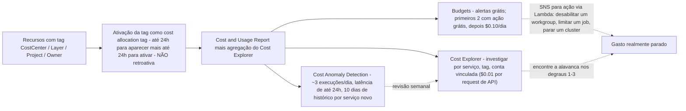
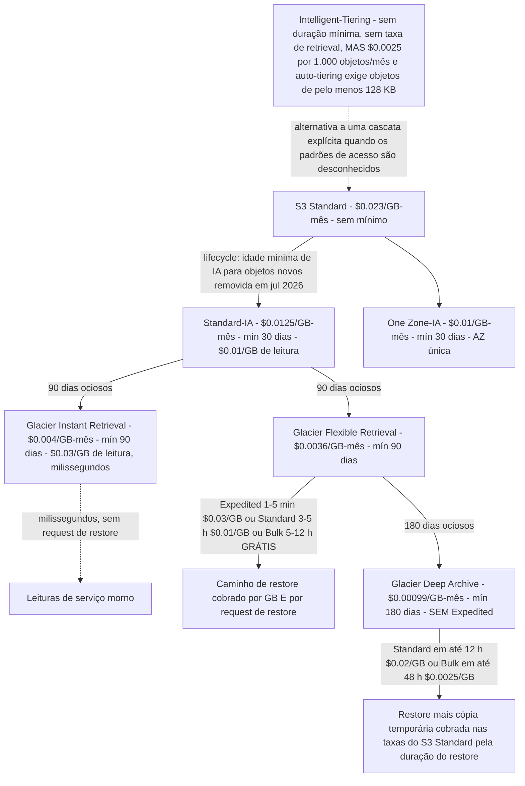
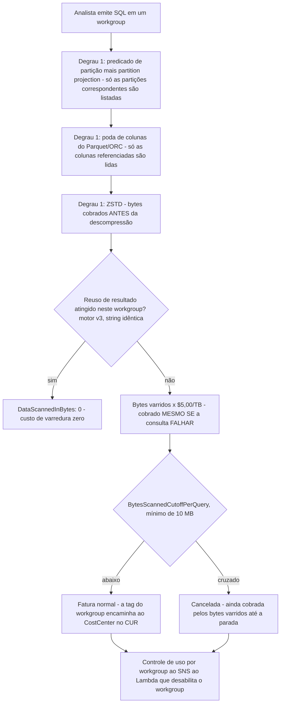
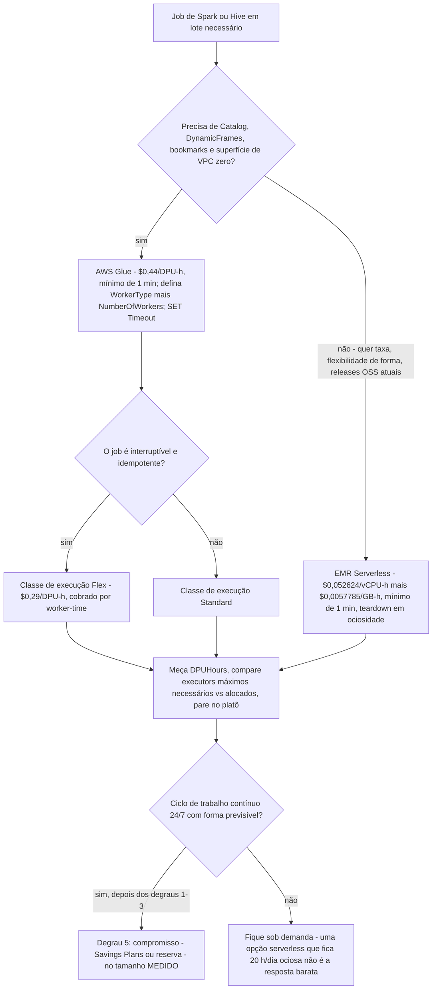

# Otimização de Custo e Lifecycle: dos Prefixos Quentes ao Glacier Deep Archive

As lições 01 to 15 construíram um lakehouse que funciona: armazenamento, formatos, tabelas, ingestão, um catálogo, transformação, consultas, um warehouse, orquestração, governança, tratamento de PII, segurança e observabilidade. Cada uma dessas decisões tem um **medidor** acoplado, e até agora esses medidores se juntaram em uma fatura mensal que ninguém consegue ler linha por linha. A má notícia: custo é a única propriedade de lakehouse que degrada em silêncio, porque a fatura chega um mês depois da decisão que a causou. A boa notícia: diferente de correção, custo tem uma **escada**: uma ordem fixa de operações que a própria orientação Well-Architected da AWS implica e que todo estudo de caso de custo publicado pela AWS segue.

Esta lição ensina essa escada de ponta a ponta: **formato → temperatura → escala acidental → gasto sem atribuição → compromissos**, nessa ordem, com as taxas de outubro de 2026 de us-east-1 que fazem cada degrau virar aritmética em vez de conselho. A única regra que organiza tudo abaixo: *nunca compre um desconto no tamanho errado, e nunca mova um byte para uma classe mais fria antes de saber quando você vai lê-lo de volta.*

```text
====================================================================
 A ESCADA DE CUSTO - AWS DATA LAKEHOUSE, AULA 16 (us-east-1, out 2026)
====================================================================
 Degrau 1 FORMATO ....... pague por menos bytes: colunar + compressão +
                          projection; o Athena cobra os bytes varridos ANTES
                          da descompressão ($5.00 / TB)
 Degrau 2 TEMPERATURA ... cascata de lifecycle: Standard $0.023 ->
                          Standard-IA $0.0125 (mín 30d) ->
                          Glacier IR $0.004 (90d) ->
                          Glacier FR $0.0036 (90d) ->
                          Deep Archive $0.00099 (mín 180d)
 Degrau 3 ACIDENTAL .... BytesScannedCutoffPerQuery do workgroup, Timeouts
                          de job, Max RPU-hours, AÇÕES de budget
                          (cancelar ainda cobra o que foi varrido)
 Degrau 4 ATRIBUIÇÃO ... cost allocation tags ativadas nos recursos:
                          CostCenter / Layer / Project (NÃO retroativas)
 Degrau 5 COMPROMISSOS . só agora compre descontos: reserved nodes do
                          Redshift, Serverless Reservations (24% / 45%),
                          Savings Plans, no tamanho MEDIDO
 Medidores ............. S3 GB-mês + requests; Athena $5/TB varrido;
                          Glue $0.44/DPU-h (mín 1 min); EMR Serverless
                          $0.052624/vCPU-h + $0.0057785/GB-h; Redshift
                          node-h ou RPU-h + RMS $0.024/GB-mês; QuickSight
                          $24 Author / $3 Reader / $0.38 SPICE GB-mês;
                          Kinesis $0.015/shard-h; MSK Serverless
                          $0.75/cluster-h + partitions + GB; KMS $1/key
                          + $0.03/10k requests; NAT $0.045/h + $0.045/GB
====================================================================
```

> [!NOTE]
> **Leia cada taxa com uma data.** Todo preço desta lição é **lista da AWS em us-east-1, acesso em 2026-10-11**, conferido contra o AWS Price List API offer publicado em **2026-09-28**. Outras Regiões variam, e a AWS muda essas tabelas: as *dimensões* (GB-mês, TB varrido, DPU-hour, RPU-hour, shard-hour, taxas por objeto) são muito mais estáveis que as *taxas*, então aprenda a dimensão primeiro e verifique o número em segundo lugar.

Nesta lição você vai:

- ler uma **tabela de formas de custo por serviço** que nomeia a unidade cobrável de cada camada do lakehouse antes de tocar em uma única alavanca;
- percorrer a **cascata de lifecycle do S3**, cada classe de armazenamento, duração mínima, taxa de retrieval e caminho de restore, e calcular um **TCO de três a cinco anos** para uma pegada de 60 TB;
- cair na **armadilha da taxa de monitoramento do Intelligent-Tiering** de propósito, no papel, com oito milhões de objetos minúsculos, para você nunca fazer isso em produção;
- cercar a camada de consulta do **Athena** com cortes de workgroup, partition projection, poda de colunas e ZSTD, e depois calcular **duas vezes a fatura mensal de 500 analistas**: antes e depois dos redutores;
- fazer **right-sizing** do **Glue** (DPU = 4 vCPU + 16 GB, $0.44/DPU-hour, mínimo de 1 minuto, timeout default de 48 horas no Glue 4.0 e anteriores) e esboçar **EMR Serverless versus Glue** em vCPU/GB-hours;
- aplicar as alavancas do **Redshift**: pause/resume, Redshift Managed Storage a $0.024/GB-mês, créditos de Concurrency Scaling e reservas do Serverless;
- escolher entre o preço **por usuário** do **QuickSight** e a capacidade de sessão de leitor com um cálculo de ponto de equilíbrio, e impedir que a capacidade de **SPICE** só suba;
- precificar as **formas de streaming** (shard-hours do Kinesis versus GB sob demanda, incrementos de 5 KB do Firehose, as cinco linhas do MSK Serverless) e os **multiplicadores silenciosos** (requests do KMS com e sem bucket keys, data events do CloudTrail, NAT versus gateway endpoints gratuitos);
- operar **Cost Explorer, Budgets e Cost Anomaly Detection** e etiquetar o ambiente com **CostCenter / Layer / Project** para que todo número seguinte seja legível;
- estudar a **GE Aerospace** (economia anual estimada >$500.000 no Redshift) e o **Transport for NSW** (~80% de corte no custo de integração de dados no Glue), mais uma **caixa de atualização de 2026 com fontes**;
- praticar com **doze questões de prova** e quatro verificações interativas (um plot de TCO, um matching de alavanca para serviço, um preenchimento de nomes de taxas e um arrastar-e-soltar da própria escada).

---

## 1. Anatomia de custo: o medidor de cada camada antes da alavanca

### 1.1 A escada de cinco degraus, e por que a ordem não é negociável

A disciplina de otimização de custo da AWS, documentada no pilar de custo do Well-Architected e repetida em todo estudo de caso de custo publicado pela AWS, é uma **sequência**, não um menu. Cada degrau é mais barato e mais seguro que o de baixo:

1. **Formato**: pare de pagar pelo *formato* errado dos dados. Formatos colunares, compressão e projeção de colunas fazem os scanners lerem menos bytes. Em um medidor por varredura, essa é a mudança de maior alavanca que existe, e não custa nada além de uma reescrita do caminho de gravação.
2. **Temperature**: pare de pagar pela *temperatura* errada. Regras de lifecycle movem dados envelhecendo para classes de armazenamento mais baratas com custo de configuração zero; você paga apenas a request de transição.
3. **Escala acidental**, pare de pagar por gasto *acidental*: cortes de scan em workgroup, timeouts de job, orçamentos de Max RPU-hour, ações de budget. Isso são disjuntores, não otimizações, eles limitam a cauda.
4. **Atribuição**: pare de pagar por gasto *sem atribuição*. Cost allocation tags por pipeline transformam uma fatura ilegível em N legíveis. Sem esse degrau, toda medição seguinte é chute.
5. **Compromissos**, só *agora* compre descontos: reserved nodes do Redshift, Serverless Reservations do Redshift, Savings Plans. Um compromisso baixa o preço unitário e não faz nada com a quantidade, e é por isso que o degrau 5 em um ambiente não otimizado é como você trava desperdício por um ou três anos.

> [!IMPORTANT]
> **A escada também é uma heurística de prova.** Dadas duas opções que "reduzem custo", a que fica **mais acima** na escada quase sempre é a melhor primeira resposta: layout vence capacidade, capacidade vence modelo de preço, e um compromisso sobre o tamanho errado é o distrator clássico. Leia o enunciado procurando uma restrição (ciclo de trabalho contínuo 24/7, tolerância a interrupção, SLA de latência) antes de deixar o degrau 5 vencer.

### 1.2 Formas de custo por serviço: a tabela que torna todo o resto legível

Cada linha nomeia a **unidade cobrável** primeiro, o **âncora de taxa de outubro de 2026 em us-east-1** segundo, e o **modo de falha que inflaciona a fatura** terceiro. Uma alavanca que não ataca a unidade cobrável do seu serviço não é uma alavanca.

| Camada | Serviço | Unidade cobrável | Âncora de taxa (us-east-1, out 2026) | Modo de falha que inflaciona |
|---|---|---|---|---|
| Armazenamento | S3 Standard / IA / classes Glacier | GB-mês + requests de transição | $0.023 → $0.0125 → $0.004 → $0.0036 → $0.00099 por GB-mês | Sobrescritas versionadas, versões não atuais nunca expiradas, objetos minúsculos, classe errada para a temperatura |
| Armazenamento | S3 Intelligent-Tiering | GB-mês **+ taxa por objeto de monitoramento** | $0.0025 por 1.000 objetos/mês | Milhões de objetos minúsculos; a taxa de monitoramento eclipsa o armazenamento |
| Armazenamento | S3 Batch Operations | por job + por operação de objeto | $0.25/job + $1.00 por 1M de operações | Usado para o que uma regra de lifecycle gratuita já faz |
| Catálogo | Glue Data Catalog | objetos de metadados/mês | Primeiros 1M grátis, depois $1.00 por 100.000 objetos/mês | Versões de tabela nunca expiradas, tabelas órfãs de pipelines churnados |
| Consulta | Athena SQL no S3 | **bytes varridos** | $5.00 por TB (mínimo de 10 MB por consulta em federated) | `SELECT *`, predicado de partição ausente, texto em vez de Parquet, sem reuso de resultados |
| Consulta | Athena Capacity Reservations | DPU-hours | $0.30 por DPU-hour | Reservar para um pico que nunca acontece; esquecer a granularidade de 1 minuto desde fev 2026 |
| Transformação | AWS Glue ETL / crawlers | DPU-hours (mín 1 min; crawler mín 10 min) | $0.44 por DPU-hour; Flex $0.29 | Default de 10 DPUs, timeout default de 2.880 minutos no Glue 4.0 e anteriores, executores ociosos |
| Transformação | EMR Serverless | vCPU-hours + GB-hours (mín 1 min) | $0.052624/vCPU-h + $0.0057785/GB-h | Formas de worker superdimensionadas; aplicativos deixados rodando |
| Warehouse | Redshift provisionado | node-hours + Redshift Managed Storage | ra3.4xlarge $3.26/node-h; RMS $0.024/GB-mês | Cluster rodando 24/7 para uma janela de lote de 8 horas; reserved nodes que o pause não para |
| Warehouse | Redshift Serverless | RPU-hours por segundo (mín 60 s) + RMS | $0.375/RPU-h; base de 4 RPU = $1.50/h | Sem orçamento de Max RPU-hours; sem reserva para uso contínuo |
| BI | QuickSight | por usuário-mês + SPICE GB-mês, ou capacidade de sessão | Author $24, Reader $3, SPICE $0.38/GB-mês; 500 sessões/mês por $250 | Leitores cobrados sem uso, datasets SPICE estacionados, carrasco de capacidade automática |
| Streaming | Kinesis Data Streams | shard-hours + unidades de payload PUT, ou GB com piso | $0.015/shard-h; $0.014/M units; sob demanda $0.08/GB (Standard) com piso de conta de 25 MB/s | Piso sob demanda pago por throughput nunca enviado; enhanced fan-out por consumidor-shard |
| Streaming | Firehose | GB ingeridos em **incrementos de 5 KB** | $0.029/GB (primeiros 500 TB); $0.045/GB para Iceberg a partir do Kinesis | Registros de menos de 5 KB cobrados como 5 KB; add-ons de dynamic partitioning e entrega em VPC |
| Streaming | MSK Serverless | cluster-hours + partition-hours + GB in/out + armazenamento | $0.75/cluster-h + $0.0015/partition-h + $0.10 in/GB + $0.05 out/GB + $0.10/GB-mês | Escolher semântica Kafka quando serviços por GB serviriam |
| Segurança | KMS | key-months + requests | $1.00/key-mês + $0.03 por 10.000 requests (20.000 grátis/mês) | Sem bucket keys em um lake de alto QPS; chaves por objeto em vez de uma chave de prefixo |
| Auditoria | CloudTrail data events | events entregues ao S3 | $0.10 por 100.000 data events | Registro de data events no bucket inteiro; seletores avançados não usados |
| Rede | NAT gateway | hours + GB processados | $0.045/h + $0.045/GB | Tráfego do S3 forçado pelo NAT quando existe um gateway endpoint gratuito |
| Rede | Interface endpoint | ENI-hours por AZ + GB | $0.01/h por AZ + $0.01/GB (primeiro PB) | Usado para S3/DynamoDB, que têm gateway endpoints gratuitos |
| FinOps | Cost Explorer API / Budgets | requests / budgets com ação habilitada | $0.01 por request de API; budgets grátis, primeiros 2 com ação grátis depois $0.10/dia | Polling com granularidade horária a $0.01 por 1.000 registros de uso |

### 1.3 Tags: o degrau que torna todo número seguinte legível

Quatro chaves de tag carregam quase toda a necessidade de atribuição de um lakehouse, aplicadas a **todo recurso que pode receber tag**: buckets e prefixos do S3 (via tags de objeto onde o serviço as suporta), jobs e crawlers e connections do Glue, workgroups do Athena, clusters e workgroups do Redshift, pastas e datasets do QuickSight, streams do Kinesis, clusters do MSK, NAT gateways e VPC endpoints:

| Chave de tag | Valores de exemplo | O que ela responde |
|---|---|---|
| `CostCenter` | `DA-4471`, `DA-4472`, `OPS-1180` | Qual linha de orçamento absorve este gasto? |
| `Layer` | `bronze`, `silver`, `gold`, `serving`, `archive` | Em qual estágio da arquitetura de medalhão isso está? |
| `Project` | `ad-sales`, `fraud-scores`, `supply-chain-ods` | Qual iniciativa de negócio isso serve? |
| `Owner` / `Environment` / `Pipeline` | `data-eng`, `prod` / `staging`, `ingest-orders` | Quem chamar, e isso é produção ou sandbox? |

Três regras duras, todas documentadas pela AWS:

1. **As tags precisam ser ativadas como cost allocation tags** antes de aparecerem no Cost Explorer ou em um relatório de alocação de custo, e a ativação pode levar **até 24 horas** para a chave aparecer na página de ativação, mais **outras até 24 horas** para entrar em vigor.
2. **Tags não são retroativas.** Elas afetam o relatório de faturamento apenas a partir do momento da ativação. Uma estratégia de tags lançada em outubro de 2026 não te diz nada sobre setembro.
3. Em **AWS Organizations**, as cost allocation tags são ativadas **apenas a partir da conta de gerenciamento (pagadora)**, e a AWS recomenda *um número pequeno de chaves de tag consistentes*: a dispersão é ela própria um custo, porque cada chave extra é um eixo extra para reconciliar.

### 1.4 Visibilidade antes da otimização: Cost Explorer, Budgets, Anomaly Detection

Você não otimiza o que não vê, e os três serviços de visibilidade de custo da AWS têm três trabalhos diferentes, e três faturas diferentes:

| Serviço | Trabalho | Custo (out 2026) | Latência e limites |
|---|---|---|---|
| **Cost Explorer** | Explorar e grafar gasto por serviço, tag, conta vinculada | Uso do console grátis; **requests de API $0.01 cada** na visão de faturamento principal ($0.01 por fonte em visões custom de faturamento); granularidade horária **$0.01 por 1.000 registros de uso** para 14 dias de histórico | Dados originados no Cost Explorer; detalhe horário custa dinheiro de verdade em escala |
| **AWS Budgets** | Alertar (e agir) sobre limiares | **Alertas grátis**; primeiros **dois budgets com ação grátis**, depois **$0.10 por dia** cada; e-mails de relatório de budget **$0.01 cada** | Caminho em tempo real: as **ações** de budget são o único recurso de budget que consegue parar gasto |
| **Cost Anomaly Detection** | Encontrar picos inesperados automaticamente | Anda sobre o Cost Explorer (sem cobrança publicada separada); **auto-configurado desde 2023-03-27** com um monitor de AWS Services e e-mail diário | Roda **~3 vezes por dia**; a detecção pode levar **até 24 horas**; um serviço recém-assinado precisa de **10 dias** de histórico; **não** monitora produtos de terceiros do Marketplace: use Budgets para esses |

A forma operacional que a AWS documenta: **Budgets para o disjuntor em tempo real** (limiar → SNS → ação via Lambda), **Cost Anomaly Detection como a rede de segurança semanal** (ele é lento por desenho), **Cost Explorer para a investigação** quando qualquer um dos dois dispara. Nenhum dos três consegue atribuir gasto a um pipeline sem as tags da seção 1.3.



> - **📚 Você sabia?** A ferramenta de FinOps mais barata da sua conta é uma **ação de budget**, não um dashboard: os dois primeiros budgets com ação habilitada são gratuitos, e uma ação pode desabilitar um workgroup do Athena ou desanexar uma política de IAM no momento em que um limiar estoura. O Cost Anomaly Detection, por mais inteligentes que sejam os modelos, não consegue parar nada, e pode levar até **24 horas** para notar uma fuga que uma ação de budget teria pego em minutos (documentação de AWS Budgets e Cost Anomaly Detection, acesso em 2026-10-11).

---

## 2. S3: a cascata de lifecycle, e a fatura de restore que ninguém modela

### 2.1 Cada classe, cada duração mínima, cada taxa de retrieval

Esta é a tabela mais valiosa da lição. As taxas de armazenamento são o título; **durações mínimas e taxas de retrieval é onde o desenho vive**.

| Classe / tier | $/GB-mês | Duração mínima | Taxa de retrieval $/GB | Tempo de retrieval |
|---|---|---|---|---|
| Standard (primeiros 50 TB/mês) | 0.023 | nenhuma | 0 | milissegundos |
| Standard-IA | 0.0125 | **30 dias** | 0.01 (fixo) | milissegundos |
| One Zone-IA | 0.01 | **30 dias** | 0.01 (fixo) | milissegundos |
| Intelligent-Tiering Frequent | 0.023 | nenhuma | **0** | milissegundos |
| Intelligent-Tiering Infrequent | 0.0125 | nenhuma | **0** | milissegundos |
| Intelligent-Tiering Archive Instant | 0.004 | nenhuma | **0** | milissegundos (re-hidrata) |
| Intelligent-Tiering Archive | 0.0036 | nenhuma | **0** | re-hidrata com latência |
| Intelligent-Tiering Deep Archive | 0.00099 | nenhuma | **0** | re-hidrata com latência |
| Glacier Instant Retrieval (GIR) | 0.004 | **90 dias** | 0.03 | milissegundos |
| Glacier Flexible Retrieval (GFR): Expedited | 0.0036 | **90 dias** | 0.03 | **1 to 5 minutos** |
| Glacier Flexible Retrieval: Standard | 0.0036 | **90 dias** | 0.01 | **3 to 5 horas** |
| Glacier Flexible Retrieval: Bulk | 0.0036 | **90 dias** | **0 (grátis)** | **5 to 12 horas** |
| Glacier Deep Archive (GDA): Standard | 0.00099 | **180 dias** | 0.02 | **em até 12 horas** |
| Glacier Deep Archive: Bulk | 0.00099 | **180 dias** | 0.0025 | **em até 48 horas** |
| Glacier Deep Archive, Expedited |, |, | **não oferecido** |, |
| Express One Zone (directory buckets) | 0.11 | nenhuma | 0 | milissegundos de dígito único |

Mais as taxas do lado da request que completam o quadro: as **requests de transição** de lifecycle custam $0.01 por 1.000 para Standard-IA / One Zone-IA / Intelligent-Tiering, $0.02 por 1.000 para Glacier Instant Retrieval e $0.05 por 1.000 para Glacier Deep Archive; as **taxas de request de restore** são $0.01 / $0.05 / $0.00 por 1.000 requests para Expedited / Standard / Bulk; objetos arquivados cobram adicionalmente **40 KB de metadados por objeto**; e toda classe arquivada cobra a sua **duração mínima por inteiro**: um objeto deletado ou re-transitado para fora do Deep Archive no dia 30 ainda cobra 180 dias.



### 2.2 Regras de lifecycle versus Batch Operations versus movimentações manuais

Uma **regra de lifecycle** transiciona ou expira **existentes e novos** objetos que casam com um filtro, e a configuração em si é gratuita: você paga apenas a request de transição ($0.01 to $0.05 por 1.000). A AWS não cobra nada para a regra continuar casando com objetos de amanhã. **S3 Batch Operations** é o caminho retroativo dirigido por manifesto: $0.25 por job mais $1.00 por milhão de operações de objeto, com um manifesto geralmente produzido pelo **S3 Inventory** a $0.0025 por milhão de objetos listados. **Re-enviar manualmente ou usar `CopyObject`** em milhões de objetos queima taxas de request PUT/COPY, precisa de uma frota de computação, e abre uma janela em que duas cópias são cobradas.

A regra prática: **reclassificação por idade = regra de lifecycle; reclassificação dirigida por tag ou manifesto = Batch Operations**. Você quase nunca precisa de Batch Operations para reclassificar objetos comuns que envelhecem, e pagar para que ele faça o trabalho de uma regra de lifecycle é uma fatura autoinfligida.

Três outras ações de lifecycle pertencem a todo bucket de produção, porque versionar sem elas é um multiplicador silencioso: **expirar versões não atuais** (`NoncurrentDays`), **limitar quantas versões não atuais são mantidas** (`MaxNoncurrentVersions`, válido de 1 a 100), e **abortar uploads multipart incompletos**. Com versionamento habilitado, todo PUT cria uma nova versão atual enquanto a versão anterior continua cobrada integralmente na taxa da sua classe: um bucket churnado pode cobrar várias vezes o seu tamanho "lógico" até que essas três regras existam.

### 2.3 Economia do restore: a cópia temporária é o verdadeiro choque

Restaurar um objeto arquivado cobra **duas coisas**, e só uma delas é intuitiva:

1. a **taxa de retrieval por GB** da tier de velocidade escolhida (tabela acima), mais a taxa de request de restore; **e**
2. uma **cópia temporária restaurada, cobrada nas taxas de armazenamento do S3 Standard**, pela duração que você escolher mantê-la: por cima do objeto arquivado que você ainda está pagando.

Então um restore do Deep Archive é barato na linha de retrieval ($0.0025/GB Bulk) e caro no *plano*: 48 horas de latência, uma cópia temporária a $0.023/GB-mês rateada, e nenhuma opção Expedited a qualquer preço. Restores do Deep Archive devem portanto ser **agendados**, nunca casuais: Bulk para backfills planejados, Standard apenas para emergências reais de 12 horas. E lembre do penhasco da duração mínima pelo avesso: se o seu padrão de acesso diz "podemos ler isso dentro de 90 dias", a duração mínima de 180 dias do Deep Archive significa que a classe está errada, não que você deva aceitar o risco.

> - **📚 Você sabia?** O Deep Archive **não tem tier de retrieval Expedited**: as opções de velocidade param no Standard (em até 12 horas) e no Bulk (em até 48 horas). Qualquer diagrama de arquitetura que mostre um caminho "instantâneo" de saída do Deep Archive está inventando uma tier que a AWS não vende (documentação do Amazon S3 Glacier, acesso em 2026-10-11).

### 2.4 Exemplo resolvido E1: um lakehouse de 60 TB, três anos, depois cinco

O cenário: um **lake operacional de 50 TiB**, 20 TiB quentes curados no S3 Standard, 25 TiB mornos no Standard-IA, 5 TiB frios no Glacier Instant Retrieval, mais **10 TiB de histórico de compliance no Glacier Deep Archive**. Uma **pegada de 60 TiB**, mantida por três anos. A AWS cobra GB como 1.073.741.824 bytes, então TiB → GB é ×1.024.

```text
Exemplo resolvido E1 - TCO de lifecycle, lista de us-east-1, em outubro de 2026
Pegada: 20 TiB quentes + 25 TiB mornos + 5 TiB frios + 10 TiB de arquivo = 60 TiB

ARMAZENAMENTO MENSAL
  Quentes ..... 20.480 GB x $0.023 ......... $471,04
  Mornos ...... 25.600 GB x $0.0125 ........ $320,00
  Frios .......  5.120 GB x $0.004 .........  $20,48
  Arquivo ..... 10.240 GB x $0.00099 ........  $10,14
  TOTAL MENSAL .............................. $821,66

LINHA DE BASE - os mesmos 60 TiB no S3 Standard pelos três anos
  61.440 GB x $0.023 .................... $1.413,12 / mês

TOTAIS DE TRÊS ANOS (manutenção plana, sem eventos de retrieval)
  Por camadas ..... $821,66 x 36 ........... $29.579,76  (~$29.580)
  Todo Standard ... $1.413,12 x 36 ........ $50.872,32  (~$50.872)
  ECONOMIA ........ $591,46 / mês .......... $21.292,56  (~$21.293, ~42%)

EXTENSÃO DE CINCO ANOS (mesma premissa de manutenção plana)
  Por camadas ..... $821,66 x 60 ........... $49.299,60
  Todo Standard ... $1.413,12 x 60 ........ $84.787,20
  ECONOMIA ........ $35.487,60
```

```plot
{
  "type": "line",
  "title": "TCO acumulado: lakehouse de 60 TiB em camadas vs todo Standard (exemplo resolvido E1, lista de us-east-1, em outubro de 2026)",
  "xLabel": "Anos mantidos",
  "yLabel": "Custo acumulado (USD)",
  "xKey": "year",
  "data": [
    {"year": "Year 1", "Tiered lifecycle waterfall": 9859.92, "All S3 Standard": 16957.44},
    {"year": "Year 2", "Tiered lifecycle waterfall": 19719.84, "All S3 Standard": 33914.88},
    {"year": "Year 3", "Tiered lifecycle waterfall": 29579.76, "All S3 Standard": 50872.32},
    {"year": "Year 4", "Tiered lifecycle waterfall": 39439.68, "All S3 Standard": 67829.76},
    {"year": "Year 5", "Tiered lifecycle waterfall": 49299.60, "All S3 Standard": 84787.20}
  ],
  "dataKeys": ["Tiered lifecycle waterfall", "All S3 Standard"]
}
```

O intervalo cresce em **$591,46 a cada mês** e é inteiramente uma decisão do degrau 2: nenhum código mudou, nenhuma consulta foi ajustada, nenhum compromisso foi comprado. Agora os dois eventos que quebram os modelos de arquivo, **leituras** e **a fatura única de transição**, que pertencem à mesma planilha do armazenamento.

### 2.5 Exemplo resolvido E1b: cenários de restore e a fatura única de transição

O mesmo ambiente de 60 TiB. Quanto custa **ler 1 TiB de volta**, por caminho, e quanto custou **reclassificar 45 TiB existentes** dele?

```text
Exemplo resolvido E1b - aritmética de retrieval + transição (us-east-1, out 2026)

LER 1 TiB (1.024 GB) DE CADA CAMADA - apenas taxa de retrieval, por GB
  Do Standard-IA (leitura IA fixa) .... 1.024 x $0.01 ..... $10,24  (ms)
  Do Glacier Instant Retrieval ....... 1.024 x $0.03 ..... $30,72  (ms)
  Do Deep Archive via BULK ........... 1.024 x $0.0025 ...  $2,56  (48 h)
  Do Deep Archive via STANDARD ....... 1.024 x $0.02 ..... $20,48  (12 h)
  MAIS para cada caminho: a cópia temporária restaurada nas taxas de
  armazenamento do S3 Standard ($0.023/GB-mês, rateada para a duração
  de restore que você escolher) + taxas de request de restore
  ($0.01 / $0.05 / $0.00 por 1.000 para Expedited / Standard / Bulk).
  LER VIA BULK DO DEEP ARCHIVE É 8x MAIS BARATO QUE VIA STANDARD - mas
  custa 48 horas e a cópia temporária. Esse trade é o desenho.

TRANSIÇÃO DE LIFECYCLE ÚNICA DE UM LAKE EXISTENTE DE 45 TiB
  Objetos: 45 TiB com média de brinquedo de 100 MB = 46.080 GB / 0,1 GB
           = 460.800 objetos
  Para Standard-IA ........ 460.800 / 1.000 x $0.01 =   $4,61
  Para Glacier IR .......... 460.800 / 1.000 x $0.02 =   $9,22
  Para Deep Archive ........ 460.800 / 1.000 x $0.05 =  $23,04
  TOTAL ÚNICO ........................................ $36,86
  Compare: a economia mensal de camadas neste lake
  (E1) é de centenas de dólares. A regra de lifecycle
  se paga na PRIMEIRA SEMANA. Um CopyObject manual de
  460.800 objetos cobraria adicionalmente PUT/COPY a
  $0.005 por 1.000 = $2,30 só em requests - e precisaria
  de uma frota de computação, e abriria uma janela de
  cópia dupla.
```

### 2.6 Intelligent-Tiering: a armadilha da taxa de monitoramento em objetos minúsculos

Intelligent-Tiering é o default mais seguro quando os padrões de acesso são **genuinamente desconhecidos**: sem duração mínima, **sem taxas de retrieval**, movimentação automática entre as tiers Frequent, Infrequent, Archive Instant, Archive e Deep Archive Access com base no acesso observado (objetos ociosos por 30 dias vão para a tier Infrequent, 90 dias para Archive Instant, e Deep Archive Access exige um mínimo de 180 dias consecutivos de ociosidade). Mas é um **negócio de monitoramento**: cobra **$0.0025 por 1.000 objetos por mês** de monitoramento e automática, e apenas objetos de **pelo menos 128 KB** são elegíveis para auto-tiering de modo algum. Para objetos grandes e mornos a taxa é um erro de arredondamento; para milhões de objetos minúsculos ela é a fatura.

### 2.7 Exemplo resolvido E2: oito milhões de objetos minúsculos "poupados" pelo Intelligent-Tiering

Um lake de eventos pousa fragmentos minúsculos no Intelligent-Tiering "para economizar dinheiro". Nada neste desenho economiza dinheiro.

```text
Exemplo resolvido E2 - a armadilha de monitoramento do Intelligent-Tiering (us-east-1, out 2026)
Cenário: 8.000.000 objetos com média de 4 KB, no Intelligent-Tiering
  Dados totais ... 8.000.000 x 4 KB = 32.000.000 KB = 30,52 GB

  Taxa de monitoramento ... 8.000.000 / 1.000 x $0.0025 = $20,00 / mês
  Armazenamento (Frequent) 30,52 GB x $0.023 ............  $0,70 / mês
  TOTAL ................................................ $20,70 / mês
  -> a TAXA DE MONITORAMENTO é ~28x o armazenamento que ela protege
  -> objetos abaixo de 128 KB NÃO são elegíveis para auto-tiering de
     modo algum, então este desenho paga o negócio de monitoramento e
     não ganha nenhum benefício do tiering automático

  Os mesmos 30,52 GB em S3 Standard puro ........... $0,70 / mês
  -> o Intelligent-Tiering deixou este lake ~30x MAIS caro

CORREÇÃO (a) - agregar antes de pousar: compactar em objetos de 100 MB
  Objetos ....... 30,52 GB / 0,1 GB = ~305 objetos
  Monitoramento . 305 / 1.000 x $0.0025 = $0,0008 / mês
  (também conserta o desempenho do Athena - a mesma alavanca do degrau 1)

CORREÇÃO (b) - se os objetos genuinamente são >= 128 KB e frios, use
  transições de LIFECYCLE para Standard-IA / Glacier: $0.01-$0.05 por
  1.000 requests de transição, e SEM taxa de monitoramento, nunca.

LEMBRETE DE ESCALA: 100.000.000 de objetos no Intelligent-Tiering =
$250/mês só de monitoramento, antes de um único GB de armazenamento.
```

A regra de decisão que sai do E2: **o Intelligent-Tiering é para objetos grandes, mornos, com acesso desigual e padrões desconhecidos; as classes explícitas de lifecycle são para objetos que você entende; e nenhum dos dois pertence a objetos menores que 128 KB**: esses devem ser compactados na gravação, o que é uma correção de custo e de desempenho de consulta em um movimento só.

### 2.8 Replicação pode mirar uma classe mais barata, mas cobra em dobro

A classe de armazenamento de destino é uma configuração de replicação de primeira linha: você pode replicar **direto para Glacier Flexible Retrieval, Glacier Deep Archive, Intelligent-Tiering** e as outras classes (o `StorageClass` de destino no CloudFormation aceita `DEEP_ARCHIVE`, `GLACIER`, `GLACIER_IR`, `INTELLIGENT_TIERING`, `ONEZONE_IA`, `STANDARD`, `STANDARD_IA`; o default é manter a classe de origem). A região de DR portanto nunca paga taxas Standard por uma cópia que ninguém lê.

A pegada é aritmética, não de capacidade: **você paga pelas duas cópias**, mais os custos de request de replicação, mais **$0.015 por milhão de objetos por mês** no bucket de origem de monitoramento de replicação. Replicar para uma classe mais barata é um **padrão de recuperação de desastres e compliance**, não um desconto de armazenamento: modele como "a cópia de DR é barata o suficiente para manter para sempre", nunca como "isso corta minha fatura do S3 pela metade".

---

## 3. A camada de consulta: o Athena cobra bytes varridos, então toda varredura é uma decisão de desenho

### 3.1 O medidor e os quatro redutores multiplicativos

Athena SQL no S3 custa **$5,00 por TB varrido** em us-east-1: cobrado **tanto para consultas bem-sucedidas quanto para as mal-sucedidas** (consultas federadas somam um mínimo de 10 MB por consulta e agregam entre fontes de dados), mais as cobranças normais de requests do S3 para gravar e ler resultados. Em um modelo de preço por varredura, **otimizar é faturar**. Quatro redutores independentes se empilham **multiplicativamente**:

1. **Particionamento e partition projection**: só as partições correspondentes são listadas e lidas. A projection calcula valores de partições a partir de propriedades da tabela em vez do catálogo, o que evita completamente a consulta de metadata; ative-a e o Athena ignora os metadados de partição do catálogo, então ela exige predicados em todas as chaves projetadas e degrada onde **mais da metade das partições projetadas está vazia**. O Athena pode ler no máximo **1 milhão de partições em uma única varredura** (tabelas do Glue suportam até 10 milhões).
2. **Projeção de colunas**: Parquet e ORC leem apenas as colunas referenciadas.
3. **Compressão**, **você paga pelos bytes varridos antes da descompressão**, então ZSTD/GZIP reduz a fatura do Athena e a do S3 ao mesmo tempo. **ZSTD é a compressão padrão de tabelas Iceberg na versão do motor 3** (nível 3), e a AWS recomenda o nível 3 ou 6 to 9 para gravações em Parquet/ORC; níveis acima de 19 exigem memória séria. Mantenha os row groups do Parquet no default de 128 MB e as stripes do ORC em 64 MB, encolhê-los abaixo do default não é recomendado.
4. **Reuso de resultados**, re-execuções de uma consulta idêntica na versão do motor 3 **no mesmo workgroup** retornam o resultado em cache com `DataScannedInBytes: 0`, com idade default de até **60 minutos** e máximo de **7 dias**. SQL não determinístico (`rand()`, `shuffle()`) contorna isso, e também **permissões de linha/coluna do Lake Formation** e **consultas federadas**, que sempre re-executam.

O exemplo resolvido da própria AWS do mecanismo: 3 TB de texto sem compressão, uma coluna selecionada, sem compressão = 3 × $5 = **$15**; com compressão 3:1 = **$5**; como Parquet com compressão 3:1 e seleção de colunas 4:1 = **$1,25**. Três alavancas, doze vezes mais barato, mesma consulta.

### 3.2 Disjuntores de gasto do workgroup: circuit breakers da camada de consulta

Workgroups são simultaneamente a unidade de isolamento e a unidade de controle de custo, e a AWS documenta um padrão de produção com dois workgroups:

- **Corte por consulta**, `BytesScannedCutoffPerQuery` (mínimo de API de **10.000.000 bytes = 10 MB**) cancela uma consulta desgovernada no instante em que ela cruza o limiar. A consulta cancelada **ainda é cobrada por tudo o que foi varrido até a parada**, o corte limita a cauda, ele nunca dá desconto na cabeça.
- **Controles de uso por workgroup**: levantar um alarme SNS, e a escalação documentada é uma **função Lambda que desabilita o workgroup** quando uma marca de nível mais alto dispara.
- **Cost allocation tags no workgroup**: etiquete cada workgroup (digamos, `Name=ad-hoc-users`, `Dept=analytics`) para que o gasto do Athena aterrisse sob o `CostCenter` certo no Cost and Usage Report.

O Athena também vende **Capacity Reservations** a **$0,30 por DPU-hour** (uma reserva de 160 DPUs para uma hora de pico de 15 minutos custa 160 × $0,30 × 0,25 = **$12,00** no exemplo resolvido da AWS) e **sessões de Spark a $0,35 por DPU-hour**: a opção do degrau 5, depois que os degraus 1 to 3 já fizeram o seu trabalho. Existem até **1.000 workgroups por Região** como teto, que é capacidade para um workgroup por time ou pipeline, não um por usuário.



### 3.3 Exemplo resolvido E3: 500 analistas, 50 GB por dia, antes e depois dos redutores

Este é o cálculo que todo time de analytics deveria saber reproduzir de memória, porque é ele que decide se o Athena é uma linha de fatura ou um erro de arredondamento.

```text
Exemplo resolvido E3 - carga de trabalho de analistas no Athena (us-east-1, out 2026)
População: 500 analistas, 50 GB varridos por analista por dia útil,
21 dias úteis por mês. GB -> TB: 1.024 GB = 1 TB.

LEITURA A - 50 GB por analista por DIA ÚTIL
  Por dia ....... 500 x 50 GB = 25.000 GB = 24,414 TB
  Por dia ....... 24,414 x $5,00 = $122,07
  Por mês ....... $122,07 x 21 = $2.563,47  (~$2.563)

LEITURA B - se o briefing quisesse dizer 50 GB por analista por MÊS
  Total ......... 500 x 50 GB = 25.000 GB = 24,414 TB
  Por mês ....... 24,414 x $5,00 = $122,07  (~$122)
  (a diferença entre as duas leituras é de 21x - sempre fixe a
  unidade antes de apresentar um modelo de custo)

AGORA EMPILHE OS REDUTORES DOCUMENTADOS SOBRE A LEITURA A
  Particionamento + colunar + projeção de colunas (o próprio mecanismo
  3 x 3 x 4 da página de preços, plausivelmente 10x menos varredura
       ......................................... $2.563 -> ~$256 / mês
  Reuso de resultados absorvendo 40% das consultas repetidas de dashboard
       ......................................... ~$256 -> ~$154 / mês

BARREIRAS (degrau 3) NA MESMA CARGA DE TRABALHO
  Corte por consulta de 1 GB (1.073.741.824 bytes):
       1 GB x $5,00 / 1.024 GB = $0,0049 de custo de varredura máximo
       por consulta morta
  Controle por workgroup de 20 TB/mês com SNS ao Lambda de desabilitação:
       20 x $5,00 = $100 de pior caso mensal absoluto antes da
       automação conter o sangramento

COMPARAÇÃO DO DEGRAU 5 (capacidade, apenas depois do acima)
  Reserva de 160 DPUs para os 15 minutos de pico de cada hora:
       160 x $0,30 x 0,25 h = $12,00 por hora (exemplo resolvido da AWS)
```

A lição do E3 é a **proporção**: os redutores levaram **~$2.563 até ~$154**, uma redução de 16x, antes de alguém comprar qualquer coisa. Um time que negocia um compromisso enquanto ainda roda `SELECT *` sobre arquivos de texto pulou os degraus 1 e 2 para economizar centavos no degrau 5.

---

## 4. Transformação: right-sizing de DPU do Glue, cobrança de um minuto e o esboço do EMR Serverless

### 4.1 O que o Glue de fatura, e onde os defaults mordem

O Glue ETL é **$0,44 por DPU-hour**, **cobrado por segundo com mínimo de 1 minuto** (crawlers carregam mínimo de **10 minutos**; tarefas de Data Quality têm mínimo de 1 minuto com chão de 2 DPUs). Uma **DPU é 4 vCPUs de computação e 16 GB de memória**. Existem dois modelos de capacidade, divididos por versão:

- **Jobs no estilo do Glue 1.0** especificam capacidade provisionada via `MaxCapacity` em DPUs (**mínimo 2, máximo 100, default 10**).
- **Jobs do Glue 2.0 e posteriores não podem definir capacidade máxima alguma**: eles especificam um **tipo de worker × número de workers**: G.1X = 1 DPU, G.2X = 2 DPU, até G.16X; **G.025X** é um quarto de DPU para streaming de baixo volume a um quarto do custo; workers R.\* são otimizados para memória em **M-DPUs** (4 vCPU + 32 GB); Z.2X é o worker Ray (2 M-DPU, 8 workers Ray). Jobs de Spark alocam **2 a 100 DPUs, default 10**; jobs de shell Python usam 0,0625 ou 1 DPU. Jobs criados sem versão defaultam para **Glue 5.1**.

Três defaults se escondem nessa tabela: uma **alocação default de 10 DPUs**, um **timeout default de job de 2.880 minutos (48 horas) no Glue 4.0 e anteriores** (480 minutos no Glue 5.0 e posteriores; máximo rígido logo abaixo de 7 dias), e a **classe de execução Flex a $0,29 por DPU-hour** para capacidade interruptível, cobrada por worker-time em vez de capacidade-máxima × tempo de parede. Right-sizing é uma atividade **medida**: compare os *executors máximos necessários* contra os *executors máximos alocados*, e pare de escalar quando o tempo de parede parar de melhorar: no exemplo publicado pela própria AWS o job melhora de 10 DPUs / 6 minutos para 55 DPUs / 3 minutos e **100 DPUs não compra nada mais**.

### 4.2 Exemplo resolvido E4: um job desgovernado, um job right-sized e a alternativa EMR Serverless

```text
Exemplo resolvido E4 - idle-timeout do Glue, right-sizing, Flex, EMR Serverless
(lista de us-east-1, em outubro de 2026)

O BUG: um job do Glue 4.0 com 10 DPUs gira até o timeout default
  Timeout default .... 2.880 minutos = 48 horas
  Custo sem teto ..... 10 DPUs x 48 h x $0,44 = $211,20  (uma noite ruim)
  Com Timeout=60 min  10 DPUs x 1 h x $0,44 =   $4,40
  -> o PARÂMETRO DE TIMEOUT é uma alavanca de custo de 48x e custa
     nada para configurar. O Glue 5.x defaulta para 480 minutos (8 h) -
     ainda é um bug caro se ninguém definir um limite mais apertado.

RIGHT-SIZING (método: executors máximos necessários vs máximos alocados)
  Medido: executors máximos necessários 17, alocados em 10 DPUs
  10 DPUs -> 6 minutos de tempo de parede
  55 DPUs -> 3 minutos de tempo de parede   (vale a pena)
  100 DPUs -> 3 minutos                     (NÃO vale a pena - platô)
  Regra: escale para fora só até os executors ficarem ociosos.

CLASSE DE EXECUÇÃO FLEX (capacidade interruptível)
  A própria comparação da AWS de um job:
    Standard, 6 DPUs x 0,25 h x $0,44 ......... $0,66
    Flex,     6 DPUs x 1/3  h x $0,29 ......... $0,58
    Mesmo job, mesma saída, capacidade mais barata - um lote elegível
    para Flex que termina quando há capacidade disponível. Nunca coloque
    trabalho sensível a latência ou não idempotente no Flex.

HORA EQUIVALENTE DO EMR SERVERLESS (o esboço de custo)
  Uma DPU G.1X do Glue = 4 vCPU + 16 GB
  Glue ............ $0,44 por DPU-hour
  EMR Serverless .. 4 vCPU x $0,052624 = $0,210496
                    16 GB  x $0,0057785 = $0,092456
                    TOTAL = $0,302952 ~ $0,303 por hora  (~31% menos)
  Mas a comparação é DE PONTA A PONTA: o Glue mantém o Data Catalog,
  DynamicFrames, job bookmarks e nenhuma superfície de VPC ou de
  gerenciamento de aplicação; o EMR Serverless vence na taxa, na
  flexibilidade de forma de worker (1-16 vCPU, 2-120 GB por worker) e
  nas versões atuais de Spark e Hive de código aberto - e ambos cobram
  mínimo de 1 minuto com teardown automático em ociosidade. O
  estimador público de custo do EMR Serverless da AWS analisa logs de
  eventos do Spark em core-hours e GB-hours para tornar isso exato.
```

> - **📚 Você sabia?** O Glue publica uma **métrica do CloudWatch `DPUHours`** por execução de job (as dimensões incluem JobName, JobRunId, JobType, GlueVersion e ExecutionClass), então um alarme de budget pode disparar sobre *DPU-hours consumidos*, e não sobre tempo de parede: a única maneira confiável de pegar o caso do E4 antes que o timeout pegue. Ligar métricas de job, logs de aplicação e continuous logging acrescenta cobranças próprias do CloudWatch, então habilite-as onde o valor do alarme superar o custo dos logs (AWS Big Data Blog, 2023-04-28).



---

## 5. Redshift: pause/resume, armazenamento gerenciado, créditos de concurrency, RPUs do Serverless

A perna de warehouse do lakehouse tem **três medidores**, e a maioria dos argumentos de preço de tabela confunde eles:

1. **Computação, provisionada**: nós RA3 e RG são cobrados por hora (o exemplo resolvido da própria AWS precifica ra3.4xlarge a **$3,26 por node-hour** sob demanda: 4 nós × $3,26 × 730 horas = **$9.519,20 por mês**). Reserved nodes dão desconto nisso de cerca de **20% (No Upfront)** até **42 to 76% (All Upfront)**.
2. **Armazenamento, sempre separado**, **o Redshift Managed Storage cobra $0,024 por GB-mês** quer os dados estejam em SSDs locais quer no S3. Esse é o ponto de desenho do RA3: pare de pagar por disco local que você só enchia de dados frios. 10 TiB de armazenamento gerenciado = 10.240 GB × $0,024 = **$245,76 por mês**.
3. **Computação serverless**, RPU-hours **por segundo com mínimo de 60 segundos** a **$0,375 por RPU-hour** em us-east-1 (1 RPU ≈ 16 GB); a **base de 4 RPU é $1,50 por hora**; **não há cobrança enquanto nenhuma consulta roda**, e Spectrum mais Concurrency Scaling estão incluídos. Limite com as configurações de **Max RPU-hours** e Max capacity; **Serverless Reservations cortam a computação em até 24% (1 ano) ou 45% (3 anos)**, a resposta do degrau 5 para uma carga serverless contínua.

**Pause/resume** suspende a cobrança de computação **sob demanda**: enquanto pausado você paga apenas o armazenamento de backup, o que torna clusters de dev/test e janelas de lote baratos. A armadilha: **cobranças de reserved node continuam durante a pausa**, porque você comprou o nó, não o tempo ligado. **Concurrency Scaling** rende **uma hora grátis de crédito de cluster transitório a cada 24 horas** por cluster ativo, acumulável até **30 horas** (créditos não expiram enquanto o cluster vive), depois é cobrado por segundo com mínimo de um minuto **apenas enquanto o cluster transitório serve consultas**. E **Spectrum em clusters provisionados cobra $5,00 por TB varrido**, o mesmo medidor do Athena, então o degrau 1 (poda, layout colunar) dá desconto nos dois motores ao mesmo tempo.

### 5.1 Exemplo resolvido E5, o warehouse que dorme

```text
Exemplo resolvido E5 - formatos de Redshift (lista de us-east-1, em outubro de 2026)
Carga de trabalho: uma consulta de 10 minutos por dia, mais 10 TiB de armazenamento gerenciado.

SERVERLESS NO CHÃO DE 4 RPU
  Por consulta ... (600 s / 3.600 s) x 4 RPU x $0,375 = $0,25
  Por mês ........ $0,25 x 30 = $7,50 de computação
  Tempo ocioso ... $0 (sem cobrança quando não há consultas; o mínimo de
                  60 segundos se aplica por período de faturamento, não
                  por hora ociosa)
  Armazenamento . 10.240 GB x $0,024 = $245,76 / mês
  TOTAL ......... ~$253 / mês

ALTERNATIVA PROVISIONADA - os mesmos 10 TiB em RA3
  1 x ra3.4xlarge ...... $3,26 x 730 = $2.379,80 / mês de computação
  exemplo resolvido com 4 nós  4 x $3,26 x 730 = $9.519,20 / mês
  Armazenamento ... $245,76 (mesma taxa de RMS nos dois casos)
  -> um cluster provisionado para uma carga de trabalho de 10 minutos
     por dia paga ~726 horas ociosas por mês, a menos que você o PAUSE:
     clusters sob demanda pausados cobram só armazenamento de backup
     (cobranças de reserved node NÃO param - você alugou o nó).

DEGRAU 5, POR ÚLTIMO: Serverless Reservations reduzem a computação em
até 24% (1 ano) ou 45% (3 anos); reserved nodes ~20% a 42-76%.
$7,50 x 36 meses = $270 de computação vitalícia - uma reserva de 45%
economiza ~$121 em três anos. Correto, e quase sem importância. Na
cifra provisionada de $9.519,20 o mesmo percentual é dinheiro de
verdade - e é exatamente por isso que a escada diz medir e right-size
PRIMEIRO.
```

---

## 6. A camada de BI: os dois eixos de preço do QuickSight e o pool de SPICE

O QuickSight precifica **dois eixos ao mesmo tempo**, e uma esteira de dashboards pode ser otimizada em qualquer um deles:

- **Por usuário (Enterprise):** Author **$24 por usuário-mês**, Reader **$3 por usuário-mês**, mais **SPICE a $0,38 por GB-mês** além dos **10 GB incluídos em cada Author provisionado**. O Standard Edition é **$9 por usuário-mês anual** (ou $12 mensal) com 10 GB por usuário incluídos e **$0,25 por GB adicional**. Cada dataset de SPICE em Enterprise suporta no máximo **1 bilhão de linhas por 1 TB** de tamanho.
- **Capacidade:** sessões de leitor vendidas em pacotes: **500 sessões por mês por $250** ($0,50 por sessão), com tiers anuais descendo até **$0,40** em 50.000 sessões/ano, $0,28 em 200.000, $0,24 em 400.000, $0,20 em 800.000 e **$0,16 por sessão** em 1,6 milhão de sessões/ano. **Uma sessão é um período de 30 minutos**, não uma visualização, e **o preço por capacidade é obrigatório para o refresh programático** de dashboards.

O por-usuário vence para uma população **conhecida e contínua**; a capacidade vence para consumo **espinhento, embarcado ou programático**. A própria SPICE é um **pool compartilhado por Região**: capacidade comprada em uma Região não pode ser usada em outra, **datasets permanecem na SPICE até alguém removê-los**, e **a compra automática de capacidade está ligada por default** para contas criadas no console, a clássica catraca silenciosa que sobe o seu pool e nunca desce (desligá-la depois deixa o pool atual como a sua capacidade comprada). Por fim, a escolha de modo move o medidor: **Import (SPICE)** converte custo de consulta em um $/GB-mês fixo com atraso de refresh, enquanto **Direct Query** empurra cada interação de visualização de volta para Athena/Redshift, a economia de bytes varridos da seção 3, multiplicada pelas contagens de visualização de dashboard.

### 6.1 Exemplo resolvido E6: 10 Authors, 400 Readers, 500 GB de SPICE

```text
Exemplo resolvido E6 - mistura do QuickSight (lista de us-east-1, em outubro de 2026)

POR USUÁRIO (Enterprise)
  10 Authors x $24 ...................    $240
  400 Readers x $3 ...................  $1.200
  500 GB de SPICE x $0,38 ...........    $190
  TOTAL .............................  $1.630 / mês

ALTERNATIVA DE CAPACIDADE DE SESSÕES DE LEITOR (pacote mensal de 500 sessões, $250)
  Com 8.000 sessões/mês (20 por leitor): 16 pacotes = $4.000
    -> o POR USUÁRIO VENCE por $2.370
  Com 2.000 sessões/mês: 4 pacotes = $1.000 vs $1.200 por usuário
    -> a CAPACIDADE VENCE por $200

PONTO DE EQUILÍBRIO (plano mensal): $3,00 por leitor / $0,50 por sessão
  = 6 sessões por leitor por mês.
  Abaixo de 6 -> por usuário. Acima de 6 -> capacidade. Os tiers anuais
  empurram o ponto de equilíbrio para cima (50.000 sessões/ano =
  $20.000 = $0,40 por sessão).

E AS ALAVANCAS SILINCIOSAS: 10 GB de SPICE estão incluídos por Author
(10 Authors = 100 GB do pool antes de excedente); datasets estacionados
na SPICE mantêm a capacidade - e a fatura - vivas; uma taxa de
infraestrutura de $250/mês por conta se aplica a contas com usuários
Pro ou tópicos de Q&A. A correção operacional documentada: um dashboard
dirigido pelo CUR que encontra leitores faturados porém inativos
(padrones de linha de item como qs-reader%, %-reader-pro%) e
utilização de SPICE (%spice) - Glue sobre o Athena no Cost and Usage
Report, exibido no próprio QuickSight.
```

> - **📚 Você sabia?** O preço de Reader é escrito apenas para **interações de sessão manuais**: a AWS reserva o direito de cobrar um leitor na taxa mais alta de Author se sessões de leitor forem usadas para consultas programáticas ou automatizadas. Analytics embarcados que consultam dashboards em um timer é o caminho documentado de choque de fatura, e é exatamente o uso que **exige** preço por capacidade em vez de por usuário (preço e FAQs do Amazon QuickSight, acesso em 2026-10-11).

---

## 7. Formas de streaming: shard-hours, GB-com-piso, incrementos de 5 KB, cluster-hours

Serviços de streaming parecem iguais em um diagrama de arquitetura e cobram quatro unidades diferentes. O resumo relevante para o lakehouse: **Firehose + Kinesis são baratos por GB; MSK é caro por hora: escolha MSK apenas quando precisar de semântica Kafka que a alternativa não pode fornecer.**

- **Kinesis Data Streams, provisionado:** shard-hours a **$0,015 por shard-hour**, unidades de payload PUT contadas em **chunks de 25 KB** a **$0,014 por milhão**, retenção estendida opcional a **$0,020 por shard-hour**, e enhanced fan-out a **$0,015 por shard-hour por consumidor-shard**.
- **Kinesis on-demand Standard:** por GB, com um **piso no nível da conta de 25 MB/s ingeridos e 25 MB/s recuperados** em todos os streams on-demand, streams pequenos podem pagar por throughput que nunca enviam. O **Advantage** on-demand (introduzido em 2025-11-04) remove a cobrança por hora do stream e corta a ingestão para **$0,032/GB**, com mínimo comprometido de **25 MiB/s**; o lado a lado de 48 horas publicado pela AWS foi **$2.071,75 (Standard) versus $823,44 (Advantage)**, cerca de **60% menor**, aproximadamente **$228.125 anualizados** para aquela carga de trabalho, e a própria ressalva da AWS é que cargas espinhosas abaixo de 10 MiBps devem ficar no Standard. Retenção além de 24 horas custa Standard +$0,10/GB até 7 dias, contra $0,023 por GB-mês no Advantage além de 24 horas até 365 dias.
- **Firehose:** cobra GB **ingeridos em incrementos de 5 KB** (primeiros 500 TB a **$0,029/GB**), um registro de 3 KB é cobrado como 5 KB, com add-ons de conversão de formato, entrega em VPC e dynamic partitioning, e **$0,045/GB** ao entregar do Kinesis para tabelas Iceberg.
- **MSK Serverless:** **cinco** linhas de fatura: cluster-hours **$0,75**, partition-hours **$0,0015**, data-in **$0,10/GB**, data-out **$0,05/GB**, armazenamento **$0,10/GB-mês**. O exemplo resolvido oficial da AWS (31 dias, 100 partições, 100 GB/dia) totaliza **$1.299,60**: $558,00 + $111,60 + $310,00 + $310,00 + $10,00.

### 7.1 Exemplo resolvido E7: três formas de streaming, três faturas

```text
Exemplo resolvido E7 - formatos de custo de streaming (us-east-1, em outubro de 2026)

FORMA A - Kinesis provisionado, 4 shards, um consumidor de enhanced fan-out,
1 TiB/mês ingerido (registros com média de 25 KB, então uma unidade de
payload PUT cada)
  Horas de shard .... 4 x 730 x $0,015 .................. $43,80
  Unidades de payload PUT . 1.073.741.824 KB / 25 = 42.949.673 unidades
                      = 42,95 milhões x $0,014 .........  $0,60
  Enhanced fan-out .. 4 x 730 x $0,015 .................. $43,80
  TOTAL ................................................ ~$88,20 / mês
  LEIA ISSO: EFO (lado de leitura) custa tanto quanto os próprios shards,
  e as unidades de payload são centavos quando os registros têm ~25 KB.
  Se os consumidores podem compartilhar iterators, apague a linha do EFO.
  A retenção estendida acrescentaria mais 4 x 730 x $0,020 = $58,40.

FORMA B - Firehose, 10 TB/mês de registros REAIS de 3 KB (incrementos de 5 KB)
  Volume cobrado .. 10.240 GB x (5/3) = 17.066,67 GB
  Custo ........... 17.066,67 x $0,029 = $494,93
  O faturamento exato seria 10.240 x $0,029 = $296,96
  -> a regra de incremento sozinha acrescenta ~$198 / mês (+67%) em
     registros minúsculos. Agregue registros antes do Firehose, ou
     aceite o incremento como o preço de não fazer batching.

FORMA C - MSK Serverless, o próprio exemplo de 31 dias da AWS
(100 partições, 100 GB/dia):
  $558,00 de cluster + $111,60 de partições + $310,00 de data-in
  + $310,00 de data-out + $10,00 de armazenamento = $1.299,60
  -> mesmo plano de dados das formas A+B, mas a HORA DO CLUSTER domina.
     Semântica Kafka (consumer groups, partições, MirrorMaker,
     pipelines exactly-once que você já executa) é o que se compra aqui.
```

---

## 8. Os multiplicadores silenciosos: KMS, data events do CloudTrail e a taxa do NAT

### 8.1 Custos de request do KMS e a alavanca das bucket keys

SSE-KMS em um lake cobra **$1,00 por chave gerenciada pelo cliente por mês** mais **$0,03 por 10.000 requests** acima de uma **faixa grátis mensal de 20.000 requests**. Em um lake de alto QPS, a linha de **request** regularmente ultrapassa a linha de GET do S3, e é por isso que as **bucket keys do S3**, que a AWS documenta como redutoras de custos do KMS **em até 99%**, são higiene obrigatória e não otimização. A alavanca companheira é **data events do CloudTrail**: a primeira cópia de management events é grátis (cópias extra $2,00 por 100.000), mas **data events do S3 custam $0,10 por 100.000 events entregues**: registrar data events do bucket inteiro em um lake ocupado é uma linha de fatura com cinco dígitos, e a correção é **advanced event selectors** com escopo em prefixos sensíveis (a análise de *agregação* de data events custa mais barato, $0,03 por 100.000). Advanced event selectors nunca se misturam com basic event selectors no mesmo trail, e cada trail suporta 500 deles.

### 8.2 NAT versus endpoints: a economia de rede de maior confiança

Cada GB através de um **NAT gateway** custa **$0,045**, mais **$0,045 por hora** por AZ enquanto provisionado e disponível. **Gateway endpoints para S3 e DynamoDB são gratuitos**, sem cobrança de processamento de dados, sem cobrança por hora, e são o caminho correto para qualquer frota de ETL residente em VPC falando com o S3. **Interface endpoints** cobram cerca de **$0,01 por hora por AZ mais $0,01 por GB** (tier do primeiro PB, depois $0,006 e $0,004), com cada endpoint-hour parcial cobrado como uma hora cheia. Uma frota em VPC que empurra tráfego do S3 pelo NAT carrega um acréscimo não forçado de 3 to 5× no seu networking de caminho de dados *e* perde a condition key `aws:SourceVpce` da qual o perímetro de rede da lição 14 depende.

### 8.3 Exemplo resolvido E8: side-quests de criptografia, auditoria e rede

```text
Exemplo resolvido E8 - KMS, CloudTrail, NAT (lista de us-east-1, em outubro de 2026)

KMS EM UM LAKE DE ALTO QPS - 50.000.000 de decifragens SSE-KMS por mês
  Sem bucket keys ..... 50.000.000 / 10.000 x $0,03 = $150,00
  Com bucket keys ..... até 99% menor .............. <= $1,50
  Mais ................ $1,00 por CMK por mês

DATA EVENTS DO CLOUDTRAIL NO S3
  Lake inteiro, 500.000.000 de events/mês:
       5.000 x $0,10 = $500,00
  Escopados por advanced event selectors a um prefixo sensível
  carregando 50.000.000 de events:
       500 x $0,10 =  $50,00
  -> os selectors são uma alavanca de CUSTO DE AUDITORIA de 10x e uma
     alavanca de FOCO de auditoria ao mesmo tempo.

NETWORKING - uma frota de ETL em VPC movendo 1 TB/mês para o S3, UMA AZ
  Pelo NAT ......... 1.024 GB x $0,045 + $0,045 x 730 = $78,93 / mês
  Por gateway endpoint (S3) .............................  $0,00 / mês
  Por um interface endpoint em 2 AZs ...
       2 x ($0,01 x 730 + $0,01 x 1.024) = $35,08 / mês
  -> o gateway endpoint é gratuito, e é o ÚNICO caminho que também
     produz aws:SourceVpce para o perímetro de rede da lição 14.
```

---

## 9. Colocando a escada para trabalhar: verificações interativas nas próprias alavancas

### 9.1 Verificação interativa: combine a alavanca com o medidor que ela ataca

```matching
{
  "question": "Combine cada alavanca de custo com o serviço cujo medidor cobrável ela de fato reduz:",
  "pairs": [
    {"left": "Partition projection, poda de colunas e ZSTD reduzem este medidor", "right": "Amazon Athena - $5,00 por TB varrido, cobrado antes da descompressão e em consultas falhas também"},
    {"left": "Um mínimo de 1 minuto em um medidor por segundo, com um timeout default de 48 horas para temer", "right": "AWS Glue ETL - $0,44 por DPU-hour, DPU = 4 vCPU + 16 GB, Flex a $0,29"},
    {"left": "vCPU-hours mais GB-hours com teardown automático de ociosidade", "right": "Amazon EMR Serverless - $0,052624 por vCPU-hour e $0,0057785 por GB-hour"},
    {"left": "RPU-hours por segundo com mínimo de 60 segundos e uma base de 4 RPU", "right": "Amazon Redshift Serverless - $0,375 por RPU-hour, mais Redshift Managed Storage a $0,024 por GB-mês"},
    {"left": "Uma taxa de monitoramento e automação por objeto, sem taxa de retrieval e sem duração mínima", "right": "S3 Intelligent-Tiering - $0,0025 por 1.000 objetos por mês; auto-tiering exige objetos de pelo menos 128 KB"},
    {"left": "Cluster-hours mais partition-hours mais data-in e data-out por GB", "right": "Amazon MSK Serverless: o exemplo resolvido da AWS totaliza $1.299,60 por mês para uma carga modesta de 100 partições"},
    {"left": "$0,045 por hora mais $0,045 por GB processado", "right": "NAT gateway: a alternativa gratuita para tráfego do S3 é um gateway VPC endpoint"},
    {"left": "GB ingeridos em incrementos de 5 KB a $0,029 por GB", "right": "Amazon Data Firehose: um registro de 3 KB é cobrado como 5 KB, um acréscimo de 67 por cento em registros minúsculos"}
  ],
  "explanation": "Toda alavanca vive em exatamente um medidor. O Athena mede bytes varridos, o Glue mede DPU-hours, o EMR Serverless mede vCPU/GB-hours, o Redshift Serverless mede RPU-hours mais armazenamento gerenciado, o Intelligent-Tiering mede objetos, o MSK Serverless mede cinco coisas de uma vez, o NAT mede horas e gigabytes, e o Firehose mede gigabytes arredondados para cima em registros de 5 KB. Otimizar um lakehouse significa nomear o medidor primeiro, depois escolher a alavanca: e é por isso que a tabela de formatos de custo por serviço da seção 1.2 vem antes de qualquer técnica desta lição."
}
```

### 9.2 Verificação interativa: preencha as taxas das quais o desenho depende

```fillblank
{
  "question": "Complete o cronograma de taxas de lifecycle e de retrieval do S3 (us-east-1, em outubro de 2026):",
  "template": "Uma transição de lifecycle para Standard-IA custa ${{1}} por 1.000 requests, para Glacier Instant Retrieval ${{2}} por 1.000, e para Glacier Deep Archive ${{3}} por 1.000. O Intelligent-Tiering cobra ${{4}} por 1.000 objetos por mês de monitoramento e automação. Ler de dentro do Deep Archive custa ${{5}} por GB em Bulk (em até 48 horas) e ${{6}} por GB em Standard (em até 12 horas), e o Deep Archive não oferece tier Expedited alguma.",
  "answers": {
    "1": "0.01",
    "2": "0.02",
    "3": "0.05",
    "4": "0.0025",
    "5": "0.0025",
    "6": "0.02"
  },
  "distractors": [
    "0.02",
    "0.05",
    "0.0004",
    "0.01",
    "0.03",
    "0.10",
    "0.00099",
    "0.0025"
  ],
  "explanation": "As requests de transição são $0,01 / $0,02 / $0,05 por 1.000 para Standard-IA, Glacier Instant Retrieval e Glacier Deep Archive respectivamente, baratas o bastante para que uma regra de lifecycle se pague no primeiro mês em qualquer lake real (exemplo resolvido E1b: 460.800 objetos reclassificados por $36,86 no total). A taxa do Intelligent-Tiering é por 1.000 objetos por MÊS, e é por isso que ele é um negócio de monitoramento e uma armadilha em objetos minúsculos (exemplo resolvido E2). O retrieval do Deep Archive é $0,0025/GB em Bulk e $0,02/GB em Standard, sem opção Expedited: e os dois caminhos acrescentam depois uma cópia temporária restaurada cobrada nas taxas do S3 Standard pela duração de restore que você escolher."
}
```

### 9.3 Verificação interativa: ordene a escada antes de tocar em uma fatura

```dragdrop
{
  "question": "Coloque a sequência de otimização de custo desta lição na ordem em que ela precisa ser aplicada:",
  "items": [
    "Degrau 1 FORMA: colunar mais compressão mais projection, para os scanners lerem menos bytes (o Athena cobra bytes varridos antes da descompressão)",
    "Degrau 2 TEMPERATURA: cascata de lifecycle do S3 para a classe de armazenamento certa, com durações mínimas e economia de restore modeladas",
    "Degrau 3 ESCALA ACIDENTAL: disjuntores: BytesScannedCutoffPerQuery do workgroup, Timeouts de job, Max RPU-hours, ações de budget",
    "Degrau 4 ATRIBUIÇÃO: cost allocation tags (CostCenter, Layer, Project) aplicadas e ATIVADAS: não retroativas, até 24 + 24 horas",
    "Degrau 5 COMPROMISSOS: só agora compre descontos: reserved nodes, Serverless Reservations, Savings Plans, no tamanho MEDIDO"
  ],
  "correctOrder": [
    "Degrau 1 FORMA: colunar mais compressão mais projection, para os scanners lerem menos bytes (o Athena cobra bytes varridos antes da descompressão)",
    "Degrau 2 TEMPERATURA: cascata de lifecycle do S3 para a classe de armazenamento certa, com durações mínimas e economia de restore modeladas",
    "Degrau 3 ESCALA ACIDENTAL: disjuntores: BytesScannedCutoffPerQuery do workgroup, Timeouts de job, Max RPU-hours, ações de budget",
    "Degrau 4 ATRIBUIÇÃO: cost allocation tags (CostCenter, Layer, Project) aplicadas e ATIVADAS: não retroativas, até 24 + 24 horas",
    "Degrau 5 COMPROMISSOS: só agora compre descontos: reserved nodes, Serverless Reservations, Savings Plans, no tamanho MEDIDO"
  ],
  "explanation": "A ordem é a lição inteira: forma, depois temperatura, depois disjuntores, depois atribuição, depois compromissos. Um compromisso baixa um preço unitário e não faz nada com bytes varridos, DPU-hours queimados ou objetos gravados: e é por isso que o degrau 5 em uma esteira não otimizada é como você trava desperdício por um a três anos. A atribuição fica deliberadamente antes dos compromissos, porque você não consegue defender uma reserva em uma revisão que você não consegue atribuir, e as tags não são retroativas: ativadas tarde, elas nunca contam a história dos meses anteriores à ativação."
}
```

> - **📚 Você sabia?** A replicação pode ser apontada **direto para uma classe de armazenamento de destino mais barata** (`DEEP_ARCHIVE`, `GLACIER`, `GLACIER_IR` e companhia são todos destinos legais de replicação): um desenho genuíno de DR, já que a cópia cai fria sem que uma regra de lifecycle dispare nunca. O que ela **não** é, é um desconto: você paga pelas **duas** cópias mais as requests de replicação mais $0,015 por milhão de objetos por mês de monitoramento (documentação de replicação do Amazon S3, acesso em 2026-10-11).

---

### Atualizações de 2026 (em outubro de 2026)

> [!NOTE]
> **O que se moveu na história de custo entre 2025 e outubro de 2026**: cada linha datada, porque cada uma delas muda um número desta lição:
> - **Glue 6.0 está GA com redução de preço de 30% (2026-08-21)**, Spark 4.1, Python 3.13, Iceberg v3, e a página de preços do Glue continua citando **$0,44 por DPU-hour** para Spark ETL em 5.x e 6.x, então a redução chega como **trabalho feito por DPU-hour**, não como uma taxa nova; tarefas de Data Quality estão listadas a **$0,22 por DPU-hour**. Orce na mesma dimensão de sempre, e re-meça o tempo de parede depois do upgrade (AWS News Blog, 2026-08-21; AWS Glue Pricing, acesso em 2026-10-11).
> - **As próprias regras de lifecycle mudaram (2026-07-16):** o **mínimo de 30 dias de idade antes de transitar para Standard-IA ou One Zone-IA foi removido**, então logs que ficam quentes por horas agora podem ir direto para IA. Enquanto isso, o **serviço avulso de vault do S3 Glacier deixou de aceitar novos clientes em 2025-12-15**: "Glacier" na documentação atual significa as **classes de armazenamento** em buckets comuns (Instant / Flexible / Deep Archive), não a antiga API de vault (documentação e preços do S3 da AWS, acesso em 2026-10-11).
> - **S3 Tables cortou custos de compactação em até 90% (2025-07-01).** Iceberg gerenciado no S3 mantém tamanhos ótimos de arquivo automaticamente, o que remove completamente a linha de DPU do job de compactação da fatura do lakehouse, o primeiro caso deste curso em que uma *tabela gerenciada* é ela própria uma alavanca dos degraus 1 e 3 (AWS Storage Blog, 2025-07-01).
> - **Kinesis On-demand Advantage (anunciado em 2025-11-04) e a sua matemática de migração publicada:** sem cobrança por hora de stream, **$0,032/GB de ingestão**, **compromisso de 25 MiB/s**, com a comparação de 48 horas da AWS em **$2.071,75 → $823,44 (~60% menor)** e cenários pesados em EFO ainda menores: enquanto o **piso de 25 MB/s de ingestão *e* 25 MB/s de recuperação no nível da conta** do modo Standard continua sendo a armadilha para streams pequenos (AWS Big Data Blog, 2026-03-09; preços do Kinesis, acesso em 2026-10-11).
> - **Brokers MSK Express e streaming tables para Apache Iceberg no S3 Tables (2026-07-30):** até **10 GB/s de ingestão** e até **60% menor custo de ingestão** que o padrão anterior: a resposta mais nova da perna de streaming para "MSK é caro por hora" (AWS News Blog, 2026-07-30).
> - **Armazenamento serverless do EMR Serverless (2025-12-02)** remove a configuração de disco local e afirma **custo até 20% menor** no release 7.12 e posterior, enquanto **Capacity Reservations do Athena passaram a granularidade de 1 minuto (fev 2026)**: uma janela de lote noturna curta agora é cobrada em minutos, não em horas (AWS What's New, 2025-12-02 e fev 2026; atualizações de analytics da AWS, acesso em 2026-10-11).

---

## Casos Reais

A AWS publica como essa escada aparece em produção. Cada cifra abaixo é **afirmação do cliente ou da AWS, não auditada**, com a fonte nomeada para você conferir, o ponto examinável é o **padrão**: qual degraum se moveu, e em que direção.

### Caso A, GE Aerospace: modernizando um operational data store no Redshift

| Elemento | Detalhe |
|---|---|
| Cliente | **GE Aerospace** (aeroespacial e cadeia de suprimentos) |
| Desafio | Um operational data store (ODS) de cadeia de suprimentos que cresceu além da sua casa em nuvem comercial na Amazon Aurora: inicialmente esperava-se precisar de 1 to 2 TB, ele havia escalado para quase **6 TB**, com **mais de 150 relatórios e procedimentos** para migrar (alguns com **mais de 10.000 linhas de código**), além de requisitos de conformidade |
| Serviços | **Amazon Redshift**, migrado para **AWS GovCloud (US)** por conformidade ditada pelo CMMC; prova de conceito em novembro: dezembro de 2022, depois uma **migração multifase de 9 meses** de janeiro a setembro de 2023 |
| Resultados | A GE Aerospace **estima que economizará mais de $500.000 em custos anuais**; o desempenho de consulta melhorou em **quase 70%**: "consultas que costumavam rodar por hora e meia rodando em 7 minutos usando Amazon Redshift" |
| Alavanca usada | **Right-sizing mais separação de computação/armazenamento em uma carga de trabalho operacional legado**: a perna de warehouse do lakehouse fazendo o que a seção 5 descreve: gerações de nós modernas, armazenamento gerenciado, e uma forma de carga de trabalho (denso, governado, alta concorrência de relatório operacional) onde um warehouse vence um medidor por varredura |
| Fonte | Estudo de caso da AWS, `solutions/case-studies/ge-aerospace-case-study/` (sem data; acesso em 2026-10-11) |

Leia os $500.000 como **estimativa de economia da própria GE**, nunca como garantia da AWS ou uma taxa que você possa aplicar à sua esteira. O padrão transferível é a **sequência**: PoC primeiro, nove meses de migração em fases, fronteira de conformidade (GovCloud) tratada como uma entrada de arquitetura, e a vitória de custo chegando como *subproduto de modernizar a carga de trabalho*, não como um desconto comprado em um sistema superdimensionado.

### Caso B, Transport for NSW: mais de 400 workflows de ETL migrados para o Glue, ~80% mais baratos

| Elemento | Detalhe |
|---|---|
| Cliente | **Transport for NSW** (autoridade de transporte do estado, mais de 2 milhões de passageiros/dia, mais de 25.000 funcionários) |
| Desafio | Mais de **400 workflows de ingestão** em uma plataforma de ETL licenciada de terceiros, carregando custo recorrente de licença, restrições operacionais e dependência de pessoas-chave com expertise na plataforma legado; novos jobs de ingestão levavam **vários meses** para construir e implantar |
| Serviços | **AWS Glue** como serviço de integração de dados serverless (baseado em Python), **AWS Step Functions** para orquestração e monitoramento, **Amazon S3** como fundação do data lake, RDS para compatibilidade retroativa |
| Resultados | **~80% de redução nos custos anuais de integração de dados**; novos jobs de ingestão passaram de vários meses para **menos de 3 semanas**; **mais de 30 membros do time** treinados, distribuindo expertise além dos especialistas legados |
| Alavanca usada | **Replatforming da camada de transformação para um medidor serverless por DPU-segundo**: as mesmas economias do Glue da seção 4 (sem licenças, sem cluster para dimensionar, cobrança com mínimo de 1 minuto) aplicadas em escala de 400 workflows |
| Fonte | Estudo de caso da AWS, `solutions/case-studies/tfnsw-case-study/` (sem data; acesso em 2026-10-11) |

A leitura da lição 16 sobre o TfNSW é que os **80% vieram da troca de medidor e da mudança operacional juntas**: uma plataforma licenciada cobra pela existência, o Glue cobra pelos DPU-segundos de fato usados. Mas note o que tornou a migração *possível*: suporte a Python e treinamento para mais de 30 pessoas: que é uma alavanca de gente, não de preço. Um terceiro ponto de referência do mesmo corpus da AWS: a **Integral Ad Science** rodava **um workgroup do Athena por unidade de negócio com tags de faturamento por departamento e limites de consulta** (AWS Big Data Blog, 2021-09-23), o desenho das seções 1.3 e 3.2, em produção.

| Caso | Degrau que ele demonstra | Direção |
|---|---|---|
| GE Aerospace | Degraus 1 + 5 na perna de warehouse: modernizar a carga de trabalho, então ela ganha o seu (estimado pelo cliente) >$500.000/ano | Desempenho e custo melhoram juntos: consultas ~70% mais rápidas |
| Transport for NSW | Degrau 1 na camada de transformação: trocar uma plataforma licenciada por um medidor serverless por segundo | custo anual de integração de dados ~80% menor, 400+ workflows |
| Integral Ad Science | Degraus 3 + 4: workgroups por unidade de negócio com tags de faturamento e limites de consulta | Gasto atribuível e cercado por departamento |

- **📚 Você sabia?** Os dois percentuais de manchete são **páginas de cliente sem data**, então elas carregam "acesso em outubro de 2026" em vez de uma data de publicação, e ambas descrevem **migrações específicas**, não garantias de serviço. O >$500.000 da GE Aerospace é uma *estimativa*; os ~80% do TfNSW cobrem *custos de integração de dados especificamente*, não a fatura inteira de analytics. Citar qualquer um deles como "Redshift economiza 70%" ou "Glue é 80% mais barato" é o tipo de deriva para o qual a disciplina de fontes deste curso existe para prevenir (estudos de caso da AWS, acesso em 2026-10-11).

## Perguntas de Prática (Practice Questions)

```question
{
  "id": "lh-16-q1",
  "type": "multiple-choice",
  "question": "Um objeto de compliance é transitado para S3 Glacier Deep Archive e, porque um projeto foi cancelado, deletado no dia 30. O que a AWS cobra, em outubro de 2026?",
  "options": [
    "Os 180 dias completos de armazenamento Deep Archive: a duração mínima de armazenamento é cobrada por inteiro mesmo quando o objeto é deletado antes",
    "Apenas 30 dias de armazenamento, porque o objeto existiu por 30 dias e a cobrança de lifecycle é rateada",
    "Apenas a request de transição de $0,05 por 1.000, porque objetos arquivados deletados antes da duração mínima são gratuitos",
    "Nada além da request de transição: Deep Archive não tem duração mínima de armazenamento"
  ],
  "correct": 0,
  "explanation": "O S3 Glacier Deep Archive tem duração mínima de armazenamento de 180 dias, e objetos deletados (ou re-transitados para fora) antes disso ainda cobram o mínimo inteiro. Standard-IA e One Zone-IA cobram 30 dias cheios, as classes Glacier 90 dias. Esse penhasco é por que churning de dados frios entre classes pode custar mais do que deixá-los em Standard: e por que o degrau 2 da escada exige saber quando você vai ler os dados da próxima vez antes de escolher a classe."
}
```

```question
{
  "id": "lh-16-q2",
  "type": "multiple-choice",
  "question": "Um lake de eventos armazena 8.000.000 de objetos com média de 4 KB no S3 Intelligent-Tiering para economizar dinheiro. Em outubro de 2026, qual é apenas a taxa mensal de monitoramento e automação, e qual é o fato de desenho decisivo?",
  "options": [
    "$20,00 por mês, e é cerca de 28x os ~$0,70 de armazenamento que ela protege: objetos abaixo de 128 KB não são elegíveis para auto-tiering de modo algum",
    "$0,70 por mês, porque a taxa de monitoramento só se aplica a objetos maiores que 128 KB",
    "$2,00 por mês, porque a taxa é $0,0025 por 1.000 objetos por ANO",
    "$20,00 por mês, mas ela é reembolsada quando os objetos se movem automaticamente para a tier Deep Archive Access"
  ],
  "correct": 0,
  "explanation": "A taxa é $0,0025 por 1.000 objetos por MÊS: 8.000.000 / 1.000 x $0,0025 = $20,00, contra 30,52 GB de armazenamento custando cerca de $0,70: e a AWS documenta tamanho mínimo de objeto de 128 KB para auto-tiering, então estes objetos nunca recebem o benefício também. Corrija agregando em objetos grandes na gravação (uma correção de custo e de desempenho do Athena juntas) ou, para dados genuinamente frios de >=128 KB, com transições de lifecycle a $0,01-$0,05 por 1.000 requests sem taxa de monitoramento."
}
```

```question
{
  "id": "lh-16-q3",
  "type": "multiple-choice",
  "question": "A consulta de um analista é cancelada pelo BytesScannedCutoffPerQuery depois de varrer 40 GB. Qual é a cobrança do Athena a $5,00/TB, e o que o corte de fato compra para você?",
  "options": [
    "Cerca de $0,195 pelos 40 GB varridos antes do cancelamento: o corte limita a cauda, ele nunca dá desconto na cabeça, e consultas falhas também são cobradas",
    "Nada: consultas canceladas não são cobradas pelo Athena",
    "Cerca de $0,0049, porque o mínimo do workgroup se aplica a qualquer consulta independentemente do volume varrido",
    "A varredura projetada inteira, porque um corte cancela a consulta mas ainda cobra a estimativa"
  ],
  "correct": 0,
  "explanation": "40 GB x $5,00 / 1.024 GB por TB = cerca de $0,195, cobrado mesmo tendo a consulta falhado: a AWS afirma que você é cobrado pelos dados que a consulta varreu até o ponto de cancelamento, e por consultas mal-sucedidas em geral. O valor do corte é limitar a cauda: um corte de 1 GB limita qualquer caso desgovernado a cerca de $0,0049 de custo de varredura (1 x $5 / 1.024), e controles de uso por workgroup com um hook de desabilitação SNS-para-Lambda limitam o pior caso mensal antes da automação conter o sangramento."
}
```

```question
{
  "id": "lh-16-q4",
  "type": "multiple-choice",
  "question": "Um job do Glue 4.0 fica girando por causa de um bug até o timeout default, 10 DPUs alocadas, $0,44 por DPU-hour. Qual é o custo máximo de computação desse único bug, e qual é a correção documentada mais barata?",
  "options": [
    "$211,20 (10 DPUs x 48 horas), corrigido definindo o parâmetro Timeout do job: o Glue 4.0 defaulta para 2.880 minutos, o Glue 5.x para 480 minutos",
    "$2.112,00, corrigido reduzindo a contagem de DPUs abaixo do mínimo de 2 DPUs",
    "$4,40, porque o Glue cancela por default qualquer job que exceda uma hora",
    "$44,00, porque o Glue cobra no máximo 100 DPU-hours por execução de job"
  ],
  "correct": 0,
  "explanation": "Glue 4.0 e anteriores defaultam para um timeout de 2.880 minutos (48 horas); 10 x 48 x $0,44 = $211,20, contra $4,40 com Timeout definido para 60 minutos: uma alavanca de 48x que custa nada para puxar. Glue 5.0 e posteriores defaultam para 480 minutos, e o máximo rígido é logo abaixo de 7 dias. A cifra de 2 DPUs é a alocação mínima, não um limiar de cancelamento, e não há teto por hora."
}
```

```question
{
  "id": "lh-16-q5",
  "type": "multiple-choice",
  "question": "O worker equivalente de um job de Spark em lote é 4 vCPU e 16 GB (uma DPU G.1X do Glue). Em outubro de 2026, qual é a comparação de taxa por hora, e o que ainda argumenta a favor de manter o job no Glue?",
  "options": [
    "O EMR Serverless custa cerca de $0,303/hora contra $0,44/DPU-hour do Glue (cerca de 31% menos), mas o Glue traz o Data Catalog, DynamicFrames, job bookmarks e nenhuma superfície de VPC ou de aplicação para gerenciar",
    "O EMR Serverless custa cerca de $0,44/hora, idêntico ao Glue, então a escolha é puramente operacional",
    "O Glue é mais barato a cerca de $0,30/hora, porque as DPUs são cobradas em incrementos de 15 minutos",
    "O EMR Serverless cobra por TB varrido, então é sempre mais barato que qualquer serviço baseado em DPU"
  ],
  "correct": 0,
  "explanation": "O EMR Serverless cobra $0,052624 por vCPU-hour mais $0,0057785 por GB-hour: 4 x $0,052624 + 16 x $0,0057785 = cerca de $0,303/hora, cerca de 31% abaixo dos $0,44/DPU-hour do Glue para a mesma forma de 4 vCPU + 16 GB, com mínimo de 1 minuto e teardown de ociosidade nos dois. O argumento do Glue é integração e superfície operacional, não taxa. A comparação certa é sempre o custo completo do job incluindo retries e tempo ocioso: e nenhum dos dois serviços cobra por TB varrido (isso é Athena e Spectrum)."
}
```

```question
{
  "id": "lh-16-q6",
  "type": "multiple-choice",
  "question": "Um cluster provisionado do Redshift com reserved nodes é pausado para um fim de semana tranquilo. O que a AWS cobra durante a pausa, em outubro de 2026?",
  "options": [
    "Apenas armazenamento de backup: a pausa suspende a cobrança de computação sob demanda, mas cobranças de reserved node continuam porque você alugou o nó, não o tempo ligado",
    "Nada, porque a pausa suspende toda cobrança incluindo reservas",
    "Computação sob demanda cheia, porque um cluster pausado ainda reserva capacidade",
    "O Redshift Managed Storage também para de acumular, porque não há consultas rodando"
  ],
  "correct": 0,
  "explanation": "Pause/resume suspende a cobrança de computação sob demanda: enquanto pausado você paga apenas armazenamento de backup: o que torna clusters de dev/test e janelas de lote baratos. Cobranças de reserved node não param, e o Redshift Managed Storage ($0,024/GB-mês) continua acumulando independentemente da atividade de consulta. Essa é a armadilha do só pause ele: a pausa economiza o medidor sob demanda, não o compromisso que você já fez, e é por isso que o degrau 5 vem por último na escada."
}
```

```question
{
  "id": "lh-16-q7",
  "type": "multiple-choice",
  "question": "Uma conta QuickSight Enterprise tem 400 Readers. No pacote mensal de capacidade de 500 sessões ($250 por pacote = $0,50 por sessão) contra o preço de $3 por leitor, em qual uso a capacidade vence?",
  "options": [
    "Acima de 6 sessões por leitor por mês - $3,00 / $0,50 = 6, então 2.400 sessões/mês é o cruzamento para 400 leitores",
    "Acima de 60 sessões por leitor por mês, porque as sessões são cobradas por janela de 30 minutos",
    "A capacidade nunca vence no plano mensal; apenas os tiers anuais (descendo a $0,16 por sessão) podem vencer o preço por usuário",
    "Em qualquer uso, porque o preço por capacidade também remove a taxa de infraestrutura de $250 por conta"
  ],
  "correct": 0,
  "explanation": "O ponto de equilíbrio é $3,00 por leitor / $0,50 por sessão = 6 sessões por leitor por mês. Com 8.000 sessões/mês (20 por leitor) os pacotes custam $4.000 contra $1.200 por usuário, então o por usuário vence; com 2.000 sessões/mês os pacotes custam $1.000 contra $1.200, então a capacidade vence. Uma sessão é uma janela de 30 minutos (não uma visualização), a capacidade é obrigatória para refresh programático, e a taxa de infraestrutura de $250/mês se aplica a contas com usuários Pro ou tópicos de Q&A: ela não é removida pelo preço por capacidade."
}
```

```question
{
  "id": "lh-16-q8",
  "type": "multiple-choice",
  "question": "Um time roda um único stream pequeno Kinesis on-demand Standard e percebe que a fatura não bate com a sua ingestão. Em outubro de 2026, qual é a explicação documentada?",
  "options": [
    "O on-demand Standard cobra um piso no nível da conta de 25 MB/s ingeridos E 25 MB/s recuperados em todos os streams on-demand: streams pequenos pagam por throughput que nunca enviam",
    "O on-demand Standard cobra por shard-hour, então um stream subutilizado ainda paga pelos seus shards",
    "O on-demand Standard exige um compromisso de 25 MiB/s, e o faturamento começa naquele mínimo independentemente do modo",
    "Não há piso; a discrepância deve ser o enhanced fan-out, que cobra por consumer-shard"
  ],
  "correct": 0,
  "explanation": "O mínimo de 25 MB/s de ingestão E 25 MB/s de recuperação é de toda a conta para on-demand Standard: uma armadilha real para streams pequenos. O COMPROMISSO de 25 MiB/s pertence ao On-demand Advantage (introduzido em 2025-11-04), que remove a cobrança por hora do stream e corta a ingestão para $0,032/GB; a ressalva da AWS é que cargas espinhosas abaixo de 10 MiBps devem ficar no Standard. O enhanced fan-out é uma linha genuinamente separada ($0,015 por shard-hour por consumidor), mas não é o piso."
}
```

```question
{
  "id": "lh-16-q9",
  "type": "multiple-choice",
  "question": "Um lake realiza 50.000.000 de decifragens SSE-KMS por mês. Sem bucket keys a cobrança de request é $150/mês. O que as economias de bucket key documentadas pela AWS entregam, e qual é a cobrança mensal de chave de qualquer forma?",
  "options": [
    "Até 99% menor custo de request: cerca de $1,50 ou menos: mais $1,00 por chave gerenciada pelo cliente por mês",
    "Exatamente 50% menor, mais $0,03 por chave por mês",
    "As bucket keys eliminam também a cobrança por chave, então o total cai para cerca de $1,50",
    "As bucket keys são apenas uma funcionalidade de desempenho; a cobrança de request de $150 não muda"
  ],
  "correct": 0,
  "explanation": "A AWS documenta que as bucket keys do S3 podem reduzir custos do KMS em até 99%: 50.000.000 / 10.000 x $0,03 = $150 cai para cerca de $1,50 ou menos, por cima dos $1,00 por CMK por mês inalterados (com uma faixa grátis mensal de 20.000 requests na cobrança de request). É por isso que a lição 14 chama as bucket keys de o toggle de maior ROI em qualquer bucket de analytics: em um lake de alto QPS a linha de REQUEST do KMS pode ultrapassar a linha de GET do S3, e desligar criptografia para economizar dinheiro é o trade errado em segurança e em custo."
}
```

```question
{
  "id": "lh-16-q10",
  "type": "multiple-choice",
  "question": "Uma frota de ETL residente em VPC move 1 TB por mês para o S3 através de um NAT gateway em uma AZ. Em outubro de 2026, qual é o custo mensal de networking, e qual é a correção documentada?",
  "options": [
    "$78,93 (1.024 GB x $0,045 mais $0,045 x 730 horas), corrigido por um gateway VPC endpoint gratuito para o S3: sem cobranças de processamento de dados ou por hora",
    "$46,08, corrigido por um interface endpoint a $0,01 por GB",
    "$78,93, corrigido provisionando um segundo NAT gateway para redundância",
    "$32,85, corrigido habilitando S3 Intelligent-Tiering no bucket"
  ],
  "correct": 0,
  "explanation": "O NAT cobra $0,045 por GB processado MAIS $0,045 por hora enquanto provisionado: 1.024 x $0,045 = $46,08, mais 730 x $0,045 = $32,85, total de $78,93 por mês por AZ para um terabyte. A AWS documenta que VPC endpoints do tipo gateway para o S3 (e para o DynamoDB) não têm cobranças de processamento de dados nem por hora, e o gateway endpoint é também o único caminho que produz a condition key aws:SourceVpce na qual o perímetro de rede da lição 14 é construído. Interface endpoints custam $0,01/hora por AZ mais $0,01/GB, terminando em cerca de $35,08 para um deploy em 2 AZs: ainda mais barato que NAT, ainda não gratuito."
}
```

```question
{
  "id": "lh-16-q11",
  "type": "multiple-choice",
  "question": "Um time de plataforma aplica tags CostCenter/Layer/Project em todo recurso do lakehouse no início de outubro e espera que a fatura de outubro esteja totalmente atribuída. O que a AWS documenta sobre cost allocation tags?",
  "options": [
    "As tags precisam ser ativadas como cost allocation tags (até 24 horas para aparecer, mais até 24 para ativar), e elas NÃO são retroativas: apenas custos do momento da ativação são atribuídos",
    "As tags atribuem custos automaticamente no momento em que são aplicadas a um recurso, sem etapa de ativação",
    "As tags são retroativas por até 12 meses uma vez ativadas, então o ano inteiro será atribuído",
    "Em AWS Organizations cada conta ativa as suas próprias tags independentemente, então nenhuma ação do pagador é necessária"
  ],
  "correct": 0,
  "explanation": "A AWS documenta três regras que decidem isso: a ativação é obrigatória (tags definidas pelo usuário e geradas pela AWS ativam separadamente), a ativação pode levar até 24 horas para uma chave aparecer mais até 24 horas para entrar em vigor, e as tags não são retroativas: elas afetam o relatório de faturamento apenas a partir do momento da ativação. Em Organizations, a ativação acontece apenas a partir da conta de gerenciamento (pagadora), e a AWS recomenda um número pequeno de chaves de tag consistentes (CostCenter, Layer, Project, Owner) em vez de dispersão de tags."
}
```

```question
{
  "id": "lh-16-q12",
  "type": "multiple-choice",
  "question": "A sua esteira de 60 TiB (E1) guarda uma classe de dados que será lida com certeza uma única vez, em lote, em cerca de seis meses. A economia de armazenamento sozinha favorece Glacier Deep Archive. Qual fato torna o Deep Archive a classe errada?",
  "options": [
    "A duração mínima de armazenamento de 180 dias do Deep Archive: uma leitura em seis meses está dentro do mínimo, e a classe é desenhada para dados que ficam 180+ dias",
    "O Deep Archive cobra uma taxa de retrieval em cada byte armazenado, diariamente",
    "O Deep Archive não suporta transições de lifecycle a partir do Standard",
    "O retrieval do Deep Archive é cobrado apenas por request, sem taxa por GB"
  ],
  "correct": 0,
  "explanation": "As durações mínimas são a restrição de desenho do degrau 2: Standard-IA 30 dias, as classes Glacier 90 dias, Deep Archive 180 dias. Uma leitura em lote agendada em seis meses não é proibida em si, mas uma classe escolhida para uma permanência de seis meses fica no ponto errado da escada: Glacier Flexible Retrieval (mínimo de 90 dias, retrieval Bulk gratuito em 5-12 horas) ou as tiers de arquivo do Intelligent-Tiering (sem mínimo, sem taxa de retrieval, com taxa de monitoramento por objeto no lugar) são as respostas documentadas para leituras em lote conhecidas em um horizonte mais curto. E as outras alternativas são simplesmente falsas: o retrieval Bulk do Deep Archive é $0,0025/GB com requests de restore gratuitas, ela aceita transições de lifecycle como qualquer outra classe, e não tem cobrança diária de armazenamento além da taxa por GB-mês."
}
```

> [!WARNING]
> ⚠️ **Armadilhas de prova e de produção desta lição: percorra esta lista antes de tocar em uma fatura:**
> - **Durações mínimas são penhascos.** IA = 30 dias, classes Glacier = 90 dias, Deep Archive = 180 dias: deletado ou re-transitado antes disso, você ainda cobra o mínimo inteiro.
> - **"Glacier é grátis para restaurar" é falso.** O armazenamento é barato; a restauração cobra uma taxa de retrieval por GB **mais** uma cópia temporária nas taxas do S3 Standard pela duração que você escolher, e o Deep Archive **não tem tier Expedited**.
> - **A "sem taxa de retrieval" do Intelligent-Tiering é comprada com uma taxa por objeto** ($0,0025 por 1.000 objetos/mês), e o auto-tiering exige objetos de pelo menos 128 KB: milhões de objetos minúsculos é um acréscimo de ~28×, não uma economia.
> - **Cancelamento no Athena não é reembolso**: bytes varridos antes da parada por corte ainda são cobrados, e consultas falhas também são cobradas.
> - **Partition projection não é velocidade gratuita**: ela ignora os metadados de partição do catálogo, precisa de predicados em todas as chaves projetadas e degrada onde mais da metade das partições projetadas está vazia; o teto de 1 milhão de partições por varredura permanece.
> - **O reuso de resultado não dispara onde a governança é estrita**: permissões de linha/coluna do Lake Formation e consultas federadas sempre re-executam; SQL não determinístico também contorna.
> - **Os defaults do Glue são generosos**: 10 DPUs alocadas, um timeout default de 48 horas no Glue 4.0 e anteriores (480 minutos no 5.x), e cada métrica ou log extra que você habilita tem a sua própria cobrança do CloudWatch.
> - **O Flex é mais barato mas interruptível**: $0,29 contra $0,44 por DPU-hour; nunca trabalho sensível a latência ou não idempotente.
> - **Reserved nodes do Redshift continuam cobrando enquanto pausados**, e os créditos de Concurrency Scaling acumulam até **30 horas por cluster ativo**: eles não são uma mesada de dias de calendário.
> - **A SPICE do QuickSight é por Região e pegajosa**: datasets permanecem até serem removidos, a compra automática pode subir o pool silenciosamente, e uma "sessão" é de 30 minutos, com uso programático reclassificável como cobrança de Author.
> - **O Kinesis on-demand tem um piso no nível da conta** de 25 MB/s de ingestão **e** 25 MB/s de recuperação; o Advantage acrescenta um compromisso de 25 MiB/s.
> - **O NAT é a taxa de lakehouse mais ignorada**: $0,045/GB mais $0,045/hora contra um gateway endpoint gratuito para o S3 que também habilita `aws:SourceVpce`.
> - **Tags de custo não fazem backfill**, a detecção de anomalia de custo é lenta em até 24 horas por desenho, e **você não precisa de Batch Operations** para re-classificar objetos comuns que envelhecem: uma regra de lifecycle já processa objetos existentes nas taxas de request de transição.

> [!IMPORTANT]
> **Veredito Comparativo: lifecycle primeiro vs reconstruir em um serviço mais barato vs ferramentas FinOps de terceiros**
> - **Contra reconstruir a carga de trabalho em um serviço "mais barato"** (mover um lake de S3/Athena para um warehouse com desconto, ou trocar o Glue por um fornecedor de ETL mais barato): reconstruir converte uma *despesa operacional que você controla com uma regra de lifecycle* em um *projeto de migração*. A economia de ~80% em integração de dados do Transport for NSW (estudo de caso da AWS, acesso em 2026-10-11) veio de trocar o **medidor**: plataforma licenciada que cobra pela existência → Glue que cobra por DPU-segundo: mais um ciclo de entrega de três semanas e mais de 30 pessoas treinadas, o que é um replatforming com custos de gente, não um toggle. A estimativa de >$500.000/ano da GE Aerospace (estimativa do cliente) veio de modernizar um ODS legado no Redshift ao longo de um programa de nove meses com PoC primeiro. Ambas são legítimas, e ambas são **trabalho dos degraus 1 e 5 em escala de warehouse**, não substitutas da cascata de lifecycle que você pode implantar esta tarde por $36,86 de requests de transição.
> - **Contra ferramentas FinOps de terceiros** (plataformas de inteligência de custo, produtos de marketplace de capacidade, showback como SaaS): a AWS já entrega os três trabalhos que a maioria dos times compra, **Cost Explorer** para investigar ($0,01 por request de API), **Budgets** para alertar e agir (alertas grátis; os primeiros dois budgets com ação habilitada grátis, depois $0,10/dia), e **Cost Anomaly Detection** para encontrar picos automaticamente (~3 execuções/dia, latência de até 24 horas). O que nenhuma ferramenta nativa da AWS faz é *organização*: taxonomia de tags, showback chargeback, planejamento de capacidade reservada entre contas e negociação de fornecedor. A divisão defensável: **ative as tags CostCenter/Layer/Project e conecte as ações de budget primeiro** (degrau 4, depois o degrau 3), e compre uma plataforma FinOps apenas quando o problema de atribuição multi-conta for maior que tags mais o CUR, lembrando que toda ferramenta lê o mesmo CUR, então a ferramenta nunca conserta gasto sem tag para você.
> - **Contra não fazer nada (sem regras de lifecycle, sem cortes de workgroup, sem tags)**: a diferença é aritmética que você já computou: uma esteira de 60 TiB em camadas economiza **~$591/mês (~$21.293 em três anos)** contra todo-Standard (E1), um corte de workgroup limita um caso desgovernado a **$0,0049 por GB** de varredura de cauda (E3), e um gateway endpoint leva uma linha de NAT de **$78,93/mês** a **$0** (E8). Não fazer nada não é uma escolha neutra; é a fatura toda em Standard, sem corte e sem tag.
> - **O veredito em uma frase:** em outubro de 2026, **percorra a escada em ordem, dê forma aos dados para os scanners lerem menos, faça a cascata das classes de armazenamento com regras de lifecycle e custos de restore modelados, cerque a escala acidental com cortes de workgroup, timeouts de job e ações de budget, ative as tags CostCenter/Layer/Project para que cada dólar seja atribuível, e só então compre compromissos ou replatforme um serviço ou compre ferramenta de FinOps, porque um desconto, uma migração ou um dashboard em uma esteira não otimizada simplesmente torna o desperdício legível, não pequeno.**

> [!SUCCESS]
> **Pontos Principais (Key Takeaways):**
> 1. **Custo tem uma escada, não um menu:** forma (colunar + compressão + projection) → temperatura (cascata de lifecycle do S3) → escala acidental (cortes, timeouts, Max RPU-hours, ações de budget) → atribuição (cost allocation tags) → compromissos (reserved nodes, Serverless Reservations, Savings Plans). Cada degraau é mais barato e mais seguro que o de baixo dele; um compromisso no tamanho errado trava desperdício por 1 to 3 anos.
> 2. **Nomeie o medidor antes da alavanca:** o S3 cobra GB-mês e requests; Athena **$5,00/TB varrido** (antes da descompressão, em consultas falhas também); Glue **$0,44/DPU-hour** (DPU = 4 vCPU + 16 GB, mínimo de 1 minuto, Flex $0,29, crawler com mínimo de 10 minutos); EMR Serverless **$0,052624/vCPU-h + $0,0057785/GB-h**; Redshift node-hours **ou** RPU-hours mais RMS a $0,024/GB-mês; QuickSight $24/$3 mais SPICE $0,38/GB-mês ou pacotes de sessão; Kinesis $0,015/shard-hour; MSK Serverless cinco linhas de fatura; KMS $1/chave + $0,03 por 10.000 requests; NAT $0,045/hora + $0,045/GB.
> 3. **A cascata do S3, com os seus penhascos:** Standard $0,023 → Standard-IA $0,0125 (mínimo de 30 dias, $0,01/GB de leitura) → Glacier IR $0,004 (90 dias, $0,03/GB) → Glacier FR $0,0036 (90 dias; Expedited/Standard/Bulk $0,03/$0,01/grátis) → Deep Archive $0,00099 (180 dias; Standard $0,02/GB em até 12 h, Bulk $0,0025/GB em até 48 h, **sem Expedited**). Restores cobram adicionalmente uma **cópia temporária nas taxas do S3 Standard** pela duração do restore.
> 4. **Aritmética de TCO que você consegue reproduzir:** 60 TiB em camadas = **$821,66/mês** contra **$1.413,12** todo-Standard → **~$29.580 contra ~$50.872 em três anos** (~$21.293 economizados, ~42%), abrindo para **$49.300 contra $84.787 em cinco anos**; reclassificar um existente de 45 TiB por regra de lifecycle custa **$36,86 uma única vez**, contra movimentações manuais que cobram cópias em dobro e precisam de uma frota.
> 5. **O Intelligent-Tiering é um negócio de monitoramento:** $0,0025 por 1.000 objetos/mês sem taxa de retrieval e sem duração mínima: **$20/mês em 8 milhões de objetos minúsculos contra $0,70 de armazenamento**, e objetos abaixo de 128 KB não são auto-tierados de modo algum. Agregue arquivos pequenos na gravação (correção de custo **e** do Athena), ou use classes explícitas de lifecycle para dados que você entende.
> 6. **Os quatro redutores do Athena se multiplicam:** particionamento/projection (teto de 1 milhão de partições por varredura; projection exige predicados em todas as chaves e falha onde >50% das partições projetadas estão vazias) × poda de colunas × compressão (ZSTD é o default de Iceberg no nível 3; recomenda-se 3 ou 6 to 9) × reuso de resultados (motor v3, mesmo workgroup, default de 60 min / máximo de 7 dias, **desligado** sob permissões de linha/coluna do Lake Formation e federação). Resolvido: 500 analistas × 50 GB/dia = **~$2.563/mês → ~$154** após os redutores, com um corte por consulta de 1 GB limitando um caso desgovernado a **$0,0049** e um controle de workgroup de 20 TB limitando o mês a **$100**.
> 7. **Os defaults do Glue são o amplificador de bug:** 10 DPUs por default, **timeout default de 2.880 minutos (48 horas) no Glue 4.0 e anteriores** (480 minutos no 5.x), um job de 10 DPUs girando = **$211,20**, ou **$4,40** com `Timeout` definido para 60 minutos. Right-size comparando executors máximos necessários vs alocados (a AWS chega ao platô em 55 DPUs; 100 não compra nada), use Flex a $0,29 para lote interruptível, e compare o EMR Serverless a **~$0,303/hora** para a mesma forma de 4 vCPU/16 GB, de ponta a ponta, não na taxa de tabela.
> 8. **O Redshift tem três medidores:** node-hours (ra3.4xlarge $3,26/h → 4 nós = $9.519,20/mês), **RMS $0,024/GB-mês** quer em SSD quer em S3, e RPU-hours do Serverless por segundo ($0,375/RPU-h, chão de 4 RPU = $1,50/h, mínimo de 60 segundos, sem cobrança de ociosidade). A pausa para a computação sob demanda **apenas**: reserved nodes e RMS continuam cobrando; Concurrency Scaling acumula até 30 horas grátis por cluster ativo; Serverless Reservations cortam até 24%/45% (1/3 ano).
> 9. **O QuickSight atinge o ponto de equilíbrio em 6 sessões por leitor por mês** no plano mensal ($3/usuário contra $0,50/sessão): 400 Readers + 10 Authors + 500 GB de SPICE = **$1.630/mês** por usuário; pacotes de capacidade vencem acima do ponto de equilíbrio e são **obrigatórios para refresh programático**. SPICE é por Região, pegajosa, comprada automaticamente por default, e o Direct Query empurra cada interação de visualização de volta para o medidor de bytes varridos do Athena.
> 10. **Streaming e os multiplicadores silenciosos:** Kinesis provisionado é shard-hours + unidades PUT de 25 KB com EFO a $0,015/shard-h por consumidor; on-demand Standard tem um **piso de 25 MB/s + 25 MB/s na conta**, Advantage (2025-11-04) remove as horas de stream a $0,032/GB com compromisso de 25 MiB/s (a comparação de 48 h publicada pela AWS: $2.071,75 → $823,44, ~60% menor); Firehose cobra **incrementos de 5 KB** (+67% em registros de 3 KB); MSK Serverless é dominado pela hora ($1.299,60 no próprio exemplo da AWS). Bucket keys do KMS cortam até **99%** ($150 → ≤$1,50 em 50M de decifragens), selectors de data events do CloudTrail com escopo cortam $500 → $50, e um gateway endpoint gratuito para o S3 corta $78,93 de NAT para $0.
> 11. **Visibilidade são os degraus 3 to 4, não um afterthought:** Budgets alertam de graça (os primeiros dois com ação grátis, depois $0,10/dia) e podem *agir*; Cost Anomaly Detection auto-configurado desde 2023-03-27 roda ~3×/dia com latência de até 24 horas; API do Cost Explorer custa $0,01/request. Tags (`CostCenter`, `Layer`, `Project`, mais Owner/Environment/Pipeline) precisam ser **ativadas**: até 24 + 24 horas, **não retroativas**, apenas na conta pagadora em Organizations.
> 12. **Âncoras de caso:** **GE Aerospace** estima **>$500.000 de economia anual** e consultas ~70% mais rápidas migrando um ODS de cadeia de suprimentos de ~6 TB do Aurora para o Redshift em GovCloud (PoC nov, dez 2022, migração de 9 meses; estimativa do cliente, acesso em 2026-10-11); **Transport for NSW** cortou custos anuais de integração de dados em **~80%** movendo mais de 400 workflows licenciados de ETL para o Glue com Step Functions e S3, e novos jobs passaram de meses para menos de três semanas (acesso em 2026-10-11). Ambas são migrações específicas, nunca garantias de serviço, e ambas são trabalho do degrau 1 em escala, que é exatamente por que a escada ainda começa com uma regra de lifecycle.
