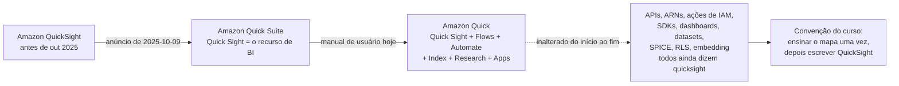
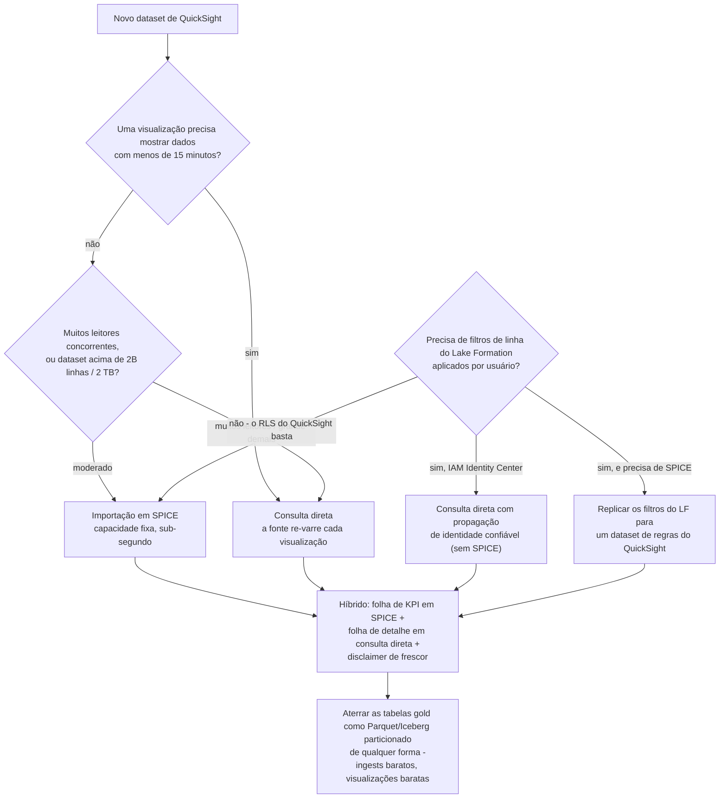
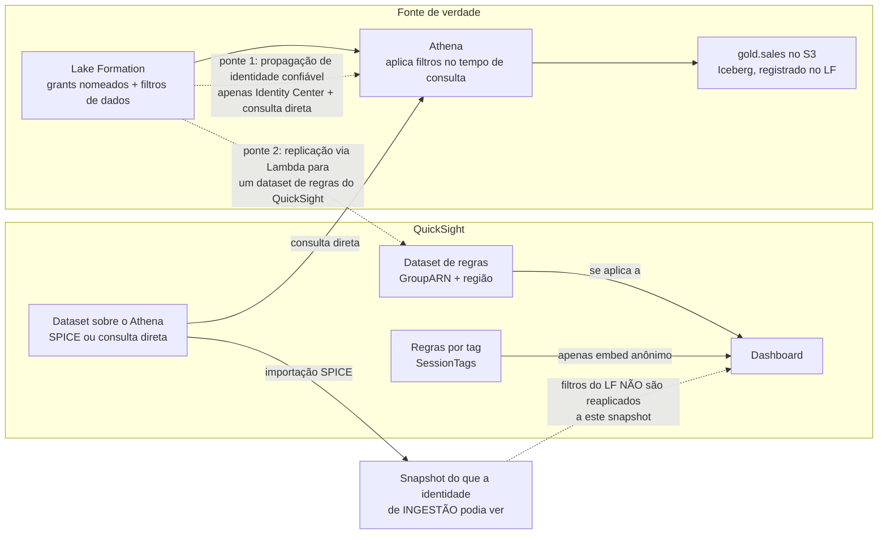
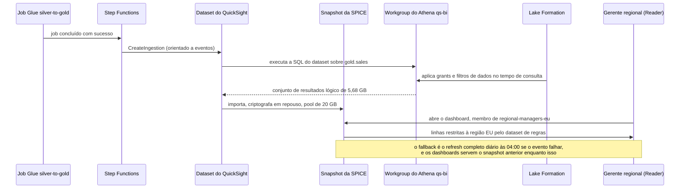
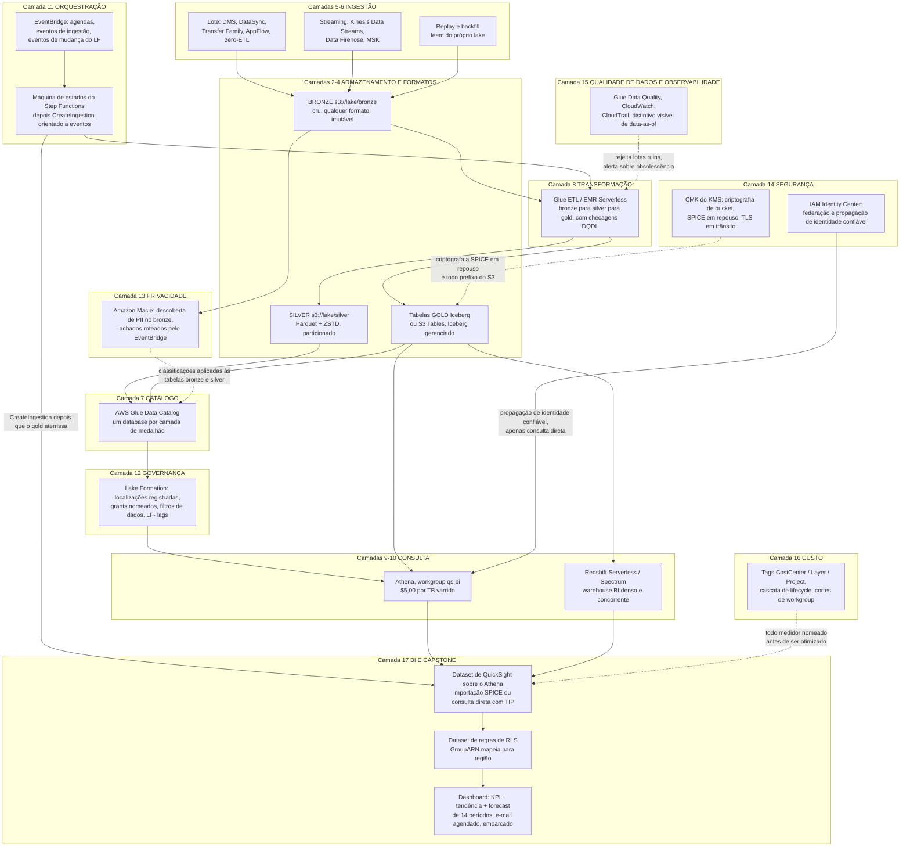

# BI com QuickSight e o Capstone Ponta a Ponta do Lakehouse

Dezesseis lições construíram algo que produz números: bronze no S3, silver e gold como tabelas Iceberg, um catálogo Glue, Step Functions segurando a agenda junta, Lake Formation decidindo quem pode ler qual linha, Macie achando os dados pessoais, Glue Data Quality recusando os lotes ruins, e uma escada de custo que ninguém pode pular. Nada disso é o ponto de um lakehouse. O ponto é que uma **gerente regional em Frankfurt** abre um link numa manhã de segunda-feira e vê as suas regiões, as suas lojas, a sua receita, em menos de dois segundos, e não vê as de ninguém mais.

Esta é a lição. A camada de BI é onde toda decisão de montante se paga ou te envergonha: uma permissão do Lake Formation ausente aparece como um dashboard vazio, um snapshot da SPICE aparece como um dashboard velho, uma escolha de coluna texto contra numérico aparece como segurança de nível de linha silenciosamente não funcionando, e uma consulta direta sem poda aparece na fatura do Athena três semanas depois. Você vai configurar QuickSight de ponta a ponta, depois dar um passo atrás e redesenhar o curso inteiro como **uma arquitetura de referência com dezessete camadas**, mais o plano de 30/60/90 dias que leva um time até lá.

```text
====================================================================
 QUICKSIGHT BI + CAPSTONE - AWS DATA LAKEHOUSE, AULA 17
                (lista de us-east-1, em outubro de 2026)
====================================================================
 NOMENCLATURA .. serviço = Amazon Quick (era QuickSight; anunciado
                como Quick Suite em 2025-10-09); recurso de BI =
                Quick Sight; APIs / ARNs / ações de IAM ainda dizem
                quicksight - então este curso escreve QuickSight
 EDIÇÕES ....... Standard: $9 usuário/mês anual ou $12 mensal,
                10 GB de SPICE por usuário, APENAS refresh completo
                Enterprise: refresh incremental, RLS, CLS,
                pastas, embedding, 2B linhas ou 2 TB por dataset
 PERSONAS ...... Author $24 | Author Pro $40 | Reader $3 |
                Reader Pro $20 | Admin fatura como Author
 SPICE ......... $0,38 / GB-mês (Standard excedente $0,25 / GB);
                10 GB incluídos por Author, agrupados por Região
                por conta; tamanho lógico = 12 B por célula
                numérica ou de data + 24 B + tamanho UTF-8 por
                célula de texto
 TAXAS ......... $250 / mês por conta se HOUVER qualquer usuário
                Pro, tópico Q ou Dashboard Q&A habilitado
 MODO DE CONSULTA  SPICE (snapshot, capacidade fixa, sub-segundo)
                vs consulta direta (fresca, re-varre, timeout de
                visual de 2 minutos) vs híbrido (recomendado AWS)
 ATHENA ........ $5,00 por TB varrido - toda visualização em
                consulta direta paga de novo
 RLS ........... três mecanismos: dataset de regras usuário/grupo
                (somente texto, <=999 registros por usuário) |
                regras por tag (APENAS embedding anônimo) | filtros
                de dados do Lake Formation (Athena, no tempo de
                consulta, só consulta direta - a SPICE congela as
                linhas que viu na ingestão)
 CAPSTONE ...... 17 camadas: tiers do S3 -> formatos/Iceberg ->
                ingestão -> catálogo -> Glue -> Athena/
                Redshift -> orquestração -> Lake Formation ->
                Macie -> segurança -> qualidade de dados -> custo
                -> QuickSight
====================================================================
```

> [!NOTE]
> **Como usar esta lição.** As seções 1 to 8 são a metade de configuração do QuickSight: leia-as uma vez, depois resolva as quatro verificações interativas conforme elas aparecem (matcher de SPICE, plot de modo de consulta, preenchimento de RLS, arrastar-e-soltar da ordem de construção). A seção 9 é a construção capstone que você deve conseguir reproduzir no papel. As seções 10 to 11 são o resumo do curso: um diagrama integrado e um roteiro em fases. Tudo aqui está datado de **outubro de 2026**; onde as próprias páginas da AWS discordam, a discordância é nomeada em vez de suavizada.

Ao fim desta lição você será capaz de:

- dizer o que mudou e o que **não** mudou quando o QuickSight virou Quick Suite e depois Amazon Quick, e precificar um deploy real linha por linha;
- escolher entre **SPICE e consulta direta** usando o medidor de bytes varridos do Athena em vez de um feeling, e defender a escolha com aritmética;
- dimensionar um **dataset de SPICE** a partir de uma lista de colunas usando a fórmula de tamanho lógico, e agendar refreshes que nem colidem nem ficam velhos em silêncio;
- conectar uma **fonte de lakehouse** corretamente: Athena através do Lake Formation, um manifesto JSON do S3 para extracts, Redshift para cargas de trabalho densas de warehouse;
- construir a cadeia de conteúdo **dataset → análise → dashboard → tema → pasta**, e escolher uma família de visual de propósito;
- separar os **três mecanismos de segurança de nível de linha** e declarar, para cada um, a quem ele se aplica, que tipos de dados ele restringe, e quanto ele te custa;
- montar todas as **dezessete camadas** em uma arquitetura de referência e sequenciá-las em um plano de **30/60/90 dias**;
- ler os resultados de QuickSight publicados pela **Trustly** como um praticante lê um caso: como um resultado de cliente com data, nunca como uma garantia de serviço.

---

## 1. Nomeando a coisa que você está configurando

Antes de um único ajuste: em **2025-10-09** a AWS anunciou que o "Amazon QuickSight está evoluindo para o Amazon Quick Suite", com a metade de BI renomeada para **Quick Sight** e "Além das capacidades de BI familiares (agora chamadas Quick Sight), o Quick Suite introduz várias funcionalidades movidas a IA" (AWS BI Blog, 2025-10-09). O manual de usuário hoje descreve o serviço como **Amazon Quick**, que "evoluiu a partir do Amazon QuickSight. O QuickSight continua como Amazon Quick Sight, um recurso dentro do Quick" (Quick User Guide, *What is Amazon Quick?*, acesso em 2026-10-11).

A metade operacional daquele anúncio é a parte que você de fato precisa:

> "Seu ambiente QuickSight inteiro, incluindo dashboards, datasets e análises, permanece inalterado… Suas integrações de API existentes continuam funcionando como antes, e nenhuma migração de dados é necessária.": AWS BI Blog, 2025-10-09

e

> "Todas as APIs, SDKs e integrações QuickSight existentes continuam funcionando sem mudanças.": Quick User Guide, acesso em 2026-10-11



Duas consequências para tudo abaixo:

1. **ARNs e ações de IAM ainda dizem `quicksight`.** Um ARN de usuário ainda é `arn:aws:quicksight:{region}:{account}:user/{namespace}/{username}`, a service role default ainda é `aws-quicksight-service-role-v0`, e cada API que você toca nesta lição (`CreateIngestion`, `GenerateEmbedUrlForRegisteredUser`, `CreateAccountCustomization`) mantém o seu nome antigo (AWS Machine Learning Blog, 2026-06-08; AWS Builder Center, 2026-03-27).
2. **Tabelas de preços mudaram para o novo branding.** As taxas abaixo foram lidas da página de preços do QuickSight em **2026-10-11**, onde o painel do Quick Suite as carrega.

- **📚 Você sabia?** O encurtamento de "Quick Suite" para "Amazon Quick" **não tem data em lugar nenhum da documentação da própria AWS**. Os posts de 2025-10-09 dizem Quick Suite; o manual de usuário simplesmente diz Amazon Quick, sem uma linha de anúncio para a segunda renomeação. A afirmação defensável é "anunciado como Quick Suite em outubro de 2025; até outubro de 2026 o manual de usuário chama o serviço de Amazon Quick": atribuir uma data precisa ao encurtamento seria inventar uma fonte.

---

## 2. Personas, edições e a pilha de preços de outubro de 2026

### 2.1 As três personas, e por que Admins faturam como Authors

| Persona | O que ela pode fazer | Alocação de SPICE | Fatura como |
|---|---|---|---|
| **Author** | Conectar a fontes de dados, criar datasets, análises e dashboards, compartilhá-los | Contribui com **10 GB** para o pool da conta | $24/usuário/mês |
| **Author Pro** | Tudo o que um Author faz, mais Q Topics, construção de dashboard em linguagem natural, resumos executivos, data stories, cenários | Crédito de 10 GB | $40/usuário/mês |
| **Reader** | Abrir dashboards, filtrar, fazer drill, exportar CSV, assinar alertas: "Readers não têm capacidade SPICE alocada alguma" | **Nenhum** | $3/usuário/mês |
| **Reader Pro** | Reader mais capacidades do Quick Suite Professional: resumos, stories, cenários | Nenhum | $20/usuário/mês |
| **Admin** | Gestão de usuários, compra de SPICE e de assinaturas, **mais todas as capacidades de autoria** | Contribui com 10 GB | "Para fins de faturamento, Authors e Admins do QuickSight são ambos reconhecidos como Authors" |
| **Admin Pro** | Admin mais capacidades Pro | Contribui com um crédito de 10 GB | Fatura nas taxas de Author Pro |

Fonte de cada linha: página de preços e FAQs do QuickSight, acesso em **2026-10-11**.

A armadilha naquela tabela é a linha do Admin: um Admin que "só gerencia usuários" ainda é um Author na fatura. A segunda armadilha é que **Readers não seguram SPICE alguma**: SPICE é propriedade da conta, não propriedade do usuário.

### 2.2 Duas edições, e só uma delas faz segurança de nível de linha

| | **Standard** | **Enterprise** (o default para organizações) |
|---|---|---|
| Preço de assento | $9/usuário/mês anual, $12 mensal | $24 Author / $3 Reader, mais tiers Pro |
| SPICE incluída | 10 GB por usuário | 10 GB por licença de Author, agrupada no nível da conta |
| SPICE excedente | $0,25 por GB | **$0,38 por GB-mês** |
| Cota por dataset | 25.000.000 linhas ou 25 GB | **2.000.000.000 linhas ou 2 TB** (o que vier primeiro) |
| Refresh | **Apenas refresh completo** | Completo **ou incremental** (apenas fontes de dados SQL) |
| RLS / CLS | Não | **Sim** |
| Pastas, embedding, pastas restritas | Não | Sim (embedding é exclusivo de Enterprise) |
| Caminho de compra | API `CreateAccountSubscription` | Default do console |

Fontes: página de preços, *Data source quotas*, *Refreshing SPICE data*, *Using row-level security*, *Embedding overview*: todas com acesso em 2026-10-11.

> [!IMPORTANT]
> **Um número para ensinar com cuidado.** A documentação de cotas e o blog de melhores práticas de 2024 dizem ambos que a SPICE Enterprise guarda **2 bilhões de linhas ou 2 TB por dataset**, e o histórico de documentos registra o aumento para 2 bilhões de linhas em **2025-06-30**. A página de preços, lida em 2026-10-11, ainda imprime "um máximo de 1 bilhão de linhas por 1 TB de tamanho". Use o número da **documentação**, nomeie o conflito, e nunca cite o 1B/1TB da página de preços como atual.

### 2.3 Exemplo resolvido E1: precificando um deploy real, linha por linha

Um time implanta **3 Authors, 1 Admin, 60 Readers**, um dataset de SPICE de **52 GB**, **sem usuários Pro, sem Q topics, sem Dashboard Q&A** (lista de us-east-1, em outubro de 2026).

```text
Assentos         4 x $24 (3 Authors + 1 Admin; Admin fatura como Author) = $ 96,00
Readers         60 x $3                                                 = $180,00
SPICE incluída   4 x 10 GB = 40 GB, agrupada no nível da conta
Excedente        52 GB - 40 GB = 12 GB x $0,38                          = $  4,56
Taxa Pro / Q&A   nenhum usuário Pro, nenhum tópico, Dashboard Q&A off   = $  0,00
                                                       TOTAL MENSAL = $280,56
```

Agora duas mudanças que parecem pequenas em um slide:

```text
Promover um Author a Author Pro        $40 - $24 = +$16,00
Ligar Dashboard Q&A (sem tópico)       +$250,00 por conta por mês
                                                       TOTAL MENSAL = $546,56
```

A taxa de infraestrutura **dobrou a fatura** por um flag de funcionalidade. Ela se aplica "se a sua conta tiver qualquer um dos seguintes: pelo menos um usuário Pro / Q&A habilitado via tópicos / Dashboard Q&A habilitado" (página de preços e FAQs, acesso em 2026-10-11), e, a parte que pega as pessoas, deletar os usuários Pro não a para enquanto ainda existir um Q Topic em **qualquer** Região da conta (AWS re:Post Knowledge Center, 2026-08-27).

---

## 3. SPICE: o que é, quanto custa, como você a enche

### 3.1 O motor em um parágrafo

SPICE é o **Super-fast, Parallel, In-memory Calculation Engine**: um snapshot materializado e atualizável do seu dataset, construído a partir de "uma combinação de armazenamento colunar, tecnologias in-memory… e geração de código de máquina" (AWS BI Blog, *Best practices for Amazon QuickSight SPICE and direct query mode*, 2024-07-17). Na edição Enterprise o snapshot é **criptografado em repouso**, gerenciado pela AWS por default, ou com uma chave gerenciada pelo cliente no AWS KMS, e criptografado em trânsito com TLS (mesma fonte; *Importing data into SPICE*, acesso em 2026-10-11).

Quatro propriedades decidem toda escolha de desenho que você vai fazer:

- **A capacidade é agrupada por conta e por Região da AWS**, não por usuário: "a capacidade SPICE é alocada separadamente por Região da AWS… compartilhada por todas as pessoas que usam QuickSight em uma única Região da AWS" (*Managing SPICE memory capacity*, acesso em 2026-10-11).
- **A compra automática de capacidade está ligada por default** para contas criadas no console, e "a compra automática de capacidade não suporta auto-decremento": ela pode crescer o seu pool, nunca encolhê-lo. Desligue-a com o pool super-alocado e a *próxima* ingestão ou falha de refresh.
- **Você é cobrado pela consulta de origem na ingestão**, não no momento da visualização: "se você usar uma fonte de dados que cobra por consulta, você é cobrado pela consulta dos dados quando cria o dataset pela primeira vez e depois quando atualiza o dataset" (*Importing data into SPICE*).
- **Dashboards continuam servindo o snapshot anterior enquanto um refresh roda**, e depois de um refresh falhado, sem banner de obsolescência no canvas por default.

### 3.2 Tamanho lógico: a aritmética que decide a sua fatura de capacidade

O que consome capacidade não é o arquivo Parquet no S3 e não é a contagem de linhas: é o **tamanho lógico**, calculado depois da coerção de tipos e das colunas calculadas:

```text
Tamanho lógico do dataset em bytes =
      (número de células numéricas x 12 bytes)
    + (número de células de data    x 12 bytes)
    + SOMA(24 bytes + tamanho codificado em UTF-8  por célula de texto)
```

Fonte: *Importing data into SPICE*, acesso em 2026-10-11. "Somente as mudanças salvas no dataset se aplicam à capacidade SPICE."

### 3.3 Exemplo resolvido E2: dimensionando o dataset capstone antes de ingerir

A tabela gold capstone `gold.sales` guarda **40.000.000 de linhas**, cerca de **3 GB de Parquet** no S3. O dataset de QuickSight usa esta SQL personalizada (note o que foi derrubado):

```sql
SELECT  order_id,
        date_trunc('day', order_ts) AS order_day,
        region,
        store_id,
        product,
        qty,
        revenue
FROM gold.sales
```

Tamanho lógico por linha:

| Coluna | Tipo após coerção | Bytes por célula |
|---|---|---|
| `order_id` | numérico | 12 |
| `order_day` | data | 12 |
| `region` | texto (2 caracteres) | 24 + 2 = 26 |
| `store_id` | texto (6 caracteres) | 24 + 6 = 30 |
| `product` | texto (14 caracteres) | 24 + 14 = 38 |
| `qty` | numérico | 12 |
| `revenue` | numérico | 12 |
| **Por linha** | | **142 bytes** |

```text
40.000.000 de linhas x 142 bytes = 5.680.000.000 bytes = 5,68 GB lógicos
Pool da conta = 2 Authors x 10 GB = 20 GB incluídos
Veredito      = 5,68 GB cabe com 14,32 GB de folga; SPICE excedente = $0,00
Armadilha     = o Parquet no S3 tem 3 GB; o tamanho LÓGICO é 5,68 GB.
                Colunas de texto largas são o que estoura o teto de GB primeiro.
```

Dois movimentos fizeram isso caber: **derrubar colunas não usadas** na SQL (uma coluna de texto `customer_note` com média de 200 caracteres teria acrescentado `24 + 200` bytes por linha: 8,96 GB sozinha, o que por si excederia o pool) e **truncar o timestamp para uma data**, o mesmo movimento que torna o refresh incremental e a segurança de nível de linha possíveis de modo algum.

- **📚 Você sabia?** Os quatro passos de preparação de dados **Append, Aggregate, Pivot e Unpivot não podem rodar no tempo de consulta**: eles são *exclusivos da SPICE*, o que significa que o QuickSight os materializa na SPICE em vez de executá-los em cada carregamento de visual (*SPICE-only features*, acesso em 2026-10-11). Isso os torna a alavanca documentada de "pré-agregar para encolher o seu dataset": um passo de agregação aplicado no momento da autoria é pago uma vez por refresh em vez de em cada visualização.

### 3.4 Refresh: agendas, cotas e a falha que você não vai ver

| Regra | Valor | Fonte (data) |
|---|---|---|
| Frequências de agenda | a cada 15 min, 30 min, por hora, diária, semanal, mensal | Refreshing SPICE data (2026-10-11) |
| Precisão da agenda | a ingestão roda **em até 10 minutos** do horário agendado | mesma |
| Agendas por dataset | **até 5** | AWS re:Post, 2026-06-26 |
| Refreshes completos sob demanda | **32 por dataset a cada 24 horas** (agendas não são afetadas) | BI Blog, 2024-07-17 |
| Refreshes incrementais sob demanda | **100 por dataset a cada 24 horas** | mesma |
| Refresh incremental | **apenas fontes de dados SQL**; precisa de uma coluna de data mais uma janela de look-back; um checkpoint interno registra o último refresh completo | Refreshing SPICE data (2026-10-11) |
| Edição Standard | apenas refresh completo | mesma |
| Durante o refresh | dashboards servem o **snapshot anterior** | BI Blog, 2024-07-17 |
| Notificação de falha | `FailureConfiguration.EmailAlert.AlertStatus=ENABLED` | Automate SPICE refreshes via APIs, 2025-12-29 |
| Deletar a configuração incremental | dispara um refresh **completo** na próxima vez | Refreshing SPICE data (2026-10-11) |

Duas regras operacionais seguem diretamente. **Espalhe as agendas** para que os datasets não disparem todos no mesmo minuto (AWS re:Post, 2026-06-26), e trate um refresh falhado como um **incidente**, porque o dashboard vai felizmente continuar renderizando os números de ontem como se nada tivesse acontecido.

### 3.5 Melhores práticas de autoria em SPICE

1. **Selecione colunas no momento da autoria.** Cada coluna de texto que você arrasta para o dataset é cobrada a `24 + tamanho UTF-8` bytes por linha, para sempre. Desmarque o que nenhuma visualização usa.
2. **Agregue antes de importar.** Use o passo Aggregate exclusivo da SPICE, ou agregue na camada gold, o que é ainda melhor, quando um dashboard precisa de medidas por dia em vez de por transação.
3. **Faça cast das chaves pelas quais você vai restringir.** A segurança de nível de linha funciona apenas em campos **texto**, então faça cast de chaves de região numéricas ou de data para string na SQL do dataset (seção 7).
4. **Agende depois do ETL, nunca perto dele.** Um refresh completo diário às 04:00 que dispara antes do job silver-to-gold terminar importa o snapshot errado e o reporta confiante. `CreateIngestion` orientado a eventos a partir de Step Functions depois do job é a versão determinística; a agenda é apenas o chão.
5. **Um dataset, muitos dashboards.** O consumo em qualquer número de dashboards e usuários "não gera cobranças", o medidor é capacidade em GB-mês, não visualizações (página de preços, acesso em 2026-10-11).

```matching
{
  "question": "Combine cada conceito de SPICE com o que ele de fato significa no QuickSight (documentação do QuickSight, acesso em 2026-10-11):",
  "pairs": [
    {"left": "A própria SPICE (Super-fast, Parallel, In-memory Calculation Engine)", "right": "Um snapshot atualizável construído com armazenamento colunar, tecnologias in-memory e geração de código de máquina; criptografado em repouso na edição Enterprise"},
    {"left": "Tamanho lógico", "right": "12 bytes por célula numérica ou de data, mais 24 bytes mais o tamanho UTF-8 por célula de texto, calculado após a coerção de tipos e as colunas calculadas; é isso que a sua fatura de GB conta"},
    {"left": "Capacidade incluída", "right": "10 GB contribuídos por cada licença de Author ou Admin provisionada, agrupados no nível da conta por Região da AWS; Readers não contribuem com nada"},
    {"left": "Refresh incremental", "right": "apenas fontes de dados SQL; consulta só a janela de look-back definida em uma coluna de data, rastreada por um checkpoint interno desde o último refresh completo"},
    {"left": "Passos de preparação exclusivos da SPICE", "right": "Append, Aggregate, Pivot e Unpivot: materializados na SPICE em vez de executados no tempo de consulta, e é por isso que eles são a alavanca de pré-agregação"},
    {"left": "Comportamento do snapshot durante um refresh", "right": "Dashboards continuam servindo o snapshot anterior enquanto um refresh roda: e depois de um falhado, sem banner de obsolescência por default"}
  ],
  "explanation": "Cada um destes seis é um lugar onde os times chutam e depois levam uma fatura surpresa ou um dashboard velho. Tamanho lógico não é tamanho de arquivo (E2: 3 GB de Parquet eram 5,68 GB lógicos); capacidade é propriedade da conta, não do usuário; refresh incremental é condicionado a uma fonte SQL mais uma coluna de data; os quatro passos exclusivos da SPICE são a maneira sancionada de encolher um dataset; e o comportamento do snapshot é exatamente por que alertas de falha e uma caixa de texto de 'data as of' são obrigatórios em vez de opcionais."
}
```

---

## 4. SPICE contra consulta direta: a fatura do Athena é o desempate

### 4.1 O trade, enunciado nas duas direções

| | **Importação em SPICE** | **Consulta direta** |
|---|---|---|
| Frescor | Conforme o último refresh | Cada carregamento de visual |
| Cobrança da fonte | Apenas ingestão (uma vez por refresh) | **Cada visualização, cada interação** |
| Desempenho | Sub-segundo, consistente, milhares de leitores concorrentes | Igual ao desempenho da fonte; a concorrência cai no Athena ou no Redshift |
| Limites rígidos | 2B linhas ou 2 TB por dataset (Enterprise); capacidade em GB-mês | **Timeout de geração de visual de 2 minutos**: "nem todos os drivers de banco de dados reagem ao timeout de 2 minutos" (uma consulta do Redshift pode continuar rodando) |
| Segurança de nível de linha | As suas regras de RLS do QuickSight se aplicam | As suas regras de RLS **e** os filtros do Lake Formation se aplicam |
| Forma de custo | Fixa e previsível; escala com o tamanho do dataset | Variável; escala com **contagem de visualizações x bytes varridos** |
| Melhor para | Folhas de KPI, fan-out largo, executivos, embedding | Detalhe com tolerância baixa a frescor, tabelas muito largas, drill pontual |

Fontes: *Data source quotas* (2026-10-11); melhores práticas do AWS BI Blog (2024-07-17).

### 4.2 O híbrido recomendado pela AWS

A própria orientação da AWS não é "escolha uma": use uma **folha de aterrissagem em SPICE** para KPIs agregados atualizados diária ou incrementalmente, mais uma **folha de detalhe em consulta direta**, e avise o leitor sobre a inconsistência de frescor entre elas (BI Blog, 2024-07-17). O padrão existe porque os dois modos de falha são opostos: a SPICE falha ficando velha, a consulta direta falhando ficando lenta e cara.



### 4.3 Exemplo resolvido E3, o mesmo dashboard, dois medidores

**Cenário.** 200 leitores, 4 visualizações de dashboard cada por dia, cada visualização varrendo **200 MB** de Parquet com poda de partições em modo de consulta direta, contra os mesmos dados importados em um dataset de SPICE de **6 GB**. Athena é **$5,00 por TB varrido** (preços do Amazon Athena, acesso em 2026-10-11).

```text
CONSULTA DIRETA, otimizada (200 MB por visualização)
  por dia    = 200 leitores x 4 visualizações x 0,2 GB =   160 GB
  por mês    = 160 GB x 30                              =  4.800 GB = 4,8 TB
  Athena     = 4,8 TB x $5,00                           =   $24,00 / mês

CONSULTA DIRETA, sem poda (3 GB por visualização: sem predicado de
partição, sem poda de colunas - a mesma pergunta de negócio, a mesma resposta)
  por dia    = 200 x 4 x 3 GB                           =  2.400 GB = 2,4 TB
  por mês    = 2,4 TB x 30                              =     72 TB
  Athena     = 72 TB x $5,00                            =  $360,00 / mês

SPICE (dataset de 6 GB, refresh completo diário)
  capacidade = 6 GB x $0,38                             =    $2,28 / mês
  ingestão   = 30 refreshes x ~3 GB varridos            =      90 GB = 0,09 TB
  Athena     = 0,09 TB x $5,00                          =    $0,45 / mês
  TOTAL      =                                          =    $2,73 / mês
```

O ponto de equilíbrio é aritmética, não opinião: o custo de capacidade da SPICE iguala o custo do Athena quando

```text
TB varridos por mês = (GB da SPICE x $0,38) / $5,00
                    = (6 x 0,38) / 5 = 0,456 TB = 456 GB / mês
com 0,2 GB por visualização = 456 / 0,2      = 2.280 visualizações / mês
                    = cerca de 76 visualizações / dia
```

Abaixo de cerca de 76 visualizações por dia, a consulta direta é mais barata **e** mais fresca; acima disso, a SPICE vence e continua vencendo, porque a linha da SPICE é **plana na contagem de visualizações**. A coluna sem poda é a que deveria te preocupar: a mesma forma de SQL sem poda de partições é **15x a fatura**, e é por isso que os redutores da lição 09 são um pré-requisito desta lição em vez de um extra opcional.

> [!WARNING]
> ⚠️ **Nunca aponte uma população grande de leitores para consulta direta sem poda.** Três razões documentadas: cada carregamento de visual re-varre a $5,00 por TB; o QuickSight impõe um **timeout de geração de visual de 2 minutos** que alguns drivers ignoram (uma consulta do Redshift pode continuar rodando além dele); e a concorrência cai na fonte, então uma rajada de 200 leitores vira um problema de workgroup do Athena. Se um dashboard precisar ser de consulta direta, ponha os predicados de partição e a poda de colunas na **SQL do dataset**, não nas mãos do leitor.

### 4.4 Exemplo resolvido E4: a fatura do híbrido

Mesmo público, **4.000 visualizações por dia**: 3.600 caem na folha de KPI em SPICE, 400 batem na folha de detalhe em consulta direta a 200 MB cada.

```text
Folha SPICE     3.600 visualizações x $0,00                 = $   0,00
Folha detalhe   400 x 0,2 GB = 80 GB/dia x 30 dias          = 2,4 TB -> $12,00
Capacidade SPICE 6 GB x $0,38                               = $   2,28
TOTAL MENSAL                                               = $  14,28
Equivalente tudo-direto: 4.000 x 0,2 GB x 30 = 24 TB        = $ 120,00
                                                                  ------
Economia                                                   $  105,72 / mês
```

Acrescente a caixa de texto de disclaimer na folha de consulta direta, "linhas de detalhe são ao vivo; blocos de KPI atualizam diariamente às 04:00 UTC", e você tem o formato recomendado pela AWS com o seu custo quantificado.

- **📚 Você sabia?** O Athena cobra **bytes varridos, arredondados para cima para o megabyte mais próximo, com mínimo de 10 MB por consulta** para fontes federadas, então um dashboard renderizando 40 visualizações pequenas em consulta direta pode cobrar 40 mínimos em vez de uma varredura mesclada. Mesclar filtros e emitir menos consultas e mais largas através de parâmetros de dataset é uma alavanca de custo tanto quanto de desempenho (preços do Amazon Athena, acesso em 2026-10-11).

```plot
{
  "type": "line",
  "title": "Consulta direta no Athena vs SPICE: mesma carga de 0,2 GB por visualização, dataset de 6 GB a $0,38/GB-mês (em outubro de 2026)",
  "xLabel": "Visualizações de dashboard por mês",
  "yLabel": "Custo mensal (USD)",
  "xKey": "views",
  "data": [
    {"views": 500, "Direct query at $5.00/TB": 0.5, "SPICE import (flat in views)": 2.28},
    {"views": 1000, "Direct query at $5.00/TB": 1.0, "SPICE import (flat in views)": 2.28},
    {"views": 2000, "Direct query at $5.00/TB": 2.0, "SPICE import (flat in views)": 2.28},
    {"views": 2280, "Direct query at $5.00/TB": 2.28, "SPICE import (flat in views)": 2.28},
    {"views": 5000, "Direct query at $5.00/TB": 5.0, "SPICE import (flat in views)": 2.28},
    {"views": 10000, "Direct query at $5.00/TB": 10.0, "SPICE import (flat in views)": 2.28},
    {"views": 25000, "Direct query at $5.00/TB": 25.0, "SPICE import (flat in views)": 2.28}
  ],
  "dataKeys": ["Direct query at $5.00/TB", "SPICE import (flat in views)"]
}
```

As linhas se cruzam em cerca de **2.280 visualizações por mês**: aproximadamente 76 por dia. À esquerda do cruzamento, a consulta direta é mais barata *e* mais fresca; à direita, a SPICE custa o mesmo quer 10 quer 10.000 pessoas olhem. A linha da SPICE também esconde uma cobrança fixa de ingestão de **$0,45/mês** (E3), que move o cruzamento apenas marginalmente.

---

## 5. Fontes do lakehouse: Athena, o manifesto do S3 e o Redshift

O QuickSight suporta uma lista longa de fontes, Athena, Aurora, Glue Data Catalog, OpenSearch, Redshift, Redshift Spectrum, S3, S3 Tables, RDS, mais BigQuery, Databricks, Snowflake, Trino e Q Business, com uma regra dura de posicionamento: **"Amazon Redshift clusters, Amazon Athena databases, and Amazon RDS instances must be in AWS"** (*Supported data sources*, acesso em 2026-10-11). Para este curso, três importam.

| Fonte | Para que serve | Fatos de configuração que você precisa saber |
|---|---|---|
| **Amazon Athena** | O caminho default do lakehouse: QuickSight ao Athena ao Glue Data Catalog ao Iceberg/Parquet no S3 | Aceita um workgroup (`AthenaParameters.WorkGroup`), um ARN de role, e `IdentityCenterConfiguration.EnableIdentityPropagation` para propagação de identidade confiável. É aqui que as permissões do Lake Formation são aplicadas. |
| **Amazon S3 via manifesto JSON** | Importação direta de arquivos de extracts: CSV, TSV, JSON, CLF, ELF | `fileLocations.URIs` / `URIPrefixes` mais `globalUploadSettings` (formato, delimitador, qualificador de texto, `containsHeader`); **até 1.000 arquivos por manifesto**. Certo para um extract simples, **errado para uma tabela de lakehouse governada**: ele contorna o catálogo, os metadados do Iceberg e o Lake Formation inteiramente. |
| **Amazon Redshift / Spectrum** | BI denso, concorrente, sempre ligado sobre tabelas de warehouse ou tabelas externas de lake | Precisa estar na AWS; também capaz de propagação de identidade confiável, então permissões de linha e coluna do lado da fonte se propagam em vez de serem redeclaradas no QuickSight. |

A regra de decisão deste curso: **tudo que é governado fica atrás do Athena** (ou do Redshift), nunca atrás de um manifesto. Um manifesto é um drop de arquivos: sem entrada de catálogo, sem time travel, sem grant do Lake Formation, sem filtro de dados.

```json
{
  "fileLocations": [
    { "URIs": [ "s3://lake/extracts/2026/10/*.csv" ] }
  ],
  "globalUploadSettings": {
    "format": "CSV",
    "delimiter": ",",
    "textQualifier": "\"",
    "containsHeader": "true"
  }
}
```

Um manifesto como o de cima importa bem e ainda é a resposta errada para `gold.sales`: no momento em que governança de nível de linha, evolução de schema ou time travel importam, o caminho do Athena é o único que herda o que as lições 04, 07 e 12 construíram.

Dois detalhes de ligação que quebram em silêncio:

- A service role do QuickSight, por default **`aws-quicksight-service-role-v0`**, precisa dos **seus próprios grants do Lake Formation**, além dos grants dados a ARNs de usuário e de grupo do QuickSight (*Using AWS Lake Formation with Amazon QuickSight*, acesso em 2026-10-11; AWS Builder Center, 2026-03-27).
- Com **S3 Tables** (Iceberg gerenciado) o catálogo é `s3tablescatalog`, não o catálogo default do Glue: você precisa de `glue:GetCatalog` naquele ARN de catálogo, e precisa usar **SQL personalizada**, porque o navegador de tabelas só mostra o catálogo default (AWS Builder Center, 2026-03-27).

E a regra de ordem do próprio guia da AWS: faça a consulta funcionar **no Athena primeiro**, depois abra o QuickSight: um passo que separa um problema do Lake Formation de um problema do QuickSight.

---

## 6. O modelo de conteúdo: datasets, análises, dashboards, temas e pastas

```text
Fonte de dados (Athena / manifesto S3 / Redshift)
      |
      v
Dataset   ---- modo: SPICE ou consulta direta
      |        + SQL personalizada, joins, campos calculados,
      |          chaves únicas; o dataset de regras de RLS é
      |          anexado AQUI, não ao dashboard
      v
Análise   ---- editável, multi-abas, até 500 campos
      |        calculados; filtros, parâmetros, ações,
      |        drill-down, visuais de forecast e de anomalia,
      |        what-if (what-if existe APENAS em uma análise,
      |        nunca em um dashboard)
      v
Publicar
      |
      v
Dashboard ---- snapshot somente-leitura da análise,
                 até 1.000 versões retidas, compartilhado com
                 grupos, e-mails agendados, embarcado
```

**Famílias de visual** disponíveis em uma análise: barras e colunas (empilhadas), heat map, linha e área, dispersão, pizza e donut, treemap, funil, medidor/KPI, nuvem de palavras, box plot, histograma, mapa de dispersão, **mapa em camadas**, **componente de imagem**, **Highcharts**, tabelas e tabelas dinâmicas, e widgets de texto autonarrativo (histórico de documentos do Quick User Guide e documentação de forecast/insight, acesso em 2026-10-11).

**Temas.** Quatro ARNs de tema inicial vêm com o serviço, `arn:aws:quicksight:aws:theme/CLASSIC`, `.../MIDNIGHT`, `.../SEASIDE`, `.../RAINIER`, e o default da conta ou do namespace é definido através de `CreateAccountCustomization` / `UpdateAccountCustomization` com um `DefaultTheme`, o que exige que o tema seja compartilhado primeiro (*Setting a default theme*, acesso em 2026-10-11). Dashboards embarcados acrescentam **tematização em runtime** a partir do Embedding SDK 2.5.0 e superior (`setTheme`, `setThemeOverride`, até cinco temas pré-carregados).

**Pastas (Enterprise).** Pastas pessoais, pastas compartilhadas e **pastas restritas compartilhadas**, o tipo restrito é criado apenas pela API `CreateFolder` e força criados a partir do seu conteúdo a permanecerem dentro da árvore de pastas. Leia o boundary com cuidado: ele cobre análises, dashboards, datasets, fontes de dados e tópicos, mas **não** superfícies mais novas como agentes de chat, que ainda podem recuperar detalhes de um dataset dentro de uma pasta restrita (*Organizing assets into folders*, acesso em 2026-10-11).

> [!NOTE]
> **Dois limites que valem a pena memorizar porque aparecem como surpresas.** O histórico de versões de dashboard retém até **1.000 versões** (histórico de documentos, 2025-03-28), e uma análise permite **500 campos calculados**, aumentado de 200 em 2025-08-15. Ambos são grandes o bastante para que ninguém os atinja por acidente e pequenos o bastante para que uma migração pesadamente templatizada eventualmente os atinja.

---

## 7. Segurança de nível de linha: três mecanismos que não são intercambiáveis

Esta é a seção que decide se o seu dashboard capstone é uma vitória de governança ou um vazamento de dados. Existem **três** mecanismos de nível de linha, eles resolvem problemas diferentes, e **nenhum deles se converte em outro automaticamente**.

### 7.1 Mecanismo um: um dataset de regras de usuário ou de grupo (Enterprise)

Uma tabela de permissões anexada ao seu dataset: uma coluna para identidade (`UserName` e `GroupName`, ou `UserARN` e `GroupARN`) mais **uma coluna por campo restrito**. Você a anexa com "Conceder acesso ao dataset".

| Regra | Valor |
|---|---|
| Modo de acesso | **Apenas grant-access**, o modo deny foi removido em 2020-12-06 |
| Valores vazios | NULL em uma coluna restrita significa **todos os valores** para aquela identidade |
| Identidade ausente | Um usuário ou grupo sem linha de regra vê **nenhuma linha** |
| Registros por usuário | **999 ou menos** registros de regra aplicados por usuário (direto mais via grupos) |
| Valores de filtro na SPICE | **192.000 ou menos** por campo restrito |
| Tipos de dados | **Apenas texto** (string/char/varchar): "hoje não funciona com campos de data ou numéricos" |
| Flag do dataset de regras | `UseAs: RLS_RULES`: uma vez definida não pode ser mudada |
| Dados sujos | A ingestão em SPICE de um dataset de regras **falha** em linhas inválidas ou células grandes demais em vez de pulá-las |
| Regras vazias | Puladas como medida de segurança; o QuickSight trata NULL, strings vazias e strings como `,,,` como sem valor |
| Donos do dataset | **Continuam vendo todos os dados**: donos não são restringidos |
| Detecção de anomalia | **Não suportada** em datasets que usam segurança de nível de linha |

Fontes: *Using row-level security* e *Using RLS with user-based rules*, acesso em 2026-10-11.

Uma ingestão de dataset de regras quebrada deixa, portanto, o dataset restrito **sem regras selecionadas**, o que significa que os leitores não veem nada até você anexar regras novas. Monitore o status da ingestão e ligue alertas de e-mail de falha.

### 7.2 Mecanismo dois: regras baseadas em tag (apenas embedding anônimo)

Regras por tag mapeiam uma chave de tag para uma coluna e injetam valores em runtime através de `SessionTags` em `GenerateEmbedUrlForAnonymousUser`, configuradas via `RowLevelPermissionTagConfiguration.TagRules` (`TagKey`, `ColumnName`, `TagMultiValueDelimiter`, `MatchAllValue`). A declaração de escopo da AWS é inequívoca: regras baseadas em tag existem quando "você está usando dashboards embarcados e quer proteger dados para usuários não provisionados (usuários não registrados)", e elas são suportadas **apenas** para embedding anônimo: não para `GenerateEmbedURLForRegisteredUser`, não para o legado `GetDashboardEmbedUrl`, e não para identidade de console (*Using RLS with tag-based rules*, acesso em 2026-10-11).

### 7.3 Mecanismo três: Lake Formation na fonte, através do Athena

Registre a localização S3 no Lake Formation, revogue `IAMAllowedPrincipals`, e conceda `SELECT` e `DESCRIBE` (mais permissões de filtro de dados) para **ARNs de usuário e de grupo do QuickSight** em Enterprise, e também para a **service role**. Aqueles filtros são aplicados pelo **Athena no tempo de consulta**, que é o problema inteiro e a oportunidade inteira:

- um dataset em **consulta direta** respeita os filtros de dados do Lake Formation por usuário;
- um dataset em **SPICE** não, porque "ao usar SPICE, os dados são importados (replicados) e portanto as permissões na fonte não podem ser usadas" (AWS Big Data Blog, *Automate replication of row-level security from AWS Lake Formation to Amazon QuickSight*, 2025-05-07).

A AWS documenta exatamente **duas pontes** através daquela lacuna:

1. **Propagação de identidade confiável (TIP).** Apenas IAM Identity Center, apenas consulta direta: "QuickSight SPICE não pode ser usado com propagação de identidade confiável". A identidade do leitor se propaga ao Athena, ao Redshift, e ao Lake Formation quando Redshift Spectrum está envolvido, então permissões de schema, tabela, linha e coluna são aplicadas na fonte e isso "elimina a necessidade de criar regras adicionais de segurança de nível de linha e de coluna no QuickSight" (AWS BI Blog, 2024-05-16; entrada de histórico de documentos "Trusted identity propagation support with Athena data sources", 2025-06-30).
2. **Replicação automatizada.** Uma Lambda lê `ListDataCellFilters` e `ListPermissions`, transforma os predicados PartiQL em linhas do dataset de regras do QuickSight, e atualiza um dataset de RLS do QuickSight. Funciona **com SPICE** e **sem** Identity Center, mas precisa ser re-executada a cada mudança no Lake Formation, e a janela de atraso é um risco que é seu.



- **📚 Você sabia?** A frase "tags viram RLS" descreve **duas funcionalidades não relacionadas**. Tags do Lake Formation dirigem alcance de *tabela e coluna* e não conseguem carregar filtros de dados de linha algum, enquanto regras por tag do QuickSight dirigem segurança de nível de linha **apenas para embedding anônimo**. Não existe funcionalidade documentada da AWS que mapeie uma na outra: para gerentes regionais registrados você precisa de um **dataset de regras de usuário/grupo**, ponto final (documentação do QuickSight e do Lake Formation, acesso em 2026-10-11).

### 7.4 Exemplo resolvido E5: qual mecanismo para qual público

| Público | Registrado? | Precisa de SPICE? | Mecanismo correto |
|---|---|---|---|
| Gerentes regionais abrindo um link de dashboard compartilhado | Sim (grupos do IAM Identity Center) | Sim, para manhãs sub-segundo | **Dataset de regras de usuário/grupo** com chave em `GroupARN`, uma coluna `region` |
| Analistas rodando SQL ad-hoc no Athena com a própria identidade | Sim | Não: consulta direta | **Filtros de dados do Lake Formation**, aplicados na fonte |
| Clientes de um portal embarcado sem contas de QuickSight | Não | Opcional | **Regras por tag** via `GenerateEmbedUrlForAnonymousUser` mais `SessionTags` |
| Uma coluna regulada como `customer_tax_id` escondida da maioria dos leitores | Sim | Qualquer um | **Segurança de nível de coluna** (`ColumnLevelPermissionRule`, no máximo 100 ARNs de principal) *ou* permissões de coluna do Lake Formation: escolha uma deliberadamente |

```fillblank
{
  "question": "Complete os três mecanismos de segurança de nível de linha e o limite rígido que cada um carrega (documentação do QuickSight, acesso em 2026-10-11):",
  "template": "1) Um dataset de regras {{1}} concede apenas acesso (o modo deny foi removido em 2020), funciona apenas em campos TEXTO, e tem teto de {{2}} registros de regra por usuário. 2) Regras baseadas em tag injetam valores através de SessionTags e são suportadas apenas para embedding {{3}}. 3) Filtros de dados do Lake Formation são aplicados pelo Athena no tempo de {{4}}, então datasets em consulta direta os respeitam enquanto uma importação em SPICE {{5}} as linhas que podia ver na ingestão.",
  "answers": {
    "1": "user/group",
    "2": "999",
    "3": "anonymous",
    "4": "query",
    "5": "freezes"
  },
  "distractors": [
    "tag-based",
    "column-level",
    "service-role",
    "192000",
    "100",
    "1000",
    "registered-user",
    "console",
    "IAM Identity Center",
    "ingest",
    "authoring",
    "dashboard-publish",
    "replicates",
    "ignores",
    "re-applies"
  ],
  "explanation": "O mecanismo 1 é o dataset de regras de usuário/grupo: apenas grant-access desde 2020-12-06, apenas campos de texto (chaves numéricas e de data precisam de cast para string antes), 999 registros de regra por usuário, e 192.000 valores de filtro por campo restrito quando o dataset vive na SPICE. O mecanismo 2 é regras por tag, que existem apenas para embedding anônimo: GenerateEmbedUrlForAnonymousUser mais SessionTags, não usuários registrados e não o console. O mecanismo 3 é o Lake Formation, aplicado pelo Athena no tempo de consulta: é por isso que a consulta direta herda filtros do lado da fonte e por que uma importação em SPICE congela as linhas que a sua identidade de ingestão podia ver. A segurança de nível de coluna é um controle separado (ColumnLevelPermissionRule, até 100 principais por regra) e não substitui nenhum dos três."
}
```

> [!WARNING]
> ⚠️ **A SPICE descarta em silêncio os filtros de linha do Lake Formation.** Uma importação é um snapshot do que a **identidade de ingestão** podia ver; depois disso, os leitores do dashboard em SPICE são governados apenas pelo RLS do QuickSight, nunca pelos filtros de dados do Lake Formation. Três desenhos defensáveis: escolha um e escreva: **(a)** consulta direta mais propagação de identidade confiável (apenas IAM Identity Center, sem SPICE); **(b)** replicar os filtros de dados do Lake Formation para um dataset de regras do QuickSight em uma agenda e ser dono da janela de atraso; **(c)** fazer do RLS do QuickSight o **único** plano de controle de linha para aquela tabela e parar de conceder filtros do Lake Formation por usuário para ela. O que não é defensável é conceder filtros do Lake Formation por usuário *e* importar para a SPICE *e* assumir que os dois se aplicam.

---

## 8. Q, visuais de ML e embedding: mapa em nível de consciência

### 8.1 Funcionalidades de linguagem natural e generativas

A linhagem é três gerações de uma ideia: QuickSight Q, depois **Amazon Q in QuickSight** (GA em 2024-04-30), depois incorporada ao Amazon Quick (2025-10-09). O que importa operacionalmente em outubro de 2026:

- **O Q&A está incluído nos assentos de Reader e Author, mas habilitá-lo custa dinheiro.** Crie **Q Topics** (modelos semânticos curados com instruções personalizadas, criados por **Author Pro**) ou ligue o **Dashboard Q&A** de um clique (disponível desde 2025-01-31, sem necessidade de tópico), e qualquer um desses liga a **taxa de infraestrutura de $250/mês por conta**.
- **Q Topics são cobrados e ainda criáveis.** Nenhuma declaração da AWS deprecando-os foi encontrada, mesmo com o Dashboard Q&A sendo promovido como o caminho sem tópico.
- Capacidade em lote de **perguntas do Amazon Q** existe para cenários embarcados e de escala: 500 perguntas/mês por $250, 60.000/ano por $18.000, 600.000/ano por $120.000 (página de preços, acesso em 2026-10-11).
- **Assentos Pro** acrescentam construção de dashboard em linguagem natural, resumos executivos, data stories generativas e cenários.
- A **barra de busca Q** embarcada está rotulada como Classic; a substituição declarada pela AWS é a experiência de **Q&A generativo** embarcada.

### 8.2 Visuais movidos a ML

| Visual | Requisitos e defaults | Sinal de custo |
|---|---|---|
| **Forecast** | Clique-e-aponte, sem expertise de ML; default de **14 períodos** para frente; sazonalidade de **1 to 180** com Automatic como default; banda de intervalo de previsão; limites do forecast; exclusão automática de outliers e imputação de valores ausentes | Grátis dentro do visual |
| **What-if** | Existe **apenas dentro de uma análise**, nunca em um dashboard; apenas uma métrica | Grátis dentro da análise |
| **Detecção de anomalia** | Precisa de pelo menos uma dimensão em Time, uma medida em Values e uma dimensão em Categories; até 4 dimensões de contribuinte principal; tiers de severidade; recálculo agendado roda apenas em dashboards **publicados**; **não suportada em datasets que usam RLS** | Alertas e métricas de anomalia: **$0,50 por 1.000** avaliados (tier 1 to 1M), descendo a $0,05 acima de 100M |
| **Autonarrativas** | Resumos em linguagem natural; usa ML apenas quando um forecast ou um cálculo de anomalia está embutido nele | Grátis |

Fontes: *Forecasting and what-if scenarios*, *Insights and anomaly detection*, página de preços: todas com acesso em 2026-10-11.

### 8.3 Embedding, em nível de consciência

Apenas Enterprise, com dois caminhos de autenticação: **usuários registrados** (`GenerateEmbedUrlForRegisteredUser`, mais cópia de um clique) e **usuários anônimos** (`GenerateEmbedUrlForAnonymousUser`, tags de sessão para RLS, sem provisionamento de usuário). Allow-lists de domínio precisam usar HTTPS e comportar até **100 domínios**, estáticos mais adições em runtime. O `amazon-quicksight-embedding-sdk` no npm fornece callbacks, ligação de controle, tematização em runtime e visualizações embarcadas compartilhadas.

A nota de segurança que a AWS adicionou em **2026-01-27** merece tratamento de aviso: orientação explícita contra **vulnerabilidades de bypass** de `AllowedEmbeddingDomains`, mais orientação de RLS multi-tenant: porque uma allow-list permissiva combinada com RLS baseado em tag é exatamente a combinação que um portal multi-tenant erra.

**Preço para um público embarcado** é ou Readers provisionados a $3 ou **capacidade de sessões de leitor**: uma sessão é um **período de 30 minutos**, 500 sessões custam $250 por mês com sessões excedentes a $0,50, e planos anuais vão de 50.000/ano a $20.000 descendo até **$0,16 por sessão** no plano de 1,6M/ano. Capacidade anual é também o que remove o branding "Powered by Quick", e **o preço por capacidade é obrigatório para o refresh programático de dashboards**.

- **📚 Você sabia?** O preço de Reader é escrito apenas para **interações de sessão manuais**: a AWS "reserva o direito de cobrar o leitor na taxa mensal mais alta de author" se sessões de leitor forem usadas para consultas programáticas ou automatizadas (FAQs do QuickSight, acesso em 2026-10-11). Uma tela de parede que consulta um dashboard em um timer é o caminho documentado de choque de fatura, e é precisamente o uso que exige preço por capacidade em vez de assentos.

---

## 9. Exemplo resolvido capstone: vendas em gold para SPICE, para RLS regional, para um dashboard de gerente

Tudo das lições 01 to 16 agora converge em uma construção. Configuração: tabela Iceberg `gold.sales` com colunas `order_id, order_ts, region, store_id, product, qty, revenue`, **40.000.000 de linhas**, cerca de 3 GB de Parquet no S3, registrada no Lake Formation, workgroup do Athena `qs-bi`.

**Passo 1: Grants do Lake Formation.** `SELECT` e `DESCRIBE` em `gold.sales` para o ARN do grupo `QuickSight_Authors` **e** para `aws-quicksight-service-role-v0`. Revogue `IAMAllowedPrincipals` da localização registrada.

**Passo 2: Dataset sobre o Athena, em modo SPICE.** SQL personalizada com colunas não usadas derrubadas, `order_ts` truncada para `order_day`, `region` com cast para texto (RLS precisa de texto). Tamanho lógico **5,68 GB** (E2), dentro do pool incluído de 20 GB.

**Passo 3, Refresh.** Refresh completo diário às **04:00 UTC** depois do job silver-to-gold, **mais** uma chamada `CreateIngestion` orientada a eventos a partir de Step Functions quando aquele job termina, a agenda é o chão, o evento é a verdade. Look-back incremental semanal de 7 dias em `order_day` se a tabela for pesada em append. Mantenha-se abaixo do teto de **32 refreshes completos sob demanda a cada 24 horas**.

**Passo 4: Dataset de regras de RLS.** Crie `rls_region_rules` com colunas `GroupARN, region`; as linhas mapeiam `arn:…:group/default/regional-managers-eu` para `EU` e `…-us` para `US`; marque-a com `UseAs: RLS_RULES`, o que é irreversível. Anexe-a ao dataset com "Conceder acesso ao dataset".

**Passo 5: Verificar de três maneiras.** O autor vê todas as regiões (donos de dataset não são restringidos); um membro de `regional-managers-eu` vê apenas EU; uma exportação em CSV respeita a mesma restrição.

**Passo 6: Construir e publicar.** Uma folha de KPI (receita, pedidos, valor médio de pedido por região), uma folha de tendência com um **forecast de ML de 14 períodos**, e um insight de anomalia na receita diária; publique, compartilhe com o grupo como Reader, e assine os gerentes regionais em um relatório de e-mail agendado (a entrega de e-mail agendada respeita o RLS).

**Passo 7: Precificar** (us-east-1, em outubro de 2026):

```text
E6 - CUSTO MENSAL DO CAPSTONE
  2 Authors                            2 x $24 = $  48,00
  40 Readers                          40 x $3  = $ 120,00
  Capacidade SPICE  5,68 GB dentro do pool incluído de 20 GB = $   0,00
  Ingestão Athena   30 refreshes x ~3 GB varridos = 90 GB = 0,09 TB
                    0,09 TB x $5,00                       = $   0,45
  Métricas de anomalia 8.000 avaliações / mês = 8 x $0,50 = $   4,00
  Taxa de infraestrutura Pro / Q&A (nenhum habilitado)    = $   0,00
                                                        TOTAL = $ 172,45
  Opcional: +10 GB de SPICE comprada = 10 x $0,38         = +$   3,80
  Opcional: Author Pro + Dashboard Q&A = +$16 + $250      = +$ 266,00
```



**O que esta construção prova.** Cada lição anterior é estrutural: sem a lição 04 a tabela é uma pilha de arquivos; sem a 07 o Athena não resolve `gold.sales`; sem a 12 o gerente vê todas as regiões; sem a 15 o dashboard reporta dados ruins confiante; sem a 16 o fallback de consulta direta custa discretamente mais do que a linha inteira de BI.

---

## 10. O capstone: dezessete camadas como uma arquitetura de referência

Abaixo está o curso inteiro como um único diagrama. Leia-o como uma **espinha** correndo da esquerda para a direita (ingerir, armazenar, catalogar, transformar, consultar, servir), com **planos de controle** enrolados em volta (orquestração, governança, privacidade, segurança, qualidade, custo), e note que o QuickSight é o único nó que um usuário de negócio toca algum dia.



### 10.1 As dezessete camadas, e a decisão que cada uma delas detém

| # | Aula | Camada | A decisão que ela detém | A falha que você vê na aula 17 |
|---|---|---|---|---|
| 1 | 01 | Padrão de arquitetura | Lake vs warehouse vs lakehouse; medalhão; batch, Lambda ou Kappa | Nenhuma fonte única de verdade para apontar um dashboard |
| 2 | 02 | Fundação S3 | Buckets, prefixos, classes de armazenamento, lifecycle | A fatura cresce e os dashboards não |
| 3 | 03 | Formatos e compressão | Parquet, ZSTD, tamanho de arquivo | O Athena varre demais; a SPICE ingeri demais |
| 4 | 04 | Formatos de tabela abertos | ACID do Iceberg, time travel, evolução de schema | Escritores concorrentes corrompem a tabela gold |
| 5 | 05 | Ingestão em lote | Padrões de carga, deduplicação, idempotência | Linhas duplicadas no bloco de KPI |
| 6 | 06 | Ingestão em streaming | Kinesis e MSK, buffer, janela de replay | O dashboard "quase em tempo real" tem seis horas |
| 7 | 07 | Glue Data Catalog | Databases, tabelas, schema, partições | O Athena não resolve `gold.sales` |
| 8 | 08 | Transformação | Jobs do Glue e do EMR, bronze para silver para gold | Uma tabela gold vazia ou parcial às 04:00 |
| 9 | 09 | Camada de consulta Athena | Workgroups, poda, projection, cortes | O dashboard em consulta direta custa mais que os assentos de BI |
| 10 | 10 | Redshift e Spectrum | Warehouse para concorrência densa, ponte de lake | 500 leitores concorrentes dão timeout |
| 11 | 11 | Orquestração | Step Functions mais EventBridge | O refresh dispara antes do ETL terminar |
| 12 | 12 | Lake Formation | Registro, grants, filtros de dados, LF-Tags | Um gerente vê todas as regiões |
| 13 | 13 | Macie e PII | Descoberta, classificação, mascaramento | PII sai em um CSV exportado |
| 14 | 14 | Segurança | KMS, IAM Identity Center, boundary de rede | O dataset é legível pelo principal errado |
| 15 | 15 | Qualidade de dados e observabilidade | Checagens DQDL, linhagem, frescor | O dashboard mostra dados ruins confiante |
| 16 | 16 | Custo e lifecycle | Tags, cascata de lifecycle, right-sizing | A linha de BI é a menor parte da fatura |
| 17 | 17 | **BI e capstone** | SPICE contra consulta direta, RLS, dashboards, embedding | **A razão pela qual as outras dezesseis existem** |

- **📚 Você sabia?** A própria página *What is a Data Lakehouse?* da AWS nomeia a mesma espinha que esta tabela descreve, ingestão, armazenamento, metadados, API, semântica/consumo, e a camada semântica é onde as ferramentas de BI se encaixam. As dezessete lições são uma expansão das cinco camadas publicadas da AWS nas decisões serviço a serviço que um time de fato tem que tomar, e é por isso que o diagrama capstone tem dezessete caixas mas apenas cinco colunas de fluxo (páginas What-is da AWS, acesso em 2026-10-11).

---

## 11. O roteiro de implementação de 30/60/90 dias

Uma arquitetura de referência é uma imagem; um roteiro é uma ordem de operações. A regra que governa a sequência é simples: **nada de montante pode ser construído antes que a coisa da qual ele depende exista e tenha sido verificada.** Você não consegue conceder em uma localização não registrada, não consegue fazer refresh antes de existir uma tabela, não consegue restringir linhas em uma coluna que ainda é numérica.

| Fase | Dias | Objetivo | Critérios de saída: todos precisam passar antes de avançar |
|---|---|---|---|
| **1: Fundação** | 1 to 30 | Bronze, silver e gold no S3; formatos; catálogo; primeira ingestão | Tabela gold Iceberg consultável no Athena; regras de lifecycle aplicadas; chaves KMS no lugar; databases do Glue por camada de medalhão; scan do Macie no bronze concluído; uma fonte de streaming aterrissando |
| **2: Dados confiáveis** | 31 to 60 | Transformação, orquestração, governança, caminho de warehouse | Step Functions roda bronze até gold de ponta a ponta com checagens DQ; registro do Lake Formation concluído, `IAMAllowedPrincipals` revogado, grants dados **tanto** para ARNs de usuário/grupo **quanto** para `aws-quicksight-service-role-v0`; workgroup do Athena `qs-bi` cercado com um corte de bytes varridos; caminho do Redshift Serverless comprovado para BI denso |
| **3: Ativação** | 61 to 90 | QuickSight, RLS, dashboards, embedding, fechamento de custo | Dataset de SPICE com refresh em agenda orientada a eventos; RLS verificado para três personas; dashboards publicados, tematizados e compartilhados; preço do público de leitor escolhido com o ponto de equilíbrio de sessões computado; tags `CostCenter`/`Layer`/`Project` ativadas e a pilha inteira precificada |

```dragdrop
{
  "question": "Coloque a construção capstone na ordem em que ela precisa realmente ser executada (aulas 02-17):",
  "items": [
    "Dia 1-30 FUNDAÇÃO: buckets bronze/silver/gold, classes de armazenamento e lifecycle, chaves KMS, databases do Glue, tabelas gold Iceberg, scan do Macie no bronze (aulas 02, 03, 04, 07, 13)",
    "Dia 1-30 INGESTÃO: aterrissagem em lote mais uma fonte de streaming no bronze, com checagens de qualidade de dados no ponto de entrada (aulas 05, 06, 15)",
    "Dia 31-60 TRANSFORMAR E ORQUESTRAR: jobs do Glue do bronze para o silver para o gold, máquina de estados do Step Functions, agendas do EventBridge (aulas 08, 11)",
    "Dia 31-60 GOVERNAR: registrar localizações S3 no Lake Formation, revogar IAMAllowedPrincipals, conceder aos ARNs de usuário e de grupo do QuickSight E a aws-quicksight-service-role-v0 (aulas 12, 14)",
    "Dia 31-60 CONSULTAR: workgroup do Athena qs-bi com BytesScannedCutoffPerQuery e poda de partições, mais Redshift Serverless para concorrência densa (aulas 09, 10)",
    "Dia 61-90 ATIVAR O BI: dataset do QuickSight sobre o Athena em modo SPICE, refresh depois do ETL, dataset de regras de RLS, dashboards, temas, embedding (aula 17)",
    "Dia 61-90 FECHAR O CICLO: ativar tags CostCenter/Layer/Project, precificar a pilha inteira, right-size e re-baselinear (aula 16)"
  ],
  "correctOrder": [
    "Dia 1-30 FUNDAÇÃO: buckets bronze/silver/gold, classes de armazenamento e lifecycle, chaves KMS, databases do Glue, tabelas gold Iceberg, scan do Macie no bronze (aulas 02, 03, 04, 07, 13)",
    "Dia 1-30 INGESTÃO: aterrissagem em lote mais uma fonte de streaming no bronze, com checagens de qualidade de dados no ponto de entrada (aulas 05, 06, 15)",
    "Dia 31-60 TRANSFORMAR E ORQUESTRAR: jobs do Glue do bronze para o silver para o gold, máquina de estados do Step Functions, agendas do EventBridge (aulas 08, 11)",
    "Dia 31-60 GOVERNAR: registrar localizações S3 no Lake Formation, revogar IAMAllowedPrincipals, conceder aos ARNs de usuário e de grupo do QuickSight E a aws-quicksight-service-role-v0 (aulas 12, 14)",
    "Dia 31-60 CONSULTAR: workgroup do Athena qs-bi com BytesScannedCutoffPerQuery e poda de partições, mais Redshift Serverless para concorrência densa (aulas 09, 10)",
    "Dia 61-90 ATIVAR O BI: dataset do QuickSight sobre o Athena em modo SPICE, refresh depois do ETL, dataset de regras de RLS, dashboards, temas, embedding (aula 17)",
    "Dia 61-90 FECHAR O CICLO: ativar tags CostCenter/Layer/Project, precificar a pilha inteira, right-size e re-baselinear (aula 16)"
  ],
  "explanation": "Armazenamento e formatos vêm primeiro porque toda camada posterior os lê; ingestão segue porque um camada de bronze vazia não pode ser transformada; transformação e orquestração vêm antes da ligação de governança porque você precisa de uma tabela que existe e que aterrissa na agenda antes de alguém conceder nela; o registro no Lake Formation precisa preceder a conexão do QuickSight, caso contrário o dataset é construído contra uma localização não registrada e todo leitor falha depois; o workgroup do Athena precisa existir antes que os dashboards apontem para ele, ou a cerca de custo é retroativa; o QuickSight é deliberadamente o sexto, não o primeiro: a camada de BI consome garantias, ela não as cria; e a tag de custo fecha a sequência porque é a única fase que consegue precificar tudo o que veio antes."
}
```

### 11.1 Exemplo resolvido E7: dimensionando o público embarcado antes de comprar qualquer coisa

Uma ISV embarca um dashboard em uma aplicação multi-tenant para **50.000 visitantes mensais**, com média de **2 sessões de 30 minutos** cada: **100.000 sessões por mês**, ou 1,2 milhão por ano.

```text
(a) Readers provisionados   50.000 x $3                    = $150.000,00 / mês
(b) Capacidade mensal de sessões 500 x base de $250          =    $250,00
    + 99.500 sessões excedentes x $0,50                     = $ 49.750,00
                                 total mensal de capacidade  = $ 50.000,00
(c) Capacidade anual, plano de 1,6M/ano                      = $258.000,00 / ano
                                                             = $ 21.500,00 / mês
(d) Híbrido: 200 Readers funcionários a 200 x $3 = $600 / mês, mais
    embeds anônimos de clientes servidos em capacidade anual = funcionários + (c)
```

Leia isso como um **exercício de aritmética, não como uma fórmula publicada pela AWS**: a AWS não publica orientação de ponto de equilíbrio para capacidade contra assentos, e a definição de sessão de 30 minutos significa que um usuário que reabre um dashboard quatro vezes por dia consome quatro sessões. O que os números estabelecem é a direção: com 100.000 sessões por mês, o preço por assento não é uma opção séria; a capacidade anual é cerca de **2,3x mais barata** que a capacidade mensal para o mesmo volume; e apenas o plano anual remove o branding "Powered by Quick" e habilita o **refresh programático de dashboards**.

---

### Atualizações de 2026 (em outubro de 2026)

> [!NOTE]
> **O que se moveu na história de BI entre 2025 e outubro de 2026**: cada linha datada, porque cada uma delas muda um número ou um ajuste desta lição:
> - **O QuickSight virou Quick Suite, depois Amazon Quick (anunciado em 2025-10-09).** O recurso de BI agora é "Quick Sight"; **APIs, ARNs e ações de IAM ainda dizem `quicksight`**, e "nenhuma migração de dados é necessária". Os preços mudaram junto com o branding: **Author Pro caiu de $50 para $40/mês**, Reader Pro a $20/mês ganhou capacidades do Quick Suite Professional, enquanto **Reader ($3) e Author ($24) permanecem inalterados**, e a **taxa de infraestrutura de $250/mês por conta** se aplica sempre que existir um usuário Pro, um tópico Q ou Dashboard Q&A (AWS News Blog e AWS BI Blog, 2025-10-09; preços do QuickSight, acesso em 2026-10-11).
> - **Os limites por dataset da SPICE foram para 2 bilhões de linhas** (histórico de documentos, 2025-06-30), com mais uma entrada de documentação "SPICE capacity updates" em **2026-02-02**: enquanto a página de preços ainda imprime "1 bilhão de linhas por 1 TB", então cite a página de cotas e sinalize o conflito.
> - **Suporte a propagação de identidade confiável com fontes de dados do Athena** (histórico de documentos, 2025-06-30) faz permissões de linha e coluna do Lake Formation do lado da fonte se aplicarem por leitor do QuickSight, mas apenas com IAM Identity Center e apenas em **consulta direta**, já que "QuickSight SPICE não pode ser usado com propagação de identidade confiável".
> - **Orientação de segurança para embedding e RLS multi-tenant foi adicionada em 2026-01-27**, advertindo especificamente sobre vulnerabilidades de bypass de `AllowedEmbeddingDomains`: a mudança mais importante para quem shipa um portal embarcado.
> - **Refresh incremental na nova experiência de preparação de dados chegou em 2026-04-15**, estendendo o padrão de janela de look-back para a superfície de autoria mais nova (histórico de documentos, acesso em 2026-10-11).
> - **O acesso promocional de Author às capacidades Quick Enterprise agora lê "till December 31, 2026"** na página de preços (acesso em 2026-10-11), o post original de 2025-10-09 dizia até 30 de abril de 2026, então trate a página posterior como atual e a data anterior como história.

---

## Casos Reais

Cada cifra abaixo é um **resultado de cliente que a AWS escolheu publicar**, nunca uma promessa da AWS. As páginas de estudo de caso não trazem data de publicação, então o que elas trazem é uma data de acesso: **acesso em outubro de 2026**.

### Caso A, Trustly: insights 4x mais rápidos, custo 50% menor, usuários de 80 para 300

| Elemento | Detalhe |
|---|---|
| Cliente | **Trustly**, pagamentos de open banking: "conecta mais de 8.300 comerciantes a 650 milhões de consumidores e 12.000 bancos" |
| Desafio | Um time de dados funcionando como gargalo: um analista gastava **quatro horas por dia** mantendo dashboards, pedidos ad-hoc ficavam enfileirados atrás daquele trabalho, e o BI atualizava em um ciclo lento demais para decisões de risco e de produto |
| Serviços | **Amazon Redshift** (migração de warehouse) + **Amazon QuickSight** (dashboards, SPICE) + **Amazon Q in QuickSight** (autoatendimento em linguagem natural) |
| Migração | "Até fevereiro de 2023, a Trustly tinha migrado para o Amazon Redshift e implementado o QuickSight em **menos de 6 meses**" |
| Resultados | **4x mais rápidos** para gerar insights; **50% de redução de custos**; **220 novos usuários incorporados** (de 80 para 300); dashboards atualizados **a cada 15 minutos em vez de três vezes por dia**; em 6 meses, **15.000 perguntas** enviadas através do Amazon Q in QuickSight com **89% de precisão de resposta** |
| Citação | "Há integração nativa entre Amazon Redshift e Amazon QuickSight… o que reduziu problemas de dados e aumentou a qualidade dos dados." |
| Fonte | Estudo de caso da AWS, `solutions/case-studies/trustly-using-amazon-quicksight-case-study/` (sem data; acesso em 2026-10-11) |

**Lendo como um praticante.** Três alavancas separadas se moveram aqui, e valem a pena separá-las: o **cadência de 15 minutos** é uma decisão de agenda de refresh da SPICE (seção 3.4); o **crescimento de usuários a custo menor** é uma decisão de economia por-assento contra capacidade (exemplo resolvido E8 abaixo); e os **89% de precisão em 15.000 perguntas** são um *resultado de cliente sobre um conjunto específico de perguntas*: não uma garantia de precisão do Amazon Q, e não uma afirmação que você possa reformular como "o Amazon Q tem 89% de precisão".

### Caso B: dois resultados de QuickSight de apoio do mesmo corpus

| Cliente | O que a AWS reporta (acesso em 2026-10-11) | Qual mecanismo da aula 17 ele demonstra |
|---|---|---|
| **Rekor Systems** (AWS BI Blog, 2025-04-07) | Um lake S3 em forma de **medalhão bronze/silver/gold** com **Athena como fonte principal do QuickSight**; **85% de redução nas despesas anuais de ferramenta de BI**; tempos de carregamento de dashboard **20% mais rápidos**; **mais de 400 usuários ativos**; dashboards embarcados no produto do cliente | A cadeia exata gold para Athena para SPICE para embarcado da seção 9 |
| **Whole Foods Market** (AWS BI Blog, 2024-12-02) | **Mais de 25.000 usuários**, **1 milhão de visualizações de dashboard por mês**; tempos de carregamento cortados em **90%, de 2 to 5 minutos para 5 to 10 segundos**; custos reduzidos em **75%**; permissões de nível de linha e de coluna aplicadas em um ambiente regulado | SPICE como alavanca de concorrência (seção 4) mais RLS e CLS (seção 7) |

Ambos são **resultados de cliente**, não garantias de nível de serviço, e ambos descrevem migrações específicas, que é o único modo que este curso permite citar uma porcentagem.

### Caso C, o ponto de equilíbrio da Trustly, computado a partir das taxas publicadas

Tome os **300 usuários** publicados pela Trustly e as taxas de outubro de 2026 da seção 2, depois encontre a contagem de sessões em que Readers provisionados e capacidade de sessões de leitor custam o mesmo:

```text
E8 - SESSÕES CONTRA ASSENTOS (300 leitores)
  Assentos            300 x $3                                = $ 900,00 / mês
  Ponto de equilíbrio $900 / $0,50 por sessão                 = 1.800 sessões / mês
                      1.800 / 300 leitores                    = 6 sessões por leitor / mês
  Com 4 sessões       1.200 = $250 + 700 x $0,50              = $ 600,00 -> a capacidade economiza $300
  Com 6 sessões       1.800 = $250 + 1.300 x $0,50            = $ 900,00 -> ponto de equilíbrio exato
  Com 10 sessões      3.000 = $250 + 2.500 x $0,50            = $1.500,00 -> os assentos economizam $600
  Verificação anual   1.800/mês = 21.600/ano, abaixo do tier de 50.000/ano
                      plano de 50.000/ano = $20.000/ano = $1.666,67/mês -> pequeno demais para vencer o mensal
```

Isso é **aritmética sobre taxas publicadas, não uma fórmula da AWS**: a AWS não publica orientação de ponto de equilíbrio, e uma "sessão" é um período de 30 minutos, então um leitor que reabre um dashboard três vezes em uma hora consome três sessões. A pergunta transferível para qualquer deploy de BI é a que este exercício força: **quantas sessões de 30 minutos um leitor real consome por mês?** Meça antes de se comprometer, porque aquela resposta decide se uma esteira de 300 leitores custa $900, $600 ou $1.500.

- **📚 Você sabia?** A cadência de 15 minutos da Trustly é exatamente o **intervalo mínimo de agenda que o QuickSight oferece**: as frequências vão de "A cada 15 minutos, A cada 30 minutos, Por hora, Diariamente, Semanalmente ou Mensalmente", e a ingestão acontece **em até 10 minutos** do horário agendado (*Refreshing SPICE data*, acesso em 2026-10-11). Um dashboard de "15 minutos" é na verdade um dashboard de 15 a 25 minutos, e é por isso que um carimbo visível de "data as of" no canvas é prática padrão em vez de decoração.

## Perguntas de Prática (Practice Questions)

Doze itens, todos na série `lh-17-qN`: uma resposta correta, três ou quatro distratores, com o teardown dentro de cada explicação. Preços de lista de us-east-1 **em outubro de 2026**.

```question
{
  "id": "lh-17-q1",
  "type": "multiple-choice",
  "question": "Um engenheiro lê que o Amazon QuickSight foi renomeado primeiro para Amazon Quick Suite e depois para Amazon Quick, e se preocupa com a migração de uma conta existente. Qual declaração está correta em outubro de 2026?",
  "options": [
    "Nenhuma migração é necessária: dashboards, datasets e análises permanecem inalterados, e as APIs, SDKs e ARNs ainda usam o identificador de serviço quicksight",
    "Uma migração de dados é necessária porque o formato de armazenamento da SPICE mudou com a renomeação",
    "Todas as APIs QuickSight existentes foram renomeadas para quick, então toda integração de SDK precisa ser reescrita",
    "Segurança de nível de linha e embedding foram aposentados e movidos exclusivamente para o Amazon Q"
  ],
  "correct": 0,
  "explanation": "A AWS afirma diretamente que o ambiente, o conteúdo, as integrações de API, os controles de segurança e as permissões permanecem os mesmos sem nenhuma migração de dados, e o manual de usuário confirma que todas as APIs, SDKs e integrações QuickSight existentes continuam funcionando, ARNs e ações de IAM ainda dizem quicksight. O recurso de BI agora se chama Quick Sight dentro do Amazon Quick, o que é uma mudança de nomenclatura, não uma mudança de arquitetura."
}
```

```question
{
  "id": "lh-17-q2",
  "type": "multiple-choice",
  "question": "Uma conta tem 5 Authors, 100 Readers, nenhum usuário Pro, nenhum Q topic e Dashboard Q&A desabilitado. O uso de SPICE é de 45 GB contra um pool incluído de 50 GB. Qual é o total mensal em outubro de 2026?",
  "options": [
    "$420 - 5 x $24 mais 100 x $3, sem taxa de infraestrutura e sem cobrança extra de SPICE",
    "$670: os mesmos assentos mais a taxa de infraestrutura de $250 por conta",
    "$439: os assentos mais 5 GB de SPICE excedente a $0,38 por GB",
    "$420 agora, mais $250 assim que existir qualquer Q topic em qualquer Região da AWS"
  ],
  "correct": 0,
  "explanation": "5 x $24 = $120 e 100 x $3 = $300, dando $420. A taxa de infraestrutura de $250 se aplica apenas quando a conta tem pelo menos um usuário Pro, um Q topic, ou Dashboard Q&A habilitado: nenhum dos quais está presente. A capacidade é 5 x 10 GB = 50 GB incluídos, e 45 GB de uso fica dentro dela, então a SPICE excedente é $0. A alternativa D é meia-verdade: um topic em qualquer Região dispararia a taxa, mas nenhum topic existe ainda."
}
```

```question
{
  "id": "lh-17-q3",
  "type": "multiple-choice",
  "question": "Um dataset de SPICE guarda 40 milhões de linhas com três colunas numéricas, uma coluna de data e três colunas de texto com média de 2, 6 e 14 caracteres UTF-8. Usando a fórmula documentada de tamanho lógico, aproximadamente quanta capacidade ele consome?",
  "options": [
    "Cerca de 5,7 GB - 40 milhões de linhas a cerca de 142 bytes cada",
    "Cerca de 3,0 GB: o mesmo que o tamanho do arquivo Parquet no S3",
    "Cerca de 1,7 GB - 12 bytes por célula nas 14 células de uma linha",
    "Cerca de 9,6 GB: células de texto são cobradas a 24 bytes mais a largura total da coluna por linha"
  ],
  "correct": 0,
  "explanation": "Tamanho lógico = 12 bytes por célula numérica + 12 bytes por célula de data + (24 + tamanho UTF-8) por célula de texto: 12 + 12 + 12 + 12 + (24+2) + (24+6) + (24+14) = 142 bytes por linha, e 40.000.000 x 142 = 5,68 GB. O arquivo Parquet no S3 é irrelevante para a fatura da SPICE: essa é a armadilha, porque o tamanho em disco e o tamanho lógico divergem agudamente quando existem colunas de texto."
}
```

```question
{
  "id": "lh-17-q4",
  "type": "multiple-choice",
  "question": "Um refresh agendado de SPICE falha às 04:00 e o time descobre dois dias depois, quando executivos reportam números que estão discretamente errados. Qual controle teria exposto isso?",
  "options": [
    "FailureConfiguration.EmailAlert no refresh, mais EventBridge nos eventos de ingestão e uma caixa de texto visível de data-as-of dirigida por um campo calculado de data máxima",
    "Um intervalo de refresh mais curto, porque agendas de 15 minutos não falham como as diárias",
    "Trocar o dataset para consulta direta, porque consulta direta não pode falhar",
    "Elevar o teto sob demanda acima de 32 refreshes completos a cada 24 horas"
  ],
  "correct": 0,
  "explanation": "Dashboards servem o snapshot anterior DURANTE e DEPOIS de um refresh falhado, sem banner de obsolescência por default, então o silêncio é o comportamento default e você precisa instrumentá-lo. As alavancas documentadas são alertas de e-mail de falha, regras do EventBridge em eventos de ingestão, alarmes do CloudWatch e um indicador de frescor no canvas. O comprimento do intervalo e os tetos de refresh não têm nada a ver com detectar uma falha, e consulta direta absolutamente pode falhar: ela simplesmente falha de forma visível no visual."
}
```

```question
{
  "id": "lh-17-q5",
  "type": "multiple-choice",
  "question": "Um dashboard em consulta direta tem 200 leitores, 4 visualizações cada por dia, 200 MB varridos por visualização, e o Athena cobra $5,00 por TB varrido (em outubro de 2026). Qual é o custo mensal do Athena, e qual é a alternativa em SPICE para um dataset de 6 GB atualizado 30 vezes por mês a cerca de 3 GB varridos por refresh?",
  "options": [
    "Consulta direta $24,00 por mês; SPICE cerca de $2,73 por mês ($2,28 de capacidade mais $0,45 de ingestão)",
    "Consulta direta $480,00 por mês; SPICE cerca de $2,28 por mês sem cobrança de ingestão",
    "Consulta direta $24,00 por mês; SPICE cerca de $2,28 por mês porque as varreduras de ingestão são grátis",
    "Consulta direta $15,00 por mês; SPICE cerca de $4,56 por mês"
  ],
  "correct": 0,
  "explanation": "200 x 4 x 0,2 GB = 160 GB por dia, x 30 = 4,8 TB, x $5,00 = $24,00. A capacidade da SPICE é 6 x $0,38 = $2,28, e as 30 ingestões varrem 90 GB = 0,09 TB x $5,00 = $0,45, porque uma fonte cobrada por consulta te cobra quando você CRIA o dataset e de novo em cada REFRESH. Ingestão nunca é grátis: ela simplesmente é paga uma vez por refresh em vez de uma vez por visualização."
}
```

```question
{
  "id": "lh-17-q6",
  "type": "multiple-choice",
  "question": "A segurança de nível de linha precisa restringir uma coluna numérica customer_tier em um dataset de SPICE. O que a documentação exige?",
  "options": [
    "Fazer cast da chave para uma coluna de texto na SQL do dataset, porque a segurança de nível de linha funciona apenas em dados textuais e não em datas ou campos numéricos",
    "Aplicar LF-Tags do Lake Formation na coluna numérica, que o QuickSight converte automaticamente em regras de RLS",
    "Converter o dataset para consulta direta, já que restrições numéricas funcionam apenas em modo de consulta direta",
    "Usar segurança de nível de coluna no lugar, porque ela é o equivalente numérico da segurança de nível de linha"
  ],
  "correct": 0,
  "explanation": "O RLS é documentado como funcionando apenas para campos que contêm dados textuais: não datas, não campos numéricos: então a correção é fazer join ou cast para uma chave string como um código de região ou de tier. LF-Tags carregam alcance de tabela e coluna e não conseguem carregar filtros de linha algum, e nenhum mapeamento automático de tag para RLS está documentado. A segurança de nível de coluna é um controle separado que esconde colunas inteiras; ela não filtra linhas por valor."
}
```

```question
{
  "id": "lh-17-q7",
  "type": "multiple-choice",
  "question": "Uma ISV quer segurança de nível de linha para um dashboard embarcado cujos visualizadores não têm contas de QuickSight alguma. Qual mecanismo se aplica?",
  "options": [
    "Regras baseadas em tag entregues através de SessionTags em GenerateEmbedUrlForAnonymousUser: regras por tag são suportadas apenas para embedding anônimo",
    "Um dataset de regras de usuário/grupo com chave em UserARN, porque todo visualizador pode receber um usuário do IAM",
    "Propagação de identidade confiável, porque ela funciona com embedding anônimo e SPICE juntos",
    "LF-Tags do Lake Formation mapeadas para o RLS do QuickSight automaticamente na publicação do dashboard"
  ],
  "correct": 0,
  "explanation": "Regras por tag existem precisamente para visualizadores não registrados: elas são suportadas apenas para embedding anônimo via GenerateEmbedUrlForAnonymousUser, com valores de tag injetados em runtime através de SessionTags, e não são suportadas para GenerateEmbedURLForRegisteredUser ou o legado GetDashboardEmbedUrl. Um dataset de regras precisa de identidades que existem; a propagação de identidade confiável precisa de IAM Identity Center mais consulta direta e não pode ser usada com SPICE; e nenhum mapeamento automático de LF-Tag para RLS do QuickSight está documentado."
}
```

```question
{
  "id": "lh-17-q8",
  "type": "multiple-choice",
  "question": "Um time concede filtros de dados do Lake Formation por usuário e depois importa a tabela para a SPICE. Os usuários reportam ver linhas que não deveriam ver. Qual é a explicação e a correção corretas?",
  "options": [
    "Uma importação em SPICE é um snapshot do que a identidade de ingestão podia ver, então filtros do lado da fonte nunca são reaplicados: use consulta direta com propagação de identidade confiável, replique os filtros do LF para um dataset de regras do QuickSight, ou faça do RLS do QuickSight o único plano de controle de linha",
    "O dataset está velho; elevar a frequência de refresh para a cada 15 minutos reaplica os filtros do Lake Formation",
    "Filtros do Lake Formation se aplicam apenas ao Redshift, então datasets com fonte Athena nunca os respeitam",
    "A flag do dataset de regras UseAs: RLS_RULES precisa ser redefinida, porque ela bloqueia os filtros do Lake Formation"
  ],
  "correct": 0,
  "explanation": "A AWS afirma que com SPICE os dados são importados e portanto as permissões na fonte não podem ser usadas: a frequência de refresh não muda isso, porque cada refresh importa o que a identidade de ingestão consegue ver. As três pontes documentadas são consulta direta com propagação de identidade confiável (apenas IAM Identity Center, sem SPICE), replicação via Lambda dos filtros de dados do LF para um dataset de regras do QuickSight (funciona com SPICE mas precisa ser re-executada a cada mudança no LF), ou consolidar o controle de linha no RLS do QuickSight apenas."
}
```

```question
{
  "id": "lh-17-q9",
  "type": "multiple-choice",
  "question": "Um dataset precisa ser construído a partir de extracts CSV horários aterrissando no S3, e o time está decidindo entre um manifesto JSON do S3 e uma fonte de dados Athena sobre uma tabela Iceberg. Qual declaração decide isso?",
  "options": [
    "O manifesto importa até 1.000 arquivos e contorna o catálogo, os metadados do Iceberg e o Lake Formation inteiramente, então tudo que é governado precisa ficar atrás do Athena",
    "O manifesto suporta segurança de nível de linha, então ele é equivalente ao caminho do Athena para tabelas governadas",
    "O Athena é limitado a 25 milhões de linhas por dataset, então tabelas grandes precisam usar um manifesto",
    "Manifestos não conseguem ler CSV, então apenas extracts em Parquet podem ser importados dessa maneira"
  ],
  "correct": 0,
  "explanation": "Um manifesto JSON lista URIs e prefixos do S3 com globalUploadSettings (CSV, TSV, JSON, CLF, ELF), tem teto de 1.000 arquivos, e é um drop de arquivos: sem entrada de catálogo, sem time travel, sem grant do Lake Formation, sem filtro de dados. A segurança de nível de linha pertence ao dataset, mas sem o Lake Formation atrás dele você não tem governança do lado da fonte alguma. O limite de 25 milhões de linhas pertence à cota de SPICE da edição Standard, não ao Athena, e manifestos aceitam CSV sim."
}
```

```question
{
  "id": "lh-17-q10",
  "type": "multiple-choice",
  "question": "Um engenheiro habilita refresh incremental em um dataset com fonte um manifesto JSON do S3 e não vê benefício. Qual restrição documentada explica isso?",
  "options": [
    "Refresh incremental está disponível apenas para fontes de dados baseadas em SQL na edição Enterprise, e uma importação de manifesto não é uma: além de uma fonte CustomSQL talvez também não se beneficie",
    "Refresh incremental exige mais de cinco agendas no dataset",
    "Refresh incremental está indisponível porque o dataset usa SPICE",
    "Refresh incremental só funciona quando o teto sob demanda de 32 refreshes completos não foi alcançado"
  ],
  "correct": 0,
  "explanation": "A AWS documenta que a edição Standard só pode fazer refresh completo, que a Enterprise pode fazer refresh completo ou incremental apenas para fontes de dados baseadas em SQL, e que se o seu dataset usa CustomSQL, atualizar incrementalmente talvez não te beneficie. Uma importação de manifesto do S3 é uma importação de arquivos, não uma fonte SQL, então nenhuma janela de look-back se aplica. Contagens de agendas, modo SPICE e tetos sob demanda não têm relação com a regra de elegibilidade."
}
```

```question
{
  "id": "lh-17-q11",
  "type": "multiple-choice",
  "question": "Um revisor de compliance cita a cifra de 89 por cento do estudo de caso da Trustly e pergunta se a sua plataforma pode ser responsabilizada por ela. Qual é a resposta correta?",
  "options": [
    "É um resultado de cliente que a AWS publicou do próprio conjunto de perguntas da Trustly ao longo de seis meses, acesso em outubro de 2026: não uma garantia da AWS, e não uma afirmação que você possa reformular como uma taxa de precisão de plataforma",
    "Sim: a AWS garante 89 por cento de precisão de resposta para o Amazon Q in QuickSight",
    "Não: a cifra é uma estimativa de marketing sem fonte, então ela não pode ser citada de modo algum",
    "Sim, mas apenas para dashboards com fonte Redshift, porque o caso usou Amazon Redshift"
  ],
  "correct": 0,
  "explanation": "A página do estudo de caso não traz data de publicação, então ela traz uma data de acesso (outubro de 2026), e os seus números descrevem o uso de um cliente: 15.000 perguntas em seis meses de times de risco, ciência de dados, executivo, produto e vendas, com 89 por cento de precisão. Resultados de cliente nunca são garantias da AWS, o número é citável com atribuição, e ele não é condicionado ao Redshift: a redação correta é sempre 'a AWS relata que a Trustly alcançou...'."
}
```

```question
{
  "id": "lh-17-q12",
  "type": "multiple-choice",
  "question": "Um time planeja embarcar dashboards para um time interno de 25 pessoas e também atualizá-los programaticamente a cada 15 minutos para uma tela de parede. Qual declaração de preço está correta em outubro de 2026?",
  "options": [
    "Refresh programático de dashboards exige preço por capacidade; uma sessão de leitor de 30 minutos mais o preço de Reader apenas-manual significa que a consulta automatizada pode ser reprecificada nas taxas de Author",
    "Sessões de leitor podem ser usadas livremente para consulta automatizada, porque uma sessão é um período plano de 30 minutos",
    "O preço por capacidade é opcional para refresh programático, e ele também remove o branding Powered by Quick em planos mensais",
    "Provisionar 25 Readers a $3 cada é sempre mais barato que qualquer plano de capacidade"
  ],
  "correct": 0,
  "explanation": "A página de preços afirma que o preço por capacidade é obrigatório para o refresh programático de dashboards com renderização quase em tempo real, e que apenas compromissos de capacidade ANUAIS removem o branding Powered by Quick: planos mensais não. Os FAQs acrescentam que o preço de Reader se aplica apenas a interações de sessão manuais e que a AWS reserva o direito de cobrar a taxa mais alta de Author para uso programático ou automatizado. Se assentos ou capacidade são mais baratos para 25 pessoas depende das sessões por leitor, que é exatamente a aritmética do E7 e do E8."
}
```

> [!WARNING]
> ⚠️ **A lista de armadilhas da aula 17: percorra isto antes de publicar um dashboard:**
> - **A SPICE descarta os filtros de linha do Lake Formation** na ingestão. Consulta direta com TIP, replique os filtros, ou faça do RLS do QuickSight o único plano de controle de linha: nunca assuma que os dois se aplicam.
> - **O RLS é só texto** e tem teto de 999 registros de regra por usuário e 192.000 valores de filtro por campo restrito na SPICE; **donos de dataset contornam o RLS inteiramente**, e a detecção de anomalia está indisponível em datasets com RLS.
> - **Regras por tag são apenas para embedding anônimo**: não embedding de usuário registrado, não o console, e nunca um mapeamento de tags do Lake Formation.
> - **Uma ingestão de dataset de regras quebrada falha fechada**: linhas inválidas ou células grandes demais param a ingestão, deixando o dataset restrito sem regras selecionadas. Monitore a ingestão e habilite alertas de falha.
> - **Refreshes falham em silêncio**: dashboards continuam servindo o snapshot anterior, sem banner de obsolescência por default.
> - **A taxa de infraestrutura de $250 é fácil de disparar**: um usuário Pro, um Q Topic em *qualquer* Região, ou Dashboard Q&A ligado. Deletar usuários Pro não a para enquanto um Topic sobreviver em outro lugar.
> - **Consulta direta cobra cada visualização** a $5,00 por TB e impõe um timeout de visual de 2 minutos que alguns drivers ignoram.
> - **A capacidade da SPICE é por Região, agrupada por conta, comprada automaticamente por default, e nunca auto-decrementada**: desligar a compra automática com o pool super-alocado faz o próximo refresh falhar.
> - **Sessões de leitor são apenas para interação manual**; consulta automatizada pode ser reprecificada nas taxas de Author, e apenas capacidade *anual* remove o branding ou habilita refresh programático.
> - **Pastas restritas não são à prova de ar**: elas cobrem análises, dashboards, datasets, fontes de dados e tópicos, mas agentes de chat fora da pasta ainda podem recuperar detalhes de datasets de pastas restritas.

> [!IMPORTANT]
> **Veredito Comparativo: QuickSight nativo vs Power BI na AWS vs uma mistura de Tableau-plus-QuickSight vs uma camada de BI de terceiros embarcada**
> - **Contra o Power BI implantado na AWS** (report servers auto-hospedados ou padrões de gateway em EC2 e S3): você está trocando um medidor nativo da AWS, serverless, por usuário e capacidade, por uma esteira de licença mais VM que você atualiza, atualiza e atualiza de novo. O argumento de governança é decisivo para *esta* arquitetura: filtros de dados do Lake Formation são aplicados pelo **Athena**, que é o mesmo caminho que o QuickSight já usa, e a propagação de identidade confiável carrega identidades do IAM Identity Center até a fonte: capacidades que vivem no plano de controle da AWS em vez de ao lado dele. O próprio modelagem de linhas e a amplitude visual do Power BI permanecem genuinamente fortes, e nenhuma cifra dele é citada aqui porque os digests deste curso não trazem fonte de primeira parte para o seu preço.
> - **Contra uma mistura de Tableau-plus-QuickSight**: uma divisão defensável onde o Tableau mantém o trabalho analítico profundamente customizado e pixel a pixel e o QuickSight carrega os dashboards de lakehouse governados e de fan-out largo, o padrão que Rekor e Whole Foods ilustram com 400+ e 25.000+ usuários respectivamente. O custo que você paga é duas camadas semânticas, duas implementações de RLS e duas pilhas de embedding; o custo que você evita é forçar visuais complexos e sob medida a um template. Escolha isso apenas quando um time nomeado genuinamente precisa daqueles visuais, não porque uma migração é politicamente mais fácil que uma decisão.
> - **Contra uma camada de BI de terceiros embarcada** (SDKs de embedding de código aberto ou de fornecedor): atraente quando a superfície de embedding *é* o produto e você precisa de controle total do DOM e da tematização. A contra-oferta do QuickSight é embedding exclusivo de Enterprise com caminhos registrados ou anônimos, uma allow-list HTTPS de 100 domínios, tematização em runtime a partir do SDK 2.5.0, preço de capacidade de sessão descendo a $0,16 por sessão no plano anual de 1,6M/ano: mais a governança nativa da AWS que um motor externo não consegue herdar do Lake Formation. A armadilha dos dois lados é a orientação de 2026-01-27 sobre o bypass de `AllowedEmbeddingDomains`: uma allow-list permissiva derrota o RLS que você construiu na seção 7.
> - **O veredito em uma frase:** para um lakehouse cujos dados já vivem atrás do Lake Formation, do Athena e do IAM Identity Center, **o QuickSight é o caminho mais curto de uma tabela gold governada para um dashboard regional governado**, SPICE para fan-out e frescor que você consegue agendar, consulta direta ou propagação de identidade confiável quando filtros de linha do lado da fonte precisam se aplicar por usuário, um dataset de regras de usuário/grupo para públicos registrados, regras por tag apenas para embeds anônimos, e a folha híbrida quando os dois modos de falha (velho contra caro) importam ao mesmo tempo, porque toda alternativa reintroduz um segundo plano de permissões que o Lake Formation não fala.

> [!SUCCESS]
> **Pontos Principais (Key Takeaways):**
> 1. **A renomeação mudou branding, não arquitetura:** o serviço é Amazon Quick (anunciado como Quick Suite em 2025-10-09), o recurso de BI é Quick Sight, e APIs, ARNs, ações de IAM, dashboards, datasets, SPICE, RLS e embedding permanecem inalterados, então você continua configurando, programando e certificando contra `quicksight`.
> 2. **Precifique o deploy em quatro linhas:** Author $24, Author Pro $40, Reader $3, Reader Pro $20 (Admin fatura como Author), SPICE $0,38 por GB-mês acima dos 10 GB que cada Author contribui para a capacidade **agrupada por conta e por Região**, mais a **taxa de infraestrutura de $250 por conta** que um usuário Pro, um Q Topic em qualquer Região, ou Dashboard Q&A vão disparar (us-east-1, acesso em 2026-10-11).
> 3. **A SPICE é um snapshot com uma fórmula:** tamanho lógico = 12 bytes por célula numérica ou de data + 24 bytes + tamanho UTF-8 por célula de texto; a Enterprise guarda 2 bilhões de linhas ou 2 TB por dataset (o 1B/1TB da página de preços está desatualizado); os passos Append, Aggregate, Pivot e Unpivot exclusivos da SPICE são a maneira sancionada de encolher um dataset; agendas de refresh rodam de 15 minutos a mensal, aterrissam em até 10 minutos do horário, têm teto de cinco agendas, e dashboards continuam servindo o snapshot antigo durante e depois de uma falha.
> 4. **O modo de consulta é uma decisão econômica, não uma preferência:** consulta direta re-varre a **$5,00 por TB** em cada visualização e impõe um timeout de visual de 2 minutos, SPICE custa capacidade em GB-mês e é plana na contagem de visualizações, e o cruzamento para um dataset de 6 GB a 200 MB por visualização é de cerca de **2.280 visualizações por mês (76 por dia)**: os dois mundos do E3 são $24 contra $2,73, e a folha híbrida de SPICE mais consulta direta com disclaimer de frescor é o meio recomendado pela AWS a $14,28 contra $120.
> 5. **Três mecanismos de nível de linha, nenhum intercambiável:** um **dataset de regras de usuário/grupo** (apenas grant-access, apenas texto, ≤999 registros por usuário, ≤192.000 valores de filtro por campo em SPICE, donos sem restrição, sem detecção de anomalia); **regras por tag** apenas para embedding anônimo via `SessionTags`; e **filtros de dados do Lake Formation** aplicados pelo Athena no tempo de consulta: que a consulta direta respeita e a **SPICE descarta em silêncio**, ponteados apenas por propagação de identidade confiável (Identity Center, consulta direta, sem SPICE) ou por replicação via Lambda para um dataset de regras.
> 6. **Ligue a fonte corretamente:** tabelas governadas ficam atrás do **Athena** com grants do Lake Formation tanto para os ARNs de usuário/grupo do QuickSight quanto para `aws-quicksight-service-role-v0` e `IAMAllowedPrincipals` revogado; um **manifesto JSON do S3** (≤1.000 arquivos) é um drop de arquivos sem catálogo, sem metadados do Iceberg e sem governança; **Redshift/Spectrum** cobre concorrência densa e carrega propagação de identidade confiável.
> 7. **A cadeia de conteúdo tem uma direção:** dataset (modo, SQL, RLS anexado aqui) → análise (editável, 500 campos calculados, what-if vive apenas aqui) → dashboard publicado (somente-leitura, até 1.000 versões) → tema (CLASSIC, MIDNIGHT, SEASIDE, RAINIER) → pasta, onde **pastas restritas compartilhadas** são apenas via API e não contêm agentes de chat.
> 8. **A construção capstone funciona de ponta a ponta:** tabela gold de vendas Iceberg → grants do LF para autores e para a service role → dataset de SPICE a **5,68 GB lógicos** dentro de um pool de 20 GB → refresh diário às 04:00 mais `CreateIngestion` orientado a eventos → `rls_region_rules` marcado com `UseAs: RLS_RULES` → verificado para o autor, o gerente da EU e a exportação CSV → dashboard publicado com forecast e insight de anomalia: **$172,45 por mês** para 2 Authors, 40 Readers, ingestão e métricas.
> 9. **Dezessete camadas, uma ordem:** armazenamento e formatos, ingestão, transformação e orquestração, governança e segurança, consulta, depois BI, depois custo, o roteiro de 30/60/90 existe porque você não consegue conceder em uma localização não registrada, fazer refresh antes de existir uma tabela, ou restringir uma coluna numérica; e a tag de custo fecha o ciclo porque é a única fase que consegue precificar as outras dezesseis.
> 10. **Leia casos como casos:** Trustly (acesso em 2026-10-11) reporta **insights 4x mais rápidos, custo 50% menor, 80 → 300 usuários, dashboards de 15 minutos em vez de três por dia, e 15.000 perguntas do Amazon Q com 89% de precisão**, um resultado de cliente, não uma garantia; a mesma disciplina se aplica aos 85% de redução de despesa de BI da Rekor e aos 90% de carregamentos mais rápidos da Whole Foods. A economia deles é reproduzível: com 300 leitores o ponto de equilíbrio entre assento e sessão é de **6 sessões por leitor por mês**, aritmética sobre taxas publicadas, nunca uma fórmula da AWS.
