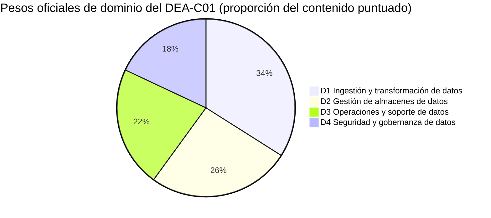
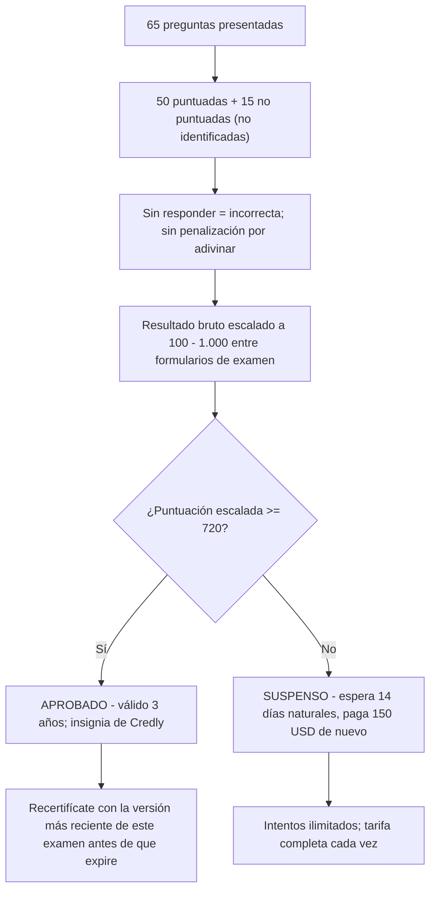
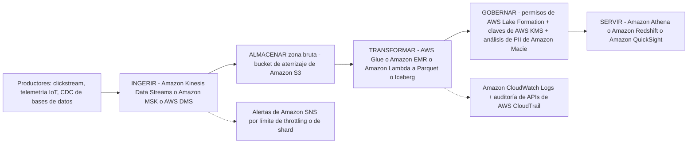
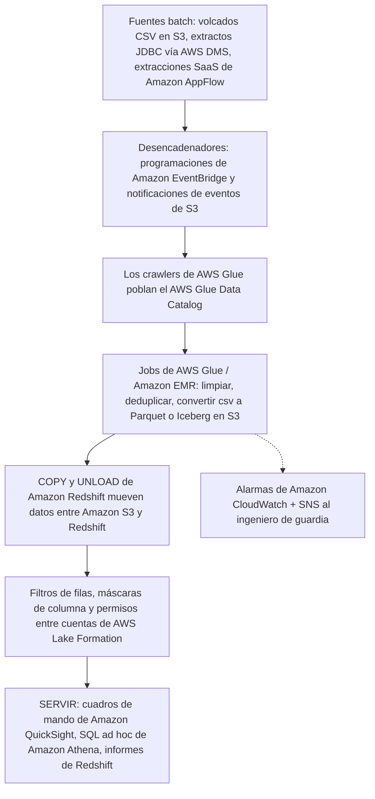
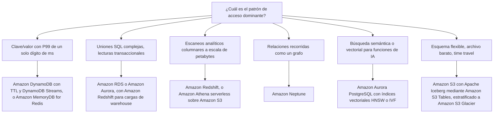

# Guía del examen DEA-C01 y el papel del ingeniero de datos

Toda certificación de AWS comienza con un documento: la **guía oficial del examen**. Para DEA-C01 ese único documento cumple dos trabajos a la vez: te dice exactamente *cómo* está construido el examen (código, minutos, preguntas, nota de corte, pesos) y define el *trabajo de ingeniería de datos* que ya deberías estar haciendo: ingerir, transformar, almacenar, operar y proteger pipelines de datos en AWS. Los candidatos que se saltan la guía y van directo a las tarjetas de memorización caen en las mismas tres trampas: creen una página de terceros que dice que el examen dura **170 minutos** (son **130**), convierten la nota de corte escalada de **720** en un porcentaje (no es el 72%) y no logran separar lo que está **dentro del alcance** de lo que solo *suena* a trabajo real de datos: como *entrenar* un modelo de machine learning, que la guía excluye explícitamente aunque *integrar* un gran modelo de lenguaje en un pipeline sea ya una habilidad con nombre propio.

```text
=====================================================================
 DEA-C01 — AWS CERTIFIED DATA ENGINEER – ASSOCIATE (ASSOCIATE)
=====================================================================
  Código ............ DEA-C01        Nivel ..... Associate
  Duración .......... 130 minutos    Preguntas . 65 presentadas
  Ítems puntuados ... 50             No pun. .... 15 (no identificados)
  Escala ............ 100 - 1.000    Corte ...... 720
  Puntuación ........ compensatoria (solo global, sin aprobación por dominio)
  Coste ............. 150 USD (en octubre de 2026, pueden aplicarse impuestos)
  Validez ........... 3 años         Aplicación . centro Pearson VUE
                                      o proctor en línea
  Idiomas ........... 4 (inglés, japonés, coreano, chino
                        simplificado); exámenes escritos ESL +30 minutos
  Guía .............. v1.1 (12 de diciembre de 2025)
---------------------------------------------------------------------
  DOMINIO                                PESO   ÍTEMS (50 x w)
  1. Ingestión y transformación de datos  34%          17
  2. Gestión de almacenes de datos        26%          13
  3. Operaciones y soporte de datos       22%          11
  4. Seguridad y gobernanza de datos      18%           9
                                          ------         -----
                                          100%           50
---------------------------------------------------------------------
  TIPOS DE PREGUNTA: opción múltiple | respuesta múltiple
                     (sin penalización por adivinar; en blanco = incorrecta)
  NOTA: el recuento de ítems de arriba es 50 x peso — aritmética, NO
        publicada por AWS. Solo los porcentajes son oficiales.
  HABILIDADES: 120 ítems de habilidad en 17 declaraciones de tarea
=====================================================================
```

> [!NOTE]
> **La guía es el contrato.** Cualquier cosa que no esté en la guía del examen, por popular que sea en entradas de blog, no tiene garantía de aparecer. AWS etiqueta explícitamente su lista de servicios dentro del alcance como **«no exhaustiva y sujeta a cambios»** (en octubre de 2026), así que trata la guía como el suelo de lo que debes saber, no como el techo. La guía que descargas hoy es la **v1.1, publicada el 12 de diciembre de 2025**; las revisiones se publican al menos un mes antes de poder afectar a un examen en vivo.

En esta lección vas a:

- leer la guía del examen como la leería quien redacta el examen: código, tiempo, coste, puntuación, idiomas y los **mitos de 170 minutos / 85 preguntas / 300 USD** que los sitios de terceros siguen imprimiendo;
- convertir los **pesos de dominio** en un presupuesto concreto de horas de estudio;
- mapear las **17 declaraciones de tarea y los 120 ítems de habilidad** en los cuatro dominios de contenido;
- dominar los **dos tipos de pregunta** y el modelo de puntuación compensatoria;
- separar la **lista de servicios dentro del alcance** (14 categorías) de la **lista fuera del alcance** que alimenta los distractores;
- definir el **papel del ingeniero de datos** en AWS: qué significan los cuatro grupos de tareas en el día a día y las tres tareas que la guía dice que *no* son tuyas;
- construir la **arquitectura de pipeline de extremo a extremo**, ingerir, almacenar, transformar, gobernar, servir, con dos diagramas de referencia y un árbol de decisión de almacenamiento;
- trabajar **nueve ejemplos resueltos**: presupuesto de tiempo, recuentos de ítems derivados, horas de estudio, coste de repetir el examen, la aritmética del 720, la escalera de coste de Athena, el rendimiento de FINRA;
- estudiar **cuatro casos de estudio reales de clientes de AWS**, Nasdaq, Integral Ad Science, FINRA y GE Aerospace, con servicios, números y fuentes;
- leer el **recuadro de actualizaciones de octubre de 2026**: las ocho habilidades nuevas de la v1.1 de la guía, los seis servicios añadidos y la oleada de servicios de 2025-2026;
- practicar con **14 preguntas estilo examen** más cuatro comprobaciones interativas (emparejamiento, hueco a rellenar, ordenación y un gráfico interactivo).

---

## 1. Qué mide el examen DEA-C01

### 1.1 El candidato objetivo

DEA-C01 es una credencial **Associate**, y la guía enuncia su propósito en una frase: el examen «valida la capacidad de un candidato para implementar pipelines de datos y para monitorizar, resolver problemas y optimizar cuestiones de coste y rendimiento de acuerdo con las mejores prácticas». Este no es un examen de arquitecto ni de analista: es el examen de quien **construye y opera los pipelines**.

| Atributo del candidato | Lo que dice la guía (en octubre de 2026) | Qué significa para tu preparación |
|---|---|---|
| Código y nivel | **DEA-C01 / Associate**; no se ha publicado ningún código sucesor a octubre de 2026 | Profundidad Associate: elegir, configurar, depurar: no diseñar estrategia |
| Experiencia | «el equivalente a **2 to 3 años de experiencia en ingeniería de datos**» | Las preguntas de escenario asumen que ya has entregado pipelines antes |
| Experiencia AWS | «al menos **1 to 2 años de experiencia práctica con servicios de AWS**» | Se espera que conozcas los valores por defecto y los modos de fallo de los servicios |
| Alfabetización en datos | Comprende los efectos de **volumen, variedad y velocidad** sobre la ingesta, la transformación, el modelado, la seguridad, la gobernanza, la privacidad, el diseño de esquemas y el diseño óptimo de almacenes | Las tres V aparecen en casi todos los escenarios del Dominio 1 |
| Redacción de la página de certificación | Añade «o arquitectura de datos» tras ingeniería de datos (página de certificación, en octubre de 2026) | Mismo perfil de habilidades, puerta un poco más ancha |

### 1.2 Las tareas laborales fuera del alcance: textualmente

La guia traza una línea dura, y vale la pena memorizarla palabra por palabra:

> «La siguiente lista contiene tareas laborales que no se espera que el candidato objetivo sepa realizar. Esta lista no es exhaustiva. Estas tareas están fuera del alcance del examen: **Realizar entrenamiento e inferencias de ML. / Demostrar conocimiento de sintaxis específica de lenguajes de programación. / Extraer conclusiones de negocio a partir de datos.**»

Esta lista no es decoración. Los ítems de ella aparecen como **distractores**, porque un distractor que suena a «trabajo real de datos» es la respuesta incorrecta más tentadora de todas.

> [!WARNING]
> **⚠️ La paradoja del alcance: fuera del alcance no significa que nunca se mencione.**
> - *«Realizar entrenamiento e inferencias de ML»* está fuera del alcance, pero la **Habilidad 1.2.10** ahora dice «Integrar grandes modelos de lenguaje (LLM) para el procesamiento de datos»: **la integración está dentro, el entrenamiento está fuera**. Llamar desde un job de Glue a un modelo preentrenado de Amazon Bedrock es examinable; hacer fine-tuning de tu propio modelo, no.
> - *«Sintaxis específica de lenguajes de programación»* está fuera del alcance, pero la **Habilidad 1.4.3** nombra Python, SQL, Scala, R, Java, Bash y PowerShell: el examen prueba **conceptos independientes del lenguaje** (idempotencia, concurrencia, particionado), nunca una trampa de sintaxis.
> - *«Extraer conclusiones de negocio a partir de datos»* está fuera del alcance, pero la **Tarea 3.2** te pide analizar datos: agregación, medias móviles, agrupación, pivotes, verificación y limpieza. El ingeniero entrega **datos correctos, oportunos y gobernados con calidad**; el analista (o una opción del tipo «¿qué producto deberíamos lanzar?») extrae la conclusión de negocio.
> Cualquier opción que te pida entrenar un modelo, depurar la sintaxis de un lenguaje o elegir una estrategia de negocio está probando si detectaste una tarea fuera del alcance.

### 1.3 Conocimiento recomendado que da por supuesto la guía

La guía lista los prerrequisitos en dos columnas. Nada de esto es un dominio separado: es el **suelo del conocimiento supuesto**:

| Conocimiento general de TI | Conocimiento de AWS |
|---|---|
| Pipelines ETL desde la ingesta hasta el destino | Los servicios de AWS nombrados en cada declaración de tarea |
| Conceptos de programación independientes del lenguaje | Servicios de cifrado, gobernanza, protección y registro |
| Git | Comparar servicios por coste, rendimiento y diferencias funcionales |
| Data lakes | SQL sobre servicios de AWS (Amazon Redshift, Amazon Athena) |
| Fundamentos de red, almacenamiento y cómputo | Técnicas de análisis de datos, verificación de calidad y consistencia |
| Conceptos generales de vectores |: |

- **📚 ¿Sabías que…?** «Conceptos generales de vectores» e «índices vectoriales» están en este examen porque la **v1.1 de la guía (12 de diciembre de 2025)** los añadió: Habilidad 2.1.8 «Describir tipos de índice vectorial (por ejemplo, HNSW, IVF)» y Habilidad 2.4.6 «Describir conceptos de vectorización (por ejemplo, base de conocimiento de Amazon Bedrock)». Un plan de estudio de 2023 no contendría ninguno de los dos ítems; la guía actual sí, y las revisiones de la v1.1 se publicaron al menos un mes antes de poder afectar a un examen en vivo (página de revisiones, en octubre de 2026).

### 1.4 Los cuatro grupos de tareas: la columna vertebral del examen

La guía abre con cuatro viñetas que se mapean **1:1** a los cuatro dominios. Léelos como el ciclo del trabajo:

| Grupo (redacción de la guía, condensada) | Dominio en el que se convierte |
|---|---|
| **Ingerir, transformar y orquestar** pipelines de datos, además de conceptos de programación | **Dominio 1**: Ingestión y transformación de datos (34%) |
| **Elegir el almacén de datos óptimo**, modelos, esquemas de catálogo y ciclo de vida | **Dominio 2**: Gestión de almacenes de datos (26%) |
| **Operacionalizar, monitorizar y resolver problemas** de pipelines; analizar datos; garantizar la calidad | **Dominio 3**: Operaciones y soporte de datos (22%) |
| **Autenticación, autorización, cifrado, privacidad, gobernanza** y registro | **Dominio 4**: Seguridad y gobernanza de datos (18%) |

El orden es deliberado: **ingerir → almacenar → operar → proteger**. El Dominio 1 es el más pesado porque la ingesta y la transformación son donde la ingeniería de datos funciona o falla; el Dominio 4 es el menor, pero es el único que puede hundir por completo a una empresa regulada.

---

## 2. Logística del examen: los números que cambian tu estrategia

### 2.1 La tabla de logística

Cada fila de abajo proviene de la guía del examen, del resumen del examen de la página de certificación o de las preguntas frecuentes de certificación de AWS, todas consultadas en **octubre de 2026**.

| Atributo | Valor | Dónde se declara |
|---|---|---|
| Código / nivel | DEA-C01 / **Associate** | Guía del examen |
| Duración | **130 minutos** | Resumen del examen en la página de certificación |
| Preguntas presentadas | **65** (opción múltiple o respuesta múltiple) | Resumen del examen en la página de certificación |
| Puntuadas / no puntuadas | **50 afectan a tu puntuación / 15 no**: las 15 **no están identificadas** en el examen | Guía del examen |
| Tipos de respuesta | OM: 1 correcta + 3 distractores · RM: 2+ correctas de 5+ opciones | Guía del examen |
| Política de adivinanza | Sin responder = **incorrecta**; **sin penalización** por adivinar | Guía del examen |
| Escala de puntuación | Escalada **100 to 1.000**; aprobación mínima **720** | Guía del examen |
| Modelo de puntuación | **Compensatorio**: solo el resultado global debe aprobar | Guía del examen |
| Tarifa | **150 USD** a octubre de 2026 (exámenes de nivel Associate; pueden aplicarse impuestos como el IVA) | Preguntas frecuentes de certificación |
| Aplicación | Centro de pruebas Pearson VUE **o** examen con proctor en línea | Resumen del examen |
| Idiomas | **4**: inglés, japonés, coreano, chino simplificado | Resumen del examen |
| Tiempo extra | Los exámenes **escritos** de inglés como lengua secundaria reciben **+30 minutos** | Preguntas frecuentes de certificación |
| Validez | **3 años**; recertifícate aprobando la versión más reciente de este examen | Página de certificación |
| Repetición tras un suspenso | Espera **14 días naturales**; **sin límite** de intentos; **tarifa completa cada vez** | Preguntas frecuentes de certificación |
| Repetición tras una aprobación | Bloqueado durante **2 años** (salvo que AWS publique una nueva guía y un nuevo código de serie) | Preguntas frecuentes de certificación |
| Reprogramar / cancelar | Gratis hasta **24 horas** antes, máximo **2** cambios; perderte la cita anula la tarifa pero **no** cuenta como intento suspendido | Preguntas frecuentes de certificación |
| Resultados | Dentro de los **5 días hábiles**; prevé **sin aprobación/suspenso el mismo día** en pantalla; insignia emitida vía Credly | Preguntas frecuentes de certificación |
| Sugerencia de siguiente paso | La página de certificación recomienda **Security: Specialty** como siguiente examen natural | Página de certificación |
| Crédito de examen | **50% de descuento** en tu próximo examen de AWS una vez que hayas obtenido una certificación | Página de certificación |

### 2.2 Los tres mitos que todo sitio de preparación sigue imprimiendo

El resumen de fuentes oficiales señala tres conflictos que se repiten en páginas de terceros (verificado en octubre de 2026). En cada caso, **el número oficial gana**:

| Mito (páginas de terceros) | Verdad oficial (a octubre de 2026) | Por qué existe el mito |
|---|---|---|
| «170 minutos» | **130 minutos** | 170 minutos es la duración de los exámenes **Specialty** de AWS, no de este examen Associate |
| «85 preguntas» | **65 preguntas** (50 puntuadas + 15 no puntuadas) | Páginas de preparación antiguas o compuestas fusionaron formatos |
| «Tarifa de 300 USD» | **150 USD**: nivel Associate | **300 USD** es la tarifa de Professional y Specialty; Foundational es 100 USD |

> [!IMPORTANT]
> **⚠️ Regla de precedencia para cada número de este curso.** Las fuentes oficiais de AWS (guía del examen, página de certificación, preguntas frecuentes) vencen a cualquier blog, curso o proveedor de simulados de terceros. Cuando un tercero discrepe, 170 minutos, 85 preguntas, 300 USD, el resumen registra el conflicto y el valor oficial se mantiene. Nunca cites en este examen un número que no puedas rastrear hasta una página de AWS, y sella cada precio y límite con **«en octubre de 2026»**.

### 2.3 Ejemplo resuelto E1: el presupuesto de tiempo por pregunta

El número más útil de toda la guía es una aritmética que nadie publica:

$$
t = \frac{130 \times 60}{65} = \frac{7{,}800}{65} = 120 \text{ segundos por pregunta, exactamente}
$$

Reserva **10 minutos** para la revisión y el presupuesto real pasa a ser $120 \times 60 / 65 \approx$ **110,8 segundos** por ítem. Regla práctica de presupuesto: ítems rápidos de 60 to 90 segundos al principio, dedica 3 to 4 minutos a los ítems más lentos de escenario y respuesta múltiple, y nunca dejes que un solo ítem se coma más de unos cinco minutos.

### 2.4 Ejemplo resuelto E2: puntuados frente a no puntuados

$$
65 = 50 + 15 \qquad \frac{15}{65} = 23.1\% \text{ del examen no afecta a tu puntuación}
$$

Casi una cuarta parte del examen es material piloto invisible, y **no puedes saber cuáles son esos 15**. La única estrategia sensata es tratar cada ítem como puntuado.

### 2.5 Ejemplo resuelto E3: el coste de repetir el examen

| Evento | Día del calendario | Cartera (a octubre de 2026) |
|---|---|---|
| Primer intento (suspenso) | Día 0 | 150 USD |
| Elegible para repetir | Día 14 |: |
| Segundo intento (suspenso) | Día 14 o posterior | +150 USD |
| Tercer intento | +14 días tras el segundo suspenso | +150 USD |
| **Total tras tres intentos suspendidos** |: | **450 USD** |

Tres intentos cuestan **450 USD** a octubre de 2026 más al menos **28 días naturales** de espera entre ellos. El beneficio espejo: cuando **apruebas**, la página de certificación concede un **50% de descuento** en tu próximo examen de AWS: una inscripción Associate de 150 USD pasa a **75 USD** (a octubre de 2026), y una inscripción Professional o Specialty de 300 USD pasa a 150 USD.

### 2.6 Qué ocurre después de presentarte al examen

Los resultados llegan en un plazo de **cinco días hábiles**. Las preguntas frecuentes dicen que «la mayoría de los exámenes de certificación de AWS» se comunican sin aprobación/suspenso en pantalla, así que **prevé resultados demorados**: los artefactos deterministas son el informe de puntuación y la insignia de **Credly** si aprobaste. Entre hoy y el día del examen, las únicas mecánicas que importan son: **responde todos los ítems** (en blanco = incorrecto), **termina los 65** (tienes 120 segundos por cada uno) y **presupón 150 USD por intento** (a octubre de 2026).

- **📚 ¿Sabías que…?** DEA-C01 tuvo exactamente **una ventana beta**: la inscripción fue del **2 de noviembre de 2023**, la aplicación del **27 de noviembre de 2023 al 12 de enero de 2024**, al precio beta de **75 USD**. El examen pasó a **GA en abril de 2024**, el mismo mes en que **DAS-C01 (Data Analytics, Specialty) se retiró el 9 de abril de 2024**, DEA-C01 es su heredero espiritual en el nivel Associate (blog de formación y certificación de AWS, en octubre de 2026). **No ha habido beta de DEA en 2026**; si un sitio de preparación mezcla la logística beta de 2026 de otro examen en un resumen de DEA-C01, está equivocado.

---

## 3. Los cuatro dominios y sus pesos

### 3.1 Pesos oficiales

La guía declara cuatro dominios de contenido, y los porcentajes son proporciones del **contenido puntuado únicamente**:

| Dominio | Peso oficial |
|---|---|
| **1. Ingestión y transformación de datos** | **34%** |
| **2. Gestión de almacenes de datos** | **26%** |
| **3. Operaciones y soporte de datos** | **22%** |
| **4. Seguridad y gobernanza de datos** | **18%** |
| **Total** | **100%** |



### 3.2 Ejemplo resuelto E4: recuentos de ítems derivados (aritmética, no de AWS)

Multiplica los **50 ítems puntuados** por cada peso:

```text
Dominio  peso    50 x peso   lectura
D1        34%         17     unos 17 ítems puntuados
D2        26%         13     unos 13 ítems puntuados
D3        22%         11     unos 11 ítems puntuados
D4        18%          9     unos  9 ítems puntuados
                                ------
                              50 ítems puntuados
```

> [!IMPORTANT]
> Los **pesos son oficiales** (guía del examen, a octubre de 2026). Los **recuentos de ítems son aritmética**, 50 × peso, y **no los publica AWS**. Los recuentos de preguntas por dominio en cualquier formulario real son desconocidos, y como 15 de los 65 ítems son pilotos no puntuados, tu formulario real de examen no coincidirá exactamente con esta cuadrícula. Úsala para **asignar tiempo de estudio**, nunca para predecir un número fijo de preguntas.

### 3.3 Ejemplo resuelto E5: convertir pesos en horas de estudio

Supón que tienes **40 horas** antes del día del examen. Los pesos se convierten directamente en horas:

```text
Dominio  peso   horas (40 h)  adónde van las horas
D1        34%       13,6 h    ingesta, transformación, orquestación,
                              conceptos de programación (37 ítems de habilidad)
D2        26%       10,4 h    almacenes, catálogos, ciclo de vida, diseño de esquemas
                              (26 ítems de habilidad)
D3        22%        8,8 h    automatización, análisis, monitorización, calidad
                              (28 ítems de habilidad)
D4        18%        7,2 h    autenticación, autorización, cifrado,
                              registros de auditoría, privacidad y gobernanza
                              (29 ítems de habilidad)
                              ---------
                              40,0 h
```

Los dominios 1 + 2 son el **60% de la puntuación**. Un candidato que dedica la mayor parte de su tiempo a la seguridad porque «ese siempre es el tema más grande de AWS» ha mal asignado el examen: en *este* examen, el pipeline y el almacén van primero.

### 3.4 De la guía v1.0 a la v1.1: qué cambió y cuándo cuenta

El examen se actualizó en **diciembre de 2025**: la versión **v1.1 (12 de diciembre de 2025)** consolidó las listas separadas de «conocimiento de» y «habilidades en» en **una lista de habilidades por tarea**, añadió **ocho habilidades nuevas**, no eliminó ninguna y cambió ambas listas de servicios. El mecanismo de revisión de AWS (blog de formación y certificación, 17 de diciembre de 2025) es explícito:

| Tipo de cambio | Qué hace AWS | Ejemplo |
|---|---|---|
| Cambios de dominio **significativos** | Nuevo código de serie + análisis completo de tareas laborales | DVA-C01 → DVA-C02 |
| Cambios **menos significativos** | **Revisión** del código existente, resumida en la página de revisiones | DEA-C01 v1.0 → **v1.1** |
| Regla de calendario | Las revisiones se publican **al menos 1 mes** antes de afectar a un examen real | v1.1 (2025-12-12) elegible desde ~2026-01-12 |
| Regla de vigencia de servicios | Un servicio nuevo solo es examinable tras **al menos 3 meses** en GA | Preguntas frecuentes de certificación, a octubre de 2026 |

Las ocho habilidades nuevas de la v1.1: todas directamente examinables ahora: **1.2.10** integrar LLM para procesamiento de datos · **2.1.7** gestionar formatos de tabla abiertos (por ejemplo Apache Iceberg) · **2.1.8** describir tipos de índice vectorial (HNSW, IVF) · **2.2.6** crear y gestionar catálogos de datos empresariales (Amazon SageMaker Catalog) · **2.4.6** describir conceptos de vectorización (base de conocimiento de Amazon Bedrock) · **4.1.7** usar dominios, unidades de dominio y proyectos de SageMaker Unified Studio · **4.5.6** gestionar el acceso a datos mediante proyectos de SageMaker Catalog · **4.5.7** describir el marco de gobernanza de datos y los patrones de compartición de datos.

---

## 4. El mapa de declaraciones de tarea: 4 dominios, 17 tareas, 120 habilidades

La guía no publica temas vagos; publica **declaraciones de tarea**, cada una con una lista numerada de **habilidades**. Todo lo examinable cuelga de una de estas 17 tareas y sus **120 ítems de habilidad**.

```mermaid
flowchart TD
    R["DEA-C01 - 17 declaraciones de tarea en 4 dominios (120 habilidades)"] --> D1["D1 Ingestión y transformación de datos 34%"]
    R --> D2["D2 Gestión de almacenes de datos 26%"]
    R --> D3["D3 Operaciones y soporte de datos 22%"]
    R --> D4["D4 Seguridad y gobernanza de datos 18%"]
    D1 --> A1["1.1 Realizar ingesta de datos - 12 habilidades"]
    D1 --> A2["1.2 Transformar y procesar datos - 10 habilidades"]
    D1 --> A3["1.3 Orquestar pipelines de datos - 4 habilidades"]
    D1 --> A4["1.4 Aplicar conceptos de programación - 11 habilidades"]
    D2 --> B1["2.1 Elegir un almacén de datos - 8 habilidades"]
    D2 --> B2["2.2 Comprender los sistemas de catálogo de datos - 6 habilidades"]
    D2 --> B3["2.3 Gestionar el ciclo de vida de los datos - 6 habilidades"]
    D2 --> B4["2.4 Diseñar modelos de datos y evolución de esquemas - 6 habilidades"]
    D3 --> C1["3.1 Automatizar el procesamiento de datos - 9 habilidades"]
    D3 --> C2["3.2 Analizar datos con servicios de AWS - 6 habilidades"]
    D3 --> C3["3.3 Mantener y monitorizar pipelines de datos - 8 habilidades"]
    D3 --> C4["3.4 Garantizar la calidad de los datos - 5 habilidades"]
    D4 --> E1["4.1 Aplicar mecanismos de autenticación - 7 habilidades"]
    D4 --> E2["4.2 Aplicar mecanismos de autorización - 6 habilidades"]
    D4 --> E3["4.3 Garantizar el cifrado y el enmascarado de datos - 4 habilidades"]
    D4 --> E4["4.4 Preparar registros para auditoría - 5 habilidades"]
    D4 --> E5["4.5 Comprender la privacidad y la gobernanza de datos - 7 habilidades"]
```



### 4.1 Las 17 tareas, una línea cada una

| Tarea | Enfoque en una línea (ejemplos que nombra la guía) |
|---|---|
| **1.1** Realizar ingesta de datos | Streaming (Kinesis, MSK, DynamoDB Streams, DMS, Glue, Redshift) y batch (S3, Glue, EMR, DMS, Redshift, Lambda, AppFlow); programadores (EventBridge, Airflow); desencadenadores de eventos; fan-in/fan-out; reproducibilidad; transacciones con estado frente a sin estado |
| **1.2** Transformar y procesar datos | Contenedores (EKS, ECS); conexiones JDBC/ODBC; integración de múltiples fuentes; coste durante el procesamiento; transformaciones en EMR / Glue / Lambda / Redshift; **.csv a Apache Parquet**; depuración de fallos; APIs de datos; volumen/velocidad/variedad; **integración de LLM** |
| **1.3** Orquestar pipelines de datos | Lambda, EventBridge, **Amazon MWAA**, Step Functions, flujos de trabajo de Glue; rendimiento, disponibilidad, escalabilidad, resiliencia, tolerancia a fallos; flujos de trabajo serverless; alertas de SNS / SQS |
| **1.4** Aplicar conceptos de programación | Optimización de runtime; concurrencia de Lambda; Python/SQL/Scala/R/Java/Bash/PowerShell como *conceptos*; control de versiones, pruebas, registro, monitorización; **IaC (CloudFormation, CDK)**; **AWS SAM**; montaje de volúmenes en Lambda; CI/CD; cómputo distribuido; estructuras de datos y algoritmos |
| **2.1** Elegir un almacén de datos | Servicios de almacenamiento por coste/rendimiento/patrones de acceso (Redshift, EMR, Lake Formation, RDS, DynamoDB, Kinesis, MSK); indexación (HNSW en Aurora PostgreSQL); MemoryDB; Transfer Family; consultas federadas / vistas materializadas / Spectrum de Redshift; bloqueos; **formatos de tabla abiertos (Iceberg)**; **tipos de índice vectorial (HNSW, IVF)** |
| **2.2** Comprender el catálogo de datos | Consumir desde la fuente mediante catálogos; **Glue Data Catalog** / metastore de Hive; crawlers; **sincronización de particiones**; nuevas conexiones de origen/destino; **catálogos empresariales (SageMaker Catalog)** |
| **2.3** Gestionar el ciclo de vida de los datos | COPY/UNLOAD de Redshift con S3; cambios de nivel y caducidad de **S3 Lifecycle**; versionado y **TTL de DynamoDB**; borrado por requisitos empresariales/legales; resiliencia y disponibilidad |
| **2.4** Diseñar modelos y evolución de esquemas | Esquemas para Redshift, DynamoDB, Lake Formation; cambios en las características de los datos; **conversión de esquemas (AWS SCT y AWS DMS Schema Conversion)**; linaje (SageMaker ML Lineage Tracking, SageMaker Catalog); indexación, particionado, compresión; **vectorización (base de conocimiento de Bedrock)** |
| **3.1** Automatizar el procesamiento de datos | Orquestación con MWAA y Step Functions; resolución de problemas de flujos de trabajo gestionados; SDKs; funciones de EMR/Redshift/Glue; APIs de datos; preparación con **DataBrew y SageMaker Unified Studio**; consultas de **Athena**; automatización con Lambda; eventos y programadores de EventBridge |
| **3.2** Analizar datos | Visualización (DataBrew, QuickSight); verificar y limpiar (Lambda, Athena, Jupyter, SageMaker Data Wrangler); SQL en Redshift y Athena; **notebooks de Athena con Apache Spark**; compromisos entre provisionado y serverless; agregación, media móvil, agrupación, pivotes |
| **3.3** Mantener y monitorizar pipelines | Registros para auditorías; registro/monitorización para trazabilidad; alertas; resolución de problemas de rendimiento; seguimiento de APIs con **CloudTrail**; mantenimiento de Glue/EMR; **CloudWatch Logs**; análisis de registros (Athena, EMR, OpenSearch, CloudWatch Logs Insights) |
| **3.4** Garantizar la calidad de los datos | Comprobaciones durante el procesamiento (campos vacíos); **reglas de DataBrew**; investigación de consistencia; técnicas de muestreo; mecanismos de sesgo de datos |
| **4.1** Aplicar autenticación | Grupos de seguridad de VPC; grupos, roles, endpoints y servicios de IAM; rotación de credenciales de **Secrets Manager**; roles de IAM para Lambda/API Gateway/CLI/CloudFormation; políticas sobre roles, endpoints y servicios (S3 Access Points, PrivateLink); servicios gestionados frente a no gestionados; **dominios de SageMaker Unified Studio** |
| **4.2** Aplicar autorización | Políticas IAM personalizadas; credenciales en Secrets Manager y Parameter Store; usuarios/grupos/roles de Redshift; **permisos de Lake Formation** (Redshift, EMR, Athena, S3); métodos basados en rol, etiqueta y atributo; políticas de mínimo privilegio |
| **4.3** Garantizar cifrado y enmascarado | Enmascarado y anonimización para cumplimiento; claves de **KMS**; cifrado a través de límites de cuenta; cifrado en tránsito o antes del tránsito |
| **4.4** Preparar registros para auditoría | Llamadas a APIs de CloudTrail; almacenamiento de CloudWatch Logs; **CloudTrail Lake**; análisis (Athena, CloudWatch Logs Insights, OpenSearch); EMR para grandes volúmenes de registros |
| **4.5** Privacidad y gobernanza | Compartición de datos de Redshift; **identificación de PII (Macie con Lake Formation)**; estrategias de residencia de datos; historial de configuración de **AWS Config**; soberanía de datos; **proyectos de SageMaker Catalog**; marcos de gobernanza y patrones de compartición |

```matching
{
  "question": "Relaciona cada dominio del DEA-C01 con su peso oficial y su recuento de ítems de habilidad (a octubre de 2026):",
  "pairs": [
    {"left": "D1 Ingestión y transformación de datos", "right": "34% del contenido puntuado - 37 ítems de habilidad en las tareas 1.1-1.4 (ingerir, transformar, orquestar, conceptos de programación)"},
    {"left": "D2 Gestión de almacenes de datos", "right": "26% del contenido puntuado - 26 ítems de habilidad en las tareas 2.1-2.4 (elegir almacén, catálogo, ciclo de vida, evolución de esquemas)"},
    {"left": "D3 Operaciones y soporte de datos", "right": "22% del contenido puntuado - 28 ítems de habilidad en las tareas 3.1-3.4 (automatizar, analizar, monitorizar, calidad de datos)"},
    {"left": "D4 Seguridad y gobernanza de datos", "right": "18% del contenido puntuado - 29 ítems de habilidad en las tareas 4.1-4.5 (autenticación, autorización, cifrado/enmascarado, registros de auditoría, privacidad/gobernanza)"}
  ],
  "explanation": "Los pesos y los recuentos deben permanecer emparejados en la memoria: D1 es el más pesado por peso (34%) Y tiene el mayor número de ítems de habilidad (37), mientras que D4 tiene el menor peso (18%) pero el segundo mayor recuento de ítems (29): contenido de seguridad denso y de alto riesgo. Solo los porcentajes son oficiales; los recuentos de ítems provienen de las listas de habilidades de la v1.1 de la guía (a octubre de 2026)."
}
```

### 4.2 Densidad de habilidades: adónde va realmente el esfuerzo

Los ítems de habilidad por punto de peso revelan la textura del examen:

```text
Dominio  habilidades  peso  habilidades por punto de peso  textura
D1          7          34%           1.09                   amplia, cargada de pipelines
D2          6          26%           1.00                   equilibrada, centrada en el almacén
D3          8          22%           1.27                   ops densas por punto
D4          9          18%           1.61                   muy densa, cargada de seguridad
                     ---
                    120 habilidades en total
```

D4 carga **1,61 ítems de habilidad por punto de peso**, la mayor densidad del examen. Las preguntas de seguridad son estrechas, específicas e implacables; las del Dominio 1 son amplias y basadas en escenarios. El tiempo de estudio sigue los **pesos**; la cadencia de repaso sigue la **densidad**, repasa el Dominio 4 más a menudo en sesiones cortas.

```plot
{
  "type": "bar",
  "title": "Densidad de habilidades: ítems por punto de peso (guía v1.1, a octubre de 2026)",
  "data": [
    {"Domain": "D1 Ingestion and Transformation", "Density": 1.09},
    {"Domain": "D2 Data Store Management", "Density": 1.0},
    {"Domain": "D3 Operations and Support", "Density": 1.27},
    {"Domain": "D4 Security and Governance", "Density": 1.61}
  ],
  "xKey": "Domain",
  "yKey": "Density",
  "xLabel": "Dominio de contenido",
  "yLabel": "Ítems de habilidad por punto de peso"
}
```

Pasa el cursor por cualquier barra para leer la razón exacta: D2 está en 1,00 (la línea base), D1 justo por encima en 1,09, D3 en 1,27 y D4 en 1,61. El gráfico vuelve visual la regla de estudio: la barra más alta es el dominio más corto, así que el Dominio 4 merece las sesiones de repaso más frecuentes y más breves por hora de peso del examen.

---

## 5. Tipos de pregunta y mecánica de puntuación

### 5.1 Exactamente dos tipos de pregunta

| Tipo | Estructura (redacción de la guía) | Regla de crédito |
|---|---|---|
| **Opción múltiple** | «Tiene una respuesta correcta y tres respuestas incorrectas (distractores)» | Selecciona la única mejor respuesta |
| **Respuesta múltiple** | «Tiene dos o más respuestas correctas de cinco o más opciones de respuesta» | Se requiere cada respuesta correcta para el crédito |

No hay **ítems de ordenación, emparejamiento, arrastrar y soltar ni estudios de caso** en la guía de DEA-C01, y no se ha publicado ningún código sucesor a octubre de 2026, así que si un simulado te muestra esos formatos, no está siguiendo la guía de este examen.

### 5.2 El pipeline de puntuación



**Compensatorio** significa una sola cosa: solo el resultado **global** debe superar los 720. **No** necesitas alcanzar 720 dentro de cada dominio: un Dominio 4 débil puede ser sostenido por un Dominio 1 fuerte, y dominar un dominio no puede rescatar una puntuación global por debajo del corte.

### 5.3 Ejemplo resuelto E6: 720 no es 72%

720 sobre 1.000 *parece* un 72%, y la conversión ingenua $0.72 \times 50 = 36$ respuestas correctas es aritméticamente limpia, y **errónea como dato del examen**. La escala empieza en 100, así que el rango útil es de $1{,}000 - 100 = 900$ puntos:

$$
\frac{720 - 100}{900} = \frac{620}{900} \approx 68.9\%
$$

AWS escala las puntuaciones **a través de múltiples formularios de examen que pueden diferir en dificultad**, por lo que el número bruto de respuestas correctas necesarias para 720 **no está fijado** y no se publica. La única regla determinista es de comportamiento: **los ítems sin responder se puntúan como incorrectos**, así que responde los 65.

### 5.4 Ejemplo resuelto E7: aritmética compensatoria (ilustración de planificación)

Como **ayuda de planificación derivada** (no es una conversión publicada por AWS: los recuentos exactos por dominio en un formulario real nunca se publican), toma la cuadrícula E4 de 17/13/11/9 ítems puntuados. Un candidato con un rendimiento fuerte en los Dominios 1 to 3 y débil en el Dominio 4 aún ha superado tres de las cuatro franjas de peso; el modelo compensatorio solo pregunta entonces si el resultado **global escalado** alcanza 720. El caso espejo es el peligro: un candidato que se saca un sobresaliente en el Dominio 4 (18%) pero descuida los Dominios 1 to 2 (60%) está luchando contra los propios pesos. Conclusión que el examen premia: **ningún dominio puede abandonarse**, pero el orden correcto de cobertura es 1 → 2 → 3 → 4 por peso, con el Dominio 4 repasado a menudo por su densidad de 1,61 habilidades por punto.

```fillblank
{
  "question": "Completa las afirmaciones logísticas del DEA-C01 con los números oficiales (a octubre de 2026):",
  "template": "El examen dura {{1}} minutos y presenta {{2}} preguntas, de las cuales {{3}} afectan a tu puntuación y {{4}} son pilotos no puntuados que no están identificados en el examen. Los resultados se comunican con una puntuación escalada de 100-1.000 y la puntuación mínima de aprobación es {{5}}. La tarifa es de {{6}} USD, tras un intento suspendido hay una espera de {{7}} días naturales y la certificación es válida durante {{8}} años.",
  "answers": {
    "1": "130",
    "2": "65",
    "3": "50",
    "4": "15",
    "5": "720",
    "6": "150",
    "7": "14",
    "8": "3"
  },
  "distractors": ["90", "170", "60", "70", "85", "25", "700", "100", "300", "7", "30", "2", "5"],
  "explanation": "130 minutos / 65 preguntas / 50 puntuadas + 15 no puntuadas / nota de corte 720 / 150 USD / espera de 14 días para repetir / validez de 3 años son todos oficiales (guía del examen, página de certificación y preguntas frecuentes, a octubre de 2026). Las cifras de 90 minutos, 170 minutos, corte 700 y 300 USD pertenecen a otros exámenes de AWS o a mitos de terceros; en este examen son siempre incorrectas."
}
```

---

## 6. Servicios dentro y fuera del alcance

### 6.1 Dos listas, una regla

La guía publica una lista de **servicios de AWS dentro del alcance** que abarca **14 categorías** (78 líneas, unas 75 distintas porque SageMaker AI y S3 Tables aparecen cada uno dos veces: a octubre de 2026), y una lista separada de **servicios de AWS fuera del alcance**. Ambas llevan la advertencia estándar de AWS de que la lista es **no exhaustiva y sujeta a cambios**. La lista dentro del alcance es lo que debes reconocer; la lista fuera del alcance te dice qué nombres se están usando como **cebos**.

| Categoría dentro del alcance (14 en total) | Nombres que lista la guía (a octubre de 2026) |
|---|---|
| Analítica | Amazon Athena · Amazon EMR · AWS Glue · AWS Glue DataBrew · AWS Lake Formation · Amazon Kinesis Data Firehose · Amazon Kinesis Data Streams · Amazon Managed Service for Apache Flink · Amazon Managed Streaming for Apache Kafka (Amazon MSK) · Amazon OpenSearch Service · **Amazon Quick** · Amazon SageMaker AI |
| Integración de aplicaciones | Amazon AppFlow · Amazon EventBridge · Amazon Managed Workflows for Apache Airflow (Amazon MWAA) · Amazon SNS · Amazon SQS · AWS Step Functions |
| Gestión financiera en la nube | AWS Budgets · AWS Cost Explorer |
| Cómputo | AWS Batch · Amazon EC2 · AWS Lambda · AWS SAM |
| Contenedores | Amazon ECR · Amazon ECS · Amazon EKS |
| Base de datos | Amazon DocumentDB · Amazon DynamoDB · Amazon Keyspaces · Amazon MemoryDB for Redis · Amazon Neptune · Amazon RDS · **Amazon Aurora** · Amazon Redshift |
| Herramientas de desarrollador | AWS CLI · AWS CloudFormation · AWS CDK · AWS CodeBuild · AWS CodeDeploy · AWS CodePipeline · **Amazon Q** |
| Web y móvil | Amazon API Gateway |
| Machine learning | Amazon SageMaker AI · **Amazon Bedrock** · **Amazon Kendra** |
| Gestión y gobernanza | AWS CloudTrail · Amazon CloudWatch · Amazon CloudWatch Logs · AWS Config · Amazon Managed Grafana · AWS Systems Manager · AWS Well-Architected Tool · **AWS Data Exchange** |
| Migración y transferencia | AWS Application Discovery Service · AWS Application Migration Service · AWS DMS · AWS DataSync · AWS Snow Family · AWS Transfer Family |
| Redes y entrega de contenido | Amazon CloudFront · AWS PrivateLink · Amazon Route 53 · Amazon VPC |
| Seguridad, identidad y cumplimiento | IAM · AWS KMS · Amazon Macie · AWS Secrets Manager · AWS Shield · AWS WAF |
| Almacenamiento | AWS Backup · Amazon EBS · Amazon EFS · Amazon S3 · **Amazon S3 Tables** · Amazon S3 Glacier |

Los nombres en **negrita** se **añadieron en la v1.1 de la guía** (12 de diciembre de 2025): Amazon Aurora, Amazon Q, Amazon Bedrock, Amazon Kendra, AWS Data Exchange y Amazon S3 Tables.

### 6.2 La lista fuera del alcance: servicios que existen pero no son examinables

Amazon FinSpace · Alexa for Business · Amazon Chime · Amazon Connect · AWS IQ · Amazon WorkMail · AWS App Runner · AWS Elastic Beanstalk · Amazon Lightsail · AWS Outposts · AWS Serverless Application Repository · Red Hat OpenShift Service on AWS (ROSA) · AWS Fault Injection Simulator (AWS FIS) · AWS X-Ray · AWS Amplify · AWS AppSync · AWS Device Farm · Amazon Location Service · Amazon Pinpoint · Amazon SES · FreeRTOS · AWS IoT 1-Click · AWS IoT Device Defender · AWS IoT Device Management · AWS IoT Events · AWS IoT FleetWise · AWS IoT RoboRunner · AWS IoT SiteWise · AWS IoT TwinMaker · Amazon DevOps Guru · AWS Activate · AWS Managed Services (AMS) · Amazon Elastic Transcoder · AWS Elemental Appliances and Software · AWS Elemental MediaConnect · AWS Elemental MediaConvert · AWS Elemental MediaLive · AWS Elemental MediaPackage · AWS Elemental MediaStore · AWS Elemental MediaTailor · Amazon Interactive Video Service (Amazon IVS) · Amazon Nimble Studio · AWS Mainframe Modernization · AWS Migration Hub · EC2 Image Builder.

Cuatro nombres se **eliminaron de la lista fuera del alcance** en la v1.1 (Amazon Honeycode, Amazon WorkDocs, Amazon Timestream, Amazon CodeWhisperer), y **no se añadió nada a ella**: eliminarse de la lista fuera del alcance no hace que un servicio entre dentro del alcance; los servicios que están en *ninguna* de las dos listas simplemente no están garantizados.

> [!IMPORTANT]
> **Que un servicio esté fuera del alcance no significa que sea falso, obsoleto o incorrecto.** Son servicios reales y actuales de AWS. Simplemente **no pueden ser la respuesta correcta** a una pregunta de DEA-C01 mientras encaje un servicio dentro del alcance. Si la opción que suena mejor de una pregunta está en la lista fuera del alcance, Amazon Elastic Beanstalk «para desplegar pipelines de datos», AWS X-Ray «para trazar jobs de Glue», sigue leyendo; casi con certeza hay una mejor opción dentro del alcance.

### 6.3 Trampas de denominación en la lista dentro del alcance

- **«Amazon Quick»** es la cadena literal de la lista de Analítica dentro del alcance (verificado en octubre de 2026), mientras que la Tarea 3.2.1 nombra «Amazon QuickSight» y la línea de producto es ahora **Amazon Quick Suite**. Trata a la familia Quick como dentro del alcance; no afirmes que la guía imprime «Amazon QuickSight»: no lo hace.
- **Amazon Kinesis Data Firehose** es lo que la lista dentro del alcance sigue imprimiendo, mientras que el producto se renombró **Amazon Data Firehose** el **9 de febrero de 2024** sin **cambios de API, endpoint, CLI, política de IAM ni métricas de CloudWatch**. Cualquier de los dos nombres puede aparecer en el examen; nunca «corrijas» una opción que diga Kinesis Data Firehose.
- **AWS SCT (Schema Conversion Tool)** se **eliminó de la lista dentro del alcance en la v1.1**, aunque la Habilidad 2.4.3 aún dice «Realizar conversión de esquemas (por ejemplo, con AWS SCT y AWS DMS Schema Conversion)». Prefiere **AWS DMS Schema Conversion** como la herramienta actual; reconoce SCT como el nombre heredado que el texto de la habilidad conserva.
- **Amazon Q** (Herramientas de desarrollador) **no** es la misma entrada que **Amazon Quick** (Analítica). Dos cadenas distintas, dos categorías distintas.
- **Amazon SageMaker AI** aparece dos veces (Analítica y Machine learning) y **Amazon S3 Tables** se imprime dos veces en Almacenamiento: ambas son duplicación documental en la página oficial, no servicios extra.

### 6.4 Qué artefacto prevalece

| Artefacto | Estado (octubre de 2026) | Regla |
|---|---|---|
| Guía del examen en HTML en AWS Docs | Actual, **v1.1** | **Usa este** |
| Página de revisiones | diff v1.0 → v1.1, fechado 2025-12-12 | Tu registro de cambios para los deltas |
| Espejo PDF oficial | Misma generación que el HTML | Solo como referencia cuando el HTML no esté accesible |
| Páginas de preparación de terceros | Varían: persisten los mitos de 170 min / 85 preguntas / 300 USD | Nunca autoritativas |

- **📚 ¿Sabías que…?** La página oficial dentro del alcance contiene literalmente la entrada única **«Amazon Quick»** en la categoría Analítica (verificado en octubre de 2026): «Sight» no aparece en ninguna parte de esa página, aunque la Tarea 3.2.1 y las páginas de producto usan QuickSight / Quick Suite. AWS no ha aclarado si denota la familia Quick Suite o una truncación, así que el comportamiento seguro en el examen es: trata cualquier nombre de la familia **Quick** como dentro del alcance y nunca afirmes que la guía dice «Amazon QuickSight».

---

## 7. El papel del ingeniero de datos en AWS

### 7.1 Cómo se ven los cuatro grupos un martes cualquiera

Los grupos de tareas laborales de la guía no son abstractos: cada uno se mapea a un ciclo de trabajo concreto:

| Grupo | Un día en el papel | Fallo que el examen probará en un escenario |
|---|---|---|
| **Ingerir / transformar / orquestar** | Conectar Kinesis o DMS a S3, programar crawlers de Glue con EventBridge, encadenar una máquina de estados de Step Functions, alertar mediante SNS | Particiones tardías, reejecuciones no idempotentes, APIs de origen limitadas, un job de Glue que se queda sin memoria en tiempo de transformación |
| **Elegir el almacén / catálogo / ciclo de vida** | Elegir DynamoDB para clave/valor P99, Redshift para el warehouse, Iceberg sobre S3 para el lago; mantener sincronizado el Glue Data Catalog; caducitar los datos en bruto a los 90 días | Patrón de acceso incorrecto para el almacén, particiones de catálogo obsoletas, datos conservados (y facturados) mucho más allá de su vida legal |
| **Operar / monitorizar / analizar / calidad** | Alarmas de CloudWatch sobre métricas de jobs de Glue, CloudTrail para forense de APIs, reglas de DataBrew que detienen el pipeline, Athena para verificación ad hoc | Deriva silenciosa de calidad, llamadas a APIs no trazables, alertas que nadie recibe |
| **Autenticar / autorizar / cifrar / gobernar** | Roles de IAM por etapa del pipeline, rotación de Secrets Manager, claves de KMS, filtros de filas de Lake Formation, hallazgos de PII de Macie | Políticas demasiado amplias, credenciales en texto plano, PII en un bucket público, copias de seguridad replicadas a una Región no permitida |

### 7.2 Lo que el papel no es

Reenunciando la lista fuera del alcance como límites positivos: el ingeniero de datos de DEA-C01 **no entrena ni ejecuta inferencias** sobre modelos (la Habilidad 1.2.10 se detiene en la *integración*), **no demuestra sintaxis de lenguaje** (1.4.3 prueba conceptos) y **no extrae conclusiones de negocio** (la Tarea 3.2 se detiene en la agregación, la limpieza y la verificación). El producto del papel es **datos correctos, oportunos, completos, gobernados y lo bastante baratos como para conservarlos**: cada pregunta puede puntuarse contra esa frase.

### 7.3 El hábito de comparar que prueba la guía

Tres veces a lo largo de las listas de habilidades la guía usa el mismo verbo: **comparar**. Debes poder comparar servicios por **coste, rendimiento y diferencias funcionales** (conocimiento recomendado), **provisionado frente a serverless** (Habilidad 3.2.5) y **gestionado frente a no gestionado** (Habilidad 4.1.6). Por eso este curso enseña cada servicio con un par «elígelo cuando / evítalo cuando», y por eso el distractor favorito del examen es un servicio de AWS *real* que simplemente es **peor para el requisito enunciado**.

---

## 8. Arquitectura de pipeline de extremo a extremo: ingerir, almacenar, transformar, gobernar, servir

### 8.1 Arquitectura de referencia 1: la ruta de streaming

Las habilidades de streaming del Dominio 1 (1.1.1, 1.1.7, 1.1.10, 1.3.4) se componen en una forma canónica. Observa el orden de etapas que implica la guía: **ingerir → almacenar → transformar → gobernar → servir**, con la monitorización envolviéndolo todo.



### 8.2 Arquitectura de referencia 2: el lakehouse batch

Las habilidades batch del Dominio 1 (1.1.2, 1.1.5, 1.1.6, 2.2.3) más las habilidades de ciclo de vida del Dominio 2 se componen en la forma de lakehouse: el patrón detrás de la mayoría de los casos de estudio de este curso:



### 8.3 Arquitectura de referencia 3: el árbol de decisión de almacén

La Tarea 2.1 te pide **elegir** el almacén a partir del patrón de acceso, no de la costumbre. Este árbol es el diagrama más reutilizable del Dominio 2:



### 8.4 Ejemplo resuelto E8: la decisión de formato que domina la factura de Athena

La Habilidad 1.2.6 («transformar datos entre formatos, por ejemplo de .csv a Apache Parquet») y la Habilidad 1.2.4 («optimizar los costes durante el procesamiento de datos») se encuentran en un mismo cálculo. Amazon Athena factura **5 USD por TB escaneado** con un **mínimo de 10 MB por consulta** (a octubre de 2026; página de precios de AWS Athena). Escanea un conjunto de datos de **3 TB**:

```text
Formato                Bytes escaneados realmente   Coste a $5/TB (a octubre de 2026)
.csv sin comprimir                   3 TB                  $15.00
csv comprimido con GZIP            ~1 TB                  ~$5.00
Parquet, 1 columna leída           ~250 GB                ~$1.25
Parquet + poda de particiones    muy por debajo de 250 GB   céntimos
```

La aritmética ($3 \times 5 = 15$, $1 \times 5 = 5$, $0.25 \times 5 = 1.25$) es trivial; la idea examinable es el **orden**: primero la conversión a formato columnar, después la poda de particiones, y solo entonces preocúpate del tamaño del clúster. Un candidato que «optimiza» aprovisionando un clúster EMR más grande antes de convertir CSV a Parquet ha optimizado la capa equivocada, y el Dominio 1 prueba exactamente ese criterio.

### 8.5 Ejemplo resuelto E9: aritmética de rendimiento para una ingesta de streaming

FINRA, un cliente real de AWS, declara que «procesa aproximadamente 6 terabytes de datos y 37 000 millones de registros en un día promedio» con días ocupados que generan «más de 75 000 millones de registros» (blog del sector público de AWS, en octubre de 2026). Conviértelo a tasas por segundo (**derivado**: AWS publica los totales diarios, no las tasas):

$$
\frac{37 \times 10^9}{86{,}400} \approx 428{,}000 \text{ registros/segundo (día promedio)}
$$
$$
\frac{75 \times 10^9}{86{,}400} \approx 868{,}000 \text{ registros/segundo (día ocupado)}
$$

Dos consecuencias relevantes para el examen: (1) a esas tasas, el **dimensionado de shards o particiones y el fan-out** (Habilidades 1.1.10, 1.1.9) son decisiones de diseño de primer orden, no detalles de ajuste; (2) cuando un escenario de examen cita un recuento diario de registros, convertirlo a registros por segundo es un movimiento legítimo de 20 segundos que te dice al instante si la historia es una historia de Kinesis, una historia de Firehose o una historia de ventana batch.

```dragdrop
{
  "question": "Ordena las cinco etapas del pipeline de extremo a extremo de DEA-C01, desde las preocupaciones del Dominio 1 de la guía hasta las del Dominio 4:",
  "items": [
    "GOBERNAR: permisos de AWS Lake Formation, cifrado de AWS KMS, descubrimiento de PII de Amazon Macie, roles de IAM de mínimo privilegio",
    "SERVIR - SQL de Amazon Athena, consultas y vistas materializadas de Amazon Redshift, cuadros de mando de Amazon QuickSight, APIs de datos",
    "INGERIR - Amazon Kinesis Data Streams, Amazon MSK, AWS DMS, Amazon AppFlow, desencadenadores de EventBridge, programadores",
    "TRANSFORMAR - AWS Glue, Amazon EMR, AWS Lambda; csv a Parquet o Iceberg; deduplicar, enriquecer, particionar",
    "ALMACENAR: zonas bruta y curada de Amazon S3, tablas Apache Iceberg mediante Amazon S3 Tables, Amazon Redshift, Amazon DynamoDB"
  ],
  "correctOrder": [
    "INGERIR - Amazon Kinesis Data Streams, Amazon MSK, AWS DMS, Amazon AppFlow, desencadenadores de EventBridge, programadores",
    "ALMACENAR: zonas bruta y curada de Amazon S3, tablas Apache Iceberg mediante Amazon S3 Tables, Amazon Redshift, Amazon DynamoDB",
    "TRANSFORMAR - AWS Glue, Amazon EMR, AWS Lambda; csv a Parquet o Iceberg; deduplicar, enriquecer, particionar",
    "GOBERNAR: permisos de AWS Lake Formation, cifrado de AWS KMS, descubrimiento de PII de Amazon Macie, roles de IAM de mínimo privilegio",
    "SERVIR - SQL de Amazon Athena, consultas y vistas materializadas de Amazon Redshift, cuadros de mando de Amazon QuickSight, APIs de datos"
  ],
  "explanation": "El propio orden de dominios de la guía: ingerir (D1), almacenar (D2), operar (D3), proteger (D4) - más la capa de servicio que hace que merezca la pena construir el pipeline, dan el flujo canónico: INGERIR -> ALMACENAR -> TRANSFORMAR -> GOBERNAR -> SERVIR. La gobernanza se sitúa después de transformar porque los permisos de Lake Formation, las claves de KMS y los análisis de Macie actúan sobre el conjunto de datos curado que los consumidores aguas abajo consultarán de verdad; la monitorización (CloudWatch, CloudTrail) envuelve cada etapa en lugar de ocupar una posición única."
}
```

### Actualizaciones de 2026 (en octubre de 2026)

> [!NOTE]
> **Qué se movió de verdad, y en qué se equivoca un plan de estudio de 2024.** Cada línea de abajo está verificada contra una fuente primaria de AWS en **octubre de 2026**, y cada una es examinable porque el examen prueba la guía *actual*:
> - **La guía v1.1 (12 de diciembre de 2025)** es la versión vigente: listas de conocimiento/habilidades consolidadas, **8 habilidades nuevas añadidas, 0 eliminadas** (integración de LLM 1.2.10, Iceberg 2.1.7, índices vectoriales 2.1.8, SageMaker Catalog 2.2.6, vectorización 2.4.6, dominios de Unified Studio 4.1.7, acceso por proyectos de Catalog 4.5.6, marcos de gobernanza 4.5.7); dentro del alcance **+6** (Aurora, Amazon Q, Bedrock, Kendra, Data Exchange, S3 Tables) y **-3** (Cloud9, CodeCommit, AWS SCT); fuera del alcance se perdieron Honeycode, WorkDocs, Timestream y CodeWhisperer. Las revisiones afectan a los exámenes **al menos un mes después de su publicación** (página de revisiones + blog de formación, 17 dic 2025).
> - **AWS Glue 6.0 (21 de agosto de 2026)**: Spark **4.1.1**, Python **3.13**, Scala **2.13**, **Iceberg v3** completo y una **reducción de precios del 30%**; **se eliminan EMRFS y AWS SDK for Java v1**: cualquier opción que cite `fs.s3.consistent.*` o importaciones `com.amazonaws.*` en Glue 6.0 es incorrecta. Glue **0.9/1.0/2.0 llegó a su fin de vida el 1 de abril de 2026** (What's New + documentación de Glue, a octubre de 2026).
> - **Amazon Kinesis Data Streams ganó un tercer modo de capacidad**: **On-demand Advantage (4 de noviembre de 2025)** elimina la tarifa horaria por stream y recorta las tarifas por GB, pero factura un mínimo de **25 MB/s de ingesta + 25 MB/s de recuperación** a nivel de cuenta; tarifas **$0,032/GB de entrada + $0,016/GB de salida** (a octubre de 2026). «Kinesis tiene dos modos de capacidad» es ahora una afirmación obsoleta.
> - **Amazon Redshift ahora puede escribir el lago completo**: Iceberg **INSERT (noviembre de 2025)**, **UPDATE/DELETE/MERGE incluyendo S3 Tables (23 de abril de 2026)** y **vistas materializadas de Iceberg (5 de octubre de 2026)**: cualquier opción que afirme que Redshift solo puede *leer* Iceberg está obsoleta.
> - **Compartición entre cuentas de AWS Lake Formation v5 (11 de febrero de 2026)**: un solo share de AWS RAM puede llevar tablas ilimitadas usando patrones de permiso con comodín; las reservas de capacidad de **Amazon Athena** bajaron a un **mínimo de 4 DPU / 1 minuto (febrero de 2026)** con **resultados de consulta gestionados sin coste adicional**; los workers de **Amazon EMR Serverless** ahora escalan hasta **32 vCPU / 244 GB (7 de julio de 2026)**.
> - **Cambios de precios y de programa**: recortes de precio de **S3 Express One Zone** (10 de abril de 2025) y expansión a **15 Regiones (17 de septiembre de 2026)**; el **Free Tier cambió el 15 de julio de 2025**: las cuentas nuevas reciben un **Free Plan de 6 meses** y hasta **200 USD** en créditos en lugar del antiguo reloj de 12 meses (a octubre de 2026).
> - **Amazon QuickSight es ahora una familia de tres nombres**: la línea de producto se convirtió en **Amazon Quick Suite (9 de octubre de 2025)** con la mitad de BI denominada **Quick Sight** y **Amazon Quick** como capa de IA (17 de junio de 2026); Quick Suite Author Pro bajó de **50 a 40 USD/mes**. La lista dentro del alcance de la guía sigue imprimiendo la cadena literal **«Amazon Quick»**: trata cualquier nombre de la familia Quick como dentro del alcance y nunca afirmes que la guía dice «Amazon QuickSight» (What's New + documentación de certificación, a octubre de 2026).
> - **Kinesis y MSK ahora streamean directamente al lago (28-29 de agosto de 2026)**: las **tablas de streaming** de Kinesis Data Streams materializan un stream como Apache Iceberg en **Amazon S3 Tables** (Parquet automático, compactación en línea, sin ETL), y la **entrega a S3 de propósito general** escribe registros en el formato de origen en un bucket ordinario, ambos solo en los modos de capacidad on-demand; Amazon MSK siguió el mismo camino el **30 de julio de 2026**. AWS afirma hasta un **50-60% menos de coste de entrega** y hasta un **30% menos de coste de consulta**, cítalo como una afirmación de AWS, no como un resultado de cliente (What's New, a octubre de 2026).
> - **AWS Step Functions (26 de marzo de 2026)** añadió **28 integraciones de servicios / más de 1.100 APIs**, superando los **220 servicios de AWS**; **Distributed Map** ahora acepta fuentes S3 en **CSV, JSON, JSONL y Parquet** y ejecuta hasta **10.000 hijos concurrentes** (Inline se queda en ≤40). Para las preguntas de orquestación del Dominio 1, el propio historial de lanzamientos de Step Functions, no un recuerdo de blog, es la fuente de referencia (What's New + documentación de Step Functions, a octubre de 2026).
> - **Advertencias de datos obsoletos**: el examen sigue siendo de **130 minutos / 65 preguntas / 150 USD / corte 720**: 170 minutos, 85 preguntas y 300 USD siguen siendo errores de terceros; **Kinesis Data Analytics for SQL se retiró (27 de enero de 2026)** en favor de Amazon Managed Service for Apache Flink; la lista dentro del alcance sigue imprimiendo «Amazon Kinesis Data Firehose» aunque el producto es «Amazon Data Firehose» (las APIs no han cambiado desde el 9 de febrero de 2024).

- **📚 ¿Sabías que…?** La propia página de revisiones de AWS muestra solo **v1.0 y v1.1** para DEA-C01 a octubre de 2026: no se ha publicado ningún código de serie sucesor, y no existe ninguna entrada de blog de certificación dedicada a la «actualización 2026 de DEA-C01». La formulación segura para cualquier cosa dependiente de la versión es «en la guía del examen actual v1.1»; la fecha exacta en que el contenido de la v1.1 apareció por primera vez en un formulario *real* por idioma no se publica, porque la aplicación «entra en vigor de forma escalonada» (página de certificación, a octubre de 2026).

- **📚 ¿Sabías que…?** La versión con la que se te examina es un blanco móvil por diseño: **AWS Glue 5.1 (26 de noviembre de 2025, Spark 3.5.6) es la versión por defecto de los jobs de Glue nuevos**, mientras que **Glue 6.0 (21 de agosto de 2026)** es simplemente la más reciente: así que una nota de 2024 que diga «fija `GlueVersion=4.0`» ya está obsoleta, y la afirmación de que «debes ejecutar la última versión» también es incorrecta. Los valores por defecto importan en este examen porque la Habilidad 1.2.4 (optimizar el coste durante el procesamiento) y la Tarea 3.1 (automatizar el procesamiento de datos) asumen ambas que sabes qué hace un servicio *sin* que especifiques nada (notas de versión de AWS Glue + política de soporte de versiones, a octubre de 2026).

---

## Casos Reales

AWS publica cómo se ven estas abstracciones en producción. Cada cifra de abajo es **afirmación del cliente o de AWS, sin auditar**, con la fuente nombrada para que puedas verificarla: el punto examinable es el **patrón** (qué habilidad se aplicó, qué servicios hicieron el trabajo, qué número se movió), no el marketing. Las cuatro historias se extraen únicamente de propiedades de AWS, consultadas en **octubre de 2026**.

### Caso A, Nasdaq: almacenamiento y cómputo desacoplados a escala de bolsa (Dominios 1, 2, 4)

| Elemento | Detalle |
|---|---|
| Cliente | **Nasdaq**, empresa de bolsa y de infraestructura de mercados |
| Reto | Las cargas batch nocturnas de órdenes, cotizaciones y operaciones tenían que terminar antes de la apertura del mercado; un almacén heredado on-premises no pudo seguir el ritmo tras 2014 |
| Servicios | Data lake de **Amazon S3** (ruta de escritura) + **Amazon Redshift** con **Redshift Spectrum** (ruta de lectura) + archivo **Amazon S3 Glacier** + **S3 Object Lock** para la retención |
| Resultados | **70 000 millones de registros/día** ingeridos (pico de **113 000 millones**, febrero de 2020); **el 90% de la carga terminó 5 horas antes**; consultas un **32% más rápidas**; un lago de **15 TB** consultado in situ sin mover datos; «cero contención entre la carga de datos y la consulta» |
| Habilidades demostradas | 1.1.2 ingesta batch · 2.1.5 acceso remoto (Spectrum) · 2.3.6 resiliencia · 4.5.3/4.5.5 retención y soberanía mediante Object Lock |
| Fuente | `aws.amazon.com/solutions/case-studies/nasdaq-case-study/` (consultado en octubre de 2026) |

> «Pudimos soportar con facilidad el salto de 30 000 millones de registros a 70 000 millones de registros al día gracias a la flexibilidad y la escalabilidad de Amazon S3 y Amazon Redshift.»: Robert Hunt, VP de ingeniería de software, Nasdaq

Lee a Nasdaq como el **patrón lakehouse de referencia** de la Sección 8.2: una ruta de escritura en S3 barata y duradera desacoplada de una ruta de lectura en Redshift cara y optimizada, con Glacier para el nivel más frío y Object Lock para el nivel de cumplimiento. La idea examinable es el **desacoplamiento en sí**: el almacenamiento y el cómputo escalan de forma independiente, lo que hace posible que «el 90% de la carga 5 horas antes» ocurra sin duplicar el coste del warehouse.

### Caso B, Integral Ad Science: gobernanza que colapsa la complejidad (Dominio 4)

| Elemento | Detalle |
|---|---|
| Cliente | **Integral Ad Science (IAS)**, empresa de tecnología publicitaria |
| Reto | Un data lake de autoservicio entre cuentas de AWS de productor y consumidor, bajo **GDPR** y **CCPA**, donde el acceso tenía que concederse por clasificación de datos y rol laboral: no por reglas manuscritas por tabla |
| Servicios | **AWS Lake Formation** con control de acceso basado en etiquetas (**LF-TBAC**) + **AWS Glue Data Catalog** + **Amazon Athena** + **Amazon EMR** + federación con el IdP corporativo (**Okta**); S3 alcanzable solo a través de un **rol de acceso a datos de Lake Formation** |
| Resultados | **Control de acceso a nivel de columna**; **«cientos de reglas de permiso reducidas a exactamente dos reglas»**; etiquetas a nivel de base de datos **heredadas** por tablas y columnas; grupos de trabajo de Athena por unidad de negocio que aportan etiquetas de facturación y límites de consulta |
| Habilidades demostradas | 4.2.4 permisos de Lake Formation · 4.2.5 autorización basada en etiquetas · 4.5.2 postura de PII/gobernanza · 4.1.2 roles de IAM para el acceso |
| Fuente | AWS Big Data Blog, «Integral Ad Science secures self-service data lake using AWS Lake Formation» (23 de septiembre de 2021; consultado en octubre de 2026) |

> «Con los controles de acceso basados en etiquetas de Lake Formation, IAS redujo cientos de reglas de permiso a exactamente dos reglas.»

La idea examinable es **política como etiquetas, no como listas de reglas**: clasifica los datos una vez, adjunta etiquetas, concede permisos sobre etiquetas, hereda hacia abajo. Esa es la Habilidad 4.2.5 («aplicar métodos de autorización que atiendan a las necesidades del negocio, basados en rol, en etiqueta y en atributo») convertida en una arquitectura de producción, y es la razón por la que Lake Formation aparece en las listas de habilidades del Dominio 2 y del Dominio 4.

### Caso C, FINRA: ingesta regulada de gran volumen donde el diseño es el trabajo (Dominios 1, 2, 3)

| Elemento | Detalle |
|---|---|
| Cliente | **FINRA** (Financial Industry Regulatory Authority), el organismo autorregulador de EE. UU. que supervisa la vigilancia de mercados |
| Reto | La analítica on-premises de capacidad fija no podía seguir el ritmo de la vigilancia sobre billones de registros, y las consultas interactivas tenían que seguir siendo asequibles a escala de petabytes |
| Servicios | Data lake de **Amazon S3** + **Amazon EMR** ejecutando Hive, Presto y **Apache HBase** para consultas interactivas sobre S3; el programa Consolidated Audit Trail (CAT) añade **Amazon Redshift**, **AWS KMS**, **Amazon GuardDuty** y **AWS CloudTrail** |
| Resultados | **~6 TB y 37 000 millones de registros** en un día promedio, **más de 75 000 millones de registros** en días ocupados; **más de 300 millones de objetos S3**; consultas interactivas sobre **billones de registros / más de 600 TB**; Apache HBase sobre EMR con almacenamiento S3 aportó **ahorros de más del 60%**; CAT ingiere **más de 100 000 millones de eventos/día** de 22 bolsas y 1.500 broker-dealers |
| Habilidades demostradas | Tarea 1.1 realizar ingesta de datos (streaming y batch) · Tarea 2.1 elegir un almacén de datos · Tarea 3.3 mantener y monitorizar pipelines · Tarea 4.4 preparar registros para auditoría (CloudTrail) |
| Fuente | Blog del sector público de AWS (3 de octubre de 2017) · AWS Big Data Blog (21 de noviembre de 2016) · comunicado de prensa de AWS sobre CAT (4 de diciembre de 2019); consultado en octubre de 2026 |

> «FINRA procesa aproximadamente 6 terabytes de datos y 37 000 millones de registros en un día promedio… En días ocupados, los mercados de valores pueden generar más de 75 000 millones de registros.»: John Brady, VP de ciberseguridad/CISO, FINRA

FINRA es el caso de **escala**: es el ejemplo resuelto en vivo de la Sección 8.5, donde 37 000 millones de registros al día se convierten en unos **428 000 registros/segundo** (derivado) y 75 000 millones en unos **868 000/segundo**. La idea examinable es que a esa tasa **el diseño de la ingesta (dimensionado de shards/particiones, fan-out, reproducibilidad) es todo el trabajo**, y que separar un nivel de almacenamiento S3 barato de los motores de consulta EMR/Redshift es lo que convierte «petabytes de datos de vigilancia» de un problema de coste en un problema de consulta: el mismo desacoplamiento que usa Nasdaq, con otro énfasis de dominio.

### Caso D, GE Aerospace: migrar un almacén operativo sin reescribirlo (Dominios 2, 3)

| Elemento | Detalle |
|---|---|
| Cliente | **GE Aerospace**, operaciones aeroespaciales y de cadena de suministro |
| Reto | Un gran almacén operativo de datos (ODS) con restricciones de cumplimiento y rendimiento: consultas que tardaban unos **90 minutos**, más **más de 150 informes** (algunos con más de **10.000 líneas de código**) que tenían que sobrevivir al traslado |
| Servicios | **Amazon Redshift**, con el apoyo de arquitectos de soluciones y del equipo de ingeniería de Redshift; una prueba de concepto en **noviembre-diciembre de 2022**, después una **migración de 9 meses de enero a septiembre de 2023** |
| Resultados | **~70% mejor rendimiento de consulta**; consultas que solían tardar **90 minutos ahora tardan 7 minutos**; ahorro estimado de **más de 500.000 USD al año**; los más de 150 informes se trasladaron íntegros |
| Habilidades demostradas | Tarea 2.1 elegir un almacén de datos · Tarea 2.4 diseñar modelos y evolución de esquemas · Tarea 3.2 analizar datos (provisionado vs serverless, ajuste de tamaño) |
| Fuente | `aws.amazon.com/solutions/case-studies/ge-aerospace-case-study/` (consultado en octubre de 2026) |

> «Estábamos viendo consultas que solían tardar hora y media ejecutarse en 7 minutos con Amazon Redshift.»: Bejoy John, director sénior de analítica de datos, GE Aerospace

Lee a GE Aerospace como el **patrón de migración + ajuste de tamaño** (Tareas 2.1 y 3.2): pruébalo en un PoC, mueve el almacén con sus informes en lugar de a su alrededor, y deja que un warehouse gestionado y escalable de forma independiente absorba el crecimiento en lugar de estimaciones de capacidad. Dos notas de disciplina de examen viajan con este caso: los porcentajes son **afirmaciones de GE frente a la propia línea base de GE**, nunca generalices «70% más rápido» a otra carga de trabajo, y el caso es una historia de *selección de almacén*, no permiso para saltarte la gobernanza; las restricciones de cumplimiento eran un requisito explícito de la migración, por eso las habilidades del Dominio 4 acompañan cada elección del Dominio 2.

| Caso | Principio que demuestra | Dominio |
|---|---|---|
| Nasdaq | Lakehouse desacoplado; ingesta batch a 70 000 millones de registros/día; retención con Object Lock | D1 → D2 (con gancho a D4) |
| Integral Ad Science | Gobernanza LF-TBAC basada en etiquetas que colapsa cientos de reglas a dos | D4 (con gancho a D2) |
| FINRA | Ingesta regulada de gran volumen (37 000 millones de registros/día) con HBase sobre EMR sobre S3 → más del 60% de ahorro de costes | D1 → D2 (con gancho a D3/D4) |
| GE Aerospace | Migración de warehouse y ajuste de tamaño: 90 minutos → 7 minutos, consultas ~70% más rápidas | D2 → D3 |

- **📚 ¿Sabías que…?** Los «70 000 millones de registros al día» de Nasdaq y los «37 000 millones de registros» de FINRA no son curiosidades aisladas: la página de clientes de Kinesis de AWS cita a Hearst ingiriendo **30 TB al día** de datos de clickstream en más de 250 sitios («no sé cómo habríamos hecho funcionar nuestro pipeline de datos de clickstream sin los servicios de Amazon Kinesis»: Peter Jaffe, Hearst). Los tres juntos son la razón por la que el Dominio 1 dedica 12 habilidades solo a la ingesta: a estos volúmenes, **el diseño de la ingesta es el trabajo** (páginas de clientes de AWS, a octubre de 2026).

- **📚 ¿Sabías que…?** El trío de migraciones detrás de casos como GE Aerospace lleva cada uno su propia cifra titular, y no son intercambiables: **EOS Group** informa de una **reducción del 50% en costes de infraestructura** con **cero pérdida de datos** y un tiempo de inactividad mínimo tras mover un warehouse on-premises con AWS DMS a Amazon S3 y Amazon Redshift (usando **enmascarado dinámico de datos** para PII), mientras que **PayU** consolidó unas **40 bases de datos de producción** en Glue → S3 → Redshift y redujo el volumen de consultas de **150.000 a 35.000 al mes (−77%) en un mes**: «un ejercicio de 6 meses en el entorno anterior». Líneas base distintas, palancas distintas: uno ahorró infraestructura, el otro ahorró *consultas* (casos de estudio de AWS, a octubre de 2026).

---

## Preguntas de Práctica (Practice Questions)

```question
{
  "id": "dea-01-q1",
  "type": "multiple-choice",
  "question": "¿Qué dominio de contenido del DEA-C01 lleva la mayor proporción de contenido puntuado?",
  "options": [
    "Ingestión y transformación de datos",
    "Gestión de almacenes de datos",
    "Operaciones y soporte de datos",
    "Seguridad y gobernanza de datos"
  ],
  "correct": 0,
  "explanation": "El Dominio 1, Ingestión y transformación de datos, lleva el 34% del contenido puntuado, por delante del Dominio 2 (26%), el Dominio 3 (22%) y el Dominio 4 (18%). El tiempo de estudio debe seguir los pesos, y el Dominio 1 también tiene el mayor número de ítems de habilidad (37 de 120)."
}
```

```question
{
  "id": "dea-01-q2",
  "type": "multiple-choice",
  "question": "¿Cuál de los siguientes aparece en la lista de tareas laborales de la guía del examen DEA-C01 que NO se espera que el candidato objetivo sepa realizar?",
  "options": [
    "Integrar grandes modelos de lenguaje para el procesamiento de datos",
    "Realizar entrenamiento e inferencias de ML",
    "Elegir un almacén de datos para patrones de acceso específicos",
    "Garantizar la calidad de los datos con comprobaciones durante el procesamiento"
  ],
  "correct": 1,
  "explanation": "La lista fuera del alcance dice: Realizar entrenamiento e inferencias de ML / Demostrar conocimiento de sintaxis específica de lenguajes de programación / Extraer conclusiones de negocio a partir de datos. Integrar LLM está explícitamente DENTRO del alcance como Habilidad 1.2.10; elegir un almacén de datos es la Tarea 2.1; garantizar la calidad de los datos es la Tarea 3.4. La trampa es que la redacción cercana al ML suena a que está dentro del alcance; solo el entrenamiento y la inferencia quedan excluidos."
}
```

```question
{
  "id": "dea-01-q3",
  "type": "multiple-choice",
  "question": "¿Qué afirmación sobre los tipos de pregunta del DEA-C01 es correcta?",
  "options": [
    "La opción múltiple tiene una respuesta correcta y tres distractores; la respuesta múltiple tiene dos o más respuestas correctas de cinco o más opciones",
    "El examen también incluye ítems de ordenación, emparejamiento y arrastrar y soltar",
    "La respuesta múltiple concede crédito parcial por seleccionar algunas de las opciones correctas",
    "Los ítems de opción múltiple siempre presentan cinco opciones de respuesta con dos respuestas correctas"
  ],
  "correct": 0,
  "explanation": "La guía define exactamente dos tipos: opción múltiple (1 correcta + 3 incorrectas) y respuesta múltiple (2+ correctas de 5+). DEA-C01 no lista ítems de ordenación, emparejamiento ni arrastrar y soltar, y la respuesta múltiple requiere todas las respuestas correctas para el crédito: no hay crédito parcial."
}
```

```question
{
  "id": "dea-01-q4",
  "type": "multiple-choice",
  "question": "Un proveedor de preparación te dice que DEA-C01 dura 170 minutos, tiene 85 preguntas y cuesta 300 USD. ¿Qué corrección es totalmente correcta a octubre de 2026?",
  "options": [
    "170 minutos es correcto, pero el número de preguntas es 65 y la tarifa es de 150 USD",
    "El examen dura 130 minutos, presenta 65 preguntas y cuesta 150 USD: 170 minutos y 300 USD pertenecen a los exámenes Specialty y Professional",
    "El examen dura 130 minutos y tiene 65 preguntas, pero la tarifa es de 300 USD para todos los exámenes Associate",
    "Los tres números del proveedor son correctos solo para la versión con proctor en línea"
  ],
  "correct": 1,
  "explanation": "Fuentes oficiales (página de certificación y preguntas frecuentes, a octubre de 2026): 130 minutos, 65 preguntas (50 puntuadas + 15 no puntuadas), 150 USD para exámenes de nivel Associate. La duración de 170 minutos y la tarifa de 300 USD son del nivel Specialty/Professional; Foundational es 100 USD. La cifra de 85 preguntas no tiene base oficial en ninguna parte."
}
```

```question
{
  "id": "dea-01-q5",
  "type": "multiple-choice",
  "question": "Según la guía del examen, ¿qué perfil de experiencia debería tener el candidato objetivo de DEA-C01?",
  "options": [
    "5-7 años de investigación en machine learning más un artículo publicado",
    "El equivalente a 2-3 años de experiencia en ingeniería de datos, más al menos 1-2 años de experiencia práctica con servicios de AWS",
    "Exactamente 1 año de soporte de mesa de ayuda y ninguna experiencia con pipelines",
    "Más de 10 años como administrador de bases de datos sin exposición a la nube requerida"
  ],
  "correct": 1,
  "explanation": "La guía establece que el candidato objetivo debería tener el equivalente a 2-3 años de experiencia en ingeniería de datos y al menos 1-2 años de experiencia práctica con AWS, comprendiendo cómo el volumen, la variedad y la velocidad afectan a la ingesta, la transformación, el modelado, la seguridad, la gobernanza, la privacidad, el diseño de esquemas y el diseño óptimo de almacenes. Este es un examen Associate práctico, no una credencial de investigación o de DBA puro."
}
```

```question
{
  "id": "dea-01-q6",
  "type": "multiple-choice",
  "question": "¿Qué significa el modelo de puntuación compensatoria del DEA-C01 el día del examen?",
  "options": [
    "Debes alcanzar la puntuación escalada de aprobación en cada uno de los cuatro dominios por separado",
    "Solo el resultado escalado global debe alcanzar 720; un dominio débil puede compensarse con dominios fuertes, pero no hay mínimo por dominio",
    "Cada pregunta vale un porcentaje de la puntuación final igual al peso de su dominio",
    "Los Dominios 1 y 2 se puntúan, mientras que los Dominios 3 y 4 son práctica no puntuada"
  ],
  "correct": 1,
  "explanation": "La guía indica que el examen usa un modelo de puntuación compensatoria: no necesitas una puntuación de aprobación en cada sección, solo en el global. Eso corta en ambos sentidos: un Dominio 4 débil (18%) puede compensarse con un rendimiento fuerte en los Dominios 1-3, pero dominar un dominio pequeño no puede rescatar una puntuación global por debajo del corte escalado de 720. Los cuatro dominios se puntúan."
}
```

```question
{
  "id": "dea-01-q7",
  "type": "multiple-choice",
  "question": "El examen incluye 15 preguntas no puntuadas. ¿Cómo deberías tratarlas?",
  "options": [
    "Saltarlas rápidamente para ahorrar tiempo para las 50 preguntas puntuadas",
    "Están identificadas con un marcador especial, así que puedes ignorarlas una vez detectadas",
    "Tratar cada ítem como puntuado: los 15 pilotos no están identificados, los ítems sin responder se puntúan como incorrectos y no hay penalización por adivinar",
    "Cuentan para tu puntuación solo si las respondes correctamente al primer intento"
  ],
  "correct": 2,
  "explanation": "AWS afirma que 50 preguntas afectan a tu puntuación y 15 no, y que las preguntas no puntuadas no están identificadas en el examen. Combinado con «las preguntas sin responder se puntúan como incorrectas» y «sin penalización por adivinar», la única estrategia racional es responder a cada ítem como si contara: no puedes saber cuáles de los 15 son pilotos."
}
```

```question
{
  "id": "dea-01-q8",
  "type": "multiple-choice",
  "question": "Un colega propone usar AWS Amplify para alojar la interfaz de orquestación del pipeline de datos y Amazon Connect para enviar alertas de calidad de datos, argumentando que ambos son servicios de AWS. ¿Cuál es la respuesta correcta en el examen?",
  "options": [
    "Ambos son aceptables porque son servicios reales y actuales de AWS",
    "Ambos están en la lista de servicios fuera del alcance de DEA-C01, así que no pueden ser la respuesta correcta mientras encaje una alternativa dentro del alcance: la orquestación corresponde a AWS Step Functions o Amazon MWAA, y las alertas a Amazon SNS",
    "Solo AWS Amplify está fuera del alcance; Amazon Connect está dentro del alcance para el Dominio 3",
    "Ambos están dentro del alcance pero solo bajo las habilidades de registros de auditoría del Dominio 4"
  ],
  "correct": 1,
  "explanation": "AWS Amplify (Aplicaciones web y móviles) y Amazon Connect (Aplicaciones empresariales) aparecen ambos en la lista oficial fuera del alcance (a octubre de 2026). Los servicios fuera del alcance son reales pero no pueden ser correctos mientras encaje una opción dentro del alcance. Los ejemplos que nombra la propia guía son Step Functions / MWAA / flujos de trabajo de Glue para la orquestación (Habilidad 1.3.1) y Amazon SNS / SQS para las notificaciones (Habilidad 1.3.4)."
}
```

```question
{
  "id": "dea-01-q9",
  "type": "multiple-choice",
  "question": "¿Qué afirmación sobre la revisión de la guía del examen v1.1 (12 de diciembre de 2025) es correcta a octubre de 2026?",
  "options": [
    "Se añadieron ocho habilidades nuevas, incluida la integración de LLM, los formatos de tabla abiertos y los índices vectoriales; Amazon Bedrock, Amazon Aurora y Amazon S3 Tables se unieron a la lista dentro del alcance; AWS SCT se eliminó de la lista dentro del alcance",
    "La revisión eliminó por completo el Dominio 4 y lo reemplazó con habilidades de entrenamiento de machine learning",
    "Amazon MSK se movió a la lista fuera del alcance, así que las preguntas de Kafka ya no pueden aparecer",
    "La revisión elevó la nota de aprobación de 700 a 720 y amplió el examen a 170 minutos"
  ],
  "correct": 0,
  "explanation": "La v1.1 (2025-12-12) consolidó las listas de conocimiento/habilidades, añadió 8 habilidades (1.2.10 integración de LLM, 2.1.7 Iceberg, 2.1.8 índices vectoriales, 2.2.6, 2.4.6, 4.1.7, 4.5.6, 4.5.7) y no eliminó ninguna; dentro del alcance ganó Aurora, Amazon Q, Bedrock, Kendra, Data Exchange y S3 Tables y perdió Cloud9, CodeCommit y AWS SCT. El Dominio 4 permanece; Amazon MSK sigue dentro del alcance (Analítica); la nota de corte es 720 y la duración es de 130 minutos: sin cambios."
}
```

```question
{
  "id": "dea-01-q10",
  "type": "multiple-choice",
  "question": "Una opción del examen describe la entrega de registros de Kinesis Data Streams a Amazon S3 usando «Amazon Kinesis Data Firehose». Otro candidato objeta que el producto se renombró Amazon Data Firehose en 2024, así que la opción debe ser incorrecta. ¿Quién tiene razón?",
  "options": [
    "El que objeta tiene razón: el nombre antiguo es inválido y cualquier opción que lo use es un distractor",
    "El candidato que cita la opción tiene razón: la lista dentro del alcance de DEA-C01 todavía incluye Amazon Kinesis Data Firehose, el renombrado del 9 de febrero de 2024 no cambió APIs, endpoints, comandos de CLI, políticas de IAM ni métricas, y cualquiera de los dos nombres puede aparecer",
    "Ambos se equivocan: Firehose está completamente fuera del alcance para DEA-C01",
    "El renombrado solo se aplicó a la consola, así que la lista dentro del alcance se actualizó a Amazon Data Firehose en 2025"
  ],
  "correct": 1,
  "explanation": "AWS renombró Kinesis Data Firehose a Amazon Data Firehose el 9 de febrero de 2024 sin cambios en los endpoints del servicio, las APIs, AWS CLI, las políticas de acceso de IAM ni las métricas de CloudWatch; pero la lista dentro del alcance de DEA-C01 (a octubre de 2026) sigue imprimiendo «Amazon Kinesis Data Firehose». Ambos nombres son válidos en el examen; rechazar una opción únicamente por el nombre antiguo es una trampa."
}
```

```question
{
  "id": "dea-01-q11",
  "type": "multiple-choice",
  "question": "Un diseño de pipeline requiere clasificar tickets de soporte entrantes llamando a un gran modelo de lenguaje preentrenado desde un job de AWS Glue. Un segundo diseño entrenaría un modelo de clasificación propio con datos de la empresa. ¿Cuál es examinable para DEA-C01?",
  "options": [
    "Solo el diseño de entrenamiento propio, porque la construcción de modelos es la habilidad central de ingeniería de datos",
    "Solo el diseño de integración: la Habilidad 1.2.10 hace que integrar LLM para procesamiento de datos esté dentro del alcance, mientras que el entrenamiento y las inferencias de ML están explícitamente fuera del alcance",
    "Ambos están dentro del alcance porque Amazon Bedrock está en la lista de servicios dentro del alcance",
    "Ninguno está dentro del alcance: todo el trabajo de machine learning queda excluido de DEA-C01"
  ],
  "correct": 1,
  "explanation": "La lista de tareas fuera del alcance excluye «Realizar entrenamiento e inferencias de ML», mientras que la Habilidad 1.2.10 incluye explícitamente «Integrar grandes modelos de lenguaje (LLM) para el procesamiento de datos» y Amazon Bedrock está dentro del alcance. Llamar desde un pipeline a un modelo gestionado preentrenado es integración (dentro); entrenar o ejecutar inferencias con un modelo que construiste está fuera. La presencia de Bedrock en la lista de servicios no anula la exclusión de tareas laborales."
}
```

```question
{
  "id": "dea-01-q12",
  "type": "multiple-choice",
  "question": "Recibes un informe de puntuación escalada de 720 y razonas: «720 de 1.000 significa que respondí correctamente el 72% de las 50 preguntas puntuadas». ¿Qué crítica es precisa?",
  "options": [
    "La crítica es incorrecta: 720 es exactamente el 72%, y el 72% de 50 son 36 respuestas correctas",
    "La puntuación se escala de 100 a 1.000, así que el rango útil es de 900 puntos y 720 corresponde aproximadamente al 68.9% de ese rango; AWS escala entre formularios de examen de dificultad distinta y no publica el número bruto de respuestas correctas requeridas",
    "720 es un aprobado, pero la escala en realidad va de 0 a 700",
    "El razonamiento es correcto excepto en que las preguntas no puntuadas valen medio punto"
  ],
  "correct": 1,
  "explanation": "La escala va de 100 a 1.000, así que (720-100)/900 es aproximadamente el 68.9%, no el 72%. Más importante aún, AWS iguala puntuaciones a través de múltiples formularios de examen que pueden diferir en dificultad, por lo que el recuento bruto de respuestas correctas detrás de un 720 no está fijado y no se publica. Nunca resuelvas hacia atrás «N de 50» a partir del corte escalado; la única regla determinista es que los ítems sin responder son incorrectos y que adivinar no tiene penalización."
}
```

```question
{
  "id": "dea-01-q13",
  "type": "multiple-choice",
  "question": "A octubre de 2026, ¿qué afirmación sobre los modos de capacidad de Amazon Kinesis Data Streams es correcta?",
  "options": [
    "Hay exactamente dos modos de capacidad, provisionado y on-demand: y ambos cobran una tarifa horaria por stream",
    "Hay tres modos: provisionado, on-demand Standard y on-demand Advantage; Advantage elimina la tarifa horaria por stream pero factura un mínimo a nivel de cuenta de 25 MB/s de ingesta más 25 MB/s de recuperación",
    "On-demand Advantage se aplica por stream, no tiene cargo mínimo de uso y por eso siempre es más barato que el modo provisionado a cualquier volumen de ingesta",
    "El modo provisionado se dejó de usar en 2026, así que todo stream debe convertirse a on-demand Standard en 30 días"
  ],
  "correct": 1,
  "explanation": "Amazon Kinesis Data Streams tiene ahora tres modos de capacidad: Provisioned, On-demand Standard y On-demand Advantage (anunciados el 4 de noviembre de 2025). Advantage es a nivel de cuenta, elimina la tarifa horaria por stream, recorta las tarifas por GB ($0,032/GB de entrada, $0,016/GB de salida a octubre de 2026), pero factura un mínimo de 25 MB/s de ingesta Y 25 MB/s de recuperación a nivel de cuenta, así que no es gratuito con volúmenes bajos. Provisioned sigue existiendo, y el cargo por stream pertenece a On-demand Standard, no a Advantage. «Dos modos de capacidad» es una de las afirmaciones obsoletas de las que advierte el recuadro de actualizaciones de 2026."
}
```

```question
{
  "id": "dea-01-q14",
  "type": "multiple-choice",
  "question": "GE Aerospace migró un gran almacén operativo de datos a Amazon Redshift e informó de que consultas que solían tardar hora y media ahora tardan 7 minutos, con un rendimiento de consulta un 70% mejor y un ahorro estimado de más de 500.000 USD al año. ¿Qué lectura de este caso es segura en el examen?",
  "options": [
    "Cualquier warehouse migrado a Amazon Redshift ofrecerá consultas un 70% más rápidas y medio millón de dólares de ahorro anual, porque AWS publica la cifra en la página del caso de estudio",
    "Amazon Redshift solo puede leer tablas del data lake, así que GE tuvo que mantener el almacén operativo fuera de Amazon S3 en lugar de usar un lakehouse",
    "Trátalo como un patrón: elige el almacén según el patrón de acceso (Tarea 2.1) y ajusta el tamaño de un warehouse gestionado (Tarea 3.2), mientras lees «90 minutos a 7 minutos» como la propia afirmación de GE frente a la propia línea base de GE, nunca como una garantía para tu carga de trabajo",
    "La aceleración vino de trasladar los más de 150 informes a Amazon DynamoDB, que es el almacén correcto para escaneos analíticos a escala de petabytes"
  ],
  "correct": 2,
  "explanation": "Las cifras de los casos de estudio son afirmaciones de clientes con su propia línea base; generalizar «70% más rápido» o «>$500.000/año» a otra carga de trabajo es exactamente la trampa. El patrón transferible es la selección del almacén más el ajuste de tamaño en un warehouse gestionado. Redshift ahora crea, hace INSERT, UPDATE, DELETE y MERGE de tablas Iceberg (incluidas Amazon S3 Tables), así que cualquier opción que diga que Redshift no puede escribir en el data lake, o incluso solo leerlo, está obsoleta (a octubre de 2026). DynamoDB atiende patrones de acceso clave/valor con P99 de un solo dígito de milisegundos, no escaneos analíticos a escala de petabytes."
}
```

> [!WARNING]
> ⚠️ **Trampas el día del examen para esta lección:**
> - **130 minutos, no 170: 65 preguntas, no 85: 150 USD, no 300** (a octubre de 2026): los números incorrectos son del nivel Specialty o un error puro de terceros, y siguen vivos en los sitios de preparación.
> - **720 es una puntuación escalada, no el 72%**: la escala empieza en 100, AWS iguala entre formularios de examen y el corte bruto nunca se publica.
> - **En blanco = incorrecto, adivinar es gratis**: nunca dejes un ítem sin responder; los 15 pilotos **no están identificados**, así que trata los 65 como puntuados.
> - **Los pesos son oficiales, los recuentos de ítems no**: 17/13/11/9 es aritmética sobre 50 ítems puntuados, solo para planificación.
> - **Puntuación compensatoria**: necesitas 720 **en el global**, no en cada dominio; no hay mínimo por dominio, pero tampoco puede abandonarse ningún dominio.
> - **Fuera del alcance ≠ no existe**: Amplify, Connect, Elastic Beanstalk, X-Ray y la familia Elemental son servicios reales que aquí solo pueden ser distractores.
> - **La integración de ML está dentro, el entrenamiento de ML está fuera**: la Habilidad 1.2.10 frente a la lista fuera del alcance es la pareja más malinterpretada de este examen.
> - **Conceptos de lenguaje dentro, sintaxis fuera**: Python/SQL/Scala aparecen en la Habilidad 1.4.3 como conceptos (idempotencia, concurrencia, particionado), nunca como cuestionarios de sintaxis.
> - **Conclusiones de negocio fuera, análisis de datos dentro**: la agregación, los pivotes y las comprobaciones de calidad (Tareas 3.2, 3.4) son tuyos; «¿qué producto deberíamos lanzar?» no lo es.
> - **El fantasma del SCT**: eliminado de la lista dentro del alcance en la v1.1 pero todavía nombrado dentro de la Habilidad 2.4.3; prefiere **DMS Schema Conversion** como la herramienta actual.
> - **Firehose tiene dos nombres válidos**: Amazon Kinesis Data Firehose (lista de la guía) y Amazon Data Firehose (producto, desde 2024-02-09); APIs sin cambios.
> - **Amazon Q ≠ Amazon Quick**: dos entradas separadas dentro del alcance en dos categorías separadas.
> - **14 días tras un suspenso, 2 años tras una aprobación**: 150 USD completos (a octubre de 2026) en cada intento; perderte la cita anula la tarifa pero no es un suspenso; reprograma gratis hasta 24 h antes, máximo 2 cambios.
> - **Las cifras de los casos de estudio son afirmaciones de clientes sin auditar**: los 70 000 millones de registros/día de Nasdaq, los «cientos de reglas a dos» de IAS, los «más del 60% de ahorro de costes» de FINRA y los «90 min → 7 min» de GE Aerospace son sus resultados frente a sus propias líneas base, nunca garantías.

> [!IMPORTANT]
> **Veredicto comparativo: cómo se compara este tema el día del examen**
> - **Frente a otras nubes:** la guía prueba **solo servicios de AWS**: nada en DEA-C01 compara AWS con Azure, GCP u otro proveedor, y las dos listas de servicios son todo el universo de nombres examinables. Cualquier opción que pivote a una nube competidora, o a una estadística multicloud no verificada, está fuera del alcance por construcción. Responde con un servicio de AWS dentro del alcance o con un principio publicado por AWS.
> - **Frente a autogestionado / on-premises:** el centro de gravedad del examen es **gestionado y serverless primero**: Amazon MWAA sobre Apache Airflow autogestionado, AWS Glue sobre un plano de control Spark autoalojado, Amazon Redshift sobre un warehouse on-premises afinado a mano, AWS Secrets Manager sobre un almacén de secretos casero. Amazon EMR y Amazon EC2 están dentro del alcance, así que la autogestión no está prohibida: es la *respuesta incorrecta por defecto* cuando una opción gestionada igual de capaz satisface el requisito enunciado. Elige la opción con menos trabajo pesado indiferenciado.
> - **Frente a otro servicio de AWS:** cuando dos servicios dentro del alcance encajan ambos, deciden **los propios ejemplos de la declaración de tarea** y **el requisito enunciado**: Kinesis Data Streams cuando necesitas reproducibilidad y control a nivel de shard (Habilidad 1.1.11), Firehose cuando quieres entrega gestionada a S3/Redshift/OpenSearch; Step Functions para flujos cortos de máquina de estados, MWAA para DAGs complejos de larga duración, flujos de trabajo de Glue para ETL centrado en Glue; DynamoDB para clave/valor P99, Redshift para analítica relacional. La popularidad nunca es el desempate; lo es el requisito.
> - **Frente a una palanca puramente financiera:** las habilidades de coste (1.2.4 optimizar el coste durante el procesamiento, 3.2.5 provisionado vs serverless) premian **primero la arquitectura**, formatos columnares, poda de particiones, clústeres de tamaño ajustado, por encima de negociar descuentos. La escalera de Athena de E8 es la plantilla: corrige el diseño de datos antes de tocar el tamaño de la infraestructura.

> [!SUCCESS]
> **Conclusiones Clave (Key Takeaways):**
> 1. DEA-C01 es un examen **Associate, de 130 minutos, 65 preguntas (50 puntuadas + 15 no puntuadas), 150 USD** (a octubre de 2026) con una **nota de corte escalada de 720/1.000**, puntuación **compensatoria**, **sin penalización por adivinar**, **4 idiomas** (EN/JA/KO/zh-CN, ESL escrito +30 min), **validez de 3 años** y aplicación a través de **Pearson VUE** (centro de pruebas o proctor en línea).
> 2. Las tareas laborales fuera del alcance son **Realizar entrenamiento e inferencias de ML, Demostrar conocimiento de sintaxis específica de lenguajes de programación y Extraer conclusiones de negocio a partir de datos**: se te examina de **integración, conceptos y corrección de los datos**, nunca de entrenar modelos, trivia de sintaxis o estrategia de negocio.
> 3. Los pesos de dominio son **34 / 26 / 22 / 18**, así que **los Dominios 1 + 2 son el 60% del examen**: un plan de 40 horas se convierte en **13,6 / 10,4 / 8,8 / 7,2 horas**.
> 4. La guía publica **17 declaraciones de tarea y 120 ítems de habilidad** (D1 37, D2 26, D3 28, D4 29); todo lo examinable cuelga de alguna de ellas, y la densidad de **1,61 habilidades por punto de peso** de D4 es la mayor del examen.
> 5. Hay exactamente **dos tipos de pregunta**, opción múltiple (1 correcta + 3 distractores) y respuesta múltiple (2+ correctas de 5+), y **los ítems sin responders se puntúan como incorrectos**.
> 6. Aritmética logística: **exactamente 120 segundos por pregunta** (130 × 60 / 65); **el 23,1%** del examen es material piloto invisible; tres intentos suspendidos cuestan **450 USD** más 28+ días de espera; tras una aprobación, el siguiente examen tiene **50% de descuento** (a octubre de 2026).
> 7. **720 es escalado, no el 72%**: (720 − 100) / 900 ≈ **68,9%** del rango útil, y AWS nunca publica el recuento bruto de respuestas correctas porque los formularios se igualan por dificultad.
> 8. La lista dentro del alcance abarca **14 categorías / 78 líneas** (a octubre de 2026); los servicios fuera del alcance son reales pero solo pueden ser distractores, y **la v1.1 añadió Aurora, Amazon Q, Bedrock, Kendra, Data Exchange y S3 Tables** mientras abandonaba Cloud9, CodeCommit y AWS SCT.
> 9. Trampas de denominación que debes anticipar: **Amazon Kinesis Data Firehose** (guía) = **Amazon Data Firehose** (producto, APIs sin cambios); **«Amazon Quick»** es la cadena literal dentro del alcance; **Amazon Q ≠ Amazon Quick**; **DMS Schema Conversion** sobre el nombre heredado SCT.
> 10. El ciclo del ingeniero de datos es **ingerir → almacenar → transformar → gobernar → servir** (la monitorización lo envuelve todo): Kinesis/MSK/DMS ingiere, S3/Iceberg/Redshift/DynamoDB almacena, Glue/EMR/Lambda transforma, Lake Formation/KMS/Macie gobierna, Athena/Redshift/QuickSight sirve.
> 11. El criterio de coste es arquitectónico: **CSV a Parquet y después poda de particiones** convierte un escaneo de Athena de 3 TB de **$15,00 a céntimos** a $5/TB (a octubre de 2026): corrige el diseño de datos antes de tocar el tamaño del clúster.
> 12. Lee cada cifra de caso de estudio como una **afirmación de cliente**: Nasdaq acumuló **70 000 millones de registros/día** con el **90% de la carga terminado 5 horas antes** en un lakehouse de S3 + Redshift, e Integral Ad Science colapsó **cientos de reglas de Lake Formation a exactamente dos** con LF-TBAC (consultado en octubre de 2026): patrones de los que razonar, nunca garantías a repetir.
> 13. El **panorama de octubre de 2026**: guía **v1.1 (2025-12-12)** con 8 habilidades nuevas; Glue **6.0** (Spark 4.1.1, −30%); **tercer modo de capacidad** de Kinesis (On-demand Advantage, mínimo de 25 MB/s); **DML completo de Iceberg** en Redshift; **compartición v5** de Lake Formation; reservas de **Athena de 4 DPU / 1 minuto**, y el propio examen sigue sin cambios en 130 min / 65 preguntas / 150 USD / corte 720.
> 14. Dos patrones más publicados por AWS que vale la pena memorizar: **FINRA** maneja **~6 TB y 37 000 millones de registros/día** (más de 75 000 millones en días ocupados) en un lago de **S3 + EMR (Hive/Presto/HBase)** con **más del 60% de ahorro de costes**, y **GE Aerospace** movió su almacén operativo de datos a **Amazon Redshift**, llevando las consultas de **90 minutos a 7 minutos** (~70% más rápido, >$500.000/año según la afirmación): léelos ambos como patrones para las Tareas 1.1, 2.1 y 3.2, nunca como cifras que tu carga de trabajo repetirá.
> 15. Tres añadidos tardíos al registro de cambios: **Amazon Quick Suite** (9 de octubre de 2025) mientras la guía aún imprime la cadena literal **«Amazon Quick»**; **tablas de streaming de Kinesis Data Streams** entregando Iceberg en **Amazon S3 Tables** (28 de agosto de 2026) más entrega a S3 de propósito general (29 de agosto de 2026); y **Step Functions +28 servicios / más de 1.100 APIs** (26 de marzo de 2026) con Distributed Map sobre fuentes S3 CSV/JSON/JSONL/Parquet y hasta **10.000 hijos concurrentes**.
