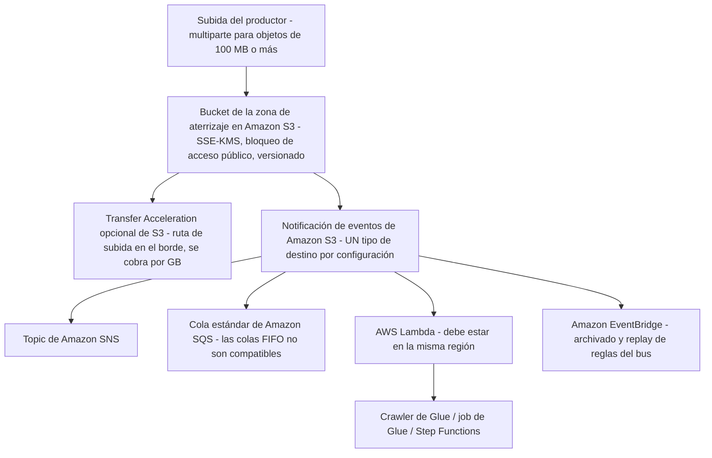
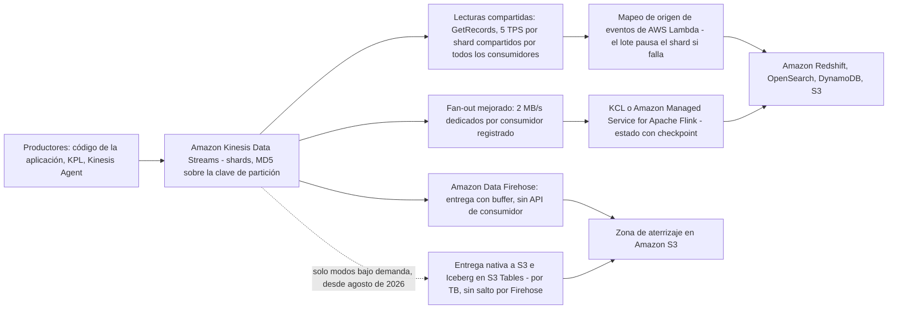
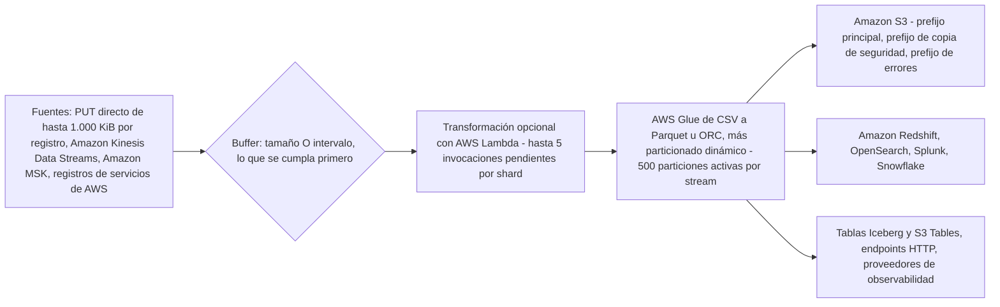
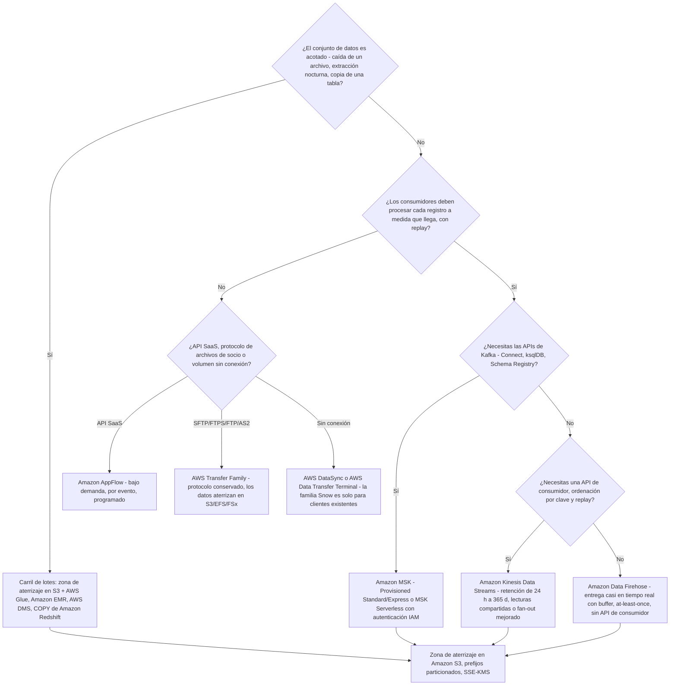
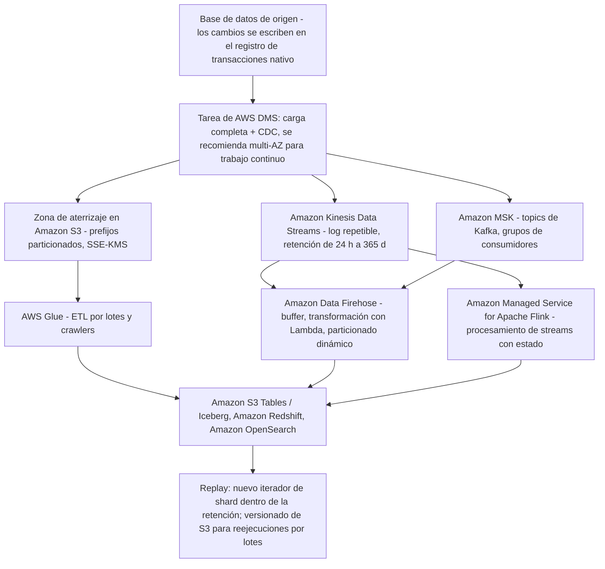

# Ingestión de datos: patrones por lotes y de streaming

El Dominio 1 de DEA-C01 lleva el **34% del contenido puntuado**, y su primera tarea: **1.1, la ingesta**: es donde la mayoría de los candidatos pierden puntos fáciles. La razón es que las preguntas de ingesta casi nunca preguntan «qué es un stream». Te piden *elegir*: lote o streaming, carga completa o CDC, `PutRecord` o `PutRecords`, lecturas compartidas o fan-out mejorado, Firehose o Kinesis Data Streams, Transfer Family o DataSync, Snowball Edge o algo completamente distinto. Cada una de esas elecciones tiene exactamente una respuesta que encaja con el requisito planteado, y tres que suenan bien.

```text
 =====================================================================
  DEA-C01 DOMINIO 1 — INGESTIÓN Y TRANSFORMACIÓN (ámbito de la tarea 1.1)
 ---------------------------------------------------------------------
  1.1.1  Leer datos de fuentes de streaming
         (Kinesis, MSK, DynamoDB Streams, DMS, Glue, Redshift)
  1.1.2  Leer datos de fuentes por lotes
         (S3, Glue, EMR, DMS, Redshift, Lambda, AppFlow)
  1.1.3  Identificar opciones de configuración para la ingesta por lotes
  1.1.4  Consumir datos a través de APIs de datos
  1.1.5  Seleccionar programadores de jobs y crawlers (EventBridge,
         Apache Airflow, basados en tiempo)
  1.1.6  Seleccionar desencadenadores de eventos (notificaciones de S3,
         EventBridge)
  1.1.7  Invocar una función Lambda desde un stream de Kinesis
  1.1.8  Aplicar listas de permitidos de IP
  1.1.9  Manejar el throttling y los límites de tasa (DynamoDB, RDS,
         Kinesis)
  1.1.10 Aplicar patrones de fan-in y fan-out
  1.1.11 Describir la repetibilidad de los pipelines de ingesta de datos
  1.1.12 Aplicar transacciones de datos con y sin estado
 =====================================================================
  Fuente: guía oficial del examen DEA-C01, Dominio 1, tarea 1.1,
  consultada en octubre de 2026.
 =====================================================================
```

En esta lección vas a:

- separar **lote de streaming** con la decisión de cuatro preguntas que oculta cada enunciado de la Tarea 1.1;
- diseñar una **zona de aterrizaje en S3**: prefijos, SSE-KMS, reglas de subida multiparte y los cuatro destinos de desencadenamiento por eventos;
- ejecutar **AWS DMS** correctamente, carga completa, carga completa + CDC, solo CDC, y dimensionar la instancia de replicación;
- elegir entre **AppFlow, Transfer Family, la familia Snow y las APIs de datos** para las fuentes que no son streams;
- modelar **Amazon Kinesis Data Streams**: shards, claves de partición, ubicación por MD5, retención de 24 horas a 365 días, ordenación y entrega at-least-once;
- hacer **matemáticas de recuento de shards y rendimiento** a mano, incluido el diagnóstico de particiones calientes y la agregación con KPL;
- amortiguar la entrega casi en tiempo real con **Amazon Data Firehose**: tamaño o intervalo, lo que se cumpla primero;
- montar **Amazon MSK** (Standard, Express, Serverless) y elegir el modo de autenticación correcto;
- aplicar la **matriz de decisión Streams frente a Firehose frente a MSK** y el árbol de decisión;
- trazar los **patrones de CDC** de extremo a extremo y razonar sobre la **repetibilidad, el fan-in/fan-out y el estado**;
- estudiar **cuatro casos de estudio de clientes de AWS**: Hearst, AGCO, FINRA y Baqend;
- leer el **recuadro de actualizaciones de octubre de 2026** y practicar con **14 preguntas estilo examen** más cuatro comprobaciones interativas.

---

## 1. ¿Lote o streaming? La decisión de la Tarea 1.1

### 1.1 Dos carriles, un requisito

Todo el Dominio 1 cuelga de una única distinción. El examen la plantea mediante la división de la Tarea 1.1 entre *fuentes por lotes* (1.1.2) y *fuentes de streaming* (1.1.1):

| Dimensión | **Lote** | **Streaming** |
|---|---|---|
| Forma del conjunto de datos | **Acotado**, un archivo, una extracción, una instantánea de una tabla | **Ilimitado**, sin final, llega continuamente |
| Unidad de trabajo | Un job discreto que arranca, se ejecuta y termina | Un consumidor continuo que corre mientras fluyen los datos |
| Presupuesto de latencia | Minutos hasta horas | Milisegundos hasta segundos (Firehose: casi en tiempo real) |
| Fuentes con nombre (guía del examen) | S3, Glue, EMR, DMS, Redshift, Lambda, AppFlow | Kinesis, MSK, DynamoDB Streams, DMS, Glue, Redshift |
| Historia de replay | Reejecutar el job sobre los mismos objetos | Volver a leer el log **dentro de la ventana de retención** |
| Ordenación | La que imponga el job (orden de partición/poda) | **Por clave de partición**, dentro de un shard o partición |
| Manejo de fallos | Reintentar la tarea; los datos siguen en disco | Reintentar el lote; el shard puede pausarse y el lag crece |
| Ancla en el examen | Tarea 1.1.2 + 1.1.3 | Tarea 1.1.1 + 1.1.11 |

> [!NOTE]
> **Los dos carriles listan DMS, Glue y Redshift.** Es deliberado: la *carga completa* de AWS DMS es una lectura por lotes mientras que el *CDC* de DMS es una lectura de streaming; un job de Glue es por lotes mientras que un job de streaming de Glue no lo es; el `COPY` de Redshift es por lotes mientras que la ingesta de streaming de Redshift no lo es. El examen prueba si sabes nombrar **qué modo** del mismo servicio describe un enunciado.

### 1.2 Las cuatro preguntas que resuelven cada enunciado

1. **¿El conjunto de datos es acotado?** Sí → carril de lote. No → carril de streaming.
2. **¿Un consumidor debe procesar cada registro *a medida que llega*?** Sí → un stream real con API de consumidor (Kinesis Data Streams o MSK), no Firehose.
3. **¿Un consumidor debe poder hacer replay?** Sí → necesitas un log duradero con retención (Kinesis **24 to 8.760 h**, o un topic de Kafka). Firehose no tiene API de consumidor, así que no ofrece replay del lado del consumidor.
4. **¿Cuántos consumidores independientes leen los mismos datos?** Muchos, cada uno a su ritmo → diseño de fan-out (lecturas compartidas, fan-out mejorado o grupos de consumidores de MSK: nunca Firehose).

Patrón resuelto: un job nocturno de exportación de clientes a las 02:00 que escribe un CSV en S3 es la pregunta 1 = **lote**; un pipeline de clickstream donde un analista debe repetir los eventos de ayer son las preguntas 1, 2 y 3 = **streaming**.

- **📚 ¿Sabías que…?** Amazon Kinesis Data Streams se lanzó en **2013** y AWS lo describe como *el primer servicio de datos de streaming nativo de la nube y serverless* (AWS Big Data Blog, «Amazon Kinesis Data Streams: Celebrating a Decade of Real-Time Data Innovation», 14 de noviembre de 2023, consultado en octubre de 2026). Por eso el vocabulario de streaming del examen, shard, clave de partición, iterador de shard, es en primer lugar vocabulario de Kinesis, y por eso el vocabulario al estilo Kafka de «topic/partición/offset» pertenece a MSK.

---

## 2. La zona de aterrizaje en S3: prefijos, multiparte, desencadenadores

### 2.1 Higiene de la zona de aterrizaje

Casi todos los pipelines por lotes del Dominio 1 empiezan en el mismo sitio: los productores depositan los datos brutos en **Amazon S3** y todo lo demás lee de ahí. La zona de aterrizaje es examinable mediante la Tarea 1.1.3 (opciones de configuración para la ingesta por lotes) y la Tarea 1.1.6 (desencadenadores de eventos).

| Ajuste | Patrón recomendado | Por qué es examinable |
|---|---|---|
| Distribución de claves | `source=<sistema>/year=AAAA/month=MM/day=DD/` | Los prefijos particionados permiten que Athena/Glue/Redshift poden en vez de escanear |
| Cifrado | **SSE-KMS** con una clave gestionada por el cliente | Opción de configuración de la Tarea 1.1.3; las claves siguen bajo control del cliente |
| Acceso público | **Bloquear todo el acceso público** | Postura base de S3; una zona de aterrizaje nunca es pública |
| Versionado | Activado | El versionado es lo que hace posible un **replay/recarga** de la zona de aterrizaje |
| Desencadenamiento | Notificaciones de eventos de S3 → SNS / SQS / Lambda / EventBridge | Tarea 1.1.6 |



Reglas que el examen reutiliza: una única configuración de notificación admite **un solo tipo de destino**; **las colas FIFO de SQS no se admiten** como destino; una **función Lambda debe vivir en la misma región** que el bucket; un desencadenador nuevo tarda **unos 5 minutos** en hacer efecto y el servicio envía un `s3:TestEvent` que debes manejar.

> [!IMPORTANT]
> ⚠️ **La subida multiparte y Transfer Acceleration no son velocidad gratis.** La multiparte añade cargos por solicitud en cada parte, y Transfer Acceleration se cobra por GB movido por la red de borde (bordes de EE. UU./UE/Japón: **0,04 USD/GB de entrada**; otros bordes: **0,08 USD/GB de entrada**; **0,04 USD/GB de salida**: en octubre de 2026). Cualquier opción que afirme que «la subida multiparte hace gratuitas las subidas grandes» es un distractor.

### 2.2 Ejemplo resuelto E1: número de partes multipart

Reglas publicadas de la subida multiparte de S3 (en octubre de 2026): usa multiparte a partir de **100 MB**; cada parte de **5 MiB a 5 GiB** (la última parte está exenta del mínimo); **como máximo 10.000 partes**; tamaño máximo de objeto de **48,8 TiB**; un `PUT` solo puede llevar como máximo **5 GB**.

```text
Ejemplo resuelto E1 - número de partes multipart (aritmética sobre las reglas publicadas)
Tamaño del objeto ....... 75 GB = 76.800 MB
Límite de un PUT solo ... 5 GB  -> un PUT solo no puede llevar este objeto
Tamaño de parte elegido . 512 MB (dentro de la ventana 5 MiB - 5 GiB)
Partes ................. ceil(76.800 / 512) = 150 partes
Comprobación de cuota .. 150 <= 10.000 partes                OK
Comprobación de tamaño . 512 MB está dentro de 5 MiB - 5 GiB     OK
Umbral de multipart .... 75 GB >= 100 MB                    OK
Resultado .............. 150 partes subidas en paralelo, después una llamada de completado
```

El punto examinable es la *cadena*: techo de 5 GB por PUT único → multiparte obligatoria → techo del número de partes → techo del objeto. Falla un eslabón y eliges el tamaño de parte equivocado.

- **📚 ¿Sabías que…?** Se documenta que S3 **Transfer Acceleration** redujo el tiempo medio de ingesta de archivos de 300 MB a `ap-southeast-2` en un **50%**, con una mejora de **más del 500%** para subidas de 250 MB enviadas como partes de 50 MB a `us-east-1` (preguntas frecuentes de Amazon S3, consultadas en octubre de 2026). Son observaciones publicadas por AWS para pares de regiones concretos: nunca una garantía para tu carga de trabajo.

## 3. AWS DMS: carga completa, carga completa + CDC, solo CDC

### 3.1 Tres tipos de tarea, un servicio

AWS Database Migration Service es la respuesta por defecto del examen para el movimiento **de base de datos a base de datos y de base de datos a stream/archivo**, y la Tarea 1.1.1 nombra explícitamente DMS como *fuente de streaming*. Su documentación define exactamente tres tipos de tarea:

| Tipo de tarea | Qué se mueve | Para qué sirve |
|---|---|---|
| **Carga completa** | Solo los datos existentes, una pasada de instantánea | Migración puntual o una carga masiva hacia S3 |
| **Carga completa + CDC** | Los datos existentes **y** los cambios capturados *mientras* se ejecuta la carga | La opción por defecto para «moverlo y mantenerlo sincronizado» |
| **Solo CDC** | Cambios del registro de transacciones desde un punto de inicio elegido | Ponerse al día tras una carga, o una replicación de larga duración |

El CDC es **basado en el log**: DMS lee el registro de transacciones nativo de la fuente a través de su API de logs. No es un job de diferencias ni una instantánea: un enunciado que describe «sondear la tabla cada noche en busca de filas modificadas» está describiendo una conciliación por lotes, no un CDC.

### 3.2 La línea de tiempo de carga completa + CDC

```text
Fase 1  CAPTURA ...... El CDC empieza de inmediato; los cambios se guardan en caché
                        (primero en memoria y luego se desbordan al disco de la
                        instancia de replicación)
Fase 2  CARGA COMPLETA .. hasta 8 tablas se cargan en paralelo
                        (MaxFullLoadSubTasks, por defecto 8, máximo 8)
Fase 3  APLICAR ...... cada tabla aplica sus cambios en caché en cuanto
                        esa tabla termina de cargarse, tabla por tabla
Fase 4  ESTADO ESTABLE .. los cambios fluyen continuamente; vigila
                        CDCLatencySource / CDCLatencyTarget
```

Los puntos de inicio del CDC en las tareas son: una **hora personalizada de CDC** (SCR/SCN o marca de tiempo: requiere `openTransactionWindow`), la posición **nativa** del log o un **checkpoint** almacenado en `awsdms_txn_state`.

### 3.3 Dimensionamiento, modo de aplicación y topología

| Palanca | Regla (en octubre de 2026) |
|---|---|
| Familia de instancia | La carga completa + CDC suele estar **limitada por memoria** → `dms.r5` / `dms.r6i` / `dms.r7i`; muchas tareas en paralelo están limitadas por CPU → `dms.c5` |
| Almacenamiento | **50 GB o 100 GB** GP2 (ráfagas hasta 3.000 IOPS): el disco es para el desbordamiento de la caché del CDC |
| Tablas en paralelo | **8** por defecto (`MaxFullLoadSubTasks`), y 8 es también el máximo indicado |
| Modo de aplicación | **Transaccional** (por defecto; preserva la integridad referencial, más lento) frente a **por lotes** (más rápido, requiere clave principal) |
| Topología | **Se recomienda Multi-AZ para la replicación continua** |
| Primera inicialización serverless | Hasta **40 minutos** (documentación de AWS DMS, consultada en octubre de 2026) |

Las **migraciones heterogéneas** (Oracle → Aurora PostgreSQL, por ejemplo) son una respuesta de dos pasos: **convierte primero el esquema y el código, y después mueve los datos**. La herramienta de conversión es ahora **DMS Schema Conversion**, construida sobre el motor del antiguo AWS Schema Conversion Tool: AWS SCT se **eliminó de la lista dentro del alcance de DEA-C01 en la v1.1 de la guía (12 de diciembre de 2025)**.

```dragdrop
{
  "question": "Ordena los tres tipos de tarea de AWS DMS, desde el que mueve solo datos EXISTENTES hasta el que mueve solo CAMBIOS:",
  "items": [
    "Carga completa: solo filas existentes, una pasada, sin captura de log",
    "Carga completa + CDC: la captura de log empieza de inmediato y se aplica tabla por tabla en cuanto cada tabla termina de cargarse",
    "Solo CDC: cambios del registro de transacciones desde un punto de inicio (hora personalizada, posición nativa o checkpoint)"
  ],
  "correctOrder": [
    "Carga completa: solo filas existentes, una pasada, sin captura de log",
    "Carga completa + CDC: la captura de log empieza de inmediato y se aplica tabla por tabla en cuanto cada tabla termina de cargarse",
    "Solo CDC: cambios del registro de transacciones desde un punto de inicio (hora personalizada, posición nativa o checkpoint)"
  ],
  "explanation": "Los tres tipos de tarea forman una relación de subconjunto, no tres modos sin relación: la carga completa mueve la historia, el CDC mueve el cambio, y la carga completa + CDC inicia primero el CDC (Fase 1, captura), ejecuta la carga en paralelo (Fase 2), aplica los cambios en caché de cada tabla cuando esa tabla termina (Fase 3) y después se asienta en estado estable (Fase 4). «Carga completa + CDC» es la respuesta correcta a cualquier enunciado que pida migrarlo Y mantenerlo sincronizado; «solo CDC» es correcto cuando los datos ya se cargaron y solo necesitas el log desde un punto de inicio."
}
```

> [!WARNING]
> ⚠️ **El CDC de DMS no es tiempo real.** La documentación de AWS afirma que DMS «no ofrece replicación en tiempo real» y que «no hay SLAs para la latencia del CDC» (guía de usuario de AWS DMS, consultada en octubre de 2026). Un enunciado que pida una latencia de replicación *inferior al segundo* no es un enunciado de DMS: apunta a la replicación lógica nativa, a Kinesis Data Streams o a MSK.

- **📚 ¿Sabías que…?** DMS aplica los cambios mediante un **ordenador que preserva el orden de commit de la fuente** en el destino, por eso los streams de CDC grandes de múltiples tablas pueden adelantarse a la carga completa y deben guardarse en caché en el disco de la instancia de replicación (guía de usuario de AWS DMS, consultada en octubre de 2026). Esa es también la razón por la que el almacenamiento es una elección de 50/100 GB y no un «valor por defecto pequeño»: es la zona de desbordamiento de esa caché.

---

## 4. Carriles de ingesta gestionados: AppFlow, Transfer Family, familia Snow, APIs de datos

No toda fuente es una base de datos o un stream. La Tarea 1.1 también nombra APIs de SaaS (1.1.2), APIs de datos (1.1.4), desencadenadores de eventos (1.1.6) y throttling (1.1.9).

### 4.1 Amazon AppFlow: de SaaS a S3 bajo demanda, por evento y programado

| Disparo | Cuándo se activa | Restricción |
|---|---|---|
| **Ejecución bajo demanda** | La invocas tú | La más sencilla; sin cadencia |
| **Ejecución por evento** | El SaaS publica eventos de cambio | Solo donde la fuente los publica: Salesforce necesita **CDC activado** en la conexión |
| **Ejecución programada** | Extracción completa o incremental | La incremental necesita un **campo de marca de tiempo** más un **offset** para tolerar desfases de reloj |

La cadencia está limitada por la cuota de la API del *proveedor*, no por AWS: Salesforce, ServiceNow y Zendesk a **1 ejecución/minuto**, Marketo a **1/hora**, Google Analytics a **1/día**; la cuenta queda limitada a **1 ejecución programada por minuto** en total (en octubre de 2026). Otras cuotas publicadas: **100 GB por ejecución de flow**, **1.000 flows**, **10 millones de ejecuciones al mes**, duración máxima de ejecución de **48 horas**, **100 perfiles de conector por cuenta**, y cada llamada consume la cuota de la API del *proveedor*. Destinos: S3 (la zona de aterrizaje habitual), Redshift, Snowflake, Salesforce, Slack, con **PrivateLink** donde se admite.

### 4.2 AWS Transfer Family: ingesta de socios conservando el protocolo

Transfer Family da a los socios endpoints de **SFTP, FTPS, FTP y AS2** respaldados por **Amazon S3, EFS o FSx**, de modo que el socio no cambia nada. La autenticación es gestionada por el servicio, mediante **Active Directory** o una **API personalizada** (tu proveedor de identidad).

| Cuota (en octubre de 2026) | Valor |
|---|---|
| Sesiones simultáneas por servidor | **10.000** |
| Servidores por cuenta | **50** |
| Sesiones SFTP multiplexadas por conexión | **10** |
| Tiempo de espera por inactividad | **1.800 segundos** |
| Conector SFTP (extracción saliente) por cuenta | **100** |
| Tamaño máximo de archivo del conector | **150 GiB** |
| Rendimiento del conector por cuenta | **50 MBps**, como máximo **5 transferencias en paralelo** |

La división de tres caminos del examen es fija: **Transfer Family = ingesta que conserva el protocolo** (el socio sigue usando SFTP), **AWS DataSync = copia masiva en línea** entre sistemas de archivos on-premises y S3/EFS/FSx, **familia Snow = transferencia física sin conexión**.

### 4.3 Familia Snow: revisa el calendario antes de elegirla

| Fecha | Evento (en octubre de 2026) |
|---|---|
| **12-11-2024** | Snowcone y tres modelos de Snowball de generaciones anteriores **descontinuados** |
| Dispositivos actuales | **Snowball Edge Storage Optimized 210 TB**; **Snowball Edge Compute Optimized** (104 vCPU, 416 GB de RAM, 28 TB NVMe) |
| **07-11-2025** | Los dispositivos están disponibles **solo para clientes existentes**; a los clientes nuevos se les dirige a **AWS DataSync, AWS Data Transfer Terminal o socios**, y las necesidades de cómputo en el borde a **Outposts** |
| **31-12-2026** | **Fin del soporte** de los dispositivos de la familia Snow en regiones comerciales |

### 4.4 Consumo de APIs de datos (Tareas 1.1.4, 1.1.9)

| Estilo | Patrón | Servicios |
|---|---|---|
| **Extracción (pull)** | Paginación + retroceso exponencial con **jitter**, de forma programada o como paso | AWS Glue, Lambda, AWS Batch, Step Functions |
| **Inyección (push)** | La API te llama a ti | API Gateway → Lambda / SQS / Kinesis; **destinos de API de EventBridge** |
| **SaaS gestionado** | No implementes a mano OAuth ni la paginación | **Amazon AppFlow** |

Respuestas de throttling que debes reconocer por nombre: HTTP **429** y `ProvisionedThroughputExceededException` de DynamoDB. Manéjalas con retroceso, no con límites más altos: la propia guía de AWS dice «no uses límites ni cuotas a nivel de recurso para controlar tu uso» (cuotas de Kinesis Data Firehose, consultadas en octubre de 2026).

| Elige | Cuando el enunciado dice |
|---|---|
| **Amazon AppFlow** | «datos de Salesforce/ServiceNow/Zendesk hacia S3, sin código» |
| **AWS Transfer Family** | «los socios deben seguir usando SFTP/FTPS/FTP/AS2» |
| **AWS DataSync** | «copiar 40 TB desde un filer NFS a S3 por la red» |
| **Familia Snow** | «sin red utilizable, cliente existente de AWS, decenas de TB» |
| **Extracción programada (Glue/Lambda/Batch)** | «API REST paginada con límites de tasa» |

---

## 5. Amazon Kinesis Data Streams: shards, claves de partición, retención

### 5.1 El shard es la unidad de todo

Un **shard** es el contrato de rendimiento, el límite de ordenación y la unidad de precio de un stream. Todos los límites de abajo están **en octubre de 2026**:

| Propiedad | Por shard |
|---|---|
| Rendimiento de escritura | **1 MB/s y 1.000 registros/s** (se aplican ambos techos) |
| Rendimiento de lectura | **2 MB/s y 2.000 registros/s** |
| TPS de lectura compartida | **5 TPS de `GetRecords` por shard**, compartidos por todos los consumidores |
| Tasa de `PutRecord` | **1.000 TPS por shard** |
| `PutRecords` por solicitud | hasta **500 registros y 10 MiB** |
| Payload del registro | **1 MiB** por defecto; **10 MiB opt-in por stream** |
| Retención | por defecto **24 horas**, ampliable a **8.760 horas (365 días)** |
| Precio | **0,015 USD por shard-hora** (0,36 USD/shard/día); fan-out mejorado **0,015 USD por consumidor-shard-hora** |

La retención extendida es lo que convierte un stream en una **ventana de replay** (Tarea 1.1.11): hacer replay significa abrir un **nuevo iterador de shard** en un número de secuencia anterior: una nueva *lectura*, no una reescritura del log.

### 5.2 Clave de partición → MD5 → shard

```text
registro del productor
  └─ clave de partición (cadena que eliges, p. ej. customer_id o device_id)
        └─ MD5(clave de partición)  ->  selecciona UN shard de forma determinista
              └─ shard  ->  los números de secuencia solo aumentan dentro de ese shard
```

Tres consecuencias que el examen prueba sin descanso:

- **El orden es por clave de partición, nunca global.** Los registros con la misma clave están ordenados; los de claves distintas se entrelazan entre shards.
- **Una clave caliente es un shard caliente.** 40.000 registros/s repartidos entre 20 shards están bien; 1.500 registros/s en una sola clave hacen throttling a 1.000 registros/s por muchos shards que añadas.
- **Las claves deben superar ampliamente el número de shards.** Una distribución uniforme necesita muchas más claves distintas que shards.

### 5.3 Rutas de producción y consumo

| API de producción | Semántica |
|---|---|
| `PutRecord` | Usa `SequenceNumberForOrdering`: la opción de orden estricto para una clave |
| `PutRecords` | Agrupa hasta **500 registros / 10 MiB**; fallos por registro; AWS declara que «**no garantiza el orden de los registros**» |
| **Kinesis Producer Library (KPL)** | Agrega muchos registros de usuario en un solo registro de Kinesis; los consumidores deben desagregar |
| **Kinesis Agent** | Se ejecuta en el host, sigue archivos y los agrupa hacia el stream |

| Ruta de consumo | Semántica |
|---|---|
| **Lecturas compartidas** (`GetRecords`) | Por defecto; **5 TPS por shard en total**, compartidos por cada consumidor |
| **Fan-out mejorado (EFO)** | Opt-in; cada consumidor registrado obtiene **2 MB/s dedicados** de lectura; **20 consumidores por stream** (Provisioned y On-demand Standard), **50** (On-demand Advantage) |
| **Mapeo de origen de eventos de Lambda** | at-least-once; un **lote fallido pausa ese shard** hasta que tenga éxito, de modo que el lag aparece como `IteratorAge`, no como reordenación |
| **KCL / Managed Service for Apache Flink** | Procesamiento con checkpoint y estado |



### 5.4 Modos de capacidad

| Modo | Forma de facturación | Cuándo usarlo |
|---|---|---|
| **Provisioned** | Por shard-hora; tú **divides y fusionas** shards | Rendimiento predecible y estable que puedes dimensionar |
| **On-demand Standard** | Por GB ingerido más una tarifa horaria por stream | Volumen desconocido o con picos que no puedes dimensionar por adelantado |
| **On-demand Advantage** | A nivel de cuenta, por GB, **sin tarifa horaria por stream**, con un mínimo a nivel de cuenta (ver el recuadro de actualizaciones) | Muchos streams o una ingesta agregada alta |

Un stream nuevo bajo demanda arranca con **4 MB/s de escritura y 8 MB/s de lectura** (guía de dimensionamiento de Kinesis, en octubre de 2026), y los cambios de modo de capacidad se limitan a **2 por stream cada 24 horas**, así que «cambiar de modo cuando cambie el tráfico» no es una táctica por minutos.

- **📚 ¿Sabías que…?** Desde el **28 de agosto de 2026** un stream de Kinesis puede entregar **de forma nativa**; sin Amazon Data Firehose: hacia **tablas Iceberg en Amazon S3 Tables** y, desde el **29 de agosto de 2026**, hacia **buckets de S3 de uso general**, solo en modos de capacidad bajo demanda (AWS What's New, 2026-08-28 y 2026-08-29). Los precios de entrega publicados en us-east-1 son de **14 USD/TB** a S3 Tables y **11 USD/TB** a S3 (AWS Big Data Blog, 2026-08-31, en octubre de 2026). Firehose ya no es el único camino de stream a S3, pero sigue siendo el dueño de las transformaciones, la conversión de formato y el particionado dinámico.

---

## 6. Matemática aplicada: recuento de shards, rendimiento y coste

La fórmula de dimensionamiento para un stream provisioned (guía de dimensionamiento de AWS Kinesis, en octubre de 2026):

```text
shards = max( ceil(bytes_por_segundo / 1 MB),
              ceil(registros_por_segundo / 1.000) )
más un término de lectura: ceil(KiB_de_lectura_por_segundo / 2.048)
```

Debes evaluar **ambos** términos y tomar el máximo: los enunciados se escriben de modo que un término domine y el otro te despiste.

### 6.1 Ejemplo resuelto E2: limitado por registros

```text
Ejemplo resuelto E2 - recuento de shards limitado por registros
Entrada: 12.000 registros/s x 300 bytes = 3.600.000 B/s = 3,6 MB/s
Por registros: ceil(12.000 / 1.000) = 12 shards
Por bytes:    ceil(3,6 / 1)          =  4 shards
Shards = max(12, 4) = 12
Coste: 12 x $0,015/h x 24 h         = $4,32 al día  (en octubre de 2026)
      12 x $0,015/h x 24 h x 31 d = $133,92 al mes de 31 días
Margen de lectura: 12 x 2 MB/s = 24 MB/s y 12 x 2.000 = 24.000 registros/s
```

### 6.2 Ejemplo resuelto E3: limitado por bytes

```text
Ejemplo resuelto E3 - recuento de shards limitado por bytes
Entrada: 8.000 registros/s x 1,5 KB = 12.000 KB/s = 12 MB/s
Por registros: ceil(8.000 / 1.000) = 8 shards
Por bytes:    ceil(12 / 1)         = 12 shards
Shards = max(8, 12) = 12   <- aquí el término de BYTES domina
```

Misma respuesta que E2 por la razón opuesta. Esa coincidencia es la trampa: comprueba qué término dominó antes de fiarte de tu aritmética.

### 6.3 Ejemplo resuelto E4: registros pequeños y agregación con KPL

```text
Ejemplo resuelto E4 - por qué el KPL cambia la respuesta
Ingenuo: 500 registros/s x 100 bytes = 50 KB/s
        por registros: ceil(500 / 1.000) = 1   por bytes: ceil(0,05 / 1) = 1  -> 1 shard
Pero el techo de 1.000 registros/s cuenta REGISTROS DE KINESIS, no registros de usuario.
Con el KPL agregando 10 registros de usuario en 1 registro de Kinesis:
        registros de Kinesis/s = 500 / 10 = 50      (muy por debajo de 1.000)
        payload/s              = 50 KB               (muy por debajo de 1 MB)
El techo práctico de ese único shard ~ 10 x 1.000 = 10.000 registros de usuario/s,
sigue limitado por 1 MB/s, mientras la tasa de solicitudes de la API cae proporcionalmente.
El consumidor debe DESAGREGAR el formato de colección del KPL.
```

### 6.4 Ejemplo resuelto E5: la partición caliente

```text
Ejemplo resuelto E5 - diagnóstico de partición caliente
Total del stream: 40.000 registros/s entre muchas claves -> shards suficientes.
Clave caliente:   solo la clave de partición "sensor-42" emite 1.500 registros/s.
Ubicación:        MD5("sensor-42") siempre selecciona el MISMO shard.
Techo:            ese shard limita a 1.000 registros/s - independientemente de
                  cuántos shards existan en el stream.
Síntomas:         throttling de escritura reportado para UNA clave mientras
                  todas las demás claves no se ven afectadas.
Corrección:       clave de dos niveles ("sensor-42#0" .. "sensor-42#7"), salting,
                  u otro diseño de clave para que una entidad lógica se reparta entre shards.
```

Gráfica los dos términos resueltos uno al lado del otro y la regla «toma el máximo» deja de ser abstracta, E2 y E3 acaban ambos en **12 shards**, pero por términos opuestos:

```plot
{
  "type": "bar",
  "title": "Shards necesarios por cada término de dimensionamiento (ejemplos resueltos E2 y E3, en octubre de 2026)",
  "xLabel": "Término de dimensionamiento",
  "yLabel": "Shards necesarios",
  "xKey": "term",
  "data": [
    {"term": "E2 records: 12,000 / 1,000", "shards": 12},
    {"term": "E2 bytes: 3.6 MB / 1 MB", "shards": 4},
    {"term": "E3 records: 8,000 / 1,000", "shards": 8},
    {"term": "E3 bytes: 12 MB / 1 MB", "shards": 12}
  ]
}
```

> [!NOTE]
> **Las cuotas de shards se consultan en Service Quotas, no se memorizan.** AWS publica techos de shards distintos para `us-east-1` / `us-west-2` / `eu-west-1` que para otras regiones, y la redacción cambia entre la página de cuotas y las preguntas frecuentes (verificado en octubre de 2026). Respuesta segura para el examen: «consulta **Service Quotas** para la región y el stream», nunca una cifra fija. `UpdateShardCount` en modo Provisioned está limitado a **10.000 shards por llamada** (en octubre de 2026).

---

## 7. Amazon Data Firehose: buffers, destinos, casi en tiempo real

### 7.1 Un servicio de entrega, no un stream

Amazon Data Firehose **no tiene shards ni API de consumidor**. Escribe registros (mediante PUT directo, o desde Kinesis Data Streams, Amazon MSK o registros de servicios de AWS como CloudTrail, WAF y los registros de flujo de VPC) y Firehose los **entrega** hacia un destino: con buffer, opcionalmente transformados y reintentados automáticamente.

| Propiedad | Valor (en octubre de 2026) |
|---|---|
| Tamaño del registro | máximo **1.000 KiB**; `PutRecordBatch` hasta **500 registros o 4 MiB** |
| Rendimiento del PUT directo | `us-east-1`/`us-west-2`/`eu-west-1`: **500.000 registros/s, 2.000 solicitudes/s, 5 MiB/s**; otras regiones **100.000 / 1.000 / 1 MiB/s**, y AWS **lo sube automáticamente** |
| Buffer | **tamaño o intervalo, lo que se cumpla primero** |
| Tamaño del buffer (S3) | **1 to 128 MB**, por defecto **5 MB**; **64 to 128 MB con un valor por defecto de 128 MB** cuando hay conversión a Parquet o particionado dinámico |
| Intervalo del buffer | rango en API/preguntas frecuentes **0 to 900 segundos**, por defecto **300 segundos**; la página de cuotas indica **60 to 900 segundos**; Splunk **0 to 60** (por defecto 60) |
| Latencia anunciada | «within 60 seconds» («dentro de 60 segundos») |
| Semántica | **at-least-once** |
| Particionado dinámico | **500 particiones activas por stream** (ampliable a **2.500**), como máximo **1 GB/s por partición activa** |
| Transformación con Lambda | como máximo **5 invocaciones pendientes por shard** (10 para Splunk) |



### 7.2 Ejemplo resuelto E6: qué condición de buffer se dispara primero

```text
Ejemplo resuelto E6 - carrera del buffer (reglas en octubre de 2026)
Ritmo de ingesta: 750 KB/s.  Regla: tamaño O intervalo, LO QUE SE CUMPLA PRIMERO.

Caso A - tamaño de buffer de S3 por defecto 5 MB, intervalo 60 s
  tiempo para llenar 5 MB = 5.000 KB / 750 KB/s = 6,7 s
  6,7 s < 60 s  ->  el TAMAÑO se dispara primero
  objeto entregado ~ 5 MB cada ~6,7 s

Caso B - Parquet / particionado dinámico, tamaño de buffer 64 MB, intervalo 60 s
  tiempo para llenar 64 MB = 65.536 KB / 750 KB/s = 87,4 s
  87,4 s > 60 s  ->  el INTERVALO se dispara primero
  objeto entregado = 60 s x 750 KB/s = 45.000 KB = ~44 MB

Lección: nunca razones sobre «el límite más grande». Compite los dos relojes.
```

### 7.3 Reintentos y qué significa «replay» aquí

| Ruta | Comportamiento de reintentos (en octubre de 2026) |
|---|---|
| PUT directo → S3 | cada **5 s** durante hasta **24 horas**, después los registros se **descartan** |
| Origen en Kinesis | los reintentos siguen la **retención del stream de origen** |
| → Redshift | cada **5 minutos** durante hasta **120 minutos**, después el registro se omite y se escribe en un **manifiesto** |
| → OpenSearch | retroceso de **0 to 7.200 segundos** |
| Todas las rutas | **at-least-once**: el destino debe ser idempotente |

Como **no hay API de consumidor**, **no hay replay del lado del consumidor**: tus únicos artefactos de recuperación son el prefijo de **copia de seguridad** y el prefijo de **errores** de S3. ¿Necesitas replay? Lee directamente desde Kinesis Data Streams.

```fillblank
{
  "question": "Completa las afirmaciones sobre buffer y rendimiento con los números publicados (todos en octubre de 2026):",
  "template": "Amazon Kinesis Data Streams: cada shard acepta {{1}} MB/s y {{2}} registros por segundo de escritura, sirve {{3}} MB/s de lectura y retiene los datos durante {{4}} horas por defecto: ampliable a {{5}} horas para el replay. Amazon Data Firehose amortigua por tamaño O intervalo, lo que se cumpla primero: el rango de tamaño para S3 va de {{6}} a {{7}} MB y el intervalo por defecto es de {{8}} segundos.",
  "answers": {
    "1": "1",
    "2": "1000",
    "3": "2",
    "4": "24",
    "5": "8760",
    "6": "1",
    "7": "128",
    "8": "300"
  },
  "distractors": ["500", "10", "4", "1024", "48", "720", "60", "900", "5", "120"],
  "explanation": "Escritura por shard de 1 MB/s y 1.000 registros/s, lectura por shard de 2 MB/s, retención de 24 h por defecto y hasta 8.760 h (365 días) - documentación de Amazon Kinesis Data Streams, en octubre de 2026. Firehose amortigua por tamaño O intervalo: tamaño de buffer para S3 de 1-128 MB (por defecto 5 MB, 64-128 MB con 128 por defecto para Parquet/particionado dinámico) e intervalo por defecto de 300 s. Los distractores mezclan los dos servicios: 500 es el límite de registros de PutRecords, 1.000 KiB es el límite de registros de Firehose, 60 s es el valor por defecto del buffer de Splunk y 900 s es el máximo del intervalo."
}
```

- **📚 ¿Sabías que…?** El producto se renombró **Amazon Data Firehose** el **9 de febrero de 2024** y AWS declara que el cambio no afectó en nada a endpoints, APIs, comandos de CLI, nombres de políticas de IAM ni métricas de CloudWatch: las acciones de IAM siguen siendo `firehose:*`. Mientras tanto, **la lista dentro del alcance de DEA-C01 sigue imprimiendo «Amazon Kinesis Data Firehose»** (guía del examen, consultada en octubre de 2026). Los dos nombres son correctos; nunca «corrijas» una opción que use el antiguo.
- **📚 ¿Sabías que…?** AWS sí destaca a **NerdWallet** en su página de clientes de Amazon Data Firehose, con una arquitectura **Firehose → Lambda → SNS** pero **sin cifras publicadas de rendimiento ni de coste** (consultada en octubre de 2026). Así que cualquier opción que cite «NerdWallet ahorró X%» o «NerdWallet ingiere Y GB al día» es inventada: un cliente *nombrado* en una página de AWS no vuelve automáticamente examinable un *número*. Las cifras verificadas de los casos de esta lección son los 30 TB/día de Hearst, el −78% de AGCO, los 6 TB/37.000 millones de registros de FINRA y la latencia inferior a un minuto de Baqend, cada una atribuida a su propia fuente.

---

## 8. Amazon MSK: brokers, MSK Serverless, autenticación con IAM

### 8.1 Tres formas de ejecutar Kafka

Amazon MSK ejecuta **Apache Kafka**: el modelo de broker/partición/topic, más el ecosistema de Kafka (Kafka Connect, ksqlDB, Schema Registry).

| Variante | Qué gestiona AWS | Qué gestionas tú |
|---|---|---|
| **Provisioned: Standard** | Brokers, parches, multi-AZ | **Almacenamiento EBS**, configuración de almacenamiento por niveles |
| **Provisioned: Express** | Brokers **y almacenamiento** (Kafka 3.6+) | Nada en la capa de almacenamiento |
| **MSK Serverless** | Toda la abstracción del cluster | Topics, código de cliente, configuración de seguridad |

MSK Serverless factura por **cluster-hora, partición-hora y GB de E/S**, con límites publicados (en octubre de 2026) de **200/400 MBps por cluster**, **8 MiB por mensaje**, **5/10 MBps por partición**, **2.400 particiones no compactadas** y **10 clusters por cuenta**. AWS publica un **SLA del 99,9%** para MSK, incluidos MSK Serverless y MSK Connect.

### 8.2 Autenticación: el dato de mayor rendimiento de esta sección

| Despliegue | Autenticación admitida |
|---|---|
| **Provisioned** | **IAM (recomendado)**, o mTLS + ACLs de Kafka, o SASL/SCRAM + ACLs de Kafka |
| **MSK Serverless** | **El control de acceso con IAM es obligatorio; las ACLs de Kafka NO se admiten** |

Las **políticas de cluster** son lo que permite a un principal de IAM en otra cuenta producir o consumir: el mecanismo entre cuentas de MSK. La conectividad privada está disponible mediante **AWS PrivateLink**.

> [!IMPORTANT]
> ⚠️ **No pongas ACLs de Kafka en un cluster MSK Serverless.** Es la trampa de MSK más común de todas: «configurar SASL/SCRAM con ACLs en el cluster serverless» es incorrecto por dos motivos. En clusters **provisioned** las ACLs funcionan, pero requieren mTLS o SASL/SCRAM: si eliges IAM, las ACLs tampoco son tu mecanismo.

### 8.3 MSK Connect y el resto del conjunto de herramientas

| Elemento | Límite / función (en octubre de 2026) |
|---|---|
| MSK Connect | hasta **100 plugins**, **10 workers por conector**, **60 workers por cuenta** |
| **MCU** | **1 MCU = 1 vCPU + 4 GB**: la unidad para dimensionar conectores |
| MSK Replicator | Replicación de topics entre regiones y entre cuentas |
| Políticas de cluster | Acceso IAM entre cuentas |

- **📚 ¿Sabías que…?** MSK se expandió agresivamente en 2026: **+3 regiones anunciadas el 20-02-2026**, **+13 regiones el 21-04-2026** y China el **08-07-2026** (AWS What's New, consultado en octubre de 2026). El **30 de julio de 2026** MSK añadió tablas de streaming que materializan topics de Kafka en **Apache Iceberg**: el mismo movimiento que hizo Kinesis en agosto de 2026. La disponibilidad regional es un dato vivo: vuelve a comprobarlo siempre antes de memorizar un recuento de regiones.

---

## 9. Streams frente a Firehose frente a MSK: la matriz de decisión

### 9.1 La comparación oficial, condensada

AWS publica páginas de comparación cara a cara; esta es su columna «Ideal para» destilada (consultada en octubre de 2026):

| Tu requisito | Elige |
|---|---|
| Log duradero y repetible, **consumidores personalizados** (KCL, Lambda, Flink), **orden por clave**, retención de **24 h a 365 d** | **Amazon Kinesis Data Streams** |
| Stream → S3 / Redshift / OpenSearch / Splunk / Snowflake **sin código de consumidor**, con agrupación, compresión, Parquet, particionado dinámico | **Amazon Data Firehose** |
| **APIs y ecosistema de Kafka** (Connect, ksqlDB, Schema Registry), modelo de broker/topic | **Amazon MSK** (Serverless para no dimensionar brokers) |
| **Fan-out sub-segundo** a muchos consumidores independientes | fan-out **mejorado** de Kinesis o **grupos de consumidores** de MSK: **no** Firehose |
| Stream directo a **S3 o Iceberg** sin transformaciones, en un modo de Kinesis bajo demanda | **entrega nativa de Kinesis** (desde agosto de 2026), Firehose en caso contrario |



```matching
{
  "question": "Relaciona cada requisito de ingesta con el único servicio de AWS que lo satisface:",
  "pairs": [
    {"left": "Los socios deben seguir subiendo archivos por SFTP sin ningún cambio en su lado", "right": "AWS Transfer Family - SFTP/FTPS/FTP/AS2 gestionado respaldado por Amazon S3, EFS o FSx"},
    {"left": "Los registros de Salesforce deben aterrizar en Amazon S3 de forma programada y con los eventos de cambio", "right": "Amazon AppFlow: ejecución bajo demanda, por evento o programada, cadencia limitada por la cuota de la API del proveedor"},
    {"left": "Una base de datos Oracle on-premises de 2 TB debe migrarse a Aurora PostgreSQL y mantenerse sincronizada", "right": "AWS DMS: primero DMS Schema Conversion para el cambio de motor, después una tarea de carga completa + CDC"},
    {"left": "Procesamiento por registro, en milisegundos, con replay dentro de una ventana de retención", "right": "Amazon Kinesis Data Streams consumido por Lambda, KCL o Managed Service for Apache Flink"},
    {"left": "Ingestar en S3, Redshift y Splunk sin código de consumidor que escribir", "right": "Amazon Data Firehose: buffer por tamaño o intervalo, transformación, conversión de formato, particionado dinámico"},
    {"left": "Kafka Connect, ksqlDB y un Schema Registry deben ejecutarse sin cambios", "right": "Amazon MSK - Provisioned o MSK Serverless, control de acceso con IAM en Serverless (ACLs no admitidas)"}
  ],
  "explanation": "Cada enunciado nombra una restricción, no un servicio: conservación del protocolo -> Transfer Family; API de SaaS con eventos -> AppFlow; base de datos heterogénea con sincronización -> DMS (convertir y después migrar); procesamiento por registro con replay -> Kinesis Data Streams; sin código de consumidor -> Firehose; ecosistema de Kafka -> MSK. Hay dos trampas incrustadas: Firehose no tiene API de consumidor, así que no puede satisfacer «procesamiento por registro con replay», y MSK Serverless rechaza las ACLs de Kafka, de modo que una cláusula «configurar ACLs» lo invalidaría."
}
```

---

## 10. Patrones de CDC de extremo a extremo

La captura de cambios es la costura entre el carril de lote y el de streaming, y por eso DMS aparece bajo **ambas** tareas 1.1.1 y 1.1.2. Los patrones examinables:

| Patrón | Forma | Cuándo |
|---|---|---|
| **Base de datos → sincronización con el almacén** | DMS **carga completa + CDC** → S3 → `COPY` de Redshift, o DMS → Redshift directamente | Migración con replicación continua |
| **Base de datos → stream** | DMS **solo CDC** → Kinesis Data Streams / MSK → Lambda/Flink | Varios consumidores necesitan el flujo de cambios |
| **CDC nativo de Kafka** | Conector al estilo Debezium ejecutándose en **MSK Connect** | Ya ejecutas MSK y quieres la semántica de Kafka |
| **CDC en lakehouse** | CDC de DMS → job de Glue → un formato de tabla abierto como Apache Iceberg | Analítica sobre un formato de tabla de lakehouse |
| ~~Fuente de base de datos en Firehose~~ | **No disponible**: la vista previa de base de datos como fuente se eliminó el **24-09-2025** | No diseñes sobre ella; el *servicio* Firehose no está descontinuado |



Reglas de diseño que aparecen como distractores:

- **El CDC lee el registro de transacciones**, así que la fuente necesita copias de seguridad más unas **24 horas** de retención de log: una fuente cuyos logs se han truncado no puede iniciar un CDC.
- **El CDC de DMS es asíncrono y no tiene SLA de latencia**: nunca «tiempo real».
- **No construyas sobre la vista previa retirada de base de datos como fuente de Firehose** (eliminada el 24-09-2025); usa DMS o un conector nativo de Kafka.
- **Movimiento de cambios entre cuentas**: una **política basada en recursos** de Kinesis comparte un stream (o un consumidor de fan-out mejorado) sin copiar datos; MSK usa **políticas de cluster**; DMS → S3 usa un rol de IAM en el que confía `dms.amazonaws.com` más una política de bucket.
- **Opciones entre regiones**: **replicación entre regiones de S3** (Replication Time Control ofrece un **SLA de 15 minutos**), **MSK Replicator**, o ejecutar DMS cerca del origen y replicar el destino.

---

## 11. Repetibilidad, fan-in/fan-out y estado (Tareas 1.1.10 to 1.1.12)

| Garantía | Kinesis Data Streams | Amazon Data Firehose | Amazon MSK / Kafka |
|---|---|---|---|
| Entrega | **at-least-once** | **at-least-once** | at-least-once por defecto; **exactly-once** con un productor idempotente + transacciones + `isolation.level=read_committed` |
| Ordenación | Dentro de un shard ⇒ dentro de una **clave de partición** | Dentro de un stream de entrega | Dentro de una **partición** |
| Replay | Sí: nuevo iterador de shard, dentro de la retención de **24 h: 365 d** | **Sin API de consumidor** ⇒ solo prefijos de copia de seguridad y de errores en S3 | Sí: releer offsets dentro de la retención del topic |
| Fan-out | Lecturas compartidas (5 TPS/shard) o **fan-out mejorado** (2 MB/s dedicados) | Un único pipeline de entrega | **Grupos de consumidores** |
| Entre cuentas | **Políticas basadas en recursos** | Rol de entrega | **Políticas de cluster** |

El **fan-in** es un problema de diseño de la clave de partición: muchos productores, un stream, claves repartidas entre shards. El **fan-out** es un problema de la ruta de lectura: un stream, muchos consumidores independientes a distintas velocidades, y la respuesta nunca es Firehose.

**Con estado frente a sin estado** (Tarea 1.1.12): sin estado significa que cada registro es independiente e idempotente; con estado significa que los resultados se **checkpointean**: checkpoints de KCL, ventanas tumbling de Lambda, ventanas de Flink. Un mapeo de origen de eventos de Lambda reintenta un lote fallido hasta que tiene éxito y **pausa el shard afectado** mientras tanto: se conserva el orden y el lag aparece como `IteratorAge` en aumento (`ParallelizationFactor` 1 to 10 mantiene el orden por clave cuando lo elevas).

---

### Actualizaciones de 2026 (en octubre de 2026)

> [!NOTE]
> **Qué cambió en la pila de ingesta entre 2025 y octubre de 2026**: cada línea lleva fuente y fecha; el examen prueba el comportamiento *actual*:
> - **La guía del examen v1.1 (12-12-2025)** consolidó conocimientos y habilidades en una sola lista de habilidades, añadió **8 habilidades** y movió la lista dentro del alcance **+6 / −3**: se añadieron Aurora, Amazon Q, Bedrock, Kendra, Data Exchange y **S3 Tables**; se eliminaron **AWS SCT, Cloud9 y CodeCommit**. Si una pregunta nombra SCT, la herramienta actual es **DMS Schema Conversion** (página de revisiones de DEA-C01, consultada en octubre de 2026).
> - **Kinesis Data Streams ahora tiene tres modos de capacidad.** **On-demand Advantage** pasó a GA el **04-11-2025**: **0,032 USD/GB** ingerido + **0,016 USD/GB** recuperado, **sin tarifa horaria por stream**, un mínimo a nivel de cuenta de **25 MB/s de ingesta + 25 MB/s de recuperación** y ráfagas de hasta **10 GB/s o 10 millones de eventos/s**. La retención extendida bajó a **0,023 USD/GB-mes** (antes 0,10 USD) (AWS What's New 2025-11-04, en octubre de 2026). Ese mínimo significa que Advantage *no* es automáticamente más barato con volumen bajo: compáralo con Provisioned y con On-demand Standard.
> - **Kinesis puede entregar en S3 sin Firehose.** Las tablas de streaming hacia **Iceberg en S3 Tables** llegaron el **28-08-2026** (**14 USD/TB** en us-east-1) y la **entrega a S3 de uso general** el **29-08-2026** (**11 USD/TB**), ambos **solo en modos bajo demanda**, con AWS afirmando hasta un **50% menos de coste de entrega** y hasta un **30% menos de coste de consulta**; MSK siguió con tablas de streaming a Iceberg el **30-07-2026** (AWS What's New y AWS Big Data Blog, en octubre de 2026).
> - **El tamaño del registro se movió, la semántica del shard no.** El techo por registro pasó de **1 MiB a 10 MiB opt-in por stream** el **28-10-2025**, y el tamaño total de la solicitud de `PutRecords` a **10 MiB**, mientras que **1 MB/s y 1.000 registros/s por shard siguen intactos**. «Los registros ahora son de 10 MB por defecto» es un distractor de dato obsoleto (en octubre de 2026).
> - **Aviso de dato obsoleto, dos nombres, dos afirmaciones de buffer.** El producto es **Amazon Data Firehose** desde el **09-02-2024** (APIs intactas), pero la lista dentro del alcance de DEA sigue imprimiendo **Amazon Kinesis Data Firehose**; y el rango del intervalo de buffer se cita como **60 to 900 s** en la página de cuotas pero **0 to 900 s** (por defecto **300 s**) en la referencia de la API y las preguntas frecuentes. Redacción segura para el examen: Firehose *agrupa*, casi en tiempo real, nunca registro a registro (verificado en octubre de 2026).
> - **Expansión regional de MSK:** **+3 regiones (20-02-2026)**, **+13 regiones (21-04-2026)**, China **(08-07-2026)**: verifica la disponibilidad actual en vez de memorizar un recuento (AWS What's New, consultado en octubre de 2026).
> - **Los techos de shards de Kinesis subieron; el contrato del shard no.** El máximo predeterminado de shards por cuenta pasó de **500 a 20.000** en `us-east-1`, `us-west-2` y `eu-west-1` el **21-04-2025**, mientras que los cambios de modo de capacidad siguen limitados a **2 por stream cada 24 horas** y **1 MB/s + 1.000 registros/s por shard** no se tocaron (AWS What's New 2025-04-21 y documentación de dimensionamiento de Kinesis, en octubre de 2026). «No puedes superar los 500 shards» es ya un distractor obsoleto, pero `UpdateShardCount` sigue limitado a **10.000 shards por llamada** en modo Provisioned.
> - **Kinesis Data Analytics for SQL streams ya no existe.** La variante SQL de la aplicación de streaming se descontinuó el **27-01-2026**; la respuesta actual para analítica de streams es **Amazon Managed Service for Apache Flink** (renombrado desde Kinesis Data Analytics el **30-08-2023**, API sin cambios). Un enunciado que ofrezca «crear una aplicación SQL de Kinesis Data Analytics» nombra un producto retirado (página de funciones de AWS Kinesis Data Analytics, consultada en octubre de 2026).
> - **MSK ahora publica un precio de ingesta todo incluido.** AWS declara que los clientes de MSK «suelen pagar entre **0,05 y 0,07 USD por GB ingerido, todo incluido**» (páginas de precios y funciones de Amazon MSK, consultadas en octubre de 2026): además de la facturación por cluster-hora/partición-hora en los clusters provisioned y cluster-hora + partición-hora + GB de E/S en MSK Serverless. «MSK se factura solo por broker-hora» está obsoleto.

---

## Casos Reales

AWS publica cómo se ven estos patrones en producción. Cada cifra de abajo es **afirmación del cliente o de AWS y no auditada**, con la fuente indicada para que puedas comprobarla: el punto examinable es el **patrón**, no el marketing.

### Caso A, Hearst: clickstream a 30 TB al día (ingesta de streaming)

| Elemento | Detalle |
|---|---|
| Cliente | **Hearst**: medios: más de 250 sitios web, 15 diarios y 36 semanales, más de 300 revistas, 31 emisoras de TV |
| Reto | El clickstream de un extenso grupo multimarca tenía que llegar a la analítica sin semanas de ingeniería por sitio |
| Servicios | **Amazon Kinesis Data Streams** + **Amazon Data Firehose** + streaming con Spark en Amazon EMR |
| Resultado | El pipeline **ingerió 30 TB de datos al día** (cifra publicada por AWS) |
| Dominio del examen | **Dominio 1, Tareas 1.1.1 / 1.1.2**: fuente de streaming, fan-out, entrega |
| Fuente | `aws.amazon.com/kinesis/data-streams/customers` y la página de producto de Kinesis Data Streams (consultadas en octubre de 2026) |

> «No sé cómo habríamos hecho que nuestro pipeline de datos de clickstream funcionara sin los servicios de Amazon Kinesis. Habría requerido muchas semanas de ingeniería. **Kinesis Data Streams y Firehose hacen que todo el proceso sea extremadamente simple y fiable.**»: Peter Jaffe, científico de datos, Hearst

Fíjate en la arquitectura: **Streams es el log, Firehose es la entrega.** Ese pareamiento es exactamente la matriz de decisión de la sección 9: log repetible para los productores, entrega gestionada sin código hacia la zona de aterrizaje en S3.

### Caso B, AGCO: fan-out de telemetría de maquinaria (streaming + analítica)

| Elemento | Detalle |
|---|---|
| Cliente | **AGCO**: fabricante de maquinaria agrícola |
| Reto | Telemetría de cientos de miles de máquinas, antes retenida por costosos contratos con terceros |
| Servicios | **Kinesis Data Streams → Firehose → Amazon S3**, más Kinesis Data Analytics for Apache Flink (ahora **Amazon Managed Service for Apache Flink**), Lambda, DynamoDB, OpenSearch, ECS |
| Resultados | En producción desde **enero de 2020**; **1.200 puntos de datos por minuto** probados hasta **10.000 por minuto**; **1.500 millones** de registros retenidos; **−78% de coste**; carga de pantalla de **8 to 30 s a 600 ms**; operado por **1 persona en lugar de 3 to 5**; **1,9 millones de registros al día** |
| Dominio del examen | **Dominio 1, Tareas 1.1.1 / 1.1.10**: fuente de streaming, fan-out hacia archivo y analítica |
| Fuente | AWS Architecture Monthly, diciembre de 2021, pág. 10; blog de AWS Industries, 2021-03-03 (consultados en octubre de 2026) |

*Aritmética derivada (etiquetada como tal, no es una cifra de AWS):* 1.200 puntos de datos/min ÷ 60 ≈ **20/segundo**, y el techo probado de 10.000/min ≈ **167/segundo**, ambos caben cómodos dentro del **límite de escritura de un solo shard de 1.000 registros/s (en octubre de 2026)**. El reto de diseño de AGCO era por tanto el **fan-out y el enriquecimiento**, no la capacidad de shards, por eso el mismo stream alimenta en paralelo un archivo en S3, una ruta de analítica con Flink y una ruta de consulta Lambda → DynamoDB/OpenSearch.

### Caso C, FINRA: 37.000 millones de registros al día hacia un lago repetible (ingesta de gran volumen)

| Elemento | Detalle |
|---|---|
| Cliente | **FINRA**: el regulador del mercado financiero de EE. UU., con vigilancia de mercado a escala nacional |
| Reto | La analítica on-premises de capacidad fija ya no podía seguir el ritmo de las cargas de vigilancia |
| Servicios | Zona de aterrizaje en **Amazon S3** + **Amazon EMR** (Hive, Presto, Apache HBase); la construcción del Consolidated Audit Trail (CAT) añade **Amazon Redshift**, AWS KMS, Amazon GuardDuty y AWS CloudTrail |
| Resultados | ~**6 TB** y **37.000 millones de registros** en un día promedio, **más de 75.000 millones de registros** en días intensos; **más de 300 millones** de objetos en S3; consultas interactivas sobre **billones de registros / más de 600 TB**; HBase sobre EMR aportó **más de un 60% de ahorro de costes**; CAT ingiere **más de 100.000 millones de eventos al día** de 22 bolsas y 1.500 sociedades de intermediación |
| Dominio del examen | **Dominio 1, Tareas 1.1.1 / 1.1.2 / 1.1.11**: dimensionamiento por volumen, aterrizaje por lotes, replay dentro de la retención |
| Fuente | AWS Big Data Blog, 2017-10-03 y 2016-11-21; comunicado de prensa de AWS, 2019-12-04 (consultados en octubre de 2026) |

> «FINRA procesa aproximadamente **6 terabytes de datos y 37.000 millones de registros** en un día promedio … En días intensos, los mercados de valores pueden generar **más de 75.000 millones de registros**.»: John Brady, VP de ciberseguridad/CISO (AWS Big Data Blog, 2017-10-03)

*Aritmética derivada (etiquetada como tal, no es una cifra de AWS):* 37.000.000.000 ÷ 86.400 s ≈ **428.000 registros/s**, mientras que 6 TB ÷ 86.400 s ≈ **69 MB/s**. Si alimentas la fórmula de la sección 6, el término de registros gana de calle: `max(ceil(69), ceil(428.000 / 1.000)) = max(70, 428) = **428 shards**`. AWS no publica ningún recuento de shards para FINRA: la enseñanza es que una alimentación modesta de **6 TB/día** puede estar **limitada por registros**, exactamente como el ejemplo resuelto E2, así que un enunciado que solo cite gigabytes al día *no* te está diciendo qué término domina.

- **📚 ¿Sabías que…?** El Consolidated Audit Trail de FINRA recoge **más de 100.000 millones de eventos al día** de **22 bolsas** y **1.500 sociedades de intermediación** (comunicado de prensa de AWS, 2019-12-04, consultado en octubre de 2026). Por eso esta lección nunca te pide memorizar un recuento de shards: a esa escala las decisiones examinables son **dónde aterrizan los datos (prefijos de S3, SSE-KMS), cómo se hace replay (versionado + retención) y qué motor de consulta se encima (EMR, Redshift)**: no una cifra de una hoja de dimensionamiento.

### Caso D, Baqend: del lote nocturno a cuadros de mando sub-minuto (procesamiento de streams)

| Elemento | Detalle |
|---|---|
| Cliente | **Baqend**: startup de SaaS (Alemania), **más de 5.000** clientes empresariales y **más de 100 millones** de usuarios mensuales |
| Reto | La analítica por lotes diaria era demasiado lenta para los cuadros de mando de analítica web en vivo |
| Servicios | **Amazon Kinesis Data Streams → Kinesis Data Analytics for Apache Flink** (ahora **Amazon Managed Service for Apache Flink**) |
| Resultados | **menos de 1 minuto** de extremo a extremo desde la ingesta hasta el cuadro de mando; la plataforma escaló **de 1 a más de 100 millones de usuarios** sobre servicios gestionados; **latencia inferior a un minuto** desde la aplicación de Flink |
| Dominio del examen | **Dominio 1, Tareas 1.1.1 / 1.1.11**: fuente de streaming, procesamiento con estado, ventana de replay |
| Fuente | AWS Big Data Blog, 2021-02-05 (consultado en octubre de 2026) |

> «Nuestra arquitectura se basa en servicios de AWS totalmente gestionados que hicieron fácil **escalar de 1 a más de 100 millones de usuarios**» · «**latencia inferior a un minuto** basada en Kinesis Data Analytics for Apache Flink».: Baqend (AWS Big Data Blog, 2021-02-05)

Lee las palabras del enunciado: *«inferior a un minuto», «agregación por ventanas sobre un flujo de eventos en vivo», «un equipo pequeño que no debe operar clusters de Kafka ni de Flink»* → **Kinesis Data Streams + Amazon Managed Service for Apache Flink**. En esta sola historia viven dos trampas de denominación: el servicio se renombró desde **Kinesis Data Analytics** el **30-08-2023** (API sin cambios), y **Kinesis Data Analytics for SQL streams se descontinuó el 27-01-2026**, de modo que una opción que ofrezca una «aplicación SQL de Kinesis Data Analytics» describe un producto retirado, no una alternativa más ligera.

| Caso | Patrón que demuestra | Tarea |
|---|---|---|
| Hearst | Kinesis Data Streams como log + Firehose como carril de entrega, 30 TB/día | 1.1.1 + 1.1.10 |
| AGCO | Un solo stream, tres rutas de consumo; archivo, analítica y consulta en paralelo | 1.1.10 fan-out |
| FINRA | Dimensionamiento por volumen a 37.000 millones de registros/día: aterrizaje limitado por registros hacia S3 + EMR, replay sobre más de 600 TB | 1.1.1 + 1.1.2 + 1.1.11 |
| Baqend | El lote diario reemplazado por procesamiento de streams: Kinesis Data Streams → Managed Service for Apache Flink, cuadros de mando sub-minuto | 1.1.1 + 1.1.11 |

- **📚 ¿Sabías que…?** La cifra publicada de AGCO de **1 persona operando la plataforma en lugar de 3 to 5** es la mitad operativa del argumento del streaming: los servicios gestionados trasladan a AWS la división de shards, los parches de brokers y el ajuste de buffers. Léela como un **resultado reportado por el cliente para su carga de trabajo (consultado en octubre de 2026)**, nunca como una fórmula de plantilla.

---

## Preguntas de Práctica (Practice Questions)

```question
{
  "id": "dea-02-q1",
  "type": "multiple-choice",
  "question": "Un pipeline recibe cada noche a las 02:00 una extracción CSV de un ERP on-premises, la deposita en Amazon S3 y ejecuta un job de Glue que termina a las 02:40. ¿A qué categoría de la Tarea 1.1 corresponde esto?",
  "options": [
    "Ingesta de streaming: los datos llegan continuamente y son ilimitados",
    "Ingesta por lotes: un conjunto de datos acotado procesado por un job discreto con principio y fin",
    "Ingesta basada en eventos: las notificaciones de S3 lo convierten en streaming por definición",
    "Captura de cambios: la extracción del ERP se lee del registro de transacciones"
  ],
  "correct": 1,
  "explanation": "El conjunto de datos está acotado (un archivo por noche) y el trabajo es un job discreto que arranca, se ejecuta y termina: eso es lote (Tarea 1.1.2). Que la llegada se produzca mediante una notificación no convierte un pipeline en streaming; streaming significa un log ilimitado y consumido continuamente, con ordenación por clave y una ventana de replay (Tareas 1.1.1 y 1.1.11). Aquí no se lee ningún registro de transacciones, así que no es CDC."
}
```

```question
{
  "id": "dea-02-q2",
  "type": "multiple-choice",
  "question": "¿Cuál de las siguientes afirmaciones sobre la subida multiparte de Amazon S3 es correcta (en octubre de 2026)?",
  "options": [
    "Cada parte debe medir exactamente 5 GB y un objeto puede contener como máximo 10.000 partes",
    "Cada parte debe ser de 5 MiB a 5 GiB (la última exenta), como máximo 10.000 partes, objeto máximo de 48,8 TiB y un PUT solo está limitado a 5 GB",
    "Un PUT solo puede llevar hasta 48,8 TiB, así que la subida multiparte solo trata de paralelismo",
    "La subida multiparte es gratuita y Transfer Acceleration solo se cobra si la subida tiene éxito"
  ],
  "correct": 1,
  "explanation": "Reglas publicadas (en octubre de 2026): usa multiparte a partir de 100 MB; cada parte de 5 MiB a 5 GiB con la última exenta del mínimo; como máximo 10.000 partes; tamaño máximo de objeto de 48,8 TiB; un PUT solo está limitado a 5 GB. Ese techo del PUT único es la razón por la que un objeto de 75 GB no puede ser un solo PUT. La subida multiparte añade cargos por solicitud en cada parte y Transfer Acceleration se cobra por GB, así que las opciones «gratuitas» son distractores."
}
```

```question
{
  "id": "dea-02-q3",
  "type": "multiple-choice",
  "question": "Una base de datos PostgreSQL on-premises de 2 TB debe migrarse a Amazon RDS y después mantenerse sincronizada con los cambios continuos. ¿Qué configuración de AWS DMS encaja?",
  "options": [
    "Carga completa: una sola pasada de instantánea basta porque el destino se pondrá en producción de inmediato",
    "Solo CDC: leer el registro de transacciones desde el principio para no necesitar datos históricos",
    "Carga completa + CDC: la captura empieza durante la carga y después se aplica continuamente en estado estable",
    "Carga completa, programada cada hora, más una notificación de S3 sobre el destino"
  ],
  "correct": 2,
  "explanation": "«Migrar Y mantenerse sincronizada» es la definición de carga completa + CDC: la captura del log empieza de inmediato (los cambios se guardan en caché y se desbordan del disco de la instancia de replicación), hasta 8 tablas se cargan en paralelo (MaxFullLoadSubTasks, por defecto y máximo 8), cada tabla aplica sus cambios en caché cuando termina y después la tarea funciona en estado estable. Solo CDC omitiría los 2 TB de historia; la sola carga completa perdería cada cambio hecho durante la carga."
}
```

```question
{
  "id": "dea-02-q4",
  "type": "multiple-choice",
  "question": "Un interesado exige una latencia de replicación inferior al segundo en una tarea de CDC de AWS DMS y te pide añadir un SLA. ¿Cuál es la respuesta correcta?",
  "options": [
    "DMS CDC ofrece un SLA publicado inferior al segundo cuando la instancia de replicación es Multi-AZ",
    "AWS documenta que DMS no ofrece replicación en tiempo real y no fija SLAs para la latencia del CDC, así que un requisito de menos de un segundo debe cubrirse con otro mecanismo",
    "Añadir el SLA es correcto siempre que el CDC se inicie desde un punto de control y no desde una hora personalizada",
    "DMS Serverless elimina la restricción de latencia porque su primera inicialización termina en menos de un minuto"
  ],
  "correct": 1,
  "explanation": "La guía de usuario de AWS DMS indica que DMS «no ofrece replicación en tiempo real» y que «no hay SLAs para la latencia del CDC» (consultada en octubre de 2026). Se recomienda Multi-AZ para la replicación continua, pero eso no crea un SLA de latencia; la primera inicialización de DMS Serverless puede tardar hasta 40 minutos; y el punto de inicio del CDC (hora personalizada, nativo, punto de control) no influye en las garantías de latencia. Un requisito de menos de un segundo apunta a la replicación lógica nativa, a Kinesis Data Streams o a MSK."
}
```

```question
{
  "id": "dea-02-q5",
  "type": "multiple-choice",
  "question": "Una carga de trabajo de Kinesis Data Streams provisioned produce 12.000 registros por segundo de 300 bytes cada uno. ¿Cuántos shards se necesitan y cuál es el coste diario de shards a 0,015 USD por shard-hora (en octubre de 2026)?",
  "options": [
    "4 shards - 1,44 USD al día, porque domina la tasa de bytes",
    "12 shards - 4,32 USD al día, porque 12.000 / 1.000 registros supera a 3,6 MB/s / 1 MB",
    "16 shards - 5,76 USD al día, porque escrituras y lecturas deben dimensionarse por separado",
    "12 shards - 4,32 USD al día, pero solo si el fan-out mejorado está activado para cada consumidor"
  ],
  "correct": 1,
  "explanation": "Bytes: 12.000 x 300 B = 3,6 MB/s -> ceil(3,6/1) = 4 shards. Registros: ceil(12.000/1.000) = 12 shards. Se toma el máximo = 12 shards. Coste: 12 x $0,015 x 24 h = $4,32/día ($133,92 para un mes de 31 días). El rendimiento de lectura es una comprobación de margen (12 x 2 MB/s), no un término sumatorio, y el fan-out mejorado es una ruta de lectura opcional y facturada aparte: nunca aumenta el recuento de shards del lado de la escritura."
}
```

```question
{
  "id": "dea-02-q6",
  "type": "multiple-choice",
  "question": "Un stream tiene 40.000 registros/s en total y 30 shards, pero un identificador de dispositivo emite 1.500 registros/s y sus registros sufren throttling de forma repetida. ¿Cuál es el diagnóstico y la corrección correctos?",
  "options": [
    "Aumentar el recuento de shards a 60: se ha alcanzado el límite de escritura de todo el stream",
    "Cambiar al modo de capacidad bajo demanda: los cambios de modo eliminan los límites de escritura por shard",
    "Es una partición caliente: MD5 sobre la clave de partición envía todos los registros de esa clave a un solo shard, así que usa una clave de dos niveles o con salting",
    "Aumentar la retención de registros a 365 días para que los registros limitados se replayeen después"
  ],
  "correct": 2,
  "explanation": "Clave de partición -> MD5 -> shard es determinista, de modo que 1.500 registros/s en una misma clave caen todos en un shard que se limita a 1.000 registros/s sin importar el recuento total de shards. Añadir shards o cambiar el modo de capacidad no puede repartir una sola clave. La retención solo afecta a la ventana de replay. La corrección es el diseño de la clave: una clave de dos niveles como device#bucket, salting u otra clave que permita que una entidad lógica se reparta entre varios shards."
}
```

```question
{
  "id": "dea-02-q7",
  "type": "multiple-choice",
  "question": "Un requisito dice: «procesa cada evento a medida que llega y permite que un consumidor replayee los eventos de ayer tras una corrección de código». ¿Qué combinación de servicios lo satisface?",
  "options": [
    "Amazon Data Firehose con un intervalo de buffer de 60 segundos, porque con buffer sigue siendo tiempo real",
    "Amazon Kinesis Data Streams con una retención de 24 horas ampliable hasta 365 días, consumido por Lambda o KCL",
    "Amazon Data Firehose con el prefijo de copia de seguridad de S3 activado, porque el prefijo de copia es una API de replay",
    "Carga completa de AWS DMS, porque reejecutar la carga replayea todo el conjunto de datos"
  ],
  "correct": 1,
  "explanation": "Dos requisitos: procesamiento por registro (necesita una API de consumidor) y replay (necesita un log duradero con retención). Solo Kinesis Data Streams ofrece ambas cosas: retención de 24 h por defecto, ampliable a 8.760 h, replayeable con un nuevo iterador de shard. Firehose no tiene API de consumidor, así que su prefijo de copia es un almacén de artefactos, no una interfaz de replay; su buffer lo hace casi en tiempo real, no real time. Reejecutar una carga completa de DMS no es replay de un flujo de cambios."
}
```

```question
{
  "id": "dea-02-q8",
  "type": "multiple-choice",
  "question": "Una entrega de Firehose hacia Amazon S3 está configurada con un tamaño de buffer de 5 MB y un intervalo de buffer de 60 segundos mientras ingiere 750 KB/s. ¿Qué condición entrega los datos?",
  "options": [
    "El intervalo de 60 segundos, porque el intervalo se evalúa siempre primero",
    "El tamaño de 5 MB, porque 5.000 KB / 750 KB/s = 6,7 s, que es antes que 60 s, tamaño o intervalo, lo que se cumpla primero",
    "Ninguna - Firehose entrega cada registro individualmente y sin buffer",
    "Ambas se disparan a la vez, así que Firehose descarta el vaciado duplicado"
  ],
  "correct": 1,
  "explanation": "Firehose vacía por tamaño O intervalo, lo que se cumpla primero. A 750 KB/s el buffer de 5 MB se llena en unos 6,7 s, de modo que gana la condición de tamaño y llegan objetos de unos 5 MB cada ~6,7 s. Ojo con las trampas: Firehose siempre usa buffer (es un servicio de entrega sin API de consumidor, con latencia descrita como dentro de 60 segundos) y el valor por defecto del intervalo es 300 s, no 60 s: aquí 60 s es un valor configurado."
}
```

```question
{
  "id": "dea-02-q9",
  "type": "multiple-choice",
  "question": "Un equipo quiere un cluster MSK Serverless con autorización por topic. ¿Qué configuración es válida (en octubre de 2026)?",
  "options": [
    "Credenciales SASL/SCRAM con ACLs de Kafka: el modelo de autorización estándar de Kafka",
    "Certificados mTLS con ACLs de Kafka, porque Serverless sigue ejecutando las ACLs convencionales de broker",
    "Control de acceso con IAM: es obligatorio en MSK Serverless y las ACLs de Kafka no se admiten",
    "Clientes anónimos con una política de bucket de Amazon S3, porque Serverless almacena los topics en S3"
  ],
  "correct": 2,
  "explanation": "MSK Serverless exige control de acceso con IAM y no admite ACLs de Kafka (documentación de AWS MSK, consultada en octubre de 2026). En los clusters provisioned puedes usar IAM (recomendado), mTLS + ACLs o SASL/SCRAM + ACLs, de modo que las opciones con ACLs pertenecen al modo provisioned, no al Serverless. El acceso entre cuentas en cualquiera de las variantes proviene de las políticas de cluster, y Serverless ofrece PrivateLink para la conectividad privada."
}
```

```question
{
  "id": "dea-02-q10",
  "type": "multiple-choice",
  "question": "Una plataforma existente debe seguir usando conectores de Kafka Connect, ksqlDB y un Schema Registry con semántica de broker/topic. ¿Qué servicio deberías elegir?",
  "options": [
    "Amazon Kinesis Data Streams con fan-out mejorado, porque el fan-out equivale a los grupos de consumidores de Kafka",
    "Amazon Data Firehose, porque acepta Amazon MSK como origen y ocultaría los brokers",
    "Amazon MSK: provisioned Standard/Express o MSK Serverless: porque ejecuta Apache Kafka y su ecosistema",
    "CDC de AWS DMS hacia una zona de aterrizaje en Amazon S3, porque el CDC reproduce la semántica del log de Kafka"
  ],
  "correct": 2,
  "explanation": "El requisito es compatibilidad con las APIs y el ecosistema de Kafka (Connect, ksqlDB, Schema Registry), que es exactamente la propuesta de valor de Amazon MSK: usa MSK Serverless si no quieres dimensionar brokers. Firehose puede leer desde MSK pero no puede ejecutar herramientas de Kafka. Kinesis Data Streams tiene su propio modelo de consumidor (lecturas compartidas o fan-out mejorado, KCL) y no tiene protocolo de Kafka. El CDC de DMS entrega un flujo de cambios, pero no es un cluster de Kafka."
}
```

```question
{
  "id": "dea-02-q11",
  "type": "multiple-choice",
  "question": "Un socio de larga data insiste en seguir subiendo archivos por SFTP y ninguno de los dos lados quiere cambiar. Los archivos deben aterrizar en un bucket para jobs posteriores de Glue. ¿Qué servicio encaja mejor?",
  "options": [
    "AWS DataSync, porque copia protocolos de archivos hacia Amazon S3 en masa",
    "AWS Transfer Family, porque expone endpoints gestionados de SFTP/FTPS/FTP/AS2 respaldados por Amazon S3 sin que el socio cambie nada",
    "Amazon AppFlow, porque SFTP es uno de sus conectores de SaaS",
    "AWS Snow Family, porque un dispositivo físico conserva el protocolo de archivo original"
  ],
  "correct": 1,
  "explanation": "Toda la concepción de Transfer Family es la ingesta que conserva el protocolo: el socio sigue usando SFTP mientras los datos aterrizan en S3, EFS o FSx, con autenticación gestionada por el servicio, por Active Directory o por API personalizada, y cuotas como 10.000 sesiones simultáneas por servidor y 50 servidores por cuenta (en octubre de 2026). DataSync sirve para copias masivas en línea que tú inicias, AppFlow es para APIs de SaaS (no para protocolos de archivo) y la familia Snow es transferencia física sin conexión."
}
```

```question
{
  "id": "dea-02-q12",
  "type": "multiple-choice",
  "question": "Un cliente NUEVO de AWS necesita transferir 12 TB desde un sitio desconectado sin un enlace de red utilizable. ¿Qué enfoque es correcto (en octubre de 2026)?",
  "options": [
    "Pedir un dispositivo Snowball Edge Storage Optimized: la familia Snow sigue siendo la opción por defecto para todas las transferencias masivas nuevas",
    "Usar AWS DataSync o AWS Data Transfer Terminal, o trabajar a través de un socio: Snowball Edge está disponible solo para clientes existentes desde el 07-11-2025 y los dispositivos alcanzan el fin de soporte el 31-12-2026",
    "Usar Amazon AppFlow con una ejecución programada, porque el límite de 100 GB por ejecución escala a 12 TB en 120 ejecuciones",
    "Usar el conector SFTP de AWS Transfer Family, porque su límite de 150 GiB por archivo elimina la necesidad de capacidad de red"
  ],
  "correct": 1,
  "explanation": "Desde el 07-11-2025 los dispositivos de la familia Snow están disponibles solo para clientes existentes; a los clientes nuevos se les dirige a AWS DataSync, AWS Data Transfer Terminal o socios, Snowcone y tres modelos anteriores de Snowball se descontinuaron el 12-11-2024, y los dispositivos alcanzan el fin de soporte el 31-12-2026 en las regiones comerciales. AppFlow está limitado a 100 GB por ejecución de flow y apunta a APIs de SaaS, no a sitios desconectados; el conector SFTP sigue requiriendo red (50 MBps por cuenta) y sirve para extraer archivos, no para transferencia sin conexión."
}
```

```question
{
  "id": "dea-02-q13",
  "type": "multiple-choice",
  "question": "Una plataforma ejecuta 40 streams de Kinesis Data Streams bajo demanda, agrega 12 MB/s de ingesta entre ellos y hace fan-out a tres aplicaciones consumidoras. El equipo activa On-demand Advantage (GA 04-11-2025). ¿Qué afirmación es correcta en octubre de 2026?",
  "options": [
    "On-demand Advantage elimina la tarifa horaria por stream y recorta las tarifas por GB, pero factura un mínimo a nivel de cuenta de 25 MB/s de ingesta más 25 MB/s de recuperación: así que con 12 MB/s reales de ingesta el mínimo sigue aplicándose",
    "On-demand Advantage se factura por shard-hora, así que 40 streams siempre cuestan menos que el modo Provisioned",
    "El mínimo de 25 MB/s se aplica solo durante las primeras 24 horas tras activar el modo, después la facturación pasa al uso medido",
    "Activar On-demand Advantage también elimina los 2 cambios de modo de capacidad por stream cada 24 horas y el límite de 20 consumidores de fan-out mejorado"
  ],
  "correct": 0,
  "explanation": "On-demand Advantage (AWS What's New, 2025-11-04) factura 0,032 USD/GB ingerido más 0,016 USD/GB recuperado SIN tarifa horaria por stream y con tarifas por GB un 60% más bajas, pero aplica un mínimo a nivel de cuenta de 25 MB/s de ingesta y 25 MB/s de recuperación: por eso 12 MB/s de tráfico real se siguen facturando como 25 MB/s en ambos sentidos, y por eso Advantage no es automáticamente más barato con volumen bajo. No es facturación por shard (eso es Provisioned), el mínimo es permanente y no una gracia de 24 horas, y los límites de cambio de modo (2 por stream cada 24 horas) y los techos de consumidores de fan-out mejorado son cuotas separadas que este modo no elimina."
}
```

```question
{
  "id": "dea-02-q14",
  "type": "multiple-choice",
  "question": "Un equipo de producto debe reemplazar un job nocturno de analítica web por cuadros de mando que se actualicen en menos de un minuto, y el equipo pequeño no debe operar clusters de Kafka ni de Flink. ¿Qué diseño es correcto (en octubre de 2026)?",
  "options": [
    "Amazon Kinesis Data Streams alimentando Amazon Managed Service for Apache Flink: el Kinesis Data Analytics renombrado, cuya variante SQL se descontinuó el 27-01-2026",
    "Amazon Kinesis Data Streams alimentando Kinesis Data Analytics for SQL streams, porque las aplicaciones de streaming en SQL siguen siendo la opción con poco código admitida",
    "Amazon MSK Serverless más un cluster de Flink autogestionado en Amazon EC2, porque solo Flink autogestionado puede ofrecer latencia inferior a un minuto",
    "Amazon Data Firehose con un intervalo de buffer de 60 segundos y sin etapa de procesamiento, porque Firehose calcula agregaciones por ventanas durante la entrega"
  ],
  "correct": 0,
  "explanation": "El patrón publicado por AWS para exactamente este enunciado es el de Baqend: Kinesis Data Streams como log duradero más Kinesis Data Analytics for Apache Flink: hoy Amazon Managed Service for Apache Flink (renombrado el 30-08-2023, API sin cambios) - entregando en menos de 1 minuto de extremo a extremo sin ejecutar clusters. La variante SQL de Kinesis Data Analytics se descontinuó el 27-01-2026, así que la opción «Kinesis Data Analytics for SQL streams» nombra un producto retirado. MSK Serverless te dejaría operando tú mismo el cluster de Flink, violando el requisito indicado, y Firehose no tiene API de consumidor ni estado por ventanas: sus únicos puntos de extensión son una transformación opcional con AWS Lambda y la conversión de formato de AWS Glue, y un buffer de 60 segundos es latencia de entrega, no agregación."
}
```

> [!WARNING]
> ⚠️ **Trampas de examen para esta lección:**
> - **Lote ≠ lento, streaming ≠ rápido**: el lote es *acotado y con forma de job*, el streaming es *ilimitado y con forma de consumidor*; la latencia es un síntoma, no la definición.
> - **El CDC de DMS no es tiempo real**: AWS declara «no ofrece replicación en tiempo real» sin **SLA para la latencia del CDC**; la «carga completa + CDC» inicia la captura *durante* la carga, no es una instantánea más una diferencia.
> - **Carga completa ≠ CDC ≠ carga completa + CDC**: historia, cambio, y ambos. Los puntos de inicio (hora personalizada / nativo / checkpoint) pertenecen solo al CDC.
> - **La matemática de shards toma el MÁXIMO de dos términos**: registros y bytes; después comprueba cuál dominó. El rendimiento de lectura es margen, no un recuento de shards adicional.
> - **El orden es por clave de partición, por shard**: nunca global; `PutRecords` declara explícitamente que «no garantiza el orden de los registros», mientras que `PutRecord` con una clave compartida sí lo hace.
> - **Las claves calientes no se resuelven añadiendo shards**: 1.500 registros/s en una clave se limitan a 1.000 registros/s con cualquier recuento de shards; corrige la clave, no la capacidad.
> - **Firehose es casi en tiempo real y at-least-once, SIN API de consumidor**: por tanto sin replay del lado del consumidor; tus únicos artefactos son los prefijos de copia de seguridad y de errores de S3.
> - **El buffer es tamaño O intervalo, lo que se cumpla primero**, y el rango del intervalo se cita como **60 to 900 s** (página de cuotas) frente a **0 to 900 s**, por defecto **300 s** (API/preguntas frecuentes) en octubre de 2026; «Firehose entrega registro a registro» es siempre incorrecto.
> - **MSK Serverless = solo IAM, ACLs de Kafka no admitidas**; en los clusters provisioned las ACLs necesitan mTLS o SASL/SCRAM.
> - **Snowball Edge no es la opción por defecto para clientes nuevos** (desde el **07-11-2025**; fin de soporte el **31-12-2026**): un enunciado «cliente nuevo de AWS, 12 TB, desconectado» apunta a DataSync o a Data Transfer Terminal.
> - **AWS SCT ya no está en el alcance** (eliminado en la v1.1 de la guía, **12-12-2025**): la herramienta de conversión actual es **DMS Schema Conversion**.
> - **Los dos nombres de Firehose son correctos**: Amazon Data Firehose (producto, desde el 09-02-2024) y Amazon Kinesis Data Firehose (que sigue imprimiendo la lista dentro del alcance de DEA).
> - **No te excedas con IoT**: la lista fuera del alcance de DEA-C01 nombra la familia AWS IoT, así que esos servicios son distractores en este examen.
> - **Las cifras de los casos de estudio son afirmaciones de cliente no auditadas**: los 30 TB/día de Hearst y el −78% de AGCO son *sus* resultados, nunca una garantía.

> [!IMPORTANT]
> **Veredicto comparativo: cómo se resuelven las decisiones de ingesta el día del examen**
> - **Frente a otra nube:** DEA-C01 prueba **solo servicios de AWS**. Nada del Dominio 1 compara AWS con otro proveedor, así que cualquier opción que gire hacia el servicio de streaming de un competidor, o hacia un benchmark de terceros no verificado, queda fuera de alcance por construcción. Responde con el servicio de AWS que nombra la declaración de tarea: Kinesis Data Streams, Firehose, MSK, DMS, AppFlow, Transfer Family, DataSync, familia Snow o S3.
> - **Frente a autogestionado / on-premises:** un Kafka autogestionado o un daemon de transferencia de archivos hecho a mano significa que *tú* ejecutas brokers, los parcheas, dimensionas el almacenamiento y mantienes vivo el endpoint SFTP. La preferencia consistente del examen es **lo gestionado y repetible sobre lo artesanal y manual**: MSK Serverless sobre tu propio Kafka, Transfer Family sobre tu propio servidor SFTP, Firehose sobre tus propios workers de entrega. Elige la opción con menos trabajo indiferenciado manual, salvo que el enunciado exija explícitamente un modelo de despliegue on-premises.
> - **Frente a otro servicio de AWS:** el discriminador es siempre el *requisito planteado*, no la popularidad. **Kinesis frente a Firehose** = API de consumidor + replay frente a sin código de consumidor; **Kinesis frente a MSK** = modelo serverless de shards frente a ecosistema de Kafka; **Transfer Family frente a DataSync frente a familia Snow** = conservación del protocolo frente a copia masiva en línea frente a transferencia física; **AppFlow frente a una extracción programada** = conector de SaaS gestionado frente a paginación escrita a mano; **DMS frente a DataSync** = base de datos con captura de cambios frente a copia de archivos/NFS. Si dos opciones «funcionan», gana la que satisface la *restricción nombrada en el enunciado*.
> - **Frente a un proceso manual y humano:** cada cifra publicada aquí, los **30 TB/día** de Hearst, el **−78%** y los **8 to 30 s → 600 ms** de AGCO, es un resultado reportado por el cliente de una arquitectura, no una garantía de AWS. Lee las cifras de los casos como «lo que consiguió el cliente», nunca como «lo que obtendrás tú».

> [!SUCCESS]
> **Conclusiones Clave (Key Takeaways):**
> 1. La Tarea 1.1 se divide en **fuentes por lotes (1.1.2: S3, Glue, EMR, DMS, Redshift, Lambda, AppFlow)** y **fuentes de streaming (1.1.1: Kinesis, MSK, DynamoDB Streams, DMS, Glue, Redshift)**: la decisión gira sobre **acotado frente a ilimitado**, más si necesitas procesamiento por registro, replay y fan-out.
> 2. Una **zona de aterrizaje en S3** usa prefijos particionados (`source=/year=/month=/day=/`), **SSE-KMS**, acceso público bloqueado y versionado; la **subida multiparte** aplica desde **100 MB** con partes de **5 MiB a 5 GiB** (la última exenta), ≤**10.000** partes, objetos ≤**48,8 TiB**, PUT único ≤**5 GB**; las notificaciones de S3 admiten **un solo tipo de destino** cada una, **sin SQS FIFO**, y Lambda debe estar en la **misma región**.
> 3. **AWS DMS** ofrece **carga completa**, **carga completa + CDC** y **solo CDC**; la captura empieza durante la carga, **8 tablas** se cargan en paralelo por defecto, la aplicación es **transaccional (por defecto) o por lotes**, se **recomienda Multi-AZ** para el trabajo continuo, el dimensionamiento suele estar **limitado por memoria** (`dms.r5/r6i/r7i`) con **50/100 GB** de almacenamiento, y el CDC **no tiene SLA de latencia**.
> 4. Fuentes que no son bases de datos: **AppFlow** (bajo demanda / por evento / programado, cadencia limitada por el proveedor, 100 GB por ejecución), **Transfer Family** (SFTP/FTPS/FTP/AS2 sobre S3/EFS/FSx, 10.000 sesiones/servidor, 50 servidores/cuenta), **familia Snow** (solo clientes existentes desde el **07-11-2025**, fin de soporte **31-12-2026** → los clientes nuevos usan DataSync / Data Transfer Terminal) y **APIs de datos** (pull con paginación + retroceso, push vía API Gateway/EventBridge, maneja el **429**).
> 5. Un **shard de Kinesis** = **1 MB/s + 1.000 registros/s de escritura**, **2 MB/s + 2.000 registros/s de lectura**, **5 TPS de lectura compartidos**; **clave de partición → MD5 → shard** da **orden solo por clave**; retención **24 h → 8.760 h**; **0,015 USD/shard-hora** y **0,015 USD/consumidor-shard-hora** (todo en octubre de 2026).
> 6. Matemática de shards = **max(ceil(bytes/1 MB), ceil(registros/1.000))**: 12.000 reg/s × 300 B → **12 shards, 4,32 USD/día**; 8.000 reg/s × 1,5 KB → **12 shards** (limitado por bytes); una clave caliente de 1.500 reg/s se limita a **1.000 reg/s** sin importar el recuento de shards.
> 7. **Amazon Data Firehose** es un servicio de **entrega**: **sin shards, sin API de consumidor**, amortigua por **tamaño o intervalo, lo que llegue primero** (S3 **1 to 128 MB**, por defecto **5 MB**; **64 to 128 MB** con Parquet/particionado dinámico; intervalo por defecto **300 s**), **at-least-once**, latencia «**dentro de 60 segundos**», registro ≤**1.000 KiB**.
> 8. **Amazon MSK** ejecuta Apache Kafka: **Provisioned Standard** (tú gestionas EBS), **Express** (almacenamiento gestionado por AWS) o **Serverless** (cluster-hora + partición-hora + GB de E/S); **IAM es obligatorio en Serverless y las ACLs de Kafka no se admiten**; provisioned ofrece IAM (recomendado), mTLS o SASL/SCRAM; **SLA del 99,9%**; **MSK Connect** con 10 workers/conector, **1 MCU = 1 vCPU + 4 GB**.
> 9. **Matriz de decisión:** log repetible con consumidores personalizados → **Kinesis Data Streams**; entrega sin código a S3/Redshift/Splunk/Snowflake → **Firehose**; APIs/ecosistema de Kafka → **MSK**; fan-out sub-segundo a muchos consumidores → **fan-out mejorado o grupos de consumidores de MSK, nunca Firehose**.
> 10. **Patrones de CDC:** carga completa + CDC de DMS hacia S3/Redshift, solo CDC hacia Kinesis/MSK, conectores nativos de Kafka en MSK Connect, o un job de Glue que escribe un formato de tabla abierto como Apache Iceberg, y **no diseñes sobre la vista previa de Firehose con base de datos como fuente, retirada el 24-09-2025**.
> 11. **Garantías:** todo esto es **at-least-once** (Kafka añade exactly-once con productor idempotente + transacciones + `read_committed`); el orden es **por shard / clave de partición / partición**; el **replay** necesita retención (Kinesis 24 h, 365 d, offsets del topic de Kafka), Firehose solo ofrece prefijos de copia de seguridad y de errores.
> 12. **Deltas de octubre de 2026:** la guía del examen **v1.1 (12-12-2025)** añadió 8 habilidades y **+6/−3 servicios** (SCT eliminado → **DMS Schema Conversion**); Kinesis tiene **tres modos de capacidad** (On-demand Advantage GA **04-11-2025**, mínimo de 25 MB/s); Kinesis **entrega nativa a S3 Tables (28-08-2026, 14 USD/TB) y a S3 (29-08-2026, 11 USD/TB)**; registros de hasta **10 MiB opt-in (28-10-2025)** mientras **1 MB/s + 1.000 reg/s por shard siguen intactos**.

