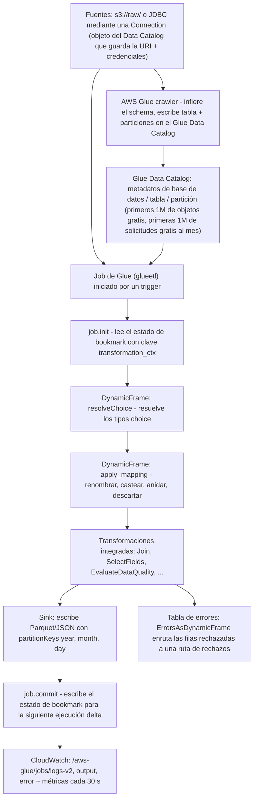
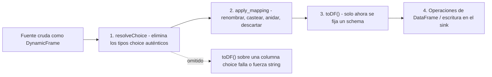
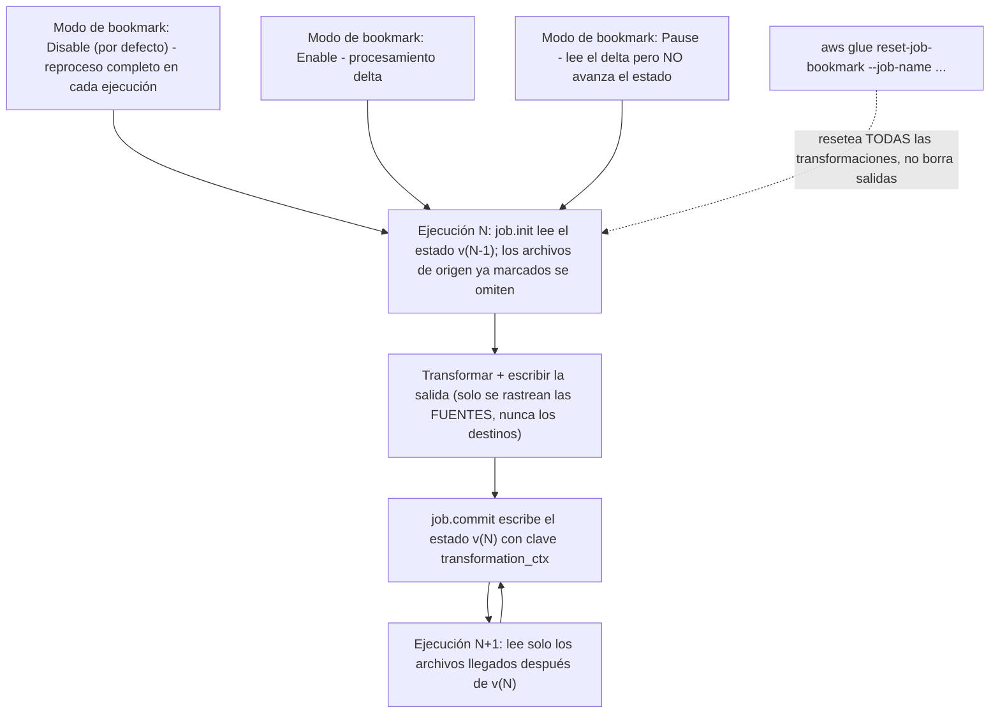
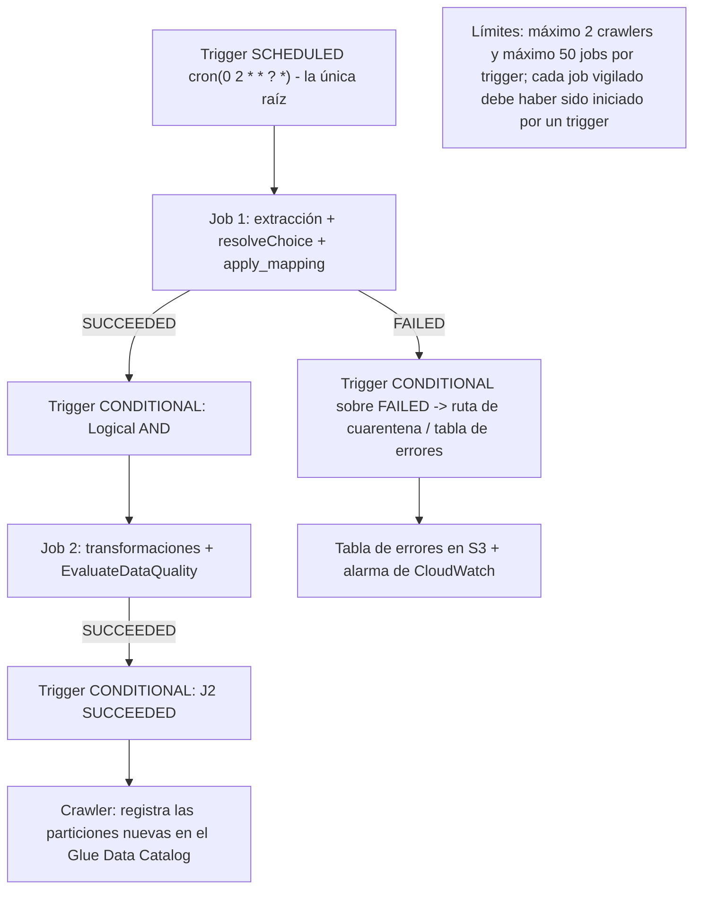
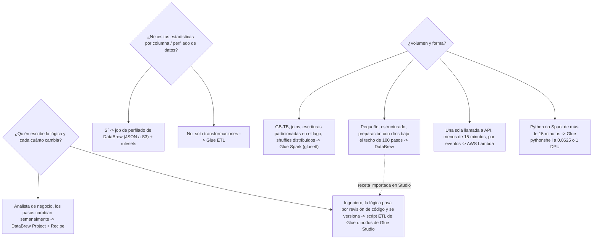

# Transformación serverless con AWS Glue y DataBrew

La transformación es donde el criterio de un ingeniero de datos se hace visible. La ingesta se puede comprar como una tubería gestionada; el almacenamiento se puede alquilar al gigabyte. Pero decidir **qué motor** ejecuta el job, **cuánta capacidad** ocupa mientras corre, **qué registros** se procesan en la segunda ejecución y **a dónde van las filas rechazadas**: eso es trabajo de diseño, y es exactamente lo que examina el Dominio 1 de DEA-C01 (Ingestión y transformación de datos, **34%** del examen; pesos según la guía del examen DEA-C01, consultada en octubre de 2026) a través de las declaraciones de tarea «preparar datos para su transformación (AWS Glue DataBrew)», «usar funciones de AWS Glue para procesar datos» y «usar Lambda para automatizar el procesamiento de datos».

```text
====================================================================
 LA SUPERFICIE DE DECISIÓN DE LA TRANSFORMACIÓN (DEA-C01 Dominio 1)
====================================================================
  Motor .............. AWS Glue Spark (ETL serverless)
                       AWS Glue Python shell (proceso único)
                       AWS Glue streaming (Spark Structured Streaming)
                       AWS Glue Ray (workers Z.2X)
                       AWS Glue DataBrew (recetas sin código + perfilado)
                       AWS Lambda (micro-transformaciones de <15 minutos)
  Representación ...... DynamicFrame (autoscriptivo, tipos choice)
                       vs DataFrame (el schema debe resolverse)
  Incrementalidad ..... job bookmarks (lote) / checkpoints + watermarks
                       (streaming)
  Orquestación ........ triggers: programado | condicional | bajo demanda
                       | evento (EventBridge)
  Capacidad ........... tipos de worker G./R./Z. + NumberOfWorkers,
                       facturados en DPU-horas (1 DPU = 4 vCPU + 16 GB)
  Diseño de fallos .... tablas de errores, Spigot, EvaluateDataQuality,
                       reintentos, timeouts, job run insights
====================================================================
```

En esta lección vas a:

- modelar el **job serverless de Glue**: tipos de jobs, anatomía, integración con el Data Catalog, estados de ejecución y timeouts;
- separar **DynamicFrame** de **DataFrame** y conducir `resolveChoice` → `apply_mapping` → `toDF()` en el orden correcto;
- operar los **job bookmarks**: Enable / Disable / Pause, `job.init` y `job.commit`, `transformation_ctx` como clave de estado, y las cinco formas en que se rompen;
- conectar **triggers** en topologías en serie, condicionales y programadas, y conocer los dos límites duros de los triggers;
- dimensionar **workers y DPU-horas** en la tarifa de octubre de 2026, incluida la trampa de memoria G frente a R y el mínimo de 10 minutos del crawler;
- crear con **Glue Studio** y su ETL visual: nodos, notebooks, la sesión de vista previa de datos y los límites de importación del nodo Recipe;
- elegir **DataBrew** correctamente: sus seis objetos núcleo, el techo de 100 pasos de la receta, receta frente a jobs de perfilado, y su medición sin DPU;
- diseñar el **manejo de errores**: `ErrorsAsDynamicFrame`, `Spigot`, `EvaluateDataQuality`, reintentos, valores por defecto de timeout y dónde viven las tablas de errores;
- optimizar el **rendimiento**: escrituras particionadas, job run insights, agrupación de archivos de entrada, aritmética de archivos pequeños y auto scaling de Glue;
- estudiar **cuatro casos de estudio de clientes de AWS** (BMW Group, PayU, Integral Ad Science y Nasdaq) y un **recuadro de actualizaciones de octubre de 2026 con fuentes**;
- practicar con **14 preguntas estilo examen** más cuatro comprobaciones interativas.

---

## 1. Fundamentos de Glue ETL: un motor Spark serverless con un catálogo acoplado

### 1.1 Qué significa «serverless» aquí

AWS Glue es un servicio ETL **serverless**: defines un job, AWS aprovisiona y desmantela el entorno de ejecución de Spark (o shell), y **solo pagas mientras el job corre**, facturado por segundo (los jobs y las sesiones interativas se facturan en incrementos de 1 segundo, redondeados al alza, con un **mínimo de 1 minuto** para los jobs de Spark: precios de AWS Glue, consultados en octubre de 2026). No hay clusters que mantener calientes, ni AMIs que parchear, ni nodos que dar de baja. El Data Catalog que llenan los crawlers es el pegamento entre almacenamiento y cómputo: **los schemas viven en el catálogo, los datos viven en S3 (o en fuentes JDBC), y los jobs leen ambos**.

### 1.2 Tipos de jobs y lenguajes

| Tipo de job | `JobCommand.Name` | Entorno de ejecución | Se factura como | Encaje en el examen |
|---|---|---|---|---|
| Spark ETL | `glueetl` | PySpark / Scala sobre Spark | DPU-hora (mínimo de 1 min) | Transformaciones masivas de GB: TB, joins, escrituras particionadas en el lago |
| Spark streaming | `gluestreaming` | Spark Structured Streaming | DPU-hora (**2 DPU** por defecto) | Micro-lotes continuos desde fuentes Kinesis/Kafka |
| Python shell | `pythonshell` | Python 3.9 de proceso único (Glue 3.0+) | DPU-hora a **0,0625 o 1 DPU** | Trabajo no Spark de más de 15 minutos: extracciones de APIs, movimientos de archivos, SQL ligero |
| Ray | `ray` (worker `Z.2X`) | Ray sobre Python | **M-DPU-hora** | Cargas de trabajo de Python en paralelo (por ejemplo al estilo Pandas) |

Rutas de autoría: **scripts PySpark/Scala**, **Python (shell o Ray)**, **autoría visual con Glue Studio** y **notebooks interactivos** (Pandas sobre Spark, Spark SQL). Un **job** de Glue se ensambla a partir de: el comando, el tipo y el número de workers, un **rol de IAM**, **connections** opcionales, una **security configuration** opcional, **triggers**, un **timeout**, **reintentos**, argumentos por defecto y `MaxConcurrentRuns`.

> [!NOTE]
> `MaxConcurrentRuns` tiene por defecto **1**, y la API de jobs de AWS lo dice sin rodeos: «El valor por defecto es 1. Se devuelve un error cuando se alcanza este límite.» Ese valor por defecto es también tu primera línea de defensa para los **job bookmarks**, que no son seguros ante concurrencia (sección 3).

### 1.3 Estados de ejecución, timeouts e historial

| Elemento | Valor (API de AWS Glue, consultada en octubre de 2026) |
|---|---|
| Estados de ejecución | `STARTING` `RUNNING` `STOPPING` `STOPPED` `SUCCEEDED` `FAILED` `TIMEOUT` `ERROR` `WAITING` `EXPIRED` |
| `WAITING` | la ejecución está **en cola**: capacidad o posición en el trigger, no un fallo |
| Timeout por defecto | **2.880 minutos** en Glue 4.0 y anteriores · **480 minutos** en Glue 5.0 y posteriores |
| Techo del timeout | debe ser **menor de 7 días (10.080 minutos)** |
| Reintentos | `MaxRetries`; `NotifyDelayAfter` lanza una alerta cuando una ejecución se retrasa |
| Historial de ejecuciones | se conserva **90 días** |

### 1.4 Anatomía del job e integración con el Data Catalog



Dos propiedades de ese diagrama son examinables:

1. **El catálogo es metadatos, no almacenamiento.** Los crawlers se facturan aparte de los jobs (sección 5), y un job puede ejecutarse con o sin crawler en la misma cadena de triggers.
2. **El estado de bookmark vive fuera del script.** `job.init` lo lee, `job.commit` lo escribe, y ninguna de las dos llamadas es opcional si activaste los bookmarks (sección 3).

- **📚 ¿Sabías que…?** Glue registra cada ejecución con su estado y conserva el historial de **90 días**, y `WAITING` simplemente significa *en cola*. Combinado con `MaxConcurrentRuns` por defecto en **1**, una ejecución que aparece «atascada» en `WAITING` te está hablando de capacidad o de la posición en el trigger: no de tu código (API de job-runs de AWS Glue, consultada en octubre de 2026).

## 2. DynamicFrame frente a DataFrame: el concepto de Glue más examinado

### 2.1 Las dos representaciones

| Propiedad | **DataFrame** (Spark) | **DynamicFrame** (Glue) |
|---|---|---|
| Requisito de schema | El schema **debe resolverse** antes de la mayoría de las operaciones | «Cada registro es autoscriptivo, así que no se requiere un schema inicialmente» (guía del desarrollador de AWS Glue, consultada en octubre de 2026) |
| Valores ambiguos | Se ensancha al tipo más general (normalmente `string`) o falla | Lleva un **`choice` type** auténtico, por ejemplo `choice<long,string>`, cuando las filas discrepan |
| Errores a nivel de fila | Falla o convierte en silencio | Se conservan como **filas de error** (`ErrorsAsDynamicFrame`) |
| API de transformación | Métodos de DataFrame | Transformaciones de Glue: `resolveChoice`, `apply_mapping`, `Relationalize`, `Join`, `Spigot`, `EvaluateDataQuality`, … |
| Conversión |: | `toDF()` solo **después** de resolver los choice |

### 2.2 Por qué aparecen los tipos choice: la trampa del muestreo del crawler

La propia muestra de AWS (datos de proveedores de Medicaid) es la ilustración canónica: un crawler que solo inspeccionó un **prefijo de 2 MB** infirió la columna provider-id como `long`. Un DataFrame construido sobre todo el conjunto de datos se encontró valores que la muestra nunca vio y forzó todo a `string`. Un DynamicFrame informó correctamente de **`choice<long,string>`**: las filas discrepaban de verdad. El bug está en el **muestreo de inferencia de schema**, no en los datos, y la corrección pertenece al script.

### 2.3 `resolveChoice`: resolver la ambigüedad

`resolveChoice(specs=…, choice=…, database=…, table_name=…)` ofrece cuatro acciones para una columna `choice` (referencia de la API de AWS, consultada en octubre de 2026):

| Acción | Qué hace | Efecto secundario que debes predecir |
|---|---|---|
| `cast:TYPE` | Convierte cada valor a `TYPE` | Los valores que no se pueden convertir quedan en **`null`** |
| `project:TYPE` | Conserva **solo** los valores que ya son de `TYPE` | Los valores del otro tipo se **descartan** |
| `make_cols` | Una columna por tipo: `col_long`, `col_string` | El schema se ensancha a columnas hermanas |
| `make_struct` | Anida ambas en un struct | El código aguas abajo debe leer los campos del struct |
| `MATCH_CATALOG` (mediante `database` + `table_name`) | Alinea con el tipo declarado en el catálogo | Requiere una tabla del catálogo |

```text
choice<long,string>  --cast:long-->     long        (no convertible -> null)
                  --project:long-->   long        (se descartan los strings)
                  --make_cols-->      provider_id_long + provider_id_string
                  --make_struct-->    {c_long, c_string}
```

### 2.4 `apply_mapping`: renombrar, castear, anidar, descartar

`apply_mapping(mappings, case_sensitive=False, …)` toma una lista de **tuplas de cuatro elementos**:

```text
(source_column, source_type, target_column, target_type)
("provider id", "string",      "provider.id", "string")   # destino con punto = anida
("zip",         "string",      "zip",         "bigint")   # cast en el sitio
("legacy_col",  "string",      "",            "")         # destino vacío -> descartar
```

Reglas que cuestan marcas en el examen: pon comillas inversas a un nombre de **origen** que contenga un punto literal; un **destino** con punto crea un campo anidado (`provider.id`); y `case_sensitive` tiene por defecto **`False`**.

### 2.5 El orden no es negociable



> [!IMPORTANT]
> ⚠️ **`resolveChoice` antes que `apply_mapping` antes que `toDF()`.** `apply_mapping` asume un tipo por columna ya resuelto; convertir a DataFrame con un `choice` sin resolver fuerza la columna a un tipo general (normalmente `string`) y anula en silencio el cast que estabas a punto de hacer. El orden es la diferencia entre una clave `bigint` limpia y una tabla de strings rellenos con espacios.

### 2.6 Ejemplo resuelto E1: IDs de proveedor ambiguos

```text
Entrada: 160.000 filas, columna "provider id"
         crawler (muestra de 2 MB) dice long | 2 filas dicen string | DynamicFrame dice choice<long,string>

Paso 1  resolveChoice([('provider id', 'cast:long')])
        -> la columna es long; los 2 valores no convertibles pasan a null
Paso 2  apply_mapping([('provider id','long','provider.id','long'),
                       ('name','string','name','string'),
                       ('legacy_flag','string','','')])     # anidar + descartar
Paso 3  toDF()  -> el schema queda fijo y con tipos
Paso 4  sink.write(frame, format='parquet',
                  partitionKeys=['year','month','day'])

Lectura: cast es destructivo en valores (nulls), project es destructivo en filas
(descarta valores), make_cols es aditivo, make_struct es reestructuración.
```

### 2.7 Transformaciones integradas de DynamicFrame que vale la pena nombrar

`Relationalize` · `UnnestFrame` · `Map` · `FlatMap` · `Join` · `Spigot` · `ErrorsAsDynamicFrame` · `EvaluateDataQuality` · `FlagDuplicatesInColumn` · `SelectFields` · `DropFields` · `FillMissingValues` · `mergeDynamicFrame` · `FindMatches` (referencia de transformaciones PySpark de AWS, consultada en octubre de 2026). El examen prueba el **reconocimiento**: qué transformación *enruta los rechazos*, cuál *muestrea* la salida, cuál *prueba reglas*.

```dragdrop
{
  "question": "Ordena la canalización de DynamicFrame de Glue tal como la documenta AWS:",
  "items": [
    "Leer la fuente como DynamicFrame: los registros son autoscriptivos, no se requiere schema",
    "resolveChoice: resolver los tipos choice con cast, project, make_cols o make_struct",
    "apply_mapping: renombrar, castear, anidar (destinos con punto) y descartar mediante tuplas de cuatro elementos",
    "toDF() - convertir solo ahora que cada columna tiene un único tipo",
    "Escribir el sink, por ejemplo Parquet con partitionKeys year, month, day"
  ],
  "correctOrder": [
    "Leer la fuente como DynamicFrame: los registros son autoscriptivos, no se requiere schema",
    "resolveChoice: resolver los tipos choice con cast, project, make_cols o make_struct",
    "apply_mapping: renombrar, castear, anidar (destinos con punto) y descartar mediante tuplas de cuatro elementos",
    "toDF() - convertir solo ahora que cada columna tiene un único tipo",
    "Escribir el sink, por ejemplo Parquet con partitionKeys year, month, day"
  ],
  "explanation": "Primero DynamicFrame (registros autoscriptivos más tipos choice auténticos), luego resolveChoice para eliminar la ambigüedad, luego apply_mapping para renombrar/castear/anidar/descartar, luego toDF() cuando ya existe un único tipo por columna, y solo después la escritura. Invertir los dos primeros pasos hace que apply_mapping caste contra un tipo aún ambiguo; convertir a DataFrame de forma temprana fuerza la columna choice a un tipo general como string y anula todo el sentido del ejercicio."
}
```

## 3. Job bookmarks: procesamiento por lotes incremental sin duplicados

### 3.1 Los tres modos

| Modo | Comportamiento | ¿Por defecto? |
|---|---|---|
| **Enable** | Actualiza el estado de bookmark **en cada ejecución** y procesa solo el delta desde el último commit | No |
| **Disable** | Procesa el **conjunto entero** en cada ejecución | **Sí** |
| **Pause** | Procesa de forma incremental pero **no** actualiza el estado | No |

### 3.2 Cómo se guarda el estado

El estado de bookmark lo guarda el servicio Glue con una forma aproximada de `{job_name, run_id, run_number, attempt_number, states: {transformation_ctx: state}}`, con clave de **nombre del job más versión**. Tu script participa mediante exactamente dos llamadas: **`job.init`** lee el estado al inicio, **`job.commit`** lo escribe al final. La guía del desarrollador de AWS es tajante: «Los bookmarks no funcionan sin llamarlos.»

Y la regla clave, textual desde la página de bookmarks de AWS:

> «El `transformation_ctx` sirve como clave para buscar el estado del bookmark de una fuente concreta en tu script. Para que el bookmark funcione correctamente, debes mantener siempre coherentes la fuente y su `transformation_ctx` asociado.»



### 3.3 Ejemplo resuelto E2: la aritmética delta

```text
Conjunto de datos: s3://raw/orders/ con 1.000 archivos en la primera activación.

Ejecución 1 (bookmarks recién activados): 320 archivos nuevos -> procesados 320, estado -> 320
Ejecución 2:                              410 archivos nuevos -> procesados 410, estado -> 730
Ejecución 3:                              270 archivos nuevos -> procesados 270, estado -> 1.000

Archivos procesados en tres ejecuciones: 320 + 410 + 270 = 1.000
Total ingenuo con reproceso completo:    1.000 x 3       = 3.000
Sin continuidad de estado, la cifra tentadora y errónea es 320+410+270 contada
contra un estado reseteado, o 2.680 si la ejecución 1 fuera anterior a la activación.

Lección: los bookmarks deduplican la SALIDA respecto a las FUENTES rastreadas - el
estado es lo único que recuerda qué significa «ya procesado».
```

### 3.4 Cuándo se rompen los bookmarks (la lista de fallos favorita del examen)

| Fallo | Qué ocurre en realidad |
|---|---|
| Cambias la **ruta** de una fuente pero mantienes el mismo `transformation_ctx` | El estado ya no coincide con la realidad → **archivos omitidos o desaparecidos** |
| Dos ejecuciones corren **en paralelo** | Los commits se pisotean; el estado se vuelve poco fiable → mantén `MaxConcurrentRuns = 1` |
| Esperas un **rebobinado** | No existe. Reset sí; rebobinado no |
| `reset-job-bookmark` | Resetea **todas** las transformaciones del job de una vez y **no borra las salidas** que ya escribiste |
| Asumes que se rastrean los **destinos** | Solo se rastrean los **archivos de origen**, nunca los destinos |
| Borras el job de Glue | Su **bookmark se borra con él** |
| Fuente JDBC sin clave de bookmark | Tú debes **elegir las columnas clave de bookmark** |
| Job de streaming | Los bookmarks son el mecanismo equivocado: el streaming usa **`checkpointLocation` + watermarks** |

- **📚 ¿Sabías que…?** La propia formulación de AWS sobre la garantía es que los bookmarks «evitan el procesamiento duplicado y los datos duplicados»: la frase «exactly-once» es una abreviatura que usa el mundo del examen, pero el modelo honesto es **procesamiento at-least-once con salidas deduplicadas**, porque solo se rastrean las fuentes y una ejecución fallida entre `job.init` y `job.commit` deja el estado intacto. Nunca reclames una garantía del lado del destino que no puedas señalar en la estructura del estado (guía del desarrollador de AWS Glue, consultada en octubre de 2026).

```fillblank
{
  "question": "Completa las afirmaciones sobre job bookmarks con el propio vocabulario de la guía del desarrollador de AWS:",
  "template": "El estado del bookmark tiene como clave {{1}} más una versión, y la clave por fuente dentro del estado es el {{2}} de la fuente. El script debe llamar a {{3}} al inicio y a {{4}} al completar: AWS declara que los bookmarks no funcionan sin llamarlos. Los tres modos son {{5}} (por defecto, conjunto entero), Enable (delta, estado actualizado) y Pause (delta, estado sin actualizar), y el estado se resetea con el comando de CLI {{6}}.",
  "answers": {
    "1": "job_name",
    "2": "transformation_ctx",
    "3": "job.init",
    "4": "job.commit",
    "5": "Disable",
    "6": "reset-job-bookmark"
  },
  "distractors": ["run_id", "ruta de la fuente", "job.commit primero", "job.start", "Enable", "Pause", "delete-job-bookmark", "reset-bookmark-state"],
  "explanation": "El estado vive bajo job_name + versión; dentro de él, transformation_ctx es la clave que AWS te dice mantener coherente con la fuente. job.init lee, job.commit escribe. Disable es el modo POR DEFECTO, así que un job que «sigue reprocesando todo» normalmente tiene los bookmarks apagados, no rotos. aws glue reset-job-bookmark --job-name ... resetea cada transformación del job y no limpia ninguna salida."
}
```

## 4. Triggers: topologías en serie, condicionales y programadas

### 4.1 Los cuatro tipos de trigger

| `Type` de API | Nombre en consola | Se dispara cuando |
|---|---|---|
| `SCHEDULED` | **Scheduled** | Vence una expresión **cron** |
| `CONDITIONAL` | **Conditional** | Una lista de predicados sobre jobs/crawlers vigilados alcanza los estados requeridos, unidos por `Logical` **AND** / **OR** |
| `ON_DEMAND` | **On-demand** | Tú lo activas (API/consola/CLI) |
| `EVENT` | (a nivel de API) | Un evento de **EventBridge**, con `EventBatchingCondition {BatchSize, BatchWindow}` |

### 4.2 Las reglas que hacen funcionar los triggers condicionales

1. Los jobs vigilados deben haber sido **ellos mismos iniciados por un trigger**. Un job que iniciaste a mano y que después terminó con éxito **no disparará** un trigger condicional.
2. La cadena debe descender de un **único trigger raíz programado o bajo demanda**.
3. Límites: **máximo 2 crawlers por trigger**; **máximo 50 jobs por trigger** (cuotas de AWS Glue, consultadas en octubre de 2026).



**En serie frente a paralelo, una frase cada uno:** en serie, `J3` se dispara cuando `J1` **Y** `J2` terminan con `SUCCEEDED`; fan-out, `J4` se dispara cuando `J1` **O** `J2` termina con `FAILED`. Esa es toda la gramática de los triggers condicionales: más la regla del trigger raíz, donde vive la mayoría de los errores de los candidatos.

---

## 5. Tipos de worker y dimensionamiento de DPU: de dónde sale la factura

### 5.1 La unidad

**1 DPU = 4 vCPU y 16 GB de memoria**, y AWS declara que «un DPU individual también se denomina worker». Los jobs en Glue 2.0 y posteriores se dimensionan con **`WorkerType` + `NumberOfWorkers`**: nunca con `MaxCapacity` (ese campo heredado pertenece a Glue 1.0 y anteriores; definir ambos es un error). Por defecto: jobs de Spark **10 DPU**, streaming **2 DPU**, ambos con un **mínimo de 2 DPU**.

### 5.2 Catálogo de workers (en octubre de 2026)

| Worker | DPU por worker | vCPU | Memoria | Disco (libre) | Restricción |
|---|---|---|---|---|---|
| **G.1X** | 1 | 4 | 16 GB | 94 GB (44 GB libres) | Todo Spark; **por defecto en Glue ≥2.0** |
| **G.2X** | 2 | 8 | 32 GB | 138 GB (78 GB libres) | Recomendado para **transformaciones de ML** |
| **G.4X** | 4 | 16 | 64 GB | 256 GB (230 GB libres) | **Glue ≥3.0** (regiones limitadas) |
| **G.8X** | 8 | 32 | 128 GB | 512 GB (485 GB libres) | **Glue ≥3.0** (regiones limitadas) |
| **G.12X** | 12 | 48 | 192 GB | 768 GB (741 GB libres) | **Glue ≥4.0** |
| **G.16X** | 16 | 64 | 256 GB | 1024 GB (996 GB libres) | **Glue ≥4.0** |
| **G.025X** | 0,25 | 2 | 4 GB | 84 GB (34 GB libres) | **Solo streaming**, ≥3.0 |
| **R.1X / R.2X / R.4X / R.8X** | 1 / 2 / 4 / 8 **M-DPU** | 4 / 8 / 16 / 32 | **32 / 64 / 128 / 256 GB** | igual que sus pares G | **Optimizados en memoria** (≥4.0) |
| **Z.2X** | 2 M-DPU | 8 | 64 GB | 128 GB (~120 GB libres) | **Solo Ray**, hasta 8 workers de Ray |

**M-DPU** significa «el doble de asignación de memoria para un tamaño determinado en comparación con los DPU estándar».

> [!IMPORTANT]
> ⚠️ **La familia G no te compra memoria por CPU.** Cada worker G mantiene la proporción de **4 vCPU: 16 GB**; solo la familia **R.** la duplica (**4 vCPU: 32 GB**). Pasar de G.1X a G.4X por tanto **no** arregla un fallo por falta de memoria: solo te da la misma proporción cuatro veces más rápido y cuatro veces más ancha. OOM → **R.**; shuffle/sesgo → más workers; trabajo monohebra genuinamente lento → worker más grande.

### 5.3 La tarifa de octubre de 2026

Línea base **us-east-1 (N. Virginia)**; cada cifra **en octubre de 2026** (las tarifas de Glue 6.0 se anunciaron el 2026-08-21):

| Medidor | Glue ≤5.1 | Glue ≥6.0 | Mínimo de facturación |
|---|---|---|---|
| Job de Spark / Spark Streaming | **0,44 USD / DPU-hora** | **0,308 USD / DPU-hora** | 1 segundo, redondeado al alza; mínimo de **1 minuto** |
| Ejecución Flex (G.1X/G.2X, ≥3.0) | **0,29 USD / DPU-hora** | ver página de precios en vivo | 1 minuto; posible retraso/interrupción del inicio |
| Workers **R** optimizados en memoria (≥4.0) | **0,52 USD / DPU-hora** | ver página de precios en vivo | 1 minuto |
| Sesión interactiva / notebook de Studio | **0,44 USD / DPU-hora** | **0,308 USD / DPU-hora** | 1 minuto; **5 DPU** por defecto, **2 DPU** mínimo |
| Python shell (0,0625 o 1 DPU) | **0,44 USD / DPU-hora** |: | 1 minuto |
| Ray | **0,44 USD / M-DPU-hora** |: | 1 minuto |
| **Crawler de Data Catalog** | **0,44 USD / DPU-hora** |: | **mínimo de 10 minutos por ejecución** |
| Data Quality evaluado en un job ETL | **0,44 USD / DPU-hora** | **0,308 USD / DPU-hora** | 1 minuto |
| Job de receta/perfilado de **DataBrew** | **0,48 USD / node-hour** |: | por nodo |
| Sesión interactiva de **DataBrew** | **1,00 USD / bloque de 30 minutos** |: | se cuenta desde la primera interacción |

Los cuatro medidores basados en DPU de esa tabla como gráfico interactivo (mismas unidades, así que son legítimamente comparables: el medidor por node-hour de DataBrew se excluye a propósito **del gráfico**, porque es una unidad distinta):

```plot
{
  "type": "bar",
  "title": "USD por DPU-hora (us-east-1, en octubre de 2026)",
  "data": [
    {"meter": "Glue <=5.1 standard", "usd": 0.44},
    {"meter": "Glue >=6.0 standard", "usd": 0.308},
    {"meter": "Flex (G.1X/G.2X, <=5.1)", "usd": 0.29},
    {"meter": "R memory-optimized (<=5.1)", "usd": 0.52}
  ],
  "xKey": "meter",
  "yKey": "usd",
  "xLabel": "Medidor",
  "yLabel": "USD por DPU-hora"
}
```

Cómo leer el gráfico: coste total = DPU × horas × altura de la barra. La barra de 6.0 es ~30% más corta que la de 5.1 (la rebaja del 2026-08-21), Flex compra ~34% de descuento a cambio de un posible inicio retrasado o interrupción, y la barra R es la prima por el doble de memoria por DPU.

### 5.4 Ejemplo resuelto E3: la propia aritmética de DPU-hora de AWS

```text
Job: 6 DPU (por ejemplo 6 x G.1X) corriendo 15 minutos en Glue <= 5.1
Coste = 6 DPU x 0,25 h x $0,44 / DPU-h = $0,66 por ejecución   (en octubre de 2026)

Mismo job en Glue 6.0:
Coste = 6 x 0,25 x $0,308              = $0,462 por ejecución
Ahorro por ejecución                    = $0,66 - $0,462 = $0,198  (~30%)
30 ejecuciones al mes                   = 30 x $0,198    = $5,94 al mes

Fuente: el ejemplo resuelto de la página de precios de AWS Glue ("6 DPU * 0.25
hour * $0.44, or $0.66"), en octubre de 2026; tarifa de 6.0 según el anuncio
del 2026-08-21.
```

### 5.5 Ejemplo resuelto E4: Flex frente a estándar

```text
Job: 6 DPU x 1/3 hora (en octubre de 2026)
Estándar: 6 x 0,3333 x $0,44 = $0,88
Flex:     6 x 0,3333 x $0,29 = $0,58      (el propio ejemplo resuelto de AWS)

Flex compra ~34% de descuento aceptando un posible inicio retrasado e
interrupción. Nunca uses Flex para trabajo con SLA; existe para jobs
interrumpibles y tolerantes a fallos.
```

### 5.6 Ejemplo resuelto E5: la elección del worker no cambia el precio

```text
Capacidad objetivo: 16 DPU  (en octubre de 2026, $0,44/DPU-h en Glue <= 5.1)

16 x G.1X  = 16 workers x 1 DPU = 16 DPU -> 16 x $0,44 = $7,04 / hora
 8 x G.2X  =  8 x 2             = 16 DPU -> 16 x $0,44 = $7,04 / hora
 4 x G.4X  =  4 x 4             = 16 DPU -> 16 x $0,44 = $7,04 / hora
 2 x G.8X  =  2 x 8             = 16 DPU -> 16 x $0,44 = $7,04 / hora

Mismo coste, formas distintas: 16 ejecutores en G.1X frente a 2 en G.8X,
16 GB frente a 128 GB por worker. Elige por paralelismo y memoria por
ejecutor, nunca por precio - el DPU es la unidad medida.
```

### 5.7 Ejemplo resuelto E6: el mínimo de 10 minutos del crawler

```text
El crawler corre cada hora, 2 DPU, el trabajo real lleva 3 minutos (en octubre de 2026).

Facturado por ejecución: 2 DPU x (10/60) h x $0,44 = $0,147   <- mínimo de 10 min
Ejecuciones por mes de 30 días: 24 x 30 = 720
Al mes: 720 x $0,147 = $105,60
Con la duración real de 3 minutos: 720 x (2 x 0,05 x $0,44) = $31,68
Prima oculta del mínimo: $105,60 - $31,68 = $73,92 al mes

Movimiento de examen: rastrea por evento (trigger condicional tras el
SUCCEEDED del job) en lugar de cada hora, o descubre las particiones por lote,
antes de optimizar los DPU.
```

### 5.8 Auto scaling y el MaxCapacity heredado

En Glue **3.0 y posteriores**, el auto scaling se activa con `--enable-auto-scaling=true` en las familias de workers **G.1X…G.16X** y **R.1X…R.8X** (`G.025X` para streaming); el worker **Standard** no lo admite. Con el auto scaling activo, `NumberOfWorkers` se interpreta como el **máximo**, y los jobs por lotes en Glue 4.0+ pueden revisarse con la métrica de CloudWatch **`DPUSeconds`**. El precio del Data Catalog añade su propio medidor: **los primeros 1.000.000 de objetos y 1.000.000 de solicitudes son gratis cada mes**, y después **1,00 USD por cada 100.000 objetos** sobre el nivel gratuito y **1,00 USD por millón de solicitudes** sobre él (en octubre de 2026).

- **📚 ¿Sabías que…?** Un **job** de DataBrew no se factura en DPU-horas en absoluto: cuesta **0,48 USD por node-hour** con un **valor por defecto de 5 nodos**, y una sesión interactiva de DataBrew cuesta **1,00 USD por bloque de 30 minutos**: tres interacciones separadas dentro de 75 minutos se facturan como **tres bloques = 3,00 USD** (precios de AWS Glue/DataBrew, en octubre de 2026). Mezclar los dos medidores es una trampa clásica de estimación de costes.

## 6. Glue Studio: ETL visual sobre el mismo motor

### 6.1 Qué es realmente la capa visual

Glue Studio te permite **crear, ejecutar y monitorizar** jobs de Glue sobre el motor Spark serverless «sin tener que aprender Spark ni escribir código». Cada **nodo** del lienzo es una acción, una fuente, una transformación o un destino, y Studio **genera un script PySpark** a partir del schema de la fuente más la ubicación y el schema de destino. El script es real y editable en modo desarrollador; el grafo visual y el código son dos vistas del mismo job.

| Modo de autoría | Qué obtienes |
|---|---|
| **ETL visual** | Lienzo de nodos fuente/transformación/destino; script generado |
| **Notebook interactivo** | Celdas de **Pandas** sobre Spark o **SQL** contra una sesión interactiva |
| **Editor de scripts** | PySpark/Scala escritos a mano |

### 6.2 Sesiones, vistas previas y monitorización

- **Sesión de vista previa de datos**: **2 DPU durante hasta 30 minutos**, **se detiene sola**, facturada a la tarifa estándar de DPU (en octubre de 2026).
- **Monitorización**: la página de Jobs y los detalles de ejecución, más el **panel de monitorización de ejecuciones de jobs** con fichas para la tasa de éxito y el uso estimado de DPU, enlaces a CloudWatch, al Spark History Server y a los job run insights.
- **Registros**: `/aws-glue/jobs/logs-v2` (logging continuo), `/aws-glue/jobs/output`, `/aws-glue/jobs/error`; las métricas de CloudWatch llegan **cada 30 segundos** como deltas.

### 6.3 El nodo Data Preparation Recipe: DataBrew dentro de Studio

Puedes redactar un paso de receta en línea en Studio o **importar una receta publicada de DataBrew** en un **nodo Data Preparation Recipe**, sujetos a límites duros (documentación de AWS Glue Studio, consultada en octubre de 2026):

| Regla | Valor |
|---|---|
| Versión mínima de Glue | **4.0** (la versión de Python se autoconfigura) |
| **No importables** | `GROUP_BY`, `PIVOT`, `UNPIVOT`, `TRANSPOSE`: usa los nodos dedicados de Studio |
| No admitidos si la receta contiene | `UNION` o `JOIN`: usa los nodos Join/Union de Studio |
| Requisito de región | Solo regiones comerciales de DataBrew |

Ese puente es la razón por la que DataBrew y Glue Studio aparecen en el examen **juntos**: una receta redactada por un analista se convierte en un paso gobernado dentro del job programado de un ingeniero, que gana entonces bookmarks, reintentos y auto scaling que nunca tuvo como job independiente de DataBrew.

---

## 7. AWS Glue DataBrew: preparación y perfilado sin código

### 7.1 Seis objetos núcleo, y el nombre que no existe

AWS Prescriptive Guidance enumera exactamente **seis** conceptos núcleo (consultado en octubre de 2026):

| Objeto | Función |
|---|---|
| **Project** | El espacio de trabajo donde un dataset y una receta se encuentran |
| **Dataset** | Una referencia **de solo lectura** a una fuente (S3, tablas del catálogo de Glue, …) |
| **Recipe** | Una lista **ordenada** de pasos de transformación con expresiones de condición opcionales |
| **Job** | O bien un **job de receta** (aplica una versión de receta) o un **job de perfilado** (calcula estadísticas) |
| **Data lineage** | Registro de lo que la receta hizo con los datos |
| **Data profile** | La salida estadística de un job de perfilado (JSON a S3) |

> [!WARNING]
> ⚠️ **No existe ningún objeto de DataBrew llamado «data flow».** Los seis objetos de arriba son el vocabulario completo; un «flow» es lenguaje informal para un grafo visual de **Glue Studio** o para la propia receta. Una opción de examen que te pida «crear un data flow de DataBrew» está probando si conoces los nombres reales de los objetos.

### 7.2 Recetas: acotadas, versionadas, con clics

- Una receta es una lista ordenada de objetos `RecipeAction` (`Action.Operation` + `Parameters` + `ConditionExpressions` opcionales).
- **Máximo de 100 transformaciones por receta**; **máximo de 100 versiones publicadas por receta** (cuotas de AWS, consultadas en octubre de 2026).
- Escala de la biblioteca: **más de 250 transformaciones con clics** (página de producto) / **más de 200 acciones de receta** (guía del desarrollador).
- Operaciones relevantes para el examen: `SPLIT`, `GROUP_BY`, `REPLACE_TEXT`, `REMOVE_VALUES`, `CHANGE_DATA_TYPE`, `PIVOT`, `UNPIVOT`, `TRANSPOSE`, `NEST`, `UNNEST` y *Remove duplicates*.

### 7.3 Jobs, schedules y rulesets de calidad de datos

| Parámetro | Valor (en octubre de 2026) |
|---|---|
| Salida de job de receta | Amazon S3 · Glue Data Catalog · Amazon Redshift |
| Salida de job de perfilado | Evaluación estadística como **JSON a S3** |
| Sintaxis de schedule | **Cron de seis campos**; día del mes y día de la semana son mutuamente excluyentes (`?`) |
| Intervalo mínimo de schedule | **No se admiten expresiones cron más rápidas que 5 minutos** |
| Rulesets | **100 reglas por ruleset**, **10 rulesets por dataset**, **100 rulesets por cuenta** |
| Cuotas de cuenta | 10 jobs concurrentes · **300 nodos por cuenta** · 100 jobs · 100 datasets · 100 proyectos · 10 proyectos abiertos · 500 recetas · 10 schedules |

### 7.4 Ejemplo resuelto E7: calcular el precio de una canalización de DataBrew

```text
Job de receta: 5 nodos (el valor por defecto), corre 10 minutos   (en octubre de 2026)
Coste = 5 nodos x (10/60) h x $0,48 / node-hour = $0,40 por ejecución

Día interactivo del analista: 3 sesiones dentro de 75 minutos
Coste = 3 x $1,00 / bloque de 30 min = $3,00

Job de receta programado cada hora durante un mes (peor caso, 720 ejecuciones):
720 x $0,40 = $288,00  frente al mismo job como Glue ETL solo si de verdad se
necesita un job Spark - los medidores NO son intercambiables.
```

### 7.5 Cuándo elegir DataBrew, cuándo elegir Glue



| Dimensión | **DataBrew** | **Glue ETL (Spark)** |
|---|---|---|
| Código | **Ninguno**: con clics | PySpark/Scala (o generado por Studio) |
| Ideal para | Preparación, limpieza, perfilado, autoservicio del analista | Transformaciones masivas, joins, procesamiento distribuido |
| Medidor | **0,48 USD / node-hour** + **1,00 USD / sesión de 30 min** | **DPU-hora** |
| Bookmarks / reintentos / auto scaling | Solo después de **importar la receta en Glue Studio** | Nativo |
| Techo duro | **100** transformaciones por receta | Longitud del script, no los pasos |
| Calidad de datos | Rulesets sobre datasets, ejecutados dentro de jobs | Nodo/transformación `EvaluateDataQuality` |

- **📚 ¿Sabías que…?** AWS afirma que DataBrew puede reducir el tiempo de preparación de datos hasta en un **80%** frente al trabajo de preparación a medida (página de producto de AWS Glue DataBrew, consultada en octubre de 2026): una afirmación dirigida al cliente, no una garantía, y el hecho examinable es el *mecanismo* (project → dataset → recipe → job de receta/perfilado), no el porcentaje.

```matching
{
  "question": "Relaciona cada objeto de AWS Glue DataBrew con lo que realmente es:",
  "pairs": [
    {"left": "Project", "right": "El espacio de trabajo donde un dataset y una receta se reúnen para la preparación interactiva"},
    {"left": "Dataset", "right": "Una referencia de solo lectura a una fuente como un prefijo de S3 o una tabla del catálogo de Glue"},
    {"left": "Recipe", "right": "Una lista ordenada de transformaciones con expresiones de condición opcionales, con techo de 100 pasos"},
    {"left": "Recipe job", "right": "Aplica una versión publicada de la receta y escribe los resultados en S3, el Glue Data Catalog o Redshift"},
    {"left": "Profile job", "right": "Calcula estadísticas por columna y escribe un data profile como JSON en S3"},
    {"left": "Data lineage", "right": "El historial registrado de lo que los pasos de preparación hicieron con los datos"}
  ],
  "explanation": "Estos seis objetos son el vocabulario núcleo completo de AWS para DataBrew: no existe ningún objeto «data flow», y por eso esa formulación solo aparece como distractor. Observa también que DataBrew no tiene medidor de DPU: los jobs se facturan a 0,48 USD por node-hour con un valor por defecto de 5 nodos, las sesiones a 1,00 USD por bloque de 30 minutos, una receta se limita a 100 transformaciones y 100 versiones publicadas, y los schedules cron no pueden ejecutarse más frecuentemente que cada 5 minutos (todo en octubre de 2026)."
}
```

## 8. Manejo de errores: filas rechazadas, reintentos y adónde van los fallos

### 8.1 Los tres patrones dentro del script

| Patrón | Mecanismo | Cuándo usarlo |
|---|---|---|
| **Tabla de errores** | `ErrorsAsDynamicFrame` (o `errorsFromDF`) enruta los registros rechazados a un **DynamicFrame aparte** en lugar de fallar la ejecución | Las violaciones de schema deben *capturarse*, no ser fatales |
| **Spigot** | Desvía una **muestra** de registros a una ruta de rechazos | Quieres un canario, no cada rechazo |
| **EvaluateDataQuality** | Evaluación de reglas (en Studio: nodo «Data quality rules») que puede **fallar o desviar** ante una violación | Las reglas son declarativas y auditables |

El frame rechazado se escribe después en su propio prefijo: esa es la **tabla de errores** que el examen tiene en mente: las filas malas aterrizan en `s3://…/errors/`, las buenas aterrizan en el sink particionado, y un trigger condicional aguas abajo o una consulta del analista puede leer cada una por separado.

> [!WARNING]
> ⚠️ **No existe ninguna función de Glue llamada «ErrorCDC».** Una búsqueda en la guía del desarrollador de Glue, la referencia de la API y las notas de versión (comprobado en octubre de 2026) no devuelve nada con ese nombre. Los mecanismos reales son `ErrorsAsDynamicFrame`, `errorsFromDF`, `Spigot` y `EvaluateDataQuality`: si una opción usa un nombre que nunca has visto en la documentación, trátalo como distractor y elige el mecanismo documentado.

### 8.2 Reintentos, timeouts y estados de ejecución

```text
Escalera de fallo de un job (API de job-runs de AWS Glue):
  fallo transitorio   -> MaxRetries (configurado en el job) -> nuevo intento
  cola larga          -> estado WAITING (en cola, no fallida)
  NotifyDelayAfter    -> alerta lanzada mientras la ejecución se retrasa
  sobre el límite     -> estado TIMEOUT   (480 min por defecto en Glue >= 5.0,
                                           2.880 min por defecto en Glue <= 4.0,
                                           techo duro < 10.080 min = 7 días)
  error no manejado   -> estado FAILED o ERROR; historial conservado 90 días
```

### 8.3 Ejemplo resuelto E8: la trampa del valor por defecto del timeout

```text
Una canalización se diseñó en 2024 sobre Glue 4.0, donde un Timeout vacío
tenía por defecto 2.880 minutos (48 horas). El equipo sube a Glue 5.1/6.0
y deja Timeout vacío -> el valor por defecto ahora es 480 minutos (8 horas).

Duración del job: 60 horas = 3.600 minutos
Resultado: estado TIMEOUT a los 480 minutos, mucho antes de completarse.

Corrección: define un timeout explícito (siempre < 10.080 minutos) y trata el
valor por defecto como dependiente de la versión, no como una constante.
(Valores por defecto en octubre de 2026.)
```

### 8.4 Security configuration: cuatro planos, una regla de precedencia

Una **security configuration** es un conjunto con nombre que se puede adjuntar a un **job, crawler o development endpoint**, y cubre cuatro planos: **datos en S3** (SSE-S3 o SSE-KMS), **CloudWatch Logs** (SSE-KMS), **job bookmarks** (**CSE-KMS**: del lado del cliente) y **activos de calidad de datos**. Tres reglas que merece la pena memorizar:

1. «Actualmente, una security configuration tiene precedencia sobre cualquier configuración de cifrado del lado del servidor (SSE-S3) que se pase como parámetro de un job ETL.»
2. Solo se admiten claves KMS **simétricas**, y las security configurations **no se admiten en los jobs de Ray**.
3. El rol del job necesita permisos de KMS más `logs:AssociateKmsKey`. El cifrado del **catálogo** es un ajuste separado a **nivel de cuenta** (`CatalogEncryptionMode`: `DISABLED`, `SSE-KMS`, `SSE-KMS-WITH-SERVICE-ROLE`).

---

## 9. Rendimiento: insights, particiones y el impuesto de los archivos pequeños

### 9.1 Job run insights: el camino más rápido hasta la causa raíz

Disponible en Glue **2.0 y posteriores**, se activa con la casilla de Studio **«Generate job insights»** o `--enable-job-insights=true`. Cuando está activo, una ejecución fallida informa de (documentación de AWS Glue, consultada en octubre de 2026):

- la **línea del script que falló**,
- la **última acción de Spark**,
- el **stream de excepciones ordenado en el tiempo**, y
- una **causa raíz con una acción recomendada**.

Compara eso con el fallo desnudo `An error occurred while calling o111.collectToPython`: uno es un diagnóstico, el otro es un síntoma. Los insights aterrizan bajo el mismo grupo de log `/aws-glue/jobs/logs-v2` que ya envías a CloudWatch.

### 9.2 Escrituras particionadas y pushdown

Escribe las claves de partición con el sink (`partitionKeys = ["year","month","day"]`) para que los lectores aguas abajo solo toquen las particiones que nombra una consulta. El particionado es una **decisión en tiempo de escritura** que no puedes incorporar después con baratura a un prefijo plano, y por eso el sink pertenece a la conversación de diseño, no al sprint de limpieza. Las salidas conscientes de la partición son también lo que hace barato ejecutar los crawlers: el crawler registra **particiones**, y es una tabla particionada lo que permite a un motor omitir archivos que nunca leerá.

### 9.3 Ejemplo resuelto E9: aritmética de archivos pequeños

```text
Ingesta: 1 TB al año de eventos en bruto, particionado año/mes/día,
         128 archivos de salida por partición (en octubre de 2026 - los
         recuentos de archivos son aritmética estructural, no un límite de AWS).

Particiones por año  = 365
Archivos de salida al año = 365 x 128 = 46.720 archivos
Tamaño medio de archivo   = 1 TB / 46.720 ~= 21 MB (antes de comprimir)

Cada uno de esos archivos es un objeto, una entrada de listado, la entrada de
una tarea y una fila de metadato. Remedios por el lado de Glue:
  - groupFiles / groupPartition: la agrupación automática entra más allá de
    ~50.000 archivos de entrada para que una tarea lea un GRUPO de archivos;
  - coalesce(n) / repartition(n) para ajustar el recuento de archivos de SALIDA;
  - sin agrupación, el driver puede quedarse sin memoria solo con los metadatos
    de los archivos (guía de agrupación de entrada y escalado de Spark de Glue).
```

### 9.4 Qué comprobar antes de comprar más DPU

```text
1. Sesgo           - una clave caliente; más workers no ayudan, salar o preagregar
2. Demasiadas tareas- archivos pequeños; agrupa entradas y coalesce salidas primero
3. Worker equivocado- OOM en G.*? pasa a R.* (4 vCPU : 32 GB), no subas por la escalera G
4. Auto scaling     - Glue >= 3.0, --enable-auto-scaling=true, NumberOfWorkers = máx
5. Versión          - Glue 5.1 frente a 6.0 cambia el precio por DPU ~30% (en octubre de 2026)
6. Medidor          - ¿es esto siquiera un job DPU? pythonshell de 0,0625 DPU o Lambda pueden encajar
```

---

## 10. Conexiones, cifrado y la escalera de versiones

### 10.1 Las connections son objetos del catálogo, no ajustes del job

> «Una connection de AWS Glue es un **objeto del Data Catalog** que guarda credenciales de inicio de sesión, cadenas de URI, información de red privada virtual (VPC)…»

Las connections son por tanto **reutilizables** entre crawlers, jobs y development endpoints. Los tipos incluyen `JDBC`, `NETWORK`, `MARKETPLACE`, `CUSTOM`, `KAFKA`, `MONGODB`, `SFTP` (AWS indica que SFTP actualmente **no se admite**) y las familias SaaS/bases de datos (`MYSQL`, `ORACLE`, `POSTGRESQL`, `SQLSERVER`, `SYNAPSE`, `TERADATA`, `OPENSEARCH`, `SALESFORCE`, …). Para JDBC suministras `HOST`/`PORT`/`JDBC_ENGINE` o una `JDBC_CONNECTION_URL` completa, más `USERNAME`/`PASSWORD` **o** `SECRET_ID`, con conmutadores de SSL. Dentro de una VPC, Glue crea un **ENI**; los security groups necesitan una **regla de entrada autorreferente para todos los puertos TCP**, y la salida requiere un NAT gateway o endpoints de VPC. Límites: **1.000 connections por cuenta**, y `ConnectionsList` por job también se limita a **1.000**.

### 10.2 La escalera de versiones (en octubre de 2026)

| Versión de Glue | Spark | Python | Estado |
|---|---|---|---|
| **6.0** | 4.1.1 | 3.13 | GA **2026-08-21**, precios **−30%**, Iceberg v3, Java 17 / Scala 2.13.17 |
| **5.1** | 3.5.6 | 3.11 | **Por defecto cuando se omite `GlueVersion`** (desde 2025-11-26) |
| **5.0** | 3.5.4 | 3.11 | Soportado; el timeout por defecto ya es de **480 min** |
| **4.0** | 3.3.0 | 3.10 | Soportado; timeout por defecto de **2.880 min** |
| **3.0** | 3.1.1 | 3.7 | Soportado; **transformaciones de ML no disponibles** |
| **2.0 / 1.0 / 0.9** | 2.4.3 | 3.7 / 2.7-3.6 | **Fin de vida el 2026-04-01** |

Deltas de migración de Glue 6.0 que rompen scripts antiguos: cambió el valor por defecto de `spark.sql.legacy.timeParserPolicy`; el **modo ANSI** puede hacer fallar los casts implícitos de string a numérico; **`--additional-python-modules` está obsoleto** en favor de `--python-virtual-env`; **EMRFS se eliminó** (S3A es el único sistema de archivos de S3); y el **AWS SDK for Java v1 se eliminó** (solo SDK v2: boto3 no se ve afectado).

### 10.3 Elegir el motor en una tabla

| Dimensión | AWS Lambda | Glue Spark | Glue Python shell |
|---|---|---|---|
| Duración máxima | **15 minutos** (duro) | 480 min por defecto (≥5.0) / 2.880 min (≤4.0), siempre < 7 días | mismas reglas de timeout de Glue |
| Paralelismo | una invocación ≈ un worker | Spark distribuido con shuffles | un solo proceso |
| Superficie de disparo | más de 220 eventos de servicios, SQS/Kinesis/DynamoDB, API Gateway | triggers de Glue, EventBridge, Step Functions | igual que Glue |
| Medidor de coste | GB-segundo + solicitudes | **DPU-hora** (granularidad de 1 segundo, mínimo de 1 minuto) | DPU-hora (0,0625 o 1 DPU) |
| Encaje | micro-transformaciones por evento de menos de 15 minutos | masivo de GB: TB, joins, escrituras particionadas en el lago | Python no Spark de más de 15 minutos |

### 10.4 Ejemplo resuelto E10: «la opción correcta más barata»

```text
Requisito: cada noche a las 03:00, un job de copia de archivos de ~90 segundos,
payload pequeño, sin Spark, sin shuffle, SLA holgado.

A) Job etl de Glue, mínimo de 2 DPU, facturación de 1 minuto
   -> familia de motores correcta, pero pagas 2 DPU durante toda la
      (breve) ejecución: 2 x (1/60) x $0,44 = $0,0147/ejecución mínimo,
      más la carga del trigger y del script. (en octubre de 2026)
B) Glue pythonshell a 0,0625 DPU
   -> 0,0625 x (1/60) x $0,44 = $0,00046/ejecución - nativo de Glue, sin Spark.
C) AWS Lambda
   -> medición por GB-segundo, sin suelo de DPU, el techo de 15 minutos es irrelevante.

Lectura: «debe ejecutarse en Glue» -> pythonshell. «Correcta y más barata» -> Lambda.
«Necesita shuffles distribuidos» -> ninguna de las dos; usa glueetl.
```

### Actualizaciones de 2026 (en octubre de 2026)

> [!NOTE]
> **Qué cambió en este tema entre 2025 y octubre de 2026**: cada línea está comprobada contra una fuente primaria de AWS y es examinable porque el examen prueba el comportamiento actual:
> - **Glue 6.0 llegó a GA el 2026-08-21** con «precios un 30% más bajos que las versiones anteriores de AWS Glue» y soporte completo de Apache Iceberg v3 (Spark **4.1.1**, Python **3.13**, Scala **2.13.17**, Java 17; Iceberg 1.11.0, Hudi 1.1.1, Delta 4.2.0): AWS What's New, 2026-08-21; notas de versión de Glue, consultadas en octubre de 2026.
> - **Glue 5.1 es el valor por defecto** cuando se omite `GlueVersion` (anunciado el 2025-11-26 / blog el 2025-12-09), y **0.9/1.0/2.0 alcanzaron el fin de vida el 2026-04-01**; desde el **2026-03-31** ya no se podían crear jobs nuevos de Python Shell 3.6: política de soporte de versiones de Glue, consultada en octubre de 2026.
> - **6.0 rompe código antiguo**: EMRFS eliminado (solo S3A), AWS SDK for Java v1 eliminado, binario de Scala 2.12 → 2.13, `--additional-python-modules` obsoleto por `--python-virtual-env`, y el modo ANSI puede hacer fallar los casts implícitos de string a numérico: migración a Glue 6.0, consultada en octubre de 2026.
> - **Guía del examen v1.1 (2025-12-12)**: consolidó conocimientos/habilidades en una sola lista y añadió **8 habilidades nuevas, sin eliminar ninguna**, incluida *1.2.10 Integrar grandes modelos de lenguaje (LLM) para el procesamiento de datos* y *2.1.7 Gestionar formatos de tabla abiertos (por ejemplo Apache Iceberg)*; la lista de servicios dentro del alcance se movió **+6 / −3** (se añadieron Aurora, Amazon Q, Bedrock, Kendra, Data Exchange, S3 Tables; se eliminaron Cloud9, CodeCommit, AWS SCT), página de revisiones de DEA-C01, 2025-12-12; páginas de servicios dentro/fuera del alcance, consultadas en octubre de 2026.
> - **Aviso de dato obsoleto**: una especificación de canalización de 2024 con `GlueVersion=4.0`, destino «kinesis-firehose» y «12 meses de Free Tier» es errónea en los tres puntos hoy, el valor por defecto es 5.1, el nombre en consola es **Amazon Data Firehose** (renombrado el 2024-02-09, APIs sin cambios, y la guía de DEA sigue imprimiendo «Amazon Kinesis Data Firehose»), y las cuentas creadas después del **2025-07-15** reciben un **Free Plan de 6 meses con hasta 200 USD en créditos**, página de AWS Free Tier, consultada en octubre de 2026.
> - **Glue es ahora una pata de un triángulo de formatos de tabla abiertos**: Glue 6.0 escribe **Apache Iceberg v3** (VARIANT + shredding, deletion vectors, linaje de filas), mientras **Redshift ganó escrituras en Iceberg** (GA 2025-11-17, tablas registradas en el **Glue Data Catalog**), **JIT ANALYZE** (2025-11-18), **UPDATE/DELETE/MERGE** sobre Iceberg incluidas las tablas de S3 Tables (2026-04-23) y **vistas materializadas de Iceberg** (2026-10-05), una tabla Iceberg creada desde Glue ahora puede modificarse in situ desde Redshift, consultarse desde Athena y compartirse mediante Lake Formation, AWS What's New, 2025-11-17 / 2026-04-23 / 2026-10-05; anuncio de Glue 6.0, 2026-08-21.
> - **No todo camino de streaming necesita ya un job de Glue**: Kinesis Data Streams puede entregar directo a **tablas Iceberg en Amazon S3 Tables** (2026-08-28, el formato de origen se convierte a Parquet automáticamente, compactación en línea, «sin ETL») o a **buckets de S3 de uso general** (2026-08-29), ambos disponibles solo en los modos de capacidad bajo demanda y con precio por GB entregado, AWS What's New, 2026-08-28 y 2026-08-29. Léelo como una opción de *coste* a evaluar, no como «Glue está obsoleto»: las escrituras en el lago programadas, dirigidas por bookmarks y con verificación de calidad siguen siendo el patrón de Glue que examina este examen.

- **📚 ¿Sabías que…?** Los propios recortes de la guía del examen son tan examinables como sus añadidos: **AWS SCT, Cloud9 y CodeCommit** salieron de la lista dentro del alcance en la v1.1, y por eso «usar Schema Conversion Tool» es hoy un distractor donde «usar Glue o herramientas nativas» es la respuesta, y la llegada de **S3 Tables** al alcance es la razón por la que Glue escribiendo **Iceberg** (incluidas las funciones de Iceberg v3 en 6.0) es juego limpio (página de servicios dentro del alcance de DEA-C01, consultada en octubre de 2026).
- **📚 ¿Sabías que…?** La confusión por el renombrado va en ambos sentidos en este tema: la lista dentro del alcance de DEA sigue imprimiendo **«Amazon Kinesis Data Firehose»** mientras el producto es **Amazon Data Firehose** desde el 2024-02-09, «sin otros cambios, incluidos endpoints de servicios, APIs, la AWS Command Line Interface (AWS CLI), las políticas de acceso de AWS Identity and Access Management (IAM) y las métricas de Amazon CloudWatch» (AWS What's New, 2024-02-09). Las acciones de IAM siguen siendo `firehose:*`, así que **cualquier nombre es válido en el examen**, nunca «corrijas» una opción que use el antiguo (página de historial de AWS Firehose, consultada en octubre de 2026).

## Casos Reales

AWS publica cómo se ven estas abstracciones en producción. Cada cifra de abajo es **afirmada por el cliente o por AWS y sin auditar**, con la fuente indicada para que puedas comprobarla: el punto examinable es el **patrón**, no el marketing.

### Caso A, BMW Group: un lago on-premises se convierte en un lago cloud gobernado (Glue como capa de schema)

| Elemento | Detalle |
|---|---|
| Cliente | **BMW Group**, fabricante de automóviles |
| Reto | Un lago de datos on-premises **construido en 2015** no podía servir a múltiples inquilinos |
| Servicios | Productores: **Amazon Data Firehose + AWS Lambda + AWS Glue + Amazon EMR**; consumidores: **Amazon Athena, SageMaker AI, Amazon EMR**; almacenamiento en **Amazon S3**, schemas en el **AWS Glue Data Catalog** |
| Resultados | **10 TB/día desde 1,2 millones de vehículos**; un Cloud Data Hub que sirve a **más de 500 usuarios**; telemetría compartida de forma anonimizada |
| Dominio del examen | **Dominio 1** (transformación y procesamiento dirigido por el catálogo) con conexiones al Dominio 4 (atribución de coste multitenant) |
| Fuente | `aws.amazon.com/solutions/case-studies/bmw-group-case-study` (consultada en octubre de 2026) |

El patrón examinable es la **separación que enseña AWS**: los datos aterrizan en S3, **los schemas viven en el Glue Data Catalog**, la transformación corre en Glue/EMR, y el consumo (Athena, SageMaker) lee el mismo catálogo. Productores y consumidores son cuentas distintas con privilegios distintos, y por eso el contrato es el catálogo, no el bucket.

### Caso B, PayU: ETL de Glue hacia un almacén compartido (transformación que alimenta la consolidación)

| Elemento | Detalle |
|---|---|
| Cliente | **PayU**, empresa de fintech/pagos |
| Reto | Datos aislados en **~40 bases de datos de producción**; consultas de 10 to 15 minutos; frescor solo una vez al día |
| Servicios | **AWS Glue ETL → Amazon S3 → Amazon Redshift**, más **Redshift Data Sharing** entre 5 clusters (2 de ETL + 3 consumidores) |
| Resultados | Consultas de **10 to 15 min → menos de 1 minuto**; frescor de **1 vez/día → menos de 30 minutos** (streaming de ML por debajo de 5 s); **20.000 USD/mes** ahorrados; **~200 TB escaneados al día**; volumen de consultas de **150.000 → 35.000 al mes (−77%)** |
| Dominio del examen | **Dominio 1** (funciones de Glue para procesar datos) alimentando los Dominios 3/4 (coste y rendimiento) |
| Fuente | `aws.amazon.com/solutions/case-studies/payu-redshift-case-study` (consultada en octubre de 2026) |

> «En 1 mes redujimos las consultas un 77%, algo que habría sido un ejercicio de 6 meses en el entorno anterior.»: PayU, caso de estudio de AWS (consultado en octubre de 2026)

Lee PayU como dos palancas separadas: el movimiento de **plataforma** (Glue → S3 → Redshift con data sharing) es un cambio de arquitectura que valió **20.000 USD/mes** (afirmado por el cliente), mientras que la racionalización de la **demanda** es una reducción de consultas del **77%**. Las respuestas que funden ambas en «AWS ahorró un 77% de coste» están leyendo mal la cifra.

### Caso C, Integral Ad Science: el catálogo como plano de autorización (Glue Data Catalog + Lake Formation)

| Elemento | Detalle |
|---|---|
| Cliente | **Integral Ad Science (IAS)**, ad-tech |
| Reto | Un lago de autoservicio que abarca **cuentas productoras y consumidoras** bajo GDPR/CCPA, con acceso concedido por **clasificación de datos y rol del trabajo** en lugar de con políticas manuales por bucket |
| Servicios | Concesiones de **AWS Lake Formation** y **control de acceso basado en etiquetas (LF-TBAC)**, **AWS Glue Data Catalog**, Amazon Athena, Amazon EMR, federación con Okta; S3 accesible solo mediante un **rol de acceso a datos de Lake Formation** |
| Resultados | **Cientos de reglas de permiso reducidas a exactamente dos**; control a nivel de **columna**; etiquetas a nivel de base de datos **heredadas** por tablas y columnas; los grupos de trabajo de Athena por unidad de negocio hacen doble función de **etiquetas de facturación + límites de consulta** |
| Dominio del examen | **Dominio 1** (procesamiento dirigido por el catálogo) con **Dominio 4** (acceso gobernado y de autoservicio) |
| Fuente | `aws.amazon.com/blogs/big-data/integral-ad-science-secures-self-service-data-lake-using-aws-lake-formation` (2021-09-23, consultada en octubre de 2026) |

> «Con los controles de acceso basados en etiquetas de Lake Formation, IAS redujo cientos de reglas de permiso a exactamente dos.»: AWS Big Data Blog (consultado en octubre de 2026)

Lee IAS como el mismo catálogo que describe esta lección (§1.4) con un segundo sombrero: el **Glue Data Catalog guarda el schema**, y Lake Formation decide **quién puede leer qué tabla, columna o fila** de ese schema. Por eso «solo añade una política de bucket de S3» es el instinto equivocado en una respuesta de examen sobre un lago gobernado y multicuenta, y por eso las etiquetas, y no los principals, son el mecanismo de escala.

### Caso D, Nasdaq: la carga por lotes de una bolsa desacoplada de la consulta (S3 como zona de aterrizaje)

| Elemento | Detalle |
|---|---|
| Cliente | **Nasdaq**, bolsa de valores |
| Reto | Una carga por lotes nocturna de órdenes, cotizaciones y operaciones que debe terminar **antes de que abra el mercado**, aún corriendo en un almacén heredado on-premises tras la migración a AWS de 2014 |
| Servicios | **Lago de datos en Amazon S3** (ruta de escritura) + **Amazon Redshift** con **Redshift Spectrum** (ruta de lectura) = un **lake house**, más S3 Glacier y S3 Object Lock para archivo y retención |
| Resultados | **70.000 millones de registros/día** procesados (pico de **113.000 millones**, febrero de 2020), frente a **30.000 millones**; **el 90% de la carga terminó 5 horas antes**; **consultas un 32% más rápidas**; un lago de **15 TB** consultado en el sitio |
| Dominio del examen | **Dominio 1** (cadencia de carga por lotes y transformación) con **Dominio 2** (almacenamiento y cómputo desacoplados) |
| Fuente | `aws.amazon.com/solutions/case-studies/nasdaq-case-study` (consultada en octubre de 2026) |

> «Pudimos soportar con facilidad el salto de 30.000 millones de registros a 70.000 millones al día gracias a la flexibilidad y la escalabilidad de Amazon S3 y Amazon Redshift.»: Robert Hunt, VP de Ingeniería de Software, Nasdaq (caso de estudio de AWS, consultado en octubre de 2026)

El patrón examinable es **la contención eliminada**: la carga escribe en S3 mientras la consulta lee Redshift/Spectrum sobre el mismo almacenamiento, así que el plazo nocturno deja de ser una discusión de capacidad compartida. Es el mismo instinto arquitectónico que el camino Glue → S3 → Redshift de PayU, **aterriza una vez en el lago, transforma con Glue, deja que cada consumidor lea barato**, y la razón por la que la salida particionada y catalogada (§9.2) importa más que el rendimiento en bruto.

| Caso | Patrón de Glue/DataBrew que demuestra | Dominio |
|---|---|---|
| BMW Group | El catálogo como contrato de schema entre cuentas productora y consumidora | D1 Transformación |
| PayU | Glue ETL como ruta de carga hacia un almacén consolidado y compartido | D1 → D3/D4 |
| Integral Ad Science | Metadatos del Glue Data Catalog gobernados por control de acceso basado en etiquetas de Lake Formation | D1 → D4 |
| Nasdaq | Zona de aterrizaje desacoplada en S3 que alimenta una transformación por lotes nocturna y la ruta de consulta | D1 → D2 |

- **📚 ¿Sabías que…?** Ninguno de los dos casos de estudio menciona una herramienta sin código como ruta de carga: ambos situaron **Glue** en la canalización y mantuvieron a los humanos fuera del bucle del trabajo programado. Esa es también la forma de la respuesta del examen: **DataBrew para preparación y perfilado, Glue para la ejecución programada, gobernada e incremental** (casos de estudio de AWS, consultados en octubre de 2026).
- **📚 ¿Sabías que…?** Las propias palabras de Nasdaq describen un plazo de *carga*, no de consulta: **el 90% de la carga diaria terminó 5 horas antes** tras migrar a S3 + Redshift, y el lago de **15 TB** se consulta donde está en lugar de copiarse: con **S3 Object Lock** sosteniendo el lado de retención del cumplimiento de la bolsa (caso de estudio de AWS sobre Nasdaq, consultado en octubre de 2026). Las cifras las publican AWS/cliente y son específicas de la carga de trabajo de Nasdaq; no las generalices en una afirmación universal de «un 32% más rápido».

## Preguntas de Práctica (Practice Questions)

```question
{
  "id": "dea-03-q1",
  "type": "multiple-choice",
  "question": "Un DynamicFrame de Glue informa de una columna como choice<long,string> porque el crawler solo muestreó un prefijo de 2 MB mientras que los archivos posteriores contienen valores string. ¿Qué acción de resolveChoice conserva solo los valores de tipo long y descarta los string?",
  "options": [
    "cast:long",
    "project:long",
    "make_cols",
    "make_struct"
  ],
  "correct": 1,
  "explanation": "project:TYPE conserva solo los valores que ya son de ese tipo y descarta el resto. cast:long convierte todo y vuelve null los valores no convertibles (pérdida, pero inclusivo), make_cols crea columnas hermanas como col_long y col_string (aditivo), y make_struct anida ambas en un struct (reestructuración). La trampa es elegir cast cuando el requisito dice descartar."
}
```

```question
{
  "id": "dea-03-q2",
  "type": "multiple-choice",
  "question": "Un job de streaming de Glue que lee de Kinesis debe evitar reprocesar registros tras un reinicio. ¿Qué mecanismo es el correcto?",
  "options": [
    "Activar los job bookmarks en el job de streaming para que transformation_ctx rastree los shards procesados",
    "Definir checkpointLocation para la consulta de Structured Streaming y confiar en los watermarks para los datos tardíos",
    "Llamar a aws glue reset-job-bookmark al inicio de cada micro-lote",
    "Poner MaxConcurrentRuns a un valor mayor que 1 para que las ejecuciones se solapen y no se pierda ningún dato"
  ],
  "correct": 1,
  "explanation": "Los bookmarks son el mecanismo incremental de por lotes, con clave de job_name + transformation_ctx, y cubren JDBC, Relationalize y algunas fuentes de S3. El streaming usa checkpointLocation más watermarks. Resetear los bookmarks descartaría el estado, y subir MaxConcurrentRuns empeora los commits concurrentes: los bookmarks no son seguros ante concurrencia."
}
```

```question
{
  "id": "dea-03-q3",
  "type": "multiple-choice",
  "question": "El job 1 se inició manualmente desde la consola, terminó con SUCCEEDED, pero el trigger condicional que debería iniciar el job 2 nunca se disparó. ¿Por qué?",
  "options": [
    "Los triggers condicionales solo admiten como máximo un job vigilado por trigger",
    "Los jobs vigilados deben haber sido iniciados a su vez por un trigger, y la cadena debe descender de un único trigger raíz programado o bajo demanda",
    "Los triggers condicionales solo pueden referenciar crawlers, no jobs, así que el job 1 debe convertirse en crawler",
    "Los triggers condicionales solo se disparan con eventos ON_DEMAND, así que hay que añadir un cron al job 1"
  ],
  "correct": 1,
  "explanation": "AWS documenta ambas reglas: los jobs vigilados deben haber sido iniciados por un trigger, y la cadena debe colgar de un único raíz programado o bajo demanda. La finalización de un job iniciado a mano es invisible para el motor de triggers. Los límites que existen son de 2 crawlers y 50 jobs por trigger: ninguno explica este fallo."
}
```

```question
{
  "id": "dea-03-q4",
  "type": "multiple-choice",
  "question": "Un crawler del Data Catalog se ejecuta cada hora, usa 2 DPU y termina el trabajo real en 3 minutos. A 0,44 USD por DPU-hora con un mínimo de 10 minutos por ejecución (en octubre de 2026), ¿cuánto cuesta en un mes de 30 días?",
  "options": [
    "Unos 31,68 USD, porque la facturación es por segundo y lo que cuenta son los 3 minutos de duración real",
    "Unos 105,60 USD, porque cada ejecución factura el mínimo de 10 minutos (2 x 10/60 x 0,44 USD x 720)",
    "Unos 1,06 USD, porque los crawlers se facturan por solicitud de catálogo y no por DPU-hora",
    "Unos 316,80 USD, porque el crawler factura 10 DPU por defecto como un job de Spark"
  ],
  "correct": 1,
  "explanation": "2 DPU x (10/60) h x 0,44 USD = 0,147 USD por ejecución; 720 ejecuciones por mes de 30 días x 0,147 USD = 105,60 USD (en octubre de 2026). Con la duración real de 3 minutos serían 31,68 USD, así que el mínimo cuesta 73,92 USD al mes extra: y por eso el rastreo por evento gana a un schedule horario ingenuo."
}
```

```question
{
  "id": "dea-03-q5",
  "type": "multiple-choice",
  "question": "Un analista diseña una receta de DataBrew con 140 transformaciones. ¿Qué ocurre?",
  "options": [
    "La receta se acepta pero se factura a una tarifa más alta de node-hour después de 100 pasos",
    "La receta se rechaza: una sola receta de DataBrew admite como máximo 100 transformaciones",
    "La receta se divide automáticamente en dos recetas que se ejecutan en secuencia",
    "La receta se acepta, pero solo se pueden almacenar las primeras 100 versiones publicadas"
  ],
  "correct": 1,
  "explanation": "El límite es de 100 transformaciones por receta (guía del desarrollador de AWS DataBrew, consultada en octubre de 2026). 100 es también el máximo de VERSIONES PUBLICADAS por receta: una cuota distinta que la opción confunde. No hay división automática ni tarifa por número de pasos: los jobs se facturan a 0,48 USD por node-hour sin importar el recuento de pasos (en octubre de 2026)."
}
```

```question
{
  "id": "dea-03-q6",
  "type": "multiple-choice",
  "question": "Un job de Glue en workers G.2X falla repetidamente con errores de memoria durante un join ancho. Dimensionar los DPU no es el problema: el equipo debe quedarse en 16 DPU. ¿Cuál es el cambio correcto?",
  "options": [
    "Pasar de 8 x G.2X a 4 x G.4X, porque los workers G más grandes duplican la memoria por CPU",
    "Pasar de 8 x G.2X a 8 x R.1X equivalentes dentro del mismo presupuesto de DPU, porque solo la familia R duplica la memoria por DPU",
    "Activar la ejecución Flex, que asigna capacidad optimizada en memoria automáticamente",
    "Subir MaxCapacity a 100 para que Spark haga menos spill"
  ],
  "correct": 1,
  "explanation": "Cada worker G mantiene la proporción de 4 vCPU: 16 GB, así que subir por la escalera G no cambia la memoria por CPU: solo la familia R (optimizada en memoria) la duplica a 4 vCPU: 32 GB por M-DPU. Flex es un modo de precios, no una clase de capacidad, y MaxCapacity es el campo heredado de Glue 1.0 que nunca debe combinarse con WorkerType y NumberOfWorkers."
}
```

```question
{
  "id": "dea-03-q7",
  "type": "multiple-choice",
  "question": "Un job nocturno copia un archivo pequeño en unos 90 segundos, corre con un SLA holgado, no necesita shuffle ni Spark. ¿Qué opción es la más apropiada en coste?",
  "options": [
    "AWS Lambda: orientado a eventos, medido por GB-segundo, y el límite duro de 15 minutos no es relevante aquí",
    "Un job etl de Glue con 10 DPU por defecto, porque Glue es siempre la opción más barata",
    "Un job etl de Glue con el mínimo de 2 DPU, porque Glue solo factura las cargas de trabajo de Spark",
    "Un cluster de EMR mantenido caliente toda la noche para que la copia nunca espere el aprovisionamiento"
  ],
  "correct": 0,
  "explanation": "Las micro-transformaciones por evento de menos de 15 minutos y no distribuidas son el encaje de Lambda. Un job Spark de Glue conlleva un mínimo de 2 DPU y un suelo de facturación de 1 minuto; Glue pythonshell a 0,0625 DPU sería el segundo si el requisito dijera «debe ejecutarse en Glue». Un cluster EMR caliente es lo contrario de la economía serverless para un job de 90 segundos."
}
```

```question
{
  "id": "dea-03-q8",
  "type": "multiple-choice",
  "question": "Se crea un job sin especificar GlueVersion y con Timeout en blanco. En octubre de 2026, ¿qué afirmación es correcta?",
  "options": [
    "Se ejecuta en Glue 5.1 por defecto y su timeout tiene por defecto 480 minutos",
    "Se ejecuta en Glue 6.0 por defecto y su timeout tiene por defecto 2.880 minutos",
    "Se ejecuta en Glue 4.0 por defecto y su timeout tiene por defecto 480 minutos",
    "Se ejecuta en Glue 5.1 por defecto y no se aplica ningún timeout hasta que se defina explícitamente"
  ],
  "correct": 0,
  "explanation": "Glue 5.1 es el valor por defecto cuando se omite GlueVersion desde el 2025-11-26, y el valor por defecto del timeout depende de la versión: 480 minutos en Glue 5.0 y posteriores, 2.880 minutos en 4.0 y anteriores, con un techo duro de menos de 10.080 minutos (7 días). Omitir GlueVersion no selecciona la versión más reciente (6.0), y un timeout en blanco nunca es ilimitado."
}
```

```question
{
  "id": "dea-03-q9",
  "type": "multiple-choice",
  "question": "En un job ETL de Glue con script, ¿cuál es el orden correcto de operaciones cuando la fuente contiene un tipo choice genuino y necesitas columnas renombradas, casteadas y anidadas antes de escribir?",
  "options": [
    "apply_mapping, luego resolveChoice, luego toDF(), luego write",
    "toDF(), luego apply_mapping, luego resolveChoice, luego write",
    "resolveChoice, luego apply_mapping, luego toDF(), luego write",
    "toDF(), luego resolveChoice, luego apply_mapping, luego write"
  ],
  "correct": 2,
  "explanation": "El flujo documentado por AWS es resolveChoice (resolver la ambigüedad) -> apply_mapping (renombrar/castear/anidar/descartar mediante tuplas de cuatro elementos) -> toDF() (el schema ya está fijo) -> write. Convertir primero a DataFrame fuerza la columna choice a un tipo general, normalmente string, lo que anula en silencio el cast que pretendías hacer."
}
```

```question
{
  "id": "dea-03-q10",
  "type": "multiple-choice",
  "question": "Un analista de negocio quiere explorar, limpiar y perfilar un dataset nuevo de S3 con pasos de tipo apuntar-y-hacer clic y estadísticas por columna, y después programar la salida preparada hacia una tabla del catálogo de Glue. ¿Cuál es la combinación de mejor encaje?",
  "options": [
    "Un proyecto de DataBrew con una receta, un job de receta para la salida y un job de perfilado para las estadísticas; importar la receta en Glue Studio si se necesitan bookmarks o reintentos",
    "Un job etl de Glue con PySpark escrito a mano más un crawler, porque Glue es siempre más barato que DataBrew",
    "Un data flow de DataBrew conectado a un nodo de receta de Glue Studio, usando el data flow como objeto de programación",
    "Un job pythonshell de Glue a 0,0625 DPU con el analista editando el Python directamente"
  ],
  "correct": 0,
  "explanation": "Los seis objetos de DataBrew son project, dataset, recipe, job (de receta o de perfilado), data lineage y data profile: no existe ningún objeto «data flow». Los jobs de receta escriben en S3, el Glue Data Catalog o Redshift; los jobs de perfilado emiten estadísticas en JSON. Para una ejecución programada, incremental y con reintentos, importa la receta en un nodo Data Preparation Recipe de Glue Studio (Glue 4.0+)."
}
```

```question
{
  "id": "dea-03-q11",
  "type": "multiple-choice",
  "question": "Un job Spark de Glue 6.0 corre 6 DPU durante 15 minutos. A 0,308 USD por DPU-hora (us-east-1, en octubre de 2026), ¿cuál es el coste por ejecución y cómo se compara con el mismo job en Glue 5.1 a 0,44 USD?",
  "options": [
    "0,462 USD por ejecución: un ~0,198 USD (30%) más barato que los 0,66 USD en Glue 5.1",
    "0,66 USD por ejecución: Glue 6.0 mantiene la tarifa de 0,44 USD y solo añade funciones",
    "0,44 USD por ejecución: el precio de 6.0 es por job, no por DPU-hora",
    "1,848 USD por ejecución - 6.0 factura cuatro vCPU y 16 GB por separado"
  ],
  "correct": 0,
  "explanation": "6 DPU x 0,25 h x 0,308 USD = 0,462 USD; en Glue 5.1 la misma ejecución es 6 x 0,25 x 0,44 USD = 0,66 USD (el propio ejemplo resuelto de AWS). La diferencia es de 0,198 USD por ejecución, aproximadamente un 30%, en línea con la rebaja anunciada cuando Glue 6.0 llegó a disponibilidad general el 2026-08-21 (en octubre de 2026). La rebaja del 30% solo se aplica a los jobs de 6.0 - 5.1 sigue siendo el valor por defecto si se omite GlueVersion."
}
```

```question
{
  "id": "dea-03-q12",
  "type": "multiple-choice",
  "question": "¿Qué afirmación sobre el estado de los job bookmarks es correcta?",
  "options": [
    "El estado del bookmark se guarda dentro de los archivos de salida, así que borrar el prefijo de S3 resetea el procesamiento incremental",
    "El estado del bookmark tiene clave de job_name más una versión, y cada fuente se identifica por su transformation_ctx: que debe mantenerse coherente con la fuente; reset-job-bookmark resetea todas las transformaciones y borra las salidas ya escritas",
    "Los bookmarks rastrean fuentes y destinos, así que una escritura fallida se revierte automáticamente en la siguiente ejecución",
    "Los bookmarks son por archivo y sobreviven al borrado del job, así que recrear un job con el mismo script reanuda exactamente donde se detuvo"
  ],
  "correct": 1,
  "explanation": "El estado vive en el servicio Glue como job_name + metadatos de ejecución + un mapa de estados con clave transformation_ctx; AWS te dice mantener coherentes la fuente y el transformation_ctx, porque cambiar una ruta sin cambiar la clave hace que los archivos se omitan o se pierdan. Solo se rastrean los archivos FUENTE (nunca los destinos), el reset resetea TODAS las transformaciones y no limpia salidas, y borrar el job borra su bookmark: las ejecuciones concurrentes también rompen los commits, así que mantén MaxConcurrentRuns en 1."
}
```

```question
{
  "id": "dea-03-q13",
  "type": "multiple-choice",
  "question": "Un job ETL de Glue fijado a GlueVersion=6.0 falla al iniciar con NoClassDefFoundError para com.amazonaws.services.s3.AmazonS3Client, y el registro también informa de que fs.s3.consistent.* no es una configuración de sistema de archivos reconocida. ¿Cuál es la remediación correcta?",
  "options": [
    "Migrar el código a AWS SDK for Java v2 (2.44.6 o posterior) y reemplazar las rutas EMRFS por S3A, borrando las configuraciones fs.s3.consistent.* - tanto EMRFS como el SDK for Java v1 se eliminaron en Glue 6.0",
    "Rebajar la versión binaria de Scala del job a 2.12 y rehabilitar EMRFS detrás de un flag de compatibilidad, porque Glue 6.0 mantiene los sistemas de archivos heredados disponibles bajo petición",
    "Reintroducir los jars eliminados mediante --additional-python-modules, que es la forma admitida de restaurar EMRFS y SDK v1 en Glue 6.0",
    "Definir MaxCapacity junto a WorkerType para que Glue aprovisione un entorno de ejecución compatible con Glue 4.0 al lado del entorno 6.0"
  ],
  "correct": 0,
  "explanation": "Glue 6.0 (GA 2026-08-21) eliminó EMRFS - S3A es ahora el único sistema de archivos de S3, así que las claves fs.s3.consistent.* quedan obsoletas: y eliminó el AWS SDK for Java v1, dejando solo el SDK v2 (2.44.6+); boto3 no se ve afectado. La compatibilidad binaria de Scala pasó de 2.12 a 2.13, así que un rebaje a 2.12 tampoco es la solución. --additional-python-modules está a su vez obsoleto en favor de --python-virtual-env y no puede restaurar una clase eliminada, y MaxCapacity es el campo heredado de Glue 1.0 que nunca debe combinarse con WorkerType y NumberOfWorkers. La respuesta alternativa aceptada en la vida real es fijar GlueVersion a 5.1 (el valor por defecto de los jobs nuevos) hasta migrar el código (migración a Glue 6.0, consultada en octubre de 2026)."
}
```

```question
{
  "id": "dea-03-q14",
  "type": "multiple-choice",
  "question": "Un lago de datos abarca cuentas productoras y consumidoras y el acceso debe concederse por clasificación de datos y rol del trabajo. Un caso de estudio publicado por AWS redujo cientos de reglas de permiso por principal a exactamente dos. ¿Qué patrón usó?",
  "options": [
    "Control de acceso basado en etiquetas de Lake Formation sobre tablas registradas en el Glue Data Catalog, con S3 accesible solo mediante un rol de acceso a datos de Lake Formation",
    "Una política de bucket de S3 por clasificación de datos más una política de IAM en línea para cada analista en cada cuenta consumidora",
    "Una security configuration de Glue con CSE-KMS aplicada a los job bookmarks de cada crawler y job en la cuenta productora",
    "Las puntuaciones de sensibilidad de Amazon Macie usadas como claves de condición de IAM en los roles de la cuenta consumidora"
  ],
  "correct": 0,
  "explanation": "Integral Ad Science usó AWS Lake Formation con control de acceso basado en etiquetas (LF-TBAC) en un lago respaldado por el Glue Data Catalog: las etiquetas a nivel de base de datos las heredan tablas y columnas, así que un puñado de concesiones de etiquetas sustituye a cientos de reglas por principal: AWS informa de exactamente dos reglas al final. Okta federó las identidades y los grupos de trabajo de Athena por unidad de negocio aportaron etiquetas de facturación más límites de consulta. Las políticas de bucket son el problema de escala que se resuelve, no la solución; una security configuration de Glue solo cubre planos de cifrado (datos en S3, registros de CloudWatch, bookmarks, activos de calidad de datos); y Macie descubre datos sensibles en S3: no concede permisos (AWS Big Data Blog, 2021-09-23, consultada en octubre de 2026)."
}
```

> [!WARNING]
> ⚠️ **Trampas de examen para esta lección:**
> - **Primero el DynamicFrame**: `resolveChoice` → `apply_mapping` → `toDF()`; una columna choice convertida antes de tiempo se convierte en silencio en `string`.
> - **`cast` frente a `project`**: cast vuelve `null` los valores no convertibles; project **descarta** los valores del otro tipo.
> - **Los bookmarks son de por lotes**: el streaming necesita `checkpointLocation` + watermarks; no existe rebobinado del bookmark, y el reset toca **todas** las transformaciones mientras **no** limpia ninguna salida.
> - **`transformation_ctx` es la clave de estado**: cambia la ruta de la fuente sin cambiarla y los archivos desaparecen; los bookmarks no son seguros ante concurrencia (`MaxConcurrentRuns` por defecto **1**).
> - **Los triggers condicionales necesitan una cadena iniciada por trigger desde una única raíz programada/bajo demanda**: un job iniciado manualmente no disparará nunca uno; **máximo 2 crawlers / 50 jobs** por trigger.
> - **Los workers G mantienen 4 vCPU: 16 GB**: solo **R.** duplica la memoria por DPU; G.4X no arreglará un OOM.
> - **`MaxCapacity` es heredado**: Glue ≥2.0 usa `WorkerType` + `NumberOfWorkers`, nunca ambos.
> - **Los crawlers facturan un mínimo de 10 minutos**; DataBrew **no** factura DPU-horas (**0,48 USD/node-hour**, **1,00 USD/sesión de 30 min**), y su receta se limita a **100 pasos**, con schedules a intervalos de **5 minutos**.
> - **Los valores por defecto del timeout dependen de la versión**: 2.880 min (≤4.0) frente a **480 min (≥5.0)**, siempre < 10.080 min.
> - **DataBrew tiene seis objetos y ningún «data flow»**; Glue no tiene «ErrorCDC»: los nombres documentados son `ErrorsAsDynamicFrame`, `Spigot` y `EvaluateDataQuality`.
> - **La security configuration tiene precedencia** sobre el cifrado pasado como parámetro del job; los bookmarks usan **CSE-KMS**, S3/CloudWatch usan **SSE-KMS**, y los jobs de Ray **no** tienen security configuration.
> - **La rebaja del 30% de Glue 6.0 solo se aplica en 6.0**; 5.1 es el valor por defecto, y crawlers/Python shell/Ray no muestran una tarifa separada de 6.0.
> - **En Glue 6.0, EMRFS y AWS SDK for Java v1 se han ido**: cualquier ajuste `fs.s3.consistent.*` o import de `com.amazonaws.*` está obsoleto (solo S3A + SDK v2, boto3 no se ve afectado), y el binario de Scala es **2.13**, no 2.12.
> - **Los lagos gobernados autorizan mediante Lake Formation, no con políticas de bucket**: el patrón publicado por AWS de IAS redujo **cientos de reglas de permiso a exactamente dos** con **control de acceso basado en etiquetas** sobre el Glue Data Catalog.

> **Veredicto comparativo: cómo se compara este tema el día del examen**
> - **Frente a otra nube:** este examen prueba **solo servicios de AWS**: nada de DEA-C01 te pide comparar Glue con el Spark alojado de un competidor. Responde con un servicio de AWS o con un comportamiento documentado por AWS (DPU, cuotas, reglas de triggers); una opción que gire hacia un benchmark de terceros no verificado queda fuera de alcance por construcción.
> - **Frente a autogestionado / on-premises (tu propio EMR o Hadoop):** Glue elimina el aprovisionamiento de clusters, los parches y la capacidad ociosa, pagas **por segundo mientras corre el job** (0,44 USD/DPU-h ≤5.1, 0,308 USD/DPU-h en 6.0, en octubre de 2026) con un mínimo de 1 minuto. El contraargumento que el examen respeta: el EMR autogestionado sigue siendo defendible cuando necesitas control fino del cluster o un runtime que Glue no ofrece, la respuesta debe ajustarse al **requisito planteado**, no a un eslogan.
> - **Frente a otro servicio de AWS:** **Lambda** gana para micro-transformaciones por evento de menos de 15 minutos (medición por GB-segundo, sin suelo de DPU); **Glue pythonshell** para Python de proceso único de más de 15 minutos a 0,0625 DPU; **Glue Spark** para joins distribuidos de GB: TB y escrituras particionadas en el lago; **DataBrew** para preparación, limpieza y perfilado sin código; **Amazon EMR** cuando necesitas control total del cluster de Spark/Hive/Presto. Las respuestas incorrectas casi siempre dimensionan el motor por *hábito* en lugar de por volumen, latencia y quién escribe la lógica.
> - **Frente a un proceso manual y humano:** DataBrew existe porque la preparación suele ser trabajo de analista, pero las ejecuciones de producción programadas, incrementales y gobernadas pertenecen a Glue con bookmarks, triggers, tablas de errores y job insights. Elige la opción con **menos esfuerzo manual sin gestionar**: los CSV editados a mano y los scripts improvisados son distractores, no puntos extra.

> [!SUCCESS]
> **Conclusiones Clave (Key Takeaways):**
> 1. Glue es **serverless** y se factura **por segundo mientras corre** (incrementos de 1 segundo, **mínimo de 1 minuto** para los jobs de Spark); un job es comando + tipo/número de workers + rol de IAM + connections + security configuration + triggers + timeout + reintentos + `MaxConcurrentRuns` (por defecto **1**), y el historial de ejecuciones dura **90 días**.
> 2. Los tipos de job son **`glueetl`** (Spark), **`gluestreaming`**, **`pythonshell`** (0,0625 o 1 DPU) y Ray **`Z.2X`**; la autoría ocurre mediante PySpark/Scala, Python, **Glue Studio** o notebooks (Pandas, SQL).
> 3. Los registros de **DynamicFrame** son autoscriptivos y pueden llevar un **`choice` type** auténtico; **DataFrame** requiere un schema resuelto. El orden es **`resolveChoice` → `apply_mapping` → `toDF()` → write**, con `cast` (→ null), `project` (→ descarta), `make_cols`, `make_struct` y `MATCH_CATALOG` como las cuatro acciones de resolución.
> 4. **Job bookmarks** = **Enable / Disable (por defecto) / Pause**; el estado tiene clave de `job_name` + versión con **`transformation_ctx`** como clave por fuente; **`job.init` lee, `job.commit` escribe**; solo se rastrean las **fuentes**, **sin rebobinado**, el reset borra **todas** las transformaciones y **ninguna** salida, y el streaming usa **`checkpointLocation` + watermarks** en su lugar.
> 5. **Triggers**: `SCHEDULED` (cron), `CONDITIONAL` (predicado AND/OR sobre jobs y crawlers vigilados), `ON_DEMAND`, `EVENT` (EventBridge); las cadenas condicionales deben ser **iniciadas por un trigger desde una única raíz**, con **máximo 2 crawlers / 50 jobs** por trigger.
> 6. **1 DPU = 4 vCPU + 16 GB**; Spark por defecto **10 DPU**, streaming **2 DPU**, mínimo **2 DPU**; **los workers G mantienen la proporción 4:16** mientras **los workers R duplican la memoria** (4 vCPU : 32 GB); G.4X/G.8X necesitan ≥3.0, G.12X/G.16X ≥4.0, G.025X solo streaming, Z.2X solo Ray.
> 7. **Precios (us-east-1, en octubre de 2026):** Spark **0,44 USD/DPU-h** (≤5.1) frente a **0,308 USD/DPU-h** (6.0) · Flex **0,29 USD** · workers R **0,52 USD** · crawler **0,44 USD con mínimo de 10 minutos** · jobs de DataBrew **0,48 USD/node-hour** (5 nodos por defecto) y sesiones **1,00 USD/30 min** · Data Catalog gratis hasta **1M de objetos y 1M de solicitudes al mes**.
> 8. **Aritmética resuelta para recordar:** 6 DPU × 15 min = **0,66 USD** (≤5.1) / **0,462 USD** (6.0) · Flex 6 DPU × 1/3 h = **0,58 USD** frente a **0,88 USD** · 16 DPU como 16×G.1X o 2×G.8X = **7,04 USD/h en ambos casos** · crawler horario de 2 DPU = **105,60 USD/mes** con el mínimo de 10 minutos frente a **31,68 USD** con la duración real · DataBrew 5 nodos × 10 min = **0,40 USD**.
> 9. **Glue Studio** genera PySpark real a partir de un grafo de nodos; el **nodo Data Preparation Recipe** importa recetas de DataBrew en **Glue ≥4.0** pero **no** `GROUP_BY`/`PIVOT`/`UNPIVOT`/`TRANSPOSE`, y rechaza recetas con `UNION`/`JOIN`; las sesiones de vista previa son de **2 DPU / 30 minutos, con parada automática**.
> 10. **Los seis objetos de DataBrew** son project, dataset, recipe, job (de receta o de perfilado), data lineage y data profile; **sin «data flow»**; las recetas se limitan a **100 pasos / 100 versiones publicadas**, los schedules no pueden ser más rápidos que **5 minutos**, y las cuotas de cuenta incluyen **300 nodos** y **10 jobs concurrentes**.
> 11. **Diseño de fallos:** enruta los rechazos con **`ErrorsAsDynamicFrame`/`errorsFromDF`**, muestrea con **`Spigot`**, haz cumplir reglas con **`EvaluateDataQuality`**, configura **`MaxRetries`/`NotifyDelayAfter`**, define un **timeout** explícito (por defecto 2.880 frente a 480 minutos según la versión, techo <10.080) y activa los **job run insights** (`--enable-job-insights=true`) para la línea que falla, la última acción de Spark y la causa raíz.
> 12. **El rendimiento** viene de escrituras particionadas con `partitionKeys`, **agrupación de la entrada más allá de ~50.000 archivos**, `coalesce`/`repartition` para el recuento de salidas, **auto scaling** (`--enable-auto-scaling=true`, `NumberOfWorkers` = máx, Glue ≥3.0) y elegir el medidor correcto: más el **estado de 2026**: Glue 6.0 GA **2026-08-21 con −30%**, **5.1 como valor por defecto**, **0.9/1.0/2.0 con fin de vida el 2026-04-01**, y guía del examen **v1.1 (2025-12-12)** con +8 habilidades y servicios dentro del alcance **+6/−3**.
