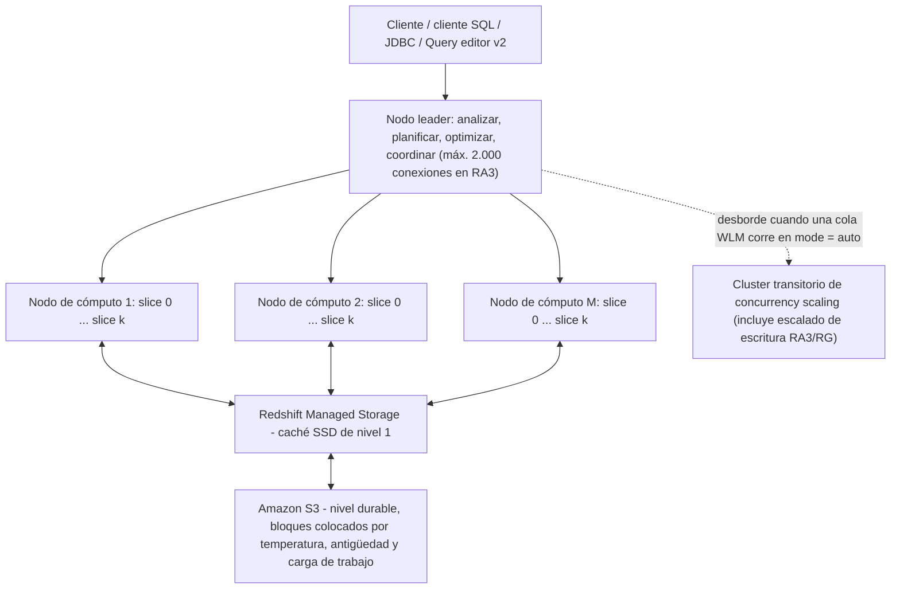
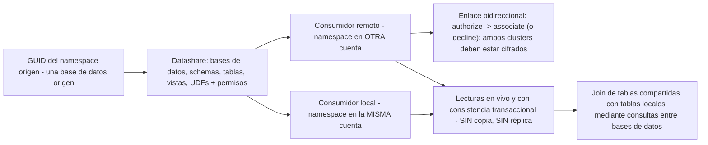
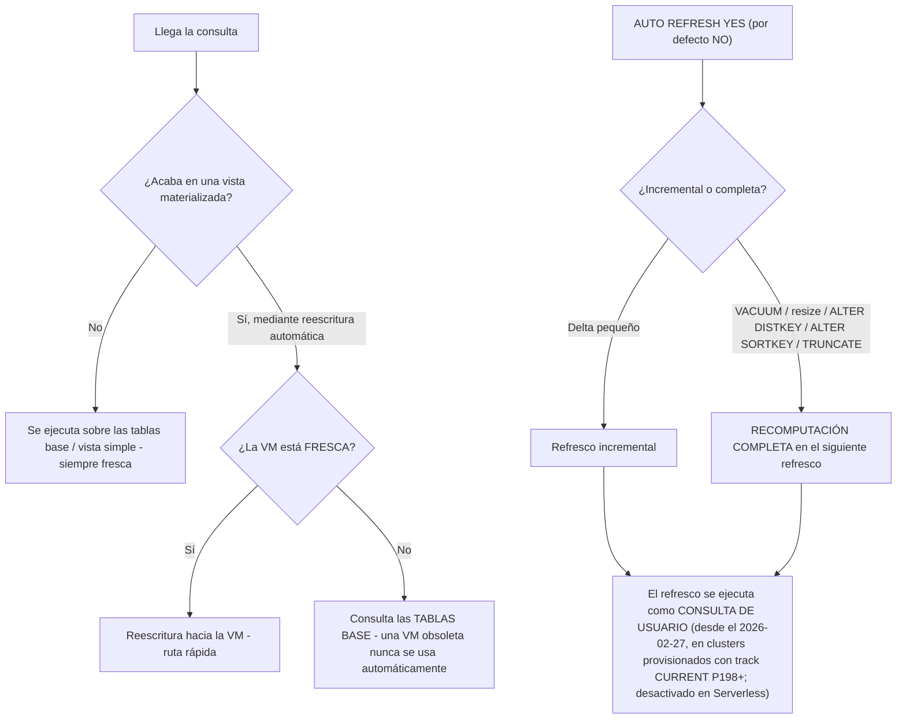
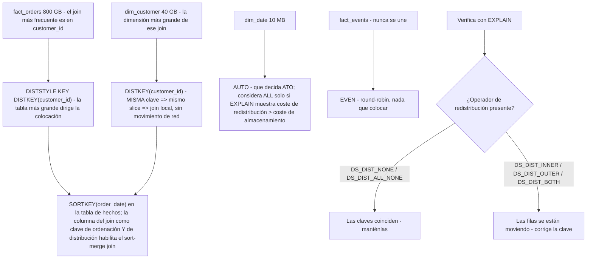
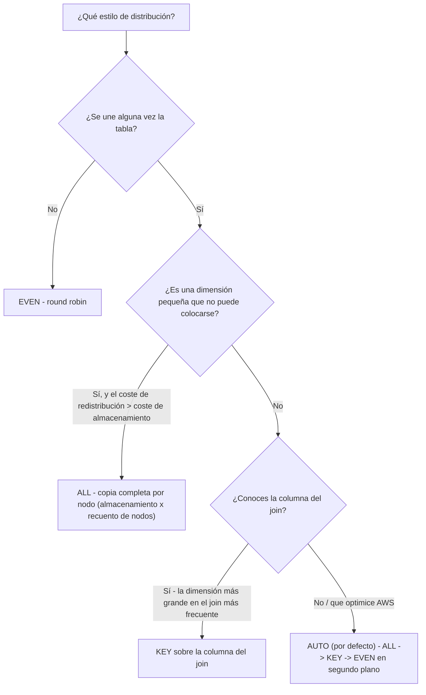
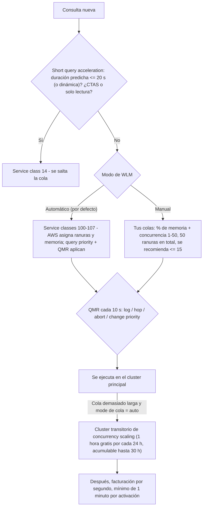
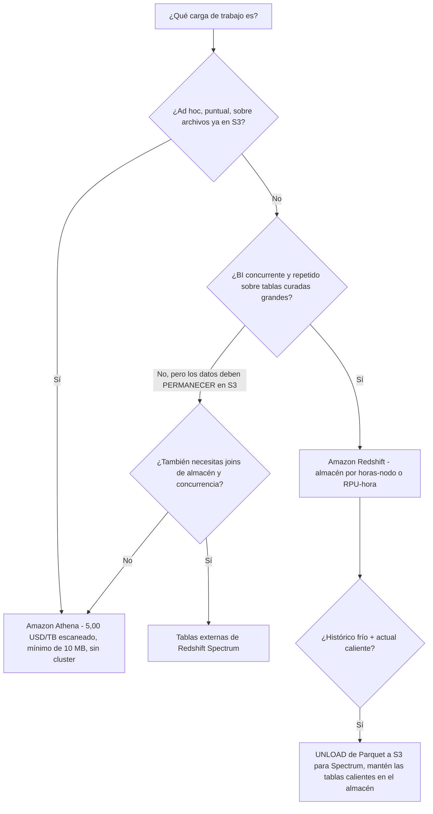

# Amazon Redshift: SQL de almacén y transformación de datos

La Lección 3 terminó con los datos aterrizando en S3. Esta lección es lo que pasa después. Amazon Redshift es el servicio que la guía del examen DEA-C01 nombra en **todos los dominios**: como fuente de lectura (habilidades 1.1.1, 1.1.2), como motor de transformación (1.2.5), como «consultas SQL para transformar datos … por ejemplo, procedimientos almacenados de Amazon Redshift» (1.4), como método de migración/acceso remoto a través de **consultas federadas, vistas materializadas y Spectrum** (2.1.5), como tema de las **operaciones de carga y descarga** (2.3.1), como objetivo de diseño de schema (2.4.1), y como superficie de permisos y data sharing (4.2.3, 4.2.4, 4.5.1). Por eso una sola lección tiene que cubrir arquitectura, SQL, diseño físico y coste a la vez: en este examen nunca se preguntan por separado.

```text
====================================================================
 LA SUPERFICIE DE DECISIÓN DE REDSHIFT (DEA-C01, los cuatro dominios)
====================================================================
  Cómputo ...... cluster RA3 provisionado (desde 0,543 USD/hora)
                Redshift Serverless (desde 1,50 USD/hora, medido en RPU)
  Almacenamiento  Redshift Managed Storage: caché SSD + S3,
                0,024 USD/GB-mes - se factura INDEPENDIENTEMENTE del cómputo
  Acceso a los datos  Spectrum (tablas externas, 5,00 USD/TB escaneado)
                consultas entre bases de datos (un cluster, sin copias)
                data sharing (en vivo, sin copias, entre cuentas)
                consultas federadas (solo lectura, RDS/Aurora)
  Carga / descarga  COPY (+ MANIFEST, IAM_ROLE, compresión)
                UNLOAD (CSV/JSON/Parquet, PARTITION BY)
                MERGE (+ REMOVE DUPLICATES)
  SQL en el almacén .. stored procedures (PL/pgSQL), vistas
                materializadas, vistas simples, vistas de enlace tardío
  Diseño físico . DISTSTYLE AUTO|EVEN|KEY|ALL
                SORTKEY AUTO|COMPOUND|INTERLEAVED
  Autonómicas ... VACUUM delete/sort automático, ANALYZE automático, ATO
  Concurrencia .. WLM automático o manual + SQA + concurrency scaling
  Esto no ...... SQL ad-hoc puntual sobre S3 en bruto = Amazon Athena
====================================================================
```

En esta lección vas a:

- leer la **arquitectura RA3**: el nodo leader, los slices, y cómo Redshift Managed Storage se factura aparte del cómputo;
- dimensionar y razonar sobre **Redshift Serverless**: RPUs, capacidad base, el techo de 10×, workgroup frente a namespace;
- calcular el precio de **Spectrum** por bytes escaneados y explicar por qué el formato columnar, la compresión y el podado de particiones son controles de coste, no solo de velocidad;
- separar las **consultas entre bases de datos** (dentro de un cluster) del **data sharing** (entre clusters y cuentas) y de las **consultas federadas** (solo lectura hacia RDS/Aurora);
- dominar **COPY frente a UNLOAD frente a MERGE**: manifests, roles de IAM, `COMPUPDATE`, `PARALLEL OFF` y las restricciones exactas de MERGE;
- escribir **stored procedures PL/pgSQL** en el alcance que declara el examen, incluido lo que un procedimiento *no* puede contener;
- elegir entre una **vista simple** y una **vista materializada**, y saber qué hizo el cambio de auto-refresco del **27 de febrero de 2026**;
- elegir **estilos de distribución** y **claves de ordenación** con ejemplos resueltos de joins, redistribución y sesgo que puedes calcular a mano;
- aplicar **VACUUM, ANALYZE y WLM automáticos** (automático, manual y short query acceleration) con los propios umbrales de AWS;
- decidir **Redshift o Athena** a partir de una matriz de decisión en lugar del hábito;
- estudiar **cuatro casos de estudio de clientes de AWS** (GE Aerospace, PayU, Nasdaq y Amazon Customer Service) y un **recuadro de actualizaciones de octubre de 2026 con fuentes**;
- practicar con **14 preguntas estilo examen** más cuatro comprobaciones interactivas.

---

## 1. Arquitectura RA3 y Redshift Managed Storage

### 1.1 El nodo leader, los nodos de cómputo y los slices

La página de arquitectura de AWS lo dice sin rodeos: «Un nodo de cómputo se particiona en slices… El nodo leader gestiona la distribución de datos a los slices y reparte la carga de trabajo de las consultas u otras operaciones de base de datos entre los slices.» El **nodo leader** analiza, planifica, optimiza y coordina; no almacena datos de tablas. Los **nodos de cómputo** hacen el trabajo, cada uno particionado en **slices** que corren en paralelo. Los clientes se conectan al nodo leader, y por eso los clusters RA3 limitan las conexiones de cliente a **2.000** (límites de AWS Redshift, consultados en octubre de 2026).



```dragdrop
{
  "question": "Ordena la vida de una consulta de Redshift desde la petición del cliente hasta las filas devueltas:",
  "items": [
    "El cliente envía SQL al endpoint de conexión del nodo leader (RA3 permite hasta 2.000 conexiones)",
    "El nodo leader analiza, planifica y optimiza la sentencia",
    "El nodo leader reparte el trabajo entre los slices de los nodos de cómputo",
    "Los slices se ejecutan en paralelo, leyendo bloques fríos de Amazon S3 a través de la caché SSD de Redshift Managed Storage",
    "El nodo leader recoge los resultados de los slices y devuelve la respuesta al cliente"
  ],
  "correctOrder": [
    "El cliente envía SQL al endpoint de conexión del nodo leader (RA3 permite hasta 2.000 conexiones)",
    "El nodo leader analiza, planifica y optimiza la sentencia",
    "El nodo leader reparte el trabajo entre los slices de los nodos de cómputo",
    "Los slices se ejecutan en paralelo, leyendo bloques fríos de Amazon S3 a través de la caché SSD de Redshift Managed Storage",
    "El nodo leader recoge los resultados de los slices y devuelve la respuesta al cliente"
  ],
  "explanation": "AWS documenta esta división así: el nodo leader «gestiona la distribución de datos a los slices y reparte la carga de trabajo de las consultas u otras operaciones de base de datos entre los slices», mientras que los datos de las tablas viven en los nodos de cómputo: y en RA3 la copia durable vive en S3 detrás de la caché SSD de Managed Storage, así que un slice puede recuperar un bloque frío en lugar de fallar. Todo lo relacionado con la planificación y la coordinación ocurre en el leader; todo lo relacionado con los datos ocurre en los slices."
}
```

### 1.2 Formas de nodo RA3 y qué significa un slice para tu SQL

| Tamaño RA3 | vCPU | Memoria | Slices |
|---|---|---|---|
| `ra3.large` | 2 | 16 GiB | **2** |
| `ra3.xlplus` | 4 | 32 GiB | **2** |
| `ra3.4xlarge` | 12 | 96 GiB | **4** |
| `ra3.16xlarge` | 48 | 384 GiB | **16** |

El recuento de slices importa por dos reglas examinables: **COPY quiere un recuento de archivos que sea múltiplo del recuento de slices**, y **una tabla tiene exactamente una clave de distribución**, así que la colocación se evalúa por slice, no por nodo (detalles en la sección 10).

### 1.3 Redshift Managed Storage: la factura se parte en dos

En RA3, el disco local es una **caché SSD de nivel 1**; la copia durable vive en **Amazon S3**, con los bloques colocados por **temperatura, antigüedad y carga de trabajo**. La consecuencia para el examen es aritmética, no de marca: **el cómputo y el almacenamiento se miden por separado**: puedes añadir o quitar nodos sin volver a comprar almacenamiento, y el almacenamiento sigue acumulándose esté o no ocupado el cluster.

**Ejemplo resuelto E1: almacenamiento gestionado en la tarifa de octubre de 2026**

| Entrada | Valor |
|---|---|
| Tarifa de almacenamiento gestionado | **0,024 USD por GB-mes** (precios de AWS Redshift, en octubre de 2026) |
| Tamaño del almacén | **40 TB** = $40 \times 1{,}024 = 40{,}960$ GB |
| Coste mensual de almacenamiento | $40{,}960 \times 0.024 = $ \mathbf{983.04}$ **/ mes** |

Esos 983,04 USD se cobran **encima** de las horas-nodo, y no desaparecen cuando pausas el cómputo. Las respuestas que citan un único precio «por TB» de almacén mezclado son erróneas tanto en la mecánica como en la facturación.

- **📚 ¿Sabías que…?** La **obsolescencia de DC2 se anunció en abril de 2025**, empujando a los clientes hacia **RA3 o Serverless**, y por eso la mejor práctica documentada de AWS para cargas de trabajo nuevas es **RA3/RG**, y por eso «solo añade otro nodo DC2» es un distractor (AWS Big Data Blog, enfoque de migración a DC2, 2026-03-11). RA3 *no* es «almacenamiento solo local»: separar cómputo de almacenamiento es todo el sentido de la generación.

### 1.4 Concurrency scaling: capacidad de ráfaga con un presupuesto de horas gratis

Cuando una cola WLM corre con **mode = auto**, las consultas de desbordamiento se enrutan a **clusters transitorios** en lugar de encolarse. Elegibilidad: clusters EC2-VPC de **dc2/rg/ra3** creados con **32 nodos de cómputo o menos**; las tablas con **claves de ordenación interlazadas** y los destinos con `DISTSTYLE ALL` quedan excluidos del **escalado de escritura**, y el propio escalado de escritura solo existe en **RA3/RG**. `max_concurrency_scaling_clusters` tiene por defecto **1** dentro de una cuota de **10**.

**Ejemplo resuelto E2: la propia factura de ráfaga de AWS (en octubre de 2026)**

```text
Cluster: 10 x rg.4xlarge en US-West-1               33,66 USD / hora
Tarifa transitoria:  33,66 / 3600                    0,00935 USD / segundo
Crédito gratis:      1 hora por cada 24 h por cluster activo,
                     acumulable hasta 30 horas
Ráfaga usada:        2 clusters x 300 segundos sobre el crédito
                     0,00935 x 300 x 2               = 5,61 USD
Total de la hora:    33,66 USD + 5,61 USD            = 39,27 USD
```

Repaso que merece memorizarse: **una hora acreditada repartida entre 4 clusters transitorios simultáneos solo compra 60 ÷ 4 = 15 minutos** de ráfaga gratis cada uno: los créditos se consumen en tiempo real, no se reparten como horas completas.

## 2. Redshift Serverless

### 2.1 La capacidad se mide en RPUs

La capacidad de Serverless se expresa en **RPU-horas**, y AWS define **1 RPU = 16 GB de memoria**. No hay cluster que dimensionar; en su lugar defines una **capacidad base** y un **objetivo de precio-rendimiento** (por defecto **Balanced**, un modo de escalado dirigido por IA), y Redshift escala el cómputo para la carga de trabajo.

| Parámetro de Serverless | Valor (documentación de AWS, consultada en octubre de 2026) |
|---|---|
| Unidad | **1 RPU = 16 GB de memoria** |
| Capacidad base | por defecto **128**; configurable **4 to 512** en pasos de **8**; hasta **1024** en regiones admitidas |
| Techo de escalado | **hasta 10× la capacidad base** |
| MaxRPU (techo duro por workgroup) | valor máximo **5.632** |
| Facturación | por segundo, **mínimo de 60 segundos** |
| Incluido en la RPU-hora | **Spectrum** y **concurrency scaling** |
| Precio de entrada | **desde 1,50 USD/hora** (en octubre de 2026) |

**Ejemplo resuelto E3: qué compra la «capacidad base»**

```text
Capacidad base          128 RPU  x 16 GB  =  2.048 GB de memoria
Techo de escalado 10 x 128          = 1.280 RPU x 16 GB = 20.480 GB
Techo del workgroup MaxRPU          = 5.632 RPU (el freno duro)
```

La propia guía de dimensionamiento de AWS (re:Post, 2026-06-11): **4 RPU para menos de 32 TB**; **8/16/24 RPU para menos de 128 TB**; **32 RPU o más por encima de 128 TB**. Y como la facturación es por segundo con un **mínimo de 60 segundos**, una consulta de dos segundos sigue costando un minuto entero de RPU: serverless no significa *gratis cuando está inactivo*, significa *sin inactividad alguna* entre consultas.

### 2.2 El workgroup es el cómputo; el namespace es la identidad

| Objeto | De qué es dueño | Frase de examen |
|---|---|---|
| **Workgroup** | Frontera de cómputo: ajustes de capacidad, VPC, objetivo de precio-rendimiento | «¿Qué ajuste de *capacidad* cambio?» → workgroup |
| **Namespace** | Identidad de la base de datos: schemas, usuarios, claves de cifrado; identificado por un **GUID** | «¿Qué *objetos de base de datos* se comparten?» → namespace |

Esta distinción vuelve en la sección 5: un **datashare está vinculado a una base de datos origen dentro de un namespace**, y el comando del consumidor cita ese **GUID**.

---

## 3. Amazon Redshift Spectrum

### 3.1 Tablas externas: consulta S3 sin cargarlo

Spectrum permite a un cluster de Redshift crear **tablas externas** sobre datos que permanecen en **Amazon S3**, con los metadatos registrados en el **AWS Glue Data Catalog**, y se factura por **bytes escaneados**: no por filas devueltas, no por bytes almacenados.

| Dato sobre Spectrum | Valor (precios de AWS, en octubre de 2026) |
|---|---|
| Tarifa (us-east-1) | **5,00 USD por TB escaneado**, redondeado a MB, **mínimo de 10 MB por consulta** |
| Gratis | Sentencias **DDL** y consultas **fallidas** |
| Sigue facturándose | Consultas **canceladas**, por los bytes ya leídos |
| En Serverless | **Sin cargo separado de Spectrum**: incluido en la RPU-hora |
| En instancias RG | **No se requiere**: RG incluye un motor de consulta de lago de datos integrado |

### 3.2 Ejemplo resuelto E4: tres formas de abaratar una consulta Spectrum

Una tabla de **100 columnas**; la consulta lee **una** columna:

| Distribución de los mismos datos | Bytes escaneados | Coste de Spectrum |
|---|---|---|
| Texto sin comprimir | 4 TB | $4 \times 5.00 = \mathbf{\$20.00}$ |
| GZIP a 4:1 | 1 TB | $1 \times 5.00 = \mathbf{\$5.00}$ |
| GZIP + Parquet, lectura de una columna | 0,25 TB | $0.25 \times 5.00 = \mathbf{\$0.05}$ |

Tres palancas, tres mecanismos distintos: la **compresión** encoge cada byte, el **formato columnar** permite al motor saltarse las columnas que no necesita, y el **podado de particiones** salta archivos enteros. Una cuarta palanca es la higiene de archivos: AWS recomienda archivos externos de **64 MB o más**, y definir `TABLE PROPERTIES (numRows = …)` porque **Redshift nunca ejecuta ANALYZE sobre tablas externas** y de otro modo asume que una tabla externa es la tabla más grande del join.

> [!IMPORTANT]
> **Spectrum factura lo que escaneas, no lo que devuelves.** Un `SELECT *` sobre un CSV ancho y sin comprimir paga por cada columna de cada fila leída. El precio de Athena en la sección 12 es el mismo: **5,00 USD/TB escaneado** con un **mínimo de 10 MB**: los dos servicios miden igual, y exactamente por eso la *elección* entre ellos es arquitectónica, no financiera (en octubre de 2026).

---

## 4. Consultas entre bases de datos

Un único cluster de Redshift puede alojar varias bases de datos. Las consultas entre bases de datos te permiten leer y escribir entre ellas usando el nombre de tres partes `database.schema.object` (o un alias de schema externo); **sin copias de datos**, contra una **instantánea con consistencia transaccional**. Se admiten en **RG, RA3 y Serverless**.

```sql
-- Connected to database "analytics"; two other databases, zero copies
SELECT s.order_id,
       e.event_ts
FROM   analytics.sales          s
JOIN   staging.raw_events     e USING (order_id)
WHERE  s.order_date >= '2026-10-01'
AND    e.source = 'mobile-app';

-- Same cluster, one database away: three-part name is database.schema.table
SELECT count(*) FROM otherdb.reporting.weekly_rollup;
```

| Admitido | No admitido (límites del examen) |
|---|---|
| Lectura/escritura entre bases de datos de **un solo cluster** | Tablas con privilegios a **nivel de columna** de otra base de datos |
| Vistas sobre otras bases de datos: **solo vistas de enlace tardío y vistas materializadas** | Vistas normales sobre objetos de otra base de datos |
| Schemas externos como alias abreviado | Escrituras en el schema externo de una base de datos a la que no estás conectado |
| RG, RA3, Serverless | **Claves de ordenación interlazadas** en el objeto remoto |
|: | Referencias de tres partes a `information_schema` / `pg_catalog` |

- **📚 ¿Sabías que…?** Las dos funciones más confundidas de este examen difieren en **una palabra y una frontera**: la consulta **entre bases de datos** se queda *dentro de un único cluster*, mientras que el **data sharing** cruza *clusters, cuentas y regiones*. Ninguna de las dos copia datos, pero solo el data sharing necesita un GUID `NAMESPACE '<guid>'`, un enlace explícito de authorize/associate y **dos clusters cifrados**.

## 5. Intercambio de datos (data sharing)

Un **datashare** es un conjunto de **objetos + permisos + consumidores**, vinculado a **una base de datos origen**. El consumidor crea una base de datos *a partir* de él:

```sql
-- Consumer side: local (same account) or remote (other account)
CREATE DATABASE consumer_sales
FROM DATASHARE orders_share
OF NAMESPACE '1a2b3c4d-5e6f-7a8b-9c0d-1e2f3a4b5c6d';
```



| Regla | Detalle (documentación de data sharing de AWS, consultada en octubre de 2026) |
|---|---|
| Consistencia | **En vivo y con consistencia transaccional**; sin copias, sin retardo de refresco |
| Escrituras | **Solo lectura por defecto**; las escrituras requieren concesiones explícitas (`WITH PERMISSIONS` da concesiones por objeto, de lo contrario `USAGE` implica todos los objetos) |
| Encadenamiento | **No permitido**: un datashare no puede compartirse desde el consumidor |
| Vistas | Solo **vistas de enlace tardío y vistas materializadas** sobre objetos compartidos |
| Joins con datos locales | Usa **consultas entre bases de datos** (sección 4) |
| Qué se puede compartir | Bases de datos, schemas, tablas, vistas, UDFs |

Hay dos cosas ausentes deliberadamente de esa tabla: AWS **no** documenta un precio para el data sharing, y **no** documenta su disponibilidad por regiones: así que ni «es gratis» ni «cuesta X» pertenece a una respuesta de examen (véase la sección 17 del digest: sin verificar).

---

## 6. COPY, UNLOAD y MERGE: los tres verbos de la ruta de carga

### 6.1 COPY: la respuesta por defecto para el volumen

La regla práctica de AWS: *carga filas masivas con `COPY`; usa inserciones SQL solo para cambios pequeños, y si debes insertar en SQL, usa una **inserción multilínea** siempre que sea posible, porque «la compresión de datos es ineficiente cuando añades datos solo una fila o unas pocas filas a la vez.»*

**Ejemplo resuelto E5: COPY con un manifest y un rol de IAM (el esquema a memorizar)**

```sql
COPY public.order_items
FROM 's3://acme-orders-prod/2026/10/orders.manifest'
IAM_ROLE 'arn:aws:iam::123456789012:role/RedshiftCopyRole'
MANIFEST
FORMAT AS CSV
GZIP
COMPUPDATE ON
MAXERROR 100
TRUNCATECOLUMNS;
```

El manifest al que apunta es **un único archivo JSON**, no un prefijo:

```json
{"entries":[
  {"url":"s3://acme-orders-prod/2026/10/part-0001.gz","mandatory":true},
  {"url":"s3://acme-orders-prod/2026/10/part-0002.gz","mandatory":false}
]}
```

| Regla de COPY | Valor / comportamiento |
|---|---|
| Autorización | **`IAM_ROLE 'arn:…'`** o **`IAM_ROLE 'default'`** (rol preasociado al cluster); las claves de acceso se **desaconsejan** y son **mutuamente excluyentes** con `IAM_ROLE` |
| Manifest | Opcional `{"entries":[{url, mandatory}]}`; debes añadir la palabra clave **`MANIFEST`**: si la omites, COPY analiza tu JSON como datos y falla |
| Entrada de manifest duplicada | El archivo **se carga dos veces** |
| Tamaño de archivos | Recuento = un **múltiplo del recuento de slices**, cada archivo de **1 MB: 1 GB comprimido** |
| Valor por defecto de `COMPUPDATE` | Muestrea **solo cuando la tabla de destino está vacía y no se ha declarado ninguna codificación** |
| `COMPUPDATE ON / PRESET / OFF` | muestrear y quizá reemplazar / asignar por tipo sin muestrear / nunca |
| `COMPROWS` | **100.000 filas por slice** muestreadas por defecto (mínimo 1.000) |

> [!WARNING]
> **`COMPUPDATE` no hace nada en silencio sobre una tabla poblada.** Volver a ejecutar `COPY` sobre una tabla que ya tiene filas **no** volverá a derivar las codificaciones con el ajuste por defecto. Si el examen dice «rederivar la compresión en una tabla existente», la respuesta es un `COMPUPDATE ON`/`PRESET` explícito, o, mejor, dejar que la **optimización automática de tablas** lo gestione (sección 11).

### 6.2 UNLOAD: exportar, con control de formato y forma de archivo

```sql
UNLOAD ('SELECT order_id, amount, updated_at
         FROM sales_fact
         WHERE order_date >= ''2026-10-01''
         ORDER BY order_date')
TO 's3://acme-curated/sales_fact/'
IAM_ROLE 'default'
FORMAT AS PARQUET
PARTITION BY (order_date)
PARALLEL OFF
ALLOWOVERWRITE;
```

| Cláusula de UNLOAD | Por qué es examinable |
|---|---|
| `FORMAT CSV \| JSON \| PARQUET` | Parquet descarga **hasta 2× más rápido** y usa **hasta 6× menos almacenamiento** que el texto (AWS) |
| `PARTITION BY` | Escribe particiones al estilo Hive para que Athena/Spectrum puedan podar |
| `PARALLEL ON` (por defecto) | Uno o más archivos **por slice** |
| `PARALLEL OFF` | **Preserva el `ORDER BY`**: el único modo que lo hace |
| `MAXFILESIZE` | Techo de **6,2 GB** (rango 5 MB: 6,2 GB) |
| `MANIFEST [VERBOSE]` | Emite un manifest para que un posterior `COPY … MANIFEST` pueda hacer el viaje de ida y vuelta exacto |
| `ALLOWOVERWRITE`, `ENCRYPTED` | Reejecuciones idempotentes; cifrado del lado del servidor al escribir |

### 6.3 MERGE: el upsert idempotente

```sql
MERGE INTO sales_fact t
USING sales_staging s
   ON t.order_id = s.order_id
WHEN MATCHED THEN
     UPDATE SET amount = s.amount, updated_at = s.updated_at
WHEN NOT MATCHED THEN
     INSERT (order_id, amount, updated_at)
     VALUES (s.order_id, s.amount, s.updated_at);
```

| Restricción de MERGE (referencia `MERGE` de AWS) | Consecuencia |
|---|---|
| El destino no puede ser una tabla de sistema, de catálogo ni **externa** | No puedes hacer MERGE directamente sobre una tabla de Spectrum |
| **Origen ≠ destino**, y sin cláusula `WITH` | Primero deja en staging, luego fusiona |
| Una fila de destino no puede coincidir con **varias** filas de origen | Deduplica la tabla de staging, o usa `MERGE … WHEN MATCHED THEN REMOVE DUPLICATES` para deduplicación pura con schemas idénticos |
| Privilegios requeridos | `SELECT` en ambos lados más `INSERT`/`UPDATE`/`DELETE` sobre el destino |
| Alternativa manual | El `UPDATE`/`DELETE`/`INSERT` en staging debe ejecutarse en **una sola transacción** |

```fillblank
{
  "question": "Completa las afirmaciones de carga, descarga y upsert con las palabras clave correctas de Redshift:",
  "template": "Una entrada diaria de 500 millones de filas en S3 se carga con {{1}}, cuya lista de archivos JSON requiere la palabra clave {{2}} y es mutuamente excluyente con las claves de acceso cuando se usa la cláusula {{3}}. Exportar un conjunto de resultados ordenado a un único archivo requiere {{4}} OFF, y la sentencia de upsert idempotente es {{5}}.",
  "answers": {
    "1": "COPY",
    "2": "MANIFEST",
    "3": "IAM_ROLE",
    "4": "PARALLEL",
    "5": "MERGE"
  },
  "distractors": ["INSERT", "UNLOAD", "LOAD", "FORMAT", "SPLIT", "PARTITION BY", "UPSERT", "REPLACE", "MERGE INTO DEDUP"],
  "explanation": "COPY gestiona la carga masiva; MANIFEST le indica a COPY que la ruta es una lista de archivos JSON y no datos (omitir la palabra clave hace que COPY analice el JSON como filas); IAM_ROLE es la autorización preferida documentada y no puede combinarse con claves de acceso; PARALLEL OFF es el único modo de UNLOAD que preserva ORDER BY; MERGE es el upsert nativo. INSERT es el verbo equivocado con 500 millones de filas: AWS dice explícitamente que uses inserciones multilínea solo cuando COPY no es una opción."
}
```

**Ejemplo resuelto E6: la aritmética de copia frente a inserción**

```text
Tabla: 8 slices, destino de 500.000.000 de filas desde S3
COPY:   recuento de archivos = 8 x k   (k archivos por slice),
        de 1 MB-1 GB cada uno
        -> una sentencia, en paralelo entre slices, ANALYZE automático
           sobre un destino vacío, compresión derivada por COMPUPDATE
INSERT: 1 fila por sentencia = 500.000.000 de sentencias
        -> la compresión no puede derivarse de forma incremental, y AWS
           dice que la compresión es «ineficiente cuando añades datos
           solo una fila o unas pocas filas a la vez»
```

## 7. Procedimientos almacenados (PL/pgSQL): el alcance del examen

```sql
CREATE OR REPLACE PROCEDURE stg.load_orders()
LANGUAGE plpgsql AS $$
DECLARE
  v_rows bigint;
BEGIN
  COPY stg.orders_raw FROM 's3://acme-orders-prod/today/'
       IAM_ROLE 'default' GZIP;
  SELECT count(*) INTO v_rows FROM stg.orders_raw;
  IF v_rows = 0 THEN
    RAISE INFO 'no rows today - skipping';
  ELSE
    TRUNCATE stg.orders_clean;
    INSERT INTO stg.orders_clean
      SELECT * FROM stg.orders_raw WHERE valid;
    CALL stg.merge_orders();   -- nested CALL, max 16 levels
  END IF;
END $$;

CALL stg.load_orders();
```

| Dato sobre el procedimiento | Detalle (documentación de stored procedures de AWS) |
|---|---|
| Invocación | `CALL nombre(…)`; se crea con `CREATE [OR REPLACE] PROCEDURE … LANGUAGE plpgsql` |
| Frente a una UDF | Un procedimiento **puede contener DDL y DML** (`COPY`, `UNLOAD`, `INSERT`, `CREATE TABLE`) y **no necesita devolver un valor** |
| `DECLARE / BEGIN / END` | **Agrupación, no una transacción**: un bloque `BEGIN…END` no abre una transacción |
| Transacción por defecto | Una **transacción implícita por `CALL`**; `COMMIT`/`ROLLBACK`/`TRUNCATE` solo son legales **fuera** de un bloque de transacción del llamador |
| `NONATOMIC` | Auto-commit por sentencia; un bucle de cursor necesita entonces un `START TRANSACTION` explícito antes |
| Funciones del cuerpo | `IF/ELSIF/ELSE`, bucles, `EXIT`, `EXECUTE` (SQL dinámico), `RAISE`, cursores `refcursor` |
| Límites | **16** niveles anidados de `CALL`; **un** cursor abierto por sesión; **sin subtransacciones** |
| Prohibido dentro | `PREPARE`, `CREATE/DROP DATABASE`, `CREATE EXTERNAL TABLE`, **`VACUUM`**, `SET LOCAL`, `ALTER TABLE APPEND` |

El encuadre del examen es **lógica de canalización condicional**: ramificar según un recuento de filas, `TRUNCATE` + `INSERT…SELECT`, y dejar que **Step Functions o EventBridge** invoquen todo ello a través de la **Redshift Data API**. «Ejecutar `VACUUM` dentro del procedimiento» nunca es la respuesta: el mantenimiento se orquesta *fuera*, en la sección 11.

- **📚 ¿Sabías que…?** El `BEGIN/END` de un procedimiento y el `BEGIN` de una transacción son animales distintos con la misma palabra clave. Por eso la documentación advierte de que los bloques de agrupación **no** son transacciones: una sentencia fallida dentro de un `CALL` revierte la transacción implícita entera, no solo el bloque, salvo que el procedimiento se haya declarado `NONATOMIC`.

---

## 8. Vistas materializadas frente a vistas

| | **Vista** | **Vista materializada** |
|---|---|---|
| Qué se almacena | **Solo el SQL** | **Los resultados de la consulta** |
| Frescor | Siempre actual: nada que refrescar | **Obsoleta hasta que se refresque** |
| Velocidad de lectura | Vuelve a ejecutar la consulta | Lee filas precalculadas |
| Coste | Sin almacenamiento, sin job de refresco | Almacenamiento más cómputo de refresco |
| Frase de examen | «Debe reflejar siempre el último cambio de la tabla base» | «Agregación repetida y costosa sobre una base estable» |

### 8.1 Mecánica de refresco

El refresco es manual (`REFRESH MATERIALIZED VIEW`) o automático (`AUTO REFRESH YES`: **el valor por defecto es `NO`**), y Redshift elige recomputación **incremental** o **completa**. Se **fuerza una recomputación completa** tras un `VACUUM` manual, un resize clásico, un `ALTER DISTKEY`, un `ALTER SORTKEY` o un `TRUNCATE`.



### 8.2 Reescritura automática y AutoMV

La reescritura automática de consultas usa **solo** vistas materializadas frescas, y solo para `SELECT` elegibles: **sin subconsultas, joins externos, operaciones de conjunto, `DISTINCT`/ventana/`HAVING`, agregaciones más allá de `SUM`/`COUNT`/`MIN`/`MAX`/`AVG`, y sin tablas externas ni compartidas**. El interruptor de sesión es `SET mv_enable_aqmv_for_session = FALSE`. **AutoMV** crea vistas materializadas a partir de patrones de carga de trabajo observados (aparecen como `%_auto_mv_%` dentro de `EXPLAIN`) con los mismos límites de elegibilidad.

```sql
CREATE MATERIALIZED VIEW mv_sales_by_region
AUTO REFRESH YES
AS
SELECT region_id, date_trunc('month', order_date) AS m, sum(amount) AS total
FROM   sales_fact
GROUP  BY 1, 2;

REFRESH MATERIALIZED VIEW mv_sales_by_region;
```

> [!WARNING]
> **El refresco no es gratis, y en 2026 se hizo más ruidoso.** «A partir del 27 de febrero de 2026, las consultas de Auto REFRESH de las vistas materializadas de Amazon Redshift se ejecutan como consultas de usuario y no como procesos autonómicos en segundo plano» (clusters provisionados con track CURRENT, P198+; **desactivado en Serverless**). Un refresco compite por tanto por ranuras de WLM con prioridad de usuario: que es exactamente la interacción que las secciones 8 y 11 de esta lección prueban juntas.

---

## 9. Consultas federadas y la superficie de consulta en torno a ellas

Las **consultas federadas** permiten al nodo leader de Redshift extraer datos de una fuente relacional sin moverlos antes:

| Dato | Valor (documentación de consultas federadas de AWS) |
|---|---|
| Fuentes | **Amazon RDS / Amazon Aurora PostgreSQL ≥ 9.6** y **MySQL ≥ 5.6** |
| Puertos | **5432** (PostgreSQL), **3306** (MySQL) |
| Dirección | **Solo lectura** |
| Credenciales | Secreto de **AWS Secrets Manager** más un **rol de IAM** |
| Concurrency scaling | **No disponible** para consultas federadas |
| Uso en el examen | Habilidad **2.1.5**: «implementar métodos de migración de datos o acceso remoto (por ejemplo, consultas federadas de Amazon Redshift, vistas materializadas, Spectrum)» |

Las cuatro funciones de «alcanzar hacia fuera» forman ahora una familia, y el examen prueba las diferencias:

| Función | ¿Copia datos? | Dirección | Frontera |
|---|---|---|---|
| **Consultas entre bases de datos** | No | Lectura/escritura | Un cluster, varias bases de datos |
| **Data sharing** | No | Lectura (escritura con concesiones explícitas) | Clusters, cuentas, regiones |
| **Spectrum** | No | Lectura | Redshift → S3 mediante Glue Data Catalog |
| **Consultas federadas** | No | **Solo lectura** | Redshift → RDS / Aurora PostgreSQL o MySQL |

Alrededor de todo ello, **Query editor v2** es la superficie del analista: pestañas y notebooks concurrentes, variables de sesión, tablas temporales, marcadores de posición `${param}`, historial de las últimas **1.000** consultas y consultas programadas dirigidas por **EventBridge + la Redshift Data API**.

## 10. Estilos de distribución y claves de ordenación: dónde se decide el coste del join

### 10.1 Estilos de distribución

`DISTSTYLE` admite **AUTO | EVEN | KEY | ALL**, con **AUTO por defecto**. AUTO arranca las tablas pequeñas como **ALL**, las mueve a **KEY** y puede asentarse en **EVEN**, ajustando en segundo plano, y la **optimización automática de tablas** sigue haciendo esos ajustes a menos que fijes un estilo explícito.

| Estilo | Qué hace | Coste / trampa |
|---|---|---|
| **KEY** | Coloca las filas por el valor de **una** columna de distribución: como máximo **una** distkey por tabla | La columna del join debe coincidir, o las filas siguen redistribuyéndose |
| **EVEN** | Round-robin entre slices | Sin colocación; bien para tablas que nunca se unen |
| **ALL** | Una copia completa de la tabla en **cada** nodo | Almacenamiento **× recuento de nodos**; cargas más lentas; **excluido de las escrituras de concurrency scaling** |
| **AUTO** (por defecto) | Migración en segundo plano ALL → KEY → quizá EVEN | Las claves explícitas sacan la tabla de la automatización |

La guía de esquema estrella de AWS: la clave de distribución debe ser **la dimensión más grande en el join más frecuente**; usa **ALL** para dimensiones que no pueden colocarse y cuyo coste de redistribución supera el coste de almacenamiento; **AUTO** en todo lo demás. Y la propia frase de AWS de por qué funciona KEY: «Si distribuyes un par de tablas por las claves de join, el nodo leader coloca las filas en los slices según los valores de las columnas de join.»

### 10.2 Claves de ordenación

| Tipo de clave de ordenación | Tope | Notas |
|---|---|---|
| **COMPOUND** | **400** columnas | Rangos de prefijo de la columna inicial; la elección clásica |
| **INTERLEAVED** | **8** columnas | Peso igual entre columnas; **mayor coste de carga y de VACUUM**, necesita `REINDEX` (`interleaved_skew > 1.4`), **bloquea el concurrency scaling**, no admitido en consultas entre bases de datos |
| **AUTO** (por defecto) |: | Permite que la **optimización automática de tablas** elija y revise la clave de ordenación |

Pon la columna del join como clave de ordenación **y** clave de distribución a la vez y Redshift puede elegir un **sort-merge join** en lugar de un hash join; sin construcción de hash, sin spill, sin movimiento de red.

**Ejemplo resuelto E7: elegir el estilo de distribución para un esquema estrella**

```text
fact_orders   800 GB   une dim_customer en customer_id en el 90% de las consultas
dim_customer   40 GB   la dimensión más grande de ese join
dim_date       10 MB   también une, pero es diminuta
fact_events    -       desnormalizada, nunca se une
```





**Ejemplo resuelto E8: leer el plan, con las propias cifras de AWS**

```sql
-- Skew and sort triage before you change anything
SELECT "table", diststyle, skew_rows, unsorted, stats_off, vacuum_sort_benefit
FROM   svv_table_info
ORDER  BY skew_rows DESC NULLS LAST;
```

```text
skew_rows        >= 4.00  -> cambia el DIST STYLE
unsorted         >  20 %  -> considera VACUUM, pero lee antes
                               vacuum_sort_benefit (86% de filas desordenadas
                               aún puede significar un 5% mejorable)
stats_off        alto     -> ANALYZE ... PREDICATE COLUMNS
interleaved_skew >  1.4   -> VACUUM REINDEX (lento, solo interleaved)

Etiquetas de operador de EXPLAIN:
  DS_DIST_NONE / DS_DIST_ALL_NONE   bien - sin movimiento
  DS_BCAST_INNER                    bien solo cuando el lado interior es pequeño
  DS_DIST_INNER / DS_DIST_OUTER     costoso - se mueve un lado
  DS_DIST_ALL_INNER                 serializa en un solo slice
  DS_DIST_BOTH                      peor caso
  Nested Loop                       normalmente un predicado de join AUSENTE
  Hash Join                         puede hacer spill a disco
  Merge Join                        el más rápido - ambos lados distribuidos
                                     y ordenados por las claves
```

AWS publicó el efecto de mover las dimensiones a `DISTSTYLE ALL` en un plan real: el coste del join cayó de **3,272,334,142.59 a 14,142.59** (Amazon Redshift Prescriptive Guidance, consultada en octubre de 2026). La lección no es «usa siempre ALL»: es que **el plan, no la regla práctica, es el árbitro**.

```matching
{
  "question": "Relaciona cada situación de diseño físico de Redshift con la elección correcta:",
  "pairs": [
    {"left": "Hechos de 800 GB unidos a una dimensión de 40 GB en el 90% de las consultas", "right": "DISTSTYLE KEY sobre la columna del join: coloca ambos lados para que el join se quede local"},
    {"left": "Una tabla de hechos ancha que solo se agrega, nunca se une", "right": "DISTSTYLE EVEN: round-robin, no hay nada que colocar"},
    {"left": "Una dimensión diminuta que no puede compartir la clave de distribución de los hechos", "right": "DISTSTYLE ALL: copia completa por nodo, vigila almacenamiento x recuento de nodos"},
    {"left": "Tres predicados de igualdad distintos consultados con la misma frecuencia", "right": "DISTSTYLE AUTO / SORTKEY AUTO: que la optimización automática de tablas lo revise"},
    {"left": "Una tabla escaneada por rangos de fecha de la columna inicial", "right": "Clave de ordenación COMPOUND: hasta 400 columnas, rangos de prefijo, barata de mantener"},
    {"left": "Una tabla consultada por cualquiera de 4 to 8 columnas independientes", "right": "Clave de ordenación INTERLEAVED: máximo 8 columnos, pero VACUUM más pesado y sin escrituras de concurrency scaling"}
  ],
  "explanation": "La regla del esquema estrella es: clave de distribución = la dimensión más grande en el join más frecuente; ALL solo cuando redistribuir cuesta más que el almacenamiento replicado; EVEN cuando no hay join. En las claves de ordenación, COMPOUND es la elección de hasta 400 columnas y amigable con los valores por defecto, mientras que INTERLEAVED se limita a 8 columnas, exige VACUUM REINDEX cuando interleaved_skew supera 1.4, bloquea el concurrency scaling y no se admite en consultas entre bases de datos."
}
```

---

## 11. Mantenimiento automático y gestión de la carga de trabajo

### 11.1 VACUUM, ANALYZE y las autonómicas que los sustituyeron

Las **autonómicas** de Redshift son cuatro comportamientos en segundo plano: **vacuum delete automático**, **vacuum sort automático**, **analyze automático** y **optimización automática de tablas** (más las vistas materializadas automatizadas). Se ejecutan en ventanas de baja carga y se pausan bajo carga alta o bloqueos exclusivos de DDL, y por eso «¿por qué no se ejecutó mi VACUUM?» es una pregunta de programación, no de permisos.

| Control | Valor por defecto / umbral (documentación de AWS, consultada en octubre de 2026) |
|---|---|
| Analyze automático | **Activado por defecto**; omite tablas cuyas estadísticas están al día; `analyze_threshold_percent` = **10** |
| Disparadores de auto-analyze | `COPY` hacia un destino **vacío**; `CREATE TABLE AS` |
| Vacuum delete/sort automático | Activado, en segundo plano, pausado por carga o bloqueos |
| `VACUUM` manual (por defecto `FULL`) | **Omite la ordenación por debajo de un 95% de filas desordenadas**: no enseñes «VACUUM tras cada carga» |
| `VACUUM REINDEX` | Solo interleaved; mucho más lento |
| Monitorización | `unsorted` y `vacuum_sort_benefit` en `SVV_TABLE_INFO` |
| ATO | Aplica claves de ordenación/distribución a tablas `AUTO` en horas desde que hay suficientes consultas; auditoría en `SVV_ALTER_TABLE_RECOMMENDATIONS` |

### 11.2 Gestión de la carga de trabajo: tres mecanismos, no uno

La configuración de WLM vive en el **parameter group** (`wlm_json_configuration`), y la regla dura de AWS es: **nunca mezcles colas automáticas y manuales en un mismo parameter group**.

| Mecanismo | Qué controla | Cifras clave |
|---|---|---|
| **WLM automático** (por defecto, recomendado) | Redshift asigna **concurrencia y memoria** él mismo | Hasta **8 colas** (service classes **100 to 107**); añade **query priority** y Query Monitoring Rules |
| **WLM manual** | Tú defines **% de memoria** y **concurrencia** estáticos por cola y enrutas por grupo de usuarios | Concurrencia **1 to 50** por cola, **50 ranuras en total**, AWS recomienda **≤ 15** |
| **Short query acceleration (SQA)** | Un modelo ML predice la duración; las consultas cortas **se saltan la cola** | Dinámico (0) o **1 to 20 segundos**; **activado por defecto**; service class **14**; solo son elegibles las consultas **CTAS y de solo lectura** |
| **Query priority** | Importancia relativa de una consulta dentro del WLM **automático** | `priority` existe **solo** en WLM automático |
| **Concurrency scaling** | Desborde a clusters transitorios | Por cola con **mode = auto**; **1 hora gratis por cada 24 h** |

Estado por defecto de un cluster nuevo: **1 cola con 5 consultas concurrentes**. `max_execution_time` está **obsoleto**: el equivalente moderno es una QMR sobre `query_execution_time`, evaluada cada **10 segundos**, con severidades `log` < `hop` < `abort` < `change priority` (nota: `abort` nunca detiene `COPY`, `ALTER`, `ANALYZE` ni `VACUUM`, y `change priority` existe solo en WLM automático).



- **📚 ¿Sabías que…?** SQA y el WLM automático se confunden a menudo y son **mecanismos distintos**: SQA (clase **14**) predice la *duración* para saltarse la cola, mientras que el WLM automático (clases **100 to 107**) decide *ranuras y memoria*. Ambos pueden activarse a la vez, y ninguno es el concurrency scaling, que añade **clusters** enteros. Tres capas, tres nombres, una misma raíz.

## 12. ¿Redshift o Athena? La matriz de decisión

El propio encuadre de AWS: Amazon Athena es para «consultas SQL ad hoc e interactivas sobre datos en Amazon S3, sin … infraestructura ni clusters», mientras que Redshift está «optimizado … en consultas complejas que unen gran número de tablas de bases de datos muy grandes». La regla didáctica que sigue es corta: **Athena = SQL ad-hoc sobre archivos en S3; Redshift = BI sobre un almacén curado.**

| Señal en la pregunta | Respuesta del examen | Base |
|---|---|---|
| Joins complejos entre muchas tablas curadas grandes; cuadros de mando de BI; informes concurrentes repetidos | **Redshift** | Optimizado para almacén con joins grandes |
| SQL puntual y poco frecuente sobre archivos que ya están en S3; no se quiere infraestructura | **Athena** | Sin clusters, sin nodos |
| «Pagar solo al consultar» | **Athena**: 5,00 USD/TB escaneado | Redshift factura horas-nodo o RPU-horas haya o no consultas |
| Mantener los datos en S3 pero seguir necesitando joins de almacén y concurrencia | Tablas externas de **Redshift Spectrum** | Mismo cluster, sin carga |
| Bruto barato a largo plazo más una capa curada rápida | **Ambos**: `UNLOAD` de Parquet a S3, Spectrum para lo frío, el almacén para lo caliente | Patrón lake house |
| Registro/evento, semiestructurado, exploración schema-on-read | **Athena** | Encaje schema-on-read |



> [!IMPORTANT]
> **No inventes un punto de cruce.** Bastantes artículos de terceros afirman «Redshift se vuelve más barato que Athena por encima de X TB al mes»: **AWS no publica ninguna cifra así**, así que ninguna respuesta de examen debe contener una (sin verificar, véase la sección G del digest). Lo que AWS *sí* publica es la forma de la medición: **por escaneo** para Athena frente a **horas-nodo / RPU-horas siempre activas** para Redshift, más los **5,00 USD/TB escaneado** de Spectrum para los datos de S3 consultados desde Redshift (en octubre de 2026).

- **📚 ¿Sabías que…?** La mitad de Athena de esta matriz también se movió: los **resultados de consulta gestionados** (2025-06-03) los gestiona el servicio, están cifrados y **no cuestan nada extra**, así que ya no se necesita ningún bucket de resultados en S3, y las **Capacity Reservations** ahora arrancan en **4 DPU durante 1 minuto** en lugar de 24 DPU durante 60 minutos (2026-02-11). Tanto «Athena necesita un bucket de resultados en S3» como «las reservas de Athena empiezan en 24 DPU» son datos obsoletos que siguen apareciendo en material vivo de terceros (AWS What's New, 2025-06-03 / 2026-02-11).

### Actualizaciones de 2026 (en octubre de 2026)

> [!NOTE]
> **Qué cambió en Redshift entre 2025 y octubre de 2026**: cada línea comprobada contra una fuente primaria de AWS, y todas examinables porque el examen prueba el comportamiento actual:
> - **Redshift ya puede escribir en Iceberg, no solo leerlo**: la creación de tablas/`INSERT` llegó a GA el **2025-11-17** (solo append, sobre el **Glue Data Catalog**), **JIT ANALYZE** siguió el **2025-11-18**, **`UPDATE`/`DELETE`/`MERGE` sobre tablas Iceberg (incluidas las tablas de Amazon S3 Tables) llegó el 2026-04-23**, y las **vistas materializadas de Iceberg** el **2026-10-05**: AWS What's New, 2025-11-17 / 2025-11-18 / 2026-04-23 / 2026-10-05.
> - **Los permisos de DML sobre Iceberg se endurecieron (Patch 202)**: `INSERT` necesita `INSERT`; `DELETE` necesita `DELETE`; `UPDATE`/`MERGE` necesitan **`INSERT` + `DELETE`**; y **todo DML sobre Iceberg también necesita `ALTER`**: una concesión de `INSERT` a solas ya no basta (página de cambios de comportamiento de Redshift, consultada en octubre de 2026).
> - **Las UDF escalares de Python han terminado**: no se crean nuevas después del **2025-10-30**, sin soporte después del **2026-06-30**: no diseñes lógica nueva de canalización sobre ellas (aviso de la documentación de Redshift, consultado en octubre de 2026).
> - **Serverless tiene ahora una vía de compromiso**: **reservas de 1 año con 20%/24%** y **de 3 años con hasta 45%** (2026-02-23), más **reservas de 3 años con upgrade todo por adelantado de hasta el 50%** (2026-07-24), frente a un precio de entrada de **desde 1,50 USD/hora** y un mínimo de **4 RPU**: AWS What's New, 2026-02-23 y 2026-07-24; precios de Redshift, en octubre de 2026.
> - **El auto-refresco de vistas materializadas cambió el 2026-02-27**: las consultas de auto-refresco se ejecutan ahora **como consultas de usuario** y no como procesos autonómicos en segundo plano en clusters provisionados con track CURRENT (P198+), y siguen **desactivadas en Serverless**: documentación de Redshift, consultada en octubre de 2026.
> - **Dos cambios de comportamiento con fecha siguen aterrizando**: facturación mejorada de **Serverless y snapshots gestionados por Redshift desde el 2026-06-08**, y un **cambio de versión mínima de TLS el 2026-10-31**: página de cambios de comportamiento de Redshift, consultada en octubre de 2026. Las preguntas de apantallamiento de certificados y de coste de snapshots tienen ahora fecha asignada.
> - **La tabla Iceberg compartida ganó un tercer escritor**: **Amazon S3 Tables añadió el tipo Variant para Iceberg v3** (2026-07-28), y desde el **2026-04-23** el `UPDATE`/`DELETE`/`MERGE` de Redshift se ejecuta también sobre **S3 Tables**, así que una misma tabla puede escribirse desde Glue, actualizarse desde Redshift y leerse desde Athena sin copias, AWS What's New, 2026-07-28 y 2026-04-23.
> - **El formato Iceberg v3 es ya mainstream en el stack de lagos de AWS**: **AWS Glue 6.0** (2026-08-21) incluye **soporte completo de Apache Iceberg v3**, VARIANT + shredding, deletion vectors y linaje de filas, con una **rebaja del 30%**, así que las preguntas de «formato de tabla abierto» pueden dar por supuestas funciones de v3 (AWS What's New y AWS Big Data Blog, 2026-08-21).
> - **Contexto de la guía del examen**: la **guía v1.1 de DEA-C01 (2025-12-12)** añadió la habilidad **2.1.7 «Gestionar formatos de tabla abiertos (por ejemplo Apache Iceberg)»** sin eliminaciones, y por eso Redshift sobre Iceberg está plenamente dentro del alcance: página de revisiones de DEA-C01, 2025-12-12.

- **📚 ¿Sabías que…?** En el mismo tema conviven dos trampas de «dato obsoleto»: una publicación de APN de 2020 muy citada afirma que Redshift «en realidad no admite vistas materializadas» (falso desde 2021), y cualquier opción que afirme que Redshift solo puede *leer* Iceberg lleva errando desde el **2025-11-17**. En este examen, una publicación antigua de AWS no es una fuente: lo es la página de documentación actual.

---

## Casos Reales

AWS publica cómo se ven estas abstracciones en producción. Cada cifra de abajo es **afirmada por el cliente o por AWS y sin auditar**, con la fuente indicada para que puedas comprobarla: el punto examinable es el **patrón**, no el marketing.

### Caso A, GE Aerospace: un almacén operativo heredado, reescrito sobre Redshift

| Elemento | Detalle |
|---|---|
| Cliente | **GE Aerospace**, operaciones aeroespaciales y de cadena de suministro |
| Reto | Un gran **operational data store (ODS)** con restricciones de cumplimiento y rendimiento, más **más de 150 informes** (algunos con **más de 10.000 líneas de código**) |
| Servicios | **Amazon Redshift**, con apoyo de AWS Solutions Architecture y del equipo de ingeniería de Redshift |
| Resultados | **~70% mejor rendimiento de consultas**; ahorro estimado de **más de 500.000 USD al año**; prueba de concepto en noviembre: diciembre de 2022 y después una **migración de 9 meses de enero a septiembre de 2023**; informes que tardaban **90 minutos ahora tardan 7 minutos** |
| Dominio del examen | **Dominio 2** (diseño de almacén y carga/descarga) con conexiones al **Dominio 3** (rendimiento, coste) |
| Fuente | `aws.amazon.com/solutions/case-studies/ge-aerospace-case-study` (consultada en octubre de 2026) |

> «Estábamos viendo consultas que solían tardar una hora y media terminar en 7 minutos usando Amazon Redshift.»: Bejoy John, Senior Director of Data Analytics, GE Aerospace (caso de estudio de AWS, consultado en octubre de 2026)

El patrón examinable: esto **no** fue un lift-and-shift. Fue un programa de **nueve meses** con una prueba de concepto formal, y la victoria vino de rehacer el diseño físico de un almacén: que es exactamente lo que hacen las secciones 10 y 11 de esta lección (distribución, claves de ordenación, mantenimiento, WLM), no de añadir nodos.

### Caso B, PayU: consolidación más data sharing entre cinco clusters

| Elemento | Detalle |
|---|---|
| Cliente | **PayU**, empresa de fintech/pagos |
| Reto | Datos aislados en **~40 bases de datos de producción**; consultas de **10 to 15 minutos**; frescor de los datos solo **una vez al día** |
| Servicios | **AWS Glue ETL → Amazon S3 → Amazon Redshift**, más **Redshift Data Sharing entre 5 clusters** (2 de ETL + 3 consumidores) |
| Resultados | Consultas de **10 to 15 min → menos de 1 minuto**; frescor de **1 vez/día → menos de 30 minutos** (streaming de ML por debajo de 5 s); **20.000 USD/mes** ahorrados; **~200 TB escaneados al día**; volumen de consultas de **150.000 → 35.000 al mes (−77%)** |
| Dominio del examen | **Dominio 1** (transformación que alimenta la carga) más las habilidades 4.5.1 del **Dominio 4** (permisos para data sharing) |
| Fuente | `aws.amazon.com/solutions/case-studies/payu-redshift-case-study` (consultada en octubre de 2026) |

> «En 1 mes redujimos las consultas un 77%, algo que habría sido un ejercicio de 6 meses en el entorno anterior.»: PayU, caso de estudio de AWS (consultado en octubre de 2026)

Lee PayU como **dos palancas independientes**: la arquitectura (Glue → S3 → Redshift y después **data sharing** para que cinco clusters lean una fuente sin copias) y la racionalización de la demanda (**−77%** de consultas). Las respuestas que funden ambas en «AWS recortó costes un 77%» leen mal la cifra; los 20.000 USD/mes son la afirmación de ahorro, el 77% es el *recuento* de consultas.

### Caso C, Nasdaq: un lake house con Redshift en la ruta de lectura

| Elemento | Detalle |
|---|---|
| Cliente | **Nasdaq**, bolsa de valores |
| Reto | Un lote nocturno de órdenes, cotizaciones y operaciones que debe ser consultable **antes de que abra el mercado**, tras la salida en 2014 de un almacén heredado on-premises |
| Servicios | **Lago de datos en Amazon S3 + Amazon Redshift + Redshift Spectrum**, más el archivo **Amazon S3 Glacier** y **S3 Object Lock** |
| Resultados | El salto de **30.000 millones a 70.000 millones de registros al día** (pico de **113.000 millones**, febrero de 2020); **el 90% de la carga disponible 5 horas antes**; **consultas un 32% más rápidas**; un lago de **15 TB** consultado **in situ** |
| Dominio del examen | **Dominio 2** (diseño de almacén y carga/descarga) con conexiones de la ruta de carga del **Dominio 1** y retención/Object Lock del **Dominio 4** |
| Fuente | `aws.amazon.com/solutions/case-studies/nasdaq-case-study` (consultada en octubre de 2026) |

> «Pudimos soportar con facilidad el salto de 30.000 millones de registros a 70.000 millones al día gracias a la flexibilidad y la escalabilidad de Amazon S3 y Amazon Redshift.»: Robert Hunt, VP de Ingeniería de Software, Nasdaq (caso de estudio de AWS, consultado en octubre de 2026)

El patrón examinable es la **separación de ruta de escritura y ruta de lectura**: los mensajes de la bolsa aterrizan primero en S3, Redshift carga y consulta desde allí, y Spectrum consulta el lago de 15 TB **sin moverlo**: el almacenamiento absorbe el volumen mientras el cómputo sigue dimensionado para las consultas. Eso es la sección 3 y la sección 5 de esta lección hechas concretas, y es la razón por la que «carga todo en el almacén primero» rara vez es la respuesta de AWS para un flujo a escala de bolsa.

### Caso D, Amazon Customer Service: RA3 y la separación cómputo/almacenamiento

| Elemento | Detalle |
|---|---|
| Cliente | **Amazon Customer Service**, una organización interna de Amazon |
| Reto | Un almacén de la era **DC2** (`dc2.8xlarge`) donde los cuadros de mando se ralentizaban y el coste operativo de Redshift seguía subiendo |
| Servicios | Migración a **RA3** con **Redshift Managed Storage**: la comparación publicada es **3 × ra3.16xlarge frente a dc2.8xlarge** |
| Resultados | **−55%** de coste operativo de Redshift al año; cuadros de mando **+47%** más rápidos; consultas **+25%** más rápidas |
| Dominio del examen | **Dominio 3** (operaciones y coste) con conexiones de arquitectura del **Dominio 2** |
| Fuente | AWS Big Data Blog, «How Amazon Customer Service lowered Amazon Redshift costs and improved performance using RA3 nodes», 2021-05-20 |

Esta es la historia canónica de **separación cómputo/almacenamiento**, y es la razón por la que la sección 1 de esta lección dedica tiempo a la mecánica de facturación: una vez que la copia durable vive en S3 a **0,024 USD/GB-mes** (en octubre de 2026), la elección de nodo se convierte en una decisión de *cómputo* y no de *disco*, así que dimensionas bien los vCPUs en lugar de comprar capacidad local que no vas a escanear. También explica por qué «añade otro nodo DC2» es un distractor desde que **la obsolescencia de DC2 se anunció en abril de 2025** (AWS Big Data Blog, 2026-03-11).

```plot
{
  "type": "bar",
  "title": "Duración de la consulta antes y después (minutos) - casos de estudio de clientes de AWS, según se publicaron",
  "data": [
    {"Case and phase": "GE Aerospace: before", "Minutes": 90},
    {"Case and phase": "GE Aerospace: after", "Minutes": 7},
    {"Case and phase": "PayU: before (upper end)", "Minutes": 15},
    {"Case and phase": "PayU: after", "Minutes": 1}
  ],
  "xKey": "Case and phase",
  "yKey": "Minutes",
  "xLabel": "Caso y fase",
  "yLabel": "Duración de la consulta (minutos)"
}
```

Pasa el cursor por cualquier barra para leer la afirmación: GE Aerospace publica **90 → 7 minutos**, PayU publica **10 to 15 minutos → menos de 1 minuto** (graficado en el extremo superior, 15 → 1). Ambas son mediciones de un solo cliente sobre un modelo físico rediseñado: nunca una garantía de que tu cluster verá la misma proporción.

| Caso | Patrón de Redshift que demuestra | Dominio |
|---|---|---|
| GE Aerospace | Rediseño físico de un almacén heredado: rendimiento y coste por diseño, no por plantilla | D2 Stores / D3 Analyze |
| PayU | Ruta de carga (Glue → S3 → Redshift) más **data sharing** en lugar de replicación | D1 Transform / D4 Permissions |
| Nasdaq | Lake house desacoplado: escritura en S3, lectura mediante Redshift y **Spectrum**, archivo con Glacier + Object Lock | D2 Stores / D1 Transform |
| Amazon Customer Service | **RA3 + Managed Storage**: dimensionamiento correcto del cómputo una vez que el almacenamiento se mide por separado | D3 Analyze / D2 Stores |

- **📚 ¿Sabías que…?** Cada porcentaje de esta sección es **la medición de un cliente sobre una carga de trabajo**, no una especificación: los **más de 500.000 USD/año** de GE Aerospace son la propia estimación de GE, el **77%** de PayU cuenta *consultas*, no dólares, y el **−55%** de Amazon Customer Service es su coste operativo. Generalizar la cifra de un caso a otra carga de trabajo es una opción incorrecta clásica (material de casos publicado por AWS, consultado en octubre de 2026).

## Preguntas de Práctica (Practice Questions)

```question
{
  "id": "dea-04-q1",
  "type": "multiple-choice",
  "question": "¿Qué afirmación sobre la arquitectura RA3 de Amazon Redshift es correcta?",
  "options": [
    "Los datos de las tablas se guardan solo en los discos locales de los nodos, así que quitar un nodo siempre pierde datos",
    "El nodo leader guarda los datos de las tablas y los nodos de cómputo solo ejecutan ordenaciones",
    "El cómputo y Redshift Managed Storage se facturan por separado: el nivel SSD es una caché y Amazon S3 es el nivel duradero, y los bloques se colocan según temperatura, antigüedad y carga de trabajo",
    "El almacenamiento gestionado va incluido en el precio de la hora-nodo, así que un almacén de 40 TB cuesta lo mismo que uno de 1 TB"
  ],
  "correct": 2,
  "explanation": "En RA3 el SSD local es una caché de nivel 1 sobre Amazon S3 como nivel duradero, y los dos se facturan por separado: el almacenamiento gestionado cuesta 0,024 USD/GB-mes en octubre de 2026, así que 40 TB (40.960 GB) son 983,04 USD/mes además de las horas-nodo. El nodo leader analiza, planifica y coordina; no guarda datos de tablas, y los clientes se conectan a él (RA3 limita las conexiones a 2.000)."
}
```

```question
{
  "id": "dea-04-q2",
  "type": "multiple-choice",
  "question": "Un cluster de 10 × rg.4xlarge en US-West-1 cuesta 33,66 USD/hora. Dos clusters de concurrency scaling se ejecutan durante 300 segundos más allá del crédito gratuito (en octubre de 2026). ¿Qué se cobra por el desborde y cuál es el total de la hora?",
  "options": [
    "5,61 USD de desborde, 39,27 USD en total: la tarifa transitoria es de 0,00935 USD/s y el crédito es de 1 hora por cada 24, acumulable hasta 30 horas",
    "0,00 USD de desborde: concurrency scaling es siempre gratis durante las primeras 10 horas al día",
    "56,10 USD de desborde, 89,76 USD en total: los clusters transitorios se facturan a diez veces la tarifa base",
    "33,66 USD en total: el desborde lo absorben los nodos existentes porque los créditos se aplican por nodo"
  ],
  "correct": 0,
  "explanation": "El ejemplo resuelto de AWS: 33,66 / 3600 = 0,00935 USD/s; 0,00935 × 300 s × 2 clusters = 5,61 USD, así que la hora cuesta 33,66 + 5,61 = 39,27 USD (en octubre de 2026). El crédito es de 1 hora gratis por cada 24 horas por cluster activo, acumulable hasta 30 horas; después se factura por segundo con un mínimo de 1 minuto por activación. max_concurrency_scaling_clusters tiene por defecto 1 dentro de un cupo de 10."
}
```

```question
{
  "id": "dea-04-q3",
  "type": "multiple-choice",
  "question": "Un equipo aprovisiona Redshift Serverless con la capacidad base por defecto. ¿Qué conjunto de datos es correcto en octubre de 2026?",
  "options": [
    "La capacidad base tiene por defecto 128 RPU (1 RPU = 16 GB), es configurable entre 4 y 512 en pasos de 8 (hasta 1024 en algunas regiones), escala hasta 10× la base, se factura por segundo con un mínimo de 60 segundos, e incluye Spectrum y concurrency scaling en la RPU-hora",
    "La capacidad base tiene por defecto 32 RPU y nunca puede superar 512 RPU, y Spectrum se factura aparte a 5,00 USD/TB",
    "La capacidad se mide en horas-vCPU, con un mínimo de 1 hora, y concurrency scaling cuesta extra por cada cluster",
    "Serverless siempre se ejecuta exactamente con 1024 RPU y no puede bajar cuando termina la carga de trabajo"
  ],
  "correct": 0,
  "explanation": "La base por defecto es 128 RPU, cada RPU son 16 GB, así que 128 RPU equivalen a 2.048 GB de memoria; el rango es de 4 a 512 en pasos de 8, hasta 1024 en regiones admitidas, con un techo de escalado de 10× frente a un MaxRPU de 5.632 por workgroup. La facturación es por segundo con un mínimo de 60 segundos desde 1,50 USD/hora, y Spectrum más concurrency scaling están INCLUIDOS en la RPU-hora: una línea de USD/TB separada en Serverless es el señuelo."
}
```

```question
{
  "id": "dea-04-q4",
  "type": "multiple-choice",
  "question": "Una consulta de Spectrum lee una columna de una tabla de 100 columnas. Los mismos 4 TB de datos están disponibles sin comprimir, comprimidos con GZIP a 4:1, y como Parquet con GZIP donde solo hay que leer la columna necesaria. A 5,00 USD por TB escaneado (en octubre de 2026), ¿cuáles son los tres costes?",
  "options": [
    "20,00 USD, 5,00 USD y 0,05 USD: la compresión encoge bytes y el formato columnar salta columnas",
    "20,00 USD, 20,00 USD y 20,00 USD - Spectrum siempre factura el tamaño completo de la tabla",
    "0,05 USD, 5,00 USD y 20,00 USD: el orden está invertido porque Parquet factura primero",
    "1,25 USD, 1,25 USD y 1,25 USD - Spectrum factura filas devueltas, no bytes escaneados"
  ],
  "correct": 0,
  "explanation": "Spectrum factura los bytes ESCANEADOS: 4 TB × 5 USD = 20 USD; GZIP 4:1 deja 1 TB = 5 USD; Parquet con GZIP leyendo una columna de una tabla de 100 columnas deja 0,25 TB = 0,05 USD (ejemplo resuelto de AWS, en octubre de 2026). Las DDL y las consultas fallidas son gratis, las consultas canceladas siguen facturándose, y el mínimo es de 10 MB por consulta: nunca se factura por filas devueltas."
}
```

```question
{
  "id": "dea-04-q5",
  "type": "multiple-choice",
  "question": "Los analistas necesitan acceso de solo lectura a las tablas de un cluster de producción desde otro cluster en una cuenta de AWS distinta, sin copiar datos y sin réplica obsoleta. ¿Qué función encaja y qué debe cumplirse?",
  "options": [
    "Consultas entre bases de datos: ambos clusters deben estar en la misma VPC",
    "Data sharing: un datashare vinculado a la base de datos origen, un enlace authorize/associate y ambos clusters cifrados",
    "Una consulta federada: el cluster consumidor se conecta por el puerto 5432 y también puede escribir de vuelta",
    "Tablas externas de Spectrum: las tablas se exportan primero a S3 y se leen desde allí"
  ],
  "correct": 1,
  "explanation": "El data sharing cruza clusters, cuentas y regiones: el datashare está vinculado a UNA base de datos origen dentro de un namespace, los consumidores ejecutan CREATE DATABASE... FROM DATASHARE... OF NAMESPACE '<guid>', el uso remoto requiere un enlace bidireccional authorize/associate (o decline), y ambos clusters deben estar cifrados: todo en vivo y con consistencia transaccional, sin copias. Las consultas entre bases de datos se quedan DENTRO de un cluster; las federadas son de solo lectura hacia RDS/Aurora; Spectrum lee S3, no las tablas de otro cluster."
}
```

```question
{
  "id": "dea-04-q6",
  "type": "multiple-choice",
  "question": "Se le da a una sentencia COPY un archivo JSON que lista los objetos de S3 a cargar, pero COPY falla al analizarlo como datos. ¿Qué está mal y cuál es la elección correcta de autorización?",
  "options": [
    "El manifest está en la región equivocada: COPY solo acepta manifests guardados en la región del cluster en base64",
    "Falta la palabra clave MANIFEST, y la autorización preferida es IAM_ROLE (las claves de acceso son mutuamente excluyentes con ella)",
    "Los manifests requieren FORMAT AS ORC, y la autorización debe usar claves de acceso temporales",
    "Los manifests solo los admite UNLOAD: usa INSERT en su lugar, con un rol de IAM adjunto"
  ],
  "correct": 1,
  "explanation": "Un manifest es un archivo JSON de {entries:[{url, mandatory}]} y COPY solo lo trata como tal cuando está la palabra clave MANIFEST: si no, analiza el JSON como filas. La autorización preferida documentada por AWS es IAM_ROLE 'arn:...' o IAM_ROLE 'default' (rol preasociado al cluster); las claves de acceso se desaconsejan y no pueden combinarse con IAM_ROLE. Una entrada duplicada en el manifest carga el archivo dos veces."
}
```

```question
{
  "id": "dea-04-q7",
  "type": "multiple-choice",
  "question": "Un trabajo nocturno debe exportar un conjunto de resultados a S3 como un único archivo ordenado para un lote de mainframe aguas abajo, y la tabla es lo bastante grande como para que los archivos superen los 6 GB. ¿Qué configuración de UNLOAD es correcta?",
  "options": [
    "PARALLEL ON con MAXFILESIZE por defecto, porque la descarga paralela siempre es más rápida y el orden se restaura aguas abajo",
    "PARALLEL OFF, con MAXFILESIZE dentro del rango de 5 MB a 6,2 GB, y MANIFEST si la exportación debe recargarse con COPY más adelante",
    "FORMAT AS CSV con PARTITION BY order_date, porque las particiones garantizan el orden",
    "Solo ENCRYPTED - PARALLEL no afecta al orden"
  ],
  "correct": 1,
  "explanation": "PARALLEL OFF es el único modo de UNLOAD que preserva ORDER BY; el valor por defecto (ON) escribe uno o más archivos por slice. MAXFILESIZE llega hasta 6,2 GB, y UNLOAD ... MANIFEST empareja con un COPY ... MANIFEST posterior para un viaje de ida y vuelta exacto. PARTITION BY escribe directorios al estilo Hive en lugar de garantizar el orden de las filas, y ENCRYPTED solo aborda el cifrado."
}
```

```question
{
  "id": "dea-04-q8",
  "type": "multiple-choice",
  "question": "Una tabla de staging contiene pedidos nuevos y ya cargados, y un order_id aparece dos veces en los datos de staging. ¿Qué exige MERGE en Redshift?",
  "options": [
    "Nada especial: MERGE deduplica el origen automáticamente antes de emparejar",
    "Hay que deduplicar el origen primero (o usar MERGE ... WHEN MATCHED THEN REMOVE DUPLICATES), porque una fila de destino no puede coincidir con varias filas de origen; el destino tampoco puede ser una tabla externa y el origen debe ser distinto del destino",
    "El destino debe ser una tabla externa (de Spectrum) para que el merge pueda escribir de vuelta a S3",
    "Una cláusula WITH que nombre la tabla de staging, además de SELECT solo sobre el destino"
  ],
  "correct": 1,
  "explanation": "Que una fila de destino coincida con varias filas de origen es un error, así que deduplica primero o usa REMOVE DUPLICATES con schemas idénticos. Otros límites duros: el destino no puede ser una tabla de sistema, de catálogo ni EXTERNAL; el origen no puede ser la misma tabla que el destino; sin cláusula WITH; y necesitas SELECT en ambos lados más INSERT/UPDATE/DELETE sobre el destino. Una alternativa manual de UPDATE/DELETE/INSERT debe ejecutarse en una sola transacción."
}
```

```question
{
  "id": "dea-04-q9",
  "type": "multiple-choice",
  "question": "Un procedimiento almacenado en PL/pgSQL debe ejecutar un TRUNCATE condicional con recarga y después un VACUUM sobre la tabla. ¿Qué afirmación es correcta?",
  "options": [
    "Ambos están bien: un bloque BEGIN/END abre una transacción, y VACUUM puede ejecutarse en cualquier punto del procedimiento",
    "TRUNCATE funciona (hace commit implícito fuera de un bloque de transacción del llamador) pero VACUUM está prohibido dentro de un procedimiento: y BEGIN/END es agrupación, no transacción; los CALL anidados se limitan a 16",
    "Ninguno de los dos está permitido: los procedimientos solo pueden SELECT y deben devolver un valor como una UDF",
    "VACUUM solo se permite cuando el procedimiento está declarado NONATOMIC, que hace commit automático de cada sentencia"
  ],
  "correct": 1,
  "explanation": "A diferencia de una UDF, un procedimiento puede contener DDL y DML (COPY, UNLOAD, INSERT, CREATE TABLE) y no necesita devolver un valor: pero dentro están prohibidos VACUUM, PREPARE, CREATE/DROP DATABASE, CREATE EXTERNAL TABLE, SET LOCAL y ALTER TABLE APPEND. DECLARE/BEGIN/END es agrupación, no transacción; un CALL se ejecuta como una transacción implícita salvo que sea NONATOMIC; los límites son 16 llamadas anidadas y un cursor abierto por sesión. El mantenimiento se orquesta fuera del procedimiento."
}
```

```question
{
  "id": "dea-04-q10",
  "type": "multiple-choice",
  "question": "Un cuadro de mando consulta directamente una vista materializada y devuelve cifras de hace una hora, mientras que una consulta reescrita en otra parte devuelve cifras frescas. ¿Qué explicación es correcta en octubre de 2026?",
  "options": [
    "Las vistas materializadas nunca están obsoletas: si las cifras difieren, la tabla base debe estar mal",
    "AUTO REFRESH tiene por defecto NO, así que leer la vista directamente puede devolver filas obsoletas; la reescritura automática solo usa vistas FRESCAS: y desde 2026-02-27 las consultas de auto-refresco se ejecutan como consultas de usuario en clusters provisionados con track CURRENT (desactivado en Serverless)",
    "La reescritura automática prefiere las vistas obsoletas porque son más rápidas, y el auto-refresco solo se ejecuta en Serverless",
    "Una vista normal guarda resultados, así que el cuadro de mando debería convertirse en una vista normal para tener frescor"
  ],
  "correct": 1,
  "explanation": "Una vista guarda solo SQL y está siempre actual; una vista materializada guarda RESULTADOS y está obsoleta hasta que se refresque, con AUTO REFRESH con por defecto NO. La reescritura automática de consultas usa deliberadamente solo vistas materializadas frescas (y solo SELECT elegibles: sin subconsultas, joins externos, operaciones de conjunto, DISTINCT/ventana/HAVING), y por eso los dos caminos pueden discrepar. Desde 2026-02-27 el auto-refresco se ejecuta con prioridad de consulta de usuario en clusters provisionados y está desactivado en Serverless."
}
```

```question
{
  "id": "dea-04-q11",
  "type": "multiple-choice",
  "question": "Una tabla de hechos de 800 GB se une a una dimensión de 40 GB por customer_id en el 90% de las consultas; la dimensión es la más grande implicada. EXPLAIN muestra DS_DIST_OUTER en ese join. ¿Cuál es el mejor cambio?",
  "options": [
    "Poner ambas tablas en DISTSTYLE EVEN para que las filas hagan round-robin y el join se paralelice",
    "Dar a ambas tablas DISTKEY(customer_id) para que el nodo leader coloque a los socios del join en el mismo slice, y poner customer_id en la clave de ordenación si se quiere un sort-merge join",
    "Cambiar ambas tablas a claves de ordenación INTERLEAVED de 8 columnas para que todo predicado sea igualmente selectivo",
    "Convertir la tabla de hechos a DISTSTYLE ALL para que cada nodo tenga una copia completa"
  ],
  "correct": 1,
  "explanation": "La regla del esquema estrella de AWS es clave de distribución = la dimensión más grande en el join más frecuente, y AWS afirma que distribuir un par de tablas por las claves de join coloca las filas según esos valores: DS_DIST_OUTER significa que un lado sigue moviéndose, así que igualar las claves es la solución. EVEN destruye la colocación; INTERLEAVED se limita a 8 columnas, cuesta más de VACUUM y bloquea el concurrency scaling; DISTSTYLE ALL en una tabla de hechos de 800 GB multiplica el almacenamiento por el recuento de nodos (ALL sirve para dimensiones pequeñas que no pueden colocarse)."
}
```

```question
{
  "id": "dea-04-q12",
  "type": "multiple-choice",
  "question": "Un equipo de datos debe elegir entre Redshift y Athena para tres cargas de trabajo: (a) cuadros de mando horarios concurrentes sobre un almacén curado de 20 TB, (b) una consulta ocasional de analista sobre CSV en bruto ya en S3, (c) un join que debe mantener los datos en S3 sin cargarlos. ¿Qué asignación es correcta?",
  "options": [
    "(a) Redshift, (b) Athena, (c) Redshift Spectrum: los medidores difieren: horas-nodo/RPU-hora para el almacén, 5,00 USD/TB escaneado para lo ad hoc, tablas externas para los joins que permanecen en S3",
    "(a) Athena, (b) Redshift, (c) Data sharing: Athena es lo más barato para BI concurrente",
    "(a) Redshift, (b) Redshift, (c) Redshift: un servicio es siempre la respuesta",
    "(a) Athena, (b) Athena, (c) Athena - 5,00 USD/TB siempre es más barato que las horas-nodo"
  ],
  "correct": 0,
  "explanation": "La propia guía de AWS: Athena es para SQL ad hoc interactivo sobre S3 sin infraestructura ni clusters; Redshift está optimizado para consultas complejas que unen gran número de tablas muy grandes: así que el BI curado concurrente va a Redshift, la exploración puntual de CSV a Athena, y los joins que permanecen en S3 a las tablas externas de Spectrum. No existe ningún punto de cruce publicado por AWS donde uno se vuelva más barato que el otro, así que cualquier opción que afirme un umbral de TB fijo está inventando una cifra (en octubre de 2026)."
}
```

```question
{
  "id": "dea-04-q13",
  "type": "multiple-choice",
  "question": "A un rol de pipeline solo se le ha concedido INSERT sobre una tabla Apache Iceberg que vive en Amazon S3 Tables, para que Redshift pueda ejecutar sentencias MERGE nocturnas contra ella. En octubre de 2026, ¿qué ocurre y qué se requiere?",
  "options": [
    "MERGE tiene éxito: INSERT solo cubre toda sentencia DML de Iceberg en Redshift, incluidos DELETE y MERGE",
    "MERGE falla: UPDATE y MERGE necesitan INSERT más DELETE, DELETE necesita DELETE, y toda sentencia DML de Iceberg también necesita ALTER: así que la concesión debe añadir DELETE y ALTER",
    "MERGE falla porque Redshift todavía no puede escribir en tablas Iceberg: solo puede leerlas mediante un schema externo, así que el pipeline debe escribir con AWS Glue",
    "MERGE tiene éxito en clusters provisionados pero está bloqueado en Redshift Serverless, que no tiene modelo de permisos para tablas de Lake Formation"
  ],
  "correct": 1,
  "explanation": "El soporte de Iceberg en Redshift pasó de solo lectura a lectura-escritura: CREATE/INSERT llegó a GA el 2025-11-17 sobre el Glue Data Catalog, JIT ANALYZE el 2025-11-18, UPDATE/DELETE/MERGE (incluidas Amazon S3 Tables) el 2026-04-23 y las vistas materializadas de Iceberg el 2026-10-05. Pero el Patch 202 endureció la matriz de permisos de Lake Formation: INSERT necesita INSERT, DELETE necesita DELETE, UPDATE/MERGE necesitan INSERT + DELETE, y TODO DML de Iceberg también necesita ALTER: una concesión de INSERT a solas ya no basta (página de cambios de comportamiento de Redshift, consultada en octubre de 2026)."
}
```

```question
{
  "id": "dea-04-q14",
  "type": "multiple-choice",
  "question": "Un grupo de estudio cita historias de clientes de AWS para justificar un diseño de Redshift. ¿Qué conjunto de afirmaciones está emparejado correctamente con el cliente adecuado?",
  "options": [
    "GE Aerospace: consultas de 90 minutos a 7 minutos y ~70% mejor rendimiento de consultas; Nasdaq: el salto de 30.000 a 70.000 millones de registros al día en S3 más Redshift; Amazon Customer Service: −55% de coste operativo de Redshift al año tras pasar a RA3; PayU: de 150.000 a 35.000 consultas al mes (−77%)",
    "GE Aerospace: −77% de volumen de consultas; Nasdaq: de 90 minutos a 7; Amazon Customer Service: −50% de coste de infraestructura con cero pérdida de datos; PayU: −55% de coste operativo al año",
    "PayU: −50% de coste de infraestructura y cero pérdida de datos; Nasdaq: −55% de coste operativo en RA3; GE Aerospace: 70.000 millones de registros al día; Amazon Customer Service: de 90 minutos a 7",
    "GE Aerospace: más de 500.000 USD ahorrados por reducir a la mitad el recuento de nodos; Nasdaq: cuadros de mando 47% más rápidos; Amazon Customer Service: −77% de consultas eliminadas; PayU: −50% de coste de infraestructura"
  ],
  "correct": 0,
  "explanation": "GE Aerospace publicó de 90 minutos a 7 minutos y ~70% mejor rendimiento de consultas (más un ahorro estimado de más de 500.000 USD/año) sobre Redshift; Nasdaq publicó de 30.000 a 70.000 millones de registros al día en S3 + Redshift, el 90% de la carga 5 horas antes y consultas un 32% más rápidas; Amazon Customer Service publicó −55% de coste operativo de Redshift al año, +47% de cuadros de mando y +25% de consultas en RA3; PayU publicó de 150.000 a 35.000 consultas al mes (−77%) con 20.000 USD/mes ahorrados. La cifra de −50%/cero pérdida de datos pertenece a EOS Group, y el 77% es un CONTADOR de consultas, no un coste (casos de estudio y blog publicados por AWS, consultados en octubre de 2026)."
}
```

> [!WARNING]
> ⚠️ **Trampas de examen para esta lección:**
> - **Entre bases de datos ≠ data sharing ≠ federadas ≠ Spectrum**: dentro de un solo cluster / entre clusters y cuentas / solo lectura hacia RDS-Aurora / lee S3. Solo federada es **de solo lectura**, y **no** usa concurrency scaling.
> - **`MANIFEST` no se detecta automáticamente**; sin la palabra clave COPY analiza tu JSON como datos; `IAM_ROLE` y claves de acceso son **mutuamente excluyentes**.
> - **`COMPUPDATE` muestrea una tabla vacía por defecto**: reejecutar COPY sobre filas pobladas no vuelve a derivar las codificaciones (`COMPROWS` por defecto **100.000 filas/slice**).
> - **Frescor de las vistas materializadas**: `AUTO REFRESH YES` tiene por defecto **NO**; las lecturas directas pueden estar obsoletas; la reescritura automática usa solo vistas **frescas**; **`VACUUM` / resize / `ALTER DISTKEY` / `ALTER SORTKEY` / `TRUNCATE` fuerzan recomputación completa**; el refresco ahora corre con **prioridad de consulta de usuario (2026-02-27)**.
> - **Vista normal ≠ vista materializada**: una vista guarda solo SQL, no tiene nada que refrescar y no puede quedar obsoleta.
> - **Spectrum y Athena facturan bytes *escaneados*** (5,00 USD/TB, mínimo de 10 MB), no bytes devueltos; **las DDL y las consultas fallidas son gratis, las canceladas siguen facturándose**.
> - **Serverless y RG incluyen Spectrum**: una línea separada de `USD/TB escaneado` en Serverless, o afirmar que RG necesita Spectrum, es incorrecto.
> - **`DISTSTYLE ALL` no es automáticamente correcto**: almacenamiento × recuento de nodos, cargas más lentas, y los destinos **ALL no admiten escrituras de concurrency scaling**.
> - **Claves de ordenación INTERLEAVED**: máximo **8** columnas (COMPOUND admite **400**), `VACUUM REINDEX` lento (`interleaved_skew > 1.4`), **bloquea el concurrency scaling**, no admitido en consultas entre bases de datos.
> - **WLM**: `priority` existe solo en WLM **automático**; `concurrency` y `% de memoria` solo en WLM **manual**; nunca mezcles tipos de cola en un mismo parameter group; **SQA ≠ WLM automático ≠ concurrency scaling**.
> - **`VACUUM` por defecto salta la ordenación por debajo del 95%**: revisa `vacuum_sort_benefit` antes de enseñar «VACUUM tras cada carga»; umbrales: sesgo **≥ 4,00**, desordenado **> 20%**, `analyze_threshold_percent` = **10**.
> - **Sin `VACUUM` ni `ANALYZE` dentro de un procedimiento almacenado**; `BEGIN/END` es **agrupación, no transacción**; el límite de `CALL` anidados es **16**.
> - **No inventes un punto de cruce de coste Athena/Redshift**: AWS no publica ninguno, y el precio del data sharing no está documentado, así que nunca lo llames gratis.

> **Veredicto comparativo: cómo se compara este tema el día del examen**
> - **Frente a otra nube:** DEA-C01 prueba **solo servicios de AWS**: nada te pide comparar Redshift con el almacén alojado de un competidor. Responde con un comportamiento documentado por AWS (recuento de slices, reglas RPU, semántica de distribución/ordenación, 5,00 USD/TB escaneado); una opción apoyada en un benchmark de terceros no verificado queda fuera de alcance por construcción.
> - **Frente a autoalojado / on-premises:** Redshift elimina el parcheo de nodos, la operación de backups y la adivinación de capacidad, pagas **desde 0,543 USD/hora** provisionado o **desde 1,50 USD/hora** en Serverless con almacenamiento gestionado a **0,024 USD/GB-mes** (en octubre de 2026), y **Serverless es la respuesta correcta cuando el requisito dice carga puntual, desconocida o errática**, mientras que una carga **continua 24/7** favorece la capacidad provisionada. El examen respeta el contraejemplo: quedarse en tu propio almacén solo es defendible cuando el requisito expresado lo exige, nunca como eslogan.
> - **Frente a otro servicio de AWS:** **Athena** para SQL puntual sobre archivos en S3 sin infraestructura; **Redshift** para BI concurrente sostenido sobre tablas curadas; **Spectrum** para unir datos de S3 sin cargarlos; **data sharing de Redshift** en lugar de replicación; **consultas federadas** para alcanzar en solo lectura hacia RDS/Aurora; **AWS Glue** (lección 3) para la ruta de carga *hacia* el almacén. Las respuestas incorrectas casi siempre dimensionan el motor por hábito y no por la forma de la consulta, la concurrencia y quién es dueño de los datos.
> - **Frente a un proceso manual y humano:** `VACUUM`/`ANALYZE` ya están automatizados y activados por defecto, el WLM automático asigna ranuras, y ATO revisa las claves en segundo plano: elige la opción con el **menor esfuerzo manual no gestionado**, pero no confundas «automático» con «gratis»: los refrescos consumen ranuras, el mantenimiento automático se pausa bajo carga, y los desbordes de concurrency scaling se facturan tras la primera hora de cada 24 (en octubre de 2026).

> [!SUCCESS]
> **Conclusiones Clave (Key Takeaways):**
> 1. **RA3 separa la factura**: el nodo leader planifica y coordina (hasta **2.000** conexiones), los nodos de cómputo ejecutan **slices** (`ra3.large`/`xlplus` **2**, `4xlarge` **4**, `16xlarge` **16**), y **Redshift Managed Storage** (caché SSD + S3, **0,024 USD/GB-mes**) se factura **por separado** de las horas-nodo: 40 TB = **983,04 USD/mes** (en octubre de 2026).
> 2. **Concurrency scaling** sirve el desborde en clusters transitorios cuando una cola de WLM corre con `mode = auto`; RA3/RG obtienen escalamiento de **escritura**, los destinos con clave interlazada y `DISTSTYLE ALL` no; los créditos son **1 hora gratis por cada 24 h, acumulable hasta 30 h**, después por segundo con un mínimo de 1 minuto: el propio ejemplo de AWS: 33,66 USD/h + 5,61 USD de desborde = **39,27 USD**.
> 3. **Serverless** factura **RPU-horas** (**1 RPU = 16 GB**), tiene por defecto **128** de base (rango **4 to 512**, paso **8**, hasta **1024**), escala a **10× la base** bajo un techo MaxRPU de **5.632**, se factura por segundo con un mínimo de **60 segundos** desde **1,50 USD/hora**, e **incluye Spectrum y concurrency scaling**; **workgroup = cómputo, namespace = identidad de la base de datos (GUID)**.
> 4. **Spectrum** lee S3 mediante tablas externas sobre el Glue Data Catalog a **5,00 USD/TB escaneado** (mínimo de 10 MB; DDL y consultas fallidas gratis): 4 TB en texto **20 USD**, GZIP 4:1 **5 USD**, GZIP Parquet una columna **0,05 USD**; las instancias RG ni siquiera necesitan Spectrum.
> 5. **Las cuatro salidas**: entre bases de datos (un cluster, nombres de tres partes), data sharing (en vivo, sin copia, authorize/associate, una base de datos origen), Spectrum (S3), federadas (solo lectura, PostgreSQL ≥ 9.6 / MySQL ≥ 5.6, puertos 5432/3306, sin concurrency scaling).
> 6. **COPY frente a UNLOAD frente a MERGE**: COPY para volumen (IAM_ROLE preferido, palabra clave `MANIFEST` obligatoria, archivos = **múltiplo del recuento de slices** de **1 MB a 1 GB comprimidos**, `COMPUPDATE` solo muestrea tablas vacías, `COMPROWS` **100.000/slice**); UNLOAD para exportar (`PARALLEL OFF` preserva `ORDER BY`, archivo máximo **6,2 GB**, Parquet hasta **2× más rápido / 6× menos almacenamiento**); MERGE para upserts (nunca sobre destinos externos, sin multimatch en una fila de destino).
> 7. **Los procedimientos almacenados** se ejecutan con `CALL`, pueden contener **DDL y DML** y no necesitan devolver un valor; `BEGIN/END` es **agrupación, no transacción**; los límites son **16** llamadas anidadas y **1** cursor abierto; **`VACUUM` está prohibido dentro**: orquesta el mantenimiento fuera, normalmente con **Step Functions/EventBridge + la Redshift Data API**.
> 8. **Vistas frente a vistas materializadas**: una vista guarda SQL (siempre fresca), una VM guarda resultados (obsoleta hasta que se refresque); `AUTO REFRESH YES` tiene por defecto **NO**, la reescritura automática usa solo VMs **frescas**, la recomputación completa sigue a `VACUUM`/resize/`ALTER DISTKEY`/`ALTER SORTKEY`/`TRUNCATE`, y desde **2026-02-27** el auto-refresco corre como **consulta de usuario** en clusters provisionados con track CURRENT (desactivado en Serverless).
> 9. **Diseño físico**: `DISTSTYLE` **AUTO (por defecto) / EVEN / KEY / ALL** con distkey = **la dimensión más grande en el join más frecuente**; `SORTKEY` **AUTO / COMPOUND (≤400) / INTERLEAVED (≤8)**; la columna del join como clave de ordenación y de distribución a la vez habilita el **sort-merge join**; triaje sobre `skew_rows ≥ 4,00`, `unsorted > 20%`, `interleaved_skew > 1.4`.
> 10. **El mantenimiento es automático**: auto-analyze (umbral por defecto **10%**), auto-vacuum de borrado/ordenación, ATO; el `VACUUM` manual **salta la ordenación por debajo del 95%**, así que lee antes `vacuum_sort_benefit`.
> 11. **El WLM son tres mecanismos**: **automático** (por defecto, ≤ **8** colas, service classes **100 to 107**, añade prioridad + QMR), **manual** (% de memoria + concurrencia **1 to 50**, **50** ranuras en total, se recomienda ≤ **15**) y **SQA** (clase **14**, dinámica o **1 to 20 s**, solo CTAS/solo lectura): más concurrency scaling para el desborde; nunca mezcles tipos de cola en un mismo parameter group.
> 12. **Athena frente a Redshift**: SQL ad hoc sobre S3 → **Athena** (5,00 USD/TB escaneado); BI concurrente sobre tablas curadas → **Redshift** (horas-nodo/RPU-hora); joins que permanecen en S3 → **Spectrum**, y **AWS no publica ningún punto de cruce de coste**, así que nunca cites uno. El **estado en 2026**: Redshift escribe en **Iceberg** (2025-11-17) con **UPDATE/DELETE/MERGE** (2026-04-23) y **VMs de Iceberg** (2026-10-05), las UDF de Python no tienen soporte después del **2026-06-30**, y las reservas de Serverless van del **20 al 50%** (2026-02-23 / 2026-07-24).
