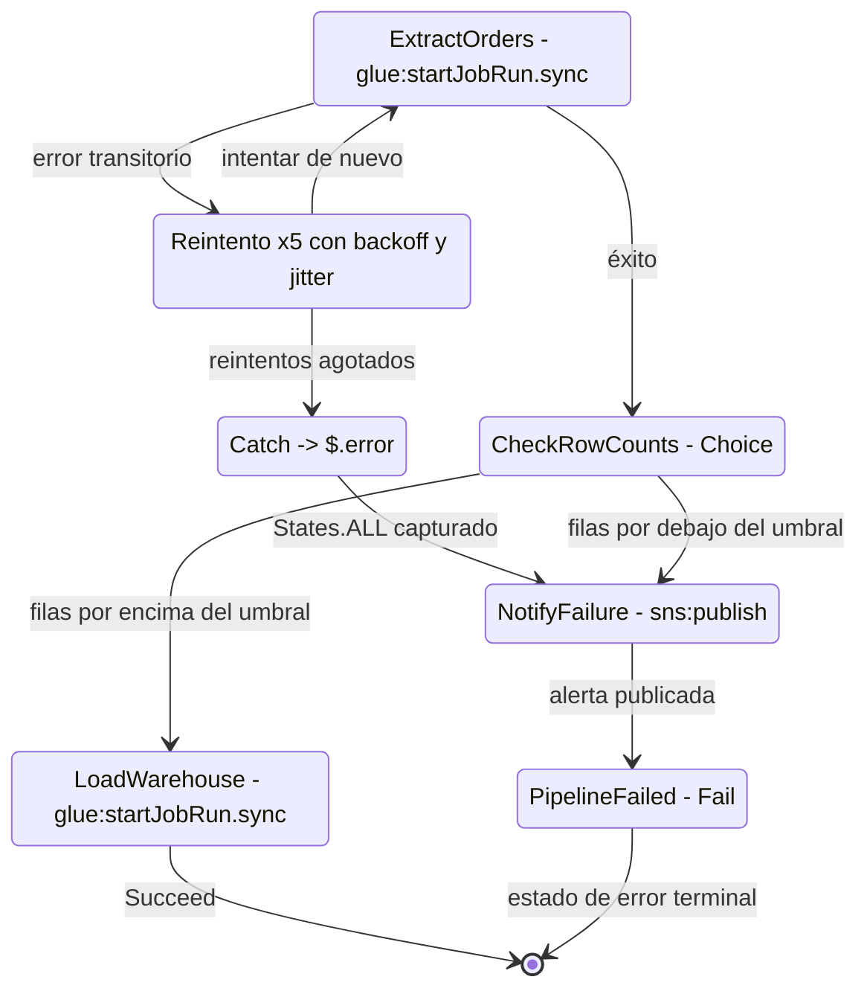
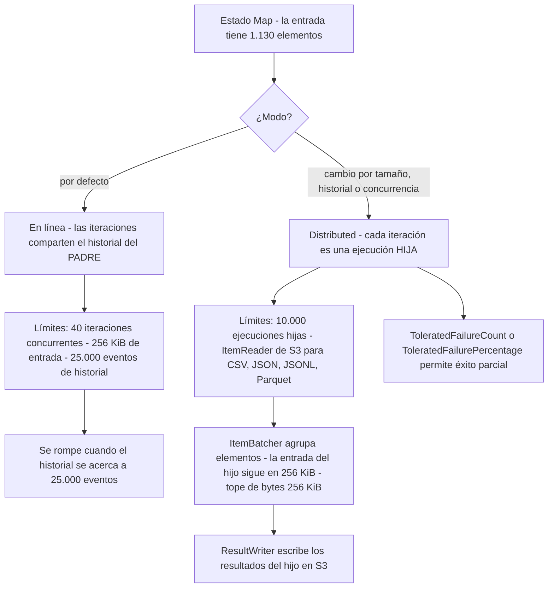
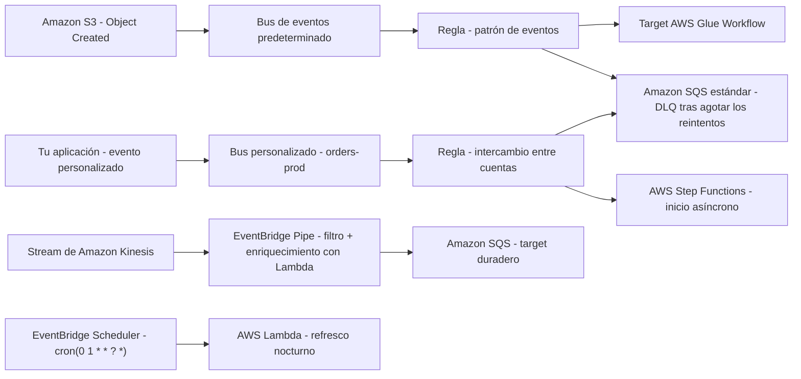
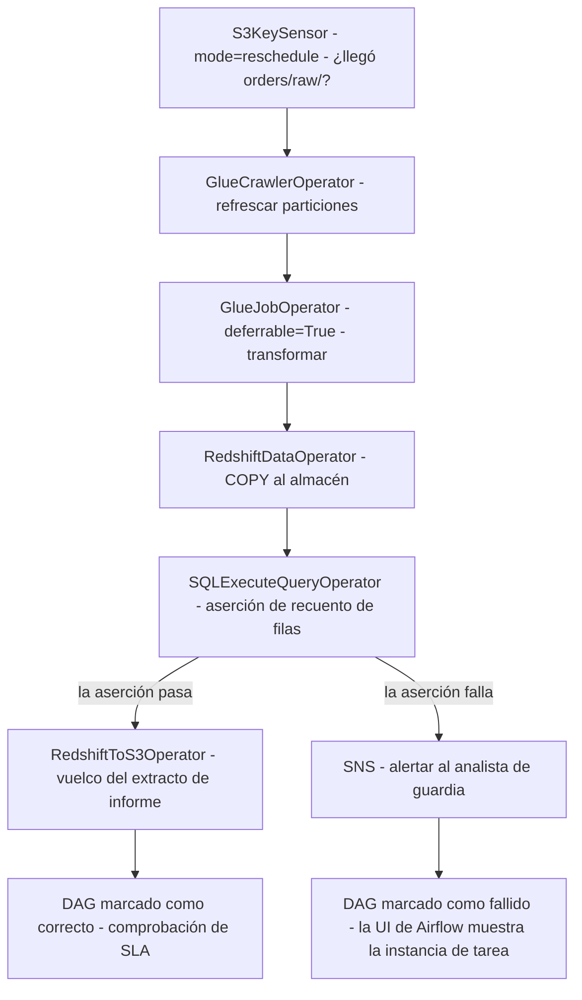
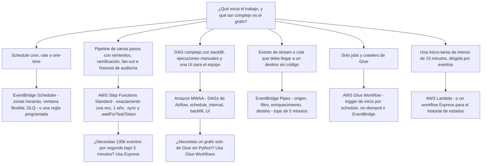

# Orquestando pipelines de datos: Step Functions, EventBridge y Airflow

Un pipeline de datos que transforma correctamente pero que **arranca tarde**, **se ejecuta dos veces**, **omite en silencio un paso fallido** o **no se puede reproducir** también ha fallado. La ingesta y la transformación (lecciones 02 y 03) deciden *qué* se mueve y *cómo* se remodela; la orquestación decide **cuándo se ejecuta, en qué orden, qué pasa cuando falla y cómo te recuperas** — y el DEA-C01 evalúa exactamente ese juicio en el dominio 1, **tarea 1.3 «Orquestar pipelines de datos»**, mediante cuatro habilidades: **1.3.1 servicios de orquestación** (AWS Lambda, Amazon EventBridge, Amazon MWAA, AWS Step Functions, AWS Glue workflows), **1.3.2 pipelines resilientes y escalables**, **1.3.3 workflows serverless** y **1.3.4 alertas mediante SNS y SQS** (guía del examen DEA-C01, consultada en octubre de 2026).

```text
====================================================================
 DEA-C01 DOMINIO 1 — TAREA 1.3: ORQUESTAR PIPELINES DE DATOS
====================================================================
  Step Functions .... Standard - 1 año, exactamente una vez, historial 90 días,
                              $0.000025 por transición de estado (en octubre de 2026)
                       Express  - 5 minutos, al menos una vez, sin historial guardado,
                              peticiones + duración + fragmentos de 64 MB
  EventBridge ....... reglas en UN bus: patrón de eventos O schedule
                       Pipes      - origen -> filtro -> enriquecer -> destino
                       Scheduler  - rate | cron | one-time, zonas horarias,
                                    ventanas flexibles, DLQ por destino
  Amazon MWAA ....... Apache Airflow gestionado: DAGs en S3, webserver +
                       scheduler + workers Celery en AWS Fargate,
                       base de datos de metadatos Aurora PostgreSQL
  Glue Workflows .... jobs + crawlers + triggers rastreados como UN grafo
  Alertas ........... SNS (fan-out a humanos) + SQS (búfer duradero/DLQ)
---------------------------------------------------------------------
  HABILIDADES 1.3.1 servicios de orquestación  1.3.2 resiliente + escalable
            1.3.3 workflows serverless     1.3.4 alertas SNS/SQS
  EN EL ALCANCE Step Functions - EventBridge - MWAA - Glue - Lambda - SNS - SQS
====================================================================
```

En esta lección vas a:

- distinguir los workflows **Standard y Express** por duración, garantía de entrega, facturación y patrones de integración soportados;
- leer y escribir **Amazon States Language** — los ocho tipos de estado, `Retry`, `Catch`, los nombres de error integrados y los estados de error terminales;
- elegir entre **`Map` en línea y Distributed** y dimensionar `ItemReader`, `ItemBatcher` y `ResultWriter`;
- construir reglas de **EventBridge** sobre schedules y patrones de eventos, entendiendo **buses, targets, políticas de reintento y DLQ**;
- usar **EventBridge Pipes** para fan-out de streams y colas sin código y **EventBridge Scheduler** para schedules conscientes de la zona horaria;
- describir un entorno **Amazon MWAA**, su almacenamiento de DAGs, los operators, las clases de worker y las versiones de Airflow;
- conectar **AWS Glue Workflows y triggers** (schedule, on-demand, EventBridge, condicional) en un solo grafo;
- aplicar la **matriz de selección de orquestación**: cron → EventBridge, reintentos en varios pasos → Step Functions, DAGs complejos → MWAA, flujos reactivos a eventos → Pipes;
- aplicar los patrones de **reintento, DLQ, idempotencia y backfill** que hacen resiliente a un pipeline;
- estudiar **cuatro casos de clientes de AWS**, leer el **cuadro de actualizaciones de octubre de 2026** y practicar con **14 preguntas de estilo examen** más comprobaciones interactivas.

---

## 1. La superficie de la orquestación: cinco primitivas, un trabajo

### 1.1 Lo que la tarea 1.3 pregunta de verdad

Toda pregunta de orquestación de este examen se reduce a cuatro cuestiones: **¿Qué inicia la ejecución?** (schedule, evento, llamada a API, éxito aguas arriba) **¿En qué orden corren los pasos?** (serial, paralelo, fan-out, condicional) **¿Qué pasa ante un fallo?** (reintento, catch, alerta, estacionamiento en una DLQ) **¿Cómo lo vuelves a ejecutar sin corromper los datos?** (backfill, redrive, idempotencia). Servicios distintos responden a esas cuatro cuestiones de maneras distintas, y los distractores del examen son siempre un *servicio correcto usado para la pregunta equivocada*.

| Primitiva | Qué posee | Servicio en alcance | Habilidad |
|---|---|---|---|
| **Máquinas de estados deterministas de varios pasos** | Orden, reintentos, ramificación, fan-out, historial de auditoría | **AWS Step Functions** | 1.3.1 / 1.3.3 |
| **Reacción a eventos y activación basada en tiempo** | Buses, patrones, schedules, targets, Pipes, Scheduler | **Amazon EventBridge** | 1.3.1 |
| **Grafos acíclicos dirigidos con backfill y UI** | Dependencias de tareas, ejecuciones manuales, ventanas de recuperación | **Amazon MWAA** (Apache Airflow gestionado) | 1.3.1 |
| **Grafo de ETL nativo dentro del servicio de transformación** | Jobs de Glue + crawlers + triggers condicionales | **AWS Glue Workflows** | 1.3.1 |
| **Pegamento y alertas de propósito único** | Microtareas, notificaciones en fan-out, colas duraderas | **AWS Lambda**, **Amazon SNS**, **Amazon SQS** | 1.3.3 / 1.3.4 |

La categoría Application Integration de la lista de servicios en alcance del DEA-C01 es exactamente esta familia: **Amazon EventBridge, Amazon MWAA, Amazon SNS, Amazon SQS, AWS Step Functions**, con **AWS Lambda** como la cómputo que la mayoría de ellas invoca (página de servicios en alcance del DEA-C01, consultada en octubre de 2026).

### 1.2 Resiliente y escalable es una lista de comprobación, no un adjetivo

La habilidad 1.3.2 espera que nombres los mecanismos, no que los admires:

1. **Reintento con backoff y jitter** — los fallos transitorios se vuelven a ejecutar automáticamente antes de que alguien reciba una alerta.
2. **Catch / estado de error** — los fallos irrecoverables se enrutan a un lugar definido en lugar de desaparecer.
3. **Dead-letter queue (DLQ)** — los eventos o mensajes que agotaron sus reintentos se conservan para inspección y reprocesamiento.
4. **Idempotencia** — la misma entrada procesada dos veces produce la misma salida una sola vez (escrituras condicionales, claves de idempotencia, job bookmarks).
5. **Backfill y redrive** — volver a ejecutar deliberadamente una ventana del historial o un conjunto de ejecuciones fallidas.
6. **Alertas** — SNS para humanos, SQS para máquinas, alarmas de CloudWatch sobre las métricas (`ExecutionsFailed`, `ExecutionThrottled`, `FailedInvocations`, `InvocationThrottleCount`).

- **📚 ¿Sabías que…?** Los cuatro nombres de métricas de CloudWatch anteriores son el atajo de diagnóstico más barato del examen: `ExecutionsFailed` y `ExecutionThrottled` pertenecen a **Step Functions**, mientras que `FailedInvocations` y `InvocationThrottleCount` pertenecen a los targets y Pipes de **EventBridge**. Una pregunta que empareja la métrica equivocada con el servicio equivocado está comprobando si sabes *qué capa* falló — la máquina de estados, o la entrega del evento a su destino (documentación de AWS CloudWatch, consultada en octubre de 2026).

---

## 2. AWS Step Functions: Standard frente a Express

### 2.1 El eje central del examen

AWS ofrece dos tipos de workflow, y la diferencia no es la velocidad — es la **duración, la garantía de entrega, el medidor y los patrones de integración disponibles** (guía para desarrolladores de Step Functions, *Standard vs Express*, consultada en octubre de 2026):

| | **Workflow Standard** | **Workflow Express** |
|---|---|---|
| Duración máxima | **1 año** | **5 minutos** |
| Garantía de entrega | Ejecución de workflow **exactamente una vez** | Ejecución de workflow **al menos una vez** |
| Tasa de inicio | 2.000 ejecuciones/segundo | 100.000 ejecuciones/segundo |
| Tasa de transiciones | 4.000/segundo | Sin límite |
| Facturación | **Por transición de estado** ($0.000025 cada una, en octubre de 2026) | **Por petición + duración + fragmentos de memoria de 64 MB** |
| Nivel gratuito | 4.000 transiciones de estado al mes (en octubre de 2026) | Ninguno en transiciones |
| Historial de ejecución | Se guarda **90 días**, tope duro de **25.000 eventos** | No se guarda; **CloudWatch Logs** (coste adicional) |
| Patrones de integración | Petición-respuesta **+ `.sync` + `.waitForTaskToken`** | **Solo petición-respuesta** |
| Carga útil del estado | 256 KiB | 256 KiB |
| Ejecuciones abiertas | 1.000.000 | No cuentan para ese tope |
| Trabajo típico | ETL de varias horas, aprobación humana, rutas de auditoría | Procesamiento de eventos de alto volumen, micro-flujos sub-segundo |

**La regla de una línea:** todo lo que deba **esperar** (`.sync`, `.waitForTaskToken`, una aprobación humana de días, una ejecución de un año) o deba ser **exactamente una vez** es un workflow **Standard**; todo lo que sea **corto, de alto volumen e idempotente** es un workflow **Express**.

> [!WARNING]
> ⚠️ **Express no es «Standard pero más rápido».** Es de **al menos una vez**, está limitado a **5 minutos**, **no guarda historial de ejecuciones** y admite **solo integraciones de petición-respuesta** — sin `.sync`, sin `.waitForTaskToken`. Una opción que ofrece Express para un requisito de «esperar tres días a la aprobación, luego continuar, con una ruta de auditoría completa» es errónea en tres puntos: el tope de 5 minutos, el patrón de callback que falta y el historial guardado que falta.

### 2.2 Ejemplo resuelto E1 — precificar un pipeline Standard

Un pipeline nocturno tiene **9 transiciones de estado por ejecución**; un estado reintenta **3 veces** antes de tener éxito, añadiendo 3 transiciones por ejecución (los reintentos son transiciones de estado facturables). Se ejecuta **10.000 veces al día** durante un mes de 30 días (precios de Step Functions, us-east-1, en octubre de 2026):

```text
transiciones por ejecución   = 9 + 3 = 12
transiciones al mes          = 12 x 10,000 x 30 = 3,600,000
nivel gratuito               =        -   4,000
transiciones facturadas      = 3,596,000
coste = 3,596,000 x $0.000025          = $89.90 / mes
```

De ahí salen dos lecciones: **los reintentos cuestan dinero** (son transiciones), y un **estado `Wait` en bucle** es un medidor que activas a propósito.

### 2.3 Ejemplo resuelto E2 — mismo pipeline, dos tipos de workflow

El mismo job de **6 estados, 4 segundos, menos de 64 MB**, ejecutado **1.000 veces**:

```text
Standard: 6 transiciones x 1.000 ejecuciones = 6,000 x $0.000025 = $0.150
Express : 6,000 peticiones x $1.00 / 1,000,000                  = $0.006
          duración 1,000 x 4 s x 0.0625 GB x $0.00001667/GB-s   = $0.0004
          total Express                                         ~= $0.006
```

Más de **20 veces más barato** para Express con esta forma — y la brecha se ensancha a medida que crece la duración, porque Express factura la duración mientras que Standard factura solo transiciones. La propia publicación de optimización de costes de 2022 de AWS ilustra la misma asimetría con una comparación de **$0.42 de Standard frente a $0.01 de Express** (AWS News Blog, 2022-08-30). La pregunta de examen consecuente es la contraria: un workflow que **espera 12 horas** en un estado `Wait` quemaría transiciones si lo sondearas, mientras que un token de callback espera gratis (véase E9).

- **📚 ¿Sabías que…?** Los workflows Express son el único tipo de workflow que puedes iniciar con `StartSyncExecution` desde la consola — y ese resultado síncrono de consola **caduca a los 60 segundos**, así que todo lo que dure más pertenece a una llamada SDK/CLI. El anidamiento también está oficialmente avalado: **un padre Standard puede iniciar un hijo Express anidado**, e iniciar un workflow anidado cuesta exactamente **una transición de estado** (páginas de precios y buenas prácticas de Step Functions, consultadas en octubre de 2026).

---

## 3. Amazon States Language: los ocho tipos de estado

### 3.1 El vocabulario

Las máquinas de estados se definen en **Amazon States Language (ASL)** — un lenguaje declarativo basado en JSON (especificación states-language.net, consultada en octubre de 2026):

| Tipo de estado | Qué hace | Detalle relevante para el examen |
|---|---|---|
| **`Task`** | Hace trabajo — llama a Lambda, a las integraciones de Step Functions o al SDK | Lleva `Retry` y `Catch`; puede usar `.sync` o `.waitForTaskToken` |
| **`Choice`** | Ramifica según una comparación | La rama sin coincidencia lanza `States.NoChoiceMatched` |
| **`Wait`** | Pausa durante segundos, hasta una marca de tiempo o hasta un límite | Transiciones facturables si lo pones en bucle (véase E9) |
| **`Parallel`** | Ejecuta ramas concurrentemente y luego las une | Fan-out/fan-in; cada rama puede tener su propio manejo de errores |
| **`Map`** | Itera un array (o un dataset) | En línea **40** iteraciones concurrentes frente a Distributed **10.000** (sección 4) |
| **`Pass`** | Remodelado puro de datos — sin trabajo | Inyecta o reestructura la entrada con `Result` |
| **`Succeed`** | Éxito terminal | Detiene sin error |
| **`Fail`** | Fallo terminal | Lleva las cadenas `Error` y `Cause` |

Todo estado declara `Type` y ya sea `Next` **xor** `End`, más los filtros de entrada/salida `InputPath`, `ResultPath`, `OutputPath`, un `TimeoutSeconds` opcional, y los arrays opcionales `Retry` y `Catch`. El lenguaje de consultas es **JSONPath** (rutas escritas con el sufijo `.$`, por ejemplo `"Bucket.$": "$.bucket"`) o **JSONata** (bloques ``). Las rutas de contexto alcanzan la propia ejecución: `$$.Execution.Id`, `$$.State.Name`, **`$$.Task.Token`** y `$$.Map.Item.*`.

### 3.2 Ejemplo resuelto E3 — un fragmento real de ASL

```json
{
  "Comment": "Nightly orders ETL with retry, catch and a branch",
  "StartAt": "ExtractOrders",
  "States": {
    "ExtractOrders": {
      "Type": "Task",
      "Resource": "arn:aws:states:::glue:startJobRun.sync",
      "TimeoutSeconds": 3600,
      "Retry": [
        { "ErrorEquals": ["States.Timeout"], "MaxAttempts": 0 },
        { "ErrorEquals": ["States.ALL"], "IntervalSeconds": 30,
          "MaxAttempts": 5, "BackoffRate": 2.0, "JitterStrategy": "FULL" }
      ],
      "Catch": [
        { "ErrorEquals": ["States.ALL"], "ResultPath": "$.error",
          "Next": "NotifyFailure" }
      ],
      "Next": "CheckRowCounts"
    },
    "CheckRowCounts": {
      "Type": "Choice",
      "Choices": [
        { "Variable": "$.row_count", "NumericGreaterThan": 1000,
          "Next": "LoadWarehouse" }
      ],
      "Default": "NotifyFailure"
    },
    "LoadWarehouse": {
      "Type": "Task",
      "Resource": "arn:aws:states:::glue:startJobRun.sync",
      "End": true
    },
    "NotifyFailure": {
      "Type": "Task",
      "Resource": "arn:aws:states:::sns:publish",
      "Next": "PipelineFailed"
    },
    "PipelineFailed": {
      "Type": "Fail",
      "Error": "PipelineFailed",
      "Cause": "Extract or load did not meet the row-count contract"
    }
  }
}
```

Léelo como una historia: el job de Glue se ejecuta **de forma síncrona** (`.sync` espera a que termine el job), **los tiempos de espera nunca se reintenta** mientras que todo lo demás reintenta hasta 5 veces con backoff exponencial y jitter completo, los errores irrecoverables se **capturan en `$.error`** y se enrutan a una alerta SNS, un `Choice` hace cumplir un contrato de datos, y el estado terminal es un `Fail` explícito — la definición de **estado de error** del examen.



### 3.3 Mecánica del reintento: los arrays se recorren de arriba abajo

- **Retriers** (`Retry[]`) se recorren **en orden de array**; manda la **primera** entrada cuyo `ErrorEquals` coincida. Por eso `["States.Timeout"]` con `MaxAttempts: 0` debe ir **antes** que `["States.ALL"]` — esta es la configuración canónica de *«reintentar todo salvo los tiempos de espera»*.
- **Valores por defecto** (cuando omites un campo): `IntervalSeconds` **1**, `MaxAttempts` **3** (o sea **4 intentos en total**), `BackoffRate` **2.0** (debe ser ≥ 1.0), `JitterStrategy` **NONE** a menos que fijes `FULL`.
- **Catchers** (`Catch[]`) se ejecutan **solo** cuando no hay una entrada de `Retry` coincidente o los reintentos se agotaron; cada uno lleva `ErrorEquals`, `Next` y normalmente un `ResultPath` como `$.error`, de modo que la carga útil del fallo no sobrescriba tus datos.

### 3.4 Nombres de error integrados que no debes confundir

| Nombre de error | Regla |
|---|---|
| **`States.ALL`** | Debe aparecer **solo** en su array `ErrorEquals` y **al final** del array `Catch`; **no puede** capturar `States.DataLimitExceeded` ni `States.Runtime` |
| **`States.TaskFailed`** | Comodín para cualquier fallo de tarea **excepto** `States.Timeout` |
| **`States.Timeout`** | La tarea superó `TimeoutSeconds` (o el heartbeat) |
| **`States.DataLimitExceeded`** | **Terminal** — la carga útil del estado supera el límite de 256 KiB; `States.ALL` no puede capturarlo |
| **`States.Runtime`** | Defecto en la definición de la máquina de estados; `States.ALL` **nunca** lo coincide |
| **`States.Permissions` / `States.BranchFailed` / `States.NoChoiceMatched`** | Fallo de IAM / falló una rama de `Parallel` o `Map` / `Choice` no coincidió con nada |
| Específicos del servicio | `Lambda.ServiceException`, `DynamoDB.ConditionalCheckFailedException`, `AmazonECS.Unknown`, … |

### 3.5 Ejemplo resuelto E4 — aritmética del tiempo de reintento

Con los valores por defecto (`IntervalSeconds: 1`, `BackoffRate: 2.0`, `MaxAttempts: 3`):

```text
intento 1 falla  -> esperar  1 s
intento 2 falla  -> esperar  2 s
intento 3 falla  -> esperar  4 s
intento 4 falla  -> rendirse tras 1 + 3 = 4 intentos en total
espera total     = 1 + 2 + 4 = 7 segundos  (+ tiempo de ejecución de cada intento)
```

Fija `IntervalSeconds: 30`, `MaxAttempts: 5`, `BackoffRate: 2.0` y las esperas pasan a ser 30 + 60 + 120 + 240 + 480 = **930 segundos (15,5 minutos)** antes de que la tarea se declare fallida — la configuración de E3. `JitterStrategy: "FULL"` aleatoriza cada retardo dentro de su ventana para que una flota de ejecuciones no reintente al unísono (documentación de manejo de errores de Step Functions, consultada en octubre de 2026).

### 3.6 Tokens de tarea: esperar sin costar nada

Para trabajos que ningún patrón `.sync` cubre — una aprobación humana, una API de terceros, un worker externo — la máquina de estados inyecta el token y espera:

```json
{
  "Type": "Task",
  "Resource": "arn:aws:states:::sqs:sendMessage.waitForTaskToken",
  "HeartbeatSeconds": 86400,
  "Parameters": {
    "QueueUrl.$": "$.queue_url",
    "MessageBody.$": "$.payload",
    "TaskToken.$": "$$.Task.Token"
  },
  "Next": "Approved"
}
```

Más adelante, el worker externo llama a **`SendTaskSuccess`**, **`SendTaskFailure`** o **`SendTaskHeartbeat`**. La espera es **ilimitada** (hasta el límite de 1 año de Standard), **no es facturable** y **existe solo en Standard** — así que siempre define `HeartbeatSeconds`; de lo contrario, un callback perdido se queda colgado hasta el tiempo de espera del estado en lugar de fallar rápido con `States.Timeout`.

- **📚 ¿Sabías que…?** Un estado de aprobación humana que permanece abierto tres días cuesta **cero transiciones de estado por hora** — las transiciones se gastaron entrando y saliendo del estado, no esperando dentro. Esa asimetría es la razón por la que los diseños de larga duración más baratos colocan un **`.waitForTaskToken`** donde de otro modo viviría un bucle de `Wait` con sondeo: 1.000 sondeos por hora cuestan $3.00 al mes, y un callback con token cuesta una sola transición (ejemplo resuelto E9; precios de Step Functions, en octubre de 2026).

### 3.7 Integraciones de servicio: qué patrón admite cada servicio

Step Functions incluye **integraciones optimizadas** (el servicio interpreta la llamada) más una **integración genérica del AWS SDK** que cubre **más de 220 servicios de AWS** (AWS What's New, 2026-03-26 — **+28 servicios / 1.100+ APIs**):

| Integración | Petición-respuesta | `.sync` (esperar a que termine) | `.waitForTaskToken` (callback) |
|---|---|---|---|
| **AWS Glue** (`glue:startJobRun`) | ✔ | ✔ | — |
| **Amazon EMR** | ✔ | ✔ (`addStep.sync`, `createCluster.sync`) | — |
| **Amazon ECS / AWS Batch / Amazon Athena / SageMaker / CodeBuild** | ✔ | ✔ | ✔ (ECS) |
| **AWS Lambda** | ✔ | — (sin `.sync`) | ✔ |
| **Amazon SQS / Amazon SNS / Amazon API Gateway / Amazon EventBridge** | ✔ | — | ✔ |
| **Amazon DynamoDB** | ✔ | **ninguno** | **ninguno** |
| Step Functions anidadas | ✔ | ✔ | ✔ |

Optimizado ≠ SDK: la integración **optimizada** de Lambda analiza automáticamente la carga útil de la respuesta, la integración optimizada de Glue devuelve `JobName` + `JobRunID`, y EMR renombra `JobFlowId` a `ClusterId`. Las llamadas de callback y `.sync` también necesitan permisos IAM adicionales (`glue:GetJobRun`, `ecs:RunTask` más `iam:PassRole`) — un favorito del examen cuando un pipeline «funciona en la consola y falla en producción».

---

## 4. El estado Map: en línea frente a Distributed

### 4.1 Cuándo ocurre el cambio

`Map` itera un array de entrada. **En línea** (el valor por defecto) ejecuta cada iteración dentro del propio historial de ejecución del padre; el modo **Distributed** ejecuta cada iteración como una **ejecución de workflow hija** con su propio historial (guía para desarrolladores de Step Functions, *Map state*, consultada en octubre de 2026):

| | **Map en línea** | **Distributed Map** |
|---|---|---|
| Dónde corren las iteraciones | Historial de ejecución del padre | **Ejecuciones hijas** (Standard o Express) |
| Concurrencia máxima | **40** | **10.000** (por defecto sin definir/0) |
| Entrada | Array JSON, o lista de objetos de S3 | Carga útil JSON **o** dataset grande de S3: CSV, JSON, JSONL, Parquet, lista de objetos, inventario |
| Cambiar a Distributed cuando | — | la entrada **> 256 KiB**, el historial superaría **25.000 eventos**, o la concurrencia **> 40** |
| Límite de carga útil del hijo | n/a | 256 KiB por hijo (8 MB por elemento si `ItemSelector` lo reduce) |
| Resultados | Devueltos en línea | Escritos en **S3** mediante **`ResultWriter`** |
| Tolerancia a fallos | Todo o nada | `ToleratedFailureCount` / `ToleratedFailurePercentage` |

La configuración vive en `ProcessorConfig: { "Mode": "DISTRIBUTED", "ExecutionType": "EXPRESS" | "STANDARD" }` más los campos siguientes:

- **`ItemReader`** (+ `ReaderConfig.InputType`) — de dónde salen los elementos; `MaxItems` ≤ **100.000.000**, y `MaxItems` XOR `MaxItemsPath`.
- **`ItemsPath` / `ItemSelector`** — qué elementos, y cómo se remodela cada uno antes de que corra el hijo.
- **`ItemBatcher`** — `MaxItemsPerBatch`, `MaxItemsPerBatchBytes` (≤ **256 KiB**).
- **`MaxConcurrency` / `MaxConcurrencyPath`** — nunca lo pongas por encima de la capacidad aguas abajo.
- **`ResultWriter`** — los resultados aterrizan en S3, no en el historial del padre.



### 4.2 Ejemplo resuelto E5 — aritmética de ItemBatcher

Un Distributed Map hace fan-out de **1.130 objetos** con `MaxItemsPerBatch: 100`:

$$
\text{batches} = \left\lceil \frac{1{,}130}{100} \right\rceil = \lceil 11.3 \rceil = \mathbf{12 \ batches}
$$

El batching importa porque **cada lote se convierte en una ejecución hija**, y cada ejecución hija cuesta al menos una transición de estado (o, para hijos Express, una petición). **1.130 hijos** son 1.130 ejecuciones; **12 hijos** son 12 — mismo trabajo, una fracción de la sobrecarga. Para un backfill de S3 de **1.000.000 de objetos** la aritmética es de otra clase: el Map en línea agotaría el historial de **25.000 eventos** mucho antes del último objeto, así que necesitas `ItemReader` sobre `s3:listObjectsV2`, `ItemBatcher`, `MaxConcurrency` dimensionado a la capacidad aguas abajo (por ejemplo 1.000), hijos con `ExecutionType: "EXPRESS"`, `ToleratedFailurePercentage: 1`, y `ResultWriter` hacia S3.

> [!IMPORTANT]
> ⚠️ **El límite de 10.000 de Distributed Map cuenta ejecuciones hijas, no elementos.** Los elementos están limitados por `ItemReader.MaxItems` (**100.000.000**), y los umbrales de activación para cambiar de modo son **256 KiB de entrada**, **25.000 eventos de historial** o **40 iteraciones concurrentes**. Una opción que dice «Distributed Map está limitado a 10.000 objetos» ha confundido los dos contadores.

---

## 5. Amazon EventBridge: reglas, buses, reintentos y DLQ

### 5.1 Tres tipos de bus, una regla por bus

| Tipo de bus | Qué transporta | Intercambio |
|---|---|---|
| **Predeterminado** | Eventos de los servicios de AWS en tu cuenta | Automático |
| **Personalizado** | Eventos que emiten tus aplicaciones | Compartible entre cuentas / regiones mediante una política de recursos |
| **Partner** | Eventos de proveedores SaaS | A través de la integración del partner |

Una regla observa **exactamente un** bus. Los schedules **nunca** están permitidos en los **buses de eventos partner**; la referencia de la API documenta expresiones de schedule en los buses predeterminado y personalizado (API de EventBridge `PutRule`, consultada en octubre de 2026) — así que trata *«schedule en un bus partner»* como siempre erróneo.

### 5.2 Dos formas de regla — y un schedule

Una regla coincide con un **patrón de eventos** (filtrado sobre campos JSON, hasta **2.048 caracteres**) o con una **expresión de schedule**, o con ambas:

```text
rate(5 minutes)          -> cada 5 minutos, en una rejilla de precisión de 1 minuto, UTC+0
cron(0 20 * * ? *)       -> 20:00 UTC todos los días (la expresión que AWS publica
                            como ejemplo de schedule)
```

### 5.3 Ejemplo resuelto E6 — escribir la regla cron

Requisito: *«lanzar la carga del almacén a las 20:00 UTC cada día, y también cada vez que un archivo aterriza en el prefijo raw.»* Una sola regla no puede hacer ambas cosas limpiamente en una sola expresión como exige el examen — creas **dos reglas en el mismo bus**:

```json
{
  "Name": "nightly-warehouse-load",
  "ScheduleExpression": "cron(0 20 * * ? *)",
  "State": "ENABLED",
  "Targets": [
    { "Id": "start-pipeline",
      "Arn": "arn:aws:states:us-east-1:111122223333:stateMachine:NightlyETL",
      "RoleArn": "arn:aws:iam::111122223333:role/events-to-stepfunctions" }
  ]
}
```

```json
{
  "Name": "raw-object-created",
  "EventPattern": {
    "source": ["aws.s3"],
    "detail-type": ["Object Created"],
    "detail": {
      "bucket": { "name": ["raw-lake"] },
      "object": { "key": [{ "prefix": "incoming/" }] }
    }
  },
  "Targets": [
    { "Id": "start-glow-workflow",
      "Arn": "arn:aws:states:us-east-1:111122223333:stateMachine:NightlyETL" }
  ]
}
```

Observa los detalles que el examen verifica: la precisión del schedule es de **1 minuto** en **UTC+0**, así que `cron(0 20 * * ? *)` son las 20:00 UTC y *no* la hora local; **los targets de Step Functions se invocan de forma asíncrona**; y una regla lleva un máximo de **5 targets**.

### 5.4 Política de reintento y dead-letter queue

Por target puedes anular la política de reintento de entrega y adjuntar una DLQ (EventBridge, *Retry policy and DLQ*, consultada en octubre de 2026):

| Ajuste | Rango | Valor por defecto |
|---|---|---|
| `MaxRetryAttempts` | **0–185** | **185** (consola) |
| `MaxEventAgeInSeconds` | **60–86.400** | 86.400 (**24 horas**) |
| Efecto de los valores por defecto | Backoff exponencial **con jitter** durante hasta **24 horas** y hasta **185 intentos** | — |
| DLQ | **Cola estándar de Amazon SQS, misma región** | ninguna |

### 5.5 Ejemplo resuelto E7 — de reintentos de 24 horas a una DLQ de 10 minutos

Un equipo quiere que los fallos salgan a la luz en **10 minutos**, no al día siguiente:

```json
{
  "Id": "target-stepfunctions",
  "Arn": "arn:aws:states:us-east-1:111122223333:stateMachine:NightlyETL",
  "RetryPolicy": {
    "MaximumRetryAttempts": 5,
    "MaximumEventAgeInSeconds": 300
  },
  "DeadLetterConfig": {
    "Arn": "arn:aws:sqs:us-east-1:111122223333:events-dlq"
  }
}
```

```text
Política por defecto: hasta 185 intentos en 24 h    -> silencioso, lento, caro
Esta política      : hasta 5 intentos dentro de 300 s -> el mensaje aterriza en la DLQ
                    tras 10 minutos, salta la alarma en QueueDepth, el ingeniero reprocesa
```

La DLQ debe ser una **cola estándar de SQS en la misma región** — **una cola FIFO no puede usarse como DLQ de EventBridge**. Los mensajes que llegan llevan atributos como `ERROR_CODE`, `EXHAUSTED_RETRY_CONDITION` y `RETRY_ATTEMPTS`, y una cola cifrada con KMS necesita `kms:Decrypt` para `events.amazonaws.com`.

- **📚 ¿Sabías que…?** Algunos fallos **no se reintenta nunca** — un permiso ausente, un recurso borrado o un DNS defectuoso va **directo a la DLQ** con cero reintentos, y por eso «no hubo reintentos» en un ticket de soporte suele significar un problema de IAM o de recursos, y no un error de la política de reintento. Y las DLQ de EventBridge son colas **estándar de SQS** a secas: no puedes usar una cola FIFO, así que una pregunta que ofrece «SQS FIFO como DLQ de EventBridge» es un distractor incorporado (documentación de DLQ de EventBridge, consultada en octubre de 2026).

### 5.6 Cuotas que vale la pena memorizar (en octubre de 2026)

| Cuota | Valor |
|---|---|
| Buses de eventos por región | **100** |
| Reglas por bus por región | **300** (100 en af-south-1 y eu-south-1) |
| Reglas con patrones comodín por bus | **30** |
| Targets por regla | **5** (no ajustable) |
| Tamaño del patrón de eventos | **2.048 caracteres** |
| Rendimiento de destinos de API | **300 peticiones/segundo** |



- **📚 ¿Sabías que…?** EventBridge también orquesta pipelines de *seguridad*, no solo de datos: Amazon Macie emite sus hallazgos al bus predeterminado, y una regla puede enrutarlos hacia un Lambda o un flujo de remediación de Step Functions con la misma política de reintento y la misma DLQ de SQS estándar que usas para una carga de almacén — la conexión que hay detrás del **95% de precisión en el descubrimiento de datos sensibles** y la **reducción del 80% en el tiempo necesario para descubrir datos sensibles** comunicados por Oportun. La habilidad de orquestación no cambia (coincidir en `source` / `detail-type`, acotar los reintentos, hacer idempotente la remediación); solo cambia el productor (material de cliente de AWS Macie y presentación de la sesión SEC215 de re:Invent, consultada en octubre de 2026).

---

## 6. EventBridge Pipes y EventBridge Scheduler

### 6.1 Pipes: origen → filtro → enriquecer → destino, sin código

Los Pipes son **de punto a punto** (no pub/sub): un origen, un **filtro** opcional (solo se facturan los eventos coincidentes), un paso de **enriquecimiento** opcional (Lambda o Step Functions) y un destino (documentación de AWS EventBridge Pipes, consultada en octubre de 2026).

| Aspecto | Detalle |
|---|---|
| **Orígenes** | Stream de DynamoDB, stream de Kinesis, Amazon MQ (ActiveMQ/OpenWire, RabbitMQ/AMQP 0-9-1), Amazon MSK (incl. Serverless), **SQS**, Apache Kafka autogestionado (Confluent Cloud, Redpanda) |
| **Destinos** | Destino de API, API Gateway, Batch, grupo de logs de CloudWatch, tarea de ECS, bus de eventos de la misma región, Firehose, Kinesis, Lambda, Redshift Data API, SNS, SQS, **Step Functions**, Timestream |
| **Carga útil** | **6 MB** en Pipes; el límite efectivo es el **menor** entre Pipes y el destino (Lambda 6 MB, bus de eventos 1 MB, **Step Functions 256 KB**) |
| **Batching** | El tamaño de lote de origen no supera el máximo del destino — Kinesis admite 10.000 registros, pero un destino SQS solo admite 10, así que el pipe se limita a **10** |
| **Concurrencia** | DynamoDB/Kinesis = `ParallelizationFactor` × shards; Kafka = particiones (tope 1.000); Amazon MQ 5; SQS 1.250 |
| **Tope duro** | Tiempo de espera de ejecución del pipe de **5 minutos**, incluidos enriquecimiento y destino — no se puede subir |
| **Precios** | **$0.40 por millón de peticiones**, cada fragmento de **64 KB** cuenta como una petición, y **solo se facturan los eventos filtrados** (en octubre de 2026) |

### 6.2 Ejemplo resuelto E8 — facturación de Pipes con un filtro

Un pipe consume **10.000.000 de mensajes de SQS**, un filtro deja pasar el **25%**, y el batching es de **5 mensajes por petición** (ejemplo de la página de precios de Step Functions, en octubre de 2026):

```text
eventos tras el filtro = 10,000,000 x 0.25 = 2,500,000
peticiones            = 2,500,000 / 5     =   500,000
coste                 = 500,000 / 1,000,000 x $0.40 = $0.20
```

**$0.20 por diez millones de mensajes** — porque el filtro se ejecuta antes de la facturación. El principio evaluable: **filtra pronto, agrupa hasta el máximo del destino y recuerda el techo de 5 minutos del pipe.**

### 6.3 Scheduler: schedules sin regla

AWS recomienda **EventBridge Scheduler** para invocar destinos según un schedule, y la consola etiqueta las **reglas** programadas como «(legacy)» (documentación de EventBridge Scheduler, consultada en octubre de 2026).

| Característica | **Scheduler** de EventBridge | **Regla** programada |
|---|---|---|
| Tipos de schedule | **rate**, **cron**, **one-time** (`at(2026-11-01T09:00:00)`) | Solo `rate()` y `cron()` |
| Zonas horarias | **Zonas horarias IANA**; el horario de verano se gestiona automáticamente | **Solo UTC** |
| Ventana flexible | `Mode: FLEXIBLE` + `MaximumWindowInMinutes` **1–1440** | ninguna |
| Targets | Con plantilla (Lambda, SQS, Kinesis, SNS, ECS, Batch, **inicio de Glue**, **inicio de Step Functions**, SageMaker, SSM, destino de API) o universales (cualquier API de AWS) | Máx. **5** targets |
| Reintento/DLQ por target | `RetryPolicy` ≤ **185** reintentos, edad ≤ **24 h**, más una **DLQ** | Mismos rangos de reintento |
| Cuotas (en octubre de 2026) | **10.000.000** schedules/Región, **500** grupos, **10 TPS** por schedule, precisión de **60 segundos** | **300** reglas/bus |

**La ventana de tiempo flexible** es la característica sobre la que giran las preguntas de examen: `MaximumWindowInMinutes: 60` significa que un job nocturno programado a las 01:00 puede dispararse **en cualquier momento entre las 01:00 y las 02:00** — perfecto para ventanas de lote que deben absorber picos de carga, erróneo para un job que debe arrancar exactamente a las 01:00:00.

### 6.4 Cuatro cosas que «se ejecutan según un schedule» (no las mezcles)

| Mecanismo | Alcance | Precisión / zona | Mejor para |
|---|---|---|---|
| **EventBridge Scheduler** | Cualquier destino, zonas horarias, one-time, ventana flexible | 60 s, zonas IANA | Schedules conscientes de la zona horaria con DLQ |
| **Regla de EventBridge (schedule)** | Hasta 5 targets en un bus | 1 min, **UTC** | Schedules heredados que además necesitan un patrón de eventos |
| **Trigger programado de Glue** | Solo jobs y crawlers de Glue | cron de Glue | Arrancar el propio grafo de Glue |
| **`schedule_interval` de Airflow** | Un DAG, con **backfill** | Análisis de Airflow | DAGs complejos que necesitan ejecuciones de recuperación |

---

## 7. Amazon MWAA: Apache Airflow gestionado

### 7.1 Qué es en realidad un entorno

Un **entorno de Amazon MWAA** es un manojo de componentes gestionados (documentación de AWS MWAA, consultada en octubre de 2026):

```text
 ------------------------------------------------------------------
  ENTORNO MWAA
 ------------------------------------------------------------------
  DAGs + plugins ...... s3://tu-bucket/  (DAGs en S3, requirements.txt,
                         plugins.zip; tamaño combinado < 1 GB recomendado,
                         la instalación debe terminar en 10 minutos)
  Webserver(s) ........ UI de Airflow, 1-5 por entorno
  Scheduler(s) ........ analiza los DAGs y programa las ejecuciones; el triggerer
                         se co-localiza aquí (más schedulers = más triggerers)
  Workers ............. instancias de tarea Celery en AWS Fargate, 20 GB de
                         almacenamiento por tarea, autoescalados automáticamente
  Base de metadatos ... Amazon Aurora PostgreSQL (gestionada por AWS)
  Cola de Celery ...... cola de Amazon SQS gestionada por AWS que NO PUEDES crear
                         ni reemplazar
 ------------------------------------------------------------------
```

Renuncias a SSH, a **imágenes personalizadas**, a colas SQS propias y a la elección de executor — **solo Celery** — a cambio de que AWS ejecute el plano de control, Aurora, Fargate, el registro y tu cableado de VPC. Las actualizaciones de DAGs existentes se recogen en unos **30 segundos**.

### 7.2 Clases de worker y autoescalado (en octubre de 2026)

| Clase | DAGs máx. | Tareas máx. en un worker | Autoescalado |
|---|---|---|---|
| `mw1.micro` | 25 | 3 | **Sin autoescalado** |
| `mw1.small` | 50 | 5 | Sí |
| `mw1.medium` | 250 | 10 | Sí |
| `mw1.large` | 1.000 | 20 | Sí |
| `mw1.xlarge` | 2.000 | 40 | Sí |
| `mw1.2xlarge` | 4.000 | 80 | Sí |

Los workers se añaden según `(RunningTasks + QueuedTasks) / tareas-por-worker`, hasta `max-workers`. El valor por defecto de `celery.worker_autoscale` por clase (3 / 5 / 10 / 20 / 40 / 80) es el que manda, y **`celery.worker_concurrency` se ignora** — definirlo no hace nada.

### 7.3 Operators y dependencias

Los DAGs viven en **S3**, las dependencias en `requirements.txt` (pip3) y `plugins.zip`; un `requirements.txt` nuevo exige una actualización del entorno. Los operators que importan para este examen:

| Operator / sensor | Función |
|---|---|
| `S3KeySensor` (a menudo `mode="reschedule"`) | Esperar a que aterrice un archivo |
| `GlueCrawlerOperator` / `GlueCrawlerSensor` | Ejecutar o esperar a un crawler |
| **`GlueJobOperator`** (+ `Sensor`, `deferrable=True`) | Ejecutar o esperar a un job de Glue — `AWSGlueJobOperator` está **obsoleto** |
| `RedshiftDataOperator` | Ejecutar SQL mediante la Redshift Data API |
| `SQLExecuteQueryOperator` | Ejecución genérica de SQL |
| `RedshiftToS3Operator` | Volver a S3 los datos del almacén |

Versiones disponibles en octubre de 2026: **Airflow 3.2.x** (anunciado **2026-04-01**), **3.0.x** y **2.11.0** (publicado **2026-01-07**, Python 3.12), más las líneas antiguas 2.9.x/2.7.x/2.4.x. Airflow 3 añade programación consciente de assets y particiones, historial de auditoría con humanos en el bucle y un `PythonOperator` asíncrono.



### 7.4 Ejemplo resuelto E9 — precificar un entorno de MWAA

El propio ejemplo resuelto de AWS para un entorno `mw1.small` durante un mes de **31 días**: **1 entorno**, **49 workers funcionando 1 hora al día**, **10 GB** de almacenamiento de la base de metadatos (precios de MWAA, us-east-1, en octubre de 2026):

```text
entorno      744 h x $0.49          = $364.56
workers extra 49 x 31 h x $0.055    =  $83.55
base metadatos 10 GB x $0.10/GB-mes =   $1.00
                                             -------
total                                   $449.11 / mes
```

Para comparar, `mw1.large` cuesta **$0.99/h** para el entorno, con workers y schedulers extra a **$0.22/h** y un servidor web adicional a **$0.11/h**, y MWAA Serverless factura AWS Managed Tasks a **$0.080 por hora de tarea** (mínimo de 1 minuto, facturación por segundo). Otras cuotas: **10 entornos por región** (5 de `mw1.xlarge`/`mw1.2xlarge`), **25 workers por entorno** (50 tras aumentar la cuota), **5 webservers**, **20 GB** de almacenamiento por tarea.

- **📚 ¿Sabías que…?** La cola de Celery de MWAA es una **cola de Amazon SQS gestionada por AWS que no puedes crear, reemplazar ni configurar** — y por eso las preguntas que ofrecen «trae tu propia cola SQS a MWAA» o «ajusta `celery.worker_concurrency`» son erróneas. Lo que sí ajustas es la **clase de worker**, y esa sola elección mueve a la vez la capacidad de DAGs y la concurrencia de tareas por defecto: `mw1.small` → `mw1.medium` cambia el valor por defecto de **5 a 10** tareas por worker (documentación de AWS MWAA, consultada en octubre de 2026).

### 7.5 MWAA Serverless

**MWAA Serverless** elimina el entorno siempre activo: DAGs en YAML más un paquete de código en S3, programación **de pago por uso por tarea** respaldada por EventBridge Scheduler, un **rol de ejecución por workflow** y cómputo aislado. Es la respuesta serverless dentro de la familia Airflow — pero los conceptos de Airflow, el archivo del DAG y los operators son los mismos. (Documentación de AWS MWAA Serverless, consultada en octubre de 2026; la disponibilidad por regiones no se repite aquí porque la lista de lanzamientos no pudo verificarse en octubre de 2026.)

---

## 8. AWS Glue Workflows y triggers

### 8.1 Una entidad, dos grafos

Un **workflow** de Glue rastrea **jobs + crawlers + triggers como una única entidad** con una vista de grafo — un grafo **estático** (diseño) y un grafo **dinámico** (estado en tiempo de ejecución por nodo) (AWS Glue, *Workflows* y *Triggers*, consultado en octubre de 2026).

### 8.2 Los tres triggers de inicio

| Tipo de trigger de inicio | Comportamiento |
|---|---|
| **Schedule** | Una expresión cron inicia la ejecución |
| **On-demand** | Solo inicia cuando lo llamas; el trigger permanece en `CREATED`, nunca en `ACTIVATED` |
| **Evento de EventBridge** | Inicia con un evento, con un **tamaño de lote** y una **ventana de lote** opcionales (por defecto = máximo de **900 s / 15 min**); inicia la ejecución la primera condición cumplida, y sin condiciones de lote el tamaño por defecto es **1** |

Dentro del grafo, los **triggers condicionales** expresan dependencias: el job J3 empieza después de **J1 Y J2 `SUCCEEDED`**; el job J4 empieza después de **J1 O J2 `FAILED`**; un crawler empieza tras terminar los jobs. Las **propiedades de ejecución del workflow** son pares nombre/valor compartidos que los jobs leen y modifican durante la ejecución — paso de estado **sin** XCom de Airflow.

### 8.3 La regla dura

> **Todos los jobs o crawlers de una cadena de dependencia deben ser descendientes de un único trigger programado o on-demand.** Los dependientes solo se disparan si un trigger los inició — un crawler que inicies **a mano** no disparará el siguiente job del grafo. Cada trigger admite **≤ 50 jobs** y **≤ 2 crawlers**, y un **workflow de Glue es un target de EventBridge de primera clase**, así que una regla de EventBridge o un schedule de Scheduler puede arrancar el grafo entero.

```text
Trigger de schedule 02:00 UTC
      |
      +--> orders_etl (job, bookmarks)
                |
      +---------+--------- (condicional: SUCCEEDED)
      |                   |
 sales_crawler        quality_check (job)
 (crawler)                   |
                        SNS - alerta en caso de fallo
```

### 8.4 Elegir entre Glue Workflows y Step Functions para el mismo ETL

| Requisito | Glue Workflows | Step Functions |
|---|---|---|
| Solo jobs y crawlers de Glue | **Sí — gratis, nativo, un grafo** | Funciona, pero pagas por transición |
| Pasos que no son de Glue (Redshift, Lambda, SNS, SQS, EMR) | Solo mediante una cesión a EventBridge | **Integraciones optimizadas nativas** |
| Aprobación humana / callback | No | **`.waitForTaskToken`** |
| Fan-out sobre un dataset grande | No | **Distributed Map** |
| Reparar o reanudar un grafo parcialmente ejecutado | **Sí — soportado** | **Redrive** (Standard, 14 días) |

---

## 9. La matriz de selección de orquestación

### 9.1 El diagrama del dinero



### 9.2 La matriz en palabras

| Requisito | Respuesta correcta | Por qué pierden las alternativas |
|---|---|---|
| **Cron / rate / one-time** | **EventBridge Scheduler** (o una regla programada) | Step Functions necesitaría un bucle `Wait`; MWAA necesita un DAG |
| **Varios pasos con reintentos, ramificación, auditoría** | **Step Functions Standard** | Express se limita a 5 minutos y no guarda historial |
| **DAGs complejos, backfill, UI humana** | **Amazon MWAA** | Step Functions no tiene ventana de recuperación nativa |
| **Reactivo a eventos, sin código** | **EventBridge Pipes** | Las reglas necesitan un bus; Pipes sondean streams y colas y pueden enriquecer |
| **Grafo solo de Glue** | **Glue Workflows** | Gratis y nativo; Step Functions factura por transición |
| **Micro-tarea de menos de 15 minutos** | **AWS Lambda** (o Express para el historial) | Un entorno completo es excesivo |
| **Aprobación humana de días** | **Standard + `.waitForTaskToken`** | Express no puede esperar; el sondeo cuesta transiciones |

```matching
{
  "question": "Empareja cada requisito de pipeline con el servicio de orquestación que el examen DEA-C01 espera:",
  "pairs": [
    {"left": "Job nocturno a las 01:00 America/New_York con una ventana flexible de 60 minutos y una DLQ", "right": "Amazon EventBridge Scheduler - zonas horarias IANA, ventana de tiempo flexible, RetryPolicy y DeadLetterConfig por target"},
    {"left": "ETL de tres pasos con hasta 5 reintentos por paso, una compuerta Choice y una ruta de auditoría de 14 días", "right": "AWS Step Functions Standard - exactamente una vez, duración de 1 año, historial de 90 días, Retry y Catch en cada Task"},
    {"left": "Cuarenta tareas de Python interdependientes, activación manual con ventana de recuperación, UI para el equipo", "right": "Amazon MWAA - DAGs de Airflow en S3 con schedule_interval y backfill"},
    {"left": "Un stream de Kinesis debe llegar a un Lambda para enriquecer y después a una cola SQS, sin código que mantener", "right": "Amazon EventBridge Pipes - origen, filtro, enriquecimiento, destino dentro de una ejecución de 5 minutos"},
    {"left": "Un job de Glue seguido de un crawler, condicionado a SUCCESS, rastreado como un solo grafo", "right": "AWS Glue Workflow - triggers condicionales, grafo estático y dinámico, reparación/reanudación"},
    {"left": "Fan-out de 12 jobs de Glue particionados en paralelo, y luego esperar la aprobación humana hasta tres días", "right": "AWS Step Functions Standard con Parallel o Map más .waitForTaskToken - Express no puede esperar más de 5 minutos"}
  ],
  "explanation": "El examen rara vez pregunta qué servicio PUEDE hacer el trabajo; pregunta cuál encaja mejor. Scheduler gana en zonas horarias y schedules one-time, Step Functions en reintentos/ramificación/auditoría, MWAA en ergonomía de DAG y backfill, Pipes en fan-out de streams sin código, Glue Workflows en grafos solo de Glue - y Express queda descalificado en cuanto una espera supera los 5 minutos o se necesita un token de callback."
}
```

---

## 10. Patrones de reintento, DLQ, idempotencia y backfill

### 10.1 La escalera de fiabilidad

```text
 1. Reintento        fallo transitorio -> el mismo paso se reejecuta con backoff + jitter
 2. Catch            reintentos agotados -> se enruta a un estado de error, se conserva $.error
 3. DLQ              evento/mensaje conservado tras MaxRetryAttempts o MaxEventAge
 4. Idempotencia     la reproducción produce el mismo resultado exactamente una vez
 5. Redrive/replay   ejecuciones Standard en 14 días, o republicar mensajes de la DLQ
 6. Alarma + alerta  métrica de CloudWatch -> SNS a humanos, SQS al job de remediación
```

### 10.2 Idempotencia: la precondición de toda reproducción

La entrega es **al menos una vez** casi en todas partes (ejecuciones Express, targets de EventBridge, SQS, Pipes), así que reproducir solo es seguro si el procesamiento es idempotente:

- **Escritura condicional en DynamoDB** — `ConditionExpression: attribute_not_exists(pk)` falla con `DynamoDB.ConditionalCheckFailedException`, que un `Catch` puede absorber; las ramas paralelas que compiten por un lock usan exactamente este truco.
- **Lambda Powertools `@idempotent` con TTL** — la segunda invocación del mismo evento devuelve el resultado cacheado.
- Cabecera **`Idempotency-Key`** aguas arriba para pipelines dirigidos por API.
- **Job bookmarks de Glue** — el equivalente del lado de la transformación: el estado rastreado entre `job.init` y `job.commit` evita el reprocesamiento (lección 03).

### 10.3 Redrive, reintento y replay son tres cosas distintas

| Mecanismo | Alcance | Restricciones (en octubre de 2026) |
|---|---|---|
| **`Retry`** | Dentro de **una** ejecución, automático | El orden del array importa; por defecto 1 s / 3 intentos / backoff 2.0 |
| **Redrive** | Reiniciar **ejecuciones Standard fallidas** desde donde se detuvieron | **Solo Standard**, ejecuciones de los **últimos 14 días** que fallaron, fueron abortadas o superaron el tiempo, misma entrada y definición, historial **< 24.999 eventos**, solo para fallos *no controlados* |
| **Replay de DLQ** | Republicar un mensaje estacionado | Mensaje nuevo, así que aguas abajo debe ser **idempotente** |

Step Functions además emite eventos de cambio de estado de ejecución al **bus predeterminado de EventBridge**, de modo que una regla puede vigilar `ExecutionFailed` e invocar un Lambda que llame a `RedriveExecution` — la orquestación que se cura a sí misma.

### 10.4 Ejemplo resuelto E10 — diseñar la ruta de recuperación

```text
Fallo             : 40 ejecuciones Standard fallan en glue:startJobRun.sync
                     (no se definía ningún Catch - el servicio Glue tuvo una incidencia)
Detección         : regla de EventBridge en el bus predeterminado que coincide con
                     eventos de cambio de estado de ejecuciones fallidas
                     -> Lambda RedriveExecution
Restricciones     : tipo STANDARD (Express no tiene redrive)
                     antigüedad <= 14 días
                     historial < 24.999 eventos
                     misma definición de máquina de estados + misma entrada
Resultado         : 40 ejecuciones se reanudan en el estado fallido; sin carreras
                     de Glue porque los job bookmarks (y el destino idempotente)
                     absorben cualquier escritura parcial
Alertas           : alarma de CloudWatch en ExecutionsFailed -> tema SNS
                     -> guardia + cola SQS de remediación para el run book
```

### 10.5 Patrones de backfill

| Patrón | Mecanismo | Nota |
|---|---|---|
| **Backfill de Airflow** | Activa el DAG con configuración, por ejemplo `{"process_date": "2026-10-01"}`, y pásala al job de Glue mediante `dag_run.conf` | La ventana de recuperación nativa por la que se elige MWAA |
| **Map sobre el historial** | `ItemReader` de un Distributed Map sobre los prefijos de S3 de los días perdidos | Escala a millones de objetos |
| **Ejecuciones one-time de Scheduler** | Schedules `at()` por cada fecha perdida, o reactivar un schedule | Precisión de 60 segundos, DLQ por target |
| **Reparación de un workflow de Glue** | Reanudar una ejecución de workflow parcialmente completada | Solo jobs y crawlers de Glue |

```fillblank
{
  "question": "Completa las afirmaciones de resiliencia con el propio vocabulario del examen:",
  "template": "Una regla de EventBridge reintenta durante hasta {{1}} horas y hasta {{2}} intentos con backoff exponencial y jitter antes de que el evento se copie a la {{3}}, que debe ser una cola {{4}} en la misma región - no se admite FIFO. Un workflow Standard de Step Functions que necesita reanudarse tras un fallo no controlado puede reanudarse mediante {{5}} dentro de los últimos 14 días, siempre que su historial tenga menos de 24.999 eventos.",
  "answers": {
    "1": "24",
    "2": "185",
    "3": "cola DLQ",
    "4": "estándar",
    "5": "redrive"
  },
  "distractors": ["12", "240", "5", "1,000", "FIFO", "particionada", "reproducida", "compensada", "limitada"],
  "explanation": "Entrega predeterminada de targets de EventBridge: MaxEventAgeInSeconds por defecto 86.400 (24 horas), MaxRetryAttempts por defecto 185, backoff exponencial con jitter y después la DLQ - que AWS declara debe ser una cola estándar de SQS en la misma región (no puedes usar una cola FIFO como DLQ en EventBridge). El redrive es solo para Standard, cubre ejecuciones que fallaron, fueron abortadas o superaron el tiempo en los últimos 14 días, y exige un historial de menos de 24.999 eventos; los workflows Express no tienen historial guardado sobre el que hacer redrive."
}
```

> [!WARNING]
> ⚠️ **La idempotencia no es opcional, es la licencia para reproducir.** Los workflows Express son de **al menos una vez**, los targets de EventBridge pueden entregar más de una vez, SQS estándar es de al menos una vez, y el replay de una DLQ crea un mensaje **nuevo**. Todos los patrones de esta sección — redrive, backfill, replay de DLQ, reintentos de Map distribuido — asumen que las escrituras en el destino son condicionales (`ConditionExpression` de DynamoDB), deduplicadas (claves de idempotencia de Lambda Powertools) o con estado rastreado (job bookmarks de Glue). Sin uno de esos, un pipeline «resiliente» es simplemente un pipeline que corrompe los datos dos veces.

### Actualizaciones de 2026 (en octubre de 2026)

> [!NOTE]
> **Qué cambió en orquestación entre 2024 y octubre de 2026** — cada línea se contrasta con una fuente primaria de AWS en **octubre de 2026**, y cada una es evaluable porque el examen comprueba el comportamiento *actual*:
> - **Step Functions volvió a crecer**: el **2026-03-26** añadió **28 servicios / 1.100+ APIs** a las integraciones del SDK (incluidos Bedrock AgentCore y S3 Vectors), llevando el total a **más de 220 servicios de AWS** — AWS What's New, 2026-03-26; *recent launches* de Step Functions, consultado en octubre de 2026.
> - **Se ampliaron las fuentes de datos de Distributed Map**: el **2025-09-18** añadió fuentes de **manifiestos de Athena y Parquet**, **iteración de prefijos de S3** (`Transformation: LOAD_AND_FLATTEN`, el prefijo debe terminar en `/`) y **observabilidad** de Distributed Map; el **2025-02-07** añadió una opción de salida para Distributed Map — AWS What's New; blog de AWS, 2025-10-24 (el anuncio de `s3:listObjectsV2` + load-and-flatten).
> - **Los límites de Map no se movieron**: el Map en línea sigue en **40** iteraciones concurrentes, Distributed Map sigue en **10.000** ejecuciones hijas, carga útil del hijo de **256 KiB** (8 MB por elemento con `ItemSelector`), tope de historial de **25.000** eventos — cuotas de servicio de AWS Step Functions y *Map state*, consultado en octubre de 2026.
> - **Las versiones de Airflow en MWAA avanzaron**: **Airflow 3.2** anunciado el **2026-04-01**, **Airflow 2.11.0** el **2026-01-07** con **Python 3.12** — AWS What's New, 2026-04-01; historial de versiones de MWAA, consultado en octubre de 2026. Di «**Airflow 3.2.x y 2.11.x en octubre de 2026**»; la lista exacta de parches no pudo verificarse.
> - **Aviso de dato obsoleto — deriva de la versión de Glue**: las notas de 2024 que dicen «Glue 3.0/4.0» están desactualizadas. **Glue 5.1 es el valor por defecto para jobs nuevos desde el 2025-11-26** y **Glue 6.0 salió a GA el 2026-08-21** con una **reducción de precio del 30%**; Glue **0.9/1.0/2.0 llegó a fin de vida el 2026-04-01**, y Python Shell 3.6 no puede crearse después del 2026-03-31 — notas de versión de AWS Glue, política de soporte de versiones y What's New, consultado en octubre de 2026. Un workflow que fija una versión de Glue EOL es una respuesta errónea.
> - **Glue 6.0 rompe el código antiguo de jobs**: en Glue **6.0** (GA **2026-08-21**) **se elimina EMRFS** — S3A es el único sistema de archivos S3 de Hadoop y las opciones `fs.s3.consistent.*` quedan obsoletas —, **se elimina el AWS SDK for Java v1** (solo v2, boto3 no se ve afectado), y el binario Scala pasa de **2.12 → 2.13** — AWS Glue, *Migrating your AWS Glue jobs to version 6.0*, consultado en octubre de 2026. Un job de Glue conectado a un workflow que todavía importa `com.amazonaws.services.*` falla en 6.0, así que comprueba `GlueVersion` antes de aceptar un diseño de pipeline.
> - **Fósiles de nombres de servicio en las definiciones de pipelines**: **Kinesis Data Analytics for SQL se discontinuó el 2026-01-27** — usa **Amazon Managed Service for Apache Flink** —, y aunque la lista en alcance del DEA-C01 sigue imprimiendo *Amazon Kinesis Data Firehose*, el producto es **Amazon Data Firehose** desde el **2024-02-09** y **no cambió nada en endpoints, APIs, CLI, políticas de IAM ni métricas de CloudWatch** — página de funciones de AWS Kinesis Data Analytics (efectivo el 2026-01-27); AWS What's New, 2024-02-09; página de servicios en alcance del DEA-C01, consultada en octubre de 2026. Cualquiera de los dos nombres es válido en una opción de respuesta; nunca «corrijas» uno frente al otro.
> - **La lista en alcance de Application Integration no cambió**: en la **v1.1 (2025-12-12)** de la guía del examen la categoría sigue leyendo **Amazon AppFlow, Amazon EventBridge, Amazon MWAA, Amazon SNS, Amazon SQS, AWS Step Functions**; los añadidos de la v1.1 (Aurora, Amazon Q, Bedrock, Kendra, Data Exchange, S3 Tables) llegaron a otras categorías, y Cloud9, CodeCommit y AWS SCT salieron de la lista en alcance — revisiones de la guía del examen DEA-C01 y páginas en alcance, consultadas en octubre de 2026.

- **📚 ¿Sabías que…?** La redacción de **exactamente una vez / al menos una vez** ha sido estable desde que Express se lanzó el **2019-12-05**, mientras que todo lo que rodea a eso cambió: la cobertura de integraciones se duplicó hasta **220+ servicios**, Distributed Map añadió fuentes de S3 y Athena, y MWAA pasó por Airflow 2.4 → 2.11 → 3.0 → 3.2. Para el examen esto significa que la tabla de *garantías* de la sección 2 es material viejo y duradero, mientras que los nombres de integraciones y los números de versión son la parte que debes revisar en cada ciclo de estudio (anuncio de AWS Step Functions, 2019-12-05; recent launches de Step Functions, consultado en octubre de 2026).

---

## Casos Reales

AWS publica cómo se ven estas abstracciones en producción. Cada cifra siguiente está **afirmada por el cliente o por AWS y no auditada**, con la fuente indicada para que puedas verificarla — el punto evaluable es el **patrón** (qué problema de orquestación se resolvió, qué servicio hizo el trabajo, qué cifra se movió), no el marketing.

### Caso A — Edmunds.com: un job de lote serverless en fan-out (700 millones de derivativos en 8 días)

| Elemento | Detalle |
|---|---|
| Cliente | **Edmunds.com**, compañía de medios automotrices |
| Reto | Producir derivativos de imagen a una escala en la que aprovisionar clústeres para un trabajo único no tiene sentido |
| Servicios | **AWS Lambda + Amazon S3 + Amazon Athena**; una segunda limpieza dirigida por Lambda |
| Resultados | **50 millones de imágenes de origen → 700 millones de derivativos en 8 días** por un **único pago de $6.000**, frente a **«al menos $10.000 al mes»** de clústeres, y **«construido en días en lugar de seis meses»**; una limpieza con Lambda redujo el bucket de **1.500 millones a 800 millones de fotos (60 TB → 40 TB) en una semana** |
| Dominio del examen | **Dominio 1**, tarea 1.3 (orquestar workflows serverless) con ganchos de coste del dominio 3 |
| Fuente | `aws.amazon.com/solutions/case-studies/edmunds-serverless/` (consultada en octubre de 2026) |

Léelo como la forma de orquestación que hay detrás del **fan-out**: un director enumera los elementos de trabajo (la lista de objetos de S3), cada unidad corre como una invocación independiente, idempotente y corta, y el agregado completa sin clúster. Es la misma forma que un **Distributed Map con `ItemReader` sobre un prefijo de S3** o un **EventBridge Pipe desde un stream hacia Lambda** — la idea evaluable es *elementos independientes + concurrencia acotada + una condición de terminación definida*.

### Caso B — EOS Group: un pipeline de migración por etapas sin pérdida de datos

| Elemento | Detalle |
|---|---|
| Cliente | **EOS Group**, servicios financieros |
| Reto | Un almacén on-premises en crecimiento con un **crecimiento de datos del 15% interanual**, y el requisito duro de que nada se pierda durante el corte |
| Servicios | **AWS MAP** (Assess → Mobilize → Migrate & Modernize) con **AWS DMS → Amazon S3 → Amazon Redshift**, más **enmascaramiento dinámico de datos** de Redshift |
| Resultados | **Reducción del 50% en los costes de infraestructura**, **cero pérdida de datos**, **tiempo de inactividad mínimo** (afirmación del cliente, consultada en octubre de 2026) |
| Dominio del examen | **Dominio 1** (orquestar un pipeline de varias etapas, tarea 1.3) con ganchos de gobernanza del dominio 2 |
| Fuente | `aws.amazon.com/solutions/case-studies/eos-group-case-study/` (consultada en octubre de 2026) |

El punto evaluable es la **disciplina de etapas**: la carga completa, el CDC, la validación y la carga son *pasos separados, ordenados y reintentables con una compuerta de validación entre ellos* — la misma topología que construiste en la sección 3 (Task → Choice → Task → Fail), solo que implementada con herramientas de migración. «Cero pérdida de datos» es lo que compra un **estado `Choice` sobre un contrato de recuento de filas** y un **destino idempotente**; «tiempo de inactividad mínimo» es lo que compra **ejecutar las etapas como un grafo reintentable** en lugar de un script monolítico.

### Caso C — Nasdaq: un lote nocturno con fecha límite en todo un lake house

| Elemento | Detalle |
|---|---|
| Cliente | **Nasdaq**, bolsa de valores |
| Reto | Las órdenes, cotizaciones y operaciones deben cargarse **antes de la apertura del mercado** cada día de negociación; la empresa dejó un almacén on-premises heredado en **2014** y no podía permitirse una ejecución que arrancara tarde |
| Servicios | Data lake de **Amazon S3** como **ruta de escritura**, **Amazon Redshift** + **Redshift Spectrum** como **ruta de lectura**, archivo **S3 Glacier**, **S3 Object Lock** |
| Resultados | **90% de la carga completada 5 horas antes**, **consultas un 32% más rápidas**, capacidad para pasar de **30.000 millones a 70.000 millones de registros al día** (pico de **113.000 millones**, febrero de 2020), y un lago de **15 TB** consultado in situ (afirmación del cliente, consultada en octubre de 2026) |
| Dominio del examen | **Dominio 1**, tarea 1.3 (orquestación contra una fecha fija) con ganchos de desacoplamiento de almacenamiento/cómputo del dominio 2 |
| Fuente | `aws.amazon.com/solutions/case-studies/nasdaq-case-study/` (consultada en octubre de 2026) |

Léelo como un problema de **fecha límite**, no de herramientas: como la ruta de escritura (S3) y la ruta de lectura (Redshift/Spectrum) están desacopladas, cargar y consultar nunca compiten por la misma capacidad, de modo que el orquestador puede reiniciar una etapa fallida sin detener a los analistas — y una ejecución tardía degrada una etapa en lugar de la noche entera. Es el mismo razonamiento que hace que un **grafo reintentable con una compuerta de validación** (caso B, sección 3) sea la respuesta por defecto cuando una pregunta describe un lote que simplemente *no puede* llegar tarde.

### Caso D — AGCO: un pipeline de streaming que opera una sola persona

| Elemento | Detalle |
|---|---|
| Cliente | **AGCO**, fabricante de maquinaria agrícola |
| Reto | Telemetría de **cientos de miles de máquinas**, antes medida mediante costosos contratos de terceros |
| Servicios | **Kinesis Data Streams → Kinesis Data Firehose → Amazon S3**, **Kinesis Data Analytics for Apache Flink**, más Lambda, DynamoDB, OpenSearch y ECS (nombres de servicio tal como AWS los publicó en la fuente) |
| Resultados | En producción desde **enero de 2020**, **1.200 puntos de datos por minuto** por máquina (probado hasta **10.000**), **1.500 millones** de registros retenidos, **reducción del 78% en costes**, tiempo de carga de pantalla de **8–30 s → 600 ms**, operado por **1 persona en lugar de 3–5** (afirmación del cliente, consultada en octubre de 2026) |
| Dominio del examen | **Dominio 1**, tarea 1.3 con **1.3.2** (pipelines resilientes y escalables) |
| Fuente | AWS Architecture Monthly, diciembre de 2021 (p. 10); blog de AWS Industries, 2021-03-03 (consultada en octubre de 2026) |

Aquí el disparador es **el stream, no un cron**: un pipeline en ejecución continua se orquesta mediante contra presión y buffero en lugar de mediante un schedule, así que la lista de comprobación de resiliencia de la sección 1.2 se traslada a los consumidores — reintentos con backoff en el paso de enriquecimiento con Lambda, una zona de aterrizaje duradera (S3) para que un fallo aguas abajo reprocese desde el buffer, y alarmas de CloudWatch en lugar de una persona mirando un panel. «Una persona en lugar de tres a cinco» es el dividendo operativo del que el examen pregunta realmente cuando evalúa la habilidad **1.3.2**.

| Caso | Principio de orquestación que demuestra | Dominio |
|---|---|---|
| Edmunds.com | Fan-out serverless a escala, idempotencia por elemento, coste acotado al trabajo hecho | D1 tarea 1.3 |
| EOS Group | Pipeline por etapas, ordenado y validado con un corte limpio | D1 tarea 1.3 |
| Nasdaq | Lote con fecha límite y rutas de escritura y lectura desacopladas | D1 tarea 1.3 |
| AGCO | Pipeline activado por stream con buffero, fan-out y operación de una sola persona | D1 tarea 1.3 / 1.3.2 |

```dragdrop
{
  "question": "Arrastra las cuatro etapas del pipeline de migración por etapas (patrón de EOS Group) al orden que espera el examen DEA-C01:",
  "items": [
    "Change data capture reproducido desde el origen",
    "Carga completa desde la base de datos de origen",
    "Carga idempotente en el almacén de destino",
    "Compuerta de validación de recuento de filas antes de la carga de destino"
  ],
  "correctOrder": [
    "Carga completa desde la base de datos de origen",
    "Change data capture reproducido desde el origen",
    "Compuerta de validación de recuento de filas antes de la carga de destino",
    "Carga idempotente en el almacén de destino"
  ],
  "explanation": "El orden es el punto entero: la carga completa aterriza primero, después el CDC reproduce los cambios que se acumularon mientras corría, la compuerta de validación estilo Choice demuestra los recuentos de filas antes de publicar nada, y solo entonces corre la carga idempotente al almacén. Cada etapa es separada y reintentable, de modo que un fallo reproduce una etapa en lugar de la migración entera - la misma topología Task -> Choice -> Task -> Fail que construiste en la sección 3, y la disciplina detrás de la cero pérdida de datos comunicada por EOS Group."
}
```

- **📚 ¿Sabías que…?** El salto publicado por Nasdaq de **30.000 millones a 70.000 millones de registros al día** equivale a unos **810.000 registros por segundo sostenidos** (70.000.000.000 ÷ 86.400 s — *aritmética derivada, no una cifra publicada por AWS*) con un freno duro en la apertura del mercado, mientras que el pipeline de streaming equivalente de AGCO lo opera **un ingeniero en lugar de tres a cinco**. Puestos uno al lado del otro hacen la distinción real del examen: a un orquestador de **lote** se le juzga por si termina antes de su fecha límite, y a un pipeline de **streaming** por si una sola persona puede mantenerlo sano — las dos mismas preguntas, formuladas a dos modos de fallo distintos (caso de estudio de AWS Nasdaq; AWS Architecture Monthly, diciembre de 2021, consultado en octubre de 2026).

- **📚 ¿Sabías que…?** Ningún caso de estudio de AWS nombra siquiera a un orquestador — AWS publica los *resultados* y te deja la conexión a ti. Eso es diseño de examen deliberado: el DEA-C01 nunca te pide recordar la elección de herramientas de un cliente, te pide reconocer que **700 millones de elementos independientes** implica fan-out con una concurrencia acotada (Distributed Map o Lambda), y que **cero pérdida de datos a través de un corte** implica etapas ordenadas con validación y escrituras idempotentes (casos de estudio de AWS, consultados en octubre de 2026).

---

## Preguntas de Práctica (Practice Questions)

```question
{
  "id": "dea-05-q1",
  "type": "multiple-choice",
  "question": "Un pipeline debe pausar hasta tres días mientras un analista aprueba la liberación de datos, y luego continuar, y la ruta de auditoría de cada ejecución debe poder recuperarse durante 90 días. ¿Qué configuración es correcta?",
  "options": [
    "Workflow Express con un estado Wait de 259.200 segundos",
    "Workflow Standard con una tarea SQS sendMessage.waitForTaskToken, HeartbeatSeconds definido, y SendTaskSuccess llamado por el analista",
    "Workflow Express con integración .sync sobre el Lambda de aprobación",
    "Workflow Standard que sondea una API de aprobación cada 30 segundos en un bucle"
  ],
  "correct": 1,
  "explanation": "Esperar días exige Standard: Express está limitado a 5 minutos, es de al menos una vez, no guarda historial y admite solo integraciones de petición-respuesta - sin .sync y sin .waitForTaskToken. El patrón de callback con $$.Task.Token más SendTaskSuccess (y HeartbeatSeconds para que un callback perdido se convierta en States.Timeout) espera sin coste y deja un historial de ejecución de 90 días. Sondear en un bucle funciona, pero quema una transición facturable cada 30 segundos."
}
```

```question
{
  "id": "dea-05-q2",
  "type": "multiple-choice",
  "question": "¿Qué afirmación sobre los patrones de integración en AWS Step Functions es correcta?",
  "options": [
    "Lambda admite .sync, mientras que AWS Glue admite solo petición-respuesta",
    "Amazon DynamoDB admite tanto .sync como .waitForTaskToken",
    "AWS Glue admite .sync, Amazon ECS admite .sync y .waitForTaskToken, Lambda admite solo .waitForTaskToken, y Amazon DynamoDB no admite ninguno",
    "Todo servicio con integración optimizada admite los tres patrones"
  ],
  "correct": 2,
  "explanation": "La disponibilidad de patrones depende del servicio: Glue, EMR, ECS, Athena y Batch tienen .sync; Lambda tiene .waitForTaskToken pero no .sync; DynamoDB no tiene ninguno; y los workflows Express no tienen ninguno de los dos patrones. La documentación de la consola muestra qué filas ofrecen petición-respuesta, .sync y .waitForTaskToken - una opción que afirma un soporte uniforme entre las integraciones optimizadas es el distractor clásico."
}
```

```question
{
  "id": "dea-05-q3",
  "type": "multiple-choice",
  "question": "El bloque Catch de una máquina de estados está escrito como {\"ErrorEquals\": [\"States.ALL\"]}. Después, una tarea falla porque la carga útil del estado superó los 256 KiB. ¿Qué ocurre?",
  "options": [
    "El bloque Catch lo gestiona y enruta al estado de error",
    "La ejecución falla con States.DataLimitExceeded, porque States.ALL no puede capturar States.DataLimitExceeded ni States.Runtime y debe aparecer solo y al final del array Catch",
    "El error se descarta en silencio y la ejecución termina bien",
    "El bloque Retry lo reintenta hasta alcanzar MaxAttempts"
  ],
  "correct": 1,
  "explanation": "States.ALL no es universal a propósito: debe aparecer solo en un Catcher (y al final del array Catch), y nunca puede capturar el error terminal States.DataLimitExceeded ni el error de definición States.Runtime. States.DataLimitExceeded significa que se superó el límite de 256 KiB de la carga útil del estado, lo cual es una condición terminal - la ejecución falla."
}
```

```question
{
  "id": "dea-05-q4",
  "type": "multiple-choice",
  "question": "Un estado Map debe iterar 60.000 elementos de un dataset Parquet en S3, con hasta 500 iteraciones concurrentes y resultados escritos en S3. ¿Qué configuración se requiere?",
  "options": [
    "Map en línea con MaxConcurrency definido en 500",
    "Map en línea con un ItemReader apuntando a S3",
    "Distributed Map con ProcessorConfig Mode DISTRIBUTED, un ItemReader para el dataset de S3, MaxConcurrency 500 y un ResultWriter",
    "Estado Parallel con 500 ramas fijas en el código"
  ],
  "correct": 2,
  "explanation": "Tres disparadores obligan al modo Distributed: concurrencia por encima de 40 (tope en línea), una entrada que superaría el historial de 25.000 eventos, y datasets de más de 256 KiB. Aquí solo las 500 iteraciones concurrentes ya descalifican al Map en línea. Distributed Map ejecuta cada iteración como una ejecución hija (hasta 10.000 hijos), lee el dataset mediante ItemReader (CSV, JSON, JSONL, Parquet, lista de objetos o inventario) y escribe los resultados en S3 mediante ResultWriter. Un estado Parallel no puede iterar un dataset."
}
```

```question
{
  "id": "dea-05-q5",
  "type": "multiple-choice",
  "question": "Un Distributed Map con ItemBatcher MaxItemsPerBatch definido en 100 procesa 1.130 elementos. ¿Cuántas ejecuciones hijas se inician?",
  "options": ["10", "11", "12", "1.130"],
  "correct": 2,
  "explanation": "Los lotes son ceil(1,130 / 100) = ceil(11.3) = 12, y cada lote se convierte en una ejecución hija. El batching es la palanca que convierte 1.130 ejecuciones en 12. Recuerda la regla compañera de bytes: MaxItemsPerBatchBytes está limitado a 256 KiB, porque el límite de entrada del hijo es de 256 KiB (8 MB por elemento solo si ItemSelector lo reduce)."
}
```

```question
{
  "id": "dea-05-q6",
  "type": "multiple-choice",
  "question": "Un target de una regla de EventBridge debe dejar de reintentar a los 10 minutos y aterrizar en una cola que un ingeniero pueda reprocesar. ¿Qué configuración es correcta?",
  "options": [
    "MaximumEventAgeInSeconds 600, MaximumRetryAttempts dentro de 0-185, y un DeadLetterConfig que apunte a una cola estándar de SQS en la misma región",
    "MaximumEventAgeInSeconds 60, MaximumRetryAttempts 500, y una cola FIFO de SQS como dead-letter queue",
    "MaximumEventAgeInSeconds 600 con una DLQ FIFO de SQS, porque FIFO preserva el orden",
    "Sin política de reintento, y un stream de datos de Kinesis como dead-letter queue"
  ],
  "correct": 0,
  "explanation": "MaxEventAgeInSeconds admite 60-86.400 (por defecto 86.400 = 24 h) y MaxRetryAttempts 0-185 (por defecto en consola 185), de modo que 600 segundos más el tope de intentos es válido. La DLQ debe ser una cola ESTÁNDAR de Amazon SQS en la misma región - AWS declara explícitamente que no puedes usar una cola FIFO como DLQ en EventBridge - y debe ser SQS, no Kinesis. Una edad de evento de solo 10 minutos significa que el mensaje se descarta a la DLQ a los 10 minutos aunque queden reintentos."
}
```

```question
{
  "id": "dea-05-q7",
  "type": "multiple-choice",
  "question": "Un equipo necesita que un job arranque a las 01:00 en America/New_York cada día, y el minuto exacto no importa siempre que la ejecución empiece dentro de la hora de las 01:00. ¿Qué servicio y ajuste son correctos?",
  "options": [
    "Regla de EventBridge con cron(0 1 * * ? *) - la regla ya admite una ventana de 60 minutos",
    "EventBridge Scheduler con un schedule cron, la zona horaria America/New_York, y Mode FLEXIBLE con MaximumWindowInMinutes 60",
    "Trigger programado de Glue con una expresión cron y una ventana de lote de 900 segundos",
    "schedule_interval de Amazon MWAA definido en cron(0 1 * * ? *) sin recuperación"
  ],
  "correct": 1,
  "explanation": "Solo EventBridge Scheduler combina zonas horarias IANA (America/New_York, con el horario de verano gestionado automáticamente) con una ventana de tiempo flexible: Mode FLEXIBLE más MaximumWindowInMinutes entre 1 y 1440 permite que el target se dispare en cualquier punto de la ventana. Las reglas programadas son solo UTC, con precisión de 1 minuto y sin ventana flexible. Un trigger programado de Glue solo arranca jobs y crawlers de Glue, y su ventana de lote pertenece a un trigger de inicio de EventBridge, no a un schedule. Airflow puede hacerlo, pero la pregunta pregunta por el propio schedule, y MWAA añade un entorno completo para un solo job."
}
```

```question
{
  "id": "dea-05-q8",
  "type": "multiple-choice",
  "question": "Un stream de Kinesis debe filtrarse, enriquecerse con una función Lambda y entregarse a una cola SQS sin código que mantener. ¿Qué servicio encaja, y cuál es la principal restricción?",
  "options": [
    "Reglas de EventBridge en un bus personalizado - limitadas a 5 targets por regla",
    "EventBridge Pipes - un tiempo de espera de ejecución del pipe fijo de 5 minutos que incluye el enriquecimiento, y un límite de carga útil de 6 MB reducido aún más por el destino",
    "EventBridge Scheduler - precisión de schedule de 60 segundos",
    "AWS Glue Workflows - un máximo de 50 jobs por trigger"
  ],
  "correct": 1,
  "explanation": "Pipes son la ruta de origen a destino sin código: origen (Kinesis, stream de DynamoDB, SQS, MSK, Amazon MQ, Kafka) - filtro opcional - enriquecimiento opcional (Lambda o Step Functions) - destino. Los límites duros son una ejecución de pipe de 5 minutos que no se puede subir y una carga útil de 6 MB limitada aún más por el destino (Step Functions solo admite 256 KB). Las reglas necesitan un bus y un patrón de eventos y no pueden sondear un stream; Scheduler es para el tiempo, no para los streams; Glue Workflows orquestan solo Glue."
}
```

```question
{
  "id": "dea-05-q9",
  "type": "multiple-choice",
  "question": "Un pipe consume 10.000.000 de mensajes de SQS, un filtro deja pasar el 25% y el batching es de 5 mensajes por petición. Con $0.40 por millón de peticiones (en octubre de 2026), ¿cuál es el coste?",
  "options": ["$0.20", "$2.00", "$4.00", "$40.00"],
  "correct": 0,
  "explanation": "10,000,000 x 0.25 = 2,500,000 eventos filtrados; 2,500,000 / 5 = 500,000 peticiones; 500,000 / 1,000,000 x $0.40 = $0.20. Dos principios hacen esto posible: solo se facturan los eventos que pasan el filtro, y el batching divide el número de peticiones. Cada fragmento de 64 KB cuenta como una petición, y por eso las cargas útiles sobredimensionadas son un multiplicador oculto."
}
```

```question
{
  "id": "dea-05-q10",
  "type": "multiple-choice",
  "question": "Un entorno de MWAA está ejecutando workers mw1.medium y un pipeline encola más tareas de las que los workers absorben. Un ingeniero edita la configuración de Airflow para subir celery.worker_concurrency. ¿Qué ocurre?",
  "options": [
    "La concurrencia de tareas sube al valor configurado de inmediato",
    "No cambia nada, porque MWAA ignora celery.worker_concurrency - la capacidad la fija la clase de worker y celery.worker_autoscale, y mw1.micro no tiene autoescalado alguno",
    "El entorno falla la validación y el archivo de configuración se rechaza",
    "La concurrencia se duplica automáticamente pero el límite de número de DAGs baja"
  ],
  "correct": 1,
  "explanation": "MWAA sobrescribe celery.worker_concurrency; la clase determina la capacidad de DAGs y las tareas por worker por defecto (mw1.micro 3, small 5, medium 10, large 20, xlarge 40, 2xlarge 80) y celery.worker_autoscale impulsa (RunningTasks + QueuedTasks) / tareas-por-worker hasta max-workers. mw1.micro no tiene autoescalado. La palanca correcta para más tareas paralelas es subir de clase de worker, no editar el ajuste de concurrencia."
}
```

```question
{
  "id": "dea-05-q11",
  "type": "multiple-choice",
  "question": "Un trigger condicional de Glue está configurado para iniciar job2 solo cuando job1 termina con SUCCEEDED. Un compañero inicia job1 manualmente desde la consola; termina bien, pero job2 nunca arranca. ¿Por qué?",
  "options": [
    "Los triggers condicionales de Glue solo se disparan para recursos que fueron iniciados por un trigger - la cadena debe descender de un único trigger programado o on-demand",
    "job2 necesita una regla de EventBridge porque los triggers condicionales no pueden referenciar jobs",
    "El crawler se ejecutó primero, y un trigger puede contener como máximo dos crawlers",
    "Las ejecuciones manuales siempre eluden la lógica del workflow porque no se rastrean en el grafo"
  ],
  "correct": 0,
  "explanation": "AWS declara que todos los jobs o crawlers de una cadena de dependencia deben ser descendientes de un único trigger programado o on-demand, y que los dependientes solo se disparan si un trigger los inició. Un job1 iniciado a mano rompe esa cadena, así que el trigger condicional nunca se activa. Las ejecuciones manuales SÍ se rastrean en el grafo del workflow (que muestra el estado estático y dinámico), y el límite de 50 jobs / 2 crawlers por trigger no tiene relación con este fallo."
}
```

```question
{
  "id": "dea-05-q12",
  "type": "multiple-choice",
  "question": "Hace dos días fallaron cuarenta ejecuciones de workflow Standard en un estado glue:startJobRun.sync por una incidencia del servicio, y no se definía ningún Catch. ¿Qué acción las reanuda correctamente?",
  "options": [
    "Hacer redrive de las ejecuciones: solo Standard, dentro de los últimos 14 días, misma entrada y definición, historial de menos de 24.999 eventos",
    "Reproducirlas mediante una dead-letter queue, porque todo fallo de Step Functions se guarda por defecto en una DLQ de SQS",
    "Iniciar un workflow Express con la misma definición para aprovechar la entrega de al menos una vez",
    "Subir MaxAttempts en la definición de la máquina de estados y reejecutar desde el principio, ya que el redrive reejecuta el workflow entero"
  ],
  "correct": 0,
  "explanation": "El redrive reinicia desde el estado fallido las ejecuciones Standard fallidas, abortadas o agotadas en tiempo de los últimos 14 días, con la misma entrada y definición, siempre que el historial tenga menos de 24.999 eventos - y solo se aplica a fallos no controlados, que son estos. Step Functions no te crea DLQs (el patrón es un Catch que publica en SQS/SNS), Express no tiene historial guardado sobre el que hacer redrive, y el redrive no reinicia desde el principio."
}
```

```question
{
  "id": "dea-05-q13",
  "type": "multiple-choice",
  "question": "Un estado Task está configurado con Retry: IntervalSeconds 30, MaxAttempts 5, BackoffRate 2.0, JitterStrategy NONE. La tarea falla en todos los intentos. ¿Cuál es la espera total de backoff acumulada antes de que la tarea se declare fallida y entre el Catch?",
  "options": [
    "30 segundos - solo se aplica el primer backoff",
    "480 segundos - el backoff final domina la programación",
    "930 segundos (15,5 minutos)",
    "465 segundos - la media de las cinco esperas"
  ],
  "correct": 2,
  "explanation": "Los retriers se aplican tras cada intento fallido con crecimiento exponencial: 30 + 60 + 120 + 240 + 480 = 930 segundos (15,5 minutos) antes de que la tarea se declare fallida, momento en el que se ejecuta la entrada de Catch correspondiente — la aritmética resuelta en la sección 3.5. BackoffRate 2.0 duplica el intervalo cada vez, JitterStrategy NONE significa que no hay aleatorización dentro de la ventana (FULL aleatorizaría cada retardo dentro de su ventana), y las esperas son transiciones de estado facturables, de modo que un Wait en bucle o una tarea cargada de reintentos es un medidor que activas a propósito."
}
```

```question
{
  "id": "dea-05-q14",
  "type": "multiple-choice",
  "question": "Un pipeline necesita un job de Glue, después un crawler, después una aprobación de liberación de datos que un humano puede retener dos días, y después una carga en Redshift. ¿Qué elección de orquestación es correcta?",
  "options": [
    "AWS Glue Workflow - añadir un trigger condicional tras el crawler que espere a la aprobación y luego inicie la carga",
    "EventBridge Scheduler - un schedule at() para el correo de aprobación y otro segundo para la carga 48 horas después",
    "Amazon MWAA con un GlueCrawlerOperator y un schedule_interval de dos días",
    "AWS Step Functions Standard - .sync en el job de Glue y en el crawler, después un estado de aprobación .waitForTaskToken, y después la carga en Redshift"
  ],
  "correct": 3,
  "explanation": "La aprobación humana con una ruta de auditoría completa es el patrón de callback: workflow Standard más .waitForTaskToken (y HeartbeatSeconds para que un callback perdido falle rápido) - Express no puede esperar más de 5 minutos y no tiene historial guardado. Glue Workflows orquestan solo jobs y crawlers de Glue: no tienen ninguna primitiva de aprobación humana ni de callback (sección 8.4), así que el diseño correcto es un grafo de Step Functions o una cesión a EventBridge fuera de Glue. Un par at() de Scheduler codifica el tiempo, no el orden ni el estado de aprobación, y MWAA funcionaría solo añadiendo un entorno completo más un sensor para un pipeline de cuatro pasos."
}
```

> [!WARNING]
> ⚠️ **Trampas del día del examen para esta lección:**
> - **Express ≠ «Standard pero más rápido»** — es de **al menos una vez**, **máximo 5 minutos**, **sin `.sync` / `.waitForTaskToken`**, **sin historial guardado**, y factura **peticiones + duración + fragmentos de 64 MB** en lugar de transiciones de estado.
> - **`States.ALL` no es universal** — solo en su `ErrorEquals`, al final del array `Catch`, y **nunca** captura `States.DataLimitExceeded` ni `States.Runtime`; `States.TaskFailed` excluye `States.Timeout`.
> - **Reintento antes que Catch, el orden del array importa** — manda el primer retrier coincidente, y por eso `["States.Timeout"], MaxAttempts 0` debe ir antes que `["States.ALL"]`.
> - **Los disparadores del modo de Map son tres números** — entrada **> 256 KiB**, historial **> 25.000 eventos**, concurrencia **> 40**; el **10.000** de Distributed cuenta **ejecuciones hijas**, no elementos.
> - **Cuatro mecanismos «según un schedule»** — Scheduler (zonas horarias, ventana flexible, one-time), regla programada (UTC, 1 min, 5 targets), trigger programado de Glue (solo Glue), `schedule_interval` de Airflow (con backfill).
> - **Los valores por defecto de reintento difieren según la superficie** — target de regla de EventBridge: **24 h / 185 intentos**; Scheduler: ≤185 reintentos, ≤24 h; Step Functions: **1 s / 3 intentos / backoff 2.0**. Las DLQs son **SQS estándar, misma región, nunca FIFO**.
> - **Pipes ≠ reglas** — los Pipes *sondean* DynamoDB/Kinesis/SQS/MSK/Kafka/MQ y pueden **enriquecer**; las reglas necesitan un bus y un patrón de eventos. Tope del pipe de **5 minutos**, carga útil de **6 MB** (limitada aún más por el destino).
> - **MWAA es Celery sobre Fargate, solo** — sin executor Local ni de Kubernetes, **`celery.worker_concurrency` se sobrescribe**, la cola SQS de Celery la gestiona AWS, y `mw1.micro` **no tiene autoescalado**.
> - **Los triggers condicionales de Glue solo ven recursos iniciados por un trigger** — la cadena desciende de **una** raíz programada o on-demand; **≤ 50 jobs / ≤ 2 crawlers** por trigger.
> - **Redrive ≠ reintento ≠ replay** — el reintento está dentro de una ejecución, el redrive es solo para Standard durante **14 días** con historial **< 24.999 eventos**, el replay de una DLQ republica un mensaje **nuevo**.
> - **La idempotencia sostiene toda reproducción** — Express, EventBridge, SQS y Pipes son todos de al menos una vez; usa escrituras condicionales, claves de idempotencia o job bookmarks.
> - **Las cifras de los casos de estudio son afirmaciones de clientes sin auditar** — los **$6.000 / 700 millones de derivativos** de Edmunds y el **50% / cero pérdida de datos** de EOS es lo que esos clientes comunicaron, nunca garantías.

> [!IMPORTANT]
> **Veredicto comparativo — cómo se comparan las elecciones de orquestación el día del examen**
> - **Frente a otras nubes:** el examen evalúa **solo servicios de AWS** — nada en DEA-C01 compara Step Functions con Azure Data Factory ni MWAA con otro Airflow gestionado, y la lista en alcance es el universo entero de nombres evaluables. Cualquier opción que pivote hacia el producto de un competidor, o hacia un benchmark de terceros no verificado, está fuera de alcance por construcción; responde con un servicio de AWS en alcance.
> - **Frente a autogestionado / on-premises:** ejecutar Apache Airflow tú mismo significa operar el webserver, el scheduler, los workers, la base de datos de metadatos, la cola y las actualizaciones; **MWAA entrega a AWS el plano de control, Aurora, Fargate, el registro y la VPC**, y tú renuncias a SSH, a las **imágenes personalizadas**, a las colas SQS propias y a la elección de executor (**solo Celery**) — documentación de AWS MWAA, consultada en octubre de 2026. La preferencia del examen es la opción gestionada salvo que el requisito pida explícitamente un control que el servicio gestionado elimina.
> - **Frente a otro servicio de AWS:** los límites honestos son **Glue Workflows** (gratis, solo Glue, ≤50 jobs/≤2 crawlers, reparación/reanudación) frente a **Step Functions** (cualquier servicio, reintentos/ramificación/fan-out, $0.000025 por transición en octubre de 2026) frente a **MWAA** (DAGs de Python, backfill, UI para el equipo, desde $0.49/h para un entorno `mw1.small` en octubre de 2026) frente a **EventBridge** (la capa de activación — Scheduler para el tiempo, Pipes para los streams, reglas para los patrones) frente a **Lambda** (la micro-tarea). Elige según la *forma del requisito*, nunca por costumbre.
> - **Frente a un proceso manual y humano:** todos los resultados publicados de clientes aquí — los **8 días por $6.000** de Edmunds, la **cero pérdida de datos** de EOS — son el resultado de *patrones* (fan-out con concurrencia acotada, etapas ordenadas con compuertas de validación), no de una herramienta. Trata los porcentajes como «lo que logró el cliente», nunca como «lo que garantiza AWS».

> [!SUCCESS]
> **Conclusiones Clave (Key Takeaways):**
> 1. La tarea 1.3 tiene cuatro habilidades — **1.3.1 servicios de orquestación** (Lambda, EventBridge, MWAA, Step Functions, Glue workflows), **1.3.2 pipelines resilientes/escalables**, **1.3.3 workflows serverless**, **1.3.4 alertas SNS/SQS** — y el conjunto en alcance de Application Integration es **EventBridge, MWAA, SNS, SQS, Step Functions**.
> 2. **Standard** = **1 año**, **exactamente una vez**, **historial de 90 días / 25.000 eventos**, **$0.000025 por transición de estado** (4.000 gratis al mes), los tres patrones de integración; **Express** = **5 minutos**, **al menos una vez**, sin historial guardado, **peticiones + duración + fragmentos de 64 MB**, solo petición-respuesta (en octubre de 2026).
> 3. ASL tiene **ocho tipos de estado** — `Task`, `Choice`, `Wait`, `Succeed`, `Fail`, `Parallel`, `Map`, `Pass` — con `Next` xor `End`, rutas JSONPath o JSONata, y rutas de contexto como `$$.Task.Token`.
> 4. **Los arrays de Retry se recorren de arriba abajo** (por defecto: 1 s, 3 intentos, backoff 2.0, o sea 4 intentos y 7 s de espera total); **Catch** se ejecuta solo cuando no queda reintento; **`States.ALL`** debe estar solo y al final y **no puede** capturar `States.DataLimitExceeded` ni `States.Runtime`; `States.TaskFailed` excluye `States.Timeout`.
> 5. **`.sync`** existe para Glue, EMR, ECS, Athena, Batch y compañía; **`.waitForTaskToken`** existe para Lambda, ECS, SQS, SNS y API Gateway pero **no** para DynamoDB ni para Express; esperar sobre un token cuesta **cero** transiciones por hora.
> 6. **Map**: en línea está limitado a **40** iteraciones concurrentes dentro del historial de **25.000 eventos** del padre; **Distributed** ejecuta hasta **10.000 ejecuciones hijas**, lee datasets de S3 mediante `ItemReader` (≤ **100.000.000** elementos), agrupa con `ItemBatcher` (**1.130 ÷ 100 → 12** hijos) y escribe los resultados en S3 mediante `ResultWriter`; cambia con **>256 KiB**, **>25.000 eventos** o **>40 de concurrencia**.
> 7. **EventBridge**: una regla por bus (**predeterminado / personalizado / partner**, nunca un schedule en un bus partner), **5 targets** por regla, **100 buses** y **300 reglas** por bus por región, patrones de ≤ **2.048 caracteres**, schedules con **precisión de 1 minuto en UTC**; los reintentos del target por defecto son de **24 horas / 185 intentos** con backoff + jitter, y después una **DLQ estándar de SQS en la misma región** (nunca FIFO).
> 8. **Pipes** = origen → filtro → enriquecimiento → destino con un tope de ejecución de **5 minutos**, carga útil de **6 MB** (limitada por el destino), **$0.40 por millón de peticiones** solo en eventos filtrados — **10M de mensajes, 25% filtrados, lote de 5 → $0.20**; **Scheduler** añade **zonas horarias IANA**, schedules **one-time** y una **ventana flexible de 1–1.440 minutos** con **precisión de 60 segundos** y hasta **10.000.000 de schedules** por región.
> 9. **MWAA** = DAGs en S3 + webserver + scheduler + workers Celery sobre Fargate + Aurora PostgreSQL + una cola SQS gestionada por AWS que no puedes reemplazar; clases **mw1.micro (25/3, sin autoescalado) → mw1.2xlarge (4.000/80)**, `celery.worker_concurrency` se **sobrescribe**, `AWSGlueJobOperator` está obsoleto en favor de `GlueJobOperator`, y Airflow **3.2.x / 2.11.x** son las vigentes en octubre de 2026.
> 10. **Glue Workflows** = jobs + crawlers + triggers como un solo grafo con vistas estática y dinámica, tres tipos de inicio (**schedule, on-demand, EventBridge** con una ventana de lote de **900 s**), triggers condicionales que solo ven recursos **iniciados por un trigger**, **≤50 jobs / ≤2 crawlers** por trigger, y **propiedades de ejecución del workflow** compartidas para pasar estado.
> 11. **La matriz de selección**: cron/rate/one-time → **EventBridge Scheduler**; reintentos en varios pasos, ramificación, auditoría → **Step Functions**; DAGs complejos con backfill → **MWAA**; fan-out de streams/colas reactivo a eventos → **Pipes**; grafo solo de Glue → **Glue Workflows**; micro-tarea de menos de 15 minutos → **Lambda**.
> 12. **Fiabilidad** = Retry → Catch → **DLQ** → **idempotencia** → **redrive** (Standard, **14 días**, historial **< 24.999 eventos**) → alarma de CloudWatch → **SNS/SQS**; los deltas de 2026 son **+28 servicios / 1.100+ APIs (2026-03-26) → 220+ servicios**, las **fuentes de Athena/Parquet y de prefijos de S3 de Distributed Map (2025-09-18)**, **MWAA con Airflow 3.2 (2026-04-01)**, y **Glue 6.0 GA (2026-08-21)** con **fin de vida de 0.9/1.0/2.0 (2026-04-01)**.
