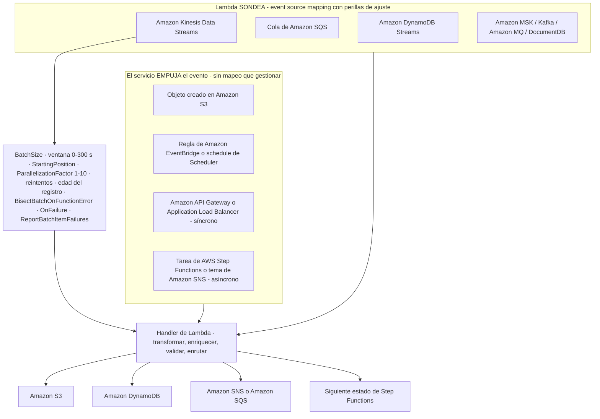
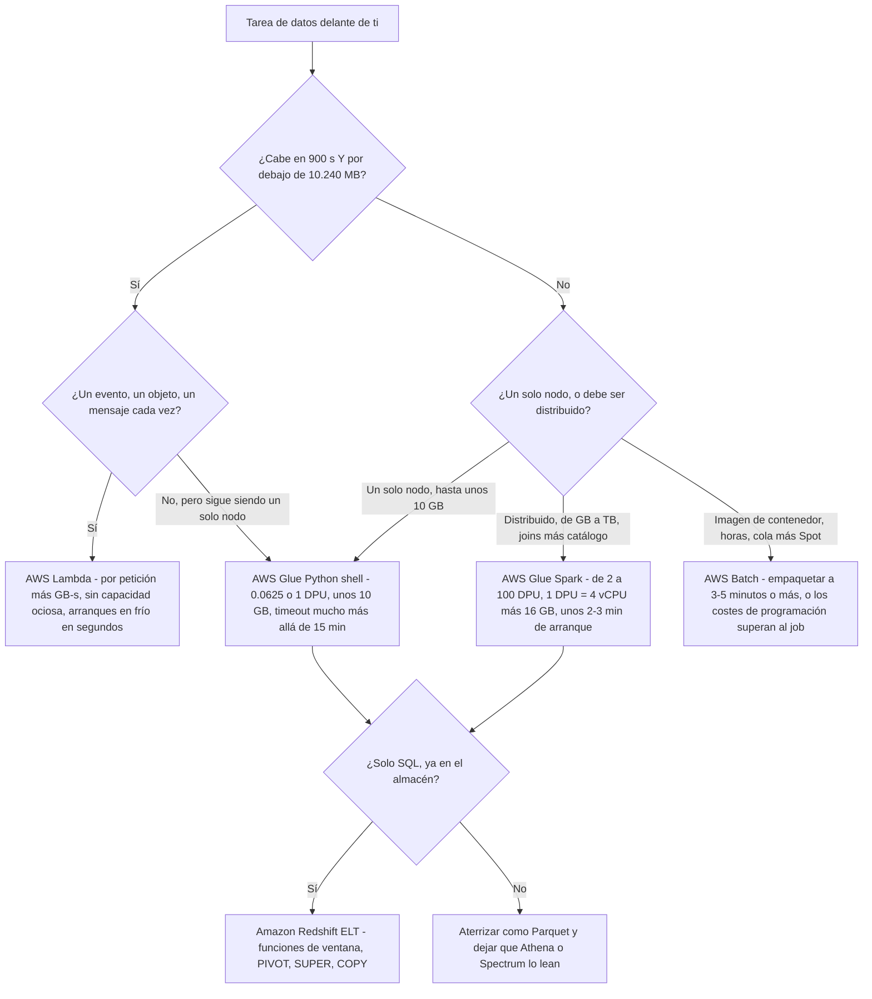
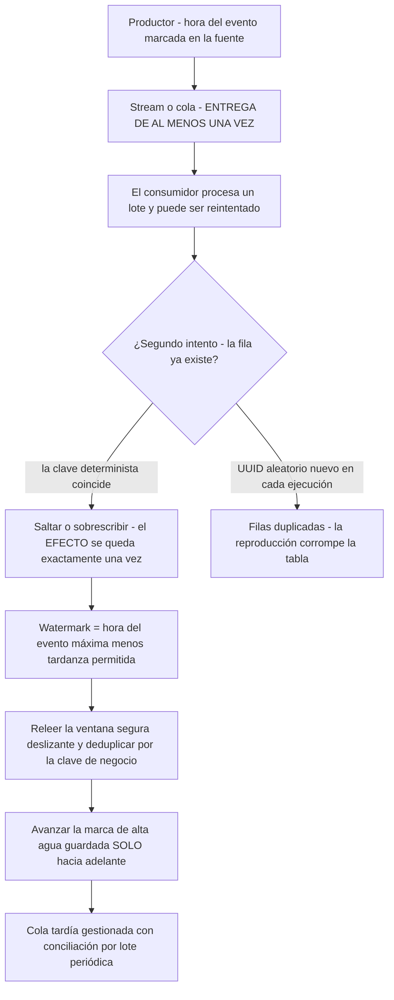
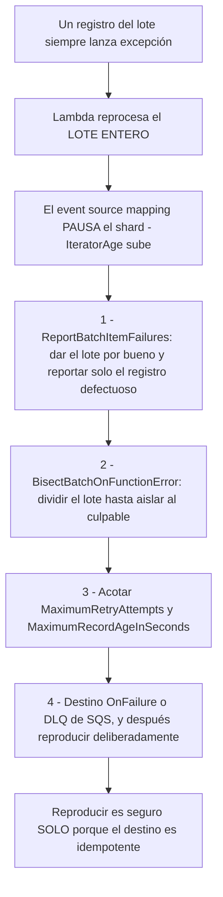

# Conceptos de programación para operaciones de datos

Todo el que has estudiado hasta ahora mueve y remodela datos. Esta lección plantea la pregunta de debajo: **¿qué código se ejecuta, y por qué se comporta así?** El DEA-C01 responde en el dominio 1, **tarea 1.4**, y el enunciado de la tarea es deliberadamente estrecho. La guía del examen lista los **«conceptos de programación agnósticos del lenguaje»** como en alcance y la **«sintaxis propia de cada lenguaje»** como fuera de alcance — así que ningún ítem te pedirá recordar un decorador, una comprensión de lista o un import de paquete. En cambio, el enunciado te entrega un **problema de pipeline** (ordena estas filas, deduplica esta reproducción, analiza este campo anidado, elige un runtime) y espera la **construcción o el servicio** correcto de vuelta (guía del examen DEA-C01, consultada en octubre de 2026).

```text
====================================================================
 DEA-C01 DOMINIO 1 - TAREA 1.4: APLICAR CONCEPTOS DE PROGRAMACIÓN
====================================================================
  Peso del dominio 1 .... 34% del contenido puntuado
  EN ALCANCE ............ conceptos de programación agnósticos del lenguaje,
                          SQL + optimización de consultas, IaC, Git, CI/CD,
                          cómputo distribuido, estructuras de datos y
                          algoritmos, concurrencia/rendimiento de Lambda,
                          AWS SAM, montar volúmenes en Lambda
  FUERA DE ALCANCE ...... "sintaxis propia de cada lenguaje"
---------------------------------------------------------------------
  CONCEPTO            ->  LA FORMA QUE TOMA EN UN PIPELINE DE DATOS
  funciones / tipos   ->  handler de Lambda, resolveChoice / cast: de Glue
  variables / ámbito  ->  variables locales frente a las de 4 KB de Lambda
  condicionales       ->  CASE WHEN, Choice de Step Functions, filtros
  bucles              ->  GROUP BY, estado Map, fan-out con repartition
  POO básico          ->  capas de Lambda montadas en /opt (máx. 5, zip)
  APIs                ->  paginación, backoff en 429, acceso SDK / CLI
  serialización       ->  elección CSV / JSON / Avro / Parquet / ORC
---------------------------------------------------------------------
  ENVOLVENTE DE RUNTIME (en octubre de 2026)
  Lambda ........ 1-900 s · 128-10.240 MB · 1.769 MB ~ 1 vCPU
  Glue Spark .... 2-100 DPU · 1 DPU = 4 vCPU + 16 GB · por defecto 10
  Glue PyShell .. 0.0625 o 1 DPU · ~10 GB de datos · mucho más allá de 15 min
  AWS Batch ..... imagen de contenedor · cola + entorno de cómputo · horas
====================================================================
```

En esta lección vas a:

- separar **conceptos agnósticos del lenguaje** de la sintaxis propia de cada lenguaje, y mapear cada concepto a la construcción que espera el examen;
- leer un **handler de Lambda** y una **configuración de job de Glue** como programas, no como curiosidades;
- elegir entre **pandas en un solo nodo** y **PySpark a través de particiones**, y nombrar el punto de cruce con honestidad;
- aplicar la **evaluación diferida**: las transformaciones construyen un plan, una acción desencadena el cómputo, y un shuffle es donde aterriza el coste;
- dimensionar **particiones**, elegir `coalesce` o `repartition`, y explicar por qué los archivos gzip perjudican;
- subir la **escalera de coste de las UDF** desde SQL integrado hasta Python a secas, y saber cuándo se justifica una UDF;
- escribir **funciones de ventana** en Spark SQL, Redshift y pandas, y saber por qué `PARTITION BY` cambia el paralelismo;
- usar **CTEs, joins, PIVOT y análisis de JSON** como los patrones de SQL que el examen vuelve a preguntar;
- configurar **AWS Lambda** para trabajo de datos: fuentes de eventos frente a mapeos de fuentes de eventos, el pool de concurrencia, el techo de 900 segundos, la CPU ligada a la memoria y las capas;
- aplicar la **matriz de decisión Lambda vs Glue vs Batch** sobre tamaño, duración, frecuencia y límites del runtime;
- distinguir la **entrega de al menos una vez** de un **efecto exactamente una vez**, y construir **escrituras idempotentes**;
- usar **watermarks** para acotar los datos tardíos, y subir la **escalera de manejo de píldoras venenosas**;
- aplanar **JSON anidado** y elegir entre **schema-on-read** y **schema-on-write**;
- leer el **cuadro de actualizaciones de octubre de 2026**, estudiar **dos casos de clientes de AWS** y practicar con **12 preguntas de estilo examen** más comprobaciones interactivas.
- **alcance ampliado de esta edición:** la lección ahora incluye **cinco casos de clientes de AWS** (EMX, AppsFlyer, Hearst, Nasdaq y PayU), **catorce preguntas de práctica** (`dea-06-q1` hasta `dea-06-q14`) y **tres comprobaciones interactivas** — emparejamiento, completar el hueco y arrastrar y soltar.

---

## 1. Conceptos de programación que el examen evalúa de verdad

### 1.1 El límite del alcance, con las propias palabras de la guía

Dos frases hacen todo el trabajo:

> **En alcance:** «conceptos de programación agnósticos del lenguaje» · **Fuera de alcance:** «sintaxis propia de cada lenguaje»

Todo lo de esta sección tiene que superar una prueba: *¿podría preguntar esto sin nombrar un lenguaje?* Si sí, es evaluable. «¿Qué significa `def handler(event, context)` como punto de entrada?» es evaluable — la forma es la misma en Python y el concepto de punto de entrada es universal. «¿Cuál es el orden exacto de argumentos de `pd.merge()`?» no lo es — eso es sintaxis.

La lista de habilidades de la tarea 1.4 dice lo mismo desde el otro lado. Las habilidades nombradas son **optimizar el rendimiento del runtime**, **concurrencia y rendimiento de Lambda**, **lenguajes y frameworks** (Python, SQL, Scala, R, Java, Bash, PowerShell), **control de versiones, pruebas, registro y monitorización**, **infraestructura como código**, **AWS SAM**, **montar volúmenes de almacenamiento en Lambda**, **CloudFormation/CDK**, **CI/CD**, **cómputo distribuido** y **estructuras de datos y algoritmos** — una lista de *capacidades*, con las preguntas de Git mantenidas **genéricas** tras eliminar AWS CodeCommit de la lista en alcance en la guía del examen **v1.1 (2025-12-12)** (página de revisiones de la guía DEA-C01, consultada en octubre de 2026).

### 1.2 El mapa concepto → construcción

Esta tabla es la sección 1 entera comprimida en lo que una pregunta puede evaluar de verdad:

| Concepto de programación | La forma que toma en un pipeline de datos | Lo que pregunta el examen |
|---|---|---|
| **Funciones y tipos** | El handler de Lambda es el punto de entrada; los jobs de Glue declaran `resolveChoice` y `cast:` para forzar tipos antes de una agregación | Nombra el punto de entrada, o a qué tipo hay que convertir una columna |
| **Variables y ámbito** | Las variables locales viven una invocación; las variables de entorno de Lambda son un **agregado de 4 KB** (en octubre de 2026) | Dónde **no** debe guardarse un secreto |
| **Condicionales** | `CASE WHEN` en SQL · estado `Choice` en Step Functions · `filter()` en Spark | Ramificar sobre los **datos**, nunca sobre la infraestructura |
| **Bucles** | `GROUP BY` elimina un bucle con una agregación · el estado `Map` hace fan-out · `foreach`/`repartition` paralelizan | Reconocer cuándo la iteración debe ser **serial** frente a **paralela** |
| **Fundamentos de POO** | Composición y reutilización → **capas** de Lambda montadas en `/opt`, máximo **5**, solo zip (en octubre de 2026) | Reutilizar código compartido sin copiarlo en cada paquete |
| **APIs** | Llamadas de lista paginadas, backoff en `429`/throttling, acceso programático con SDK y CLI | Elegir el acceso programático y manejar el throttling correctamente |
| **Serialización** | CSV → JSON/NDJSON → Avro → Parquet/ORC | Elegir el formato según el **patrón de acceso**, no por costumbre |
| **Cómputo distribuido** | Una partición = una tarea; los shuffle son límites de etapa | Dónde empieza el paralelismo y dónde aterriza el coste |
| **Estructuras de datos y algoritmos** | Claves hash para deduplicar, ventanas ordenadas para ranking, joins como hash/broadcast | Elegir la estructura que hace barata la operación |

### 1.3 Ejemplo resuelto E1 — leer un handler, no memorizar sintaxis

El examen te da una forma como esta y pregunta qué hace o qué cambiar. Léela como un **diagrama de flujo de control**:

```python
# Illustrative - the exam tests the SHAPE, not the boto3 calls.
def handler(event, context):
    """Entry point the platform invokes; the name and arity are fixed."""
    batch = event.get("records", [])     # variable holding a typed collection
    ok, bad = [], []                     # two accumulators = two code paths
    for record in batch:                 # loop over the batch, not over the table
        if record.get("amount") is None: # conditional on DATA
            bad.append(record)           # route poison records off the hot path
        elif record["amount"] < 0:
            bad.append(record)
        else:
            ok.append(record)
    if len(ok) > 1_000:                  # a conditional that changes STRATEGY
        write_partition_overwrite(ok)    # bulk, deterministic, replayable
    else:
        write_rows(ok)                   # small, row-at-a-time
    return {"ok": len(ok), "bad": len(bad)}
```

De ahí salen tres hechos evaluables: el **punto de entrada** es una función con una firma fija; los **condicionales enrutan registros** en lugar de reintentarlos; y el **cambio de estrategia en un umbral de tamaño** es exactamente la habilidad de «optimizar el rendimiento del runtime» — los conjuntos pequeños van fila a fila, los grandes van en masa.

### 1.4 Los condicionales y los bucles prefieren el SQL basado en conjuntos

El patrón más común del dominio 1 es un enunciado que describe un bucle sobre filas, con como respuesta correcta una **agregación o una función de ventana**:

| Idea imperativa | Respuesta basada en conjuntos | Por qué el examen la prefiere |
|---|---|---|
| Bucle que cuenta por cliente | `GROUP BY customer_id` | El motor hace el bucle en paralelo |
| Bucle que conserva la fila más reciente por clave | `ROW_NUMBER() OVER (PARTITION BY k ORDER BY ts DESC)` | Ranking sin auto-join |
| Bucle con un `if/else` que escribe columnas distintas | `CASE WHEN … END` dentro de la lista de selección | Una pasada, sin rama en el código de la aplicación |
| Bucle que hace fan-out sobre archivos | estado `Map` / `repartition` / un map de DynamicFrame de Glue | Paralelismo declarado, no hecho a mano |
| Bucle que espera una condición | `Choice` + `Wait` de Step Functions, o un watermark | Espera duradera en lugar de un bucle activo |

### 1.5 La orientación a objetos aparece como capas, no como clases

Las jerarquías de clases no son evaluables. La **reutilización** sí. La respuesta de AWS a «mi equipo tiene tres funciones de Lambda que necesitan todas la misma biblioteca de utilidades» es una **capa**: un archivo zip montado bajo `/opt`, con un máximo duro de **5 capas por función**, y — este es el detalle al que se aferran las preguntas — las capas son **solo zip**, de modo que una función con **imagen de contenedor** no puede usarlas en absoluto (la imagen hornea sus propias dependencias, hasta **10 GB**) (documentación de límites y capas de AWS Lambda, consultada en octubre de 2026).

### 1.6 Las APIs aparecen como paginación y throttling

Un enunciado que describe «llamar a un servicio que devuelve 100 registros cada vez hasta agotarlos» está evaluando la **paginación**; uno que describe «el pipeline falla cada pocos minutos con HTTP 429» está evaluando el **backoff con jitter**, no una biblioteca de reintentos concreta. Ambos son agnósticos del lenguaje, y ambos se mapean a las mismas palancas del lado del servicio que viste en la lección 05: políticas de reintento, DLQ y escrituras idempotentes.

### 1.7 La serialización es una decisión, no una sintaxis

| Formato | Orientación | Esquema | Firma en el examen |
|---|---|---|---|
| **CSV** | fila | ninguno | Solo intercambio — sin poda, sin tipos anidados |
| **JSON / NDJSON** | fila | inferido en la lectura | Anidamiento + schema-on-read; costoso de analizar |
| **Avro** | fila | **en la cabecera**, divisible | **Moverlo y hacerlo evolucionar** — streaming y evolución de esquemas |
| **Parquet / ORC** | **columnar** | en el pie de página | **Leerlo** — poda, pushdown de mín/máx, compresión |

La regla a la que se reduce la propia guía de AWS: **Avro/JSON para moverlo, Parquet/ORC para leerlo.** Como Athena factura los **bytes escaneados**, el formato *es* el coste — un archivo columnar que permite al motor saltarse las columnas sin tocar es más barato que un formato de fila que no puede hacerlo (documentación de AWS Athena y AWS Glue, consultada en octubre de 2026).

```matching
{
  "question": "Empareja cada concepto de programación agnóstico del lenguaje con la construcción que el examen DEA-C01 espera que nombres:",
  "pairs": [
    {"left": "Condicional sobre los datos", "right": "CASE WHEN en SQL, o un estado Choice en Step Functions - ramificar sobre los DATOS, nunca sobre la infraestructura"},
    {"left": "Bucle sobre filas", "right": "GROUP BY, una función de ventana, o un estado Map - basado en conjuntos o en paralelo, nunca un bucle de filas escrito a mano"},
    {"left": "Reutilización de código compartido", "right": "Capas de Lambda montadas en /opt - máximo 5, solo zip, así que las funciones con imagen de contenedor no pueden usarlas"},
    {"left": "Dónde vive un secreto", "right": "Secrets Manager o SSM Parameter Store con KMS - las variables de entorno de Lambda están limitadas a un agregado de 4 KB"},
    {"left": "Acceso a APIs paginado y limitado", "right": "Paginación con backoff y jitter en 429 - agnóstico del lenguaje, así que nunca se nombra una biblioteca de cliente"},
    {"left": "Elección del formato de serialización", "right": "Avro/JSON para moverlo, Parquet/ORC para leerlo - elegido según el PATRÓN DE ACCESO, no por costumbre"}
  ],
  "explanation": "La tarea 1.4 evalúa la CONSTRUCCIÓN, nunca la sintaxis. Cada par es la respuesta agnóstica del lenguaje que busca un enunciado: los condicionales se vuelven CASE WHEN o un estado Choice, los bucles se vuelven GROUP BY / una función de ventana / un estado Map, la reutilización se vuelve capas de Lambda en /opt (máx. 5, solo zip), los secretos salen de la envolvente de variables de entorno de 4 KB hacia Secrets Manager o SSM, el throttling se vuelve paginación más backoff, y la serialización se vuelve una decisión dictada por cómo se leerán los datos."
}
```

- **📚 ¿Sabías que…?** La guía DEA-C01 de AWS cambió cómo *presenta* este tema, no lo que contiene: en la **v1.1 (2025-12-12)** las listas separadas de «Knowledge of» y «Skills in» se **consolidaron en una sola lista de habilidades por tarea**, añadiendo **8 habilidades y quitando ninguna**. Por eso el material de estudio actual cita una lista plana numerada como «1.4.1 optimizar el rendimiento del runtime», mientras que el material antiguo cita un par Knowledge/Skills para el mismo contenido (página de revisiones DEA-C01, consultada en octubre de 2026).

---

## 2. Patrones de Python y PySpark para operaciones de datos

### 2.1 Un solo nodo frente a distribuido — elige antes de programar

La primera bifurcación de toda tarea de datos es **dónde corre el bucle**. Equivocarse es caro en ambas direcciones: un clúster distribuido para un archivo de 40 MB desperdicia el arranque y la capacidad ociosa, mientras que un solo nodo para un join de 200 GB se queda sin memoria.

| | **Un solo nodo** | **Distribuido** |
|---|---|---|
| Servicio | **Python shell de AWS Glue** · **AWS Lambda** · el driver de un job de Glue | **AWS Glue Spark (ETL)** · **Amazon EMR** · EMR Serverless |
| Capacidad | PyShell **0.0625 o 1 DPU**, unos **10 GB** de datos · Lambda **128–10.240 MB** y **≤900 s** | Glue Spark **2–100 DPU** (mínimo **2 DPU**), **1 DPU = 4 vCPU + 16 GB** |
| Ejecución | Un intérprete, un heap | Una **partición = una tarea** repartida entre workers |
| Arranque | Segundos (Lambda), pequeño (PyShell) | Los jobs de Glue Spark suelen pagar **~2–3 minutos** de arranque antes de la primera tarea |
| Forma del coste | Por petición + GB-s (Lambda), o una fracción de un DPU | Hora de DPU completa mientras corre el job, incluidos los workers ociosos |
| Falla cuando | Se queda sin memoria o alcanza su timeout | Desbalanceo, demasiados archivos pequeños, o un mal shuffle |

**Regla práctica de cruce:** unas **10 millones de filas / 5–10 GB** es el punto en que la gente deja de recurrir a pandas en un solo nodo — y debes declarar su procedencia con honestidad. Es una **regla práctica de terceros de 2017, nunca una cifra publicada por AWS**; los hechos con valor de examen son los *límites de servicio* anteriores, que están documentados por AWS (en octubre de 2026).

> [!WARNING]
> ⚠️ **Pandas sin reescribir en un job de Glue Spark sube tu factura.** Las guías de migración a Python shell de Glue de AWS señalan que un job de Glue Spark asigna **al menos dos workers de Spark**, de modo que el código que todavía ejecuta pandas en serie en el driver deja a los workers **ociosos y cobrados**. La solución es o pasar a un job de **Python shell** (un solo nodo, barato), o mover la lógica a **pandas sobre Spark / PySpark** (distribuido). Elegir «Glue Spark porque es más grande» es un error de coste, no un valor por defecto.

### 2.2 Evaluación diferida: primero el plan, después un solo cómputo

Las transformaciones de Apache Spark son **diferidas** — leer, filtrar, mapear y unir construyen un **plan**, y no se ejecuta nada hasta que una **acción** (`write`, `count`, `collect`, `toPandas`) fuerza la ejecución (AWS Prescriptive Guidance, *Tuning AWS Glue for Apache Spark*, consultado en octubre de 2026).

```mermaid
flowchart LR
    R["read - declarar la fuente"] --> F["filter - solo el plan"]
    F --> M["map / withColumn - solo el plan"]
    M --> J["join - solo el plan, shuffle declarado"]
    J --> A["ACCIÓN: write o count - empieza el cómputo"]
    A --> S["La etapa se divide en el límite del shuffle"]
    S --> T["Tarea por partición - 1 partición = 1 tarea"]
    T --> C["En caché solo si llamaste a persist o cache"]
```



Dos consecuencias sobre las que el examen construye preguntas:

1. **Un dataset transformado se recalcula en cada acción** salvo que lo `cache()`/`persist()`. Dos acciones sobre el mismo linaje pagan el linaje dos veces.
2. **Encadena tus transformaciones y actúa una sola vez.** Diez acciones baratas ganan a una cara solo si no comparten linaje recalculado — que es lo habitual.

```python
# PySpark - illustrative shape, not a memorisation exercise
from pyspark.sql import functions as F

df = spark.read.parquet("s3://lake/raw/orders/")   # plan: source scan declared
clean = (df
         .filter(F.col("amount") > 0)              # transformation - no compute
         .withColumn("order_day", F.to_date("ts")))# transformation - no compute
ranked = clean.withColumn(
    "rn",
    F.row_number().over(
        Window.partitionBy("customer_id", "order_day")
              .orderBy(F.col("amount").desc())))   # transformation - no compute
top = ranked.filter(F.col("rn") <= 3)              # still no compute
top.write.mode("overwrite").partitionBy("order_day") \
   .parquet("s3://lake/curated/top_orders/")       # ACTION - the plan executes
```

### 2.3 Particiones: la unidad de paralelismo y de coste

| Hecho | Valor | Fuente y fecha |
|---|---|---|
| Granularidad | **1 partición = 1 tarea** | AWS Prescriptive Guidance, oct. 2026 |
| Recuento objetivo | **2–3× núcleos** para Glue; **2–4 por CPU** para Spark | AWS Prescriptive Guidance / guía RDD de Spark, oct. 2026 |
| Particiones de shuffle por defecto | **200** | Ajuste del rendimiento SQL de AWS Glue, oct. 2026 |
| Umbral de aviso de desbalanceo | **128 MB** por partición (aviso de Spark SQL: **64 MB**) | Ajuste de AWS Glue, oct. 2026 |
| `maxResultSize` en un shuffle grande | **1 GB** | Ajuste de AWS Glue, oct. 2026 |
| Gzip | **No divisible** — un archivo, una tarea | Guía de parallelize-tasks de AWS Glue, oct. 2026 |
| Ejecución adaptativa de consultas | Fusiona particiones pequeñas automáticamente en Glue **≥4.0** / Spark **≥3.2** | AWS Glue, oct. 2026 |

#### Ejemplo resuelto E2 — aritmética de particiones

Tienes **120 GB** de Parquet en un job de Glue de **32 núcleos**:

```text
Particiones objetivo = 2 a 3 x núcleos = 64 a 96
Tomamos 96           -> 120 GB / 96    = 1.25 GB por partición
Si la fuente tiene 120.000 archivos diminutos:
  120.000 tareas en un job de 32 núcleos = OOM en el driver + saturación del scheduler
  arreglo: coalesce(96) en la lectura, o repartition(96) antes de la escritura
```

Las dos funciones **no** son intercambiables: `coalesce` fusiona particiones **sin un shuffle completo** (úsalo para **bajar**), mientras que `repartition` realiza un **shuffle completo** para alcanzar un recuento exacto (úsalo para **subir**, o para repartir el desbalanceo a lo largo de una clave).

- **📚 ¿Sabías que…?** «Más particiones = más rápido» es la idea errónea más cara de Spark. Más allá de unas **2–3× núcleos**, las particiones extra no añaden paralelismo — añaden sobrecarga del scheduler, escrituras de archivos pequeños y presión de GC. El error contrario es igual de malo: una partición gzip de 60 GB es **una tarea en un núcleo**, y como gzip es **no divisible** el motor no puede romperla. El hábito que vale la pena crear es repartir **por las columnas de partición antes de la escritura**, de modo que la disposición de archivos en la que aterrices sea la disposición que el lector podará (guía de parallelize-tasks de AWS Glue, consultada en octubre de 2026).

### 2.4 La escalera de coste de las UDF

Una **función definida por el usuario** es la válvula de escape para analizadores de terceros, puntuación de modelos y lógica de fila con estado. Todo lo demás debería quedarse en SQL integrado. Las propias guías de rendimiento de AWS colocan las opciones en una escalera, y el peldaño superior es unas **cinco veces** más rápido que el inferior:

| Peldaño | Implementación | Por qué cuesta lo que cuesta |
|---|---|---|
| ① El más barato | Funciones **integradas de Spark SQL** | Se ejecutan en el JVM, siguen visibles para el optimizador Catalyst, conservan el predicate pushdown |
| ② | **UDF vectorizada con pandas / Arrow** | Lotes Arrow en bloque — AWS lo mide en unas **5×** una UDF de Python a secas |
| ③ | **UDF de Python a secas** | **Serializa cada fila** a través de la frontera JVM↔Python; el optimizador la trata como una caja negra |
| ④ El más caro | **UDF de Scala / Java** | Sin frontera de Python, pero la menos portable y todavía opaca para algunas optimizaciones |

```python
# Ladder rung 3 - AVOID on hot paths: one pickle round trip PER ROW
@F.udf(returnType="string")
def normalise_slow(raw):           # Catalyst cannot push this predicate down
    return raw.strip().lower()

# Ladder rung 1 - PREFERRED: vectorised built-in, stays in the JVM
clean = df.withColumn("sku", F.upper(F.trim(F.col("raw_sku"))))

# Ladder rung 2 - only when there is genuinely no built-in:
# a pandas UDF batches whole Arrow record batches instead of single rows
```

**Regla del examen:** recurre a una UDF solo cuando ningún integrado puede hacerlo. En un job de mil millones de filas, el peldaño ③ frente al peldaño ① es la diferencia entre minutos y horas — y es una pregunta de *optimización de rendimiento*, que es la habilidad «optimizar el rendimiento de ejecución» de la tarea 1.4 (AWS Glue, *Optimize user-defined functions*, consultado en octubre de 2026).

### 2.5 Funciones de ventana: tres enunciados, tres respuestas

| Enunciado | Construcción |
|---|---|
| «más reciente / top **N** por clave» | `ROW_NUMBER() OVER (PARTITION BY key ORDER BY ts DESC)` |
| «total acumulado, delta periodo a periodo» | `SUM() OVER (ORDER BY …)` · `LAG(col) OVER (ORDER BY …)` |
| «cuota sobre el total» | `RATIO_TO_REPORT() OVER ()` (Redshift) o `SUM() OVER ()` como divisor |

```sql
-- Redshift / Spark SQL: top 3 orders per customer per day
SELECT customer_id,
       order_date,
       amount,
       ROW_NUMBER() OVER (
           PARTITION BY customer_id, order_date
           ORDER BY amount DESC
       ) AS rn
FROM orders
QUALIFY rn <= 3;
```

**Bisagra del paralelismo (un distractor favorito):** en **Amazon Redshift**, `PARTITION BY` es lo que permite a la función de ventana ejecutarse **a través de las slices en paralelo**; sin él, la ventana se calcula **en serie en una sola slice**. Y las funciones de ventana solo son legales en una lista **SELECT** o en el **ORDER BY final** — no en una cláusula `WHERE` (documentación de funciones de ventana de Redshift, consultada en octubre de 2026).

En **pandas**, el mismo trabajo es `groupby().transform()` o `groupby().cumcount()` — correcto, pero de **un solo nodo**. Pasado el tamaño de cruce, se lleva todo a **un** solo proceso, y por eso `df.toPandas()` / `collect()` dentro de un job de Glue Spark es el bug canónico de memoria agotada: arrastra el marco distribuido entero hacia el **driver**.

---

## 3. Patrones de SQL que el examen vuelve a preguntar

### 3.1 Las CTE escenifican la lógica para que cada paso sea legible

Una **expresión de tabla común** (`WITH`) es la forma de expresar «primero deduplicar, después filtrar, después ordenar» sin tres sentencias separadas — y la forma de hacer una consulta revisable. También es el hogar natural del paso de deduplicación en un pipeline idempotente (sección 6).

```sql
-- Stage 1: keep one row per (order_id, version) - the replay-safe row
WITH ranked AS (
    SELECT *, ROW_NUMBER() OVER (
        PARTITION BY order_id ORDER BY updated_at DESC, version DESC
    ) AS rn
    FROM raw_orders WHERE dt = '2026-10-09'
),
-- Stage 2: only the surviving rows join the aggregation
latest AS (
    SELECT order_id, customer_id, amount FROM ranked WHERE rn = 1
)
SELECT customer_id, COUNT(*) AS orders, SUM(amount) AS revenue
FROM latest
GROUP BY customer_id
ORDER BY revenue DESC;
```

### 3.2 Joins: califica los nombres, haz broadcast del lado pequeño

| Motor | Trampa del join que evalúa el examen | Hábito correcto |
|---|---|---|
| **Athena** | Dos tablas con una columna del **mismo nombre** producen un error de referencia ambigua | Califica: `FROM a JOIN b ON a.id = b.customer_id` |
| **Spark / Glue** | Un join es el **principal cuello de botella del shuffle** | **Broadcast** del lado pequeño (`/*+ BROADCAST(small) */` o `broadcast()`); apunta a la tabla pequeña por debajo del umbral de aviso |
| **Redshift** | El orden del join y las claves de distribución deciden si la consulta redistribuye datos | Prefiere la alineación **DISTKEY/SORTKEY** y `ANALYZE` antes de los joins grandes |
| Cualquier motor | Un join sin predicado es un **cross join** | Declara siempre las claves de join explícitamente |

### 3.3 PIVOT — y la alternativa portable

Amazon Redshift admite `PIVOT`, con límites duros que vale la pena memorizar:

```sql
-- Redshift PIVOT: only COUNT, SUM, MIN, MAX, AVG are allowed as aggregates
SELECT region, pivot_alias
FROM sales
PIVOT (SUM(amount) FOR region IN ('EMEA', 'AMER', 'APAC')) AS p;
```

| Regla de `PIVOT` de Redshift | Consecuencia |
|---|---|
| Agregados limitados a **COUNT, SUM, MIN, MAX, AVG** | Cualquier otra cosa necesita la forma portable |
| Sin `JOIN`, sin CTE recursiva, sin `UNNEST` de SUPER en la entrada | Escenifícalos antes en una CTE |
| La lista `IN` admite **literales** | Un pivot dinámico necesita SQL dinámico o la forma portable |

La forma portable, independiente del motor — que es la respuesta siempre que una pregunta pida un pivot que PIVOT no puede expresar:

```sql
SELECT order_date,
       SUM(CASE WHEN region = 'EMEA' THEN amount ELSE 0 END) AS emea,
       SUM(CASE WHEN region = 'AMER' THEN amount ELSE 0 END) AS amer,
       SUM(CASE WHEN region = 'APAC' THEN amount ELSE 0 END) AS apac
FROM sales
GROUP BY order_date;
```

### 3.4 Análisis de JSON: dos motores, dos familias

**Amazon Athena** (dialecto Presto/Trino) separa *extraer un valor JSON* de *extraer un escalar*:

```sql
-- Athena: json_extract returns JSON (quoted); json_extract_scalar returns text
SELECT json_extract_scalar(payload, '$.customer.id')  AS customer_id,
       json_extract_scalar(payload, '$.items[0].sku') AS first_sku
FROM events WHERE dt = '2026-10-09';

-- Nested arrays are flattened, then crossed with the parent row
SELECT e.order_id, i.sku, i.qty
FROM events e
CROSS JOIN UNNEST(e.items) AS i (sku, qty);
```

**Amazon Redshift** analiza JSON **una sola vez** en el tipo `SUPER` y después lo consulta con rutas al estilo PartiQL — `JSON_PARSE(payload)` → `SUPER`, acceso con punto y corchete, `UNNEST`, `UNPIVOT`. AWS declara explícitamente que **JSON no es una buena opción para datasets grandes** porque no es columnar; analízalo a `SUPER` una vez, o aterrizalo como **columnas Parquet/SUPER** (documentación de JSON y SUPER de Redshift, consultada en octubre de 2026).

> [!IMPORTANT]
> **Athena no tiene una historia de paginación profunda sin `OFFSET`.** Se admite `ORDER BY … LIMIT … OFFSET`, pero `ORDER BY` + `LIMIT` llega hasta **2.147.483.647 filas**, y Athena factura los **bytes escaneados** — así que la paginación con OFFSET profunda choca con un techo y además relee los mismos bytes. La respuesta amigable para el examen es la **paginación por clave** (`WHERE id > :last_id ORDER BY id LIMIT n`) sobre **Parquet particionado**, no offsets grandes sobre CSV.

### 3.5 Carga masiva: un COPY, no mil INSERT

La propia guía de Amazon Redshift es taxativa: **usa `COPY` para cargas grandes** — los `INSERT` individuales «pueden ser prohibitivamente lentos». Reglas de dimensionado: **un `COPY` por tabla/prefijo** (los COPY concurrentes a la misma tabla **se serializan**), archivos gzip/JSON no divisibles de **1 MB a 1 GB**, recuento ≈ número de **slices**, y los archivos CSV/Parquet de **≥128 MB** se dividen automáticamente (mejores prácticas de COPY de Redshift, consultadas en octubre de 2026).

#### Ejemplo resuelto E3 — dimensionado de COPY

```text
Fuente: 640 GB de CSV en gzip   Clúster: 128 slices
Destino = un múltiplo de 128 archivos, cada uno entre 1 MB y 1 GB
  128 x 5 GB -> más de 1 GB, dividirlo
  1.024 x 640 MB -> en rango, 8 archivos por slice -> bien
Entonces UN COPY para todo el prefijo: los COPY concurrentes a la misma
tabla se serializan, así que el paralelismo viene de FILE_COUNT dentro de un solo COPY.
```

---

## 4. AWS Lambda para tareas de datos

### 4.1 Dos formas en que llega un evento: push (trigger) frente a pull (event source mapping)

Esta distinción es la columna vertebral de toda pregunta de Lambda. Un **trigger** significa que el servicio **empuja** el evento hacia tu función; un **event source mapping (ESM)** significa que **Lambda sondea** el stream o la cola en tu nombre y agrega registros para ti (documentación de event source mappings de AWS Lambda, consultada en octubre de 2026).



| Palanca | Valores (en octubre de 2026) | A lo que renuncia |
|---|---|---|
| `BatchSize` (Kinesis) | por defecto **100**, máx. **10.000** | Rendimiento por invocación frente a latencia |
| Ventana de agregación | **0 s** (Kinesis/DDB/SQS), **500 ms** (MSK/Kafka/MQ), máx. **300 s** | Latencia frente a eficiencia de agregación |
| `ParallelizationFactor` | **1–10** | Más concurrencia por shard frente a presión de orden |
| `MaximumRetryAttempts` | **−1 (infinito)** a **10.000** | Retención de registros venenosos frente a tiempo de bloqueo |
| `MaximumRecordAgeInSeconds` | **−1** a **604.800 (7 días)** | Cuánto tiempo sigue reintentando un shard |
| `ReportBatchItemFailures` | activado/desactivado | Éxito parcial del lote frente a reintento del lote entero |

> [!WARNING]
> ⚠️ **El modo de fallo del ESM es el lote entero y el shard entero.** Ante un fallo, Lambda **reprocesa el lote completo** y **pausa el shard** — y por eso el primer síntoma de un registro defectuoso es un `IteratorAge` en ascenso, no una tasa de errores. Los valores por defecto son **infinitos**, de modo que un único registro venenoso puede bloquear un stream de DynamoDB durante **hasta un día** y un shard de Kinesis durante **hasta una semana** (documentación de errores de DynamoDB/Kinesis de AWS Lambda, consultada en octubre de 2026).

### 4.2 Concurrencia: reservada frente a aprovisionada

AWS da a cada cuenta un pool de **1.000 ejecuciones concurrentes por región**, compartido entre todas las funciones, con un suelo no reservado de **100**, y una tasa de ingesta sostenible de unas **10 peticiones/segundo por unidad de concurrencia** (en octubre de 2026).

| | **No reservada** | **Reservada** | **Aprovisionada** |
|---|---|---|---|
| Qué es | Lo que quede del pool de 1.000 | Un **mínimo *y* máximo** duro para una función | Entornos de ejecución precalentados |
| Precio | — | **Gratis** | **Se cobra** (por GB-s y por hora, facturación de 1 ms) |
| Se aplica a | — | Cualquier función | Solo **versiones y alias** de función |
| Uso canónico | Tráfico best-effort | **Garantizar la capacidad de un pipeline**, *o* **limitar una función para no saturar un pool pequeño de base de datos** | **Latencia interactiva** — recortar los arranques en frío |

**Aritmética de dimensionado:** concurrencia requerida ≈ `peticiones/segundo × duración en segundos`, y la guía de aprovisionamiento de AWS añade un margen de **~10%**. La concurrencia aprovisionada **no** es la respuesta a «mi pipeline asíncrono debería arrancar rápido» — AWS declara que los pipelines asíncronos normalmente no la necesitan (documentación de concurrencia de AWS Lambda, consultada en octubre de 2026).

#### Ejemplo resuelto E4 — dimensionado de concurrencia

```text
Pico: 200 invocaciones concurrentes, duración media de 250 ms
Entornos cálidos para la concurrencia aprovisionada:
    200 x 0.250 s = 50 ejecuciones concurrentes
    +10% de margen                          -> aprovisionar 55
El pool de la cuenta es de 1.000 por región:
    reservado para esta función  <= 1.000 - 100 (suelo no reservado) = 900
    la concurrencia aprovisionada debe caber dentro de la envolvente reservada
Techo de peticiones por segundo con concurrencia de 200:
    10 x 200 = 2.000 peticiones/segundo (en octubre de 2026)
```

### 4.3 Tiempo de espera y el acoplamiento memoria → CPU

**No existe una perilla de vCPU.** La CPU, la red y la GPU escalan **con el ajuste de memoria**, que es el hecho de rendimiento de Lambda más evaluable de todos:

| Ajuste | Valor (en octubre de 2026) |
|---|---|
| Tiempo de espera | **1–900 s**, por defecto en consola **3 s**, techo duro de **900 s (15 min)** |
| Memoria | **128–10.240 MB** en incrementos de **1 MB** |
| **1.769 MB** | ≈ **1 vCPU** |
| **10.240 MB** | ≈ **6 vCPUs** |
| `/tmp` | **512 MB gratis**, después facturado, hasta **10.240 MB** |
| Variables de entorno | **Agregado de 4 KB** |
| Paquete de despliegue | **50 MB comprimido / 250 MB descomprimido**, incluidas hasta **5 capas** |
| Imagen de contenedor | **10 GB** |
| Almacenamiento de código | **300 GB descomprimido**, no ampliable |

#### Ejemplo resuelto E5 — memoria, CPU y coste unitario

```text
El job necesita unos 1 vCPU. El ajuste actual de 1.024 MB (~0.6 vCPU) es lento.
Arreglo: subir la memoria a 1.769 MB - no existe un ajuste de CPU aparte.

Coste unitario de UNA invocación a 1.769 MB x 500 ms:
    1.769 GB x 0.5 s = 0.8845 GB-s
    0.8845 x $0.0000166667 (nivel x86 1) = $0.0000147 por invocación

Mensual con 10 millones de invocaciones:
    duración  10,000,000 x 0.8845 GB-s = 8,845,000 GB-s
    menos gratis 400,000 GB-s           = 8,445,000 GB-s facturables
    8,445,000 x $0.0000166667           = $140.75
    peticiones 10,000,000 - 1,000,000 gratis = 9,000,000
    9,000,000 / 1,000,000 x $0.20       =   $1.80
    total                                ~ $142.55 / mes
    (precios en octubre de 2026 - verifica la tarifa vigente antes de usarlos)
```

### 4.4 Capas, variables de entorno y `/tmp`

- **Capas** son la historia de reutilización orientada a objetos (sección 1.5): **≤5**, **solo zip**, montadas en **`/opt`**. Una función con imagen de contenedor no puede usar capas.
- **Variables de entorno** limitadas a **4 KB en agregado** y **legibles a través de la API** — así que son configuración, **no un almacén de secretos**. Los secretos van en **AWS Secrets Manager** o **Systems Manager Parameter Store**, cifrados con **KMS**.
- **`/tmp`** es **transitorio y por entorno de ejecución**: sobrevive a invocaciones cálidas del *mismo* entorno y desaparece cuando el entorno se recicla. Es una **caché**, nunca estado duradero, y los primeros **512 MB** son gratis (en octubre de 2026).
- **Montar almacenamiento:** la tarea 1.4 nombra expresamente *montar volúmenes de almacenamiento en Lambda* — **Amazon EFS** es la respuesta duradera y multi-entorno; `/tmp` es la efímera.

#### Ejemplo resuelto E6 — ¿es Lambda el runtime correcto del todo?

```text
Requisito: una fusión nocturna de tres archivos CSV en Python, un solo nodo,
45 minutos, sin joins distribuidos.

Lambda           : techo duro de 900 s            -> imposible a cualquier precio
Glue Spark       : 2-3 min de arranque + 2 DPU mín -> un clúster para un bucle
Glue Python shell: 0.0625 o 1 DPU, timeout mucho más allá de 15 min
                                                     -> LA RESPUESTA
Lógica de selección: "un solo nodo + más de 15 min = Python shell",
independientemente del recuento exacto de bytes (la cifra de ~10 GB es la
guía del conjunto de trabajo que te dice cuándo el shell deja de bastar).
```

---

## 5. La matriz de decisión Lambda vs Glue vs Batch

### 5.1 La matriz

Esta tabla es el artefacto único de mayor rendimiento de la tarea 1.4. Cada fila es un **límite con fuente en octubre de 2026**:

| Señal en el enunciado | **Elige** | Por qué, con el límite |
|---|---|---|
| Transformación de eventos, de segundos a minutos, escala de GB | **AWS Lambda** | Techo de **900 s**, memoria de **10.240 MB**, facturado por petición + GB-s, sin capacidad ociosa |
| pandas en un solo nodo, **más de 15 min o unos 10 GB** | **AWS Glue Python shell** | **0.0625 / 1 DPU**, unos **10 GB**, timeout mucho mayor que los duros 15 minutos de Lambda |
| ETL distribuido, joins, GB–TB, necesita el **Data Catalog** | **AWS Glue Spark (ETL)** | **2–100 DPU** (por defecto **10**), **1 DPU = 4 vCPU + 16 GB**; espera **~2–3 min** de arranque |
| Imagen de contenedor, **horas**, cola + capacidad **Spot** | **AWS Batch** | Job Docker en una cola y un entorno de cómputo; la sobrecarga de programación implica empaquetar jobs de **3–5 minutos** o más |
| Hato Spark/Hadoop existente, escala de **petabytes** | **Amazon EMR** / EMR Serverless | Tú aportas la versión del framework y la configuración del clúster |
| Transformación solo con SQL ya en el almacén | **Amazon Redshift** ELT | Funciones de ventana, PIVOT, SUPER y `COPY` se quedan dentro del motor |



### 5.2 Ejemplo resuelto E7 — el mismo job en dos runtimes

```text
Job: 1,44 millones de invocaciones al mes, 300 ms cada una, 512 MB

Lambda:
    GB-s      1,440,000 x 0.512 GB x 0.3 s = 221,184 GB-s
    nivel gratuito 400,000 GB-s -> coste de duración $0
    peticiones (1,440,000 - 1,000,000) / 1,000,000 x $0.20 = $0.088
    total     ~ $0.09 al mes

El mismo trabajo como job de Glue Spark: 10 minutos al día con 4 DPU
    4 DPU x (10/60) h = 0.667 DPU-h al día
    0.667 x 30 días   = 20 DPU-h al mes
    20 x $0.44/DPU-hora = $8.80 al mes
    (Glue ETL a $0.44 por DPU-hora en octubre de 2026 - verifica la tarifa
     vigente antes de usarla; precios de Lambda en octubre de 2026)

Diferencia: unas 98 veces más barato en Lambda - porque el trabajo tiene
FORMA DE INVOCACIÓN, no forma de JOB.
```

La lección no es «Lambda siempre es más barato» — es que **la facturación sigue la forma del trabajo**. Una fusión nocturna de 40 minutos no puede ejecutarse en Lambda a ningún precio (el techo de **900 s**), y un job de 2 segundos no justifica **AWS Batch**, donde la sobrecarga de programación puede superar al runtime.

- **📚 ¿Sabías que…?** La propia guía de Glue de AWS pone por escrito el coste de arranque: los jobs de Glue Spark suelen gastar **2–3 minutos** antes de que corra la primera tarea, que es *más* tiempo de ejecución que el propio job para cargas útiles de menos de 100 MB. Por eso los enunciados del examen de «pequeño, frecuente y dirigido por eventos» apuntan a Lambda y los de «grande, programado y con muchos joins» apuntan a Glue — y por eso un enunciado que dice *«archivos pequeños y frecuentes que llegan cada pocos segundos»* normalmente te está diciendo que rechaces tanto Glue **como** Batch (documentación de mejores prácticas de AWS Glue y AWS Batch, consultada en octubre de 2026).

---

## 6. Idempotencia, watermarks y píldoras venenosas

### 6.1 Entrega de al menos una vez, *efecto* exactamente una vez

Los streams y colas — Kinesis, SQS, DynamoDB Streams, MSK — entregan **de al menos una vez** por defecto. No existe un transporte de extremo a extremo exactamente una vez. Lo que los pipelines construyen en su lugar es un **efecto exactamente una vez**: **entrega de al menos una vez + un efecto secundario idempotente** (AWS Big Data Blog, *Build a fault-tolerant serverless data aggregation pipeline with exactly-once processing*, 2021-11-01).

| Caja de herramientas | Mecanismo | Cuándo |
|---|---|---|
| **Claves deterministas** | Hash o clave de negocio, nunca un UUID nuevo | Cualquier deduplicación o upsert |
| **Sobrescritura de partición** | `INSERT OVERWRITE PARTITION (dt=…)` | Reejecuciones de lote de día completo |
| **MERGE / upsert** | `MERGE INTO … ON key` | CDC y cambios que llegan tarde |
| **`INSERT … ON CONFLICT DO NOTHING`** | Unicidad impuesta por la base de datos | Tablas de eventos solo de inserción |
| **Escrituras condicionales** | `attribute_not_exists(key)` / `ConditionExpression` | DynamoDB, guardas de versión |
| **Clave hash del lote** | SHA-256 sobre el lote como clave de idempotencia | Deduplicación a nivel de lote |
| **`ClientRequestToken`** | Token aportado por el cliente, válido **≤10 min** | Llamadas a API resistentes a repetición |
| **Libro mayor de ejecuciones** | Una tabla `pipeline_runs` que se comprueba antes de empezar | Idempotencia del pipeline entero |

```python
# Idempotent sink - illustrative shape
import hashlib

def batch_key(records):
    """Deterministic: the SAME batch always produces the SAME key."""
    ids = sorted(r["order_id"] for r in records)
    return hashlib.sha256("|".join(ids).encode()).hexdigest()

def sink(records, dt):
    # 1. Guard: has this exact batch already been committed?
    if runs.exists(batch_key(records), dt):
        return "skipped"            # replay is a no-op, not a duplicate
    # 2. Write deterministically: overwrite the partition, or upsert by key.
    #    NEVER append with uuid4() keys - that is the classic duplicate bug.
    write_partition_overwrite(records, dt=dt)
    runs.mark_complete(batch_key(records), dt)
    return "written"
```

> [!WARNING]
> ⚠️ **Un UUID nuevo por fila destruye la idempotencia.** Si cada reproducción genera claves nuevas, cada reintento *parece* datos nuevos, y los duplicados se acumulan en silencio. La regla es: **clave de negocio determinista + sobrescritura de partición / MERGE / escritura condicional**. Asume que cada `foreachBatch`, cada reintento de Lambda y cada redrive de DLQ **se ejecuta al menos dos veces**.

### 6.2 Watermarking: cuánto esperas a los datos tardíos

Un **watermark** es `hora del evento máxima − tardanza permitida`. Acota cuánto espera un job de streaming por los registros tardíos antes de cerrar una ventana y liberar el estado que hay detrás. Muévelo **solo hacia adelante**: demasiado generoso y el estado crece sin límite; demasiado ajustado y los registros tardíos se descartan **en silencio** (guías de streaming de AWS y de la comunidad, consultadas en octubre de 2026).

En un job **incremental de Glue** la misma idea aparece como una marca de alta agua guardada más una **ventana segura deslizante**:

```text
Marca de alta agua guardada : last_event_ts = 2026-02-01
Tardanza permitida          : 2 días
Relectura de ventana segura : WHERE event_ts > 2026-01-30   (solape de 2 días)
Deduplicación               : dropDuplicates(["order_id"])   (o MERGE sobre la clave)
Avance de la marca          : last_event_ts = max(old, new)  - solo hacia adelante
Riesgo residual             : registros posteriores a la ventana -> conciliación
                              por lote periódica, no un watermark mayor
```



#### Ejemplo resuelto E8 — la ventana segura

```text
Watermark en 2026-02-01, tardanza permitida de 2 días.
Un registro llega el 2026-02-02 con event_ts 2026-02-01 23:40
  -> dentro del watermark: ACEPTADO, porque la relectura de la ventana
     segura cubre > 2026-01-30 y dropDuplicates(MERGE) elimina
     lo que ya se haya escrito.
Un registro llega el 2026-02-09 con event_ts 2026-02-08
  -> POR DETRÁS del watermark: descartado en silencio por una fuente de
     streaming; solo lo recupera la pasada de conciliación por lote programada.
Coste de ampliar la ventana a 7 días: cada ejecución relee 7 días
  de datos y mantiene 7 días de estado de deduplicación - un intercambio
  de latencia/almacenamiento, nunca una victoria gratis.
```

```fillblank
{
  "question": "Completa las afirmaciones de fiabilidad usando el vocabulario exacto que usa el examen:",
  "template": "Los streams y colas entregan {{1}} por defecto, y un efecto {{2}} solo se produce al combinar esa entrega con una escritura {{3}}. Un {{4}} equivale a la hora del evento máxima menos la tardanza permitida y solo puede avanzar, mientras que un registro que siempre lanza es una {{5}} que pausa el shard hasta que los reintentos y la edad del registro quedan acotados.",
  "answers": {
    "1": "al menos una vez",
    "2": "exactamente una vez",
    "3": "idempotente",
    "4": "watermark",
    "5": "píldora venenosa"
  },
  "distractors": ["como máximo una vez", "efectivamente una vez", "no determinista", "desfase de hora de evento", "registro de dead-letter", "ventana de agregación", "arrendamiento de shard", "offset de checkpoint"],
  "explanation": "Las garantías de entrega describen el TRANSPORTE (de al menos una vez), el EFECTO es lo que construyes encima (al menos una vez + un destino idempotente), el watermark acota cuánto esperas a los datos tardíos y solo avanza, y una píldora venenosa es el registro cuyo bucle de reintento bloquea el shard hasta que MaximumRetryAttempts y MaximumRecordAgeInSeconds convierten el valor por defecto infinito en uno acotado."
}
```

### 6.3 Manejo de píldoras venenosas: la escalera

Una **píldora venenosa** es un registro que siempre lanza excepciones. Como un ESM reintenta el **lote completo** y **pausa el shard**, un registro defectuoso puede parar un stream entero — y los valores por defecto son infinitos:



| Peldaño | Palanca | Efecto (en octubre de 2026) |
|---|---|---|
| 1 | **`ReportBatchItemFailures`** | Reporta el fallo por registro; los registros buenos **no** se reintentan |
| 2 | **`BisectBatchOnFunctionError`** | Divide repetidamente el lote fallido por la mitad para aislar al culpable |
| 3 | **`MaximumRetryAttempts`** (**−1…10.000**) + **`MaximumRecordAgeInSeconds`** (**−1…604.800**) | Convierte el reintento infinito en un bloqueo acotado |
| 4 | Destino **`OnFailure`** (SQS/SNS/S3/Kafka) o una **DLQ** | Estaciona los registros defectuosos para inspección y reproducción |
| Variante SQS | **`maxReceiveCount` → DLQ** | La versión nativa de SQS del peldaño 4 |
| Prefiltro | **`FilterCriteria`** | Descarta los eventos no coincidentes **antes** de que lleguen a la función |

```dragdrop
{
  "question": "Coloca la escalera de manejo de píldoras venenosas en el orden en que la aplica un ingeniero de datos, desde la primera palanca que no cuesta nada hasta la última línea de defensa:",
  "items": [
    "ReportBatchItemFailures - dar el lote por bueno y reportar solo el registro que falló, para que no se reintenten los registros buenos",
    "BisectBatchOnFunctionError - dividir por la mitad el lote fallido repetidamente hasta aislar el registro culpable",
    "Acotar MaximumRetryAttempts (0 a 10.000) y MaximumRecordAgeInSeconds (hasta 604.800 s) para que el reintento infinito se convierta en un bloqueo acotado",
    "Destino OnFailure o una cola dead-letter de SQS - estacionar los registros defectuosos para inspección en lugar de bloquear el shard",
    "Reproducción deliberada desde la DLQ - segura SOLO porque el destino se hizo idempotente en la sección 6.1"
  ],
  "correctOrder": [
    "ReportBatchItemFailures - dar el lote por bueno y reportar solo el registro que falló, para que no se reintenten los registros buenos",
    "BisectBatchOnFunctionError - dividir por la mitad el lote fallido repetidamente hasta aislar el registro culpable",
    "Acotar MaximumRetryAttempts (0 a 10.000) y MaximumRecordAgeInSeconds (hasta 604.800 s) para que el reintento infinito se convierta en un bloqueo acotado",
    "Destino OnFailure o una cola dead-letter de SQS - estacionar los registros defectuosos para inspección en lugar de bloquear el shard",
    "Reproducción deliberada desde la DLQ - segura SOLO porque el destino se hizo idempotente en la sección 6.1"
  ],
  "explanation": "La escalera va de lo más barato y menos disruptivo a lo más deliberado: primero deja de reejecutar registros que ya funcionaron (ReportBatchItemFailures), después aisla al culpable (BisectBatchOnFunctionError), después acota el presupuesto de reintentos para que un solo registro no pueda bloquear el shard durante un día o una semana (MaximumRetryAttempts y MaximumRecordAgeInSeconds), después desvía lo que quede a un destino OnFailure o a una DLQ, y solo entonces reproducir. Reproducir es el último paso porque es el único que puede crear duplicados - y por eso las claves deterministas y la sobrescritura de partición o MERGE de la sección 6.1 tienen que estar en su sitio antes de que jamás tires de la DLQ. Los valores por defecto sin esta escalera son infinitos: hasta un día de bloqueo en un stream de DynamoDB y hasta una semana en un shard de Kinesis (documentación de event source mappings de AWS Lambda, consultada en octubre de 2026)."
}
```

#### Ejemplo resuelto E9 — de un bloqueo de una semana a uno de una hora

```text
ANTES (por defecto): un registro defectuoso de Kinesis
    reintentos       = infinitos
    edad del registro = infinita
    resultado        = shard bloqueado HASTA UNA SEMANA
                       (DynamoDB Streams: hasta UN DÍA)

DESPUÉS (configurado):
    MaximumRetryAttempts        = 5
    MaximumRecordAgeInSeconds   = 3.600
    BisectBatchOnFunctionError  = true
    OnFailure -> SQS DLQ
    resultado: unas 1 hora de reintento acotado, 5 intentos, los registros
               defectuosos estacionados en una cola de SQS, shard liberado.
Reproducir desde la DLQ es seguro SOLO porque la sección 6.1 hizo
idempotente el destino - de lo contrario, reproducir es como duplicas la tabla.
```

- **📚 ¿Sabías que…?** Los tres *responsables* del reintento de este examen son distintos, y las preguntas los mezclan a menudo: para invocaciones **síncronas** reintenta el **llamante**; para invocaciones **asíncronas** reintenta **Lambda** la función **dos veces** (a los 1 y 2 minutos) antes de un destino de fallo; y para los **event source mappings** reintenta el **propio mapeo** el lote y pausa el shard. Un mismo `429` en un enunciado tiene por tanto tres respuestas distintas según cómo se haya invocado la función (documentación de invocaciones asíncronas y de ESM de AWS Lambda, consultada en octubre de 2026).

---

## 7. Datos anidados: aplanado, y schema-on-read frente a schema-on-write

### 7.1 Dos filosofías de esquema

| | **Schema-on-write** | **Schema-on-read** |
|---|---|---|
| Cuándo se aplica el esquema | **Al cargar** — definir y hacer cumplir antes de que aterricen los datos | **Al consultar** — aterrizar en bruto, aplicar el esquema al leer |
| Forma típica del servicio | Definiciones de tabla y restricciones de Amazon Redshift | **Amazon S3 + AWS Glue Data Catalog + Amazon Athena** |
| Rendimiento de consulta | Más rápido — tipos y disposiciones ya fijados | Más lento por consulta — el análisis y la coerción ocurren en la lectura |
| Coste de un error | Rechazar la carga, arreglar aguas arriba | **La deriva sale como errores del consumidor** |
| Flexibilidad | Baja — contrato por adelantado | Alta — nuevos consumidores, nuevas formas |
| Respuesta del examen | Almacenes y capas de servicio curadas | Data lakes y zonas raw/bronce |

> [!IMPORTANT]
> **Schema-on-read no significa «sin trabajo de esquema».** La propia guía de arquitectura de AWS es mantener una **capa en bruto almacenada tal cual** y colocar encima una **capa estandarizada con validación de esquemas y control de evolución** — una capa de contrato. Sin ella, la deriva de esquema en la zona raw se convierte en una **interrupción del lado del consumidor**, que es el modo de fallo que una pregunta describirá cuando quiera esta respuesta (AWS Prescriptive Guidance, *Modern data architecture*, consultado en octubre de 2026).

### 7.2 Aplanado de datos anidados, por motor

| Motor | Mecanismo |
|---|---|
| **AWS Glue** | `UnnestFrame` / `Relationalize` sobre un DynamicFrame |
| **Amazon Athena** | `flatten()` para arrays · `CROSS JOIN UNNEST … WITH ORDINALITY` para expansión de struct/array |
| **Amazon Redshift** | Tipo `SUPER` con `UNNEST` / `UNPIVOT` y rutas PartiQL |
| **Apache Spark** | `explode()` / `explode_outer()` para convertir una columna array en filas |

```sql
-- Athena: one row in, one row per array element out
SELECT e.order_id,
       i.sku,
       i.qty,
       i.price
FROM orders e
CROSS JOIN UNNEST(e.items) AS i (sku, qty, price);
-- A NULL array yields NO rows with CROSS JOIN UNNEST;
-- use LEFT JOIN UNNEST (or explode_outer) when you must keep the parent.
```

Dos consecuencias que vale la pena memorizar: **un array NULL no produce filas** bajo un cross-unnest (encogiendo tu resultado en silencio), y un **esquema explícito en el momento de la lectura gana a la inferencia de esquemas** — la inferencia es cómoda una vez e imprevisible para siempre.

### 7.3 El formato sigue al patrón de acceso, y el formato *es* el coste

```text
aterrizaje en bruto : JSON o CSV, almacenado tal cual  (schema-on-read, barato de escribir)
                        |
                        v   AWS Glue ETL o CTAS de Athena
curado              : Snappy-Parquet, disposición Hive  year=/month=/day=
                        |
                        v
servicio            : Athena / Redshift Spectrum / QuickSight
                    - la poda de columnas salta las columnas sin tocar
                    - las estadísticas de mín/máx podan grupos de filas enteros
                    - Athena factura BYTES ESCANEADOS, así que la poda ES la factura
```

#### Ejemplo resuelto E10 — la decisión de formato, con precios

```text
Escenario: tabla de 1 TB, una consulta que toca 3 de 30 columnas.
Precio de lista de Athena: $5.00 por TB escaneado (en octubre de 2026 - verifica
la tarifa vigente antes de usarla), mínimo de 10 MB por consulta.

CSV, sin poda         : escanea ~1 TB        -> unos $5.00 por ejecución
Parquet, columnar     : escanea solo las 3 columnas necesarias más metadatos
                        -> normalmente un orden de magnitud menos
Diez ejecuciones al día x 30 días:
    CSV      300 x $5.00  = $1,500 / mes
    Parquet  300 x ~$0.50 =   ~$150 / mes   (ilustrativo)
La conversión (CTAS o un job de Glue) es un coste ÚNICO frente a un
AHORRO RECURRENTE - y por eso «convertir a Parquet» es casi siempre
la respuesta correcta en un enunciado de costes de Athena.
```

- **📚 ¿Sabías que…?** La pregunta de linaje adora el contraste de los cuatro formatos porque es puramente de *forma*: **CSV** no tiene esquema ni poda, **JSON** anida pero hay que analizarlo entero, **Avro** lleva su **esquema en la cabecera** y es **divisible** — y exactamente por eso los jobs de streaming y de evolución de esquemas lo prefieren —, y **Parquet/ORC** son **columnares**, y por eso los motores analíticos lo hacen. La memoria de una línea es *Avro/JSON para moverlo, Parquet/ORC para leerlo* (guía de formatos de AWS Glue y Athena, consultada en octubre de 2026).

---

### Actualizaciones de 2026 (en octubre de 2026)

> [!NOTE]
> **Qué se movió en programación y operaciones de datos entre 2024 y octubre de 2026** — cada línea se contrasta con una fuente primaria de AWS en **octubre de 2026**, y cada una es evaluable porque el examen comprueba el comportamiento *actual*:
> - **La propia guía del examen se reconstruyó**: la **v1.1 (2025-12-12)** consolidó las listas separadas de «Knowledge of» y «Skills in» en **una sola lista de habilidades por tarea**, añadiendo **8 habilidades y quitando ninguna**; **Cloud9, CodeCommit y AWS Schema Conversion Tool** salieron de la lista en alcance, así que **las preguntas de Git se quedan genéricas** (clone, commit, branch, merge) y nunca nombran un servicio de Git concreto de AWS — revisiones y páginas en alcance de la guía DEA-C01, consultadas en octubre de 2026.
> - **Las generaciones de runtime de Glue avanzaron**: **Glue 5.1 se convirtió en el valor por defecto para jobs nuevos el 2025-11-26** (Spark 3.5.6), y **Glue 6.0 salió a GA el 2026-08-21** con **Spark 4.1.1, Python 3.13, Scala 2.13** y una **reducción de precio del 30%**; Glue **0.9/1.0/2.0 llegó a fin de vida el 2026-04-01**, y **Python Shell 3.6** ya no puede crearse después del **2026-03-31** — notas de versión de AWS Glue, política de soporte de versiones y What's New, consultados en octubre de 2026. Un enunciado que fija una versión de Glue EOL es una respuesta errónea.
> - **Glue 6.0 elimina dos vías de compatibilidad**: desaparece **EMRFS** (S3A es el único sistema de archivos S3) y **se elimina el AWS SDK for Java v1** — AWS Glue, *Migrating to version 6.0*, consultado en octubre de 2026. Cualquier opción que dependa de `fs.s3.consistent.*` o de imports `com.amazonaws.*` está obsoleta.
> - **Las UDF de Python de Redshift se están retirando**: **sin nuevas UDF escalares de Python después del 2025-10-30** y **sin soporte después del 2026-06-30** — página de cambios de comportamiento de Amazon Redshift, consultada en octubre de 2026. Esto remodela directamente la escalera de UDF de la sección 2.4: en Redshift, la respuesta amigable para el examen se desplaza a **SQL, procedimientos almacenados y ML**, no a nuevas UDF de Python.
> - **El suelo de coste de Athena bajó**: los **resultados de consulta gestionados** (2025-06-03) están cifrados, los gestiona el servicio y **no cuestan nada extra** — sin bucket de resultados obligatorio —, y las **Capacity Reservations ahora arrancan en 4 DPU durante 1 minuto** (antes 24 DPU / 60 min) desde el **2026-02-11** — AWS What's New y blog de control de capacidad de Athena, consultados en octubre de 2026.
> - **Kinesis Data Streams ahora tiene tres modos de capacidad**: Provisioned, On-demand Standard y **On-demand Advantage (2025-11-04)**, que elimina el cargo horario por stream pero aplica un **suelo de 25 MB/s de ingesta + 25 MB/s de recuperación a toda la cuenta**; desde el **2026-08-28** un stream puede materializarse directamente en **Iceberg sobre S3 Tables** — AWS What's New, consultado en octubre de 2026. «Kinesis tiene dos modos de capacidad» es hoy una afirmación obsoleta.
> - **Los workers de EMR Serverless crecieron**: **hasta 32 vCPU / 244 GB por worker** desde el **2026-07-07**, con almacenamiento local para jobs Spark de **200 GiB → 1 TiB** — AWS What's New, consultado en octubre de 2026.
> - **Aviso de dato obsoleto — fósiles de nombres de servicio**: la lista en alcance de la guía todavía imprime **«Amazon Kinesis Data Firehose»**, mientras que el producto es **Amazon Data Firehose** desde el **2024-02-09** y **no cambió API, endpoint, CLI, política ni métrica**. Cualquiera de los dos nombres es válido — nunca «corrijas» una opción que use el antiguo (AWS What's New, 2024-02-09).
> - **Redshift ahora escribe en el lago, no solo lo lee**: las **escrituras** con Iceberg salieron a GA el **2025-11-17** (CREATE/SHOW/DROP más INSERT de solo inserción, catalogadas en el **Glue Data Catalog**), **UPDATE / DELETE / MERGE** llegaron el **2026-04-23** (incluidos **Amazon S3 Tables** y los permisos de Lake Formation), y las **vistas materializadas de Iceberg** llegaron el **2026-10-05** — y los permisos se apretaron con ellas: en una tabla de Lake Formation, un **DELETE** de Iceberg necesita **DELETE**, **UPDATE/MERGE** necesitan **INSERT + DELETE**, y **cada** sentencia DML de Iceberg necesita además **ALTER** — What's New de Amazon Redshift y página de cambios de comportamiento (Patch 202), consultada en octubre de 2026. Cualquier opción que diga que Redshift solo puede *consultar* Iceberg está obsoleta, y un permiso de laboratorio solo con INSERT ya no ejecuta un `MERGE`.
> - **Step Functions es hoy un motor de fan-out de primera clase para jobs de datos**: **Distributed Map** ganó **manifiestos de Athena y entradas de Parquet** más **iteración de prefijos de S3** (`LOAD_AND_FLATTEN`) el **2025-09-18**, y el **2026-03-26** AWS añadió **28 servicios / 1.100+ integraciones del AWS SDK**, llevando el total a **más de 220 servicios de AWS** (incluidos Bedrock AgentCore y S3 Vectors). Memoriza los límites divididos: **Distributed Map ≤ 10.000 hijos** con fuente S3 de CSV/JSON/JSONL/Parquet, frente a **Map en línea ≤ 40 hijos concurrentes**, solo array JSON, carga útil de activación de 256 KiB — documentación de lanzamientos recientes y de Map state de AWS Step Functions, consultada en octubre de 2026. Esto hace directamente evaluable la fila «bucles → estado Map» de la sección 1.4.
> - **El intercambio de datos entre cuentas se volvió una operación de un solo share**: **AWS Lake Formation cross-account sharing v5 (2026-02-11)** permite que un único share de **AWS RAM** cargue **cientos de miles de tablas** usando **patrones comodín** en lugar de asociaciones por recurso, se compone con resource links entre regiones para Athena/EMR/Glue ETL, mantiene funcionando todos los shares y APIs existentes, y es **opt-in** — AWS What's New, consultado en octubre de 2026. Combínalo con los permisos de Iceberg de Redshift apretados arriba: compartir se volvió más fácil mientras que los permisos de escritura se volvieron más estrictos.

- **📚 ¿Sabías que…?** Nada en el *ranking* de runtimes cambió entre 2024 y 2026, aunque casi todos los números de alrededor sí. Lambda todavía se detiene en **900 s** con la CPU ligada a la memoria, el Python shell de Glue todavía corre en un solo nodo con **0.0625 o 1 DPU** mucho más allá de 15 minutos, y Glue Spark todavía arranca con **2 DPU** y **~2–3 minutos** de arranque — mientras que lo que se movió fue todo lo que *rodea* esos techos (Glue **6.0** el **2026-08-21**, workers de EMR Serverless hasta **32 vCPU / 244 GB**, Capacity Reservations de Athena hasta **4 DPU durante 1 minuto**). Por eso la matriz de decisión de la sección 5 sobrevive al aluvión de notas de versión: está anclada a la *forma* del trabajo — duración, tamaño, frecuencia, distribución —, no a un número de versión (AWS What's New y documentación de servicios, consultados en octubre de 2026).

---

## Casos Reales

AWS publica cómo se ven estas abstracciones en producción. Cada cifra siguiente está **afirmada por el cliente o por AWS y no auditada**, con la fuente indicada para que puedas verificarla — el punto evaluable es el **patrón** (qué decisión de programación se aplicó, qué servicio hizo el trabajo, qué cifra se movió), no el marketing.

### Caso A — EMX: un exchange programático reconstruido sobre S3 y Athena

| Elemento | Detalle |
|---|---|
| Cliente | **EMX**, un exchange programático de medios/publicidad que maneja más de **2 TB de datos por hora** |
| Reto | Costes de ETL y almacenamiento en backend que crecían linealmente con la ingesta, sobre una carga de trabajo que era en su mayoría consulta ad hoc |
| Servicios | **Amazon S3** como almacén más **Amazon Athena** como capa de consulta — sin clúster de almacén en la ruta de servicio |
| Resultados | **85% de ahorro en los costes de almacenamiento de datos**; consultas comunicadas como **«al menos cuatro veces más baratas que otras herramientas de ETL de backend»** (afirmación del cliente, consultada en octubre de 2026) |
| Dominio del examen | **Dominio 1**, tarea 1.4 (elegir el runtime y el formato correctos) con ganchos de coste del dominio 3 |
| Fuente | AWS Big Data Blog, *How EMX reduced data pipeline costs by 85% with Amazon Athena*, 2021-02-02 (consultada en octubre de 2026) |

Lee EMX como **la sección 7.3 en producción**: el ahorro vino de *dónde ocurre el cómputo y cuánto del archivo se lee*, no de un descuento. Athena factura los **bytes escaneados**, de modo que aterrizar archivos columnar y podarlos con particiones es una **decisión de programación** — la misma que elegir una función de ventana frente a un bucle de Python.

### Caso B — AppsFlyer: una carga de trabajo interactiva movida de HBase a Athena

| Elemento | Detalle |
|---|---|
| Cliente | **AppsFlyer**, plataforma de atribución y analítica móvil |
| Reto | Una carga de trabajo interactiva sobre **Apache HBase** cuyos costes y carga operativa crecían más que su valor |
| Servicios | **Amazon Athena** sobre datos en **Amazon S3**, reemplazando la ruta de servicio de HBase para esa carga de trabajo |
| Resultados | **Reducción del 80% en el coste mensual** de la carga de trabajo interactiva (afirmación del cliente, consultada en octubre de 2026) |
| Dominio del examen | **Dominio 1**, tarea 1.4 (selección de runtime y optimización de consultas) con ganchos de coste del dominio 3 |
| Fuente | AWS Big Data Blog, *How AppsFlyer modernized their interactive workload by moving to Amazon Athena and saved 80% of costs*, 2024-08-08 (consultada en octubre de 2026) |

El punto evaluable es la **lógica de selección**, no el porcentaje: un almacén *de baja latencia y orientado a claves* (HBase) tenía la forma equivocada para una carga de trabajo *analítica de escaneo y filtrado*, y la respuesta fue mover la ruta de lectura a un **lago columnar más un motor SQL serverless**. Es la misma bifurcación que la sección 5 — **elegir el runtime según la forma del trabajo** —, y es por eso que «ya tenemos una base de datos, así que consultémosla» es un distractor en un enunciado de costes del dominio 1.

### Caso C — Hearst: un pipeline de clickstream de 30 TB/día construido sobre Kinesis

| Elemento | Detalle |
|---|---|
| Cliente | **Hearst**, un grupo de medios con más de 250 sitios web, 15 diarios y 36 semanales, más de 300 revistas y 31 emisoras de televisión |
| Reto | El clickstream de cada propiedad tenía que recogerse continuamente; el cliente declara que construir el pipeline sin Amazon Kinesis «habría implicado muchas semanas de ingeniería» |
| Servicios | **Amazon Kinesis Data Streams** → **Amazon Data Firehose** (entonces Kinesis Data Firehose) → Spark streaming hacia **Amazon S3** para BI |
| Resultados | El pipeline **ingiere 30 TB de datos al día**; el cliente atribuye a los dos servicios el haber hecho «todo el proceso extremadamente simple y fiable» (afirmación del cliente, consultada en octubre de 2026) |
| Dominio del examen | **Dominio 1**, tarea 1.4 (fuentes de eventos, streaming frente a lote, serialización) con ingesta del dominio 2 |
| Fuente | Página de producto/cliente de AWS Kinesis Data Streams, aws.amazon.com/kinesis/data-streams, consultada en octubre de 2026 |

Lee Hearst como **la sección 4.1 en producción**. Elegir un *stream* sobre un lote nocturno es una decisión de programación sobre la **forma del evento y la latencia**, y el buffering y la entrega gestionados de Firehose son exactamente lo que elimina las «semanas de ingeniería» que describe el cliente. Cuando un enunciado dice *«archivos pequeños y frecuentes que llegan cada pocos segundos»*, Hearst es la forma que está describiendo — y la respuesta es un stream más un consumidor Lambda o Kinesis (un **event source mapping** que sondea y agrega), nunca un job de Glue programado cuyo arranque de **2–3 minutos** eclipsa el trabajo.

### Caso D — Nasdaq: una bolsa desacopla su ruta de escritura de su ruta de lectura

| Elemento | Detalle |
|---|---|
| Cliente | **Nasdaq**, una bolsa nacional de valores |
| Reto | Las órdenes, cotizaciones y operaciones se cargaban en una ventana de lote nocturna desde un almacén on-premises heredado, y la carga competía con la consulta por la misma capacidad |
| Servicios | Data lake de **Amazon S3** como ruta de escritura (más archivo **Amazon S3 Glacier** y **S3 Object Lock**), con **Amazon Redshift** y **Redshift Spectrum** como ruta de lectura |
| Resultados | El volumen diario pasó de **30.000 millones a 70.000 millones de registros al día** (pico de **113.000 millones**, febrero de 2020); **90% de la carga completada 5 horas antes**; **consultas un 32% más rápidas**; una franja de **15 TB** del lago se consulta in situ (afirmación del cliente, consultada en octubre de 2026) |
| Dominio del examen | **Dominio 1**, tarea 1.4 (particionado, formato, almacenamiento y cómputo desacoplados) con diseño de lago del dominio 2 |
| Fuente | Caso de estudio de AWS *Nasdaq*, aws.amazon.com/solutions/case-studies/nasdaq-case-study/, consultada en octubre de 2026 |

La cita de ingeniería detrás del caso trata sobre la **contención**: con S3 guardando los bytes y Redshift guardando el cómputo, «cargar y consultar datos» deja de competir por los mismos recursos. Esa es la lección de particiones de la sección 2.3 a escala — el lago se escribe en una disposición que el lector puede podar, y el motor de consulta escala independientemente de la ventana de ingesta. Observa también lo que el caso **no** es: no es una afirmación de que Redshift fuera reemplazado. Spectrum mantiene el almacén como motor SQL mientras S3 se convierte en la capa de almacenamiento, que es exactamente el patrón de **lake house** que evalúa el examen.

### Caso E — PayU: consolidación, intercambio de datos y después racionalización de la demanda

| Elemento | Detalle |
|---|---|
| Cliente | **PayU**, una compañía fintech/de pagos |
| Reto | Consultas lentas y datos aislados en unas **40 bases de datos de producción**, con una frescura de datos limitada a una vez al día |
| Servicios | ETL de **AWS Glue** → **Amazon S3** → **Amazon Redshift**, más **Redshift Data Sharing** entre **5 clústeres** (2 de ETL, 3 consumidores) |
| Resultados | Las consultas pasaron de **10–15 minutos a menos de 1 minuto**; la frescura pasó de **una vez al día a menos de 30 minutos**; unos **$20.000 al mes** ahorrados mientras se escaneaban unas **200 TB al día**; el volumen mensual de consultas bajó de **150.000 a 35.000 (−77%)** en un solo mes (afirmación del cliente, consultada en octubre de 2026) |
| Dominio del examen | **Dominio 1**, tarea 1.4 (racionalización de consultas) con **dominio 3**, optimización de costes |
| Fuente | Caso de estudio de AWS *PayU*, aws.amazon.com/solutions/case-studies/payu-redshift-case-study/, consultada en octubre de 2026 |

Aquí hay que mantener separadas dos palancas, y el examen intentará difuminarlas. El movimiento de **plataforma** (40 bases de datos → un almacén más S3, con Data Sharing aislando a los consumidores sin copiar datos) compró la frescura y el ahorro de **$20.000/mes**; el movimiento de **demanda** (150.000 → 35.000 consultas al mes) es *menos consultas*, no consultas más baratas. AWS cita al cliente: **«En 1 mes redujimos las consultas un 77%, algo que habría sido un ejercicio de 6 meses en el entorno anterior.»** La lección para la tarea 1.4: **racionaliza la carga de trabajo antes de comprar capacidad** — una CTE reescrita o un agregado en caché elimina el coste para siempre, mientras que el right-sizing solo mueve la factura.

| Caso | Decisión de programación que demuestra | Dominio |
|---|---|---|
| EMX | El formato y el motor de consulta *son* el coste — columnar + SQL serverless | D1 tarea 1.4 |
| AppsFlyer | La selección del runtime sigue la forma de la carga de trabajo | D1 tarea 1.4 |
| Hearst | La forma del evento decide el runtime — un stream más entrega gestionada gana a un lote nocturno a 30 TB/día | D1 tarea 1.4 |
| Nasdaq | Desacoplar la ruta de escritura de la de lectura para que carga y consulta dejen de competir | D1 tarea 1.4 |
| PayU | Racionalizar la demanda (150k → 35k consultas/mes) antes de comprar capacidad; Data Sharing aisla consumidores sin copias | D1 tarea 1.4 |

- **📚 ¿Sabías que…?** Ningún caso de estudio de AWS nombra una sola función, clase o biblioteca — AWS publica los *resultados* y te deja el código. Eso refleja el propio límite del examen: el DEA-C01 te pide reconocer que un **85% de ahorro en almacenamiento en una carga de trabajo de consultas ad hoc** implica un **formato columnar más un motor que factura bytes escaneados**, y que un **80% de descuento en una carga de trabajo interactiva** implica una **reselección de runtime**, nunca recordar el código de un cliente (casos de estudio de AWS Big Data Blog, consultados en octubre de 2026).

- **📚 ¿Sabías que…?** **Amazon Kinesis Data Streams se lanzó en 2013** y AWS lo llama «el primer servicio de streaming de datos serverless nativo de la nube» — y por eso toda historia de cliente escrita antes de 2024 usa nombres de servicio *antiguos*. **Kinesis Data Analytics** pasó a ser **Amazon Managed Service for Apache Flink** el **2023-08-30**, y **Kinesis Data Firehose** pasó a ser **Amazon Data Firehose** el **2024-02-09** sin **cambio de API** — la acción de IAM sigue siendo `firehose:*`, y la lista en alcance del DEA todavía imprime el nombre antiguo de Firehose. Los casos de estudio más antiguos (Hearst, AGCO, Baqend) se leen por tanto como un stack distinto del actual: mapea los nombres, nunca los trates como dos servicios (retrospectiva de AWS Kinesis, AWS What's New y página de servicios en alcance del DEA-C01, consultados en octubre de 2026).

---

## Preguntas de Práctica (Practice Questions)

```question
{
  "id": "dea-06-q1",
  "type": "multiple-choice",
  "question": "¿Cuál de los siguientes está FUERA DEL ALCANCE de la tarea 1.4 del DEA-C01?",
  "options": [
    "Elegir entre una CTE y una subconsulta anidada para escenificar una deduplicación",
    "Explicar el orden exacto de argumentos de pandas.merge() en Python",
    "Explicar por qué la concurrencia reservada puede limitar una función para que sobreviva un pool pequeño de base de datos",
    "Seleccionar un formato de serialización a partir del patrón de acceso"
  ],
  "correct": 1,
  "explanation": "La guía del examen lista «conceptos de programación agnósticos del lenguaje» como en alcance y «sintaxis propia de cada lenguaje» como fuera de alcance. El orden de argumentos de una llamada a biblioteca es sintaxis; las otras tres opciones son conceptos agnósticos del lenguaje - escenificar lógica, diseño de concurrencia y selección de formato."
}
```

```question
{
  "id": "dea-06-q2",
  "type": "multiple-choice",
  "question": "Un job de Glue Spark lee 120 GB de Parquet en un clúster de 32 núcleos y escribe archivos diminutos. Usando la guía de AWS de 2-3 particiones por núcleo, ¿cuál es el recuento de particiones objetivo y el tamaño resultante por partición?",
  "options": [
    "De 64 a 96 particiones, unas 1.25 GB cada una con 96",
    "32 particiones, unas 3.75 GB cada una",
    "200 particiones, unos 600 MB cada una",
    "1 partición por archivo, independientemente del tamaño"
  ],
  "correct": 0,
  "explanation": "2-3 x 32 núcleos = de 64 a 96 particiones. Con 96, 120 GB / 96 = 1.25 GB por partición. 200 es el recuento de particiones de SHUFFLE por defecto, no el objetivo de dimensionado; 1 partición por archivo ignora por completo el recuento de núcleos."
}
```

```question
{
  "id": "dea-06-q3",
  "type": "multiple-choice",
  "question": "Debes normalizar una columna de texto en mil millones de filas en un job de Glue Spark y ninguna función integrada hace el trabajo. ¿Qué peldaño de la escalera de coste de las UDF deberías elegir, y por qué?",
  "options": [
    "Una UDF de Python a secas, porque Python es el lenguaje del job y pickle es rápido",
    "Una UDF vectorizada con pandas/Arrow - AWS la mide en unas 5 veces una UDF de Python a secas, porque los lotes cruzan la frontera del JVM en lugar de las filas",
    "Una UDF de Scala/Java, porque solo el código JVM puede ejecutarse en Spark",
    "Una función integrada de Spark SQL, porque los integrados siempre están disponibles para trabajo de texto"
  ],
  "correct": 1,
  "explanation": "La escalera es SQL integrado (lo más barato) -> UDF vectorizada con pandas/Arrow (~5 veces una a secas) -> UDF de Python a secas (pickle por fila, caja negra para el optimizador) -> Scala/Java. Una UDF de Python a secas es la PEOR elección a mil millones de filas, los integrados no están disponibles por la premisa, y Scala/Java no es obligatorio - los lotes vectorizados de Arrow son el compromiso correcto."
}
```

```question
{
  "id": "dea-06-q4",
  "type": "multiple-choice",
  "question": "Una consulta de Redshift calcula ROW_NUMBER() OVER (ORDER BY event_ts DESC) sin PARTITION BY sobre una tabla grande y se ejecuta lentamente. ¿Cuál es el diagnóstico correcto?",
  "options": [
    "Las funciones de ventana no están soportadas en una lista SELECT",
    "Sin PARTITION BY la ventana se calcula en serie en una sola slice, así que nunca se usa el paralelismo del clúster",
    "La consulta debería usar PIVOT en lugar de ROW_NUMBER",
    "Redshift exige que la función de ventana aparezca en la cláusula WHERE"
  ],
  "correct": 1,
  "explanation": "PARTITION BY es lo que permite a Redshift evaluar la ventana a través de las slices en paralelo; sin él, el cálculo es serial en una slice. Las funciones de ventana SÍ son legales en la lista SELECT (y en el ORDER BY final) pero NO en WHERE - y PIVOT resuelve una forma de problema completamente distinta."
}
```

```question
{
  "id": "dea-06-q5",
  "type": "multiple-choice",
  "question": "Necesitas hacer un pivot de los datos de ventas de Redshift por trimestre usando MEDIAN como agregado. ¿Qué afirmación es correcta?",
  "options": [
    "PIVOT de Redshift admite MEDIAN siempre que la entrada no tenga JOINs",
    "PIVOT de Redshift está limitado a COUNT, SUM, MIN, MAX y AVG, así que debes usar la forma portable MAX(CASE WHEN ...) o escenificar primero el MEDIAN en una CTE",
    "PIVOT admite cualquier agregado, pero la lista IN debe contener expresiones y no literales",
    "PIVOT no puede usarse en absoluto si la fuente contiene una CTE recursiva - debes reescribir toda la consulta como un auto-join"
  ],
  "correct": 1,
  "explanation": "PIVOT de Redshift permite solo COUNT, SUM, MIN, MAX y AVG, prohíbe entradas con JOIN y con CTE recursiva, y toma valores literales en IN. MEDIAN necesita por tanto la forma portable SUM/MAX(CASE WHEN...) (o una CTE preagregada). Las otras opciones desfiguran una o más de esas tres reglas."
}
```

```question
{
  "id": "dea-06-q6",
  "type": "multiple-choice",
  "question": "En Amazon Athena necesitas el valor de texto plano de un campo JSON anidado para usarlo en una cláusula WHERE. ¿Qué expresión usas?",
  "options": [
    "json_extract, porque devuelve el valor sin comillas",
    "json_extract_scalar, porque json_extract devuelve JSON (todavía entrecomillado) y no un escalar",
    "JSON_PARSE, porque Athena guarda el JSON en el tipo SUPER",
    "json_extract_path_text, porque Athena solo soporta las funciones JSON de Redshift"
  ],
  "correct": 1,
  "explanation": "Athena distingue json_extract (devuelve JSON, así que los textos siguen entrecomillados) de json_extract_scalar (devuelve el escalar plano). JSON_PARSE es una función de Redshift que produce SUPER, y los auxiliares de ruta propios de Redshift no son sintaxis de Athena."
}
```

```question
{
  "id": "dea-06-q7",
  "type": "multiple-choice",
  "question": "Una función de Lambda que analiza registros está limitada por CPU a 1.024 MB. El equipo propone definir un número de vCPU. ¿Cuál es la acción correcta?",
  "options": [
    "Definir el parámetro de vCPU en la configuración de la función - Lambda expone una perilla de CPU aparte",
    "Subir la memoria hacia 1.769 MB, porque la CPU escala con la memoria (unas 1 vCPU a 1.769 MB, unas 6 vCPUs a 10.240 MB) - no existe ningún ajuste de vCPU",
    "Pasar a concurrencia aprovisionada, que asigna vCPUs dedicadas",
    "Dividir la función en 10 ranuras de concurrencia reservada, que añaden una vCPU cada una"
  ],
  "correct": 1,
  "explanation": "Lambda no tiene configuración de CPU: la CPU, la red y la GPU escalan con el ajuste de memoria - 1.769 MB son unas 1 vCPU y 10.240 MB unas 6 vCPUs (en octubre de 2026). La concurrencia aprovisionada y la reservada cambian el CALOR y la CAPACIDAD, no la CPU por invocación."
}
```

```question
{
  "id": "dea-06-q8",
  "type": "multiple-choice",
  "question": "Un job de Python programado fusiona tres archivos CSV en un solo nodo y de forma habitual tarda 45 minutos. ¿Qué servicio encaja mejor?",
  "options": [
    "AWS Lambda, porque es la opción serverless más barata",
    "AWS Batch, porque cualquier job de más de 15 minutos debe contenedorizarse",
    "AWS Glue Python shell - un solo nodo con 0.0625 o 1 DPU y un timeout mucho mayor que el duro techo de 900 segundos de Lambda",
    "AWS Glue Spark, porque todos los jobs de Glue se ejecutan distribuidos"
  ],
  "correct": 2,
  "explanation": "45 minutos supera el techo absoluto de 900 segundos de Lambda, así que Lambda es imposible a cualquier precio. El job es de un solo nodo, de modo que el mínimo de 2 DPU y los 2-3 minutos de arranque de Glue Spark son desperdicio - el Python shell de Glue es de un solo nodo con un timeout mucho más largo. AWS Batch es para trabajo contenedorizado y dirigido por colas donde se justifica la sobrecarga de programación (empaquetar de 3-5 minutos o más)."
}
```

```question
{
  "id": "dea-06-q9",
  "type": "multiple-choice",
  "question": "La función Lambda de un pipeline de datos nunca debe superar las 50 ejecuciones concurrentes, porque la base de datos relacional subyacente solo tolera 50 conexiones. ¿Qué configuración es correcta?",
  "options": [
    "Poner la concurrencia aprovisionada a 50, para que la función esté siempre caliente y por tanto limitada",
    "Poner la concurrencia reservada a 50, que actúa como mínimo y máximo a la vez y es gratuita",
    "Poner el pool de concurrencia de la cuenta a 50, porque el pool de 1.000 es configurable por cuenta",
    "Activar la concurrencia aprovisionada a 50 y además fijar la edad máxima del evento, porque ambas limitan la concurrencia"
  ],
  "correct": 1,
  "explanation": "La concurrencia reservada es un MÍNIMO y un MÁXIMO duros para una función y es gratuita - es la forma canónica de acotar la capacidad para no saturar un pool pequeño de base de datos. La concurrencia aprovisionada calienta entornos (y se cobra); no limita la concurrencia. El pool de la cuenta de 1.000 por región es un techo compartido, no un tope por función que tú pongas a 50."
}
```

```question
{
  "id": "dea-06-q10",
  "type": "multiple-choice",
  "question": "Un job nocturno añade filas a una tabla usando uuid4() como clave primaria. Tras un reintento, la tabla contiene duplicados. ¿Cuál es el arreglo correcto?",
  "options": [
    "Subir el recuento de reintentos para que el primer intento tenga más probabilidades de éxito",
    "Cambiar a una clave de negocio determinista y escribir con sobrescritura de partición o MERGE, de modo que una reproducción produzca las mismas claves y la escritura sea idempotente",
    "Cambiar el modo de entrega del stream de origen a exactamente una vez, porque los streams se pueden configurar así",
    "Añadir una sal aleatoria a la clave para que los reintentos sean distinguibles"
  ],
  "correct": 1,
  "explanation": "Los streams y colas son DE AL MENOS UNA VEZ por defecto; efecto exactamente una vez = al menos una vez + un efecto secundario idempotente. Claves aleatorias nuevas significan que cada reproducción parece datos nuevos, así que el arreglo son claves deterministas más sobrescritura de partición / MERGE / escritura condicional. Añadir sal aleatoria empeora el problema de duplicados, y no existe ninguna palanca de entrega exactamente una vez que activar."
}
```

```question
{
  "id": "dea-06-q11",
  "type": "multiple-choice",
  "question": "El IteratorAge de un event source mapping de Kinesis sube de forma constante, el productor está sano y hay un único registro mal formado en el shard. ¿Qué conjunto de acciones ataca la causa raíz?",
  "options": [
    "Subir la memoria de la función para que el lote se analice más rápido, y aumentar BatchSize a 10.000 para vaciar el shard",
    "Activar ReportBatchItemFailures, activar BisectBatchOnFunctionError, acotar MaximumRetryAttempts y MaximumRecordAgeInSeconds, y añadir un destino OnFailure para que el registro defectuoso se estacione en lugar de bloquear el shard",
    "Poner la ventana de agregación a 300 segundos, porque una ventana más larga da más tiempo a Lambda para tener éxito",
    "Borrar y recrear el event source mapping, porque los mapeos nunca pausan un shard"
  ],
  "correct": 1,
  "explanation": "Un lote fallido hace que Lambda reprocese el LOTE ENTERO y PAUSE el shard, y los valores por defecto son infinitos - hasta 1 semana de bloqueo para Kinesis (1 día para DynamoDB Streams). La escalera es reporte de lote parcial, bisección, reintentos y edad acotados, y después un destino OnFailure/DLQ. Lotes mayores y ventanas más largas empeoran el bloqueo, y recrear un mapeo descarta el progreso del checkpoint en lugar de arreglar el registro venenoso."
}
```

```question
{
  "id": "dea-06-q12",
  "type": "multiple-choice",
  "question": "Un data lake guarda JSON en bruto en S3 con el esquema aplicado en el momento de la consulta. Después de que un productor añada un campo obligatorio, varias consultas de Athena aguas abajo fallan. ¿Qué recomienda la guía de AWS?",
  "options": [
    "Cambiar por completo a schema-on-write y rechazar todos los datos en bruto sin un esquema publicado",
    "Mantener la capa en bruto almacenada tal cual y añadir encima una capa estandarizada con validación de esquemas y control de evolución, para que la deriva no llegue a los consumidores sin aviso",
    "Desactivar el Glue Data Catalog para que las consultas dejen de depender de los esquemas",
    "Convertir cada objeto en bruto a CSV, porque CSV no tiene esquema que violar"
  ],
  "correct": 1,
  "explanation": "La guía de arquitectura de datos modernos de AWS es exactamente esta: en bruto almacenado tal cual, más una capa estandarizada con validación de esquemas y control de evolución encima. Un schema-on-write generalizado derrota la flexibilidad del lago, quitar el catálogo elimina la capacidad de consultar en absoluto, y CSV no tiene esquema precisamente porque no puede expresar datos anidados ni tipados - no resuelve la deriva."
}
```

```question
{
  "id": "dea-06-q13",
  "type": "multiple-choice",
  "question": "Un equipo de Redshift reproduce CDC en una tabla Apache Iceberg que vive en Amazon S3 Tables y está registrada en AWS Lake Formation. La reproducción ejecuta MERGE INTO ... ON key. ¿Qué conjunto de permisos exige el comportamiento actual de Redshift?",
  "options": [
    "Solo INSERT, porque la rama coincidente de un MERGE solo añade filas",
    "Solo DELETE, porque la rama coincidente elimina la versión antigua de la fila",
    "INSERT y DELETE, más ALTER - UPDATE y MERGE necesitan INSERT + DELETE, y toda sentencia DML de Iceberg necesita además ALTER",
    "Ningún permiso de Lake Formation, porque el DML ejecutado dentro del almacén nunca pasa por Lake Formation"
  ],
  "correct": 2,
  "explanation": "La página de cambios de comportamiento de Redshift (Patch 202) declara que en una tabla de Lake Formation un DELETE de Iceberg necesita permiso DELETE, UPDATE y MERGE necesitan INSERT + DELETE, y TODO el DML de Iceberg necesita ALTER. Los permisos de solo INSERT o solo DELETE fallan por tanto en tiempo de ejecución, y Lake Formation sí se aplica porque la tabla está gobernada - esta es la forma de permisos que hay detrás de la reproducción MERGE idempotente de la sección 6.1 (documentación de cambios de comportamiento de Amazon Redshift, consultada en octubre de 2026)."
}
```

```question
{
  "id": "dea-06-q14",
  "type": "multiple-choice",
  "question": "Una máquina de estados de Step Functions debe hacer fan-out de un hijo por cada archivo Parquet a lo largo de unos 6.000 objetos bajo un prefijo de S3, con cada hijo ejecutando un job corto de Glue. ¿Qué construcción encaja, y cuál es su límite?",
  "options": [
    "Map en línea con la lista de archivos incrustada en la entrada del estado, porque los mapas en línea no tienen límite de recuento de hijos",
    "Un estado Choice dentro de un bucle, reintentado hasta agotar el prefijo",
    "Un estado Map configurado con BatchSize = 10.000, porque BatchSize controla cuántos hijos corren en paralelo",
    "Distributed Map - hasta 10.000 hijos en paralelo, con fuente S3 de CSV, JSON, JSONL o Parquet y la iteración de prefijos de S3 añadida el 2025-09-18"
  ],
  "correct": 3,
  "explanation": "Distributed Map ejecuta hasta 10.000 hijos y puede leer su lista de trabajo directamente desde S3 (CSV/JSON/JSONL/Parquet); el 2025-09-18 AWS añadió manifiestos de Athena, entradas de Parquet, iteración de prefijos de S3 (LOAD_AND_FLATTEN) y observabilidad de Distributed Map, y el 2026-03-26 las integraciones crecieron en 28 servicios y 1.100+ APIs. El Map en línea es solo de array JSON, con como máximo 40 hijos concurrentes y una carga útil de activación de 256 KiB; un estado Choice nunca hace fan-out; y BatchSize es una palanca de agregación de Lambda/Kinesis, no de Step Functions (documentación de lanzamientos recientes y de Map state de AWS Step Functions, consultada en octubre de 2026)."
}
```

> [!WARNING]
> ⚠️ **Trampas del día del examen para esta lección:**
> - **Agnóstico del lenguaje ≠ sin código** — debes *leer* handlers, SQL y pipelines; nunca debes memorizar sintaxis de bibliotecas. Una opción que gira sobre un orden de argumentos, un decorador o una ruta de import está evaluando la cláusula fuera de alcance.
> - **No existe una perilla de vCPU en Lambda** — la CPU sigue a la memoria: **1.769 MB ≈ 1 vCPU**, **10.240 MB ≈ 6 vCPUs**; el timeout es de **1–900 s** (por defecto **3 s**).
> - **Concurrencia reservada ≠ concurrencia aprovisionada** — la reservada es **gratuita** y es un **mínimo y máximo** duros (tope o garantía); la aprovisionada se **cobra**, aplica a **versiones/alias**, y compra **calor para la latencia interactiva**.
> - **1.000 es el pool de la cuenta, no el límite de tu función** — se comparte por región, con un suelo no reservado de **100**, y el rendimiento ronda las **10 peticiones/s por unidad de concurrencia**.
> - **Las capas son solo zip y están limitadas a 5** — una función con imagen de contenedor no puede usarlas; `/opt` es el punto de montaje.
> - **4 KB de variables de entorno no son un almacén de secretos** — usa Secrets Manager o SSM Parameter Store con KMS.
> - **De al menos una vez es el valor por defecto; exactamente una vez es un *efecto*** construido a partir de al menos una vez más una **escritura idempotente** — nunca afirmes que un stream es de exactamente una vez.
> - **Un UUID nuevo por fila destruye la idempotencia** — clave de negocio determinista + sobrescritura de partición / MERGE / escritura condicional.
> - **Un fallo de ESM reintenta el lote entero y pausa el shard**, y los valores por defecto son **infinitos** → **1 día (DynamoDB Streams) / 1 semana (Kinesis)** de bloqueo.
> - **1 partición = 1 tarea** — apunta a **2–3× núcleos**, `coalesce` **hacia abajo**, `repartition` **hacia arriba**, y gzip es **no divisible**.
> - **SQL integrado gana a la UDF vectorizada, que gana a la UDF de Python a secas (~5×)** — y en Redshift, **las UDF escalares de Python no tienen soporte después del 2026-06-30**.
> - **El punto de cruce de pandas (≈10 M filas / 5–10 GB) es una regla práctica de terceros de 2017**, nunca una cifra de AWS — los hechos con fuente son los límites de servicio.
> - **El formato es el coste** — Athena factura los **bytes escaneados**, así que la poda de Parquet/ORC es una decisión de facturación; **Avro/JSON para moverlo, Parquet/ORC para leerlo**.
> - **Las cifras de los casos de estudio son afirmaciones de clientes sin auditar** — el **85%** de EMX y el **80%** de AppsFlyer es lo que esos clientes comunicaron, nunca garantías.

> [!IMPORTANT]
> **Veredicto comparativo — cómo se comparan las elecciones de programación el día del examen**
> - **Frente a otras nubes:** el examen evalúa **solo servicios de AWS** — nada en DEA-C01 compara Lambda con Azure Functions ni Glue con otro ETL gestionado, y la lista en alcance es el universo entero de nombres evaluables. Cualquier opción que pivote hacia el producto de un competidor, o hacia un benchmark de terceros no verificado (incluido el cruce de pandas de 2017), está fuera de alcance por construcción; responde con un servicio de AWS en alcance o con un límite publicado por AWS.
> - **Frente a autogestionado / on-premises:** ejecutar tú mismo Spark, un consumidor de colas o un scheduler significa operar el clúster, el ajuste de shuffle, la semántica de reintentos y las actualizaciones. Las respuestas gestionadas de AWS — **Lambda** (sin servidores, facturación por petición), **Glue** (Spark/Python shell serverless con un Data Catalog), **Batch** (colas + entornos de cómputo gestionados) — cambian ese control por techos: **900 s**, **2 DPU mínimos** y sobrecarga de programación. El examen prefiere la opción gestionada salvo que el requisito nombre explícitamente un control que el servicio gestionado elimina.
> - **Frente a otro servicio de AWS:** los límites honestos son **Lambda** (con forma de evento, ≤900 s, ≤10.240 MB, por petición + GB-s) frente a **Python shell de Glue** (un solo nodo, ~10 GB, mucho más de 15 min, 0.0625/1 DPU) frente a **Glue Spark** (distribuido, 2–100 DPU, nativo del catálogo, ~2–3 min de arranque) frente a **AWS Batch** (imágenes de contenedor, horas, cola + Spot, empaquetado de **3–5 min**) frente a **Amazon Redshift** (ELT solo con SQL dentro del almacén). Elige según la **forma del requisito** — duración, tamaño, frecuencia, distribución —, nunca por costumbre.
> - **Frente a un proceso manual y humano:** todos los resultados publicados de clientes aquí — el **85% de ahorro en almacenamiento** de EMX, la **reducción del 80% en la carga de trabajo interactiva** de AppsFlyer — son el resultado de *patrones* (formato columnar más motor que factura bytes escaneados, runtime reseleccionado para encajar en la forma de la carga de trabajo), no de una herramienta. Trata los porcentajes como «lo que logró el cliente», nunca como «lo que garantiza AWS».

> [!SUCCESS]
> **Conclusiones Clave (Key Takeaways):**
> 1. La tarea 1.4 traza una línea: **los conceptos agnósticos del lenguaje están en alcance, la sintaxis propia de cada lenguaje no** — lees handlers, SQL y pipelines, y mapeas funciones/variables/condicionales/bucles/POO/APIs/serialización a construcciones de pipeline (punto de entrada del handler, `CASE WHEN`/`Choice`, `Map`, capas en `/opt`, paginación y backoff en 429, elección de formato).
> 2. **pandas es de un solo nodo** (Python shell de Glue 0.0625/1 DPU ~10 GB; Lambda ≤10.240 MB y ≤900 s); **PySpark es distribuido** (Glue Spark 2–100 DPU, 1 DPU = 4 vCPU + 16 GB, ~2–3 min de arranque) — y pandas sin reescribir en un job Spark deja a los **dos workers mínimos ociosos y cobrados**.
> 3. **Evaluación diferida**: las transformaciones construyen una plan, una **acción** desencadena el cómputo, un dataset se **recalcula en cada acción** salvo que se cachee, y un **shuffle** es el caro límite de etapa; **1 partición = 1 tarea**, apunta a **2–3× núcleos**, particiones de shuffle por defecto **200**, aviso de desbalanceo de **128 MB**, `maxResultSize` de **1 GB**, gzip **no divisible**, `coalesce` hacia abajo / `repartition` hacia arriba.
> 4. La **escalera de coste de las UDF** es SQL integrado → UDF vectorizada con pandas/Arrow (**≈5×** una a secas) → Python a secas (pickle por fila) → Scala/Java; usa una UDF solo para analizadores de terceros, puntuación de modelos o lógica de fila con estado — y nota que **las UDF escalares de Python de Redshift no tienen soporte después del 2026-06-30**.
> 5. **Funciones de ventana**: última por clave → `ROW_NUMBER()`; total acumulado/delta → `SUM() OVER`/`LAG`; cuota → `RATIO_TO_REPORT`. En **Redshift**, `PARTITION BY` es lo que hace la ventana **paralela a través de las slices**, y las funciones de ventana solo van en **SELECT o en el ORDER BY final**.
> 6. **Patrones de SQL**: las CTE con `WITH` escenifican deduplicar→filtrar→ordenar; califica las columnas de join homónimas en **Athena**; haz **broadcast** del lado pequeño en Spark; `PIVOT` de Redshift admite solo **COUNT/SUM/MIN/MAX/AVG** con listas `IN` literales (alternativa portable: `MAX(CASE WHEN …)`); **Athena** usa `json_extract_scalar` + `UNNEST`, **Redshift** usa `JSON_PARSE` → `SUPER`; carga masiva con **un `COPY`**, nunca `INSERT` fila a fila.
> 7. **Fuentes de eventos de Lambda**: **triggers** = el servicio empuja (S3, EventBridge, API Gateway, Step Functions, SNS); **event source mappings** = Lambda sondea (Kinesis, DynamoDB Streams, SQS, MSK, Kafka, MQ, DocumentDB) con `BatchSize`, una ventana de **0–300 s**, `ParallelizationFactor` **1–10**, reintentos/edad acotados, `BisectBatchOnFunctionError`, `OnFailure` y `ReportBatchItemFailures`.
> 8. **Concurrencia**: pool de la cuenta de **1.000/región**, suelo no reservado de **100**, **~10 rps por unidad de concurrencia**; **reservada = mínimo+máximo gratis** (garantía o limitación); **aprovisionada = de pago, solo versión/alias**, dimensionada como `req/s × duración s` **+10%** — los pipelines asíncronos normalmente **no** la necesitan.
> 9. **Envolvente de runtime de Lambda**: timeout de **1–900 s** (por defecto **3 s**), memoria de **128–10.240 MB** con **1.769 MB ≈ 1 vCPU** y **10.240 MB ≈ 6**, `/tmp` **512 MB gratis** y después facturado, variables de entorno de **4 KB**, paquete de **50/250 MB** con **≤5 capas** en `/opt` (solo zip), imágenes de **10 GB**, almacenamiento de código de **300 GB** (en octubre de 2026).
> 10. **Matriz de decisión**: de segundos a minutos y con forma de evento → **Lambda**; un solo nodo >15 min o ~10 GB → **Python shell de Glue**; distribuido de GB–TB con catálogo → **Glue Spark**; imagen de contenedor, horas, cola + Spot → **AWS Batch** (empaquetado de **3–5 min**); petabytes/Spark existente → **EMR**; solo SQL → **Redshift**.
> 11. **Fiabilidad**: los streams son **de al menos una vez**; un **efecto exactamente una vez** = al menos una vez + **escritura idempotente** (claves deterministas, sobrescritura de partición, MERGE/`ON CONFLICT`, escrituras condicionales, hash del lote, `ClientRequestToken` ≤10 min, libro mayor de ejecuciones); el **watermark** = `hora del evento máxima − tardanza permitida`, avanzado **solo hacia adelante** con una ventana segura deslizante y `dropDuplicates`, más conciliación por lote para la cola tardía.
> 12. **Píldoras venenosas**: un ESM reintenta el **lote entero** y **pausa el shard**; los valores por defecto son infinitos → bloqueo de **hasta 1 día (DynamoDB Streams)** / **hasta 1 semana (Kinesis)**. Escalera: `ReportBatchItemFailures` → `BisectBatchOnFunctionError` → reintentos/edad acotados (máx. **10.000** / **604.800 s**) → `OnFailure`/DLQ; **schema-on-read** necesita una **capa de contrato estandarizada** sobre el raw, y **Parquet/ORC** para lecturas con **Avro/JSON** para el movimiento.
