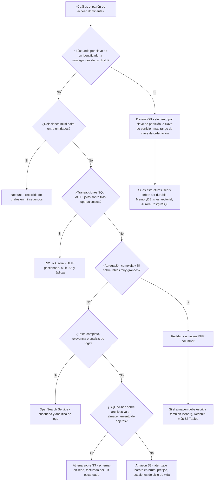
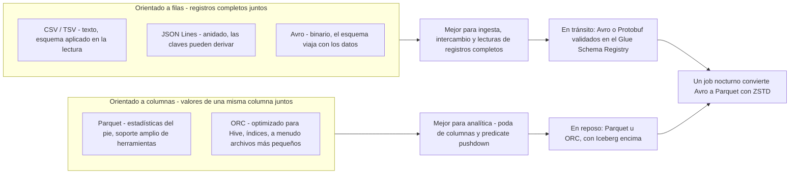
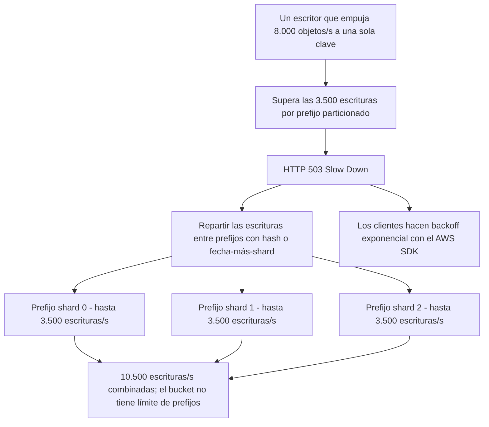
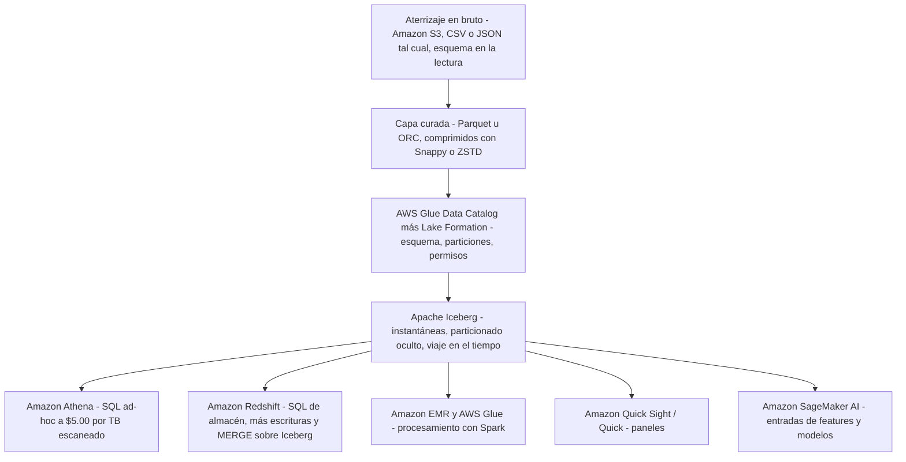
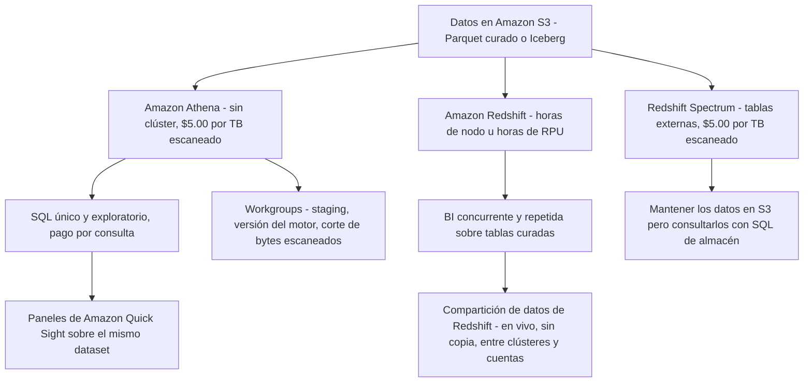

# Elección de almacenes de datos y formatos de almacenamiento

Pregunta a diez candidatos cómo eligen una base de datos y oirás diez versiones de «depende», y en DEA-C01 esa respuesta no puntúa nada. El examen no recompensa el gusto arquitectónico vago; recompensa un **mapeo determinista**: un patrón de acceso en el enunciado, un servicio fuera de la lista en alcance, un formato en reposo, un códec de compresión. El Dominio 2 supone el **26%** del examen y la tarea **2.1** es el núcleo de selección de almacenes de ese dominio, las competencias **2.1.1** (implementar almacenamiento para coste y rendimiento), **2.1.2** (configurar el almacenamiento para los patrones de acceso), **2.1.3** (aplicar almacenes a casos de uso), **2.1.7** (gestionar formatos de tabla abiertos, por ejemplo Apache Iceberg) y **2.1.8** (describir tipos de índice vectorial, por ejemplo HNSW e IVF).

```text
====================================================================
 SUPERFICIE DE DECISIÓN DEL ALMACÉN — DEA-C01 Dominio 2, tarea 2.1
====================================================================
  Búsqueda por clave, milisegundos de un dígito ....... Amazon DynamoDB
  Rango dentro de una partición ....................... consulta DynamoDB (PK + SK)
  API Redis + primario durable ........................ Amazon MemoryDB for Redis
  Grafo / recorrido multi-salto ........................ Amazon Neptune
  OLTP gestionado, ACID, joins ....................... Amazon RDS / Amazon Aurora
  Similitud vectorial con SQL ......................... Aurora PostgreSQL (HNSW/IVF)
  Agregación + BI, muchas tablas grandes .............. Amazon Redshift
  SQL ad-hoc sobre archivos en S3 ..................... Amazon Athena ($5.00/TB)
  Texto completo, relevancia, análisis de logs ........ Amazon OpenSearch Service
  Aterrizaje barato en bruto + escalones de ciclo de vida .. Amazon S3 (+ S3 Glacier)
  Capa de lakehouse transaccional ..................... S3 + Iceberg (S3 Tables, Glue)
  Formatos en reposo ......... Parquet / ORC (columnar) para analítica
                    Avro / Protobuf en tránsito, CSV / JSON al aterrizar
  Códecs .... Snappy (lecturas rápidas) · GZIP (ratio, Hive)
              ZSTD (por defecto en Iceberg, niveles 1-22, Athena por defecto 3)
              ZLIB (escrituras en ORC)
  Esto no ....... analítica en DynamoDB · joins en OpenSearch ·
                   agregación de todo el lago en una caché
====================================================================
```

En esta lección:

- leerás **la tarea 2.1 competencia por competencia** y construirás la taxonomía de almacenes en alcance de la que se nutre el examen;
- mapearás **patrón de acceso → servicio** con una tabla maestra y un árbol de decisión que puedes recorrer en segundos;
- dimensionarás **DynamoDB** con aritmética real de unidades de capacidad y sus techos de 400 KB / 10 GB;
- ubicarás **RDS, Aurora, Neptune, MemoryDB y DocumentDB** para que nunca elijas dos servicios para un mismo patrón;
- separarás **Redshift, Athena y OpenSearch** por lo que la consulta hace realmente;
- elegirás un formato de la matriz **CSV / JSON / Avro / Parquet / ORC**: diseño, esquema, evolución y cuándo;
- escogerás un **códec de compresión** con las propias palabras de AWS (Snappy, GZIP, ZSTD, ZLIB) y los valores por defecto que se vuelven señuelos;
- operarás **S3 como núcleo del lago**: 3.500 / 5.500 peticiones por prefijo particionado, **sin límite de prefijos**, consistencia fuerte desde el **1 de diciembre de 2020** y la solución al 503 de prefijo caliente;
- razonarás sobre los **formatos de tabla de lakehouse**, Iceberg, Hudi y Delta, exactamente a la profundidad que exige la competencia 2.1.7;
- aplicarás **tablas de decisión** a escenarios de examen y separarás **Athena frente a Redshift** en la capa de consumo;
- estudiarás **dos casos de estudio de clientes de AWS** y un **cuadro de actualizaciones de octubre de 2026 con fuente**;
- practicarás con **12 preguntas al estilo del examen** más tres comprobaciones interactivas.

---

## 1. Qué evalúa realmente la tarea 2.1

### 1.1 Las cinco competencias detrás de esta lección

| Competencia | Enfoque textual | Qué debe hacer la pregunta |
|---|---|---|
| **2.1.1** | Implementar almacenamiento para coste y rendimiento | Contrastar clase de almacenamiento, formato y motor contra un presupuesto o objetivo de latencia enunciados |
| **2.1.2** | Configurar el almacenamiento para los patrones de acceso | Leer el patrón (búsqueda por clave, escaneo de rango, join, búsqueda) y nombrar el almacén |
| **2.1.3** | Aplicar almacenes de datos a casos de uso | Ejemplos nombrados en la guía: **HNSW en Aurora PostgreSQL**, **MemoryDB para acceso rápido clave/valor** |
| **2.1.7** | Gestionar formatos de tabla abiertos (por ejemplo **Apache Iceberg**) | Instantáneas, viaje en el tiempo, particionado oculto, compactación: profundidad de conciencia |
| **2.1.8** | Describir tipos de índice vectorial (**HNSW**, **IVF**) | Reconocer qué índice necesita una carga de trabajo vectorial, con el motor que lo ofrece |

Dos límites importan más que las propias listas. **El afinado profundo del motor está fuera**: los internos de Redshift pertenecen a la Lección 4 y la orquestación a la Lección 5. Lo que queda aquí es *selección*: entra el patrón, sale el servicio, se adjunta el formato.

### 1.2 La taxonomía de almacenes en alcance

Todo lo que puedes nombrar como respuesta correcta proviene de esta tabla (listas en alcance de DEA-C01, revisadas en octubre de 2026):

| Categoría | Servicios en alcance | Identidad de examen en una línea |
|---|---|---|
| Objetos / núcleo del lago | **S3**, **S3 Tables**, **S3 Glacier** | Objetos a escala, tasas de petición por prefijo, escalones de ciclo de vida |
| Almacén de datos (OLAP) | **Redshift** | MPP + columnar, joins complejos sobre tablas muy grandes, concurrencia de BI |
| Clave-valor / documento NoSQL | **DynamoDB**, **DocumentDB**, **Keyspaces** | Búsquedas por clave de milisegundos de un dígito; colecciones tipo JSON; API de Cassandra |
| Relacional (OLTP) | **RDS**, **Aurora** | SQL gestionado, ACID, joins, Multi-AZ y réplicas |
| Búsqueda | **OpenSearch Service** | Relevancia de texto completo más analítica de logs, casi en tiempo real |
| En memoria / clave-valor rápido | **MemoryDB for Redis** | Lecturas de microsegundos con un primario Multi-AZ durable |
| Grafo | **Neptune** | Miles de millones de relaciones, milisegundos, Gremlin / openCypher / SPARQL |
| Streams (transporte, no un almacén) | **Kinesis Data Streams**, **MSK** | Búfer que *alimenta* los almacenes anteriores |
| Capa de lakehouse | **Glue** (+ Data Catalog), **Lake Formation**, **S3 Tables**, **Athena** | Catálogo, gobernanza, gestión de Iceberg, SQL ad-hoc |

> [!IMPORTANT]
> **Los streams no son almacenes.** Kinesis Data Streams y Amazon MSK aparecen en la lista de almacenamiento de la competencia 2.1.1 porque *mueven* datos, pero una pregunta que pregunta «¿dónde guardas tres años de clickstream para informes trimestrales?» nunca se responde con un stream. Aterriza en S3, consúltalo con Athena y conserva el stream solo como entrada.

- **📚 ¿Sabías que…?** **Amazon ElastiCache** y **Amazon Timestream** están **ni** en la lista en alcance **ni** en la fuera de alcance (ambas listas revisadas en octubre de 2026), mientras que la competencia 2.1.3 nombra **MemoryDB** explícitamente. La lectura práctica: cuando un enunciado usa la propia formulación de la guía *«acceso rápido clave/valor»* («fast key/value access» en inglés), MemoryDB es la elección en alcance, y ElastiCache sigue siendo la respuesta de caché del mundo real que encontrarás en diagramas de producción. Nunca gastes minutos del examen discutiendo la higiene de las listas; responde con el servicio cuya formulación coincide con la del enunciado.

---

## 2. Patrón de acceso → servicio: el mapa maestro

### 2.1 La tabla que deberías poder recitar

| Formulación del escenario en el enunciado | Elección de examen | Por qué (fuente) |
|---|---|---|
| Búsqueda puntual por clave, milisegundos de un dígito, cualquier escala (carrito, sesión, perfil) | **DynamoDB** | «rendimiento de milisegundos de un dígito a cualquier escala»; omite deliberadamente los JOINs |
| Rango ordenado dentro de una clave («pedidos del cliente X, 1 to 9 de octubre») | **consulta de DynamoDB** (clave de partición + clave de ordenación) | Rango ordenado dentro de una partición |
| Búsquedas secundarias o dispersas | **GSI de DynamoDB** | Vías de acceso alternativas sobre los mismos elementos |
| Agregación compleja sobre miles de millones de filas + paneles de BI concurrentes | **Redshift** | MPP, columnar, optimización de consultas |
| SQL ad-hoc sobre archivos ya en S3, pago por consulta | **Athena** | Schema-on-read, **$5.00 por TB escaneado** |
| Texto completo, relevancia, difusa o por frases | **OpenSearch Service** | Segmento de búsqueda de texto completo |
| Registros de series temporales generados por máquina + búsqueda por palabras clave | **analítica de logs de OpenSearch** | «datos de series temporales semiestructurados y generados por máquina» |
| Ingesta de eventos a alto caudal y analítica aguas abajo | **Kinesis / MSK → S3** | Streams en alcance como transporte, S3 como almacén |
| Recorrido multi-salto (anillos de fraude, recomendaciones, grafo de conocimiento) | **Neptune** | Recorrido de grafos en milisegundos |
| API Redis como primario durable, lecturas de microsegundos | **MemoryDB** | Competencia 2.1.3 textual |
| Capa solo caché delante de una base de datos relacional | **ElastiCache** en producción; formulación en alcance → **MemoryDB** | Véase la nota didáctica de la sección 1.2 |
| Registros documento / JSON con índices | **DocumentDB** | Lista en alcance |
| Relacional gestionado por defecto para OLTP | **RDS** | «Recomendamos Amazon RDS como su opción por defecto…» |
| Similitud vectorial junto a datos SQL | **Aurora PostgreSQL** | Competencias 2.1.3 / 2.1.8 (HNSW, IVF) |
| Aterrizaje barato en bruto + escalonado en el tiempo | **S3** (+ S3 Glacier) | Clases de almacenamiento y ciclo de vida |
| Actualizaciones ACID, instantáneas, viaje en el tiempo sobre el lago | **S3 + Iceberg** (S3 Tables / Glue) | Competencia 2.1.7 |

**Regla de enseñanza:** *clave + latencia → DynamoDB o MemoryDB · joins y BI → Redshift · SQL sobre el lago → Athena · texto → OpenSearch · relaciones → Neptune · OLTP → RDS o Aurora · escala barata en bruto → S3.*



### 2.2 Ejemplo resuelto E1: un sistema, dos almacenes

Un servicio de retail tiene dos requisitos en el mismo ticket:

```text
Requisito A  "Añadir al carrito" debe responder en milisegundos de un dígito
              para 40.000 compradores concurrentes, con clave por session ID
Requisito B  "Cesta media por región, por semana" sobre 2 años de pedidos
              para el equipo de BI, con 30 visualizadores de informes concurrentes

A  -> DynamoDB        clave = session ID, elemento < 400 KB, sin joins
B  -> Redshift        joins + agregación + concurrencia de BI

Mal: "DynamoDB para ambos" (agregación = Scan = lectura de tabla completa, sin joins)
Mal: "Redshift para ambos" (un almacén tiene la forma equivocada para las
       búsquedas puntuales por petición a milisegundos de un dígito)
```

El enunciado contiene siempre **dos** requisitos a propósito. Divide la carga de trabajo; nunca fuerces un almacén a responder un patrón para el que no fue diseñado.

### 2.3 Comprobación interactiva: empareja patrón con servicio

```matching
{
  "question": "Empareja cada patrón de acceso con el almacén de AWS que el examen DEA-C01 selecciona:",
  "pairs": [
    {"left": "Búsqueda puntual por clave, milisegundos de un dígito, cualquier escala", "right": "Amazon DynamoDB - NoSQL serverless, elemento máximo de 400 KB"},
    {"left": "Joins complejos y agregación sobre miles de millones de filas con informes de BI concurrentes", "right": "Amazon Redshift: almacén MPP columnar"},
    {"left": "SQL ad-hoc sobre archivos ya situados en Amazon S3, facturado por consulta", "right": "Amazon Athena: schema-on-read, $5.00 por TB escaneado"},
    {"left": "Relevancia de texto completo, búsqueda difusa y por frases sobre datos de log", "right": "Amazon OpenSearch Service: índice invertido más analítica de logs"},
    {"left": "Recorrido multi-salto como un anillo de fraude entre cuentas, tarjetas y dispositivos", "right": "Amazon Neptune: base de datos de grafos gestionada"},
    {"left": "OLTP gestionado con transacciones ACID, joins y failover Multi-AZ", "right": "Amazon RDS o Amazon Aurora: motores relacionales gestionados"},
    {"left": "Estructuras de la API Redis que deben sobrevivir a un fallo de zona de disponibilidad", "right": "Amazon MemoryDB for Redis: lecturas de microsegundos, primario Multi-AZ durable"},
    {"left": "Zona de aterrizaje barata en bruto con escalonado de ciclo de vida a Glacier", "right": "Amazon S3 con las clases de almacenamiento Amazon S3 Glacier"}
  ],
  "explanation": "Cada par es una frase del enunciado de la tarea 2.1 de la guía del examen. El patrón va primero y el servicio se deduce de él: nunca al revés. Aquí se esconden dos señuelos: un Scan sobre DynamoDB no es una estrategia de agregación, y una pregunta de grafo nunca se responde con auto-joins repetidos en un motor relacional."
}
```

---

## 3. Almacenes clave-valor, documento, grafo y en memoria

### 3.1 DynamoDB: las restricciones que el examen cita

| Restricción / métrica | Valor (en octubre de 2026) | Por qué aparece en un enunciado |
|---|---|---|
| Tamaño máximo del elemento | **400 KB** (los nombres de atributo cuentan) | Un blob de 900 KB no cabe: guarda una clave más S3, o divide los atributos |
| Techo de partición con índices secundarios locales | **10 GB** | Diseños de clave única demasiado grandes |
| Capacidad de diseño por partición | **3.000 RCU + 1.000 WCU por segundo** | Diagnóstico de partición caliente |
| 1 RCU | 1 lectura consistente/s de ≤ **4 KB** (eventual = la mitad; transaccional = 2) | Aritmética de capacidad |
| 1 WCU | 1 escritura/s de ≤ **1 KB** (transaccional = 2) | Aritmética de capacidad |
| A demanda para tablas nuevas | **4.000 escrituras/s**, **12.000 lecturas/s**, absorbe **2× el pico anterior** | Tráfico con picos y desconocido |
| Prueba de escala | Tablas de más de **200 TB**; más de **1.000 millones de peticiones/hora**; pico del Prime Day 2021 de **89,2 M peticiones/s** | Afirmaciones de «cualquier escala» |

La identidad de examen de DynamoDB es **acceso por clave de milisegundos de un dígito a cualquier escala**, y su silencio deliberado sobre los JOINs es el punto. Cualquier opción que proponga DynamoDB para una agregación de todo el lago ha leído mal el servicio.

### 3.2 Ejemplo resuelto E2: unidades de capacidad a mano

```text
Lectura : 500 lecturas consistentes por segundo de elementos de 8 KB
          ceil(8 / 4) = 2 RCU cada una  ->  500 x 2 = 1.000 RCU
Escritura: 200 escrituras por segundo de elementos de 1,6 KB
          ceil(1,6 / 1) = 2 WCU cada una ->  200 x 2 = 400 WCU

Comprobar contra el techo de diseño por partición (3.000 RCU + 1.000 WCU/s):
 1.000 RCU y 400 WCU caben ambas dentro del presupuesto de diseño de UNA
 partición, así que una sola clave de partición bien elegida basta - el
 riesgo es el DESFASE de clave (skew), no el volumen.
```

### 3.3 Ejemplo resuelto E3: la prueba de holgura del elemento de 400 KB

| Payload | Tamaño | ¿Cabe en un elemento de DynamoDB? | Diseño |
|---|---|---|---|
| Documento de perfil de cliente | 300 KB | **Sí** (≤ 400 KB) | Elemento único, búsqueda puntual |
| Blob de sesión con adjuntos en base64 | 900 KB | **No** | Guarda `session_id` + atributos pequeños en DynamoDB, el blob en **S3**, la clave como puntero |
| Cabecera de pedido + 40 líneas de pedido | 120 KB | Sí, pero desperdiciador | Modelar como elementos separados que comparten clave de partición para que una consulta de rango devuelva un pedido |

La versión favorita del examen de esta pregunta pone el número **un poco por encima de 400 KB** en el enunciado. La respuesta nunca es «aumentar el límite del elemento»: no existe tal perilla.

### 3.4 Los vecinos: DocumentDB, MemoryDB, Neptune

| Almacén | Para qué sirve | Dato distintivo |
|---|---|---|
| **DocumentDB** | Registros documento / tipo JSON **con índices** | Opción de documento NoSQL en alcance |
| **MemoryDB for Redis** | Estructuras compatibles con Redis con un **primario Multi-AZ durable** | Lecturas de microsegundos, escrituras de milisegundos de un dígito, hasta **160 M TPS por clúster**; unas **390 K lecturas/s + 100 K escrituras/s por nodo** |
| **Neptune** | Datos altamente conectados | «optimized for storing billions of relationships and querying the graph with milliseconds latency» |
| **Keyspaces** | Cargas de trabajo con la API de Cassandra | Opción compatible con Cassandra en alcance |

- **📚 ¿Sabías que…?** La fama de examen de MemoryDB es una sola frase en la competencia **2.1.3**, *«MemoryDB para acceso rápido clave/valor»*, y por eso vence a cualquier otra opción con aire de caché cuando el enunciado pide estructuras de Redis **más** durabilidad. Una caché simple delante de una base de datos es una arquitectura real, pero el caso de uso con nombre de la guía es el durable: si los datos deben sobrevivir a un fallo de nodo sin reconstruir desde la fuente de verdad, estás leyendo la línea de MemoryDB.

---

## 4. OLTP relacional: Amazon RDS y Amazon Aurora

### 4.1 RDS es el valor por defecto documentado

Amazon RDS presenta la **elección relacional gestionada por defecto** del examen: eliges un motor, Multi-AZ para el failover, réplicas de lectura para el escalado y copias de seguridad automáticas: AWS se encarga del SO y del parcheo del motor. La propia página de bienvenida del servicio recomienda **RDS como tu opción por defecto** para cargas de trabajo relacionales, y por eso cualquier enunciado que describa OLTP convencional (transacciones, joins, claves foráneas, un esquema que se aplica en la escritura) se resuelve en RDS salvo que se nombre una capacidad concreta de Aurora.

### 4.2 Aurora: los deltas que nombra el enunciado

| Atributo | Valor de Aurora (en octubre de 2026) |
|---|---|
| Compatibilidad | Compatible con MySQL y PostgreSQL |
| Afirmación de rendimiento | Hasta **6×** el rendimiento de MySQL |
| Volumen del clúster | Hasta **256 TiB** |
| Réplicas de lectura | Hasta **15** dentro del clúster |
| Búsqueda vectorial (competencias 2.1.3 / 2.1.8) | **Aurora PostgreSQL** con índices **HNSW** y **IVF** |

```text
Escalera de elección para un enunciado relacional
----------------------------------------------
OLTP convencional, quiere un gestionado por defecto ......... RDS
Necesita compatibilidad MySQL/PostgreSQL a 6x, 256 TiB,
  15 réplicas o búsqueda vectorial con HNSW/IVF ............. Aurora
Necesita agregación de grado almacén sobre miles de filas .... Redshift
Necesita acceso por clave de ms de un dígito sin joins ....... DynamoDB
```

La línea vectorial es la trampa más nueva de este dominio: **HNSW** (hierarchical navigable small world, orientado a recall, hambriento de memoria) e **IVF** (inverted file, construcción más rápida, búsqueda por clúster) son *tipos de índice*, no servicios. El enunciado nombra el índice, la opción nombra **Aurora PostgreSQL**.

### 4.3 Ejemplo resuelto E4: ¿qué sabor relacional?

```text
Enunciado 1  "Las autorizaciones de pago deben confirmarse en una transacción,
              con claves foráneas a comerciantes y contracargos, y failover
              en menos de 60 segundos"   -> RDS (o Aurora), Multi-AZ
Enunciado 2  "Extractos financieros mensuales que unen 40 tablas a lo largo
              de 8 TB con 40 analistas concurrentes"  -> Redshift (OLAP, no OLTP)
Enunciado 3  "Búsqueda semántica sobre 3 millones de descripciones de producto
              embebidas como vectores, junto a la tabla de productos" -> Aurora PostgreSQL
Enunciado 4  "Estado de sesión de un juego móvil, con clave por ID de jugador,
              sin joins" -> DynamoDB - elegir aquí un motor relacional es el señuelo
```

Cada enunciado oculta una palabra de **forma**: *transacción, clave foránea, failover* = OLTP; *extracto, unión de muchas tablas, analistas* = OLAP; *vector, embedding, similitud* = Aurora PostgreSQL con HNSW/IVF; *con clave por, por ID, milisegundos de un dígito* = DynamoDB.

---

## 5. Almacenes de analítica: Redshift, Athena y OpenSearch

### 5.1 Tres formas de analítica, tres servicios

| Señal en el enunciado | Elección | Forma de facturación (en octubre de 2026) |
|---|---|---|
| BI repetida y concurrente sobre tablas curadas grandes; joins complejos | **Redshift** | Horas de nodo u horas de RPU |
| SQL único sobre archivos ya en S3; «sin infraestructura» | **Athena** | **$5.00 por TB escaneado**, mínimo de 10 MB por consulta |
| Relevancia, búsqueda difusa o por frases; análisis de logs con agregaciones | **OpenSearch Service** | Dominio: horas de instancia + almacenamiento; Serverless: OCU + almacenamiento |
| Procesamiento completo con Spark / Hive / Presto | **EMR** | Tiempo de clúster o DPU serverless |

La propia formulación de AWS es citable: Athena es para *«consultas SQL ad-hoc interactivas sobre datos en Amazon S3, sin … infraestructura ni clústeres»*, mientras que Redshift está *«optimizado … en consultas complejas que unen grandes números de tablas de bases de datos muy grandes»*.

### 5.2 OpenSearch: la identidad de analítica de logs

| Propiedad | Valor (en octubre de 2026) |
|---|---|
| Modos de dominio | **General Purpose** (relevancia, objetos anidados, actualizaciones frecuentes) vs **Optimized / log analytics** (Parquet columnar + índice Lucene retenido, PPL/SQL) |
| Refresco en Serverless | Unos **10 segundos** |
| Afirmaciones del motor optimizado | Hasta **4× relación precio-rendimiento, 2× ingesta, 2× velocidad de consulta** |
| Grupos de colecciones de Serverless | Búsqueda, series temporales y búsqueda vectorial; **1 OCU ≈ 6 GiB de RAM + vCPU** |

La división que aparece en los enunciados: **agregar los errores 5xx por servicio *y* bucear en texto completo dentro de una traza de pila** es una forma de consulta, OpenSearch. «Unir los recuentos de errores con la tabla de dimensión de clientes» es otra forma, Athena o Redshift.

---

## 6. La matriz de formatos de almacenamiento

### 6.1 CSV, JSON, Avro, Parquet, ORC, y Protobuf por completitud

| Formato | Diseño | Esquema | Evolución | Cuándo usarlo | Fuente |
|---|---|---|---|---|---|
| **CSV / TSV** | Fila, texto | Catálogo externo: **schema-on-read** | Ninguno de forma nativa | Intercambio, volcados legibles para humanos, aterrizaje en bruto | Docs de almacenamiento columnar de Athena |
| **JSON (Lines)** | Fila, texto, **anidado** | Se aplica en la lectura; el crawler lo infiere | Poco estricto: las claves derivan | Cargas de eventos, APIs, exploración | Docs de Glue Schema Registry |
| **Avro** | **Fila**, binario | Esquema guardado **con los datos** (esquema = JSON, datos = binario) | Excelente (registro BACKWARD / FORWARD) | Serialización en streaming: Kafka / Kinesis | Docs de Glue Schema Registry |
| **Parquet** | **Columnar**, binario | Pie de archivo | Soportado | Analítica: poda de columnas + **predicate pushdown** sobre min/máx | Docs de almacenamiento columnar de Athena |
| **ORC** | **Columnar**, binario, optimizado para Hive | Pie de archivo | Soportado | Cargas centradas en Hive; a menudo archivos más pequeños, índices integrados | Docs de almacenamiento columnar de Athena |
| **Protobuf** | Fila, binario, neutral de lenguaje | Definiciones `.proto` | Fuerte (números de campo) | Contratos RPC / de servicio; `DataFormat` del registro = AVRO \| JSON \| PROTOBUF | Docs de Glue Schema Registry |

Tres comparaciones que el examen reutiliza sin cesar:

| Par | La distinción |
|---|---|
| **Fila vs columnar** | Avro = «lecturas y escrituras rápidas de registros completos», mejor para la ingesta, «no optimizado para analítica»; Parquet / ORC = analítica |
| **Parquet vs ORC** | Parquet = tipos de consulta más amplios, optimizado con Arrow, consultas complejas; ORC = archivos a menudo más pequeños, los índices pueden acelerar consultas, structs/maps/lists robustos: **ambos** son columnares con pushdown |
| **CSV/JSON vs cualquiera de los columnares** | CSV y JSON **no tienen predicate pushdown**, así que cada consulta paga por todos los bytes escaneados, y Athena factura por bytes escaneados |



### 6.2 Predicate pushdown en una imagen

La documentación de Athena lo declara con claridad: *«El predicate pushdown en Parquet y ORC permite que las consultas de Athena obtengan solo los bloques que necesita… usa estadísticas de los predicados del bloque de datos, como los valores máximos/mínimos, para determinar si leer o saltar el bloque.»* Un archivo de totales diarios donde la consulta pide una fecha permite al motor **saltar grupos de filas enteros**: ese salto es el modelo de coste, no una microoptimización.

### 6.3 Valores por defecto de dimensionamiento que vale la pena memorizar

| Perilla | Valor (en octubre de 2026) |
|---|---|
| Tamaño de división objetivo | Unos **128 MB** |
| Bloque de Parquet en Athena por defecto | **128 MB** |
| Franja (stripe) de ORC en Athena por defecto | **64 MB** (las franjas de menos de **8 MB** se leen enteras) |
| Ruta de conversión | CSV/JSON → Parquet/ORC vía Glue ETL o `CREATE TABLE AS` de Athena |

### 6.4 Ejemplo resuelto E5: la escalera de coste de la propia AWS

La página de precios de Athena incluye exactamente este ejemplo resuelto (en octubre de 2026):

```text
3 TB de TEXTO, la consulta toca 1 de 4 columnas
  Paso 1  texto en bruto     : 3 TB  x $5.00/TB = $15.00
  Paso 2  añadir GZIP 3:1    : 1 TB  x $5.00/TB =  $5.00   (AWS: "3x savings
                               from compression")
  Paso 3  convertir a Parquet: 0,25 TB x $5.00/TB =  $1,25  (AWS: "4x savings
                               for reading only one column")

Misma consulta, mismo panel, misma herramienta de BI:  $15.00 -> $5.00 -> $1.25
```

**Lección para el examen:** la compresión sola da el primer recorte; el **diseño columnar** da el segundo; ninguno es opcional, y ninguno cambia la consulta. Cuando un enunciado dice *«reducir el coste de la consulta sin cambiar la herramienta de BI»*, la respuesta es convertir a columnar: no comprar un clúster más grande.

---

## 7. Códecs de compresión: Snappy, GZIP, ZSTD, ZLIB

### 7.1 Las propias palabras de AWS

| Códec | Formulación de AWS (docs de compresión de Athena) | Por defecto para | Lectura de examen |
|---|---|---|---|
| **Snappy** | «Lempel-Ziv 77 (LZ7) family … focuses on high compression and **decompression speed** rather than the maximum compression» | Elección común en Parquet / Hive / Spark | Lecturas rápidas: el valor por defecto analítico cuando importa la CPU |
| **GZIP** | «based on Deflate»; el texto comprimido **no es divisible** | **Escrituras Parquet/texto** de Athena con Hive | Mejor ratio, más lento, malos troceos paralelos |
| **ZSTD** | «fast compression algorithm that provides **high compression ratios**»; niveles **1 to 22**, en Athena por defecto **3** | **Tablas Iceberg** | Mejor equilibrio ajustable: la respuesta de lakehouse |
| **ZLIB** | Basado en Deflate | **Escrituras ORC** | Valor por defecto del ecosistema ORC |
| LZO / LZ4 / BZIP2 | De solo lectura en algunos sitios; Athena **no puede escribir** Parquet con LZ4 o LZO |: | Material de señuelo |

El principio rector de la guía de ajustes de Athena: **una ratio más alta cuesta CPU**. Comprime el lago y deja que el diseño columnar más el predicate pushdown recorten la E/S.

> [!WARNING]
> **⚠️ La compresión no es lo columnar.** Un CSV con GZIP sigue escaneándose por completo: el códec encoge bytes, pero el motor sigue leyendo cada fila para encontrar una columna. Las dos palancas son independientes: el **formato** decide *cuántos datos debe tocar el motor*, el **códec** decide *qué tan grandes son esos bytes*. Un enunciado que ofrece «cambiar de Parquet a CSV comprimido con GZIP para ahorrar dinero» ha intercambiado las palancas.

### 7.2 Valores por defecto que se vuelven señuelos de tres vías

```text
ZSTD -> tablas Iceberg          (compresión por defecto de Athena para Iceberg)
GZIP -> Parquet / texto de Hive (por defecto de escritura de Athena con Hive)
ZLIB -> escrituras ORC          (por defecto del ecosistema ORC)
```

Apréndelos como una tríada: cualquier pregunta que empareje «¿qué compresión usa X por defecto?» con tres de estos cuatro nombres está evaluando exactamente este mapeo.

```fillblank
{
  "question": "Completa las afirmaciones sobre códecs con los propios valores por defecto y compromisos de AWS:",
  "template": "{{1}} es la compresión por defecto de las tablas Iceberg, donde Athena escribe en el nivel {{2}} de un rango que va del 1 al {{3}}. Las escrituras de Parquet y texto de Hive tienen por defecto {{4}}, las escrituras ORC tienen por defecto {{5}}, y {{6}} es el favorito de Parquet/Spark porque optimiza para {{7}} más que para la ratio máxima de compresión.",
  "answers": {
    "1": "ZSTD",
    "2": "3",
    "3": "22",
    "4": "GZIP",
    "5": "ZLIB",
    "6": "Snappy",
    "7": "velocidad de descompresión"
  },
  "distractors": ["Snappy", "GZIP", "ZLIB", "BZIP2", "LZ4", "LZO", "nivel 6", "nivel 9", "ratio de compresión", "divisibilidad", "ratio"],
  "explanation": "Documentación de compresión de Athena de AWS: ZSTD es el valor por defecto para las tablas Iceberg en el nivel 3 de 1-22; las escrituras de Parquet/texto de Hive tienen por defecto GZIP; las escrituras ORC tienen por defecto ZLIB; Snappy pertenece a la familia Lempel-Ziv 77 y prioriza la velocidad de descompresión sobre la compresión máxima. Las respuestas señuelo son valores por defecto intercambiados: especialmente emparejar GZIP con Iceberg o Snappy con ORC."
}
```

### 7.3 Ejemplo resuelto E6: la decisión del códec en un enunciado

```text
Enunciado 1  "Tabla Iceberg en S3 consultada por Athena; equilibrar ratio y coste de escaneo"
        -> ZSTD (Athena usa por defecto el nivel 3 para escrituras ZSTD)
Enunciado 2  "Los jobs de Spark decodifican más rápido de lo que codifican; la CPU es la restricción"
        -> Snappy (la velocidad de descompresión es el objetivo declarado)
Enunciado 3  "Tablas Hive escritas por EMR, salida de texto, importa la divisibilidad"
        -> GZIP (y recuerda: el texto comprimido NO es divisible)
Enunciado 4  "Archivos ORC en un pipeline del ecosistema Hive"
        -> ZLIB (el valor por defecto de escritura de ORC)
Enunciado 5  "Archivo histórico a lo más barato posible de CSV en bruto que nadie consulta"
        -> GZIP en S3, y después escalonado a S3 Glacier - solo decisión de
           códec; el formato (CSV) sigue significando escaneos completos
```

### 7.4 Ejemplo resuelto E7: aritmética de conversión

```text
Antes : 3,6 TB de CSV en S3, los paneles leen 2 de 12 columnas
Después: CTAS con format='PARQUET', write_compression='GZIP'
         -> unos 1,2 TB en reposo (unas 3:1 sobre texto ya compacto)
         -> un panel de una sola columna toca unos 0,3 TB

Coste de Athena, en octubre de 2026:
  antes : 3,6 TB x $5.00        = $18.00 por cada refresco de panel
  después: 0,3 TB x $5.00       =  $1.50 por cada refresco de panel

(aritmética ilustrativa; la plantilla con fuente de la propia AWS es la escalera
 de 3 TB texto -> GZIP -> Parquet de la sección 6.4: $15.00 -> $5.00 -> $1.25)
```

- **📚 ¿Sabías que…?** Amazon Athena **infiera la compresión de la extensión del archivo** para los formatos de texto y JSON: así que renombrar un `.csv.gz` a `.csv` no «descomprime» nada, solo le dice al motor que espere texto plano que no va a encontrar. Por eso las preguntas de formato y las de códec son ítems de examen separados: el formato es lo que *declaras*, el códec en gran medida es lo que el motor *descubre*.

---

## 8. Amazon S3 como núcleo del data lake

### 8.1 Tasas de petición: por prefijo, no por bucket

La documentación de rendimiento de AWS (consultada en octubre de 2026) declara:

> «Su aplicación puede lograr al menos **3.500 peticiones PUT/COPY/POST/DELETE o 5.500 GET/HEAD por segundo por cada prefijo particionado de Amazon S3**. No hay límites al número de prefijos en un bucket.»

| Métrica | Valor (en octubre de 2026) |
|---|---|
| Escrituras por prefijo particionado | ≥ **3.500** PUT/COPY/POST/DELETE por segundo |
| Lecturas por prefijo particionado | ≥ **5.500** GET/HEAD por segundo |
| Límite de prefijos | **Ninguno** |
| Ejemplo de paralelización de AWS | **10 prefijos ⇒ 55.000 lecturas/s** |
| Señal de limitación | **> 5.000 peticiones/s sostenidas hacia unos pocos objetos** ⇒ posible **HTTP 503 Slow Down** |
| S3 Express One Zone | Milisegundos de un dígito, hasta **2.000.000 peticiones/s** por directorio bucket |

### 8.2 Ejemplo resuelto E8: la solución al prefijo caliente

```text
Incidencia : un escritor empuja 8.000 objetos/segundo hacia una sola clave
Diagnóstico: 8.000 > 3.500 escrituras por prefijo particionado -> 503 Slow Down
Solución    : repartir las escrituras entre prefijos con hash o fecha-más-shard
              10.500 objetos/s / 3.500 por prefijo = 3 prefijos de escritura
              como mínimo, antes de confiar en el particionado automático de S3

No es solución : "subir el límite del bucket" - no existe una cuota de
                 peticiones a nivel de bucket que subir; el eje es el PREFIJO.
```



### 8.3 Las particiones y los prefijos son ejes distintos

| Eje | Qué optimiza | Mecanismo |
|---|---|---|
| **Particiones al estilo Hive** (`dt=2026-10-09/`) | **Poda de consultas**: Athena lee solo las particiones coincidentes | Claves de partición en el Glue Data Catalog |
| **Prefijos de escritura** | **Tasa de peticiones**: cada prefijo particionado obtiene su propio carril de 3.500 / 5.500 | Diseño de claves bajo el bucket |

El sobrep produce **archivos pequeños** y sobrecarga del planificador (aparecen errores al estilo «reduce your request rate» en la guía de ajustes de Athena con tamaños de división diminutos). La regla: particiona para la cláusula `WHERE`, reparte prefijos para la tasa de escritura, y apunta a divisiones de unos **128 MB**.

### 8.4 Consistencia: el cambio de 2020 que mató dos respuestas

El anuncio de AWS del **1 de diciembre de 2020**:

> «Con efecto inmediato, todas las operaciones GET, PUT y LIST de S3, así como las operaciones que cambian etiquetas de objetos, ACLs o metadatos, son ahora fuertemente consistent.»

- **Gratuito**, aplica a **todas las regiones** y a todos los objetos.
- Consecuencias: **EMRFS Consistent View** y **S3Guard** quedan obsoletos: cualquier opción cuya corrección *requiera* ellos está caducada y es errónea.
- Una opción del tipo «leer después de escribir es eventualmente consistente en S3» ha sido falsa en todos los exámenes desde 2021.

- **📚 ¿Sabías que…?** La escalera de clases de almacenamiento de S3 es en sí misma una palanca de coste para el lago: **Intelligent-Tiering** mueve los objetos sin tocar durante **30 días** a Standard-IA (**−40%**), **90 días** a Glacier Instant Retrieval (**−68%**), y opcionalmente **180 días** a Deep Archive (**−95%**), mientras que **S3 Express One Zone** cambia una zona de disponibilidad única por una latencia de milisegundos de un dígito de hasta **2.000.000 peticiones/s** por directorio bucket (en octubre de 2026). Elegir la *clase* es la mitad coste/rendimiento de la tarea 2.1; elegir el *formato* es la sección 6 de esta lección.

- **📚 ¿Sabías que…?** Amazon S3 es un servicio público desde el **13 de marzo de 2006**, y la retrospectiva de 20 años de la propia AWS (2026-03-13) informa de una reducción de precio de aproximadamente un **85% desde el lanzamiento** además de más de **6.000 millones de dólares** ahorrados en conjunto por clientes que eligieron **S3 Intelligent-Tiering** en lugar de S3 Standard: junto con el recordatorio de que *«el código que escribiste para S3 en 2006 sigue funcionando hoy, sin cambios»*. Por eso Intelligent-Tiering es el valor por defecto del lago cuando el patrón de relectura es desconocido: AWS mueve un objeto sin tocar durante **30 días** a Standard-IA (−40%), **90 días** a Glacier Instant Retrieval (−68%) y opcionalmente **180 días** a Deep Archive (−95%), de modo que la decisión de coste se toma sola mientras la decisión de formato (sección 6) sigue siendo tuya.

---

## 9. La capa de lakehouse: Iceberg, Hudi y Delta

### 9.1 Por qué existen los formatos de tabla

Los formatos de archivo «solo permiten escribir archivos enteros»: así que la captura de cambios, los borrados y el streaming continuo crean el dolor de archivos pequeños y no ofrecen semántica transaccional sobre el almacenamiento de objetos. Los **formatos de tabla** añaden **instantáneas, compactación, viaje en el tiempo y semántica transaccional** encima de los archivos Parquet/ORC/Avro en S3. Una guidance de Prescriptive Guidance de AWS señala que un data lake simple *no proporciona soporte para atomicidad, consistencia, aislamiento y durabilidad (ACID)* hasta que se añade un formato de tabla como Iceberg.

**Iceberg es el que nombra la guía** (competencia **2.1.7**), así que es el que debes conocer en profundidad:

| Función de Iceberg | Qué hace (formulación de examen) |
|---|---|
| **Instantáneas** | Cada escritura crea una instantánea nueva; las listas de manifiestos y los manifiestos llevan estadísticas de **mín/máx por columna** para el salto de datos |
| **Particionado oculto** | «This feature prevents reading unnecessary partitions automatically»: `day(ts)` deriva el valor al vuelo, **sin columna extra**, sin contabilidad manual de `WHERE dt=` |
| **Viaje en el tiempo** | `FOR VERSION AS OF <snapshot_id>` / `FOR TIMESTAMP AS OF <timestamp>` |
| **Catálogo por defecto** | **AWS Glue Data Catalog** |
| **Soporte de motores** | Athena, EMR, Redshift, Glue, SageMaker |
| **Opción gestionada** | **Amazon S3 Tables** = Iceberg gestionado en S3 |

### 9.2 Hudi y Delta: conciencia, no internos

La propia guía de AWS dice **«no single table format is a 'one size fits all'»**. La matriz de comparación que publica AWS (consultada en octubre de 2026):

| Capacidad | **Hudi** | **Iceberg** | **Delta** |
|---|---|---|---|
| Copy-on-write | Sí | Sí | Sí |
| Merge-on-read | Sí | Sí | No |
| Formatos de archivo de datos | Parquet, ORC, HFile | Parquet, ORC, Avro | **Solo Parquet** |
| Viaje en el tiempo | Sí | Sí | Sí |

Como la guía solo nombra Iceberg, no memorices los internos de los otros dos: reconoce los nombres y sabe que AWS se niega a coronar a un ganador.



### 9.3 Schema-on-read frente a schema-on-write

| | **Schema-on-write** (almacén) | **Schema-on-read** (lago) |
|---|---|---|
| Orden de operaciones | Definir el esquema, conformar en la carga, rechazar cambios incompatibles | Aterrizar los datos tal cual, aplicar el esquema **en el momento de la consulta** |
| Formulación de AWS | Staging tradicional de almacén | «the data can be stored as is and you apply a schema at the time that you read it» |
| Fortaleza | Datos preestructurados, consultas más rápidas; aplicado | Flexible, rápido de empezar |
| Debilidad | Entrada rígida | La deriva aparece en el momento de la consulta |
| Hogar en AWS | Tablas de **Redshift** | **Athena + Glue Data Catalog sobre S3** |

Formulación de examen: **lago = schema-on-read, almacenamiento barato, cómputo desacoplado; almacén = schema-on-write, curado, aplicado, ajustado para BI.** Paneles fijos con muchos joins → escritura; datos en bruto y estructuras variables → lectura.

### 9.4 Ejemplo resuelto E9: particionado oculto y viaje en el tiempo

```text
Tabla: eventos de clickstream, columna `ts` (timestamp)

Diseño al estilo Hive
  PARTITIONED BY (dt)  +  archivos bajo dt=2026-10-09/
  La consulta DEBE contener WHERE dt = '2026-10-09' o Athena escanea todo

Diseño Iceberg
  PARTITIONED BY (day(ts))  -> NO añade columna al esquema
  Athena deriva la partición de `ts`; un WHERE sobre ts poda,
  y nunca mantienes a mano la contabilidad dt=

Pregunta de auditoría, «qué contenía la tabla al mediodía de ayer?»:
  SELECT * FROM clickstream
   FOR TIMESTAMP AS OF '2026-10-09 12:00:00 UTC';
  -> respondida desde las instantáneas, sin copia de la tabla
```

---

## 10. Tablas de decisión para escenarios de examen

### 10.1 La tabla maestra de escenarios

| # | Patrón de acceso / restricción | Almacén | Formato en reposo | Códec |
|---|---|---|---|---|
| 1 | Búsqueda puntual por clave, milisegundos de un dígito, cualquier escala | **DynamoDB** | Elemento (tipo JSON) |: |
| 2 | Rango ordenado dentro de una clave | **consulta de DynamoDB** (PK + SK) |, |, |
| 3 | Búsquedas secundarias / dispersas | **GSI de DynamoDB** |, |, |
| 4 | Joins complejos + agregación, concurrencia de BI | **Redshift** | Columnar interno; `COPY` desde Parquet/CSV/Avro/ORC/JSON | Snappy / ZSTD |
| 5 | SQL ad-hoc sobre el lago, pago por consulta | **Athena sobre S3** | **Parquet** (u ORC) | ZSTD (Iceberg) / GZIP (Hive) |
| 6 | Búsqueda de texto completo / difusa / por relevancia | **OpenSearch** | Documentos JSON indexados |: |
| 7 | Logs + series temporales de máquina con búsqueda por palabras clave | **analítica de logs de OpenSearch** | Parquet + índice Lucene | Columnar |
| 8 | Ingesta de eventos a alto caudal y después analítica | **Kinesis / MSK → S3** | **Avro en tránsito → Parquet en reposo** | ZSTD |
| 9 | Relaciones multi-salto, fraude o recomendación | **Neptune** | Grafo |: |
| 10 | OLTP gestionado: ACID, joins, transacciones | **RDS / Aurora** | Filas del motor | Motor |
| 11 | API Redis como primario durable, lecturas de microsegundos | **MemoryDB** | Estructuras Redis |: |
| 12 | Aterrizaje barato en bruto + escalonado en el tiempo | **S3** (+ Glacier) | CSV / JSON en bruto | GZIP |
| 13 | Actualizaciones ACID, instantáneas, viaje en el tiempo sobre el lago | **S3 + Iceberg** (S3 Tables / Glue) | Parquet | ZSTD |
| 14 | Similitud vectorial junto a datos SQL (HNSW / IVF) | **Aurora PostgreSQL** | Motor + índice vectorial |: |
| 15 | Volver a consultar la tabla curada de ayer | **Athena / viaje en el tiempo con Iceberg** | Parquet | ZSTD |

### 10.2 Ciclo de vida del formato: orden interactivo

```dragdrop
{
  "question": "Ordena este ciclo de vida de datos desde la ingesta hasta la retención a largo plazo, exactamente como el examen espera que progrese un lago bien diseñado:",
  "items": [
    "El productor serializa Avro y registra el esquema en el AWS Glue Schema Registry con compatibilidad BACKWARD",
    "Glue ETL reescribe los archivos aterrizados del stream a Parquet comprimido con ZSTD",
    "Amazon S3 guarda los archivos curados y el AWS Glue Data Catalog guarda su esquema y sus particiones",
    "Apache Iceberg superpone instantáneas, particionado oculto y viaje en el tiempo sobre esos archivos",
    "Los analistas consultan con Amazon Athena; los paneles leen a través de Amazon Quick Sight",
    "Las reglas de ciclo de vida escalonan las particiones frías a S3 Glacier Instant Retrieval y después a Deep Archive"
  ],
  "correctOrder": [
    "El productor serializa Avro y registra el esquema en el AWS Glue Schema Registry con compatibilidad BACKWARD",
    "Glue ETL reescribe los archivos aterrizados del stream a Parquet comprimido con ZSTD",
    "Amazon S3 guarda los archivos curados y el AWS Glue Data Catalog guarda su esquema y sus particiones",
    "Apache Iceberg superpone instantáneas, particionado oculto y viaje en el tiempo sobre esos archivos",
    "Los analistas consultan con Amazon Athena; los paneles leen a través de Amazon Quick Sight",
    "Las reglas de ciclo de vida escalonan las particiones frías a S3 Glacier Instant Retrieval y después a Deep Archive"
  ],
  "explanation": "Los formatos de fila pertenecen al tránsito (Avro con un esquema gestionado por registro), los formatos columnares pertenecen al reposo (Parquet con ZSTD), la capa de catálogo y gobernanza se sitúa encima de los archivos, el formato de tabla añade semántica transaccional encima del catálogo, después viene el consumo y el escalonado de clases de almacenamiento es el paso final. Saltarse el paso de conversión: analizar Avro o CSV en bruto: es el error más caro de la secuencia, porque Athena factura por bytes escaneados."
}
```

### 10.3 Los diez pares de señuelo

| Señuelo | Por qué es erróneo |
|---|---|
| «Usar DynamoDB para la agregación mensual» | Sin joins; un `Scan` lee la tabla entera |
| «Comprimir el CSV para recortar el coste de Athena» | Compresión ≠ columnar: los escaneos completos continúan |
| «S3 es eventualmente consistente en las lecturas» | Fuertemente consistente desde el **2020-12-01** |
| «Subir el límite de peticiones del bucket» | El eje es el **prefijo**; no existe límite de prefijos |
| «Añadir `S3Guard` para la consistencia» | Obsoleto; EMRFS Consistent View igualmente |
| «Iceberg es un formato de archivo» | Es un **formato de tabla** sobre Parquet / ORC / Avro |
| «Timestream como almacén de métricas» | No está en la lista en alcance (revisada en octubre de 2026): usa **OpenSearch** o streams → S3 → Athena |
| «Grafo mediante auto-joins repetidos en RDS» | **Neptune** existe exactamente para esto |
| «ElastiCache es el caso de uso con nombre para acceso rápido clave/valor» | La competencia 2.1.3 nombra **MemoryDB** |
| «Las particiones de Hive y los prefijos de S3 son lo mismo» | Eje de poda frente a eje de tasa de peticiones |

---

## 11. Consumo entre servicios: Athena frente a Redshift

La selección de almacenes no termina en el almacenamiento: el examen pregunta qué **motor** lo lee. La guía de comparación de AWS (consultada en octubre de 2026) es inequívoca: **Athena** = SQL ad-hoc interactivo ANSI sobre S3 sin clústeres; **Redshift** = el almacén; **EMR** = Spark/Hive completo.

| Señal | Athena | Redshift |
|---|---|---|
| Clúster | Ninguno | Nodos aprovisionados o RPU de Serverless |
| Facturación | **$5.00 por TB escaneado** (mínimo de 10 MB), o Capacity Reservations | Horas de nodo / horas de RPU haya o no consultas |
| Mejor forma | Único, exploratorio, schema-on-read | BI repetida y concurrente sobre tablas curadas |
| Aislamiento / salvaguardas | **Workgroups**: ubicación de staging, versión del motor, cifrado y un **corte de bytes escaneados** por consulta | Workgroups, escalado de concurrencia, WLM |
| Alcance hacia otros sistemas | **Consultas federadas** (facturadas por TB agregados entre fuentes, más Lambda) | Consultas federadas hacia RDS/Aurora, Spectrum, compartición de datos |
| Resultados | Escenificados en S3; los **managed query results** (2025-06-03) hacen opcional la ubicación y no cuestan extra | Data API devuelve los resultados durante **24 horas** |

Palancas de coste que aparecen en los enunciados, por orden de impacto:

1. **Formato columnar + códec**: la propia escalera de AWS de $15 → $5 → $1.25.
2. **Poda de particiones**: solo ayuda cuando el `WHERE` usa la clave de partición; `SELECT *` tira a la basura el ahorro por columnas.
3. **Proyección de particiones**: Athena deriva las particiones de las propiedades de la tabla en lugar de llamar a `GetPartitions`; AWS informa de aceleraciones de consulta como **137 s → 10 s (~92%)**.
4. **Corte de bytes escaneados del workgroup**: `BytesScannedCutoffPerQuery` tiene un **mínimo de 10.000.000 de bytes**, limitando el gasto peor caso por consulta.
5. **Reutilización de resultados de consulta**: por defecto **60 minutos**, máximo **7 días**, por workgroup.

### 11.1 Ejemplo resuelto E10: aritmética de poda

```text
Tabla      : 2 TB de Parquet en S3, 730 particiones diarias (~2,74 GB cada una)
Consulta A : SELECT ... WHERE dt = '2026-10-09'
             escaneo podado ~ 0,00268 TB x $5.00/TB  ~= $0,013
Consulta B : SELECT ... (sin predicado de partición)
             escaneo completo 2 TB x $5.00/TB        = $10.00

Mismos datos, mismo motor, misma forma de conjunto de resultados:
la cláusula WHERE es el control de coste. (ilustrativo sobre el precio
de Athena de $5.00/TB, en octubre de 2026)
```



> [!IMPORTANT]
> **No inventes un punto de cruce.** A los artículos de terceros les encanta afirmar que «Redshift vence a Athena por encima de X TB al mes»: **AWS no publica ninguna cifra de ese tipo**, así que ninguna respuesta del examen puede contener una. Lo que AWS publica es la *forma de facturación*: por escaneo para Athena, capacidad siempre activa para Redshift, y los **$5.00 por TB escaneado** de Spectrum para los datos de S3 consultados desde Redshift (en octubre de 2026).

### Actualizaciones de 2026 (en octubre de 2026)

> [!NOTE]
> **Qué se movió en la selección de almacenes y formatos entre 2025 y octubre de 2026**: cada línea verificada contra una fuente primaria de AWS, y cada una es evaluable porque el examen evalúa el comportamiento actual:
> - **La guía v1.1 (2025-12-12) añadió las dos competencias sobre las que se construye esta lección**: **2.1.7 «Manage open table formats (for example Apache Iceberg)»** y **2.1.8 «Describe vector index types (for example, HNSW, IVF)»**, ocho competencias añadidas, ninguna eliminada, página de revisiones de DEA-C01, 2025-12-12.
> - **Los almacenes en alcance cambiaron en v1.1**: se añadieron **Aurora** y **Amazon S3 Tables** (junto con Amazon Q, Bedrock, Kendra y Data Exchange), mientras que se eliminaron Cloud9, CodeCommit y AWS SCT: página de servicios en alcance de DEA-C01, consultada en octubre de 2026.
> - **Redshift ahora escribe Iceberg, no solo lo lee**: `CREATE`/`INSERT` pasó a GA el **2025-11-17** sobre el Glue Data Catalog, `UPDATE`/`DELETE`/`MERGE` sobre tablas Iceberg (incluidas **S3 Tables**) llegó el **2026-04-23**, y las **vistas materializadas de Iceberg** el **2026-10-05**: AWS What's New, 2025-11-17 / 2026-04-23 / 2026-10-05.
> - **Los streams ahora aterrizan directamente en formatos de tabla**: las **streaming tables** de Kinesis Data Streams materializan un stream en **Iceberg sobre S3 Tables** (Parquet automático, compactación en línea) desde el **2026-08-28**, con entrega a S3 de propósito general desde el **2026-08-29**, y los brokers Express de Amazon MSK hicieron lo mismo el **2026-07-30**: AWS What's New.
> - **S3 Express One Zone se abarató y se amplió**: almacenamiento **−31%**, PUT **−55%**, GET **−85%** (2025-04-10), y las regiones pasaron de 8 a **15 para el 2026-09-17**; **S3 Tables** ganó el tipo **Variant** para Iceberg v3 (2026-07-28): AWS What's New.
> - **Athena no necesita bucket de resultados ni grandes reservas**: los **managed query results** (2025-06-03) los gestiona el servicio, están cifrados y son gratuitos, y Capacity Reservations ahora arrancan con **4 DPU durante 1 minuto** en lugar de 24 DPU durante 60 minutos (2026-02-11): AWS What's New.
> - **AWS Glue 6.0 rebaseó la cadena de herramientas de formatos (2026-08-21)**: **Spark 4.1.1**, **Python 3.13**, **Scala 2.13.17**, Iceberg **1.11.0** con **format v3** (VARIANT, vectores de borrado) y una **reducción de precio del 30%**, mientras se **eliminaron EMRFS y AWS SDK for Java v1** y Glue **0.9 / 1.0 / 2.0 llegó a fin de soporte el 2026-04-01**, así que una opción `fs.s3.consistent.*` o `com.amazonaws.services.*` es ahora un señuelo, AWS What's New, 2026-08-21; notas de versión de Glue y política de soporte de versiones, consultadas en octubre de 2026.
> - **Compartición entre cuentas de Lake Formation v5 (2026-02-11)**: un solo recurso compartido de AWS RAM puede ahora transportar tablas ilimitadas usando **patrones de permiso comodín** en lugar de una asociación de recurso por tabla, y los enlaces de recursos entre regiones se componen con ello, así que «crear una asociación por cada tabla» es la respuesta caducada, AWS What's New, 2026-02-11; docs de Lake Formation, consultadas en octubre de 2026.
> - **Kinesis Data Streams ahora tiene tres modos de capacidad**: Provisioned, On-demand Standard y **On-demand Advantage** (2025-11-04), que elimina el cargo horario por stream y recorta las tarifas de GB pero factura un suelo de **25 MB/s de ingesta + 25 MB/s de recuperación** a nivel de cuenta; el tamaño máximo de registro es de **10 MiB**: AWS What's New, 2025-11-04; guía para desarrolladores de Kinesis Data Streams, consultada en octubre de 2026.
> - **Avisos de hechos caducados**: cualquier opción que afirme que **Redshift solo puede leer Iceberg** es errónea desde el 2025-11-17, y cualquier opción que exija **configurar una ubicación de resultados en S3 para Athena** es errónea desde el 2025-06-03.

- **📚 ¿Sabías que…?** El **AWS Glue Schema Registry**: el componente que hace seguro el Avro en tránsito: es **serverless y gratuito**, y valida exactamente tres formatos: **AVRO (1.11.4), JSON y PROTOBUF**. Su modelo de Avro es la única frase que vale la pena memorizar: **el esquema es JSON, los datos son binarios**, y por eso un archivo Avro solo es legible con su esquema, y por eso «el esquema viaja con los datos» es la explicación correcta de examen para el excelente comportamiento de evolución de Avro.

---

## Casos Reales

AWS publica cómo se ven estas abstracciones en producción. Cada cifra de abajo es **afirmación del cliente o de AWS, sin auditar**, con la fuente nombrada para que puedas verificarla: el punto evaluable es el **patrón** (qué almacén, qué formato, qué cifra se movió), no el marketing.

### Caso A, Nasdaq: una ruta de escritura en S3 y una de lectura en Redshift

| Elemento | Detalle |
|---|---|
| Cliente | **Nasdaq**, bolsa de valores (fuera de un almacén on-premises legado desde 2014) |
| Reto | El lote nocturno de pedidos, cotizaciones y operaciones debe terminar **antes de la apertura del mercado**, mientras los analistas consultan el histórico de forma concurrente |
| Servicios | **Data lake de Amazon S3** (ruta de escritura) + **Amazon Redshift** y **Redshift Spectrum** (ruta de lectura) + archivo **S3 Glacier** + **S3 Object Lock** |
| Resultados | **70.000 millones de registros/día** (pico de **113.000 millones**, febrero de 2020); **el 90% de la carga terminó 5 horas antes**; **consultas un 32% más rápidas**; un lago de **15 TB** consultado **in situ** |
| Dominio de examen | **Dominio 2** (selección de almacén: lago vs almacén, almacenamiento/cómputo desacoplados) |
| Fuente | `aws.amazon.com/solutions/case-studies/nasdaq-case-study` (consultada en octubre de 2026) |

> «Pudimos soportar sin problema el salto de 30.000 millones a 70.000 millones de registros al día gracias a la flexibilidad y la escalabilidad de Amazon S3 y Amazon Redshift.»: Robert Hunt, VP Software Engineering, Nasdaq (caso de estudio de AWS, consultado en octubre de 2026)

Lee Nasdaq como **un sistema, dos almacenes**: S3 absorbe el pico de escritura de forma barata y durable, Redshift sirve las lecturas concurrentes y Spectrum cierra la brecha de modo que el lago de 15 TB nunca se copia. La frase que destaca la página de AWS es *«zero contention between data loading and querying»*: ese es el argumento del almacenamiento desacoplado de la sección 9, visible en una fecha límite de producción.

### Caso B, EMX: S3 más Athena en lugar de un almacén en el backend

| Elemento | Detalle |
|---|---|
| Cliente | **EMX**, empresa de medios programáticos / ad-tech |
| Reto | Un pipeline con ETL y costes de almacenamiento pesados en el backend, ingiriendo **más de 2 TB de datos en bruto por hora** |
| Servicios | **Amazon S3** como lago más **Amazon Athena** para la consulta |
| Resultados | **85% de ahorro en los costes de almacenamiento de datos**; consultas **al menos cuatro veces más baratas que otras herramientas de ETL de backend** (afirmación del cliente, consultada en octubre de 2026) |
| Dominio de examen | **Dominio 2** tarea 2.1 (selección de almacén + formato) que alimenta el consumo del **Dominio 3** |
| Fuente | AWS Big Data Blog, «How EMX reduced data pipeline costs by 85% with Amazon Athena» (2021-02-02, consultado en octubre de 2026) |

EMX es la versión en funcionamiento de la sección 6: mantener los datos en bruto en **S3**, convertirlos a un diseño **columnar** y dejar que la **facturación por terabyte de Athena** sustituya a un backend siempre activo. El patrón evaluable es la *forma*, almacenamiento de objetos barato más SQL por consulta vence a un clúster que pagas haya o no consultas, nunca el porcentaje concreto.

### Caso C, EOS Group: DMS hacia S3 hacia Redshift, con PII enmascarado in situ

| Elemento | Detalle |
|---|---|
| Cliente | **EOS Group**, servicios financieros (almacén on-premises en crecimiento, **15% de crecimiento interanual de datos**) |
| Reto | Suposiciones de capacidad en cada actualización, más un requisito de cumplimiento de mostrar PII enmascarada a los analistas estándar |
| Servicios | **AWS MAP** + **AWS DMS** aterrizando la base de datos en **Amazon S3**, y después **Amazon Redshift**; **enmascaramiento dinámico de datos de Redshift** dirigido por los permisos del usuario que consulta |
| Resultados | **50% de reducción de los costes de infraestructura**, **cero pérdida de datos**, **tiempo de inactividad mínimo** (afirmación de AWS/cliente, consultada en octubre de 2026) |
| Dominio de examen | **Dominio 2** tarea 2.1 (selección de almacén: migración de almacén) con protección a nivel de columna del **Dominio 4** |
| Fuente | `aws.amazon.com/solutions/case-studies/eos-group-case-study` (consultada en octubre de 2026) |

> «Al eliminar la necesidad de infraestructura on-premises, EOS Group logró una reducción del 50 por ciento en los costes de infraestructura …»: caso de estudio de AWS sobre EOS Group (consultado en octubre de 2026)

Lee a EOS como **la secuencia de migración que el examen sigue evaluando**: **DMS** aterriza la base de datos en **S3**, **Redshift** carga desde S3, y el enmascaramiento ocurre **dentro del almacén según los permisos del usuario**: una tabla, dos vistas de ella, sin una segunda copia enmascarada que mantener sincronizada. Aquí se esconden tres señuelos: DMS no es DataSync (mueve esquemas y filas, no archivos), Macie no puede enmascarar nada (descubre datos sensibles **en Amazon S3**), y el 50% es el propio resultado de EOS sobre su línea base, nunca una garantía de migración.

### Caso D, GE Aerospace: modernizar un almacén de datos operacional legado

| Elemento | Detalle |
|---|---|
| Cliente | **GE Aerospace**, aeronáutica y cadena de suministro |
| Reto | Un gran almacén de datos operacional (ODS) que alimenta **más de 150 informes**, algunos de más de **10.000 líneas de código**, bajo restricciones de cumplimiento y rendimiento |
| Servicios | **Amazon Redshift** con soporte de Solutions Architect de AWS e ingeniería de Redshift; PoC de nov: dic 2022 y después una **migración de 9 meses de enero a septiembre de 2023** |
| Resultados | Consultas que tardaban **90 minutos ahora tardan 7 minutos**; unas **mejoras del 70% en el rendimiento de consulta**; ahorro estimado de más de **500.000 dólares al año** (estimación del cliente, consultada en octubre de 2026) |
| Dominio de examen | **Dominio 2** tarea 2.1 (selección de almacén) que alimenta coste y rendimiento del **Dominio 3** |
| Fuente | `aws.amazon.com/solutions/case-studies/ge-aerospace-case-study` (consultada en octubre de 2026) |

> «Estábamos viendo consultas que solían tardar hora y media tardar 7 minutos con Amazon Redshift.»: Bejoy John, Senior Director of Data Analytics, GE Aerospace (caso de estudio de AWS, consultado en octubre de 2026)

GE Aerospace es la historia de **dimensionar bien** detrás de RA3 y el almacenamiento gestionado: cómputo y almacenamiento están separados, de modo que el arreglo para una consulta de una hora es un almacén de mejor forma y no una copia más grande del mismo diseño. Encuadre seguro para el examen: **70%** y **>500.000 dólares/año** son la estimación de GE contra la línea base de GE: el hecho transferible es la *selección* (una carga de trabajo curada con forma de BI pertenece a Redshift), no la cifra.

```plot
{
  "type": "bar",
  "title": "Almacén de datos operacional de GE Aerospace: tiempo de ejecución de consultas antes y después de Amazon Redshift (minutos, según publica AWS, consultado en octubre de 2026)",
  "xLabel": "Dónde se ejecuta la consulta",
  "yLabel": "Tiempo de ejecución de la consulta (minutos)",
  "xKey": "stage",
  "yKey": "minutes",
  "data": [
    {"stage": "On-premises ODS (before)", "minutes": 90},
    {"stage": "Amazon Redshift (after)", "minutes": 7}
  ]
}
```

| Caso | Patrón de selección de almacén que demuestra | Dominio |
|---|---|---|
| Nasdaq | S3 como ruta de escritura durable, Redshift como ruta de lectura concurrente, Spectrum sobre el lago | D2 Data Store Selection |
| EMX | S3 + Athena + conversión columnar en lugar de un backend siempre activo | D2 → D3 Analyze and Visualize |
| EOS Group | Migración DMS → S3 → Redshift, con enmascaramiento dinámico de PII por permisos de usuario | D2 Data Store Selection + D4 Security |
| GE Aerospace | Almacén de datos operacional legado modernizado sobre un clúster de Redshift bien dimensionado | D2 → D3 Cost and Performance |

- **📚 ¿Sabías que…?** Los casos de gobernanza se leen como el mismo número dos veces: **Integral Ad Science (IAS)** usó los controles de acceso basados en etiquetas de Lake Formation para reducir **cientos de reglas de permiso a exactamente dos**, mientras que el data mesh hub-and-spoke de **GoDaddy** guarda ahora **más de 2.000 productos de datos** a lo largo de **varios petabytes en cientos de cuentas** (AWS Big Data Blog, 2021-09-23 y 2022-11-21, consultados en octubre de 2026). Ninguna de las dos cifras se generaliza a tu carga de trabajo, pero ambos enunciados colapsan a una sola regla de selección: cuando el requisito es *acceso gobernado de forma centralizada a datos que no debes copiar*, la respuesta es **Lake Formation sobre Amazon S3** con Athena o EMR encima, nunca una segunda base de datos que haga de modelo de permisos.

---

## Preguntas de Práctica (Practice Questions)

```question
{
  "id": "dea-07-q1",
  "type": "multiple-choice",
  "question": "Un servicio de carrito de compra debe devolver un elemento por session ID en milisegundos de un dígito para 40.000 usuarios concurrentes, sin joins. ¿Qué almacén selecciona la tarea 2.1?",
  "options": [
    "Amazon Redshift, usando una clave de distribución sobre session_id",
    "Amazon DynamoDB, con clave por session ID",
    "Amazon RDS con una réplica de lectura por zona de disponibilidad",
    "Amazon OpenSearch Service con una consulta de término"
  ],
  "correct": 1,
  "explanation": "Las búsquedas puntuales por clave a milisegundos de un dígito a cualquier escala son la identidad declarada de DynamoDB, y DynamoDB omite deliberadamente los JOINs: que es exactamente lo que este enunciado no necesita. Redshift es para agregación y BI sobre tablas grandes, RDS es para transacciones ACID y joins (y una búsqueda puntual a través de un motor relacional tiene la forma de latencia equivocada), y OpenSearch responde consultas de relevancia, no búsquedas por clave."
}
```

```question
{
  "id": "dea-07-q2",
  "type": "multiple-choice",
  "question": "El equipo de BI ejecuta 30 paneles concurrentes que unen ocho tablas a lo largo de 8 TB y agregan miles de millones de filas. ¿Qué almacén es la respuesta correcta?",
  "options": [
    "Amazon DynamoDB con índices secundarios globales",
    "Amazon S3 con archivos CSV y reglas de ciclo de vida",
    "Amazon Redshift",
    "Amazon MemoryDB for Redis"
  ],
  "correct": 2,
  "explanation": "La agregación compleja sobre miles de millones de filas más informes de BI concurrentes es la firma de Redshift: procesamiento masivamente paralelo con almacenamiento columnar y optimización de consultas. DynamoDB no puede hacer joins, S3 es almacenamiento de objetos y necesita un motor de consultas como Athena, y MemoryDB es un almacén clave-valor de microsegundos, no un almacén analítico."
}
```

```question
{
  "id": "dea-07-q3",
  "type": "multiple-choice",
  "question": "Una consulta sobre 3 TB de archivos de texto toca 1 de 4 columnas. Según el propio ejemplo de precios de Athena de AWS, ¿cuál es el coste después de convertir a un formato columnar que admita predicate pushdown?",
  "options": [
    "$15.00, porque todo el dataset sigue escaneándose",
    "$5.00, porque solo la compresión cambia la factura",
    "$1.25, porque la poda de columnas más las estadísticas del bloque recortan el escaneo a 0,25 TB",
    "$0.00, porque Athena solo factura las filas devueltas"
  ],
  "correct": 2,
  "explanation": "Ejemplo resuelto de AWS: 3 TB de texto = 3 x $5 = $15.00; GZIP a 3:1 = $5.00; Parquet leyendo 1 de 4 columnas = 0,25 TB x $5 = $1,25 (en octubre de 2026). Athena factura los bytes ESCANEADOS, no las filas devueltas, y el predicate pushdown en Parquet y ORC permite al motor saltar bloques usando estadísticas min/máx: así que ninguna de las cifras de $15 ni de $5 sobrevive al cambio de formato."
}
```

```question
{
  "id": "dea-07-q4",
  "type": "multiple-choice",
  "question": "Un productor en Kinesis Data Streams debe serializar los eventos de modo que los cambios de esquema no rompan los consumidores aguas abajo. ¿Qué formato y mecanismo espera el examen?",
  "options": [
    "Archivos CSV escritos sin esquema, leídos con schema-on-read",
    "Avro registrado en el AWS Glue Schema Registry con compatibilidad BACKWARD",
    "Parquet escrito directamente por el productor para la máxima velocidad de lectura",
    "ORC con compresión ZLIB, validado por AWS Lake Formation"
  ],
  "correct": 1,
  "explanation": "Avro es un formato de fila y binario cuyo esquema viaja con los datos, y el Glue Schema Registry (serverless, gratuito) valida AVRO, JSON y PROTOBUF con reglas de compatibilidad como BACKWARD: ese es el patrón en tránsito. Parquet y ORC son formatos analíticos para datos en reposo; CSV no tiene ningún mecanismo de esquema."
}
```

```question
{
  "id": "dea-07-q5",
  "type": "multiple-choice",
  "question": "Un pipeline escribe 8.000 objetos por segundo bajo una sola clave y empieza a recibir respuestas HTTP 503 Slow Down. ¿Cuál es el arreglo correcto?",
  "options": [
    "Subir la cuota de peticiones a nivel de bucket con un caso de soporte",
    "Repartir las escrituras entre prefijos con hash o fecha-más-shard",
    "Cambiar el bucket a solo S3 Express One Zone",
    "Activar S3Guard para que el cliente reintente escrituras inconsistentes"
  ],
  "correct": 1,
  "explanation": "S3 garantiza al menos 3.500 escrituras (y 5.500 lecturas) por PREFIJO PARTICIONADO, sin límite al número de prefijos: así que 8.000 escrituras/s a una sola clave superan el carril de un prefijo y sigue el throttling. El arreglo es la distribución entre prefijos; no existe una cuota de peticiones a nivel de bucket que subir. S3Guard y EMRFS Consistent View están obsoletos desde que S3 se volvió fuertemente consistente el 2020-12-01."
}
```

```question
{
  "id": "dea-07-q6",
  "type": "multiple-choice",
  "question": "Un ingeniero de datos argumenta que el job de ingesta debe escribir una pasada de verificación porque las lecturas de Amazon S3 son eventualmente consistentes después de un PUT. ¿Cuál es la respuesta correcta?",
  "options": [
    "Correcto - S3 ofrece consistencia eventual para GET después de PUT, así que la verificación es obligatoria",
    "Correcto solo en regiones que abrieron después de 2020",
    "Incorrecto: desde el 1 de diciembre de 2020 todas las operaciones GET, PUT y LIST de S3 son fuertemente consistentes, gratuitas, en todas las regiones, así que EMRFS Consistent View y S3Guard están obsoletos",
    "Incorrecto - S3 es fuertemente consistente solo para objetos de menos de 1 GB"
  ],
  "correct": 2,
  "explanation": "AWS anunció consistencia fuerte de lectura después de escritura para todas las operaciones de S3: incluidas GET, PUT, LIST, etiquetas, ACLs y metadatos: el 1 de diciembre de 2020, gratis y para todas las regiones y objetos. Cuya corrección dependa de S3Guard o de EMRFS Consistent View está caducada, y no existe ninguna excepción por tamaño ni por región."
}
```

```question
{
  "id": "dea-07-q7",
  "type": "multiple-choice",
  "question": "¿Qué mapeo de compresión es correcto en octubre de 2026?",
  "options": [
    "Las tablas Iceberg tienen por defecto GZIP; las escrituras ORC tienen por defecto Snappy; Parquet de Hive tiene por defecto ZSTD",
    "Las tablas Iceberg tienen por defecto ZSTD (Athena usa el nivel 3); las escrituras de Parquet/texto de Hive tienen por defecto GZIP; las escrituras ORC tienen por defecto ZLIB",
    "Las tablas Iceberg tienen por defecto ZLIB; las escrituras ORC tienen por defecto BZIP2; el texto de Hive tiene por defecto LZ4",
    "Los cuatro formatos tienen por defecto Snappy porque la velocidad de descompresión es la única consideración"
  ],
  "correct": 1,
  "explanation": "La documentación de Athena de AWS: ZSTD es la compresión por defecto de las tablas Iceberg (nivel 3 de 1-22), las escrituras de Parquet y texto de Hive tienen por defecto GZIP, y las escrituras ORC tienen por defecto ZLIB. Snappy es la elección habitual de Spark/Parquet porque prioriza la velocidad de descompresión, pero no es el valor por defecto de Iceberg, y Athena no puede escribir Parquet con LZ4 o LZO en absoluto."
}
```

```question
{
  "id": "dea-07-q8",
  "type": "multiple-choice",
  "question": "Un equipo quiere aterrizar datos de eventos en bruto sin validarlos y aplicar después un esquema cuando los analistas los consulten. ¿Qué par describe correctamente este diseño?",
  "options": [
    "Schema-on-write; el hogar son las tablas de Amazon Redshift; los cambios incompatibles se rechazan en la carga",
    "Schema-on-read; el hogar es Amazon Athena más el AWS Glue Data Catalog sobre Amazon S3; la deriva aparece en el momento de la consulta",
    "Schema-on-read; el hogar es Amazon DynamoDB; los cambios incompatibles se rechazan en la carga",
    "Schema-on-write; el hogar es Amazon OpenSearch; la deriva aparece en el momento de la consulta"
  ],
  "correct": 1,
  "explanation": "Schema-on-read guarda los datos tal cual y aplica el esquema en la lectura: la propia formulación de AWS: y su hogar es Athena con el Glue Data Catalog sobre S3. Schema-on-write define, conforma y aplica en la carga, que es el patrón del almacén (Redshift). DynamoDB no es ninguno de los dos: es un almacén clave-valor, y OpenSearch es un motor de búsqueda."
}
```

```question
{
  "id": "dea-07-q9",
  "type": "multiple-choice",
  "question": "Un auditor pregunta qué contenía una tabla curada a las 12:00 UTC de ayer, y los analistas se quejan de que deben añadir a mano predicados WHERE dt = ... ¿Qué capacidad de Iceberg responde a ambas quejas?",
  "options": [
    "Merge-on-read, que reescribe el histórico en un prefijo de S3 nuevo cada noche",
    "Viaje en el tiempo con FOR TIMESTAMP AS OF, más particionado oculto que deriva los valores de partición automáticamente",
    "Compactación copy-on-write, que crea instantánea de cada archivo por consulta",
    "Job bookmarks del crawler de Glue, que congelan los metadatos de partición del día"
  ],
  "correct": 1,
  "explanation": "El viaje en el tiempo de Iceberg responde al auditor con FOR TIMESTAMP AS OF (o FOR VERSION AS OF de un id de instantánea) sin copia de la tabla, y el particionado oculto: formulación de AWS: 'prevents reading unnecessary partitions automatically': significa que PARTITIONED BY (day(ts)) no añade columna ni necesita un filtro manual dt=. La compactación gestiona archivos pequeños; los crawlers registran particiones, y ninguno de los dos restaura un estado puntual en el tiempo."
}
```

```question
{
  "id": "dea-07-q10",
  "type": "multiple-choice",
  "question": "Un equipo necesita SQL ocasional sobre 4 TB de Parquet ya en S3, sin gestión de clústeres, y una factura que rastree solo lo que lee cada consulta. ¿Qué combinación es correcta?",
  "options": [
    "Amazon Athena a $5.00 por TB escaneado, aislado por un workgroup con corte de bytes escaneados",
    "Amazon Redshift, facturado por horas de nodo, porque tampoco tiene clúster si se usa Serverless",
    "Amazon OpenSearch Service, porque las agregaciones tienen forma de SQL",
    "Amazon EMR, porque solo EMR puede leer Parquet"
  ],
  "correct": 0,
  "explanation": "SQL ocasional (ad-hoc) sobre archivos ya en S3 con facturación por consulta es Athena: $5.00 por TB escaneado con un mínimo de 10 MB, y los workgroups añaden staging, versión del motor y un suelo de BytesScannedCutoffPerQuery de 10.000.000 de bytes (en octubre de 2026). Redshift factura la capacidad haya o no consultas, OpenSearch es para relevancia y análisis de logs, y EMR es un clúster completo de Spark/Hive: lo contrario de «sin gestión de clústeres»."
}
```

```question
{
  "id": "dea-07-q11",
  "type": "multiple-choice",
  "question": "Una clasificación necesita estructuras de datos compatibles con Redis, lecturas de microsegundos y un primario que sobreviva a un fallo de zona de disponibilidad sin reconstruir desde una fuente de verdad. ¿A qué servicio apunta la formulación de la tarea 2.1.3?",
  "options": [
    "Amazon MemoryDB for Redis",
    "Amazon ElastiCache como única respuesta correcta para toda pregunta de caché",
    "Amazon Redshift con caché de resultados",
    "Amazon Keyspaces con la API de Cassandra"
  ],
  "correct": 0,
  "explanation": "La competencia 2.1.3 nombra «MemoryDB para acceso rápido clave/valor» - MemoryDB mantiene todos los datos en memoria para lecturas de microsegundos y escrituras de milisegundos de un dígito mientras su primario es durable y Multi-AZ (hasta 160 M TPS por clúster, unas 390 K lecturas/s + 100 K escrituras/s por nodo, en octubre de 2026). ElastiCache es la capa de caché del mundo real pero aparece ni en la lista en alcance ni en la fuera de alcance, Redshift es un almacén, y Keyspaces es la API de Cassandra."
}
```

```question
{
  "id": "dea-07-q12",
  "type": "multiple-choice",
  "question": "Durante una incidencia, los ingenieros deben agregar los recuentos HTTP 5xx por servicio y bucear en texto completo dentro de una traza de pila concreta en segundos. ¿Qué almacén encaja con ambas mitades de ese patrón?",
  "options": [
    "Amazon Neptune, porque las relaciones entre servicios son un grafo",
    "Amazon OpenSearch Service con su motor de analítica de logs",
    "Amazon DynamoDB, usando un índice secundario global disperso",
    "Solo Amazon S3, consultado con SELECT * cada vez"
  ],
  "correct": 1,
  "explanation": "Los datos de logs y series temporales generados por máquina con búsqueda por palabras clave son el uso declarado de OpenSearch: el motor optimizado de analítica de logs conserva el almacenamiento columnar de Parquet más un índice Lucene retenido, de modo que las agregaciones y la búsqueda de texto completo se ejecutan en una sola sentencia (en octubre de 2026). Neptune es para recorridos multi-salto, DynamoDB no tiene búsqueda por relevancia, y S3 solo no tiene índice: necesita un motor de consultas como Athena."
}
```

```question
{
  "id": "dea-07-q13",
  "type": "multiple-choice",
  "question": "Un ingeniero de datos afirma que Amazon Redshift solo puede LEER tablas Apache Iceberg y que todo INSERT, UPDATE y DELETE de Iceberg debe realizarlo Amazon Athena. ¿Cuál es la respuesta correcta en octubre de 2026?",
  "options": [
    "Correcto - Redshift lee Iceberg solo a través de esquemas externos, y Athena es dueña de toda la manipulación de datos de Iceberg",
    "Incorrecto - Redshift crea tablas Iceberg e INSERTa en ellas a través del AWS Glue Data Catalog desde el 2025-11-17, y añadió UPDATE, DELETE y MERGE (incluidos en Amazon S3 Tables) el 2026-04-23",
    "Correcto: las escrituras de Iceberg están restringidas a los jobs de Glue ETL, porque solo Glue es dueño de los metadatos de la tabla",
    "Incorrecto - Redshift escribe Iceberg, pero solo desde Redshift Serverless; los clústeres aprovisionados no pueden"
  ],
  "correct": 1,
  "explanation": "AWS convirtió a Redshift en ciudadano Iceberg de pleno derecho por etapas: CREATE, SHOW, DROP y INSERT solo de inserción pasaron a GA el 2025-11-17 contra el AWS Glue Data Catalog, JIT ANALYZE llegó el 2025-11-18, UPDATE, DELETE y MERGE llegaron el 2026-04-23 (incluidos en Amazon S3 Tables, protegidos por permisos de Lake Formation), y las vistas materializadas de Iceberg el 2026-10-05: AWS What's New, en octubre de 2026. Glue es el catálogo por defecto pero no el escritor exclusivo, Athena no es obligatorio para el DML, y la capacidad de escritura no está ligada a un modo de cómputo de Redshift. Lección de selección de almacén: la tabla de lakehouse es ahora un formato de intercambio compartido que el almacén y el motor ad-hoc leen Y escriben."
}
```

```question
{
  "id": "dea-07-q14",
  "type": "multiple-choice",
  "question": "Una empresa de servicios financieros migra su almacén a Amazon Redshift y debe mostrar PII enmascarada a los analistas estándar mientras los usuarios privilegiados ven los valores reales: sin mantener una segunda copia enmascarada de cada tabla. ¿Qué capacidad espera la tarea 2.1?",
  "options": [
    "Hallazgos de datos sensibles de Amazon Macie en la zona de aterrizaje de Amazon S3",
    "Enmascaramiento dinámico de datos de Amazon Redshift, aplicado por los permisos del usuario que consulta",
    "AWS KMS con una clave gestionada por el cliente por cada equipo de analistas",
    "Retención con S3 Object Lock sobre el prefijo de ingesta en bruto"
  ],
  "correct": 1,
  "explanation": "Este es el patrón de EOS Group: AWS DMS movió la base de datos a través de Amazon S3 hacia Amazon Redshift, y el enmascaramiento dinámico de datos se aplicó dentro del almacén de modo que una tabla responde distinto según el usuario (caso de estudio de AWS sobre EOS Group, consultado en octubre de 2026). Macie descubre datos sensibles en S3 pero nunca cambia lo que devuelve una consulta; KMS cifra en reposo y no recorta columnas; Object Lock es un control de retención sobre objetos, no una vista a nivel de columna de ellos."
}
```

> [!WARNING]
> ⚠️ **Trampas del día del examen para esta lección:**
> - **Primero el patrón, después el servicio**: clave+latencia → DynamoDB/MemoryDB · joins/BI → Redshift · SQL sobre el lago → Athena · texto → OpenSearch · relaciones → Neptune · OLTP → RDS/Aurora · escala barata en bruto → S3.
> - **DynamoDB no es un motor analítico**: elemento máximo de 400 KB, techo de partición de **10 GB** con LSIs, sin JOINs, y un `Scan` lee la tabla entera.
> - **Compresión ≠ columnar**: un CSV con GZIP sigue escaneándose por completo; el formato decide los bytes tocados, el códec los bytes guardados.
> - **Los valores por defecto de los códecs son una trampa de tres vías**: **ZSTD → Iceberg**, **GZIP → Parquet/texto de Hive**, **ZLIB → ORC**.
> - **Las tasas de petición de S3 son por prefijo particionado**: **3.500 escrituras / 5.500 lecturas por segundo**, **sin límite de prefijos**; la solución a un 503 Slow Down es distribuir prefijos, nunca «subir el límite del bucket».
> - **S3 es fuertemente consistente desde el 1 de diciembre de 2020**: las opciones que exigen S3Guard o EMRFS Consistent View están caducadas.
> - **Las particiones de Hive ≠ los prefijos de S3**: uno es el eje de poda para el `WHERE`, el otro es el eje de tasa de peticiones; el sobrep produce archivos pequeños.
> - **Iceberg es un formato de tabla, no de archivo**: se sitúa sobre Parquet/ORC/Avro, y el particionado oculto sigue necesitando un filtro sobre la columna base para podar.
> - **ElastiCache y Timestream no están en ninguna de las dos listas** (revisado en octubre de 2026): la elección clave-valor rápida en alcance es **MemoryDB**, y para series temporales y logs **OpenSearch** o streams → S3 → Athena.
> - **Grafo ⇒ Neptune**, nunca un auto-join como solución; **vectorial ⇒ Aurora PostgreSQL** con HNSW o IVF.
> - **Nunca inventes un punto de cruce de coste Athena/Redshift**: AWS publica formas de facturación, no un umbral en TB.
> - **Las cifras de los casos de estudio son afirmaciones de clientes sin auditar**: los 70.000 millones de registros/día de Nasdaq y el 85% de EMX son sus resultados, nunca garantías.

> **Veredicto comparativo: cómo se compara este tema el día del examen**
> - **Frente a otra nube:** DEA-C01 evalúa **solo servicios de AWS**: ningún ítem te pide comparar DynamoDB o Redshift con la oferta de un competidor. Responde con un comportamiento documentado por AWS (elementos de 400 KB, 3.500/5.500 por prefijo, $5.00/TB escaneado, instantáneas de Iceberg); una opción basada en un benchmark de terceros no verificado está fuera de alcance por construcción.
> - **Frente a autogestionado / on-premises:** ejecutar tu propio clúster de Hadoop, caché o búsqueda significa parchear, adivinar capacidad y tener hardware ocioso. La preferencia del examen es **gestionado y facturado por consumo**, S3 para la escala en bruto, DynamoDB para el acceso por clave, Athena para el pago por consulta, respetando aún el caso contrario: si el requisito enunciado es un motor autogestionado con hardware concreto, ese requisito gana. Nunca digas que lo gestionado es siempre correcto; di que lo es **para el patrón enunciado**.
> - **Frente a otro servicio de AWS:** **Redshift** cuando la consulta es BI repetida y concurrente sobre tablas curadas; **Athena** cuando es SQL ad-hoc sobre archivos en S3; **Spectrum** cuando los datos deben quedarse en S3 pero consultarse con SQL de almacén; **OpenSearch** para relevancia y análisis de logs; **Glue + Lake Formation** para el catálogo y la gobernanza encima. Las respuestas erróneas casi siempre dimensionan el motor por costumbre y no por la forma de la consulta.
> - **Frente a un proceso manual y humano:** el registro de particiones a mano, las pasadas de verificación de consistencia y la limpieza manual de archivos pequeños pierden frente a las **instantáneas de Iceberg con particionado oculto**, **S3 fuertemente consistente** y la **compactación automatizada**: elige la opción con menos esfuerzo manual no gestionado, pero no confundas «gestionado» con «gratis»: Athena sigue facturando los bytes escaneados y las clases de almacenamiento de S3 siguen facturando por lo que conservas.

> [!SUCCESS]
> **Conclusiones Clave (Key Takeaways):**
> 1. **La tarea 2.1 es un test de mapeo**: entra el patrón, sale un servicio en alcance: **2.1.1** coste/rendimiento, **2.1.2** patrones de acceso, **2.1.3** casos de uso (HNSW en Aurora, clave/valor en MemoryDB), **2.1.7** Iceberg, **2.1.8** HNSW/IVF.
> 2. **La regla de enseñanza**: *clave+latencia → DynamoDB/MemoryDB · joins/BI → Redshift · SQL sobre el lago → Athena · texto → OpenSearch · relaciones → Neptune · OLTP → RDS/Aurora · escala barata en bruto → S3*, y los streams (Kinesis, MSK) *alimentan* almacenes, no son almacenes.
> 3. **Techos de DynamoDB**: elemento máximo de **400 KB**, partición de **10 GB** con LSIs, capacidad de diseño de **3.000 RCU + 1.000 WCU/s**, 1 RCU = lectura consistente/s de ≤4 KB, 1 WCU = escritura/s de ≤1 KB: 500 lecturas de 8 KB = **1.000 RCU**, 200 escrituras de 1,6 KB = **400 WCU**.
> 4. **RDS es el valor por defecto documentado para OLTP**; **Aurora** añade hasta **6×** de rendimiento, **256 TiB**, **15 réplicas de lectura** y **búsqueda vectorial con HNSW e IVF** sobre PostgreSQL.
> 5. **Matriz de formatos**: CSV/JSON = texto de filas con schema-on-read y **sin pushdown**; **Avro** = fila binaria, esquema con los datos, para streaming; **Parquet/ORC** = columnar con predicate pushdown min/máx: Parquet para soporte amplio de herramientas, ORC para Hive con archivos más pequeños e índices.
> 6. **La propia escalera de Athena** (en octubre de 2026): 3 TB de texto **$15.00** → GZIP 3:1 **$5.00** → Parquet 1 de 4 columnas **$1.25**; las divisiones apuntan a **~128 MB**, los bloques de Parquet a **128 MB**, las franjas de ORC a **64 MB** (las de menos de **8 MB** se leen enteras).
> 7. **Tríada de códecs**: **ZSTD = Iceberg** (niveles 1 to 22, en Athena por defecto **3**), **GZIP = Parquet/texto de Hive** (no divisible cuando está comprimido), **ZLIB = ORC**; **Snappy** cambia ratio por **velocidad de descompresión**.
> 8. **S3 como núcleo del lago**: ≥ **3.500** escrituras y **5.500** lecturas por **prefijo particionado**, **sin límite de prefijos** (10 prefijos ⇒ **55.000 lecturas/s**), **503 Slow Down** por encima de unas **5.000** peticiones/s hacia unos pocos objetos → distribuir prefijos; **fuertemente consistente desde el 1 de diciembre de 2020**; Intelligent-Tiering mueve a los **30 / 90 / 180 días** (−40% / −68% / −95%).
> 9. **Particiones frente a prefijos**: las particiones al estilo Hive dan **poda de consultas**, los prefijos escritos dan **tasa de peticiones**: ejes distintos, y el sobrep significa dolor por archivos pequeños.
> 10. **Lakehouse en profundidad de examen**: Iceberg añade **instantáneas, particionado oculto, viaje en el tiempo (`FOR TIMESTAMP AS OF`)**, Glue como catálogo por defecto; Hudi e Iceberg admiten copy-on-write **y** merge-on-read, **Delta es solo copy-on-write** con archivos de datos **solo Parquet**, y AWS dice que **ningún formato vale para todo**.
> 11. **Lago frente a almacén**: **schema-on-read** (Athena + Glue sobre S3, flexible, deriva en el momento de la consulta) frente a **schema-on-write** (Redshift, aplicado, ajustado para BI).
> 12. **División de consumo**: **Athena** = sin clúster, **$5.00/TB escaneado**, mínimo de 10 MB, workgroups con cortes por bytes, reutilización de resultados hasta **7 días**; **Redshift** = horas de nodo/RPU para BI concurrente; **Spectrum** = **$5.00/TB** desde Redshift; **OpenSearch** para relevancia y logs, y **AWS no publica ningún cruce de coste** entre Athena y Redshift.
