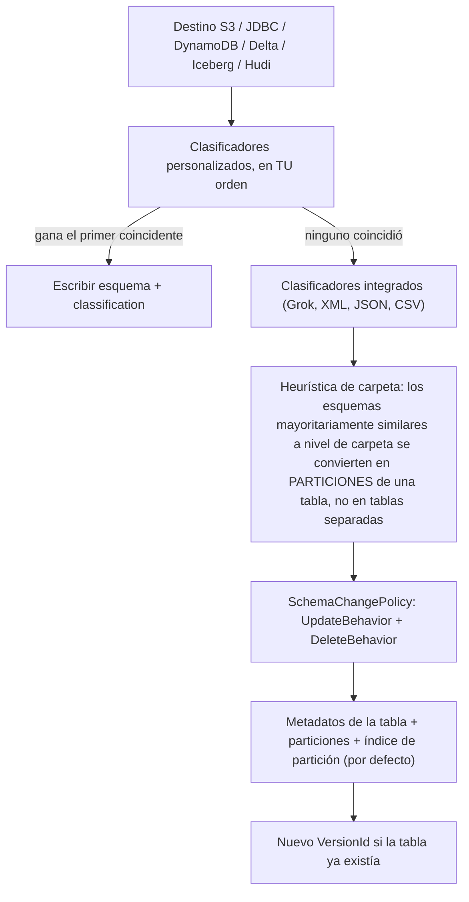
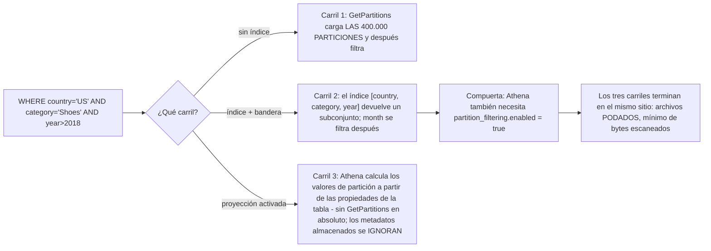
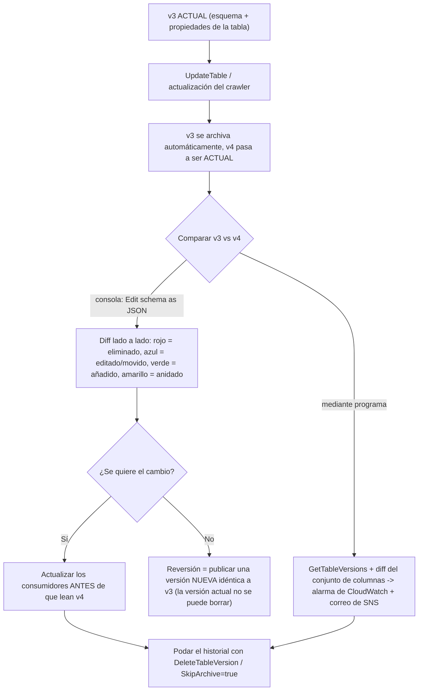
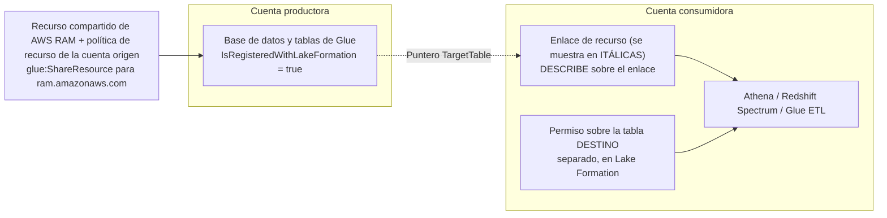
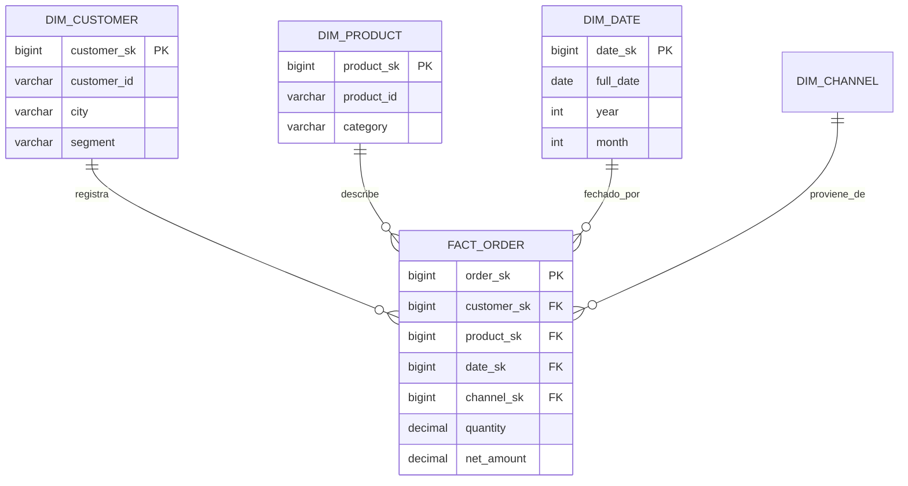
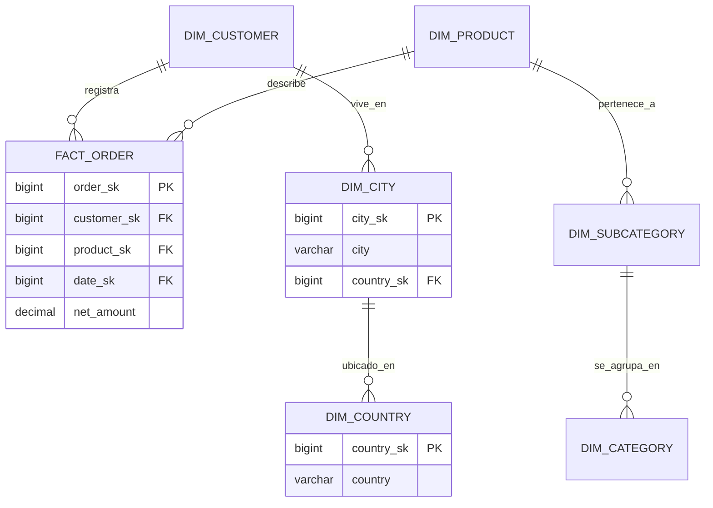
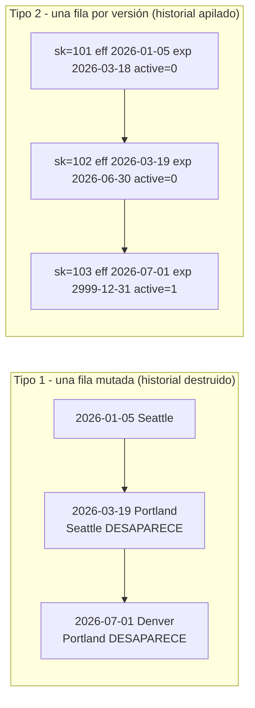

# Modelado de datos, catálogo Glue y evolución de esquemas

Dos tareas del Dominio 2 del DEA-C01 se encuentran en esta lección. **Tarea 2.2, comprender los sistemas de catalogación de datos**, te pide construir y referenciar un catálogo técnico de datos (AWS Glue Data Catalog, metastore de Apache Hive), descubrir esquemas con crawlers, sincronizar particiones y crear conexiones de origen/destino. **Tarea 2.4, diseñar modelos de datos y evolución de esquemas**, te pide diseñar esquemas para Amazon Redshift, DynamoDB y Lake Formation, abordar cambios en las características de los datos y describir las mejores prácticas de indexación, estrategias de particionado y compresión. El examen los trata como una sola historia: un **modelo** solo es tan bueno como el **catálogo** que lo describe, y un catálogo solo es seguro si puedes **cambiar** lo que describe sin romper a cada consumidor.

```text
====================================================================
 DEA-C01 DOMINIO 2 - TAREAS 2.2 (CATALOGACIÓN) + 2.4 (MODELOS Y ESQUEMA)
====================================================================
 Catálogo ..... cuenta/región -> catálogo -> base de datos -> tabla
                -> particiones   (SOLO metadatos, no guarda datos)
 Descubrir .... crawler -> clasificadores personalizados ordenados
                -> integrados -> inferir -> escribir metadatos (+ índices)
 Sincronizar .. crawler programado/por eventos | MSCK REPAIR (máx 100/sent.)
                | BatchCreatePartition | Glue ETL updateCatalog
                | proyección de particiones de Athena (sin metadatos)
 Acelerar ..... índice de partición (máx 3/tabla) -> poda -> proyección
 Versionar .... UpdateTable archiva primero -> VersionId + 1
                100.000 versiones/tabla, 1.000.000/cuenta (oct 2026)
 Intercambiar . un PATRÓN ensamblado: vista de catálogo / enlace de
                recurso / publicar una versión nueva - no una función de Glue
 Compartir .... enlace de recurso = DESCRIBE sobre el enlace + permiso
                sobre el destino, entre cuentas vía Lake Formation o IAM legado
 Modelar ...... estrella | copo de nieve; decide la GRANULARIDAD primero
 Historia ..... SCD 1 sobrescritura | SCD 2 fila nueva (inicio/fin/bandera)
 Evolucionar .. aditivo vs rompedor; metadatos de Hive estáticos vs Iceberg
 NoSQL ........ tabla única de DynamoDB: patrones de acceso -> PK/SK -> GSI
 Optimizar .... comprimir -> columnar -> estadísticas de ordenación ->
                buckets -> particiones: cada capa elimina un orden de magnitud
====================================================================
```

En esta lección:

- leerás el **modelo de objetos del Glue Data Catalog**, catálogo, base de datos, tabla, `StorageDescriptor`, `PartitionKeys`, `classification`, y las cuotas que lo conforman;
- ejecutarás un crawler en tu cabeza: **clasificadores personalizados en orden, gana el primero que tenga éxito, integrados solo si ninguno coincide**, heurísticas de carpetas y `SchemaChangePolicy`;
- separarás **indexación de particiones, poda y proyección de particiones**, incluidos los dos ajustes que Athena necesita para usar un índice;
- operarás la **versionado de tablas**: qué archiva `UpdateTable`, cómo comparas dos versiones y cómo se ensambla un **intercambio de tablas blue/green** a partir de piezas verificadas;
- conectarás **enlaces de recursos** para compartir entre cuentas y regiones, con la regla de los dos permisos;
- elegirás **estrella frente a copo de nieve**, fijarás la **granularidad**, identificarás hechos, dimensiones y **claves sustitutas**, y desnormalizarás para la distribución de Redshift;
- implementarás **SCD Tipo 1 frente a Tipo 2** (y por qué el Tipo 2 es el clásico del examen) con un merge resuelto;
- clasificarás un cambio de esquema propuesto como **aditivo o rompedor** en tablas al estilo Hive, Parquet/JSON/Avro e Iceberg, incluida la **evolución de particiones**;
- diseñarás un modelo de **tabla única** de DynamoDB a partir de patrones de acceso, claves y GSIs;
- apilarás **particionado, bucketing, ordenación, compresión y tamaño de archivo** en una sola escalera de eliminación de escaneos;
- estudiarás **tres casos de estudio de clientes de AWS** (BMW Group, GoDaddy y Integral Ad Science) y un **cuadro de actualizaciones de octubre de 2026 con fuente**;
- practicarás con **14 preguntas al estilo del examen** más cuatro comprobaciones interactivas.

---

## 1. El modelo de objetos del Glue Data Catalog

### 1.1 El árbol, y la única frase que importa

El Data Catalog es una jerarquía de **metadatos**: `account/Region → catalog → database → table → partitions`, más `functions`. La documentación de crawlers de AWS declara el hecho sobre el que se construye toda pregunta de catálogo: *«Las tablas del Data Catalog no contienen datos.»* Una fila de tabla apunta a datos (`Location`, `InputFormat`, `OutputFormat`, `SerdeInfo` de S3); nunca los guarda. Por eso borrar una tabla del catálogo no borra los objetos, y por eso dos catálogos pueden apuntar a los mismos prefijos.

```text
catálogo (por defecto, o un catálogo federado de Redshift)
└── base de datos                  (máx 10.000 por cuenta)
    └── tabla  ── StorageDescriptor: columnas, Location, InputFormat,
    │               OutputFormat, SerdeInfo, Compressed,
    │               BucketColumns, SortColumns, SkewedInfo
    │           ── PartitionKeys: el orden de claves al estilo Hive
    │           ── TableType: EXTERNAL_TABLE | GOVERNED
    │           ── Parameters: classification=parquet, etc.
    │           ── TargetTable: puntero si es un enlace de recurso
    │           ── SchemaReference: puntero hacia el Schema Registry
    │           ── IsRegisteredWithLakeFormation
    └── particiones (una por combinación de claves; 10.000.000 por tabla)
```

Una sola capa de metadatos alimenta a **Athena, Redshift Spectrum, EMR, Glue ETL y SageMaker AI**: que es todo el punto: rastrea una vez, consulta desde varios motores. Los catálogos también pueden ser **federados**, de modo que un catálogo federado de Redshift (o un catálogo que guarda enlaces de recurso hacia bases de datos de Redshift en otra cuenta o región) aparece en el mismo árbol.

### 1.2 La tabla de cuotas (en octubre de 2026)

| Objeto | Cuota | Por qué te importa |
|---|---|---|
| Bases de datos por cuenta | **10.000** | Una base de datos por equipo es un diseño temprano común que muere aquí |
| Tablas por base de datos / por cuenta | **200.000** / **1.000.000** | Un agrupamiento erróneo del crawler lo quema rápido |
| Particiones por tabla / por cuenta | **10.000.000** / **20.000.000** | Athena aún no puede leer más de **1.000.000** en un solo escaneo |
| **Versiones de tabla por tabla / por cuenta** | **100.000** / **1.000.000** | Las actualizaciones sin gobernanza degradan las lecturas |
| Crawlers por cuenta / concurrentes | **1.000** / **150** | La concurrencia, no el recuento, es la restricción real |
| Índices de partición por tabla | **3** | Planifica el subconjunto de claves, no rocíes índices |
| Profundidad de recorrido S3 del crawler | por defecto **10**, máx **20** | Los diseños profundos del lago dejan de rastrearse en silencio |
| Vistas del Data Catalog | hasta **10** tablas base | El primitivo blue/green de «nombre estable» |
| `ALTER TABLE … ADD PARTITION` | **100** por sentencia | Por qué existe `MSCK REPAIR` |
| Columnas de tabla externa de Redshift (Glue) | **1.597** con pseudocolumnas / **1.600** sin ellas | Las tablas de catálogo anchas chocan con un muro |

- **📚 ¿Sabías que…?** El propio Data Catalog tiene una **capa gratuita**: los primeros **1.000.000 de objetos de metadatos** y **2.000.000 de peticiones de metadatos** son gratuitos (precios de AWS Glue, consultados en octubre de 2026). El rastreo y el ETL se facturan aparte a **$0.44 por DPU-hora**, de modo que un equipo puede mantener un catálogo muy activo gratis y aún así recibir una factura sorpresa de sus crawlers: las dos líneas de la factura responden preguntas distintas.

```fillblank
{
  "question": "Completa las afirmaciones del modelo de objetos del Data Catalog con la propia formulación de AWS:",
  "template": "El árbol del Glue Data Catalog recorre cuenta/región -> {{1}} -> {{2}} -> {{3}} -> {{4}}. Una tabla es solo metadatos: la documentación de crawlers de AWS declara que las tablas del Data Catalog no contienen {{5}} - y la etiqueta de formato que un clasificador escribe en el mapa Parameters de la tabla se llama {{6}}, que es lo que Athena usa para decidir cómo leer los archivos de la Location de la tabla.",
  "answers": {
    "1": "catálogo",
    "2": "base de datos",
    "3": "tabla",
    "4": "particiones",
    "5": "datos",
    "6": "classification"
  },
  "distractors": ["cluster", "esquema", "partición", "índice", "archivos", "metadatos", "serde", "columna", "formato", "compresión"],
  "explanation": "La jerarquía es cuenta/región -> catálogo -> base de datos -> tabla -> particiones (más funciones), y es solo metadatos: la tabla apunta a objetos de S3 a través de Location/InputFormat/OutputFormat/SerdeInfo en lugar de guardar filas. La etiqueta de formato del clasificador aterriza en Parameters.classification (por ejemplo classification=parquet), y por eso dos tablas sobre los mismos prefijos pueden leerse de forma distinta, y por eso un classification erróneo aparece como error de análisis, no como error de tabla inexistente."
}
```

---

## 2. Crawlers y clasificadores: cómo se descubre un esquema

### 2.1 El orden de ejecución: el hecho de crawler más evaluado

AWS documenta un pipeline fijo: el crawler **ejecuta cualquier clasificador personalizado que elijas… en el orden que especifiques**, y *«El primer clasificador personalizado que reconozca con éxito la estructura de tus datos se usa para crear un esquema. Los clasificadores personalizados situados más abajo en la lista se omiten.»* Solo si **ningún** clasificador personalizado coincide prueban los clasificadores **integrados**. Después el crawler conecta, infiere el esquema y escribe los metadatos.



Dos consecuencias que a los redactores del examen les encantan. Primero, un **clasificador** es un reconocedor de formato/esquema («comprueba si un archivo dado está en un formato que el crawler pueda manejar» y emite un `StructType`); el **crawler** es el orquestador que descubre, agrupa, versiona y escribe. Segundo, **la prioridad es posicional**: un clasificador CSV con `delimiter=;` listado primero vence a un clasificador JSON listado segundo, y todo lo que queda por debajo del ganador se omite.

### 2.2 Destinos, programación y rastreo

| Ajuste | Opciones | Nota de examen |
|---|---|---|
| `Targets` | `S3Targets`, `JdbcTargets`, `DynamoDBTargets`, `MongoDBTargets`, `CatalogTargets`, `DeltaTargets`, `IcebergTargets`, `HudiTargets` | **Las fuentes de tipo tabla de catálogo no se pueden mezclar** con otros tipos de destino |
| `Schedule` | cadena cron, p. ej. `cron(15 12 * * ? *)` | La programación es una expresión cron, no un intervalo |
| Rastreo | todas las subcarpetas / solo subcarpetas nuevas / **basado en eventos** (S3 → SQS) | Lo dirigido por eventos es la respuesta de coste |
| Extras de `S3Targets` | `Exclusions`, `SampleSize`, `ConnectionName`, `EventQueueArn`, `DlqEventQueueArn` | Una conexión de red por crawler, compartida por todos los destinos S3 |
| Profundidad | por defecto 10, máx 20 | Los destinos Iceberg/Hudi apuntan a la **ruta de metadatos** |
| `Role` de IAM | lectura sobre los datos **y** escritura sobre el catálogo | El asistente crea `AWSGlueServiceRole-<nombre>` más `s3:GetObject` en línea |

### 2.3 SchemaChangePolicy, y cómo congelar un esquema curado

`UpdateBehavior` ∈ {`LOG`, `UPDATE_IN_DATABASE`}; `DeleteBehavior` ∈ {`LOG`, `DELETE_FROM_DATABASE`, `DEPRECATE_IN_DATABASE` (añade un marcador `DEPRECATED` más una marca de tiempo)}. La trampa crítica: la política *«no afecta a si se añaden tablas y particiones nuevas ni a cómo se añaden.»*

> [!WARNING]
> ⚠️ **`UpdateBehavior=LOG` no es «congela mi esquema».** Ponerlo en `LOG` detiene al crawler para **actualizar tablas existentes**, pero las tablas completamente nuevas y las particiones nuevas siguen creándose. Para congelar ambas, añade `UpdateBehavior=LOG` **más** la configuración `{"CrawlerOutput":{"Partitions":{"AddOrUpdateBehavior":"InheritFromTable"}}}`. Una opción que afirme que solo `LOG` detiene todas las escrituras está evaluando si leíste la frase anterior.

### 2.4 Ejemplo resuelto E1: un crawler que no debe arruinar tres columnas curadas a mano

Entrada: `s3://acme-raw/orders/dt=2026-10-0*/`, CSV delimitado por punto y coma con campos entrecomillados, marcas de tiempo inferidas actualmente como `string`, tres columnas de catálogo editadas a mano por un analista que deben sobrevivir a cada rastreo.

```text
1. Registrar un clasificador CSV PERSONALIZADO (delimiter ';', carácter de
   cita) y listarlo PRIMERO -> gana el primer éxito, se omiten los integrados
2. Fuente del crawler = tablas de CATÁLOGO existentes
                          -> se actualizan particiones, nunca se recrean tablas
3. UpdateBehavior = LOG + AddOrUpdateBehavior = InheritFromTable
                          -> esquema y diseño de particiones congelados
4. Schedule = cron(0 2 * * ? *)  O  evento S3 -> rastreo por eventos SQS
                          -> se evita el mínimo facturable de 10 minutos
5. Role = AWSGlueServiceRole + s3:GetObject/ListBucket sobre el prefijo
6. Confirmar CreatePartitionIndex = true (por defecto para destinos S3)
   y poner partition_filtering.enabled = true para Athena
```

Comprobación de coste en octubre de 2026: los crawlers facturan **$0.44 por DPU-hora**, por segundo, con un **mínimo de 10 minutos** por rastreo (1 DPU = 4 vCPU + 16 GB). Un rastreo nocturno que corre dos DPUs durante el mínimo de diez minutos cuesta **2 × (10/60) × 0,44 ≈ $0,15 por noche ≈ $4,5 al mes**, y eso es antes de cualquier espera en cola, y por eso los rastreos incrementales dirigidos por eventos son la recomendación por defecto para tablas que cambian una vez al día.

- **📚 ¿Sabías que…?** La heurística de carpeta es una *votación mayoritaria*, no una regla: *«Cuando la mayoría de esquemas de un nivel de carpeta son similares, el crawler crea particiones de una tabla en lugar de tablas separadas.»* Así que una carpeta de CSV limpios más dos archivos JSON mal formados produce **una tabla con particiones** y el ruido JSON se absorbe: mientras que separar datasets genuinamente distintos significa añadir cada raíz como un **almacén de datos aparte**, no retocar una bandera (documentación de crawlers de AWS Glue, consultada en octubre de 2026).

---

## 3. Sincronizar particiones: indexación, poda y proyección

### 3.1 Cinco mecanismos, un trabajo

| Mecanismo | Dónde se ejecuta | Techo / nota |
|---|---|---|
| Crawler programado o por eventos | Glue | Lee carpetas `key=value` al estilo Hive; puede sustituir al costoso `MSCK REPAIR` |
| `MSCK REPAIR` / `ALTER TABLE ADD PARTITION` | Athena/Spark SQL | Imperativo; **máx 100 particiones por ALTER** |
| API `BatchCreatePartition` | tu pipeline | Úsalo cuando el pipeline ya conoce el prefijo nuevo |
| Glue ETL escribiendo el catálogo | job de Glue | `enableUpdateCatalog=True` + `setCatalogInfo`; `partitionKeys` debe coincidir con el orden del catálogo; esquemas anidados no soportados |
| **Proyección de particiones** | solo Athena | Sin metadatos de partición en absoluto |

El esquema de partición existe a **nivel de tabla y por partición**, y Athena valida ambos: una discrepancia falla rápido con `HIVE_PARTITION_SCHEMA_MISMATCH` en lugar de leer los datos en silencio de forma errónea.

### 3.2 Índice frente a poda frente a proyección

- La **poda** es el *resultado*: descartar particiones que no coinciden antes de leer ningún archivo. Athena poda en toda tabla particionada, incluidas las proyectadas.
- Un **índice de partición** es un índice almacenado del Data Catalog sobre un subconjunto ordenado de claves de partición, de modo que `GetPartitions` obtiene un subconjunto en lugar de todo. Reglas: **máx 3 por tabla**; tipos de clave String/Numeric/Date; operadores `=`, `>`, `>=`, `<`, `<=`, `BETWEEN` y **solo `AND`** (`LIKE`, `IN`, `OR`, `NOT` se ignoran y se aplican después); **la primera clave del índice debe aparecer en la expresión o el índice no se usa en absoluto.**
- La **proyección** es que Athena calcule los valores y ubicaciones de las particiones en memoria a partir de las propiedades de tabla que configuras en la tabla de Glue: *«Activar la proyección de particiones en una tabla hace que Athena ignore cualquier metadato de partición registrado para la tabla en el AWS Glue Data Catalog o el metastore Hive.»*



### 3.3 Ejemplo resuelto E2: 400.000 particiones, un índice, cuatro consultas

Índice: `[country, category, year]` sobre una tabla con 400.000 particiones.

| Predicado de consulta | ¿Se usa el índice? | Comportamiento |
|---|---|---|
| `country='US' AND category='Shoes' AND year>2018` | **Sí** | Se obtiene el subconjunto; `month` se filtra después |
| `category='Shoes'` a solas | **No** | Falta la primera clave → se cargan las 400.000 |
| `country='US' OR country='UK'` | **No** | `OR` se ignora → se cargan todas |
| `country='US' AND category IN ('Shoes','Bags')` | **Sí** | `IN` se ignora; el índice se usa igual sobre `country` (+`category`), el resto se aplica después |
| `category='Shoes' AND country='US'` | **Sí** | Las claves están presentes; el índice sigue dirigiéndolo, el orden de tus `AND` no importa |

Dos ajustes, y después dos consumidores distintos:

| | Índice de partición | Proyección de particiones |
|---|---|---|
| Quién lo crea | El crawler por defecto para destinos S3/Delta (**no** para particiones cifradas) | Tú, a través de propiedades de tabla |
| Qué necesita Athena | el índice **y** `partition_filtering.enabled=true` | la proyección configurada; los metadatos almacenados se ignoran después |
| Quién más lo usa | Redshift Spectrum, EMR y Glue Spark DataFrames usan un índice `ACTIVE` **sin** esa bandera | **Solo Athena**: Spectrum/EMR siguen leyendo el catálogo |
| Coste del diseño | Almacenamiento más tráfico de `GetPartitions` | `SHOW PARTITIONS` sigue vacío; **>50% de particiones proyectadas vacías** → revertir |

- **📚 ¿Sabías que…?** Glue ETL te da dos perillas de pushdown distintas, y podan en lugares distintos: `push_down_predicate` es Spark SQL aplicado **en el cliente después de listar todas las particiones**, mientras que `catalogPartitionPredicate` es JSQL aplicado **en el servidor** a través del índice de partición: la que hay que alcanzar cuando una tabla tiene millones de particiones (mejores prácticas de AWS Glue, consultadas en octubre de 2026).

---

## 4. Versionado de tablas, comparación e intercambios blue/green

### 4.1 La versionado siempre está activa

*«Por defecto, `UpdateTable` siempre crea una versión archivada de la tabla antes de actualizarla. Sin embargo, si `skipArchive` se establece en true, `UpdateTable` no crea la versión archivada.»* Todo rastreo que cambia un esquema sube por tanto `VersionId` en 1, contra un techo de **100.000 versiones por tabla** y **1.000.000 por cuenta** (en octubre de 2026).



No hay **reversión verdadera**: la versión actual no se puede borrar, y restaurar significa *publicar una versión nueva idéntica a la que quieres recuperar*. (Apache Iceberg sí puede retroceder a un id de instantánea: es otra función distinta, no una operación de versión del catálogo.)

### 4.2 Intercambios de tablas blue/green: un patrón, no un producto

AWS **no** envía ninguna función con nombre de «despliegue blue/green de tablas» para el Glue Data Catalog. Lo que está verificado son las piezas, y la forma segura de responder en el examen es como un **patrón** ensamblado:

| Pieza | Qué aporta al intercambio |
|---|---|
| `CreateTable` con `TargetTable` | Un enlace de recurso puede redirigirse hacia `_green` |
| Vistas del Data Catalog (hasta **10** tablas base; dialectos de Athena/Redshift/Spark) | Un **nombre estable** que los consumidores siguen consultando |
| Archivado de versiones + publicar versión nueva | «Reversión» hacia adelante |
| `CREATE OR REPLACE VIEW … AS SELECT * FROM …_green` de Athena | Conmutación en una sentencia (patrón de terceros) |
| Regla de la guía blue/green | **Cambios aditivos antes del despliegue de código, cambios deletivos después del despliegue de código** |

> [!IMPORTANT]
> **En los despliegues blue/green de RDS/Aurora el DDL no se replica**: *«Los cambios de lenguaje de definición de datos (DDL) no están admitidos en los despliegues azul/verde… el conmutador quedará bloqueado.»* Misma frase, dos capas: un intercambio de tablas de Glue es un patrón de metadatos ensamblado, mientras que un despliegue blue/green de RDS es una función gestionada con una regla dura de DDL. Nunca respondas «despliegue blue/green de AWS Glue» como si AWS lo enviara para catálogos.

---

## 5. Enlaces de recursos y compartición entre cuentas

Un **enlace de recurso** es una tabla local (o una base de datos) cuyo `TargetTable` es `{CatalogId, DatabaseName, Name, Region}`: de modo que puede apuntar a otra cuenta **y** a otra región. Crear uno necesita `CREATE_TABLE`/`CREATE_DATABASE` de Lake Formation **y** `glue:CreateTable`/`glue:CreateDatabase` de IAM.



Las reglas que generan preguntas:

- *«conceder permisos sobre un enlace de recurso no concede permisos sobre el destino»*: necesitas **`DESCRIBE` sobre el enlace más un permiso separado sobre el destino**. Dos pasos, siempre.
- Los enlaces se muestran en **cursiva** en la consola; no hay **comprobación de existencia** al crearlos, de modo que un enlace puede apuntar a la nada.
- **Las cadenas son inútiles**: las APIs siguen solo el **primer** enlace de recurso, así que un enlace a un enlace no se resuelve.
- Existen dos pilas de compartición: **Lake Formation** (control de acceso por recurso con nombre o por etiquetas, que exige que la política de recurso de la cuenta origen permita `glue:ShareResource` para `ram.amazonaws.com`) o **permisos de Glue solo de IAM legados**. Desactivar *«Usar solo control de acceso por IAM para bases de datos/tablas nuevas»* impide que los objetos nuevos reciban el permiso `Super` de `IAMAllowedPrincipals`.
- Las LF-Tags son pares clave-valor como `department=sales` o `classification=restricted`, y *«las tablas heredan los LF-Tags de las bases de datos y las columnas heredan los LF-Tags de las tablas»*: así es como escala el marcado de PII: los permisos cuentan como `n(principales) + n(recursos)` en lugar de un producto.

- **📚 ¿Sabías que…?** Nadie en GoDaddy escribió esos enlaces de recurso a mano. El pipeline de aprovisionamiento de su mesh usó **AWS Service Catalog y AWS Lambda** para crear automáticamente los enlaces del lado consumidor, de modo que un producto de datos nuevo aparecía en una cuenta consumidora *ya enlazado* y aún exactamente a un permiso de distancia de ser consultable. Automatizar el objeto de **metadatos**, no la copia de datos, es lo que impide que «cientos de cuentas» se conviertan en cientos de tickets manuales, y la regla de dos pasos de `DESCRIBE` más destino seguía aplicándose a cada uno de ellos (AWS Big Data Blog, consultado en octubre de 2026).

---

## 6. Modelado dimensional: granularidad, hechos, dimensiones, estrella frente a copo de nieve

### 6.1 Primero la granularidad: de la que cuelga toda otra decisión

La **granularidad** es lo que significa **una fila** de una tabla de hechos: «una fila por línea de pedido», no «una fila por pedido», no «una fila por día y tienda». Decide la granularidad **antes** de elegir claves, porque determina qué eventos pueden compartir una tabla y de qué tamaño es cada fila. (Las publicaciones de modelado de Redshift de AWS usan la granularidad en todo momento pero nunca publican una definición formal: la formulación del examen es el encuadre de la industria/Kimball.)

| Elemento | Qué es | Qué porta |
|---|---|---|
| **Tabla de hechos** | Las mediciones de un proceso de negocio | Medidas aditivas + claves foráneas hacia las dimensiones (y hacia las claves sustitutas) |
| **Tabla de dimensiones** | El contexto que *«proporciona el significado de negocio a las medidas»* | Atributos descriptivos y jerarquías por las que agrupas y filtras |
| **Granularidad** | Una fila = un… | Se fija primero; eso determina las claves |
| **Clave sustituta** | *«Claves artificiales… típicamente generadas como un entero secuencial, y no tienen ningún significado en el dominio de negocio»* | Pequeña, inmutable, sin colisiones entre sistemas |
| **Orden de carga** | Las dimensiones **antes** que los hechos | *«Si la carga de la dimensión falla, la carga del hecho no se ejecutará»* |

Redshift construye claves sustitutas con **`IDENTITY`**, y de todos modos deberías declarar claves primarias/foráneas: *«Redshift no los impondrá, pero declararlos ayudará al optimizador a llegar a planes de consulta óptimos.»* Conserva una **dimensión de fecha**: toda tabla de hechos necesita un `date_sk`.

### 6.2 Estrella frente a copo de nieve

*«Los esquemas copo de nieve amplían el concepto de estrella normalizando más las dimensiones en múltiples tablas.»* AWS elige la estrella donde *«se alinea estrechamente con el proceso de negocio»*, y la compresión columnar hace que las claves desnormalizadas sean *«relativamente baratas de almacenar»*: de modo que los joins extra de un copo de nieve compran poco y cuestan tiempo de consulta.





Lee los dos diagramas como un intercambio: la **estrella** une el hecho con cuatro dimensiones planas en cuatro saltos; el **copo de nieve** normaliza `city → country` y `subcategory → category`, de modo que un salto se convierte en dos y cada join extra es trabajo que el motor debe planificar. En este examen, «el proceso de negocio se alinea con un hecho y dimensiones planas» ⇒ **estrella**; «el requisito es normalizado, dimensiones conformadas reutilizables» ⇒ **copo de nieve**, nombrando el coste del join.

### 6.3 Formas de tabla de hechos (conciencia)

| Tipo | Una fila significa | Cómo se distingue |
|---|---|---|
| **Transaccional** | Un evento (pago, pedido, clic) | El más grande, la granularidad más alta |
| **Instantánea periódica** | Un conjunto de dimensiones a un intervalo fijo (saldo de fin de día) | Repetible y finito |
| **Instantánea acumulativa** | Una fila por proceso largo, **actualizada en el sitio** | Varias claves de fecha hito; necesita una estrategia de actual más histórico |
| **Sin hechos** | Un evento sin medida (asistencia) | Cuentas, no sumas |

---

## 7. Dimensiones de cambio lento: Tipo 1 frente a Tipo 2

### 7.1 Los cuatro tipos que se te permite definir

| Tipo | Comportamiento | Compromiso |
|---|---|---|
| **0: Fija** | El atributo nunca cambia (fecha de nacimiento) | No se necesita historial |
| **1, Sin historial** | Se sobrescribe el valor; la dimensión refleja la versión más reciente | Barato, pierde auditoría, *«no se conserva historial»* |
| **2: Mantener historial** | *«Todos los cambios se registran y las versiones se rastrean con fechas y flags»* | Correcto, y el clásico del examen |
| **3: Valor anterior** | Se conserva el valor **anterior** en una columna extra | Solo se conoce un paso atrás |

> [!WARNING]
> ⚠️ **Un «Tipo 2» que actualiza la fila es un Tipo 1.** El Tipo 2 exige **una fila nueva por cambio**, con `record_start_date`, `record_end_date` (una fecha alta como `2999-12-31` para la fila actual), `active_flag`, un **record hash** opcional sobre las columnas rastreadas, y marcas de tiempo de inserción/actualización. Expira la fila antigua e inserta la nueva **en la misma transacción**. La fuente de AWS define solo los Tipos 0 to 3; no inventes Tipos 4 to 7 en una respuesta.



```matching
{
  "question": "Empareja cada tipo de dimensión de cambio lento con el comportamiento que AWS documenta para él:",
  "pairs": [
    {"left": "Tipo 0: Fijo", "right": "El atributo nunca cambia (por ejemplo la fecha de nacimiento), así que no se aplica ningún mecanismo de versionado"},
    {"left": "Tipo 1: Sin historial", "right": "La dimensión refleja la versión más reciente; el valor se sobrescribe y no se mantiene historial"},
    {"left": "Tipo 2: Mantener historial", "right": "Todos los cambios se registran y las versiones se rastrean con fechas y banderas: una fila nueva por cambio"},
    {"left": "Tipo 3: Valor anterior", "right": "El valor actual más una columna extra que guarda solo el valor último menos uno"}
  ],
  "explanation": "La guía de SCD de Redshift de AWS define exactamente estos cuatro comportamientos (0, 1, 2 y 3) y declara que existen tipos hasta el 7 definiendo solo estos: así que nunca definas un Tipo 4 o superior en una respuesta. El Tipo 2 es el clásico del examen porque es el único que permite que un hecho histórico se una a la versión de la dimensión que estaba vigente en su momento; el Tipo 1 es el señuelo que destruye la auditoría, y el Tipo 3 solo puede mostrar un paso atrás."
}
```

### 7.2 Ejemplo resuelto E3: un merge de Tipo 2, sentencia por sentencia

El escenario guarda el delta; la dimensón guarda el historial. Empareja por la **clave de negocio** con un **left outer join**, hashea las columnas rastreadas para decidir actualización frente a inserción, y hazlo como **operaciones masivas, nunca cursores fila a fila**:

```sql
-- 1) expire the current row for every changed business key
UPDATE dim_customer
SET    rec_exp_dt = CURRENT_DATE - 1,
       is_active  = 0
WHERE  customer_id = :id
  AND  is_active   = 1;

-- 2) insert the new active version in the same transaction
INSERT INTO dim_customer
       (customer_sk, customer_id, city, rec_eff_dt, rec_exp_dt, is_active)
SELECT NEXTVAL('dim_customer_sk'), :id, :city,
       CURRENT_DATE, DATE '2999-12-31', 1;
```

Mecánica que vale la pena memorizar:

- **Detección de coincidencias:** left outer join entre escenario ↔ dimensión sobre la clave de negocio; las filas coincidentes son candidatas a actualización/expiración, las no coincidentes son inserciones.
- **Detección de cambios:** `sha2` entre fuentes, `FNV_HASH` (64 bits) para dimensiones grandes, `CHECKSUM` (32 bits) para las pequeñas: un hash cambiado significa que la fila debe versionarse.
- **Detección de borrados:** extractos completos → compara versiones anterior y actual; extractos solo de cambios → usa una columna de estado.
- **Distribución:** da al escenario y al destino **claves de distribución coincidentes** de modo que el merge sea local al nodo en Redshift.
- **Contrato:** carga **primero las dimensiones y después los hechos**: una carga de dimensiones fallida debe bloquear la carga de hechos.

- **📚 ¿Sabías que…?** La convención de fecha alta `2999-12-31` no es adorno: permite que una consulta encuentre «la dirección actual de cada cliente» con `WHERE is_active = 1` **o** con `WHERE CURRENT_DATE BETWEEN rec_eff_dt AND rec_exp_dt`, y permite que un hecho histórico se una con `f.order_date BETWEEN d.rec_eff_dt AND d.rec_exp_dt`: que es exactamente cómo responde un esquema estrella a «cómo era el pedido *en su momento*». El Tipo 1 no tiene equivalente porque no hay intervalo sobre el que unir (guía de SCD de AWS Redshift, consultada en octubre de 2026).

---

## 8. Desnormalización y diseño físico en Redshift

Las dimensiones planas del esquema estrella son una decisión de **desnormalización**, y Redshift la recompensa físicamente:

| Palanca | Regla de la guía de AWS |
|---|---|
| `DISTKEY` del hecho | *«Elige la clave foránea de la dimensión grande que más se une como clave de distribución en la tabla de hechos y la clave primaria en la tabla de dimensión»*: de modo que el join esté colocalizado en la slice y no necesite redistribución |
| Dimensiones pequeñas/medianas | `DISTSTYLE ALL` (replicadas, evita un shuffle) |
| Dimensiones actualizadas con frecuencia | Prefiere `DISTSTYLE KEY` |
| Ordenación | `SORTKEY` (compuesto o entrelazado) para que las estadísticas min/máx de grupo de filas salten bloques |
| Claves | Declara PK/FK de todos modos: no se aplican, pero el optimizador las usa |
| Después de las cargas | `ANALYZE` (y `VACUUM` cuando aplique) |

```text
Ejemplo resuelto E4 - elegir la clave de distribución por tamaño, no por costumbre

Tabla de hechos  fact_order_lines      4.200.000.000 filas
Dimensión A      dim_customer            48.000.000 filas  <- dim unida más grande
Dimensión B      dim_product                 180.000 filas
Dimensión C      dim_date                       3.650 filas

Regla: fact.DISTKEY  = customer_sk   (FK unida con frecuencia más grande)
      dim_customer.DISTSTYLE = KEY(customer_sk)   <- coincide con el hecho
      dim_product / dim_date   = DISTSTYLE ALL    <- suficientemente pequeñas para copiar

Por qué: un join sobre customer_sk ocurre entonces dentro de cada slice,
sin paso de redistribución, mientras que las dos dimensiones diminutas ya
están presentes en cada nodo. Ordenar fact_order_lines por date_sk adicional
permite al motor saltar grupos de filas enteros para un filtro de rango de fechas.
```

La desnormalización también responde la pregunta del **copo de nieve** físicamente: tablas normalizadas extra significan joins extra, y en un almacén columnar esos joins cuestan mucho más que el disco que ahorran.

---

## 9. Evolución de esquemas: aditivo frente a rompedor

### 9.1 La tabla de auditoría

Un cambio es **aditivo** cuando los lectores antiguos y los archivos antiguos siguen funcionando; es **rompedor** cuando un consumidor falla, convierte en silencio, o el diseño de particiones ya no coincide con la consulta.

| Cambio propuesto | Externo al estilo Hive (Athena/Glue) | Iceberg |
|---|---|---|
| `ADD COLUMN channel string` (añadir, nullable) | Seguro; los archivos antiguos leen NULL | Seguro, solo metadatos, nuevo id de campo |
| Renombrar `cust` → `customer` | Solo catálogo; los lectores con clave por el nombre antiguo rompen | Seguro: el id de campo es estable |
| Eliminar `legacy_ref` | Rompe `SELECT *`; un rastreo nuevo puede mover posiciones | Seguro, sin efectos secundarios |
| Estrechar/re-tipar `DECIMAL(12,2)` → `DECIMAL(9,2)` | Puede fallar o convertir en silencio | Solo se permiten promociones de **ampliación** (`int`→`long`, `float`→`double`, precisión decimal hacia arriba) |
| Reordenar / insertar en medio de la tabla | Puede lanzar `HIVE_PARTITION_SCHEMA_MISMATCH` | Seguro |
| Nueva **clave de partición** | Reescribe las claves de objeto bajo prefijos nuevos | Nueva especificación; los archivos antiguos conservan su diseño (**planificación de divisiones**) |
| Cambio en `struct`/`array`/`map` anidados | Actualización de catálogo de Glue ETL no soportada para anidados | Añadir/eliminar/renombrar/reordenar dentro de un `struct` soportado |

Dos anclas: *«Las actualizaciones de esquema de Iceberg son cambios solo de metadatos. No se cambia ningún archivo de datos cuando realizas una actualización de esquema»*, y la corrección de Iceberg se apoya en **ids de campo únicos**: *«Las columnas añadidas nunca leen valores existentes de otra columna»*. Athena, en cambio, falla rápido en lugar de leer mal: un esquema de partición que diverge del esquema de la tabla lanza `HIVE_PARTITION_SCHEMA_MISMATCH`.

### 9.2 La evolución de particiones es la trampa dentro de la trampa

*«El particionado de tablas Hive no puede cambiar, de modo que pasar de una disposición de particiones diaria a una por horas requiere una tabla nueva. Y como las consultas dependen de las particiones, estas deben reescribirse para la tabla nueva.»* Para Iceberg: *«Cuando evolucionas una especificación de partición, los datos antiguos escritos con una especificación anterior permanecen sin cambios. Los datos nuevos se escriben usando la nueva especificación en una disposición nueva… La evolución de particiones es una operación de metadatos y no reescribe archivos de forma anticipada.»* Ambas afirmaciones son evaluables, y apuntan en direcciones opuestas: las claves de partición al estilo Hive **son** las claves de objeto de S3, así que cambiar el esquema es una migración; las especificaciones de partición de Iceberg son metadatos, de modo que los diseños antiguo y nuevo coexisten: al coste de una **planificación de divisiones** extra.

### 9.3 Cómo maneja cada formato el cambio: Parquet, JSON y Avro

| Formato | Dónde vive el esquema | Comportamiento de evolución (encuadre de examen) |
|---|---|---|
| **Parquet** | En el pie de cada archivo, columnar | Añades una columna nullable y los archivos antiguos siguen leyendo (NULL); los lectores leen solo las columnas que nombran, así que una columna añadida no cuesta nada a las consultas antiguas. Códec por defecto **Snappy** |
| **JSON** | Sin esquema aplicado: esquema aplicado en la lectura | La clásica carga **schema-on-read**: el crawler infiere un esquema, y *«si esta columna cambia a string por el origen, sin notificar al consumidor, el pipeline fallará seguro»* |
| **Avro** | Esquema del escritor incrustado, ids de campo | El esquema viaja con los datos; la compatibilidad la deciden las reglas, y por eso el Glue Schema Registry (streaming, **serverless y gratuito**, 8 modos de compatibilidad, por defecto/recomendado **BACKWARD**) valida registros en el momento de la serialización |
| **ORC** | Dentro del archivo, columnar con índices integrados | Códec por defecto **ZLIB**; normalmente archivos más pequeños que Parquet |

> [!NOTE]
> Llamada de alcance: la lista en alcance de la guía del examen dice **«AWS Glue»** y nunca nombra el **Glue Schema Registry**, y ninguna viñeta de competencia lo nombra tampoco. Aprende como **conciencia para esquemas de streaming**, `SchemaArn` y números de versión, y nunca como la respuesta a una pregunta sobre la versión de una **tabla del Data Catalog** (`Table.VersionId`). Una tabla puede *referenciar* un esquema del registro a través de `StorageDescriptor.SchemaReference`, pero la compatibilidad del registro no es un incremento de versión del catálogo.

### 9.4 Ejemplo resuelto E5: clasifica cinco peticiones antes de enviarlas

```text
Petición 1  ADD COLUMN channel (añadir, nullable)   -> ADITIVO
            enviar ANTES del despliegue del consumidor; los archivos antiguos leen NULL
Petición 2  DROP COLUMN legacy_ref                  -> ROMPEDOR
            enviar DESPUÉS del despliegue del consumidor (aditivo primero,
            deletivo después del despliegue de código)
Petición 3  RE-TIPAR amount DECIMAL(12,2) -> DECIMAL(9,2) -> ROMPEDOR
            estrechar no es una promoción de ampliación; Hive puede convertir
Petición 4  particiones por hora en lugar de diarias -> ROMPEDOR (Hive)
            tabla nueva + consultas reescritas; SOLO METADATOS en Iceberg
Petición 5  RENOMBRAR cust -> customer              -> ROMPEDOR (Hive)
            seguro en Iceberg (id de campo estable); los consumidores con
            clave por el nombre antiguo de columna siguen rompiendo en ambos mundos
```

La regla de ordenación, **aditivo antes del despliegue de código, deletivo después del despliegue de código**, es la frase más reutilizable de esta sección.

---

## 10. Diseño de tabla única de DynamoDB: primero los patrones de acceso

*«El diseño de tabla única es un patrón que te permite almacenar múltiples tipos (entidades) de datos en una sola tabla de DynamoDB.»* El workflow documentado por AWS recorre **caso de uso → relación entidad-entidad → patrones de escritos como SQL → esquema → PK/SK por tabla y GSI → repetir**, y arranca desde **consultas, no entidades**.

| Concepto | Qué hace |
|---|---|
| **Patrón de acceso** | Una frase como «obtener un pedido por id» o «listar los pedidos de un cliente del más reciente al más antiguo»: la entrada del diseño |
| **Clave de partición** | La condición de **igualdad**; debe ser de **alta cardinalidad** de modo que los elementos se repartan por igual |
| **Clave de ordenación** | Rango / `begins_with`: da uno-a-muchos, jerarquías y colecciones ordenadas |
| **Prefijos compuestos** | `ORDER#123`, `INVOICE#123` separan tipos de entidad en una tabla (colecciones de elementos que comparten clave de partición) |
| **Nombres genéricos** | Las tablas sobrecargadas usan `PK`/`SK` en lugar de nombres propios de entidad |
| **GSI** | Una tabla sombra con sus **propios** PK/SK, **ancho de banda independiente**, sincronización asíncrona de consistencia eventual, proyecciones `KEYS_ONLY` / `INCLUDE` / `ALL` |
| **Índice disperso** | Solo se indexan los elementos que llevan la clave del GSI: una bandera opcional no cuesta nada para los elementos sin ella |
| **Sobrecarga de índices** | Un solo GSI sirve a muchos tipos de entidad |
| **Sharding de escritura** | Se añade `rand(0,N)` cuando una sola clave de partición superaría **3.000 RCU/s o 1.000 WCU/s** |
| **Claves multi-atributo** | Hasta **4 PK + 4 SK = 8** atributos; todos los atributos PK necesitan igualdad; los atributos SK se consultan de izquierda a derecha sin saltos |
| **Particionado vertical** | Divide un documento grande en elementos que comparten PK con prefijos de SK: vence el límite de **400 KB** por elemento y mantiene las escrituras pequeñas (las escrituras se facturan en pasos de **1 KB**) |

### 10.1 Ejemplo resuelto E6: cuatro patrones de acceso a un diseño

```text
Patrones: (a) obtener cliente por id
          (b) listar los pedidos de un cliente, del más reciente al más antiguo
          (c) obtener un pedido por order id
          (d) listar averías escaladas

Tabla base    PK = customerId, SK = ROOT                -> (a)
  elemento    PK = customerId, SK = ORDER#<iso8601>      -> (b)
              consultar con ScanIndexForward = false (más reciente primero)
  GSI1        PK = orderId, SK = ROOT                    -> (c)
              DISPERSO: solo los elementos de pedido llevan orderId, así que
              el coste del índice es proporcional a los pedidos, no a los elementos
  GSI2        PK = escalatedTo, SK = ...                 -> (d)
              DISPERSO: presente solo en elementos de avería

Comprobación de techos (en octubre de 2026): una clave de partición topa a
3.000 RCU/s y 1.000 WCU/s -> si orderId superaría eso, shárdealo como
orderId#<0..N> y consulta las N particiones en paralelo.
Techo por elemento: 400 KB; un documento de pedido de 900 KB DEBE dividirse
en elementos que compartan PK = ORDER#123 con prefijos de SK (HEADER#, LINE#n).
```

Elige **tabla única** cuando las entidades se consultan **juntas** con necesidades operativas similares; elige **tablas múltiples** cuando diverjan la retención, la copia de seguridad, las claves KMS por inquilino o la clase de tabla. AWS declara ambos lados; esto es una pregunta de criterio, no una pregunta de «la tabla única es siempre mejor».

---

## 11. Particionado, bucketing, ordenación, compresión: la escalera de eliminación

Cada capa elimina trabajo **antes** de que se ejecute la siguiente, empezando por la más externa:

| # | Capa | Qué elimina | Techo / valor por defecto (oct 2026) |
|---|---|---|---|
| 1 | **Particionado** (fecha, región) | Directorios/prefijos enteros | Athena lee como máximo **1.000.000** particiones en un escaneo; particiones demasiado finas inflan `GetPartitions` |
| 2 | **Bucketing / clustering** | Buckets hash dentro de una partición | Campos de Glue `NumberOfBuckets` / `BucketColumns`; `bucket(N, col)` de Iceberg |
| 3 | **Ordenación** | Grupos de filas/franjas, vía estadísticas min/máx | *«los datos dentro de los archivos están ordenados… Athena puede usar los valores mínimo y máximo de los metadatos del archivo para saltar las partes innecesarias»* |
| 4 | **Formato columnar** | Columnas no tocadas | Parquet para mezclas de consultas anchas/complejas; ORC para tipos complejos e índices integrados |
| 5 | **Compresión** | Bytes antes de la descompresión | *«Consultar datos comprimidos es más rápido y también más barato porque pagas por el número de bytes escaneados antes de la descompresión.»* |
| 6 | **Tamaño de archivo** | Sobrecarga de listado/peticiones | Glue activa automáticamente la agrupación de archivos por encima de **50.000** archivos de entrada; grupos de filas de Parquet de **128 MB**, franjas de ORC de **64 MB** (las franjas de menos de 8 MB se leen enteras) |

Elección de códec (de la tabla de códecs de mejores prácticas de AWS Glue): **Snappy**: rápido, ratio moderado, **por defecto para Parquet**; **GZIP**: ratio alta, intensivo de CPU y **no divisible**, así que solo para texto frío/archival; **Bzip2**: ratio muy alta, divisible, lento; **ZLIB**: **por defecto para ORC**; **Zstd**: equilibrado. Compresión frente a paralelismo es un intercambio real: Gzip sobre texto caliente pierde la divisibilidad.

### 11.1 Ejemplo resuelto E7: la escalera de coste de escaneo

CSV de **100 columnas**, **4 TB** sin comprimir, una consulta que selecciona **una columna** para **uno de 365 días**:

```text
CSV en bruto, escaneo completo             4.000.000 MB   (línea base)
+ GZIP a 4:1                               1.000.000 MB   -> ~1 TB
+ Parquet, 1 de 100 columnas                  10.000 MB   -> ~10 GB
+ poda de particiones, 1 de 365                  ~28 MB
+ salto por min/máx de la ordenación       se leen menos grupos de filas

Cada paso elimina aproximadamente un orden de magnitud, y las capas se
componen: la compresión encoge el escaneo, lo columnar salta columnas,
las estadísticas de ordenación saltan grupos de filas, los buckets saltan
buckets, las particiones saltan directorios.
```

Athena pone precio al resultado: con **$5.00 por TB escaneado** y un **mínimo de 10 MB por consulta** (precios de Athena, consultados en octubre de 2026), el escaneo en bruto cuesta unos **$20.00**, el escaneo con GZIP **$5.00**, el escaneo de una sola columna en Parquet **$0.05**, y el escaneo particionado se mide en fracciones de céntimo. El formato y el diseño son **controles de coste**, no meros controles de rendimiento.

```dragdrop
{
  "question": "Ordena la escalera de optimización de datos desde la capa de eliminación más externa (elimina más trabajo primero) hasta la más interna:",
  "items": [
    "Particionado: saltar prefijos de S3 enteros (directorios key=value al estilo Hive)",
    "Bucketing / clustering: saltar buckets hash dentro de una partición",
    "Ordenación: las estadísticas min/máx de grupo de filas y franja saltan bloques dentro de un archivo",
    "Formato columnar: leer solo las columnas nombradas (Parquet / ORC)",
    "Compresión: menos bytes escaneados antes de la descompresión",
    "Tamaño y agrupación de archivos: evitar el impuesto de listado de archivos pequeños (agrupación automática por encima de 50.000 archivos)"
  ],
  "correctOrder": [
    "Particionado: saltar prefijos de S3 enteros (directorios key=value al estilo Hive)",
    "Bucketing / clustering: saltar buckets hash dentro de una partición",
    "Ordenación: las estadísticas min/máx de grupo de filas y franja saltan bloques dentro de un archivo",
    "Formato columnar: leer solo las columnas nombradas (Parquet / ORC)",
    "Compresión: menos bytes escaneados antes de la descompresión",
    "Tamaño y agrupación de archivos: evitar el impuesto de listado de archivos pequeños (agrupación automática por encima de 50.000 archivos)"
  ],
  "explanation": "Las capas están anidadas, así que se aplican de fuera hacia dentro: las particiones podan directorios antes de abrir cualquier archivo, los buckets podan dentro de una partición, la ordenación poda grupos de filas dentro de un archivo, el formato columnar poda columnas dentro de un grupo de filas, la compresión reduce los bytes realmente leídos, y la agrupación de archivos elimina la sobrecarga de listado que de otro modo domina cuando existen millones de archivos diminutos. Saltarse una capa no rompe las demás: solo deja ese orden de magnitud en la factura."
}
```

- **📚 ¿Sabías que…?** La ordenación ayuda **solo** a los filtros sobre la columna de ordenación: las estadísticas min/máx describen la clave de ordenación, así que un predicado sobre cualquier otra columna no salta nada. Por eso «añadir un SORTKEY sobre `customer_id`» responde una consulta filtrada por cliente y no hace nada por una filtrada por producto (guía de rendimiento de Amazon Athena, consultada en octubre de 2026).

La otra mitad de una factura de Athena es el **mínimo de reserva** y no los bytes esceseados, y ese mínimo mismo se movió en 2026. Toma la misma ventana de lote nocturno, **12 DPU durante 10 minutos**, y léela en DPU-horas (DPU × horas) bajo la regla antigua y la nueva:

```plot
{
  "type": "bar",
  "title": "Una ventana de lote nocturna de 12 DPU y 10 minutos en Athena (DPU-horas facturadas)",
  "data": [
    {"rule": "Before 11 Feb 2026: 24 DPU x 60 min minimum", "dpuHours": 24},
    {"rule": "After 11 Feb 2026: 12 DPU x 10 min (floor 4 DPU / 1 min)", "dpuHours": 2}
  ],
  "xKey": "rule",
  "yKey": "dpuHours",
  "xLabel": "Regla de Capacity Reservation",
  "yLabel": "DPU-horas facturadas"
}
```

Lectura del gráfico: el *trabajo* nunca cambió, 12 DPU durante 10 minutos en ambos casos, pero la cantidad facturable cayó de **24 × 1 = 24 DPU-horas** a **12 × (10/60) = 2 DPU-horas**, un recorte de **12×** producido puramente por bajar el mínimo del servicio de 24 DPU / 60 minutos a **4 DPU / 1 minuto** (AWS Big Data Blog, 11 de febrero de 2026, consultado en octubre de 2026). El diseño sigue decidiendo cuántos bytes escaneas; la regla de reserva decide cuántos de esos minutos se te obliga a comprar.

### Actualizaciones de 2026 (en octubre de 2026)

> [!NOTE]
> **Qué se movió en este tema entre la guía de la época del lanzamiento y la que descargas hoy**: cada línea verificada contra una fuente primaria de AWS en **octubre de 2026**:
> - **Guía del examen v1.1 (12 de diciembre de 2025)** consolidó conocimientos/competencias en una sola lista de competencias y añadió **8 competencias, sin eliminar ninguna**. Para esta lección: **2.1.7 «Manage open table formats (for example Apache Iceberg)»** hace evaluable directamente la evolución de esquemas y particiones de Iceberg; **2.2.6 «Create and manage business data catalogs (for example Amazon SageMaker Catalog)»** es una nueva competencia de catalogación; **2.4.6** añade conceptos de vectorización. En alcance **+6 / −3**: se añadió **Amazon S3 Tables**, se eliminó **AWS SCT**: de modo que la competencia de conversión de esquemas de la tarea 2.4.3 ahora dice **AWS DMS Schema Conversion**, con SCT solo como vocabulario legado (página de revisiones de la guía del examen, consultada en octubre de 2026).
> - **AWS Glue 6.0 (21 de agosto de 2026)**: **precio un 30% menor**, Spark **4.1.1**, Python **3.13**, Hudi 1.1.1, Iceberg **1.11.0**, Delta 4.2.0 e **Iceberg format v3** (vectores de borrado, linaje de filas). Cambios rompedores para los jobs: **EMRFS eliminado** (S3A es el único sistema de archivos de S3) y **AWS SDK for Java v1 eliminado**: una opción que siga referenciando `fs.s3.consistent.*` o `com.amazonaws.services.*` está caducada (anuncio y página de migración de AWS Glue 6.0, 21 ago 2026 / consultada en octubre de 2026).
> - **Higiene de versiones de Glue**: Glue **0.9/1.0/2.0 llegó a fin de soporte el 1 de abril de 2026**, y **Python Shell 3.6** no puede crear jobs nuevos después del **31 de marzo de 2026** (los jobs existentes siguen corriendo). **Glue 5.1** ha sido el valor por defecto para jobs nuevos desde el 26 de noviembre de 2025 (política de soporte de versiones de AWS Glue, consultada en octubre de 2026).
> - **Compartición entre cuentas de Lake Formation v5 (11 de febrero de 2026)**: un **único recurso compartido de AWS RAM** puede ahora transportar tablas ilimitadas (AWS dice «cientos de miles»), los permisos nuevos usan **patrones comodín** en lugar de asociaciones por recurso, los recursos compartidos existentes siguen funcionando, y la actualización es opt-in: la regla de enlace-de-recurso-más-permiso-sobre-destino de la sección 5 no cambia (AWS What's New, 11 feb 2026).
> - **Iceberg se escribe ahora desde Redshift**: **escrituras de Iceberg GA el 17 de noviembre de 2025** (registradas en el **Glue Data Catalog**), **UPDATE/DELETE/MERGE el 23 de abril de 2026**, **vistas materializadas el 5 de octubre de 2026**, y un **DELETE** de Iceberg sobre tablas de Lake Formation requiere el permiso **DELETE**, y todo el DML de Iceberg necesita **ALTER**. Cualquier opción que afirme que Redshift solo puede *leer* tablas de lago está caducada (AWS What's New y página de cambios de comportamiento de Redshift, consultada en octubre de 2026).
> - **La parte de catálogo de Athena también se movió**: **vistas materializadas del Glue Data Catalog (30 de noviembre de 2025)**, optimización de coste basada en estadísticas para Iceberg que funciona *con* los filtros de fila y máscaras de columna de Lake Formation **(21 de noviembre de 2025)**, **managed query results** que no necesitan bucket de resultados en S3 y no cuestan nada extra **(3 de junio de 2025)**, **conectores gestionados para 12 fuentes (23 de abril de 2026)**, y un suelo de Capacity Reservation recortado de **24 DPU / 60 minutos** a **4 DPU / 1 minuto (11 de febrero de 2026)**: una opción que exija un bucket de resultados obligatorio, o que facture una hora completa por un lote de diez minutos, está caducada (notas de versión de AWS Athena y AWS What's New, consultadas en octubre de 2026).
> - **La maquinaria de esquemas de Iceberg fue a la v3**: **Amazon S3 Tables** está ahora en alcance (guía v1.1) y envió el tipo **Variant** para **Iceberg format v3 el 28 de julio de 2026**; **Glue 6.0** ejecuta Iceberg **1.11.0** con soporte de v3: VARIANT más shredding, **vectores de borrado** y linaje de filas. Los vectores de borrados son lo que mantiene baratos los `DELETE` a nivel de fila, que es exactamente la operación que ahora realiza el `UPDATE/DELETE/MERGE` de Redshift, y la competencia **2.1.7 «Manage open table formats»** de la guía del examen pone la evolución de esquemas, las instantáneas y la compactación directamente en alcance (AWS What's New, 28 jul 2026; anuncio de AWS Glue 6.0, 21 ago 2026, consultados en octubre de 2026).
> - **Los permisos se apretaron mientras compartir se volvía más fácil**: la matriz completa tras el cambio de comportamiento de Redshift: `INSERT` → **INSERT**, `DELETE` → **DELETE**, **`UPDATE`/`MERGE` → INSERT + DELETE**, y *toda* sentencia DML de Iceberg necesita además **ALTER**. Un laboratorio (o un rol entre cuentas) que solo conceda `INSERT` ya no basta para mergear una tabla de lago, mientras que el recurso compartido con comodín de Lake Formation v5 de la viñeta anterior hace el propio permiso más barato (página de cambios de comportamiento de AWS Redshift, Patch 202, consultada en octubre de 2026).

---

## Casos Reales

Cada cifra de abajo es **afirmación del cliente o de AWS, sin auditar**, con la fuente nombrada para que puedas verificarla. El punto evaluable es el **patrón**, qué objeto de catálogo se compartió, qué contrato de esquema se aplicó, no el marketing.

### Caso A, BMW Group: esquemas en Glue, datos en S3

| Elemento | Detalle |
|---|---|
| Cliente | **BMW Group**, fabricante de automóviles |
| Reto | Un data lake on-premises construido en **2015** no podía servir a múltiples inquilinos con una separación clara de productor/consumidor |
| Servicios | **Amazon Kinesis Data Firehose + AWS Lambda + AWS Glue + Amazon EMR** del lado del productor; **Amazon Athena, Amazon SageMaker AI, Amazon EMR** del lado del consumidor; **capas en Amazon S3, esquemas en el AWS Glue Data Catalog** |
| Resultados | **10 TB/día** ingeridos desde **1,2 millones de vehículos**; un Cloud Data Hub que sirve a **más de 500 usuarios**; telemetría anonimizada |
| Dominio de examen | **Dominio 2, tarea 2.2**: el catálogo es el contrato compartido entre las cuentas de productor y consumidor |
| Fuente | `aws.amazon.com/solutions/case-studies/bmw-group-case-study/` (consultada en octubre de 2026) |

El patrón evaluable: **los datos nunca salieron de S3 mientras la propiedad se repartía entre cuentas**: Glue guarda los esquemas, Athena y SageMaker los consumen in situ. Ese es exactamente el arreglo de enlace-de-recurso-más-Lake-Formation de la sección 5, y por eso «copiar los datos a la cuenta de cada equipo» es un señuelo: compartir pertenece a la capa de **metadatos**.

### Caso B, GoDaddy: un data mesh sobre un catálogo compartido

| Elemento | Detalle |
|---|---|
| Cliente | **GoDaddy**, empresa de internet/tecnología |
| Reto | Un clúster Hadoop on-premises compartido, copias de HDFS proliferando y permisos ingobernables |
| Servicios | **AWS Lake Formation + AWS Glue Data Catalog + Amazon S3 + recursos compartidos entre cuentas de AWS RAM + Amazon Athena / Amazon EMR + AWS Service Catalog + AWS Lambda** |
| Resultados | Un data mesh hub-and-spoke con **más de 2.000 productos de datos**, **varios petabytes a lo largo de cientos de cuentas**, cientos de productores y miles de consumidores, y una cuenta central de gobernanza |
| Dominio de examen | **Tareas 2.2/2.4 del Dominio 2** con enganches del Dominio 4 (gobernanza, compartición entre cuentas) |
| Fuente | AWS Big Data Blog, «How GoDaddy built a data mesh to decentralize data ownership using AWS Lake Formation» (consultado en octubre de 2026) |

> «Existen más de 2.000 productos de datos construidos sobre el data mesh de GoDaddy en AWS … Nuestro data mesh gestiona múltiples petabytes de datos a lo largo de cientos de cuentas.»

Lee la cifra correctamente: **2.000 productos de datos es un problema de escala de catálogo**, no de almacenamiento. Los enlaces de recurso (que se muestran en cursiva, necesitan `DESCRIBE` más un permiso sobre el destino, y solo resuelven el primer enlace de una cadena) más los recursos compartidos de AWS RAM son lo que permiten que cientos de cuentas consulten una base de datos de Glue sin copiarla.

- **📚 ¿Sabías que…?** Los tres casos de estudio ponen el **AWS Glue Data Catalog en el centro** y ninguno de ellos movió datos para dar acceso a un equipo: BMW para la separación de productor/consumidor, GoDaddy para el compartir de la mesh en su conjunto, IAS para el acceso basado en clasificación. Esa repetición es la pista: en DEA-C01, «poner los datos disponibles para otra cuenta o motor» se resuelve más a menudo en una respuesta de **catálogo o permiso** (enlace de recurso, permiso LF, recurso compartido de RAM, vista de catálogo), no en una respuesta de **copia** (COPY, exportación, instantánea) (caso de estudio de AWS y AWS Big Data Blog, consultados en octubre de 2026).

### Caso C, Integral Ad Science: cientos de reglas se reducen a dos etiquetas

| Elemento | Detalle |
|---|---|
| Cliente | **Integral Ad Science (IAS)**, empresa de medición ad-tech |
| Reto | Un data lake de autoservicio que abarcaba las cuentas de productor y consumidor bajo GDPR/CCPA, donde el acceso tenía que seguir la **clasificación y el rol de cada usuario** en lugar de una regla escrita a mano por persona |
| Servicios | **AWS Lake Formation con control de acceso basado en etiquetas + AWS Glue Data Catalog + Amazon S3 + Amazon Athena + Amazon EMR + federación con Okta**; S3 accesible solo a través de un **rol de acceso a datos de Lake Formation** |
| Resultados | Control de acceso **a nivel de columna**; **cientos de reglas de permiso reducidas a exactamente dos**; un workgroup de Athena por unidad de negocio (etiquetas de facturación más límites de consulta); LF-Tags a nivel de base de datos **heredadas** por tablas y columnas |
| Dominio de examen | **Tareas 2.2/2.4 del Dominio 2** con enganches del Dominio 4 (control de acceso basado en etiquetas, identidad federada) |
| Fuente | AWS Big Data Blog, «Integral Ad Science secures self-service data lake using AWS Lake Formation», 23 de septiembre de 2021 (consultado en octubre de 2026) |

> «Con los controles de acceso basados en etiquetas de Lake Formation, IAS redujo cientos de reglas de permiso a exactamente dos reglas.»

Lee la aritmética, no el marketing: **dos reglas es un tipo distinto de permiso, no una lista más corta.** Una política por tabla cuesta aproximadamente `n(principales) × n(tablas)`; un permiso por etiqueta cuesta `n(principales) + n(valores_de_etiqueta)`, y porque *«las tablas heredan los LF-Tags de las bases de datos y las columnas heredan los LF-Tags de las tablas»* (sección 5), etiquetar la base de datos **una sola vez** arrastra cada tabla y columna futura a la misma política sin que nadie edite una regla. El permiso se escribe contra `classification=restricted`, no contra un nombre de tabla, y por eso el control de PII a nivel de columna sobrevive a mil tablas nuevas.

- **📚 ¿Sabías que…?** IAS separó **quién puede consultar** de **cuánto puede ejecutar un equipo**: el acceso a columnas individuales lo decidían las etiquetas de Lake Formation, mientras que cada unidad de negocio obtenía su propio **workgroup de Athena** con límites de consulta y etiquetas de asignación de coste. Dos planos de control independientes, los permisos responden «¿puedo leer esta columna?», los workgroups responden «¿hasta dónde puede llegar este equipo y quién paga?», y a las opciones del examen les encanta intercambiarlos (AWS Big Data Blog, consultado en octubre de 2026).

---

## Preguntas de Práctica (Practice Questions)

```question
{
  "id": "dea-08-q1",
  "type": "multiple-choice",
  "question": "Un crawler de Glue ejecuta dos clasificadores personalizados para el mismo archivo: un clasificador CSV (delimiter ';') listado primero y un clasificador JSON listado segundo. El archivo es un CSV delimitado por punto y coma. ¿Qué afirmación es correcta?",
  "options": [
    "Gana el clasificador CSV porque los clasificadores personalizados se ejecutan en el orden especificado y se usa la primera coincidencia exitosa; los clasificadores más abajo en la lista se omiten",
    "Gana el clasificador JSON porque los clasificadores integrados siempre se ejecutan antes que los personalizados",
    "Se ejecutan ambos clasificadores y Glue fusiona sus salidas en un solo esquema",
    "El crawler elige el clasificador con más columnas en su esquema inferido"
  ],
  "correct": 0,
  "explanation": "AWS documenta el orden de ejecución explícitamente: los clasificadores personalizados corren en el orden que especifiques, el PRIMERO que reconoce con éxito la estructura crea el esquema, y los que quedan más abajo se omiten. Los clasificadores integrados solo corren cuando ningún clasificador personalizado coincide."
}
```

```question
{
  "id": "dea-08-q2",
  "type": "multiple-choice",
  "question": "Quieres que un rastreo periódico deje de sobrescribir tres columnas editadas a mano pero que siga registrando tablas y particiones completamente nuevas. ¿Cuál es la configuración correcta?",
  "options": [
    "Poner UpdateBehavior=LOG y AddOrUpdateBehavior=InheritFromTable",
    "Poner solo UpdateBehavior=LOG",
    "Poner solo DeleteBehavior=DEPRECATE_IN_DATABASE",
    "Desactivar la programación del crawler y confiar en llamadas manuales a UpdateTable"
  ],
  "correct": 0,
  "explanation": "La SchemaChangePolicy «no afecta a si se añaden tablas y particiones nuevas ni a cómo se añaden», así que solo UpdateBehavior=LOG sigue dejando pasar tablas y particiones nuevas. Congelar ambas requiere LOG más la configuración del crawler CrawlerOutput.Partitions.AddOrUpdateBehavior=InheritFromTable."
}
```

```question
{
  "id": "dea-08-q3",
  "type": "multiple-choice",
  "question": "Una tabla de Glue tiene un índice de partición sobre [country, category, year] y 400.000 particiones. ¿Qué consulta NO usará ese índice?",
  "options": [
    "WHERE country='US' AND category='Shoes' AND year>2018",
    "WHERE category='Shoes' AND country='US'",
    "WHERE country='US' OR country='UK'",
    "WHERE country='US' AND category IN ('Shoes','Bags')"
  ],
  "correct": 2,
  "explanation": "Solo =, >, >=, <, <=, BETWEEN y AND dirigen el índice; OR, IN, LIKE y NOT se ignoran y se aplican después, de modo que un predicado con OR obliga a Glue a cargar las 400.000 particiones. La primera clave también debe aparecer en la expresión - 'category' a solas tampoco usaría el índice: mientras que IN degrada con elegancia porque country sigue coincidiendo."
}
```

```question
{
  "id": "dea-08-q4",
  "type": "multiple-choice",
  "question": "Un equipo activa la proyección de particiones en una tabla de Glue para Athena y después ejecuta SHOW PARTITIONS. ¿Qué ocurre, y quién más puede usarla?",
  "options": [
    "Athena calcula los valores de partición a partir de las propiedades de la tabla, SHOW PARTITIONS devuelve vacío porque se ignora el metadato de particiones almacenado, y solo Athena usa la proyección",
    "Athena devuelve las particiones almacenadas porque la proyección lee primero el Data Catalog",
    "SHOW PARTITIONS devuelve los valores proyectados y Redshift Spectrum también cambia a la proyección automáticamente",
    "La proyección es un índice del Data Catalog, así que Spectrum y EMR la usan mientras Athena la ignora"
  ],
  "correct": 0,
  "explanation": "AWS indica que activar la proyección de particiones hace que Athena ignore los metadatos de particiones registrados en el Glue Data Catalog o el metastore Hive: así que SHOW PARTITIONS se queda vacío. La proyección es exclusiva de Athena; Spectrum, EMR y Glue Spark siguen leyendo los metadatos del catálogo (y los índices)."
}
```

```question
{
  "id": "dea-08-q5",
  "type": "multiple-choice",
  "question": "Una consulta de Athena sobre una tabla particionada falla con HIVE_PARTITION_SCHEMA_MISMATCH. ¿Cuál es la causa?",
  "options": [
    "El esquema de una partición difiere del esquema de la tabla",
    "La tabla ha superado las 100.000 versiones de tabla",
    "El crawler se programó con una expresión cron en lugar de un intervalo",
    "El índice de partición tiene más de tres claves"
  ],
  "correct": 0,
  "explanation": "Athena valida el esquema de particiones a nivel de tabla contra el esquema de cada partición y falla rápido con HIVE_PARTITION_SCHEMA_MISMATCH cuando divergen: se niega a adivinar en lugar de leer mal los datos. Los índices de partición están limitados a tres CLAVES en un índice, no por ninguna regla de versiones de tabla."
}
```

```question
{
  "id": "dea-08-q6",
  "type": "multiple-choice",
  "question": "¿Qué afirmación sobre el versionado de tablas de AWS Glue Data Catalog es correcta?",
  "options": [
    "UpdateTable archiva la versión anterior por defecto, de modo que VersionId se incrementa; restaurar un esquema más antiguo significa publicar una versión idéntica a ella, porque la versión actual no se puede eliminar",
    "Las versiones solo se archivan cuando el crawler detecta un cambio rompedor",
    "Poner SkipArchive=true mantiene consultables las versiones antiguas mientras detiene el contador de versiones",
    "Volver a la v3 elimina automáticamente la v4 y reapunta a todos los consumidores"
  ],
  "correct": 0,
  "explanation": "Por defecto UpdateTable siempre archiva la versión que reemplaza (skipArchive=true omite eso), VersionId se incrementa, y la cuota es de 100.000 versiones por tabla a octubre de 2026. No existe un rollback real: publicas una versión idéntica a la que quieres y después reapuntas tú mismo a los consumidores."
}
```

```question
{
  "id": "dea-08-q7",
  "type": "multiple-choice",
  "question": "Una cuenta consumidora tiene un enlace de recurso a tu tabla de Glue pero las consultas siguen fallando con un error de acceso. ¿Qué falta?",
  "options": [
    "Una concesión de Lake Formation separada sobre la tabla DESTINO: conceder permisos sobre un enlace de recurso no concede permisos sobre el destino",
    "Un segundo enlace de recurso que apunte al primer enlace",
    "Una política IAM que permita glue:DeleteTable sobre el enlace",
    "Permiso para eliminar la tabla destino para que el enlace se pueda recrear"
  ],
  "correct": 0,
  "explanation": "Los enlaces de recurso son una concesión de dos pasos: DESCRIBE (o más) sobre el enlace MÁS una concesión sobre la tabla destino. Las cadenas no ayudan porque las APIs siguen solo el primer enlace de recurso, y eliminar el destino nunca forma parte de la ruta de acceso."
}
```

```question
{
  "id": "dea-08-q8",
  "type": "multiple-choice",
  "question": "¿Qué par de afirmaciones sobre esquemas estrella y copo de nieve es correcto?",
  "options": [
    "Los esquemas copo de nieve normalizan más las dimensiones en múltiples tablas, añadiendo joins; AWS prefiere la estrella cuando se alinea estrechamente con el proceso de negocio porque las claves desnormalizadas son relativamente baratas de almacenar en un almacén columnar",
    "Los esquemas copo de nieve añaden una segunda tabla de hechos; los esquemas estrella no pueden contener jerarquías",
    "Los esquemas estrella requieren claves sustitutas mientras que los copos de nieve requieren claves naturales",
    "Los esquemas copo de nieve son siempre más rápidos porque contienen menos filas"
  ],
  "correct": 0,
  "explanation": "La propia redacción de AWS: «los esquemas copo de nieve amplían el concepto de estrella normalizando más las dimensiones en múltiples tablas». El coste son los joins, y la compresión columnar hace baratas las claves duplicadas de la estrella: así que la estrella es la por defecto cuando coincide con el proceso de negocio. Las jerarquías y las claves están disponibles en ambos."
}
```

```question
{
  "id": "dea-08-q9",
  "type": "multiple-choice",
  "question": "Una fila de dimensión del cliente 7781 se muda de Seattle a Portland. Requisito: cada pedido histórico debe seguir uniéndose a la dirección vigente en el momento del pedido. ¿Qué diseño lo cumple?",
  "options": [
    "Tipo 2: insertar una fila nueva con su propia clave sustituta, record_start_date, record_end_date (2999-12-31 para la fila activa) y active_flag; caducar la fila antigua en la misma transacción",
    "Tipo 1: hacer UPDATE de la columna city in situ, porque sobrescribir mantiene la tabla pequeña",
    "Tipo 3: conservar solo la ciudad anterior en una segunda columna, y parar ahí",
    "Tipo 0: la ciudad son datos fijos, así que no se necesita ningún mecanismo de versionado"
  ],
  "correct": 0,
  "explanation": "Solo el Tipo 2 conserva el historial como filas apiladas con fechas de inicio/fin, que es lo que necesita una unión temporal entre el hecho y la dimensión (fecha del hecho BETWEEN rec_eff_dt AND rec_exp_dt). Un Tipo 2 que actualiza la fila es en realidad Tipo 1; el Tipo 3 conserva exactamente un valor anterior y no puede servir historiales arbitrarios."
}
```

```question
{
  "id": "dea-08-q10",
  "type": "multiple-choice",
  "question": "Un job de Glue ETL debe añadir partición por horas donde la tabla actualmente tiene particiones diarias, usando una tabla externa al estilo Hive sobre S3. ¿Cuál es la evaluación correcta?",
  "options": [
    "Rompedor: el particionado de tablas Hive no puede cambiar, así que se requiere una tabla nueva y consultas reescritas; con Iceberg el mismo cambio es una operación de metadatos y los archivos antiguos conservan su disposición",
    "Aditivo - Athena reescribe las claves de objeto automáticamente en tiempo de consulta",
    "Aditivo: añadir una clave de partición es siempre solo de metadatos, independientemente del formato de tabla",
    "Rompedor en todos los formatos, porque los valores de partición se guardan dentro de los footers de Parquet"
  ],
  "correct": 0,
  "explanation": "Para las tablas al estilo Hive los valores de partición SON las claves de objeto, de modo que cambiar la disposición significa prefijos nuevos, una tabla nueva y consultas reescritas. Iceberg evoluciona el spec de partición como metadatos sin reescribir archivos de forma anticipada: las disposiciones antigua y nueva coexisten (al coste de la planificación de splits). Athena nunca reescribe claves por ti."
}
```

```question
{
  "id": "dea-08-q11",
  "type": "multiple-choice",
  "question": "Diseña una tabla de DynamoDB para: obtener cliente por id; listar los pedidos de ese cliente del más reciente al más antiguo; obtener un pedido por id de pedido; los elementos tienen hasta 900 KB. ¿Qué diseño es correcto?",
  "options": [
    "PK=customerId con SK=ORDER#<iso8601> y ScanIndexForward=false para el más reciente primero, un GSI disperso sobre orderId para búsquedas puntuales, y el pedido de 900 KB dividido en elementos que comparten una PK con prefijos de SK",
    "PK=orderId a solas, porque una clave por entidad siempre es lo más barato",
    "PK=customerId con un GSI cuya clave de partición es la fecha del pedido, más un elemento por pedido entero de 900 KB",
    "Tablas separadas por entidad con solo la clave de partición customerId, sin clave de ordenación y sin GSIs"
  ],
  "correct": 0,
  "explanation": "La clave de ordenación de la tabla base da la lista ordenada de uno-a-muchos; un GSI disperso sobre orderId responde la búsqueda puntual sin escanear; y el límite de 400 KB por elemento obliga a la partición vertical en sub-elementos (las escrituras también se facturan en pasos de 1 KB, así que los documentos grandes son caros de todos modos). Los patrones de acceso dirigen las claves: no las entidades."
}
```

```question
{
  "id": "dea-08-q12",
  "type": "multiple-choice",
  "question": "Una tabla CSV de 4 TB y 100 columnas sin comprimir se consulta para una columna sobre uno de 365 días. ¿Qué secuencia describe correctamente el efecto acumulado?",
  "options": [
    "GZIP ~1 TB, Parquet de una columna ~10 GB, poda de particiones ~28 MB: la compresión, el formato columnar y la poda se componen, y como Athena factura los bytes escaneados el coste cae en cada paso",
    "Parquet por sí solo hace la consulta gratuita; la compresión solo afecta al tiempo de carga",
    "El particionado es la única capa que cambia los bytes escaneados; el formato columnar y la compresión solo cambian la latencia",
    "La ordenación sustituye al particionado, así que añadir ambos es redundante"
  ],
  "correct": 0,
  "explanation": "Las capas se anidan: GZIP 4:1 lleva 4 TB a ~1 TB, Parquet leyendo 1 de 100 columnas lleva ~1 TB a ~10 GB, y podar 1 de 365 días lleva ~10 GB a ~28 MB. Athena cobra por los bytes escaneados (5 USD/TB a octubre de 2026, mínimo de 10 MB), así que cada capa es un control de coste además de un control de velocidad."
}
```

```question
{
  "id": "dea-08-q13",
  "type": "multiple-choice",
  "question": "Un rol entre cuentas debe ejecutar MERGE y después DELETE sobre una tabla de Apache Iceberg registrada en el AWS Glue Data Catalog y gobernada por Lake Formation, después del cambio de comportamiento de 2026 de Redshift (Patch 202). ¿Qué conjunto de permisos es correcto?",
  "options": [
    "INSERT más DELETE para el MERGE, DELETE para el DELETE, y ALTER sobre la tabla para cada sentencia DML de Iceberg",
    "Solo INSERT, porque un MERGE es un upsert y se comporta como un INSERT",
    "Solo ALTER, porque ALTER es el permiso paraguas de todas las operaciones de Iceberg",
    "DATA_EXTERNAL_WRITE sobre el prefijo de S3 más glue:UpdateTable sobre la tabla del catálogo"
  ],
  "correct": 0,
  "explanation": "El Patch 202 apretó exactamente esta ruta: las sentencias INSERT necesitan INSERT, DELETE necesita DELETE, UPDATE y MERGE necesitan INSERT + DELETE a la vez, y cada sentencia DML de Iceberg necesita además ALTER sobre la tabla. ALTER solo no cubre nada más, y INSERT solo ya no cubre un merge: la mitad del DELETE del MERGE falla. La propia entrada del catálogo no se ve afectada por el cambio de permisos: es la concesión de Lake Formation sobre la tabla (más el acceso a S3 a través del rol de acceso a datos de Lake Formation) lo que controla el DML (página de cambios de comportamiento de AWS Redshift, Patch 202, consultada en octubre de 2026)."
}
```

```question
{
  "id": "dea-08-q14",
  "type": "multiple-choice",
  "question": "Integral Ad Science gestionaba un lago con cientos de principals consumidores y miles de tablas, y una tabla creada el mes que viene debe quedar cubierta sin que nadie edite una regla. ¿Qué diseño redujo cientos de reglas de permiso a dos, y por qué sigue siendo correcto con el tiempo?",
  "options": [
    "Control de acceso basado en etiquetas de Lake Formation: la concesión se escribe contra un LF-Tag como classification=restricted, y las tablas heredan los LF-Tags de su base de datos mientras las columnas los heredan de su tabla: así que la tabla nueva queda cubierta en cuanto su base de datos se etiqueta",
    "Una política IAM por cuenta consumidora que lista cada ARN de tabla, reescrita cada vez que se añade una tabla",
    "Una cadena de enlaces de recurso desde la cuenta de gobernanza, de modo que cada tabla nueva herede permisos a través del último enlace de la cadena",
    "Un workgroup de Athena por unidad de negocio, porque los workgroups replican las concesiones de tablas entre cuentas"
  ],
  "correct": 0,
  "explanation": "El control de acceso basado en etiquetas escribe la concesión contra un valor de etiqueta en lugar de una lista de recursos, y la herencia (base de datos -> tabla -> columna) significa que una tabla creada el mes que viene ya está dentro de la política: el coste escala como n(principals) + n(valores de etiqueta), no como un producto. Los distractores son las tres trampas de esta lección: una política IAM por ARN escala como el producto, las cadenas de enlaces de recurso resuelven solo el PRIMER enlace y no conceden nada sobre el destino de todos modos, y los workgroups de Athena gobiernan los límites de consulta y la asignación de coste, nunca el acceso a tablas (AWS Big Data Blog sobre Integral Ad Science; documentación de AWS Lake Formation, consultada en octubre de 2026)."
}
```

> [!WARNING]
> ⚠️ **Trampas de examen para esta lección:**
> - **Crawler ≠ clasificador**: el crawler orquesta y escribe; el clasificador reconoce el formato y emite el esquema, **gana la primera coincidencia exitosa**, los integrados solo si ninguno coincidió.
> - **`UpdateBehavior=LOG` sigue añadiendo tablas y particiones**: combínalo con `AddOrUpdateBehavior=InheritFromTable` para congelarlas.
> - **Índice ≠ proyección ≠ poda**: un índice son metadatos de catálogo almacenados (Athena además necesita `partition_filtering.enabled=true`); la proyección es Athena calculando particiones e **ignorando** los metadatos almacenados; la poda es el resultado compartido.
> - **Un índice inútil**: falta la primera clave en la expresión, o un `OR`/`IN`/`LIKE`/`NOT` en ella.
> - **El versionado siempre está activo**: `UpdateTable` archiva por defecto; **100.000 versiones/tabla**; no hay rollback, solo publicar-una-versión-nueva.
> - **El intercambio azul/verde para tablas de catálogo es un patrón ensamblado, no una característica enviada de Glue**; el DDL no se replica en el azul/verde de RDS/Aurora y bloquea el conmutador.
> - **Los enlaces de recurso son de dos pasos**: `DESCRIBE` sobre el enlace **y** una concesión sobre el destino; las cadenas resuelven solo el primer enlace; los enlaces se muestran en cursiva.
> - **El Tipo 2 necesita filas de historial**: fecha de inicio, fecha de fin (2999-12-31 para el actual), flag de activo, y un caducar-luego-insertar en **una sola transacción**; un Tipo 2 que actualiza es un Tipo 1.
> - **Sustituta ≠ natural ≠ clave primaria**: las claves sustitutas se generan, son inmutables y sin significado de negocio; Redshift no impone ni PK ni FK, solo los usa para planificar.
> - **Esquema copo de nieve = dimensiones normalizadas**, no una segunda tabla de hechos; **primero el grano**, luego las claves, y **las dimensiones se cargan antes que los hechos**.
> - **Aditivo ≠ siempre seguro**: append-nullable es seguro; insertar en medio, reordenar, eliminar y retipar a mitad de tabla son rompedores en tablas al estilo Hive; Iceberg es donde add/drop/rename/reorder son solo de metadatos.
> - **Schema Registry gobierna streams, no tablas de catálogo**: `SchemaArn` frente a `Table.VersionId`; es solo de alcance de conciencia.
> - **Compresión vs paralelismo**: GZIP no es divisible; Snappy es el por defecto de Parquet, ZLIB el de ORC.
> - **Las cifras de casos de estudio son afirmaciones de clientes sin auditar**: los 10 TB/día de BMW y los más de 2.000 productos de datos de GoDaddy son cifras reportadas, no garantías.
> - **El DML de Iceberg necesita más que `INSERT`**: después del Patch 202 de Redshift: `DELETE` → **DELETE**, `UPDATE`/`MERGE` → **INSERT + DELETE**, y *cada* sentencia DML de Iceberg necesita además **ALTER**; un rol concedido solo con `INSERT` falla a mitad de un merge.
> - **Concesiones por etiquetas, no listas de tablas**: el control de acceso basado en etiquetas de Lake Formation escala como `n(principals) + n(valores de etiqueta)` porque las tablas heredan los LF-Tags de las bases de datos y las columnas de las tablas (IAS: cientos de reglas → exactamente **dos**); los **workgroups** de Athena fijan límites de consulta y asignación de coste, nunca el acceso a tablas.

> **Veredicto comparativo: cómo se compara este tema el día del examen**
> - **Frente a otras nubes:** la guía DEA-C01 prueba **solo servicios de AWS**: AWS Glue Data Catalog, AWS Lake Formation, Amazon Athena, Amazon Redshift, Amazon DynamoDB. Nada en la guía compara AWS con otro proveedor, así que cualquier opción que pivote a la oferta de metastore, catálogo o formato de tabla de un competidor está fuera de alcance por construcción; responde con un servicio de AWS en alcance o un principio publicado por AWS.
> - **Frente a autogestionado / on-premises (el metastore Hive que ejecutas tú mismo):** puedes construir el mismo árbol en Hadoop, pero entonces tú eres dueño de la disponibilidad del metastore, su IAM, su historia entre cuentas y su escalado. La preferencia del examen es la **capa de metadatos gestionada y compartida**, Glue más las concesiones de Lake Formation, con el metastore Apache Hive apareciendo como el *concepto* que implementa el Data Catalog (la Tarea 2.2.2 nombra ambos). Elige la opción con menos trabajo operativo no diferenciado.
> - **Frente a otro servicio de AWS en la misma capa:** **Glue Data Catalog es el almacén de metadatos; Athena es el motor de consultas; Lake Formation es el plano de permisos; Amazon SageMaker Catalog es el catálogo de negocio/gobernanza (competencia 2.2.6); los crawlers de Glue son el mecanismo de descubrimiento.** Una pregunta sobre «dónde se registra el esquema» nunca responde «Athena», y una sobre «quién puede leer esta columna» nunca responde «Glue»: eso lo hacen las concesiones de Lake Formation y los LF-Tags.
> - **Frente a un proceso manual y humano:** los más de 2.000 productos de datos de GoDaddy y los 10 TB/día de BMW (afirmaciones de clientes, consultadas en octubre de 2026) son resultados de *mecanismos*, rastreos, enlaces de recurso, concesiones LF, índices de partición, no de alguien manteniendo una hoja de cálculo de localizaciones de tablas. En el examen, prefiere la opción que automatice el registro, la sincronización o la concesión de permisos sobre la opción que exige que un ingeniero se acuerde.

> [!SUCCESS]
> **Conclusiones Clave (Key Takeaways):**
> 1. El Glue Data Catalog es un árbol **solo de metadatos**, `catálogo → base de datos → tabla → particiones`, al que un único conjunto de definiciones alimenta **Athena, Redshift Spectrum, EMR, Glue ETL y SageMaker AI**; las cuotas a octubre de 2026 incluyen **10.000 bases de datos**, **200.000 tablas/base de datos**, **10.000.000 de particiones/tabla**, **100.000 versiones/tabla** y **3 índices de partición/tabla**.
> 2. Los crawlers ejecutan **tus clasificadores personalizados en tu orden, gana la primera coincidencia exitosa, los integrados solo si ninguno coincidió**; la similitud mayoritaria de carpeta crea **particiones en lugar de tablas**, y `SchemaChangePolicy` **nunca detiene tablas/particiones nuevas** salvo que añadas `AddOrUpdateBehavior=InheritFromTable`.
> 3. Los crawlers se facturan **$0.44 por DPU-hora con un mínimo de 10 minutos** (1 DPU = 4 vCPU + 16 GB): así que la respuesta de coste son rastreos incrementales disparados por eventos, no programaciones horarias.
> 4. **Índice de partición** = obtención de subconjunto almacenado para `GetPartitions` (máx. 3, la primera clave debe aparecer, solo `AND`; Athena además necesita `partition_filtering.enabled=true`); **proyección** = Athena calcula las particiones e **ignora** los metadatos almacenados (exclusivo de Athena, `SHOW PARTITIONS` vacío, >50% vacío ⇒ revertir); **poda** = el resultado compartido.
> 5. **El versionado de tablas siempre está activo** (`UpdateTable` archiva, `VersionId`+1), **no hay rollback**, solo publicar-una-versión-nueva, y un **intercambio azul/verde de tablas es un patrón ensamblado** (vista de catálogo, enlace de recurso, publicación de versión) con la regla **aditivo antes del despliegue de código, deletivo después**.
> 6. **Los enlaces de recurso son de dos pasos**: `DESCRIBE` sobre el enlace (en cursiva) **más** una concesión sobre el destino; cruzan cuentas y Regiones; las cadenas resuelven solo el primer enlace; el compartir se realiza a través de **Lake Formation + AWS RAM** o los permisos antiguos de Glue solo con IAM.
> 7. **Primero el grano, luego las claves**: los hechos contienen medidas y claves foráneas, las dimensiones dan a las medidas su significado de negocio, las **claves sustitutas** se generan/inmutables/sin significado de negocio (`IDENTITY` en Redshift), y **las dimensiones se cargan antes que los hechos**: una carga de dimensión fallida debe bloquear la carga del hecho.
> 8. **Estrella vs copo de nieve**: el copo de nieve *«normaliza más las dimensiones en múltiples tablas»* (más joins); AWS prefiere la **estrella** cuando se alinea con el proceso de negocio porque la compresión columnar hace baratas las claves desnormalizadas.
> 9. **SCD Tipo 1 sobrescribe (sin historial); el Tipo 2 inserta una fila nueva** con `record_start_date`, `record_end_date` (`2999-12-31` cuando está vigente) y `active_flag`, caducada e insertada **en una sola transacción**, emparejada por left outer join y con hash (`sha2`/`FNV_HASH`/`CHECKSUM`); el Tipo 3 conserva solo el valor anterior: los Tipos 4 to 7 no están definidos en fuentes de AWS.
> 10. **Desnormalización en Redshift**: `DISTKEY` del hecho = FK de la **dimensión grande que más se une**, igualada en esa dimensión, dimensiones pequeñas con `DISTSTYLE ALL`, PK/FK declaradas usadas **solo por el optimizador**, más `SORTKEY` para el salto por min/máx.
> 11. **Evolución de esquemas**: aditivo = append-nullable; rompedor = eliminar, retipar/estrechar, reordenar, renombrar (Hive), y **cualquier cambio de disposición de particiones**: *«el particionado de tablas Hive no puede cambiar…»* mientras que la evolución de esquema y particiones de Iceberg es **solo de metadatos** con IDs de campo estables y planificación de splits.
> 12. **El diseño de tabla única de DynamoDB parte de los patrones de acceso**: clave de partición de alta cardinalidad (igualdad), clave de ordenación para uno-a-muchos y ordenación, **GSIs dispersos/sobrecargados** con proyecciones `KEYS_ONLY`/`INCLUDE`/`ALL`, sharding de escritura a **3.000 RCU/s / 1.000 WCU/s**, límite de elemento de **400 KB** y pasos de facturación de escritura de **1 KB** (≤4 PK + 4 SK = 8 atributos de clave).
> 13. **La escalera de optimización se compone de fuera hacia dentro**, partición → bucket → ordenación → columnar → compresión → tamaño de archivo, y cada capa elimina aproximadamente un orden de magnitud: 4 TB CSV → ~1 TB GZIP → ~10 GB Parquet de 1 columna → ~28 MB particionado, lo que con los **$5/TB escaneados** de Athena (mínimo de 10 MB, a octubre de 2026) son unos **$20 → $5 → $0,05 → fracciones de céntimo**.
> 14. **Estado del tema en octubre de 2026**: la guía de examen **v1.1 (12 dic 2025)** añade la competencia **2.1.7 formatos de tabla abiertos** y **2.2.6 catálogos de negocio (SageMaker Catalog)** con **SCT eliminado** en favor de **DMS Schema Conversion**; **Glue 6.0 (21 ago 2026)** recorta el precio un **30%** y elimina EMRFS y AWS SDK for Java v1; Glue **0.9/1.0/2.0 fin de soporte el 1 abr 2026**; **el compartir de Lake Formation v5 (11 feb 2026)** permite que un solo recurso de RAM lleve tablas ilimitadas; **Redshift** ahora escribe, hace MERGE y materializa tablas Iceberg registradas en el Glue Data Catalog.
> 15. **Adiciones de 2026 del lado del catálogo que merece memorizar**: el Glue Data Catalog ganó **vistas materializadas (30 nov 2025)**; Athena añadió optimización Iceberg basada en coste por estadísticas que funciona *con* los filtros de fila y máscaras de columna de Lake Formation **(21 nov 2025)** y recortó el suelo de Capacity Reservation a **4 DPU / 1 minuto** (era 24 DPU / 60 min, **11 feb 2026**); **Iceberg format v3** (VARIANT, vectores de borrado, linaje de filas) llega en **Glue 6.0** con el tipo **Variant** en **S3 Tables (28 jul 2026)**; el **Patch 202** de Redshift implica que `UPDATE`/`MERGE` necesitan **INSERT + DELETE** y todo DML de Iceberg necesita **ALTER**; e **Integral Ad Science demostró el modelo de etiquetas**: el control de acceso basado en etiquetas de Lake Formation colapsó **cientos de reglas de permiso en exactamente dos**, porque las concesiones se escriben contra LF-Tags que las tablas heredan de su base de datos y las columnas de su tabla (todas las cifras publicadas por AWS, consultadas en octubre de 2026).
