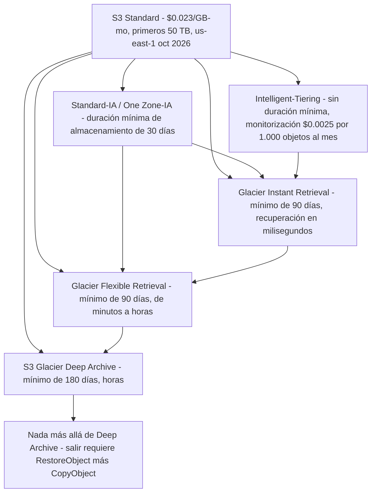
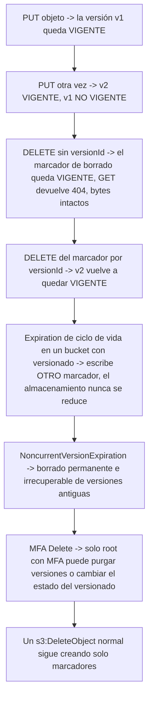
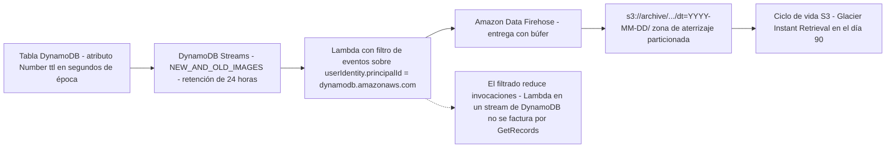
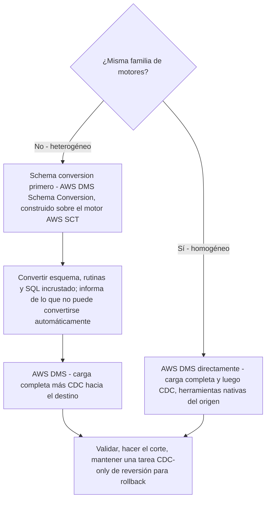
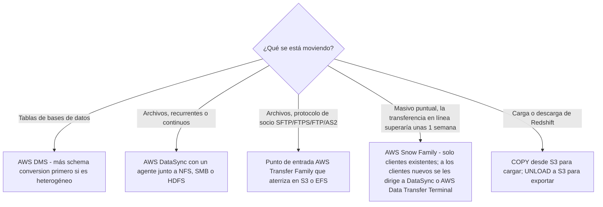
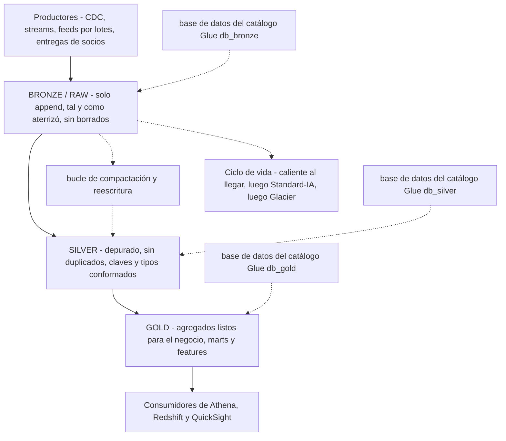

# Ciclo de vida, migración y organización de lagos de datos

**La Tarea 2.3, «Gestionar el ciclo de vida de los datos»,** es donde el ingeniero de datos deja de ser un constructor y se convierte en un administrador. La lista de conocimientos de la tarea es deliberadamente sin glamur — soluciones de almacenamiento caliente y frío, optimización de coste a lo largo del ciclo de vida, borrado impulsado por requisitos de negocio y legales, políticas de retención y estrategias de archivado, protección de resiliencia — y sus habilidades son concretas: realizar operaciones de carga y descarga entre Amazon S3 y Amazon Redshift, gestionar políticas de ciclo de vida de S3 para cambiar el nivel de almacenamiento, hacer caducar datos según su antigüedad y gestionar el versionado de S3 y el TTL de DynamoDB. El examen recompensa por tanto un hábito por encima de todos los demás: **sabe exactamente qué le pasa a un objeto concreto, en un día concreto, a un precio concreto.**

```text
====================================================================
 DEA-C01 DOMINIO 2 — TAREA 2.3 «GESTIONAR EL CICLO DE VIDA DE LOS DATOS»
====================================================================
 Ciclo de vida S3 ... regla = ID + Status + Filter + ACCIONES
                    Transition | Expiration | NoncurrentVersion*
                    | AbortIncompleteMultipartUpload
                    | ExpiredObjectDeleteMarker
                  ... 1.000 reglas por bucket (fijo, oct 2026)
                  ... evaluadas a diario; UNA acción por objeto por
                      día; colisiones -> acción MENOS COSTOSA
 Transiciones ..... cascada en un solo sentido; se ELIMINÓ el umbral
                      de 30 días para IA el 2026-07-16; siguen las
                      duraciones MÍNIMAS de 30/90/180 d
                  ... los objetos < 128 KB no transicionan por defecto
 Versionado ...... DELETE inserta un marcador (GET 404, datos intactos)
                  ... MFA Delete: solo root, solo CLI/REST
                  ... la replicación necesita versionado en AMBOS buckets
 Object Lock ..... WORM; el versionado queda implícito; Compliance es absoluto
 DynamoDB TTL .... atributo Number, época Unix en SEGUNDOS, gratis,
                      borra «dentro de dos días» (hasta 48 h)
                  ... TTL + Streams -> Lambda -> Firehose -> S3
 Archivos ........ Glacier Instant (ms) | Flexible (min-h) |
                      Deep Archive (h, sin Expedited)
 Migración ....... DMS (homogéneo / heterogéneo + conversión)
                      Snow Family | DataSync | Transfer Family
                  ... Redshift COPY dentro / UNLOAD fuera
 Lago ............ bronze (raw) -> silver -> gold, catalogado por
                      zona, <= 1.000 archivos por partición
====================================================================
```

En esta lección vas a:

- leer una **regla de ciclo de vida de S3** tal y como la define AWS — `ID`, `Status`, `Filter` y los cinco tipos de acción — incluidos los comportamientos de evaluación que deciden qué acción se ejecuta realmente;
- recorrer la **cascada de transiciones en un solo sentido** y separar la **antigüedad mínima de transición** (eliminada para las clases IA el 16 de julio de 2026) de la **duración mínima de almacenamiento** (30 / 90 / 180 días, sin cambios);
- aplicar el **suelo por defecto de 128 KB**, la **aritmética de transiciones encadenadas** y los **filtros por etiqueta, prefijo y tamaño**;
- calcular el dinero del ciclo de vida: **tarifas de petición de transición, punto de equilibrio entre Standard e IA, el precipicio de la duración mínima y una comparación de clases a un año** (en octubre de 2026);
- separar **caducidad, caducidad de versiones no vigentes, aborto de subidas multiparte y limpieza de marcadores de borrado**, y explicar por qué `Expiration` por sí solo nunca reduce un bucket con versionado;
- operar **versionado, marcadores de borrado y MFA Delete**, y nombrar los **prerrequisitos de replicación** para CRR y SRR;
- aplicar los modos de **S3 Object Lock** (Compliance, Governance, legal hold) como restricción del ciclo de vida;
- configurar **TTL de DynamoDB** — segundos de época, retardo de borrado, comportamiento de capacidad — y construir el **pipeline de archivado TTL plus Streams**;
- elegir una **clase de Glacier según el SLA de recuperación**, no solo según el precio;
- elegir la **herramienta de migración** correcta: AWS DMS con schema conversion (homogéneo frente a heterogéneo), Snow Family, AWS DataSync y AWS Transfer Family;
- realizar operaciones de **carga y descarga de Redshift** tal como exige la primera habilidad de la Tarea 2.3;
- diseñar **zonas medallón bronze, silver y gold**, arreglar el **problema de los archivos pequeños** con compactación y **catalogar cada zona por separado**;
- estudiar **cuatro casos de estudio de clientes de AWS** (Nasdaq, EOS Group, FINRA y BMW Group) y un **recuadro de actualizaciones de octubre de 2026 con fuentes**;
- practicar con **14 preguntas estilo examen** más cuatro comprobaciones interactivas.

---

## 1. S3 Lifecycle: cómo se construye realmente una regla

### 1.1 Una configuración por bucket, 1.000 reglas

Cada bucket de S3 lleva **una** configuración de ciclo de vida que contiene **hasta 1.000 reglas** (una cuota fija, en octubre de 2026). Una regla es un objeto pequeño:

| Elemento | Restricción | Relevancia para el examen |
|---|---|---|
| `ID` | hasta 255 caracteres, único dentro de la configuración | Identificador humano para soporte y auditorías |
| `Status` | `Enabled` o `Disabled` | Una regla desactivada sigue existiendo — solo no hace nada |
| `Filter` | prefijo, etiquetas de objeto, tamaño (`ObjectSizeGreaterThan` / `ObjectSizeLessThan`), combinados con `AND` / `OR` | Vive **dentro** de `Filter`, nunca como clave `Prefix` de primer nivel en las configuraciones actuales |
| Acciones | los cinco tipos de acción de abajo | Solo se disparan las acciones listadas; todo lo demás se ignora |

### 1.2 Los cinco tipos de acción

| Acción | Qué hace | La trampa asociada |
|---|---|---|
| **`Transition`** | Mueve la versión **vigente** a otra clase de almacenamiento tras `Days` (antigüedad desde la creación) o en una `Date` | La facturación de Glacier empieza el día en que se cumple la regla, **incluso antes del movimiento físico** — Intelligent-Tiering es la única excepción |
| **`Expiration`** | Pone fin a la vida de la versión **vigente** | En un bucket con versionado solo **añade un marcador de borrado**; nunca toca las versiones no vigentes |
| **`NoncurrentVersionTransition` / `NoncurrentVersionExpiration`** | Se aplica cuando se superan **a la vez** `NoncurrentDays` **y** `NewerNoncurrentVersions` (1–100) | La caducidad aquí es un borrado **permanente e irrecuperable** |
| **`AbortIncompleteMultipartUpload`** | Aborta tras `DaysAfterInitiation`, borrando todas las partes subidas | La **única** acción que limpia subidas multiparte incompletas; **no** lleva tarifa de borrado anticipado y su regla **no puede usar filtro por etiqueta** |
| **`ExpiredObjectDeleteMarker`** | Elimina un marcador de borrado que **no tiene versiones detrás** | No puede combinarse con `Days` en la misma `Expiration` |

### 1.3 Filtros: prefijo, etiquetas y tamaño

El `Filter` de una regla delimita qué objetos puede tocar. El prefijo estrecha a una ruta, las etiquetas estrechan a los objetos que llevan un par clave/valor (por ejemplo `tier=hot`), y los predicados de tamaño estrechan a los objetos por encima o por debajo de un umbral de bytes. Es común y legítimo tener dos reglas para un bucket — una regla de transición amplia más una regla estrecha dirigida por etiquetas — pero recuerda que **los filtros se evalúan contra el objeto en el momento de la ejecución**: quitarle una etiqueta a un objeto *normalmente* impide que se aplique una acción acotada por esa etiqueta, aunque AWS documenta que esto no está garantizado, así que un ciclo de vida dirigido por etiquetas nunca debe ser tu único control de seguridad.

> [!IMPORTANT]
> **Una regla de ciclo de vida es una política, no un script.** Las reglas se aplican a objetos que ya existen **y** a objetos creados después, se evalúan **una vez al día**, un objeto es elegible para **una sola acción de ciclo de vida por día** y, cuando compiten varias reglas coincidentes, **Amazon S3 aplica la acción menos costosa** (documentación de AWS S3 Lifecycle, consultada en octubre de 2026). Esa última frase es la razón por la que «escribí dos reglas y se dispararon ambas» nunca es una queja válida — S3 no te cobrará dos veces para satisfacer tu diseño.

```fillblank
{
  "question": "Completa las afirmaciones sobre el ciclo de vida de S3 y el TTL de DynamoDB con el propio vocabulario de AWS:",
  "template": "Una configuración de ciclo de vida contiene como máximo {{1}} reglas por bucket. Un objeto es elegible para solo {{2}} acción de ciclo de vida por día y, cuando coinciden varias reglas, Amazon S3 aplica la acción {{3}}. La caducidad dentro de un bucket con versionado añade un {{4}}, mientras que NoncurrentVersionExpiration realiza un borrado {{5}}. El TTL de DynamoDB almacena su caducidad en un atributo Number que guarda el tiempo Unix en {{6}}, y los elementos caducados se borran normalmente dentro de {{7}} días.",
  "answers": {
    "1": "1,000",
    "2": "one",
    "3": "least costly",
    "4": "delete marker",
    "5": "permanent",
    "6": "seconds",
    "7": "two"
  },
  "distractors": ["100", "10,000", "two", "oldest", "cheapest", "fastest", "temporary", "soft", "milliseconds", "minutes", "hours", "seven", "thirty"],
  "explanation": "The rule cap is 1,000 per bucket; evaluation is daily with one action per object per day and the least costly action winning collisions; Expiration on a versioned bucket only writes a delete marker, so storage keeps growing until NoncurrentVersionExpiration exists; NoncurrentVersionExpiration is permanent; TTL uses a Number attribute in Unix epoch SECONDS - a millisecond value is silently ignored - and AWS states expired items are typically deleted within two days."
}
```

- **📚 ¿Sabías que…?** Dos acciones de ciclo de vida se confunden rutinariamente porque ambas «eliminan» cosas: **`AbortIncompleteMultipartUpload`** es el *único* mecanismo que limpia subidas multiparte incompletas — la caducidad normal de objetos no las toca (AWS: *«Las configuraciones de ciclo de vida de caducidad de objetos no eliminan las subidas multiparte incompletas»*) — mientras que **`ExpiredObjectDeleteMarker`** hace lo contrario: borra un *marcador* que no esconde nada, de modo que la versión vuelve a ser la vigente. Una libera bytes abandonados, la otra vuelve a sacar a la luz datos que sigues poseyendo (documentación de AWS S3 Lifecycle, consultada en octubre de 2026).

---

## 2. Transiciones: la cascada y los umbrales de antigüedad

### 2.1 La cascada en un solo sentido

Las clases de almacenamiento son una cuesta hacia abajo. Los objetos pueden moverse a una clase situada por debajo de su clase actual, nunca volver a subir la escalera in situ:



De ese diagrama se siguen dos reglas estructurales: **`Glacier Flexible Retrieval` solo puede reclasificarse a `Deep Archive`**, y **`Deep Archive` no tiene ninguna transición saliente** — escapar de él significa restaurar el objeto y copiarlo a otro sitio, lo cual es una operación de restauración más almacenamiento nuevo, no una transición. Un estado de replicación pendiente o fallido también bloquea las transiciones en buckets con versionado, de modo que una regla de replicación rota congela silenciosamente tu plan de niveles.

### 2.2 Antigüedad de transición frente a duración mínima de almacenamiento — el cambio del 16 de julio de 2026

Son dos números distintos y el examen prueba la diferencia:

| Concepto | Qué es | Estado en octubre de 2026 |
|---|---|---|
| **Antigüedad mínima de transición** a Standard-IA / One Zone-IA | El tiempo mínimo que un objeto debe permanecer en Standard para que una regla pueda moverlo | **Eliminada el 16 de julio de 2026** — *«Ahora puede transicionar objetos a S3 Standard-Infrequent Access … el mismo día en que se crean, sin la retención mínima previa de 30 días»*; una transición con `Days: 0` es legal |
| **Duración mínima de almacenamiento** | El número de días que debes **pagar** una vez que un objeto aterriza en una clase | **Sin cambios**: **30 días** (Standard-IA, One Zone-IA), **90 días** (Glacier Instant, Glacier Flexible), **180 días** (Deep Archive) |

La trampa es que eliminar el *umbral de elegibilidad* no hizo nada con el *suelo de facturación*. Un objeto transicionado a Standard-IA el día 0 y borrado el día 7 sigue facturando **30 días** de Standard-IA, porque la duración mínima de almacenamiento es un cargo, no una regla. Una nota de estudio que todavía te diga «debes esperar 30 días antes de transicionar a IA» está obsoleta; una nota que te diga «salir de IA antes de tiempo es gratis» siempre ha sido errónea.

### 2.3 El suelo de 128 KB

Desde **septiembre de 2024**, los objetos menores de **128 KB no transicionan por defecto** — un objeto de menos de 128 KB configurado con una transición simple basada en `Days` simplemente permanecerá en Standard salvo que actives un filtro `ObjectSizeGreaterThan` o el ajuste a nivel de bucket `x-amz-transition-default-minimum-object-size`. Las configuraciones antiguas creadas antes de ese cambio conservan el comportamiento anterior hasta que se editan. Y el suelo corta por dos caras: esos objetos pequeños también **se facturan al suelo de 128 KB** en las clases IA y Glacier Instant, de modo que un bucket lleno de archivos JSON de 20 KB paga más por objeto de lo que sugiere su recuento de bytes (consideraciones de transición de AWS S3 Lifecycle, consultadas en octubre de 2026).

### 2.4 Las transiciones encadenadas deben respetar las duraciones mínimas — Ejemplo resuelto E5

Una sola regla que salta por dos clases debe salir de cada clase solo después de que se haya cumplido la duración mínima de esa clase. El propio ejemplo de AWS afirma que no puede especificar una regla que transicione objetos a **Glacier Instant Retrieval tras 4 días** y luego a **Deep Archive tras 20 días** — el segundo salto debe producirse **después de al menos 94 días**:

```text
Intento de regla            Primer salto         Segundo salto        Veredicto
[{Days:4,  GLACIER_IR},     sale de GIR el       sale el día 24,     ILEGAL
 {Days:24, DEEP_ARCHIVE}]   día 4 (mín. 90 d)    solo 20 días después

Legalmente equivalente      Primer salto         Segundo salto        Veredicto
[{Days:4,  GLACIER_IR},     sale de GIR el       sale el día 94,     LEGAL
 {Days:94, DEEP_ARCHIVE}]   día 4                90 días después
                                              4 + 90 = 94
```

Dos reglas *separadas* pueden expresar el mismo propósito (S3 no las rechazará), pero de todos modos pagarás la cuota de duración mínima de cada clase — la restricción pasa de «rechazada en el momento de la configuración» a «facturada en el momento de la factura».

---

## 3. Caducidad: qué significa «borrar», según el estado del versionado

### 3.1 La misma acción, tres resultados distintos

| Estado de versionado del bucket | `Expiration` sobre la versión vigente | Qué hacen los bytes del objeto |
|---|---|---|
| **Desactivado (sin versionado)** | El objeto se **elimina permanentemente** | Desaparece |
| **Activado** | Se añade un **marcador de borrado**; la versión anterior pasa a ser no vigente | **Sigue almacenado y sigue facturándose** |
| **Suspendido** | Se añade un marcador con ID de versión `null`; una versión vigente cuyo ID es `null` se elimina permanentemente | Depende de la versión con la que aciertes |

### 3.2 Versiones no vigentes: `NoncurrentDays` más `NewerNoncurrentVersions`

`NoncurrentVersionExpiration` se dispara solo cuando se superan **ambas** condiciones: la versión no vigente tiene más antigüedad que `NoncurrentDays` **y** está más allá de las versiones más recientes `NewerNoncurrentVersions` que decides retener (1–100). Esta es la diferencia entre un bucket con rastro de auditoría y un bucket con una factura en crecimiento perpetuo: `NewerNoncurrentVersions: 5` con `NoncurrentDays: 30` significa «conserva las cinco versiones no vigentes más recientes al menos 30 días cada una, luego purgalas permanentemente».

> [!WARNING]
> **⚠️ La trampa de coste del bucket con versionado.** `Expiration` en un bucket con versionado **solo escribe marcadores de borrado**, así que el almacenamiento crece monótonamente por muy agresivo que seas con la caducidad. La reproducibilidad y el coste tiran en direcciones opuestas, y el objeto que las reconcilia es `NoncurrentVersionExpiration`. Si una pregunta describe un bucket donde «todo objeto caduca a diero pero la factura sigue subiendo», la regla que falta es la caducidad de versiones no vigentes — no un `Expiration` más agresivo.

### 3.3 El par de reglas canónico

```json
{ "Rules": [
  { "ID": "tier-down", "Status": "Enabled",
    "Filter": { "And": { "Prefix": "events/", "Tags": [{ "Key": "tier", "Value": "hot" }] } },
    "Transitions": [
      { "Days": 0,   "StorageClass": "STANDARD_IA" },
      { "Days": 90,  "StorageClass": "GLACIER_IR" },
      { "Days": 365, "StorageClass": "DEEP_ARCHIVE" } ],
    "NoncurrentVersionTransitions": [
      { "NoncurrentDays": 30, "StorageClass": "STANDARD_IA" } ],
    "NoncurrentVersionExpiration": { "NoncurrentDays": 30, "NewerNoncurrentVersions": 5 },
    "Expiration": { "Days": 2555 } },
  { "ID": "abort-mpu", "Status": "Enabled", "Filter": { "Prefix": "" },
    "AbortIncompleteMultipartUpload": { "DaysAfterInitiation": 7 } } ] }
```

Leerla de vuelta es la habilidad que se prueba: los objetos `tier=hot` bajo `events/` entran en Standard-IA **inmediatamente** (`Days: 0`, legal desde el 16 de julio de 2026), Glacier Instant en el día 90, Deep Archive en el día 365, la versión vigente caduca en el día 2555 (unos siete años), las versiones no vigentes pasan a IA tras 30 días y se purgan cuando superan los 30 días **y** las cinco más recientes, y las subidas multiparte incompletas se abortan tras siete días. La regla de aborto **no lleva filtro por etiqueta** — por eso está en su propia regla con un filtro de prefijo vacío en lugar de dentro de `tier-down`.

---

## 4. Aritmética de coste del ciclo de vida: cuatro ejemplos resueltos

Todos los precios de abajo son **precios de lista de Amazon S3 para us-east-1, en octubre de 2026** — comprueba siempre `aws.amazon.com/s3/pricing/` para tu Región antes de apoyarte en una cifra.

### 4.1 La tabla de precios con la que construyes las respuestas

| Clase | $/GB-mes | Duración mínima | Tamaño mínimo facturable | Recuperación $/GB | Transiciones $/1.000 |
|---|---|---|---|---|---|
| Standard (primeros 50 TB) | **$0.023** | — | — | gratis | — |
| Intelligent-Tiering (Frequent) | **$0.023** | **ninguna** | 128 KB auto-tier | gratis | $0.01 |
| Standard-IA | **$0.0125** | **30 d** | **128 KB** | $0.01 | $0.01 |
| One Zone-IA | **$0.01** | **30 d** | **128 KB** | $0.01 | $0.01 |
| Glacier Instant Retrieval | **$0.004** | **90 d** | **128 KB** | $0.03 | $0.02 |
| Glacier Flexible Retrieval | **$0.0036** | **90 d** | 40 KB de sobrecarga | $0.01 (Standard) | $0.03 |
| S3 Glacier Deep Archive | **$0.00099** | **180 d** | 40 KB de sobrecarga | $0.02 (Standard) | **$0.05** |

Otros datos de peticiones de la misma página: `PUT` **$0.005 por 1.000** (nivel Standard), `GET` **$0.0004 por 1.000**, **DELETE es gratis**, el monitoreo de Intelligent-Tiering es **$0.0025 por 1.000 objetos al mes**, los archivos llevan una **sobrecarga de 40 KB por objeto** (8 KB a la tarifa Standard más 32 KB a la tarifa de archivo), y salir de una clase antes de su duración mínima factura **el cargo normal más la parte proporcional restante**.

### 4.2 Ejemplo resuelto E1 — tarifas de transición a escala

Niveles **1.000.000 de objetos** en una sola ejecución nocturna. A $0.01 por 1.000 peticiones la tarifa parece trivial hasta que multiplicas:

```text
Destino de transición       tarifa / 1.000    1.000.000 de objetos
S3 Standard-IA                 $0.01        1,000,000 / 1,000 x 0.01  =  $10.00
S3 Glacier Instant             $0.02        mismo                       =  $20.00
S3 Glacier Flexible            $0.03        mismo                       =  $30.00
S3 Glacier Deep Archive        $0.05        mismo                       =  $50.00
```

La lección no son los dólares, es el **doble golpe sobre los objetos pequeños**: si esos 1.000.000 de objetos pesan 20 KB cada uno, la tarifa de transición se aplica a todos **y** cada uno se factura después al suelo de **128 KB** en la clase de destino — 6,4 veces su tamaño real, 20.000.000 KB facturados en lugar de 3.125.000 KB.

### 4.3 Ejemplo resuelto E2 — punto de equilibrio entre Standard y Standard-IA

¿A qué antigüedad vivir en Standard-IA cuesta lo mismo que vivir en Standard? Iguala los dos cargos para un GB mantenido durante L días:

```text
Standard     : $0.023  x L/30
Standard-IA  : $0.0125 x 30/30   (un mes completo, su duración mínima)

$0.023 x L/30 = $0.0125   ->   L = 0.0125 x 30 / 0.023 = 16.3 días
One Zone-IA equivalente      ->   L = 0.0100 x 30 / 0.023 = 13.0 días
```

Así que un objeto que se espera viva **más de unos 16 días** es más barato en Standard-IA antes de considerar ninguna recuperación; si vive **menos de unos 16 días** debe quedarse en Standard, o usar Intelligent-Tiering, que **no tiene duración mínima** y no cobra tarifa de recuperación. La recuperación vuelve a voltear la aritmética: Standard-IA cobra **$0.01/GB** por leer, así que un objeto leído 20 veces al mes nunca ganará solo en almacenamiento. (Aritmética derivada de los precios de lista de AWS S3, us-east-1, en octubre de 2026.)

### 4.4 Ejemplo resuelto E3 — el precipicio de la duración mínima

Un terabyte (tratado aquí como 100.000 GB para la aritmética) transiciona a Standard-IA el **día 0** y se borra el **día 7**:

```text
Standard-IA facturado : mínimo de 30 días  ->  100,000 x $0.0125        = $1,250.00
Mismos 7 días en Standard                ->  100,000 x $0.023 x 7/30  =   $536.67
Relación                                      $1,250.00 / $536.67      =     2.3 x
```

Y el precipicio no se suaviza con el tiempo: borrado el **día 1** en lugar del día 7, la factura de Standard-IA es **idéntica** ($1.250,00) mientras que un día de Standard cuesta **$76,67** — una diferencia de **16x**. La duración mínima de almacenamiento es un suelo fijo, no una suscripción prorrateada: *el día en que transicionas fija la factura, no el día en que te vas.* (Aritmética derivada de los precios de lista de AWS S3, us-east-1, en octubre de 2026 — no publicada por AWS.)

### 4.5 Ejemplo resuelto E4 — diez terabytes, un año, cinco clases

```text
10 TB = 10,000 GB mantenidos 12 meses (solo almacenamiento, us-east-1, oct 2026)

S3 Standard             10,000 x $0.023    x 12 =  $276.00
S3 Standard-IA          10,000 x $0.0125   x 12 =  $150.00
S3 One Zone-IA          10,000 x $0.0100   x 12 =  $120.00
Glacier Instant         10,000 x $0.004    x 12 =   $48.00
Glacier Flexible        10,000 x $0.0036   x 12 =   $43.20  (+ tarifas de restauración)
S3 Glacier Deep Archive 10,000 x $0.00099  x 12 =   $11.88  (+ tarifas de restauración)
```

Escala la última línea a **100 TB**: Standard son **$27.600 al año** frente a los **$1.188 al año** de Deep Archive — una horquilla de **23x** que es todo el argumento económico de las políticas de ciclo de vida. Lo que la tabla oculta es igual de examinable: Flexible y Deep Archive añaden **tarifas de restauración más una copia temporal en S3 Standard** mientras lees, y cada salto añade un cargo de petición de transición.

```plot
{
  "type": "bar",
  "title": "Coste de almacenamiento a un año para 10 TB (precios de lista us-east-1, en octubre de 2026)",
  "data": [
    {"Storage class": "S3 Standard", "USD per year": 276.00},
    {"Storage class": "Standard-IA", "USD per year": 150.00},
    {"Storage class": "One Zone-IA", "USD per year": 120.00},
    {"Storage class": "Glacier Instant", "USD per year": 48.00},
    {"Storage class": "Glacier Flexible", "USD per year": 43.20},
    {"Storage class": "Deep Archive", "USD per year": 11.88}
  ],
  "xKey": "Storage class",
  "yKey": "USD per year",
  "xLabel": "Clase de almacenamiento",
  "yLabel": "USD por un año de 10 TB (solo almacenamiento)"
}
```

Pasa el cursor por cualquier barra para leer la cifra del Ejemplo resuelto E4: los mismos 10 TB mantenidos doce meses cuestan **$276,00** en Standard y **$11,88** en Deep Archive — una aritmética solo de almacenamiento que excluye deliberadamente las tarifas de restauración, los cargos de petición de transición y los precipicios de duración mínima, todo lo cual el examen puede añadir encima.

- **📚 ¿Sabías que…?** El retrospectivo de 20 años de S3 de AWS (13 de marzo de 2026) informa de que los clientes han ahorrado **más de 6.000 millones de dólares** en costes de almacenamiento usando **S3 Intelligent-Tiering** en lugar de S3 Standard, y sitúa el precio principal de almacenamiento en **ligeramente por encima de 2 céntimos por gigabyte**, aproximadamente **un 85% por debajo** del precio de lanzamiento de 2006 de 15 céntimos (en octubre de 2026 — verifica la tarifa actual antes de usarla). La propia economía de Intelligent-Tiering es sutil: **no tiene duración mínima ni tarifa de recuperación**, pero cobra **$0.0025 por 1.000 objetos al mes** por monitorearlos — para 10 millones de objetos pequeños esa sola línea de monitoreo son **$25 al mes**, por eso los filtros de tamaño y las reglas de ciclo de vida siguen ganando al auto-tiering en buckets con muchos objetos.

---

## 5. Versionado, marcadores de borrado y MFA Delete

### 5.1 Qué ocurre realmente en cada llamada API

Cada `PUT` asigna un **ID de versión** único; el bucket guarda una versión **vigente** más cualquier número de versiones **no vigentes**. Un `DELETE` sin `versionId` **inserta un marcador de borrado**, haciendo que la versión anterior pase a ser no vigente: `GET` devuelve **404** mientras los bytes están completamente intactos y se siguen facturando. La eliminación permanente requiere `DELETE ?versionId=...`, y borrar el propio marcador restaura la versión anterior.



### 5.2 MFA Delete

| Propiedad | Regla |
|---|---|
| Qué protege | **La eliminación permanente de una versión** y **los cambios del estado del versionado** |
| Quién puede activarlo o desactivarlo | **Solo el usuario root** (el propio versionado puede alternarse con cualquier principal autorizado) |
| Qué interfaz | **Solo CLI / REST — la consola no lo admite** (`put-bucket-versioning ... --mfa "SERIAL CODE"`, `x-amz-mfa` enviado por **HTTPS**) |
| Qué **no** bloquea | Un `s3:DeleteObject` normal, que solo crea marcadores |

El efecto neto es el motivo de la característica: con MFA Delete activo, un atacante con permisos normales de borrado puede ocultar datos pero no destruirlos, y solo un root autenticado con MFA puede purgar versiones o suspender el versionado.

- **📚 ¿Sabías que…?** MFA Delete y el versionado responden a preguntas distintas y a menudo se confunden: **el versionado es un comportamiento de almacenamiento** (conserva cada versión), **MFA Delete es un control de destrucción** (hace que destrar sea caro). Puedes llevar el versionado años sin MFA Delete, y activar MFA Delete no cambia lo que hace un `DELETE` — cambia quién puede hacer que ese borrado sea *permanente* (documentación de AWS S3 Versioning y MFA Delete, consultada en octubre de 2026).

---

## 6. Replicación: prerrequisitos de CRR y SRR

**La replicación copia objetos entre buckets; las reglas de ciclo de vida mueven objetos dentro de un bucket.** Mantener esos dos mecanismos separados es la mitad de las preguntas de ciclo de vida del Dominio 2.

| Requisito | Detalle |
|---|---|
| **Versionado** | **Debe estar activado en el bucket de origen y en el de destino** — este es el prerrequisito más testeado de todos |
| **Permisos** | Un **rol de IAM**: `s3:GetObjectVersionForReplication`, `s3:GetObjectVersionAcl`, `s3:GetObjectVersionTagging` en el origen, más `s3:ReplicateObject`, `s3:ReplicateDelete`, `s3:ReplicateTags` en el destino |
| **Reglas** | 1–1.000 reglas de replicación por bucket, filtradas por prefijo y/o etiquetas |
| **Desactivar el versionado del destino** | El estado de replicación pasa a **`FAILED`** — no «parcial», no «retrasado» |
| **Objetos preexistentes** | La replicación **no es retroactiva** — rellena con **S3 Batch Replication** |
| **Opciones** | Clase de almacenamiento de la réplica, propiedad de la réplica, replicación de marcadores de borrado, múltiples destinos |
| **CRR frente a SRR** | **Cross-Region Replication** incurra en coste de transferencia de datos entre Regiones; **Same-Region Replication** no |

**S3 Replication Time Control (RTC)** lleva un SLA: **el 99,99% de los objetos nuevos se replican en 15 minutos**. Sin RTC, la replicación es best-effort sin SLA (AWS documenta de 24 a 48 horas como expectativa general). RTC es la respuesta siempre que una pregunta nombra un *plazo de replicación*; «eventualmente» no es un nivel de servicio.

---

## 7. S3 Object Lock: una retención que el ciclo de vida no puede anular

Object Lock es una **característica del servicio Amazon S3 dentro del alcance** — no es una entrada aparte en la lista de servicios en alcance del DEA-C01, y ninguna declaración de tarea nombra WORM explícitamente, así que trátalo como legítimo precisamente porque el propio S3 está en alcance. Debe **activarse en la creación del bucket**, y activarlo **implica el versionado**.

| Modo | Quién puede anularlo | Notas |
|---|---|---|
| **Compliance** | **Nadie — incluido el usuario root** | El modo no puede cambiarse y la retención no puede acortarse ni borrarse durante el plazo; la única salida es borrar la cuenta de AWS |
| **Governance** | Principales con `s3:BypassGovernanceRetention` **y** que envían la cabecera `x-amz-bypass-governance-retention:true` | El modo cotidiano para retención interna con rastro de auditoría |
| **Legal hold** | Cualquiera con `s3:PutObjectLegalHold` | Sin fecha de caducidad; independiente del periodo de retención |

La retención se adhiere a las **versiones de objeto**; **los marcadores de borrado nunca están protegidos por WORM**; una política de bucket puede subir la retención máxima a **100 años**; y un `Expiration` de ciclo de vida **no puede borrar una versión bajo retención o legal hold** — que es exactamente por qué los archivos regulados combinan Object Lock con el escalonado de ciclo de vida en lugar de elegir uno de los dos. Los enganches regulatorios nombrados son SEC 17a-4, FINRA 4511 y CFTC 1.31.

---

## 8. TTL de DynamoDB: segundos de época, retardo de borrado y el pipeline de archivado

### 8.1 El contrato del atributo

El TTL se activa por tabla y lee **un atributo** — su nombre **distingue mayúsculas** — cuyo valor debe ser un **Number** que guarde **tiempo Unix en segundos**:

| Regla | Valor |
|---|---|
| Tipo de atributo | **Number** (un String se ignora) |
| Unidad | **Segundos de época** — `1724241326000` (milisegundos) se ignora |
| Coincidencia de nombre | Distingue mayúsculas: `expireAt` y `ExpireAt` son atributos distintos |
| Tolerancia máxima al pasado | Una caducidad de más de **5 años en el pasado** se ignora; no hay ventana mínima futura |
| Coste del borrado | **Gratis** — el TTL no consume capacidad de escritura |
| Propagación al activar o cambiar | Aproximadamente **1 hora** (llamadas `UpdateTimeToLive` extra provocan después `ValidationException`); tras desactivarlo, el procesamiento continúa unos **30 minutos** |
| Observabilidad | `TimeToLiveDeletedItemCount` se actualiza aproximadamente **cada minuto** |

### 8.2 Retardo de borrado: «dentro de dos días»

La referencia de API de AWS afirma que DynamoDB *«normalmente borra los elementos caducados dentro de dos días»*, y advierte que *«los elementos que han caducado y no se han borrado seguirán apareciendo en lecturas, consultas y escaneos»* (en octubre de 2026). De ahí se siguen tres consecuencias:

1. **El TTL no es un borrado de cumplimiento.** Si una regulación exige borrado instantáneo, el TTL por sí solo no lo satisface.
2. **Las lecturas deben filtrar.** Añade `FilterExpression: "ttl > :now"` o protege las escrituras con una `ConditionExpression` hasta que el borrado se materialice.
3. **El almacenamiento sigue facturando** hasta 48 horas después de la caducidad nominal.

### 8.3 Ejemplo resuelto E6 — convertir una política de retención en una época

Un dispositivo se registra en `1770000000` (segundos de época) y la política dice «borrar 90 días después de la creación»:

```text
retención      = 90 días = 90 x 86,400 = 7,776,000 segundos
atributo ttl   = 1770000000 + 7776000  = 1777776000   <- Number, SEGUNDOS

Forma errónea A = "2026-11-12T00:00:00Z"  -> String, IGNORADO
Forma errónea B = 1777776000000           -> milisegundos, IGNORADO
Forma errónea C = ttl = now                -> caduca al instante, sin beneficio de retardo

Filtro de seguridad = FilterExpression "ttl > :now" oculta elementos que
                 han caducado pero siguen dentro de la ventana de borrado de 48 h
```

El distractor clásico del examen es un timestamp en milisegundos: se analiza como Number, así que no salta ningún error — el elemento simplemente nunca se borra, en silencio. El mismo fallo silencioso se aplica a un nombre de atributo mal escrito, porque la búsqueda distingue mayúsculas.

### 8.4 TTL plus Streams: el pipeline de archivado

Los borrados por TTL son observables antes de completarse, y eso es lo que hace que el patrón de archivo funcione:



Como los borrados por TTL los realiza el servicio, los registros del stream llevan `userIdentity.type = "Service"` y `principalId = "dynamodb.amazonaws.com"`; un filtro de fuente de eventos sobre esa identidad descarta todo lo demás. La guía de AWS muestra el efecto práctico: el filtrado puede reducir las invocaciones de Lambda de unos **2 millones de modificaciones por hora a 100.000 por hora**, y **Lambda procesando un stream de DynamoDB no se factura por `GetRecords`**. Dos restricciones importan para el examen: los borrados por TTL son identificables **solo en la Región donde ocurrieron**, y **Streams retiene 24 horas** — así que un consumidor roto debe repararse dentro de un día, no de una semana. Los dashboards construidos sobre este patrón deben tolerar hasta **48 horas** de visibilidad poscaducidad.

- **📚 ¿Sabías que…?** El patrón de archivo existe porque el TTL te da *borrado barato* pero no una *copia duradera*: el elemento sale de DynamoDB gratis, pero si nadie capturó antes el registro del stream, siete años de historial simplemente desaparecen. Capturar el evento de borrado (o la imagen final del elemento) en S3 antes de que se cierre la ventana de dos días, y luego aplicar una regla de ciclo de vida de S3 para escalonarlo, convierte una purga en un archivo — y el coste de invocación de Lambda es la única línea nueva en la factura (guía de AWS DynamoDB TTL con DynamoDB Streams, consultada en octubre de 2026).

---

## 9. Selección de archivo: elige por SLA de recuperación, no por precio

| Clase | Duración mínima | Acceso previsto | Tiempo de recuperación | Mecánica de restauración |
|---|---|---|---|---|
| **Glacier Instant Retrieval** | **90 días** | Una vez por trimestre | **Milisegundos** — un `GET` normal | Ninguna; tamaño mínimo facturable de 128 KB |
| **Glacier Flexible Retrieval** | **90 días** | 1–2 veces al año | Expedited **1–5 min** · Standard **3–5 h** · Bulk **5–12 h (gratis)** | Requiere `RestoreObject`; sobrecarga de 40 KB por objeto |
| **S3 Glacier Deep Archive** | **180 días** | Menos de una vez al año | Standard **≤12 h** · Bulk **≤48 h** · **sin Expedited** | Requiere `RestoreObject`; sobrecarga de 40 KB |

Restaurar cuesta **la tarifa de recuperación del archivo más una copia temporal en S3 Standard** mientras la copia restaurada existe — un archivo es barato de mantener y deliberadamente caro de leer. AWS documenta una capacidad de restauración de unos **1–2 PB por día por cuenta**. S3 Intelligent-Tiering ofrece un camino adyacente: las recuperaciones Standard y Bulk de su nivel Archive Access (tras **90 días** sin acceso) y de su nivel Deep Archive Access (tras **180 días**) son gratis.

### 9.1 Ejemplo resuelto E7 — duraciones mínimas cuando te vas antes de tiempo

```text
-> Glacier Instant en el día 90, borrado en el día 150
   tiempo mantenido = 60 días   <   mínimo de 90 días
   facturado        = 90 días a $0.004/GB-mo  ->  se cobra un resto de 30 días

-> Deep Archive en el día 0, borrado en el día 100
   tiempo mantenido = 100 días  <   mínimo de 180 días
   facturado        = 180 días a $0.00099/GB-mo -> se cobra un resto de 80 días
```

El borrado anticipado (y la sobrescritura anticipada) antes de la duración mínima factura **el cargo normal más la parte proporcional restante** — la misma cláusula que hace que el precipicio de Standard-IA del Ejemplo E3 funcione. Y recuerda la válvula de escape: **Deep Archive es de un solo sentido dentro de la cascada de ciclo de vida**; devolver un objeto a Standard requiere `RestoreObject` y después `CopyObject`.

---

## 10. Herramientas de migración I: AWS DMS y schema conversion

### 10.1 Homogéneo frente a heterogéneo

**AWS Database Migration Service** mueve bases de datos, nada más. Sus dos formas son la primera bifurcación del examen:

| Situación | Camino | Ejemplo |
|---|---|---|
| **Homogéneo** — misma familia de motores | **Solo DMS**, usando las herramientas nativas del motor de origen para la carga completa | PostgreSQL on-premises → Amazon RDS PostgreSQL |
| **Heterogéneo** — motores distintos | **Convierte el esquema y el código primero, luego mueve los datos con DMS** | Oracle → Aurora PostgreSQL; SQL Server, Db2, SAP ASE → Aurora PostgreSQL |

Dos características de DMS deciden si la conversión siquiera es necesaria: la **captura de cambios de datos (CDC)** lee los registros de transacciones nativos del origen (así no se requieren cambios de aplicación para la sincronización continua), y el **schema conversion** reescribe DDL, procedimientos almacenados, funciones y SQL incrustado para el motor de destino.

### 10.2 Tipos de tareas y las advertencias operativas

| Tipo de tarea | Uso |
|---|---|
| **Carga completa (full load)** | Copia única; el destino se escribe en bloque |
| **Carga completa + CDC** | Migración con downtime mínimo — y nótese que **borra los objetos existentes en el destino**: haz copia de seguridad primero |
| **Solo CDC** | Réplica continua tras una carga completa, incluidas tareas de reversión y rollback |

Advertencias que vale la pena memorizar: DMS se ejecuta en una **instancia de replicación** (Multi-AZ opcional) o como **DMS Serverless**; AWS afirma claramente que *«AWS DMS CDC no proporciona replicación en tiempo real … No hay SLAs para la latencia de CDC»* — así que una pregunta que prometa «replicación instantánea y garantizada» vía CDC es incorrecta.

### 10.3 El flujo heterogéneo



### 10.4 La cuestión del estado de SCT (guía de examen v1.1)

El **AWS Schema Conversion Tool** descargable escaneaba el código de búsqueda de aplicaciones en busca de SQL incrustado y admitía más motores que su sucesor gestionado. A partir de la **guía de examen v1.1 (12 de diciembre de 2025)**, sin embargo, **AWS SCT se eliminó de la lista de servicios en alcance del DEA-C01** — el **DMS Schema Conversion** gestionado (basado en web, construido sobre el motor SCT) es a lo que ahora apunta la guía. Regla práctica para el día del examen: «SCT» puede seguir apareciendo como **vocabulario legado** dentro de una narrativa de conversión, pero ya no puede ser el *servicio en alcance nombrado* que se te pide seleccionar; prefiera **AWS DMS** y **DMS Schema Conversion** (página de revisiones de la guía de examen, consultada en octubre de 2026).

- **📚 ¿Sabías que…?** Una ventana de CDC de DMS de varios meses es una *factura de cómputo*, no solo una decisión de arquitectura: desde el **2 de diciembre de 2025**, los **AWS Database Savings Plans** cubren **Aurora, RDS, DynamoDB, ElastiCache, DocumentDB, Neptune, Keyspaces, Timestream y AWS DMS** con descuentos de **hasta el 35%** (anuncio de AWS Database Savings Plans, 2 dic 2025; consultado en octubre de 2026). Así que cuando un caso de estudio como el de EOS Group informa de una **reducción del 50% en infraestructura**, parte de esa historia es el *mecanismo* de migración (DMS → S3 → Redshift) y parte es la palanca *comercial* sobre las bases de datos que quedan — una pregunta del Dominio 2 sobre «minimizar el coste de una replicación prolongada» puede responderse legítimamente con un descuento por compromiso en lugar de con un cambio de arquitectura.

---

## 11. Herramientas de migración II: Snow Family, DataSync y Transfer Family

### 11.1 Los tres movimientos que no son bases de datos

| Herramienta | Modo | Pista del examen | Cifras clave (en octubre de 2026) |
|---|---|---|---|
| **AWS DataSync** | **En línea**, sincronización programada o continua | Agente junto a NFS, SMB o HDFS; unas **10x** más rápido que las herramientas de código abierto; TLS, verificación de integridad, limitación, transferencias incrementales | La respuesta por defecto para el **movimiento recurrente de archivos** |
| **AWS Transfer Family** | Puntos de entrada gestionados **SFTP / FTPS / FTP / AS2** sobre **S3 o EFS** | Un **punto de entrada de protocolo**, no un mover en bloque — intercambio de socios y B2B con un IdP a medida | Nombrado en la tarea 2.1 («integrar herramientas de migración») |
| **AWS Snow Family** | Transferencia masiva **fuera de línea** por dispositivo físico | **Snowball Edge Storage Optimized: 210 TB utilizables**; NFSv3/v4/v4.1 más adaptador S3, cifrado obligatorio, **borrado NIST 800-88** al devolverlo | **Cerrado a clientes nuevos desde el 7 de noviembre de 2025**; los planificadores de migraciones grandes empiezan en **>500 TB**; regla práctica: transferencia en línea **≥1 semana → plantea Snow** |

### 11.2 Ejemplo resuelto E8 — la regla de una semana, calculada

Mover **600 TB** por un enlace de **1 Gbps**, ignorando la sobrecarga del protocolo:

```text
600 TB  = 600 x 10^12 bytes   = 6.0 x 10^14 bytes
1 Gbps  = 1.25 x 10^8 bytes por segundo
tiempo  = 6.0 x 10^14 / 1.25 x 10^8 = 4.8 x 10^6 segundos
        = 4,800,000 / 86,400        = 55.6 DÍAS   (aritmética derivada)
```

Todo lo que tome **más de aproximadamente una semana** de transferencia en línea sostenida pertenece a la conversación fuera de línea — para los clientes de AWS que todavía pueden pedir dispositivos eso es la Snow Family, y el banner de la documentación de Snowball dirige a los clientes **nuevos** a **AWS DataSync**, **AWS Data Transfer Terminal** o soluciones de socios de AWS. Para el movimiento *recurrente* (un job NFS-to-S3 nocturno de 2 TB por Direct Connect) la respuesta es siempre **DataSync**, y para las *entregas de archivos de proveedores por SFTP* es siempre **Transfer Family**.



```matching
{
  "question": "Empareja cada escenario de migración con la herramienta que el examen DEA-C01 espera:",
  "pairs": [
    {"left": "Oracle 19c a Aurora PostgreSQL con downtime mínimo", "right": "Schema conversion primero, luego carga completa de AWS DMS más CDC"},
    {"left": "PostgreSQL on-premises a Amazon RDS PostgreSQL", "right": "Migración homogénea con AWS DMS - sin paso de conversión"},
    {"left": "5 TB nocturnos de NFS a S3 por Direct Connect", "right": "AWS DataSync con un agente programado"},
    {"left": "Proveedores envían archivos SFTP a tu bucket de S3", "right": "Punto de entrada SFTP gestionado de AWS Transfer Family sobre S3"},
    {"left": "400 TB a 200 Mbps con un plazo de seis meses", "right": "Transferencia masiva fuera de línea - Snow Family para clientes existentes (más de 1 semana de transferencia en línea)"},
    {"left": "Carga masiva de 50 GB de CSV en Amazon Redshift", "right": "COPY desde S3 - nunca muchos INSERT individuales"},
    {"left": "Exportar el resultado de una consulta de 10 millones de filas como Parquet", "right": "UNLOAD con FORMAT AS PARQUET y PARTITION BY"}
  ],
  "explanation": "El selector funciona con tres preguntas: ¿es una base de datos (DMS, más conversión si la familia de motores difiere)?, ¿son archivos recurrentes (DataSync)?, ¿es un punto de entrada de protocolo de socio (Transfer Family)? - con lo masivo fuera de línea como recurso cuando la transferencia en línea sostenida superara aproximadamente una semana, y el propio COPY y UNLOAD de Redshift para operaciones de carga y descarga del almacén. Snow Family está cerrado a clientes nuevos desde el 7 de noviembre de 2025, así que una opción que lo presente como la respuesta por defecto para quien migra por primera vez está obsoleta."
}
```

---

## 12. Carga y descarga de Redshift: la primera habilidad de la Tarea 2.3

La lista de habilidades de la Tarea 2.3 abre con *«Realizar operaciones de carga y descarga entre Amazon S3 y Amazon Redshift»*, y AWS es tajante sobre qué dirección es correcta: *«Recomencamos encarecidamente usar el comando COPY para cargar grandes cantidades de datos. El uso de sentencias INSERT individuales … puede ser prohibitivamente lento.»*

| Operación | Comando | Comportamiento |
|---|---|---|
| **Carga masiva** | **`COPY`** desde S3 | Masivamente paralelo; elige un **número de archivos cercano a un múltiplo del número de slices**; mantén los archivos entre **1 MB y 1 GB**; los datos deben estar en la **misma Región** que el cluster |
| **Carga fila a fila** | `INSERT` | Mucho menos eficiente — correcto solo para deltas diminutos, nunca para cargas masivas |
| **Exportación masiva** | **`UNLOAD`** a S3 | Texto, JSON o **Parquet** con **`PARTITION BY`** (al estilo Hive), **`MANIFEST`**, **`MAXFILESIZE`** (5 MB–6,2 GB, por defecto **6,2 GB**), **`PARALLEL ON`**, **`ALLOWOVERWRITE`** |
| **Mantenimiento post-carga** | `VACUUM` más `ANALYZE` | Ejecutar tras un DML intenso para restaurar el orden de clasificación y refrescar las estadísticas del optimizador |

La propia guía de AWS para `UNLOAD` presenta Parquet como *«hasta 2x más rápido … 6x menos almacenamiento»* que el texto — el mismo argumento que la elección de formato del lago, llegando desde el lado del almacén. La pareja que hay que recordar: **`COPY` dentro, `UNLOAD` fuera**, ambos a través de S3, ambos conscientes de la Región.

---

## 13. Organización del data lake: zonas medallón, archivos pequeños y catalogación

### 13.1 Las tres zonas

Un diseño **medallón** da a cada zona un contrato distinto y, por tanto, un ciclo de vida, una clase de almacenamiento y una entrada de catálogo distintos:



| Zona | Contrato | Ciclo de vida típico | Postura de catálogo |
|---|---|---|---|
| **Bronze (raw)** | Solo append, fuente de verdad reproducible, nunca editada in situ | Caliente al llegar → **Standard-IA → Glacier** a medida que envejece | Su propia base de datos; schema-on-read, particionada frecuentemente por fecha de ingesta |
| **Silver** | Depurado, sin duplicados, conformado, una fila por entidad | Vida media; escalonar solo cuando los jobs aguas abajo estén estables | Su propia base de datos; la zona más expuesta al **daño de los archivos pequeños** |
| **Gold** | Agregados y features listos para el negocio, grano estable | Se queda **caliente**; pequeña y muy consultada | Su propia base de datos; particionada por los filtros que los consumidores usan de verdad |

### 13.2 Cataloga cada zona por separado

**`MSCK REPAIR TABLE` escanea un árbol de prefijos entero**, así que registrar bronze, silver y gold bajo una única raíz con una sola sentencia de reparación arriesga mezclar tablas sin relación en un solo objeto de catálogo. Cataloga cada zona en **su propia base de datos de Glue** (o su propio namespace de S3 Tables / Iceberg) con su propio `Location`, y prefiere **`ALTER TABLE ADD PARTITION`** cuando ya sabes qué particiones cambiaron — el escaneo de ruta completa es el defecto caro, no el seguro.

### 13.3 Archivos pequeños y el bucle de compactación

La guía de Athena de AWS enuncia el problema sin rodeos: *«los conjuntos de datos que consisten en muchos archivos pequeños dan como resultado un rendimiento de consulta pobre en general»*, y el objetivo es **como máximo 1.000 archivos por partición**. Un job de Glue por hora que escribe archivos de 3 MB produce **720 archivos por día por partición** — más allá del umbral antes del mediodía.

**Orden de arreglo (hazlos en secuencia, no en paralelo):**

1. Consigue que la **fuente escriba archivos más grandes** (hacia 256–512 MB con coalesce).
2. Combina con **Glue ETL** (`coalesce` o `repartition`).
3. Reduce el número de **claves de partición** — el sobreparticionado fragmenta los datos tan eficazmente como las escrituras pequeñas.

**Compactación gestionada (el optimizador de Glue para Iceberg/Parquet)** se dispara cuando una tabla tiene **más de 100 archivos** con cada archivo **por debajo del 75% del tamaño objetivo**, donde `write.target-file-size-bytes` tiene por defecto **552 MB**; la misma familia de optimizadores ofrece también retención de instantáneas y optimizadores de archivos huérfanos. Los diseños que no son Iceberg necesitan una reescritura Glue/Spark (bin-packing o `repartition`). Para los formatos, apunta a **bloques Parquet de unos 128 MB** o **franjas ORC de unos 64 MB**, y empuja las claves de alta cardinalidad al **bucketing** en lugar de a más niveles de partición.

### 13.4 Ejemplo resuelto E9 — qué gana de verdad el ciclo de vida de una zona bronze

Una zona bronze sostiene **10 TB** de datos de eventos con este juego de reglas (todos los precios us-east-1, en octubre de 2026): Standard los primeros 30 días, Standard-IA los días 31–180, Glacier Instant los días 181–365, caducidad en el día 365. Aproximando cada ventana como una fracción de un año:

```text
Standard          10,000 GB x $0.023   x (30/365)  =   $18.90
Standard-IA       10,000 GB x $0.0125  x (150/365) =   $51.37
Glacier Instant   10,000 GB x $0.004   x (185/365) =   $20.27
                                                    ------------
ESCALONADO, total de un año                           =   $90.54
Todo el año en S3 Standard  10,000 x $0.023 x 12        =  $276.00
Ahorro                                               =  $185.46  (67%)

más peticiones de transición: 10 TB de objetos de ~250 MB = 40,000 objetos
  40,000 / 1,000 x ($0.01 + $0.02)                  =    $1.20
```

Las tarifas de transición son **$1,20 frente a un ahorro de $185,46** — todo el argumento de las políticas de ciclo de vida en una línea: en los almacenes de objetos, **la clase de almacenamiento manda, las tarifas de peticiones son errores de redondeo, y los mínimos de borrado anticipado son la única trampa de verdad** (aritmética derivada de los precios de lista de AWS S3, en octubre de 2026).

```dragdrop
{
  "question": "Ordena el diseño medallón desde los datos más en bruto hasta los más listos para el negocio, con el bucle de compactación en el lugar correcto:",
  "items": [
    "BRONZE (raw) - solo append, tal y como aterrizó, catalogado en su propia base de datos de Glue",
    "SILVER - depurado, sin duplicados, conformado - la zona más dañada por los archivos pequeños",
    "Bucle de compactación - el optimizador de Glue se dispara por encima de 100 archivos, cada uno por debajo del 75% del objetivo de 512 MB",
    "GOLD - agregados y marts listos para el negocio, se queda caliente, particionado por los filtros de los consumidores"
  ],
  "correctOrder": [
    "BRONZE (raw) - solo append, tal y como aterrizó, catalogado en su propia base de datos de Glue",
    "SILVER - depurado, sin duplicados, conformado - la zona más dañada por los archivos pequeños",
    "Bucle de compactación - el optimizador de Glue se dispara por encima de 100 archivos, cada uno por debajo del 75% del objetivo de 512 MB",
    "GOLD - agregados y marts listos para el negocio, se queda caliente, particionado por los filtros de los consumidores"
  ],
  "explanation": "Los datos fluyen de lo crudo a lo refinado: bronze es la zona de aterrizaje intacta, silver es donde ocurren la limpieza y la conformación (y donde las escrituras horarias de 3 MB crean cientos de archivos por partición), la compactación se ejecuta contra silver antes de que los consumidores la noten, y gold es la capa de negocio estable que debe permanecer caliente. Cada zona recibe su PROPIA base de datos de catálogo porque MSCK REPAIR TABLE escanea el árbol de prefijos completo y de otro modo fusionaría tablas entre zonas."
}
```

- **📚 ¿Sabías que…?** El particionado, el bucketing y el tamaño de archivo son tres eliminaciones distintas y el examen las mantiene separadas: **las particiones podan directorios** (`year=2026/month=10/` al estilo Hive), **el bucketing poda buckets hash dentro de una partición** (el hogar correcto para claves de alta cardinalidad), y **el tamaño de archivo arregla el impuesto de listado** — el sobreparticionado fragmenta los datos tan mal como escribir archivos diminutos, por eso la guía de AWS dice que particiones por **columnas de baja cardinalidad por las que las consultas filtran de verdad**, normalmente el tiempo (guía de particionamiento y rendimiento de AWS Athena, consultada en octubre de 2026).

### Actualizaciones de 2026 (en octubre de 2026)

> [!NOTE]
> **Qué se movió en este tema — cada línea verificada contra una fuente primaria de AWS en octubre de 2026:**
> - **La antigüedad mínima de transición de 30 días a Standard-IA / One Zone-IA se fue.** Anunciada el **16 de julio de 2026**: *«Ahora puede transicionar objetos a S3 Standard-Infrequent Access … el mismo día en que se crean, sin la retención mínima previa de 30 días.»* Una transición con `Days: 0` es legal. Las **duraciones mínimas de almacenamiento (30 / 90 / 180 días) no cambiaron** — umbral de elegibilidad eliminado, suelo de facturación intacto (AWS What's New, 16 jul 2026).
> - **La guía de examen v1.1 (12 de diciembre de 2025)** consolidó conocimientos y habilidades en una sola lista de habilidades, **añadió 8 habilidades y no eliminó ninguna**, y cambió la lista de servicios en alcance en **+6 / −3**: **se eliminó AWS SCT**, así que las preguntas de schema conversion apuntan ahora a **DMS Schema Conversion**; se añadieron **Amazon S3 Tables** y **Amazon Aurora**. Tres servicios salieron de la lista de alcance pero pueden seguir apareciendo como distractores (página de revisiones de la guía de examen, consultada en octubre de 2026).
> - **AWS Glue 6.0 (21 de agosto de 2026)** — **precio un 30% más bajo**, Spark **4.1.1**, Python **3.13**, Iceberg **1.11.0** con **formato v3** — es el runtime detrás de los jobs de compactación y reescritura; elimina **EMRFS** (solo S3A) y **AWS SDK for Java v1**, así que una especificación de job que todavía referencie `fs.s3.consistent.*` o `com.amazonaws.services.*` no se ejecutará (anuncio y página de migración de AWS Glue 6.0, consultados en octubre de 2026).
> - **Recorte de precio de S3 Express One Zone (10 de abril de 2025)**: almacenamiento **−31%**, PUT **−55%**, GET **−85%**, subida y recuperación **−60%**, con la disponibilidad ampliándose de 8 a **15 Regiones el 17 de septiembre de 2026** — relevante cuando un prefijo *caliente* de bronze o gold necesita lecturas de un solo dígito de milisegundos en lugar de escalonado (AWS What's New, 10 abr 2025 y 17 sep 2026).
> - **Streaming directo al lago**: **tablas de streaming de Kinesis Data Streams → Iceberg en S3 Tables (28 de agosto de 2026)** y **entrega generalista a S3 (29 de agosto de 2026)**, más **brokers MSK Express → tablas de streaming Iceberg (30 de julio de 2026)** — la zona en bruto puede aterrizar ahora como Parquet con compactación en línea en lugar de un paso de aterrizaje por lotes. **Amazon Data Firehose** es el nombre del producto desde el **9 de febrero de 2024**, pero la lista de servicios en alcance del DEA todavía imprime **Amazon Kinesis Data Firehose**; ambos nombres son válidos (AWS What's New, 2026).
> - **S3 Tables madura (28 de julio de 2026)**: Amazon S3 Tables — añadida a la lista de alcance del DEA-C01 en la guía de examen v1.1 — ganó el **tipo VARIANT de Iceberg con soporte de formato v3**, de modo que las cargas semiestructuradas pueden aterrizar en la zona bronze como columnas Iceberg tipificadas en lugar de blobs JSON en bruto; combínalo con el runtime de Iceberg **1.11.0 / formato v3** de **Glue 6.0** cuando un job de compactación o reescritura deba entender las mismas tablas (AWS What's New, 28 jul 2026; anuncio de Glue 6.0, 21 ago 2026).
> - **DMS gana una palanca comercial (2 de diciembre de 2025)**: los **AWS Database Savings Plans** — descuentos de **hasta el 35%** — cubren Aurora, RDS, DynamoDB, ElastiCache, DocumentDB, Neptune, Keyspaces, Timestream **y AWS DMS**, de modo que una tarea de replicación CDC prolongada puede ahora someterse a un descuento por compromiso; no cambió el *comportamiento* de DMS, solo sus opciones de facturación (anuncio de AWS Database Savings Plans, 2 dic 2025; consultado en octubre de 2026).
> - **Los controles de durabilidad de DynamoDB también se movieron**: desde el **7 de enero de 2025**, los periodos de **recuperación en un punto concreto** son configurables **1–35 días por tabla**, y desde el **11 de agosto de 2025** los cambios de modo de throughput de provisionado a bajo demanda se permiten **4 veces por 24 horas móviles** (antes una vez) — relevante cuando las tablas archivadas con TTL también llevan requisitos de punto de restauración (AWS What's New, 7 ene 2025 y 11 ago 2025).
> - **Advertencia de dato obsoleto**: cualquier material de estudio que afirme que debes *esperar 30 días* antes de una transición a IA, que **AWS SCT** es la herramienta de conversión en alcance, que **Snowball Edge** está disponible para clientes nuevos, o que los borrados por TTL son inmediatos, está desactualizado en octubre de 2026.

---

## Casos Reales

Todas las cifras de abajo son **afirmaciones de clientes o de AWS sin auditar**, con la fuente nombrada para que puedas comprobarla. El punto examinable es el **patrón** — qué mecanismo de ciclo de vida, control de retención o herramienta de migración hizo el trabajo — no el marketing.

### Caso A — Nasdaq: un lago en S3 con Glacier y Object Lock

| Elemento | Detalle |
|---|---|
| Cliente | **Nasdaq**, bolsa de valores |
| Reto | Una carga por lotes nocturna de órdenes, cotizaciones y operaciones debía terminar antes de la apertura del mercado; el almacén on-premises heredado se retiró en 2014 |
| Servicios | **Data lake en Amazon S3 + Amazon Redshift + Redshift Spectrum (lake house) + S3 Glacier + Amazon S3 Object Lock** |
| Resultados | **70.000 millones de registros/día** (pico de **113.000 millones**, feb 2020); **el 90% de la carga terminó 5 horas antes**; consultas **un 32% más rápidas**; un lago de **15 TB** consultado in situ; *«cero contención entre la carga de datos y la consulta»* |
| Dominio del examen | **Dominio 2, Tarea 2.3** — escalonado de archivos, retención/WORM y la separación de almacenamiento y cómputo |
| Fuente | `aws.amazon.com/solutions/case-studies/nasdaq-case-study/` (consultada en octubre de 2026) |

> «Pudimos soportar con facilidad el salto de 30.000 millones a 70.000 millones de registros al día gracias a la flexibilidad y escalabilidad de Amazon S3 y Amazon Redshift.» — Robert Hunt, VP de Ingeniería de Software, Nasdaq

Léelo como una pila de ciclo de vida, no como una fanfarronada de escala: **S3 como ruta de escritura, Glacier para el archivo, Object Lock para la retención**, Redshift y Spectrum para la ruta de lectura. Esa es exactamente la razón por la que «copia los datos al almacén y borra el lago» es un distractor — el lago sigue siendo la autoridad, y la retención la impone una política WORM a nivel de bucket en lugar de una persona recordando conservar las copias de seguridad.

### Caso B — EOS Group: migración de almacén dirigida por DMS

| Elemento | Detalle |
|---|---|
| Cliente | **EOS Group**, servicios financieros |
| Reto | Un almacén on-premises en crecimiento con un **crecimiento interanual de datos del 15%**, capacidad comprada para el pico |
| Servicios | **AWS Migration Acceleration Program (MAP) + AWS DMS → Amazon S3 → Amazon Redshift**, más **enmascaramiento dinámico de datos de Redshift** |
| Resultados | **50% de reducción en costes de infraestructura**, **cero pérdida de datos**, **downtime mínimo**, escalado gestionado que sustituye a las conjeturas de capacidad |
| Dominio del examen | **Dominio 2** — ciclo de vida y migración de la Tarea 2.3 con un enganche de coste del Dominio 4 y un enganche de seguridad del Dominio 2 (enmascaramiento de PII por permisos de usuario) |
| Fuente | `aws.amazon.com/solutions/case-studies/eos-group-case-study/` (consultada en octubre de 2026) |

> «Al eliminar la necesidad de infraestructura on-premises, EOS Group logró una reducción del 50 por ciento en los costes de infraestructura …»

El detalle examinable es la **secuencia**: DMS aterriza la base de datos, **S3 es la capa de staging**, Redshift carga desde S3 — la misma forma que la ruta de escritura del Caso A, llegada desde el lado de la migración. «DMS escribe directamente en el almacén y esa es toda la migración» es el distractor; el staging a través de S3 es lo que hace que la carga sea repetible y permite que las reglas de ciclo de vida gestionen después los datos aterrizados.

### Caso C — FINRA: un lago S3 regulado a escala de vigilancia

| Elemento | Detalle |
|---|---|
| Cliente | **FINRA**, el regulador del mercado financiero de EE. UU. |
| Reto | El análisis on-premises de capacidad fija ya no podía seguir el ritmo del volumen de vigilancia de mercado |
| Servicios | **Amazon S3 + Amazon EMR (Hive, Presto, Apache HBase)**; el programa Consolidated Audit Trail (CAT) añade **Amazon Redshift, AWS KMS, Amazon GuardDuty y AWS CloudTrail** |
| Resultados | Día típico **~6 TB y 37.000 millones de registros**, días intensos **más de 75.000 millones de registros**; **más de 300 millones de objetos en S3**; consultas interactivas sobre **billones de registros en más de 600 TB**; la arquitectura HBase-on-EMR informó de **más de un 60% de ahorro de coste**; CAT ingiere **más de 100.000 millones de eventos/día** de 22 bolsas y 1.500 brókers-dealers |
| Dominio del examen | **Dominio 2, Tarea 2.3** — ciclo de vida del almacenamiento del lago y retención bajo un marco regulatorio, más la escala de ingesta del Dominio 1 |
| Fuente | Serie del blog de AWS Big Data sobre FINRA (3 oct 2017, 21 nov 2016) y nota de prensa de AWS (4 dic 2019); consultadas en octubre de 2026 |

> «FINRA procesa aproximadamente 6 terabytes de datos y 37.000 millones de registros en un día promedio … En días intensos, los mercados de valores pueden generar más de 75.000 millones de registros.» — John Brady, VP de Ciberseguridad/CISO, FINRA

Lee FINRA como el caso de **separación de costes y retención**: S3 sostiene la copia duradera gestionada por ciclo de vida (cientos de millones de objetos que deben envejecer a clases más baratas y mantenerse defendibles ante los reguladores), mientras que EMR y Redshift son cómputo alquilado que puede redimensionarse o retirarse sin tocar el archivo. El distractor a rechazar es «comprar un almacén más grande por adelantado»; el resultado publicado de FINRA es lo contrario, y el patrón es idéntico al de Nasdaq, solo que con un regulador en lugar de una fecha de apertura de bolsa como fuerza motriz.

### Caso D — BMW Group: un lago on-premises sustituido por zonas S3 y el catálogo Glue

| Elemento | Detalle |
|---|---|
| Cliente | **BMW Group**, automoción |
| Reto | Un data lake on-premises, **construido en 2015**, ya no podía servir a múltiples inquilinos |
| Servicios | Los productores usan **Amazon Kinesis Data Firehose, AWS Lambda, AWS Glue y Amazon EMR**; los consumidores usan **Amazon Athena, Amazon SageMaker y Amazon EMR**; zonas de datos en **Amazon S3** con esquemas registrados en el **AWS Glue Data Catalog** |
| Resultados | **10 TB/día de 1,2 millones de vehículos**; un Cloud Data Hub que sirve a **más de 500 usuarios**; telemetría anonimizada para proveedores y consumidores en cuentas separadas |
| Dominio del examen | **Dominio 2, Tarea 2.3** — organización del lago: almacenamiento por zonas en S3, catalogado centralmente, con enganches del Dominio 4 para la anonimización entre cuentas |
| Fuente | `aws.amazon.com/solutions/cases/bmw-group-case-study/` (consultada en octubre de 2026) |

El detalle examinable es la **postura de catálogo**: los datos de cada capa viven en S3, pero los *esquemas* se registran por zona en el Glue Data Catalog — exactamente la regla de «catalogar cada zona por separado» de la Sección 13 de esta lección. Cuando una pregunta describe productores escribiendo a través de Firehose hacia zonas S3 que los consumidores consultan con Athena, está describiendo la arquitectura publicada de BMW; la opción equivocada es siempre la que salta el catálogo o fusiona cada zona en un árbol de prefijos sin gestionar.

- **📚 ¿Sabías que…?** Los volúmenes publicados de FINRA forman un buen ejercicio de aritmética derivada que puedes hacer en tu cabeza: **37.000 millones de registros ÷ 86.400 segundos ≈ 428.000 registros/segundo** en un día promedio, y **75.000 millones ≈ 868.000 registros/segundo** en uno intenso (*derivado de los totales publicados por AWS — márcalo como aritmética propia, nunca lo cites como cifra de AWS*). Esa tasa sostenida es la razón por la que la respuesta de FINRA nunca fue un almacén único más grande: a esa escala necesitas una capa de almacenamiento (S3) cuyas curvas de ciclo de vida y coste sean independientes de cualquier motor de consultas que alquiles este trimestre (material de caso de AWS, consultado en octubre de 2026).

- **📚 ¿Sabías que…?** Ambos casos de estudio convergen en **Amazon S3 como pivote del ciclo de vida**: Nasdaq escribe allí y archiva desde allí, EOS hace staging allí antes de que Redshift lea desde allí. Esa repetición es la pista del examen — cuando una pregunta del Dominio 2 necesita un lugar donde la *retención, el escalonado, la replicación y la catalogación* puedan aplicarse todos a los mismos bytes, la respuesta casi siempre es **S3 más una regla de ciclo de vida**, con el TTL de DynamoDB como respuesta paralela para la caducidad a nivel de elemento en un almacén NoSQL (casos de estudio de AWS, consultados en octubre de 2026).

---

## Preguntas de Práctica (Practice Questions)

```question
{
  "id": "dea-09-q1",
  "type": "multiple-choice",
  "question": "Un bucket tiene el versionado activado y una regla de ciclo de vida con Expiration a 365 días pero sin regla de versiones no vigentes. Después de dos años, ¿qué es cierto?",
  "options": [
    "Los objetos se eliminan permanentemente en el día 365 y el almacenamiento deja de acumularse",
    "Expiration solo añade marcadores de borrado, así que las versiones no vigentes siguen almacenadas y facturándose hasta que se añada NoncurrentVersionExpiration (o un borrado equivalente)",
    "S3 elimina automáticamente las versiones no vigentes 30 días después de crear un marcador de borrado",
    "El versionado anula Expiration, así que la regla nunca se dispara"
  ],
  "correct": 1,
  "explanation": "En un bucket con versionado, Expiration sobre la versión vigente escribe un marcador de borrado y nunca toca las versiones no vigentes - el almacenamiento y el coste crecen monótonamente. Nada en S3 hace caducar las versiones no vigentes de forma implícita; debes configurar NoncurrentVersionExpiration (NoncurrentDays más NewerNoncurrentVersions) o borrar versiones explícitamente."
}
```

```question
{
  "id": "dea-09-q2",
  "type": "multiple-choice",
  "question": "¿Qué afirmación sobre MFA Delete es correcta?",
  "options": [
    "Bloquea todas las llamadas DELETE salvo que se presente MFA",
    "Puede activarlo cualquier principal de IAM con s3:PutBucketVersioning",
    "Solo el usuario root puede activarlo o desactivarlo, se admite solo a través de la CLI o REST (x-amz-mfa por HTTPS) y protege la eliminación permanente de versiones y los cambios del estado del versionado",
    "Se configura en la consola de S3 junto al interruptor de versionado"
  ],
  "correct": 2,
  "explanation": "MFA Delete protege solo la eliminación permanente de versiones y los cambios del estado del versionado; solo root puede activarlo o desactivarlo, y la consola no lo admite - debes pasar x-amz-mfa por HTTPS mediante CLI o REST. Las llamadas s3:DeleteObject normales siguen funcionando y siguen creando solo marcadores de borrado."
}
```

```question
{
  "id": "dea-09-q3",
  "type": "multiple-choice",
  "question": "Un equipo guarda la caducidad de TTL como el Number 1777776000000 y se pregunta por qué los elementos nunca caducan. ¿Qué está mal, y qué más deben aceptar?",
  "options": [
    "No hay nada malo - DynamoDB acepta segundos o milisegundos",
    "El valor está en milisegundos; el TTL requiere SEGUNDOS de época Unix, e incluso con un valor correcto el borrado suele tardar hasta dos días, durante los cuales los elementos caducados siguen apareciendo en lecturas, consultas y escaneos",
    "El atributo debe ser un String en formato ISO 8601 para analizarse",
    "El TTL solo se ejecuta una vez al mes, así que los elementos desaparecen en la siguiente ejecución"
  ],
  "correct": 1,
  "explanation": "El TTL lee un único atributo Number que distingue mayúsculas y guarda el tiempo Unix en SEGUNDOS; un valor en milisegundos se ignora y el elemento nunca caduca. Incluso con un valor correcto, AWS afirma que los elementos se borran normalmente dentro de dos días - hasta entonces las lecturas los siguen devolviendo y siguen consumiendo almacenamiento, así que las consultas deberían filtrar por ttl mayor que la época actual."
}
```

```question
{
  "id": "dea-09-q4",
  "type": "multiple-choice",
  "question": "Una sola regla de ciclo de vida transiciona objetos a S3 Glacier Instant Retrieval en el día 4 y luego a S3 Glacier Deep Archive en el día 24. AWS rechaza la configuración. ¿Cuál es la corrección correcta?",
  "options": [
    "Mantener el día 4 para el primer salto y mover el segundo salto al menos al día 94, porque Deep Archive debe estar al menos 90 días después de la transición a Glacier Instant",
    "Cambiar el primer salto al día 90 y dejar Deep Archive en el día 24",
    "Dividir los saltos en dos reglas y AWS aceptará entonces el día 24 sin cargos extra",
    "Borrar la primera transición - Deep Archive solo puede ser destino directo desde S3 Standard"
  ],
  "correct": 0,
  "explanation": "El propio ejemplo de AWS afirma que no puede transicionar a Glacier Instant Retrieval tras 4 días y luego a Deep Archive tras 20 días - el salto posterior debe estar al menos 90 días después del anterior, así que el día 4 más 90 iguala el día 94 o posterior. Las reglas separadas se aceptarían pero seguirías pagando la duración mínima de almacenamiento de cada clase, y Deep Archive es alcanzable desde Standard directamente también."
}
```

```question
{
  "id": "dea-09-q5",
  "type": "multiple-choice",
  "question": "Un bucket contiene objetos JSON de 20 KB y una regla configurada para transicionarlos a Standard-IA en el día 0. Seis meses después los objetos siguen en S3 Standard. ¿Por qué, y cuál es la consecuencia de facturación una vez corregido?",
  "options": [
    "Las transiciones en el día 0 siguen siendo ilegales, porque la antigüedad mínima de transición de 30 días solo se aplica después de 2026",
    "Standard-IA no puede ser destino de una regla de ciclo de vida en absoluto - solo puede Intelligent-Tiering",
    "Desde septiembre de 2024 los objetos menores de 128 KB no transicionan por defecto; actívalo con un filtro ObjectSizeGreaterThan o el ajuste transition-default-minimum-object-size, y nótese que tales objetos se facturan entonces al suelo de 128 KB",
    "Los objetos deben versionarse primero, porque las transiciones solo se aplican a versiones no vigentes"
  ],
  "correct": 2,
  "explanation": "El suelo por defecto de 128 KB (introducido en septiembre de 2024) deja los objetos pequeños en su clase actual salvo que actives la opción. Una vez que transicionan, las clases IA y Glacier Instant facturan un mínimo de 128 KB por objeto - así que los objetos de 20 KB se cobran como 128 KB, aproximadamente 6,4 veces su tamaño real. Las transiciones a IA en el día 0 son legales desde el 16 de julio de 2026, y las transiciones se aplican a la versión vigente, no solo a las no vigentes."
}
```

```question
{
  "id": "dea-09-q6",
  "type": "multiple-choice",
  "question": "Configuras Cross-Region Replication y los objetos escritos después del cambio se replican correctamente, pero nada de lo anterior al cambio llega. ¿Qué afirmación es correcta?",
  "options": [
    "La replicación rellena automáticamente tras 48 horas; solo espera",
    "La replicación solo funciona dentro de una sola Región, así que los objetos preexistentes deben copiarse manualmente",
    "Los objetos preexistentes se ignoran porque carecen de etiquetas de objeto; añade una etiqueta a cada uno y se replicarán",
    "La replicación no es retroactiva - los objetos preexistentes requieren S3 Batch Replication; el versionado debe estar activado en ambos buckets, se necesita un rol de IAM, y desactivar el versionado del destino pone la replicación en estado FAILED"
  ],
  "correct": 3,
  "explanation": "La replicación solo mira hacia adelante: rellena los objetos existentes con S3 Batch Replication. Los prerrequisitos son el versionado activado en AMBOS buckets más un rol de IAM con los permisos de origen GetObjectVersion* y de destino Replicate*; si el versionado del destino está desactivado el estado de replicación es FAILED, no parcial. CRR cruza Regiones por definición, y los filtros de prefijo o etiqueta acotan qué objetos se replican pero no permiten la copia retroactiva."
}
```

```question
{
  "id": "dea-09-q7",
  "type": "multiple-choice",
  "question": "Debes migrar una base de datos Oracle 19c on-premises a Aurora PostgreSQL con downtime mínimo. ¿Qué secuencia es correcta?",
  "options": [
    "Agente de AWS DataSync junto a la base de datos, y luego una sincronización programada hacia Amazon S3",
    "Solo carga completa de AWS DMS, porque CDC no puede leer los redo logs de Oracle",
    "Convertir el esquema y el código primero con schema conversion (DMS Schema Conversion, construido sobre el motor AWS SCT), y luego ejecutar la carga completa de AWS DMS más CDC para mover los datos, validar, hacer el corte y mantener una tarea CDC-only de reversión para rollback",
    "Punto de entrada SFTP de AWS Transfer Family delante de la base de datos, y luego COPY hacia Redshift"
  ],
  "correct": 2,
  "explanation": "Familias de motores distintas hacen esto heterogéneo: el schema conversion va primero (DDL, PL/SQL a PL/pgSQL, SQL incrustado), luego DMS mueve los datos - la carga completa más CDC da downtime mínimo, y una tarea CDC-only de reversión admite rollback. El CDC de DMS lee registros de transacciones nativos, así que la afirmación de la opción B es falsa; DataSync y Transfer Family mueven archivos, no tablas de bases de datos."
}
```

```question
{
  "id": "dea-09-q8",
  "type": "multiple-choice",
  "question": "Un cliente nuevo de AWS quiere mover 400 TB a 200 Mbps con un plazo de seis meses usando un dispositivo físico. ¿Qué dice la propia guía de AWS?",
  "options": [
    "Pedir un dispositivo Snowball Edge Storage Optimized (210 TB utilizables) y devolverlo por correo",
    "Usar Amazon S3 Transfer Acceleration, que es el sustituto documentado de Snowball",
    "Usar volúmenes de AWS Storage Gateway como mecanismo de transferencia fuera de línea",
    "AWS Snowball Edge ya no está disponible para clientes nuevos; los clientes nuevos deberían explorar AWS DataSync, AWS Data Transfer Terminal o soluciones de socios de AWS, mientras que la regla práctica de fuera de línea frente a en línea sigue siendo: una transferencia en línea de aproximadamente una semana o más justifica una conversación fuera de línea"
  ],
  "correct": 3,
  "explanation": "El banner de la documentación de Snowball afirma que el dispositivo ya no está disponible para clientes nuevos y dirige a los clientes nuevos a DataSync, AWS Data Transfer Terminal o soluciones de socios de AWS (en octubre de 2026). La heurística de transferencia en línea de aproximadamente una semana sigue enmarcando la decisión para los clientes existentes, y el umbral del planificador de migraciones grandes está por encima de 500 TB. Storage Gateway es un servicio de acceso híbrido, no una herramienta de transferencia masiva, y no está en la lista de alcance del DEA-C01."
}
```

```question
{
  "id": "dea-09-q9",
  "type": "multiple-choice",
  "question": "Varios proveedores deben enviar archivos a tu bucket de S3 por SFTP usando sus propias claves, y el punto de entrada debe parecerles un host SFTP estándar. ¿Qué servicio es la respuesta correcta?",
  "options": [
    "AWS DataSync, programado cada hora contra los servidores de los proveedores",
    "AWS Snow Family, enviado a cada proveedor",
    "AWS DMS con un motor de origen SFTP",
    "AWS Transfer Family - un punto de entrada SFTP gestionado respaldado por Amazon S3 (o EFS) con un IdP a medida; es un punto de entrada de protocolo, no una herramienta de migración masiva"
  ],
  "correct": 3,
  "explanation": "Transfer Family existe precisamente para el intercambio de archivos de socios y B2B por SFTP, FTPS, FTP o AS2 hacia S3 o EFS. DataSync es para la sincronización recurrente servidor-a-servidor con un agente que ejecutas tú; Snow Family es masivo fuera de línea; DMS es solo de bases de datos. La pista del examen es siempre: punto de entrada de protocolo igual a Transfer Family, sincronización continua de archivos igual a DataSync."
}
```

```question
{
  "id": "dea-09-q10",
  "type": "multiple-choice",
  "question": "El cumplimiento exige que un objeto escrito hoy sea legible en milisegundos durante 90 días, restaurable en horas hasta siete años, al precio de almacenamiento más bajo posible. ¿Qué plan coincide con las capacidades de las clases?",
  "options": [
    "Deep Archive de inmediato, porque es el más barato y ofrece recuperación Expedited",
    "Glacier Flexible Retrieval durante todo el periodo, porque no tiene duración mínima",
    "Glacier Instant Retrieval los días 0-90 (lecturas en milisegundos, mínimo de 90 días), luego Glacier Flexible Retrieval hasta el año 7 (Expedited 1-5 min, Standard 3-5 h, Bulk 5-12 h gratis), y Deep Archive solo donde sea aceptable una recuperación de 12-48 horas sin opción Expedited - nótese el mínimo de 180 días y el ciclo de vida de un solo sentido de Deep Archive",
    "Standard-IA durante todo el periodo, porque solo Standard-IA admite lecturas en milisegundos"
  ],
  "correct": 2,
  "explanation": "Combina el SLA con la clase: Instant equivale a milisegundos (mínimo de 90 días, suelo de 128 KB); Flexible equivale de minutos a horas con una opción Bulk gratis (mínimo de 90 días, se requiere restauración); Deep Archive es 12 h Standard o 48 h Bulk, sin Expedited, mínimo de 180 días, y no tiene transición saliente. Deep Archive no es instantáneo, Flexible sí tiene un mínimo de 90 días, y Standard-IA no es el nivel de archivo."
}
```

```question
{
  "id": "dea-09-q11",
  "type": "multiple-choice",
  "question": "Un job de Glue por hora escribe archivos Parquet de 3 MB en particiones diarias y el tiempo de planificación de Athena está subiendo. ¿Qué remediación es correcta?",
  "options": [
    "Agrupar las escrituras hacia 256-512 MB, reducir claves de partición innecesarias y usar el optimizador de compactación de Glue para Iceberg/Parquet - se dispara por encima de 100 archivos con cada archivo por debajo del 75% del tamaño objetivo (512 MB por defecto); apunta a como máximo 1.000 archivos por partición",
    "Aumentar las claves de partición a horarias, porque más particiones siempre reducen los archivos por escaneo",
    "Mantener los archivos de 3 MB pero añadir un índice de partición, porque los índices fusionan archivos",
    "Cambiar la zona a JSON, porque los formatos columnares causan problemas de archivos pequeños"
  ],
  "correct": 0,
  "explanation": "Las escrituras horarias sobre particiones diarias producen 720 archivos por día por partición - muy por encima de la guía de como máximo 1.000 archivos por partición. El orden de arreglo es archivos de fuente más grandes, luego combinación con Glue ETL, luego menos claves de partición; la compactación gestionada maneja los diseños Iceberg/Parquet (más de 100 archivos, cada uno por debajo del 75% del objetivo de 512 MB). Los índices de partición no fusionan archivos, más particiones empeora la fragmentación, y Parquet u ORC son los formatos recomendados, no el problema."
}
```

```question
{
  "id": "dea-09-q12",
  "type": "multiple-choice",
  "question": "¿Qué par de operaciones de Redshift coincide con la habilidad de carga y descarga de la Tarea 2.3?",
  "options": [
    "Cargar con COPY desde S3 (archivos de 1 MB a 1 GB, número de archivos cercano a un múltiplo del número de slices) y descargar con UNLOAD a S3 como FORMAT AS PARQUET con PARTITION BY, MANIFEST, MAXFILESIZE (6,2 GB por defecto) y PARALLEL ON; ejecutar VACUUM y ANALYZE tras un DML intenso",
    "Cargar con miles de sentencias INSERT para que cada fila sea auditable; descargar con un bucle SELECT del lado del cliente",
    "Cargar con UNLOAD y descargar con COPY, porque los comandos son intercambiables",
    "Cargar con COPY desde cualquier Región, ya que las lecturas entre Regiones son gratis, y saltarse VACUUM por completo"
  ],
  "correct": 0,
  "explanation": "AWS recomienda encarecidamente COPY para cargas masivas - las sentencias INSERT individuales «pueden ser prohibitivamente lentas» - y UNLOAD para exportaciones a S3 como texto, JSON o Parquet con PARTITION BY al estilo Hive. Los archivos deben estar en la Región del cluster, MAXFILESIZE va de 5 MB a 6,2 GB (6,2 GB por defecto), y VACUUM más ANALYZE restauran el orden de clasificación y refrescan las estadísticas tras un DML intenso."
}
```

```question
{
  "id": "dea-09-q13",
  "type": "multiple-choice",
  "question": "Un equipo acaba de completar una migración heterogénea con AWS DMS y espera que una tarea de replicación solo-CDC se ejecute otros nueve meses. La dirección pregunta qué palanca comercial, disponible desde diciembre de 2025, puede reducir el coste de esa tarea DMS prolongada. ¿Cuál es la respuesta correcta?",
  "options": [
    "Activar S3 Intelligent-Tiering en los volúmenes de almacenamiento de la instancia de replicación, que descuenta DMS hasta en un 35%",
    "Comprar AWS Database Savings Plans - cubren AWS DMS junto a Aurora, RDS, DynamoDB, ElastiCache, DocumentDB, Neptune, Keyspaces y Timestream con descuentos de hasta el 35%",
    "Cambiar la tarea DMS a solo Serverless; AWS anunció que Serverless DMS es gratis durante los primeros nueve meses",
    "Mover la tarea CDC a Amazon Data Firehose, que fue reclasificado como servicio de migración de bases de datos en la guía de examen v1.1"
  ],
  "correct": 1,
  "explanation": "El 2 de diciembre de 2025 AWS introdujo los AWS Database Savings Plans que cubren una larga lista de servicios de bases de datos incluido AWS DMS, con descuentos de hasta el 35% - una palanca de facturación, no un cambio de arquitectura (anuncio de AWS Database Savings Plans, 2 dic 2025). DMS no tiene un nivel Serverless gratis, Firehose mueve streams en lugar de bases de datos y no se añadió a la familia de migración de bases de datos, y Intelligent-Tiering se aplica a objetos de S3, no a instancias de replicación."
}
```

```question
{
  "id": "dea-09-q14",
  "type": "multiple-choice",
  "question": "Un lago de vigilancia regulado debe mantener cientos de millones de objetos de S3 consultables durante años mientras el cómputo se redimensiona cada trimestre - el patrón de FINRA. ¿Qué arquitectura coincide con el diseño publicado de AWS por FINRA?",
  "options": [
    "Un único gran almacene de datos on-premises que contiene cada registro, con S3 usado solo como destino de copia de seguridad que nunca se consulta",
    "Amazon S3 como capa de almacenamiento duradera gestionada por ciclo de vida que sostiene más de 300 millones de objetos y más de 600 TB, con motores de consulta (Amazon EMR con Hive, Presto y HBase, más Amazon Redshift para la carga de trabajo del CAT) alquilados encima para que el cómputo pueda cambiar sin tocar el archivo - ahorro de coste informado de más del 60%",
    "Dispositivos de AWS Snow Family aparcados en cada bolsa, sin copia en la nube hasta que se devuelvan los dispositivos",
    "Amazon DynamoDB como almacén principal de los 75.000 millones de registros diarios, con TTL como único control de retención"
  ],
  "correct": 1,
  "explanation": "El material publicado por AWS sobre FINRA describe S3 sosteniendo la copia duradera (más de 300M de objetos, billones de registros en más de 600 TB) con motores EMR (Hive, Presto, HBase) y Redshift como cómputo separable; la arquitectura HBase-on-EMR informó de más de un 60% de ahorro de coste (blog de AWS Big Data, consultado en octubre de 2026). El patrón enseña la separación de almacenamiento y cómputo con S3 gestionado por ciclo de vida - no un nivel de copia de seguridad que nunca se consulta, ni dispositivos fuera de línea, y el TTL de DynamoDB es caducidad a nivel de elemento, no un archivo de lago a esa escala."
}
```

> [!WARNING]
> ⚠️ **Trampas del día del examen para esta lección:**
> - **Antigüedad mínima de transición ≠ duración mínima de almacenamiento** — el *umbral de elegibilidad* de 30 días a Standard-IA y One Zone-IA se eliminó el **16 de julio de 2026** (`Days: 0` es legal); las **duraciones mínimas de 30 / 90 / 180 días** siguen facturando el resto si te vas antes de tiempo.
> - **`Expiration` en un bucket con versionado solo escribe marcadores de borrado** — el coste crece hasta que exista `NoncurrentVersionExpiration`; `NewerNoncurrentVersions` (1–100) es un *recuento de retención*, no un filtro.
> - **Una acción por objeto por día, gana la menos costosa** — las reglas en competencia nunca se disparan ambas; la evaluación es diaria y cubre objetos existentes *y* futuros.
> - **Los objetos de menos de 128 KB no transicionan por defecto (sept 2024)** y luego **se facturan al suelo de 128 KB** — una doble penalización, no una.
> - **`AbortIncompleteMultipartUpload` es la única limpieza de MPU**, no lleva tarifa de borrado anticipado y su regla **no puede usar filtros por etiqueta**; `ExpiredObjectDeleteMarker` no puede combinarse con `Days`.
> - **La replicación necesita versionado en AMBOS buckets** más un rol de IAM; **no es retroactiva** (usa **S3 Batch Replication**); versionado del destino desactivado → **`FAILED`**; RTC = **99,99% en 15 minutos**.
> - **MFA Delete ≠ versionado** — solo root, solo CLI/REST, protege borrados *permanentes* y cambios del estado del versionado; los borrados normales siguen añadiendo solo marcadores.
> - **El TTL es best-effort, no inmediato** — normalmente **dentro de dos días (hasta 48 h)**, los elementos caducados **siguen apareciendo en lecturas**, el borrado es **gratis**, el atributo debe ser un **Number en segundos de época**, activarlo lleva **unas 1 hora** y **Streams retiene 24 horas**.
> - **Deep Archive es de un solo sentido** — salir requiere `RestoreObject` y luego `CopyObject`; **Glacier Flexible solo puede reclasificarse a Deep Archive**.
> - **DMS es solo de bases de datos** — CDC **no tiene SLA de latencia**, y la carga completa más CDC **borra los objetos existentes del destino** (haz copia de seguridad primero); **DataSync** = sincronización en línea, **Transfer Family** = punto de entrada de protocolo, **Snow Family** = fuera de línea y **cerrado a clientes nuevos desde el 7 nov 2025**.
> - **SCT se eliminó de la lista de alcance en la guía de examen v1.1** — prefiere **DMS Schema Conversion**; **AWS Storage Gateway** no está en alcance en absoluto.
> - **Nunca muchos INSERT en Redshift** — **`COPY` dentro, `UNLOAD` fuera**; la exportación a Parquet es *«hasta 2x más rápido … 6x menos almacenamiento»* que el texto.
> - **Cataloga cada zona medallón por separado** — `MSCK REPAIR TABLE` escanea el árbol completo; apunta a **como máximo 1.000 archivos por partición**, compactación por encima de **100 archivos cada uno por debajo del 75% de un objetivo de 512 MB**.
> - **Las cifras de los casos de estudio son afirmaciones de clientes sin auditar** — los 70.000 millones de registros/día de Nasdaq y el 50% de reducción de coste de EOS son cifras reportadas, no garantías; todos los precios son **precios de lista de us-east-1 en octubre de 2026**.

> **Veredicto comparativo — cómo se compara este tema el día del examen**
> - **Frente a otras nubes:** la guía DEA-C01 prueba **solo servicios de AWS** — Amazon S3 y S3 Glacier, Amazon DynamoDB, AWS DMS, AWS DataSync, AWS Snow Family, AWS Transfer Family, Amazon Redshift, AWS Glue. Nada en la guía compara AWS con otro proveedor, así que cualquier opción que pivote a la oferta de escalonado, archivo o migración de un competidor está fuera de alcance por construcción; responde con un servicio de AWS en alcance o una regla publicada por AWS (duraciones mínimas, SLAs de recuperación, retardo de borrado).
> - **Frente a autogestionado / on-premises:** puedes construir la automatización de ciclo de vida tú mismo con jobs cron y scripts, pero entonces tú eres dueño de los reintentos, los fallos parciales, la evidencia de auditoría y la garantía de retención. La preferencia del examen es el **control gestionado y declarativo**: reglas de ciclo de vida para las clases de almacenamiento, TTL para la caducidad de elementos, Object Lock para WORM, DMS para el movimiento de bases de datos. Elige la opción con menos trabajo operativo no diferenciado — y nótese que *on-premises sigue siendo la respuesta correcta* cuando el escenario exige explícitamente permanecer on-premises (un sitio desconectado, una barrera legal de residencia de datos).
> - **Frente a otro servicio de AWS que hace un trabajo vecino:** **el ciclo de vida mueve objetos dentro de un bucket; la replicación copia objetos entre buckets; Object Lock bloquea el borrado; el TTL hace caducar elementos de DynamoDB; DataSync sincroniza archivos; Transfer Family expone un protocolo; DMS mueve bases de datos; Glue compacta archivos del lago.** Una pregunta sobre «cómo dejo de pagar por los datos del año pasado» nunca responde «replicación», y una sobre «cómo garantizo una copia de 15 minutos a otra Región» nunca responde «ciclo de vida» — eso son RTC y escalonado respectivamente.
> - **Frente a un proceso manual y humano:** la retención WORM de Nasdaq y la migración DMS con staging de EOS son resultados de *mecanismos* (Object Lock, reglas de ciclo de vida, DMS a S3 a Redshift), no de un ingeniero recordando borrar o archivar. En el examen, prefiere la opción que codifica la política sobre la que depende de que alguien se acuerde — y trata cada porcentaje publicado como «lo logró el cliente», nunca como «lo garantiza AWS».

> [!SUCCESS]
> **Conclusiones Clave (Key Takeaways):**
> 1. Una configuración de ciclo de vida contiene **1.000 reglas por bucket**; una regla es `ID + Status + Filter + acciones`, evaluada **a diario** contra objetos existentes y futuros con **una acción por objeto por día** y la **acción menos costosa** ganando las colisiones.
> 2. Las cinco acciones son **`Transition`**, **`Expiration`**, **`NoncurrentVersionTransition` / `NoncurrentVersionExpiration`** (se dispara cuando se superan `NoncurrentDays` *y* `NewerNoncurrentVersions`; un borrado permanente), **`AbortIncompleteMultipartUpload`** (la única limpieza de MPU, sin filtros por etiqueta) y **`ExpiredObjectDeleteMarker`** (no puede llevar `Days`).
> 3. La cascada de transiciones va en un solo sentido — Standard → niveles IA / Intelligent-Tiering / Glacier → **solo Glacier Flexible → Deep Archive**, y **Deep Archive no tiene transición saliente** (`RestoreObject` y luego `CopyObject` para salir).
> 4. **El 16 de julio de 2026 eliminó la antigüedad mínima de transición de 30 días** a Standard-IA y One Zone-IA (`Days: 0` es legal), pero las **duraciones mínimas de almacenamiento de 30 / 90 / 180 días** siguen facturando el resto; **los objetos de menos de 128 KB no transicionan por defecto (sept 2024)** y luego se facturan al **suelo de 128 KB**.
> 5. Aritmética de coste para llevar al examen (us-east-1, en octubre de 2026): 1.000.000 de transiciones cuestan **$10 (IA) a $50 (Deep Archive)**; el punto de equilibrio Standard vs Standard-IA es **≈16,3 días**; salir de IA antes de tiempo factura el mínimo completo (**$1.250 por 1 TB con un suelo de 30 días** independientemente de una estancia de 1 o 7 días); 10 TB-año cuestan **$276 en Standard → $11,88 en Deep Archive**, y 100 TB en Deep Archive son **≈$1.188/año** frente a **$27.600** en Standard.
> 6. En un bucket con versionado, **`Expiration` solo escribe marcadores de borrado** — el almacenamiento crece hasta que exista **`NoncurrentVersionExpiration`** (`NoncurrentDays` + `NewerNoncurrentVersions` 1–100); **MFA Delete** es solo root, solo CLI/REST, y protege los borrados permanentes y los cambios del estado del versionado.
> 7. **Prerrequisitos de replicación**: versionado en **ambos** buckets, un **rol de IAM**, 1–1.000 reglas; los objetos preexistentes necesitan **S3 Batch Replication**; versionado del destino desactivado → **`FAILED`**; **RTC = 99,99% de objetos nuevos en 15 minutos**; CRR cuesta transferencia entre Regiones, SRR no.
> 8. **Object Lock** debe activarse en la creación del bucket, **implica el versionado**, y sus modos son **Compliance** (nadie, incluido root, puede anularlo), **Governance** (anular requiere `s3:BypassGovernanceRetention` más la cabecera de bypass) y **legal hold**; **los marcadores de borrado nunca están protegidos por WORM**, la retención por política de bucket se limita a **100 años**, y la caducidad del ciclo de vida no puede borrar una versión bajo retención.
> 9. **TTL de DynamoDB**: un atributo **Number distingue mayúsculas** en **segundos de época** (los milisegundos se ignoran), una caducidad de más de **5 años en el pasado** se ignora, el borrado es **gratis** pero normalmente **dentro de dos días (hasta 48 h)**, los elementos caducados siguen siendo legibles mientras tanto, activarlo lleva **≈1 hora**, y **`TimeToLiveDeletedItemCount`** se actualiza aproximadamente cada minuto.
> 10. **Archivado TTL + Streams**: `NEW_AND_OLD_IMAGES` → **filtro de eventos de Lambda** sobre `userIdentity.principalId = "dynamodb.amazonaws.com"` → **Firehose** → **S3** → ciclo de vida a Glacier; el filtrado puede reducir invocaciones de ~2M/h a ~100k/h, **Lambda no se factura por `GetRecords`** en un stream de DynamoDB, los borrados son identificables **solo en su Región**, y **Streams retiene 24 horas**.
> 11. **Archivo por SLA**: Glacier Instant (**90 d** mínimo, **milisegundos**), Glacier Flexible (**90 d**, Expedited 1–5 min / Standard 3–5 h / Bulk 5–12 h gratis), Deep Archive (**180 d**, Standard ≤12 h / Bulk ≤48 h, **sin Expedited**); las restauraciones pagan la tarifa de recuperación **más una copia temporal en Standard** (~1–2 PB/día/cuenta).
> 12. **Kit de migración**: DMS para bases de datos (**homogéneo** directo; **heterogéneo** = schema conversion primero, luego carga completa + CDC; **CDC no tiene SLA**; carga completa + CDC **borra los objetos del destino**), **DataSync** para sincronización recurrente de archivos, **Transfer Family** para puntos de entrada SFTP/FTPS/FTP/AS2, **Snow Family** para lo masivo fuera de línea (**210 TB** Snowball Edge, cerrado a clientes nuevos el **7 nov 2025**, regla de transferencia en línea de ≈1 semana); **SCT salió de la lista de alcance en v1.1**.
> 13. **Redshift**: **`COPY` dentro** desde S3 (archivos de 1 MB–1 GB, número de archivos cercano a un múltiplo del número de slices), **`UNLOAD` fuera** (Parquet con `PARTITION BY`, `MAXFILESIZE` por defecto **6,2 GB**), **`VACUUM` + `ANALYZE`** tras un DML intenso; nunca `INSERT` masivo.
> 14. **Lago medallón**: **bronze (raw, solo append) → silver (depurado) → gold (listo para el negocio)**, cada uno catalogado en **su propia base de datos de Glue** porque `MSCK REPAIR TABLE` escanea el árbol completo; mantén **≤1.000 archivos por partición**, arregla en orden (escrituras más grandes → combinación con Glue ETL → menos claves de partición) y ejecuta el **optimizador de compactación de Glue** por encima de **100 archivos cada uno por debajo del 75% de un objetivo de 512 MB**.
> 15. **Estado del tema en octubre de 2026**: la **antigüedad de transición a IA de 30 días se fue** (16 jul 2026) pero las duraciones mínimas siguen en pie; la guía de examen **v1.1 (12 dic 2025)** eliminó **SCT** de la lista de alcance y añadió **S3 Tables** y **Aurora**; **Glue 6.0 (21 ago 2026)** es un 30% más barato y elimina EMRFS y SDK v1; **S3 Express One Zone** recortó precios hasta un **85%** y llegó a **15 Regiones**; Kinesis y MSK pueden ahora transmitir directo a **Iceberg en S3 Tables**.
