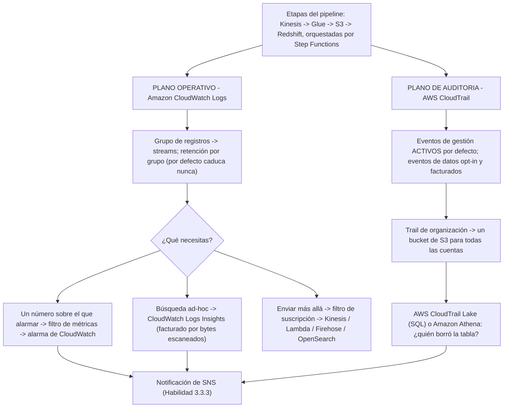
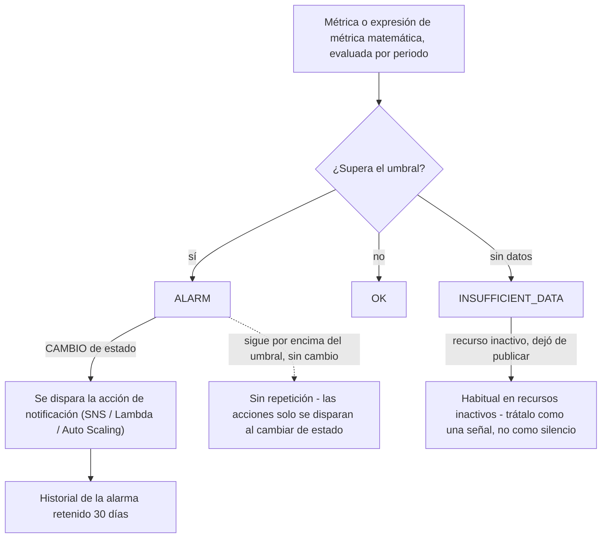
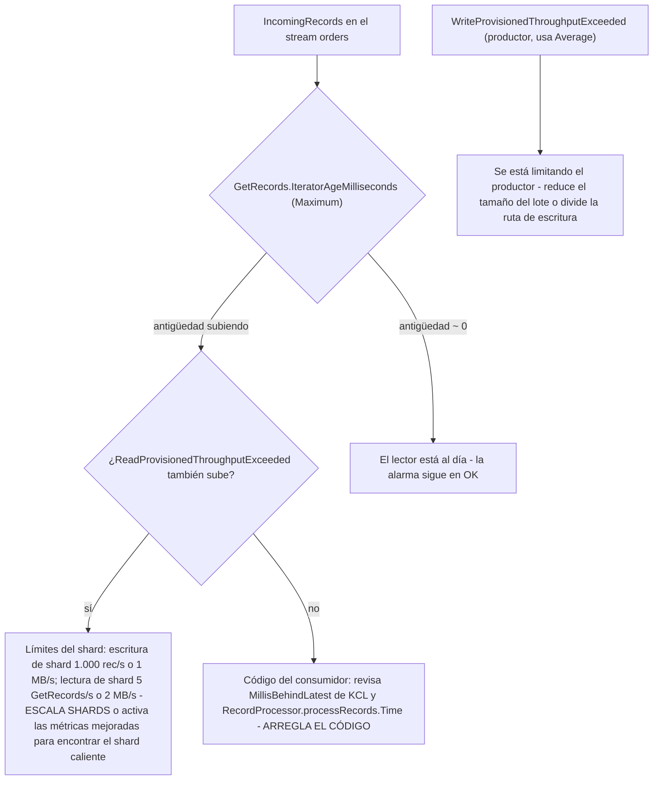
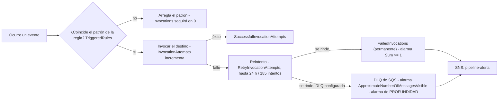
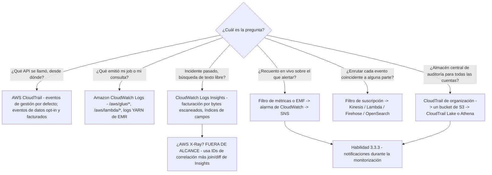

# Monitorización y observabilidad de pipelines de datos

Dos tareas de examen se cruzan en esta lección. **La Tarea 3.3, mantener y monitorizar pipelines de datos**, te pide extraer registros para auditorías, desplegar soluciones de registro y monitorización que permitan la auditoría y la trazabilidad, enviar notificaciones de alerta, resolver problemas de rendimiento, rastrear llamadas a APIs con AWS CloudTrail, mantener pipelines de Glue y EMR, registrar datos de la aplicación con Amazon CloudWatch Logs y analizar registros con Athena, EMR, OpenSearch y CloudWatch Logs Insights. **La Tarea 4.4, preparar registros para auditoría**, pide el mismo material desde el lado del cumplimiento: CloudTrail, almacenamiento de CloudWatch Logs, CloudTrail Lake, análisis de registros e integración de servicios como EMR para grandes volúmenes de registros. El examen los trata como una sola disciplina con dos preguntas: **qué pasó** (evidencia de auditoría) y **qué está pasando ahora mismo** (señal operativa).

```text
====================================================================
 DEA-C01 - DOMINIO 3 TAREA 3.3 + DOMINIO 4 TAREA 4.4 (13 habilidades)
--------------------------------------------------------------------
 3.3.1 Extraer registros para auditorías
 3.3.2 Desplegar registro y monitorización para auditoría y trazabilidad
 3.3.3 Usar notificaciones durante la monitorización para enviar alertas
 3.3.4 Resolver problemas de rendimiento
 3.3.5 Usar AWS CloudTrail para rastrear llamadas a APIs
 3.3.6 Resolver problemas y mantener pipelines (AWS Glue, Amazon EMR)
 3.3.7 Usar Amazon CloudWatch Logs (configuración y automatización)
 3.3.8 Analizar registros (Athena, EMR, OpenSearch, Logs Insights)
 4.4.1 Usar AWS CloudTrail para rastrear llamadas a APIs
 4.4.2 Usar Amazon CloudWatch Logs para almacenar registros de la aplicación
 4.4.3 Usar AWS CloudTrail Lake para consultas centralizadas de registros
 4.4.4 Analizar registros (Athena, Logs Insights, OpenSearch)
 4.4.5 Integrar servicios de AWS para registro (EMR para grandes volúmenes)
--------------------------------------------------------------------
 PLANO DE AUDITORÍA .. CloudTrail (gestión frente a datos) -> S3 /
                      CloudTrail Lake / Athena
 PLANO OPERATIVO ..... CloudWatch Logs -> filtros de métricas /
                      filtros de suscripción / Logs Insights -> alarmas -> SNS
 FUERA DE ALCANCE .... AWS X-Ray (literal en la lista de exclusión)
====================================================================
```

> [!NOTE]
> **Toda la lección se reduce a una sola frase:** CloudTrail responde *«quién hizo qué, cuándo y desde dónde»* para las **llamadas a APIs**, CloudWatch Logs responde *«qué emitió mi aplicación»* para las **operaciones**, y las **métricas + alarmas** de CloudWatch convierten ambos en notificaciones (Habilidad 3.3.3). Una pregunta nunca se resuelve en el plano equivocado: «¿quién borró la tabla?» nunca es Logs Insights, y «¿tasa de errores del job?» nunca es CloudTrail.

En esta lección aprenderás a:

- separar el **plano de auditoría** del **plano operativo**, y colocar correctamente **los eventos de gestión, los eventos de datos y los eventos de Insights**;
- elegir entre **métricas de servicio, métricas personalizadas y Embedded Metric Format**, con las trampas de cardinalidad y permisos;
- diseñar alarmas: **estados, acciones por cambio de estado, datos ausentes, alarmas compuestas y de registro**, paneles y métrica matemática;
- usar los tres mecanismos de CloudWatch Logs, **filtro de métricas, filtro de suscripción, Logs Insights**, sin confundirlos;
- escribir consultas de **Logs Insights** (lenguaje de consulta, índices de campos, facturación por bytes escaneados);
- monitorizar cada etapa de forma nativa: **Glue, Kinesis, Redshift, EMR, Lambda, DMS, Step Functions, S3, EventBridge**;
- aplicar **las mejores prácticas de registro**: JSON estructurado, IDs de correlación, políticas de protección de datos PII, retención y enrutado entre cuentas;
- trabajar **nueve ejemplos resueltos**: seis configuraciones de alarma y tres consultas de Logs Insights;
- leer el **recuadro de actualizaciones de octubre de 2026**, los **cuatro casos de estudio de clientes de AWS**, y terminar con **catorce preguntas estilo examen** más tres comprobaciones interactivas.

---

## 1. Dos planos de evidencia: auditoría frente a operaciones

### 1.1 La división que prueba el examen

| | **Plano de auditoría, AWS CloudTrail** | **Plano operativo, Amazon CloudWatch Logs** |
|---|---|---|
| Pregunta a la que responde | ¿Quién hizo qué, cuándo y desde dónde? | ¿Qué está emitiendo mi aplicación? |
| Contenido por defecto | **Los eventos de gestión se registran por defecto** | Lo que tu código y tus servicios envíen |
| Eventos de datos | **No se registran por defecto**; se activan con selectores de eventos básicos/avanzados, y se facturan | n/a |
| Retención | Archivos en S3 que tú controlas; **historial de eventos = 90 días, eventos de gestión, solo la cuenta conectada** | Configuración de retención del grupo de registros (por defecto: caduca nunca) |
| Análisis | **AWS CloudTrail Lake**, Athena sobre el JSON en S3 | **CloudWatch Logs Insights**, filtros de métricas, filtros de suscripción |
| Enunciado típico de examen | «¿Quién borró la tabla de Glue?» / «rastrear llamadas a APIs» | «tasa de errores del job a partir de registros» / «almacenar registros de la aplicación» |

### 1.2 CloudTrail: gestión, datos, Insights

- **Eventos de gestión** (por defecto): lecturas `Describe*`, `Get*` y llamadas de escritura como `RunInstances`, más eventos que no son de API como `ConsoleLogin`.
- **Eventos de datos** (opt-in, facturados): operaciones de alto volumen a nivel de recurso, `AWS:S3:Object`, `AWS:Lambda:Function` (`Invoke`), `AWS:DynamoDB:Table`, `AWS:Kinesis:Stream`, `AWS:SQS:Queue`, `AWS:StepFunctions:StateMachine`, `AWS:Glue:Table`. Una pregunta sobre **`s3:GetObject`** es insoluble salvo que **los eventos de datos estén activados**, están desactivados por defecto.
- **Eventos de Insights**: **detección de anomalías** en eventos de gestión, facturados y desactivados por defecto.
- **Integridad**: hash **SHA-256** más firma digital **SHA-256 con RSA** producen un **archivo de resumen (digest)** por hora, y la validación **no es retroactiva**.
- **Trails de organización** (cuenta de gestión o administrador delegado): un bucket para cada cuenta, las cuentas miembro pueden ver pero no modificar ni borrar, propagación **≤24 horas**, archivos de registro entregados aproximadamente cada **5 minutos**.
- Las acciones del plano de control de Glue se registran todas con `eventSource: glue.amazonaws.com`; muchas respuestas `Get*`/`BatchGet*` se registran como **`null`**.



### 1.3 Ejemplo resuelto E1: «¿quién borró las particiones?» en cuatro pasos

```text
P:  Una tabla de Athena perdió particiones a las 02:14 UTC. Demuestra quién lo hizo.

1. Confirma el plano ....... eventos de GESTIÓN de CloudTrail (historial de llamadas a APIs)
                             - NO CloudWatch Logs, NO Logs Insights
2. Filtra .................. eventSource = glue.amazonaws.com
                             eventName   = BatchDeletePartition
                                          (o DeleteTable / DeleteDatabase)
3. Guardar/consultar ....... trail de organización -> bucket central de S3
                             -> AWS CloudTrail Lake (habilidad 4.4.3)
                             -> o Athena sobre el JSON de CloudTrail (habilidad 4.4.4)
4. ¿Falta evidencia? ....... la acción fue una llamada a un OBJETO de S3, así que activa
                             los EVENTOS DE DATOS (opt-in, facturados) y vuelve a ejecutar -
                             los eventos de gestión nunca contienen s3:GetObject
```

- **📚 ¿Sabías que…?** El **historial de eventos** de CloudTrail te da **90 días** de **eventos de gestión** para **solo la cuenta conectada**; sin configuración, sin trail. Es la respuesta rápida a «¿quién hizo esto en los últimos 90 días?», pero no puede responder una pregunta de otra cuenta o de eventos de datos; eso necesita un trail de organización o CloudTrail Lake (documentación de AWS CloudTrail, consultada en octubre de 2026).

---

## 2. Métricas de CloudWatch: de servicio, personalizadas, incrustadas

### 2.1 Tres caminos por los que un número llega a CloudWatch

| Tipo | Quién lo publica | Resolución | Facturación | Vigila esto |
|---|---|---|---|---|
| **Métricas de servicio** | AWS, automáticamente | Estándar de **1 minuto** | Gratis con el servicio | Algunas son cada 5 minutos por defecto (EMR) o diarias (almacenamiento de S3) |
| **Personalizadas (`PutMetricData`)** | Tú empujas; CloudWatch **nunca tira** | **1 minuto** o **1 segundo** de alta resolución | Facturación de **métricas personalizadas** | ≤**30 dimensiones** por métrica |
| **Embedded Metric Format (EMF)** | Escribes un evento de registro JSON que contiene un bloque `_aws` | Asíncrono, desde el evento de registro | Facturación de **métricas personalizadas** | Solo necesita `logs:PutLogEvents`; **sin `cloudwatch:PutMetricData`**; la cardinalidad explota |

Las estadísticas se retienen durante **15 meses**. Después de publicar una métrica personalizada nueva, es visible para `GetMetricStatistics` en **2 minutos** y para `ListMetrics` en **15 minutos**: una trampa de examen cuando «acabo de crearla y no veo nada».

### 2.2 Ejemplo resuelto E2: la factura de la cardinalidad

Una línea de registro EMF dimensiona una métrica por **job (50 nombres) × estado (4 valores) × región (6 valores)**:

```text
métricas personalizadas creadas = 50 x 4 x 6 = 1,200 conjuntos distintos de dimensiones
a granularidad de 1 minuto, retenidas 15 meses, facturadas como métricas personalizadas

Diseño más seguro: dimensionar solo por job + estado      = 50 x 4 = 200
                    meter la región en la CARGA del log, filtrar con Logs Insights
```

EMF es atractivo precisamente porque no necesita permiso IAM extra, pero **existe una métrica personalizada por cada valor de dimensión único**: los campos de alta cardinalidad (IDs de petición, IDs de usuario, cadenas SQL) deben quedarse en el **mensaje del log**, no en las dimensiones.

- **📚 ¿Sabías que…?** Como las métricas EMF provienen de eventos de registro, se entregan **al menos una vez**: un `PutLogEvents` reintentado puede producir un punto de dato de métrica duplicado. Diseña las alarmas sobre estadísticas que lo toleren (por ejemplo `Sum` sobre un periodo en lugar de un `SampleCount` exacto) y nunca trates un recuento derivado de EMF como un libro de registro exactamente una vez (documentación de AWS EMF, consultada en octubre de 2026).

---

## 3. Alarmas de CloudWatch: estados, acciones y cómo combinarlas

### 3.1 La máquina de estados



Reglas clave (todas verificadas en AWS, consultadas en octubre de 2026):

- Una alarma invoca acciones **solo cuando cambia de estado**: la excepción son las alarmas con **acciones de Auto Scaling**. Un pipeline que sigue roto **no** te re-alerta cada minuto.
- Los estados son **`OK` / `ALARM` / `INSUFFICIENT_DATA`**; los recursos inactivos suelen dejar de publicar y quedarse en `INSUFFICIENT_DATA`.
- Tipos de alarma: **métricas** (incluidas **expresiones de métrica matemática** sobre las que puedes alarmar), **compuestas** (booleano `AND`/`OR`/`NOT` sobre otras alarmas), **de registro** (una consulta **Logs Insights** programada con una condición M-de-N; **sin filtro de métricas**) y alarmas **PromQL**. **No hay cuota de número de alarmas**.
- **Alarmas compuestas**: misma cuenta y Región solamente, arrancan en `INSUFFICIENT_DATA` (la única vez que lo hace una alarma nueva), **no pueden ejecutar acciones de EC2 ni de Auto Scaling**, los hijos no llevan acciones así que la compuesta avisa **una sola vez**, y los límites son **100 hijos / 500 elementos / 150 compuestas por hijo**.
- **Ventanas de evaluación**: hasta **7 días** cuando el periodo es ≥1 hora, o **1 día** para periodos más cortos.

### 3.2 El comportamiento con datos ausentes es una decisión de diseño

`TreatMissingData` tiene tres ajustes, y el correcto depende de la métrica: **`breaching`** (ausente = mal; correcto para la antigüedad del iterador, donde el silencio significa que no hay lector), **`notBreaching`** (ausente = bien; correcto para la profundidad de la DLQ, donde no hay datos significa una cola vacía) y **`ignore`** (mantener el estado actual). Elegir el valor por defecto (`missing`) es como los equipos consiguen alarmas en `INSUFFICIENT_DATA` en las que nadie confía.

### 3.3 Detección de anomalías en lugar de un umbral estático

La **detección de anomalías** de CloudWatch entrena una banda de ML **por métrica y por estadística**, de modo que alarmas cuando el valor sale de la banda en lugar de cruzar un número ajustado a mano. Sustituye los umbrales fijos donde la carga de trabajo es estacional (ventanas de ETL diarias) y los complementa donde existe un límite de cumplimiento (una latencia de CDC de 300 segundos).

---

## 4. Paneles y métrica matemática

- Los paneles son **ilimitados por cuenta** y **todos los paneles son globales, no específicos de una Región**: un panel de monitorización obtiene métricas cualificadas por Región en cada widget.
- Cuotas: **≤500 widgets por panel** y **≤500 métricas** en el array `metrics` de un widget (en octubre de 2026).
- **Widgets entre cuentas**: desde una cuenta de monitorización, cada widget nombra su `accountId` y su `region`.
- Una métrica que lleva **14 días en silencio** desaparece del selector de métricas del panel: un pipeline tranquilo parece uno borrado.
- La **métrica matemática** permite que un widget muestre `100 * (Errors / Invocations)` como una tasa de errores, y las alarmas pueden vigilar la expresión, no solo la métrica en bruto.

> [!IMPORTANT]
> **No construyas un widget de panel de alta frecuencia sobre Logs Insights.** Las consultas de Insights son herramientas interactivas: se facturan por **bytes sin comprimir escaneados**, están limitadas a **100 consultas de lenguaje de consulta concurrentes por cuenta**, expiran a los **60 minutos** y conservan los resultados durante **7 días**. Pon los *recuentos* en el panel (filtros de métricas o EMF) y reserva Insights para las investigaciones.

---

## 5. CloudWatch Logs: grupos, retención, filtros de métricas, filtros de suscripción

### 5.1 El modelo de contenedores y sus cuotas

Un **grupo de registros** contiene **streams de registros** que comparten retención y control de acceso; **no hay límite de número de streams** por grupo. En octubre de 2026: **1.000.000 de grupos de registros por Región**, **filtros de métricas 100 por grupo**, **filtros de suscripción 5 por grupo**, evento de registro de **1.024 KB**, lotes de `PutLogEvents` de **1 MB / 5.000 por segundo**, `StartQuery` **10/s**, y **límites de regex de ≤5 patrones regex por grupo y ≤2 regexes por patrón**.

> [!WARNING]
> **⚠️ La retención por defecto es «caduca nunca».** Por defecto, los datos de registro se almacenan en CloudWatch Logs **indefinidamente**, y cuando los borras, el borrado puede tardar hasta **72 horas** en completarse. Configura una retención por grupo en días desde el primer día: un grupo `/aws/glue/orders_etl` sin límite es a la vez un problema de coste y un problema de cumplimiento (Habilidades 3.3.7, 4.4.2).

### 5.2 Un patrón, tres trabajos

| | **Filtro de métricas** | **Filtro de suscripción** | **Logs Insights** |
|---|---|---|---|
| Propósito | Convertir los eventos coincidentes en una **métrica de CloudWatch sobre la que alarmar** | **Enviar** los eventos coincidentes más allá (Kinesis, Lambda, Firehose, OpenSearch) | **Búsqueda ad-hoc** sobre eventos pasados |
| ¿Retroactivo? | **No**: solo cuenta eventos que llegan **después** de crear el filtro | No | No |
| Qué obtienes | Un valor numérico por minuto | El evento completo | Filas, facturadas por **bytes sin comprimir escaneados** |
| Cuota | 100 por grupo de registros | 5 por grupo de registros | 100 consultas de lenguaje de consulta concurrentes por cuenta |

### 5.3 Ejemplo resuelto E3: filtro de métricas más alarma sobre registros JSON de jobs

```text
Grupo de registros .. /aws/glue/orders_etl
Patrón de filtro .... { $.level = "ERROR" }              (coincidencia JSON)
Nombre de métrica ... GlueJobErrors
Namespace ........... Custom/OrdersEtl    Dimensiones: JobName=orders_etl
Transformación ..... 1                   Unidad         Count
Periodo ............ 60 segundos         Estadística    Sum

Alarma ............. GlueJobErrors > 0
                     EvaluationPeriods 1, Period 60, TreatMissingData notBreaching
                     Acción -> tema SNS pipeline-alerts
```

Como los filtros **no son retroactivos**, esta alarma solo ve errores desde el momento en que el filtro existe: las preguntas retrospectivas («¿falló el martes pasado?») son preguntas de **Logs Insights**.

### 5.4 Ejemplo resuelto E4: salud de entrega del filtro de suscripción

```text
Filtro de suscripción .. to-archive -> Amazon Data Firehose -> S3 central
Alarma (entrega) ...... AWS/Logs . DeliveryThrottling . Sum > 0
                        Period 60, EvaluationPeriods 1, TreatMissingData notBreaching
Significado ........... aguas abajo está infraprovisto; los eventos se están
                        limitando, reintentando durante hasta 24 HORAS, y luego DESCARTÁNDOSE
Alarma compañera ...... AWS/Logs . DeliveryErrors . Sum > 0
```

Las entregas limitadas se reintentan durante **hasta 24 horas**, tras lo cual las entregas fallidas se **descartan**: así que una alarma `DeliveryThrottling` es una alarma de pérdida de datos disfrazada de rendimiento.

```matching
{
  "question": "Empareja cada mecanismo de CloudWatch Logs con su trabajo en un pipeline de datos:",
  "pairs": [
    {"left": "Metric filter", "right": "Convierte los eventos de registro coincidentes en una MÉTRICA de CloudWatch para que se dispare una alarma: valor numérico por minuto, NO retroactivo, 100 por grupo de registros"},
    {"left": "Subscription filter", "right": "ENVÍA los eventos coincidentes a Kinesis, Lambda, Firehose u OpenSearch - 5 por grupo de registros, entrega limitada reintentada hasta 24 horas y luego descartada"},
    {"left": "Logs Insights", "right": "Búsqueda AD-HOC entre grupos de registros: lenguaje de consulta, OpenSearch PPL o SQL, facturado por BYTES ESCANEADOS sin comprimir, resultados retenidos 7 días"},
    {"left": "Log alarm (scheduled)", "right": "Ejecuta una consulta de Logs Insights programada con una condición M-de-N: necesita NINGÚN filtro de métricas"},
    {"left": "Embedded Metric Format", "right": "Publica métricas PERSONALIZADAS directamente desde un evento de registro JSON: solo logs:PutLogEvents, una métrica por valor de dimensión único"}
  ],
  "explanation": "La confusión favorita del examen es tratarlos como intercambiables. Alarmar un recuento -> filtro de métricas. Mover cada evento a un bucket central o un dominio de OpenSearch -> filtro de suscripción. Responder «¿qué pasó el martes pasado?» -> Logs Insights. Alarmar un patrón que no puedes expresar como métrica -> alarma de registro. Emitir métricas desde el código de la aplicación sin un segundo permiso de IAM -> EMF, al coste de métricas personalizadas."
}
```

---

## 6. CloudWatch Logs Insights: consultar la evidencia

### 6.1 Tres lenguajes, un modelo de facturación

Insights ofrece el **lenguaje de consulta** (`fields`, `filter`, `parse`, `stats`, `sort`, `limit`, `join`, `lookup`, `filterIndex`, `estimate`), **OpenSearch PPL** y **OpenSearch SQL**: SQL es el único que puede hacer `JOIN` **entre grupos de registros**. Se factura por **datos de registro sin comprimir escaneados**, las consultas expiran a los **60 minutos**, los resultados viven **7 días**, y los **índices de campos** (más el comando `filterIndex`) reducen el volumen escaneado de forma drástica. Los registros de servicios de AWS se descubren automáticamente como campos con prefijo `@`; tus propios campos JSON estructurados aparecen por nombre.

Barreras de contención: estrecha primero el rango temporal, **cancela las consultas antes de cerrar la consola**, y prefiere filtros de métricas o EMF a un widget de panel que reejecute Insights.

### 6.2 Ejemplo resuelto E5: triaje de un job nocturno fallido (ventana de 30 segundos)

```text
fields @timestamp, @logStream, @message
| filter @message like /Exception|Traceback|FAILED/
| filter @message like /orders_etl/
| sort @timestamp desc
| limit 50
```

### 6.3 Ejemplo resuelto E6: tasa de errores por job desde JSON estructurado

```text
fields @timestamp, level, jobName, durationMs
| filter level = "ERROR"
| stats count() as errors, avg(durationMs) as avgMs by jobName
| sort errors desc
| limit 10
```

Ambas consultas son **investigaciones**. Para *alertar* sobre la misma señal añadirías un filtro de métricas (Ejemplo E3) o publicarías vía EMF, y, como los filtros de métricas no son retroactivos, también conservarías la consulta de Insights para la mitad retrospectiva de la pregunta.

- **📚 ¿Sabías que…?** Logs Insights descubre automáticamente los campos `@` de los registros de servicios de AWS (por ejemplo `@message`, `@timestamp`, `@logStream`), pero son los **índices de campos** que defines los que hacen barato el `filter`: sin un índice se escanea cada línea candidata, así que la factura sigue a los **bytes escaneados**, no a las filas devueltas. Indexa los campos por los que filtras y reserva los escaneos anchos de `@message LIKE` solo para rangos temporales cortos (documentación de AWS CloudWatch Logs Insights, consultada en octubre de 2026).

---

## 7. Streaming: Amazon Kinesis Data Streams

### 7.1 La métrica que define la salud del stream

Namespace **`AWS/Kinesis`**. **Las métricas a nivel de stream son gratis y se publican cada minuto**; **las métricas mejoradas (a nivel de shard) son una función opt-in de coste adicional** (`EnableEnhancedMonitoring`).

| Métrica | Qué mide de verdad | Trampa |
|---|---|---|
| **`GetRecords.IteratorAgeMilliseconds`** (dimensión `StreamName`) | **Retraso del stream**: cuánto se retrasa la posición del lector más lento respecto a la cabeza del stream. **Un valor de cero indica que los registros que se leen están totalmente al día con el stream.** | Esta es la métrica de retraso a la que se refieren las preguntas del examen |
| `IteratorAgeMilliseconds` (a nivel de shard) | El mismo retraso por shard: dónde vive el shard problemático | Solo de pago/mejorada |
| **`GetRecords.Latency`** | Cuánto tarda una **llamada a la API** | **Duración de la llamada, no retraso**: el distractor clásico |
| **`WriteProvisionedThroughputExceeded`** | Escrituras de **productor** limitadas por los límites de escritura del shard | Usa **Average**; un `Maximum` de **0** simplemente significa que no se limitó ninguna |
| `ReadProvisionedThroughputExceeded` | Lecturas de **consumidor** limitadas por los límites de lectura del shard | Sube junto con la antigüedad del iterador ⇒ escala shards |

### 7.2 Ejemplo resuelto E7: la alarma de antigüedad del iterador

```text
AWS/Kinesis . GetRecords.IteratorAgeMilliseconds . [StreamName=orders]
Estadística .. Maximum          (UN shard retrasado es el incidente)
Periodo ...... 300 segundos     EvaluationPeriods 1
Comparación . GreaterThanThreshold
Umbral ....... 43,200,000 ms  =  50% de un periodo de retención de 24 horas
                24 h x 3,600 s x 1,000 ms = 86,400,000 ms; la mitad = 43,200,000 ms
TreatMissingData breaching  (sin lector -> sin datos -> ESO ES el incidente)
Acción ...... tema SNS pipeline-alerts

Nivel de advertencia (opcional, ~10% de la retención): 8,640,000 ms
```

La propia guía de AWS: *si la antigüedad de un iterador supera el **50% del periodo de retención** corres el riesgo de que los registros caduquen antes de leerse, y **debes usar alarmas de CloudWatch sobre la estadística Maximum***. La aritmética de umbrales sobre una retención por defecto de **24 horas** es exactamente el tipo de cálculo que DEA-C01 espera que realices, no que recuerdes.



---

## 8. AWS Glue: DPU, bookmarks, observabilidad y job insights

### 8.1 Cómo se comportan las métricas de Glue

**AWS Glue reporta métricas a CloudWatch cada 30 segundos**, como **valores delta** de los reportados anteriormente: así que un panel graficado a granularidad de 1 minuto es una **agregación**, y la estadística correcta por minuto es **`Sum`**, no `Average`. El namespace de métricas de la CLI/API es **`Glue`**.

| Preocupación | Métrica(s) | Lectura |
|---|---|---|
| Rezago de DPU / ejecutores | `glue.driver.ExecutorAllocationManager.executors.numberAllExecutors` vs `…numberMaxNeededExecutors` | Necesarios ≫ asignados ⇒ se requieren más DPU |
| Trabajo realizado | `glue.driver.aggregate.bytesRead`, `glue.driver.aggregate.recordsRead` | Un **0** cuando se esperaban 50M de filas ⇒ el **bookmark se saltó** los datos |
| Fallos dentro de la ejecución | `glue.driver.aggregate.numFailedTasks` | Fallos a nivel de tarea dentro de un driver «exitoso» |
| Fuera de memoria | `glue.ALL.jvm.heap.usage` | Alarmar cuando **Average > 0.9** |
| Bookmarks | `bytesRead` / `recordsRead` bajo **Job Bookmark Issues**; el fallo aparece como categoría de observabilidad **`GLUE_JOB_BOOKMARK_VERSION_MISMATCH_ERROR`** | Watermark equivocada = duplicados o huecos |
| Desbalance | `glue.driver.skewness.job` | Factor de skewness por defecto **5** |
| Totales de éxito/fallo | `glue.error.ALL`, `glue.succeed.ALL`, `glue.error.[category]` (**28 categorías**) | Requiere la función de **observabilidad de Glue**, **Glue 4.0 o posterior**, dimensión `ObservabilityGroup` |

### 8.2 La alerta de fallos suele ser EventBridge, no CloudWatch

**No existe una métrica por defecto de «job fallido».** La alerta canónica (habilidad 3.3.3) es una regla de EventBridge sobre el evento **`Glue Job State Change`**.

### 8.3 Ejemplo resuelto E8: alerta cuando falla el job nocturno

```text
Regla de EventBridge
  source .............. ["aws.glue"]
  detail-type ........ ["Glue Job State Change"]
  detail.state ........ ["FAILED", "TIMEOUT"]
  detail.jobName ...... ["orders_etl"]
  target .............. tema de Amazon SNS pipeline-alerts

Valores de estado que debes enrutar: SUCCEEDED, FAILED, TIMEOUT, STOPPED
  (una ejecución STOPPED es una persona o un planificador, no un error - filtra aparte)

Alternativa de métrica (necesita observabilidad de Glue, 4.0+):
  Glue . glue.error.ALL . JobName=orders_etl . Sum >= 1 . Period 300

Comprobación de backlog (métrica matemática):
  bytesWritten(job_i) / bytesRead(job_{i+1}) != 1  =>  filas acumulándose entre ejecuciones
```

Los bookmarks son el modo de fallo silencioso: un job puede **tener éxito** mientras lee **nada** porque la watermark del bookmark dice que ya lo hizo. Alarmar sobre `glue.driver.aggregate.recordsRead` cayendo a 0 frente a un volumen esperado, y combinarlo con la regla de cambio de estado, para que el silencio y el éxito sean distinguibles.

---

## 9. Amazon Redshift: tres planos de evidencia

| Plano | Dónde | Contenido |
|---|---|---|
| **1. Métricas del cluster** | CloudWatch `AWS/Redshift`, ~1 minuto, gratis | `CPUUtilization`, `DatabaseConnections`, **`HealthStatus`** (1/0 en CloudWatch), `PercentageDiskSpaceUsed` |
| **2. Métricas de consulta / WLM** | CloudWatch (5 minutos donde se indica) | `QueryDuration` (**microsegundos**), **`QueryRuntimeBreakdown`** con dimensión `stage`: incluido **`QueryWaiting`**, que es el tiempo en cola del WLM; **`WLMQueueLength`** (dimensiones `service class` o `QueueName`), `WLMQueueWaitTime` |
| **3. Detalle de rendimiento de consulta y carga** | **Solo la consola de Amazon Redshift / tablas de sistema** | `STL_*`, `STV_*`, `SYS_*`: *«Query and load performance data are not published as CloudWatch metrics and can only be viewed in the Amazon Redshift console.»* |

**Spectrum y límites de uso**: `UsageLimitConsumed` lleva la dimensión `FeatureType`, incluido **`SPECTRUM`**: los bytes escaneados por consultas externas contra S3, que es como alarmas una consulta descontrolada de Spectrum antes de que llegue la factura.

**Ejemplo resuelto (congestión de WLM):** alarmar `WLMQueueLength` con dimensión `QueueName=etl` **> 5 durante 3 periodos**, luego confirmar con `QueryRuntimeBreakdown` en `stage=QueryWaiting`: si `QueryWaiting` es alto, las consultas están en cola (añade colas WLM o concurrencia); si es bajo pero `QueryDuration` es alto, el SQL en sí es lento. La conclusión equivocada del plano equivocado es la trampa.

---

## 10. Amazon EMR: YARN y el valor por defecto de 5 minutos

- Las métricas por defecto llegan **cada 5 minutos** y son **gratis**; en **EMR 7.0 y posterior** el **agente de CloudWatch** añade **34 métricas extra a granularidad de 1 minuto** (de pago), y **7.1** añade clasificaciones de YARN y HBase.
- **`IsIdle`** se muestrea cada **5 minutos**: la propia guía de alarmas de AWS es alarmar «cuando `IsIdle` sea 1 durante **más de una comprobación consecutiva de 5 minutos**».
- Capacidad y escalado: **`AppsRunning`**, **`AppsPending`**, **`ContainerPendingRatio`** (la señal de escalado), **`HDFSUtilization`** y **`YARNMemoryAvailablePercentage`**: la métrica protagonista del **escalado gestionado**.
- El escalado gestionado también emite `YarnContainersUsedMemoryGBSeconds`, que AWS describe como **crítica para el escalado gestionado**.
- Registros: el agente envía `/mnt/var/log/hadoop-yarn/...` a grupos de registros de CloudWatch, que es lo que hace que las Habilidades 3.3.6/4.4.5 (analizar registros de EMR, usar EMR para grandes volúmenes de registros) sean respondibles con Logs Insights o un filtro de suscripción hacia S3.

**Lectura de examen:** una pregunta de EMR que exija métricas de 1 minuto en realidad pregunta *qué componente las publica*: la respuesta es el **agente de CloudWatch en EMR 7.0+**, no un ajuste de consola.

---

## 11. AWS Lambda: throttles, duración y errores

Las métricas llegan a granularidad de **1 minuto**.

| Métrica | Significado | Trampa |
|---|---|---|
| `Invocations` | Peticiones que se ejecutaron; **este es el recuento facturado** | ¿Las peticiones limitadas cuentan aquí? **No** |
| `Errors` | Invocaciones fallidas | ¿Las peticiones limitadas cuentan aquí? **No** |
| **`Throttles`** | Peticiones rechazadas por límites de concurrencia | **Una petición limitada no cuenta ni en `Invocations` ni en `Errors`**: alarma por separado |
| `Duration` | Tiempo de ejecución | **Excluye el arranque en frío**: un problema de arranque en frío es invisible aquí |
| `IteratorAge` | Para **mapeos de origen de evento de DynamoDB/Kinesis/DocumentDB**: **la antigüedad del último registro** | El propio retraso de stream de Lambda, distinto del `GetRecords.IteratorAgeMilliseconds` de Kinesis |
| `ConcurrentExecutions` | Consulta el **`Max`** | El promedio oculta el pico |
| `ProvisionedConcurrencyUtilization` | Uso de la capacidad precalentada | **No se emite cuando está inactivo**: espera huecos |

Las métricas de mapeo de origen de evento son **opt-in**: `PolledEventCount`, `InvokedEventCount`, `FailedInvokeEventCount`, `DroppedEventCount`, `MaxOffsetLag`. La entrega del ESM es **al menos una vez**, así que los recuentos pueden duplicarse: nunca los leas como un recuento exactamente una vez de eventos de negocio.

**Diseño de alarma:** `Errors / (Invocations + Throttles)` como métrica matemática es engañoso porque los throttles quedan fuera de ambos; alarma `Throttles > 0` y `Errors > 0` **por separado**, luego investiga límites de concurrencia frente a código.

---

## 12. AWS DMS: la latencia de CDC son dos números, no uno

Las métricas viven en **`AWS/DMS`**, se expresan en **segundos** y se dimensionan por instancia y tarea.

- **`CDCLatencySource`**: el último evento **capturado en el origen** frente al reloj de la instancia de replicación: el lado de **lectura del origen**.
- **`CDCLatencyTarget`**: el evento **sin confirmar más antiguo esperando a confirmarse en el destino** frente al reloj: el lado de **aplicación en el destino**.
- **`CDCLatencyTarget` es siempre mayor o igual que `CDCLatencySource`.**

### Ejemplo resuelto E9: lee las dos latencias antes de tocar nada

```text
Confirmación en el origen 10:00:00, consumida a las 10:02:00
  CDCLatencySource = 120 segundos
Escrito en el destino a las 10:05:00
  CDCLatencyTarget = 300 segundos   (siempre >= 120)

Alarma ....... AWS/DMS . CDCLatencyTarget . Average > 300
               Period 60, EvaluationPeriods 3, TreatMissingData breaching

Triaje ....... AMBOS altos ............. revisa el ORIGEN primero
               Origen bajo, Destino alto ... problema del DESTINO (falta clave
                                             primaria o índice, o throttling)
               Ambos altos y CASI IGUALES . problema del ORIGEN
Compañeros ... CDCIncomingChanges, CDCThroughputRowsSource, CDCThroughputRowsTarget
```

Ese orden, **el origen primero cuando ambos están altos**, es el hecho de monitorización de DMS más testable, y se sigue de la desigualdad: la latencia de destino incluye todo lo que incluye la de origen.

---

## 13. AWS Step Functions: historial de ejecuciones y backlog

Namespace **`AWS/States`**, dimensión **`StateMachineArn`**; sin dimensión las métricas son **a nivel de cuenta**.

- Métricas de ejecución: `ExecutionsStarted`, `ExecutionsSucceeded`, `ExecutionsFailed`, `ExecutionsTimedOut`, `ExecutionThrottled`, `ExecutionTime` (**milisegundos**). Usa **`Sum`** para contar ejecuciones y **`Average`** para caracterizar duraciones.
- **Trampa:** Step Functions emite **dos métricas `ExecutionsStarted` para cada ejecución de una máquina de estados**, así que `SampleCount` es **2**: nunca leas `SampleCount` como un recuento de ejecuciones.
- Las métricas se emiten **best-effort**; un **nombre de máquina de estados que no sea ASCII impide el registro en CloudWatch**.
- Métricas de actividad (dimensión `ActivityArn`): `ActivitiesSucceeded`, `ActivitiesFailed`, `ActivitiesTimedOut`, **`ActivitiesHeartbeatTimedOut`**.
- **Backlog**: `OpenExecutionCount` frente al límite (por defecto **1.000.000**): AWS recomienda una alarma **Maximum** en **100.000+**; para Distributed Map, `ApproximateOpenMapRunCount` frente a un límite de **1.000**, alarmado en **900+**.
- El **historial de ejecuciones** en la consola (y la API `GetExecutionHistory`) es la evidencia por ejecución: CloudWatch te da el agregado, el historial de ejecuciones te la historia estado a estado.

---

## 14. Amazon S3: métricas de peticiones frente a métricas de almacenamiento

| | **Métricas de almacenamiento diarias** | **Métricas de peticiones** |
|---|---|---|
| Ejemplos | `BucketSizeBytes`, `NumberOfObjects` | `AllRequests`, `GetRequests`, `4xxErrors`, `5xxErrors`, `FirstByteLatency`, **`TotalRequestLatency`** |
| Frecuencia | **Una vez al día** | **1 minuto** |
| Coste | **Gratis**, activas por defecto | Facturadas **como métricas personalizadas** |
| Alcance | **Solo totales del bucket** | **Requieren una configuración de métricas**: a nivel de bucket o filtradas por **prefijo, etiqueta o punto de acceso** (dimensión `FilterId`) |
| Filtrado | **Las métricas de almacenamiento no admiten filtrado** | **Las métricas de peticiones admiten filtrado** |

Además: la entrega de métricas de S3 por CloudWatch es **best-effort**, así que trata un punto de dato ausente como ambigüedad, no como cero tráfico.

**Ejemplo resuelto (tasa de errores por prefijo):** para alarmar 4xx en `s3://curated/`, primero crea una **configuración de métricas filtrada por ese prefijo**, y luego alarma `4xxErrors` con la dimensión `FilterId=curated`. No hay forma de obtener una tasa de errores por prefijo desde las métricas de almacenamiento diarias gratuitas: el examen reutiliza este patrón constantemente.

---

## 15. Amazon EventBridge: invocaciones, fallos y la cola de mensajes muertos

Namespace **`AWS/Events`**.

- **`Invocations`**: los **primeros intentos** exitosos más fallidos; **excluye los reintentos hasta que se convierten en fallos permanentes**, y se emite **solo cuando no es cero**.
- **`FailedInvocations`**: **solo fallos permanentes**, también solo cuando no es cero.
- Detalle de entrega: `InvocationAttempts`, `SuccessfulInvocationAttempts`, `RetryInvocationAttempts`; una alarma de métrica matemática útil es `SuccessfulInvocationRate = SuccessfulInvocationAttempts / InvocationAttempts`.
- **Orden de resolución de problemas:** `TriggeredRules = 0` ⇒ tu patrón **nunca coincidió**; `Invocations = 0` pero la regla se disparó ⇒ **configuración del destino** (permisos, ARN); fallos **con** invocaciones ⇒ el problema está **en el destino**.
- Los reintentos duran **hasta 24 horas / 185 intentos**, tras lo cual el evento puede enviarse a una **cola de mensajes muertos (DLQ)** opcional, y en ese punto **la profundidad de la DLQ es una métrica de SQS**, no de EventBridge.



### Ejemplo resuelto E10: profundidad de la DLQ más fallos permanentes

```text
Alarma A (profundidad) ... AWS/SQS . ApproximateNumberOfMessagesVisible
                           [QueueName=events-dlq]
                           Maximum, Period 60, EvaluationPeriods 3
                           GreaterThanThreshold, Threshold 1
                           TreatMissingData notBreaching   (sin datos = cola vacía)
                           NOTA: este nombre de métrica de profundidad de SQS es la
                           métrica estándar de mensajes visibles de AWS - vuelve a
                           verificarlo contra la documentación actual de SQS antes
                           de desplegarlo.

Alarma B (causa) ... AWS/Events . FailedInvocations . Sum >= 1 . Period 60
                     TreatMissingData notBreaching

Lectura .......... A se dispara => ALGO ya se rindió y necesita reproceso
                   B se dispara => qué destino falló, y cuándo
                   Ninguna, pero RetryInvocationAttempts sube =>
                   aún reintentando - actúa antes de que expire la ventana de 24 horas
```

El emparejamiento importa: **`FailedInvocations` dice «se rindió»**, la profundidad dice **«cuántos están esperando»**, y los intentos de reintento dicen **«aún intentando»**: tres urgencias distintas de tres métricas distintas.

---

## 16. Mejores prácticas de registro para pipelines

### 16.1 Seis reglas que suman puntos (Habilidades 3.3.2, 3.3.7, 4.4.2)

1. **Registros JSON estructurados.** Los índices de campos, `parse`, `filter` y los filtros de métricas todos asumen estructura; las líneas de texto libre fuerzan escaneos `@message LIKE` facturados por bytes.
2. **IDs de correlación en todas partes.** **`$$.Execution.Id`** de Step Functions, **`JobName` + `JobRunId`** de Glue, **request ID** de Lambda, **task ID** de DMS. Un solo ID permite que una única consulta de Insights haga `join` entre grupos de registros y etapas.
3. **Nunca registres PII si puedes evitarlo;** si debes, adjunta una **política de protección de datos de Logs**: la detección y el enmascaramiento ocurren **cuando se ingieren los datos**, así que los eventos escritos **antes** de que existiera la política **no** están enmascarados, leer datos enmascarados requiere `logs:Unmask`, y las detecciones publican la **métrica gratuita (vendida) `LogEventsWithFindings`**.
4. **Configura la retención por grupo de registros**: el valor por defecto es indefinido, el borrado tarda hasta **72 horas**.
5. **Centraliza entre cuentas**: una **cuenta de monitorización** de CloudWatch, **Logs Centralization**, un CloudTrail de organización en un solo bucket, o un filtro de suscripción hacia Firehose que aterrice en un bucket central de S3.
6. **Mantén los dos planos separados**: la evidencia de *auditoría* va a CloudTrail (y luego CloudTrail Lake / Athena), los registros *operativos* van a CloudWatch Logs.



### 16.2 Ejemplo resuelto E11: alarma de barrera de PII

```text
Grupo de registros ... /aws/lambda/ingest-orders
Política de protección de datos: detectar y enmascarar el patrón [PII] en @message
                        (se aplica a los eventos INGERIDOS DESPUÉS de su creación)
Alarma ............... AWS/Logs . LogEventsWithFindings . Sum >= 1
                       Period 60, EvaluationPeriods 1, TreatMissingData notBreaching
Significado .......... el pipeline está emitiendo datos sensibles - arregla al emisor,
                       no a la alarma
Nota ................. LogEventsWithFindings es una métrica VENDIDA (gratuita)
```

```fillblank
{
  "question": "Completa las afirmaciones sobre las mejores prácticas de registro con el propio vocabulario del examen:",
  "template": "CloudWatch Logs almacena los datos {{1}} por defecto, y el borrado de un grupo de registros puede tardar hasta {{2}} horas en completarse. Una política de protección de datos de Logs enmasca los datos sensibles {{3}} la ingesta, así que los eventos escritos antes de que existiera la política {{4}} están enmascarados, y las detecciones publican la métrica gratuita {{5}}. En CloudTrail, los eventos {{6}} se registran por defecto mientras que los eventos {{7}} deben activarse explícitamente y se facturan.",
  "answers": {
    "1": "de forma indefinida",
    "2": "72",
    "3": "al momento de",
    "4": "no",
    "5": "LogEventsWithFindings",
    "6": "de gestión",
    "7": "de datos"
  },
  "distractors": ["durante 30 días", "durante 15 meses", "antes de", "después de", "siempre", "retroactivamente", "LogEventsWithFindingsMetric", "Insights", "leer", "escribir", "esquema", "configuración", "auditoría", "operaciones"],
  "explanation": "La retención por defecto es caduca nunca (el borrado <= 72 h), el enmascaramiento ocurre AL INGERIR y no es retroactivo, LogEventsWithFindings es la métrica de PII vendida, y CloudTrail registra los eventos de gestión por defecto mientras que los eventos de datos son opt-in y se facturan: los cuatro hechos que deciden la mayoría de preguntas de registro en DEA-C01."
}
```

### 16.3 La cadena de alertas, de principio a fin

La habilidad 3.3.3 («usar notificaciones durante la monitorización para enviar alertas») se satisface solo cuando **una señal se convierte en una notificación**: métrica (de servicio, personalizada o EMF) o alarma de registro → **cambio de estado de la alarma** → tema de **Amazon SNS** (correo, SMS, Lambda, Chatbot) o un destino de EventBridge. Las alarmas de CloudWatch no envían correo por sí solas y, como las acciones se disparan **solo al cambiar de estado**, las políticas de escalamiento deben vivir aguas abajo de la primera notificación.

```dragdrop
{
  "question": "Arrastra las cinco etapas de la cadena de alertas del DEA-C01 al orden en que un pipeline las ejecuta de verdad:",
  "items": [
    "El tema SNS entrega la notificación a una persona o a una función Lambda",
    "La alarma cambia de estado de OK a ALARM",
    "Se publica una métrica (de servicio, personalizada o EMF) o un hallazgo de protección de datos de Logs",
    "Se ejecuta el escalamiento aguas abajo, la auto-remediación o el reproceso de la DLQ",
    "La alarma evalúa la estadística contra el umbral durante el periodo de evaluación configurado"
  ],
  "correctOrder": [
    "Se publica una métrica (de servicio, personalizada o EMF) o un hallazgo de protección de datos de Logs",
    "La alarma evalúa la estadística contra el umbral durante el periodo de evaluación configurado",
    "La alarma cambia de estado de OK a ALARM",
    "El tema SNS entrega la notificación a una persona o a una función Lambda",
    "Se ejecuta el escalamiento aguas abajo, la auto-remediación o el reproceso de la DLQ"
  ],
  "explanation": "El orden es la habilidad completa: una señal debe PUBLICARSE antes de poder EVALUARSE, la evaluación debe CAMBIAR DE ESTADO antes de que se ejecute cualquier acción, solo entonces SNS puede NOTIFICAR, y el escalamiento vive DESPUÉS de la primera notificación. Hay dos trampas dentro de esta secuencia: las alarmas de CloudWatch no pueden enviar correo por sí solas y, como las acciones solo se disparan al cambiar de estado (salvo Auto Scaling), un pipeline que sigue roto nunca te re-alerta, que es exactamente por qué la alarma compuesta de la sección 3.1 y la ventana de reintento de 24 horas de EventBridge necesitan cada una su propio diseño aguas abajo (Habilidades 3.3.3, 3.3.4)."
}
```

- **📚 ¿Sabías que…?** Los tres patrones de registros entre cuentas son herramientas genuinamente distintas: una **cuenta de monitorización** (observabilidad entre cuentas de CloudWatch) permite que una sola consulta de Logs Insights abarque grupos de registros enlazados: `/aws/glue/*` en seis cuentas en una consulta; **Logs Centralization** mueve la *entrega* de los grupos de registros a una cuenta central; un **CloudTrail de organización** pone los archivos de auditoría de todas las cuentas en **un solo bucket de S3**. Elegir entre ellos es una pregunta de las Habilidades 3.3.1/4.4.5, y la opción equivoca suele mezclar dos de los tres (documentación de AWS CloudWatch y CloudTrail, consultada en octubre de 2026).

---

### Actualizaciones de 2026 (en octubre de 2026)

> [!NOTE]
> **Qué se movió en monitorización entre la guía de la época de lanzamiento y la guía que descargas hoy**: cada línea verificada contra una fuente primaria de AWS en **octubre de 2026**:
> - **La guía de examen v1.1 (12 de diciembre de 2025)** fusionó las declaraciones separadas de «conocimiento de» en una sola lista de habilidades (**8 habilidades añadidas, ninguna eliminada**) y dejó las Tareas 3.3 y 4.4 sustancialmente intactas: registro, monitorización, alertas, extracción de auditoría y análisis de registros siguen siendo el núcleo de los Dominios 3/4 (página de revisiones de la guía de examen, consultada en octubre de 2026).
> - **Kinesis Data Streams ahora tiene tres modos de capacidad, no dos**: Provisioned, On-demand Standard y **On-demand Advantage (4 de noviembre de 2025)**: ODA elimina el cargo horario por stream, recorta las tarifas por GB (AWS afirma ≥60% menos), pero aplica un suelo de **25 MB/s de ingesta + 25 MB/s de recuperación** a toda la cuenta (AWS What's New, 4 nov 2025). Una página de preparación que diga «dos modos de capacidad» está obsoleta; el diseño de la alarma `GetRecords.IteratorAgeMilliseconds` de la Sección 7 no cambia.
> - **Tablas de streaming de Kinesis (28 de agosto de 2026)** materializan un stream en **Apache Iceberg sobre Amazon S3 Tables**, y la **entrega generalista a S3 (29 de agosto de 2026)** escribe registros en un bucket normal: ambos solo en los modos bajo demanda. Nuevas rutas de entrega significan nuevos sitios donde poner una alarma tipo `DeliveryErrors`; la métrica de retraso sigue siendo `GetRecords.IteratorAgeMilliseconds` (AWS What's New, 28 to 29 ago 2026).
> - **AWS Glue 6.0 (21 de agosto de 2026)**, Spark **4.1.1**, Python **3.13**, **precio un 30% más bajo**, con **Glue 5.1** como valor por defecto para jobs nuevos desde el 26 de noviembre de 2025 y **fin de vida de 0.9/1.0/2.0 el 1 de abril de 2026** (notas de versión y política de soporte de AWS Glue, consultadas en octubre de 2026). Las métricas de observabilidad (`glue.error.*`, `glue.succeed.*`) requieren **Glue 4.0+**, así que «¿en qué versión de Glue está este job?» es ahora un prerrequisito de monitorización tanto como de compatibilidad.
> - **La capacidad de EMR se movió en 2026, así que reajusta las alarmas de la Sección 10**: Amazon EMR Serverless eliminó el **almacenamiento local** de jobs el **6 de enero de 2026** (AWS afirma **hasta un 20% más barato**), añadió **actualizaciones de configuración en vivo (24 de junio de 2026)** y **workers de hasta 32 vCPU / 244 GB (7 de julio de 2026)**, y **Amazon EMR 7.14 (22 de septiembre de 2026)** eleva el almacenamiento de jobs Spark de **200 GiB a 1 TiB** (AWS What's New, consultado en octubre de 2026). Los nombres de métricas de la Sección 10 (`IsIdle`, `AppsPending`, `ContainerPendingRatio`, `YARNMemoryAvailablePercentage`) no cambian, pero un umbral de `ContainerPendingRatio` dimensionado para los workers antiguos de 16 vCPU / 120 GB ahora está ajustado a la línea base equivocada.
> - **Los números de dimensionamiento de Kinesis se movieron**: el **límite de shards por cuenta pasó de 500 a 20.000** en us-east-1, us-west-2 y eu-west-1 (AWS What's New, 21 de abril de 2025), y el tamaño máximo de registro es de **10 MiB** (documentación de Amazon Kinesis Data Streams, consultada en octubre de 2026). La aritmética de sharding que aún asume un techo de registro de 1 MB o un tope de 500 shards está obsoleta, pero `GetRecords.IteratorAgeMilliseconds`, `WriteProvisionedThroughputExceeded` y la alarma del 50% de la retención de la Sección 7 no lo están.
> - **Los valores por defecto de monitorización de coste de Athena cambiaron**: los **resultados de consulta gestionados (3 de junio de 2025)** los gestiona el servicio, están cifrados y son **gratis**, así que un bucket de resultados en S3 es ahora opcional; las **Capacity Reservations** arrancan en **4 DPU durante 1 minuto** (antes 24 DPU durante 60 minutos) desde el **10 to 11 de febrero de 2026**, y los conectores gestionados cubren **12 fuentes** (23 de abril de 2026) (AWS What's New y Big Data Blog, consultados en octubre de 2026). «Athena siempre necesita un bucket de resultados» y «una reservación factura un mínimo de una hora» son ambos distractores obsoletos en las preguntas de coste del Dominio 3.
> - **Amazon Data Firehose**: renombrado desde Kinesis Data Firehose el **9 de febrero de 2024** sin **cambios de API, endpoint, CLI, política ni métricas de CloudWatch**, y la lista de servicios en alcance del DEA-C01 sigue imprimiendo «Amazon Kinesis Data Firehose». Ambos nombres son válidos; nunca «corrijas» una opción (AWS What's New, 9 feb 2024; lista en alcance, consultada en octubre de 2026).
> - **Advertencia de dato obsoleto**: los **UDF de Python de Redshift no tienen soporte después del 30 de junio de 2026** (sin UDF escalares nuevos después del 30 de octubre de 2025), y Redshift ahora **escribe, hace MERGE y materializa tablas Iceberg** (escrituras 17 nov 2025; UPDATE/DELETE/MERGE 23 abr 2026; vistas materializadas 5 oct 2026): cualquier consejo de monitorización escrito para un lakehouse de solo lectura está obsoleto (cambios de comportamiento y What's New de AWS Redshift, consultados en octubre de 2026).

---

## Casos Reales

Todas las cifras de abajo son **afirmaciones de clientes o de AWS sin auditar**, con la fuente nombrada para que puedas comprobarla. El punto examinable es el **patrón**, qué señales había que alarmar y por qué la operación sobrevivió, no el marketing.

### Caso A, AGCO: una sola persona operando un pipeline de telemetría

| Elemento | Detalle |
|---|---|
| Cliente | **AGCO**, fabricante de maquinaria agrícola |
| Reto | Telemetría de **cientos de miles de máquinas** con costosos contratos de terceros |
| Servicios | **Amazon Kinesis Data Streams → Amazon Data Firehose → Amazon S3**, **Kinesis Data Analytics (Apache Flink)**, AWS Lambda, Amazon DynamoDB, Amazon OpenSearch Service, Amazon ECS |
| Resultados | En vivo en **enero de 2020**; **1.200 puntos de datos por minuto** por máquina (probado hasta **10.000/min**); **1.500 millones** de registros retenidos; **−78% de coste**; carga de pantalla de **8 to 30 s → 600 ms**; operado por **1 persona en lugar de 3 to 5**; **1,9 millones de registros/día** |
| Dominio del examen | **Dominio 3, Tarea 3.3**: a este fan-out, la monitorización *es* la decisión de personal |
| Fuente | AWS Architecture Monthly (dic 2021) y AWS Industries Blog (consultados en octubre de 2026) |

Léelo como una historia de monitorización: un pipeline que opera **una persona** solo puede funcionar si las alarmas son automáticas. Las dos señales que importan aquí son exactamente las de la Sección 7, **`GetRecords.IteratorAgeMilliseconds` en `Maximum`** para lectores que se quedan atrás, y **`WriteProvisionedThroughputExceeded`** para productores que se limitan, más la salud de la entrega de Firehose aguas abajo. El −78% es una afirmación de cliente (consultada en octubre de 2026), no una garantía.

### Caso B, FINRA: escala regulada y el plano de auditoría

| Elemento | Detalle |
|---|---|
| Cliente | **FINRA**, regulador de mercados financieros de EE. UU. |
| Reto | Analítica on-premises de capacidad fija que bloqueaba la vigilancia de mercado |
| Servicios | **Amazon S3 + Amazon EMR** (Hive, Presto, HBase); el Consolidated Audit Trail añade **Amazon Redshift, AWS KMS, Amazon GuardDuty, AWS CloudTrail** |
| Resultados | **~6 TB y 37.000 millones de registros** en un día promedio (**más de 75.000 millones** en días intensos); **más de 300 M de objetos de S3**; consultas interactivas sobre **billones de registros / más de 600 TB**; la arquitectura HBase sobre EMR informó de **ahorros de coste de más del 60%**; CAT ingiere **más de 100.000 millones de eventos/día** de 22 bolsas y 1.500 bróker-dealers |
| Dominio del examen | **Dominio 4, Tarea 4.4** (preparar registros para auditoría) con enganches del Dominio 3 (operaciones de EMR, grandes volúmenes de registros) |
| Fuente | AWS Public Sector Blog (2017) y comunicado de prensa de AWS (2019), consultados en octubre de 2026 |

*Aritmética derivada (márcala como tal):* 37.000.000.000 ÷ 86.400 s ≈ **428.000 registros/segundo**; un día intenso de 75.000 millones ≈ **868.000 registros/segundo**. A esa tasa la pista de auditoría no puede ser un subproducto: los eventos de gestión de CloudTrail más un **trail de organización hacia un bucket**, y las métricas EMR/YARN a la granularidad de la Sección 10, son lo que hace respondible «prueba qué pasó».

- **📚 ¿Sabías que…?** Las dos historias publicadas de FINRA se parten a lo largo de los dos planos de esta lección: la arquitectura de vigilancia es una historia **operativa** (EMR, HBase, `YARNMemoryAvailablePercentage`, uso de HDFS), mientras que el Consolidated Audit Trail es una historia de **auditoría** (CloudTrail, KMS, GuardDuty, Redshift). Ambas están publicadas por AWS y sin auditar (consultadas en octubre de 2026): el patrón examinable es qué plano nombra una pregunta, no qué cliente logró qué porcentaje.

### Caso C, Nasdaq: dos rutas, dos juegos de alarmas

| Elemento | Detalle |
|---|---|
| Cliente | **Nasdaq**, bolsa de valores |
| Reto | Lote nocturno sobre un almacén on-premises heredado: órdenes, cotizaciones y operaciones deben aterrizar **antes de la apertura del mercado** |
| Servicios | Data lake en **Amazon S3** (con **Amazon S3 Glacier** y **S3 Object Lock**) + **Amazon Redshift** con **Redshift Spectrum**: un lake house con una ruta de escritura y una ruta de lectura separadas |
| Resultados | **70.000 millones de registros por día** (pico de **113.000 millones**, febrero de 2020); **el 90% de la carga nocturna terminó 5 horas antes**; consultas **un 32% más rápidas**; un lago de **15 TB** consultado in situ |
| Dominio del examen | **Dominio 4, Tarea 4.4**: retención, inmutabilidad y evidencia de auditoría; enganches del Dominio 3 para la monitorización de cargas |
| Fuente | Caso de estudio de AWS sobre Nasdaq (consultado en octubre de 2026) |

Léelo como una historia de monitorización: como el almacenamiento y el cómputo están desacoplados, una consulta lenta **no puede** bloquear la ingesta, y por eso las dos rutas alarman en **namespaces distintos**. La ruta de escritura es `AWS/S3`, `4xxErrors`, `5xxErrors`, `FirstByteLatency` sobre una **configuración de métricas** (Sección 14), mientras que la ruta de lectura es `AWS/Redshift`, `HealthStatus`, `WLMQueueLength`, `QueryRuntimeBreakdown` en `stage=QueryWaiting` (Sección 9). Object Lock convierte la capa de archivo en evidencia **WORM**, que es la mitad del Dominio 4 de la misma arquitectura. *Derivado (márcalo):* 70.000.000.000 ÷ 86.400 s ≈ **810.000 registros/segundo** sostenidos, una tasa con la que ninguna revisión humana nocturna puede seguir el ritmo.

- **📚 ¿Sabías que…?** El caso de estudio de AWS sobre Nasdaq cita a Robert Hunt, VP de Ingeniería de Software: *«Pudimos soportar con facilidad el salto de **30.000 millones a 70.000 millones de registros al día** gracias a la flexibilidad y escalabilidad de Amazon S3 y Amazon Redshift.»* El margen de escalado vino de la **arquitectura**, no de una función de monitorización: que es por lo que el examen te recompensa por separar las **alarmas de la ruta de escritura** (métricas de peticiones de S3, opt-in y facturadas) de las **alarmas de la ruta de lectura** (métricas de cluster y WLM de Redshift, gratis) en lugar de por conocer cualquier umbral concreto (caso de estudio de AWS sobre Nasdaq, consultado en octubre de 2026).

### Caso D, Oportun: descubrir PII que nadie había indexado

| Elemento | Detalle |
|---|---|
| Cliente | **Oportun**, prestamista fintech |
| Reto | Descubrir y clasificar la PII retenida en **Amazon S3** para las obligaciones de la FTC Safeguards y de privacidad, con **pocos falsos positivos** |
| Servicios | Descubrimiento automatizado de datos sensibles de **Amazon Macie**, identificadores **gestionados y personalizados**, inventario de buckets y **sensitivity score**; hallazgos enrutados más allá para su remediación |
| Resultados | **+95% de precisión de descubrimiento**; **−80% de tiempo** para descubrir datos sensibles; priorización de riesgo más rápida |
| Dominio del examen | **Dominio 3, Tarea 3.3** y **Dominio 4, Tarea 4.4**: monitorizar datos sensibles y preparar evidencia para auditoría |
| Fuente | Fichas de caso de Amazon Macie y la presentación SEC215 de re:Invent 2022 (consultadas en octubre de 2026) |

Léelo como una historia de monitorización: Macie es **inventario + clasificación + score**, así que las señales que alarmas son el **inventario de buckets**, la **tendencia del sensitivity score**, y los hallazgos enrutados a través de **Amazon EventBridge** hacia SNS o una remediación de Step Functions: la misma cadena de cambio-de-estado-a-notificación de la Sección 16.3. Mantén el borde nítido: **Macie descubre PII en Amazon S3**; no escanea de forma nativa Amazon RDS ni Amazon Redshift, y la PII dentro de **líneas de log** es trabajo de una **política de protección de datos** de CloudWatch Logs (`LogEventsWithFindings`, Sección 16.2), no de Macie. Las cifras del +95% / −80% son afirmaciones de cliente publicadas por AWS (consultadas en octubre de 2026), no un benchmark que puedas generalizar.

- **📚 ¿Sabías que…?** Los propios límites de Amazon Macie son hechos de monitorización: el inventario de buckets de una cuenta cubre hasta **10.000 buckets**, los identificadores personalizados deben tener **1 to 300 caracteres (50 por defecto)**, y las detecciones tienen por defecto severidad **MEDIUM**: así que «lo escaneamos todo» es una afirmación sobre un **límite de inventario**, no sobre la ausencia de PII, y un sensitivity score que deja de moverse merece el mismo escrutinio que una métrica que deja de publicarse (documentación e historial de documentos de Amazon Macie, consultados en octubre de 2026).

---

## Preguntas de Práctica (Practice Questions)

```question
{
  "id": "dea-10-q1",
  "type": "multiple-choice",
  "question": "Un consumidor de Kinesis Data Streams se está retrasando en un stream con un periodo de retención de 24 horas. ¿Qué métrica, estadística y umbral debe usar la alarma?",
  "options": [
    "GetRecords.IteratorAgeMilliseconds, Maximum, atado al 50% de la retención (43.200.000 ms para 24 horas)",
    "GetRecords.Latency, Average, 1.000 ms",
    "GetRecords.IteratorAgeMilliseconds, Average, 1.000 ms",
    "ReadProvisionedThroughputExceeded, Maximum, 1"
  ],
  "correct": 0,
  "explanation": "GetRecords.IteratorAgeMilliseconds es la métrica de retraso del stream (un valor de cero significa totalmente al día), AWS recomienda alarmar con Maximum porque un solo shard retrasado es el incidente, y la guía de AWS es alarmar cuando la antigüedad supera el 50% de la retención: 24 h x 3.600 x 1.000 = 86.400.000 ms, cuya mitad es 43.200.000 ms. GetRecords.Latency es la duración de la llamada a la API, no el retraso."
}
```

```question
{
  "id": "dea-10-q2",
  "type": "multiple-choice",
  "question": "Un analista de cumplimiento pregunta: «¿Quién borró la tabla de Glue orders_curated a las 02:14 UTC de ayer?». ¿Qué fuente de evidencia lo responde?",
  "options": [
    "Una consulta de CloudWatch Logs Insights sobre /aws/glue con un filtro por el nombre del job",
    "Eventos de gestión de AWS CloudTrail con eventSource glue.amazonaws.com y eventName DeleteTable",
    "La métrica de CloudWatch glue.driver.aggregate.numFailedTasks",
    "Métricas de peticiones de Amazon S3 con una configuración de métricas filtrada por prefijo"
  ],
  "correct": 1,
  "explanation": "El historial de llamadas a APIs es el plano de auditoría: los eventos de gestión de CloudTrail se registran por defecto y las acciones del plano de control de Glue llevan eventSource glue.amazonaws.com. Logs Insights responde preguntas operativas sobre lo que emitieron los jobs, numFailedTasks es una métrica de ejecución de Glue, y las métricas de peticiones de S3 describen peticiones a objetos, no llamadas al catálogo."
}
```

```question
{
  "id": "dea-10-q3",
  "type": "multiple-choice",
  "question": "Un job nocturno de AWS Glue debe alertar al equipo en cuanto falle, pero el job no publica ninguna métrica de fallo. ¿Cuál es el diseño correcto?",
  "options": [
    "Alarmar sobre la métrica de CloudWatch glue.driver.aggregate.numFailedTasks > 0",
    "Crear una regla de EventBridge sobre Glue Job State Change con detail.state FAILED y TIMEOUT, con destino un tema SNS",
    "Añadir un filtro de métricas en /aws/glue que coincida con FAILED con una mirada hacia atrás de 24 horas",
    "Activar un filtro de suscripción hacia Firehose y revisar el archivo a la mañana siguiente"
  ],
  "correct": 1,
  "explanation": "No existe una métrica por defecto de «job fallido»; la alerta estándar es una regla de EventBridge sobre el detail-type Glue Job State Change con los estados SUCCEEDED, FAILED, TIMEOUT, STOPPED enrutados a SNS (alternativa de métrica: glue.error.ALL vía observabilidad de Glue, 4.0+). Los filtros de métricas no son retroactivos, así que no existe una mirada hacia atrás de 24 horas, y un filtro de suscripción entrega en lugar de notificar."
}
```

```question
{
  "id": "dea-10-q4",
  "type": "multiple-choice",
  "question": "Necesitas una tasa de errores 4xx solo para el prefijo s3://curated/. ¿Cuál es la secuencia correcta?",
  "options": [
    "Crear una configuración de métricas filtrada por el prefijo, y luego alarmar sobre 4xxErrors con la dimensión FilterId",
    "Activar las métricas de almacenamiento diarias y graficar NumberOfObjects para el prefijo",
    "Las métricas de almacenamiento admiten filtrado por prefijo, así que alarma BucketSizeBytes con una dimensión de prefijo",
    "No se necesita nada: S3 publica automáticamente métricas de peticiones de 1 minuto para cada prefijo"
  ],
  "correct": 0,
  "explanation": "Las métricas de peticiones son de 1 minuto, se facturan como métricas personalizadas y REQUIEREN una configuración de métricas (bucket, prefijo, etiqueta o punto de acceso) cuyo FilterId se convierte en la dimensión. AWS afirma que las métricas de peticiones admiten filtrado pero las de almacenamiento no, y las métricas de almacenamiento diarias son solo totales del bucket."
}
```

```question
{
  "id": "dea-10-q5",
  "type": "multiple-choice",
  "question": "¿Dónde encuentras el texto SQL y el detalle de ejecución por consulta de las consultas lentas de Amazon Redshift?",
  "options": [
    "Las métricas de CloudWatch QueryDuration y QueryRuntimeBreakdown incluyen el texto SQL",
    "La consola de Amazon Redshift y las tablas de sistema (STL_*, STV_*, SYS_*) - los datos de rendimiento de consulta y carga no se publican como métricas de CloudWatch",
    "CloudWatch Logs Insights sobre el grupo de registros /aws/redshift",
    "Eventos de datos de AWS CloudTrail para el endpoint de Redshift"
  ],
  "correct": 1,
  "explanation": "AWS afirma que los datos de rendimiento de consulta y carga no se publican como métricas de CloudWatch y solo pueden verse en la consola de Amazon Redshift. CloudWatch sí lleva métricas agregadas (QueryDuration en microsegundos, QueryRuntimeBreakdown por stage, WLMQueueLength), pero el detalle a nivel de SQL vive en las tablas de sistema."
}
```

```question
{
  "id": "dea-10-q6",
  "type": "multiple-choice",
  "question": "Una función de Lambda reporta Invocations = 10.000, Errors = 0 y Throttles = 250 en el mismo minuto. ¿Qué afirmación es correcta?",
  "options": [
    "La función fue perfecta: 10.000 invocaciones exitosas y ningún error",
    "Las peticiones limitadas no cuentan ni en Invocations ni en Errors, así que las 250 rechazos son invisibles para ambas métricas y necesitan su propia alarma",
    "Los throttles son un subconjunto de Errors, así que la tasa de errores es el 2,5%",
    "Los throttles están incluidos en Invocations, así que la función se ejecutó 10.250 veces"
  ],
  "correct": 1,
  "explanation": "Una petición limitada no cuenta ni en Invocations ni en Errors: la trampa clásica de monitorización de Lambda. Alarma Throttles por separado de Errors, y recuerda que Duration excluye el arranque en frío, así que un problema de arranque en frío tampoco aparecerá ahí."
}
```

```question
{
  "id": "dea-10-q7",
  "type": "multiple-choice",
  "question": "Durante una migración de DMS, CDCLatencySource = 40 s y CDCLatencyTarget = 600 s. ¿Dónde investigas primero?",
  "options": [
    "La base de datos de origen: que ambas latencias sean distintas de cero significa que el origen es el problema",
    "El destino: CDCLatencyTarget es el número mayor, así que el destino es siempre el culpable",
    "El origen, porque CDCLatencyTarget es siempre mayor o igual que CDCLatencySource, así que una brecha grande aísla el lado de aplicación en el destino ... lee la regla de triaje al revés",
    "El destino: falta clave primaria o índice, o throttling del lado del destino, porque el origen está bajo mientras el destino está alto"
  ],
  "correct": 3,
  "explanation": "CDCLatencyTarget es siempre >= CDCLatencySource por construcción, así que el tamaño absoluto no significa nada. La regla de triaje es comparativa: AMBOS altos => revisa el origen primero; Origen bajo con Destino alto => problema del destino (falta clave primaria/índice, throttling); ambos altos y casi iguales => origen. Aquí el origen con 40 s está bajo y el destino con 600 s está alto, así que la ruta de aplicación del destino es la sospechosa."
}
```

```question
{
  "id": "dea-10-q8",
  "type": "multiple-choice",
  "question": "¿Qué afirmación sobre los filtros de métricas de CloudWatch es correcta?",
  "options": [
    "Los filtros de métricas son retroactivos y cuentan los eventos coincidentes desde que se creó el grupo de registros",
    "Los filtros de métricas no son retroactivos: solo cuentan los eventos que llegan después de crear el filtro",
    "Los filtros de métricas reenvían eventos completos a Kinesis Data Firehose para su archivo",
    "Los filtros de métricas y los filtros de suscripción son dos nombres para el mismo mecanismo"
  ],
  "correct": 1,
  "explanation": "AWS afirma que los filtros no filtran datos retroactivamente: solo se cuentan los eventos escritos después de crear el filtro. Reenviar eventos más allá es el trabajo del filtro de suscripción (5 por grupo de registros, reintentado hasta 24 horas y luego descartado), y la fuente de alarma numérica por minuto es el filtro de métricas (100 por grupo de registros)."
}
```

```question
{
  "id": "dea-10-q9",
  "type": "multiple-choice",
  "question": "Un equipo quiere una sola notificación cuando se dispare cualquiera de cinco alarmas por servicio, sin cinco avisos. ¿Qué diseño encaja?",
  "options": [
    "Una alarma compuesta con una expresión OR sobre los cinco hijos, de modo que la compuesta avise una sola vez",
    "Cinco alarmas separadas enviando cada una al mismo tema SNS con la misma severidad",
    "Una alarma compuesta entre cuentas que abarque la cuenta de monitorización y la de la carga de trabajo",
    "Una alarma compuesta configurada con acciones de EC2 en cada hijo"
  ],
  "correct": 0,
  "explanation": "Las alarmas compuestas combinan alarmas hijo con AND/OR/NOT y deduplican los avisos: los hijos no llevan acciones y la compuesta notifica una sola vez. Deben estar en la misma cuenta y Región (entre cuentas no se admite), arrancan en INSUFFICIENT_DATA y no pueden ejecutar acciones de EC2 ni de Auto Scaling."
}
```

```question
{
  "id": "dea-10-q10",
  "type": "multiple-choice",
  "question": "Una regla de EventBridge tiene TriggeredRules > 0 e Invocations > 0, pero FailedInvocations se queda en 0 mientras los reintentos suben. ¿Qué significa eso?",
  "options": [
    "El patrón de la regla nunca coincidió con ningún evento",
    "El destino está mal configurado: revisa el ARN del destino y los permisos",
    "Los intentos siguen reintentándose; FailedInvocations solo cuenta fallos permanentes y se emite solo cuando no es cero",
    "Las métricas de EventBridge son best-effort y deben ignorarse"
  ],
  "correct": 2,
  "explanation": "El orden de resolución de problemas es: TriggeredRules = 0 => el patrón nunca coincidió; Invocations = 0 con la regla disparada => configuración del destino; fallos con invocaciones => el destino. FailedInvocations cuenta SOLO fallos permanentes y se emite solo cuando no es cero, así que un RetryInvocationAttempts en ascenso sin FailedInvocations significa que la ventana de reintento (hasta 24 horas / 185 intentos) no ha expirado."
}
```

```question
{
  "id": "dea-10-q11",
  "type": "multiple-choice",
  "question": "Una pregunta exige métricas de Amazon EMR de 1 minuto para la presión de los contenedores YARN. ¿Qué se requiere?",
  "options": [
    "Nada - EMR publica métricas YARN de 1 minuto por defecto y de forma gratuita",
    "El agente de CloudWatch en EMR 7.0 o posterior, que añade las métricas de grano más fino con coste adicional (las métricas por defecto de EMR son cada 5 minutos y gratis)",
    "Un filtro de suscripción desde el grupo de registros de EMR hacia Amazon OpenSearch Service",
    "Activar la monitorización mejorada a nivel de shard en el cluster de EMR"
  ],
  "correct": 1,
  "explanation": "Las métricas por defecto de EMR llegan cada 5 minutos y son gratis; en EMR 7.0+ el agente de CloudWatch añade las métricas extra a granularidad de 1 minuto con un cargo adicional, y EMR 7.1 añade clasificaciones de YARN/HBase. El monitoreo mejorado es un concepto de Kinesis Data Streams, y los filtros de suscripción enrutan registros en lugar de publicar métricas."
}
```

```question
{
  "id": "dea-10-q12",
  "type": "multiple-choice",
  "question": "Debes rastrear un request id a través de los registros de Glue, Lambda y Step Functions. ¿Qué enfoque es correcto en DEA-C01?",
  "options": [
    "Trazado distribuido de AWS X-Ray, porque es el servicio de trazas de AWS",
    "Identificadores de correlación (por ejemplo $$.Execution.Id, Glue JobRunId, request id de Lambda) más los join de CloudWatch Logs Insights - X-Ray está explícitamente fuera de alcance",
    "Eventos de Insights de AWS CloudTrail, que hacen join entre servicios automáticamente",
    "Canarios de Amazon CloudWatch Synthetics, que cosen grupos de registros entre sí"
  ],
  "correct": 1,
  "explanation": "AWS X-Ray aparece literalmente en la lista de exclusión del DEA-C01, así que no puede ser la respuesta. El patrón en alcance es JSON estructurado con IDs de correlación emitidos a CloudWatch Logs, y luego Logs Insights (lenguaje de consulta, u OpenSearch SQL que puede hacer JOIN entre grupos de registros) para correlacionar: trazabilidad de la Tarea 3.3.2 y análisis de registros de la habilidad 3.3.8."
}
```

```question
{
  "id": "dea-10-q13",
  "type": "multiple-choice",
  "question": "Un equipo activa Kinesis Data Streams On-demand Advantage para 40 streams que ingieren en total 12 MB/s y recuperan 4 MB/s. ¿Qué refleja la factura?",
  "options": [
    "Se factura un suelo de 25 MB/s de ingesta más 25 MB/s de recuperación a toda la cuenta aunque el uso real sea menor, y no se aplica ningún cargo horario por stream",
    "Exactamente los 12 MB/s ingeridos y 4 MB/s recuperados, porque On-demand Advantage solo factura lo que se usa",
    "Un cargo horario por cada uno de los 40 streams más tarifas por GB, porque cada modo bajo demanda mantiene la tarifa horaria",
    "El recuento de shards provisionados multiplicado por el precio del shard, porque On-demand Advantage sigue facturando por shard"
  ],
  "correct": 0,
  "explanation": "On-demand Advantage (AWS What's New, 4 de noviembre de 2025) es el tercer modo de capacidad: después de Provisioned y On-demand Standard. Elimina el cargo horario por stream y recorta las tarifas por GB (AWS afirma al menos un 60% menos), pero aplica un mínimo de 25 MB/s de ingesta más 25 MB/s de recuperación a toda la cuenta, así que una carga de trabajo de 12 MB/s sigue pagando el suelo. Los honorarios horarios por stream pertenecen a On-demand Standard, la facturación por shard a Provisioned, y la retención extendida es un $0,023 por GB-mes aparte. Nada de esto cambia la alarma de la Sección 7: GetRecords.IteratorAgeMilliseconds sobre Maximum, atado al 50% de la retención."
}
```

```question
{
  "id": "dea-10-q14",
  "type": "multiple-choice",
  "question": "Oportun debe descubrir y clasificar la PII retenida en Amazon S3 con pocos falsos positivos, y luego alertar al equipo de seguridad. ¿Qué diseño coincide con el patrón publicado por AWS?",
  "options": [
    "Descubrimiento automatizado de datos sensibles de Amazon Macie sobre los buckets, con hallazgos enrutados a través de Amazon EventBridge hacia un destino SNS o Step Functions: el alcance de Macie es Amazon S3",
    "Amazon Macie apuntando también a las infraestructuras de Amazon RDS y Amazon Redshift, porque Macie clasifica la PII en cada almacén de datos de AWS",
    "Una política de protección de datos de CloudWatch Logs sobre el grupo de registros de acceso /aws/s3, porque la PII destinada a S3 solo se descubre en la ingesta de registros",
    "Eventos de datos de AWS CloudTrail para s3:GetObject, porque los contenidos del objeto se registran en la carga del evento"
  ],
  "correct": 0,
  "explanation": "Amazon Macie realiza descubrimiento automatizado de datos sensibles en Amazon S3 con identificadores gestionados y personalizados, un inventario de buckets y un sensitivity score; AWS publica los resultados de Oportun como +95% de precisión de descubrimiento y −80% de tiempo para descubrir datos sensibles (fichas de caso de Macie y SEC215 de re:Invent 2022, consultadas en octubre de 2026). Macie no escanea de forma nativa RDS ni Redshift (trampa: el alcance es S3), una política de protección de datos de Logs enmascara CloudWatch Logs en la ingesta y alarmas sobre la métrica vendida LogEventsWithFindings: un plano distinto de la clasificación de objetos de S3: y los eventos de datos de CloudTrail capturan metadatos de llamadas a la API, nunca contenidos de objetos."
}
```

> [!WARNING]
> ⚠️ **Trampas del día del examen para esta lección:**
> - **Antigüedad del iterador ≠ duración de la llamada**: `GetRecords.IteratorAgeMilliseconds` es el retraso del stream (0 = al día); `GetRecords.Latency` es cuánto tardó una llamada a la API; el `IteratorAge` de Lambda pertenece a los mapeos de origen de evento.
> - **Alarmar con Maximum para el retraso, y atar el umbral a la retención**: el 50% de una retención de 24 horas es **43.200.000 ms**, no 4.320.000 ms.
> - **Las alarmas actúan solo al cambiar de estado** (salvo las acciones de Auto Scaling): un pipeline atrapado en ALARM no re-notifica; los recursos inactivos se quedan en `INSUFFICIENT_DATA`.
> - **Alarmas compuestas**: misma cuenta y Región, **sin acciones de EC2 ni Auto Scaling**, hijos sin acciones, arrancan en `INSUFFICIENT_DATA`.
> - **Los filtros de métricas no son retroactivos**; **los filtros de suscripción no son alarmas**; **las alarmas de registro no necesitan filtro de métricas**.
> - **Los `Throttles` de Lambda no cuentan ni en `Invocations` ni en `Errors`**; `Duration` excluye el arranque en frío; `ProvisionedConcurrencyUtilization` está en silencio cuando está inactivo.
> - **Glue reporta deltas de 30 segundos**: usa `Sum` por minuto; `glue.ALL.*` ≠ `glue.driver.*`; la alerta de fallos es **EventBridge `Glue Job State Change`**, u observabilidad de Glue (`glue.error.*`) en 4.0+.
> - **`CDCLatencyTarget ≥ CDCLatencySource` siempre en DMS**: cuando ambos están altos, **revisa el origen primero**.
> - **Las métricas de peticiones de S3 deben configurarse** (prefijo/etiqueta/punto de acceso) y cuestan como métricas personalizadas; las métricas de almacenamiento diarias son gratis, diarias, de todo el bucket y no filtrables.
> - **`FailedInvocations` de EventBridge = solo fallos permanentes, solo cuando no es cero**; la profundidad de la DLQ es una métrica de **SQS**; los reintentos duran hasta **24 horas / 185 intentos**.
> - **El detalle de consulta/carga de Redshift es solo consola y tablas de sistema**, nunca una métrica de CloudWatch.
> - **Los valores por defecto de EMR son de 5 minutos**: 1 minuto necesita el **agente de CloudWatch en 7.0+** y se factura.
> - **Los eventos de datos de CloudTrail son opt-in y facturados**; los eventos de gestión son por defecto; el historial de eventos es de **90 días, eventos de gestión, una cuenta**.
> - **X-Ray está fuera de alcance**: IDs de correlación más Logs Insights en su lugar.
> - **La retención por defecto es caduca nunca** y el borrado tarda hasta **72 horas**; el enmascaramiento de PII ocurre **al momento de ingerir**, nunca retroactivamente.

> **Veredicto comparativo: cómo se compara este tema el día del examen**
> - **Frente a otras nubes:** la guía DEA-C01 prueba **solo servicios de AWS**: CloudWatch, CloudWatch Logs, CloudTrail, CloudTrail Lake y las métricas nativas de Glue, Kinesis, Redshift, EMR, Lambda, DMS, Step Functions, S3 y EventBridge. Cualquier opción que pivote a la pila de observabilidad de un competidor, o a una estadística de APM de terceros, está fuera de alcance por construcción; responde con un servicio de AWS en alcance o con un nombre de métrica publicado por AWS.
> - **Frente a autogestionado / on-premises (Prometheus, ELK, syslog que tú operas):** puedes construir el mismo pipeline tú mismo, pero entonces tú eres dueño de los colectores, el almacenamiento de retención, la capacidad de consulta y el enrutado entre cuentas. La preferencia del examen es la **ruta gestionada e integrada**, métricas de servicio → alarma → SNS, registros → CloudWatch Logs → Insights, con la herramienta autogestionada apareciendo como el *concepto* que implementa AWS. Nótese que **AWS X-Ray está explícitamente fuera de alcance**, así que «solo añade trazado distribuido» es un distractor incluso donde sería buena ingeniería.
> - **Frente a otro servicio de AWS en la misma capa:** **CloudTrail es el plano de auditoría (llamadas a APIs), CloudWatch Logs es el plano operativo (salida de la aplicación), las métricas y alarmas de CloudWatch son la capa de alertas, AWS Health es la señal de «¿nosotros o AWS?», y CloudTrail Lake / Athena / Logs Insights son la capa de análisis.** Una pregunta sobre «quién llamó a la API» nunca responde «CloudWatch Logs», y una sobre «tasa de errores del job» nunca responde «CloudTrail».
> - **Frente a un proceso manual y humano:** el pipeline de un solo operador de AGCO y la escala regulada de FINRA (afirmaciones de clientes, consultadas en octubre de 2026) son resultados de *mecanismos*, alarmas de antigüedad del iterador, reglas de cambio de estado, métricas YARN, trails de organización, no de alguien mirando una pantalla. En el examen, prefiere la opción que produce una **notificación o un registro consultable** sobre la opción que requiere que alguien se acuerde de mirar.

> [!SUCCESS]
> **Conclusiones Clave (Key Takeaways):**
> 1. Dos planos, una disciplina: **CloudTrail = auditoría** (eventos de gestión por defecto, eventos de datos opt-in y facturados, historial de eventos de 90 días, trail de organización a un solo bucket, resúmenes SHA-256 + RSA por hora) y **CloudWatch Logs = operaciones** (grupo de registros → streams, retención por defecto **caduca nunca**, borrado ≤ **72 horas**).
> 2. Tres tipos de métrica: **métricas de servicio** (automáticas, estándar de 1 minuto, normalmente gratis), **métricas personalizadas** (solo push, 1 min o 1 s, facturadas, ≤**30 dimensiones**, visibles en `ListMetrics` ≤**15 min**) y **EMF** (métricas desde un evento de registro JSON, solo `logs:PutLogEvents`, **una métrica por valor de dimensión único**, al menos una vez).
> 3. Las alarmas se disparan **solo al cambiar de estado** (salvo Auto Scaling), viven en **`OK`/`ALARM`/`INSUFFICIENT_DATA`**, conservan **30 días** de historial, **no tienen cuota** de recuento y se combinan mediante **alarmas compuestas** (misma cuenta+Región, sin acciones de EC2/AS, arrancan en `INSUFFICIENT_DATA`, 100 hijos/500 elementos/150 compuestas) o **alarmas de registro** (consulta Insights programada, M-de-N, sin filtro de métricas).
> 4. **Los paneles son globales e ilimitados por cuenta** (≤**500 widgets**, ≤**500 métricas** por widget), descartan métricas en silencio durante **14 días** y admiten widgets entre cuentas; la **métrica matemática** te permite alarmar tasas en lugar de recuentos en bruto.
> 5. La caja de herramientas de CloudWatch Logs: **filtro de métricas** (alarma un recuento, 100/grupo, **no retroactivo**), **filtro de suscripción** (enruta a Kinesis/Lambda/Firehose/OpenSearch, 5/grupo, reintentado **≤24 h y luego descartado**), **Logs Insights** (QL/PPL/SQL, facturado por **bytes escaneados**, 100 concurrentes, expira a 60 min, resultados 7 días, los **índices de campos** reducen los escaneos).
> 6. **Kinesis**: métricas de stream gratis cada minuto, métricas mejoradas de shard de pago; **`GetRecords.IteratorAgeMilliseconds`** = retraso (0 = al día), alarma **Maximum al 50% de la retención** (24 h → **43.200.000 ms**); `GetRecords.Latency` es duración de la llamada; **`WriteProvisionedThroughputExceeded`** (productor) / **`ReadProvisionedThroughputExceeded`** (consumidor): `Maximum = 0` significa que no se limitó ninguna, así que usa **Average**.
> 7. **Glue**: métricas cada **30 segundos** como **deltas** (usa `Sum`), namespace `Glue`; vigila el rezago de DPU (`numberAllExecutors` vs `numberMaxNeededExecutors`), los bookmarks (`bytesRead`/`recordsRead`, `GLUE_JOB_BOOKMARK_VERSION_MISMATCH_ERROR`), el heap (`glue.ALL.jvm.heap.usage` > 0.9); los fallos alertan vía **EventBridge `Glue Job State Change`**, o `glue.error.*` en **observabilidad de 4.0+**.
> 8. **Redshift**: métricas de cluster en CloudWatch (`CPUUtilization`, `HealthStatus`, `PercentageDiskSpaceUsed`), métricas de WLM/consulta también allí (`WLMQueueLength`, `QueryRuntimeBreakdown` en stage `QueryWaiting`, `QueryDuration` en microsegundos), **detalle de consulta/carga solo en consola**, y `UsageLimitConsumed` con `FeatureType=SPECTRUM` para el gasto de consultas externas.
> 9. **EMR** por defecto con métricas **gratis de 5 minutos**: 1 minuto necesita el **agente de CloudWatch en 7.0+** (de pago); métricas clave `IsIdle`, `AppsPending`, `ContainerPendingRatio`, `HDFSUtilization`, **`YARNMemoryAvailablePercentage`** y `YarnContainersUsedMemoryGBSeconds`.
> 10. **Lambda**: `Invocations` = facturado, `Errors`, y **`Throttles` no cuenta en ninguno**; `Duration` excluye el arranque en frío; `IteratorAge` es el retraso del mapeo de origen de evento; las métricas del ESM son **opt-in** y la entrega es **al menos una vez**.
> 11. **DMS**: `CDCLatencySource` (lectura del origen) y `CDCLatencyTarget` (aplicación en el destino) en **segundos**, con **`Target ≥ Source` siempre**: ambos altos ⇒ origen primero; Origen bajo + Destino alto ⇒ destino (falta clave/índice o throttling).
> 12. **Step Functions**: `AWS/States` por `StateMachineArn`, **dos `ExecutionsStarted` por ejecución** (`SampleCount` = 2), entrega best-effort, los nombres no ASCII bloquean el registro, alarmas de backlog en **`OpenExecutionCount` 100.000+** y **`ApproximateOpenMapRunCount` 900+**.
> 13. **S3**: `BucketSizeBytes`/`NumberOfObjects` **diarias** y gratis (totales del bucket, no filtrables) frente a **métricas de peticiones** de 1 minuto (`4xxErrors`, `5xxErrors`, `FirstByteLatency`, `TotalRequestLatency`) que **requieren una configuración de métricas** y cuestan como métricas personalizadas.
> 14. **EventBridge**: `Invocations` excluye reintentos hasta el fallo permanente, `FailedInvocations` = **solo permanentes, solo cuando no es cero**; triaje `TriggeredRules` → `Invocations` → destino; reintentos **≤24 h / 185 intentos** → **la profundidad de la DLQ es una métrica de SQS**.
> 15. **Mejor práctica de registro**: JSON estructurado, IDs de correlación (`$$.Execution.Id`, `JobRunId`, request id), **PII enmascarada al ingerir** (nunca retroactivamente) con la métrica gratuita **`LogEventsWithFindings`**, retención explícita, entre cuentas vía **cuenta de monitorización / Logs Centralization / trail de organización**, y **X-Ray está fuera de alcance**.
> 16. **Estado de octubre de 2026**: la guía de examen **v1.1 (12 dic 2025)** mantiene las Tareas 3.3/4.4; **Kinesis tiene tres modos de capacidad** desde el **4 nov 2025** (On-demand Advantage, suelo de 25 MB/s + 25 MB/s) más **tablas de streaming hacia Iceberg en S3 Tables (28 ago 2026)**; **Glue 6.0 (21 ago 2026)** con **5.1** por defecto y **0.9/1.0/2.0 fin de vida el 1 abr 2026**; **Firehose renombrado Amazon Data Firehose (9 feb 2024)** sin cambios de métricas; los **UDF de Python de Redshift no tienen soporte después del 30 jun 2026** mientras Redshift ahora escribe y hace MERGE de tablas Iceberg.
