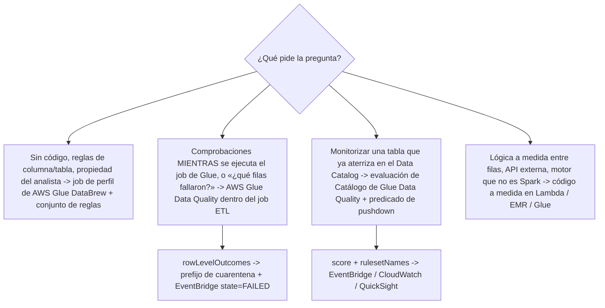
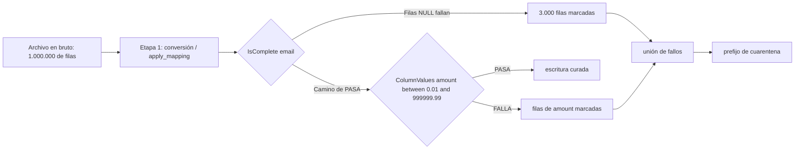
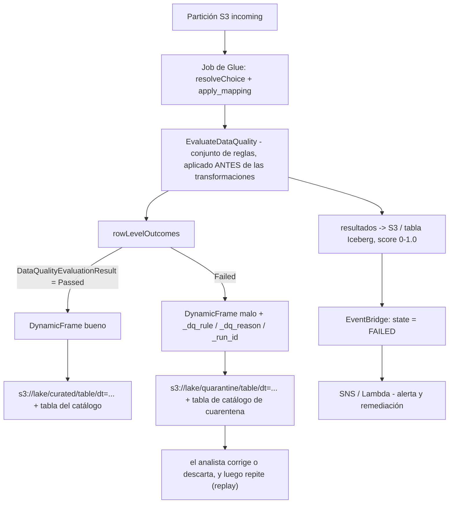
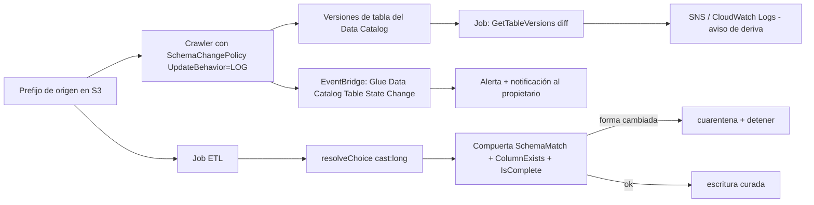
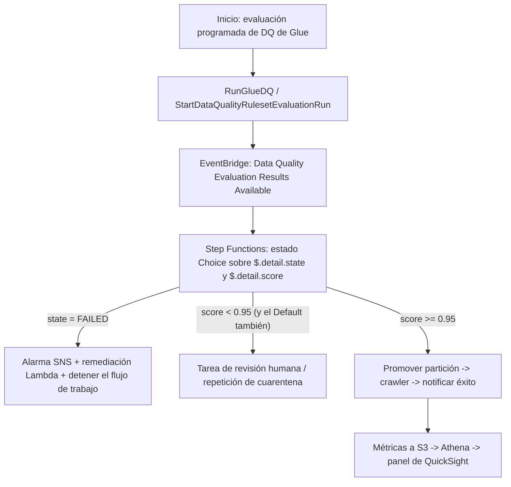
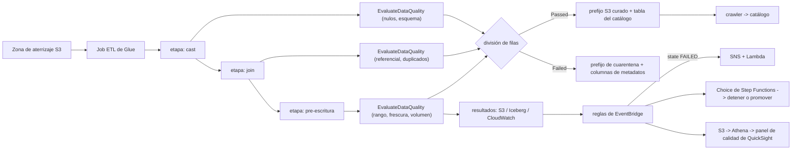

# Automatización de la calidad de datos en pipelines

La calidad de datos es el único tema del Dominio 3 del que otros temas dependen en silencio: un pipeline perfectamente orquestado que mueve filas equivocadas según lo programado es peor que no tener pipeline. La guía del examen DEA-C01 enuncia el requisito como una sola habilidad — *«Ejecutar comprobaciones de calidad de los datos mientras se procesan los datos (por ejemplo, comprobar campos vacíos)»* (Tarea 3.4.1, guía del examen DEA-C01, consultada en octubre de 2026) — y todo lo examinable cuelga de esa palabra **mientras**. Un perfil semanal de la zona de aterrizaje es un informe; una comprobación que se ejecuta dentro del job, separa las filas y bloquea el siguiente paso es ingeniería.

```text
====================================================================
 SUPERFICIE DE CONTROL DE CALIDAD DE DATOS (DEA-C01 Dominio 3, Tarea 3.4)
====================================================================
  3.4.1  comprobaciones MIENTRAS se procesa (campos vacíos, esquema, joins, ...)
  3.4.2  definir reglas de calidad de datos (por ejemplo, DataBrew)
  3.4.3  investigar la consistencia de los datos (por ejemplo, DataBrew)
  3.4.4  describir técnicas de muestreo de datos
  3.4.5  implementar mecanismos de desbalance de datos
--------------------------------------------------------------------
  DIMENSIONES ......... completitud | precisión | consistencia
                        oportunidad | validez | unicidad
  COMPROBACIONES ...... nulos/vacíos, esquema, integridad referencial,
                        duplicados, rango/enum, frescura/watermark, volumen
  HERRAMIENTAS ........ AWS Glue Data Quality (DQDL) - en el job o
                            contra el Data Catalog
                        AWS Glue DataBrew - job de perfil + conjunto de reglas
                        código a medida - Lambda / EMR / script de Glue
  ACCIONES ............ Ninguna (por defecto) | prefijo de cuarentena
                            | fallar tras la carga | fallar antes de la carga
  ARTEFACTOS .......... reglas, analizadores, conjuntos de reglas,
                        resultados por fila, informe de validación, score 0-1.0
  PUERTAS ............. filtros de estado/score de EventBridge ->
                            Choice de Step Functions -> SNS / crawl / detener
  DERIVA .............. SchemaChangePolicy del crawler, versiones de tabla,
                        SchemaMatch, resolveChoice (NO los bookmarks)
====================================================================
```

En esta lección aprenderás a:

- leer las cinco subdeclaraciones de la Tarea 3.4 y defender la regla del **«mientras se procesa»** frente a los distractores de fin de pipeline;
- mapear las **seis dimensiones de calidad** a expresiones nativas de AWS y a los escenarios que redacta el examen;
- construir la **lista de comprobación de siete chequeos en vuelo** — nulos/vacíos, esquema, integridad referencial, duplicados, rango/enum, frescura/watermark, volumen — en DQDL, DataBrew y PySpark;
- operar **AWS Glue Data Quality**: reglas, analizadores, conjuntos de reglas, los 26 tipos de regla de Studio, resultados por fila, las tres acciones de fallo y los valores por defecto de publicación;
- operar la calidad de **AWS Glue DataBrew**: anatomía de una regla, conjuntos de reglas que se ejecutan en **jobs de perfil**, hallazgos, el informe de validación, eventos, programaciones y muestreo;
- cablear **patrones de calidad de jobs de Glue**: aserciones en el script, tablas de errores, el patrón de prefijo de cuarentena y destinos de mensajes muertos en streaming;
- detectar la **deriva de esquema** — job bookmarks frente a `resolveChoice` de DynamicFrame, `SchemaChangePolicy` del crawler, versiones de tablas del Data Catalog y alertas de deriva;
- bloquear la orquestación con **cargas de EventBridge** y un **Choice de Step Functions** sobre `state` y `score`, y publicar un **panel de calidad**;
- decidir **cuarentena frente a fallar el job**, y por qué la guía del examen prefiere lo en vuelo a la calidad al final;
- estudiar **cuatro casos de estudio de clientes de AWS**, un **recuadro de actualizaciones de octubre de 2026** con fuentes y **14 preguntas estilo examen** más cuatro comprobaciones interactivas.

---

## 1. Tarea 3.4: qué significa de verdad «mientras se procesa»

### 1.1 Las cinco subdeclaraciones

| Subtarea | Enfoque literal (guía del examen, consultada en octubre de 2026) | Qué debe contener una opción para ser correcta |
|---|---|---|
| **3.4.1** | *«Ejecutar comprobaciones de calidad de los datos **mientras se procesan los datos** (por ejemplo, comprobar campos vacíos)»* | Una comprobación **dentro** de la ejecución: una evaluación en el job, un límite de etapa, o una evaluación que **bloquee** el siguiente paso |
| **3.4.2** | *«Definir reglas de calidad de datos (por ejemplo, **DataBrew**)»* | Una regla o conjunto de reglas declarativo — DataBrew, o el DQDL de Glue Data Quality, ambos aceptables |
| **3.4.3** | *«Investigar la **consistencia** de los datos (por ejemplo, DataBrew)»* | Comparación entre dos conjuntos de datos/tablas, o los hallazgos del perfil que exponen una inconsistencia |
| **3.4.4** | *«Describir técnicas de **muestreo** de datos»* | Compromisos entre tipo y tamaño de muestra — y el hecho de que un **score** de calidad necesita el conjunto de datos completo |
| **3.4.5** | *«Implementar mecanismos de **desbalance** de datos»* | Métricas de detección más una mitigación (salting, broadcast join, repartition) |

La trampa está escrita en la primera línea: *«perfilar la zona de aterrizaje cada semana»* es un **informe sobre** los datos de ayer, no una comprobación **mientras** se procesan. Las opciones construidas sobre «cargar todo, y luego perfilar los viernes» están diseñadas para fallar en 3.4.1.

### 1.2 Calidad al final frente a calidad en vuelo

| | **Calidad al final** | **Calidad en vuelo (respuesta del examen)** |
|---|---|---|
| Cuándo | Después de la carga, días después | En la conversión, después del join, antes de la escritura |
| Qué ve el consumidor | Filas malas ya en la tabla curada | Solo las filas que pasaron, o una cuarentena documentada |
| Recuperación | Descargar, arreglar, recargar | Arreglar en el límite, o reprocesar una sola partición |
| Identificación de registros fallidos | Requiere un segundo pase sobre el historial | Resultados por fila producidos durante la ejecución |
| Redacción típica del distractor | *«Programar un job de perfil de DataBrew cada domingo por la noche»* | *«`EvaluateDataQuality` después de `apply_mapping`, separar según los resultados»* |

Ambos tienen su lugar: una evaluación **en reposo** contra el Data Catalog es legítima para monitorizar una tabla que ya está aterrizando. Pero cuando la línea de habilidad de la pregunta es 3.4.1, la respuesta es una comprobación que se ejecuta **durante** el procesamiento o que **bloquea** el siguiente paso.

### 1.3 Qué herramienta — la matriz de tres vías

La propia tabla de Prescriptive Guidance de AWS es la ayuda más rápida de «qué herramienta» en este examen:

| Necesidad | **AWS Glue DataBrew** | **AWS Glue Data Quality** | **Comprobaciones a medida** |
|---|---|---|---|
| Autoría | Condiciones sin código a nivel de columna o de tabla | Código a medida en un job de Glue **o** sin código | El ETL que elijas — Lambda, Glue, EMR |
| Se ejecuta en | Job de perfil (conjuntos de reglas) | Job ETL (en vuelo) o Data Catalog (en reposo) | Donde puedas ejecutar código |
| Identifica los registros fallidos | No — los hallazgos son agregados | **Sí — solo en un job ETL** | Sí, si lo escribes |
| Recomendaciones / autoescalado | — | Recomendaciones: **solo Catálogo**; autoescalado y Flex: **solo ETL** | — |



- **📚 ¿Sabías que…?** AWS Glue Data Quality está **construido sobre Deequ de código abierto**, *«una biblioteca que Amazon usa internamente para gestionar la calidad de lagos de datos de más de 60 PB»* (AWS Big Data Blog, 2023-06-06). Por eso existe `amazon-deequ-glue` como ejemplo de AWS — pero Deequ como producto, Great Expectations, dbt y Soda **no** están en la lista de servicios en alcance del DEA-C01, así que una opción construida sobre ellos nunca es la mejor respuesta.

---

## 2. Las seis dimensiones, mapeadas a escenarios de examen

### 2.1 Dimensión → expresión de AWS → escenario

| Dimensión | Expresión nativa de AWS (verificada) | Escenario para el que se escribe | Trampa clásica |
|---|---|---|---|
| **Completitud** | `IsComplete "col"`, `Completeness "col" > 0.95`; DataBrew «Value is not missing ≥ 100% of rows»; `FillMissingValues`; palabras clave `NULL, BLANKS, WHITESPACES_ONLY` | Los «campos vacíos» de la Tarea 3.4.1 | Una cadena **CSV** en blanco es `""`, no NULL — **no** hará fallar una regla de Completeness; un entero en blanco **sí** es NULL y falla |
| **Precisión** | `ColumnValues "age" between 18 and 120`, `in [...]`, `matches /re/`, `Entropy`, detección de anomalías ML | Los valores están presentes pero son incorrectos (edad 900, importe negativo) | Reejecutar el crawler arregla **metadatos**, no datos |
| **Consistencia** | `ReferentialIntegrity`, `DatasetMatch`, `SchemaMatch`, `RowCountMatch`, `AggregateMatch` | Tarea 3.4.3 — dos fuentes no coinciden | La consistencia es una **comparación**; una regla de una sola tabla no lo es |
| **Oportunidad** | `DataFreshness`, `FileFreshness`, `ColumnValues "event_ts" > (now() - 1 days)`, `FileMatch/FileSize/FileUniqueness`, `RowCount > avg(last(10))` | SLA: los datos no pueden tener más de 24 h | La frescura ≠ recuento de filas: una carga completa de archivos **caducados** sigue fallando |
| **Validez** | `ColumnDataType`, `ColumnLength`, `ColumnNamesMatchPattern`, `ColumnExists`, DataBrew numérico/contiene/longitud | Cambio de tipo y forma (`amount` llegó como cadena) | La validez es sobre **formato**, la precisión sobre **valor** |
| **Unicidad** | `IsUnique`, `Uniqueness "email" = 1.0`, `DistinctValuesCount`, `IsPrimaryKey`, DataBrew «Duplicate rows» / «Unique values = 100% rows» | Transacciones contabilizadas dos veces, registros de alta repetidos | La `PRIMARY KEY` / `UNIQUE` de Redshift es **informativa** — los duplicados se cargan igualmente |

El **score de calidad de datos** es simplemente *«el porcentaje de reglas de calidad de los datos que pasan (dan como resultado true) cuando evalúas un conjunto de reglas»* (documentación de AWS Glue Data Quality, consultada en octubre de 2026) — un número entre **0 y 1.0**, no una nota de aprobación por sí mismo.

### 2.2 Ejemplo resuelto E1 — completitud que se esconde detrás de una cadena

Una columna CSV `email` llega con **1.000.000** de filas. En el archivo en bruto, **3.000** filas llevan un campo vacío. Se escriben dos reglas sobre los mismos datos:

```text
Regla A (DQDL)    IsComplete "email"                 umbral 100% de filas
Regla B (coerción) ColumnDataType "email" in ["string"]
                  + completitud tras leer como cadena

Lectura en bruto: campo CSV vacío -> "" (cadena vacía), NO NULL
Resultado A:      997.000 no vacías / 1.000.000 = 99.70%  < 100%  -> FALLA
                  ...pero solo si el tipo de origen convierte el campo en NULL.
                  Leído como cadena, "" es un valor -> 100% «completo» -> PASA (mal)

Arreglo:          usar IsComplete con las palabras clave NULL/EMPTY/WHITESPACES_ONLY,
                  o coercer el tipo de columna primero, y luego evaluar.
```

**Lectura:** las mismas 3.000 filas malas pueden pasar o fallar según el tipo que infiera el lector. Por eso las reglas de completitud se escriben **después** de la coerción de tipo, en el límite de etapa post-conversión — y por eso «comprobar campos vacíos» en 3.4.1 es una habilidad de *colocación* tanto como de escritura de reglas.



### 2.3 Empareja la dimensión con su firma de examen

```matching
{
  "question": "Empareja cada dimensión de calidad de datos con la expresión de AWS con la que el examen DEA-C01 la redacta:",
  "pairs": [
    {"left": "Completeness", "right": "IsComplete \"order_id\" al 100% de filas - la comprobación literal de «campos vacíos» de la Tarea 3.4.1"},
    {"left": "Accuracy", "right": "ColumnValues \"age\" between 18 and 120, o matches /regex/ - el valor está presente pero es incorrecto"},
    {"left": "Consistency", "right": "ReferentialIntegrity, DatasetMatch o RowCountMatch - dos conjuntos de datos o tablas no coinciden (Tarea 3.4.3)"},
    {"left": "Timeliness", "right": "DataFreshness / FileFreshness, o ColumnValues \"event_ts\" > (now() - 1 days) contra un SLA"},
    {"left": "Validity", "right": "ColumnDataType, ColumnLength, ColumnNamesMatchPattern - cambió el tipo o la forma"},
    {"left": "Uniqueness", "right": "IsUnique, Uniqueness \"email\" = 1.0, IsPrimaryKey - y las claves de Redshift NO la impondrán por ti"}
  ],
  "explanation": "El examen casi nunca pide una definición - escribe un escenario y espera la dimensión: «campos vacíos» es completitud, «dos sistemas no coinciden en el mismo id de cliente» es consistencia, «la carga lleva 30 horas de retraso» es oportunidad, «el importe llegó como cadena» es validez. Cada una se mapea a una familia de reglas DQDL distinta, y la unicidad es la que debe re-comprobarse en un pipeline porque las restricciones PRIMARY KEY, UNIQUE y FOREIGN KEY de Redshift son solo informativas cuando poblas una tabla."
}
```

- **📚 ¿Sabías que…?** De las seis dimensiones, la **unicidad** es la que con más frecuencia se ve «impuesta» por una restricción que no impone: Amazon Redshift afirma que *«las restricciones de unicidad, clave primaria y clave externa son solo informativas; Amazon Redshift no las impone cuando poblas una tabla»*, mientras que *«Amazon Redshift sí impone las restricciones de columna NOT NULL»* (documentación de Redshift, consultada en octubre de 2026). Así que un `INSERT` de una clave primaria duplicada **tiene éxito**, un `INSERT` de `NULL` en una columna `NOT NULL` falla — y ambos comportamientos son examinables como «¿qué DDL evita cargas duplicadas? Ninguna.»
---

## 3. La lista de comprobación en vuelo: siete chequeos, colocados en los límites de etapa

Cada comprobación de abajo se puede escribir en DQDL (Glue Data Quality), como regla de DataBrew o en PySpark llano — la **colocación** es lo que rinde la marca de 3.4.1.

### 3.1 Nulos / vacíos

```text
DQDL          IsComplete "customer_id"
              Completeness "email" > 0.99
DataBrew      "Value is not missing" >= 100% of rows
PySpark       df.filter(col("customer_id").isNull() | (col("customer_id") == ""))
Nota          Para todas las reglas ColumnValues salvo != y NOT IN,
              las filas NULL no cumplen la regla (tipos de regla DQDL,
              consultados en octubre de 2026)
```

### 3.2 Validación de esquema

`ColumnExists`, `ColumnDataType`, `ColumnLength`, `ColumnNamesMatchPattern`, `SchemaMatch`. Un job con destino S3 **habilita por defecto** una regla de «al menos una columna» más detección de anomalías en el número de columnas — un fallo **baja el score pero no hace fallar el job** (tutorial de Glue, consultado en octubre de 2026). Las reglas de esquema responden a *validez*; la deriva (Sección 7) responde a *qué cambió desde la última vez*.

### 3.3 Integridad referencial

```text
DQDL    ReferentialIntegrity "order.customer_id" with "customer.customer_id"
        (el segundo input se suministra como conjunto de datos de referencia)
Por qué Las claves externas de Redshift son informativas - comprobar en el
        job, en el límite post-join, antes de escribir nada
También DatasetMatch / RowCountMatch para consistencia entre sistemas (3.4.3)
```

### 3.4 Duplicados

```text
DQDL        IsUnique "transaction_id"      Uniqueness "email" = 1.0
            DistinctValuesCount "session_id" > 1000
DataBrew    "Duplicate rows" | "Unique values = 100% rows"
            FlagDuplicatesInColumn (paso de receta)
PySpark     row_number().over(Window.partitionBy("id")) == 1
```

### 3.5 Rango / enum

```text
ColumnValues "amount" between 0.01 and 999999.99
ColumnValues "status" in ["NEW", "SHIPPED", "CANCELLED"]
ColumnValues "gender" in ["F", "M"] where "weightinkgs < 10"
Combinadores AND / OR / NOT;  umbral de filas  "... at least 95% of rows"
cláusula where: admitida solo en jobs de AWS Glue 4.0+ (referencia DQDL)
```

### 3.6 Frescura / watermark

```text
DataFreshness "s3://bucket/incoming/" max-age 1 day
ColumnValues "event_ts" > (now() - 1 days)  at 0.99 of rows
Comprobación cruzada:  CustomSql  SELECT MAX(event_ts) FROM ...   vs una
                        tabla watermark
Alcance:        los bookmarks de job deciden QUÉ archivos se procesan
                en esta ejecución
```

**Los bookmarks dan alcance incremental, no validación** — rastrean archivos y filas procesados y **no** ejecutan ninguna comprobación de esquema (Sección 7). El streaming usa **checkpoints**, y la ventana por defecto del streaming de Glue es de **100 segundos**.

### 3.7 Volumen

`RowCount between X and Y`, `RowCountMatch`, `AggregateMatch`, `CustomSql` — *«casi cualquier tipo de comprobación de calidad de datos en SQL»* (tipos de regla DQDL, consultados en octubre de 2026). Las reglas de volumen son la forma más barata de detectar «la fuente envió el 4 % de las filas de ayer» **antes** de que los agregados posteriores publiquen silenciosamente un número pequeño.

### 3.8 Ejemplo resuelto E2 — frescura contra un SLA

Un SLA dice que los pedidos no pueden tener más de **24 horas** de antigüedad cuando la tabla curada se publica a las 02:00 UTC.

```text
Regla           ColumnValues "event_ts" > (now() - 1 days)   umbral de filas 0.99
Ejecución 02:00 filas anteriores a las 02:00 de ayer = 0 -> PASA
Ejecución 08:00 (reintento tardío) now() se ha movido 6 h
               filas en [02:00-24h, 08:00-24h] = 6 h de eventos ahora «antiguas»
               si son < 1 % de las filas: la regla aun PASA a 0.99
               -> combinarla con una comprobación cruzada de watermark:
                  CustomSql: SELECT MAX(event_ts) FROM curated.orders
                  comparar contra el watermark del SLA 2026-10-09T02:00:00Z
Lectura        una regla de frescura con umbral de filas tolera por diseño las
               filas de cola tardía; la comparación de watermark detecta un
               origen detenido.
```

**Dos señales, una decisión:** la regla DQDL limita las *filas*, la comparación de watermark limita la *carga*. Las opciones de examen que ofrecen solo una de las dos suelen estar comprobando si sabes qué fallo detecta cada una.

---

## 4. AWS Glue Data Quality: DQDL, conjuntos de reglas, resultados

### 4.1 Tres objetos, dos puntos de entrada

| Objeto | Qué es |
|---|---|
| **Regla** | Una expresión booleana sobre una métrica — pasa o falla |
| **Analizador** | Produce las estadísticas sobre las que se entrena una regla de anomalía/dinámica |
| **Conjunto de reglas** | *«Un conjunto de reglas es un conjunto de reglas que comparan diferentes métricas de datos con valores esperados. Si el criterio de cualquiera de las reglas no se cumple, el conjunto de reglas en su conjunto no supera la validación»* — se adjunta a una **tabla del Data Catalog** (recibe un ARN) |

| | **Evaluación del Data Catalog (en reposo)** | **Evaluación en job ETL (en vuelo)** |
|---|---|---|
| Fuentes | S3, Redshift, JDBC, Iceberg/Hudi/Delta, OTF gestionado por LF | Todas las fuentes de Glue, dentro de la ejecución |
| Alcance incremental | Predicados de pushdown | **Bookmarks** de job |
| Recomendaciones | **Sí** | No |
| Autoescalado / workers Flex | No | **Sí** |
| **Identifica los registros fallidos** | **No** | **Sí** (`rowLevelOutcomes`) |
| Vistas de Athena catalogadas en el Data Catalog de Glue | **No admitidas** como fuente | Usar la ruta de job |
| En común | EventBridge, CloudWatch, resultados en S3, CloudFormation | igual |

Studio ofrece **26 tipos de regla**; una evaluación escribe resultados en S3 (opcionalmente **tablas Iceberg/Data Catalog** que puedes consultar con Athena), y la detección de anomalías *«requiere un mínimo de tres puntos de datos»*.

### 4.2 Qué ocurre cuando falla un conjunto de reglas

```text
Acción ante el fallo del conjunto de reglas (tutorial de AWS Glue,
consultado en octubre de 2026)
  None                                <- POR DEFECTO: el job no falla y
                                          continúa pese a los fallos de reglas
  Fail job after loading data to target
  Fail job without loading to target data

Opciones de publicación (EvaluateDataQuality)
  enableDataQualityResultsPublishing   = True   (por defecto)
  enableDataQualityCloudWatchMetrics   = False  (por defecto - APAGADO)
  resultsS3Prefix                      = tu prefijo
```

> [!WARNING]
> ⚠️ **El silencio es lo predeterminado.** Con `None` como acción de fallo, una ejecución que falla todas las reglas igualmente informa **SUCCEEDED**, y las métricas de CloudWatch permanecen **apagadas** salvo que actives `enableDataQualityCloudWatchMetrics`. «El job falló porque una regla falló» es por tanto *generalmente falso* tal como se escribe — la corrección correcta es una acción de fallo explícita, una aserción dentro del script o un Choice de Step Functions sobre el resultado publicado (Sección 8).

### 4.3 Resultados por fila — y las once reglas que no pueden producirlos

```python
from awsgluedq.transforms import EvaluateDataQuality

dq_results = EvaluateDataQuality.apply(
    frame = good_and_bad,
    ruleset = "rules = [IsComplete \"order_id\" ...]",
    publishingOptions = {"enableDataQualityResultsPublishing": True}
)

row_level = dq_results.rowLevelOutcomes  # + DataQualityEvaluationResult
passed = row_level.filter(row_level.DataQualityEvaluationResult == "Passed")
failed = row_level.filter(row_level.DataQualityEvaluationResult == "Failed")
```

`rowLevelOutcomes` añade cuatro columnas y un estado por fila **Passed/Failed**. Once tipos de regla **no** pueden atribuirse a filas — `AggregateMatch, ColumnCount, ColumnExists, ColumnNamesMatchPattern, CustomSql, RowCount, RowCountMatch, StandardDeviation, Mean, ColumnCorrelation` (tutorial de Glue, consultado en octubre de 2026). Así que «¿qué filas fallaron?» lo responden las reglas **con alcance de fila** en un **job ETL** — nunca una evaluación de Catálogo, y nunca una regla agregada.

### 4.4 Ejemplo resuelto E3 — score, y por qué enrutas por `state`, no por `score`

Se ejecuta un conjunto de **6 reglas**: **4 pasan, 2 fallan**.

```text
score = reglas pasadas / reglas totales = 4 / 6 = 0.6667  (escala 0 - 1.0)

Filtro A de EventBridge   "detail": { "state": ["FAILED"] }          -> COINCIDE
Filtro B de EventBridge   "detail": { "score": {"numeric": ["<=", 0.7]}} -> COINCIDE (0.6667 <= 0.7)

Ahora 17 de 20 reglas pasan, 2 fallan, 1 se omite:
score = 17 / 20 = 0.85
Filtro A (state FAILED)          -> COINCIDE   (el conjunto de reglas falló)
Filtro B (score <= 0.7)          -> NO COINCIDE  (0.85 > 0.7)

Lectura: state y score son señales DIFERENTES. Un conjunto de reglas que
falla por una regla dura aun puede puntuar 0.85, así que una alarma solo
de score se lo pierde.
Enruta por state para la corrección; usa score para la gravedad.
```

Una regla omitida no cuenta como pasada — el score es **reglas que pasaron** sobre las reglas evaluadas, así que nunca asumas que `state` y `score` coinciden.

```fillblank
{
  "question": "Completa las afirmaciones sobre Glue Data Quality con los valores por defecto y comportamientos verificados (en octubre de 2026):",
  "template": "El score de calidad de datos es el {{1}} de las reglas de calidad de datos que pasan, expresado de 0 a 1.0. La acción por defecto cuando un conjunto de reglas falla en un job de Studio es {{2}}, por lo que el job {{3}} falla. La publicación de resultados está {{4}} por defecto, mientras que las métricas de CloudWatch están {{5}} por defecto. Los resultados por fila solo se producen cuando la evaluación se ejecuta en un job {{6}}, y una cadena CSV en blanco es {{7}} (no NULL), por lo que no hará fallar una regla de completitud.",
  "answers": {
    "1": "porcentaje",
    "2": "None",
    "3": "no",
    "4": "activada",
    "5": "desactivada",
    "6": "ETL",
    "7": "una cadena vacía"
  },
  "distractors": ["media", "recuento", "Fail job", "media o recuento", "cuarentena", "bloqueado", "desactivada", "activada", "Catálogo", "streaming", "nulo", "faltante"],
  "explanation": "«El porcentaje de reglas de calidad de datos que pasan (dan como resultado true) cuando evalúas un conjunto de reglas» es la propia definición de AWS del score. La acción de fallo documentada por defecto es «None - Si eliges None (por defecto), el job no falla y continúa ejecutándose pese a los fallos de las reglas». enableDataQualityResultsPublishing vale True por defecto y enableDataQualityCloudWatchMetrics False; identificar los registros fallidos es una capacidad exclusiva de job ETL, y un campo CSV vacío se lee como una cadena vacía — usa las palabras clave EMPTY/WHITESPACES_ONLY o coerciona los tipos primero."
}
```

---

## 5. AWS Glue DataBrew: reglas, conjuntos de reglas, hallazgos

### 5.1 Anatomía de una regla

| Parte | Opción | Nota de examen |
|---|---|---|
| **Comprobaciones (Checks)** | Número de filas, filas duplicadas, valores únicos, % no faltante, en rango, empieza por, longitud | Se construyen desde la lista de comprobaciones del constructor de reglas |
| **Alcance (Scope)** | Por columna, o «Common checks for selected columns» | El alcance decide si juzga una columna o un grupo |
| **Criterios de éxito** | **AND** / **OR** entre comprobaciones | AND es más estricto — una comprobación fallida hace fallar la regla |
| **Umbral de aprobación** | `% of rows` | Regla agregada frente a regla por fila |
| **Tipos** | **Solo tipos simples** | Las estructuras anidadas quedan fuera |

Ejemplos de comprobaciones del material propio de AWS: `Number of rows = 5000000`, `Duplicate rows`, `Unique values = 100% rows`, `Value is not missing >= 100% rows`, `Value in column APY between 0 and 100`, `Number of missing values in column group_name doesn't exceed 5%`.

### 5.2 Los conjuntos de reglas se ejecutan en **jobs de perfil**, no en jobs de receta

`CreateRuleset` está documentado como *«Creates a new ruleset that can be used in a **profile job** to validate the data quality of a dataset»* (Crea un nuevo conjunto de reglas que puede usarse en un **job de perfil** para validar la calidad de datos de un conjunto de datos). Los jobs de receta aplican **pasos de receta** — esa familia rellena valores faltantes, elimina datos inválidos y elimina duplicados, lo cual es **remediación**, no **validación**. La afirmación falsa canónica en este examen es *«adjuntar el conjunto de reglas al job de receta»*.

Cuotas que las preguntas citan literalmente (en octubre de 2026): **100 reglas por conjunto de reglas**, **10 conjuntos de reglas por conjunto de datos**, **100 conjuntos de reglas por cuenta**, **100 pasos por receta**, **300 nodos por cuenta**.

### 5.3 Hallazgos, informe de validación y eventos

- **Salidas del perfil:** Summary, Correlations, Value distribution, Column Summary, más una pestaña **Column statistics**.
- **Resultados de validación:** en la pestaña **Data quality rules / Data quality** de la ejecución del job.
- **Ayuda del constructor:** una pestaña **Dataset preview** y una pestaña **Recommendations** mientras autoras.
- **Informe:** el job de perfil *«produces a validation report in addition to the data profile … at the same location as your profile data»* (produce un informe de validación además del perfil de datos … en la misma ubicación que tus datos de perfil).
- **Eventos:** un evento de EventBridge por ejecución **y** por conjunto de reglas:

```json
{
  "source": ["aws.databrew"],
  "detail-type": ["DataBrew Ruleset Validation Result"],
  "detail": { "validationState": ["FAILED"] }
}
```

Una sola regla con ese patrón coincide con **todas** las validaciones fallidas de la cuenta — el payload examinable es `detail-type` + `validationState`, no un ARN por conjunto de datos.

### 5.4 Muestreo (Tarea 3.4.4)

| Dato | Valor (documentación de DataBrew de AWS, consultada en octubre de 2026) |
|---|---|
| Predeterminado de proyecto / vista previa | **Primeras 500 filas** |
| `Sample.Type` | `FIRST_N` · `LAST_N` · `RANDOM` |
| `Sample.Size` | **1 – 5.000** |
| `FIRST_N` | Rápido, **sesgado** — un artefacto del orden del archivo |
| `RANDOM` | Representativo de la fuente subyacente |
| Jobs de perfil / receta | Se ejecutan sobre **todo** el conjunto de datos — el muestreo es solo para proyectos y vistas previas |
| Scores de calidad | Necesitan el conjunto de datos **completo** — un score sobre 500 filas no es el score |

La propia redacción de AWS: *«A smaller sample size allows DataBrew to perform transformations faster … A larger sample size more accurately reflects the makeup of the underlying source data.»* (Un tamaño de muestra menor permite a DataBrew realizar transformaciones más rápido … Un tamaño de muestra mayor refleja con más precisión la composición de los datos de la fuente subyacente.)

- **📚 ¿Sabías que…?** Las programaciones de DataBrew son expresiones cron de **seis campos** con un suelo duro: *«Cron expressions that lead to rates faster than 5 minutes aren't supported»* (no se admiten expresiones cron que lleven a tasas más rápidas que 5 minutos), y el día del mes frente al día de la semana es **exclusivo** (usa `?` para uno de ellos). Así que la opción «cada 2 minutos, validar el flujo» es errónea por dos razones independientes — DataBrew no es un procesador de flujos, y su reloj no puede latir tan rápido (documentación de jobs de DataBrew, consultada en octubre de 2026).

### 5.5 Ejemplo resuelto E4 — un conjunto de reglas de RR. HH. que cabe en las cuotas

Cinco reglas sobre una extracción nocturna de RR. HH. de **5.000.000** de filas:

```text
R1  Number of rows = 5000000                       (volumen)
R2  Duplicate rows                                 (unicidad)
R3  Unique values = 100% of rows in Emp ID, e-mail,
    SSN                                            (unicidad x3 columnas)
R4  Value is not missing >= 100% of rows           (completitud)
R5  Value in column APY between 0 and 100          (precisión / rango)

Comprobación de recuento:  8 comprobaciones en total  <= 100 reglas por conjunto     OK
Conjuntos de reglas:       1 conjunto                 <= 10 por conjunto de datos   OK
Adjunto a:                 un job de PERFIL (no el job de receta)
Salida:                    perfil JSON + informe de validación en S3
                          + hallazgos de la pestaña «Data quality rules»
Alerta:                    EventBridge detail-type
                          "DataBrew Ruleset Validation Result",
                          validationState FAILED -> SNS
```

### 5.6 Desbalance (Tarea 3.4.5) — el gemelo de la dimensión de oportunidad

El desbalance no corrompe filas; destruye la **oportunidad** de la ejecución. Detectalo con las métricas del driver **`glue.driver.skewness.job`** y **`glue.driver.skewness.stage`**, la UI de Spark o estadísticas de tamaño de partición. Mitigaciones documentadas por AWS: filtrado de claves calientes, agregación incremental, **salting**, joins de broadcast, `repartition`/`coalesce`, **ejecución adaptativa de consultas** (activada por defecto en Glue 4.0+), particionado de entrada y escalado vertical — la conclusión de la propia AWS es que *«there is no single universal solution»* (no hay una única solución universal). En el examen, «una tarea tarda 40 minutos mientras las otras 39 terminan en 30 segundos» ⇒ desbalance, y la corrección que nombra la opción es **saltear la clave caliente** (salt) o **hacer broadcast de la tabla pequeña**.
---

## 6. Patrones de calidad en jobs de Glue: aserciones, tablas de errores, cuarentena

### 6.1 Aserciones dentro del script — la puerta en vuelo más fuerte

```python
from awsgluedq.transforms import EvaluateDataQuality
from awsglue.context import SparkContext, GlueContext
import sys

dq = EvaluateDataQuality.apply(
    frame = post_join_frame,
    ruleset = """
      rules = [
        IsComplete "order_id",
        ColumnValues "amount" between 0.01 and 999999.99,
        IsUnique "order_id"
      ]
    """,
    publishingOptions = {"enableDataQualityResultsPublishing": True}
)

failed = dq.filter(dq["Outcome"].contains("Failed")).count()
assert failed == 0, "Data quality rules caused the job to fail."
```

Forma Scala del tutorial de AWS: `assert(DQ_Results.filter(_.getField("Outcome").contains("Failed")).count == 0, "…caused the job to fail.")`. Una aserción convierte un **score** en un **job fallido**, que es así como se ve «ejecutar comprobaciones mientras se procesa» cuando la opción dice *detenerse antes de que aterricen datos malos*.

### 6.2 Tablas de errores — y el nombre que no existe

| Mecanismo | Qué hace |
|---|---|
| `ErrorsAsDynamicFrame` / `errorsFromDF` | Recoge las filas rechazadas por un mapeo en un DynamicFrame aparte |
| `Spigot` | Desvía las filas que no cumplen un filtro o superan un límite a una salida lateral |
| `FlagDuplicatesInColumn` | Marca los duplicados para poder enrutarlos, no para descartarlos en silencio |
| `FillMissingValues` | Paso de receta/transformación de remediación — el lado de corrección de la calidad |
| Ramificación condicional sobre `Outcome` | Envía los frames buenos/malos a destinos distintos |

> [!IMPORTANT]
> **No existe ningún constructo de AWS llamado «ErrorCDC».** AWS Glue documenta `ErrorsAsDynamicFrame`, `errorsFromDF`, `Spigot`, `rowLevelOutcomes` y la salida de cuarentena de DataBrew — una opción que nombra «ErrorCDC» está comprobando si recuerdas la API real. El patrón verificado es **tabla de errores**, no error-CDC.

### 6.3 El patrón del prefijo de cuarentena

> *«AWS Glue Data Quality helps you identify the exact records that caused your quality scores to go down. Easily identify them, quarantine and fix them.»* (AWS Glue Data Quality te ayuda a identificar exactamente los registros que hicieron bajar tus scores de calidad. Identifícalos, ponlos en cuarentena y corrígelos con facilidad.) — página de producto de AWS Glue Data Quality, consultada en octubre de 2026

La muestra de referencia **InsuranceLake** de AWS enuncia el contrato con precisión: *«The quarantine action removes individual rows that fail the quality check … stores them in a separate quarantine storage location and Data Catalog table»* (La acción de cuarentena elimina las filas individuales que no superan la comprobación de calidad … y las almacena en una ubicación de almacenamiento de cuarentena y una tabla del Data Catalog aparte), con reglas aplicadas **justo después del mapeo de esquema … antes de que se ejecute ninguna transformación**, en las etapas `before_transforms` / `after_transforms` / `after_sparksql` — y la carpeta S3 `<table>_quarantine_*` y la tabla del catálogo se crean **independientemente de que alguna fila se ponga en cuarentena**, de modo que la monitorización posterior nunca tiene que adivinar si la ruta existe.



### 6.4 Streaming: el lado de mensajes muertos de la calidad

Para los consumidores Lambda de Kinesis/Kinesis Data Firehose, la ruta de fallo de calidad es el **destino en caso de fallo (on-failure destination)**, no una alarma de consola: `DestinationConfig.OnFailure` → **SQS, SNS, S3 o Amazon MSK**, con `BisectBatchOnFunctionError` para aislar el registro venenoso, `MaximumRetryAttempts` **0–10.000**, `MaximumRecordAgeInSeconds` **60–604.800**, y `ReportBatchItemFailures` devolviendo `batchItemFailures` para manejo de lotes parciales. Una **DLQ a nivel de función** es el mecanismo más antiguo; el destino en caso de fallo es el actual, y los dos no son intercambiables en un par de opciones. Los jobs de streaming de Glue usan **checkpoints en lugar de bookmarks de job**.

### 6.5 Ejemplo resuelto E5 — la división de cuarentena

Aterrizan un millón de filas; el job lleva 6 reglas, 4 de ellas con alcance de fila:

```text
Filas totales                        1.000.000
Regla A  IsComplete "order_id"       1.500 filas NULL        -> no cumple el umbral 99,9 %
Regla B  amount between 0.01..       2.900 filas fuera de rango
        and 999999.99                                             -> no cumple el umbral 99,7 %
Filas que fallan AMBAS               400 (solapamiento)
Unión de filas fallidas = 1.500 + 2.900 - 400            = 4.000
Cuota en cuarentena  = 4.000 / 1.000.000                  = 0,40 %
Escritura curada     = 1.000.000 - 4.000                  = 996.000
Score del conjunto    = 4 pasadas / 6 totales              = 0,67
Acción tomada        = None (por defecto) -> job SUCCEEDED
EventBridge          state = FAILED  -> coincide;  score 0,67 <= 0,7 -> también coincide
Objeto en cuarentena s3://lake/quarantine/orders/dt=2026-10-10/
                     + columnas _dq_rule, _dq_reason, _run_id
```

**Lee las dos mitades juntas:** la ruta de datos puso en cuarentena 4.000 filas y publicó 996.000; la ruta de control publicó `state = FAILED` y un score de 0,67 — mientras que el **job** aun informaba éxito porque la acción era `None`. Tres señales distintas, tres respuestas distintas a «¿funcionó?».

---

## 7. Detección de deriva de esquema: qué ve de verdad una forma cambiada

### 7.1 Los bookmarks no detectan deriva

| Mecanismo | Rastrea | ¿Detecta cambio de esquema? |
|---|---|---|
| **Bookmarks de job** | Qué archivos/filas se procesaron | **No** — solo alcance *incremental*; renombrar `transformation_ctx` invalida el estado |
| **`SchemaChangePolicy` del crawler** | El esquema descubierto | **Sí** — `UpdateBehavior = LOG \| UPDATE_IN_DATABASE`, `DeleteBehavior = LOG \| DELETE_FROM_DATABASE \| DEPRECATE_IN_DATABASE`; `LOG` = detectar sin mutar |
| **Versiones de tabla del Data Catalog** | Historial de versiones | **Sí** — un job diferea `GetTableVersions`, registra la diferencia y publica **SNS** |
| **`SchemaMatch` / `ColumnExists` / `ColumnDataType`** | Forma esperada | **Sí** — *«ensures that the dataset accurately matches a set schema, preventing downstream errors»* (asegura que el conjunto de datos coincide exactamente con un esquema dado, evitando errores aguas abajo) |
| **`resolveChoice` de DynamicFrame** | Tipos choice de la inferencia | **Repara** — y puede destruir datos en silencio (abajo) |

Combina el crawler con el evento de EventBridge **Glue Data Catalog Table State Change** (`UpdateTable`, `CreatePartition`, `UpdatePartition`, `DeletePartition` más variantes de lote) para **alertas** de deriva; el comportamiento `LOG` significa que el catálogo nunca se muta por un crawler cuyo fin es solo alertar.

### 7.2 `resolveChoice` — la reparación que cuesta datos

El crawler muestrea solo un **prefijo de 2 MB**; una fuente con 2 filas de 160.000 con cadenas en una columna numérica se convierte en `choice<long,string>`:

```text
choice<long,string>
  cast:long     valores no convertibles -> NULL        (datos perdidos, luego
                                                       detectados por las reglas
                                                       IsComplete / de rango)
  project:long  conserva solo los valores long         (filas descartadas)
  make_cols     divide en dos columnas
  make_struct   anida el choice
Caso estilo Medicare: 2 filas de cadena -> cast:long -> 2 NULL ->
IsComplete "member_id" no cumple -> cuarentena, no nulos silenciosos
```

**El orden importa:** `resolveChoice` → `apply_mapping` → `toDF()`. Elegir `cast` sin una regla de completitud convierte un problema de *esquema* en un problema de *datos* que nunca ves.

### 7.3 Ejemplo resuelto E6 — la ilusión de las restricciones de Redshift

```sql
CREATE TABLE accounts (id INT PRIMARY KEY, email VARCHAR(256) NOT NULL);

INSERT INTO accounts VALUES (1, 'a@example.com');  -- succeeds
INSERT INTO accounts VALUES (1, 'b@example.com');  -- SUCCEEDS (PK informational)
INSERT INTO accounts VALUES (NULL, 'c@example.com'); -- FAILS (NOT NULL enforced)
SHOW CONSTRAINTS;                                  -- inspect what you declared
```

La misma comprobación escrita como regla DQDL — `IsPrimaryKey "id"` = *«not NULL and unique»* (no NULL y única) — **sí** rechaza el duplicado. Las restricciones `CHECK` y de exclusión **no se admiten** en Redshift. Así que «la carga falló porque se rechazó un duplicado de clave primaria» es falso, y «añadir una regla de unicidad en el job» es cierto.



---

## 8. Orquestación: pon una compuerta al pipeline sobre el resultado de calidad

### 8.1 Los payloads de EventBridge que debes reconocer

```json
{
  "source": ["aws.glue-dataquality"],
  "detail-type": ["Data Quality Evaluation Results Available"],
  "detail": {
    "state": ["FAILED"],
    "context": { "contextType": ["GLUE_JOB"] },
    "score": { "numeric": ["<=", 0.7] }
  }
}
```

| Familia de campos | Valores |
|---|---|
| `context.contextType` | `GLUE_DATA_CATALOG` (+ `databaseName`, `tableName`, `runId`) o `GLUE_JOB` (+ `jobId`, `jobName`) |
| `resultID`, `rulesetNames` | Qué evaluación, qué conjuntos de reglas |
| `state` | `FAILED` / `SUCCEEDED` — la **evaluación del conjunto de reglas**, no la ejecución ETL |
| `score` | 0–1.0 — usa filtros estilo `{"numeric": ["<=", 0.7]}` |
| `rulesSucceeded` / `rulesFailed` / `rulesSkipped` | Recuentos por regla para la remediación |

La contraparte de DataBrew es `source: aws.databrew`, `detail-type: DataBrew Ruleset Validation Result`, `detail.validationState: FAILED`. La deriva del crawler de Glue llega como **Glue Data Catalog Table State Change**. Tres servicios, tres cadenas `detail-type` — el examen comprueba si puedes elegir la correcta.

### 8.2 Step Functions: el estado Choice es la compuerta

```json
{
  "Comment": "Gate promotion on data quality",
  "StartAt": "RunDQ",
  "States": {
    "RunDQ": { "Type": "Task", "Resource": "arn:aws:states:::glue:startJobRun.sync", "Next": "QualityGate" },
    "QualityGate": {
      "Type": "Choice",
      "Choices": [
        { "Variable": "$.detail.state", "StringEquals": "FAILED", "Next": "AlarmAndHalt" },
        { "Variable": "$.detail.score", "NumericLessThanEquals": 0.95, "Next": "HumanReview" },
        { "Variable": "$.detail.score", "NumericGreaterThanEquals": 0.95, "Next": "PromoteAndCrawl" }
      ],
      "Default": "AlarmAndHalt"
    }
  }
}
```

Semántica de Amazon States Language que vale la pena memorizar: `Choices[]` se evalúan **en orden**, y *«If no Choices evaluate to true … and no Default is provided, the state machine will throw an error»* (si ninguna Choice se evalúa como verdadera … y no se proporciona ningún Default, la máquina de estados lanzará un error) — por eso AWS recomienda un `Default`.



### 8.3 Paneles y métricas

La ruta documentada de QuickSight es **EventBridge → Lambda → S3 → crawler → Athena → QuickSight**, dando una **serie temporal del score** en lugar de un veredicto por ejecución. Las métricas de CloudWatch viven bajo `dataQualityEvaluationContext` (por defecto **apagadas**) y los registros bajo `/aws-glue/data-quality/output` y `/aws-glue/data-quality/error`. Una pregunta que pregunte «¿cómo ven los analistas la tendencia de calidad durante 90 días?» es una pregunta de panel, no de alarma — la respuesta necesita **resultados almacenados más una capa de BI**, no un tema de SNS.

### 8.4 El pipeline completo, en una imagen



Cada flecha de arriba es una dependencia: nada aguas abajo puede existir hasta que el artefacto que lo precede se haya producido. Ordena toda la compuerta de la misma manera:

```dragdrop
{
  "question": "Ordena la compuerta de calidad de extremo a extremo en el orden en que debe ejecutarse dentro del pipeline:",
  "items": [
    "Alcance - los bookmarks de job o un predicado de pushdown deciden QUÉ filas evalúa esta ejecución; los bookmarks no hacen ninguna validación",
    "Forma - resolveChoice y después apply_mapping, de modo que cada columna tenga exactamente un tipo antes de escribir cualquier regla",
    "Evaluar - EvaluateDataQuality ejecuta el conjunto de reglas en vuelo en los límites post-cast y post-join",
    "Dividir - rowLevelOutcomes divide el frame según DataQualityEvaluationResult en filas Passed y Failed",
    "Enrutar - filas buenas al prefijo curado, fallos al prefijo de cuarentena con _dq_rule, _dq_reason y _run_id",
    "Publicar - los resultados van a S3 o a una tabla Iceberg y el evento de EventBridge lleva state y score",
    "Compuerta - un Choice de Step Functions lee $.detail.state y $.detail.score para detener, enviar a revisión, o promover y ejecutar el crawler"
  ],
  "correctOrder": [
    "Alcance - los bookmarks de job o un predicado de pushdown deciden QUÉ filas evalúa esta ejecución; los bookmarks no hacen ninguna validación",
    "Forma - resolveChoice y después apply_mapping, de modo que cada columna tenga exactamente un tipo antes de escribir cualquier regla",
    "Evaluar - EvaluateDataQuality ejecuta el conjunto de reglas en vuelo en los límites post-cast y post-join",
    "Dividir - rowLevelOutcomes divide el frame según DataQualityEvaluationResult en filas Passed y Failed",
    "Enrutar - filas buenas al prefijo curado, fallos al prefijo de cuarentena con _dq_rule, _dq_reason y _run_id",
    "Publicar - los resultados van a S3 o a una tabla Iceberg y el evento de EventBridge lleva state y score",
    "Compuerta - un Choice de Step Functions lee $.detail.state y $.detail.score para detener, enviar a revisión, o promover y ejecutar el crawler"
  ],
  "explanation": "Primero el alcance porque los bookmarks solo eligen la entrada; después la forma porque una regla evaluada contra un tipo choice ambiguo juzga al lector, no a los datos; evaluar antes de dividir porque la división se hace A PARTIR de rowLevelOutcomes; enrutar antes de publicar porque el state y el score publicados describen lo que hizo el enrutado; y el estado Choice va al final porque solo puede actuar como compuerta sobre un resultado que ya existe. Las dos inversiones clásicas son evaluar antes de resolveChoice (las reglas se disparan por la ambigüedad cadena frente a long) y poner la compuerta antes de publicar (no hay ningún $.detail para que el estado Choice lea)."
}
```
---

## 9. Cuarentena frente a fallar el job — y el compromiso que el examen realmente pregunta

| | **Poner en cuarentena las filas malas** | **Hacer fallar el job** |
|---|---|---|
| El pipeline sigue funcionando | **Sí** — lo curado recibe las filas buenas | **No** — no aterriza nada nuevo |
| Filas malas visibles | Sí, en un prefijo monitorizado + tabla del catálogo | No hay nuevas; la carga existente queda intacta |
| Impacto en el consumidor | Carga parcial — aguas abajo debe saberlo | Datos caducados — aguas abajo debe saberlo |
| Trabajo extra | Corregir y **repetir (replay)** las filas en cuarentena; monitorizar el prefijo | Causa raíz, re-ejecutar el job entero |
| Acción de Glue Data Quality | `None` (por defecto) **más** una división de filas, o fallar tras la carga | `Fail job without loading to target data` |
| Señal de examen | «identificar los **registros exactos»**, «mantener el flujo del pipeline», feeds tolerantes al SLA | «no debe publicarse», compuerta regulatoria, fuente única de verdad |

> [!WARNING]
> ⚠️ **La cuarentena no es gratis, y fallar no es seguro.** La cuarentena mantiene el SLA pero crea una **segunda cola de trabajo** — alguien debe leer `_dq_rule` / `_dq_reason`, corregir la fuente y repetir la carga, y un prefijo de cuarentena sobre el que nadie alerta es pérdida de datos silenciosa con otro nombre. Fallar el job protege a los consumidores pero detiene el pipeline, y con una **acción por defecto de `None`** ni siquiera hace eso salvo que lo hayas configurado. Lee la opción buscando el *requisito*: «las cifras regulatorias nunca deben ser parciales» ⇒ fallar antes de la carga; «feed analítico horario con triaje humano» ⇒ cuarentena + alerta.

### 9.1 La decisión en una línea cada una

- **En vuelo le gana a al-final** para 3.4.1 — pero una evaluación de Catálogo en reposo es correcta para *monitorizar una tabla que ya está aterrizando*.
- **DataBrew** para reglas sin código, propiedad del analista, a nivel de columna/tabla, ejecutadas como **job de perfil**; **Glue Data Quality** para comprobaciones en el job, resultados por fila y Flex/autoescalado; **código a medida** para cualquier cosa con lógica entre filas que ningún tipo de regla cubre.
- **Enruta por `state`, puntúa por `score`** — son señales distintas (E3).
- **Los bookmarks acotan; los crawlers y `SchemaMatch` detectan deriva** — nunca al revés.
- **El muestreo es para vistas previas; los scores necesitan el barrido completo.**

- **📚 ¿Sabías que…?** La mitad del **replay** del bucle de cuarentena ahora tiene un mecanismo en el lago: desde **2026-04-23** Amazon Redshift puede ejecutar **UPDATE / DELETE / MERGE** sobre tablas **Apache Iceberg** particionadas y no particionadas — incluidas **Amazon S3 Tables** — y desde el Patch 202 de AWS un **DELETE** de Iceberg sobre una tabla de Lake Formation necesita el permiso **DELETE**, **UPDATE/MERGE** necesitan **INSERT + DELETE**, y *cada* sentencia DML de Iceberg necesita además **ALTER**. Así que «corregir las filas en cuarentena y fusionarlas de vuelta» es una operación ordinaria, mientras que un laboratorio que solo concedió INSERT ahora falla a mitad de la remediación (documentación de cambios de comportamiento de AWS Redshift, consultada en octubre de 2026).

---

### Actualizaciones de 2026 (en octubre de 2026)

> [!NOTE]
> **Qué se movió en calidad de datos entre 2024 y octubre de 2026** — cada línea verificada contra una fuente primaria de AWS en **octubre de 2026**, y cada una es examinable porque el examen prueba el comportamiento actual:
> - **Las generaciones de Glue se movieron bajo tus reglas**: **Glue 5.1** es el **valor por defecto para jobs nuevos desde 2025-11-26** y **Glue 6.0 salió a GA el 2026-08-21** con un **30 % de recorte de precio** (Spark 4.1.1, Python 3.13, Scala 2.13); **Glue 0.9/1.0/2.0 alcanzaron el fin de vida el 2026-04-01** — notas de versión de AWS Glue y What's New, consultadas en octubre de 2026. Una cláusula DQDL `where "<sparksql>"` está documentada para jobs de **Glue 4.0+**; re-verifica la lista de cláusulas contra el `GlueVersion` de tu job.
> - **DQDL creció constantes el 2026-07-27** — notas de versión de AWS Glue Data Quality, consultadas en octubre de 2026; y **las reglas a nivel de archivo (`FileFreshness`, `FileMatch`, `FileSize`, `FileUniqueness`) más las comprobaciones predeterminadas de Visual-ETL llegaron el 2024-12-06**, las reglas de anomalías/dinámicas pasaron a GA el **2024-11-22**, y la publicación de resultados a Iceberg data del **2024-03-12** (funciones/notas de versión de AWS Glue Data Quality, consultadas en octubre de 2026).
> - **Los resultados son un conjunto de datos de primera clase**: los resultados de DQ pueden escribirse en **tablas Iceberg/Data Catalog** y consultarse con **Athena**, y el soporte de **S3 Tables** siguió el **2025-11-21** — que es lo que hace examinable el patrón de serie temporal de score de QuickSight (Sección 8.3) en lugar de aspiracional (documentación de AWS Glue Data Quality, consultada en octubre de 2026).
> - **La propia guía del examen fue revisada**: la guía DEA-C01 **v1.1 (2025-12-12)** consolidó las listas de conocimientos/competencias y añadió **8 competencias sin eliminar ninguna**, y la lista de servicios en alcance añadió **6 servicios (Aurora, Amazon Q, Bedrock, Kendra, AWS Data Exchange, Amazon S3 Tables)** mientras eliminaba **Cloud9, CodeCommit y AWS SCT**; AWS Glue y **AWS Glue DataBrew** permanecen en la categoría Analytics — páginas de la guía y de servicios en alcance de DEA-C01, consultadas en octubre de 2026.
> - **La logística del examen es estable**: **130 minutos · 65 preguntas (50 puntuadas + 15 sin puntuar) · 150 USD · nota de corte 720/1.000**, sin cambios desde su GA en abril de 2024 — guía oficial del examen y preguntas frecuentes de certificación, consultadas en octubre de 2026. Las páginas de terceros que aun afirman 170 minutos / 85 preguntas / 300 USD están citando exámenes Specialty.
> - **Tu código de calidad en el job puede que ya no pueda importar lo que solía**: en **Glue 6.0** (GA **2026-08-21**) **se elimina EMRFS — S3A es el único sistema de archivos S3** (`fs.s3.consistent.*` queda obsoleto) y **se elimina el AWS SDK for Java v1** (solo SDK v2 2.44.6+; boto3 no se ve afectado), mientras que **el binario de Scala pasó de 2.12 a 2.13**; y **no se pueden crear jobs nuevos de Python Shell 3.6 después de 2026-03-31** (los existentes siguen ejecutándose) — documentos *Migrating to AWS Glue version 6.0* y de política de soporte de versiones de AWS Glue, consultados en octubre de 2026. Un script de aserciones, un envoltorio `CustomSql` o un «verificador de calidad» de Python Shell escritos a partir de una especificación de 2024 deben re-probarse contra el `GlueVersion` del job antes de confiar en su ejecución en verde.

---

## Casos Reales

AWS publica cómo se ven estas abstracciones en producción. Cada cifra de abajo es **declarada por el cliente o por AWS y no auditada**, con la fuente nombrada para que puedas comprobarla — el punto examinable es el **patrón** (qué dimensión de calidad era la restricción vinculante, qué servicio hizo el trabajo, qué número se movió), no el marketing.

### Caso A — Nasdaq: la oportunidad como dimensión de calidad vinculante

| Elemento | Detalle |
|---|---|
| Cliente | **Nasdaq**, bolsa de valores |
| Desafío | Lote nocturno de órdenes, cotizaciones y operaciones que debe aterrizar **antes de que abra el mercado**, migrado en 2014 de un almacén on-premises heredado |
| Servicios | **Lago de datos en Amazon S3 + Amazon Redshift + Redshift Spectrum** (lake house), **Amazon S3 Glacier**, **S3 Object Lock** |
| Resultados | La carga saltó de **30.000 millones a 70.000 millones de registros al día** (pico de **113.000 millones**, febrero de 2020); **el 90 % de la carga terminó 5 horas antes**; **consultas un 32 % más rápidas**; un lago de **15 TB** consultado in situ |
| Dimensión de calidad | **Oportunidad** (SLA contra la campana de apertura) + **volumen** (reglas de recuento de filas en un día de 70.000 millones de filas) |
| Fuente | `aws.amazon.com/solutions/case-studies/nasdaq-case-study/` (consultado en octubre de 2026) |

> *«Pudimos soportar con facilidad el salto de **30.000 millones a 70.000 millones de registros al día** gracias a la flexibilidad y escalabilidad de Amazon S3 y Amazon Redshift.»* — Robert Hunt, VP de Ingeniería de Software, Nasdaq

Lee el caso de la bolsa como una **pregunta de oportunidad disfrazada**: el plazo es externo y no negociable, así que la compuerta de calidad debe ejecutarse **en vuelo** — una regla `RowCount between X and Y` más una comprobación de frescura/watermark en la etapa de pre-escritura — porque no hay ventana para perfilar después y recargar.

### Caso B — PayU: consistencia y frescura en 40 bases de datos

| Elemento | Detalle |
|---|---|
| Cliente | **PayU**, fintech/pagos |
| Desafío | Consultas lentas y datos dispersos en **~40 bases de datos de producción** |
| Servicios | **AWS Glue ETL → Amazon S3 → Amazon Redshift**, más **Redshift Data Sharing** entre 5 clústeres (2 ETL + 3 consumidores) |
| Resultados | Tiempos de consulta **10–15 min → menos de 1 min**; frescura de datos **una vez al día → menos de 30 min** (streaming de ML con menos de 5 s); ahorro de **20.000 USD/mes**; **~200 TB escaneados al día**; **150.000 → 35.000 consultas/mes (−77 %)** en un mes |
| Dimensión de calidad | **Consistencia** (una definición en todos los clústeres) y **oportunidad** (día → 30 min) |
| Fuente | `aws.amazon.com/solutions/case-studies/payu-redshift-case-study/` (consultado en octubre de 2026) |

> *«**En 1 mes redujimos las consultas un 77 por ciento**, lo que habría sido un ejercicio de 6 meses en el entorno anterior.»* — PayU (estudio de caso de AWS, consultado en octubre de 2026)

El patrón examinable: **la frescura es una dimensión medible, no un adjetivo**. Pasar de un lote diario a un flujo de menos de 30 minutos cambia lo que «oportunidad» significa operativamente — y cada paso de esa ruta (Glue → S3 → Redshift) necesita una comprobación de límite, porque la aceleración multiplica el número de oportunidades de que una fila mala llegue a un consumidor.

### Caso C — FINRA: volumen y completitud bajo el reloj de un regulador

| Elemento | Detalle |
|---|---|
| Cliente | **FINRA**, regulación de mercados financieros |
| Desafío | Analítica on-premises de capacidad fija que bloqueaba la vigilancia de mercado de cada día de negociación |
| Servicios | **Amazon S3 + Amazon EMR** (Hive / Presto / HBase); el Consolidated Audit Trail añade **Amazon Redshift, AWS KMS, Amazon GuardDuty, AWS CloudTrail** |
| Resultados | ~**6 TB** y **37.000 millones de registros** en un día promedio (**más de 75.000 millones** en días concurridos); **más de 300 millones** de objetos S3; consultas interactivas sobre **billones de registros / más de 600 TB**; ahorro de coste **>60 %** con HBase sobre EMR |
| Dimensión de calidad | **Volumen** (los registros del día deben aterrizar completos) y **completitud** (un feed de vigilancia con agujeros no le sirve a un regulador) |
| Fuente | Blog de Sector Público de AWS, **2017-10-03**, y blog de Big Data de AWS, **2016-11-21** (ambos consultados en octubre de 2026) |

> *«FINRA processes approximately **6 terabytes of data and 37 billion records** on an average day … On busy days, the stock markets can generate **75 billion+ records**.»* (FINRA procesa aproximadamente **6 terabytes de datos y 37.000 millones de registros** en un día promedio … En días concurridos, los mercados de valores pueden generar **más de 75.000 millones de registros**.) — John Brady, VP de Ciberseguridad/CISO, FINRA (blog de AWS, consultado en octubre de 2026)

Lee FINRA como un **problema de diseño de reglas de volumen**: un día concurrido lleva aproximadamente **el doble** que un día promedio, así que `RowCount = 37.000.000.000` es la primera vez que falla cuando el mercado se mueve. La forma examinable es un **rango** — `RowCount between <suelo de día tranquilo> y <techo de día concurrido>` — evaluado **en vuelo** en el límite de pre-escritura y acompañado de completitud sobre las columnas de las que depende la vigilancia, de modo que un feed truncado se detecte antes de que el agregado aguas abajo publique un número plausible.

### Caso D — Hearst: 30 TB de clickstream al día, compuerta por lote

| Elemento | Detalle |
|---|---|
| Cliente | **Hearst**, medios — más de 250 sitios web, 15 periódicos diarios y 36 semanales, más de 300 revistas, 31 estaciones de televisión |
| Desafío | El clickstream de cada propiedad debía llegar a la analítica de forma continua; construir el pipeline a mano *«would have involved many weeks of engineering»* (habría supuesto muchas semanas de ingeniería) |
| Servicios | **Amazon Kinesis Data Streams + Kinesis Data Firehose** (ahora **Amazon Data Firehose**) con Spark streaming |
| Resultados | El pipeline **ingiere 30 terabytes de datos al día** |
| Dimensión de calidad | **Oportunidad** (un flujo detenido está caducado por definición) más **volumen/completitud** por lote entregado |
| Fuente | Página de clientes de Amazon Kinesis Data Streams (consultada en octubre de 2026) |

> *«I don't know how we could have made our clickstream data pipeline work without Amazon Kinesis services. It would have involved many weeks of engineering.»* (No sé cómo habríamos hecho funcionar nuestro pipeline de datos de clickstream sin los servicios de Amazon Kinesis. Habría supuesto muchas semanas de ingeniería.) — Peter Jaffe, Científico de Datos, Hearst (AWS, consultado en octubre de 2026)

Lee Hearst como la **mitad de streaming de la Tarea 3.4.1**: con 30 TB llegando continuamente no hay ventana de fin de carga para perfilar después, así que la calidad se convierte en una compuerta **por lote** — `ReportBatchItemFailures` más un **destino en caso de fallo** para aislar los registros venenosos (Sección 6.4), **checkpoints** en lugar de bookmarks de job, y una regla de volumen/frescura en cada micro-lote antes de escribirlo. El nombre de la historia también lleva una trampa: Kinesis Data Firehose se convirtió en **Amazon Data Firehose** el 2024-02-09 con *ningún* cambio de API, y la lista de servicios en alcance de DEA-C01 aun imprime el nombre antiguo — ambos son correctos.

| Caso | Principio de calidad que demuestra | Dimensión |
|---|---|---|
| Nasdaq | Plazo externo ⇒ comprobaciones en vuelo, reglas de volumen y frescura en un día de 70.000 millones de filas | Oportunidad, completitud |
| PayU | Consolidación + data sharing dan una definición y un objetivo de frescura de 30 minutos | Consistencia, oportunidad |
| FINRA | Los días concurridos son 2× los promedios ⇒ el volumen debe ser un **rango**, no una igualdad, comprobado antes de publicar | Volumen, completitud |
| Hearst | 30 TB/día nunca deja de llegar ⇒ compuertas por lote, checkpoints y un destino en caso de fallo | Oportunidad, completitud |

- **📚 ¿Sabías que…?** Ninguno de estos estudios de caso de AWS menciona ninguna herramienta de calidad — AWS publica los *resultados* y deja el cableado a ti. Eso es diseño de examen deliberado: DEA-C01 nunca te pide recordar el conjunto de reglas de un cliente, te pide reconocer que **un plazo de apertura de mercado implica una compuerta de pre-escritura**, y que **cuarenta bases de datos de origen implican comprobaciones de consistencia entre conjuntos de datos** (estudios de caso de AWS, consultados en octubre de 2026).
- **📚 ¿Sabías que…?** Pon fecha a cada cifra de caso que cites: los **6 TB / 37.000 millones de registros al día** de FINRA provienen de un blog de Sector Público de AWS del **2017-10-03**, mientras que la cifra de **«más de 100.000 millones de eventos al día de 22 bolsas y 1.500 brokers-dealers»** pertenece al Consolidated Audit Trail y a un comunicado de prensa de AWS del **2019-12-04** — dos sistemas distintos, dos fechas distintas, y AWS no ha publicado ningún recuento total de día promedio más reciente. Una opción de examen que los mezcla («FINRA procesa 100.000 millones de registros a diario») está probando tu disciplina de fuentes, no tu aritmética (AWS, consultado en octubre de 2026).
---

## Preguntas de Práctica (Practice Questions)

```question
{
  "id": "dea-11-q1",
  "type": "multiple-choice",
  "question": "Un equipo valida su zona de aterrizaje con un job de perfil de DataBrew cada domingo a las 23:00, y luego corrige las filas antes de la carga del lunes. ¿Qué declaración de tarea deja de cumplir?",
  "options": [
    "Tarea 3.4.1 - las comprobaciones deben ejecutarse MIENTRAS se procesan los datos, no sobre un informe semanal de datos que ya aterrizaron",
    "Tarea 3.4.4 - no se están describiendo técnicas de muestreo",
    "Tarea 3.4.5 - no se están implementando mecanismos de desbalance de datos",
    "Tarea 3.4.2 - no se definió ningún conjunto de reglas de DataBrew"
  ],
  "correct": 0,
  "explanation": "La 3.4.1 dice «Ejecutar comprobaciones de calidad de los datos mientras se procesan los datos (por ejemplo, comprobar campos vacíos)». Un perfil semanal es calidad-al-final: informa sobre filas que ya aterrizaron. Los conjuntos de reglas pueden existir (3.4.2) y el muestreo/desbalance son subtareas distintas - el defecto al que apunta el enunciado es la COLOCACIÓN, que es la idea más probada de esta lección."
}
```

```question
{
  "id": "dea-11-q2",
  "type": "multiple-choice",
  "question": "¿Qué afirmación sobre los conjuntos de reglas de AWS Glue DataBrew es correcta?",
  "options": [
    "Los conjuntos de reglas se adjuntan a los jobs de receta, porque las recetas son donde pertenecen las transformaciones y la validación",
    "Los conjuntos de reglas se usan en los jobs de perfil para validar la calidad de un conjunto de datos, y producen un informe de validación junto a los datos del perfil",
    "Los conjuntos de reglas se ejecutan tanto en jobs de perfil como de receta, con cuotas idénticas",
    "Los conjuntos de reglas solo puede evaluarlos un job de AWS Glue ETL a través de una conexión JDBC"
  ],
  "correct": 1,
  "explanation": "AWS documenta que CreateRuleset crea un ruleset «that can be used in a profile job to validate the data quality of a dataset» (que puede usarse en un job de perfil para validar la calidad de datos de un conjunto de datos). Los jobs de receta aplican pasos de receta (remediación), no validación - la afirmación falsa canónica de este examen. El job de perfil escribe un informe de validación en la misma ubicación que los datos del perfil, y los resultados aparecen en la pestaña Data quality."
}
```

```question
{
  "id": "dea-11-q3",
  "type": "multiple-choice",
  "question": "Un job de Glue Studio ejecuta un conjunto de reglas que falla en dos reglas, sin embargo el job informa SUCCEEDED. ¿Cuál es la explicación más probable?",
  "options": [
    "El conjunto de reglas se evaluó contra el Data Catalog en lugar de contra el job",
    "La acción de fallo se dejó en su valor por defecto None, así que el job continúa pese a los fallos de las reglas",
    "Se habilitaron las métricas de CloudWatch, lo que suprime el fallo del job",
    "No se pueden producir resultados por fila, así que nunca se lanza un fallo"
  ],
  "correct": 1,
  "explanation": "El valor por defecto documentado es «None - If you choose None (default), the job does not fail and continues to run despite rules failures» (None - si eliges None (por defecto), el job no falla y continúa ejecutándose pese a los fallos de las reglas). La evaluación de Catálogo explica por qué no puedes ver QUÉ filas fallaron, no por qué el job tuvo éxito; las métricas de CloudWatch valen False por defecto y no guardan relación; los resultados por fila son una capacidad exclusiva de ETL que existe con independencia de la acción de fallo."
}
```

```question
{
  "id": "dea-11-q4",
  "type": "multiple-choice",
  "question": "Un responsable de negocio pregunta: «Muéstrame exactamente qué registros hicieron bajar la puntuación de calidad». ¿Qué configuración satisface la petición?",
  "options": [
    "Una evaluación del Data Catalog con un predicado de pushdown sobre la partición afectada",
    "Una evaluación de job ETL usando rowLevelOutcomes, con reglas con alcance de fila como IsComplete y ColumnValues",
    "Un conjunto de reglas agregadas de RowCount, Mean y AggregateMatch evaluado en reposo",
    "Una ejecución de crawler con SchemaChangePolicy UpdateBehavior=LOG"
  ],
  "correct": 1,
  "explanation": "Identificar los registros que fallaron está documentado como capacidad exclusiva de job ETL, producida por rowLevelOutcomes más DataQualityEvaluationResult. Las evaluaciones de Catálogo no pueden atribuir fallos, y once tipos de regla - incluidos RowCount, Mean, AggregateMatch y CustomSql - no pueden producir errores por fila en absoluto. Un crawler detecta cambios de esquema, no calidad a nivel de registro."
}
```

```question
{
  "id": "dea-11-q5",
  "type": "multiple-choice",
  "question": "Un responsable técnico afirma: «Nuestra PRIMARY KEY de Redshift evita los id duplicados, así que la unicidad ya está garantizada». ¿Qué es correcto?",
  "options": [
    "Correcto - las restricciones PRIMARY KEY y UNIQUE se aplican al cargar en Amazon Redshift",
    "Incorrecto - las restricciones de unicidad, clave primaria y clave externa son solo informativas; solo se aplica NOT NULL, así que los duplicados pueden cargarse y aun se necesita una regla de unicidad",
    "Correcto para UNIQUE, pero PRIMARY KEY es solo una pista de planificación",
    "Incorrecto - Redshift garantiza la unicidad pero no la integridad referencial"
  ],
  "correct": 1,
  "explanation": "AWS afirma que «las restricciones de unicidad, clave primaria y clave externa son solo informativas; Amazon Redshift no las impone cuando poblas una tabla» y que «Amazon Redshift sí impone las restricciones de columna NOT NULL». Las restricciones CHECK y de exclusión no se admiten. Así que dos INSERT del mismo id tienen éxito, un INSERT de NULL falla, y la comprobación pertenece al job (IsPrimaryKey / IsUnique)."
}
```

```question
{
  "id": "dea-11-q6",
  "type": "multiple-choice",
  "question": "Un pipeline debe seguir fluyendo para un feed analítico horario mientras un steward de datos triaje las filas malas. ¿Qué diseño encaja mejor?",
  "options": [
    "Fijar la acción de fallo del ruleset en «Fail job without loading to target data» para que nunca se publique nada parcial",
    "Dividir rowLevelOutcomes en una escritura curada y un prefijo de cuarentena con los metadatos _dq_rule y _dq_reason, mantener la acción en None, y alertar con EventBridge state=FAILED",
    "Dejar la acción en None y confiar en el perfil semanal de DataBrew para encontrar las filas malas más adelante",
    "Descartar las filas fallidas dentro del job para que aguas abajo nunca las vea y no haga falta cuarentena"
  ],
  "correct": 1,
  "explanation": "La cuarentena mantiene el SLA (las filas buenas se publican), conserva las filas malas para que un humano las corrija y repita, y el evento state=FAILED de EventBridge lleva la alerta. Fallar antes de la carga rompe el feed horario; un perfil semanal no es «mientras se procesa»; descartar filas en silencio destruye la evidencia que pedirá un auditor."
}
```

```question
{
  "id": "dea-11-q7",
  "type": "multiple-choice",
  "question": "Se evalúan seis reglas: 4 pasan y 2 fallan. La regla de EventBridge filtra en detail.score <= 0.7. ¿Qué ocurre?",
  "options": [
    "Nada - un conjunto de reglas que falla siempre publica state=FAILED, así que un filtro de score nunca se dispara",
    "La regla coincide, porque score = 4/6 = 0.67, que es <= 0.7",
    "La regla no coincide - el score se informa como un porcentaje de 0 a 100",
    "La regla solo coincide si los resultados por fila estaban habilitados"
  ],
  "correct": 1,
  "explanation": "El score es el porcentaje de reglas que pasan, expresado de 0 a 1.0, así que 4/6 = 0.67 y el filtro numérico coincide. Enrutar solo por score es frágil: una ejecución con 17 de 20 reglas pasando puntúa 0,85 y SE PERDERÍA un filtro <= 0.7 aun publicando state=FAILED. El score es gravedad; el state es corrección. Los resultados por fila son irrelevantes para el payload del evento."
}
```
```question
{
  "id": "dea-11-q8",
  "type": "multiple-choice",
  "question": "¿Qué par de mecanismos detecta correctamente un cambio en el esquema de origen?",
  "options": [
    "Los bookmarks de job más una muestra de DataBrew de las primeras 500 filas",
    "Un SchemaChangePolicy de crawler con UpdateBehavior=LOG más un job que diferea las versiones de tablas del Data Catalog y publica en SNS",
    "Un repartition de Spark más una regla RowCount con un umbral fijo",
    "resolveChoice cast:long más una regla de detección de anomalías con tres puntos de datos"
  ],
  "correct": 1,
  "explanation": "Los bookmarks rastrean archivos y filas procesados y NO hacen ninguna validación de esquema; una muestra de 500 filas describe datos, no forma. UpdateBehavior LOG detecta sin mutar, las versiones de tabla dan la diferencia, y publicar en SNS cierra el bucle de alerta - a menudo emparejado con el evento Glue Data Catalog Table State Change. RowCount detecta volumen, no forma, y resolveChoice REPARA un tipo choice en lugar de detectar deriva."
}
```

```question
{
  "id": "dea-11-q9",
  "type": "multiple-choice",
  "question": "El crawler infiere choice<long,string> porque 2 de 160.000 filas contienen cadenas en una columna numérica. El job aplica resolveChoice con cast:long. ¿Qué debería ocurrir después?",
  "options": [
    "Nada - cast:long convierte todo con seguridad y el job puede continuar",
    "Una regla IsComplete o de rango debería detectar las dos filas que se convirtieron en NULL, y deberían ponerse en cuarentena",
    "Las filas las descarta automáticamente la conversión de DynamicFrame",
    "Debería re-ejecutarse el crawler con UpdateBehavior=UPDATE_IN_DATABASE para arreglar los datos"
  ],
  "correct": 1,
  "explanation": "cast:long convierte en NULL los valores no convertibles - el problema de esquema se convierte silenciosamente en un problema de datos. El patrón documentado es seguir el cast con una regla de completitud o de rango que detecte los NULL y los enrute a cuarentena. project:long DESCARTARÍA las filas en su lugar, y re-ejecutar un crawler solo arregla metadatos, nunca los valores subyacentes."
}
```

```question
{
  "id": "dea-11-q10",
  "type": "multiple-choice",
  "question": "Un analista debe validar 5 millones de filas cada noche sin código, y quiere hallazgos que pueda leer en una consola. ¿Qué opción es operativamente más eficiente?",
  "options": [
    "Un job de perfil de DataBrew con un conjunto de reglas, alertando con el evento DataBrew Ruleset Validation Result con validationState FAILED",
    "Una función Lambda personalizada que lea los objetos S3 y escriba un informe JSON",
    "Un clúster EMR ejecutando una biblioteca de expectativas de terceros que no está en la lista de servicios en alcance",
    "Un crawler de Glue con UpdateBehavior=UPDATE_IN_DATABASE más una inspección manual de la tabla"
  ],
  "correct": 0,
  "explanation": "Sin código, con condiciones a nivel de columna/tabla, es exactamente el lugar de DataBrew en la matriz de herramientas de AWS; el job de perfil produce el informe de validación y los hallazgos de la pestaña Data quality, y EventBridge lleva el detail-type «DataBrew Ruleset Validation Result» con validationState FAILED a SNS. El código a medida es para lógica a medida, las bibliotecas de terceros quedan fuera del alcance de DEA-C01, y un crawler inspecciona el esquema, no los datos."
}
```

```question
{
  "id": "dea-11-q11",
  "type": "multiple-choice",
  "question": "Una vista previa de DataBrew muestra que el 99,8 % de las filas pasan, pero los datos entregados no superan las comprobaciones aguas abajo. ¿Qué explicación se ajusta al comportamiento documentado por AWS?",
  "options": [
    "La muestra de la vista previa valía por defecto las primeras 500 filas, que está sesgada y no representa al conjunto de datos completo - los jobs de perfil y de receta, y los scores de calidad, deben ejecutarse sobre todos los datos",
    "Las vistas previas de DataBrew están limitadas a 5.000 filas y siempre usan muestreo RANDOM",
    "Los conjuntos de reglas se evalúan solo sobre la muestra, así que el score siempre queda infravalorado",
    "DataBrew no puede previsualizar más de una columna a la vez"
  ],
  "correct": 0,
  "explanation": "Las vistas previas de proyecto valen por defecto las primeras 500 filas; Sample.Size se ejecuta de 1 a 5.000 con FIRST_N, LAST_N o RANDOM, y FIRST_N está explícitamente sesgado por el orden del archivo. Las muestras más grandes son más representativas pero aun son muestras - por eso un score de calidad necesita el conjunto de datos completo. Los jobs de perfil y de receta se ejecutan sobre el conjunto de datos completo; solo los proyectos y las vistas previas muestrean."
}
```

```question
{
  "id": "dea-11-q12",
  "type": "multiple-choice",
  "question": "Debes elegir dónde colocar una comprobación de integridad referencial entre pedidos y clientes en un job nocturno de Glue. ¿Qué colocación satisface la Tarea 3.4.1?",
  "options": [
    "Después del join y antes de la escritura curada, de modo que los pedidos fallidos puedan separarse antes de que nada aterrice",
    "En el crawler que cataloga la tabla de pedidos, de modo que el descubrimiento de esquema valide la clave externa",
    "En un paso de receta de DataBrew, que elimina los pedidos no coincidentes durante la preparación",
    "Como una función Step que re-ejecuta el job entero cada vez que cambia el recuento de filas curadas"
  ],
  "correct": 0,
  "explanation": "La 3.4.1 quiere comprobaciones MIENTRAS se procesa: el límite post-join y pre-escritura es donde una regla ReferentialIntegrity aun puede separar filas y ponerlas en cuarentena. Los crawlers solo validan esquema; los pasos de receta son remediación ejecutada en jobs de receta, no validación (los conjuntos de reglas se ejecutan en jobs de perfil); un disparador por recuento de filas reacciona después de los hechos en lugar de comprobar la relación durante el procesamiento."
}
```

```question
{
  "id": "dea-11-q13",
  "type": "multiple-choice",
  "question": "Un feed de vigilancia regulado aterriza unos 6 TB y 37.000 millones de registros en un día promedio, pero más de 75.000 millones en días concurridos (blog de Sector Público de AWS, 2017-10-03, consultado en octubre de 2026). El equipo debe demostrar, durante la ejecución, que no se descartó ningún registro antes de la publicación. ¿Qué diseño satisface mejor la Tarea 3.4.1?",
  "options": [
    "Una regla fija RowCount = 37.000.000.000 evaluada por un job de perfil de DataBrew programado después de la carga",
    "Un rango de RowCount (suelo de día tranquilo a techo de día concurrido) más reglas de completitud, evaluado en el job de Glue en el límite de pre-escritura con los resultados por fila separados en prefijos curados y de cuarentena",
    "Una ejecución de crawler con SchemaChangePolicy UpdateBehavior=LOG, porque un cambio de esquema es la única forma en que se descartan registros",
    "Una PRIMARY KEY y una FOREIGN KEY de Redshift sobre el feed, que AWS aplica durante la carga para rechazar registros faltantes o duplicados"
  ],
  "correct": 1,
  "explanation": "La 3.4.1 exige una comprobación MIENTRAS se procesa, así que cualquier perfil posterior a la carga falla por la sola colocación. Una igualdad fija se rompe en un día concurrido que lleva aproximadamente el doble del promedio, y por eso el volumen se escribe como un rango (RowCount between X and Y). Solo una evaluación de job ETL produce rowLevelOutcomes, y solo las reglas con alcance de fila pueden nombrar y poner en cuarentena las filas que fallaron - una evaluación de Catálogo y los once tipos de regla agregados (RowCount, Mean, AggregateMatch, CustomSql ...) no pueden atribuir fallos. Un crawler inspecciona la forma, no la presencia de filas, y la PRIMARY KEY, UNIQUE y FOREIGN KEY de Redshift son informativas: los duplicados y huérfanos se cargan igualmente, solo se aplica NOT NULL."
}
```

```question
{
  "id": "dea-11-q14",
  "type": "multiple-choice",
  "question": "En octubre de 2026, ¿qué afirmación sobre la ejecución de una evaluación de AWS Glue Data Quality dentro del job es correcta?",
  "options": [
    "Glue 5.1 es el valor por defecto para jobs nuevos desde 2025-11-26, y como Glue 6.0 (GA 2026-08-21) eliminó EMRFS y el AWS SDK for Java v1, el código de calidad personalizado debe re-probarse siempre que cambie el GlueVersion del job",
    "Glue 4.0 sigue siendo la versión por defecto para jobs nuevos de Glue, así que una cláusula where de DQDL escrita para 4.0 no necesita re-verificación",
    "Los jobs de Python Shell 3.6 aún pueden crearse, y un Python Shell es ahora el hogar recomendado para una nueva comprobación de calidad",
    "Glue 0.9, 1.0 y 2.0 siguen totalmente admitidos con parches, así que las reglas DQDL escritas para ellos siguen ejecutándose con seguridad"
  ],
  "correct": 0,
  "explanation": "Las notas de versión de AWS convierten a Glue 5.1 en el valor por defecto para jobs nuevos el 2025-11-26 y a Glue 6.0 en GA el 2026-08-21 (Spark 4.1.1, Python 3.13, Scala 2.13, recorte de precio del 30 %). La guía de migración de 6.0 elimina EMRFS - S3A es el único sistema de archivos S3, así que fs.s3.consistent.* desaparece - y elimina el AWS SDK for Java v1 (solo SDK v2 2.44.6+; boto3 no se ve afectado), lo que rompe cualquier script de calidad que importe com.amazonaws.*. No se pueden crear jobs nuevos de Python Shell 3.6 después del 2026-03-31, y 0.9/1.0/2.0 alcanzaron el fin de vida el 2026-04-01. La cláusula where de DQDL está documentada solo para jobs de Glue 4.0+, así que la lista de cláusulas debe verificarse contra el GlueVersion del job."
}
```

> [!WARNING]
> ⚠️ **Trampas de día de examen para esta lección:**
> - **«Mientras se procesa» le gana a «perfilar después»** — un perfil semanal programado es un informe; la respuesta es una comprobación en el job o una evaluación que bloquee el siguiente paso.
> - **Los conjuntos de reglas pertenecen a los jobs de perfil**, nunca a los jobs de receta — los pasos de receta remedian, no validan.
> - **La acción de fallo por defecto es `None`** — «el job falla cuando una regla falla» es falso salvo que lo configures; y las métricas DQ de CloudWatch están **apagadas** por defecto mientras la publicación de resultados está **activada** por defecto.
> - **El DQ de Catálogo no puede nombrar las filas fallidas; el DQ de ETL sí puede** — y once tipos de regla agregados (RowCount, Mean, AggregateMatch, CustomSql …) nunca pueden atribuirse a filas.
> - **`state` ≠ `score`** — un conjunto de reglas fallido puede puntuar 0,85; enruta por `state`, usa `score` para la gravedad.
> - **Redshift solo aplica NOT NULL** — PK, UNIQUE y FOREIGN KEY son informativas; CHECK no se admite; «la carga rechazó el duplicado» es falso.
> - **Los bookmarks acotan, no detectan deriva** — la deriva es `SchemaChangePolicy`, versiones de tabla, `SchemaMatch` y `resolveChoice`.
> - **`cast:long` convierte los valores malos en NULL** — sigue cada cast con una regla de completitud/rango, o habrás convertido un bug de esquema en pérdida silenciosa de datos.
> - **`ErrorCDC` no existe** — los nombres son `ErrorsAsDynamicFrame`, `errorsFromDF`, `Spigot`, `rowLevelOutcomes` y el prefijo de cuarentena.
> - **Los scores necesitan datos completos; las vistas previas muestrean 500 filas por defecto** — y FIRST_N está sesgado.
> - **Las cadenas `detail-type` de EventBridge difieren por servicio**: `Data Quality Evaluation Results Available` (Glue), `DataBrew Ruleset Validation Result` (DataBrew), `Glue Data Catalog Table State Change` (deriva).
> - **El streaming usa checkpoints, no bookmarks**, y un **destino en caso de fallo** no es una DLQ a nivel de función.
> - **Las bibliotecas de terceros (Great Expectations, dbt, Soda, Deequ como producto) nunca son la mejor respuesta** — el par en alcance es Glue Data Quality y DataBrew.

> **Veredicto comparativo — cómo se compara este tema el día del examen**
> - **Frente a otra nube:** DEA-C01 prueba **solo servicios de AWS** — nada te pide comparar Glue Data Quality con el producto de calidad de un competidor. Responde con un servicio de AWS, un tipo de regla documentado por AWS o un payload de AWS; cualquier opción que gire hacia un benchmark de terceros no verificado (incluidos herramientas ausentes de la lista de servicios en alcance) queda fuera de alcance por construcción.
> - **Frente a herramientas autogestionadas / on-premises:** la respuesta de AWS siempre es **gestionado y declarativo sobre personalizado y manual** — un conjunto de reglas DQDL o DataBrew le gana a un validador casero, porque está versionado, es auditable, se programa y se puede alertar. Una opción que describe un framework personalizado que debes mantener es el distractor, no la ventaja.
> - **Frente a otro servicio de AWS:** elige por *colocación*, no por prestigio — **DataBrew** para validación de perfil sin código y hallazgos, **Glue Data Quality** para evaluaciones en el job y resultados por fila (y las evaluaciones de Catálogo para monitorización en reposo), **código personalizado en Lambda/EMR** solo para lógica que ningún tipo de regla cubre. Los crawlers detectan cambios de esquema, EventBridge entrega resultados, Step Functions compuerta la promoción — ninguno de ellos *evalúa* la calidad de las filas.
> - **Frente a un proceso manual y humano:** el plazo de apertura de mercado de Nasdaq y el salto de PayU de diario a frescura de menos de 30 minutos (ambos declarados por el cliente, consultados en octubre de 2026) muestran por qué el examen prefiere una **compuerta automatizada**: los humanos triajan la cuarentena, no descubren el fallo. Trata cada porcentaje publicado como «lo logró el cliente», nunca como «lo garantiza AWS».

> [!SUCCESS]
> **Conclusiones Clave (Key Takeaways):**
> 1. La Tarea 3.4 tiene cinco subcompetencias — **comprobaciones mientras se procesa (campos vacíos)**, **reglas (DataBrew)**, **investigación de consistencia**, **muestreo** y **desbalance** — y la palabra *mientras* descalifica toda opción de «cargar ahora, perfilar la semana que viene».
> 2. Las **seis dimensiones** se mapean a familias de reglas: completitud → `IsComplete`/`Completeness`; precisión → `ColumnValues between/in/matches`; consistencia → `ReferentialIntegrity`/`DatasetMatch`/`RowCountMatch`; oportunidad → `DataFreshness`/`now()`; validez → `ColumnDataType`/`ColumnNamesMatchPattern`; unicidad → `IsUnique`/`IsPrimaryKey`.
> 3. Las **siete comprobaciones en vuelo** son nulos/vacíos, esquema, referencial, duplicados, rango/enum, frescura/watermark y volumen — colocadas en límites de etapa (post-cast, post-join, pre-escritura), no al final.
> 4. Un **ruleset** es un conjunto de reglas donde *«si el criterio de cualquiera de las reglas no se cumple, el conjunto de reglas en su conjunto no supera la validación»*; el **score** es el porcentaje de reglas que pasan en una escala **0–1.0**, y una regla omitida no es una aprobación.
> 5. **Glue Data Quality tiene dos puntos de entrada** — Data Catalog (en reposo: recomendaciones, predicados de pushdown, sin identificación de filas fallidas) y jobs ETL (en vuelo: `rowLevelOutcomes`, bookmarks, Flex/autoescalado); las vistas de Athena catalogadas en el Data Catalog de Glue **no están admitidas** como fuentes de Catálogo.
> 6. **La acción de fallo por defecto es `None`** (el job continúa), la publicación de resultados está **activada** por defecto, las métricas DQ de CloudWatch están **apagadas** por defecto; las tres acciones son None, fallar tras la carga y fallar antes de la carga.
> 7. **Los conjuntos de reglas de DataBrew se ejecutan en jobs de perfil**, no en jobs de receta; las cuotas son **100 reglas/conjunto, 10 conjuntos/conjunto de datos, 100 conjuntos/cuenta, 100 pasos/receta, 300 nodos/cuenta**; las vistas previas muestrean las **primeras 500 filas** (máx. **5.000**, FIRST_N/LAST_N/RANDOM), mientras que los scores necesitan el conjunto de datos completo.
> 8. **Patrones de jobs de Glue**: `EvaluateDataQuality` + `assert` en el script, tablas de errores (`ErrorsAsDynamicFrame`, `Spigot`), el **prefijo de cuarentena** con `_dq_rule/_dq_reason/_run_id` creado con independencia de que haya fallos, y **destinos en caso de fallo** en streaming (SQS/SNS/S3/MSK, reintentos 0–10.000, antigüedad de registro 60–604.800 s).
> 9. **Deriva ≠ bookmarks**: crawlers (`UpdateBehavior LOG|UPDATE_IN_DATABASE`), **versiones de tabla** diferidas y publicadas en SNS, `SchemaMatch`/`ColumnExists`, y `resolveChoice` — donde `cast:long` convierte los valores no convertibles en **NULL**.
> 10. **Orquestación** a partir de EventBridge (`Data Quality Evaluation Results Available`, `state`, `score`, `contextType`) hacia un **Choice de Step Functions** (Choices evaluadas en orden, `Default` recomendado) más un **panel de scores de QuickSight** vía Lambda → S3 → crawler → Athena.
> 11. **Cuarentena frente a fallo** es una pregunta de requisitos: la cuarentena mantiene el SLA y crea una cola de corregir-y-repetir; fallar antes de la carga protege a los consumidores y detiene el pipeline — y con el valor por defecto `None`, no ocurre nada de eso salvo que lo hayas configurado.
> 12. Lee las cifras de los casos de estudio como **afirmaciones del cliente**: Nasdaq pasó de **30 → 70.000 millones de registros/día** con el **90 % de la carga 5 horas antes** (oportunidad), y PayU redujo las consultas de **150.000 → 35.000 por mes (−77 %)** con la frescura pasando de **diaria a menos de 30 minutos** (consistencia y oportunidad), ambos consultados en octubre de 2026.
