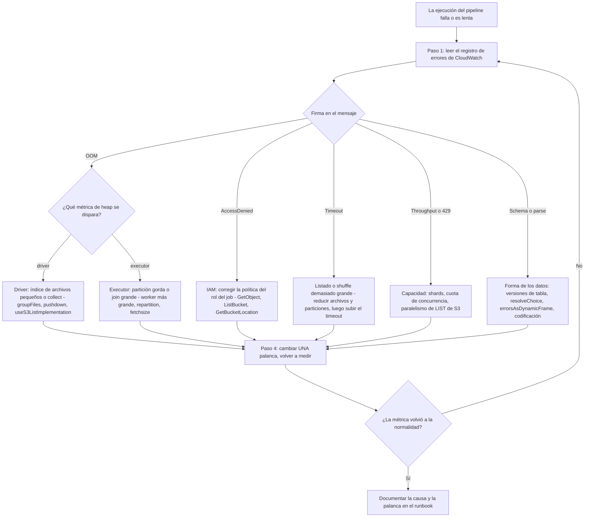
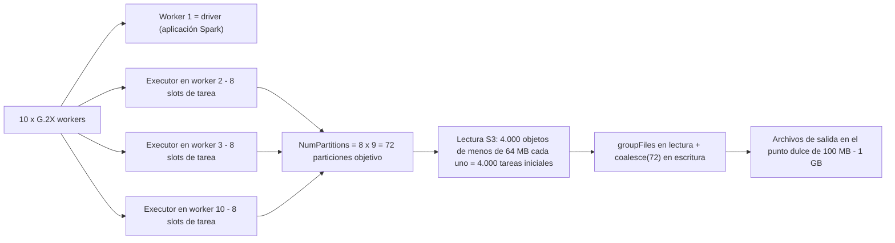
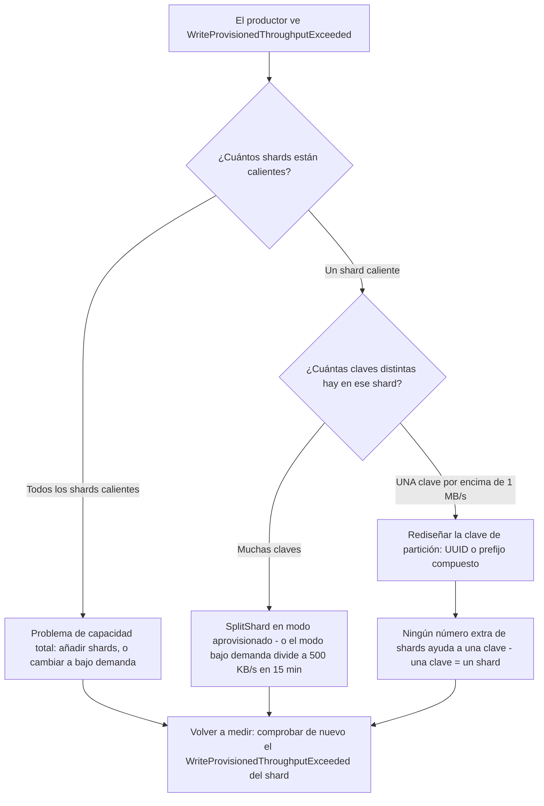
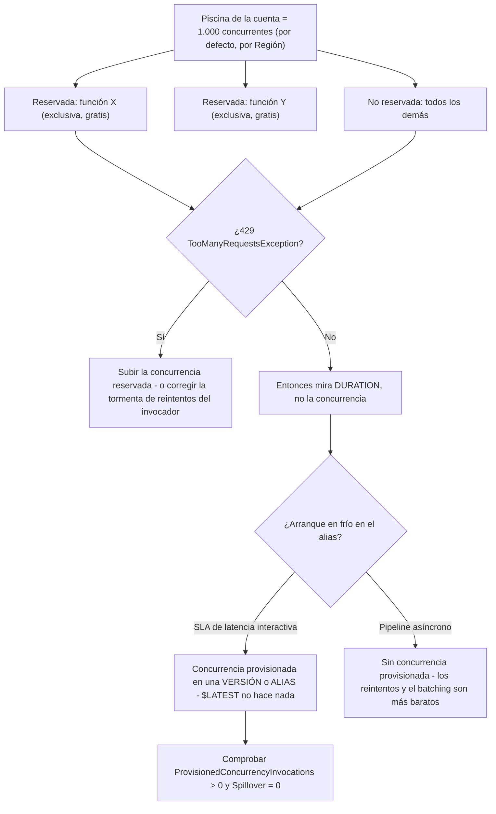
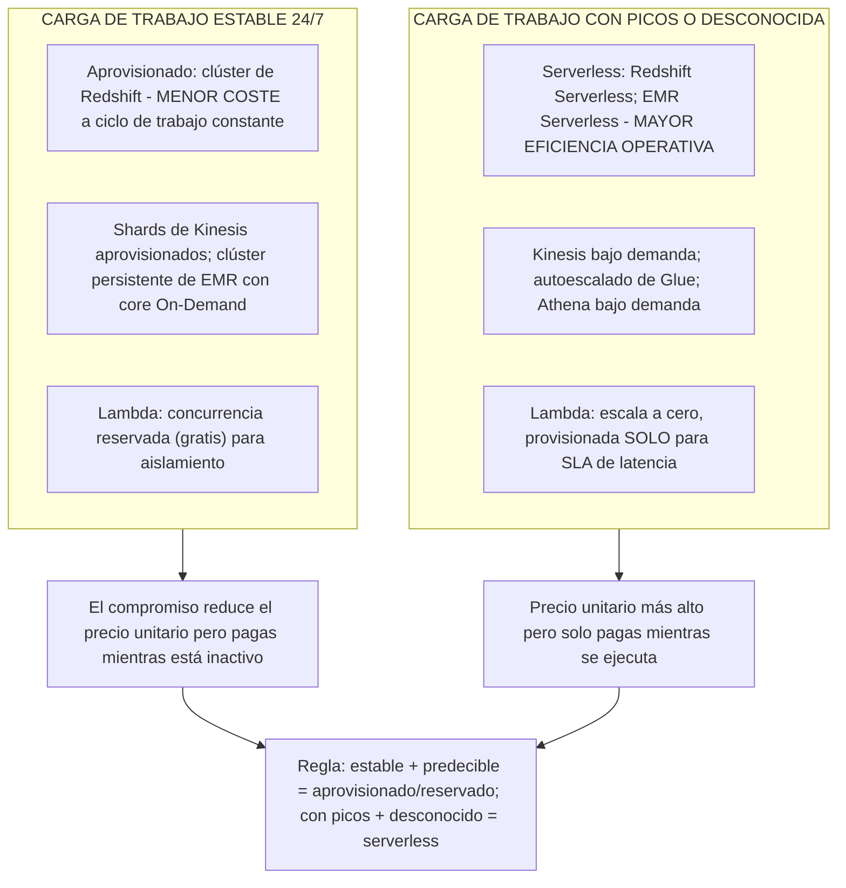

# Resolución de problemas, rendimiento y optimización de costes

El Dominio 3 de DEA-C01 es **Operaciones y soporte de datos, 22 % del examen**, y sus declaraciones de tarea dicen lo mismo de cuatro maneras distintas: *resolver problemas de rendimiento* (3.3.4), *solucionar problemas y mantener pipelines como AWS Glue y Amazon EMR* (3.3.6), *analizar registros con servicios de AWS* (3.3.8) e *implementar mecanismos de desbalance de datos* (3.4.5). El coste se sitúa junto a ellos en **2.1.1**, elegir servicios de almacenamiento para requisitos específicos de **coste y rendimiento**, y en **3.2.5**, describir los compromisos entre servicios **aprovisionados y serverless**. Esta lección es la unión de esas competencias: un bucle de triaje repetible, un mapa síntoma→causa→corrección por servicio, y la aritmética que convierte «hazlo más barato» en una respuesta defendible.

```text
====================================================================
 DEA-C01 - TAREAS DEL DOMINIO 3 QUE CUBRE ESTA LECCIÓN
--------------------------------------------------------------------
  3.1.4  Usar servicios de AWS para procesar datos (EMR, Redshift, Glue)
  3.1.6  Usar AWS Glue DataBrew para perfilar, limpiar, transformar
  3.1.8  Usar AWS Lambda para automatizar el procesamiento de datos
  3.2.5  Describir compromisos entre servicios aprovisionados y serverless
  3.3.4  Resolver problemas de rendimiento
  3.3.6  Solucionar problemas y mantener pipelines (AWS Glue, Amazon EMR)
  3.3.8  Analizar registros (Athena, EMR, OpenSearch, Logs Insights)
  3.4.5  Implementar mecanismos de desbalance de datos
  1.1.9  Implementar limitación (throttling) y superar límites de tasa (Kinesis)
  1.4.2  Configurar Lambda para necesidades de concurrencia y rendimiento
  2.1.1  Servicios de almacenamiento para necesidades de coste y rendimiento
--------------------------------------------------------------------
 BUCLE ........ registro -> métrica -> plan -> palanca -> medir
 SERVICIOS ..... Glue | Redshift | EMR | Kinesis | Lambda | S3
 PRECIOS ....... lista de us-east-1, en octubre de 2026
====================================================================
```

> [!NOTE]
> **Un bucle, siempre el mismo.** Lee primero el **registro de errores**, confirma la **métrica**, busca el **plan o el contador** que lo explica, cambia exactamente **una palanca** y vuelve a medir. El examen recompensa al candidato que nombra la *causa* antes que el *mando*, y cada distractor de este tema es un mando real girado por la razón equivocada.

En esta lección aprenderás a:

- ejecutar un **bucle de triaje de cuatro pasos** y una **taxonomía de fallos** que cubre deriva de esquema, archivos corruptos, OOM, timeout, IAM, throttling, archivos pequeños y codificación, con síntoma→causa→corrección por servicio;
- dimensionar **AWS Glue**: tipos de DPU y de worker, aritmética de particiones, autoescalado, ejecución flexible, modos de fallo de bookmarks, `repartition` frente a `coalesce`, y fusión de archivos pequeños;
- diagnosticar **Amazon Redshift**: errores de claves de distribución y de ordenación, triaje de desbalance con `SVV_TABLE_INFO`, VACUUM/ANALYZE automáticos y ATO, WLM y reglas de monitorización de consultas, poda de Spectrum, y lectura de un plan **EXPLAIN**;
- ajustar **Amazon EMR**: roles primary/core/task, aritmética de número de nodos, nodos Spot de tareas, HDFS frente a S3, y cuándo EMR Serverless es la respuesta;
- corregir **Amazon Kinesis Data Streams**: shard caliente frente a clave caliente, rediseño de la clave de partición, alarmas de antigüedad del iterador y los **tres** modos de capacidad;
- operar **AWS Lambda**: piscinas de concurrencia, concurrencia reservada frente a provisionada, timeouts, reintentos asíncronos y colas de mensajes muertos;
- aplicar una **tabla de palancas de coste por servicio**, una **tabla de compromisos coste-frente-a-rendimiento** y las heurísticas de enunciados **MAYOR eficiencia operativa / MENOR coste**;
- resolver **siete ejemplos resueltos**: aritmética de particiones y coste de Glue, triaje de desbalance en Redshift, un ejercicio de EXPLAIN, dimensionado de nodos de EMR, coste de shards de Kinesis, concurrencia y coste de concurrencia de Lambda, y coste de solicitudes de S3;
- leer el **recuadro de actualizaciones de octubre de 2026**, **cuatro casos de estudio de clientes de AWS**, y terminar con **catorce preguntas estilo examen** más tres comprobaciones interactivas.

---

## 1. El bucle de triaje y la taxonomía de fallos

### 1.1 Cuatro pasos, en orden

| Paso | Pregunta | Dónde miras | Qué no debes hacer |
|---|---|---|---|
| 1. **Registro** | ¿Qué cadena exacta emitió el servicio? | CloudWatch Logs de la ejecución del job: buscar `ERROR`, `EXCEPTION`, `Exit code` | No dimensiones nada antes de haber leído el mensaje |
| 2. **Métrica** | ¿Qué número es anómalo? | heap de driver/executor de Glue, vistas `STL`/`SVL` de Redshift, `IteratorAge` de Kinesis, `Throttles` de Lambda | No adivines entre OOM de driver y de executor: las métricas los separan |
| 3. **Plan / contador** | ¿Por qué esta carga de trabajo tiene esta forma? | `EXPLAIN` de Redshift, `SVV_TABLE_INFO`, pestaña **Executors** de Spark UI / Glue, `SVL_S3PARTITION` | No añadas capacidad a un plan que está escaneando los bytes equivocados |
| 4. **Palanca** | Un cambio: ¿código, diseño o capacidad? | Primero el diseño (claves, particiones, tamaño de archivo), después la capacidad, en tercer lugar el modelo de precios | No compres un descuento sobre el tamaño equivocado |

La propia guía de resolución de problemas de AWS lo dice con franqueza: empieza en el **registro de errores (Error log)** de la ejecución del job, y luego pasa a la pestaña **Executors** / Spark UI para ver *qué* executor murió *cuándo* (guía de resolución de problemas de AWS Glue y consejos de Builder, consultada en octubre de 2026).

### 1.2 Síntoma → causa → corrección, por servicio

Esta tabla es el núcleo examinable de la Competencia 3.3.4. Cada fila es un modo de fallo de AWS documentado con la corrección que AWS documenta para él (documentación de resolución de problemas de AWS Glue, de diagnóstico de Redshift y de resolución de problemas de EMR/Kinesis/Lambda, consultada en octubre de 2026).

| Síntoma | Causa probable | Corrección (tal como la documenta AWS) |
|---|---|---|
| **Deriva de esquema**: el job termina bien pero se añadieron, eliminaron o cambiaron tipos de columnas; aguas abajo se rompe | Cambió la fuente de origen; la tabla de Glue pasó a una nueva versión; DynamicFrame codifica las inconsistencias como **tipos choice** | Diferir las **versiones de tabla** del Catálogo → registro + SNS → hacer evolucionar aguas abajo *antes* de que cambie la forma; `resolveChoice` con cast o `make_cols`; poner el `UpdateBehavior` del crawler en `UPDATE_IN_DATABASE` |
| **Registros corruptos o mal formados descartados en silencio** | La fila CSV no encaja en el esquema inferido; el lector CSV vectorizado no admite `multiLine` ni multibyte | `errorsAsDynamicFrame()` → frame de rechazo con `stageThreshold` / `totalThreshold` para **fallar rápido**; poner los rechazados en cuarentena en S3; cambiar al lector basado en filas |
| **`java.lang.OutOfMemoryError`, `Command failed with exit code 1`** | OOM del **driver** (índice de archivos de miles de archivos pequeños, `collect()`) u OOM de **executor** (partición gorda, join grande, archivo sin dividir) | Separar el diagnóstico: CloudWatch `glue.driver.jvm.heap.usage` vs `glue.executorID.heap.usage`. Driver → `groupFiles`, `useS3ListImplementation=True`, predicados de pushdown. Executor → worker más grande (G.1X→G.2X→R.*), más workers, `repartition(N)` antes del join, `fetchsize` de JDBC |
| **`Container killed by YARN for exceeding memory limits`** | Join con desbalance, partición gorda o archivo grande no dividible | Subir el tipo de worker, añadir executors, repartir hasta el total de cores de executor, activar bookmarks para reducir el volumen de archivos |
| **Job `TIMEOUT` / larga inactividad antes de la primera tarea** | Se alcanzó el timeout, o el driver aun está listando objetos y particiones de S3 | Valores por defecto: **2.880 min** (Glue ≤4.0) / **480 min** (5.0+), máximo **10.080 min = 7 días**; reducir el recuento de archivos y particiones para que el listado termine |
| **`AccessDenied` en S3 o JDBC** | Al rol del job le falta `s3:GetObject` / `s3:ListBucket` / `s3:GetBucketLocation`, conexión o grupo de seguridad equivocado, ruta de script equivocada | Corregir la **política de mínimo privilegio del rol del job**: no la política del bucket, no el código fuente |
| **Throttling: S3 `SlowDown`, Kinesis `WriteProvisionedThroughputExceeded`, Lambda `429 TooManyRequestsException`** | Demasiados LIST/GET/HEAD sobre un prefijo; un shard por encima de **1 MB/s + 1.000 rec/s**; la cuenta por encima de la cuota de concurrencia | S3 → fusionar objetos, bajar `spark.sql.sources.parallelPartitionDiscovery.parallelism` (por defecto **10.000**). Kinesis → añadir shards, rediseñar la clave de partición o cambiar de modo. Lambda → concurrencia reservada, más batching |
| **Archivos pequeños: CPU del driver alta, miles de tareas, factura de solicitudes de S3 al alza** | Aguas abajo escribe objetos por evento o por partición | Agrupar en **lectura** (`groupFiles: 'inPartition'`, automático por encima de **50.000** archivos S3), fusionar en **escritura** (`coalesce(N)`, `.repartition(col)`, `maxRecordsPerFile`), objetivo de objetos de **100 MB: 1 GB** |
| **Codificación: mojibake, `CharacterEncodingException`, filas semiparseadas** | Charset ≠ valor por defecto del lector (UTF-8 vs CP1252/Latin-1), o el lector CSV vectorizado sobre datos multibyte | Fijar `encoding` en las opciones de formato de Glue; evitar el lector vectorizado con multibyte; añadir una regla de codificación de DataBrew antes de la carga |
| **Éxito pero 0 filas / «no data to process»** | Un bookmark omitió archivos antiguos por hora de última modificación; prefijo equivocado o vacío; el catálogo apunta a una ruta S3 muerta | Comprobar marcas de tiempo, desactivar el bookmark una vez para probar, reapuntar la tabla |
| **`Unable to Infer Schema`** | Fuente Parquet/ORC que no está particionada al estilo Hive `key=value` | Restructurar rutas, o leer directamente de S3 con comodines y añadir tú mismo las columnas de partición |
| **Filas duplicadas con los bookmarks activados** | `MaxConcurrency > 1`, falta `job.init()`/`job.commit()`, falta o se renombró `transformation_ctx`, clave JDBC no secuencial, entrada Spark **DataFrame** | Los bookmarks admiten **una sola ejecución concurrente**; mantener estable la cadena de contexto; alimentar los bookmarks con **DynamicFrames**; usar `ResetJobBookmark` / rebobinado para rellenos (backfill) |

### 1.3 El árbol de decisión de fallos



### 1.4 Comprobación interactiva: empareja el síntoma con la corrección

```matching
{
  "question": "Empareja cada síntoma con la corrección que AWS realmente documenta:",
  "pairs": [
    {"left": "OOM del driver con miles de objetos pequeños en S3", "right": "groupFiles más useS3ListImplementation y predicados de pushdown: el driver construye todo el índice de archivos antes de que se ejecute la primera tarea"},
    {"left": "OOM de executor en un join", "right": "Tipo de worker más grande G a R para memoria, más workers, repartition antes del join, fetchsize de JDBC: separa primero el diagnóstico con las dos métricas de heap"},
    {"left": "Los bookmarks procesaron los mismos dos veces", "right": "La concurrencia máxima debe ser 1 y transformation_ctx debe ser estable: los bookmarks no admiten ejecuciones concurrentes"},
    {"left": "Kinesis limitado (throttled) por UNA clave", "right": "Rediseñar la clave de partición a un UUID o compuesta: añadir shards no puede repartir una sola clave entre shards"},
    {"left": "Lambda recibe 429 mientras otras funciones funcionan bien", "right": "La concurrencia reservada da a tu función una porción exclusiva de la piscina de la cuenta: la concurrencia reservada 0 detiene deliberadamente una función que se auto-dispara"},
    {"left": "Consulta de Redshift con skew_rows por encima de 4,00", "right": "Cambiar el estilo de distribución: VACUUM arregla filas desordenadas, no el desbalance, y ANALYZE arregla estadísticas obsoletas"}
  ],
  "explanation": "Seis síntomas, seis palancas distintas: diseño de archivos, dimensionado de workers, contabilidad de bookmarks, diseño de claves, aislamiento de concurrencia y distribución de tablas. Los distractores del examen siempre intercambian dos palancas entre filas: la disciplina es nombrar la clase de causa (forma de datos, código, capacidad, permisos) antes de tocar un mando."
}
```

- **📚 ¿Sabías que…?** Un job de Glue puede informar **SUCCEEDED** sin escribir nada: un bookmark que ya ha registrado los archivos de origen los omitirá en la siguiente ejecución, y un prefijo equivocado o una ruta de catálogo muerta se ven idénticos a una partición vacía sana. La propia lista de resolución de problemas de AWS pone por eso «éxito pero sin datos» junto a errores reales: la corrección es una comprobación de marcas de tiempo, no un stack trace (guía de resolución de problemas de AWS Glue, consultada en octubre de 2026).

---

## 2. Fallos de forma de los datos: deriva, archivos corruptos, codificación

### 2.1 La deriva de esquema es un problema de versiones, no de análisis

Cuando un equipo aguas abajo añade, elimina o cambia el tipo de una columna, ocurren tres cosas en secuencia: la **fuente** cambia, la **tabla de Glue** gana una nueva versión en el Data Catalog, y cada **consumidor aguas abajo** (crawler, consulta de Athena, esquema externo de Redshift, dataset de QuickSight) hereda el cambio en silencio. El patrón de AWS para ello es: diferir las versiones de la tabla → publicar en un tema SNS → hacer evolucionar al consumidor **antes** de que lleguen los datos (Blog de Big Data de AWS, «Identify source schema changes using AWS Glue», 2022-09-14).

Dentro del propio job, un DynamicFrame representa «algunas filas tienen esta columna y otras no» como un **tipo choice**. La reparación documentada es `resolveChoice`, que o bien **convierte (cast)**, tú nombras el tipo, y los valores no convertibles se vuelven `NULL`, o bien **`make_cols`** (añade una columna anulable). Muy relacionado: el crawler informa **«Partitions were not updated»** cuando el esquema del DynamicFrame entrante no es idéntico al del catálogo ni un subconjunto de él, y `updateBehavior` no es `UPDATE_IN_DATABASE`.

> [!IMPORTANT]
> **⚠️ Dos trampas de deriva.** (1) `cast` es con pérdida: `cast:long` convierte cada valor no convertible en **NULL**, convirtiendo un bug de esquema en pérdida silenciosa de datos: sigue siempre a un cast con una regla de completitud o de rango. (2) **Los bookmarks no son detección de deriva**: acotan *qué archivos* leer, nunca comparan *formas*. Un job con bookmarks perfectos puede procesar absolutamente feliz un esquema cambiado.

### 2.2 Registros corruptos: rechazar en voz alta o poner en cuarentena

Las filas CSV mal formadas que «encajan» en el esquema inferido se descartan en silencio. El remedio documentado es `errorsAsDynamicFrame()`, que divide el frame en un frame bueno y un frame de rechazo, más los recuentos `stageThreshold` / `totalThreshold` que **hacen fallar el job** cuando los rechazados superan un presupuesto. El patrón operativo de la Lección 11 lo completa: escribe los rechazados en un **prefijo de cuarentena** con `_dq_rule`, `_dq_reason` y `_run_id`, y alerta sobre el recuento. El lector CSV vectorizado es una trampa concreta: no puede manejar `multiLine` ni contenido multibyte, así que «errores de análisis que solo aparecen en algunas filas» suele significar «usa el lector basado en filas».

### 2.3 Codificación

Los desajustes de charset se presentan como caracteres corruptos, campos truncados o filas que se parten en la coma equivocada. Fija `encoding` en las opciones de formato de Glue, evita el lector vectorizado con datos multibyte, y coloca una regla de codificación de DataBrew **antes** de la carga en lugar de limpiar mojibake en el almacén. La codificación es un *contrato origen-destino*, y como la deriva de esquema es invisible en los recuentos de filas: que es exactamente por lo que ambas pertenecen a la taxonomía y no a un capítulo aparte de «calidad de datos».
---

## 3. Rendimiento de AWS Glue: DPU, workers, bookmarks, archivos pequeños

### 3.1 Lo que realmente estás pagando

**Un DPU = 4 vCPUs de capacidad de cómputo y 16 GB de memoria** (documentación de tipos de worker de AWS Glue, consultada en octubre de 2026). Los jobs de Glue 2.0+ se dimensionan con `WorkerType` + `NumberOfWorkers`, no existe `MaxCapacity` en las versiones modernas, y **un executor de Spark se ejecuta por nodo worker**, en todos los tipos G y R.

| Tipo de worker | DPU | vCPU | RAM (GB) | Disco (GB) | Notas |
|---|---|---|---|---|---|
| G.025X | 0,25 | 2 | 4 | 84 | Streaming y trabajo ligero |
| G.1X | 1 | 4 | 16 | 94 | General por defecto |
| G.2X | 2 | 8 | 32 | 138 | General por defecto para Spark ETL |
| G.4X | 4 | 16 | 64 | 256 | Joins más grandes |
| G.8X | 8 | 32 | 128 | 512 | Planes de driver grandes |
| G.12X / G.16X | 12 / 16 | 48 / 64 | 192 / 256 | 768 / 1024 | **Mayor latencia de arranque** |
| R.1X: R.8X | 1 to 8 | 4 to 32 | 32 to 256 | 94 to 512 | **Optimizados en memoria (M-DPU, 2× RAM)**, mayor latencia de arranque |

Regla de dimensionado de la guía de optimización de Prescriptive Guidance: **escala horizontal** (más workers) solo «hasta que observes workers inactivos; más allá de eso, añadir más workers aumenta los costes sin mejorar resultados», y **escala vertical** (tipo más grande) para transformaciones intensivas en memoria, agregaciones con desbalance y planes de driver enormes.

### 3.2 Aritmética de particiones: la operación que el examen puede pedirte que repitas

Para Glue 3.0+:

```text
numExecutors = Workers - 1            (un worker es el driver)
slots/executor = 4 (G.1X) | 8 (G.2X) | 16 (G.4X) | 32 (G.8X)
NumPartitions = slots x numExecutors  -> multiplicar x2 a x3 si las tareas son desiguales

Ejemplo: 10 x G.1X  ->  (10 - 1) x 4 = 36 particiones objetivo
         10 x G.2X  ->  (10 - 1) x 8 = 72 particiones objetivo
```

Particiones iniciales desde S3: para objetos **≤ 64 MB**, cuenta los objetos; para **> 64 MB**, usa `size / 64 MB`; **el gzip no divisible cuenta como una tarea por objeto**: un único `.csv.gz` de 10 GB es **1 tarea**, con independencia de cuántos workers compres. Demasiadas particiones explotan el driver y el planificador de tareas, así que arréglalas con `groupFiles`, `coalesce(N)` (sin shuffle completo, más barato que `repartition`) o el coalescing de AQE de Spark 3.



### 3.3 Autoescalado, ejecución flexible y AQE

- **Autoescalado** (`--enable-auto-scaling=true`, Glue 3.0+, todos los tipos G/R): Glue añade y quita workers por etapa hasta `NumberOfWorkers` como **máximo**, y además fija `spark.sql.shuffle.partitions` y `spark.default.parallelism` a partir de ese máximo: anúlalos con `--conf` si tu carga de trabajo es desigual.
- **Ejecución flexible** (Glue 3.0+, **solo G.1X y G.2X**, jobs no urgentes): una DPU-hora con descuento a cambio de una hora de inicio variable. El caso de uso documentado es preproducción y rellenos nocturnos.
- **AQE** está activado por defecto en Glue 4.0; en 3.0 fija `spark.sql.adaptive.enabled=true`. Coalescea las particiones de shuffle, convierte los sort-merge join en broadcast y maneja el desbalance con `skewedPartitionFactor` / `skewedPartitionThresholdInBytes`.
- **Escalar horizontalmente no es lineal.** El propio ejemplo de métricas resuelto de AWS (10 → 55 DPU reduce a la mitad el tiempo de ejecución, 55 → 100 DPU no añade nada porque los executors quedan inactivos) proviene de una página aplicable solo a Glue 0.9/1.0: toma el **método** («añade workers solo hasta que estén inactivos»), nunca los minutos absolutos.

### 3.4 Ejemplo resuelto E1: aritmética de particiones y coste en Glue

```text
Escenario: 400 GB de CSV que llegan como 4.000 objetos S3, el job se
ejecuta con 10 x G.2X.

1. Slots ................. (10 - 1) x 8 = 72 particiones objetivo
2. Particiones S3 iniciales 4.000 objetos, cada uno <= 64 MB  =>  4.000 tareas
                           -> demasiadas: el driver construye un índice de
                              4.000 entradas y el planificador se ahoga en
                              tareas diminutas
3. Corrección ............ groupFiles: 'inPartition' en lectura,
                           coalesce(72) en escritura  (más barato que repartition)
4. Capacidad ............. 10 workers x 2 DPU = 20 DPU
5. Coste por ejecución ... 20 DPU x 0,5 h x 0,44 USD/DPU-hora = 4,40 USD
6. Coste si corriera cada hora 720 h x 4,40 USD = 3.168 USD al mes
                           (derivado del 0,44 USD/DPU-hora publicado por AWS,
                            us-east-1, en octubre de 2026)
7. Palancas .............. autoescalado (el tope sigue en 20 DPU), ejecución
                           flexible para un job no urgente, o bookmarks para
                           que los archivos sin cambios nunca se reprocesen
```

### 3.5 Bookmarks: el modo de fallo más pasado por alto en este examen

AWS documenta **siete** formas en que un job con bookmarks reprocesa datos: `MaxConcurrency > 1`, falta de `job.init()` / `job.commit()`, falta o renombrado de `transformation_ctx`, clave primaria JDBC no secuencial, cambio en la hora de última modificación, **entrada Spark DataFrame en lugar de DynamicFrame**, y cambio de la ruta de origen bajo el mismo contexto. Dos frases cubren la mayoría de ítems de examen:

- *«Actualmente los bookmarks de AWS Glue no admiten ejecuciones concurrentes del job y los commits fallarán»*: mantén **execuciones concurrentes máximas = 1**.
- *«Si no pasas el parámetro `transformation_ctx`, los bookmarks de job no se habilitan para un dynamic frame o una tabla usada en el método»*: los bookmarks rastrean operaciones de **DynamicFrame**, y rastrean **orígenes, no destinos**: un rebobinado o reinicio nunca borra lo que ya se escribió, así que repite la carga en un **prefijo de destino nuevo**.

### 3.6 `repartition` frente a `coalesce`, y fusión de archivos pequeños

| Quieres… | Usa | Por qué |
|---|---|---|
| Archivos de salida **menos numerosos y más grandes** | `coalesce(N)` o `maxRecordsPerFile` | Sin shuffle completo, más barato |
| **Más** particiones, o reequilibrar **por una columna** (corregir desbalance) | `repartition(N)` o `repartition(col)` | Un shuffle es exactamente lo que necesita el reequilibrio |
| Leer **miles** de entradas diminutas | `groupFiles: 'inPartition'` con un `groupSize`, o apoyarte en la agrupación automática por encima de **50.000** archivos S3 | Agrupa en lectura en lugar de crear una tarea por objeto |
| Servir Redshift Spectrum | Fusionar a archivos de **≥ 64 MB** y particionar por las columnas del predicado | Spectrum factura los bytes escaneados y aplica limitación con demasiados objetos pequeños |
---

## 4. Amazon Redshift: distribución, desbalance, mantenimiento, planes

### 4.1 Tres enfermedades, tres tratamientos

Las preguntas de rendimiento de Redshift casi siempre se resuelven en uno de tres problemas a nivel de columna, y cada uno tiene una cura distinta (AWS Redshift *Identifying tables with data skew or unsorted rows*, consultado en octubre de 2026).

| Enfermedad | Columna de diagnóstico | Umbral | Tratamiento |
|---|---|---|---|
| **Desbalance (skew)** | `SVV_TABLE_INFO.skew_rows` = mayor rebanada ÷ menor | **≥ 4,00** → *considerar* cambiar el **estilo de distribución** | Cambiar `DISTSTYLE`, no la clave de ordenación |
| **Desorden (unsorted)** | `pct_unsorted` | **> 20 %** → *considerar* `VACUUM`, pero lee antes `vacuum_sort_benefit` | Una tabla puede estar 86 % desordenada y solo ser mejorable en 5 %; omite la ejecución que no cambia nada |
| **Estadísticas obsoletas** | `stats_off` | Alto → `ANALYZE` | `ANALYZE t PREDICATE COLUMNS` para las columnas sobre las que filtras |

El mantenimiento automático está activado por defecto: el **análisis automático** se ejecuta en ventanas de carga ligera con `analyze_threshold_percent = 10 %`, el auto-vacuum de ordenación/borrado se pausa bajo carga alta o bloqueos DDL exclusivos, y la **optimización automática de tablas (ATO)** aplica claves de ordenación y de distribución a tablas `AUTO` en horas de haber visto suficientes consultas. Audítalo con `SVV_ALTER_TABLE_RECOMMENDATIONS` y `SVL_AUTO_WORKER_ACTION`. Datos clave que el examen reutiliza: las claves de ordenación/distribución **explícitas** sacan a una tabla de la automatización, y `VACUUM` **omite la fase de ordenación por defecto cuando más del 95 % de las filas ya están ordenadas**.

### 4.2 Ejemplo resuelto E2: triaje de desbalance en cuatro consultas

```sql
-- 1. Which table is sick?
SELECT "table", diststyle, distkey, skew_rows, unsorted, stats_off, vacuum_sort_benefit
FROM svv_table_info
ORDER BY skew_rows DESC NULLS LAST;

-- 2. Which QUERY is skewed? (WLM query monitoring rule template)
--    segment_execution_time > 120 AND io_skew > 1.30

-- 3. Is it memory, queueing or a LOCK?
SELECT query, service_class, total_queue_time
FROM stl_wlm_query WHERE query < 10000 ORDER BY total_queue_time DESC;
-- In STV_RECENTS but absent from STV_WLM_QUERY_STATE => waiting on a LOCK, not WLM

-- 4. Cure: skew_rows >= 4.00 + slow joins
ALTER TABLE events DISTSTYLE KEY DISTKEY(customer_id);
-- unsorted > 20 AND high vacuum_sort_benefit
VACUUM events;                 -- default skips sort above 95% sorted
-- high stats_off
ANALYZE events PREDICATE COLUMNS;
```

Después, vuelve a ejecutar `EXPLAIN` y busca la etiqueta de redistribución que quieres: `DS_DIST_NONE` / `DS_DIST_ALL_NONE`.

### 4.3 Fundamentos de EXPLAIN: lee el plan antes de redimensionar el clúster

| Operador de join | Qué significa | Acción |
|---|---|---|
| **Nested Loop** | *«Such joins usually occur because a join condition was omitted.»* (Este tipo de joins suele ocurrir porque se omitió una condición de join.) | Corregir el predicado **antes** de tocar la capacidad |
| **Hash Join** | Correcto pero puede desbordar a disco | Comprobar `SVL_QUERY_SUMMARY.is_diskbased = true` → necesita más memoria o menos slots |
| **Merge Join** | El más rápido: ambos lados ya están distribuidos **y** ordenados por las claves de join | Apunta a esto en joins de grande a grande |

Etiquetas de redistribución: `DS_DIST_NONE` y `DS_DIST_ALL_NONE` son buenas; `DS_BCAST_INNER` es **correcto para una dimensión pequeña** y no es automáticamente malo; `DS_DIST_INNER` / `DS_DIST_OUTER` son costosas; `DS_DIST_ALL_INNER` serializa la ejecución en una sola rebanada; `DS_DIST_BOTH` es la peor. Si el planificador elige una dirección de join que parece errónea, la causa documentada son estadísticas obsoletas: ejecuta `ANALYZE`.

### 4.4 Ejemplo resuelto E3: el plan que la propia AWS usa en formación

```text
BEFORE
  XN Hash Join  DS_BCAST_INNER   (cost=109.98..3871130276.17)
    -> XN Hash ... -> XN Seq Scan on event          (big fact table broadcast)

AFTER  ALTER TABLE event ... to a distribution that matches the join key
  XN Hash Join  DS_DIST_ALL_NONE (cost=... ..14142.59)

Cost delta: 3,272,334,142.59  ->  14,142.59   (about five orders of magnitude)
```

Dos lecciones examinables: el *nombre del operador* te dice la estrategia, la *estimación de coste* te dice si importó, y ninguno de los dos requiere un clúster más grande (AWS Prescriptive Guidance, «Evaluating the query plan», consultada en octubre de 2026).

### 4.5 Gestión de carga de trabajo, escalado de concurrencia y Spectrum

- **WLM**: el valor por defecto es **1 cola con 5 consultas concurrentes**. WLM automático crea hasta **8 colas** (clases de servicio **100 to 107**) cada una con una `priority` (`NORMAL` por defecto; `CRITICAL` es solo para superusuarios). WLM manual permite concurrencia **1 to 50 por cola**, **50 slots en total**, con un porcentaje de memoria por cola.
- **Reglas de monitorización de consultas (QMR)** se ejecutan cada **10 s**. Severidad de la acción: `log` < `hop` (solo WLM manual, y solo para consultas CTAS/solo lectura) < `abort` (nunca detiene `COPY`, `ALTER`, `ANALYZE` ni `VACUUM`) < `change priority` (solo WLM automático). Plantillas que memorizar: desbordamiento `query_temp_blocks_to_disk > 100000` bloques (**100 GB**) y desbalance de E/S `io_skew > 1.30`.
- **Los timeouts de WLM cubren solo la fase de ejecución**: las esperas de cola, bloqueo, compilación y hop quedan fuera de ellos.
- **Escalado de concurrencia** enruta las consultas que se desbordan a clústeres transitorios en lugar de encolarlas, por cola (`auto`/`off`), con **1 hora gratis por cada 24 horas** y `max_concurrency_scaling_clusters` de **1 to 10**. Alivia el *encolamiento*, no la presión de memoria por consulta.
- **Spectrum** factura **5,00 USD por TB escaneado** (mínimo de 10 MB por consulta, en octubre de 2026), así que la poda es una palanca de *coste* tanto como de velocidad: particiona por predicados sobre los que filtras de verdad, usa Parquet/ORC para la eliminación de columnas, mantén archivos de **≥ 64 MB**, y fija `TABLE PROPERTIES (numRows = n)` porque **Redshift nunca analiza tablas externas** y en caso contrario asume que la tabla externa es la más grande del plan. Verifica con `SVL_S3PARTITION` (`assigned_partitions` vs `qualified_partitions`), `SVL_S3QUERY_SUMMARY` (`s3_scanned_*`) y los marcadores de EXPLAIN (`S3 Seq Scan`, `Partition Loop`). `DISTINCT` y `ORDER BY` **nunca** se empujan hacia abajo.

- **📚 ¿Sabías que…?** Una tabla de Redshift puede estar **86 % desordenada y solo mejorar un 5 %**: `vacuum_sort_benefit` existe precisamente para que no pagues un `VACUUM` que no cambia nada, y por defecto VACUUM **omite por completo la fase de ordenación por encima del 95 % de filas ordenadas**. Por eso «ejecutar VACUUM tras cada carga» es un distractor, no una buena práctica (documentación de vaciado de AWS Redshift, consultada en octubre de 2026).
---

## 5. Amazon EMR: dimensionado, nodos Spot de tareas, HDFS frente a S3

### 5.1 Tres roles de nodo, tres decisiones de compra

| Rol | ¿Tiene HDFS? | Compra típica | Guía de dimensionado |
|---|---|---|---|
| **Primary** | No (solo orquestación) | **On-Demand** | Poca CPU; se sugiere `m5.xlarge` hasta ~50 nodos; ≤ 3 para alta disponibilidad |
| **Core** | **Sí: tareas + HDFS** | **On-Demand** | CPU + almacenamiento; proteger los datos |
| **Task** | **No: solo tareas** | **Spot** | Solo cómputo; perder uno no pierde datos |

La propia regla de AWS: *«Use Spot Instances on task nodes. The task nodes process data but do not hold persistent data in Hadoop Distributed File System (HDFS). If task nodes shut down… no data is lost.»* (Usa instancias Spot en los nodos de tareas. Los nodos de tareas procesan datos pero no conservan datos persistentes en el sistema de archivos distribuido Hadoop (HDFS). Si los nodos de tareas se apagan… no se pierden datos.) Todo-Spot es solo para jobs transitorios que toleran pérdidas. Ten en cuenta el comportamiento asimétrico de Spot: **las instancias task-Spot se lanzan a medida que hay capacidad disponible**, mientras que **core-Spot espera a todas las instancias solicitadas** antes de lanzarse, y la reclamación de Spot permite unos **20 s** de desmantelamiento elegante (`spark.decommissioning.timeout.threshold`, EMR ≥ 5.11.0).

### 5.2 Ejemplo resuelto E4: recuento de nodos y capacidad de HDFS

```text
(a) Escasez de memoria: 912 GiB de datos que deben caber en memoria
    912 GiB / 32 GiB por m5.2xlarge = 28,5  ->  29 nodos TASK, en Spot
    (no existen nodos fraccionarios; redondea hacia ARRIBA y luego
     verifica con la UI de Spark)

(b) Capacidad de HDFS: (almacenamiento de instancia + EBS por nodo) x nodos
    / factor de replicación 3
    10 x i2.xlarge (800 GB) = 8.000 GB  /  3  =  2.666 GB utilizables
    -> el factor de replicación 3 es la razón por la que HDFS parece
       «3 veces demasiado pequeño» sobre el papel

(c) Escribir la salida en S3 vía EMRFS en su lugar, y la flota core solo
    tiene que retener el shuffle intermedio - flota core más pequeña,
    clúster más barato, el clúster puede terminar sin perder la salida
    curada.
```

**HDFS frente a S3 para el examen**: S3/EMRFS es duradero, desacoplado, sobrevive a la terminación del clúster y cuesta menos por GB → es el **valor por defecto del pipeline**; HDFS es más rápido para el shuffle intermedio pero consume el presupuesto de replicación y muere con el clúster. En EMR, la ejecución adaptativa de consultas está activada por defecto (5.30+) con coalescing de particiones de shuffle (tamaño consultivo **64 MB**, `minPartitionNum` **25**, `initialPartitionNum` **1000**), poda dinámica de particiones (5.26+), y `spark.default.parallelism = 2 × cores de YARN`.

### 5.3 EMR Serverless: la opción sin dimensionado

EMR Serverless factura **por vCPU-hora y GB-hora más almacenamiento GB-hora**, **0,052624 USD/vCPU-hora**, **0,0057785 USD/GB-hora**, **0,000111 USD/almacenamiento GB-hora** (en octubre de 2026), y los workers se autoescalan entre el mínimo y el máximo del job, de modo que la decisión de dimensionado desaparece. Es la elección natural para jobs **intermitentes** de Spark/Hive donde un clúster quedaría inactivo.

> [!WARNING]
> **⚠️ Comprueba el alcance antes de elegir «EMR Serverless» como respuesta.** La lista de servicios en alcance de DEA-C01 de AWS imprime solo **«Amazon EMR»**: no nombra EMR Serverless como entrada separada, y AWS no afirma nada sobre si una opción exclusivamente Serverless se puntúa. Apréndete la mecánica y los precios (son reales y documentados), pero el día del examen prefiere la opción cuyo *nombre de servicio* esté en la lista de alcance salvo que el propio enunciado diga Serverless.

---

## 6. Amazon Kinesis Data Streams: shards calientes, antigüedad del iterador, modos de capacidad

### 6.1 Shard caliente frente a clave caliente: la distinción más probada

Los límites por shard son **1 MB/s de escritura y 1.000 registros/s**, **2 MB/s y 2.000 registros/s de lectura**, y **5 TPS de lectura**; un solo registro puede ser de **10 MiB** y `PutRecords` acepta hasta **500 registros / 10 MiB** por llamada (límites de AWS Kinesis, consultados en octubre de 2026).

- **Shard caliente** = *muchas* claves que caen de forma desigual → divide el shard (`UpdateShardCount` / `SplitShard` en modo aprovisionado) o deja que el modo bajo demanda lo divida.
- **Clave caliente** = *una* clave que supera el límite de un shard → **rediseña la clave de partición** (sufijo UUID o compuesto) **o**, si necesitas orden/localidad por clave, conserva la clave y acepta el techo.
- **Añadir shards no corrige una clave caliente**: todos los registros de una clave hacen hash a un solo shard, para siempre. Y el modo bajo demanda *«no detecta ni aísla las claves hash que provocan una mayor porción del tráfico entrante hacia un shard concreto»*: documentado explícitamente, y por eso es una respuesta errónea favorita.



### 6.2 La antigüedad del iterador es una advertencia de pérdida de datos, no solo retraso

`GetRecords.IteratorAgeMilliseconds` (stream) / `IteratorAgeMilliseconds` (shard) mide el retraso del consumidor; **0 significa que está completamente al día**. La advertencia de AWS: *«If an iterator's age passes 50% of the retention period (by default, 24 hours, configurable up to 7 days), there is risk for data loss due to record expiration.»* (Si la antigüedad de un iterador supera el 50 % del período de retención (por defecto 24 horas, configurable hasta 7 días), existe riesgo de pérdida de datos por expiración de registros.) Así que alarma sobre el **máximo** al **50 % de la retención**, y corrige con: más shards, `ParallelizationFactor` de Lambda (**1 to 10** por shard; el orden aun se conserva *por clave de partición*), una ventana de batching de hasta **5 min / 6 MB**, **enhanced fan-out** (un **dedicado de 2 MB/s por consumidor por shard**), o simplemente un consumidor más rápido.

### 6.3 Tres modos de capacidad, no dos

| Modo | Factura | ¿Planificas la capacidad? | Encaje en el examen |
|---|---|---|---|
| **Aprovisionado (Provisioned)** | Shard-hora (**0,015 USD**, en octubre de 2026) + unidades de payload PUT (**0,014 USD/1M** unidades de 25 KB) + EFO opcional | Sí: `UpdateShardCount` manual, divisiones granulares | Tráfico predecible, **control de claves calientes** |
| **Bajo demanda (Standard)** | Por GB ingerido/recuperado + por hora de stream | No: por defecto **4 MB/s escritura / 8 MB/s lectura**, hasta **10/20 GB/s** en us-east-1/us-west-2/eu-west-1, **200/400 MB/s** en el resto; divide a **500 KB/s en 15 min** | Tráfico impredecible o desconocido |
| **Bajo demanda Advantage** | A nivel de cuenta: sin cargo horario por stream, tarifas de GB más bajas, suelo de **25 MB/s ingesta + 25 MB/s recuperación** | No | Ingesta agregada alta, muchos streams, fan-out |

Los cambios de modo se limitan a **2 cada 24 horas móviles**. EFO cuesta **0,015 USD por consumidor-shard-hora** más por GB, y admite **20** consumidores registrados por stream (Standard) o **50** (Advantage); con menos de unos **3** consumidores, las lecturas compartidas son la opción más barata.

- **📚 ¿Sabías que…?** La antigüedad del iterador es una de las pocas métricas de AWS donde «mayor» puede significar **pérdida de datos permanente** en lugar de «más lento»: una vez que un registro supera la ventana de retención se ha ido, y ninguna cantidad de escalado lo recupera. Por eso la recomendación de AWS es una alarma al **50 %** del período de retención, no al 100 % (documentación de monitorización de AWS Kinesis, consultada en octubre de 2026).

### 6.4 Ejemplo resuelto E5: coste de shards y la factura de unidades de payload

```text
4 shards aprovisionados, siempre encendidos, us-east-1 (en octubre de 2026):
  4 shards x 24 h x 31 días = 2.976 shard-horas x 0,015 USD = 44,64 USD / mes

Ingesta: 100 registros/s de 35 KB cada uno
  unidades por registro = ceil(35 / 25) = 2
  100 rec/s x 2 unidades x 2.678.400 s = 535.680.000 unidades
  535,68 M unidades x 0,014 USD / 1M   = 7,50 USD / mes

Añadir UN solo consumidor de enhanced fan-out:
  4 consumidor-shards x 730 h x 0,015 USD = +43,80 USD / mes (más por GB)
  -> EFO duplica aproximadamente la factura de shards: omítelo por debajo de
     ~3 consumidores.

Aritmética derivada de las tarifas publicadas por AWS; reverificar por Región.
```

---

## 7. AWS Lambda: concurrencia, timeouts, arranques en frío, reintentos

### 7.1 La piscina de concurrencia

El valor por defecto de la cuenta es de **1.000 ejecuciones concurrentes por Región**; una función escala hasta **1.000 entornos por cada 10 segundos**, y el techo de invocaciones por segundo es de unas **10 × la cuota de concurrencia**. Por encima de la cuota, las invocaciones se limitan con **429**.

| Mando | Qué hace | Coste | Cuándo usarlo según el enunciado… |
|---|---|---|---|
| **Concurrencia reservada** | Una porción **mínima y máxima** exclusiva de la piscina de la cuenta; el máximo es *no reservado − 100*; **ninguna otra función puede usarla**; **0 detiene deliberadamente** la función | Gratis | «empujada por **otras** funciones», «limitada por un vecino ruidoso», «detener un bucle que se auto-dispara» |
| **Concurrencia provisionada** | Pre-calienta entornos de ejecución; debe apuntar a una **versión o alias: nunca `$LATEST`**; asignación de 1 to 2 min, hasta **6.000 entornos/min**, facturado en incrementos de **5 minutos**, **sin nivel gratuito** | Facturado 24/7 por la **capacidad** (`0,0000041667 USD/GB-s`) más la ejecución | «latencia de arranque en frío», «latencia p99 consistente» |
| **No reservado de la cuenta** | Todo lo demás |: | Por defecto |

La concurrencia reservada y la provisionada cuentan ambas contra la piscina de la cuenta, y **provisionada ≤ reservada** para la misma función. Application Auto Scaling apunta a un **70 %** de utilización (escala hacia fuera por encima de 70, hacia dentro por debajo de 63), y la propia guía de AWS es que *los pipelines asíncronos de procesamiento de datos normalmente no necesitan concurrencia provisionada*.



### 7.2 Timeouts y reintentos

Sube **memoria y timeout juntos**: la CPU es proporcional a la memoria, así que un «timeout» es frecuentemente una función con dimensionamiento insuficiente. Los reintentos asíncronos no corrigen un dimensionamiento erróneo: solo lo ocultan hasta que se llena la DLQ:

- **Sincrónicos**: el invocador ve el error; los reintentos siguen la *política del invocador*.
- **Asincrónicos**: Lambda encola y luego reintenta **2 veces** (tras 1 minuto, después 2 minutos) para errores de función; para el **throttling (429) y los errores de sistema (serie 500)** el evento vuelve a la cola y se reintenta durante hasta **6 horas**, con backoff desde **1 s hasta 5 min**. Después lo recibe la **cola de mensajes muertos** (SQS **estándar** o SNS **estándar** únicamente: nunca FIFO) o el destino en caso de fallo; un destino en caso de fallo lleva además el payload de respuesta.
- **Stream (mapeo de origen de eventos)**: reintenta hasta que se active `bisect_batch_on_error`, `maximum_record_age` o `retry_attempts`, y después el **destino en caso de fallo**. Para Kinesis, `ParallelizationFactor` **1 to 10** aumenta la paralelismo por shard manteniendo el orden por clave de partición.

### 7.3 Ejemplo resuelto E6: concurrencia, reservada frente a provisionada

```text
Carga: 3.000 solicitudes/segundo, duración media 120 ms
  Concurrencia necesaria = 3.000 x 0,120 s = 360 ejecuciones concurrentes
  Tasa de escala (1.000 entornos / 10 s) es más que suficiente; el techo de
  RPS es 10 x la cuota.

Si otras funciones de la cuenta tienen hambre:
  Reserva ~400 (360 + margen)  ->  concurrencia reservada, GRATIS,
  y tu máximo pasa a ser (no reservado - 100) una vez configurada.

SLA de arranque en frío en su lugar (API interactiva):
  Provisionada ~= pico x 1,10 = ~400 unidades x 1,5 GB = 600 GB en caliente
  600 GB x 2.678.400 s x 0,0000041667 USD/GB-s = unos 6.700 USD al mes
  Coste PERMANENTE, facturado se invoque o no, incrementos de 5 minutos,
  sin nivel gratuito (derivado de la tarifa publicada por AWS, en octubre de 2026).

Pipeline (asíncrono, insensible a la latencia)  ->  SIN concurrencia provisionada.
Función que se auto-dispara               ->  concurrencia reservada 0, luego reparar.
```
---

## 8. Palancas de coste por servicio

### 8.1 La dimensión facturable, y luego la palanca

Nunca nombres una palanca sin nombrar la dimensión que reduce (páginas de precios de AWS Glue, Redshift, EMR, Kinesis, Lambda y S3, en octubre de 2026).

| Servicio | Dimensión facturable | Palancas más baratas |
|---|---|---|
| **Glue ETL** | **DPU-hora**, por segundo, mínimo de 1 minuto: **0,44 USD/DPU-hora** | Menos workers una vez que los executors estén inactivos; tope de autoescalado; `G.025X` para streaming; **ejecución flexible** (G.1X/G.2X, no urgente); **bookmarks** para que los archivos sin cambios nunca se reprocesen |
| **Crawler de Glue** | DPU-hora con mínimo de **10 minutos** | Menos objetivos de rastreo; **índices de partición** en lugar de re-rastreos |
| **Glue DataBrew** | **node-hora** (0,48 USD, **5 nodos** por defecto) + **1,00 USD por sesión de 30 minutos** | Menos nodos; **cerrar sesiones**; mover transformaciones pesadas a Glue/SQL |
| **Amazon Redshift** | **node-hora** o **RPU-hora** + almacenamiento gestionado + Spectrum **5,00 USD/TB escaneado** | Compresión, claves de ordenación, claves de distribución, pushdown de predicados; créditos de escalado de concurrencia antes que un clúster más grande; pausar clústeres inactivos; Serverless para carga con picos |
| **Amazon EMR** | Hora de EC2 + EBS + una **tarifa de EMR por hora** (por segundo, mínimo de 1 minuto); Serverless = vCPU/GB/almacenamiento-hora | **Spot en nodos de tareas**; clústeres transitorios terminados tras el uso; EMR Serverless para jobs intermitentes; salida a S3 para mantener pequeña la flota core |
| **Kinesis Data Streams** | Aprovisionado: **shard-hora** + **unidades de payload PUT** + EFO (**consumidor-shard-hora** + GB); Bajo demanda: **GB ingerido/recuperado** + hora de stream | Dimensionar bien el recuento de shards; omitir EFO por debajo de ~3 consumidores; Advantage si la ingesta agregada ya es alta |
| **AWS Lambda** | **Solicitudes** (0,20 USD/1M) + **GB-segundos** (0,0000166667 USD/GB-s x86) + GB-s de concurrencia provisionada | Dimensionar bien la memoria (la CPU sigue a la memoria); arm64; ventanas de batching/batch más grandes; **omitir la concurrencia provisionada en pipelines**; concurrencia reservada en su lugar cuando el objetivo es el aislamiento |
| **Amazon S3** | **Almacenamiento-mes por clase** (0,023 USD/GB-mes Standard, primeros 50 TB) + **solicitudes** (PUT/COPY/POST/LIST **0,005 USD/1.000**; GET **0,0004 USD/1.000**) + recuperación + salida (primeros **100 GB/mes** gratis en toda la cuenta, después **0,09 USD/GB**) | Escalones de ciclo de vida; **objetos menos numerosos y más grandes**; mantener la analítica en la misma Región; formatos columnares para reducir los bytes escaneados aguas abajo |

### 8.2 Ejemplo resuelto E7: los archivos pequeños cuestan el doble

```text
Aguas abajo escribe 1.000.000 de objetos al día de ~4 KB cada uno
(escrituras por evento).

SOLICITUDES DE ESCRITURA (en octubre de 2026)
  1.000.000 PUT / día  =  1.000 mil PUT x 0,005 USD  =  5,00 USD / día
  5,00 USD x 30         =  150 USD / mes, solo para escribir los datos

FUSIÓN A 500 OBJETOS DE ~8 MB
  500 PUT / día         =  0,5 mil x 0,005 USD        =  0,0025 USD / día
  ahorro                =  unos 149,92 USD / mes  (derivado)

AGUAS ABAJO: la factura de Spectrum/Athena son los bytes ESCANEADOS
  10 TB escaneados por día de consulta x 30 = 300 TB x 5,00 USD/TB = 1.500 USD / mes
  Columnar + poda de particiones a 2 TB escaneados      =    300 USD / mes

Regla general: apunta a objetos de 100 MB - 1 GB para Glue (5 - 10 DPU) y
>= 64 MB para Redshift Spectrum. Los archivos pequeños perjudican el coste
de solicitudes de S3 Y la sobrecarga de tareas/driver de Spark - corrige en
LECTURA (agrupación) y en ESCRITURA (coalesce).
```

- **📚 ¿Sabías que…?** La mitad de almacenamiento de la factura lleva veinte años bajando mientras la de solicitudes no: la retrospectiva de S3 de AWS (2026-03-13) sitúa la reducción de precio desde el lanzamiento de 2006 en unos **85 %** y afirma que los clientes han ahorrado más de **6.000 millones de USD** usando **S3 Intelligent-Tiering** en lugar de S3 Standard. Por eso esta lección sigue dividiendo S3 en palancas de *clase de almacenamiento* y de *solicitudes*: automatizar la clase mueve un número grande, fusionar objetos mueve el otro (entrada «Twenty years of Amazon S3» de AWS, consultada en octubre de 2026).

---

## 9. Coste frente a rendimiento: la tabla de compromisos y las heurísticas de enunciado

### 9.1 El compromiso que el examen realmente pregunta

| Elección | Opción más barata | Opción más rápida / más segura | Desempate en el enunciado |
|---|---|---|---|
| Glue **workers fijos vs autoescalado** | Autoescalado | Fija (predecible) | Volumen de datos desconocido o variable ⇒ auto |
| Glue **aprovisionada vs ejecución flexible** | Flexible | Aprovisionada | No urgente / preproducción ⇒ flexible (solo G.1X/G.2X) |
| Kinesis **aprovisionada vs bajo demanda** | Aprovisionada (estable) | Bajo demanda (sin planificación) | Impredecible ⇒ bajo demanda; clave caliente que necesita divisiones granulares ⇒ aprovisionada |
| Kinesis **lecturas compartidas vs enhanced fan-out** | Compartidas (< ~3 consumidores) | EFO (2 MB/s dedicados) | Muchos consumidores o SLA de latencia ⇒ EFO |
| Redshift **clúster vs Serverless** | Clúster (estable 24/7) | Serverless (picos, sin redimensionar) | Con picos o desconocido ⇒ Serverless |
| EMR **core On-Demand + task Spot vs todo On-Demand** | Flota task en Spot | Core On-Demand (HDFS seguro) | Valor por defecto para clústeres persistentes |
| EMR **clúster vs EMR Serverless** | Depende del ciclo de trabajo | Serverless (sin dimensionado) | Spark intermitente o puntual ⇒ Serverless |
| Lambda **concurrencia reservada vs provisionada** | Reservada (gratis) | Provisionada (en caliente) | Aislamiento ⇒ reservada; SLA de latencia ⇒ provisionada |
| **Tamaño de archivo vs paralelismo** | Objetos menos numerosos y más grandes (menos coste de solicitudes) | Los de tamaño medio conservan el paralelismo | 100 MB: 1 GB (Glue), ≥ 64 MB (Spectrum) |

### 9.2 Dónde se sitúa cada servicio



### 9.3 Las dos heurísticas de enunciado (derivadas del comportamiento documentado por AWS, no de un documento de AWS)

- **«MAYOR eficiencia operativa»** ⇒ elige la opción **sin planificación de capacidad y sin clúster que dimensionar**: AWS Glue (workers gestionados, autoescalado), **EMR Serverless**, **Redshift Serverless**, **Kinesis bajo demanda**, **Lambda**: después vuelve a leer el enunciado buscando una restricción que lo anule (HDFS, control de claves calientes, ciclo de trabajo estable 24/7).
- **«MENOR coste» (estable 24/7)** ⇒ elige la opción **aprovisionada o con compromiso**: shards aprovisionados, un clúster de Redshift sobre Serverless, cómputo On-Demand/comprometido, menos DPU-horas, S3 por escalones de ciclo de vida. Una opción serverless que pase 20 horas al día inactiva rara vez es la más barata.
- **«MÁS RÁPIDO de implementar»** ⇒ un **cambio de configuración gestionado** (WLM, autoescalado, una alarma, una clave de ordenación) le gana a una refactorización de código: salvo que la causa raíz del enunciado sea el código (un predicado de join ausente, un `transformation_ctx` faltante).
- Lee siempre **primero las restricciones**: estable vs con picos, SLA vs rendimiento, aislamiento vs latencia. La heurística es el desempate, no la premisa.

### 9.4 Comprobación interactiva: rellena los números que el examen reutiliza

```fillblank
{
  "question": "Completa las afirmaciones de rendimiento y coste con las propias cifras de AWS (en octubre de 2026):",
  "template": "Un DPU de Glue tiene {{1}} vCPUs y {{2}} GB de memoria, y Glue ETL se factura a ${{3}} por DPU-hora. Redshift considera una tabla con desbalance cuando skew_rows es {{4}} o superior, y omite la fase de ordenación de VACUUM una vez que más del {{5}} por ciento de las filas ya están ordenadas. Un shard de Kinesis acepta {{6}} MB/s y {{7}} registros por segundo de escritura, y a una función Lambda se le debe poner alarma cuando la antigüedad del iterador supere el {{8}} por ciento del período de retención. El valor por defecto de la cuenta de Lambda es de {{9}} ejecuciones concurrentes, y la concurrencia provisionada debe apuntar a una versión o alias, nunca a {{10}}.",
  "answers": {
    "1": "4",
    "2": "16",
    "3": "0.44",
    "4": "4.00",
    "5": "95",
    "6": "1",
    "7": "1000",
    "8": "50",
    "9": "1000",
    "10": "$LATEST"
  },
  "distractors": ["2", "8", "32", "0.29", "0.52", "2.00", "10.00", "80", "75", "100", "500", "5000", "1,000,000", "LATEST", "PROD", "alias"],
  "explanation": "DPU = 4 vCPU + 16 GB a 0,44 USD/DPU-hora; umbral de desbalance 4,00; VACUUM omite la ordenación por encima del 95 por ciento; un shard = 1 MB/s + 1.000 registros/s; la alarma de antigüedad del iterador se pone al 50 por ciento de la retención porque más allá de eso los registros empiezan a expirar; el valor por defecto de la cuenta es de 1.000 concurrentes; y la concurrencia provisionada sobre $LATEST no hace nada porque $LATEST no se puede aprovisionar."
}
```

### 9.5 Comprobación interactiva: ordena la decisión de coste

```dragdrop
{
  "question": "Ordena la secuencia de optimización de costes de esta lección en el orden en que debe aplicarse:",
  "items": [
    "Nombra primero la dimensión facturable: DPU-hora, TB escaneado, shard-hora, solicitudes, GB-segundos",
    "Reduce la cantidad facturada: poda, coalesce, bookmarks, buen dimensionado, menos objetos",
    "Cambia el modelo de precios solo ahora: Spot, Savings Plans o una reserva en el TAMAÑO CORRECTO",
    "Vuelve a medir la métrica y registra la causa y la palanca en el runbook"
  ],
  "correctOrder": [
    "Nombra primero la dimensión facturable: DPU-hora, TB escaneado, shard-hora, solicitudes, GB-segundos",
    "Reduce la cantidad facturada: poda, coalesce, bookmarks, buen dimensionado, menos objetos",
    "Cambia el modelo de precios solo ahora: Spot, Savings Plans o una reserva en el TAMAÑO CORRECTO",
    "Vuelve a medir la métrica y registra la causa y la palanca en el runbook"
  ],
  "explanation": "El orden es toda la lección: diseño antes que capacidad antes que modelo de precios (Sección 1, paso 4), y después medir de nuevo. Comprar un descuento sobre el tamaño equivocado es el distractor clásico: un compromiso reduce el precio unitario pero no hace nada por los bytes escaneados, las DPU-horas consumidas ni los objetos escritos. Cada caso de estudio de esta lección siguió la misma secuencia: medir, reducir la cantidad y después elegir el modelo de precios."
}
```

---

### Actualizaciones de 2026 (en octubre de 2026)

> [!NOTE]
> **Qué se movió entre las notas de estudio de la época del lanzamiento y el examen que vas a presentar**: cada línea verificada contra una fuente primaria de AWS en **octubre de 2026**:
> - **Las generaciones de Glue avanzaron**: **Glue 5.1** es el **valor por defecto para jobs nuevos desde 2025-11-26**, y **Glue 6.0 salió a GA el 2026-08-21** con un **30 % de recorte de precio** (Spark 4.1.1, Python 3.13, Scala 2.13); **Glue 0.9/1.0/2.0 alcanzaron el fin de vida el 2026-04-01** y no se pueden crear Python Shell 3.6 después del **2026-03-31**. En Glue 6.0 **se eliminan el sistema de archivos EMRFS y el AWS SDK for Java v1** (S3A es el único sistema de archivos S3): una opción `fs.s3.consistent.*` o `com.amazonaws.*` está obsoleta a la vista (notas de versión, política de soporte de versiones y guía de migración de AWS Glue, consultadas en octubre de 2026).
> - **Kinesis tiene tres modos de capacidad, no dos**: Aprovisionado, Bajo demanda Standard y **Bajo demanda Advantage (2025-11-04)**: ODA elimina el cargo horario por stream y recorta las tarifas de GB (AWS afirma ≥ 60 % menos) pero aplica un **suelo a nivel de cuenta de 25 MB/s de ingesta + 25 MB/s de recuperación**. El **límite de shards por defecto subió de 500 a 20.000 por cuenta** (2025-04-21, us-east-1/us-west-2/eu-west-1) y se admiten **registros de hasta 10 MiB** (2025-10-28). Cualquier página de preparación que diga «dos modos de capacidad» está obsoleta (What's New y documentación de dimensionado de AWS, consultadas en octubre de 2026).
> - **EMR Serverless se puso más barato y más grande**: el almacenamiento local se **eliminó (hasta un 20 % más barato, 2026-01-06)**, **workers de hasta 32 vCPU / 244 GB (2026-07-07)**, actualizaciones de configuración en vivo (2026-06-24) y Spark Connect (2026-06-09); **Amazon EMR 7.14** se publicó el 2026-09-22 (Spark 3.5.8, almacenamiento de shuffle 200 GiB → 1 TiB). Recuerda la salvedad de alcance de la Sección 5 (What's New de AWS, consultado en octubre de 2026).
> - **Las palancas de coste de Redshift ganaron una opción de compromiso**: las **reservas de 3 años de Redshift Serverless** (2026-02-23, hasta **45 %**) y el **AURI de 3 años** (2026-07-24, hasta **50 %**) permiten ya descontar una carga de trabajo serverless: así que «Serverless siempre es más caro en estado estable» necesita una fecha. Redshift también ganó soporte completo de **escritura/UPDATE/DELETE/MERGE de Iceberg** (2025-11-17 → 2026-04-23) y **vistas materializadas de Iceberg (2026-10-05)** (What's New de AWS, consultado en octubre de 2026).
> - **El suelo de coste de Athena y su precio de entrada bajaron**: las Capacity Reservations ahora empiezan en **4 DPU durante 1 minuto** en lugar de 24 DPU durante 60 minutos (**2026-02-11**), los **resultados de consulta gestionados** (**2025-06-03**) los gestiona el servicio, están cifrados y **no cuestan nada extra** (así que un bucket de resultados en S3 ya no es obligatorio), y llegaron los **conectores gestionados para 12 fuentes** el **2026-04-23**. Un lote nocturno de ventana de 12 DPU se factura ahora como 12 DPU × 10 minutos, no como una hora de 24 DPU (What's New de AWS y Blog de Big Data de AWS, consultados en octubre de 2026).
> - **Kinesis ya puede aterrizar directamente en un lago**: las **tablas de streaming** materializan un stream de Kinesis Data Streams en **Apache Iceberg sobre Amazon S3 Tables** (**2026-08-28**, Parquet automático con compactación en línea, sin salto de Glue ETL) y la **entrega a propósito general en S3** escribe registros en el formato de origen en un bucket ordinario (**2026-08-29**); ambos funcionan solo en los modos bajo demanda y se precian por GB entregado, con AWS afirmando hasta un **50 to 60 % menos de coste de entrega** y hasta un **30 % menos de coste de consulta** (What's New de AWS, consultado en octubre de 2026).
> - **Avisos de datos obsoletos**: la guía del examen es la **v1.1 (2025-12-12)** con 8 competencias añadidas y ninguna eliminada; la logística del examen sigue siendo **130 minutos · 65 preguntas (50 puntuadas + 15 sin puntuar) · 150 USD · nota de corte 720/1.000**: las páginas de terceros que aun citan **170 minutos / 85 preguntas / 300 USD** están describiendo exámenes Specialty, no DEA (páginas de certificación de AWS, consultadas en octubre de 2026).

- **📚 ¿Sabías que…?** Los *recortes* de precio mueven respuestas de examen: Glue 6.0 (−30 %), S3 Express One Zone (almacenamiento −31 %, PUT −55 %, GET −85 %, 2025-04-10) y Kinesis bajo demanda Advantage cambiaron todos la columna de «más barato», pero las *dimensiones* (DPU-hora, shard-hora, GB-s, bytes escaneados) no han cambiado. Aprende la dimensión y reverifica la tarifa (páginas de precios de AWS, consultadas en octubre de 2026).
---

## Casos Reales

AWS publica cómo se ve esta lección en producción. Cada cifra de abajo es **declarada por el cliente o por AWS y no auditada**, con la fuente nombrada para que puedas comprobarla: el punto examinable es el **patrón** (qué palanca se movió, y en qué dirección), no el porcentaje de marketing.

### Caso A, Amazon Customer Service: buen dimensionado de un almacén

| Elemento | Detalle |
|---|---|
| Cliente | **Amazon Customer Service** (la propia organización de Amazon) |
| Desafío | Un conjunto de Redshift en ejecución sobre nodos antiguos **dc2.8xlarge** con coste creciente y latencia de paneles |
| Servicios | **Nodos Amazon Redshift RA3** (separación de cómputo/almacenamiento) con soporte de AWS SA y del equipo de ingeniería de Redshift |
| Resultados | **~55 % menos de coste operativo de Redshift al año**; paneles **47 % más rápidos**; consultas **25 % más rápidas**: comparando **3× RA3.16xlarge contra dc2.8xlarge** |
| Palanca usada | **Buen dimensionado + cambio de generación de nodos**: la regla de la Sección 9 «primero la utilización medida, después el modelo de precios» aplicada a un almacén |
| Fuente | Blog de Big Data de AWS, 2021-05-20, «How Amazon Customer Service lowered Amazon Redshift costs and improved performance using RA3 nodes» (consultado en octubre de 2026) |

Léelo como **Competencia 3.3.4 más 2.1.1 en una sola historia**: el rendimiento y el coste se movieron *juntos*, porque RA3 separa el almacenamiento gestionado del cómputo, así que dejas de pagar por disco local que solo rellenabas con datos fríos. La versión distractora de esta historia afirma que el coste bajó *porque* se compró un descuento: en el estudio de caso no aparece ningún descuento.

### Caso B, Paytm: una palanca de coste por fases en EMR

| Elemento | Detalle |
|---|---|
| Cliente | **Paytm**, pagos y fintech (India) |
| Desafío | Alto gasto en EC2/EMR en un lago de datos a escala de petabytes, donde **EMR era ~65 % de las cargas de trabajo analíticas** |
| Servicios | **Amazon EMR sobre AWS Graviton** (más EC2 Graviton para RDS, Aurora, OpenSearch, ElastiCache) |
| Resultados | **30 to 35 % de ahorro en EMR**; **80 % de EMR sobre Graviton a finales de 2023**; migración iniciada en **2022**; migración de EC2 **60 % (enero de 2024)** con objetivo del **70 % a mediados de 2024**; precio de lista de Graviton aproximadamente **50 % menor** en ap-south-1 |
| Palanca usada | **Silicio distinto, por fases**: observa que un delta de precio de lista de ~50 % produjo un ahorro **realizado del 30 to 35 %** |
| Fuente | Estudio de caso de AWS, `solutions/case-studies/paytm-graviton-case-study/` (consultado en octubre de 2026) |

> *«Migrar a instancias basadas en AWS Graviton es una inversión a largo plazo y será beneficiosa en términos de coste total de propiedad (TCO).»*: Parakh Aggarwal, Director de Cloud Excellence y FinOps (estudio de caso de AWS, consultado en octubre de 2026)

El patrón examinable es la **distancia entre el precio de lista y el ahorro realizado**: una palanca solo vale sus puntos cuando has medido la carga de trabajo, y la línea temporal (2022 → 2024) muestra por qué «cámbialo todo esta noche» nunca es la respuesta en este examen.

### Caso C, GE Aerospace: un ODS heredado reconstruido sobre Redshift

| Elemento | Detalle |
|---|---|
| Cliente | **GE Aerospace** (aeronáutica y cadena de suministro) |
| Desafío | Un gran almacén de datos operativos (ODS) con restricciones de cumplimiento y rendimiento: consultas que tardaban **90 minutos**, **más de 150 informes** en producción (algunos con **más de 10.000 líneas de código**) y un almacén que ya no podía servirlos |
| Servicios | **Amazon Redshift**, con soporte de AWS Solutions Architect y del equipo de ingeniería de Redshift |
| Resultados | Consultas de **90 minutos → 7 minutos**; ~**70 % mejor rendimiento de consultas**; ahorro estimado de **más de 500.000 USD al año**; prueba de concepto en nov, dic 2022, y después una **migración de 9 meses (ene, sep 2023)** |
| Palanca usada | **Buen dimensionado + separación cómputo/almacenamiento gestionada (estilo RA3) en un ODS heredado**: la misma familia de palancas que el Caso A, probada en una carga de trabajo mucho más antigua |
| Fuente | Estudio de caso de AWS, `solutions/case-studies/ge-aerospace-case-study/` (consultado en octubre de 2026) |

> *«Estábamos viendo consultas que antes tardaban una hora y media tardar 7 minutos con Amazon Redshift.»*: Bejoy John, Senior Director of Data Analytics (estudio de caso de AWS, consultado en octubre de 2026)

Léelo como **Competencia 3.3.4 (resolver problemas de rendimiento) más 2.1.1 (dimensionado coste/rendimiento)**: la victoria vino del diseño, el plan y la generación de nodos, no de un descuento comprado. Dos hábitos de examen que practicar aquí: **los >500.000 USD son la propia estimación de GE**, así que nunca lo generalices a tu carga de trabajo; y una **migración de 9 meses con una PoC primero** es lo contrario del distractor «arréglalo esta noche».

### Caso D, Edmunds.com: tres palancas, una factura

| Elemento | Detalle |
|---|---|
| Cliente | **Edmunds.com** (medios automotrices) |
| Desafío | Un equipo reducido ajustando el coste tras su mudanza on-premises de 2016, con aplicaciones orientadas al cliente sobreaprovisionadas para el pico |
| Servicios | **EC2 Spot + Fargate Spot + Amazon ECS + Compute Savings Plans** (compromiso tomado desde enero de 2020) |
| Resultados | **Fargate Spot un 25 to 30 % más barato** que On-Demand; **100.000 USD ahorrados entre octubre de 2019 y agosto de 2020**; **−30 % de cómputo**; **80 %** de las aplicaciones orientadas al cliente sobre Fargate Spot; disponibilidad del **99,999 %** |
| Palanca usada | **Tres palancas distintas apiladas deliberadamente**: capacidad Spot (interrumpible), un compromiso de Compute Savings Plans (descuento por uso estable), y, observa, *ningún* redimensionamiento |
| Fuente | Estudio de caso de AWS, `solutions/case-studies/edmunds-fargate-spot/` (consultado en octubre de 2026) |

> *«La motivación principal es que ya no estoy atado a un tipo de instancia o Región concretos.»*: Emil Ndreu, Executive Director of Cloud and Security Operations (estudio de caso de AWS, consultado en octubre de 2026)

Haz la aritmética que AWS no publica: **100.000 USD en 11 meses ≈ 9.091 USD al mes**, pero AWS nunca desglosa esa cifra entre Spot, Savings Plans y Fargate Spot: así que cualquier opción que afirme «los Savings Plans solos ahorraron X %» no tiene respaldo en la fuente. La distinción examinable es el **tipo de palanca**: un Savings Plans es un **descuento por compromiso** (los Compute SP no se atan a un tipo de instancia o Región), Spot es **capacidad interrumpible para trabajo tolerante a fallos** (AWS cita hasta un **90 % de descuento** sobre On-Demand), y ninguno de los dos es el cambio de **silicio** Graviton del Caso B.

| Caso | Palanca que demuestra | Dirección |
|---|---|---|
| Amazon Customer Service | Buen dimensionado de la generación de nodos, separar cómputo de almacenamiento gestionado | Rendimiento **y** coste mejoran juntos |
| Paytm | Cambiar el silicio bajo un conjunto estable de EMR, por fases | Precio de lista −50 % ⇒ realizado −30 to 35 % (mide, no asumas) |
| GE Aerospace | Modernizar un ODS heredado en Redshift: plan, diseño y después generación de nodos | Consultas de 90 min → 7 min, ~70 % más rápido, estimación del cliente >500.000 USD/año |
| Edmunds.com | Apilar capacidad Spot con un compromiso de Compute Savings Plans sobre una flota estable | −30 % de cómputo y 100.000 USD en 11 meses, con disponibilidad del 99,999 % |

- **📚 ¿Sabías que…?** Las cuatro historias evitan la trampa que esta lección repite: ninguno de estos clientes «lo hizo más barato» comprando un compromiso sobre un sistema sobredimensionado. Uno **redimensionó**, otro **cambió de plataforma**, otro **reconstruyó primero el plan y el diseño**, otro **apiló dos palancas de capacidad**, y todos midieron primero. El porcentaje publicado por AWS es siempre *su* carga de trabajo, nunca una garantía para la tuya (estudios de caso de AWS y Blog de Big Data, consultados en octubre de 2026).
- **📚 ¿Sabías que…?** Tres palancas se parecen en una factura y son respuestas de examen distintas: **Savings Plans = descuento por compromiso** (los Compute SP no se atan a un tipo de instancia o Región), **Spot = capacidad interrumpible** que debes poder perder (AWS cita hasta un 90 % de descuento sobre On-Demand), y **Graviton = silicio distinto** con un precio de lista más bajo. Los distractores de DEA-C01 intercambian rutinariamente dos de los tres: nombra la *dimensión* que cambia cada uno antes de elegir (Precios de AWS y estudios de caso, consultados en octubre de 2026).
---

## Preguntas de Práctica (Practice Questions)

```question
{
  "id": "dea-12-q1",
  "type": "multiple-choice",
  "question": "Un job de Glue falla con `Command failed with exit code 1` y `java.lang.OutOfMemoryError`. ¿Qué par de métricas de CloudWatch te dice si la corrección es groupFiles o un tipo de worker más grande?",
  "options": [
    "glue.driver.jvm.heap.usage frente a glue.executorID.heap.usage: driver significa trabajo de índice de archivos, executor significa particiones gordas o un join grande",
    "glue.busyExecutors frente a glue.stage.failedExecutors: más executors ocupados siempre significa que el driver está bien",
    "glue.driverExecutionTime frente a glue.s3FileListCount: el que sea más grande nombra al servicio culpable",
    "glue.activeExecutors frente a glue.numExecutorsfailed: los executors fallidos prueban un problema de memoria, los ocupados prueban un problema de IAM"
  ],
  "correct": 0,
  "explanation": "AWS documenta separar el diagnóstico de OOM con la métrica de heap del driver y la métrica de heap del executor. El OOM del driver es el caso clásico de archivos pequeños/índice de archivos o collect() (groupFiles, useS3ListImplementation, pushdown); el OOM del executor es una partición gorda o un join (worker más grande G->R, más workers, repartition antes del join, fetchsize de JDBC). Los demás nombres de métrica no cargan con ese significado."
}
```

```question
{
  "id": "dea-12-q2",
  "type": "multiple-choice",
  "question": "Un job de Glue con bookmarks activados procesó los mismos archivos dos veces tras una refactorización. ¿Qué cambio es la causa documentada?",
  "options": [
    "El desarrollador renombró la cadena transformation_ctx, lo que reinicia el seguimiento del bookmark de ese DynamicFrame",
    "El desarrollador aumentó la retención de la regla de ciclo de vida del bucket S3 de 30 a 90 días",
    "El desarrollador habilitó un crawler de Glue sobre la misma tabla, porque los crawlers reinician los bookmarks de job",
    "El desarrollador movió la salida a un prefijo nuevo, porque los bookmarks rastrean la ubicación de destino"
  ],
  "correct": 0,
  "explanation": "AWS lista siete causas documentadas de reprocesamiento, incluidos un transformation_ctx faltante o renombrado y MaxConcurrency > 1. Los bookmarks rastrean operaciones de DynamicFrame de ORIGEN (job.init/job.commit, transformation_ctx estable, una sola ejecución concurrente), nunca el destino: por eso mover prefijos de salida es inocuo y renombrar una cadena de contexto no lo es."
}
```

```question
{
  "id": "dea-12-q3",
  "type": "multiple-choice",
  "question": "SVV_TABLE_INFO muestra skew_rows = 6,4, unsorted = 42, stats_off = 0,05 y vacuum_sort_benefit = 0,04. ¿Qué acción se ajusta a los umbrales documentados por AWS?",
  "options": [
    "Cambiar el estilo de distribución, y omitir el VACUUM porque el beneficio de ordenación es despreciable",
    "Ejecutar VACUUM inmediatamente, porque unsorted está por encima del 20 por ciento",
    "Ejecutar solo ANALYZE, porque el desbalance es un problema de estadísticas",
    "Ejecutar REINDEX, porque la tabla está más del 40 por ciento desordenada"
  ],
  "correct": 0,
  "explanation": "skew_rows >= 4,00 significa cambiar el estilo de distribución; pct_unsorted > 20 significa CONSIDERAR VACUUM pero leer antes vacuum_sort_benefit: aquí solo el 4 por ciento es mejorable, así que un VACUUM manual está cerca de no hacer nada (y VACUUM omite la ordenación por encima del 95 por ciento de todas formas). REINDEX es para claves de ordenación intercaladas (interleaved_skew > 1,4), y ANALYZE aborda stats_off, no el desbalance."
}
```

```question
{
  "id": "dea-12-q4",
  "type": "multiple-choice",
  "question": "Un plan EXPLAIN muestra `XN Nested Loop` en un join entre dos tablas grandes. ¿Qué dice AWS que hay que hacer primero?",
  "options": [
    "Comprobar la condición de join: un bucle anidado suele significar que el predicado de join se omitió o es una desigualdad",
    "Añadir nodos al clúster, porque los bucles anidados escalan linealmente con el cómputo",
    "Añadir una clave de ordenación a la tabla externa, porque los bucles anidados requieren entrada ordenada",
    "Convertir la consulta a un CTAS para que el planificador pueda elegir un operador mejor"
  ],
  "correct": 0,
  "explanation": "La guía de planes de consulta de AWS: «Nested Loop: Such joins usually occur because a join condition was omitted.» (Nested Loop: este tipo de joins suele ocurrir porque se omitió una condición de join.) Corrige el predicado antes de tocar la capacidad; después mira el Hash Join (puede desbordar: comprueba is_diskbased) o, idealmente, el Merge Join cuando ambos lados están distribuidos y ordenados por las claves de join."
}
```

```question
{
  "id": "dea-12-q5",
  "type": "multiple-choice",
  "question": "Un productor de Kinesis recibe limitación (throttling) de exactamente una clave de partición que transporta un pico de 1,5 MB/s, mientras todos los demás shards están inactivos. El modo de capacidad bajo demanda ya está habilitado. ¿Cuál es la corrección correcta?",
  "options": [
    "Rediseñar la clave de partición a un UUID o un valor compuesto para que la carga se reparta entre shards",
    "Añadir más shards, porque el recuento de shards determina el techo de rendimiento por clave",
    "Esperar a que bajo demanda divida el shard, porque aísla las claves hash automáticamente",
    "Habilitar enhanced fan-out, que aumenta el límite de escritura para la clave caliente"
  ],
  "correct": 0,
  "explanation": "Una clave se mapea a un shard (1 MB/s + 1.000 registros/s), así que los shards extra no pueden ayudar; AWS documenta explícitamente que el modo bajo demanda no detecta ni aísla las claves hash que generan tráfico caliente; y enhanced fan-out es una función del lado de LECTURA (2 MB/s dedicados por consumidor por shard). La corrección es el diseño de la clave: salvo que necesites orden por clave, en cuyo caso la alternativa es el modo aprovisionado + SplitShard."
}
```

```question
{
  "id": "dea-12-q6",
  "type": "multiple-choice",
  "question": "Una alarma de consumidor de Kinesis sobre GetRecords.IteratorAgeMilliseconds lleva en el 60 % del período de retención. ¿Qué dice AWS que significa?",
  "options": [
    "Los registros corren el riesgo de expirar antes de leerse, así que alarma al 50 % de la retención y añade capacidad",
    "El shard se quedó sin capacidad de lectura, así que la corrección es siempre enhanced fan-out",
    "Retraso normal: la métrica solo importa cuando alcanza el 100 % de la retención",
    "El productor está limitado (throttled), así que la corrección es aumentar la capacidad de escritura"
  ],
  "correct": 0,
  "explanation": "La redacción de AWS: si la antigüedad del iterador supera el 50 % del período de retención (por defecto 24 horas, configurable hasta 7 días), existe riesgo de pérdida de datos por expiración de registros. Correcciones: más shards, ParallelizationFactor de Lambda 1-10 por shard, una ventana de batching mayor (<=5 min / 6 MB), enhanced fan-out para lecturas, o un consumidor más rápido: no más capacidad de escritura."
}
```

```question
{
  "id": "dea-12-q7",
  "type": "multiple-choice",
  "question": "Una función Lambda recibe limitación intermitente con 429 porque otras funciones de la cuenta consumen la mayor parte de la piscina de 1.000 ejecuciones. ¿Qué configuración es correcta?",
  "options": [
    "Concurrencia reservada para esa función: una porción exclusiva de la piscina de la cuenta, sin coste",
    "Concurrencia provisionada en $LATEST: pre-calienta entornos y elimina la limitación",
    "Subir la cuota de concurrencia de la cuenta en la consola, que es un ajuste por función",
    "Concurrencia reservada de 0, para que la función ya no pueda ser invocada por otros servicios"
  ],
  "correct": 0,
  "explanation": "La concurrencia reservada fija mínimo y máximo para la función en exclusiva, ninguna otra función puede usar esa porción, y no cuesta nada; el máximo que puedes reservar es no reservado menos 100. La concurrencia provisionada resuelve ARRANQUES EN FRÍO, debe apuntar a una versión o alias (nunca $LATEST) y se factura 24/7. La concurrencia reservada 0 es una parada deliberada: la corrección para una función que se auto-dispara, no para una limitada."
}
```
```question
{
  "id": "dea-12-q8",
  "type": "multiple-choice",
  "question": "Estás diseñando un clúster persistente de EMR que escribe la salida curada en S3 y debe sobrevivir a las interrupciones de Spot. ¿Qué colocación se ajusta a la guía de AWS?",
  "options": [
    "Nodos primary y core On-Demand, nodos task en Spot, salida escrita a S3 vía EMRFS",
    "Los tres tipos de nodos en Spot, porque EMR reinicia automáticamente cualquier bloque de HDFS perdido",
    "Nodos core en Spot (son los más baratos) con nodos primary y task On-Demand",
    "Primary en Spot, core y task On-Demand, con la salida escrita solo en HDFS"
  ],
  "correct": 0,
  "explanation": "AWS: usa Spot en nodos de TAREAS porque no conservan datos en HDFS, así que perder uno no pierde nada; primary y core permanecen On-Demand para proteger la orquestación y HDFS (factor de replicación 3). Escribir la salida curada en S3 vía EMRFS desacopla la durabilidad del clúster y permite mantener pequeña la flota core. Todo-Spot es solo para jobs transitorios que toleran pérdidas."
}
```

```question
{
  "id": "dea-12-q9",
  "type": "multiple-choice",
  "question": "Un job nocturno de Glue usa 10 workers G.2X fijos pero su volumen de entrada varía 4× entre 200 GB y 800 GB. ¿Qué cambio es a la vez más barato y correcto?",
  "options": [
    "Activar el autoescalado con NumberOfWorkers = 10 como tope, para que Glue añada workers solo en las etapas grandes",
    "Comprar un Savings Plan para las DPU-horas de Glue, que garantiza la tarifa más baja con independencia de la utilización",
    "Fijar MaxCapacity = 10, porque Glue 2.0+ dimensiona los jobs con MaxCapacity",
    "Cambiar el job a ejecución flexible, que está disponible en todos los tipos de worker G y R"
  ],
  "correct": 0,
  "explanation": "El autoescalado (Glue 3.0+, todos los tipos G/R) añade y quita workers por etapa hasta el máximo que fijes: así que el tope sigue en 10 mientras las etapas tranquilas se ejecutan pequeñas. MaxCapacity no existe en Glue 2.0+ (usa WorkerType + NumberOfWorkers), y la ejecución flexible se limita a G.1X y G.2X para jobs no urgentes."
}
```

```question
{
  "id": "dea-12-q10",
  "type": "multiple-choice",
  "question": "Las consultas de Redshift Spectrum contra una tabla externa son lentas y caras, y el prefijo S3 contiene 30.000 archivos de una media de 900 KB. ¿Qué recomienda AWS primero?",
  "options": [
    "Fusionar los archivos pequeños a 64 MB o más, particionar por las columnas por las que filtras y fijar TABLE PROPERTIES numRows",
    "Añadir nodos de Redshift, porque los escaneos de Spectrum los limita el cómputo del almacén",
    "Ejecutar VACUUM sobre la tabla externa para que el planificador obtenga estadísticas precisas",
    "Convertir cada archivo a CSV para que el escaneo se pueda empujar hacia S3"
  ],
  "correct": 0,
  "explanation": "AWS recomienda explícitamente fusionar archivos pequeños a 64 MB o más cuando las solicitudes de Spectrum reciben limitación, además de la poda de particiones y Parquet/ORC para la eliminación de columnas. Redshift nunca analiza (ANALYZE) las tablas externas: de ahí TABLE PROPERTIES numRows: y VACUUM solo se aplica a tablas locales. Los nodos extra no reducen los bytes escaneados, que es la dimensión facturable (5,00 USD/TB, en octubre de 2026)."
}
```

```question
{
  "id": "dea-12-q11",
  "type": "multiple-choice",
  "question": "Un job por lotes de Spark se ejecuta dos veces por semana, no tiene SLA dentro de una ventana de 6 horas, y el equipo quiere la respuesta de MAYOR eficiencia operativa. ¿Qué opción encaja mejor con las restricciones del enunciado?",
  "options": [
    "Amazon EMR Serverless: los workers se autoescalan entre el mínimo y el máximo del job, así que nadie dimensiona un clúster",
    "Un clúster persistente de EMR con nodos core On-Demand, dejado en ejecución entre ejecuciones",
    "Un clúster de Redshift dimensionado manualmente, porque SQL es más rápido que Spark para trabajo por lotes",
    "Concurrencia provisionada en la Lambda de orquestación, para que el disparador nunca arranque en frío"
  ],
  "correct": 0,
  "explanation": "«Mayor eficiencia operativa» con un job intermitente y tolerante al SLA significa: sin clúster que dimensionar, sin nodos que parchear, pagar por vCPU-hora y GB-hora solo mientras se ejecuta (0,052624 USD/vCPU-hora, en octubre de 2026). Un clúster que pase inactivo entre dos ejecuciones semanales es la trampa de coste; la concurrencia provisionada es una palanca de latencia para APIs interactivas, no una palanca de jobs por lotes (y observa la salvedad de alcance: la lista de servicios en alcance nombra Amazon EMR)."
}
```

```question
{
  "id": "dea-12-q12",
  "type": "multiple-choice",
  "question": "En octubre de 2026, ¿qué afirmación sobre los modos de capacidad de Kinesis Data Streams es correcta?",
  "options": [
    "Hay tres modos; Bajo demanda Advantage elimina el cargo horario por stream pero aplica un suelo a nivel de cuenta de 25 MB/s de ingesta y 25 MB/s de recuperación",
    "Hay dos modos, y bajo demanda aísla automáticamente las claves hash calientes dividiéndolas en 15 minutos",
    "El modo aprovisionado factura solo las unidades de payload PUT, sin cargo de shard-hora",
    "Los cambios de modo son ilimitados, porque AWS tarifa el propio cambio"
  ],
  "correct": 0,
  "explanation": "AWS añadió Bajo demanda Advantage el 2025-11-04: sin cargo horario por stream, tarifas de GB más bajas, pero un suelo de cuenta de 25 MB/s + 25 MB/s (What's New de AWS, consultado en octubre de 2026). Dos cosas siguen ciertas de las guías antiguas: el modo aprovisionado factura shard-horas (0,015 USD) MÁS unidades PUT (0,014 USD/M), los cambios de modo se limitan a 2 cada 24 horas móviles, y AWS documenta que bajo demanda NO aísla las claves hash calientes: eso aun requiere rediseñar la clave o SplitShard aprovisionado."
}
```

```question
{
  "id": "dea-12-q13",
  "type": "multiple-choice",
  "question": "Un job de Glue que fijó la opción de EMRFS `fs.s3.consistent.*` e importó `com.amazonaws.services.*` (AWS SDK for Java v1) se ejecutaba limpiamente en Glue 5.1. Tras moverlo a Glue 6.0 (GA 2026-08-21) el job falla al arrancar. ¿Cuál es el diagnóstico y la corrección correctos?",
  "options": [
    "Glue 6.0 eliminó EMRFS y el AWS SDK for Java v1: migra al sistema de archivos S3A (`fs.s3a.*`) y al AWS SDK for Java v2, y espera que la versión binaria de Scala pase de 2.12 a 2.13",
    "Glue 6.0 regresó a Spark 3.5, así que el job debe fijarse de vuelta a Glue 4.0 para restaurar EMRFS y el SDK v1",
    "Al rol del job le faltó `s3:GetObject`, así que adjunta AmazonS3FullAccess al rol del job de Glue y re-ejecuta",
    "Glue 6.0 requiere Python 3.11, así que el fallo es un desajuste del intérprete de Python, no un cambio de sistema de archivos"
  ],
  "correct": 0,
  "explanation": "La guía de migración a Glue 6.0 de AWS lista los cambios incompatibles explícitamente: se elimina EMRFS y S3A es el único sistema de archivos S3 (así que `EmrFileSystem` y `fs.s3.consistent.*` desaparecen), se elimina el AWS SDK for Java v1 (solo SDK v2 2.44.6+, boto3 no se ve afectado) y la compatibilidad binaria de Scala pasa de 2.12 a 2.13. Glue 6.0 se publica con Spark 4.1.1 y Python 3.13: no 3.5 ni 3.11: y un job denegado por IAM fallaría en la primera lectura de S3 con AccessDenied, no al arrancar. Lee primero el registro: un ClassNotFoundException/NoSuchMethodError es un problema de versión de ejecución, un AccessDenied es un problema de política."
}
```

```question
{
  "id": "dea-12-q14",
  "type": "multiple-choice",
  "question": "Un equipo ejecuta una carga de trabajo analítica estable 24/7 en Redshift Serverless, y un revisor objeta que «serverless siempre es más caro que un clúster aprovisionado en estado estable». ¿Qué afirmación es correcta en octubre de 2026?",
  "options": [
    "Redshift Serverless ya vende reservas de 3 años (2026-02-23, hasta 45 %) y AURI de 3 años (2026-07-24, hasta 50 %), así que una carga serverless estable puede comprometerse: la regla antigua necesita una fecha",
    "Database Savings Plans (hasta 35 %, 2025-12-02) ya cubren las RPU-horas de Redshift Serverless, así que no existe ningún compromiso específico de Redshift",
    "Serverless factura solo por TB escaneado, así que un descuento por compromiso no puede aplicarse a las RPU-horas en absoluto",
    "Serverless ofrece solo compromisos de 1 año; AWS no vende ninguna reserva serverless de 3 años"
  ],
  "correct": 0,
  "explanation": "AWS anunció las reservas de tres años de Redshift Serverless el 2026-02-23 (hasta 45 %) y el AURI de tres años el 2026-07-24 (hasta 50 %), así que la heurística «estable 24/7 = aprovisionado» de la Sección 9 ahora necesita la fecha que la lección pone en cada tarifa. Database Savings Plans cubren Aurora, RDS, DynamoDB, ElastiCache, DocumentDB, Neptune, Keyspaces, Timestream y DMS: no Redshift. Redshift Serverless factura RPU-horas más almacenamiento gestionado (y Spectrum factura los bytes escaneados por separado), y los plazos de 3 años existen. Verifica contra la tabla de costes de la lección antes de comprometerte: un descuento sobre el tamaño equivocado sigue siendo la respuesta equivocada."
}
```

> [!WARNING]
> ⚠️ **Trampas de día de examen para esta lección:**
> - **Lee el registro antes de girar un mando**: un `Exit code 1` por sí solo nunca te dice OOM de driver o de executor, IAM o código, ni capacidad o forma de datos.
> - **Los bookmarks tienen siete causas de reprocesamiento documentadas**, y la opción más común en una pregunta nombra solo una de ellas: `MaxConcurrency = 1` y un `transformation_ctx` estable son innegociables.
> - **Los bookmarks rastrean orígenes, no destinos**: un rebobinado/reinicio nunca borra la salida; repite la carga en un prefijo nuevo.
> - **`coalesce` para menos archivos (sin shuffle), `repartition` para reequilibrar por una columna**: «archivos de salida menos numerosos y más grandes» nunca es solo `repartition`.
> - **Más DPU no es lineal**: añade workers solo hasta que los executors estén inactivos; los workers R corrigen memoria, los G corrigen CPU, y los tipos grandes arrancan más lento.
> - **Glue 2.0+ no tiene `MaxCapacity`**: `WorkerType` + `NumberOfWorkers`, y un executor por worker.
> - **Tres enfermedades de Redshift**: desbalance ⇒ estilo de distribución; desorden ⇒ VACUUM (comprueba `vacuum_sort_benefit`); `stats_off` ⇒ ANALYZE. «VACUUM tras cada carga» es falso.
> - **`DS_BCAST_INNER` en una dimensión pequeña es correcto**; `DS_DIST_BOTH` y `DS_DIST_ALL_INNER` son los malos; **Nested Loop ⇒ falta un predicado de join**, no un clúster pequeño.
> - **Los timeouts de WLM excluyen las esperas de cola y de bloqueo**; el `abort` de QMR nunca detiene `COPY`/`ALTER`/`ANALYZE`/`VACUUM`; `hop` es solo de WLM manual.
> - **Shard caliente ≠ clave caliente**: divide para el primero, rediseña la clave para el segundo; **bajo demanda no corrige una clave caliente**, y enhanced fan-out es una función del lado de lectura.
> - **Una antigüedad del iterador más allá del 50 % de la retención significa posible pérdida de datos**, no «solo retraso».
> - **Reservada ≠ provisionada**: aislamiento (gratis) vs calor (facturado 24/7); **la provisionada sobre `$LATEST` no hace nada**.
> - **Reintento asíncrono ≠ reintento de stream**: asíncrono = 2 reintentos y después DLQ (SQS/SNS solo estándar); una fuente de eventos de stream usa reintentos limitados y después un destino en caso de fallo.
> - **Patrón de Spot en EMR**: task = Spot, primary/core = On-Demand; la replicación de HDFS es 3, así que la capacidad de HDFS es aproximadamente un tercio del disco en bruto.
> - **Los archivos pequeños cuestan el doble**: cargos de solicitudes de S3 *y* sobrecarga de driver/tareas de Spark; Spectrum factura los **bytes escaneados**, así que la poda y los formatos columnares son palancas de coste.
> - **Las heurísticas son desempates**: «MAYOR eficiencia operativa» ⇒ sin planificación de capacidad; «MENOR coste estable 24/7» ⇒ aprovisionado/comprometido. Lee siempre primero las restricciones del enunciado.
> - **Nunca elijas un servicio fuera de alcance** como la mejor corrección, y nunca cites un precio sin «en octubre de 2026»: las tarifas de esta lección son precios de lista de us-east-1 de octubre de 2026.

> **Veredicto comparativo: cómo se compara este tema el día del examen**
> - **Frente a otra nube:** DEA-C01 prueba **solo servicios de AWS**: nada te pide comparar las DPU-horas de Glue con la estructura de precios del clúster de un competidor. Responde con un servicio de AWS, un umbral publicado por AWS (desbalance 4,00, omisión de VACUUM al 95 %, 1 MB/s por shard, 1.000 concurrentes de Lambda) o una tarifa publicada por AWS en octubre de 2026; cualquier opción que gire hacia un benchmark de terceros no verificado queda fuera de alcance por construcción.
> - **Frente a herramientas autogestionadas / on-premises:** la respuesta de AWS siempre es **gestionado y medido sobre personalizado y manual**: el VACUUM/ANALYZE automático y el ATO le ganan a un VACUUM por cron, el autoescalado de Glue le gana a un clúster ajustado a mano, las cuotas de concurrencia de Lambda le ganan a un trabajador de cola autoalojado. Una opción que describa a ti manteniendo la maquinaria es el distractor, no la ventaja.
> - **Frente a otro servicio de AWS:** elige por la **dimensión facturable**, no por prestigio: Glue para Spark ETL gestionado (DPU-hora), Redshift para SQL a escala (node/RPU-hora + bytes escaneados), EMR cuando necesitas control a nivel de clúster (EC2 + tarifa de EMR), EMR Serverless/Glue cuando el dimensionado es el riesgo, Kinesis para streaming (shard-hora o GB), Lambda para pegamento de eventos (solicitudes + GB-s). «Serverless» gana el enunciado *operativo*; «aprovisionado» gana el enunciado de *coste en estado estable*.
> - **Frente a un proceso manual y humano:** el recorte de coste de ~55 % de Amazon Customer Service con paneles un 47 % más rápidos y el ahorro por fases del 30 to 35 % en EMR de Paytm (ambos declarados por el cliente, consultados en octubre de 2026) muestran por qué el examen prefiere una **palanca automatizada y medida**: los humanos no encuentran el desbalance, el plan o el worker inactivo: lo hace un umbral, una métrica o una alarma. Trata cada porcentaje publicado como «lo logró el cliente», nunca como «lo garantiza AWS».

> [!SUCCESS]
> **Conclusiones Clave (Key Takeaways):**
> 1. Ejecuta el **bucle de cuatro pasos**: lee el registro de errores de CloudWatch, confirma la métrica, lee el plan o el contador, cambia **una** palanca, vuelve a medir; la taxonomía de fallos cubre **deriva de esquema, archivos corruptos, OOM, timeout, IAM, throttling, archivos pequeños y codificación** con una corrección documentada para cada uno.
> 2. Separa el **OOM del driver** (índice de archivos pequeños, `collect()` → `groupFiles`, `useS3ListImplementation`, pushdown) del **OOM de executor** (partición/join gordo → worker más grande, más workers, `repartition`) usando `glue.driver.jvm.heap.usage` vs `glue.executorID.heap.usage`.
> 3. **Dimensionado en Glue**: DPU = **4 vCPU + 16 GB**, **un executor por worker**, `numExecutors = workers − 1`, `NumPartitions = slots × numExecutors` (10 × G.2X → 72), particiones iniciales desde S3 = objetos ≤ 64 MB / `size/64 MB` / una tarea por gzip no divisible; escala horizontalmente solo hasta que los workers estén inactivos.
> 4. Los **bookmarks** necesitan `job.init()`/`job.commit()`, un `transformation_ctx` estable, entrada DynamicFrame y **concurrencia = 1**; rastrean **orígenes, no destinos**, y siete causas documentadas producen procesamiento duplicado.
> 5. **Forma de los archivos**: agrupa en lectura (`groupFiles`, automático por encima de **50.000** archivos), fusiona en escritura (`coalesce(N)`, `maxRecordsPerFile`), objetivo de **100 MB: 1 GB** para Glue y **≥ 64 MB** para Spectrum; `coalesce` reduce archivos sin shuffle, `repartition` reequilibra.
> 6. **Redshift**: skew_rows **≥ 4,00** ⇒ cambiar el estilo de distribución; `pct_unsorted > 20` ⇒ *considerar* VACUUM tras leer `vacuum_sort_benefit` (ordenación omitida por encima del **95 %**); `stats_off` ⇒ ANALYZE (`analyze_threshold_percent = 10 %`); el análisis automático y el ATO se ocupan del resto salvo que las claves sean explícitas.
> 7. **Planes de Redshift**: **Nested Loop ⇒ falta un predicado de join**; Hash Join puede desbordar (`is_diskbased`); Merge Join es el objetivo; `DS_BCAST_INNER` está bien para dimensiones pequeñas, `DS_DIST_BOTH`/`DS_DIST_ALL_INNER` no: el ejemplo canónico movió el coste de **3.272.334.142,59 a 14.142,59**.
> 8. **WLM**: por defecto **1 cola / 5 concurrentes**, WLM automático **≤ 8 colas**, **50 slots** en total en el manual; QMR cada **10 s** con `abort` que nunca detiene `COPY`/`ALTER`/`ANALYZE`/`VACUUM`; el escalado de concurrencia da **1 hora gratis por cada 24** y alivia el encolamiento, no la memoria.
> 9. **Spectrum** factura **5,00 USD/TB escaneado** (octubre de 2026): poda por particiones + formatos columnares + archivos de **≥ 64 MB** + `TABLE PROPERTIES numRows` (Redshift nunca analiza tablas externas), verificado con `SVL_S3PARTITION` y `SVL_S3QUERY_SUMMARY`.
> 10. **EMR**: primary/core **On-Demand**, task **Spot** (sin HDFS en nodos task), replicación **3**, salida a S3 vía EMRFS; ejemplo de dimensionado 912 GiB ÷ 32 GiB = 28,5 → **29 nodos task**; EMR Serverless factura vCPU/GB/almacenamiento-horas y elimina el dimensionado (salvedad de alcance: la lista de servicios en alcance nombra solo «Amazon EMR»).
> 11. **Kinesis**: un shard = **1 MB/s + 1.000 rec/s**; una **clave caliente no se corrige añadiendo shards**, y bajo demanda **no aísla las claves hash**: rediseña la clave (o `SplitShard` aprovisionado); alarma de antigüedad del iterador al **50 % de la retención**; tres modos de capacidad, cambio de modo **≤ 2 cada 24 h**.
> 12. **Lambda**: valor por defecto de la cuenta **1.000** concurrentes, escala de **1.000 entornos/10 s**, RPS ≈ **10 ×** la cuota; **reservada** = porción exclusiva gratis (0 = parada deliberada), **provisionada** = calor, facturado 24/7, debe apuntar a una **versión/alias, nunca `$LATEST`**; asíncrono = **2 reintentos** y después DLQ (SQS/SNS **solo estándar**), 429/5xx reintentados hasta **6 h**.
> 13. **Las palancas de coste siguen la dimensión facturable**: Glue **DPU-hora** (0,44 USD), Redshift **node/RPU-hora + TB escaneado**, EMR **EC2 + tarifa de EMR/segundo**, Kinesis **shard-hora + unidades PUT**, Lambda **solicitudes + GB-s**, S3 **clase de almacenamiento + solicitudes**, y la tabla de compromisos decide *qué* palanca busca el enunciado.
> 14. **Heurísticas de enunciado**: «MAYOR eficiencia operativa» ⇒ la opción **sin planificación de capacidad** (Glue, EMR/Redshift Serverless, Kinesis bajo demanda, Lambda); «MENOR coste estable 24/7» ⇒ **aprovisionado/comprometido**; lee siempre las restricciones (estable vs con picos, SLA vs rendimiento) antes de aplicar la heurística.
> 15. En **octubre de 2026**: Glue **5.1 por defecto / 6.0 GA con −30 %** (0.9/1.0/2.0 fin de vida), Kinesis tiene **tres** modos de capacidad con un suelo Advantage de **25 MB/s + 25 MB/s** y un límite de cuenta de **20.000 shards**, EMR Serverless ejecuta workers de hasta **32 vCPU**, y Redshift Serverless ya ofrece **reservas de 3 años**: mientras que el propio DEA-C01 sigue en **130 minutos · 65 preguntas · 150 USD · nota de corte 720**.
