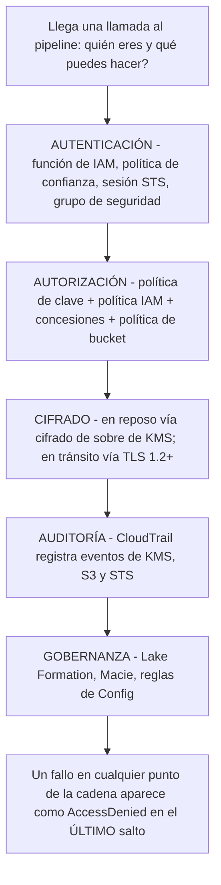
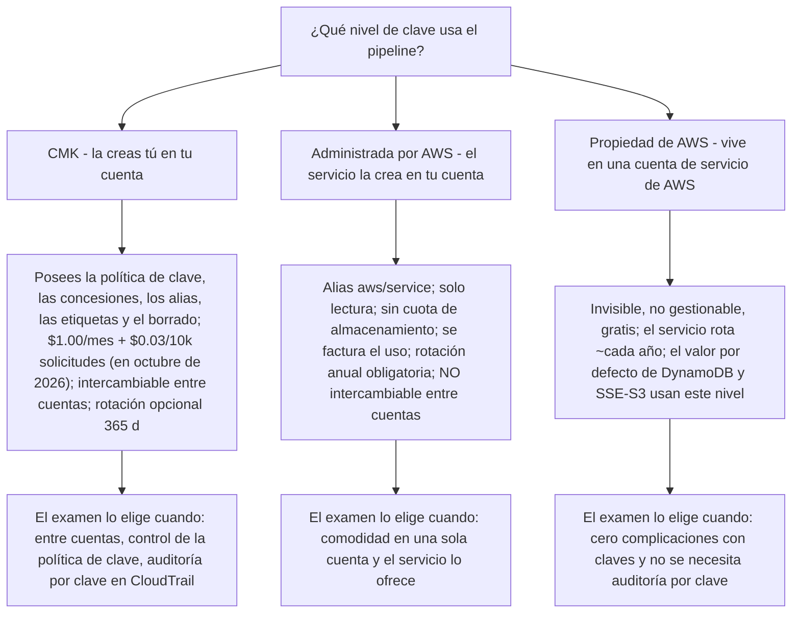
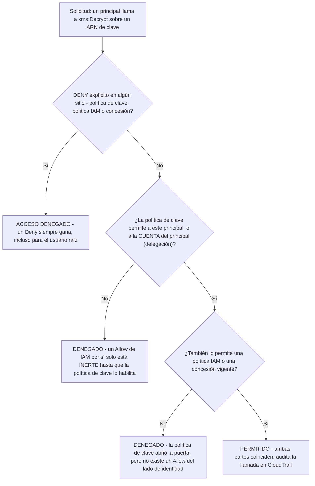
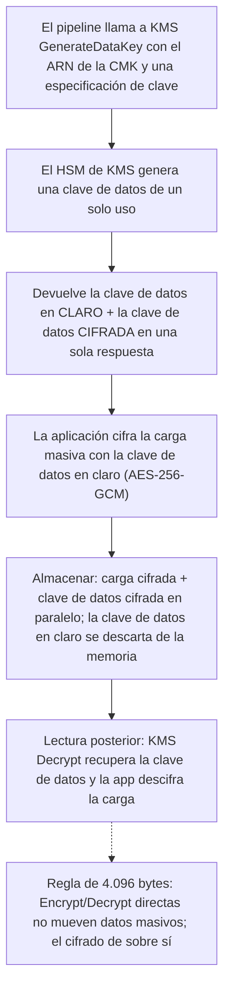
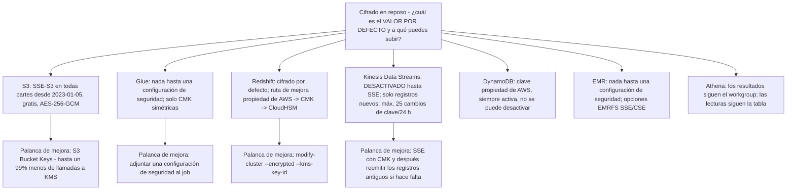
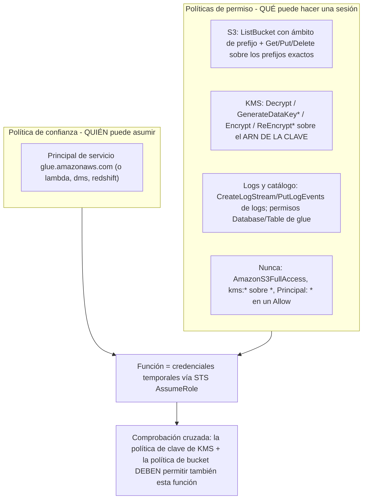
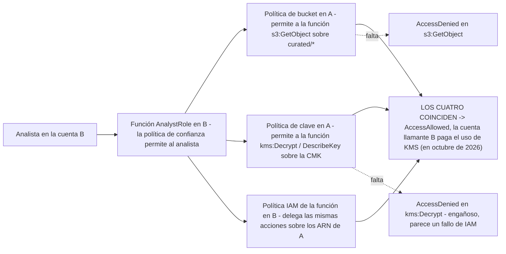

# Seguridad, cifrado e IAM para pipelines de datos

Todo pipeline es una cadena de llamadas autorizadas: un job de Glue asume una función, descifra una clave de datos envuelta por una CMK, lee `s3://raw/`, escribe `s3://curated/` y entrega a Redshift un manifiesto. Rompe cualquier eslabón: una política de clave que nunca habilitó IAM, una concesión que nadie revocó, una política de bucket que deniega `aws:SecureTransport`, y el pipeline falla con un mensaje de error que nombra el *último* salto, no la causa real. El Dominio 4 de la guía del examen DEA-C01 (18% del contenido puntuado) prueba exactamente esta cadena: **autenticación (4.1), autorización (4.2), cifrado y enmascaramiento (4.3), registros de auditoría (4.4) y privacidad/gobernanza (4.5)** (guía del examen DEA-C01, consultada en octubre de 2026). Esta lección enseña la cadena tal como la plantea el examen: como decisiones, valores por defecto y números, cada uno con su fuente.

```text
====================================================================
 DOMINIO 4 — SEGURIDAD Y GOBERNANZA DE DATOS (DEA-C01, 18%)
====================================================================
  4.1 AUTENTICACIÓN .... grupos de seguridad de VPC; grupos/funciones/
                          extremos/servicios de IAM; rotación de
                          credenciales (Secrets Manager); funciones
                          de IAM para Lambda, API Gateway, CLI,
                          CloudFormation; políticas de IAM sobre
                          funciones/extremos/servicios
                          (S3 Access Points, PrivateLink)
  4.2 AUTORIZACIÓN ...... políticas IAM personalizadas; credenciales
                          de app/BD (Secrets Manager, Parameter
                          Store); usuarios/grupos/funciones de BD de
                          Redshift; permisos de Lake Formation;
                          RBAC / por etiquetas / ABAC;
                          políticas personalizadas de mínimo privilegio
  4.3 CIFRADO ........... enmascaramiento/anonimización; claves (AWS
                          KMS); cifrado entre límites de cuenta;
                          cifrado en tránsito / antes del tránsito
  4.4 AUDITORÍA ......... CloudTrail, CloudWatch Logs, CloudTrail
                          Lake, Athena/OpenSearch/Logs Insights
  4.5 PRIVACIDAD ........ permisos de intercambio de datos de Redshift,
                          Macie + Lake Formation PII, soberanía de
                          datos, AWS Config, SageMaker Catalog
--------------------------------------------------------------------
  COLUMNA VERTEBRAL DE ESTA LECCIÓN
  niveles de KMS -> política de clave vs IAM vs concesiones
  -> cifrado de sobre -> rotación y concesiones -> costes de KMS por
  uso -> matriz en reposo -> TLS en tránsito -> IAM del pipeline
  -> entre cuentas -> acceso a S3 -> almacén de secretos
  -> grupos de seguridad y PrivateLink
====================================================================
```

En esta lección vas a:

- separar las claves de KMS **administradas por el cliente, administradas por AWS y propiedad de AWS**: quién las posee, quién paga, quién puede compartirlas;
- evaluar el acceso como lo hace KMS: **primero la política de clave, luego IAM y las concesiones, con el Deny explícito siempre ganando**;
- aplicar el **cifrado de sobre**, su tope de 4.096 bytes en la API directa, y aquello que la rotación *no* vuelve a cifrar;
- calcular el precio de KMS **por uso**, cuota de clave, cuota de solicitudes, free tier, Bucket Keys, con las cifras de octubre de 2026;
- construir la **matriz en reposo** para S3, Glue, Redshift, Kinesis, DynamoDB, EMR y Athena;
- hacer cumplir **TLS en tránsito**, incluida la trampa de redacción de `aws:SecureTransport` que rompe la replicación;
- escribir **funciones de pipeline de mínimo privilegio**: S3 con ámbito de prefijo, acciones de KMS sobre el ARN de la clave, sin `AmazonS3FullAccess`;
- conectar el acceso **entre cuentas** a través de los cuatro documentos que deben coincidir;
- controlar el acceso a S3 con **políticas de bucket, ACL retiradas, Block Public Access, extremos VPC y URL prefirmadas**;
- elegir entre **Secrets Manager y Parameter Store SecureString** por funciones *y* por precio;
- colocar **grupos de seguridad y PrivateLink** para que el tráfico del pipeline nunca haga pinza por internet público;
- practicar con **14 preguntas estilo examen** más tres comprobaciones interactivas.

---

## 1. El mapa de tareas del Dominio 4: dónde encaja esta lección

La guía del examen asigna cinco tareas al Dominio 4; esta lección es el núcleo técnico de 4.1 to 4.3, y aporta la maquinaria de identidad que consumen 4.4 (auditoría) y 4.5 (gobernanza).

| Tarea | Lo que pide la guía | Dónde está en esta lección |
|---|---|---|
| **4.1 Aplicar autenticación** | Grupos de seguridad de VPC; grupos/funciones/extremos de IAM; rotación de credenciales; funciones de IAM para Lambda, API Gateway, CLI, CloudFormation; políticas sobre funciones/extremos/servicios (S3 Access Points, PrivateLink) | Secciones 9, 11, 12, 13 |
| **4.2 Aplicar autorización** | Políticas IAM personalizadas; credenciales de app/BD (Secrets Manager, Parameter Store); usuarios de BD de Redshift; permisos de Lake Formation; RBAC/etiquetas/ABAC; **políticas personalizadas de mínimo privilegio** | Secciones 3, 9, 10, 12 |
| **4.3 Garantizar el cifrado y el enmascaramiento de datos** | Enmascaramiento/anonimización; **claves (AWS KMS)**; **cifrado entre límites de cuenta**; **cifrado en tránsito / antes del tránsito** | Secciones 2 to 8, 10 |
| **4.4 Preparar registros para auditoría** | CloudTrail, CloudWatch Logs, CloudTrail Lake, Athena/OpenSearch/Logs Insights | Fuera de alcance aquí (Lección 10) |
| **4.5 Privacidad y gobernanza de datos** | Permisos de intercambio de datos de Redshift, Macie + Lake Formation PII, soberanía de datos/fijación de Región, AWS Config | Avisado en las secciones 10 y 14 (la Lección 14 posee Lake Formation) |



> [!NOTE]
> El examen rara vez pregunta «¿qué servicio cifra?». Pregunta **qué valor por defecto está activo, qué tipo de clave puedes controlar y qué otro documento debe permitir también la llamada**. Aprende los valores por defecto de la Sección 7 y el conjunto de documentos de las secciones 3 y 10; lo demás es aplicación.

---

## 2. Propiedad de las claves de AWS KMS: administradas por el cliente, administradas por AWS, propiedad de AWS

AWS KMS ofrece tres niveles de clave, y el examen DEA-C01 los distingue en cinco ejes: **dónde vive la clave, qué puedes configurar, qué pagas, si puede rotarse según un calendario que tú controlas y si puede compartirse entre cuentas**.

| Eje | **Clave administrada por el cliente (CMK)** | **Clave administrada por AWS** | **Clave propiedad de AWS** |
|---|---|---|---|
| Dónde vive | **Tu cuenta**, creada por ti | **Tu cuenta**, creada por un servicio integrado en tu nombre | **Una cuenta de servicio de AWS**, no tuya |
| Visibilidad | Completa: metadatos, política, concesiones, alias, etiquetas | Ver metadatos, política y uso en CloudTrail, nada más | **Invisible** |
| Control de la política de clave | **La posees** | Solo lectura; no puedes editarla | Ninguno |
| Rotación | **Opcional**; la habilitas tú; personalizada de 90 to 2.560 días | **Automática ~365 días**, no se puede desactivar | Controlada por el servicio, anual en la mayoría de servicios |
| Intercambio entre cuentas | **Sí**, mediante la política de clave | **No** | Sí de forma transparente (gestionada por el servicio) |
| Costo (en octubre de 2026) | **$1.00/clave/mes** prorrateado por hora + **$0.03 por cada 10.000 solicitudes** | **Sin cuota de almacenamiento**; se factura el uso (algunos servicios lo absorben) | **Gratis** |
| Comprobación de identidad | `DescribeKey` → `KeyManager=CUSTOMER` | alias `aws/<service>` | no consultable |
| Cuotas | Cuenta para tu cuota de **100.000 CMK por Región** | Excluida de la cuota de CMK | Excluida |
| Ejemplos de examen | Clave de configuración de seguridad de Glue, CMK de Redshift, SSE-KMS de S3 con CMK, CMK de Kinesis | `aws/s3` de S3, `aws/kinesis` de Kinesis, clave de clúster propiedad de AWS en Redshift | **Valor por defecto de DynamoDB**, claves SSE-S3 de S3 |

La regla que sostiene la propia documentación de KMS de AWS: **control → CMK, comodidad → propiedad de AWS**. Cuando una pregunta te pide «usar una clave que tú controles para que otra cuenta pueda descifrar», la respuesta es siempre una CMK: las claves administradas por AWS **no pueden compartirse entre cuentas**, y las claves propiedad de AWS ni siquiera son direccionables (conceptos de KMS, consultados en octubre de 2026).



- **📚 ¿Sabías que…?** El nivel administrado por AWS es un **patrón heredado**: la documentación de KMS de AWS señala que **desde 2021 no se crean claves administradas por AWS para nuevas integraciones de servicios**: las integraciones nuevas usan por defecto claves propiedad de AWS (gratis) o te piden que aportes una CMK. Por eso el valor por defecto de DynamoDB es **propiedad de AWS** (rotadas ~365 días, AES-256, no se pueden desactivar) mientras que la opción administrada de S3 sigue siendo la clave administrada por AWS `aws/s3` (conceptos de KMS; documentación de cifrado de DynamoDB, consultada en octubre de 2026).

---

## 3. Políticas de clave frente a políticas IAM frente a concesiones

Esta es la mecánica más examinada del Dominio 4. Tres mecanismos pueden permitir una acción de KMS, y **no** se acumulan como el principiante supone.

### 3.1 Las tres reglas, textualmente de la documentación de KMS

1. *«Una política de clave es una política de recurso para una clave de AWS KMS. Las políticas de clave son la **forma principal** de controlar el acceso a las claves de KMS. **Cada clave de KMS debe tener exactamente una política de clave.**»*
2. *«**Ningún principal de AWS, incluido el usuario raíz de la cuenta o el creador de la clave, tiene ningún permiso sobre una clave de KMS salvo que se le permita explícitamente, y nunca se le deniegue, en una política de clave, una política IAM o una concesión.**»*
3. *«**Salvo que la política de clave lo permita explícitamente, no puedes usar políticas IAM para *permitir* el acceso a una clave de KMS.** … (Puedes usar una política IAM para *denegar* el permiso sobre una clave de KMS sin permiso de la política de clave.)»* (documentación de políticas de clave y control de acceso de KMS, consultada en octubre de 2026)

Dos hechos estructurales más: **las políticas de clave son Regionales y las políticas IAM son globales**; y una concesión puede **permitir pero nunca denegar**, cubre **exactamente una clave**, **no caduca automáticamente** y está limitada a **50.000 concesiones por clave** (documentación de concesiones de KMS, consultada en octubre de 2026).

### 3.2 Orden de evaluación



### 3.3 Anatomía de la sentencia de política de clave predeterminada

La sentencia predeterminada que trae cada CMK nueva nombra la **cuenta**, no al usuario raíz:

```json
{
  "Sid": "Enable IAM User Permissions",
  "Effect": "Allow",
  "Principal": {"AWS": "arn:aws:iam::111122223333:root"},
  "Action": "kms:*",
  "Resource": "*"
}
```

Lee `arn:aws:iam:<account-id>:root` como «**esta cuenta, a través de sus políticas IAM**»: delega en IAM para que las políticas de identidad de la cuenta puedan conceder acciones sobre claves. **No** otorga al usuario raíz una posición especial más allá de lo que IAM ya permite, y sustituirlo por `"Principal": "*"` en una sentencia Allow es el agujero canónico (visión general de la política de clave de KMS, consultada en octubre de 2026).

### 3.4 Ejemplo resuelto E1: una política de identidad que parece correcta y no hace nada

La política IAM de un analista en la cuenta B:

```json
{
  "Effect": "Allow",
  "Action": ["kms:Decrypt", "kms:DescribeKey"],
  "Resource": "arn:aws:kms:us-east-1:111122223333:key/1234abcd-12ab-..."
}
```

Si la política de clave de la CMK de la cuenta A nunca nombró a la cuenta B ni a `arn:aws:iam:B:role/AnalystRole`, esta política está **inerte**. El analista recibe `AccessDenied` con la pista engañosa «not authorized to perform kms:Decrypt», la solución nunca está en la política IAM; está en la **política de clave** (y, para los datos propiamente dichos, en la **política de bucket**). Redacción de examen: «¿Qué cambio concede acceso al analista entre cuentas?», responde **política de clave** primero.

- **📚 ¿Sabías que…?** Los tres mecanismos tienen verbos distintos a propósito: las **políticas** son JSON declarativo evaluado en cada llamada; las **funciones** son identidades asumibles cuya *política de confianza* decide quién puede crear una sesión; las **concesiones** son tickets específicos de KMS, solo de permitir y pensados para máquinas, que los servicios integrados crean en tu nombre: `RetireGrant` y `RevokeGrant` son las APIs de limpieza, y una concesión duplicada olvidada es una escalada de privilegios permanente (documento de mejores prácticas de concesiones de KMS, consultado en octubre de 2026).

```dragdrop
{
  "question": "Arrastra las comprobaciones de acceso a KMS al orden en que KMS las evalúa realmente cuando una función de pipeline llama a kms:Decrypt:",
  "items": [
    "Comprobación del lado de identidad: ¿una política IAM o una concesión vigente también permite la acción?",
    "PERMITIDO: la llamada se autoriza y queda registrada en CloudTrail",
    "Comprobación de Deny explícito: ¿alguna política de clave, política IAM o concesión contiene un Deny explícito?",
    "Comprobación de la política de clave: ¿la política de clave permite al principal en sí, o a su CUENTA por delegación?"
  ],
  "correctOrder": [
    "Comprobación de Deny explícito: ¿alguna política de clave, política IAM o concesión contiene un Deny explícito?",
    "Comprobación de la política de clave: ¿la política de clave permite al principal en sí, o a su CUENTA por delegación?",
    "Comprobación del lado de identidad: ¿una política IAM o una concesión vigente también permite la acción?",
    "PERMITIDO: la llamada se autoriza y queda registrada en CloudTrail"
  ],
  "explanation": "El orden es toda la mecánica del examen: un Deny explícito en cualquier punto cortocircuita todo (incluso para el usuario raíz de la cuenta); solo después vota la política de clave, porque un Allow de IAM está inerte hasta que la política de clave permite al principal o delega en su cuenta; solo si la puerta está abierta necesita el lado de la identidad (política IAM o concesión) su propio Allow. Si te saltas el orden obtienes los dos diagnósticos clásicos: «añadí una política IAM y sigue fallando» (política de clave cerrada) y «la política de clave me permite pero sigo denegado» (falta el Allow del lado de identidad). Todo lo que se permite aquí se registra por clave en CloudTrail, y por eso la tarea de auditoría 4.4 depende de que esta evaluación funcione."
}
```

---

## 4. Cifrado de sobre: cómo se cifra realmente el dato masivo

Las claves de KMS nunca salen sin cifrar de los HSM FIPS 140-3 **Nivel 3**, así que cifrar terabytes a través de la propia clave sería a la vez lento e imposible: las APIs directas `Encrypt`/`Decrypt` aceptan un máximo de **4.096 bytes** de texto plano. Por eso toda integración en reposo de AWS usa **cifrado de sobre**: generar una *clave de datos* barata por objeto, cifrar la carga localmente y conservar solo el cifrado de la clave de datos bajo la clave de KMS.



Lo que esto significa para los escenarios de examen:

- **La CMK envuelve la clave de datos, no tus datos.** `kms:Decrypt` sobre la clave es necesario pero no suficiente: el llamante también necesita la clave de datos cifrada almacenada con el objeto (S3 hace esto por ti bajo SSE-KMS).
- **`ReEncrypt*` son dos permisos, no uno.** Reenvolver una clave de datos bajo una nueva clave exige **a la vez** `kms:ReEncryptFrom` y `kms:ReEncryptTo` (referencia de permisos de la API de KMS, consultada en octubre de 2026).
- **La rotación nunca reescribe el cifrado.** El material nuevo cifra las claves de datos **futuras**; el cifrado antiguo se descifra para siempre con la clave de respaldo antigua conservada. Nada en «habilitar la rotación» migra tus objetos.
- **El cifrado del lado del cliente (CSE-KMS)** es la misma matemática ejecutada enteramente de tu lado, AWS nunca ve el texto plano, y por eso CSE-KMS es el nivel de resultados «más fuerte» de Athena y una opción de EMRFS.

---

## 5. Rotación y concesiones: qué es automático, qué es opcional y qué es peligroso

### 5.1 Reglas de rotación

| Tipo de clave | Rotación | Control |
|---|---|---|
| **CMK (simétrica, origen `AWS_KMS`)** | **Desactivada por defecto**; al habilitarla, material nuevo cada **365 días** (personalizada **90 to 2.560**); primera rotación un año después de habilitarla | Tú llamas a `EnableKeyRotation` |
| **CMK (asimétrica, HMAC, importada, almacén de claves personalizado)** | **No elegible** para rotación automática | Rotación manual o `RotateKeyOnDemand` |
| **Clave administrada por AWS** | **Siempre ~365 días**, no se puede desactivar (antes era ~1.095 días, hasta mayo de 2022) | Ninguna |
| **Clave propiedad de AWS** | Controlada por el servicio, ~anual | Ninguna |
| **Valor por defecto de DynamoDB (propiedad de AWS)** | ~365 días, AES-256, no se puede desactivar | Ninguna; se puede adjuntar una CMK por tabla y cambiarla en cualquier momento |

La rotación es **transparente**: el cifrado existente nunca se vuelve a cifrar y las claves de respaldo antiguas del HSM se conservan, de modo que los datos antiguos siguen siendo descifrables. Eventos que puedes auditar: `KMS CMK Rotation` hacia EventBridge y `RotateKey` en CloudTrail (documentación de rotación de claves de KMS, consultada en octubre de 2026).

### 5.2 Mecánica de las concesiones

- Una concesión puede **permitir** acceso, pero **no denegarlo**; **cada concesión permite el acceso a exactamente una clave de KMS**; **las concesiones no caducan automáticamente** (documentación de concesiones de KMS, consultada en octubre de 2026).
- Un único concesionario por concesión: una identidad de IAM **o** un principal de servicio (así obtienen Glue, DMS y Redshift acceso con mínimo privilegio y limitado en el tiempo).
- Límites: **50.000 concesiones por clave**; `CreateGrant` es aproximadamente tan potente como `PutKeyPolicy`, así que condiciónnelo con `kms:GranteePrincipal`, `kms:GrantOperations`, `kms:GrantConstraintType` y `kms:GrantIsForAWSResource`.
- Un `GrantToken` devuelto por `CreateGrant` esquiva la consistencia eventual posterior a la creación dentro del mismo flujo de trabajo.

### 5.3 Ejemplo resuelto E2: lo que «habilitar la rotación» cuesta y lo que no hace

Un equipo habilita la rotación automática en una CMK simétrica el 2026-01-15, la rota cinco veces en tres años y almacena 40 TB de objetos de S3 bajo SSE-KMS con esa clave.

```text
Cuota de la clave (en octubre de 2026)  ......  $1.00 / mes
Rotaciones automáticas  .....................  5
Rotaciones facturables  ......................  solo la 1.ª y la 2.ª = 2 x $1.00
                                            (la 3.ª, 4.ª y 5.ª son GRATIS)
Coste de la clave en régimen estable  .......  $1.00 + $1.00 + $1.00 = $3.00/mes
                                            al llegar al estado final, después $3.00 fijo
Objetos re-cifrados por la rotación  ........  0  (el cifrado antiguo sigue
                                            descifrándose con las claves conservadas)
¿Siguen legibles los datos con la versión antigua de la clave?  sí - la rotación es transparente
```

La trampa del examen: «habilitar la rotación vuelve a cifrar los objetos existentes con el material nuevo de la clave» es **falso**. Re-cifrar es un trabajo aparte y deliberado (S3 Batch Operations, llamadas `ReEncrypt*` o reescribe los datos).

---

## 6. Precios de KMS: se pagan las claves y se paga el uso

Cada cifra de esta sección procede de la página de precios de AWS KMS, **en octubre de 2026**; vuelve a verificarla antes de fechar con ella una decisión de diseño más adelante.

| Cargo | Valor (en octubre de 2026) |
|---|---|
| Almacenamiento de clave administrada por el cliente | **$1.00 por clave al mes**, prorrateado por hora: se aplica a la clave primaria **multi-Región y a sus réplicas**, al material importado y a los almacenes de claves externos |
| Recargo por rotación | La **primera y la segunda** rotaciones automáticas o bajo demanda añaden **$1.00/mes cada una**, **con tope en la segunda**; las rotaciones posteriores son gratis |
| Uso simétrico | **$0.03 por cada 10.000 solicitudes** |
| Uso de firma asimétrica | **$0.15 por cada 10.000 solicitudes** |
| Free tier | **20.000 solicitudes de KMS al mes, todas las Regiones sumadas** (excluye `Sign`/`Verify` y `GenerateDataKeyPair*` asimétricos) |
| Administrada por AWS / propiedad de AWS | **Sin cuota de almacenamiento**; el uso de la administrada por AWS se factura igualmente salvo que un servicio lo absorba |
| Entre cuentas | «**Se factura a la cuenta de AWS que hace la solicitud de la API**»: paga quien llama |

### 6.1 Ejemplo resuelto E3: la factura mensual de KMS para un lago SSE-KMS

Una CMK y un mes ocupado con **2.010.000** llamadas a KMS (los GET y los PUT desencadenan operaciones de clave de datos):

```text
Solicitudes facturadas = 2,010,000 - 20,000 gratis = 1,990,000
Coste de solicitudes   = (1,990,000 / 10,000) x $0.03 = 199 x $0.03 = $5.97
Cuota de la clave      = $1.00
Total mensual          = $1.00 + $5.97 = $6.97   (en octubre de 2026)
```

### 6.2 Ejemplo resuelto E4: el mismo lago con un S3 Bucket Key

Los S3 Bucket Keys reducen hasta un **99%** el número de solicitudes de KMS que llegan a tu clave, porque S3 reenvía una sola clave de datos en lugar de una por operación de objeto. No se admiten con DSSE-KMS; sí con SSE-KMS.

```text
Coste de solicitudes con Bucket Key ~= 1% de 1,990,000 = ~19,900 llamadas
  -> redondea a ~2 x $0.03 = $0.06 (ilustrativo; AWS publica «hasta un 99%»)
Total mensual ~= $1.00 + ~$0.10 = ~$1.00-$1.10   (en octubre de 2026)
El mismo lago con SSE-S3 por defecto (claves propiedad de AWS) = $0 de coste de clave
Ahorro frente a E3 = $6.97 - ~$1.05 ~= $5.92 al mes, ~85% de la factura de claves
```

Planteamiento de examen (y la solución en el Caso A más abajo): «¿Qué único cambio reduce más el coste de KMS de un bucket SSE-KMS sin debilitar el postura de cifrado?»: **habilitar los S3 Bucket Keys**.

> [!IMPORTANT]
> **⚠️ Trampas de coste:** rotar una CMK **dos veces** añade $2/mes y después aplica el tope; **los llamantes entre cuentas pagan en su propia cuenta**; el free tier es **por cuenta, todas las Regiones sumadas**, no por clave; y las claves administradas por AWS siguen facturando el **uso** salvo que el servicio integrante pague por ti (precios de AWS KMS, consultados en octubre de 2026).

---

## 7. Cifrado en reposo: la matriz por servicio

El cifrado en reposo en este examen es un juego de **valores por defecto**. Observa el patrón: los servicios gestionados cifran cada vez **siempre**, y tu control queda limitado a *qué nivel de clave* eliges para subir.

| Servicio | Cifrado en reposo por defecto | Tus opciones | Reglas especiales que al examen le encantan |
|---|---|---|---|
| **Amazon S3** | **SSE-S3 en todos los buckets desde 2023-01-05**, AES-256-GCM, **sin cuota** | SSE-KMS (`aws/s3` o tu CMK), DSSE-KMS (doble capa), SSE-C (aportas la clave en cada solicitud) | **Los Bucket Keys reducen hasta un 99% las llamadas a KMS**; cambiar el valor por defecto del bucket **no vuelve a cifrar los objetos existentes**; DSSE-KMS no admite Bucket Keys |
| **AWS Glue** | **Ninguno hasta que lo configures** | Configuración de seguridad: datos de S3 con SSE-S3/SSE-KMS, CloudWatch Logs con KMS, **bookmarks del job con CSE-KMS**, Data Quality con KMS; Catálogo `DISABLED \| SSE-KMS \| SSE-KMS-WITH-SERVICE-ROLE`; contraseñas de conexión vía CMK | **Solo CMK simétricas**; la configuración de seguridad **anula** cualquier parámetro SSE-S3 del job; la **función del job** necesita los permisos de KMS |
| **Amazon Redshift** | **Cifrado por defecto** (AES-256) en clústeres nuevos | Clave propiedad de AWS, **tu CMK** o CloudHSM | Jerarquía de cuatro niveles raíz → CEK → DEK → claves de datos; solo sale de KMS el CEK cifrado; **desactiva la copia de instantáneas entre Regiones antes** de cambiar de clave; la rotación del CEK **reinicia el clúster** |
| **Kinesis Data Streams** | **Desactivado hasta que habilites SSE** | `aws/kinesis` (clave gratis, uso facturado) o una **CMK** | Cifra **solo los registros nuevos**: los registros previos quedan sin cifrar; **≤25 cambios de clave cada 24 horas móviles**; compartir mediante política de recurso exige una **CMK** |
| **Amazon DynamoDB** | **Clave propiedad de AWS, siempre activa, no se puede desactivar** (AES-256) | `aws/dynamodb` o una CMK por tabla | La CMK cubre índices, streams y copias de seguridad; **DAX no puede usar una CMK**; la clave puede cambiarse en cualquier momento |
| **Amazon EMR** | **Ninguno hasta una configuración de seguridad** (EMR ≥ 4.8.0) | EMRFS SSE-S3 / SSE-KMS / CSE-KMS / CSE-C; EBS en reposo; WAL `SSE-EMR-WAL` (por defecto) o `SSE-KMS` | **Solo claves simétricas**, en la misma Región que el clúster **y** que los buckets; el cifrado transparente de HDFS (≥ 4.1.0) usa **Hadoop KMS, no AWS KMS** |
| **Amazon Athena** | Los resultados siguen la configuración de consulta/workgroup | SSE-S3, **SSE-KMS (recomendado)**, CSE-KMS; los resultados de consulta gestionados los gestiona el servicio y vienen cifrados | Manda la anulación del workgroup; niveles Básico = SSE_S3, Intermedio = SSE_KMS, Avanzado = CSE_KMS; **las lecturas de tablas siguen el cifrado de la tabla**, no la configuración de resultados; muchos objetos pequeños de resultados en KMS pueden limitar las consultas |



### 7.1 Ejemplo resuelto E5: la migración que no re-cifró

Un equipo de cumplimiento cambia el cifrado por defecto de un bucket de S3 existente de SSE-S3 a SSE-KMS con una CMK el 2026-10-01 y declara el lago conforme.

```text
Objetos escritos ANTES del cambio  ->  siguen en SSE-S3 (las propias claves de S3)
Objetos escritos DESPUÉS del cambio ->  SSE-KMS bajo la CMK
Motivo (documentación de KMS/S3, consultada en octubre de 2026):
  "Cuando cambias la configuración de cifrado por defecto de tu bucket
   a SSE-KMS, el tipo de cifrado de los objetos de Amazon S3
   existentes en el bucket no cambia."
Remediación: trabajo de re-cifrado con S3 Batch Operations, o ciclo de
vida + reescritura.
Misma familia de trampa: el SSE de Kinesis cifra solo los registros
 NUEVOS (fecha de activación 2026-10-01 en un stream activo desde
 2026-09-01 -> los registros de septiembre siguen sin cifrar).
Contraejemplo: DynamoDB SÍ puede cambiar el material de clave en
 caliente, índices y streams incluidos - esa asimetría es examinable.
```

```matching
{
  "question": "Relaciona cada servicio de datos con su estado de cifrado en reposo POR DEFECTO en DEA-C01 (en octubre de 2026):",
  "pairs": [
    {"left": "Amazon S3", "right": "SSE-S3 en todos los buckets desde 2023-01-05: AES-256-GCM, sin cuota, claves de S3"},
    {"left": "Amazon DynamoDB", "right": "Clave propiedad de AWS, siempre activa, no se puede desactivar: la CMK es una mejora opcional por tabla"},
    {"left": "Amazon Redshift", "right": "Cifrado por defecto con una clave propiedad de AWS: jerarquía de cuatro niveles; SSL SIN embargo NO es obligatorio por defecto"},
    {"left": "Amazon Kinesis Data Streams", "right": "Cifrado del lado del servidor DESACTIVADO hasta que se habilite: y cifra solo los registros NUEVOS"},
    {"left": "AWS Glue", "right": "Nada cifrado hasta que adjuntes una configuración de seguridad: solo CMK simétricas"},
    {"left": "Amazon EMR", "right": "Nada cifrado hasta que exista una configuración de seguridad: el cifrado transparente de HDFS usa Hadoop KMS, no AWS KMS"},
    {"left": "Amazon Athena", "right": "Los resultados de consulta siguen la configuración del workgroup: pero las LECTURAS de tablas siguen el cifrado de la propia tabla"}
  ],
  "explanation": "El examen prueba los VALORES POR DEFECTO más la dirección de la mejora. S3 y DynamoDB cifran sin configuración (niveles de clave distintos: SSE-S3 usa claves propiedad de AWS; el valor por defecto de DynamoDB también es propiedad de AWS). Redshift cifra pero deja SSL opcional (require_SSL=true es cosa tuya). Kinesis y Glue/EMR no hacen nada hasta que se configuran, y Kinesis nunca rellena los registros antiguos. Athena separa el cifrado de resultados del cifrado de la tabla de origen: un distractor favorito."
}
```

---

## 8. Cifrado en tránsito: TLS en todas partes y los dos patrones de cumplimiento

La línea base de AWS: **S3 acepta TLS 1.2 y 1.3** en sus extremos, y **todos los extremos de API de servicios de AWS exigen como mínimo TLS 1.2 desde 2024-02-27**. Kinesis **exige TLS 1.2 y recomienda 1.3**. Redshift, sin embargo, **acepta conexiones no SSL por defecto**: tienes que fijar `require_SSL=true` en el grupo de parámetros del clúster. Al examen le encanta esa asimetría.

### 8.1 Del lado del servidor frente a del lado del cliente, en una línea cada uno

- **Del lado del servidor (SSE-\*)**: el servicio cifra al recibir y descifra al servir; tú nunca sostienes texto plano.
- **Del lado del cliente (CSE-KMS, cliente de cifrado de S3, `COPY` de Redshift sobre archivos cifrados por el cliente, CSE de EMRFS)**: cifras antes de subir; **AWS no puede leer el texto plano**, y por eso CSE es a la vez el postura más fuerte y la más difícil de operar.

### 8.2 Ejemplo resuelto E6, un Deny de `aws:SecureTransport` que rompió la replicación

Política del equipo: denegar cualquier solicitud que no sea HTTPS.

```json
{
  "Sid": "DenyInsecureTransport",
  "Effect": "Deny",
  "Principal": "*",
  "Action": "s3:*",
  "Resource": ["arn:aws:s3:::lake-raw", "arn:aws:s3:::lake-raw/*"],
  "Condition": {"Bool": {"aws:SecureTransport": "false"}}
}
```

La polaridad de la condición es correcta, `aws:SecureTransport` es **true** para HTTPS, pero la **replicación** de S3 después no logra escribir su configuración. Motivo, según la documentación de S3: *«Cuando los servicios de AWS hacen llamadas a otros servicios de AWS en tu nombre (llamadas de servicio a servicio), cierto contexto de autorización específico de la red se redacta, incluidos `s3:TlsVersion`, `aws:SecureTransport`, `aws:SourceIp` y `aws:VpcSourceIp`»*. El principal del servicio de replicación **no** presenta ningún valor de `aws:SecureTransport`, así que el Deny coincide. Solución:

```json
"Condition": {
  "Bool": {"aws:SecureTransport": "false"},
  "StringNotEquals": {"aws:PrincipalIsAWSService": "true"}
}
```

…o, de forma equivalente, añade `"aws:PrincipalIsAWSService": "false"` a la condición del Deny para que solo se vigile a los llamantes **humanos o de función**. La misma trampa se aplica a los mínimos de `s3:TlsVersion` y a las condiciones `aws:SourceIp` que usan trabajos de copia de seguridad o de replicación.

### 8.3 SSL en Redshift y las demás reglas de tránsito por servicio

| Servicio | Tránsito por defecto | Palanca de cumplimiento |
|---|---|---|
| **Redshift** | *«De forma predeterminada, las bases de datos del clúster aceptan una conexión use SSL o no.»* | Fija **`require_SSL=true`** en el grupo de parámetros; el `sslmode` del cliente recorre `disable → allow → prefer → require → verify-ca → verify-full`; los VPC con cifrado obligatorio imponen `require_SSL`; el SSL acelerado por hardware cubre `COPY`/`UNLOAD`/copias de seguridad |
| **Kinesis Data Streams** | **TLS 1.2 obligatorio, TLS 1.3 recomendado** en todas las llamadas del plano de datos | Nada que habilitar; pruébalo con un cliente no TLS (falla) |
| **Conexiones de AWS Glue** | Opcional | Marca **«Require SSL connection»** en las conexiones JDBC a bases de datos |
| **S3** | TLS 1.2/1.3 en los extremos | Deny en la política de bucket sobre `aws:SecureTransport=false` (cuidado con la trampa de redacción de arriba) o `s3:TlsVersion >= 1.2` |
| **DMS** | La instancia de replicación usa TLS donde el motor lo admite | Los grupos de seguridad siguen decidiendo la alcanzabilidad (Sección 13) |

Existe automatización de configuración para las dos palancas más examinadas: las reglas gestionadas de AWS Config **`s3-bucket-ssl-requests-only`** y **`redshift-require-tls-ssl`** (más `kinesis-stream-encrypted`) afirman continuamente el postura que configuraste una sola vez.

---

## 9. IAM para servicios de datos: funciones, mínimo privilegio y el antipatrón

### 9.1 Los componentes básicos

| Concepto | Qué es en este examen |
|---|---|
| **Política** | Documento JSON de permisos: basada en identidad (adjunta a un principal) o basada en recurso (adjunta a un bucket, una clave, una cola…) |
| **Función** | Identidad asumible = **política de confianza** (quién puede asumirla) + políticas de permiso (qué puede hacer una sesión) + **credenciales temporales** vía STS |
| **Función de servicio** | Una función **que el servicio asume para actuar en tu nombre**: job de Glue, instancia de replicación de DMS, `COPY IAM_ROLE=…` de Redshift, función de ejecución de Lambda |
| **Función vinculada al servicio** | Variante gestionada por AWS; el servicio define la confianza y los permisos; no puedes editarlos |
| **Regla de identidad de la carga de trabajo** | Las cargas de trabajo usan **funciones, nunca claves de acceso a largo plazo incrustadas**; las personas se federan a través de IAM Identity Center |

### 9.2 El patrón `AWSGlueServiceRole` y el antipatrón `AmazonS3FullAccess`

Históricamente, la consola de AWS adjunta `AmazonS3FullAccess` a los jobs de Glue de demostración. La propia documentación de Glue matiza esto: *«Es posible que quieras proporcionar tu propia política para acceder a recursos concretos de Amazon S3»*. La **`AWSGlueServiceRole` gestionada** concede Glue más un S3 limitado (sus propios buckets de scripts y temporales `aws-glue-*`), CloudWatch y el cableado de ENI: **no es un concesión de acceso a datos**. Patrón de producción:

```json
{
  "Version": "2012-10-17",
  "Statement": [
    {
      "Sid": "ReadLandingPrefix",
      "Effect": "Allow",
      "Action": ["s3:GetObject", "s3:ListBucket"],
      "Resource": [
        "arn:aws:s3:::lake-raw",
        "arn:aws:s3:::lake-raw/raw/*"
      ],
      "Condition": {"StringLike": {"s3:prefix": "raw/*"}}
    },
    {
      "Sid": "WriteCuratedPrefix",
      "Effect": "Allow",
      "Action": ["s3:PutObject", "s3:DeleteObject", "s3:ListBucket"],
      "Resource": [
        "arn:aws:s3:::lake-curated",
        "arn:aws:s3:::lake-curated/curated/*"
      ]
    },
    {
      "Sid": "UseThePipelineKey",
      "Effect": "Allow",
      "Action": [
        "kms:Decrypt", "kms:GenerateDataKey*",
        "kms:Encrypt", "kms:ReEncrypt*", "kms:DescribeKey"
      ],
      "Resource": "arn:aws:kms:us-east-1:111122223333:key/1234abcd-..."
    }
  ]
}
```

Tres cosas que este extracto hace bien y que `AmazonS3FullAccess` hace mal: **ARN de `Resource` con ámbito de prefijo**, **`s3:ListBucket` sobre el ARN del bucket emparejado con `s3:GetObject`/`PutObject` sobre el ARN del objeto** (el modelo de permisos de S3 de dos niveles) y **acciones de KMS atadas al ARN concreto de la clave**: que la política de clave también debe permitir (Sección 3).

Los mínimos propios de AWS para un job de Glue coinciden con esa división: *«Las fuentes de datos requieren los permisos `s3:ListBucket` y `s3:GetObject`. Los destinos de datos requieren `s3:ListBucket`, `s3:PutObject` y `s3:DeleteObject`»*. Y si pasas una función por la consola, su nombre debe llevar el **prefijo `AWSGlueServiceRole`** (documentación de IAM de Glue, consultada en octubre de 2026).



### 9.3 Permisos de KMS dentro de las políticas de pipeline

El conjunto mínimo de acciones según la forma de la carga de trabajo (referencia de permisos de la API de KMS, consultada en octubre de 2026):

| Carga de trabajo | Acciones mínimas de KMS sobre el ARN de la clave |
|---|---|
| **Leer** objetos SSE-KMS | `kms:Decrypt`, `kms:DescribeKey` |
| **Escribir** objetos SSE-KMS | `kms:GenerateDataKey*`, `kms:Encrypt`, más `kms:DescribeKey`; `kms:ReEncrypt*` al reenvolver |
| **Clave de resultados gestionados de Athena** | `kms:Decrypt`, `kms:GenerateDataKey`, `kms:DescribeKey` |
| **Configuración de seguridad de Glue** | Todo lo anterior para **cada** clave nombrada en la configuración: adjunta a la **función del job**, no al usuario de la consola que pulsó Run |

- **📚 ¿Sabías que…?** El modelo de permisos de dos niveles de S3 es un fallo silencioso frecuente: `s3:ListBucket` se autoriza contra el **ARN del bucket** (`arn:aws:s3:::lake-raw`), mientras que `s3:GetObject`/`s3:PutObject` se autorizan contra **ARN de objeto** (`arn:aws:s3:::lake-raw/raw/*`). Conceder solo los ARN de objeto deja `ListBucket` fallando; la división fuente/destino de la documentación de AWS Glue existe precisamente porque los crawlers y la proyección de particiones llaman a `ListBucket` constantemente (documento de mínimos privilegios de Glue, consultado en octubre de 2026).

```fillblank
{
  "question": "Completa las sentencias de IAM del pipeline con el vocabulario de esta lección:",
  "template": "Una {{1}} es una identidad asumible cuya política de {{2}} decide quién puede crear una sesión y cuyas políticas de permiso deciden qué puede hacer esa sesión; emite credenciales {{3}}, así que las cargas de trabajo nunca deben incrustar claves de acceso a largo plazo. Las fuentes de datos de Glue necesitan {{4}} además de s3:GetObject, mientras que los destinos de datos necesitan ListBucket, PutObject y {{5}}. Las funciones de Glue creadas en la consola deben llevar el prefijo {{6}}, y las acciones de KMS pertenecen al ARN de la {{7}} - concedidas por la política de identidad Y habilitadas por la política de clave.",
  "answers": {
    "1": "función",
    "2": "confianza",
    "3": "temporales",
    "4": "s3:ListBucket",
    "5": "s3:DeleteObject",
    "6": "AWSGlueServiceRole",
    "7": "clave"
  },
  "distractors": ["policy", "grant", "resource", "permanent", "session", "s3:GetObject", "s3:PutObject", "AmazonS3FullAccess", "bucket", "principal"],
  "explanation": "Las funciones = política de confianza + políticas de permiso + credenciales temporales de STS, y por eso AWS prohíbe claves a largo plazo en las cargas de trabajo. Los mínimos documentados de Glue son exactamente ListBucket+GetObject para fuentes y ListBucket+PutObject+DeleteObject para destinos, y las funciones de Glue pasadas por la consola deben empezar por AWSGlueServiceRole. Los derechos de KMS deben atarse al ARN DE LA CLAVE en la política de identidad y a la vez permitirse en la política de clave: cualquiera de los dos documentos a solas deja el pipeline con AccessDenied."
}
```

---

## 10. Acceso entre cuentas: los cuatro documentos que deben coincidir

El acceso entre cuentas es el «cifrado entre límites de cuenta» de la tarea 4.3.3, y falla con un error que nombra un mecanismo mientras la laguna real está en otro. La cuenta **A** posee un bucket curado y una CMK; los analistas de la cuenta **B** necesitan `s3:GetObject`.

| # | Documento | Lo que debe decir |
|---|---|---|
| 1 | **Política de clave** de la CMK de A | Permitir a `arn:aws:iam::B:role/AnalystRole` (o a la raíz de la cuenta B + delegación) `kms:Decrypt`, `kms:DescribeKey` |
| 2 | **Política de bucket** del bucket de A | Permitir a ese principal `s3:GetObject` sobre `curated/*` |
| 3 | **Política IAM** de la función de B | Permitir `kms:Decrypt`/`kms:DescribeKey` sobre el ARN de la clave de A y `s3:GetObject` sobre los ARN del bucket de A: *«El acceso entre cuentas requiere permiso en la política de clave de la clave de KMS y en una política IAM en la cuenta del usuario externo»* |
| 4 | **Política de confianza** de la función de B | Permitir a los usuarios/grupos de analistas hacer `sts:AssumeRole` |



Dos restricciones estructurales que vale la pena memorizar: **las claves administradas por AWS no pueden compartirse entre cuentas** (así que el diseño fuerza una CMK) y, para el intercambio mediante política de recurso en Kinesis, la clave también debe ser una CMK. En cuanto a la facturación, *«se factura a la cuenta de AWS que hace la solicitud de la API»* por el uso de KMS (precios de AWS KMS, consultados en octubre de 2026).

---

## 11. Acceso a S3: políticas de bucket, ACL, extremos y URL prefirmadas

### 11.1 Políticas de bucket y la retirada de las ACL

Una política de bucket es una **política de recurso**: principal, acción, recurso y **condición**. También es el único lugar donde puedes expresar restricciones `aws:SecureTransport`, `aws:SourceVpce` o `aws:PrincipalIsAWSService`.

Las ACL son heredadas. Desde que AWS activó por defecto **Object Ownership = Bucket owner enforced**, **todas las ACL están desactivadas**, el propietario del bucket es propietario de cada objeto y las escrituras en ACL fallan con `AccessControlListNotSupported`. La orientación de AWS: *«recomendamos que mantengas las ACL desactivadas»* y migrar a políticas de bucket cualquier concesión de ACL que sobreviva (documentación de Object Ownership de S3, consultada en octubre de 2026). **Block Public Access** viene con los cuatro interruptores activados por defecto en buckets nuevos (cuenta, bucket, punto de acceso, organización), ganando siempre el más restrictivo.

### 11.2 Extremos VPC: gateway frente a interfaz

| | **Extremo gateway** | **Extremo de interfaz (PrivateLink)** |
|---|---|---|
| Servicios | **Solo S3 y DynamoDB** | Casi todos los servicios de AWS, S3 incluido |
| Costo (en octubre de 2026) | **Sin cargo** | ENI facturada por AZ + procesamiento de datos |
| Adhesión | Tabla de rutas | ENI por subred; DNS privado opcional |
| El tráfico sigue privado sin IGW/NAT | Sí | Sí |
| On-premises sobre Direct Connect/VPN | **No** | **Sí** |
| Entre Regiones | No | Vía peering/Transit Gateway |
| Capa extra de autenticación | Política de extremo | Política de extremo |
| Claves de condición | `aws:sourceVpce` funciona; **`aws:SourceIp` no**: usa **`aws:VpcSourceIp`** | Misma precaución en la vía del gateway |

### 11.3 Ejemplo resuelto E7: vigencia de las URL prefirmadas

Una URL prefirmada delega los permisos del **prefirmante** para una operación concreta; nunca los amplía, y la vigencia se vuelve a comprobar en cada solicitud (siguen aplicándose los Deny de la política de bucket y Block Public Access).

```text
Caso 1 - URL solicitada desde un USUARIO DE IAM con credenciales SigV4 a
         largo plazo:
         solicitada 7 días -> real = 7 días (tope de CLI/SDK = 7 días;
         botones de consola: 1 minuto - 12 horas)

Caso 2 - URL solicitada por una FUNCIÓN DE EJECUCIÓN de Lambda cuya
         sesión dura 1 hora, solicitada 7 días -> real = 1 HORA.
         Regla: las URLs con credenciales temporales mueren con la
         sesión sin importar la caducidad solicitada (sesiones de
         función, perfiles de instancia EC2 típicamente ~6 horas).

Caso 3 - El prefirmante solo tiene s3:GetObject sobre curated/* -> la URL
         nunca puede convertirse en un PutObject; los permisos vienen del
         LLAMANTE, así que el mínimo privilegio en la función ES la
         política de la URL.
```

El planteamiento de Prescriptive Guidance: no puedes limitar la velocidad de *generación* de URLs; tus palancas son **mínimo privilegio + caducidad corta + monitorización** (documentación de URL prefirmadas de S3; Prescriptive Guidance, consultada en octubre de 2026).

---

## 12. Secrets Manager frente a Parameter Store SecureString

Ambos almacenan texto cifrado bajo KMS; divergen en **rotación, entre cuentas, tamaño y precio**. La propia orientación de selección de AWS: **Secrets Manager para secretos, Parameter Store para pares clave-valor simples** (Blog de seguridad de AWS, 2025-10-22, consultado en octubre de 2026).

| | **SSM Parameter Store** | **Secrets Manager** |
|---|---|---|
| Tipos | String, StringList, **SecureString** | Secreto (llano o clave/valor JSON) |
| Cifrado | SecureString vía KMS, solo simétricas; por defecto `aws/ssm` o tu CMK; el nivel estándar se cifra bajo la clave, el nivel avanzado añade sobre más AWS Encryption SDK | Siempre KMS (administrada por AWS o tu CMK) |
| **Rotación** | **Ninguna**: el cron lo posees tú | **Rotación con Lambda** + integraciones nativas de RDS/OpenSearch |
| Entre cuentas / replicación | **Solo nivel avanzado** | Sí |
| Tamaño | Estándar **4 KB**, avanzado **8 KB** | No es el factor decisivo; este examen elige el almacén por rotación y entre cuentas, no por tamaño de la carga |
| Costo (en octubre de 2026) | Estándar **gratis**: 10.000 parámetros/cuenta/Región; avanzado **$0.05/parámetro/mes**, 100.000 parámetros, políticas de parámetro | **$0.40/secreto/mes** (prorrateado por hora) + **$0.05 por cada 10.000 llamadas a la API**; **prueba de 30 días**; las **versiones de rotación no se facturan** |
| Elige para | Valores de configuración, feature flags, texto que no sea secreto | Credenciales de BD, claves API, tokens OAuth/JWT, todo lo que necesite rotación o auditoría por secreto |

### 12.1 Ejemplo resuelto E8: 50 credenciales de base de datos, doce meses

Un job nocturno de Glue y tres pasos de EMR rotan 50 credenciales de almacén/servicio.

```text
Secrets Manager (en octubre de 2026):
  Secretos:       50 x $0.40 x 12 meses               = $240.00
  Llamadas API:   365.000 GetSecretValue durante el año
                  = 36,5 x $0,05                      =   $1,83
  Lambdas de rotación: las VERSIONES de rotación son gratis
  Total                                  ~= $241.83/año, rotación incluida

Parameter Store NIVEL ESTÁNDAR:
  $0.00 - pero SIN rotación y SIN entre cuentas:
  un trabajo cron + una función de escritura + una función de
  lectura deben hacer lo que habría hecho la Lambda de rotación

Parameter Store NIVEL AVANZADO:
  50 x $0,05 x 12 meses                     = $30.00/año
  la rotación sigue siendo cosa tuya; se desbloquean entre cuentas y
  las políticas de parámetro

Elección de examen: rotación, entre cuentas o auditoría fina de
                   secretos -> Secrets Manager. Configuración estática
                   -> Parameter Store.
```

- **📚 ¿Sabías que…?** La **prueba de 30 días de Secrets Manager** aplica por secreto: AWS empieza a facturar desde el día 31 y las versiones creadas durante la rotación nunca se facturan, así que el coste de «probarlo y volver atrás» es literalmente cero durante un mes. El nivel estándar de Parameter Store, en cambio, es gratis para siempre pero está limitado a **10.000 parámetros de 4 KB por cuenta y Región**, y por eso los entornos grandes superan discretamente ese límite hacia el nivel avanzado (páginas de precios de AWS, consultadas en octubre de 2026).

---

## 13. Grupos de seguridad y PrivateLink: mantener el tráfico del pipeline fuera de internet

Los controles de red son la primera habilidad de la tarea 4.1.1 («actualizar grupos de seguridad de VPC») y la «políticas sobre funciones/extremos/servicios (S3 Access Points, **PrivateLink**)» de la 4.1.5. El patrón para un pipeline privado: colocar Glue/EMR/Redshift/DMS en **subredes privadas**, llegar a S3 y KMS a través de **extremos VPC** y dejar que los grupos de seguridad expresen la alcanzabilidad *de servicio a servicio* en lugar de CIDR en bruto.

| Componente | Regla de entrada que realmente hace falta | Trampa |
|---|---|---|
| **Redshift** | Puerto de cliente **5439** (rangos RA3 **5431 to 5455 / 8191 to 8215**) desde el grupo de seguridad del cliente o el CIDR de la VPN | SG por defecto = solo intra-grupo; nunca abras 5439 a `0.0.0.0/0` |
| **DMS** | Grupo de seguridad de la instancia de replicación referenciado por los **grupos de seguridad de la BD de origen/destino** en el puerto de la BD; salida de la instancia de replicación en el puerto de la BD | La salida del grupo de replicación por defecto es `0.0.0.0/0` en todos los puertos: estrechalo |
| **EMR** | Grupos gestionados `ElasticMapReduce-primary` / `-core` (+ `-Private`), autorreferenciados; acceso al servicio por **TCP 9443** en versiones ≥ 5.30.0 | Elimina el puerto 22 desde cualquier lugar heredado; **EMR block public access** detiene el tráfico entrante público en subredes públicas |
| **S3/KMS vía extremo** | Nada de entrada: los extremos enrutan por tablas de rutas | Sobre un extremo gateway usa `aws:VpcSourceIp`, no `aws:SourceIp` |

**PrivateLink** (extremos de interfaz) mantiene el tráfico en la red de AWS, añade una **política de extremo** sobre tus políticas de bucket/clave y, con **el DNS privado habilitado**, hace que las llamadas del SDK se resuelvan de forma privada para que nunca toquen internet. Es la respuesta correcta siempre que los clientes on-premises sobre Direct Connect/VPN deban alcanzar los servicios del pipeline; el **extremo gateway** gratuito es la respuesta correcta para la salida pura de S3/DynamoDB desde un VPC sin requisito on-premises.

---

### Actualizaciones de 2026 (en octubre de 2026)

> [!NOTE]
> **Qué cambió en la seguridad del Dominio 4 entre 2024 y octubre de 2026**: cada línea verificada contra una fuente primaria de AWS en **octubre de 2026**, y cada una es examinable porque el examen prueba el comportamiento actual:
> - **La propia guía del examen se revisó**: la guía DEA-C01 **v1.1 (2025-12-12)** consolidó conocimientos/habilidades en una sola lista de habilidades y añadió **8 habilidades sin eliminar ninguna**; el Dominio 4 ganó **4.1.7 (dominios de SageMaker Unified Studio)**, **4.5.6 (proyectos de SageMaker Catalog)** y **4.5.7 (marco de gobernanza de datos y patrones de intercambio de datos)**: página de revisiones de la guía DEA-C01, consultada en octubre de 2026.
> - **Delta de la lista de servicios en alcance**: se añadieron **Aurora, Amazon Q, Bedrock, Kendra, AWS Data Exchange, Amazon S3 Tables**; se eliminaron **Cloud9, CodeCommit, AWS SCT**: así que las respuestas basadas en SCT están desactualizadas, mientras que IAM, KMS, Secrets Manager, Macie, Shield y WAF siguen siendo el núcleo del Dominio 4 (páginas de servicios en alcance/fuera de alcance de la guía, consultadas en octubre de 2026).
> - **Intercambio entre cuentas de Lake Formation v5 (2026-02-11)**: un solo share de AWS RAM puede llevar ahora tablas ilimitadas mediante patrones comodín, y el acceso entre Regiones (enlaces de recurso, sin copia) se compone con el intercambio entre cuentas: la respuesta moderna a «compartir la tabla curada y sus archivos envueltos por KMS con otra cuenta» (AWS What's New, consultado en octubre de 2026).
> - **Los permisos DML de Iceberg se endurecieron (Patch 202)**: `DELETE` sobre tablas de Lake Formation necesita permiso **DELETE**, `UPDATE`/`MERGE` necesitan **INSERT + DELETE** y todo DML de Iceberg necesita **ALTER**: los laboratorios que solo conceden INSERT ahora fallan, lo cual es la autorización (4.2) encontrándose con tablas de lago gobernadas por cifrado (documentación de cambios de comportamiento de Redshift, consultada en octubre de 2026).
> - **Resultados de consulta gestionados de Athena (2025-06-03)**: los resultados pueden estar gestionados por el servicio y cifrados **sin coste adicional y sin necesidad de un bucket de resultados en S3**, pero la configuración de cifrado mínimo de tu workgroup sigue mandando cuando aportas tu propio bucket (AWS What's New; documentación de Athena, consultada en octubre de 2026).
> - **El mínimo privilegio se convirtió en una *habilidad*, no en un ítem de conocimiento**: la guía del examen **v1.1 (2025-12-12)** fusionó *«Conocimiento de: principio de mínimo privilegio…»* en la **Habilidad 4.2.6, «Construir políticas personalizadas que cumplan el principio de mínimo privilegio»**, de modo que el Dominio 4.2 ahora espera que *escribas* la política con ámbito de prefijo y atada al ARN de la clave de la Sección 9.2 (y que sepas que **`DELETE` de Iceberg sobre tablas de Lake Formation necesita DELETE**, `UPDATE`/`MERGE` necesitan **INSERT + DELETE** y todo DML de Iceberg necesita **ALTER**) en lugar de simplemente nombrar el principio, página de revisiones de la guía DEA-C01 (2025-12-12) y documentación de cambios de comportamiento de Redshift (Patch 202), consultadas en octubre de 2026.
> - **Los precios de S3 y las Regiones cambiaron; el cifrado por defecto no**: los recortes de S3 Express One Zone (**2025-04-10**) bajaron el almacenamiento **−31%**, el PUT **−55%**, el GET **−85%** y la subida/recuperación **−60%**, con las Regiones de Express One Zone pasando de **8 → 15 el 2026-09-17**: mientras que el cifrado en reposo sigue exactamente como se enseñó arriba (SSE-S3 en todos los buckets desde **2023-01-05**, gratis; **los Bucket Keys siguen siendo la palanca de coste de SSE-KMS** y DSSE-KMS sigue sin poder usarlos; cambiar el valor por defecto de un bucket sigue **sin** re-cifrar los objetos antiguos) (AWS What's New; documentación de S3 y KMS, consultada en octubre de 2026).
> - **Macie, decláralo como *comportamiento actual*, no como «cambio de 2026»**: el descubrimiento inventaría hasta **10.000 buckets por cuenta**, los identificadores de datos personalizados aceptan **1 to 300 caracteres (50 por defecto)** y los hallazgos vienen por defecto con severidad **MEDIA**, pero la última entrada del historial de la documentación de Macie es **2025-07-02**, así que una opción redactada «los identificadores personalizados de Macie cambiaron en 2026» es un cebo obsoleto; trata las cifras como lo que Macie hace hoy (documentación de Amazon Macie: cobertura de buckets, opciones de identificador personalizado, historial de documentos; consultada en octubre de 2026).
> - **Los anclas de precios usadas arriba están vigentes a octubre de 2026**: KMS **$1.00/clave/mes + $0.03/10.000 solicitudes simétricas** con **free tier mensual de 20.000 solicitudes**; Secrets Manager **$0.40/secreto/mes + $0.05/10.000 llamadas a la API**; Parameter Store avanzado **$0.05/parámetro/mes**. AWS reprecificó servicios analíticos afines varias veces en 2025 to 2026 (Glue 6.0 −30%, S3 Express hasta −85%), así que vuelve a verificar las páginas de KMS y Secrets antes de citar un diseño posterior a esta fecha (páginas de precios de AWS, consultadas en octubre de 2026).

---

## Casos Reales

AWS publica cómo se ven estas abstracciones en producción. Cada cifra de abajo está **afirmada por el cliente o por AWS y sin auditar**, con la fuente indicada para que puedas comprobarla: el punto examinable es el **patrón** (qué control era la restricción vinculante, qué servicio hizo el trabajo, qué número se movió), no el marketing.

### Caso A, Integral Ad Science: de cientos de reglas de permiso a dos

| Elemento | Detalle |
|---|---|
| Cliente | **Integral Ad Science (IAS)**, empresa de medición de adtech |
| Reto | Un data lake de autoservicio que abarcaba cuentas de productor y consumidor bajo **GDPR y CCPA**, donde el acceso tenía que seguir la **clasificación y el rol del trabajo**: no ACL de bucket improvisadas |
| Servicios | **AWS Lake Formation + controles de acceso por etiquetas (LF-TBAC)**, Amazon Athena, Amazon EMR, AWS Glue Data Catalog, federación con Okta; S3 se accedía solo a través de una **función de acceso a datos de Lake Formation** |
| Resultados | **«Con los controles de acceso por etiquetas de Lake Formation, IAS redujo cientos de reglas de permiso a precisamente dos reglas»**; **control a nivel de columna**; etiquetas a nivel de base de datos **heredadas** por tablas y columnas; workgroups de Athena por unidad de negocio que a la vez sirven como etiquetas de facturación y límites de consulta |
| Dominio de examen | **Dominio 4**, tareas 4.2 (autorización: RBAC/por etiquetas/ABAC) y 4.5 (gobernanza, PII) |
| Fuente | AWS Big Data Blog, `blogs/big-data/integral-ad-science-secures-self-service-data-lake-using-aws-lake-formation` (2021-09-23, consultado en octubre de 2026) |

Lee IAS como la historia de **eliminación de antipatrones**: cada «cientos de reglas» que un entorno acumula es candidata a una etiqueta (`classification=PII`) más un rol (analista), que es exactamente el patrón ABAC que nombra la tarea 4.2.5. El lado del cifrado está implícito: los objetos de S3 bajo SSE-KMS se descifran solo a través de funciones gobernadas por Lake Formation que además poseen `kms:Decrypt` sobre la clave del bucket: el conjunto de cuatro documentos de la Sección 10, automatizado.

### Caso B, FINRA: una pila de vigilancia regulada sobre KMS, GuardDuty y CloudTrail

| Elemento | Detalle |
|---|---|
| Cliente | **FINRA**, el regulador de valores de EE. UU. (sin ánimo de lucro, autofinanciado) |
| Reto | El análisis on-premises de capacidad fija no podía seguir el volumen de vigilancia de mercado, dentro de un régimen de cumplimiento que exige auditabilidad de cada acceso |
| Servicios | **Amazon S3 + Amazon EMR** (Hive, Presto, HBase); el programa Consolidated Audit Trail (CAT) añade **Amazon Redshift, AWS KMS, Amazon GuardDuty y AWS CloudTrail** |
| Resultados | **~6 TB y 37.000 millones de registros** en un día promedio, **más de 75.000 millones** en días ocupados; consultas interactivas sobre **billones de registros / más de 600 TB**; HBase sobre EMR aportó **ahorros de coste superiores al 60%**; CAT ingiere **más de 100.000 millones de eventos al día** de 22 bolsas y 1.500 broker-dealers |
| Dominio de examen | **Dominio 4**, tareas 4.3 (cifrado: KMS) y 4.4 (auditoría: CloudTrail) en una historia de escala de los Dominios 1/3 |
| Fuente | AWS Public Sector Blog parte 1 (2017-10-03); comunicado de prensa de AWS sobre CAT (2019-12-04); blog de HBase (2016-11-21): todos consultados en octubre de 2026 |

> «FINRA procesa aproximadamente **6 terabytes de datos y 37.000 millones de registros** en un día promedio … En los días ocupados, los mercados bursátiles pueden generar **más de 75.000 millones de registros**».: John Brady, VP Cyber Security/CISO, FINRA (blog de AWS, consultado en octubre de 2026)

El patrón examinable es **qué control hace qué trabajo**: KMS cifra los objetos del almacén y del lago (4.3), CloudTrail registra quién descifró qué (4.4), GuardDuty vigila comportamientos anómalos de la API dentro de la cuenta (4.1/4.4) y los grupos de seguridad mantienen el clúster EMR/HBase fuera de internet público (4.1). Ningún servicio «hace seguridad» a solas: lo hace la cadena.

### Caso C, Oportun: encontrar las PII antes que el regulador

| Elemento | Detalle |
|---|---|
| Cliente | **Oportun**, prestamista de finanzas al consumidor en EE. UU. |
| Reto | Descubrir y clasificar las PII residentes en S3 con una tasa baja de falsos positivos para la **FTC Safeguards Rule** y las obligaciones de privacidad, y después priorizar el riesgo con la suficiente rapidez como para actuar |
| Servicios | **Amazon Macie**: descubrimiento automatizado de datos sensibles, **identificadores gestionados y personalizados**, inventario de buckets y una **puntuación de sensibilidad** por bucket; los hallazgos se entregan a una remediación dirigida por EventBridge |
| Resultados | El material de caso publicado por AWS afirma **+95% de precisión de descubrimiento** y **−80% de tiempo** para descubrir datos sensibles, con una priorización de riesgo más rápida |
| Dominio de examen | **Dominio 4**, tareas 4.5 (privacidad/gobernanza: descubrimiento de PII con Macie) y 4.3 (decisiones de enmascaramiento impulsadas por esos hallazgos) |
| Fuente | Ficha de caso de la página de producto de Amazon Macie (`macie/`) y presentación de re:Invent 2022 `SEC215_NEW-LAUNCH!-Automate-data-discovery-with-Amazon-Macie` (d1.awsstatic.com/events/aws-reinvent-2022/), ambas consultadas en octubre de 2026 |

Lee Oportun como la historia de **descubrimiento antes de la autorización**: Macie te dice *qué* está clasificado como sensible (Dominio 4.5), y solo entonces las decisiones de cifrado de la Sección 7 y las políticas de mínimo privilegio de la Sección 9 pueden nombrar los prefijos, etiquetas y claves correctos. Observa la disciplina de alcance que el examen premia: **Macie descubre dentro de Amazon S3**, no escanea de forma nativa RDS ni Redshift, y alimenta el bucle de gobernanza en lugar de sustituirlo (documentación y material de caso de AWS Macie, consultado en octubre de 2026).

- **📚 ¿Sabías que…?** La aceleración de Oportun es un resultado de *herramientas*, no de política: el **−80%** informado procede de sustituir el muestreo manual por un **descubrimiento automatizado con inventario de buckets** que puntúa cada bucket por sensibilidad, mientras que el **+95%** es *precisión de descubrimiento en S3*: **no** una afirmación sobre prevención de pérdida de datos de propósito general en todos los almacenes de AWS. El enlace dedicado al caso de Oportun redirige ahora al índice general de casos, de modo que la ficha de producto de Macie de AWS y la presentación de re:Invent 2022 siguen siendo las fuentes de registro de ambas cifras (material de caso de Amazon Macie, consultado en octubre de 2026).

### Caso D, GoDaddy: gobernanza central sobre un data mesh de varios petabytes

| Elemento | Detalle |
|---|---|
| Cliente | **GoDaddy**, proveedor de dominios de internet y hosting |
| Reto | Un entorno Hadoop on-premises compartido con copias de HDFS proliferando y permisos que nadie podía deshacer; la propiedad tenía que descentralizarse sin descentralizar la *autorización* |
| Servicios | **AWS Lake Formation + AWS Glue Data Catalog + Amazon S3**, shares entre cuentas de **AWS RAM**, **enlaces de recurso** creados en el lado del consumidor mediante **Service Catalog + Lambda**, consumidores con Athena/EMR, una **cuenta de gobernanza central** |
| Resultados | **Más de 2.000 productos de datos** construidos sobre el mesh; **varios petabytes repartidos entre cientos de cuentas**; cientos de productores y miles de consumidores atendidos desde la cuenta de gobernanza |
| Dominio de examen | **Dominio 4**, tareas 4.2 (autorización entre cuentas, enlaces de recurso, RBAC) y 4.5 (gobernanza y patrones de intercambio de datos) |
| Fuente | AWS Big Data Blog, `blogs/big-data/how-godaddy-built-a-data-mesh-to-decentralize-data-ownership-using-aws-lake-formation` (2022-11-21, consultado en octubre de 2026) |

GoDaddy es la **respuesta de escala al Caso A**: donde IAS colapsó cientos de reglas en dos *etiquetas*, GoDaddy colapsa la dispersión de permisos en *una sola cuenta de gobernanza* cuyas concesiones de Lake Formation y shares de RAM son la única carretera hacia el lago. Los consumidores nunca tocan la política de bucket en bruto: reciben un **enlace de recurso**, de modo que los «cuatro documentos que deben coincidir» de la Sección 10 se mantienen una vez, de forma central, en lugar de una vez por cuenta de consumidor.

- **📚 ¿Sabías que…?** Los recuentos titulares del mesh, **más de 2.000 productos de datos**, **varios petabytes**, **cientos de cuentas**, son exactamente por qué las ACL escritas a mano por recurso fallan: a esa anchura, la autorización deja de ser una lista de principales y se convierte en un **catálogo de concesiones sobre shares** (share de AWS RAM → enlace de recurso → permiso de Lake Formation), que es la misma forma que la pregunta del examen sobre KMS entre cuentas pero aplicada a *tablas* en lugar de *claves*. La respuesta de AWS de 2026 para esa forma es el intercambio de Lake Formation **v5**, donde un share de RAM lleva tablas ilimitadas (AWS Big Data Blog, consultado en octubre de 2026; AWS What's New, 2026-02-11, consultado en octubre de 2026).

| Caso | Principio que demuestra | Tarea |
|---|---|---|
| Integral Ad Science | ABAC por etiquetas que sustituye a cientos de reglas; concesiones a nivel de columna; medición por workgroup y unidad de negocio | 4.2 Autorización, 4.5 Gobernanza |
| FINRA | KMS + GuardDuty + CloudTrail como cadena de auditoría sobre datos a escala de lago | 4.3 Cifrado, 4.4 Auditoría |
| Oportun | Descubrimiento de PII dirigido por Macie con inventario de buckets y puntuación de sensibilidad que alimenta la remediación | 4.5 Privacidad, 4.3 Enmascaramiento |
| GoDaddy | Una cuenta de gobernanza central, shares de RAM y enlaces de recurso en lugar de datos copiados y ACL improvisadas | 4.2 Autorización, 4.5 Gobernanza |

- **📚 ¿Sabías que…?** Ni uno solo de estos cuatro casos de cliente cita una política de clave de KMS ni una política IAM: AWS publica los **resultados** y deja el cableado en tus manos. Eso es diseño de examen deliberado: DEA-C01 nunca te pide reproducir el JSON de la política de FINRA, te pide reconocer que **un requisito de auditoría de un regulador implica CloudTrail en cada acción de KMS**, que **«cientos de reglas» implica control de acceso por etiquetas** y que **«más de 2.000 productos de datos en cientos de cuentas» implica una cuenta de gobernanza más shares de RAM** (material de caso publicado por AWS, consultado en octubre de 2026).

---

## Preguntas de Práctica (Practice Questions)

```question
{
  "id": "dea-13-q1",
  "type": "multiple-choice",
  "question": "Una tabla nueva de Amazon DynamoDB almacena PII y el equipo de cumplimiento pregunta qué clave la cifra y si el cifrado puede desactivarse. ¿Qué afirmación es correcta en octubre de 2026?",
  "options": [
    "Una clave administrada por AWS la cifra; el cifrado puede desactivarse con una llamada a la API de una línea",
    "Una clave propiedad de AWS la cifra por defecto, AES-256, rotada aproximadamente cada 365 días, y el cifrado no puede desactivarse; en su lugar se puede adjuntar una CMK por tabla",
    "Una clave administrada por el cliente la cifra por defecto; la rotación es obligatoria y no se puede desactivar",
    "Nada la cifra hasta que se habiliten las DynamoDB Streams"
  ],
  "correct": 1,
  "explanation": "DynamoDB: «el cifrado del lado del servidor en reposo está habilitado en todos los datos de tabla de DynamoDB y no puede desactivarse», y «clave propiedad de AWS: tipo de cifrado por defecto», rotada ~365 días. La distinción examinable: el valor por defecto de DynamoDB es PROPIEDAD DE AWS (gratis, invisible, no gestionable), no administrada por AWS: un distractor clásico. Una CMK (aws/dynamodb o la tuya) es una mejora opcional que además cubre índices, streams y copias de seguridad, pero DAX no puede usar una CMK."
}
```

```question
{
  "id": "dea-13-q2",
  "type": "multiple-choice",
  "question": "Los analistas de la cuenta B siguen recibiendo «not authorized to perform kms:Decrypt» sobre objetos del bucket SSE-KMS de la cuenta A, aunque su política IAM permite kms:Decrypt sobre el ARN de la clave. ¿Qué pieza falta?",
  "options": [
    "Basta con una política de bucket de S3; las políticas de clave solo importan para el usuario raíz",
    "La política de clave de la CMK debe permitir también a la cuenta B o a la función de analista, y la política de bucket debe permitir s3:GetObject: el Allow de IAM está inerte hasta que la política de clave lo habilita",
    "Hay que crear concesiones para cada analista porque las políticas IAM nunca se aplican a KMS",
    "La clave debe rotarse al menos una vez antes de poder usarse entre cuentas"
  ],
  "correct": 1,
  "explanation": "Documentación de KMS: «salvo que la política de clave lo permita explícitamente, no puedes usar políticas IAM para permitir el acceso a una clave de KMS», y el acceso entre cuentas requiere permiso en la política de clave Y en una política IAM de la cuenta externa (más la política de recurso del bucket para los objetos de S3 en sí). Las concesiones son comodidades opcionales, no un requisito, y la rotación es irrelevante para la autorización."
}
```

```question
{
  "id": "dea-13-q3",
  "type": "multiple-choice",
  "question": "¿Qué conjunto de afirmaciones sobre las concesiones de KMS es correcto?",
  "options": [
    "Una concesión puede permitir o denegar acceso, cubre todas las cadenas de la cuenta y caduca a las 24 horas por defecto",
    "Una concesión solo puede permitir (nunca denegar) el acceso a exactamente una clave para un concesionario, no caduca automáticamente y está limitada a 50.000 concesiones por clave",
    "Las concesiones son alias Regionales de las políticas de clave y por eso obedecen a la evaluación global de IAM en lugar de a las políticas de clave",
    "Las concesiones solo pueden emitirse a usuarios de IAM, nunca a principales de servicio"
  ],
  "correct": 1,
  "explanation": "Documentación de concesiones de KMS: «una concesión puede permitir el acceso a una clave de KMS, pero no denegarlo», «cada concesión permite el acceso a exactamente una clave de KMS» y «las concesiones no caducan automáticamente». El límite por clave es de 50.000. Los concesionarios pueden ser identidades de IAM O principales de servicio, así obtienen Glue, DMS y Redshift acceso con ámbito, y las concesiones duplicadas que sobran son un riesgo de escalada de privilegios, de ahí que la higiene con RetireGrant/RevokeGrant importe."
}
```

```question
{
  "id": "dea-13-q4",
  "type": "multiple-choice",
  "question": "Un equipo cambia el cifrado por defecto de un bucket de S3 existente de SSE-S3 a SSE-KMS con una clave administrada por el cliente y afirma enseguida que todos los datos están ahora cifrados con KMS. ¿Qué es cierto en octubre de 2026?",
  "options": [
    "Correcto: cambiar el valor por defecto vuelve a cifrar cada objeto existente con la nueva clave",
    "Incorrecto: solo los objetos escritos después del cambio usan SSE-KMS; los objetos existentes conservan su cifrado anterior, así que se necesita un re-cifrado con Batch Operations (o una reescritura)",
    "Correcto: S3 re-cifra de forma diferida, dentro de las 24 horas del cambio de configuración",
    "Incorrecto: SSE-KMS no puede ser el valor por defecto del bucket; hay que especificarlo en cada PUT"
  ],
  "correct": 1,
  "explanation": "Documentación de S3: «cuando cambias la configuración de cifrado por defecto de tu bucket a SSE-KMS, el tipo de cifrado de los objetos de Amazon S3 existentes en el bucket no cambia». SSE-KMS SÍ puede ser el valor por defecto del bucket (y desde 2023-01-05 todo objeto nuevo es al menos SSE-S3), pero la migración de los objetos antiguos es un trabajo aparte. Esa misma no retroactividad se aplica al SSE de Kinesis, que cifra solo los registros nuevos."
}
```

```question
{
  "id": "dea-13-q5",
  "type": "multiple-choice",
  "question": "Un data lake SSE-KMS genera 2.010.000 llamadas a KMS en un mes bajo una sola clave administrada por el cliente. Con los precios de octubre de 2026 ($1.00/clave/mes, $0.03 por 10.000 solicitudes, free tier mensual de 20.000 solicitudes), ¿cuál es la factura mensual de KMS y qué único cambio la recorta más sin debilitar el cifrado?",
  "options": [
    "$6.97; habilitar los S3 Bucket Keys (hasta un 99% menos de llamadas a KMS), llevándola a unos $1.00-$1.10",
    "$60.30; migrar la clave a una clave administrada por AWS para eliminar la cuota de almacenamiento",
    "$5.97; rotar la clave, porque la rotación reduce la tarifa por solicitud",
    "$1.00; cambiar a SSE-S3 costaría lo mismo porque SSE-S3 también factura las solicitudes de KMS"
  ],
  "correct": 0,
  "explanation": "Solicitudes facturables = 2.010.000 - 20.000 gratis = 1.990.000 -> 199 x $0.03 = $5.97, más $1.00 de cuota de clave = $6.97 (en octubre de 2026). Los S3 Bucket Keys reducen hasta un 99% las llamadas a KMS de SSE-KMS, así que la factura baja a unos $1.00-$1.10. Una clave administrada por AWS aws/s3 elimina tu cuota de clave pero no el patrón de uso; la rotación no cambia las tarifas; SSE-S3 es gratis porque usa claves propiedad de AWS sin cargo de KMS por llamada para ti."
}
```

```question
{
  "id": "dea-13-q6",
  "type": "multiple-choice",
  "question": "Una política de bucket deniega toda solicitud en la que aws:SecureTransport sea false. Después la replicación de S3 falla al guardar su configuración. ¿Cuál es la causa y la solución documentada?",
  "options": [
    "La polaridad de la condición está invertida: debería denegar aws:SecureTransport = true; no hace falta ningún otro cambio",
    "A las llamadas de servicio a servicio se les redacta el contexto específico de la red, como aws:SecureTransport, así que el Deny coincide; acota el Deny con aws:PrincipalIsAWSService = false (o StringNotEquals true)",
    "La replicación exige reactivar las ACL; Object Ownership debe configurarse en Bucket owner preferred",
    "La replicación no puede cruzar Regiones cuando los Bucket Keys están habilitados; desactiva primero los Bucket Keys"
  ],
  "correct": 1,
  "explanation": "Documentación de S3: a las llamadas de servicio a servicio se les redacta «s3:TlsVersion, aws:SecureTransport, aws:SourceIp y aws:VpcSourceIp». El principal del servicio de replicación no presenta ningún valor de SecureTransport, así que el Deny coincide y la escritura de la configuración falla. La solución es añadir aws:PrincipalIsAWSService = false a la condición (dejando pasar a los servicios de AWS), no invertir la intención TLS. Las ACL siguen desactivadas y los Bucket Keys no tienen nada que ver."
}
```

```question
{
  "id": "dea-13-q7",
  "type": "multiple-choice",
  "question": "Una revisión de seguridad señala que el tráfico de Amazon Redshift está sin cifrar. El ingeniero responde: «el clúster ya está cifrado». ¿Qué par de afirmaciones es correcto?",
  "options": [
    "Ambas son ciertas: el cifrado en reposo del clúster también impone SSL para todas las conexiones de cliente",
    "El cifrado en reposo del clúster está activo por defecto (AES-256, jerarquía de claves propiedad de AWS), pero «de forma predeterminada, las bases de datos del clúster aceptan una conexión use SSL o no»: fija require_SSL = true en el grupo de parámetros",
    "El cifrado del clúster está desactivado por defecto; SSL es obligatorio desde la primera conexión",
    "Fijar require_SSL = true además vuelve a cifrar el clúster bajo una CMK automáticamente"
  ],
  "correct": 1,
  "explanation": "Redshift separa los dos controles: los clústeres nuevos están cifrados en reposo por defecto (jerarquía de cuatro niveles raíz -> CEK -> DEK -> claves de datos, saliendo de KMS solo el CEK cifrado), mientras que SSL es opcional hasta que fijes require_SSL = true. El cifrado en reposo no influye en el tránsito y require_SSL no cambia el material de clave: subir a una CMK es una operación aparte de modify-cluster (y antes desactiva la copia de instantáneas entre Regiones)."
}
```

```question
{
  "id": "dea-13-q8",
  "type": "multiple-choice",
  "question": "Un job de Glue pasa --job-bookmark-option y un parámetro de job SSE-S3, pero el equipo quiere que las escrituras se cifren bajo su CMK y que los bookmarks del job también estén cifrados. ¿Qué deben hacer?",
  "options": [
    "Adjuntar una configuración de seguridad al job: usa solo CMK simétricas y anula cualquier parámetro de job SSE-S3, cubriendo los datos de S3, los bookmarks (CSE-KMS), CloudWatch Logs y opcionalmente el Data Catalog",
    "Pasar otro parámetro de job, --encryption-mode=KMS, porque las configuraciones de seguridad no pueden cifrar los bookmarks",
    "Habilitar una clave administrada por AWS en el bucket; Glue la descubre automáticamente sin configuración de seguridad",
    "Migrar el job a EMR: los jobs de Glue nunca pueden cifrar los bookmarks del job"
  ],
  "correct": 0,
  "explanation": "Documentación de Glue: una configuración de seguridad cubre los datos de S3 (SSE-S3/SSE-KMS), CloudWatch Logs con KMS, los bookmarks del job con CSE-KMS y Data Quality con KMS; «AWS Glue admite solo claves administradas por el cliente simétricas»; y «una configuración de seguridad anula cualquier configuración de cifrado del lado del servidor (SSE-S3) que se pase como parámetro de un job ETL». Los permisos de KMS deben estar en la FUNCIÓN DEL JOB. No existe ningún parámetro de job --encryption-mode, y el cifrado de bookmarks es nativo de Glue."
}
```

```question
{
  "id": "dea-13-q9",
  "type": "multiple-choice",
  "question": "Un pipeline lee 50 credenciales de base de datos cada noche y debe rotar cada credencial automáticamente según un calendario, con el job de escritura sin cambios en el momento de la rotación. ¿Qué almacén y por qué (en octubre de 2026)?",
  "options": [
    "Parameter Store nivel estándar: es gratis y la rotación puede añadirse después con una Lambda",
    "Secrets Manager: rotación con Lambda más integraciones nativas de RDS; unos $241.83 al año por 50 secretos a $0.40/secreto/mes más $0.05 por cada 10.000 llamadas a la API, con prueba de 30 días y versiones de rotación gratis",
    "Parameter Store nivel avanzado: la rotación está incluida por $0.05/parámetro/mes",
    "S3 con SSE-KMS y una regla de ciclo de vida, porque los secretos son objetos una vez cifrados"
  ],
  "correct": 1,
  "explanation": "Solo Secrets Manager proporciona rotación gestionada (funciones Lambda más integraciones nativas de RDS/OpenSearch); las versiones de rotación no se facturan. Aritmética de coste: 50 x $0.40 x 12 = $240 más ~$1.83 de llamadas a la API ~= $241.83 al año, con prueba de 30 días. Parameter Store NO tiene rotación en ningún nivel (el estándar es gratis pero limitado a 10.000 x 4 KB; el avanzado añade entre cuentas y políticas de parámetro a $0.05/parámetro/mes), y S3 no es un almacén de secretos."
}
```

```question
{
  "id": "dea-13-q10",
  "type": "multiple-choice",
  "question": "Una función de ejecución de Lambda con sesión de una hora solicita una URL prefirmada de S3 válida durante siete días. ¿Cuál es la vigencia real de la URL y por qué?",
  "options": [
    "Siete días: la caducidad solicitada siempre gana en las URL prefirmadas",
    "Una hora: las URLs firmadas con credenciales temporales están limitadas por la vida de la credenciales sin importar la caducidad solicitada; lo que alcanza el techo de siete días es el SigV4 de usuario de IAM a largo plazo",
    "Seis horas: la longitud de sesión predeterminada de EC2/ECS prevalece sobre la sesión de la función y sobre la solicitud",
    "Doce horas: el techo de la consola se aplica a toda URL prefirmada sin importar quién firme"
  ],
  "correct": 1,
  "explanation": "Las URL prefirmadas llevan los permisos y las restricciones de vigencia del PRECONFIRMANTE. Con credenciales de usuario de IAM a largo plazo (SigV4 de CLI/SDK) el techo es de 7 días (consola: 1 minuto-12 horas). Con credenciales temporales, una sesión de función de una hora, o un perfil de instancia EC2 típicamente de ~6 horas, la URL muere con la sesión sin importar qué caducidad se pidiera. La URL tampoco amplía nunca los permisos del prefirmante."
}
```

```question
{
  "id": "dea-13-q11",
  "type": "multiple-choice",
  "question": "Un job de Glue en una subred privada debe leer de S3 sin puerta de enlace ni NAT, y el equipo quiere una capa de política de extremo más una clave de condición que rechace a los llamantes que no estén en la VPC. ¿Qué extremo deben crear y qué clave de condición funciona?",
  "options": [
    "Un extremo gateway: gratis, adosado a la tabla de rutas, solo para S3 y DynamoDB; usa aws:sourceVpce, porque aws:SourceIp no funciona por la vía del gateway (usa aws:VpcSourceIp para acotar por IP)",
    "Un extremo de interfaz (PrivateLink): porque solo los extremos de interfaz admiten claves de condición",
    "Un extremo gateway: pero solo después de reactivar las ACL de S3 para que la política de extremo pueda adjuntarse",
    "No hace falta ningún extremo: las subredes privadas alcanzan S3 por la ruta predeterminada automáticamente"
  ],
  "correct": 0,
  "explanation": "Para la salida pura de S3/DynamoDB desde una VPC sin requisito on-premises, la respuesta es el extremo gateway: sin cargo, adhesión a la tabla de rutas, el tráfico nunca toca internet. Detalle: por un extremo gateway aws:SourceIp no funciona: usa aws:VpcSourceIp (o aws:sourceVpce). Los extremos de interfaz (PrivateLink) son la elección cuando se requiere on-premises sobre Direct Connect/VPN o entre Regiones, y se facturan por AZ. Las ACL siguen desactivadas en cualquier caso."
}
```

```question
{
  "id": "dea-13-q12",
  "type": "multiple-choice",
  "question": "¿Qué combinación describe correctamente el uso entre cuentas de una clave de KMS en un pipeline de intercambio de datos?",
  "options": [
    "Una clave administrada por AWS en la cuenta A puede compartirse añadiendo la cuenta B a su política; la cuenta A paga todo el uso de KMS",
    "Una clave administrada por el cliente en A debe permitir a B en la POLÍTICA DE CLAVE, la política IAM de la función de B debe permitir el ARN de la clave y la política de bucket de S3 debe permitir las lecturas de objeto; la cuenta de AWS que HACE la solicitud de la API (B) es la que se factura por el uso de KMS a octubre de 2026",
    "Cualquier clave puede compartirse una vez que la política de bucket nombra a la cuenta B; las concesiones son obligatorias y caducan a los siete días",
    "El descifrado entre cuentas exige exportar la CMK a la propia cuenta KMS de la cuenta B"
  ],
  "correct": 1,
  "explanation": "El KMS entre cuentas necesita el permiso de la política de clave en la CMK (las claves administradas por AWS no pueden compartirse entre cuentas, así que debe ser una CMK) más el permiso de IAM de la cuenta externa, más la política de recurso del bucket para los objetos. Precios de KMS: «se factura a la cuenta de AWS que hace la solicitud de la API»: paga quien LLAMA. Las concesiones son opcionales, no caducan automáticamente y las claves nunca se exportan: las claves de KMS permanecen en sus HSM."
}
```

```question
{
  "id": "dea-13-q13",
  "type": "multiple-choice",
  "question": "Un prestamista de finanzas al consumidor de EE. UU. debe descubrir y clasificar PII en un lago de S3 existente antes de una revisión del regulador, con los falsos positivos más bajos posibles. ¿Qué servicio y qué afirmación de apoyo son correctos en octubre de 2026?",
  "options": [
    "Amazon GuardDuty: clasifica las PII en S3 y además escanea Amazon RDS y Amazon Redshift en busca de columnas sensibles",
    "AWS Config: descubre las PII automáticamente, mientras que Macie solo informa de si un bucket está cifrado",
    "Amazon Macie: descubrimiento de datos sensibles con ámbito en S3 mediante identificadores gestionados y personalizados, inventario de buckets y una puntuación de sensibilidad; el material de caso de Oportun publicado por AWS afirma +95% de precisión de descubrimiento y −80% de tiempo de descubrimiento de datos sensibles",
    "Amazon Inspector: inventaría las PII en S3 como parte de sus escaneos de vulnerabilidades de EC2 y contenedores y escribe el resultado en Lake Formation"
  ],
  "correct": 2,
  "explanation": "Macie es el servicio de descubrimiento de datos sensibles y su alcance es Amazon S3 (inventario de buckets, identificadores gestionados/personalizados, puntuación de sensibilidad): no escanea de forma nativa RDS ni Redshift, así que las respuestas de «DLP en cualquier almacén» son erróneas. Las cifras publicadas por AWS sobre Oportun son +95% de precisión de descubrimiento y −80% de tiempo de descubrimiento, y son números de descubrimiento en S3, no DLP general. GuardDuty detecta amenazas y actividad API anómala, Config registra el estado de cumplimiento de los recursos (puede afirmar que un bucket ESTÁ cifrado, no qué contiene dentro) y Inspector es gestión de vulnerabilidades de EC2/contenedores/imágenes."
}
```

```question
{
  "id": "dea-13-q14",
  "type": "multiple-choice",
  "question": "Un equipo de gobernanza debe compartir una tabla curada cifrada con SSE-KMS desde la cuenta A hacia docenas de cuentas consumidoras y tropieza una y otra vez con los límites de concesión por recurso. ¿Cuál es la respuesta correcta en octubre de 2026?",
  "options": [
    "Actualizar al intercambio entre cuentas de Lake Formation v5 (2026-02-11): un solo share de AWS RAM puede llevar tablas ilimitadas mediante patrones comodín, los shares y las APIs existentes siguen funcionando, los enlaces de recurso entre Regiones se componen con él, y la política de clave de la CMK de A debe seguir permitiendo a cada consumidor para los objetos cifrados",
    "Crear un share de RAM por tabla y una concesión de Lake Formation por consumidor, porque v5 limita cada share a diez tablas y cada concesión caduca automáticamente a los 30 días",
    "Exportar la tabla en formato Parquet al bucket propio de cada consumidor y dar a cada cuenta una clave administrada por AWS, porque las claves administradas por AWS son las únicas que pueden compartirse entre cuentas",
    "Copiar los datos con AWS DataSync y desactivar los permisos de Lake Formation, porque los permisos de Lake Formation no pueden combinarse con enlaces de recurso entre Regiones"
  ],
  "correct": 0,
  "explanation": "El intercambio entre cuentas de Lake Formation v5 (2026-02-11) sustituyó las asociaciones por recurso por patrones comodín, de modo que un solo share de AWS RAM puede llevar cientos de miles de tablas, los shares y las APIs existentes siguen funcionando y la actualización es opcional; el acceso entre Regiones mediante enlaces de recurso (sin copia de datos) se compone con él. La mitad del cifrado sigue igual que en la Sección 10: los objetos SSE-KMS subyacentes aún necesitan que la política de clave de la CMK de A permita a cada consumidor, y las claves administradas por AWS NUNCA pueden compartirse entre cuentas: debe ser una CMK. Las concesiones de Lake Formation no son concesiones de KMS (sin límite de 50.000, sin caducidad automática a 30 días) y DataSync mueve bytes en lugar de conceder acceso."
}
```

> [!WARNING]
> ⚠️ **Trampas de examen de esta lección:**
> - **Propiedad de AWS ≠ administrada por AWS**: el valor por defecto de DynamoDB es propiedad de AWS (gratis, invisible, no se puede desactivar); `aws/s3` y `aws/kinesis` son administradas por AWS (en tu cuenta, solo lectura, uso facturado, no compartibles entre cuentas).
> - **La política de clave es la puerta**: un Allow de IAM sobre el ARN de la clave está **inerte** hasta que la política de clave permite al principal o a su cuenta; un Deny explícito gana en todas partes; las políticas de clave son **Regionales** e IAM es global.
> - **`arn:aws:iam:ACCOUNT:root` en una política de clave significa la cuenta, no al usuario raíz**: habilita la delegación de IAM; `"Principal": "*"` en un Allow es un agujero.
> - **Concesiones: solo permitir, una clave, un concesionario, sin caducidad automática**, y `kms:CreateGrant` es casi tan potente como `PutKeyPolicy`.
> - **Rotación ≠ re-cifrado**: el material nuevo cubre solo datos futuros; los cambios del valor por defecto de S3 no tocan los objetos antiguos; el SSE de Kinesis se salta los registros previos; DynamoDB *sí* puede cambiar de clave en caliente.
> - **S3 es SSE-S3 por defecto desde 2023-01-05, gratis**; Redshift está **cifrado por defecto pero SSL no es obligatorio por defecto** (`require_SSL=true`); el SSE de Kinesis está **desactivado** por defecto; Glue/EMR no cifran **nada** hasta que existe una configuración de seguridad.
> - **Glue: solo CMK simétricas; la configuración de seguridad anula el parámetro SSE-S3 del job; el nombre de la función debe empezar por `AWSGlueServiceRole`; los permisos de KMS los necesita la FUNCIÓN del job.**
> - **`aws:SecureTransport = true` significa HTTPS**: deniega sobre `false` y recuerda que a los principales de servicio se les redacta ese contexto (añade `aws:PrincipalIsAWSService`).
> - **Las ACL están desactivadas por defecto**: las escrituras en ACL fallan con `AccessControlListNotSupported`; migra las concesiones a políticas de bucket.
> - **Los extremos gateway son gratis y cubren solo S3/DynamoDB; no son PrivateLink**, y `aws:SourceIp` falla por ellos, así que usa `aws:VpcSourceIp`.
> - **URL prefirmadas: 7 días solo con credenciales a largo plazo**: las URLs basadas en funciones mueren con la sesión; la URL nunca supera los permisos del prefirmante.
> - **Parameter Store no tiene rotación en ningún nivel**: la rotación, el acceso entre cuentas y la auditoría por secreto son las señas de Secrets Manager (en octubre de 2026).

> **Veredicto comparativo: cómo se compara este tema el día del examen**
> - **Frente a otra nube:** DEA-C01 prueba **solo servicios de AWS**: nada te pide comparar KMS con el KMS de un competidor ni IAM con el IAM de otro proveedor. Responde con un servicio de AWS, un valor por defecto documentado por AWS o un precio de AWS a octubre de 2026; cualquier opción que gire hacia un benchmark de terceros sin verificar o un sistema de claves que no sea de AWS está fuera de alcance por construcción.
> - **Frente a la gestión de claves autogestionada / on-premises:** la respuesta de AWS es **gestionada, auditable y por uso** frente a operar HSM a medida: una CMK con eventos de CloudTrail por clave gana a un servidor de claves casero, porque la rotación, las concesiones y el intercambio entre cuentas tienen forma de API y son revisables. Una opción que describa claves que parcheas tú es el distractor, no el extra.
> - **Frente a otro servicio de AWS:** elige por *superficie de control*, no por prestigio: **CMK** cuando necesites control de la política de clave, auditoría por clave o intercambio entre cuentas; **propiedad de AWS** (SSE-S3, valor por defecto de DynamoDB) cuando sea aceptable cero complicación con claves; **Secrets Manager** cuando se requiera rotación o entre cuentas, **Parameter Store** para configuración estática barata; **extremo gateway** para la salida de S3/DynamoDB solo en la VPC, **PrivateLink** cuando los clientes on-premises o de otra Región deban conectarse. El cifrado en reposo nunca implica cifrado en tránsito (Redshift lo demuestra) y el cifrado de resultados nunca implica cifrado de la tabla (Athena lo demuestra).
> - **Frente a un proceso manual y humano:** el «cientos de reglas → dos» de IAS y la cadena de auditoría KMS+CloudTrail de FINRA (ambos afirmados por el cliente, consultados en octubre de 2026) muestran por qué el examen prefiere el **control de acceso por etiquetas y el cifrado automatizado** a la revisión humana: las personas triagean hallazgos, no descifran ni autorizan a la velocidad de un pipeline. Trata cada cifra publicada como «lo que logró el cliente», nunca como «lo que garantiza AWS».

> [!SUCCESS]
> **Conclusiones Clave (Key Takeaways):**
> 1. El Dominio 4 es el **18% de DEA-C01** en cinco tareas (autenticación, autorización, cifrado/enmascaramiento, auditoría, privacidad); esta lección posee el núcleo técnico de 4.1 to 4.3: niveles de clave, evaluación de políticas, matrices en reposo/en tránsito, IAM del pipeline y secretos.
> 2. **Tres niveles de KMS, cinco ejes**: CMK (tu cuenta, posees la política, $1.00/clave/mes + $0.03/10k solicitudes a octubre de 2026, compartible, rotación opcional); administrada por AWS (tu cuenta, solo lectura, almacenamiento gratis, uso facturado, rotación anual, **no compartible**); propiedad de AWS (cuenta de servicio de AWS, invisible, gratis, compartible): el valor por defecto de DynamoDB es **propiedad de AWS**.
> 3. **Primero la política de clave**: cada clave tiene exactamente una política de clave (Regional); sin ella el Allow de IAM está inerte; un Deny explícito siempre gana; `:root` en una política significa la cuenta; las concesiones solo permiten, una clave, sin caducidad automática, ≤50.000/clave.
> 4. **El cifrado de sobre** es obligatorio más allá de **4.096 bytes**: `GenerateDataKey` devuelve claves de datos en claro y cifradas, los datos masivos se cifran localmente y solo se almacena la clave de datos cifrada; `ReEncrypt*` necesita **a la vez** los permisos From y To; las claves nunca salen sin cifrar de los HSM FIPS 140-3 Nivel 3.
> 5. **La rotación es transparente**: la rotación de CMK está desactivada por defecto (365 días al habilitarla, personalizada 90 to 2.560, solo origen simétrico `AWS_KMS`); las claves administradas por AWS rotan ~anualmente y no se pueden parar; **nada vuelve a cifrar el cifrado existente**: la 1.ª y la 2.ª rotación cuestan +$1.00 cada una, después gratis.
> 6. **Valores por defecto en reposo**: SSE-S3 de S3 en todas partes desde **2023-01-05** (gratis, AES-256-GCM, Bucket Keys hasta un **99%** más barato); Redshift cifrado por defecto (mejora a CMK = `modify-cluster --encrypted`, desactiva antes la copia de instantáneas entre Regiones, la rotación del CEK reinicia el clúster); SSE de Kinesis desactivado, solo registros nuevos, **≤25 cambios de clave/24 h**; Glue/EMR necesitan una **configuración de seguridad** (CMK simétricas, la configuración de Glue anula los parámetros del job); los resultados de Athena siguen el workgroup, **las lecturas de tablas siguen a la tabla**.
> 7. **En tránsito**: TLS 1.2 mínimo en todos los extremos de API de servicios de AWS desde **2024-02-27**; S3/TLS 1.2 to 1.3; Kinesis exige 1.2 (recomienda 1.3); **Redshift acepta no SSL hasta `require_SSL=true`**; deniega lo inseguro con `aws:SecureTransport=false` más `aws:PrincipalIsAWSService` para sobrevivir a la redacción entre servicios.
> 8. **IAM de pipeline con mínimo privilegio**: las cargas de trabajo asumen **funciones** (política de confianza + credenciales temporales); acota S3 por prefijo (`ListBucket` sobre ARN de bucket, Get/Put/Delete sobre ARN de objeto, condiciones `s3:prefix`); ata las acciones de KMS al ARN de la clave; **`AWSGlueServiceRole` es cableado, no acceso a datos**; `AmazonS3FullAccess` es el antipatrón; los nombres de función de Glue deben empezar por `AWSGlueServiceRole`.
> 9. **Entre cuentas = cuatro documentos**: permiso en la política de clave + permiso en la política de bucket + permiso de IAM del llamante + política de confianza de la función; las claves administradas por AWS no pueden compartirse (usa una CMK); **la cuenta que solicita paga** el uso de KMS.
> 10. **Acceso a S3**: las ACL son heredadas y están desactivadas por defecto (`AccessControlListNotSupported`); Block Public Access con los cuatro activados; extremos gateway gratis (solo S3/DynamoDB, `aws:VpcSourceIp` y no `aws:SourceIp`); extremos de interfaz/PrivateLink facturados y listos para on-premises; las URL prefirmadas se limitan a **7 días** con credenciales a largo plazo y mueren con la sesión de una función.
> 11. **Secretos**: Parameter Store estándar es gratis (10.000 × 4 KB) pero **no tiene rotación**; el avanzado cuesta $0.05/parámetro/mes con entre cuentas; Secrets Manager cuesta **$0.40/secreto/mes + $0.05/10.000 llamadas a la API** con rotación Lambda, **prueba de 30 días** y versiones de rotación gratis: 50 secretos durante un año ≈ **$241.83**.
> 12. **Actualidad de 2026**: la guía **v1.1 (2025-12-12)** añadió habilidades de gobernanza de SageMaker Unified Studio/Catalog y **Aurora, Amazon Q, Bedrock, Kendra, Data Exchange, S3 Tables** al alcance, mientras eliminaba Cloud9/CodeCommit/SCT; el **intercambio de Lake Formation v5 (2026-02-11)** moderniza las concesiones entre cuentas; el DML de Iceberg en Redshift ahora necesita DELETE/INSERT+DELETE/ALTER; los resultados gestionados de Athena son gratis y cifrados por el servicio: todo consultado en octubre de 2026.
