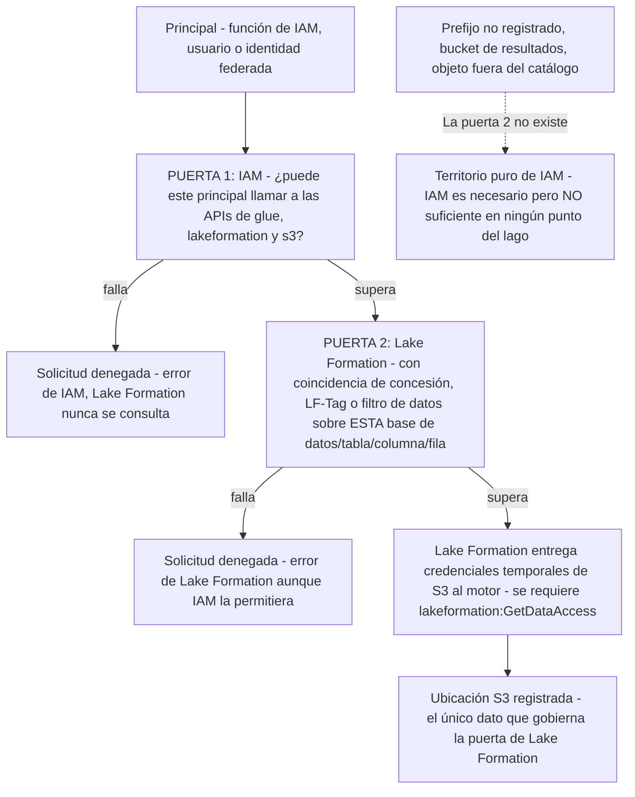
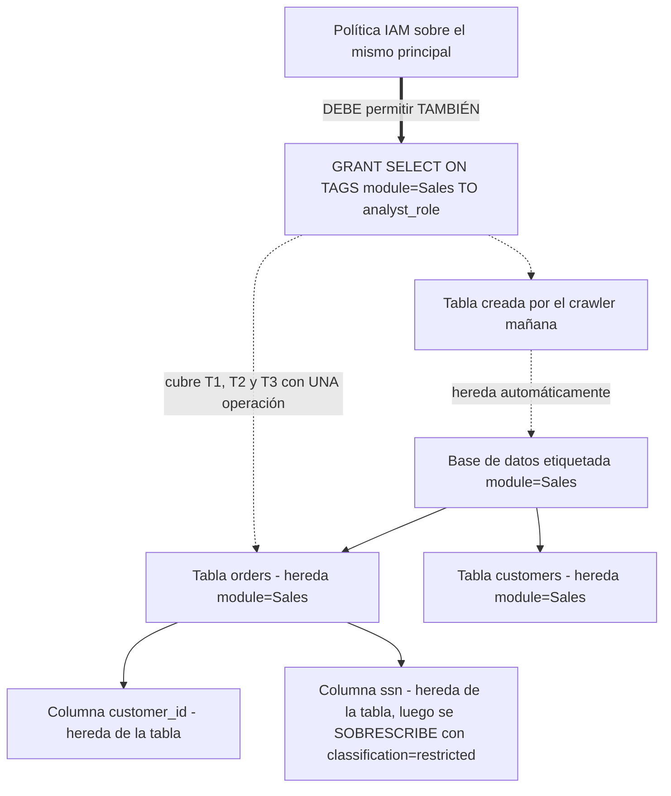
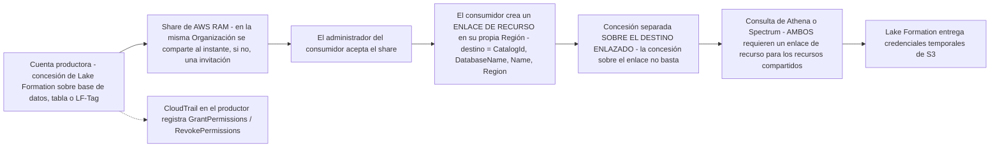
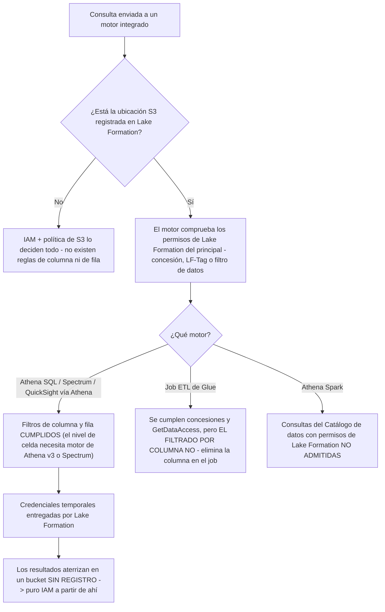
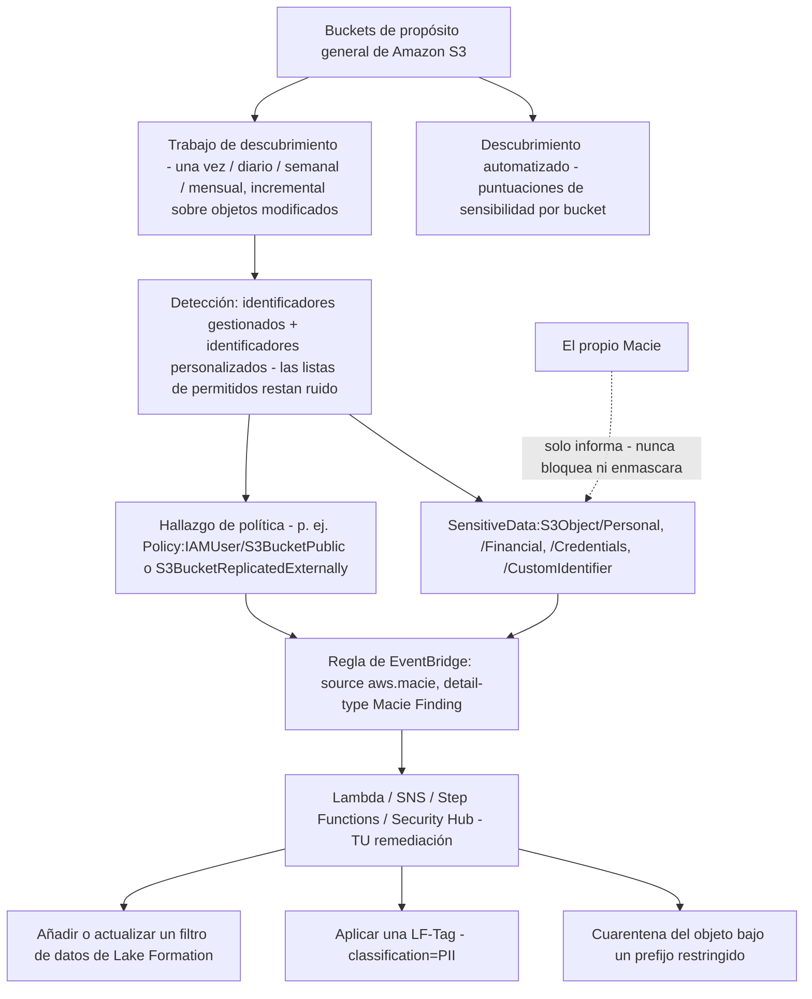
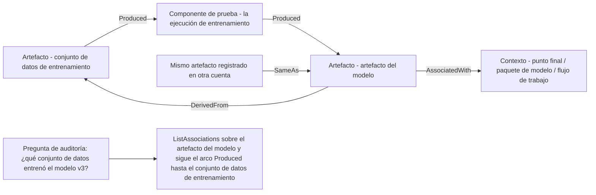
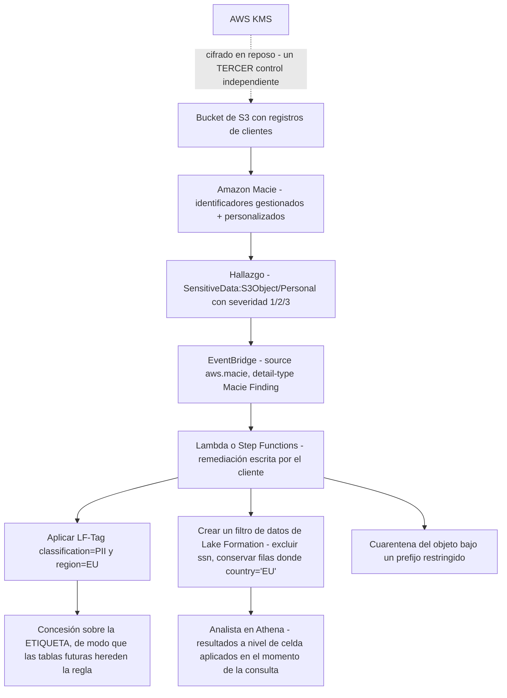

# Gobernanza, Lake Formation y protección de PII

El Dominio 4 vale el **18% del contenido puntuado**, y su última tarea, *Comprender la privacidad y la gobernanza de los datos*, es donde el examen DEA-C01 deja de preguntar «¿puedes mover los datos?» y empieza a preguntar «¿quién puede ver qué fila, en qué Región y cómo lo demostrarías un año más tarde?». Dos servicios soportan casi todo ese peso: **AWS Lake Formation**, que decide *qué* puede ver un principal dentro del lago, y **Amazon Macie**, que *encuentra* los datos sensibles que se supone que debes proteger. Ambos aparecen rutinariamente mal tipificados en los exámenes de práctica, Lake Formation como sustituto de IAM y Macie como herramienta de bloqueo, y ambos malentendidos cuestan preguntas.

```text
====================================================================
 SUPERFICIE DE GOBERNANZA DEL DOMINIO 4 (DEA-C01, 18% del contenido
 puntuado)
====================================================================
  4.2.4  gestionar permisos a través de AWS Lake Formation
         (Redshift, EMR, Athena, S3)
  4.2.5  métodos de autorización: por rol, por etiqueta, por atributo
  4.3.1  enmascaramiento / anonimización de datos según la ley
  4.4.1  AWS CloudTrail para rastrear llamadas a la API
  4.5.1  conceder permisos para intercambio de datos (p. ej. Redshift)
  4.5.2  identificación de PII (p. ej. Amazon Macie con Lake Formation)
  4.5.3  impedir copias de seguridad / replicación a Regiones no permitidas
  4.5.4  ver cambios de configuración (p. ej. AWS Config)
  4.5.5  mantener la soberanía de los datos
  4.5.7  marco de gobernanza de datos y patrones de intercambio
--------------------------------------------------------------------
  DOS PUERTAS .... IAM (¿puedes llamar a la API?)
                   Lake Formation (¿puedes ver ESTE objeto?)
  GRANO FINO ..... base de datos | tabla | columna | fila | celda
  ABAC ........... LF-Tags: cascada base de datos -> tabla -> columna
  INTERCAMBIO .... AWS RAM + enlaces de recurso, entre cuentas / Regiones
  DESCUBRIMIENTO . Amazon Macie: identificadores gestionados + personalizados
  LINAJE ......... SageMaker ML Lineage Tracking + versiones de Glue
  AUDITORÍA ...... CloudTrail GrantPermissions / RevokePermissions
====================================================================
```

En esta lección vas a:

- separar **IAM de Lake Formation** y defender la regla de «dos puertas, ambas deben abrirse» que decide la mayoría de preguntas de acceso al lago;
- leer la **anatomía de permisos** a nivel de catálogo, base de datos, ubicación S3, LF-Tag y enlace de recurso;
- construir controles **a nivel de columna, de fila y de celda** con los **filtros de datos** de Lake Formation, incluidos sus límites de PartiQL;
- aplicar **LF-Tags** (control de acceso basado en atributos): predefinir, asignar, heredar, encadenar y la semántica de concesión AND/OR;
- compartir datos **entre cuentas y entre Regiones** con AWS RAM, enlaces de recurso y concesiones de destino separadas;
- razonar sobre las **tablas gobernadas**, su **finalización de soporte el 31 de diciembre de 2024** y el **patrón de versiones de catálogo verde/azul**;
- situar **Glue, Athena, Spectrum, QuickSight, EMR y Redshift** frente al cumplimiento de Lake Formation, motor a motor;
- operar **Amazon Macie**: descubrimiento automatizado, trabajos de descubrimiento, identificadores gestionados frente a personalizados, hallazgos, severidad y automatización con EventBridge, y nunca llamarlo prevención;
- conceder **intercambio de datos en Redshift** mediante datashares y reconstruir el **linaje de datos** con SageMaker ML Lineage Tracking y el versionado del catálogo de Glue;
- ejecutar **privacidad a profundidad de examen**: etiquetado de PII, residencia de datos, supresión, auditoría con CloudTrail y responsabilidad compartida;
- estudiar **cuatro casos de clientes de AWS**, un **recuadro de actualizaciones de octubre de 2026** con su fuente y **14 preguntas estilo examen** más tres comprobaciones interactivas.

---

## 1. El mapa de gobernanza del Dominio 4: las ocho habilidades que responde esta lección

### 1.1 Las declaraciones de tarea, textualmente

| Habilidad | Redacción textual (guía del examen DEA-C01 v1.1, consultada en octubre de 2026) | Sección de esta lección |
|---|---|---|
| **4.2.4** | «Gestionar permisos a través de AWS Lake Formation (para Amazon Redshift, Amazon EMR, Amazon Athena y Amazon S3)» | 2, 3, 4, 6 |
| **4.2.5** | «Aplicar métodos de autorización que atiendan las necesidades de negocio (basados en rol, en etiquetas y en atributos)» | 4 |
| **4.3.1** | «Aplicar enmascaramiento y anonimización de datos según las leyes de cumplimiento o las políticas de la empresa» | 3, 10 |
| **4.4.1** | «Usar AWS CloudTrail para rastrear llamadas a la API» | 9, 10 |
| **4.5.1** | «Conceder permisos para el intercambio de datos (por ejemplo, intercambio de datos para Amazon Redshift)» | 5, 8 |
| **4.5.2** | «Implementar la identificación de PII (por ejemplo, Amazon Macie con Lake Formation)» | 7, 10 |
| **4.5.3** | «Implementar estrategias de privacidad de datos para impedir copias de seguridad o replicaciones de datos a Regiones de AWS no permitidas» | 10 |
| **4.5.5** | «Mantener la soberanía de los datos» | 10 |
| **4.5.7** | «Describir el marco de gobernanza de datos y los patrones de intercambio de datos»: **nuevo en la guía v1.1 (2025-12-12)** | 5, 10 |

Dos habilidades vecinas se dirigen deliberadamente a otras lecciones: **4.5.4** (AWS Config para cambios de configuración) aparece aquí solo donde se contrasta con CloudTrail, y **4.5.6** (proyectos de Amazon SageMaker Catalog) la nombra la guía pero no es un constructo de Lake Formation.

### 1.2 Las personas: quién puede conceder qué

| Persona | Poderes | Restricción verificada (consultada en octubre de 2026) |
|---|---|---|
| **Administrador del data lake** | Conceder y revocar permisos de Lake Formation, registrar ubicaciones S3, gestionar LF-Tags | **Limitado a 30 por cuenta por defecto** |
| **Administrador de IAM** | Crear políticas IAM, funciones, usuarios y grupos | **No puede conceder permisos de Lake Formation** salvo que además posea la función de administrador del data lake |
| **Creador de LF-Tag** (administrador de etiquetas no admin) | `CREATE_LF_TAG`, `ALTER`, `DROP` sobre etiquetas; `ASSOCIATE`, `DESCRIBE` sobre recursos etiquetados | `ASSOCIATE` implica `DESCRIBE` |
| **Función de registro** | Aporta los permisos `s3:*` que se usan para registrar una ubicación S3 en Lake Formation | El llamante debe poseer además **`lakeformation:GetDataAccess`** para las credenciales entregadas |
| **Concedente con `WITH GRANT OPTION`** | Vuelve a conceder lo que posee | `CREATE_TABLE` sobre una base de datos lleva implícitos todos los permisos de Lake Formation sobre las tablas creadas allí, y es en sí mismo concedible |

La fila del administrador de IAM es el hecho sobre personas más examinado de esta sección: **la pericia en identidad no otorga autoridad sobre el data lake**. Un ingeniero que puede editar cualquier política IAM de la cuenta sigue sin poder conceder `SELECT` sobre una tabla de Lake Formation hasta que sea administrador del data lake.

- **📚 ¿Sabías que…?** Las **comprobaciones de permisos de Lake Formation son gratis**; se factura por los *servicios integrados* que ejecutas (Athena, Spectrum, Glue) y por la **Lake Formation Storage API**, que factura **bytes escaneados redondeados al megabyte siguiente con un mínimo de 10 MB por solicitud** (página de precios de Lake Formation, consultada en octubre de 2026). Así que la capa de gobernanza es barata para conceder de más *financieramente* y cara para conceder de más *políticamente*, y por eso el examen la prueba sobre corrección, no sobre coste.

### 1.3 La división del trabajo en una tabla

| Pregunta que plantea la solicitud | Quién la responde | Mecanismo |
|---|---|---|
| ¿Puede este principal llamar a `glue:*`, `lakeformation:*`, `s3:*`? | **IAM** | Política de identidad, política de recurso, política de sesión |
| ¿Puede ver **esta base de datos / tabla / columna / fila**? | **Lake Formation** | Concesiones, LF-Tags, filtros de datos |
| ¿De dónde salen las credenciales de S3? | **Lake Formation** entrega credenciales temporales a los motores integrados (tras `GetDataAccess`) |
| ¿Qué decide solo la política de bucket de S3? | Únicamente si el objeto es alcanzable por un principal cuyas **propias** credenciales lo permiten: **nunca** la visibilidad fina del lago |
| ¿Quién concedió `SELECT` el martes a las 14:02? | **CloudTrail**: `GrantPermissions` / `RevokePermissions` |
| ¿Cambió la política de bucket o la configuración de cifrado de S3? | **AWS Config**: estado de configuración a lo largo del tiempo |

---

## 2. La distinción del examen: Lake Formation frente a IAM para el acceso al lago S3

### 2.1 Dos puertas, ambas deben abrirse

AWS enuncia la regla en una frase, y toda pregunta de acceso al lago es una variación de ella:

> «Cuando un principal hace una solicitud para acceder a recursos del Catálogo de datos o a los datos subyacentes, para que la solicitud tenga éxito debe superar las comprobaciones de permisos de **tanto IAM como Lake Formation**».: Visión general de los permisos de Lake Formation (consultada en octubre de 2026)



Tres corolarios salen directamente de esa imagen, y cada uno es una pregunta:

1. **Una concesión de Lake Formation sin IAM falla.** El principal todavía necesita `glue:*` en las APIs del catálogo, `lakeformation:GetDataAccess` para las credenciales entregadas y los permisos propios del motor.
2. **IAM a solas no puede expresar el grano fino.** Ninguna política de identidad puede decir *«solo las filas donde `region = 'EU'`»* ni *«todas las columnas excepto `ssn`»*: eso vive exclusivamente en los filtros de datos de Lake Formation.
3. **No registrado significa no gobernado.** Los buckets de resultados de Athena, los prefijos no registrados y todo lo que esté fuera del catálogo lo deciden IAM y S3 por sí solos, y Lake Formation **no se aplica al escribir objetos** (documentación de seguridad de Athena, consultada en octubre de 2026).

### 2.2 IAM frente a Lake Formation, lado a lado

| Dimensión | **IAM** | **Lake Formation** |
|---|---|---|
| Unidad de control | Principal + acción + ARN de recurso | Objeto del catálogo: base de datos, tabla, columna, fila |
| Grano fino | A nivel de API (`s3:GetObject` sobre un ARN) | **Exclusión de columnas, predicados de fila, nivel de celda** |
| Alcance de Región | La política se aplica donde vive el recurso | **«Los permisos de Lake Formation se aplican solo en la Región en la que se concedieron»**: el acceso entre Regiones necesita un **enlace de recurso** en la Región del consumidor |
| Por defecto en una cuenta nueva | El estado de IAM que tenga la cuenta | **`Super` en toda base de datos y tabla se concede previamente a un grupo llamado `IAMAllowedPrincipals`** |
| Ruta de credenciales S3 | Las propias credenciales del llamante | **Credenciales temporales entregadas** a los motores integrados |
| Punto de cumplimiento | Cada llamada a la API de AWS | Motores integrados (SQL de Athena, Spectrum, QuickSight, EMR, Redshift) |
| Mejor en | «¿Puedes llamar a esta API siquiera?» | «¿Puedes *ver* estos datos?» |

### 2.3 El valor por defecto que hace parecer rotas las concesiones

> «De forma predeterminada, Lake Formation establece el **permiso Super en todas las bases de datos y tablas del Catálogo de datos para un grupo llamado `IAMAllowedPrincipals`** … **todos los principales de tu cuenta tendrán acceso … a través de las políticas de principal de IAM para AWS Glue**».: Referencia de permisos de Lake Formation (consultada en octubre de 2026)

Hasta que **revocas ese grupo** (o activas el **modo de acceso híbrido**), el catálogo se comporta como si Lake Formation no estuviera allí: cada principal de IAM de la cuenta lee cada tabla y tus concesiones cuidadosamente escritas parecen no cambiar nada. El modo de acceso híbrido divide la cuenta en dos: los **principales que han optado deben superar tanto Lake Formation como IAM**, mientras que los principales que no han optado siguen gobernados solo por IAM.

### 2.4 Ejemplo resuelto E1: «mis concesiones no hacen nada» en cuatro comprobaciones

Un analista informa de que una revocación no tuvo efecto. Recorre la lista en este orden:

```text
COMPROBACIÓN 1  ¿IAMAllowedPrincipals sigue teniendo Super?
         -> la concesión por defecto significa que el analista lee vía IAM,
            no a través de tu permiso de Lake Formation. Revoca el grupo o
            habilita el modo de acceso híbrido para los principales que
            gobiernas.
COMPROBACIÓN 2  ¿Está la ubicación S3 registrada en Lake Formation?
         -> los prefijos sin registrar son territorio puro de IAM/S3.
            Registra la ubicación (DATA_LOCATION_ACCESS) y confirma que la
            función de registro posee s3:*.
COMPROBACIÓN 3  ¿Se concedieron los permisos en ESTA Región?
         -> «los permisos de Lake Formation se aplican solo en la Región en
            la que se concedieron» - los consumidores entre Regiones necesitan
            un enlace de recurso.
COMPROBACIÓN 4  ¿Sigue IAM permitiendo la llamada a la API?
         -> el principal necesita glue:* / lakeformation:* y
            lakeformation:GetDataAccess incluso cuando la concesión de Lake
            Formation es correcta.
```

> [!WARNING]
> ⚠️ **La trampa de las dos puertas aparece disfrazada en tres ocasiones.** (a) *«Añade una política de bucket de S3»*: necesaria, nunca suficiente: las políticas de S3 no pueden expresar reglas de fila o de columna. (b) *«La concesión de Lake Formation está mal»*: cuando la causa real es el valor por defecto `IAMAllowedPrincipals` o una ubicación sin registrar. (c) *«Copia la concesión a la otra Región»*: las concesiones de Lake Formation son locales a la Región; la respuesta correcta es un **enlace de recurso** en la Región del consumidor, no una concesión duplicada. Lee el enunciado para saber qué puerta está probando realmente.

---

## 3. El modelo de permisos: base de datos, tabla, columna, fila

### 3.1 Conjuntos de permisos por capa de recurso

| Capa de recurso | Permisos que reconoce Lake Formation |
|---|---|
| **Catálogo** | `CREATE_CATALOG` (requiere el permiso «creador del catálogo») |
| **Base de datos** | `ALL` (Super), `ALTER`, `CREATE_TABLE`, `DESCRIBE`, `DROP` |
| **Tabla** | `ALL` (Super), `ALTER`, `DESCRIBE`, `DELETE`, `DROP`, `INSERT`, `SELECT` |
| **Tabla + columna / filtro de datos** | `SELECT` (más `DESCRIBE`, `DROP` sobre el propio objeto de filtro) |
| **Ubicación S3 (registro)** | `DATA_LOCATION_ACCESS` |
| **LF-Tag o valor de etiqueta** | `CREATE_LF_TAG`, `ALTER`, `DROP`; `ASSOCIATE`, `DESCRIBE` |
| **Enlace de recurso** (distinto de su destino) | `DESCRIBE`, `DROP`: **una concesión sobre el enlace no es una concesión sobre el destino** |

Dos reglas estructurales importan más que la propia lista:

- **`ALL-tables` implica `DESCRIBE` de la base de datos**: conceder sobre «todas las tablas» revela necesariamente que la base de datos existe, y esta implicación **no** se cumple en las concesiones por atributo (LF-Tag).
- **Revocar `Super` no revoca todo.** Un principal puede quedarse con `SELECT` e `INSERT` corrientes tras quitar Super: «revocar Super» no es sinónimo de «revocar acceso».

### 3.2 Filtros de datos: la combinatoria columna/fila/celda

Un **filtro de datos** por tabla combina una especificación de columna (lista de inclusión, lista de exclusión o el comodín de todas las columnas) con un predicado de fila opcional en un **subconjunto de PartiQL**, o con `AllRowsWildcard`. AWS enuncia la regla de combinación directamente:

> «El comodín “todas las columnas” + filtro de fila = **seguridad a nivel de fila** solamente. Lista de inclusión/exclusión de columnas específicas + “todas las filas” = **seguridad a nivel de columna** solamente. Columnas específicas **y** un filtro de fila = **seguridad a nivel de celda**».: Filtrado de datos (consultado en octubre de 2026)

| Columnas elegidas | Filas elegidas | Control resultante | Nombre en el examen |
|---|---|---|---|
| Comodín de todas las columnas | Predicado | Todas las columnas, filas filtradas | **A nivel de fila** |
| Lista de inclusión/exclusión | `AllRowsWildcard` | Columnas seleccionadas, todas las filas | **A nivel de columna** |
| Lista de inclusión/exclusión | Predicado | Columnas seleccionadas, filas filtradas | **A nivel de celda** |
| Comodín de todas las columnas | `AllRowsWildcard` | Todo | Sin ninguna restricción |

Restricciones que debes poder citar:

| Restricción | Valor (consultado en octubre de 2026) |
|---|---|
| Filtros concedibles | **Solo `SELECT`**: un filtro nunca amplía el acceso a `INSERT`/`DELETE` |
| Longitud de la expresión | **< 2.048 caracteres** |
| Operadores | `= > < >= <= <> != BETWEEN IN LIKE NOT IS [NOT] NULL` |
| Comparación columna a columna | **No admitida** |
| Semántica de cadena / `LIKE` | **Distingue mayúsculas y minúsculas** |
| Filtros por principal por tabla | **≤ 100** |
| Profundidad de struct anidado en filtros de fila | **5 niveles**; los structs sí, **arrays y maps no admitidos** |
| Columnas de partición | **No se pueden filtrar** |
| Nivel de celda en todas partes | **Motor de Athena v3 o Redshift Spectrum** |
| Grano fino de Glue 5.0+ en jobs | **Solo fuentes Hive e Iceberg** |

### 3.3 Aritmética de predicados: cuando se encuentran dos reglas

- **Un principal y su propio grupo de IAM:** los filtros de fila se **unen**: el usuario ve el más amplio de los dos.
- **Una concesión a una cuenta externa intersectada con una concesión directa:** **intersección**: gana el resultado más estrecho.
- **Dos comodines `all-rows` concurrentes:** **prevalece el `all-rows`**.
- **Entre motores:** el cumplimiento ocurre en el momento de la consulta, de modo que un filtro que Athena respeta todavía debe reimplementarse dondequiera que se lean los datos *sin* el cumplimiento de Lake Formation (Sección 6).

### 3.4 Ejemplo resuelto E2: diseñar la protección a nivel de celda para `ssn`

Requisito: los analistas del Reino Unido ven solo las filas de clientes del Reino Unido, y **nadie** con el rol de analista ve nunca la columna `ssn`.

```text
TABLA            customers
FILTRO DE DATOS  customers_pii_uk
  columnas       ExcludedColumnNames = [ ssn ]        <- mitad de columna
  filas          RowFilter = "country = 'UK'"         <- mitad de fila
                 (AllRowsWildcard NO usado -> nivel de celda, según la regla Q4)
CONCESIÓN       GRANT SELECT ON TABLE customers_pii_uk
                     TO ROLE uk_analyst_role
TAMBIÉN NECESARIO  IAM glue:* + GetDataAccess; s3://lake/customers/ registrado
                   en Lake Formation
MOTOR           Motor de Athena v3 (o Spectrum) para el cumplimiento a nivel
                de celda
COSTE DE UN DESLIZ  El job ETL de Glue que lee la misma tabla NO filtra por
                 columna - elimina ssn dentro del job como defensa en profundidad
```

Lee la aritmética de la regla: columna excluida **más** predicado de fila = **nivel de celda**; si hubiéramos usado el comodín de todas las columnas con el mismo predicado habríamos entregado *solo* protección a nivel de fila y habríamos filtrado `ssn` a cada fila del Reino Unido.

### 3.5 Ejemplo resuelto E3: la escalera de cuatro concesiones sobre una tabla

```text
Concesión A  SELECT sobre la tabla, sin filtro        -> ve todas las columnas,
                                                          todas las filas
Concesión B  SELECT + filtro de datos (todas las filas) -> sigue viendo todas las
                                                          filas; el objeto de
                                                          filtro no lleva lógica
                                                          de fila
Concesión C  SELECT + filtro de datos (excluir ssn)    -> a nivel de columna: ssn
                                                          invisible
Concesión D  SELECT + filtro de datos (excluir ssn
             + country='UK')                          -> a nivel de celda: ssn
                                                          invisible Y solo se
                                                          devuelven filas UK
Concesión E  Solo INSERT                              -> puede escribir, no puede
                                                          leer; los filtros de
                                                          datos son solo SELECT
```

**Lectura:** la protección es una propiedad del *filtro adjunto a la concesión*, no de la tabla. Dos analistas que consultan la misma tabla `customers` pueden ver legítimamente conjuntos de columnas distintos y conjuntos de filas distintos: que es exactamente lo que significa «seguridad a nivel de celda» en este examen.

---

## 4. LF-Tags: control de acceso basado en atributos y la cascada

### 4.1 Las seis reglas de las concesiones por etiqueta (LF-TBAC)

1. **Primero se predefine.** Un par clave/valor no puede inventarse en el momento de la asignación: debe existir ya como LF-Tag.
2. **Un valor por clave por recurso.** Una tabla no puede ser a la vez `classification=public` y `classification=restricted` en la misma clave.
3. **Los valores se guardan en minúsculas.**
4. **La herencia es direccional:** *«Las tablas heredan las LF-Tags de las bases de datos y las columnas heredan las LF-Tags de las tablas. Los valores heredados pueden sobrescribirse.»*
5. **Concede sobre la etiqueta, no sobre el objeto:** `GRANT SELECT ON TAGS module=Sales TO analyst_role`: queda cubierta cada tabla que lleve esa etiqueta, **incluidas las tablas que cree el crawler mañana**.
6. **Las LF-Tags no son etiquetas de IAM.** La redacción de AWS es absoluta: *«Las etiquetas de IAM no son lo mismo que las LF-Tags. Estas etiquetas no son intercambiables.»* Se **componen**: ambas comprobaciones deben permitir la solicitud.

### 4.2 La cascada, dibujada



### 4.3 Semántica de las concesiones: AND entre claves, OR dentro de una clave

| Expresión | Significado |
|---|---|
| `ON TAGS module=Sales AND classification=Restricted` | Ambas claves deben coincidir, **AND** |
| `ON TAGS (module=Sales OR module=Marketing)` | Cualquiera de los valores de la misma clave, **OR** |
| Expresiones `AND`/`OR` anidadas | Permitidas y **reutilizables entre concesiones desde el 2024-11-07** |
| `ASSOCIATE` sobre una etiqueta | Implica `DESCRIBE` sobre ella |
| Objetivo de LF-TBAC entre cuentas | Otra cuenta, una **AWS Organization** o una **OU** |

```fillblank
{
  "question": "Completa las sentencias de control de acceso por etiquetas de Lake Formation:",
  "template": "Las tablas heredan las LF-Tags de {{1}} y las columnas heredan las LF-Tags de {{2}}; cada clave debe predefinirse antes de poder asignarse y los valores se guardan en {{3}}. Una concesión que nombra varias claves de etiqueta distintas es una condición {{4}}, mientras que una concesión que nombra varios valores de la MISMA clave es una condición {{5}}. Las LF-Tags son {{6}} de las etiquetas de IAM: ambas comprobaciones deben permitir la solicitud.",
  "answers": {
    "1": "bases de datos",
    "2": "tablas",
    "3": "minúsculas",
    "4": "AND",
    "5": "OR",
    "6": "no intercambiables"
  },
  "distractors": ["esquema", "catálogos", "mayúsculas", "título", "ambas", "cualquiera", "idénticas", "equivalentes", "independientes"],
  "explanation": "La cascada documentada es base de datos -> tabla -> columna con valores heredados sobrescribibles, las claves se predefinen y los valores van en minúsculas. Las claves DISTINTAS se combinan con AND; los varios valores de una misma clave se combinan con OR. AWS declara directamente que las etiquetas de IAM y las LF-Tags no son intercambiables: se componen, así que tanto la comprobación de IAM como la de etiqueta de Lake Formation deben permitir la solicitud."
}
```


### 4.4 Ejemplo resuelto E4: concesiones con nombre frente a concesiones por etiqueta

Configuración: **3 principales analistas**, cada uno necesita el mismo acceso a **3 bases de datos y 7 tablas**, más un plan para añadir **50 tablas más** el próximo trimestre. (Aritmética derivada: no es una cifra publicada por AWS; la estructura sigue la documentación de TBAC de Lake Formation, consultada en octubre de 2026.)

```text
RUTA CON NOMBRE (un GrantPermissions por principal por objeto)
  3 principales x (3 bases de datos + 7 tablas) = 3 x 10 = 30 llamadas de concesión
  Añadir 50 tablas                            = +3 x 50 = +150 llamadas de concesión
                                                 total 180

RUTA POR ETIQUETA (LF-TBAC)
  Predefinir LF-Tag module = Sales              1 operación
  ASSOCIATE de la etiqueta en 3 bases de datos   3 operaciones
     (las tablas HEREDAN de la base de datos -   0 asociaciones de tabla)
      las columnas HEREDAN de la tabla -         0 asociaciones de columna)
  GRANT SELECT ON TAGS module=Sales            1 concesión
     a cada uno de los 3 principales           -> 3 concesiones
                                                 total 7
  Añadir 50 tablas (creadas por el crawler)     +0 operaciones
                                                 siguen siendo 7
```

**Lectura:** la ruta por etiqueta colapsa 180 operaciones en 7 porque la concesión se adjunta a un *atributo* que los objetos nuevos heredan automáticamente. Por eso la habilidad 4.2.5 nombra la autorización **por etiquetas y por atributos** como respuesta a una necesidad de negocio: a escala, la diferencia no es comodidad, es si los permisos siguen siendo correctos a medida que crece el catálogo.

- **📚 ¿Sabías que…?** AWS publica un resultado de cliente exactamente para esta aritmética: **Integral Ad Science «redujo cientos de reglas de permiso a precisamente dos reglas»** usando el control de acceso por etiquetas de Lake Formation (AWS Big Data Blog, 2021-09-23, consultado en octubre de 2026). Dos reglas no son una errata: es lo que ocurre cuando el *número de objetos* deja de ser el *número de concesiones*.

### 4.5 Ejemplo resuelto E5: una concesión multitenant por etiqueta

```text
ETIQUETAS PREDEFINIDAS   tenant = acme | globex | initech    (un valor por recurso)
                         classification = public | internal | restricted
ASIGNAR                  base de datos tenant_acme     -> tenant=acme
                         base de datos tenant_globex   -> tenant=globex
                         base de datos tenant_initech  -> tenant=initech
CONCESIÓN 1              GRANT SELECT ON TAGS tenant=acme
                             TO ROLE acme_analyst      (cubre tablas + columnas)
CONCESIÓN 2              GRANT SELECT ON TAGS classification=restricted
                             TO ROLE privacy_office    (se une en AND con cualquier
                                                        otra clave nombrada en la
                                                        misma concesión)
RESULTADO DEL CRAWLER    la tabla de mañana tenant_acme.invoices_v3 es legible
                         por acme_analyst SIN ninguna concesión adicional, y por
                         privacy_office porque classification=restricted se aplicó
                         en la base de datos
```

---

## 5. Intercambio de datos: entre cuentas, entre Regiones, tablas gobernadas, verde/azul

### 5.1 La secuencia productor/consumidor



Hechos codificados en ese diagrama:

- **Las pilas de intercambio son o Lake Formation (RAM + enlaces de recurso) o el intercambio de catálogo heredado solo con IAM**; el **modo de acceso híbrido** permite que ambos coexistan mientras una cuenta migra.
- El intercambio **entre Regiones** funciona a través de **enlaces de recurso creados en la Región del consumidor**: los propios permisos de Lake Formation nunca viajan.
- **Una concesión directa a un principal** (en lugar de un share) se une con cualquier concesión en cascada de cuenta, y **solo la ve el destinatario: no puede volver a compartirla**.
- **El crawling entre cuentas** tiene su propio orden de cuatro pasos: registrar la ubicación en la cuenta *productora* → conceder `DATA_LOCATION_ACCESS` a la *función de crawler del consumidor* (más `GetDataAccess`) → aceptar el share de RAM → crear el enlace y marcar **«Use Lake Formation credentials»**.

```dragdrop
{
  "question": "Ordena los pasos del intercambio de Lake Formation entre cuentas que terminan con una consulta de Athena en la cuenta del consumidor:",
  "items": [
    "El productor concede permisos de Lake Formation sobre la base de datos, la tabla o la LF-Tag",
    "El productor comparte esos recursos a través de AWS RAM",
    "El administrador del consumidor acepta el share de RAM",
    "El consumidor crea un ENLACE DE RECURSO en su propia Región apuntando al objeto del catálogo del productor",
    "El consumidor concede permisos SOBRE EL DESTINO ENLAZADO: la concesión sobre el enlace no basta",
    "El consumidor ejecuta la consulta de Athena y Lake Formation entrega credenciales temporales de S3"
  ],
  "correctOrder": [
    "El productor concede permisos de Lake Formation sobre la base de datos, la tabla o la LF-Tag",
    "El productor comparte esos recursos a través de AWS RAM",
    "El administrador del consumidor acepta el share de RAM",
    "El consumidor crea un ENLACE DE RECURSO en su propia Región apuntando al objeto del catálogo del productor",
    "El consumidor concede permisos SOBRE EL DESTINO ENLAZADO: la concesión sobre el enlace no basta",
    "El consumidor ejecuta la consulta de Athena y Lake Formation entrega credenciales temporales de S3"
  ],
  "explanation": "El orden documentado es: concesión del productor -> share de AWS RAM -> el consumidor acepta -> enlace de recurso en la Región del consumidor -> concesión separada sobre el destino enlazado -> consulta, momento en que Lake Formation entrega credenciales temporales de S3. Dentro de la secuencia se esconden dos trampas: una concesión sobre el enlace NO es una concesión sobre el destino (DESCRIBE/DROP en el enlace no te deja leer datos), y los permisos de Lake Formation nunca viajan a otra Región: ese trabajo lo hace el enlace de recurso, sin copia de datos."
}
```

### 5.2 Tablas gobernadas, y la fecha que debes citar

AWS construyó las **tablas gobernadas** como un tipo de tabla de Amazon S3 con **garantías ACID entre tablas** y compactación automática, para que el análisis pudiera compartir instantáneas consistentes. Después AWS anunció:

> **«finalización del soporte de las tablas gobernadas, con efectos a partir del 31 de diciembre de 2024**, para centrarse en formatos de tabla transaccionales de código abierto como **Apache Iceberg, Apache Hudi y Linux Foundation Delta Lake**».: AWS Big Data Blog, 2024-10-02

Manejo en el examen: declara la **obsolescencia con su fecha** y responde las preguntas sobre formatos de tabla abiertos con **Iceberg, Hudi o Delta Lake**. Las concesiones de Lake Formation, filtros de fila y de celda incluidos, se aplican a las tablas Iceberg/Hudi/Delta catalogadas, y Lake Formation gestiona **la compactación, la retención de instantáneas y el borrado de archivos huérfanos para Iceberg**, mientras el motor conserva la propiedad de las sentencias DDL de escritura (`VACUUM`, `MERGE`, `OPTIMIZE`).

### 5.3 Versiones de catálogo verde/azul: un patrón, no un servicio

«Despliegue de catálogo verde/azul» **no** es el nombre de una característica de AWS: nada en la documentación de Lake Formation o Glue describe un servicio con ese nombre (verificado en octubre de 2026). Lo que el examen prueba realmente es si puedes *ensamblar* el patrón a partir de bloques de construcción verificados:

| Bloque de construcción | Capacidad verificada | Papel en el patrón |
|---|---|---|
| **Historial de versiones de tabla del Catálogo de datos** | Diferencias con `GetTableVersions` más eventos **Table State Change** | Probar la forma nueva antes de que nadie la consulte |
| **Vistas del catálogo** | **≤ 10 tablas base por vista** | El nombre estable que los consumidores siguen consultando |
| **Enlaces de recurso** | Nombre estable de enlace, destino intercambiable | Redirigir el enlace de azul a verde sin tocar a los consumidores |
| **Secuenciación** | **Aditivo antes, deletivo después** | Crear verde, validar, redirigir y solo entonces eliminar azul |

```text
VERSIÓN DE CATÁLOGO VERDE/AZUL (patrón ensamblado)
  1. crawlear sales_green junto al sales_blue en producción
  2. diferenciar GetTableVersions - confirmar esquema, particiones, estadísticas
     de columnas
  3. validar con una consulta canario contra sales_green
  4. redirigir la VIEW o el ENLACE DE RECURSO estable de sales_blue ->
     sales_green
  5. conservar sales_blue durante una ventana de reversión
  6. eliminar sales_blue (el paso deletivo SIEMPRE va al final)
```

### 5.4 Ejemplo resuelto E6: compartir frente a copiar para un conjunto de datos de 20 TB

```text
EL PRODUCTOR TIENE 20 TB; el consumidor está en otra Región de AWS.

RUTA DE COPIA (UNLOAD / COPY o replicación)
  salida de la Región productora          20 TB
  entrada en la Región del consumidor     20 TB   (el consumidor paga la transferencia)
  almacenamiento facturado DOS VECES      20 TB + 20 TB
  frescura                                se retrasa respecto al productor por el
                                          ciclo de sincronización

RUTA DE DATASHARE (Redshift) / SHARE DE LAKE FORMATION (lago S3)
  bytes copiados                          0
  almacenamiento facturado                una vez, en el productor
  el consumidor paga                      el CÓMPUTO de la consulta, más la
                                          transferencia de datos entre Regiones de
                                          los bytes realmente consultados
  frescura                                en vivo - «sin mover ni copiar
                                          manualmente los datos»
```

**Lectura:** la frase del examen *«compartir acceso a datos en vivo … sin mover ni copiar manualmente los datos»* es la pista. Cuando el primer paso de una opción es `COPY`, `UNLOAD`, `rsync` o «replicar el bucket», está describiendo una **copia**, no un **intercambio**.

---

## 6. Integración con los motores: Glue, Athena, Spectrum, QuickSight, EMR, Redshift

### 6.1 La matriz de cumplimiento

| Motor | Cómo se aplica Lake Formation | Salvedad sobre la que te examinarán |
|---|---|---|
| **Amazon Athena (SQL)** | Comprueba el principal y después entrega credenciales temporales de S3 | **Athena Spark no admite consultar tablas del Catálogo de datos con permisos de Lake Formation**; el bucket de resultados está sin registrar, así que sigue siendo puro IAM |
| **Amazon Redshift Spectrum** | Verificación por consulta más credenciales entregadas a través de la función de IAM del clúster o una identidad federada | **Sin encadenamiento de funciones** |
| **Amazon QuickSight** | El control de acceso fino mapea las concesiones a **usuarios y grupos de QuickSight en Enterprise**, y a **funciones de IAM (por ejemplo `aws-quicksight-service-role-v0`) en Standard**; los paneles exploran el lago **a través de Athena** | La seguridad a nivel de fila propia de QuickSight es un control de *capa de BI* y **no** sustituye a un filtro de fila de Lake Formation |
| **Crawlers de AWS Glue** | **«Use Lake Formation credentials»** opcional, incluso para crawling entre cuentas | La función del crawler todavía necesita `DATA_LOCATION_ACCESS` y `GetDataAccess` |
| **Jobs ETL de AWS Glue** | La función del job necesita concesiones de Lake Formation **más** `lakeformation:GetDataAccess` | **El filtrado por columna NO se cumple dentro del ETL de Glue**: elimina o enmascara la columna en el job |
| **Amazon EMR / Spark** | Los plugins de Lake Formation se ejecutan en el clúster | Proteger el propio clúster sigue siendo cosa del cliente |
| **Amazon Redshift (nativo)** | **Datashares gestionados por Lake Formation** se publican en el catálogo de Glue, de modo que Lake Formation gobierna base de datos, tabla, columna **y fila** | Un datashare corriente (no gestionado por Lake Formation) lo gobiernan las propias concesiones de Redshift |
| **Amazon SageMaker AI** | Las concesiones de Lake Formation controlan el acceso a funciones en el entrenamiento | El linaje es un registro *aparte* (Sección 9) |

```matching
{
  "question": "Relaciona cada motor con la forma en que cumple los permisos de Lake Formation:",
  "pairs": [
    {"left": "Amazon Athena (SQL)", "right": "Comprueba el principal y después Lake Formation entrega credenciales temporales de S3; el bucket de resultados está sin registrar y sigue siendo territorio puro de IAM"},
    {"left": "Amazon Athena Spark", "right": "NO admite consultar tablas del Catálogo de datos que llevan permisos de Lake Formation"},
    {"left": "Amazon Redshift Spectrum", "right": "Verifica por consulta y entrega credenciales a través de la función de IAM del clúster o una identidad federada: sin encadenamiento de funciones"},
    {"left": "Amazon QuickSight", "right": "Enterprise mapea las concesiones a usuarios y grupos de QuickSight; Standard las mapea a funciones de IAM como aws-quicksight-service-role-v0; los paneles exploran a través de Athena"},
    {"left": "AWS Glue crawlers", "right": "Usan opcionalmente credenciales de Lake Formation, incluso para crawling entre cuentas, cuando la función posee DATA_LOCATION_ACCESS y GetDataAccess"},
    {"left": "AWS Glue ETL jobs", "right": "Se comprueban las concesiones y GetDataAccess, pero EL FILTRADO POR COLUMNA NO SE CUMPLE: el job debe eliminar o enmascarar la columna él mismo"}
  ],
  "explanation": "El cumplimiento es deliberadamente desigual. Athena SQL y Spectrum cumplen las reglas de columna, fila y celda (el nivel de celda necesita motor de Athena v3 o Spectrum); el ETL de Glue nunca cumple el filtrado por columna; Athena Spark no está admitido; QuickSight es una capa de BI que explora a través de Athena; los crawlers pueden usar credenciales entregadas. Cada emparejamiento erróneo del examen es una de estas salvidades movida al motor equivocado."
}
```



### 6.2 Ejemplo resuelto E7: qué lee realmente una consulta gobernada por Lake Formation

Una tabla Parquet de 1 TB está particionada en **12 particiones mensuales**; el predicado del analista poda hasta un solo mes:

```text
Escaneo completo        1.000 GB
Poda de particiones     1.000 / 12                     ~= 83 GB de lecturas previstas
Ahorro                  (1.000 - 83) / 1.000           ~= 91,7%   (derivado)
Facturación de la Lake Formation Storage API:
  bytes escaneados, redondeados AL ALZA al MB siguiente
  cargo mínimo por solicitud = 10 MB
  -> la misma comprobación de gobernanza es barata con 83 GB y barata con
     10 MB; es el MOTOR (Athena/Spectrum) el que factura el volumen de datos
```

**Lectura:** Lake Formation decide *si* puede ejecutarse la consulta y *qué filas/columnas* vuelven; el particionado y el formato de archivo deciden *cuántos bytes* lee el motor; la regla de redondeo de la Storage API decide la línea de factura de Lake Formation. Tres facturas distintas, una consulta: un distractor clásico de opción múltiple.

### 6.3 Ejemplo resuelto E8: la misma tabla a través de dos motores

```text
TABLA      sales.orders  (ubicación registrada, filtro a nivel de celda: excluir
                          card_last4)
ANALISTA   Motor de Athena v3   -> ve todas las columnas EXCEPTO card_last4, con
                                  filas filtradas (nivel de celda CUMPLIDO)
ANALISTA   QuickSight Enterprise -> misma vista, porque los datos que explora
                                  llegan A TRAVÉS de Athena
ETL DE GLUE  job sales_transform -> ¡lee card_last4 de todos modos! Se comprueban
                                  las concesiones de Lake Formation y
                                  GetDataAccess, el filtrado por columna NO se
                                  cumple -> el job debe eliminarlo/enmascararlo
SOLUCIÓN   sc = DropFields(fields=['card_last4'])   (o una transformación de
           KMS/enmascaramiento)
           + conceder solo lo que el job necesita, nada más
```

---

## 7. Amazon Macie: descubrimiento, no prevención

### 7.1 Qué es, y la frontera que no cruza

> Amazon Macie es «un **servicio de seguridad de datos que descubre datos sensibles mediante aprendizaje automático y coincidencia de patrones**».: Qué es Amazon Macie (consultado en octubre de 2026)

| | En el ámbito de Macie | Fuera del ámbito de Macie |
|---|---|---|
| Almacenamiento | **Buckets de propósito general de Amazon S3** | RDS, DynamoDB, EBS, Redshift, on-premises |
| Salida | Hallazgos, puntuaciones de sensibilidad, inventario | Bloqueo, enmascaramiento, cuarentena, revocación |
| Modos | **Descubrimiento automatizado** (continuo) y **trabajos de descubrimiento** (con alcance, programados) | Aplicación en línea en tiempo real dentro de una consulta |

### 7.2 Los dos motores de detección y la lista de permitidos

| Motor | Qué es | Propiedades relevantes para el examen |
|---|---|---|
| **Identificadores de datos gestionados** | **Aprendizaje automático + coincidencia de patrones** mantenidos por AWS para credenciales, datos financieros, **PII/PHI**, incluidos números de identidad por país | No hay reglas que redactar; la cobertura evoluciona con AWS |
| **Identificadores de datos personalizados** | Tu **expresión regular + palabras clave + palabras de exclusión + proximidad** | **Inmutables tras su creación** («historial inmutable … para auditorías de privacidad y protección de datos»); **severidad predeterminada Media**; proximidad **1 to 300 caracteres, predeterminado 50** |
| **Listas de permitidos** | Buckets u objetos que **no** deben generar hallazgos de datos sensibles | El tercer componente de toda configuración de trabajo de Macie |

### 7.3 Trabajos, programaciones y hallazgos

| Concepto | Comportamiento verificado (consultado en octubre de 2026) |
|---|---|
| **Descubrimiento automatizado** | Continuo, impulsado por el inventario de buckets, genera **puntuaciones de sensibilidad de bucket de −1 a 100** |
| **Trabajos de descubrimiento** | Alcance y programación explícitos: **una vez, diario, semanal, mensual**; las ejecuciones periódicas analizan objetos **creados o modificados desde la última ejecución** |
| **Previsualización de coste** | Se muestra una **previsión antes de enviar** el trabajo |
| **Hallazgos de política** | `Policy:IAMUser/S3BucketPublic`, `…/S3BlockPublicAccessDisabled`, `…/S3BucketEncryptionDisabled`, **`…/S3BucketReplicatedExternally`** (el detective de residencia) |
| **Hallazgos de datos sensibles** | `SensitiveData:S3Object/Personal`, `/Financial`, `/Credentials`, `/CustomIdentifier` |
| **Retención de hallazgos** | **90 días**; una detección repetida **actualiza el recuento** del hallazgo existente |
| **Escala de severidad** | **1 = Baja, 2 = Media, 3 = Alta**: **no existe Crítica**, y **no** es la escala de 1.0 a 10.0 de GuardDuty |
| **Dos números 0 to 100 distintos** | La **puntuación de sensibilidad** del bucket (−1…100) es una métrica *de bucket*, nunca una severidad de hallazgo |

### 7.4 El flujo del hallazgo, y dónde entra tu código



> [!WARNING]
> ⚠️ **Macie encuentra, no previene.** Toda opción redactada *«Macie bloquea la subida»*, *«Macie enmascara la columna»* o *«Macie revoca la concesión»* es errónea por construcción: el enmascaramiento y la revocación son **filtros de datos de Lake Formation** y **concesiones de IAM/Lake Formation**, y la conexión entre un hallazgo de Macie y esos controles es **tu** regla de EventBridge más **tu** máquina de estados de Lambda o Step Functions. Observa también los **dos identificadores del servicio**: los eventos de hallazgo llegan como `source = aws.macie` con `detail-type = "Macie Finding"`, mientras que las propias llamadas a la API de Macie aparecen en CloudTrail bajo **`aws.macie2`**.

### 7.5 Ejemplo resuelto E9: una especificación de trabajo de Macie

```text
TRABAJO         pii-nightly-customer-3p
ALCANCE         buckets de propósito general de S3:
                  s3://raw-customers/*          (zona de ingesta)
                  s3://curated/customers/*      (zona curada)
PROGRAMACIÓN     diaria (alternativas: una vez, semanal, mensual)
                  -> las ejecuciones periódicas solo vuelven a inspeccionar los
                     objetos creados o modificados desde la última ejecución
CLASIFICACIÓN    identificadores gestionados: credenciales, financieros, PII/PHI
IDENT. PERS.     nombre  tenant-id
                 regex   TENANT-\d{8}
                 palabras clave ["tenant_id", "customer_ref"]
                 palabras de exclusión ["TENANT-00000000"]
                 proximidad 1-300 caracteres (predeterminado 50)
                 severidad predeterminada MEDIA <- e INMUTABLE una vez creado
LISTA DE PERMITIDOS  s3://raw-customers/public-marketing/ (sin PII por diseño)
ANTES DE ENVIAR  revisa la PREVISIÓN de coste del servicio y luego envía
SALIDA           hallazgos retenidos 90 días; EventBridge enruta la severidad 3
                 al tema SNS de guardia
FUERA DEL ÁMBITO este trabajo NO bloquea, enmascara ni borra nada
```

### 7.6 Ejemplo resuelto E10: coste mensual de Macie (tarifas de ejemplo en us-east-1)

Los precios unitarios son los **ejemplos publicados de AWS en us-east-1** (página de precios de Macie, consultada en octubre de 2026: **verifica la tarifa vigente antes de usarla**): **$0.10 por bucket al mes**, **$0.01 por cada 100.000 objetos al mes**, más cargos escalonados por el volumen de datos inspeccionado.

```text
40 buckets                40 x $0.10                     =   $  4.00
30.000.000 objetos        30.000.000 / 100.000 = 300
                          300 x $0.01                    =   $  3.00
500 GB inspeccionados     500 GB x $1.00/GB (tarifa de
                          ejemplo del primer tramo)       =   $500.00
                                                        ------------
Total mensual (derivado)                                  =   $507.00

Prueba gratuita: 30 días, hasta 150 GB, y LOS TRABAJOS DE
                 DESCUBRIMIENTO ESTÁN EXCLUIDOS
                 -> la línea de $500 del trabajo nunca la cubre la prueba
```

**Lectura:** el recuento de objetos es un redondeo, el recuento de buckets es pequeño y **el volumen de datos inspeccionado domina**. Por eso al examen le encanta la opción «escanea todo, cada hora»: es técnicamente correcta y económicamente indefendible.

### 7.7 Ejemplo resuelto E11: enrutar hallazgos con EventBridge

```text
Regla 1   solo ALTA               detail.severity.score = [3]
Regla 2   toda la postura de política  detail.type-level-prefix "Policy:"  + score = [1,2,3]
Regla 3   detecciones repetidas    detail.count >= 2            (mismo objeto, otra vez)
Filtro    los hallazgos archivados/suprimidos NO se entregan al destino de la regla
Nombre de servicio en CloudTrail para las llamadas a la API de Macie: aws.macie2
detail-type en EventBridge para los hallazgos:                  "Macie Finding"
```

- **📚 ¿Sabías que…?** Los **identificadores de datos personalizados de Macie son inmutables tras su creación**: AWS lo formula como *«historial inmutable … para auditorías de privacidad y protección de datos»* (opciones de identificador de datos personalizado de Macie, consultado en octubre de 2026). No puedes editar en silencio la expresión regular que produjo los hallazgos del trimestre pasado; creas un identificador nuevo y retiras el antiguo, que es exactamente la propiedad de auditoría que una pregunta de cumplimiento está sondeando.

---

## 8. Intercambio de datos en Amazon Redshift

### 8.1 El modelo de datashare

> Redshift te permite *«compartir acceso a **datos en vivo** entre clústeres, grupos de trabajo, cuentas de AWS y Regiones de Amazon Redshift **sin mover ni copiar manualmente los datos**»*, y *«**los objetos del datashare son de solo lectura para los consumidores de datos**»* en el modelo básico.: Visión general del intercambio de datos de Redshift (consultada en octubre de 2026)

| Propiedad | Comportamiento verificado (consultado en octubre de 2026) |
|---|---|
| Unidad de intercambio | El **datashare**, propiedad de una **base de datos productora** |
| Objetos intercambiables | Tablas, vistas, UDF |
| Acceso del consumidor | **De solo lectura** salvo que se use explícitamente el intercambio de escritura (misma cuenta o entre cuentas) |
| Ciclo de vida | `Pending authorization` → `Authorized` → `Active`; el lado del consumidor muestra **Available (Action required)** |
| Pasos del consumidor | **Asociar** el share, luego `CREATE DATABASE … FROM DATASHARE`, luego conceder permisos sobre los objetos |
| Tipos | **Standard** · **AWS Data Exchange** · **gestionado por Lake Formation** (publicado en el catálogo de Glue, de modo que Lake Formation gobierna base de datos/tabla/columna/**fila**) |
| Entre Regiones | Una Región por asociación; **el consumidor paga la transferencia de datos entre Regiones** |
| Resiliencia | Sobrevive al **redimensionamiento y a la pausa** del clúster; **sin límite** de datashares por clúster; las bases de datos creadas desde datashares **no se contabilizan en las cuotas de base de datos** |
| Coste | El consumidor paga **el cómputo de consultas** (+ transferencia si es entre Regiones); el almacenamiento del productor no cambia |

### 8.2 Ejemplo resuelto E12: el ciclo de intercambio, de extremo a extremo

```text
PRODUCTOR (cuenta 1111, us-east-1)
  CREATE DATASHARE salesshare OF SCHEMA public TO ACCOUNT '2222...'
        -> estado: Pending authorization
  AUTHORIZE DATASHARE salesshare TO ACCOUNT '2222...'
        -> estado: Authorized

CONSUMIDOR (cuenta 2222)
  asociar el share (consola/CLI) -> estado: Active (el consumidor ve:
                                     Available - Action required)
  CREATE DATABASE sales_db FROM DATASHARE salesshare
  GRANT SELECT ON SCHEMA public TO ROLE bi_analyst
        <- los permisos de objetos son SEPARADOS

VARIANTE GESTIONADA POR LAKE FORMATION
  publicar el datashare en el Catálogo de datos de Glue ->
  las concesiones, LF-Tags y filtros de datos de Lake Formation lo gobiernan
  ahora, incluidas las reglas a nivel de fila y de columna

REPERCUSIÓN DE COSTES
  productor: almacenamiento sin cambios
  consumidor: cómputo de consultas + transferencia entre Regiones si el share
              cruza Regiones
```

**Lectura:** están en juego tres autorizaciones y los candidatos suelen colapsarlas en una: la **autorización del share**, la **`CREATE DATABASE`** y el **`GRANT` sobre objetos**. Omite una cualquiera y el analista obtiene respectivamente un esquema vacío, una base de datos vacía o un error de permisos.

---

## 9. Linaje: seguimiento de linaje de ML de SageMaker y versionado del catálogo

### 9.1 Qué entiende el examen por linaje

La lista de respuestas de linaje de la guía es estrecha y vale la pena memorizarla: **seguimiento de linaje de ML de SageMaker (ML Lineage Tracking)**, **versionado del Catálogo de datos de Glue** y **CloudTrail**. Los marcos de linaje de terceros y Amazon DataZone **no están en la lista de ámbitos del DEA-C01** (a octubre de 2026), de modo que una opción construida sobre ellos no puede ser la mejor respuesta.

El seguimiento de linaje de ML de SageMaker registra un flujo de trabajo de ML *«desde la preparación de datos hasta el despliegue de modelos»* para que puedas **reproducir ejecuciones** y respaldar la **gobernanza y auditoría de modelos**. La jerarquía es **Experimento → Prueba → Componente de prueba**, y los trabajos crean las entidades de prueba automáticamente.

### 9.2 Las cuatro entidades y sus asociaciones

| Entidad | Significado | Cuota de creación manual (consultada en octubre de 2026) |
|---|---|---|
| **Artefacto** | Datos direccionables: un conjunto de datos, un archivo de modelo | **6.000** |
| **Acción** | Un paso: un trabajo de procesamiento, un despliegue | **3.000** |
| **Contexto** | Un punto final, un paquete de modelo o un flujo de trabajo en el que ocurre el trabajo | **500** |
| **Asociación** | El arco tipificado entre dos entidades | **6.000** |

Tipos de asociación: `ContributedTo`, `Produced`, `SameAs`, `AssociatedWith`, `DerivedFrom`: donde **`SameAs` es el enlace entre cuentas**. Las entidades automáticas no tienen límite de cuota; las manuales sí, y **una asociación no puede enlazar dos entidades de experimento**.



### 9.3 Ejemplo resuelto E13: el presupuesto manual de linaje y la consulta de auditoría

```text
ARITMÉTICA DE CUOTAS MANUAL (derivada de las cuotas publicadas)
  Acciones        3.000
  Artefactos      6.000
  Asociaciones    6.000
  Contextos         500
                -------
  Total         15.500 entidades de linaje creadas manualmente por cuenta
                 (las entidades creadas automáticamente por los trabajos son
                  ilimitadas)

CONSULTA DE AUDITORÍA
  «¿Qué conjunto de datos entrenó la versión 3 del modelo?»
   1. localizar el artefacto del modelo de v3
   2. ListAssociations -> tipo de arco 'Produced' -> componente de prueba
   3. ListAssociations sobre el componente de prueba -> 'Produced' ->
      artefacto de entrenamiento
   4. la dirección del artefacto ES el conjunto de datos
```

### 9.4 El versionado del catálogo de Glue como señal de linaje de metadatos

El linaje a nivel de fila está fuera del alcance del catálogo, pero el linaje **a nivel de esquema** no:

| Señal | Qué demuestra |
|---|---|
| **`GetTableVersions`** | Qué versión del esquema estaba vigente cuando se ejecutó un trabajo: difunde dos versiones para ver una columna aparecer, cambiar de tipo o desaparecer |
| **Eventos Table State Change** | Una notificación push de que el objeto del catálogo cambió (útil en canalizaciones de Step Functions/EventBridge) |
| **`GrantPermissions` / `RevokePermissions` de CloudTrail** | Quién cambió el *acceso* a ese esquema, y cuándo |
| **Entidades de linaje de SageMaker** | Qué *datos* produjeron qué *modelo* |

- **📚 ¿Sabías que…?** La distinción que explota el examen: **CloudTrail responde «quién concedió SELECT a las 14:02» y AWS Config responde «¿cambió la política del bucket o el cifrado?»**. Ambas son pruebas de gobernanza, pero son preguntas distintas: una es una *acción de API* y la otra es el *estado de configuración a lo largo del tiempo*. Un enunciado que cita una marca de tiempo de un cambio de permiso apunta a CloudTrail; un enunciado que cita una regla de cumplimiento que evalúa la configuración de recursos apunta a Config.

---

## 10. Privacidad a profundidad de examen: PII, residencia, supresión, auditoría, cumplimiento

### 10.1 La canalización de PII: descubrimiento, clasificación, aplicación



La división en tres servicios es toda la habilidad: **Macie descubre, Lake Formation aplica, KMS cifra.** Toda opción que mueva un verbo entre ellos está comprobando si te diste cuenta.

- **📚 ¿Sabías que…?** *Enmascarar* no es exclusivamente una habilidad de Lake Formation. **EOS Group** enmascaró PII con **enmascaramiento dinámico de datos de Amazon Redshift (dynamic data masking)** tras mover su almacén a través de **AWS DMS → Amazon S3 → Amazon Redshift**, y AWS reporta un **50% de reducción de costes de infraestructura** con **pérdida cero de datos** (caso de cliente de AWS, consultado en octubre de 2026). El verbo sigue igual, *enmascarar el valor sensible para este rol*, pero el servicio depende del motor: **filtros de datos de Lake Formation** para el lago, **enmascaramiento dinámico de datos de Redshift** para el almacén, y **ninguno de los dos** es un trabajo que Amazon Macie vaya a hacer nunca.

### 10.2 Residencia y soberanía de los datos (habilidades 4.5.3 y 4.5.5)

| Control | Qué hace | Redacción en el examen |
|---|---|---|
| **SCPs de denegación de Región de Control Tower** | *«detectar e inhibir la creación, compartición o copia deliberada o accidental de datos fuera de la Región de AWS que hayas seleccionado»* | La respuesta **preventiva** ante «impide que las copias de seguridad aterricen en una Región no permitida» |
| Control de destino de la **replicación entre Regiones de S3** | Restringe dónde pueden escribirse las réplicas | Preventiva, pero limitada a S3 |
| **AWS Backup / copia entre Regiones de RDS desactivada** | Impide que las copias de instantáneas salgan de las Regiones aprobadas | Preventiva, limitada al servicio |
| **Selección de Región en tablas globales de DynamoDB** | Limita dónde existen las réplicas | Preventiva, limitada a la tabla |
| **`Policy:S3BucketReplicatedExternally` de Macie** | **Informa** de buckets que replican fuera del perímetro esperado | Refuerzo **detectivo**: nunca el control preventivo |

> [!IMPORTANT]
> **Preventivo frente a detective es toda la pregunta.** Un enunciado que dice *prevenir* o *bloquear* quiere un **SCP de denegación de Región de Control Tower** (o una restricción de replicación a nivel de servicio). Un enunciado que dice *identificar*, *detectar* o *señalar* quiere **Macie**. Lake Formation es la respuesta errónea en ambas direcciones: gobierna *quién puede consultar el catálogo*, no *en qué Región puede aterrizar una copia de seguridad*.

### 10.3 Patrones de supresión (derecho al olvido)

```text
DATOS DEL OBJETO  regla de ciclo de vida de S3 -> Expiración (y expirar versiones
                  NO ACTUALES: solo los marcadores de borrado dejan los datos vivos)
DYNAMODB          atributo TTL -> las filas se borran «sin consumir ancho de banda
                  de escritura» al vencer
PUNTERO DE CATÁLOGO  nuevo crawling (o batchDeleteTable) para que el Catálogo de
                  datos de Glue deje de anunciar una tabla cuyos objetos ya no
                  existen
BLOQUEO           S3 Object Lock impide el borrado durante el periodo de retención:
                  una retención legal se impone a una solicitud de supresión hasta
                  que se levante
CACHÉ DEL CONSUMIDOR  las extracciones SPICE de QuickSight, las copias y las
                  instantáneas de Redshift son copias separadas: la supresión no
                  está completa hasta que también desaparecen
```

- **📚 ¿Sabías que…?** La inmutabilidad y la supresión tiran en direcciones opuestas. El lago de datos de **Nasdaq** respaldado por S3 combina Amazon Redshift y Spectrum con **S3 Object Lock** y el archivo **Glacier** para que los registros de mercado regulados no puedan reescribirse ni borrarse mientras dura la retención (caso de cliente Nasdaq de AWS, consultado en octubre de 2026). Una solicitud de supresión sobre un objeto bloqueado se rechaza hasta que venza el periodo de retención o se levante la retención legal: que es exactamente por lo que Object Lock aparece como la fila **BLOQUEO** del patrón de supresión anterior, y por qué una respuesta de cumplimiento que prometa a la vez *«derecho al olvido instantáneo»* y *«retención WORM sobre los mismos objetos»* es contradictoria.

### 10.4 Auditoría y cumplimiento bajo responsabilidad compartida

| Pregunta | Servicio |
|---|---|
| «¿Quién concedió `SELECT` sobre esta tabla a las 14:02?» | **CloudTrail**: Lake Formation registra `PutDataLakeSettings`, `GrantPermissions`, `RevokePermissions` |
| «¿Cambió la política del bucket o la configuración de cifrado?» | **AWS Config** |
| «Muestra el rastro de API de las llamadas de configuración de Macie» | **CloudTrail**, nombre de servicio **`aws.macie2`** |
| «¿Está AWS certificada para X?» | **Programas de cumplimiento de AWS**: certificaciones publicadas |
| «¿*Nosotros* cumplimos X?» | **Sí.** Los clientes «siguen siendo responsables de cumplir las leyes de cumplimiento aplicables»; AWS es el facilitador, el cliente clasifica, restringe, retiene y ubica los datos |

La última fila es el modelo de responsabilidad compartida aplicado a la privacidad: **AWS aporta certificaciones y controles; el cliente aporta las decisiones de clasificación, acceso, retención y ubicación.** Una opción que afirme que una certificación de AWS vuelve conforme a un cliente ha invertido el modelo.

### 10.5 Ejemplo resuelto E14: una barandilla de residencia para una OU analítica

```text
REQUERIMIENTO  las cargas analíticas solo pueden ejecutarse y replicarse en
               eu-central-1 y eu-west-1

PREVENTIVO     SCP de denegación de Región de Control Tower unido a la OU
               analítica -> deniega las llamadas de creación fuera de ambas
               Regiones
S3             desactivar la replicación entre Regiones en los buckets analíticos
               (o restringir los destinos permitidos a las dos Regiones aprobadas)
BACKUP         desactivar la copia entre Regiones de los planes de AWS Backup en
               esa OU
DYNAMODB       no añadir réplicas de tabla global fuera de las dos Regiones
DETECTIVO      Macie S3BucketReplicatedExternally -> EventBridge -> ticket + Lambda
EVIDENCIA      CloudTrail (historial de API) + AWS Config (estado de configuración)
               + hallazgos de Macie (postura de ubicación de datos)
NO ES LA HERRAMIENTA  concesiones de Lake Formation - no restringen Regiones
```

### Actualizaciones de 2026 (en octubre de 2026)

> [!NOTE]
> **Qué se movió en este tema entre 2024 y octubre de 2026**: cada línea verificada contra una fuente primaria de AWS en **octubre de 2026**:
> - **Guía del examen v1.1 (2025-12-12)** reescribió el Dominio 4: las listas de conocimientos y habilidades se consolidaron en una sola lista de habilidades por tarea, **se añadieron ocho habilidades y ninguna se eliminó**, incluidas **4.5.7 «Describir el marco de gobernanza de datos y los patrones de intercambio de datos»** y **4.5.6 «Gestionar el acceso a datos a través de proyectos de Amazon SageMaker Catalog»** (página de revisiones de AWS Certification, 2025-12-17). Las revisiones se publican **al menos un mes antes** de que afecten a un examen en vivo.
> - **Intercambio entre cuentas de Lake Formation v5 (2026-02-11)**: un share de AWS RAM ya puede llevar **una cantidad ilimitada de tablas** («cientos de miles»), y las concesiones nuevas usan **patrones comodín** en lugar de asociaciones por recurso; los shares y las API existentes siguen funcionando y la actualización es **optativa** (AWS What's New, 2026-02-11). El acceso **entre Regiones** sigue funcionando con **enlaces de recurso** y sin copia de datos.
> - **Los permisos de Redshift × Iceberg se endurecieron**: desde que Redshift obtuvo escrituras Iceberg (2025-11-17), UPDATE/DELETE/MERGE (2026-04-23) y vistas materializadas Iceberg (2026-10-05), la página de cambios de comportamiento indica que en tablas de Lake Formation **Iceberg DELETE necesita `DELETE`**, **UPDATE/MERGE necesitan `INSERT` + `DELETE`** y **todo DML de Iceberg necesita además `ALTER`** (cambios de comportamiento de Redshift, consultado en octubre de 2026): las concesiones que solo contienen `INSERT` ya no bastan.
> - **Límites de Macie y opciones de identificador**: hasta **10.000 buckets por cuenta** (historial de documentación de Macie, 2025-07-02); **proximidad de identificadores personalizados 1 to 300 caracteres, predeterminado 50**, identificadores personalizados con **severidad predeterminada Media** (documentación de Macie, consultada en octubre de 2026). La severidad sigue siendo **1/2/3; sin Crítica**.
> - **Athena optimiza cada vez más *alrededor* de tus reglas de Lake Formation**: **optimización basada en coste de Iceberg con mejor poda y predicados cuando están activos los filtros de fila y las máscaras de columna de LF** (AWS What's New, 2025-11-21), **vistas materializadas del Catálogo de datos de Glue** (2025-11-30), **resultados de consultas gestionados que no necesitan bucket de resultados y no cuestan nada extra** (2025-06-03), y reservas de capacidad que ahora arrancan con **4 DPU durante 1 minuto** en lugar de **24 DPU durante 60 minutos** (AWS What's New, 2026-02-11): todo consultado en octubre de 2026.
> - **La guía v1.1 también cambió el ámbito**: **se añadieron seis servicios: Aurora, Amazon Q, Bedrock, Amazon Kendra, AWS Data Exchange, Amazon S3 Tables**, y **se eliminaron tres: Cloud9, CodeCommit, AWS SCT**, sin añadir nada a la lista de servicios fuera de ámbito, además de la nueva habilidad **2.1.7 «Gestionar formatos de tabla abiertos (por ejemplo, Apache Iceberg)»** (páginas de ámbito y revisiones de AWS Certification, consultadas en octubre de 2026). S3 Tables importa aquí porque el `UPDATE`/`DELETE`/`MERGE` de Iceberg de Redshift (2026-04-23) cubre explícitamente tablas Iceberg **en S3 Tables, con permisos de Lake Formation**.
> - **El registro de cambios de Macie es silencioso**: la entrada más reciente del historial de documentación de Macie es **2025-07-02** y no registra ningún cambio en identificadores personalizados; enseña la proximidad, la inmutabilidad y la severidad como *comportamiento vigente*, nunca como «la actualización de Macie de 2026» (historial de documentación de Macie, consultado en octubre de 2026).
> - **Aviso de dato obsoleto nº 1: tablas gobernadas**: AWS anunció la **finalización del soporte con efectos a partir de 2024-12-31** (AWS Big Data Blog, 2024-10-02) mientras la documentación y las páginas de precios siguen describiéndolas (consultado en octubre de 2026). Cita la **fecha**; responde las preguntas sobre formatos de tabla con **Iceberg, Hudi o Delta Lake**; nunca afirmes que la característica esté disponible en algunas Regiones y no en otras.
> - **Aviso de dato obsoleto nº 2, nomenclatura**: «despliegue de catálogo verde/azul» **no** es una característica de AWS (Sección 5.3), **Amazon QuickSight pasó a ser la familia Quick Suite / Quick Sight (2025-10-09)** mientras la lista de ámbitos de la guía imprime literalmente **«Amazon Quick»**, y **Amazon Kinesis Data Firehose es Amazon Data Firehose desde 2024-02-09**, acepta los nombres antiguos y nuevos en las opciones.

---

## Casos Reales

Toda cifra siguiente es **reclamada por el cliente o por AWS y no auditada**, copiada de una propiedad de AWS y datada para que puedas comprobarla. El punto examinable es el **patrón**, qué control se aplicó, qué servicio hizo el trabajo, nunca la cifra de marketing.

### Caso A, Integral Ad Science (IAS): cientos de reglas colapsadas a dos

| Elemento | Detalle |
|---|---|
| Cliente | **Integral Ad Science (IAS)**, tecnología publicitaria, con obligaciones GDPR/CCPA |
| Reto | Un lago de datos de autoservicio que abarcaba cuentas productoras y consumidoras, donde el acceso tenía que concederse **por clasificación de datos y por rol de puesto**, no por nombre de tabla |
| Servicios | **AWS Lake Formation** con **control de acceso basado en etiquetas**, Athena, EMR, Glue Data Catalog, identidad federada desde Okta y acceso a S3 **únicamente a través de una función de acceso a datos de Lake Formation** |
| Patrón | **Control a nivel de columna**; etiquetas a nivel de base de datos **heredadas por tablas y columnas**; grupos de trabajo de Athena por unidad de negocio para que las etiquetas de facturación y los límites de consulta viajen con el acceso; federación del IdP alimentando al principal |
| Resultado (publicado por AWS) | *«Con los controles de acceso basados en etiquetas de Lake Formation, IAS redujo cientos de reglas de permiso a precisamente dos reglas.»* |
| Dominio del examen | **Dominio 4**: habilidades 4.2.4 (gestionar permisos de Lake Formation), 4.2.5 (autorización por etiquetas y por atributos), 4.5.7 (marco de gobernanza y patrones de intercambio) |
| Fuente | AWS Big Data Blog, 2021-09-23 (consultado en octubre de 2026) |

Lee IAS como la aritmética de la Sección 4 hecha realidad: las «dos reglas» son concesiones por etiqueta, y la herencia base de datos → tabla → columna es lo que impidió que el recuento de reglas siguiera al recuento de objetos.

### Caso B, Oportun: descubrimiento de PII que la dirección podía usar

| Elemento | Detalle |
|---|---|
| Cliente | **Oportun**, prestamista fintech que opera bajo las obligaciones de las Safeguards de la FTC y de privacidad |
| Reto | Localizar y priorizar datos sensibles en un conjunto de instancias de Amazon S3 sin ahogar a los equipos en falsos positivos |
| Servicios | **Amazon Macie**: descubrimiento automatizado de datos sensibles, **identificadores de datos gestionados y personalizados**, inventario de buckets y **puntuaciones de sensibilidad de bucket** |
| Resultados (publicados por AWS) | **+95% de precisión de descubrimiento**; **−80% de tiempo** para descubrir datos sensibles; priorización de riesgo más rápida (sesión SEC215 de re:Invent 2022 y las fichas de clientes de Macie, consultadas en octubre de 2026) |
| Dominio del examen | **Dominio 4**: habilidad 4.5.2 «Implementar la identificación de PII (por ejemplo, Amazon Macie con Lake Formation)» |
| Fuente | Fichas de clientes de `aws.amazon.com/macie/`; diapositivas de re:Invent 2022 SEC215 (consultadas en octubre de 2026) |

El punto examinable es la **forma** de la respuesta: la precisión de descubrimiento mejoró porque se ajustaron los *identificadores* (identificadores personalizados + listas de permitidos), y la salida todavía tenía que enrutarse por **EventBridge hacia una remediación construida por el cliente**: Macie informó, nunca previno.

### Caso C, GoDaddy: una cuenta de gobernanza central alimentando una malla de datos

| Elemento | Detalle |
|---|---|
| Cliente | **GoDaddy**, proveedor de infraestructura y tecnología de Internet |
| Reto | Un conjunto de instancias Hadoop on-premises compartido con copias de HDFS proliferantes y permisos que nadie podía administrar de forma centralizada |
| Servicios | **AWS Lake Formation** + **Glue Data Catalog** sobre **Amazon S3**, publicación entre cuentas a través de **AWS RAM**, consumidores **Athena / EMR**, más **Service Catalog** y **Lambda** que crean automáticamente los enlaces de recurso de los consumidores |
| Patrón | **Malla de datos** hub-and-spoke: una **cuenta de gobernanza central** publica los shares, **cientos de cuentas productoras** y **miles de cuentas consumidoras** poseen **enlaces de recurso** y nunca tocan los permisos en bruto del productor |
| Resultados (publicados por AWS) | *«Hay **más de 2.000 productos de datos** construidos sobre la malla de datos de GoDaddy en AWS … Nuestra malla de datos gestiona **varios petabytes de datos a través de cientos de cuentas**.»* |
| Dominio del examen | **Dominio 4**: habilidades 4.2.4 (gestionar permisos de Lake Formation), 4.5.1 (conceder permisos para intercambio de datos), 4.5.7 (marco de gobernanza y patrones de intercambio de datos) |
| Fuente | AWS Big Data Blog, 2022-11-21 (consultado en octubre de 2026) |

Lee GoDaddy como la secuencia productor/consumidor de la Sección 5 ejecutándose a escala de malla: concesión del productor → **share de RAM** → aceptar → **enlace de recurso** → **concesión separada sobre el destino enlazado**, repetido miles de veces y automatizado con Service Catalog y Lambda para que la creación de enlaces nunca se convierta en un paso escrito a mano. La lección de gobernanza es que la propiedad se descentralizó mientras **la semántica de permisos permaneció central**: la malla publica, Lake Formation decide.

### Caso D, EOS Group: enmascaramiento de PII tras una migración DMS → S3 → Redshift

| Elemento | Detalle |
|---|---|
| Cliente | **EOS Group**, servicios financieros |
| Reto | Un almacén de datos on-premises en crecimiento con un **crecimiento de datos del 15% interanual**, donde la capacidad había que adivinarla años por adelantado |
| Servicios | Planificación **AWS MAP** más **AWS DMS** para aterrizar las bases de datos en **Amazon S3**, carga de **Amazon Redshift** desde S3 y **enmascaramiento dinámico de datos de Redshift** |
| Patrón | **Enmascaramiento dinámico de datos de PII impulsado por los permisos de usuario**: los analistas consultan las tablas reales mientras los valores sensibles se enmascaran para su rol: el equivalente del lado del almacén de un filtro de datos de Lake Formation (habilidad 4.3.1) |
| Resultados (publicados por AWS) | *«Al eliminar la necesidad de infraestructura on-premises, EOS Group logró una **reducción del 50% en los costes de infraestructura»***, con **pérdida cero de datos** y **tiempo de inactividad mínimo** |
| Dominio del examen | **Dominio 4**: habilidad 4.3.1 «Aplicar el enmascaramiento y la anonimización de datos según las leyes de cumplimiento o las políticas de la empresa»; habilidad 4.5.1 por el vocabulario intercambio frente a copia |
| Fuente | Caso de cliente de AWS, `aws.amazon.com/solutions/case-studies/eos-group-case-study/` (consultado en octubre de 2026) |

Lee EOS como **el verbo de enmascaramiento viviendo en un servicio distinto**: los filtros de datos de Lake Formation enmascaran *en el lago*, el enmascaramiento dinámico de datos de Redshift enmascara *en el almacén*, y **Macie no hace ni lo uno ni lo otro**: solo encuentra la PII que ambos controles de enmascaramiento existen para proteger. El día del examen, el motor citado en el enunciado elige el mecanismo de enmascaramiento.

| Caso | Patrón que demuestra | Habilidades |
|---|---|---|
| Integral Ad Science | LF-Tags, herencia, control a nivel de columna, identidad federada | 4.2.4 · 4.2.5 · 4.5.7 |
| Oportun | Identificadores de Macie, puntuación de sensibilidad, triaje guiado por hallazgos | 4.5.2 |
| GoDaddy | Cuenta de gobernanza central, shares de AWS RAM, enlaces de recurso, malla de datos a escala | 4.2.4 · 4.5.1 · 4.5.7 |
| EOS Group | Enmascaramiento dinámico de datos de PII por permisos de usuario tras una migración DMS → S3 → Redshift | 4.3.1 · 4.5.1 |

- **📚 ¿Sabías que…?** El caso de gobernanza vecino de AWS, **GoDaddy**, describe una malla de datos de Lake Formation con **más de 2.000 productos de datos** sobre *«varios petabytes de datos a través de cientos de cuentas»* (AWS Big Data Blog, 2022-11-21, consultado en octubre de 2026). La cifra importa menos que la topología: una **cuenta de gobernanza central** publicando shares a través de **AWS RAM**, con consumidores que poseen **enlaces de recurso**: exactamente la secuencia de la Sección 5 a escala de malla.

---

## Preguntas de Práctica (Practice Questions)

```question
{
  "id": "dea-14-q1",
  "type": "multiple-choice",
  "question": "La concesión de Lake Formation de un analista sobre una tabla es correcta, pero la consulta sigue fallando con un error de acceso denegado en los objetos de S3. ¿Qué enunciado explica mejor la regla de diseño implicada?",
  "options": [
    "Las concesiones de Lake Formation sustituyen por completo a IAM para las ubicaciones registradas, así que el error de S3 debe significar que la concesión se escribió mal",
    "Para que la solicitud tenga éxito debe superar las comprobaciones de permisos de TANTO IAM como Lake Formation - IAM es necesario pero no suficiente, y el grano fino de Lake Formation no puede expresarse solo con IAM",
    "Las políticas de bucket de S3 se evalúan antes que Lake Formation, así que las políticas de bucket son el único control que importa para el acceso a objetos",
    "Lake Formation solo gobierna escrituras, así que el acceso de lectura a S3 lo deciden siempre las credenciales propias del llamante"
  ],
  "correct": 1,
  "explanation": "AWS declara que una solicitud para acceder a recursos del Catálogo de datos o a los datos subyacentes debe superar las comprobaciones de permisos de tanto IAM como Lake Formation. Lake Formation además entrega credenciales temporales de S3, de modo que el principal también necesita permiso de IAM para las APIs (incluido lakeformation:GetDataAccess). Las políticas de bucket son necesarias pero no pueden expresar reglas de fila o columna, y Lake Formation no se aplica al escribir objetos."
}
```

```question
{
  "id": "dea-14-q2",
  "type": "multiple-choice",
  "question": "Las nuevas concesiones de Lake Formation parecen no tener efecto: todo principal de IAM de la cuenta sigue pudiendo leer cada tabla. ¿Cuál es la causa más probable?",
  "options": [
    "La política de bucket de S3 es demasiado permisiva y debe reescribirse antes de que Lake Formation evalúe nada",
    "La política IAM del principal todavía contiene s3:GetObject, que prevalece sobre Lake Formation",
    "Por defecto, Lake Formation establece el permiso Super en todas las bases de datos y tablas para el grupo IAMAllowedPrincipals, así que el acceso sigue fluyendo por IAM: revoca ese grupo o habilita el modo de acceso híbrido",
    "Las concesiones de Lake Formation no se evalúan en las tablas creadas antes de habilitar el servicio"
  ],
  "correct": 2,
  "explanation": "En una configuración predeterminada, Super se concede previamente a IAMAllowedPrincipals, lo que significa que todos los principales de la cuenta leen a través de sus políticas IAM de AWS Glue: tus concesiones nuevas parecen ignoradas. Revocar ese grupo (o activar el modo de acceso híbrido, donde los principales que han optado deben superar ambas comprobaciones) es la solución documentada. Una política de S3 puede formar parte del cuadro, pero no puede explicar la legibilidad de todo el catálogo, y s3:GetObject de IAM no prevalece sobre Lake Formation."
}
```

```question
{
  "id": "dea-14-q3",
  "type": "multiple-choice",
  "question": "Un equipo concede permisos de Lake Formation en us-east-1 y después descubre que los analistas que consultan los mismos datos desde eu-west-1 no pueden verlos. ¿Qué enunciado es correcto?",
  "options": [
    "Las concesiones son globales por defecto, así que el fallo de eu-west-1 debe ser un problema de IAM en la cuenta del consumidor",
    "Los permisos de Lake Formation se aplican solo en la Región en la que se concedieron; el acceso entre Regiones usa un enlace de recurso creado en la Región del consumidor más una concesión sobre el destino",
    "Hay que volver a conceder los permisos con el mismo ARN de principal pero con un prefijo de Región en el ARN del recurso",
    "El acceso al lago entre Regiones requiere copiar primero los objetos de S3 subyacentes a eu-west-1"
  ],
  "correct": 1,
  "explanation": "AWS es explícito: los permisos de Lake Formation están acotados a la Región. El patrón admitido es un enlace de recurso en la Región del consumidor que apunta al Catálogo/base de datos/tabla del productor, más una concesión separada sobre el destino enlazado; no interviene ninguna copia de datos. Duplicar la concesión no viaja, IAM no puede sustituir a una concesión de catálogo, y copiar objetos describe replicación, no intercambio."
}
```

```question
{
  "id": "dea-14-q4",
  "type": "multiple-choice",
  "question": "¿Qué enunciado sobre las LF-Tags de Lake Formation es correcto?",
  "options": [
    "Las tablas heredan las LF-Tags de las bases de datos y las columnas heredan las LF-Tags de las tablas, los valores heredados pueden sobrescribirse y las claves de etiqueta deben predefinirse antes de poder asignarse",
    "Las columnas heredan las LF-Tags directamente de las bases de datos, saltándose las tablas, así que una etiqueta de base de datos nunca llega al nivel de columna",
    "Las LF-Tags y las etiquetas de IAM son intercambiables: cualquiera de las dos puede usarse en una expresión de concesión de Lake Formation",
    "Una clave de etiqueta puede crearse en el momento de la asignación, de modo que los equipos pueden inventar valores de clasificación durante una concesión"
  ],
  "correct": 0,
  "explanation": "La cascada documentada es base de datos -> tabla -> columna con valores heredados sobrescribibles, y las claves/valores deben existir antes de la asignación (los valores se guardan en minúsculas, un valor por clave por recurso). AWS declara directamente que las etiquetas de IAM y las LF-Tags no son intercambiables: se componen, así que ambas deben permitir la solicitud. Una etiqueta de base de datos sí llega a las columnas, pero a través de la tabla."
}
```

```question
{
  "id": "dea-14-q5",
  "type": "multiple-choice",
  "question": "Una única concesión nombra dos claves de LF-Tag distintas (module=Sales AND classification=Restricted), mientras que otra nombra dos valores de la misma clave (module=Sales OR module=Marketing). ¿Cómo se evalúan?",
  "options": [
    "Ambas son condiciones AND: deben coincidir todas las etiquetas nombradas",
    "Ambas son condiciones OR: puede coincidir cualquiera de las etiquetas nombradas",
    "Claves distintas en una misma concedión son AND; varios valores de la misma clave en una misma concedión son OR",
    "Las claves distintas son OR; varios valores de la misma clave son AND"
  ],
  "correct": 2,
  "explanation": "Lake Formation combina las CLAVES de etiqueta separadas con AND y los valores de la MISMA clave con OR; las expresiones también pueden anidar AND/OR y han sido reutilizables entre concesiones desde el 2024-11-07. Confundir ambas convierte una concesión de alcance estrecho en una amplia, que es exactamente el fallo que busca el examen."
}
```

```question
{
  "id": "dea-14-q6",
  "type": "multiple-choice",
  "question": "Los analistas nunca deben ver la columna ssn y solo deben ver las filas donde country = 'UK'. ¿Qué combinación ofrece seguridad a nivel de celda?",
  "options": [
    "Un comodín de todas las columnas más un filtro de fila: eso produce solo seguridad a nivel de fila",
    "Un filtro de datos que excluye la columna ssn Y lleva el filtro de fila country = 'UK', concedido con SELECT sobre la tabla",
    "Una lista de inclusión de columnas con AllRowsWildcard: eso produce solo seguridad a nivel de columna",
    "Una política de IAM con s3:GetObject limitada al prefijo del Reino Unido, más una concesión SELECT a nivel de tabla"
  ],
  "correct": 1,
  "explanation": "La combinatoria de AWS es explícita: comodín de todas las columnas + predicado = nivel de fila; columnas específicas + todas las filas = nivel de columna; columnas específicas + predicado = nivel de celda. Los filtros de datos se conceden solo con SELECT, y IAM no puede expresar ninguna de las dos mitades del requisito."
}
```

```question
{
  "id": "dea-14-q7",
  "type": "multiple-choice",
  "question": "Una canalización lee una tabla gobernada por Lake Formation desde tres motores. ¿Qué enunciado es correcto?",
  "options": [
    "Athena Spark admite por completo las tablas del Catálogo de datos con permisos de Lake Formation, filtros de fila incluidos",
    "Los trabajos ETL de Glue aplican el filtrado por columna automáticamente siempre que la función del trabajo posea concesiones de Lake Formation",
    "Athena SQL aplica las reglas a nivel de celda (motor v3 o Spectrum), mientras que el ETL de Glue NO aplica el filtrado por columna, así que el trabajo debe eliminar o enmascarar la columna él mismo, y Athena Spark no admite consultas de catálogo con permisos de Lake Formation",
    "QuickSight realiza su propia seguridad a nivel de fila, así que los filtros de fila de Lake Formation son redundantes para los paneles"
  ],
  "correct": 2,
  "explanation": "La matriz de aplicación es deliberadamente desigual: Athena SQL y Spectrum aplican las reglas de columna, fila y celda (el nivel de celda necesita el motor de Athena v3 o Spectrum), el ETL de Glue comprueba concesiones y GetDataAccess pero no los filtros de columna, y Athena Spark no está admitido para tablas de catálogo con permisos de Lake Formation. QuickSight explora a través de Athena y su propia RLS es un control de capa de BI aparte, no un sustituto."
}
```

```question
{
  "id": "dea-14-q8",
  "type": "multiple-choice",
  "question": "Un hallazgo de Macie muestra puntuación de severidad 3 y un panel muestra una puntuación de sensibilidad de bucket de 85. ¿Cómo deben leerse?",
  "options": [
    "Severidad 3 significa Crítica y 85 significa que el hallazgo tiene un 85% de confianza",
    "La severidad 3 corresponde a Alta en una escala de 1 a 3 sin nivel Crítico, mientras que el número 0 to 100 es la puntuación de sensibilidad separada del bucket (que también puede ser −1 cuando no puede determinarse)",
    "Severidad 3 significa Media porque las puntuaciones van de 0 a 100 y 3 es bajo",
    "Ambos números son la misma métrica reportada en unidades distintas"
  ],
  "correct": 1,
  "explanation": "Las puntuaciones de severidad de los hallazgos de Macie van del 1 al 3 y se corresponden directamente con Baja, Media y Alta: no existe Crítica, y no es la escala 1.0-10.0 de GuardDuty. La puntuación de sensibilidad del bucket es una métrica distinta de descubrimiento automatizado en una escala de -1 a 100. Confluir ambas es un distractor favorito."
}
```

```question
{
  "id": "dea-14-q9",
  "type": "multiple-choice",
  "question": "Un responsable de seguridad pide un control que impida a los empleados subir PII sin enmascarar a un bucket público de S3. ¿Qué opción es arquitectónicamente correcta?",
  "options": [
    "Amazon Macie, porque detecta datos sensibles y bloquea las subidas no conformes en la ingesta",
    "Amazon Macie para descubrir e informar de la exposición (hallazgos de política como Policy:IAMUser/S3BucketPublic), más una remediación dirigida por EventBridge: Macie informa, no previene; los controles preventivos como S3 Block Public Access o un SCP hacen el bloqueo",
    "Lake Formation, porque gobierna las políticas de bucket de S3 para el acceso público",
    "AWS Config, porque pone en cuarentena los objetos que contienen PII"
  ],
  "correct": 1,
  "explanation": "Macie es un servicio de descubrimiento: produce hallazgos de política y de datos sensibles que enrutas por EventBridge hacia tu propia remediación. Nunca bloquea, enmascara ni pone en cuarentena: el enmascaramiento y las restricciones de acceso son filtros de datos y concesiones de Lake Formation, la prevención es S3 Block Public Access, SCPs o similar. Lake Formation no gestiona las políticas de bucket, y Config registra cambios de configuración en lugar de poner datos en cuarentena."
}
```

```question
{
  "id": "dea-14-q10",
  "type": "multiple-choice",
  "question": "¿Qué secuencia comparte correctamente un conjunto de datos de Redshift con una segunda cuenta de AWS?",
  "options": [
    "El consumidor crea el datashare, el productor lo asocia y después el productor ejecuta CREATE DATABASE: los shares de los consumidores los inicia siempre el autor",
    "El productor crea y autoriza el datashare, el consumidor lo asocia, el consumidor ejecuta CREATE DATABASE ... FROM DATASHARE y después se conceden los permisos de objetos: los objetos del datashare son de solo lectura para los consumidores en el modelo básico",
    "El productor copia las tablas al clúster del consumidor con UNLOAD/COPY: los datashares solo se admiten dentro de una única cuenta",
    "El datashare pasa automáticamente a Active en cuanto se crea, y el acceso de lectura/escritura se concede por defecto"
  ],
  "correct": 1,
  "explanation": "El ciclo de vida documentado es: el productor crea -> Pending authorization -> Authorized -> el consumidor asocia -> Active, seguido de CREATE DATABASE ... FROM DATASHARE y concesiones separadas sobre los objetos. Los consumidores son de solo lectura en el modelo básico, el intercambio es explícitamente entre cuentas y entre Regiones sin copiar datos, y el consumidor paga el cómputo de consultas (más la transferencia entre Regiones cuando el share cruza Regiones)."
}
```

```question
{
  "id": "dea-14-q11",
  "type": "multiple-choice",
  "question": "Un auditor pide: «Muestra quién concedió SELECT en la tabla customers a las 14:02 del martes pasado». ¿Qué fuente de evidencia responde esto?",
  "options": [
    "AWS Config, que registra el estado de configuración de la tabla customers a lo largo del tiempo",
    "AWS CloudTrail, que registra las llamadas a la API de Lake Formation como GrantPermissions y RevokePermissions",
    "Los hallazgos de Amazon Macie, que retienen las detecciones de datos sensibles durante 90 días",
    "El seguimiento de linaje de ML de SageMaker, que registra las entidades de los flujos de trabajo de ML"
  ],
  "correct": 1,
  "explanation": "CloudTrail es el rastro de auditoría de la actividad de API, y Lake Formation registra a través de él PutDataLakeSettings, GrantPermissions y RevokePermissions: eso es un quién-hizo-qué con marca de tiempo. Config responde «¿cambió la configuración?», Macie responde «¿dónde están los datos sensibles?» y el linaje de SageMaker responde «¿qué datos produjeron qué modelo?»."
}
```

```question
{
  "id": "dea-14-q12",
  "type": "multiple-choice",
  "question": "Una carga de trabajo regulada debe impedir que se creen copias de seguridad y réplicas de sus datos fuera de eu-central-1 y eu-west-1. ¿Qué diseño corresponde a las habilidades 4.5.3 y 4.5.5?",
  "options": [
    "Adjuntar un SCP de denegación de Región de Control Tower a la unidad organizativa, desactivar la replicación entre Regiones y las copias de seguridad entre Regiones de esas cargas, y usar un hallazgo S3BucketReplicatedExternally de Macie como refuerzo detective",
    "Conceder filtros de fila de Lake Formation restringidos a eu-central-1 para que las consultas en otras Regiones no devuelvan filas",
    "Habilitar trabajos de descubrimiento de Macie, porque Macie aplica restricciones de Región cuando encuentra una réplica",
    "Añadir una clave de condición de IAM a la política de cada analista para que no pueda leer datos almacenados en otra Región"
  ],
  "correct": 0,
  "explanation": "Impedir la creación, compartición o copia entre Regiones es un problema de SCP de denegación de Región de Control Tower (con los interruptores de replicación/copia de seguridad a nivel de servicio), mientras que el hallazgo de política S3BucketReplicatedExternally de Macie es la señal detective documentada. Lake Formation gobierna la visibilidad del catálogo, no dónde aterrizan las copias de seguridad; Macie nunca aplica nada; y una política de lectura de analista no restringe la replicación."
}
```

```question
{
  "id": "dea-14-q13",
  "type": "multiple-choice",
  "question": "Un equipo de gobernanza debe compartir con una cuenta asociada una base de datos de Lake Formation con unas 120.000 tablas, y le dicen que las asociaciones de recursos por tabla no van a escalar. ¿Qué cambió realmente la actualización v5 del intercambio entre cuentas de Lake Formation (2026-02-11)?",
  "options": [
    "Hizo globales los permisos de Lake Formation, de modo que ya no se necesitan shares de AWS RAM ni enlaces de recurso para el acceso entre cuentas o entre Regiones",
    "Eliminó AWS RAM en favor de concesiones de IAM directas a las funciones de la cuenta asociada, y sustituyó las LF-Tags por etiquetas de IAM corrientes para la autorización entre cuentas",
    "Un share de AWS RAM ya puede llevar una cantidad ilimitada de tablas («cientos de miles»), las concesiones nuevas usan patrones comodín en lugar de asociaciones por recurso, los shares y las API existentes siguen funcionando, la actualización es optativa y el acceso entre Regiones sigue funcionando con enlaces de recurso sin copia de datos",
    "Eliminó la concesión separada sobre el destino enlazado, de modo que aceptar el share y crear el enlace de recurso ya basta para que el asociado consulte todas las tablas compartidas"
  ],
  "correct": 2,
  "explanation": "AWS anunció el intercambio entre cuentas v5 el 2026-02-11: un único share de AWS RAM ya puede llevar cientos de miles de tablas, las concesiones nuevas se expresan como patrones de comodín en lugar de asociaciones por recurso, los shares y las API existentes siguen funcionando y la adopción es optativa. Nada de la regla de las dos puertas ni del acotamiento por Región cambió: el acceso entre Regiones sigue necesitando un enlace de recurso en la Región del consumidor, y el consumidor sigue necesitando una concesión separada sobre el destino enlazado, porque una concesión sobre el enlace (DESCRIBE/DROP) nunca es una concesión sobre el destino."
}
```

```question
{
  "id": "dea-14-q14",
  "type": "multiple-choice",
  "question": "Un trabajo de Redshift ejecuta un DELETE de Iceberg sobre una tabla gobernada por Lake Formation y se le deniega el acceso, aunque la función del trabajo posee INSERT en esa tabla. ¿Qué conjunto de concesiones es correcto a octubre de 2026?",
  "options": [
    "INSERT por sí solo cubre toda sentencia DML de Iceberg en una tabla de Lake Formation, así que la denegación debe venir de IAM y no de Lake Formation",
    "DELETE necesita permiso DELETE, UPDATE y MERGE necesitan INSERT más DELETE y todo DML de Iceberg necesita además ALTER; los permisos de Lake Formation no se evalúan para las escrituras de Iceberg",
    "Los permisos de Lake Formation no se aplican al DML de Iceberg; solo se evalúan la política de IAM sobre la función del clúster y Super en la base de datos",
    "Concede Super en la base de datos a la función del trabajo: Super es el único permiso que comprueba Redshift cuando escribe en una tabla Iceberg catalogada"
  ],
  "correct": 1,
  "explanation": "Los cambios de comportamiento de Redshift (Patch 202, consultado en octubre de 2026) endurecen las comprobaciones de permisos de Lake Formation para el DML de Iceberg: DELETE exige DELETE, UPDATE y MERGE exigen INSERT + DELETE y toda sentencia DML de Iceberg exige también ALTER. Redshift obtuvo escrituras de Iceberg (2025-11-17) y UPDATE/DELETE/MERGE (2026-04-23), incluidas tablas en S3 Tables, de modo que un laboratorio que solo concede INSERT ya no basta, y los permisos de Lake Formation SÍ se evalúan en estas tablas catalogadas, que es la razón por la que la concesión solo con INSERT falló."
}
```

> [!WARNING]
> ⚠️ **Trampas del día del examen para esta lección:**
> - **Dos puertas, siempre**: deben superar IAM *y* Lake Formation; una concesión de Lake Formation sin `glue:*` / `GetDataAccess` de IAM falla, y IAM solo nunca puede expresar reglas de fila o de columna.
> - **`IAMAllowedPrincipals` posee `Super` por defecto**: «mis concesiones no hacen nada» suele ser eso, una **ubicación sin registrar** o la **Región equivocada**.
> - **Los permisos de Lake Formation están acotados a la Región**: acceso entre Regiones = **enlace de recurso en la Región del consumidor** + concesión sobre el destino, nunca una copia de datos.
> - **Concesión sobre el enlace ≠ concesión sobre el destino**: Athena y Spectrum **exigen** un enlace de recurso para los recursos compartidos, y el enlace en sí solo lleva `DESCRIBE`/`DROP`.
> - **La cascada es base de datos → tabla → columna**, las etiquetas deben **preexistir**, los valores van en **minúsculas**, **un valor por clave por recurso**; concede sobre la **etiqueta** para cubrir las tablas creadas por el crawler.
> - **Claves múltiples = AND, varios valores de una misma clave = OR**; **LF-Tags ≠ etiquetas de IAM**: se componen, ambas deben permitir.
> - **Combinatoria de filtros:** comodín + predicado = nivel de fila; columnas + todas las filas = nivel de columna; columnas + predicado = **nivel de celda**; los filtros se conceden **solo con `SELECT`**, expresión **< 2.048 caracteres**, **≤ 100 filtros por principal por tabla**, sin comparación columna a columna, **distingue mayúsculas y minúsculas**, **sin filtrado por columnas de partición**.
> - **El ETL de Glue no aplica el filtrado por columna**; **Athena Spark no admite** consultas de catálogo con permisos de Lake Formation; **el nivel de celda necesita el motor de Athena v3 o Spectrum**.
> - **Macie = descubrimiento, nunca prevención**, y solo para **buckets de propósito general de S3**: no RDS, DynamoDB ni EBS. La severidad es **1/2/3 = Baja/Media/Alta, sin Crítica**; **0 to 100 es la puntuación de sensibilidad del bucket**; los hallazgos se retienen **90 días**.
> - **`aws.macie` (eventos de hallazgos) frente a `aws.macie2` (servicio de API en CloudTrail)**: dos identificadores distintos, un servicio.
> - **Compartir en Redshift no es copiar**: los datashares son **de solo lectura** para los consumidores, los estados van de Pending authorization a Authorized y después a Active, y **el consumidor paga el cómputo más la transferencia entre Regiones**.
> - **Tablas gobernadas: finalización del soporte el 2024-12-31**: cita la fecha, responde con **Iceberg / Hudi / Delta**; **«despliegue de catálogo verde/azul» no es una característica de AWS**, es un patrón ensamblado.
> - **Residencia:** preventivo = **SCP de denegación de Región de Control Tower**; detective = **Macie `S3BucketReplicatedExternally`**; **Lake Formation nunca es la respuesta de Región**.
> - **Auditoría:** quién concedió qué y cuándo = **CloudTrail**; qué cambió en la configuración = **Config**; dónde están los datos sensibles = **Macie**.
> - **DataZone y OpenLineage no están en la lista de ámbitos del DEA-C01**: no pueden ser la mejor respuesta.

> **Veredicto comparativo: cómo se compara este tema el día del examen**
> - **Frente a otras nubes:** el DEA-C01 prueba **solo servicios de AWS**. Amazon Macie frente al producto DLP de un competidor, o Lake Formation frente a un catálogo externo, nunca aparece como una comparación justa: las herramientas DLP/catálogo de terceros, Azure Purview, Google Data Catalog y OpenLineage están fuera de ámbito por construcción. Responde con un servicio de AWS en ámbito (Lake Formation, Macie, CloudTrail, Config, Control Tower, KMS, IAM/RAM) o con un comportamiento documentado por AWS.
> - **Frente a autogestionado / on-premises:** la preferencia del examen es **lo gestionado, declarativo y auditable por encima de lo artesanal y manual**: las concesiones por LF-Tag superan a las ACL por tabla mantenidas a mano (las «cientos de reglas → dos» de IAS), los trabajos de Macie superan a un script de escaneo casero, CloudTrail supera a un registro de auditoría propio. Una opción que describe código de permisos hecho a mano es el distractor, no el extra; la respuesta DIY además debe reimplementar lo que Lake Formation da gratis (acotamiento por Región, herencia, entrega de credenciales temporales).
> - **Frente a otro servicio de AWS:** elige por *verbo*, no por proximidad: **descubrir** (Macie) · **permitir/denegar visibilidad** (Lake Formation, con IAM como Puerta 1) · **cifrar** (KMS) · **probar que una llamada a la API ocurrió** (CloudTrail) · **probar el estado de configuración** (AWS Config) · **impedir una Región** (SCP de Control Tower) · **compartir datos del almacén en vivo** (datashare de Redshift) · **rastrear la procedencia del modelo** (seguimiento de linaje de ML de SageMaker). Las respuestas erróneas casi siempre intercambian dos verbos adyacentes.
> - **Frente a un proceso manual y humano:** la gobernanza de dos reglas de IAS y los resultados de descubrimiento de +95% / −80% de Oportun (ambos reclamados por el cliente y publicados por AWS, consultados en octubre de 2026) muestran la *forma* de la arquitectura objetivo, concesiones por etiqueta más descubrimiento ajustado con identificadores, pero todo porcentaje publicado es «lo logró el cliente», nunca «lo garantiza AWS». El día del examen, prefiere la opción **automatizada, heredable y que produzca evidencia** sobre la que depende de que un humano recuerde volver a conceder.

> [!SUCCESS]
> **Conclusiones Clave (Key Takeaways):**
> 1. Toda solicitud gobernada pasa por **dos puertas: IAM y Lake Formation**; IAM responde «¿puedes llamar a esta API?», Lake Formation responde «¿puedes ver esta base de datos/tabla/columna/fila?», y Lake Formation **entrega credenciales temporales de S3** después de `lakeformation:GetDataAccess`.
> 2. El valor por defecto que lo rompe todo: **`Super` en todas las bases de datos y tablas se concede previamente a `IAMAllowedPrincipals`**: revócalo o habilita el **modo de acceso híbrido**; las **ubicaciones sin registrar** y las **concesiones en la Región equivocada** son las otras dos causas de «las concesiones no hacen nada», porque **los permisos se aplican solo en la Región en la que se concedieron**.
> 3. Capas de permiso: catálogo (`CREATE_CATALOG`), base de datos (`ALL/ALTER/CREATE_TABLE/DESCRIBE/DROP`), tabla (`+ DELETE/INSERT/SELECT`), ubicación S3 (`DATA_LOCATION_ACCESS`), LF-Tag (`CREATE_LF_TAG/ALTER/DROP`, `ASSOCIATE/DESCRIBE`), enlace de recurso (`DESCRIBE/DROP`); **los administradores del lago de datos están limitados a 30**, y **un administrador de IAM no puede conceder permisos de Lake Formation** sin ese rol.
> 4. Los **filtros de datos** producen los tres controles con nombre, comodín+predicado = **nivel de fila**, columnas+todas las filas = **nivel de columna**, columnas+predicado = **nivel de celda**, se conceden **solo con `SELECT`** y están limitados por **< 2.048 caracteres**, **≤100 por principal por tabla**, structs de **5 niveles**, **sin array/map**, **sin filtrado por columnas de partición**, **sin comparación columna a columna**, cadenas **que distinguen mayúsculas y minúsculas**.
> 5. Las **LF-Tags** deben predefinirse, se guardan en **minúsculas**, permiten **un valor por clave por recurso** y se propagan en cascada **base de datos → tabla → columna** (sobrescribibles); concede sobre la **etiqueta** para cubrir las tablas futuras y las creadas por el crawler; **varias claves = AND, varios valores de una misma clave = OR**; **las LF-Tags y las etiquetas de IAM no son intercambiables**: se componen.
> 6. El **intercambio entre cuentas** = concesión del productor → **AWS RAM** (misma Organización al instante, si no, invitación) → **enlace de recurso** del consumidor + **concesión separada sobre el destino** → Athena/Spectrum (ambos exigen enlaces); **entre Regiones** se usan enlaces en la Región del consumidor; las concesiones directas a principales **no pueden volver a compartirse**.
> 7. Las **tablas gobernadas** fueron un tipo de tabla S3 con ACID y **finalizaron su soporte el 2024-12-31**: responde las preguntas de formato de tabla con **Iceberg, Hudi o Delta Lake**, donde las concesiones y filtros de Lake Formation siguen aplicándose; **el despliegue de catálogo verde/azul es un patrón ensamblado** (diferencias de versiones, vistas ≤10 tablas base, enlaces de recurso intercambiables, aditivo antes que deletivo), no el nombre de una característica de AWS.
> 8. **La aplicación por motor es desigual:** Athena SQL y Spectrum aplican columna/fila/celda (el nivel de celda necesita **motor de Athena v3 o Spectrum**), **el ETL de Glue no aplica el filtrado por columna**, **Athena Spark no está admitido**, QuickSight Enterprise mapea las concesiones a **usuarios/grupos** (Standard a **funciones de IAM**) y explora **a través de Athena**.
> 9. **Amazon Macie descubre, nunca previene**, y solo para **buckets de propósito general de S3**: descubrimiento automatizado más **trabajos de descubrimiento programados (una vez/diario/semanal/mensual, incrementales)**, **identificadores gestionados + personalizados (inmutables, proximidad 1 to 300 caracteres, severidad predeterminada Media)**, hallazgos de política y de datos sensibles retenidos **90 días**, severidad **1/2/3 = Baja/Media/Alta (sin Crítica)** frente a la **puntuación de sensibilidad del bucket −1…100**, enrutados por **EventBridge `source=aws.macie`, `detail-type="Macie Finding"`** (servicio en CloudTrail **`aws.macie2`**), con **precios de ejemplo en us-east-1**: $0.10/bucket + $0.01/100.000 objetos + GB inspeccionados escalonados.
> 10. Los **datashares de Redshift** comparten **datos en vivo sin copiar**, son **de solo lectura para los consumidores**, pasan por **Pending authorization → Authorized → Active**, se crean con `CREATE DATABASE … FROM DATASHARE` más concesiones separadas sobre los objetos, existen en versiones **standard / AWS Data Exchange / gestionadas por Lake Formation** y facturan **al consumidor el cómputo y la transferencia entre Regiones**; **sin límite de datashares por clúster**.
> 11. **Linaje** = **seguimiento de linaje de ML de SageMaker** (Experimento → Prueba → Componente de prueba; Artefacto/Acción/Contexto/Asociación con `Produced`, `DerivedFrom`, `SameAs` entre cuentas; cuotas manuales **3.000/6.000/6.000/500 = 15.500**) más **`GetTableVersions` / Table State Change de Glue** para el linaje de esquema y **CloudTrail** para el linaje de acceso: OpenLineage y DataZone no están en ámbito.
> 12. **La privacidad son tres servicios y una división de responsabilidad:** **Macie descubre**, **Lake Formation aplica**, **KMS cifra**; prevención de residencia = **SCP de denegación de Región de Control Tower** (+ interruptores de replicación/copia de seguridad) con **`S3BucketReplicatedExternally`** de Macie como detective; supresión = ciclo de vida de S3 **incluidas las versiones no actuales** + **TTL de DynamoDB** + nuevo crawling (Object Lock la bloquea); auditoría = **CloudTrail** (`GrantPermissions`, `RevokePermissions`, `PutDataLakeSettings`) frente a **Config**; y **las certificaciones de cumplimiento de AWS nunca transfieren al cliente su propia obligación de cumplimiento**.
