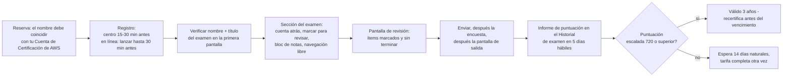
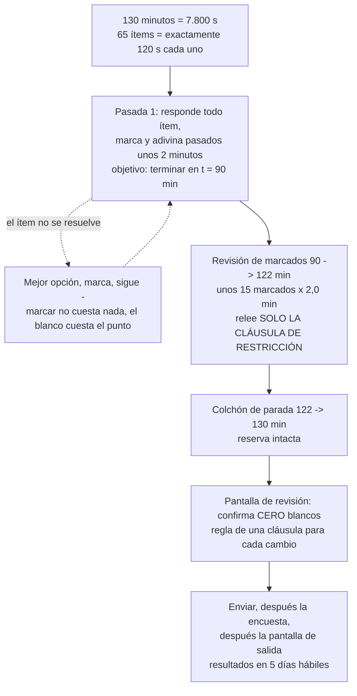
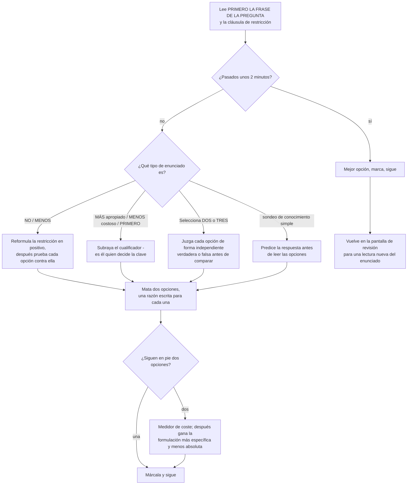
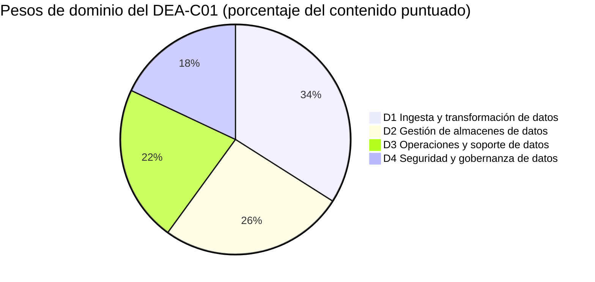
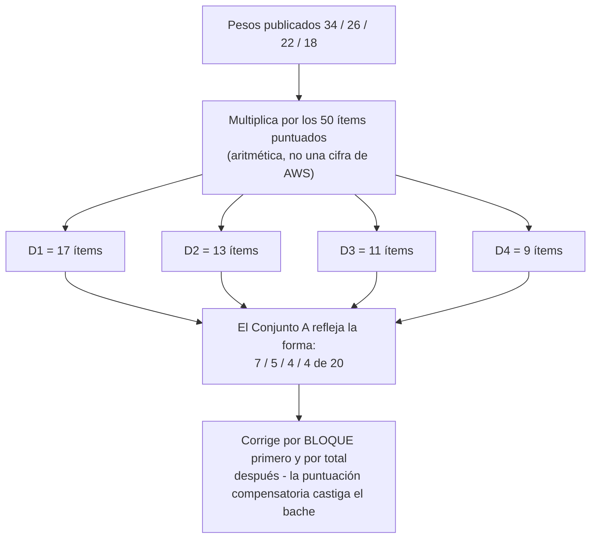

# Simulacro de examen A: conjunto de prácticas y estrategia

Catorce lecciones te dieron el contenido. Esta te da el **contenedor**: cómo se construye realmente un ítem del DEA-C01, cómo se comporta el reloj de 130 minutos, cómo AWS redacta un distractor, y después el **Conjunto A** — veinte ítems al estilo del examen que resuelves cronometrado y corriges con honestidad. Todo lo anterior a esta lección fue conocimiento de dominio; todo lo de aquí es *oficio del examen*, y en una escala compensatoria de 100 a 1.000 con **720** para aprobar, el oficio del examen vale tanto como otra hora de repaso.

```text
====================================================================
 EL EXAMEN DEA-C01 DE UN VISTAZO       (todas las cifras a octubre
                                         de 2026)
====================================================================
 FORMATO ....... 65 preguntas = 50 puntuadas + 15 no puntuadas (sin
                 identificar)
 TIPOS ........ elección múltiple (1 correcta + 3 distractores)
                 respuesta múltiple (2+ correctas de 5+ opciones)
 TIEMPO ......... 130 minutos = 7.800 s  ->  exactamente 120 s por ítem
 ESCALA ........ 100 - 1.000, se aprueba con 720, COMPENSATORIA, sin
                 corte por sección
 ADIVINAR ...... sin penalización por acierto erróneo; EN BLANCO = mal
 PESOS ...... D1 Ingesta y transformación de datos 34%
                 D2 Gestión de almacenes de datos      26%
                 D3 Operaciones y soporte de datos      22%
                 D4 Seguridad y gobernanza de datos     18%
 COSTE ......... 150 USD por intento (pueden aplicarse impuestos)
 VALIDEZ ..... 3 años; tras un SUSPENSO espera 14 días naturales,
                 intentos ilimitados, tarifa completa siempre
 ENTREGA ..... centro de exámenes Pearson VUE o en línea con vigilancia
 RESULTADOS ...... en 5 días hábiles, Cuenta de Certificación de AWS
 GUÍA ........ v1.1 publicada el 2025-12-12 (+8 habilidades, -0)
 IDIOMAS .... inglés, japonés, coreano, chino simplificado
--------------------------------------------------------------------
 CONJUNTO A (esta lección) ... 20 ítems en orden de peso: 7 / 5 / 4 / 4
====================================================================
```

> [!NOTE]
> **Cómo usar esta lección.** Lee las secciones 1 a 7 una vez — esa es la mitad de estrategia. Después resuelve el **Conjunto A (Preguntas de Práctica) con un cronómetro de 40 minutos, sin apuntes, sin buscar y sin mirar los desgloses**. Autoevalúate con la rúbrica de los bloques finales, convierte la puntuación cruda **por dominio y no por total** y deja que las señales de enrutado te devuelvan a la lección que de verdad necesitas. Cualquier cosa que esta lección no haya podido verificar contra una página primaria de AWS figura en la sección 7 — trátala como *no lo afirme*, no como un dato que memorizar.

Al terminar esta lección sabrás:

- restituir de memoria cada cifra logística publicada (65 / 50 / 15, 130 minutos, 720/1.000, 150 USD, 3 años, 14 días);
- ejecutar la aritmética de ritmo de 120 segundos y defender un plan de dos pasadas que nunca deja un ítem en blanco;
- aplicar la técnica de marcar y barrer dentro de un presupuesto de dos minutos por ítem;
- leer un enunciado superlativo — *MÁS apropiado*, *MENOS costoso*, *PRIMER paso*, *NO* — y saber qué opción compra ese cualificador;
- ejecutar el procedimiento de cinco movimientos para respuesta múltiple que sobrevive a la puntuación de todo o nada;
- descodificar las fábricas de distractores que AWS reutiliza en los cuatro dominios;
- resolver el Conjunto A, corregirlo **por dominio y no por total** y enrutar cada fallo a la lección correcta;
- defender el **veredicto comparativo** sobre la preparación oficial gratuita frente a la formación de pago y la experiencia multi-nube u on-premises.

---

## 1. El contenedor: qué son en realidad los 130 minutos

### 1.1 La logística que no puedes volver a derivar el día del examen

Cada cifra siguiente está publicada por AWS y se obtuvo en octubre de 2026. Se te permite olvidar curiosidades de servicios; no se te permite volver a derivar esto con el reloj corriendo.

| Dato | El valor publicado | Por qué cambia tu estrategia |
|---|---|---|
| **Preguntas presentadas** | **65** | Tienes que *ver* las 65 — la cobertura vence a la profundidad |
| **Puntuadas / no puntuadas** | **50 puntuadas + 15 no puntuadas**, y las 15 **no están identificadas** | Trata cada ítem como puntuado |
| **Tipos de pregunta** | **Elección múltiple** (1 correcta + 3 distractores) y **respuesta múltiple** (2+ correctas de 5+ opciones) | Dos procedimientos de eliminación distintos, un solo reloj |
| **Tiempo** | **130 minutos** | 7.800 s ÷ 65 = **exactamente 120 s por ítem** |
| **Escala** | **100–1.000**, puntuación mínima de aprobado **720** | 720 es un corte *escalado*, no un 72 % |
| **Modelo de puntuación** | **Compensatorio** — sin nota de corte por dominio | Un dominio flojo todavía te hunde |
| **Adivinar** | **Sin penalización**; las preguntas sin respuesta puntúan como incorrectas | Dejarlo en blanco es el único cero garantizado |
| **Coste** | **150 USD** por intento (nivel Associate; pueden aplicarse impuestos) | Cada repetición son 150 USD nuevos |
| **Validez** | **3 años** | Anota el vencimiento el día que apruebes |
| **Tras un suspenso** | Espera **14 días naturales**, sin límite de intentos, tarifa completa cada vez | Presupuesta el intento dos *antes* del intento uno |
| **Tras aprobar** | Ese mismo examen no se puede repetir durante **2 años** | No puedes «refrescar» una aprobación antes de tiempo |
| **Entrega** | Centro de exámenes **Pearson VUE** o en línea con vigilancia | Mismo examen, mismo precio, ambas vías |
| **Resultados** | En **5 días hábiles** en tu Cuenta de Certificación de AWS | Planifica una semana tranquila, no un refresco por hora |
| **Acomodación** | La acomodación ESL añade **+30 minutos**, solicitada una vez antes de la inscrpción | Solicítala con mucha antelación |
| **Descuento para el siguiente examen** | **50 % de descuento** en tu siguiente examen una vez que hayas aprobado uno | 150 USD → 75 USD tras la primera aprobación |

- **📚 ¿Sabías que…?** Los **15 ítems no puntuados se parecen exactamente a los 50 puntuados** — AWS declara que *«no están identificados en el examen»*. La respuesta racional es la simetría: un ítem de pretesto mal respondido no te cuesta nada, un ítem puntuado saltado cuesta la nota completa, así que el incentivo jamás apunta a «déjalo en blanco y vuelve». Marca, adivina, sigue.

**La interfaz que te van a dar.** Conocer los controles *antes* del día del examen son puntos gratis, porque el examen no te da ningún recorrido de orientación:

| Control | Dónde está | Qué hace |
|---|---|---|
| **Cuenta atrás** | En pantalla | Corre durante toda la sección del examen; los descansos programados **no están configurados**, así que el reloj nunca se detiene por ti |
| **Marcar para revisar** | En pantalla | Marca un ítem para que aparezca en la pantalla de revisión — cuesta un clic |
| **Bloc de notas virtual** | En pantalla | Espacio de notas de texto libre; úsalo para las palabras cualificadoras, no para copiar enunciados |
| **Navegación libre** | En pantalla | Muévete entre ítems en cualquier orden; verifica primero tu nombre y el título del examen |
| **Pantalla de revisión** | Al final | Tu última oportunidad de volver a los ítems marcados o inacabados antes de enviar |
| **Demostración de examen de AWS** | Gratuita, antes del día del examen | Ensayar marcado, revisión e interruptor de idioma para que nada de eso sea un descubrimiento el día del examen |



**Dos fallos administrativos cuestan más que cualquier laguna de conocimiento.** En un centro de exámenes, a los administradores se les instruye para no permitir el examen cuando el nombre de tu documento de identidad no coincide con tu Cuenta de Certificación de AWS; en línea, llegar **con más de 15 minutos de retraso** o saltarte la prueba de sistema obligatoria **anula la tarifa**. Ninguno se recupera estudiando.

### 1.2 El plan de ritmo: 65 ítems, 130 minutos

AWS **no publica presupuesto por pregunta**. Las únicas entradas oficiales de ritmo son la duración de 130 minutos, la cuenta atrás en pantalla y los controles de marcar y revisar de la Demostración de examen. Todo lo siguiente es aritmética sobre cifras publicadas, y así se etiqueta.

**Ejemplo resuelto 1 — el techo.**

$$
\frac{130 \times 60}{65} = \frac{7{,}800}{65} = 120\ \text{s por ítem} \quad (\text{exactamente } 2.00\ \text{minutos})
$$

**Ejemplo resuelto 2 — la ilusión de solo los puntuados.** Contra los ítems puntuados únicamente, el presupuesto parece $7{,}800 \div 50 = 156$ s $= 2.60$ minutos. No puedes saber cuáles de los 50 son los puntuados, así que **120 s es la cifra con la que planificas** y 156 s es una trampa contra la que jamás debes presupuestar.

**Ejemplo resuelto 3 — lo que cuesta de verdad un promedio lento.** A 2,5 minutos por ítem obtienes $65 \times 2.5 = 162.5$ minutos — **32,5 minutos por encima del límite**, que equivale aproximadamente a los últimos 16 ítems prisa o en blanco, y un ítem en blanco puntúa como incorrecto. El reloj, no tu conocimiento, produce esa puntuación.

**El reparto de dos pasadas.** Ejecuta la pasada uno para que termine en **t = 90 minutos** (unas 1,4 minutos por ítem, más rápido que el techo de 120 segundos y por tanto con holgura para los ítems largos). A t = 45 deberías estar cerca del ítem 33; a t = 65 cerca del ítem 50. Todo lo que no puedas resolver con una lectura limpia recibe marca y la mejor suposición.

| Fase | Reloj | Minutos | La regla que no debes romper |
|---|---|---|---|
| **Pasada 1** — los 65 | 0:00 → 1:30 | 90 | Responde *todos* los ítems; marca los dudosos (12–18) |
| **Revisión de marcados** | 1:30 → 2:02 | 32 | Relee la **cláusula de restricción**, no las cuatro opciones |
| **Colchón de parada** | 2:02 → 2:10 | 8 | Reserva intacta para los dos o tres ítems que la necesiten |
| **Barrido sin blancos** | en la pantalla de revisión | — | Confirma **cero blancos** y envía |



**Ejemplo resuelto 4 — la acomodación ESL.** Con la extensión de +30 minutos el presupuesto pasa a $160 \div 65 = 2.46$ minutos por ítem. Eso es *más* tiempo por ítem, no permiso para gastar 4 minutos en un enunciado difícil — la estructura de dos pasadas sobrevive a la extensión sin cambios.

**Ejemplo resuelto 5 — el reloj del propio Conjunto A.** El Conjunto A tiene 20 ítems, así que el presupuesto en vivo escala a $20 \times 120 = 2{,}400$ s $= \mathbf{40}$ **minutos**. Resuélvelo en 40 minutos para reproducir el ritmo real. Si te falta tiempo, ejecuta la forma comprimida: pasada uno a 75 s por ítem ($20 \times 75 = 1{,}500$ s $= 25$ minutos) más un barrido de 5 minutos = **30 minutos**, y vuelve a resolverlo con los 40 completos antes del día del examen. Los 90 minutos de esta lección se reparten en unos 35 de lectura, 40 de resolución y 15 de corrección.

### 1.3 Marcar y barrer: la técnica, ítem a ítem

La propia guía del examen se reduce a una secuencia que puedes ejecutar en una sola pasada. Entrenala hasta que sea automática:

| Paso | Qué haces | Por qué existe |
|---|---|---|
| 1 | Lee primero la **frase de la pregunta**, después la cláusula de restricción, después las opciones | Las opciones te anclan; la restricción del enunciado es lo que la clave debe satisfacer |
| 2 | Subraya el cualificador: `MÁS`, `MENOS`, `PRIMERO`, `NO`, `Selecciona DOS/TRES` | El cualificador — no el nombre del servicio — decide la clave |
| 3 | Elimina las dos opciones que rompen una **restricción dura** (formato, límite, latencia, medidor de coste) | Una razón escrita para cada una; un candidato a medias las mantiene vivas |
| 4 | Rompe el empate de las dos últimas con el **medidor de coste** y *lo gestionado por encima de lo autogestionado* | Misma SQL, factura distinta: Athena = bytes escaneados, Redshift = tiempo de clúster |
| 5 | Pasados unos **dos minutos**: mejor opción, marca, sigue | El presupuesto del ítem es 120 s; marcar cuesta un clic, el blanco cuesta el punto |



El **barrido** es la otra mitad del nombre. En la pantalla de revisión no estás rerespondiendo; compruebas tres cosas y nada más:

1. **Blancos.** Cero. Un ítem sin respuesta puntúa como incorrecto y no hay penalización por acertar a ciegas, así que el blanco queda estrictamente dominado por cualquier suposición.
2. **La pregunta que se hacía.** Relee la cláusula de restricción y confirma que respondiste *a esa* — la pérdida clásica es responder a la pregunta contigua, la más familiar.
3. **Orden de operaciones.** Cambia una opción solo si puedes enunciar la razón en una cláusula. «Me pareció mal» no es una cláusula.

```dragdrop
{
  "question": "Ordena los seis movimientos de la rutina de marcar y barrer para un único ítem atascado en el DEA-C01:",
  "items": [
    "En la pantalla de revisión, releer LA CLÁUSULA DE RESTRICCIÓN - nunca primero las opciones",
    "Confirmar que respondiste a la pregunta que realmente se hacía",
    "Marcar el ítem y seguir inmediatamente",
    "Elegir tu mejor suposición para que no quede ningún blanco",
    "Dos minutos alcanzados - deja de releer las opciones",
    "Ejecutar el barrido final sin blancos antes de enviar"
  ],
  "correctOrder": [
    "Dos minutos alcanzados - deja de releer las opciones",
    "Elegir tu mejor suposición para que no quede ningún blanco",
    "Marcar el ítem y seguir inmediatamente",
    "En la pantalla de revisión, releer LA CLÁUSULA DE RESTRICCIÓN - nunca primero las opciones",
    "Confirmar que respondiste a la pregunta que realmente se hacía",
    "Ejecutar el barrido final sin blancos antes de enviar"
  ],
  "explanation": "El orden lo fija el riesgo: el reloj es la restricción vinculante, así que el presupuesto de 120 segundos salta primero y fuerza una suposición antes de la marca, lo que garantiza que no quede ningún blanco. La marca solo compra una segunda lectura, y esa lectura debe empezar por la cláusula de restricción porque la pérdida clásica es responder a la pregunta contigua. El barrido sin blancos va al final porque es la comprobación final de que nada quedó sin responder: las preguntas sin respuesta puntúan como incorrectas y no hay penalización por acertar."
}
```

### 1.4 Leer el enunciado: MÁS apropiado, MENOS costoso, PRIMERO

La mayoría de las pérdidas en el DEA-C01 son pérdidas de lectura. El **cualificador** del enunciado, no el nombre del servicio, decide la clave — así que el primer movimiento es siempre el mismo: encuentra el cualificador, anota lo que exige, y *después* lee las opciones.

| El enunciado dice… | En realidad pregunta | Tu primer movimiento | Dónde se prueba en el Conjunto A |
|---|---|---|---|
| **«MÁS apropiado» / «MÁS rentable»** | La opción más barata que cumpla **cada** restricción enunciada | Lista primero las restricciones; una opción que viola alguna está muerta a cualquier precio | Q5 (Glue frente a Lambda frente a EMR Serverless), Q9 (aritmética de ciclo de vida), Q12 (vista materializada) |
| **«MENOS carga operativa» / «MENOS costoso»** | La opción sin clúster, entorno o cargo por inactividad que gestionar | Mata la respuesta *correcta pero pesada* — MWAA donde basta Step Functions, EMR donde basta Glue | Q4 (orquestación), Q13 (arregla la causa, no el síntoma) |
| **«DEBE … PRIMERO» / «PRIMER paso»** | **Diagnóstico o delimitación, no remediación** | Ordena las opciones por dependencia; la respuesta es el paso más temprano que exige el riesgo enunciado | Q13 (fuerza concurrencia a 1), Q17 (cierra la puerta abierta) |
| **«¿Qué solución cumplirá este requisito?»** | Las cuatro opciones suelen funcionar; una es la mejor práctica / la más barata / la más simple | Rompe el empate con el medidor de coste y después con gestionado frente a autogestionado | Q2, Q7, Q10 |
| **«NO» / «MENOS»** | La única opción que *viola* la restricción | Subráyala antes de leer las opciones, reformula en positivo, vigila las dobles negaciones | Reservado para el examen real — mantén el reflejo |
| **«(Selecciona DOS / TRES)»** | Cada respuesta correcta es necesaria, todo o nada | Lee *todas* las opciones y juzga cada una por separado antes de comparar | Q3, Q8, Q11, Q14, Q18 |

**Ejemplo resuelto 6 — leer un superlativo de principio a fin.** Toma un enunciado que nunca aparece en el Conjunto A: *«Un trabajo nocturno de Spark sobre un conjunto de datos de 40 GB termina constantemente en unos 25 minutos con 12 GB de memoria de ejecutor. ¿Qué servicio y entorno de ejecución son la opción MÁS apropiada y totalmente gestionada?»*

1. **Subraya los cualificadores antes de mirar ninguna opción:** nocturno · 40 GB · **25 minutos** · 12 GB · *totalmente gestionada*.
2. **Deja que el cualificador más duro elimine.** 25 minutos son **1.500 segundos**, por encima del techo duro de **900 segundos** de AWS Lambda — así que Lambda muere por aritmética, aunque sea la opción con aspecto más serverless y 10.240 MB estén dentro de su rango de memoria. Ese distractor está construido para probar *qué límite manda*.
3. **Haz coincidir el entorno de ejecución con la carga.** Un trabajo de Spark DataFrame no es un script de un solo proceso, así que el shell de Python de Glue (0,0625 o 1 DPU, sin Spark) muere después.
4. **Aplica «menos carga operativa» a los supervivientes.** Un trabajo Glue ETL (`glueetl`) ejecuta Spark totalmente gestionado en unidades DPU (1 DPU = 4 vCPU + 16 GB); EMR Serverless también funciona pero arrastra más superficie operativa de la que pide la restricción del enunciado.
5. **Dite la trampa en voz alta:** la opción *más* serverless falló por un **límite**, no por una preferencia. Verifica cada límite contra la página actual de cuotas de servicio antes de apoyarte en él.

- **📚 ¿Sabías que…?** La frase de estilo más importante de la guía del examen es *«La capacidad de comparar servicios de AWS para comprender las diferencias de coste, rendimiento y funcionalidad entre servicios»*. Cada desempate de la sección 1.4 es un caso de ella: cuando dos opciones *funcionan*, el diferenciador es el medidor de coste, el margen de rendimiento o el límite funcional — nunca «cuál he usado yo».

```matching
{
  "question": "Relaciona cada disparador de enunciado con el movimiento que de verdad gana la marca: los cinco reflejos de cualificador de la sección 1.4:",
  "pairs": [
    {"left": "MÁS apropiado / MÁS rentable", "right": "Lista primero cada restricción y después elige la opción más barata que satisfaga todas ellas"},
    {"left": "MENOS carga operativa / MENOS costoso", "right": "Mata la opción correcta pero pesada - sin clúster, sin entorno, sin cargo por inactividad"},
    {"left": "DEBE hacerse PRIMERO", "right": "Paso de diagnóstico o delimitación, no la remediación con la que el enunciado te tienta"},
    {"left": "NO / MENOS / excepto", "right": "Subráyala antes de leer las opciones, reformula la restricción en positivo y busca la violación"},
    {"left": "Selecciona DOS o TRES", "right": "Juzga cada opción de forma independiente como verdadera o falsa, descarta las falsas y después comprueba el recuento"},
    {"left": "¿Qué solución cumplirá este requisito?", "right": "Las cuatro funcionan - desempate con el medidor de coste y después con lo gestionado por encima de lo autogestionado"}
  ],
  "explanation": "Cada par lo decide una palabra del enunciado: un superlativo compra la opción más barata que todavía satisface cada restricción; menos carga compra la opción más gestionada; PRIMERO compra el diagnóstico; un enunciado negativo compra la violación; Selecciona DOS compra el juicio independiente por opción; y un enunciado de requisito neutro compra el desempate de mejor práctica de AWS. Leer el cualificador antes de las opciones es toda la técnica: los nombres de servicios se eligen para resultar plausiles en las cuatro posiciones."
}
```

### 1.5 La técnica de respuesta múltiple

La guía del examen define el tipo con precisión: la **respuesta múltiple «tiene dos o más respuestas correctas de entre cinco o más opciones de respuesta»**. Dos consecuencias deciden tu método:

- **Todo o nada.** Un conjunto parcialmente correcto puntúa cero. El propio material de preparación de AWS imprime *«Sin puntos negativos ni crédito parcial»*, así que el coste de una selección incompleta es idéntico al de una selección errónea, y no hay razón para enviar menos de lo que el enunciado exige.
- **Ritmo distinto.** Los ítems de respuesta múltiple tardan aproximadamente la mitad más que la elección múltiple, lo que los convierte en los más propensos a llevarte pasados los dos minutos — y en los que menos quieres marcar, porque releer cinco o seis opciones se siente productivo. Márcalos de todos modos.

**El procedimiento de cinco movimientos:**

| Movimiento | Qué haces | Fallo que previene |
|---|---|---|
| 1 | Juzga **cada** opción de forma independiente: claramente verdadera / claramente falsa / quizá | Comprometerse con una opción porque «suena bien» junto a sus vecinas |
| 2 | Descarta toda opción claramente falsa | Mantener vivo un distractor plausible por asociación |
| 3 | Si los supervivientes coinciden con el recuento pedido, envía | Releer sin fin un ítem ya terminado |
| 4 | Si sobreviven **más** que el recuento, relea buscando un cualificador de **alcance**: por Región frente a global, en reposo frente a en tránsito, plano de control frente a plano de datos, responsabilidad del cliente frente a AWS | Elegir una afirmación verdadera que responde a una pregunta más amplia que la que hacía el enunciado |
| 5 | Si sobreviven **menos**, una verdad «obvia» está fuera de ámbito: compruébala contra la lista de servicios en ámbito y la viñeta de habilidad de la que sale el enunciado | Perder una opción correcta porque parece demasiado fácil |

```fillblank
{
  "question": "Completa la rutina de respuesta múltiple de la sección 1.5:",
  "template": "1) Juzga cada opción {{1}} como verdadera, falsa o quizá. 2) Descarta las opciones claramente {{2}}. 3) Si los supervivientes coinciden con el recuento, {{3}}. 4) Si sobreviven demasiadas, relea buscando un cualificador de {{4}} como por Región frente a global. 5) Si sobreviven demasiado pocas, la verdad que parece fácil probablemente {{5}}.",
  "answers": {
    "1": "de forma independiente",
    "2": "falsas",
    "3": "envía",
    "4": "alcance",
    "5": "está fuera de ámbito"
  },
  "distractors": ["de forma idéntica", "verdaderas", "marca", "coste", "está en ámbito", "opcional", "invertidas", "superficie"],
  "explanation": "La rutina es deliberadamente mecánica porque no existe crédito parcial: el juicio independiente frena los errores inducidos por la vecindad, descartar las falsas hace el trabajo real, un recuento exacto significa detenerse, un conjunto de supervivientes sobredimensionado significa que se esconde un cualificador de alcance (por Región frente a global, en reposo frente a en tránsito, cliente frente a AWS) y un conjunto subdimensionado suele significar que una respuesta que parece obvia está fuera de ámbito para la viñeta de habilidad de la que salió el enunciado."
}
```

- **📚 ¿Sabías que…?** La guía del examen garantiza los dos **tipos** y los recuentos de ítems puntuados y no puntuados, pero AWS nunca ha publicado cuántos ítems de respuesta múltiple aparecen en una hoja determinada, ni la proporción de elección múltiple frente a respuesta múltiple entre los 50 puntuados. El reparto de cinco de veinte del Conjunto A es una **elección didáctica** que refleja las propias definiciones de la guía — nunca lo cites como una cifra de AWS.

### 1.6 Pesos de dominio y el plano del Conjunto A

Solo se publican los porcentajes de **dominio**. Los recuentos de ítems siguientes son aritmética sobre 50 ítems puntuados — una ayuda de planificación, jamás una cifra de AWS.

| Dominio | Peso publicado | Ítems puntuados en el examen real (derivado: 50 × w) | Ítems del Conjunto A aquí | Señal de prioridad |
|---|---|---|---|---|
| **D1** Ingesta y transformación de datos | **34 %** | ≈ 17 | **7** (Q1–Q7) | Streams frente a Firehose, bookmarks de Glue, orquestación, motores de transformación, medidores de coste |
| **D2** Gestión de almacenes de datos | **26 %** | ≈ 13 | **5** (Q8–Q12) | Selección de almacén, aritmética de ciclo de vida, diseño de distribución, formatos de tabla abiertos |
| **D3** Operaciones y soporte de datos | **22 %** | ≈ 11 | **4** (Q13–Q16) | Diagnosticar, monitorizar, costear una ejecución, ajustar un plan |
| **D4** Seguridad y gobernanza de datos | **18 %** | ≈ 9 | **4** (Q17–Q20) | Lake Formation, dos puertas, cifrado, registros de auditoría |
| **Total** | **100 %** | **≈ 50** | **20** | La columna «ítems puntuados» es aritmética, no de AWS |

**Ejemplo resuelto 7 — de pesos a ítems.** $50 \times 0.34 = 17$, $50 \times 0.26 = 13$, $50 \times 0.22 = 11$, $50 \times 0.18 = 9$; $17 + 13 + 11 + 9 = 50$. Los dominios 1 y 2 suman el **60 %** del contenido puntuado — que es la razón por la que el Conjunto A les da 12 de sus 20 ítems — pero los 9 ítems del Dominio 4 son más que suficientes para suspender por sí solos, porque la puntuación es compensatoria y no hay corte de sección detrás del cual esconderse.





### 1.7 Familias de distractores, y lo que esta lección no va a afirmar

AWS declara que los distractores son *«respuestas generalmente plausibles que coinciden con el área de contenido»*. No son aleatorios; las mismas formas se repiten y cada una castiga una confusión concreta. Aquí se etiquetan como **T1–T7** para que nunca se confundan con las etiquetas de dominio **D1–D4**.

| # | Familia de distractor | Cómo te tienta | Tu contramovimiento |
|---|---|---|---|
| **T1** | **Servicio hermano** | Firehose ofrecido donde se requiere Streams, MWAA donde basta Step Functions | Mapea el **sustantivo** del enunciado al mecanismo primero: stream frente a canalización de entrega |
| **T2** | **Capa equivocada / etapa equivocada** | Respuesta de crawler para una pregunta de orquestación, respuesta de catálogo para una pregunta de datos | Servicio correcto, lugar *equivocado* en la canalización |
| **T3** | **Ámbito / nomenclatura** | Un servicio fuera de ámbito que suena más avanzado que la clave real | La respuesta está siempre en la lista **en ámbito** |
| **T4** | **Sobreafirmación** | Infraestructura a escala empresarial ofrecida para una pregunta de *MENOS carga* | Responde al superlativo, no al tema |
| **T5** | **Inversión de responsabilidad** | «Es un servicio gestionado de AWS, así que lo hace AWS» | Pregunta: ¿esto es *de* la nube o *en* la nube? |
| **T6** | **Cebo numérico** | Un DPU, precio, límite o fecha erróneos pegados a una afirmación verdadera | Escribe la unidad y la cifra antes de comparar |
| **T7** | **Verdadero pero irrelevante** | Un dato correcto que responde a una pregunta vecina | Prueba cada opción contra la **restricción del enunciado** |

**Puntos que esta lección deliberadamente no afirma.** Se señalan en lugar de enseñarse, porque una afirmación sin verificar nunca es un hecho:

1. **Cuántos ítems de respuesta múltiple** trae una hoja en vivo, y si cada enunciado indica el recuento — sin publicar.
2. **La proporción por hoja de elección múltiple frente a respuesta múntiple** entre los 50 ítems puntuados — sin publicar.
3. **El texto de los 20 ítems del Official Practice Question Set.** Están detrás del inicio de sesión de Skill Builder; ninguna afirmación de estilo de este curso se atribuye a haberlos leído.
4. **La fecha exacta en la que el contenido de la guía v1.1 apareció por primera vez en una hoja en vivo.** La guía promete revisiones al menos un mes por adelantado y la entrega se despliega por idiomas. Di «en la guía de examen actual», no una fecha.
5. **Si el DEA-C01 adoptará los tipos de ordenación, emparejamiento y caso de estudio** anunciados por AWS en julio de 2024. AWS nombró a *AI Practitioner* y *Machine Learning Engineer – Associate* como los primeros exámenes con esos tipos, y la guía actual del DEA-C01 lista solo elección múltiple y respuesta múltiple.
6. **Una conversión de cruda a escalada.** 720 es un corte escalado producido por fijación de estándares y equiparación; «N de 50 = aprobado» es aritmética que nadie fuera de AWS puede hacer.
7. **Notas de corte por dominio.** No existen — el modelo es compensatorio.
8. **Aprobado/suspenso el mismo día o en pantalla.** El texto oficial de política es «dentro de los cinco días hábiles».

---

### Actualizaciones de 2026 (en octubre de 2026)

Seis cambios de 2025–2026 deciden si tus apuntes son correctos o no el día del examen. Cada viñeta lleva una fuente a una página primaria de AWS obtenida en octubre de 2026; cuando una afirmación no pudo verificarse se etiqueta como tal y nunca debe memorizarse como hecho.

> [!NOTE]
> **Qué se movió entre 2025 y octubre de 2026:**
> - **La guía del examen pasó a v1.1 el 2025-12-12.** Los ítems de conocimiento se consolidaron en las listas de habilidades, **se añadieron ocho habilidades y ninguna se eliminó**: 1.2.10 integrar LLM para procesamiento de datos, 2.1.7 gestionar formatos de tabla abiertos (Apache Iceberg), 2.1.8 tipos de índice vectorial, 2.2.6 catálogos de datos de negocio, 2.4.6 conceptos de vectorización, 4.1.7 dominios de Amazon SageMaker Unified Studio, 4.5.6 acceso por proyectos de SageMaker Catalog, 4.5.7 marco de gobernanza y patrones de intercambio de datos. Las revisiones se publican **al menos un mes** antes de que puedan afectar a una hoja en vivo.
> - **Las listas de servicios también se movieron.** El ámbito ganó **Aurora, Amazon Q, Amazon Bedrock, Amazon Kendra, AWS Data Exchange y Amazon S3 Tables** y perdió **Cloud9, CodeCommit y AWS SCT** — sin embargo la tarea 2.4.3 todavía nombra «AWS SCT y AWS DMS Schema Conversion», así que enseña DMS Schema Conversion como actual y SCT como legado. Un servicio eliminado todavía puede aparecer como *distractor*.
> - **Tres fósiles de servicio te bajarán la nota.** Amazon Data Firehose es el nombre del producto desde **2024-02-09** mientras la lista en ámbito todavía imprime «Amazon Kinesis Data Firehose» (ambos válidos; el prefijo de la API sigue siendo `firehose`). Kinesis Data Streams ahora tiene **tres** modos de capacidad, no dos — On-demand Advantage (anunciado el 2025-11-04) elimina el cargo horario por stream pero impone un mínimo de **25 MB/s de ingesta + 25 MB/s de recuperación** a toda la cuenta, y los cambios de modo de capacidad están limitados a **dos veces cada 24 horas**. Y Redshift ya no solo *lee* Iceberg: escrituras GA el 2025-11-17, UPDATE/DELETE/MERGE el 2026-04-23, vistas materializadas Iceberg el 2026-10-05.
> - **Glue cambió de generación.** **5.1 es el predeterminado para trabajos nuevos** (2025-11-26); **6.0 es la última** (2026-08-21, Spark 4.1.1, Python 3.13, Scala 2.13, una reducción de precio del 30 %, Iceberg v3 completo) y **elimina EMRFS y AWS SDK for Java v1**. Glue 0.9/1.0/2.0 llegó a su fin de vida el **2026-04-01**, y los trabajos de Python Shell 3.6 ya no pueden crearse después del **2026-03-31**. Una nota de 2024 que diga «usa Glue 3.0/4.0» ya está obsoleta.
> - **Mínimos más bajos y puntos de entrada más baratos.** Las reservas de capacidad de Athena bajaron a **4 DPU / 1 minuto** (2026-02-11) y los resultados de consultas gestionados de Athena (2025-06-03) no necesitan bucket de resultados en S3 y no cuestan nada extra; el intercambio entre cuentas de Lake Formation v5 (2026-02-11) lleva tablas ilimitadas en un único share de AWS RAM; Redshift Serverless ahora vende reservas de 1 y 3 años. Las cuentas creadas **el 2025-07-15 o después** reciben un **Plan Gratis de 6 meses** con hasta **200 USD** de crédito en lugar del tramo legado de 12 meses.
> - **La logística no se movió:** 130 minutos, 65 preguntas (50 puntuadas + 15 no puntuadas), 150 USD, 720 para aprobar, validez de 3 años, espera de 14 días para repetir, Pearson VUE en centro o en línea con vigilancia, cuatro idiomas. El DEA-C01 tuvo una única beta (2023-11-27 a 2024-01-12 a 75 USD) y **ninguna beta en 2026**; las cifras de «170 minutos / 85 preguntas / 300 USD» que todavía circulan en páginas de terceros no describen ni a este examen ni a ninguna configuración actual de certificación de AWS.

- **📚 ¿Sabías que…?** AWS movió las guías de examen de PDF estáticos a AWS Docs precisamente para que las revisiones pudieran publicarse sin un código de examen nuevo: un cambio **significativo** gana un código de serie nuevo (por ejemplo DVA-C01 → DVA-C02), mientras que un cambio **menos significativo** — añadir o eliminar habilidades y servicios en ámbito — se convierte en una *revisión* con el mismo código. Por eso el DEA-C01 siguió siendo DEA-C01 a través de v1.1, y por eso la página de Revisiones, no una marca de agua de PDF, es el artefacto que comprobar antes de sentarte.

> [!TIP]
> **Tres elementos más con fuente — ámbito del examen y cambios de vocabulario (digest 17, todo leído el 2026-10-10):**
> - **Los tipos de pregunta y las noticias de beta siguen fuera del DEA-C01.** La publicación de certificación de AWS del 2024-07-22 anunció tres tipos de ítem nuevos — **ordenación, emparejamiento y caso de estudio** — y nombró a *AI Practitioner* y *Machine Learning Engineer – Associate* como los primeros exámenes en llevarlos; la guía actual del DEA-C01 (v1.1) sigue listando **solo elección múltiple y respuesta múltiple**. La única beta del DEA-C01 fue del **2023-11-27 al 2024-01-12 a 75 USD**, y **no se celebró ninguna beta del DEA-C01 en 2026** — el anuncio de beta de 2026 pertenece a MLA-C02, así que nunca importes el recuento de preguntas, la duración o el precio de otro examen a este.
> - **La lista de servicios fuera de ámbito perdió cuatro nombres.** v1.1 eliminó **Honeycode, WorkDocs, Amazon Timestream y CodeWhisperer** del ámbito excluido y no añadió nada a él, mientras el ámbito en suma ganó **+3** (seis añadidos, tres eliminados). Eliminar no es prohibir: Cloud9, CodeCommit y AWS SCT siguen siendo distractores perfectamente legales, y la tarea 2.4.3 todavía dice «AWS SCT y AWS DMS Schema Conversion» — enseña DMS Schema Conversion como actual, SCT como legado.
> - **Dos fósiles de vocabulario.** **Kinesis Data Analytics for SQL se discontinuó el 2026-01-27** — di *Amazon Managed Service for Apache Flink* (renombrado el 2023-08-30). Y la lista en ámbito ahora imprime literalmente **«Amazon Quick»** mientras la línea de producto se lee **Amazon Quick Suite / Quick Sight** (evolucionada desde QuickSight el 2025-10-09): trata la familia como en ámbito, pero **no** afirmes que la guía dice «Amazon QuickSight» — no lo dice.

---

## Casos Reales

AWS nunca imprime el nombre de un cliente en un ítem de examen, pero las *formas* de los fallos reales de canalización se filtran constantemente en los enunciados: una frase de historial de incidente se convierte en la condición del enunciado, y las cuatro opciones se convierten en las cuatro formas en que los candidatos la leen mal. Los dos ejercicios siguientes salen del material de casos detrás del banco de preguntas de este curso y deben ejecutarse **antes** del Conjunto A — cada uno termina con *qué dominio prueba* y *qué preguntaría el examen*.

Dos reglas gobiernan todo en esta sección:

1. **Un número en un enunciado es una restricción, no decoración.** «25 minutos», «1.500 registros por segundo», «3 TB sin comprimir» es siempre el cualificador que selecciona la clave.
2. **El dominio lo elige la restricción, no la historia.** La misma narrativa de streaming siembra un ítem del Dominio 1 (diseño de ingesta), un ítem del Dominio 3 (retraso de monitorización) o un ítem del Dominio 4 (quién puede leer el stream) según qué cláusula subraya el examen — exactamente el reflejo de la sección 1.4.

### Caso 1 — la clave de partición caliente: por qué añadir shards no sirve de nada

**La historia.** 800 registros de telemetría por segundo de 4 KB cada uno llegan desde 12.000 dispositivos, y dos aplicaciones consumidoras necesitan cada una todos los registros. El dimensionamiento da **4 shards** (la Q1 del Conjunto A). Dos semanas después, una compilación de firmware defectuosa fija **1.500 registros por segundo sobre una única clave de partición `device_id`**, y ese shard se limita a **1.000 registros por segundo** sin importar cuántos shards haya al lado.

**¿Qué dominio prueba esto?** Principalmente **D1 Ingesta y transformación de datos (34 %)** — habilidad 1.1.9 limitaciones de velocidad y límites de tasa, habilidad 1.1.10 fan-in y fan-out. Anclas secundarias: **D3 (22 %)** si el enunciado pregunta sobre qué *alarmar* (`GetRecords.IteratorAgeMilliseconds`), **D4 (18 %)** si pregunta quién puede escribir en el stream.

**¿Qué preguntaría el examen?** Tres formas de enunciado:

1. *«¿Qué cambio resuelve más directamente la limitación de velocidad?»* → **rediseñar la clave de partición** (una clave de dos niveles o con sal como `device#<bucket>`), porque una clave de partición mapea exactamente a un shard. Aumentar el recuento de shards es la respuesta errónea más seleccionada: el cuello de botella es por clave, no por stream.
2. *«¿Qué métrica confirma el retraso del consumidor?»* → `GetRecords.IteratorAgeMilliseconds`, cuya documentación de AWS indica que un valor cero indica que el consumidor ha puesto al día. Alarmar sobre **Max** frente a aproximadamente la mitad de la ventana de retención.
3. *«¿Qué dos límites supera primero una única clave de partición?»* → **1 MB/s y 1.000 registros por segundo por shard** — y observa que el modo a demanda explícitamente no detecta ni aísla claves hash calientes, así que el autoescalado tampoco te salvará.

**La trampa que hay que decir en voz alta:** las respuestas de capacidad se sienten respuestas. Cuando el enunciado nombra una *clave*, la solución está en la clave.

### Caso 2 — la factura de Athena: tres números que deben leerse juntos

**La historia.** Un conjunto de datos de texto de **3 TB** sin comprimir está en Amazon S3 con **tres columnas del mismo tamaño**. Los paneles consultan **una** de las tres columnas. Cada consulta escanea 3 TB y cuesta 3 × 5.00 USD = **15.00 USD**. El equipo convierte a Apache Parquet con compresión **3:1**, vuelve a registrar la tabla en el Catálogo de datos de AWS Glue y la misma consulta escanea ahora unos 0,33 TB por unos **1.65 USD**.

**¿Qué dominio prueba esto?** **D3 Operaciones y soporte de datos (22 %)** primero — habilidad 3.2.3 SQL en Athena, habilidad 3.1.7 consultar datos — con anclas de **D2 (26 %)** en 2.4.5 (particionado, compresión y otras técnicas de optimización) y de **D1 (34 %)** en 1.2.6 (transformar datos entre formatos, p. ej. .csv a Apache Parquet).

**¿Qué preguntaría el examen?** Tres formas de enunciado:

1. *«¿Cuál es el coste aproximado por consulta antes y después?»* → **15.00 USD → 1.65 USD** (la Q6 del Conjunto A). Los distractores son los deslices más probables: aplicar la compresión y olvidar la poda de columnas, usar el coste anterior equivocado, o multiplicar en lugar de dividir.
2. *«¿Qué cambio produjo la mayor parte del ahorro?»* → **la poda de columnas**, porque el texto no puede saltarse columnas: la compresión 3:1 por sí sola lleva 3 TB a 1 TB (5.00 USD), y leer una de tres columnas lo lleva a unos 0,33 TB.
3. *«¿Qué medidor de coste usa esta factura?»* → **bytes escaneados**, a 5.00 USD por TB con un mínimo de 10 MB por consulta, redondeado al MB superior — **sin cargo por DDL, gestión de particiones ni consultas fallidas**. La opción competidora es siempre Redshift, que factura en su lugar **tiempo de cómputo del clúster**.

**La trampa que hay que decir en voz alta:** dos palancas, una factura. La compresión y la selección de columnas son multiplicadores distintos, y un enunciado que cita solo una de ellas está comprobando si puedes hacer la aritmética en el orden en que ocurrió.

```matching
{
  "question": "Relaciona cada par de trampas con su encuadre correcto de una línea: las comparaciones con más probabilidades de costarte marcas en el Conjunto A:",
  "pairs": [
    {"left": "Kinesis Data Streams frente a Amazon Data Firehose", "right": "Streams = API de consumidor, retención de 24 h a 365 d, reproducible; Firehose = entrega en búfer, sin API de consumidor, sin reproducción del lado del consumidor"},
    {"left": "Step Functions frente a Amazon MWAA frente a EventBridge", "right": "Step Functions = flujo de trabajo multi paso duradero; EventBridge = enruta eventos y programa; MWAA = Airflow gestionado por el que pagas la inactividad"},
    {"left": "Marcadores de trabajo de AWS Glue frente a marcas de agua de streaming", "right": "Bookmarks = estado incremental por lotes; checkpointLocation + watermarks = streaming - «bookmarks en el trabajo de streaming» es siempre erróneo"},
    {"left": "DISTKEY frente a SORTKEY de Amazon Redshift", "right": "DISTKEY decide en qué slice aterriza una fila (redistribución del join); SORTKEY decide el orden de las filas dentro de los archivos (salto de escaneo)"},
    {"left": "Permisos de Lake Formation frente a permisos de IAM", "right": "Dos puertas, ambas deben abrirse: IAM controla las llamadas a la API, Lake Formation controla el catálogo y los datos de S3, y las concesiones de Lake Formation son locales a la Región"},
    {"left": "Amazon Macie frente a AWS Config", "right": "Macie descubre e informa de contenido sensible y nunca remedia; Config registra y evalúa el estado de configuración"},
    {"left": "Medidores de coste de Athena frente a Redshift", "right": "Athena factura bytes escaneados; Redshift factura tiempo de cómputo - misma SQL, factura distinta, palanca de optimización distinta"}
  ],
  "explanation": "Cada par lo decide un sustantivo o un cualificador, exactamente como en la sección 1.4: stream frente a canalización, flujo de trabajo frente a ruta frente a clúster, por lotes frente a streaming, distribución frente a ordenación, puerta de API frente a puerta de datos, contenido frente a configuración, y bytes frente a tiempo de cómputo. La guía del examen lo anticipa directamente: nombra la capacidad de comparar servicios de AWS por coste, rendimiento y funcionalidad como habilidad principal, así que estas siete comparaciones son los desempates favoritos del examen."
}
```

---

## Ejercicios con casos reales

Los dos casos anteriores salían del banco de preguntas de este curso; los dos ejercicios siguientes salen de **estudios de caso de clientes publicados por AWS** — cada cifra leída de una página propiedad de AWS en octubre de 2026 (digest 16). Ejecuta cada uno exactamente como ejecutarías un enunciado en vivo: subraya los números, nombra el **dominio** y después escribe la **pregunta** que el examen construiría a partir de él. La historia nunca es la respuesta; solo lo es la restricción enterrada en ella.

Dos reglas gobiernan todo en esta sección:

1. **Un resultado de cliente nunca es una garantía de AWS.** El **−78 %** de AGCO y las *«cientos de reglas de permiso a precisamente dos reglas»* de IAS son resultados de cliente impresos en páginas de AWS; AWS no se compromete ni a un porcentaje ni a un recuento de reglas. Toda opción redactada «AWS garantiza…» cae antes de que compruebes la cifra.
2. **Construye el enunciado desde la cláusula, no desde el titular.** La cláusula que subraya el examen lo decide todo: el *rendimiento* convierte la misma historia de AGCO en un ítem del Dominio 1, la *carga de pantalla de 600 ms* lo convierte en Dominio 3, el *quién puede leer el prefijo en bruto* lo convierte en Dominio 4 — exactamente el reflejo de la sección 1.4, aplicado a un caso en lugar de a un servicio.

### Ejercicio de caso 1 — AGCO: una historia de streaming, tres dominios

**La historia tal y como la publica AWS** (AWS Architecture Monthly, diciembre de 2021, p. 10, y el blog AWS Industries del 2021-03-03; consultado en octubre de 2026):

| Elemento | Lo que publicó AWS |
|---|---|
| **Escala** | Telemetría de **cientos de miles** de máquinas; **1.200 puntos de datos por minuto** en producción, probado en carga hasta **10.000 por minuto**; **1,9 M de registros/día**; **1.500 millones** de registros retenidos |
| **Canalización** | **Amazon Kinesis Data Streams → Amazon Data Firehose → Amazon S3**, con **Kinesis Data Analytics for Apache Flink**, más enriquecimiento con **AWS Lambda** hacia **Amazon DynamoDB** y **OpenSearch Service** |
| **Resultado (específico del cliente)** | Coste **−78 %**; carga de pantalla **8–30 s → 600 ms**; operado por **1 persona** en lugar de **3–5**; en vivo desde **enero de 2020** |

**¿Qué dominio prueba esto?** Principalmente **D1 Ingesta y transformación de datos (34 %)** — ingesta en streaming, fan-out y conversión de formatos, la forma KDS → Firehose → S3. Anclas secundarias: **D3 Operaciones y soporte de datos (22 %)** si el enunciado pregunta qué métrica prueba la cifra de 600 ms, y **D4 Seguridad y gobernanza de datos (18 %)** si pregunta quién puede escribir en o leer el prefijo en bruto.

**¿Qué preguntaría el examen?** Tres formas de enunciado, todas construidas a partir de la tabla anterior:

1. *«¿Qué servicio de esta arquitectura entrega registros a Amazon S3 sin que el equipo ejecute nunca código de consumidor?»* → **Amazon Data Firehose** — entrega en búfer que vacía por tamaño *o* por intervalo, lo que ocurra primero, sin exponer **ninguna API de consumidor ni reproducción del lado del consumidor**. La opción tentada es siempre *«reproduce las últimas 24 horas desde la entrega de Firehose»* (par de trampas F1; la Q2 del Conjunto A).
2. *«¿Qué métrica confirmaría que el retraso del consumidor — y no el búfer de Firehose — está detrás de un panel retrasado?»* → **`GetRecords.IteratorAgeMilliseconds`** en el stream, alarmado sobre **Max**, a aproximadamente la mitad de la ventana de retención; AWS documenta que un valor cero significa que el consumidor se ha puesto al día (la Q14 del Conjunto A).
3. *«¿Qué ruta analítica ofrece MENOS carga operativa para esta carga de trabajo?»* → el procesador de streams gestionado — **Amazon Managed Service for Apache Flink**, renombrado desde Kinesis Data Analytics el **2023-08-30** — por encima de Kafka o Flink autogestionados. Y nunca «añade shards» cuando el sustantivo del enunciado es una *clave*.

**La trampa que hay que decir en voz alta:** **−78 % es la cifra de AGCO en la carga de trabajo de AGCO**, datada en un lanzamiento de enero de 2020. Un enunciado que lo ofrece como propiedad del streaming gestionado está probando la primera trampa del digest 16 — *AWS dice X % ≠ universal*. Sella la historia con su fecha y rehúsa toda opción que la generalice.

- **📚 ¿Sabías que…?** La tabla anterior usa tres nombres para lo que los candidatos todavía llaman «Kinesis»: **Amazon Kinesis Data Streams**, **Amazon Data Firehose** (renombrado desde Kinesis Data Firehose el **2024-02-09**, con endpoints, APIs, CLI, prefijos de IAM y métricas de CloudWatch sin cambios) y **Amazon Managed Service for Apache Flink** (renombrado desde Kinesis Data Analytics el **2023-08-30**). La lista en ámbito del DEA-C01 todavía imprime «Amazon Kinesis Data Firehose», así que **ambos** nombres de Firehose son válidos — nunca «corrijas» una opción que use el más antiguo.

### Ejercicio de caso 2 — Integral Ad Science: cientos de reglas de permiso se convierten en dos

**La historia tal y como la publica AWS** (AWS Big Data Blog, 2021-09-23; consultado en octubre de 2026):

| Elemento | Lo que publicó AWS |
|---|---|
| **Problema** | Un lago de autoservicio entre cuentas productoras y consumidoras, obligaciones GDPR/CCPA, acceso decidido por clasificación de datos y puesto de trabajo |
| **Construcción** | **AWS Lake Formation + AWS Glue Data Catalog + Amazon S3 + Amazon Athena y EMR**, identidad federada desde **Okta**, acceso gobernado por **etiquetas de Lake Formation (LF-TBAC)** |
| **Resultado (específico del cliente)** | *«Con los controles de acceso basados en etiquetas de Lake Formation, IAS redujo cientos de reglas de permiso a precisamente dos reglas.»* |
| **Mecánica que hace posible la cifra** | Control a nivel de **columna**; Amazon S3 alcanzado **solo a través de una función de acceso a datos de Lake Formation**; **etiquetas a nivel de base de datos heredadas por tablas y columnas**; grupos de trabajo de Athena por unidad de negocio que hacen de **etiquetas de facturación y límites de consulta** |

**¿Qué dominio prueba esto?** **D4 Seguridad y gobernanza de datos (18 %)** primero — control de acceso basado en etiquetas, concesiones finas e identidad federada. Anclas: **D2 Gestión de almacenes de datos (26 %)** por el catálogo central del que cuelgan las etiquetas, y **D3 Operaciones y soporte de datos (22 %)** si el enunciado pregunta qué limita realmente un grupo de trabajo.

**¿Qué preguntaría el examen?** Tres formas de enunciado:

1. *«¿Qué mecanismo colapsa cientos de concesiones en dos?»* → **control de acceso basado en etiquetas**: concede una vez **sobre una etiqueta**, etiqueta los recursos y deja que la **herencia** lleve la concesión a cada tabla y columna bajo la base de datos (el mecanismo un paso más allá de las Q17 y Q18 del Conjunto A).
2. *«(Selecciona DOS.) ¿Qué dos puertas deben abrirse antes de que una consulta gobernada devuelva filas?»* → **IAM** — llamadas a la API, incluido `lakeformation:GetDataAccess` para Amazon Athena — **y Lake Formation**, que controla el catálogo y los datos de S3. Ambas, siempre; y las concesiones de Lake Formation son **locales a la Región**.
3. *«¿Qué impide que un analista lea el prefijo en bruto de S3 con una política de IAM perfectamente válida?»* → la **función de acceso a datos de Lake Formation**: para una tabla gobernada, S3 se alcanza *a través* de Lake Formation, no a través de una política de S3 por sí sola.

**La trampa que hay que decir en voz alta:** la cifra impresionante (**dos reglas**) es del cliente; la parte examinable es el **mecanismo** — etiquetas, herencia, dos puertas. La contratrampa es el ámbito: una concesión de etiqueta hecha en una Región no hace nada en otra, así que toda opción que ofrezca «se aplica a toda la cuenta» muere al contacto.

- **📚 ¿Sabías que…?** El mismo patrón de gobernanza a una escala mucho mayor es la malla de datos de GoDaddy: AWS publicó **más de 2.000 productos de datos** con **varios petabytes a través de cientos de cuentas**, con una cuenta central de gobernanza que posee Lake Formation y el Catálogo de datos de Glue y comparte hacia afuera a través de **AWS RAM**. Si algún enunciado dice *«una cuenta gobierna, cientos consumen»*, esa es la imagen — y sigue siendo un resultado de cliente, no una garantía de arquitectura de AWS.

```matching
{
  "question": "Relaciona cada trampa de caso de estudio con su encuadre correcto de una línea: las malas lecturas que convierten una historia de cliente publicada en una opción errónea:",
  "pairs": [
    {"left": "Un porcentaje reportado por un cliente", "right": "Específico de esa carga de trabajo y de su línea base - AWS no se compromete a ningún porcentaje, así que «AWS garantiza 78%» es erróneo a primera vista"},
    {"left": "La tríada de nombres de Kinesis", "right": "Data Streams = shards y retención reproducible; Data Firehose (renombrado 2024-02-09) = entrega en búfer, sin API de consumidor; Managed Service for Apache Flink (ex Kinesis Data Analytics) = procesamiento de streams"},
    {"left": "Lago de datos frente a almacén de datos", "right": "Almacén = esquema definido de antemano; lago = esquema no definido en la captura - y un lago no está gobernado por sí solo hasta que se añade Lake Formation"},
    {"left": "Shard caliente frente a clave caliente", "right": "Un shard caliente escala con SplitShard o con capacidad; una clave caliente nunca - una clave permanece en un shard, así que rediseña la clave de partición"},
    {"left": "Savings Plans frente a Spot frente a Graviton", "right": "Descuento por compromiso frente a capacidad interrumpible frente a silicio distinto - tres palancas, tres medidores, una familia de distractores"},
    {"left": "Amazon Macie frente a AWS Config", "right": "Macie descubre e informa de contenido sensible en Amazon S3 y nunca remedia; Config registra y evalúa el estado de configuración"},
    {"left": "AWS DMS frente a DataSync frente a Snowball", "right": "DMS migra bases de datos con carga completa y CDC; DataSync mueve archivos por la red; Snowball envía datos sin conexión"}
  ],
  "explanation": "Cada par es una versión con forma de caso de estudio de la habilidad principal de la guía del examen: comparar servicios de AWS por diferencias de coste, rendimiento y funcionalidad. La cifra publicada del cliente es siempre el cebo (es específica, datada y atribuible), mientras que el mecanismo que hay debajo es la marca: entrega frente a stream, schema-on-write frente a schema-on-read, capacidad frente a diseño de clave, compromiso frente a interrumpibilidad frente a silicio, contenido frente a configuración, y migración de bases de datos frente a transferencia de archivos frente a envío físico. Pregunta qué sustantivo subraya el enunciado antes de elegir y trata cualquier porcentaje generalizado como un distractor por construcción."
}
```

---

## Preguntas de Práctica (Practice Questions)

**Conjunto A — 20 ítems en el orden de peso publicado: D1 siete, D2 cinco, D3 cuatro, D4 cuatro.** El formato dominante del examen en vivo es una respuesta correcta y tres distractores, y también lo es el Conjunto A; cinco ítems son de estilo respuesta múltiple, redactados «Selecciona DOS» o «Selecciona TRES» con las afirmaciones correctas precombinadas en una sola opción para que cada ítem conserve exactamente una clave. Es un recurso didáctico — en el examen en vivo marcarías casillas separadas, con todo o nada.

### Cómo resolver el Conjunto A

| Ajuste | La regla | Por qué importa |
|---|---|---|
| **Cronómetro** | **40 minutos** (120 s por ítem — el presupuesto exacto del examen en vivo), o la forma comprimida de 25 + 5 de la sección 1.2 | Entrena el ritmo que usarás con 65 ítems |
| **Materiales** | Sin apuntes, sin buscar, sin ver los desgloses | Puntuar con libros abiertos mide tus apuntes, no a ti |
| **Ritmo** | Responde todos los ítems; marca lo que pase de dos minutos y sigue | Un blanco es un cero garantizado — la regla no cambia con el tamaño del conjunto |
| **Respuesta múltiple** | Juzga cada opción de forma independiente; en este conjunto las afirmaciones correctas van precombinadas en una opción | Entrena el pensamiento de todo o nada sin romper el formato de clave única |
| **Segunda pasada** | Solo después de que pare el cronómetro, vuelve a los ítems marcados | Simula la ventana de revisión de marcados |
| **Corrección** | Por **bloque de dominio** primero, total después | La puntuación compensatoria castiga el bache, no la media |
| **Repetición** | 72 horas después, de memoria | Los intervalos cortos miden reconocimiento, no retención |

**Comprobación previa — ejecuta esto en los 60 segundos antes de arrancar el cronómetro:**

1. Cronómetro a **40 minutos**, notificaciones apagadas, móvil en otra habitación.
2. Una hoja en blanco para las palabras cualificadoras (`MÁS`, `MENOS`, `PRIMERO`, `NO`, `Selecciona DOS`) — escribir el cualificador es toda la técnica.
3. Hoja de respuestas o recuento listo, para que la corrección tome 30 segundos después.
4. Pacto contigo mismo: **cero blancos**, y ningún cambio de opción sin una razón de una cláusula.
5. Pacto contigo mismo: a los **dos minutos** el ítem se marca y se supone, pase lo que pase con tus instintos.
6. Desgloses ocultos. Si los ves, estás midiendo tu comprensión lectora, no tu recuerdo.

### Dominio 1 — Ingesta y transformación de datos (34 %) · ítems 1–7

```question
{
  "id": "dea-15-q1",
  "type": "multiple-choice",
  "question": "Un ingeniero de datos aprovisiona un stream de Amazon Kinesis Data Streams para telemetría de dispositivos. Los productores escriben una media de 800 registros por segundo, cada registro con una media de 4 KB. Dos aplicaciones consumidoras deben leer cada una el stream completo de forma independiente usando la API compartida GetRecords. Usando la fórmula de dimensionamiento de AWS, ¿cuántos shards debe tener el stream en modo aprovisionado?",
  "options": [
    "2",
    "3",
    "4",
    "8"
  ],
  "correct": 2,
  "explanation": "Ancho de banda de escritura = 800 x 4 KB = 3.200 KiB/s. Ancho de banda de lectura = 3.200 x 2 consumidores = 6.400 KiB/s. number_of_shards = ceiling(max(3200/1024, 6400/2048)) = ceiling(max(3,125, 3,125)) = 4."
}
```

**Desglose — Q1 · la fórmula de shards.** **Por qué es correcta:** las dos mitades de la fórmula caen en 3,125, y la fórmula dice tomar el **máximo** de las dos razones y después **redondear hacia arriba** — $3{,}200 \div 1{,}024 = 3.125$ y $6{,}400 \div 2{,}048 = 3.125$, así que $\lceil 3.125 \rceil = 4$. **Por qué las trampas pierden:** **A (2)** ignora por completo el lado de lectura *y* redondea 3,125 hacia abajo; **B (3)** trunca en lugar de aplicar `ceiling`, el desliz aritmético más común en este ítem; **D (8)** aplica el factor de lectura 2× *y* el factor de dos consumidores, contando dos veces uno de ellos. **Trampa:** el divisor de lectura de la fórmula es 2.048 — no 1.024 — así que un candidato que «recuerda el 2×» pero olvida dónde vive obtendrá 8. **Fuente:** digest 15 Q01 y C1/C2 · `how-do-i-size-a-stream.html` de Kinesis Data Streams (fórmula textual), a octubre de 2026.

```question
{
  "id": "dea-15-q2",
  "type": "multiple-choice",
  "question": "Una canalización fintech debe reaccionar a eventos de pago individuales en menos de un segundo y también poder reproducir las últimas 48 horas de eventos después de corregir un error de lógica. ¿Qué servicio cumple MEJOR ambas necesidades?",
  "options": [
    "Amazon Data Firehose entregando en Amazon S3",
    "Amazon Kinesis Data Streams consumido por AWS Lambda",
    "Una cola estándar de Amazon SQS alimentada por Amazon EventBridge",
    "Amazon Data Firehose con una transformación de Lambda"
  ],
  "correct": 1,
  "explanation": "Kinesis Data Streams es un stream con latencia por registro, una API de consumidor y retención configurable de 24 horas a 365 días, de modo que reproducir dentro de 48 horas es un nuevo iterador de shard dentro de la ventana de retención."
}
```

**Desglose — Q2 · stream frente a canalización de entrega.** **Por qué es correcta:** dos cualificadores — *menos de un segundo* (por registro, dirigido por el consumidor) *y reproducir 48 horas* (retención más una API de consumidor) — y solo Streams satisface ambos. **Por qué las trampas pierden:** **A** y **D** son el mismo servicio dos veces: Firehose acumula en búfer y vacía por **tamaño o intervalo, lo que ocurra primero**, no expone **ninguna API de consumidor** y por tanto no ofrece **reproducción del lado del consumidor** — solo prefijos de respaldo y de error en S3, que no te ayudan a relanzar la lógica corregida sobre las últimas 48 horas; una *transformación* de Lambda dentro de Firehose no cambia eso. **C** es un patrón de cola y enrutado sin ninguna posibilidad de reproducción a nivel de stream. **Trampa:** Firehose suena como «el de Kinesis que entrega», y una Lambda en la opción lo hace parecer dirigido por el consumidor — los cualificadores, no la marca, deciden. **Fuente:** digest 15 Q02 y par de trampas F1 · `aws.amazon.com/compare/data-firehose-and-kinesis-data-streams` · preguntas frecuentes de Firehose, a octubre de 2026.

```question
{
  "id": "dea-15-q3",
  "type": "multiple-choice",
  "question": "(Selecciona DOS.) Un trabajo nocturno de AWS Glue ETL que antes solo procesaba archivos nuevos ha empezado a escribir filas duplicadas en el prefijo curado de S3. El ingeniero ha confirmado que el trabajo usa DynamicFrames y llama a job.commit(). ¿Qué DOS configuraciones podrían cada una por sí sola causar el procesamiento duplicado? En el formato de clave única de este conjunto, las dos causas van precombinadas dentro de una opción - elige la opción en la que AMBAS son causas genuinas.",
  "options": [
    "MaxConcurrentRuns está establecido en 4 en el trabajo; el transformation_ctx del trabajo se renombró de datasource0 a orders_src",
    "El trabajo usa DynamicFrames en lugar de Spark DataFrames; el autoescalado está activado con NumberOfWorkers = 20",
    "El destino escribe Parquet con Snappy y partitionKeys; la función IAM del trabajo tiene s3:ListBucket sobre el prefijo en bruto",
    "El autoescalado está activado con NumberOfWorkers = 20; el destino escribe Parquet con Snappy y partitionKeys"
  ],
  "correct": 0,
  "explanation": "Los marcadores de trabajos de AWS Glue no admiten ejecuciones concurrentes del trabajo, y transformation_ctx es la clave bajo la que se guarda el estado del bookmark: renombrarla hace que el trabajo trate las fuentes ya procesadas como completamente nuevas."
}
```

**Desglose — Q3 · Selecciona DOS, precombinado.** **Por qué es correcta:** cada mitad rompe el estado del bookmark por separado — la concurrencia infringe la regla documentada de que «los bookmarks no admiten ejecuciones concurrentes y los commits fallarán», y un `transformation_ctx` renombrado deja huérfano el bookmark almacenado de modo que cada fuente parece nueva. **Por qué las trampas pierden:** **B** ofrece la elección *correcta* de DynamicFrame más un ajuste de rendimiento irrelevante; **C** y **D** ofrecen datos de disposición de salida y de permisos, ninguno de los cuales lee el estado del bookmark. **Trampa:** el enunciado dice que el trabajo ya usa DynamicFrames y ya llama a `job.commit()`, así que los candidatos buscan lo que *falta* — la respuesta es lo que se *cambió*. **Forma del examen en vivo:** dos casillas, todo o nada, sin crédito parcial. **Fuente:** digest 15 Q03 · `glue-troubleshooting-errors.html` y `programming-etl-connect-bookmarks.html` de Glue, a octubre de 2026.

```question
{
  "id": "dea-15-q4",
  "type": "multiple-choice",
  "question": "Un equipo debe orquestar una canalización nocturna de tres trabajos de AWS Glue con reintentos ordenados por dependencia, una puerta de aprobación humana antes de la carga final y un historial de ejecución visible para auditores. El equipo no quiere ningún clúster ni entorno que gestionar y ningún cargo cuando no se esté ejecutando nada. ¿Qué servicio deben usar?",
  "options": [
    "Amazon MWAA con un DAG de Airflow",
    "AWS Step Functions (flujo de trabajo Standard)",
    "Amazon EventBridge Scheduler con tres reglas cron",
    "AWS Glue Workflows con disparadores condicionales"
  ],
  "correct": 1,
  "explanation": "Step Functions Standard es serverless - sin entorno que aprovisionar ni por el que pagar inactividad - es exactamente una vez, se ejecuta hasta un año, admite aprobación humana en el bucle mediante tokens de tarea y conserva un historial de ejecución auditable por estado."
}
```

**Desglose — Q4 · MENOS carga operativa.** **Por qué es correcta:** las restricciones duras del enunciado son *sin entorno que gestionar*, *sin cargo por inactividad*, *reintentos ordenados por dependencia*, *puerta humana*, *historial auditable* — Step Functions Standard satisface las cinco, y la propia guía de AWS de MWAA frente a Step Functions asigna la operación serverless y las integraciones AWS listas para usar a Step Functions. **Por qué las trampas pierden:** **A** entrega la puerta humana y la semántica de DAG pero requiere un **entorno** de Airflow gestionado que se factura se ejecute o no — la frase exacta que el enunciado prohíbe; **C** no da grafo de dependencias, ni reintentos por paso con backoff, ni un historial de ejecución único; **D** orquesta solo trabajos y crawlers de Glue y no tiene ningún constructo nativo de aprobación humana. **Trampa:** MWAA es la opción que los candidatos conocen mejor, y «Airflow» se lee como «estándar», pero el superlativo es *MENOS carga*, lo que lo mata al contacto. **Fuente:** digest 15 Q04 y par de trampas F2 · `choosing-workflow-type.html` de Step Functions · re:Invent API307 *Comparing Amazon MWAA and AWS Step Functions*.

```question
{
  "id": "dea-15-q5",
  "type": "multiple-choice",
  "question": "Un trabajo nocturno debe ejecutar una transformación de Spark DataFrame sobre un conjunto de datos de 40 GB y termina constantemente en unos 25 minutos con 12 GB de memoria de ejecutor. El equipo quiere la opción MÁS apropiada y totalmente gestionada que encaje con estos límites. ¿Qué servicio y entorno de ejecución deben elegir?",
  "options": [
    "AWS Lambda con un entorno de ejecución Python 3.12 a 10.240 MB",
    "Un trabajo de shell de Python de AWS Glue (0,0625 DPU)",
    "Un trabajo de AWS Glue ETL (glueetl) en Glue 4.0",
    "Amazon EMR Serverless con una aplicación PySpark personalizada"
  ],
  "correct": 2,
  "explanation": "El trabajo supera el techo duro de 900 segundos (15 minutos) de Lambda y necesita memoria y paralelismo de nivel Spark; un trabajo de Glue ETL ejecuta Spark totalmente gestionado en unidades DPU de 4 vCPU y 16 GB."
}
```

**Desglose — Q5 · qué límite manda.** **Por qué es correcta:** 25 minutos son 1.500 segundos, por encima del techo de **900 segundos** de Lambda, y la carga de trabajo es Spark — así que Glue ETL es el ajuste gestionado y específico. **Por qué las trampas pierden:** **A** es el distractor diseñado: 10.240 MB *sí* está dentro del rango de memoria de Lambda, así que la opción parece conforme, pero la duración es el límite que manda; **B** es un entorno de ejecución de un solo proceso sin Spark, incapaz de ejecutar un trabajo distribuido de DataFrame de 40 GB; **D** también funciona técnicamente pero arrastra más superficie operativa de la que pide «MÁS apropiada … totalmente gestionada». **Trampa:** los candidatos comparan cifras de *memoria* y nunca convierten 25 minutos en segundos — escribe la unidad antes de comparar (familia de distractores **T6**). **Fuente:** digest 15 Q05 · `gettingstarted-limits.html` y `configuration-timeout.html` de Lambda · `aws-glue-api-jobs-job.html` de Glue, a octubre de 2026.

```question
{
  "id": "dea-15-q6",
  "type": "multiple-choice",
  "question": "Un equipo analítico almacena un conjunto de datos de texto de 3 TB sin comprimir en Amazon S3 con 3 columnas del mismo tamaño. Los paneles consultan una de las tres columnas. El equipo convierte la tabla a Apache Parquet con compresión 3:1 y la vuelve a registrar en el Catálogo de datos de AWS Glue. Usando el precio documentado de Amazon Athena de 5.00 USD por TB escaneado (redondeado al MB inferior, mínimo de 10 MB por consulta), ¿cuál es el coste aproximado por consulta antes y después de la conversión?",
  "options": [
    "15.00 USD antes, 1.65 USD después",
    "15.00 USD antes, 5.00 USD después",
    "5.00 USD antes, 1.65 USD después",
    "15.00 USD antes, 16.50 USD después"
  ],
  "correct": 0,
  "explanation": "El texto no puede saltarse columnas, así que la consulta original escanea los 3 TB completos (3 x 5.00 = 15.00 USD). Después de la compresión 3:1 el archivo es de 1 TB, y Parquet lee solo la columna referenciada, así que unos 0,33 TB x 5.00 USD son aproximadamente 1,65 USD."
}
```

**Desglose — Q6 · dos palancas, una factura.** **Por qué es correcta:** el coste anterior es un escaneo de tabla completa ($3 \times 5.00 = 15.00$ USD) y el coste posterior es la compresión **y** la poda de columnas juntas ($3 \text{ TB} \div 3 = 1$ TB, después $1 \div 3 \approx 0.33$ TB escaneados, $0.33 \times 5.00 \approx 1.65$ USD) — este es el ejemplo resuelto de la propia página de precios de Athena de AWS. **Por qué las trampas pierden:** **B** aplica la compresión pero olvida la poda de columnas (solo la ganancia 3:1); **C** usa el coste anterior equivocado, como si la fuente ya fuera de 1 TB; **D** multiplica en lugar de dividir — el clásico desliz de «la compresión lo hizo más grande». **Trampa:** el enunciado te da *tres* números (3 TB, 3 columnas, 3:1) y solo dos de ellos multiplican; decide a qué palanca pertenece cada número antes de calcular. **Fuente:** digest 15 Q07, C12 y caso D8 · `aws.amazon.com/athena/pricing/` (ejemplo resuelto textual), a octubre de 2026.

```question
{
  "id": "dea-15-q7",
  "type": "multiple-choice",
  "question": "Un trabajo de streaming ETL de AWS Glue lee de Amazon Kinesis y nunca debe reprocesar registros tras una ejecución fallida. Un compañero sugiere activar los job bookmarks de Glue. ¿Qué enunciado es correcto?",
  "options": [
    "Activar los job bookmarks es el mecanismo correcto y admitido para los trabajos de streaming de Kinesis",
    "Los trabajos de Glue en streaming usan un checkpointLocation (y watermarks para datos tardíos) - los job bookmarks son el mecanismo por lotes",
    "Los job bookmarks deberían establecerse a bookmark-PAUSE para que persistan a través de los iteradores del stream",
    "Los watermarks solo se necesitan al escribir en destinos de Apache Iceberg"
  ],
  "correct": 1,
  "explanation": "El streaming ETL de Glue marca la continuidad en un checkpointLocation en S3 y usa columnas de watermark para datos que llegan tarde; los job bookmarks son estado orientado a lotes indexado por job_name y transformation_ctx."
}
```

**Desglose — Q7 · mecanismo equivocado.** **Por qué es correcta:** el estado de streaming es `checkpointLocation` más watermarks; el estado del bookmark es estado por lotes indexado por `job_name` + `transformation_ctx` — dos mecanismos distintos para dos modos de fallo distintos. **Por qué las trampas pierden:** **A** es el detector de respuesta errónea más fiable del Dominio 1 — «activa los job bookmarks en el trabajo de Kinesis» es siempre erróneo; **C** inventa un modo (`bookmark-PAUSE` es un modo de bookmark *por lotes* que retiene estado sin avanzarlo) que no se aplica a streams; **D** es irrelevante, ya que el marcado de watermarks no es específico del destino. **Trampa:** ambos mecanismos resuelven «no reprocesar», así que el sustantivo *streaming* del enunciado es el único discriminador — mapea el sustantivo al mecanismo primero (familia de trampas **T1**). **Fuente:** digest 15 Q12 y par de trampas F12 · `programming-etl-connect-streaming.html` y `monitor-continuations.html` de Glue.

### Dominio 2 — Gestión de almacenes de datos (26 %) · ítems 8–12

```question
{
  "id": "dea-15-q8",
  "type": "multiple-choice",
  "question": "(Selecciona TRES.) Relaciona cada patrón de acceso con el almacén de datos de AWS más apropiado. ¿Cuáles TRES emparejamientos son correctos? En el formato de clave única de este conjunto, los tres emparejamientos correctos van precombinados dentro de una opción - elige la opción en la que LOS TRES emparejamientos son correctos.",
  "options": [
    "Lecturas clave/valor de milisegundos unitarias a cualquier escala con latencia predecible -> Amazon DynamoDB; analítica SQL a escala de petabytes sobre tablas estructuradas con compresión columnar -> Amazon Redshift; SQL interactivo serverless sobre un lago de datos en S3 facturado por consulta -> Amazon Athena",
    "Carga de trabajo clave/valor sostenida de 100 millones de escrituras/segundo -> Amazon Aurora PostgreSQL; historial de almacén de datos consultable a largo plazo -> Amazon Kinesis Data Streams; almacenamiento de metadatos schema-on-demand para Athena -> Amazon S3 como catálogo",
    "Lecturas clave/valor de milisegundos unitarias -> Amazon RDS; analítica SQL a escala de petabytes -> Amazon EMR; SQL interactivo serverless sobre un lago de datos en S3 -> crawlers de AWS Glue",
    "Lecturas clave/valor de milisegundos unitarias -> Amazon MemoryDB; SQL interactivo serverless sobre un lago de datos en S3 -> Amazon QuickSight; analítica SQL a escala de petabytes -> Amazon Neptune"
  ],
  "correct": 0,
  "explanation": "Estos tres emparejamientos son los ejes propios de selección de almacén de la guía del examen para las habilidades 2.1.1 a 2.1.3: requisitos de coste y rendimiento, patrones de acceso y casos de uso adecuados."
}
```

**Desglose — Q8 · Selecciona TRES, precombinado.** **Por qué es correcta:** clave/valor con latencia unitaria es el punto de diseño de DynamoDB, la analítica columnar a escala de petabytes es de Redshift, y el SQL serverless facturado por consulta sobre el lago es de Athena — la guía nombra exactamente estos servicios en las habilidades 2.1.1–2.1.3. **Por qué las trampas pierden:** **B** sobrestona enormemente el rendimiento de escritura OLTP de Aurora para un patrón clave/valor, confunde un *stream* (retención de 24 horas a 365 días, ordenado, reproducible) con un almacén, e invierte la arquitectura — S3 guarda los *datos*, el Catálogo de datos de Glue guarda los *metadatos*; **C** sustituye la familia equivocada tres veces (RDS es relacional, EMR es un clúster, un crawler descubre el esquema en lugar de servir consultas); **D** ofrece un almacén en memoria para una pregunta sobre economía de escalas, una herramienta de BI para un motor de consultas y una base de datos de grafos para analítica columnar. **Trampa:** cada opción fallante es *parcialmente* plausible — esa es la familia de trampas **T7**, verdadero pero irrelevante — así que juzga cada emparejamiento por separado en lugar de puntuar la opción como un todo. **Fuente:** digest 15 Q15 · habilidades 2.1.1–2.1.3 de la guía del examen · páginas de producto de DynamoDB, Redshift y Athena, a octubre de 2026.

```question
{
  "id": "dea-15-q9",
  "type": "multiple-choice",
  "question": "Un equipo de analítica de registros almacena 5 TB (binario, 5.120 GB) de registros de auditoría write-once en Amazon S3 Standard. Después de 30 días los datos se consultan solo muy raramente pero deben retenerse durante 12 meses. Añaden una regla de ciclo de vida que transiciona los objetos a S3 Standard-Infrequent Access en el día 30. Usando las tarifas de us-east-1 a octubre de 2026 (Standard 0,023 USD/GB-mes, Standard-IA 0,0125 USD/GB-mes), ¿aproximadamente cuánto ahorra el equipo cada mes por cada mes que los datos pasan en Standard-IA?",
  "options": [
    "53,76 USD",
    "28,16 USD",
    "117,76 USD",
    "5,12 USD"
  ],
  "correct": 0,
  "explanation": "5.120 GB x (0,023 - 0,0125) = 5.120 x 0,0105 = 53,76 USD al mes. A lo largo de unos 11 meses en Standard-IA eso son unos 591 USD de almacenamiento Standard evitado."
}
```

**Desglose — Q9 · el delta del ciclo de vida.** **Por qué es correcta:** el ahorro es **el delta de precio por los mismos bytes** — $5{,}120 \times (0.023 - 0.0125) = 5{,}120 \times 0.0105 = \mathbf{53.76}$ USD al mes. **Por qué las trampas pierden:** **B** resta un delta de 0,0055, que es la tarifa de One Zone-IA colada en la resta; **C** es el coste *completo* de Standard ($5{,}120 \times 0.023 = 117.76$ USD), no el ahorro; **D** usa 5.000 GB decimales *y* un delta de 0,001 — dos errores independientes, que es como se construyen habitualmente los distractores de cebo numérico. **Trampa:** la puerta de edad de transición a Standard-IA se eliminó el **2026-07-16**, así que una regla puede transicionar en el día 0 — pero la **duración mínima de almacenamiento de 30 días** (facturación por borrado anticipado) es una *regla distinta* y sigue aplicándose. **Fuente:** digest 15 Q16, C13, C14 y par de trampas F17 · `aws.amazon.com/s3/pricing/` (GB-mes binarios), a octubre de 2026.

```question
{
  "id": "dea-15-q10",
  "type": "multiple-choice",
  "question": "Un esquema estrella de Amazon Redshift tiene fact_sales (2.000 millones de filas) uniéndose con dim_customer (50 millones de filas) en customer_id para la mayoría de las consultas de panel. dim_product tiene 100 filas. ¿Qué diseño físico colocaliza mejor el join dominante con la menor sobrecarga de almacenamiento?",
  "options": [
    "DISTSTYLE EVEN en fact_sales, sin distribución en dim_customer",
    "DISTSTYLE KEY DISTKEY (customer_id) tanto en fact_sales como en dim_customer",
    "DISTSTYLE ALL en fact_sales",
    "SORTKEY (order_date) solo en fact_sales, con distribución AUTO por defecto"
  ],
  "correct": 1,
  "explanation": "La propia guía de AWS indica que si distribuyes un par de tablas por las claves de unión, el nodo líder colocaliza las filas en los slices según los valores de las columnas de unión; claves coincidentes en ambos lados evitan la redistribución."
}
```

**Desglose — Q10 · distribución, no ordenación.** **Por qué es correcta:** colocalizar ambos lados en la columna de unión elimina por completo el shuffle, que es la regla documentada de esquema estrella: pon la distkey en la dimensión más grande del join más común y refléjala en la tabla de hechos. **Por qué las trampas pierden:** **A** deja `dim_customer` necesitando broadcast o redistribución en cada join; **C** copia una dimensión de 50 millones de filas a cada nodo, así que el almacenamiento se multiplica por el número de nodos — `DISTSTYLE ALL` se reserva para dimensiones genuinamente pequeñas, que aquí es `dim_product`, no la tabla de hechos; **D** aborda el orden de escaneo y el salto de filtros, no la colocalización del join. **Trampa:** dos palancas, dos síntomas — DISTKEY arregla el **movimiento de datos**, SORTKEY arregla el **salto de escaneo** — y `VACUUM`/`ANALYZE` (las opciones con las que quizá esperabas quedarte) arreglan filas desordenadas y estadísticas obsoletas, ninguna de las cuales el plan lamenta. **Fuente:** digest 15 Q17 y par de trampas F11 · `c_choosing_dist_sort.html` y `t_designating_distribution_styles.html` de Redshift, a octubre de 2026.

```question
{
  "id": "dea-15-q11",
  "type": "multiple-choice",
  "question": "(Selecciona DOS.) Un equipo de ingeniería de datos está adoptando el formato de tabla abierto Apache Iceberg en AWS (habilidad 2.1.7 de la guía del examen). ¿Cuáles DOS afirmaciones son correctas? En el formato de clave única de este conjunto, las dos afirmaciones correctas van precombinadas dentro de una opción - elige la opción en la que LAS DOS afirmaciones son correctas.",
  "options": [
    "Iceberg solo puede consultarse desde Amazon EMR; las tablas Iceberg no pueden registrarse en el Catálogo de datos de AWS Glue",
    "Iceberg elimina automáticamente la necesidad de cualquier compactación de datos; Iceberg requiere que los datos se almacenen solo en Apache ORC",
    "Iceberg admite viaje en el tiempo a una instantánea anterior de la tabla; Iceberg v2 admite borrados a nivel de fila usando archivos de borrado por posición o por igualdad, y v3 añade vectores de borrado más columnas de linaje de fila",
    "Iceberg requiere datos solo en Apache ORC; Iceberg admite viaje en el tiempo a una instantánea anterior de la tabla"
  ],
  "correct": 2,
  "explanation": "El viaje en el tiempo basado en instantáneas y el soporte de borrados a nivel de fila de v2/v3 - con vectores de borrado y columnas de linaje de fila en v3 - son las capacidades principales de Iceberg que AWS cita para los flujos de trabajo de lago de datos y CDC."
}
```

**Desglose — Q11 · Selecciona DOS, precombinado.** **Por qué es correcta:** ambas mitades son capacidades publicadas de Iceberg — **viaje en el tiempo** basado en instantáneas, y archivos de borrado por posición/igualdad de v2 con vectores de borrado y linaje de fila en v3 que simplifican actualizaciones de tipo CDC. **Por qué las trampas pierden:** **A** es falsa dos veces — Athena, Spark, Trino y Redshift leen Iceberg, y el Catálogo de datos de Glue es el catálogo estándar para Iceberg en AWS; **B** sobrestona (la compactación de archivos pequeños y de archivos de borrado sigue siendo necesaria) y añade la afirmación falsa de solo ORC; **D** introduce por contrabando la mitad falsa de solo ORC en un par de otro modo verdadero — la estructura clásica de una trampa de respuesta múltiple. **Trampa:** los formatos de tabla abiertos se convirtieron en una *habilidad con nombre* en la guía v1.1 (2.1.7), así que la mecánica de Iceberg como instantáneas, evolución de esquema y compactación es directamente examinable ahora; Parquet es la elección común, ORC está *admitido*, y ninguno es obligatorio. **Fuente:** digest 15 Q20 · `iceberg.html` de Athena · habilidad 2.1.7 de la guía del examen, a octubre de 2026.

```question
{
  "id": "dea-15-q12",
  "type": "multiple-choice",
  "question": "Un panel de BI ejecuta el mismo agregado costoso sobre una tabla de Amazon Redshift cada 60 segundos. El negocio acepta resultados con hasta 15 minutos de retraso, y la consulta debe devolver en segundos. ¿Qué constructo cumple mejor el requisito?",
  "options": [
    "Una consulta federada a la base de datos Aurora PostgreSQL de origen",
    "Una vista materializada sobre la tabla de Redshift con AUTO REFRESH YES",
    "Una tabla externa de Redshift Spectrum sobre los mismos datos en Amazon S3",
    "Una vista SQL estándar (no materializada)"
  ],
  "correct": 1,
  "explanation": "Una vista materializada guarda el resultado precalculado y puede refrescarse de forma incremental automáticamente; Redshift también puede reescribir automáticamente la consulta del panel para usarla. AUTO REFRESH tiene el valor predeterminado NO, así que establecerlo a YES forma parte de la respuesta correcta."
}
```

**Desglose — Q12 · se permite el retraso, se exigen segundos.** **Por qué es correcta:** *hasta 15 minutos de retraso* licencia un resultado **precalculado**, y *debe devolver en segundos* descarta el recálculo — una vista materializada con `AUTO REFRESH YES` es exactamente eso, y Redshift puede reescribir de forma transparente la consulta del panel para usarla. **Por qué las trampas pierden:** **A** empuja la carga sobre la base de datos operativa en cada refresco, lo contrario de la intención; **C** sigue escaneando Amazon S3 por consulta y se factura por bytes escaneados, así que no cambia ni la latencia ni el perfil de coste; **D** es un alias lógico que recalcula cada vez. **Trampa:** `AUTO REFRESH` tiene el valor predeterminado **NO**, así que la opción que dice «una vista materializada» sin el ajuste de refresco es solo media respuesta — y observa lo que una vista materializada *no* es: una consulta federada alcanza RDS/Aurora en vivo con empuje de predicados y sin copia, que es una herramienta distinta para un enunciado distinto. **Fuente:** digest 15 Q18 y par de trampas F10 · `materialized-view-overview.html` y `materialized-view-refresh.html` de Redshift, a octubre de 2026.

### Dominio 3 — Operaciones y soporte de datos (22 %) · ítems 13–16

```question
{
  "id": "dea-15-q13",
  "type": "multiple-choice",
  "question": "Un trabajo de AWS Glue ETL falla intermitentemente en el commit con un error de discrepancia de versión de bookmark. Los registros muestran una segunda copia del mismo trabajo ejecutándose de forma concurrente durante un backfill. ¿Qué cambio resuelve la causa raíz?",
  "options": [
    "Aumentar NumberOfWorkers para que el trabajo termine antes de que arranque la segunda ejecución",
    "Establecer MaxConcurrentRuns a 1 y serializar el backfill detrás de la ejecución programada",
    "Restablecer el bookmark del trabajo antes de cada ejecución programada",
    "Cambiar el trabajo a la clase de ejecución FLEX"
  ],
  "correct": 1,
  "explanation": "Los bookmarks de AWS Glue no admiten ejecuciones concurrentes del trabajo y los commits fallarán; la causa es la concurrencia, así que forzar la serialización es la solución documentada."
}
```

**Desglose — Q13 · PRIMERO significa arreglar la causa.** **Por qué es correcta:** el enunciado te entrega el diagnóstico en los registros (*una segunda copia ejecutándose de forma concurrente*), y AWS documenta que los bookmarks no admiten ejecuciones concurrentes — así que el primer paso es forzar la serialización con `MaxConcurrentRuns = 1`. **Por qué las trampas pierden:** **A** cambia el rendimiento, no la garantía de concurrencia; **C** enmascara el síntoma *y* destruye el estado incremental, de modo que la siguiente ejecución reprocesaría todo — lo contrario del comportamiento deseado; **D** es una optimización de coste para trabajos no urgentes sin efecto sobre el estado del bookmark. **Trampa:** «restablece el bookmark» es la respuesta con forma de remediación a la que los candidatos tienden, pero el cualificador *PRIMERO* del enunciado pide la causa raíz, y un restablecimiento reprocesaría toda la fuente. **Fuente:** digest 15 Q25 · `glue-troubleshooting-errors.html` de Glue («Actualmente los bookmarks de AWS Glue no admiten ejecuciones concurrentes y los commits fallarán»), a octubre de 2026.

```question
{
  "id": "dea-15-q14",
  "type": "multiple-choice",
  "question": "(Selecciona TRES.) Un equipo de ingeniería de datos está construyendo alarmas de Amazon CloudWatch para una canalización en streaming. ¿Cuáles TRES emparejamientos de métrica y espacio de nombres son las señales de salud correctas por etapa? En el formato de clave única de este conjunto, los tres emparejamientos correctos van precombinados dentro de una opción - elige la opción en la que LOS TRES emparejamientos son correctos.",
  "options": [
    "Amazon Kinesis Data Streams -> GetRecords.IteratorAgeMilliseconds; AWS DMS -> CDCLatencyTarget; AWS Lambda -> Throttles",
    "Amazon S3 -> BucketSizeBytes; AWS Glue -> NumberOfMessagesReceived; Amazon Redshift -> solo CPUUtilization",
    "AWS Glue -> NumberOfMessagesReceived; Amazon Redshift -> solo CPUUtilization; AWS Lambda -> Throttles",
    "Amazon S3 -> BucketSizeBytes; Amazon Kinesis Data Streams -> GetRecords.IteratorAgeMilliseconds; AWS Glue -> NumberOfMessagesReceived"
  ],
  "correct": 0,
  "explanation": "La antigüedad del iterador mide el retraso del consumidor en un stream, CDCLatencyTarget mide el retraso de replicación de DMS contra el destino, y los Throttles de Lambda capturan el hambre por límite de concurrencia - cada una es la señal canónica de salud de canalización para su etapa."
}
```

**Desglose — Q14 · una señal por etapa.** **Por qué es correcta:** cada etapa de esta canalización tiene exactamente una métrica que nombra su propio fallo: **retraso del stream** = `GetRecords.IteratorAgeMilliseconds` (AWS documenta que un valor cero significa que el consumidor se ha puesto al día), **retraso de replicación** = `CDCLatencyTarget` de DMS, **hambre por concurrencia** = `Throttles` de Lambda. **Por qué las trampas pierden:** **B** ofrece tres respuestas erróneas — `BucketSizeBytes` es una métrica de almacenamiento una vez al día, `NumberOfMessagesReceived` no es una métrica de Glue, y solo el `CPUUtilization` de Redshift pasa por alto las señales de longitud de cola que de verdad importan para un almacén; **C** y **D** introducen por contrabando un emparejamiento correcto con dos erróneos, que es como se fabrican las trampas de respuesta múltiple. **Trampa:** alarma sobre el *retraso*, no sobre el *tamaño* — y observa que una métrica que existe no es automáticamente una métrica de *salud de canalización*. **Forma del examen en vivo:** tres casillas, todo o nada. **Fuente:** digest 15 Q30 · documentación de métricas de CloudWatch de Kinesis Data Streams, DMS y Lambda, a octubre de 2026.

```question
{
  "id": "dea-15-q15",
  "type": "multiple-choice",
  "question": "Un trabajo de AWS Glue ETL está configurado con 4 trabajadores G.2X (8 DPU en total) y se ejecuta durante 30 minutos, dos veces al día, todos los días de un mes de 31 días. Usando la tarifa de Glue de 0,44 USD por DPU-hora (us-east-1, a octubre de 2026), ¿aproximadamente cuál es el coste de cómputo del trabajo para el mes?",
  "options": [
    "109,12 USD",
    "54,56 USD",
    "218,24 USD",
    "2.618,88 USD"
  ],
  "correct": 0,
  "explanation": "Por ejecución: 8 DPU x 0,5 h x 0,44 USD = 1,76 USD. Ejecuciones al mes: 2 x 31 = 62. 62 x 1,76 USD = 109,12 USD."
}
```

**Desglose — Q15 · DPU-horas, no trabajadores.** **Por qué es correcta:** Glue factura **DPU-horas**, así que convierte todo a horas primero — $8 \times 0.5 = 4$ DPU-horas por ejecución, $4 \times 0.44 = 1.76$ USD por ejecución, $2 \times 31 = 62$ ejecuciones, $62 \times 1.76 = \mathbf{109.12}$ USD. **Por qué las trampas pierden:** **B** es una ejecución al día ($31 \times 1.76 = 54.56$ USD); **C** duplica la programación a cuatro ejecuciones al día; **D** modela el trabajo ejecutándose *cada hora* del mes ($8 \times 0.44 \times 24 \times 31 = 2{,}618.88$ USD), un desliz de orden de magnitud en la otra dirección. **Trampa:** «4 × G.2X» ya *son* 8 DPU (cada G.2X son 2 DPU), así que un candidato que multiplica por dos otra vez paga el doble. Sella con fecha la tarifa: **0,44 USD por DPU-hora** se leyó de la línea ETL de Glue 3.0/4.0 en us-east-1 a octubre de 2026, y Glue 6.0 introdujo una reducción de precio principal del 30 % — verifica la tabla de tarifas vigente antes de apoyarte en cualquier cifra. **Fuente:** digest 15 Q28 y C7/C8 · `aws.amazon.com/glue/pricing/` · `aws-glue-api-jobs-job.html` de Glue, a octubre de 2026.

```question
{
  "id": "dea-15-q16",
  "type": "multiple-choice",
  "question": "Una consulta de panel que une una tabla de hechos grande con una dimensión moderada en Amazon Redshift tarda 40 minutos. EXPLAIN muestra que el paso costoso es una redistribución de la dimensión y que el coste del join está dominado por el movimiento de datos, no por filas desordenadas. ¿Qué cambio aborda más directamente el plan?",
  "options": [
    "Ejecutar VACUUM en la tabla de hechos",
    "Ejecutar ANALYZE en ambas tablas",
    "Rediseñar la distribución para que las claves de unión estén colocalizadas - DISTKEY coincidente en ambas tablas, o DISTSTYLE ALL en la dimensión pequeña",
    "Añadir una SORTKEY (event_ts) a la tabla de hechos"
  ],
  "correct": 2,
  "explanation": "El coste de redistribución en un plan de Redshift es un problema de distribución; colocalizar las claves de unión, o replicar una dimensión genuinamente pequeña con DISTSTYLE ALL, elimina el shuffle."
}
```

**Desglose — Q16 · nombra el síntoma, después la palanca.** **Por qué es correcta:** `EXPLAIN` ya te ha dicho que el síntoma es el **movimiento de datos**, y la palanca que elimina el movimiento de datos es la **distribución** — haz coincidir la distkey en ambos lados del join, o replica una dimensión genuinamente pequeña con `DISTSTYLE ALL`. **Por qué las trampas pierden:** **A** aborda filas desordenadas y recuperación de espacio; **B** refresca estadísticas — merece la pena hacerlo, y puede cambiar la elección del plan, pero no cambia la distribución física; **D** acelera escaneos y filtros sobre `event_ts`, no el join. **Trampa:** las cuatro opciones son comandos de mantenimiento legítimos de Redshift, así que este ítem lo decide enteramente el *síntoma* que nombra el enunciado — DISTKEY arregla el movimiento, SORTKEY arregla el salto, `VACUUM` arregla las filas desordenadas, `ANALYZE` arregla las estadísticas obsoletas. **Fuente:** digest 15 Q31 y par de trampas F11 · `c-analyzing-the-query-plan.html` y `c_choosing_dist_sort.html` de Redshift, a octubre de 2026.

### Dominio 4 — Seguridad y gobernanza de datos (18 %) · ítems 17–20

```question
{
  "id": "dea-15-q17",
  "type": "multiple-choice",
  "question": "Una empresa registra su ubicación de Amazon S3 del lago de datos en AWS Lake Formation y empieza a conceder permisos finos de Lake Formation. Sin embargo, todo principal de IAM de la cuenta sigue pudiendo leer cada tabla catalogada a través de Amazon Athena, sin ninguna concesión de Lake Formation. ¿Qué único cambio convierte a Lake Formation en el guardián efectivo?",
  "options": [
    "Revocar el permiso Super predeterminado de IAMAllowedPrincipals (y desactivar «Usar solo control de acceso de IAM») para que se aplique el modelo fino recomendado",
    "Añadir más administradores del lago de datos",
    "Activar el modo de acceso híbrido de Lake Formation",
    "Adjuntar la política administrada AWSLakeFormationDataAdmin a cada analista"
  ],
  "correct": 0,
  "explanation": "Lake Formation se entrega en un valor predeterminado compatible con versiones donde el grupo IAMAllowedPrincipals posee Super en las bases de datos, lo que hace que el acceso lo controle únicamente las políticas de IAM; AWS recomienda desactivar ese ajuste cuando hagas la transición a los permisos de Lake Formation."
}
```

**Desglose — Q17 · PRIMERO significa cerrar la puerta abierta.** **Por qué es correcta:** el grupo predeterminado `IAMAllowedPrincipals` posee **Super** en las bases de datos, así que el catálogo lo gobierna IAM solo por mucho que emitas de concesiones finas — eliminar ese valor predeterminado (y desactivar «Usar solo control de acceso de IAM») es la transición Método 2 recomendada. **Por qué las trampas pierden:** **B** cambia quién puede *conceder*, no quién puede *leer*; **C** es el estado de migración incremental, no el estado final, y no elimina el acceso abierto; **D** concede administración — y notablemente no permite al titular añadir más administradores — sin cerrar el catálogo. **Trampa:** los candidatos que acaban de aprender las concesiones de Lake Formation dan por hecho que las concesiones están rotas; las concesiones están bien, la *puerta* está abierta. Observa también que un usuario de IAM con `AdministratorAccess` **no** es automáticamente administrador del lago de datos, y que los permisos de Lake Formation se aplican **solo en la Región en la que se concedieron**. **Fuente:** digest 15 Q35 y par de trampas F7 · `access-control-fine-grained.html` y `lf-permissions-reference.html` de Lake Formation, a octubre de 2026.

```question
{
  "id": "dea-15-q18",
  "type": "multiple-choice",
  "question": "(Selecciona DOS.) La función de IAM de un analista tiene una política en línea que permite athena:*, glue:* y s3:GetObject sobre el prefijo del lago, y un administrador del lago de datos de Lake Formation ha concedido a la función SELECT en la tabla de destino. El analista todavía recibe AccessDenied al ejecutar una consulta en Amazon Athena. ¿Qué DOS cambios son necesarios para que la consulta funcione? En el formato de clave única de este conjunto, los dos cambios necesarios van precombinados dentro de una opción - elige la opción en la que LOS DOS cambios son necesarios.",
  "options": [
    "Añadir lakeformation:GetDataAccess a la política de IAM del analista; confirmar que la concesión SELECT de Lake Formation está en la tabla (o en una base de datos o etiqueta superior) que la consulta realmente lee, hecha por un administrador del lago de datos",
    "Añadir s3:ListAllMyBuckets a la política de IAM del analista; crear un endpoint VPC de pasarela S3 en la VPC del analista",
    "Adjuntar AdministratorAccess a la función del analista; activar el modo de acceso híbrido de Lake Formation",
    "Añadir s3:ListBucket y s3:PutObject sobre el prefijo del lago; pedir al analista que consulte la tabla con Amazon EMR en su lugar"
  ],
  "correct": 0,
  "explanation": "Una solicitud debe superar dos puertas - IAM y Lake Formation. La documentación de Amazon Athena declara explícitamente que cualquiera que consulte datos registrados en Lake Formation debe tener una política de IAM que permita lakeformation:GetDataAccess, y la concesión de Lake Formation debe existir sobre el recurso que realmente se consulta, emitida por un principal que pueda conceder."
}
```

**Desglose — Q18 · dos puertas, ambas deben abrirse.** **Por qué es correcta:** los permisos de Lake Formation y los permisos de IAM son **dos puertas**, y la documentación de Amazon Athena declara textualmente que cualquiera que consulte datos registrados en Lake Formation debe tener una política de IAM que permita `lakeformation:GetDataAccess` — más el hecho de que la concesión de Lake Formation debe estar sobre el recurso que la consulta realmente lee. **Por qué las trampas pierden:** **B** ofrece un permiso de listado de S3 a nivel de cuenta y un control de red, ninguno de los cuales es autorización para una tabla catalogada; **C** destruye el mínimo privilegio y todavía no sustituiría la semántica de la concesión, ya que un administrador de IAM *no* es automáticamente administrador del lago de datos; **D** añade más acciones del plano de datos de S3 y cambia de motor, lo que no abre ninguna de las dos puertas. **Trampa:** el enunciado dice que el analista ya tiene `athena:*` y ya tiene un `SELECT` de LF, así que los candidatos concluyen «los permisos están bien» — la acción que falta es una *tercera* puerta que solo prueban las preguntas de Athena. **Fuente:** digest 15 Q34 y C19/C22 · `lf-athena-user-permissions.html` de Athena · `lf-permissions-overview.html` de Lake Formation, a octubre de 2026.

```question
{
  "id": "dea-15-q19",
  "type": "multiple-choice",
  "question": "Un lago de datos regulado exige que cada objeto del bucket curado esté cifrado en reposo con una clave que controle la empresa, que el uso de la clave sea auditable por principal a través de AWS CloudTrail, y que una cuenta asociada pueda leer los objetos. ¿Qué configuración satisface los tres requisitos?",
  "options": [
    "SSE-S3 (el valor predeterminado de Amazon S3) en el bucket",
    "SSE-KMS con una CMK simétrica gestionada por el cliente, un S3 Bucket Key activado y una política de clave que permita a la cuenta asociada",
    "SSE-C con claves que aporta la cuenta asociada en cada solicitud",
    "Cifrado del lado del cliente solo dentro de la aplicación productora"
  ],
  "correct": 1,
  "explanation": "Solo una clave KMS gestionada por el cliente te da control de la política de clave, registros de uso en CloudTrail por llamador y compartición entre cuentas a través de la política de clave; el S3 Bucket Key recorta el coste de KMS por solicitud hasta en un 99 por ciento sin cambiar la postura de seguridad."
}
```

**Desglose — Q19 · tres restricciones, una respuesta.** **Por qué es correcta:** *una clave que controle la empresa* requiere una clave KMS **gestionada por el cliente**; *auditable por principal* requiere los registros de CloudTrail por llamador de KMS, que SSE-S3 no puede producir; *la cuenta asociada debe leer* requiere una concesión de **política de clave** — y el S3 Bucket Key recorta el cargo de KMS por solicitud (hasta un **99 %**) sin debilitar ninguna de las tres. **Por qué las trampas pierden:** **A** es gratuita y es el valor predeterminado desde el 2023-01-05 (SSE-S3, AES-256-GCM, sin recargo) pero no ofrece control de clave, ni rastro de auditoría de uso de clave, ni política de clave entre cuentas; **C** hace que el cliente posea la clave — una clave perdida significa pérdida permanente de datos, y no hay auditoría de quién la usó; **D** es no gestionado y no auditable a nivel de servicio. **Trampa:** los candidatos se detienen en «cifrado en reposo» y eligen el valor predeterminado; la *segunda* y la *tercera* restricción del enunciado son las que fuerzan SSE-KMS con una CMK. **Fuente:** digest 15 Q37 y C24 · `UsingKMSEncryption.html` y `bucket-key.html` de S3 · `control-access.html` de KMS, a octubre de 2026.

```question
{
  "id": "dea-15-q20",
  "type": "multiple-choice",
  "question": "Un auditor pregunta: ¿qué principal llamó a DeleteTable sobre la tabla sales.curated_orders del Catálogo de datos de AWS Glue, y cuándo? ¿Qué única fuente responde a esa pregunta?",
  "options": [
    "Los eventos de administración de AWS CloudTrail del servicio glue, consultados con Amazon Athena o CloudTrail Lake",
    "Las métricas de solicitud de Amazon S3 sobre el prefijo de datos subyacente",
    "Los hallazgos de Amazon Macie de la cuenta",
    "VPC Flow Logs analizados en Amazon CloudWatch Logs Insights"
  ],
  "correct": 0,
  "explanation": "CloudTrail registra la llamada a la API con userIdentity, sourceIPAddress y una marca de tiempo, y puede consultarse con Athena o CloudTrail Lake; la primera copia de eventos de administración por Región es gratuita, mientras que los eventos de datos se facturan desde la primera copia."
}
```

**Desglose — Q20 · quién la llamó.** **Por qué es correcta:** la pregunta es sobre una **identidad de API**, y CloudTrail es el servicio que registra *quién llamó a qué API sobre qué recurso* — Glue además expone el historial de versiones de tabla, que responde *qué cambió*, pero el auditor preguntó por el principal. **Por qué las trampas pierden:** **B** cubre operaciones de objetos de S3, no DDL de catálogo; **C** descubre contenido *sensible* e informa de hallazgos — nunca registra llamadas a la API del catálogo, y Macie nunca remedia; **D** registra flujos de red, no identidades de API. **Trampa:** tres de las cuatro opciones son fuentes de evidencia reales que responden a una *pregunta distinta* — esa es la familia de trampas **T7**, verdadero pero irrelevante. Si el auditor hubiera preguntado *cómo era la tabla antes*, la respuesta se desplazaría al versionado de tablas de Glue. **Fuente:** digest 15 Q40 y par de trampas F8 · `cloudwatch-cloudtrail-integration.html` de Glue · Guía del usuario de CloudTrail, a octubre de 2026.

### Ítems de extensión 21–22 — construidos a partir de los Ejercicios con casos reales

**Estos dos no cuentan para el reloj de 20 ítems del Conjunto A.** Resuélvelos *después* de haber corregido el Conjunto A, dos minutos cada uno, mismas reglas — sin apuntes, sin desglose, razón de una cláusula para cualquier cambio. Existen para demostrar que una historia de cliente publicada puede convertirse en un enunciado puntuado.

```question
{
  "id": "dea-15-q21",
  "type": "multiple-choice",
  "question": "Una canalización de telemetría agrícola sigue un patrón publicado de un cliente de AWS: Amazon Kinesis Data Streams alimenta a Amazon Data Firehose hacia Amazon S3, y un segundo equipo ejecuta enriquecimiento en tiempo real desde el mismo stream. Después de corregir un error, el equipo de enriquecimiento quiere reproducir las últimas 24 horas de registros. Un compañero propone reproducir desde la entrega de Firehose en su lugar, «porque esa es la parte que ya contiene los datos». ¿Qué enunciado es correcto?",
  "options": [
    "Amazon Data Firehose expone una API de consumidor de iterador de shard, así que la reproducción está disponible para la retención que tenga configurada la entrega",
    "Amazon Data Firehose acumula en búfer y vacía por tamaño o intervalo sin API de consumidor, así que la reproducción debe venir del stream de Kinesis Data Streams que lo alimenta (retención de 24 a 365 días) o de los objetos entregados en Amazon S3",
    "La reproducción desde Firehose se vuelve disponible una vez que el intervalo de búfer se extiende a su máximo",
    "Firehose retiene un registro de reproducción de 24 horas expuesto a través de la acción GetRecords una vez activado el cifrado del lado del servidor"
  ],
  "correct": 1,
  "explanation": "Firehose es una canalización de entrega, no un stream: sin API de consumidor, sin reproducción del lado del consumidor. El stream de Kinesis Data Streams que hay detrás retiene registros durante 24 horas a 365 días y admite la reproducción a través de un nuevo iterador de shard dentro de esa ventana."
}
```

**Desglose — Q21 · la reproducción vive en el stream, no en la entrega.** **Por qué es correcta:** dos cualificadores — *reproducir 24 horas* (retención más una API de consumidor) *y la entrega* (Firehose) — y solo el stream que lo alimenta los satisface: Kinesis Data Streams conserva los registros **24 horas a 365 días** y reproduce mediante un nuevo iterador de shard. **Por qué las trampas pierden:** **A** inventa una API de consumidor que Firehose no tiene; **C** confunde el intervalo de búfer — que decide *cuándo aterrizan los datos en S3* — con la retención, dos medidores sin relación (familia de trampas **T6**, unidad equivocada pegada a un dato verdadero); **D** viste la misma API falsa con ropa de cifrado. **Trampa:** Firehose «ya contiene los datos en S3» es *verdadero* e irrelevante — la copia de S3 es una copia de respaldo que puedes reprocesar con un trabajo nuevo, no una posibilidad de reproducción que relance la lógica del consumidor (familia de trampas **T7**). **Fuente:** digest 16 material de casos (AGCO, A7/A8) y trampa F2 · digest 18 trampa 1 · digest 15 Q02 · preguntas frecuentes de Firehose, a octubre de 2026.

```question
{
  "id": "dea-15-q22",
  "type": "multiple-choice",
  "question": "(Selecciona DOS.) Un lago de datos refleja una construcción publicada de un cliente de AWS: las etiquetas de Lake Formation se aplican a nivel de base de datos, y los analistas alcanzan Amazon S3 solo a través de una función de acceso a datos de Lake Formation. ¿Cuáles DOS afirmaciones son correctas? En el formato de clave única de este conjunto, las dos afirmaciones correctas van precombinadas dentro de una opción - elige la opción en la que LAS DOS afirmaciones son correctas.",
  "options": [
    "Las etiquetas aplicadas a nivel de base de datos son heredadas por las tablas y columnas que hay debajo; y para una tabla gobernada el acceso de Amazon S3 del analista lo intermedia una función de acceso a datos de Lake Formation en lugar de solo una política de IAM de S3",
    "Las etiquetas de Lake Formation son globales a la cuenta, así que una concesión hecha en una Región se aplica en todas partes; y una vez concedida la etiqueta, cualquier política de IAM que lleve s3:GetObject basta para leer los objetos",
    "Las etiquetas deben concederse de nuevo en cada tabla individualmente, y por eso el recuento de reglas del cliente se mantuvo alto; y Amazon Macie aplica la etiqueta en el momento de la lectura",
    "La herencia fluye hacia arriba desde las columnas hasta las bases de datos; y las concesiones de Lake Formation sustituyen por completo a IAM, así que lakeformation:GetDataAccess nunca se necesita para Amazon Athena"
  ],
  "correct": 0,
  "explanation": "Las etiquetas a nivel de base de datos son heredadas por tablas y columnas - que es exactamente lo que permite que una única concesión de etiqueta sustituya a cientos de reglas - y el acceso de S3 gobernado fluye a través de la función de acceso a datos de Lake Formation; los permisos de Lake Formation además son locales a la Región."
}
```

**Desglose — Q22 · el mecanismo vence al titular.** **Por qué es correcta:** ambas mitades son mecánica publicada de la construcción del cliente: **etiquetas a nivel de base de datos heredadas por tablas y columnas** (esa herencia es *por qué* el recuento de reglas cayó a dos) y **S3 alcanzado solo a través de una función de acceso a datos de Lake Formation** (la segunda puerta). **Por qué las trampas pierden:** **B** es errónea dos veces — los permisos de Lake Formation son **locales a la Región** (una concesión que «se aplica a toda la cuenta» es ficción), y IAM solo nunca abre la puerta del catálogo y los datos; **C** invierte la historia (las concesiones por tabla son el *antiguo* dolor que las etiquetas eliminaron) y entrega la aplicación a Macie, que descubre e informa de contenido y nunca remedia; **D** invierte la herencia y elimina la puerta de IAM, `lakeformation:GetDataAccess` incluido, que Amazon Athena exige explícitamente. **Trampa:** el enunciado te entrega el resultado impresionante del cliente, así que buscas el *resultado* — la marca está en el *mecanismo*. **Forma del examen en vivo:** dos casillas, todo o nada, sin crédito parcial. **Fuente:** digest 16 caso de estudio 9 (IAS, A13) y trampas F3/F4/F8 · digest 18 trampa 7 · `lf-athena-user-permissions.html` de Athena, a octubre de 2026.

- **📚 ¿Sabías que…?** El **Official Practice Question Set** que AWS ofrece para el DEA-C01 contiene exactamente **20 preguntas** — el mismo recuento que el Conjunto A de aquí —, es gratuito, se alinea con la guía de examen actual y vive en Skill Builder. Es lo primero que pide el propio plan de preparación en cuatro pasos de AWS que lo resuelvas, junto con la gratuita **Demostración de examen** para la interfaz. Si el Conjunto A te pareció largo, eso es información útil sobre tu ritmo; si te pareció corto, haz a continuación el oficial de 20.

---

> [!WARNING]
> ⚠️ **Trampas del día del examen para esta lección — los errores que cuestan marcas justo en este material:**
> - **Creer la logística de terceros.** «170 minutos», «85 preguntas» y «300 USD» son erróneos para el DEA-C01; las cifras oficiales son **130 minutos, 65 preguntas, 150 USD** (nivel Associate). Los exámenes Specialty son los de 170 minutos y 300 USD.
> - **Dejar un ítem en blanco.** Las preguntas sin respuesta puntúan como incorrectas y **no hay penalización por acertar** — un blanco es el único cero garantizado del examen.
> - **Tratar los 15 ítems no puntuados como gratis.** **No están identificados**; no puedes saltarlos, así que cada ítem recibe toda tu atención.
> - **Calcular una aprobación.** La conversión de cruda a escalada **no está publicada**; 720/1.000 es un corte escalado, no el 72 % de las preguntas. Planifica ≥ 80 % en prácticas mixtas con cero blancos.
> - **Sacrificar un dominio.** La puntuación es **compensatoria** — un Dominio 1 fuerte nunca rescata un Dominio 4 débil. Arregla el bache, no la media.
> - **Sobre-responder a un superlativo.** `MÁS`, `MENOS`, `PRIMERO` y `NO` compran exactamente una opción cada uno; la infraestructura que «definitivamente tiene la característica» suele ser un nivel demasiado pesada.
> - **Mal leer la respuesta múltiple.** Todo o nada, **sin crédito parcial** — pero la proporción por hoja de elección múltiple frente a respuesta múltiple no está publicada, así que nunca planifiques sobre una cifra.
> - **Memorizar un dato de servicio obsoleto.** Amazon Data Firehose y Amazon Kinesis Data Firehose son nombres válidos; Kinesis tiene **tres** modos de capacidad, no dos; Redshift ya puede **escribir y hacer MERGE** en tablas Iceberg; Glue **5.1 es el predeterminado** y **1.0/2.0 ya superaron su fin de vida** (2026-04-01). Sella con fecha cada número que lleves a la sala.
> - **Gastar el presupuesto administrativo.** El nombre debe coincidir con tu documento de identidad; en línea, más de **15 minutos de retraso** o una prueba de sistema fallida **anula la tarifa**; los descansos programados no están configurados, así que el cronómetro nunca se detiene por ti.
> - **Usar «preguntas reales» compartidas.** AWS declara que compartir o acceder a preguntas o respuestas del examen infringe el Acuerdo del Programa de Certificación de AWS — los brain dumps pueden invalidar o revocar una certificación.
> - **Afirmar lo no verificado.** Si una afirmación está en la lista de la sección 1.7, no la declares como material de recuerdo el día del examen.

> [!IMPORTANT]
> **Veredicto comparativo — preparación DEA-C01: ruta oficial gratuita × formación de pago × experiencia multi-nube u on-premises**
> - **Ruta oficial gratuita (suficiente, y así lo dice AWS).** AWS no exige su propia formación para presentarse a una certificación. La ruta gratuita completa es: la guía del examen y las cuatro páginas de dominio → el gratuito **Official Practice Question Set (20 preguntas)** → el **Plan de preparación de examen** en Skill Builder → la gratuita **Demostración de examen** para la interfaz → los whitepapers y las preguntas frecuentes de S3, Glue, Redshift y Kinesis, cuyos resúmenes de una línea son el banco de recuerdo más barato que encontrarás. La propia guía de AWS para un examen Associate es de **3–5 semanas** en sesiones de 45–90 minutos en tu hora punta, con el examen reservado como fecha límite. El modo de fallo conocido es el estudio solo de contenido que nunca entrena el reloj — que es exactamente el hueco que existen para cerrar las secciones 1.2–1.5 y el Conjunto A.
> - **× Suscripción de Skill Builder de pago o preparación en aula (compra oficio de examen, no contenido).** La suscripción Individual de Skill Builder empieza en **29 USD al mes** (a octubre de 2026) y desbloquea el Official Practice Exam de pago, laboratorios, SimuLearn y AWS Jam. El esquema de preparación en aula de AWS vende exactamente lo que vende esta lección — «cómo abordar los distintos tipos de pregunta» y cómo «identificar conceptos erróneos habituales que aparecen en el examen», con un recorrido por preguntas al estilo del examen bajo **cada** dominio. Suscríbete solo por el mes en el que pienses terminar, nunca por un año, y solo si no puedes autoimponerte una sesión cronometrada o ya has suspendido una vez.
> - **× Credenciales multi-nube (los conceptos se trasladan, el vocabulario no).** El juicio de por lotes frente a streaming, los compromisos de almacenes de datos y las ideas de gobernanza viajan entre nubes; **los nombres de servicios de AWS no**, y los distractores del DEA-C01 se fabrican con servicios hermanos de AWS — Firehose donde se requiere Streams, MWAA donde basta Step Functions, EMR donde basta Glue. Estudiar multi-nube deja el campo de la trampa T1 de servicio hermano completamente sin entrenar, que es la fábrica de respuestas erróneas más fiable de este examen.
> - **× Experiencia on-premises o autogestionada (falta la otra mitad del examen).** Años de Hadoop, almacenes de datos y planificadores ejecutados a mano enseñan esquemas, canalizaciones y modos de fallo — no enseñan la **línea de responsabilidad compartida**, el **modelo de dos puertas de Lake Formation**, los **medidores de coste de Athena frente a Redshift** ni el **vocabulario de gobernanza del D4 (18 %)** que los post-mortem nombran repetidamente como el dominio peor preparado. Empareja esa experiencia con las lecciones 13 y 14, no en su lugar.
> - **Regla práctica.** Presupuesta **3–5 semanas**, una ejecución completa cronometrada y **150 USD por intento** (a octubre de 2026) — recordando que una primera aprobación deja tu *siguiente* examen de AWS con **50 % de descuento**. El camino más barato hasta la aprobación es material oficial gratuito más trabajo disciplinado con el reloj; el más caro es repetir sin haber hecho nunca una ejecución cronometrada: 14 días de espera y otros 150 USD cada vez. **Nunca** uses «preguntas de examen reales» compartidas — AWS declara que compartirlas o acceder a ellas infringe el Acuerdo del Programa de Certificación de AWS.

> [!SUCCESS]
> **Conclusiones Clave (Key Takeaways):**
> 1. **El contenedor:** 65 preguntas (50 puntuadas + 15 sin identificar), **130 minutos = exactamente 120 s por ítem**, escala **100–1.000 con 720 para aprobar**, puntuación **compensatoria**, **sin penalización por adivinar**, **150 USD** por intento, válido **3 años**, **14 días naturales** tras un suspenso, resultados en **5 días hábiles** (todo a octubre de 2026).
> 2. **El plan del reloj:** la pasada 1 termina en **t = 90 min**, la revisión de marcados va de **90 → 122 min** (unos 15 marcados × 2,0 min), un colchón de **8 minutos** queda intacto, y el barrido confirma **cero blancos** antes de enviar. A 2,5 minutos por ítem te excedes en 32,5 minutos — los últimos 16 ítems se vuelven blancos.
> 3. **Marcar y barrer:** lee primero la **frase de la pregunta y la cláusula de restricción**, subraya el cualificador, elimina dos con una razón para cada una, desempata con *medidor de coste y después formulación más específica y menos absoluta* — y pasados unos dos minutos, **mejor opción, marca, sigue**.
> 4. **El cualificador es la clave:** *MÁS apropiado* = la opción más barata que cumple cada restricción; *MENOS carga operativa* = sin clúster, sin entorno, sin cargo por inactividad; *PRIMERO* = diagnóstico o delimitación, no remediación; *NO/MENOS* = encuentra la opción que viola la restricción.
> 5. **La respuesta múltiple es todo o nada:** juzga cada opción **de forma independiente**, descarta las falsas, comprueba el recuento y si sobreviven demasiadas busca un **cualificador de alcance**; si sobreviven pocas, la verdad que parece fácil está fuera de ámbito. No existe crédito parcial.
> 6. **Los distractores están diseñados, no son aleatorios:** servicio hermano, capa o etapa equivocada, nomenclatura fuera de ámbito, sobreafirmación, inversión de responsabilidad, cebo numérico, verdadero pero irrelevante — prueba cada opción contra la **restricción del enunciado**, nunca contra una bondad general.
> 7. **Los pesos deciden tu tiempo:** D1 34 % · D2 26 % · D3 22 % · D4 18 % (≈ 17/13/11/9 de los 50 puntuados — aritmética, no de AWS), así que los dominios 1 y 2 son el **60 %** del examen y los 20 ítems del Conjunto A se reparten 7 / 5 / 4 / 4.
> 8. **Referencia del Conjunto A:** **16/20 o mejor con cero blancos**, corregido **por bloque de dominio** primero; las lagunas de conocimiento vuelven a la lección correspondiente (D1 → 02–06, D2 → 07–09, D3 → 10–12, D4 → 13–14), los errores de lectura vuelven a la sección 1.4; repite a las **72 horas** con un cronómetro de 40 minutos.
> 9. **La evidencia vence a la afirmación, y lo no verificado sigue sin afirmarse:** la proporción MC:MR, la fecha del examen en vivo con v1.1, cualquier conversión de cruda a escalada y el texto de los ítems del conjunto de práctica oficial están todos en la lista de la sección 1.7 — enseña el proceso, nunca el folclore.
