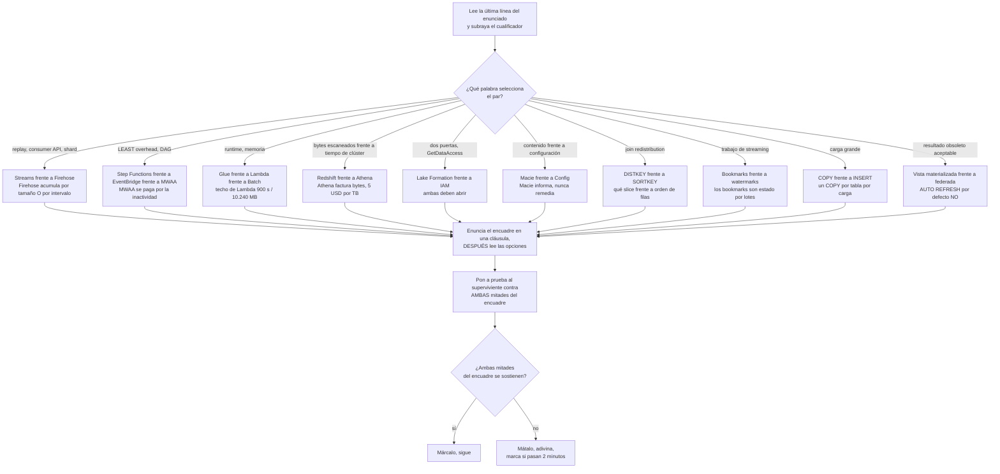
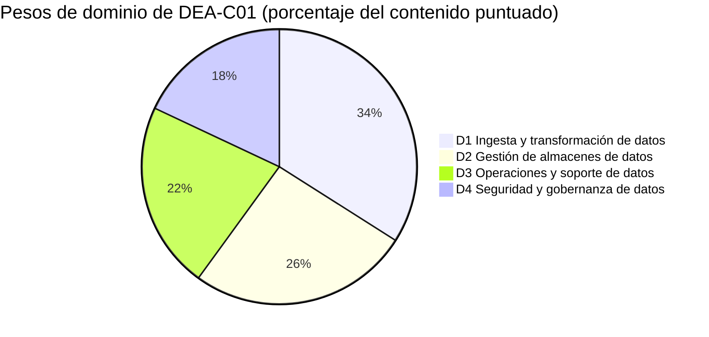
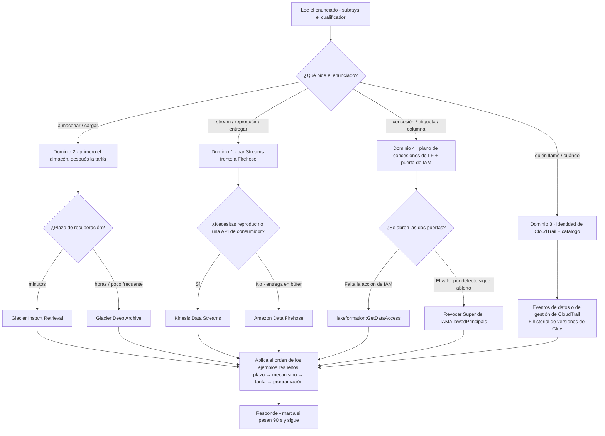
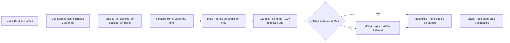
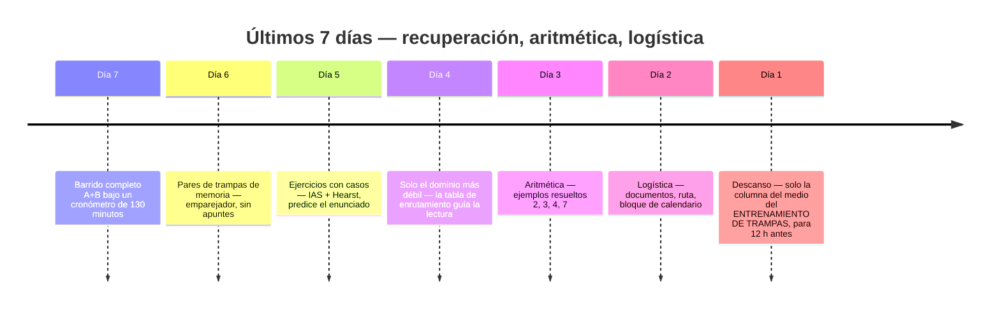

# Simulacro de examen B: segundo conjunto, trampas y día del examen

Quince lecciones te dieron el contenido y el Conjunto A te dio una primera sesión. Una **segunda** sesión mide otra cosa: no si conoces AWS Glue, sino si puedes mantener **los job bookmarks de Glue separados de los watermarks de streaming**, o **la distribución de Redshift separada de la ordenación**, *mientras corre el reloj*. Casi nadie suspende el DEA-C01 porque nunca haya oído hablar de Amazon Macie: suspenden porque el enunciado preguntaba **quién llamó a `DeleteTable`** y contestaron con un *finding*, o porque el enunciado decía `LEAST operational overhead` y pagaron un entorno de Airflow gestionado para ejecutar cuatro pasos de Lambda. En una escala compensatoria de 100 a 1.000 con **720** para aprobar, la discriminación es lo que separa una aprobación cómoda de un 705.

```text
====================================================================
 DEA-C01 / CONJUNTO B DE UN VISTAZO      (todas las cifras a octubre de 2026)
====================================================================
 FORMATO ....... 65 preguntas = 50 puntuadas + 15 no puntuadas (sin
                 identificar)
 TIPOS ......... elección múltiple (1 correcta + 3 distractores)
                 respuesta múltiple (2+ correctas de 5+ opciones)
 TIEMPO ........ 130 minutos para 65 ítems = exactamente 2,00 min por ítem
                 (130 / 65 = 2,00; la aritmética, con +30 de ESL, da 2,46)
 ESCALA ....... 100 - 1.000, se aprueba con 720, COMPENSATORIA, sin corte
                 por sección
 ADIVINAR ..... sin penalización por acierto erróneo; EN BLANCO = mal
 PESOS ........ D1 Ingesta y transformación de datos 34%
                 D2 Gestión de almacenes de datos      26%
                 D3 Operaciones y soporte de datos      22%
                 D4 Seguridad y gobernanza de datos     18%
 COSTE ........ 150 USD por intento (pueden aplicarse impuestos)
 VALIDEZ ...... 3 años; tras un SUSPENSO espera 14 días naturales,
                 intentos ilimitados, tarifa completa siempre
 RESULTADOS ... publicados en tu Cuenta de Certificación de AWS
                 en 5 días hábiles (techo oficial)
--------------------------------------------------------------------
 CONJUNTO B (esta lección) ...... 20 ítems en orden de peso: 7 / 5 / 4 / 4
 CONJUNTO B añade ............... los veinte pares de trampas, la lista
                             del día del examen y un plan final de 7 días
====================================================================
```

> [!NOTE]
> **Cómo usar esta lección.** Lee las secciones 1 y 2 una vez, esa es la mitad de estrategia, y está construida enteramente en torno a *pares*. Después resuelve el **Conjunto B (sección 4) con un cronómetro de 30 minutos, sin apuntes, sin buscar y sin mirar los desgloses**. Autoevalúate con la sección 7, entrena los veinte pares de la sección 5, recorre la lista del día del examen de la sección 6 y deja que el plan de 7 días de la sección 8 decida qué pasa entre hoy y tu cita. Todo lo que esta lección no pudo verificar contra una página de AWS de primera mano se enumera en la sección 7.4, trátalo como *no lo afirme*, no como un hecho que memorizar.

Al terminar esta lección sabrás:

- enunciar en una línea el encuadre correcto de cada uno de los **veinte pares de trampas** con más probabilidades de costarte marcas;
- detectar una **opción a media verdad**, el distractor que intercambia exactamente un atributo de un par, y matarla en una sola cláusula;
- manejar enunciados de **respuesta múltiple** con un procedimiento de todo o nada que nunca asume crédito parcial;
- ejecutar la aritmética que el examen realmente pide: **coste por hora-DPU**, **coste de clase de almacenamiento**, **facturación por bytes escaneados** y **de pesos a ítems**;
- recitar la logística oficial del día del examen: documentos, llegada, registro, controles durante el examen, momento de los resultados;
- corregir el Conjunto B **por bloque de dominio** contra umbrales explícitos de listo frente a no listo, y defender el **veredicto comparativo** sobre reservar ahora frente a siete días más;
- ejecutar un **plan de estudio de 7 días** dirigido por tus caídas que repasa por debilidad de dominio y no por orden de capítulos.

---

## 1. Estrategia: los pares de trampas y cómo el examen los convierte en armas

### 1.1 Qué es un par, y a qué se parece de verdad un distractor

AWS describe sus propios distractores como *«respuestas generalmente plausibles que coinciden con el área de contenido»* (guía del examen DEA-C01). La consecuencia práctica es que la mayoría de las opciones que enfrentas salen de **la misma decisión que la clave**, lo que significa que la mayoría de las pérdidas en este examen no son fallos de conocimiento, sino **fallos de par**: conocías un miembro del par pero no podías enunciar la línea que los separa bajo presión de tiempo. La habilidad estrella de la guía es *«comparar servicios de AWS para entender las diferencias de coste, rendimiento y funcionalidad»*, comparar **es** el examen.

Un par se convierte en un ítem mediante exactamente tres movimientos:

1. **Intercambia un atributo por opción**: nivel de registro frente a búfer, exactamente una vez frente a al menos una vez, concesión frente a tope, descubrimiento frente a imposición, distribución frente a ordenación.
2. **Intercambia la pregunta**: el enunciado quiere *bytes escaneados*, la opción ofrece *horas de clúster*; el enunciado quiere *quién actuó*, la opción ofrece *qué contenía el contenido*.
3. **Intercambia la posición en el ciclo de vida**: el servicio correcto, la etapa de canalización equivocada: una respuesta de crawler para una pregunta de orquestación, una respuesta de catálogo para una pregunta de remediación.

Ejemplo resuelto 1: una opción a media verdad, diseccionada antes de que leas el enunciado. Toma el par **Amazon Macie frente a AWS Config** y construye las cuatro opciones como lo hace el examen:

| Opción | Lo que la opción acierta | Dónde se rompe | Veredicto |
|---|---|---|---|
| **A** | Macie *sí* produce findings con severidad 1 (Baja) a 3 (Alta), retenidos **90 días** | La opción le ordena a Macie cifrar los objetos: Macie nunca remedia | hechos verdaderos, acción imposible |
| **B** | Config *sí* registra el estado de la configuración a lo largo del tiempo y evalúa reglas contra él | La opción le entrega a Config el trabajo de descubrimiento de PII que corresponde a Macie | ambos servicios cruzados |
| **C** | Ambos *son* servicios de gobernanza de la lista en ámbito | Ninguna mitad dice qué hace la otra; la opción es una declaración de categoría, no una distinción | sin discriminador |
| **D** | Macie descubre el **contenido** sensible; Config registra el estado de **configuración** |: | ambas mitades correctas |

Solo **D** sobrevive, y sobrevive porque evaluaste *ambas mitades* en lugar de reconocer una palabra conocida. Las opciones A y B contienen cada una una frase que has leído en la documentación: ese es el diseño. **Un distractor no tiene que ser falso; tiene que ser falso en el lugar que el enunciado está preguntando.**



### 1.2 Las tres preguntas para cualquier ítem de par

Los lentos leen las opciones; los rápidos interrogan primero al *par*. Haz estas tres, en este orden, antes de mirar una sola opción:

1. **¿Qué hace en realidad cada miembro del par?** Una cláusula cada uno, de memoria. Si no puedes decir en una cláusula qué hace una vista materializada, las opciones te lo contestarán por ti: mal.
2. **¿Qué cualificador del enunciado los separa?** `replay`, `LEAST overhead`, `bytes scanned`, `content`, `DISTKEY`, `stale`, `full-load-and-cdc`. El sustantivo del enunciado suele ser el señuelo; el cualificador es la clave.
3. **¿La opción superviviente satisface *ambas* mitades?** Para un enunciado `(Select TWO)` esto es literal, y la propia presentación de preparación de DEA de AWS enuncia la regla como *«sin puntos negativos ni crédito parcial»*, así que una cláusula falsa anula la opción.

```fillblank
{
  "question": "Completa los cuatro reflejos de entrenamiento de pares de la sección 1.2:",
  "template": "1) Enuncia en una {{1}} lo que hace cada miembro del par ANTES de leer las opciones. 2) Encuentra el {{2}} del enunciado que los selecciona: replay, bytes escaneados, contenido, DISTKEY. 3) Pon la opción superviviente a prueba contra AMBAS mitades del {{3}}. 4) Pasados unos dos minutos, {{4}} y adivina: nunca dejes un ítem en blanco.",
  "answers": {
    "1": "cláusula",
    "2": "cualificador",
    "3": "encuadre",
    "4": "marca"
  },
  "distractors": ["frase", "nombre de servicio", "lista de opciones", "omite", "reescribe", "adivina dos veces", "peso de dominio"],
  "explanation": "Los cuatro reflejos son todo el sistema defensivo, uno por línea: el encuadre de una cláusula impide que las opciones te enseñen la distinción equivocada, el cualificador es la palabra que de verdad decide la clave, la prueba de ambas mitades es lo que mata una opción a media verdad (y es literal en los enunciados Selecciona DOS), y pasados unos dos minutos el movimiento correcto es marcar, adivinar y seguir: porque las preguntas sin responder se puntúan como incorrectas y no hay penalización por un acierto erróneo."
}
```

- **📚 ¿Sabías que…?** El propio **Official Practice Question Set: AWS Certified Data Engineer: Associate** de AWS contiene exactamente **20 preguntas**: el mismo recuento que el Conjunto A y el Conjunto B de aquí: es **gratuito** y ocupa el paso 1 del plan de preparación de cuatro pasos de AWS (guía del examen → conjunto de preguntas de práctica → cursos de Skill Builder → examen de práctica oficial), todo a octubre de 2026. Es la regla oficial más cercana para el ritmo que estás entrenando en esta lección.

---

## 2. Estrategia: las formas de los ítems, el plano y el reloj

DEA-C01 publica exactamente **dos** tipos de pregunta: elección múltiple (una respuesta correcta más tres o más distractores) y respuesta múltiple (dos o más respuestas correctas de cinco o más opciones). No hay ítems de ordenación, de emparejamiento ni de estudio de caso en este examen a octubre de 2026, así que no les reserves tiempo. Lo que el Conjunto B añade encima del Conjunto A es práctica en las tres *formas* que más marcas cuestan: **respuesta múltiple**, **cálculo** y **selección por patrón**.

### 2.1 Respuesta múltiple sin crédito parcial

| Regla | Lo que está publicado | Qué significa en la mesa |
|---|---|---|
| **Estructura** | 2+ respuestas correctas de **5+** opciones; el enunciado indica el recuento («Selecciona DOS») | Lee *cada* opción antes de comprometerte con nada |
| **Crédito** | Presentación de preparación de DEA de AWS: *«sin puntos negativos ni crédito parcial»* | **Todo o nada, cero crédito parcial**: un conjunto parcial puntúa cero |
| **Recuento** | Cuántos ítems de RM lleva una hoja en vivo, y la proporción EM:RM, están **sin publicar** | Espera que el enunciado te diga el recuento; si lo hace, subráyalo |
| **Formato del Conjunto B** | Cada enunciado de RM de aquí precombina sus afirmaciones correctas dentro de una opción | Entrena el pensamiento de todo o nada manteniendo el esquema JSON de clave única |

El procedimiento que sobrevive al contacto con cinco u seis opciones:

1. Marca cada opción **definitivamente sí / definitivamente no / quizá**: en una sola pasada, sin elegir.
2. Resuelve cada *quizá* releyendo el **cualificador**, no la opción.
3. Envía solo cuando no quede ningún *quizá*. Dos respuestas obvias más una quinta correcta pasada por alto es el cero clásico.

### 2.2 Las formas de cálculo y de selección

Tres familias aparecen repetidamente, y cada una tiene un procedimiento mecánico.

**Ejemplo resuelto 2: coste por hora-DPU de Glue (us-east-1, a octubre de 2026).** Un trabajo ejecuta 4 trabajadores G.2X = **8 DPU** durante **30 minutos**, **dos veces al día**, en un mes de **31 días**, a **0,44 USD por hora-DPU**:

$$
\text{por ejecución} = 8 \times 0.5 \times 0.44 = \$1.76 \qquad \text{ejecuciones} = 2 \times 31 = 62 \qquad 62 \times 1.76 = \mathbf{\$109.12}
$$

Los distractores son los *deslices aritméticos*: una ejecución al día (**54,56 USD**), cuatro ejecuciones al día (**218,24 USD**), programación por horas (una respuesta de cuatro cifras). Convierte trabajadores → DPU → horas → tarifa, en ese orden (ítem 4 del Conjunto B).

**Ejemplo resuelto 3, coste de clase de almacenamiento (us-east-1, a octubre de 2026).** 100 TB = **102.400 GB** de datos de archivo. En Standard a 0,023 USD/GB-mes los mismos bytes cuestan **2.355,20 USD** al mes; en Standard-IA a 0,0125 cuestan **1.280,00 USD**; en Glacier Instant a 0,004 cuestan **409,60 USD**; en Glacier Deep Archive a 0,00099 cuestan unos **101,38 USD**. El número más barato *no* es la respuesta a menos que también cumpla el plazo de recuperación, la recuperación de Deep Archive se mide en **horas**, no en minutos (ítem 8).

**Ejemplo resuelto 4, Athena factura los bytes escaneados, no el tiempo.** Una tabla CSV de 3 TB sin comprimir con tres columnas iguales, donde los paneles hacen `SELECT` de una columna: cada consulta escanea 3 TB, así que $3 \times \$5 = \mathbf{\$15}$. Conviértela a Snappy Parquet (3:1) y lee una de tres columnas → 0,33 TB → $\mathbf{\$1.65}$. Mismo SQL, mismo resultado, una fracción de la factura, porque el medidor de coste son los bytes escaneados (5,00 USD por TB, mínimo de 10 MB por consulta), no las horas de clúster.

**Ejemplo resuelto 5: selección por patrón.** Traduce los sustantivos del enunciado a un modelo de datos *antes* de leer nombres de servicios:

| El enunciado dice | El modelo | El servicio que selecciona |
|---|---|---|
| clave/valor de *milisegundos de un solo dígito* a cualquier escala | clave-valor NoSQL | Amazon DynamoDB |
| analítica SQL a *escala de petabytes*, compresión columnar | almacén OLAP | Amazon Redshift |
| *SQL interactivo serverless* sobre un lago S3, facturado por consulta | motor de consultas de lago | Amazon Athena |
| *relacional*, compatible con MySQL o PostgreSQL, copias de seguridad gestionadas | relacional OLTP | Amazon Aurora o Amazon RDS |
| acceso *rápido clave/valor* para una carga de trabajo tipo sesión | clave-valor en memoria | Amazon MemoryDB for Redis (habilidad 2.1.3 de la guía) |

Dos de esas filas se convierten en los ítems 8 y 11 del Conjunto B. El patrón nunca cambia: **sustantivo → modelo de datos → servicio**, y solo después las opciones.

### 2.3 El plano del Conjunto B, su reloj y sus pesos

Solo se publican los porcentajes **de dominio**; los recuentos de ítems de abajo son aritmética sobre 50 ítems puntuados: una ayuda de planificación, nunca una cifra de AWS.

| Dominio | Peso publicado | Ítems puntuados en el examen en vivo (derivado: 50 × w) | Ítems del Conjunto B aquí | Qué está probando de verdad este bloque |
|---|---|---|---|---|
| **D1** Ingesta y transformación de datos | **34 %** | ≈ 17 | **7** (Q1: Q7) | bookmarks de Glue, depuración de transformaciones, coste en DPU, tipos de tarea DMS, MERGE |
| **D2** Gestión de almacenes de datos | **26 %** | ≈ 13 | **5** (Q8: Q12) | clases de almacenamiento, TTL, `COPY`, evolución de catálogo/esquema, diseño de distribución |
| **D3** Operaciones y soporte de datos | **22 %** | ≈ 11 | **4** (Q13: Q16) | métricas por etapa, evidencia de auditoría, automatización con EventBridge, acceso a consultas de Athena |
| **D4** Seguridad y gobernanza de datos | **18 %** | ≈ 9 | **4** (Q17: Q20) | valores por defecto de Lake Formation, patrones de KMS, secretos frente a parámetros, ubicación de la política de claves |
| **Total** | **100 %** | **≈ 50** | **20** | La columna «ítems puntuados» es aritmética, no una declaración de AWS |

**Ejemplo resuelto 6, de pesos a ítems, dos veces.** En el examen en vivo: $50 \times 0.34 = 17$, $50 \times 0.26 = 13$, $50 \times 0.22 = 11$, $50 \times 0.18 = 9$, y $17 + 13 + 11 + 9 = 50$. En el Conjunto B: $20 \times 0.34 = 6.8$, $20 \times 0.26 = 5.2$, $20 \times 0.22 = 4.4$, $20 \times 0.18 = 3.6$, que redondean a **7 / 5 / 4 / 4**, y $7 + 5 + 4 + 4 = 20$. Los dominios 1 y 2 suman el **60 %** del contenido puntuado, por eso llevan 12 de estos 20 ítems.

**Ejemplo resuelto 7: el propio reloj del Conjunto B.** El examen en vivo da exactamente $130 \div 65 = \mathbf{2.00}$ **minutos por ítem**; con la adaptación ESL +30 eso se convierte en $160 \div 65 = 2.46$ minutos. El Conjunto B usa un **presupuesto de 90 segundos para la primera pasada**: $20 \times 90 = 1{,}800\ \text{s} = \mathbf{30}$ **minutos**. Siéntate al Conjunto B en 30 minutos exactos; si terminas con tiempo sobrante, dedícalo a los ítems marcados, no a releer los que ya te dan confianza.



- **📚 ¿Sabías que…?** El ritmo que la propia AWS publica para una certificación de **Associate** es **3 to 5 semanas** de preparación en sesiones de **45 to 90 minutos** en tu hora de mayor rendimiento, y AWS dice explícitamente que necesitas *«una puntuación aprobatoria, no una puntuación perfecta»*. El plan de 7 días de la sección 8 es por tanto un plan **comprimido**: asume que las lecciones 01 to 14 y el Conjunto A ya están a tu espalda, y dedica la semana a la discriminación y a la logística en lugar de a contenido nuevo.

---

## 3. Ejercicios con casos reales

Dos historias de clientes publicadas por AWS, convertidas en los dos únicos movimientos que este examen hace con una historia: **mapearla a un dominio**, y después **predecir el enunciado**. Cada cifra de abajo es un *resultado de cliente* que AWS decidió publicar: nunca una promesa de AWS y nunca una cifra sin su fecha (las páginas de estudio de caso no llevan fecha de publicación, así que la única marca de tiempo disponible es la fecha de consulta; todas las cifras de abajo se consultaron en **octubre de 2026**).

### Ejercicio con caso 1, Integral Ad Science: cientos de reglas de permiso se convierten en dos

**El escenario.** Una empresa de ad-tech ejecuta un lago de datos de autoservicio a través de **cuentas productoras y consumidoras** bajo GDPR y CCPA, donde el acceso debe seguir la *clasificación* y el *rol del trabajo*. El relato publicado por AWS: el equipo usó **AWS Lake Formation** con control de acceso basado en etiquetas encima del **AWS Glue Data Catalog**, con **Amazon Athena** y **Amazon EMR** como motores; los datos de S3 solo son accesibles a través de un **rol de acceso a datos de Lake Formation**; las etiquetas a nivel de base de datos las **heredan las tablas y las columnas**; y los grupos de trabajo de Athena por unidad de negocio sirven a la vez como etiquetas de facturación y como límites de consulta. AWS informa de que la superficie de permisos colapsó de **cientos de reglas de permiso a exactamente 2**.

**¿Qué dominio?** **D4 Seguridad y gobernanza de datos (18 %)**: la historia es un argumento sobre la autorización por rol, por etiqueta y por atributo (habilidad 4.2.5) impuesta a través de Lake Formation (habilidad 4.2.4). Los enlaces con **D3** (grupos de trabajo de Athena, límites de consulta) son secundarios: nunca respondas a un enunciado de gobernanza con un control de coste.

**¿Qué preguntaría el examen?**

| Forma del enunciado | El cualificador que lo decide | A qué apunta la clave |
|---|---|---|
| «…el acceso debe seguir la clasificación y el rol del trabajo, no concesiones individuales» | *etiqueta* frente a *identidad* | **Autorización basada en etiquetas (ABAC)** |
| «…un analista aún no puede leer S3 a través de Athena pese a un permit de IAM» | *qué puerta* está cerrada | **`lakeformation:GetDataAccess`** más una concesión LF válida |
| «…cientos de reglas se convirtieron en dos» | *dirección de la herencia* | **las LF-Tags se propagan de base de datos → tabla → columna** |
| «…qué cifra es una garantía de AWS?» | *resultado de cliente* frente a *promesa* | **un resultado publicado, no un SLA de AWS** |

**Trampa a precargar:** «AWS garantiza una reducción del 99 % en las reglas de permiso» es errónea dos veces: convierte el resultado de un cliente en una promesa, y AWS nunca publica una garantía así. Reescribe cada porcentaje de caso como *«AWS informa de que Integral Ad Science logró …»*.

### Ejercicio con caso 2, Hearst: 30 TB al día a través de un stream y una canalización de entrega

**El escenario.** Un grupo mediático con más de 250 sitios, más de 300 revistas y 31 emisoras de TV necesita clickstream a escala. El relato publicado por AWS: **Amazon Kinesis Data Streams** más **Kinesis Data Firehose** (renombrado **Amazon Data Firehose** el 2024-02-09) alimentando Spark en streaming, ingiriendo **30 TB por día**.

**¿Qué dominio?** **D1 Ingesta y transformación de datos (34 %)**: la historia es una distinción entre stream y entrega, que es el par de trampas 1 de la sección 5.

**¿Qué preguntaría el examen?**

| Forma del enunciado | El cualificador que lo decide | A qué apunta la clave |
|---|---|---|
| «…dos aplicaciones consumidoras necesitan cada una todos los registros, y una debe poder reproducir el de ayer» | *reproducir* y *API de consumidor* | **Kinesis Data Streams** (retención 24 h: 365 d) |
| «…entregar en S3 con un búfer y sin ninguna aplicación consumidora que escriba» | *entrega en búfer* | **Amazon Data Firehose** (tamaño **o** intervalo, lo que ocurra primero) |
| «…30 TB/día: ¿qué significa esa cifra?» | *cifra de cliente* frente a *límite* | **un resultado de cliente publicado, no una cuota de AWS** |
| «…la opción dice Amazon Kinesis Data Firehose» | *qué nombre es oficial* | **ambos son válidos**: la lista en ámbito vigente aún imprime el nombre antiguo |

**Trampa a precargar:** nunca «corrijas» una opción que dice *Amazon Kinesis Data Firehose*. El producto se convirtió en Amazon Data Firehose el 2024-02-09, pero AWS afirma que **ningún** punto de conexión de servicio, API, comando de CLI, política de IAM ni métrica de CloudWatch cambió: las acciones de IAM siguen siendo `firehose:*`, y la lista en ámbito del DEA-C01 aún enumera «Amazon Kinesis Data Firehose».

- **📚 ¿Sabías que…?** La página *What is a data lake?* de AWS nombra a Netflix, Zillow, Nasdaq, Yelp, iRobot y **FINRA** como clientes de referencia para la definición de lago de datos a la altura del examen: ingerir tal cual, almacenar y catalogar de forma segura, y ejecutar analíticas sin mover los datos a un sistema separado. Las cifras de estudio de caso en este examen casi siempre son *descomponibles o datables*: cuando una opción reescribe un resultado de cliente como una garantía de AWS, es errónea aunque cada número individual parezca conocido.

---

## Ejercicios con casos reales

Dos historias de clientes más publicadas por AWS, sometidas a los mismos dos movimientos que la sección 3, **mapearla a un dominio**, y después **predecir el enunciado**, pero a velocidad de 90 segundos, porque el Día 5 del plan de 7 días te pide hacer exactamente esto de memoria. La misma regla que antes: cada cifra de abajo es un *resultado de cliente* que AWS decidió publicar (las páginas de estudio de caso no llevan fecha de publicación, así que la marca de tiempo disponible es la fecha de consulta; todas las cifras se consultaron en **octubre de 2026**), nunca una promesa de AWS.

### Ejercicio con caso 3, Nasdaq: 70.000 millones de registros al día, y un archivo que no puede reescribirse

**El escenario.** Un mercado tiene que aterrizar órdenes, cotizaciones y operaciones durante la noche, antes de que abra, manteniendo al mismo tiempo los registros regulatorios inalterables durante años. El relato publicado por AWS: desde **2014** Nasdaq ejecuta un lago de datos en **Amazon S3** como capa de almacenamiento, **Amazon Redshift** (con Redshift Spectrum) como capa de consultas, **Amazon S3 Glacier** para el archivo y **S3 Object Lock** para el requisito de escritura única. AWS informa de que el lago absorbió un salto de **30.000 a 70.000 millones de registros al día** (pico de **113.000 millones**, feb 2020), de que el **90 % de la carga se completó cinco horas antes**, de que las consultas corrieron un **32 % más rápido**, y de que un segmento de **15 TB** se consulta en el sitio sin copiarse primero.

**¿Qué dominio?** **D2 Gestión de almacenes de datos (26 %)**: la historia es un argumento a favor del almacenamiento y el cómputo desacoplados (ruta de escritura en S3, ruta de lectura en Redshift), que es la forma de lago-hogar que la guía prueba bajo la selección de almacén. Los enlaces son **D1** (la ventana nocturna es una fecha límite de ingesta) y **D4** (Object Lock es el control de inmutabilidad que el ítem 20 del Conjunto B ya entrenó).

**¿Qué preguntaría el examen?**

| Forma del enunciado | El cualificador que lo decide | A qué apunta la clave |
|---|---|---|
| «…la carga debe terminar antes de que abra el mercado y no debe bloquear las consultas» | almacenamiento *desacoplado* frente a cómputo | **ruta de escritura en S3 + ruta de lectura en Redshift (Spectrum sobre el lago)** |
| «…los registros no pueden alterarse ni borrarse durante siete años» | *no puede alterarse* | **S3 Object Lock, modo de cumplimiento** |
| «…30.000 → 70.000 millones de registros al día: ¿qué es esa cifra?» | *resultado de cliente* frente a *cuota* | **un resultado publicado por Nasdaq, no un límite de AWS** |
| «…las consultas corrieron un 32 % más rápido: ¿puedes reexpresarlo?» | *cita* frente a *garantía* | **solo como «AWS informa de que Nasdaq …», nunca como una afirmación de AWS** |

**Trampa a precargar:** cada porcentaje de caso depende de la carga de trabajo y de la línea base (digest 16 F1). «Las consultas van un 32 % más rápido en Redshift» es la medición de Nasdaq sobre la carga de trabajo de Nasdaq: una opción que la ofrece como garantía de rendimiento de AWS es errónea aunque el número esté impreso en una página de AWS.

### Ejercicio con caso 4, Oportun: Macie encuentra la PII, tú respondes

**El escenario.** Una entidad fintech de préstamo debe localizar y priorizar los datos personales almacenados en S3 para las obligaciones de Safeguards de la FTC y de privacidad, con un equipo de cumplimiento pequeño y poca tolerancia a falsos positivos. El relato publicado por AWS: **Amazon Macie** automatizó el descubrimiento de datos sensibles en los depósitos de la cuenta usando **identificadores de datos gestionados y personalizados**, un **inventario de depósitos** y una **puntuación de sensibilidad** de la cuenta; AWS informa de **+95 % de precisión en el descubrimiento** y de **−80 % de tiempo para descubrir datos sensibles** (la ficha de caso de Macie y la sesión SEC215 de re:Invent 2022).

**¿Qué dominio?** **D4 Seguridad y gobernanza de datos (18 %)**, descubrimiento y clasificación de contenido sensible (habilidades 4.5.1 / 4.5.2). La mitad de *respuesta* de la misma historia es **D3**: findings → EventBridge → Lambda, que es exactamente el ítem 15 del Conjunto B, descubrimiento y remediación son habilidades separadas en este plano.

**¿Qué preguntaría el examen?**

| Forma del enunciado | El cualificador que lo decide | A qué apunta la clave |
|---|---|---|
| «…encontrar la PII en el lago sin escribir código» | *contenido* frente a *configuración* | **Amazon Macie** (no AWS Config) |
| «…una vez que encuentra la PII, ¿qué hace Macie?» | *informa* frente a *remedia* | **informa: EventBridge, Lambda y Lake Formation actúan** |
| «…escanea también la base de datos Aurora PostgreSQL en busca de PII» | *alcance del servicio* | **Macie es un servicio de Amazon S3**; un control distinto cubre la base de datos |
| «…95 %: ¿eso es una garantía de AWS?» | *resultado de cliente* frente a *promesa* | **el resultado publicado por Oportun, consultado en octubre de 2026** |

**Trampa a precargar:** el +95 % es **precisión de descubrimiento en S3 lograda por un solo cliente**, no cobertura general de prevención de pérdida de datos: el digest 16 F8 advierte explícitamente contra leerlo como una cifra de DLP entre servicios, y Macie no escanea de forma nativa Amazon RDS ni Amazon Redshift.

```interactive
{
  "type": "matching",
  "title": "Ejercicios con casos: relaciona la historia con el dominio que entrena",
  "instructions": "Relaciona cada resultado de cliente publicado (A: D) con el dominio DEA-C01 que entrena principalmente (1 to 4). Re deriva el cualificador del enunciado a partir del encuadre antes de comprometerte.",
  "pairs": [
    { "left": "A · 70.000 millones de registros al día, ruta de escritura en S3, ruta de lectura en Redshift, archivo con Object Lock", "right": "1 · D2 Gestión de almacenes de datos" },
    { "left": "B · 30 TB de clickstream al día a través de un stream más una entrega en búfer", "right": "2 · D1 Ingesta y transformación de datos" },
    { "left": "C · Macie descubre la PII en S3; EventBridge y Lambda responden", "right": "3 · D4 Seguridad y gobernanza de datos" },
    { "left": "D · Amazon Customer Service: el dimensionamiento correcto de RA3 redujo el coste operativo de Redshift un 55 % al año", "right": "4 · D3 Operaciones y soporte de datos" }
  ],
  "answer": "A→1, B→2, C→3, D→4"
}
```

- **📚 ¿Sabías que…?** AWS informa de que PayU consolidó unas **40 bases de datos de producción** en S3 más Redshift, redujo la latencia de consulta de **10 to 15 minutos a menos de un minuto**, ahorró **20.000 USD al mes** y bajó el volumen de consultas de **150.000 a 35.000 por mes (−77 %)**, y esos son **dos palancas distintas**: la consolidación de la plataforma produjo el ahorro y la racionalización de consultas produjo la caída de volumen. En este examen un enunciado que pregunta por *coste* y un enunciado que pregunta por *demanda* nunca se responden con el mismo número, incluso cuando los dos salen de la misma historia de cliente.

---

## 4. Preguntas de Práctica (Practice Questions), Conjunto B: 20 ítems en el orden de peso publicado

El Conjunto B refleja el formato **dominante** del examen en vivo: una respuesta correcta, tres distractores: mientras entrena seis enunciados con **forma de respuesta múltiple**. Los ítems van en orden de peso de dominio: **siete de D1, cinco de D2, cuatro de D3 y cuatro de D4**, que es el reparto publicado 34 / 26 / 22 / 18 redondeado sobre veinte ítems. Los veinte están adaptados de los ítems del banco **Q21: Q40**.

### 4.0 Cómo resolver el Conjunto B

| Ajuste | La regla | Por qué importa |
|---|---|---|
| **Cronómetro** | **30 minutos exactos** (90 s por ítem: el presupuesto de la primera pasada) | Entrena el ritmo que usarás para 65 ítems a 2,00 minutos cada uno |
| **Materiales** | Sin apuntes, sin buscar, sin desgloses visibles | Corregir con libro abierto mide tus apuntes, no a ti |
| **Ritmo** | Responde todos los ítems; marca lo que pase de 90 segundos y sigue adelante | Un ítem en blanco es un cero garantizado: la regla nunca cambia con el tamaño del conjunto |
| **Regla del par** | Antes de leer las opciones, escribe el encuadre del par en una cláusula | Ese es todo el sentido del Conjunto B |
| **Respuesta múltiple** | Lee **todas** las opciones; las afirmaciones correctas se precombinan en una opción para que cada ítem conserve una clave única | Entrena el pensamiento de todo o nada sin romper el esquema |
| **Corrección** | Primero por **bloque de dominio**, después por total (sección 7) | La puntuación compensatoria castiga la caída, no la media |
| **Reintento** | A las 72 horas, de memoria | Los intervalos cortos miden el reconocimiento, no la retención |

### 4.1 Dominio 1: Ingesta y transformación de datos (34 %) · ítems 1 to 7

```question
{
  "id": "dea-16-q1",
  "type": "multiple-choice",
  "question": "Un trabajo ETL de AWS Glue falla intermitentemente en el commit con un error de discrepancia de versión de bookmark. Los registros muestran una segunda copia del mismo trabajo ejecutándose concurrentemente durante una carga histórica. ¿Qué cambio resuelve la causa raíz?",
  "options": [
    "Aumentar NumberOfWorkers para que el trabajo termine antes de que arranque la segunda ejecución",
    "Fijar MaxConcurrentRuns a 1 y serializar la carga histórica detrás de la ejecución programada",
    "Restablecer el job bookmark antes de cada ejecución programada",
    "Cambiar el trabajo a la clase de ejecución FLEX"
  ],
  "correct": 1,
  "explanation": "Los job bookmarks de AWS Glue no admiten ejecuciones concurrentes del trabajo y los commits fallarán, así que forzar la serialización es la corrección documentada; un restablecimiento solo enmascara el síntoma y desecha el estado incremental."
}
```

**Desglose: Q1 · la concurrencia es la causa, no los trabajadores.** **Por qué es correcta:** AWS documenta que los bookmarks de Glue no admiten ejecuciones concurrentes y que los commits fallan: así que el único cambio que elimina la causa es una ejecución cada vez. **Por qué las trampas pierden:** **A** aumenta el rendimiento, que no hace nada por una garantía de estado y hace que el solapamiento sea *más* probable; **C** enmascara el síntoma y restablece el estado incremental, de modo que la siguiente ejecución reprocesa todo: lo contrario del comportamiento deseado; **D** (FLEX) es una optimización de coste para trabajos no urgentes y no tiene efecto sobre el estado del bookmark. **Trampa:** el error dice *bookmark*, así que los candidatos se lanzan a un comando de bookmark; el enunciado dice *concurrentemente*, así que la respuesta es un ajuste de concurrencia. **Fuente:** banco Q25 · `glue-troubleshooting-errors.html` de Glue (digest 15 C9) · habilidad 1.2.7.

```question
{
  "id": "dea-16-q2",
  "type": "multiple-choice",
  "question": "(Selecciona DOS.) Se espera que un trabajo de Glue nocturno procese unos 50 millones de filas nuevas, pero termina con éxito en segundos y no escribe nada. Un ingeniero sospecha que el job bookmark omitió los archivos nuevos. En el formato de clave única de este conjunto, las dos métricas están precombinadas dentro de una opción: elige la opción en la que AMBAS métricas confirman el diagnóstico.",
  "options": [
    "glue.driver.aggregate.recordsRead colapsa hacia cero Y glue.driver.aggregate.bytesRead colapsa hacia cero",
    "glue.ALL.jvm.heap.usage supera su umbral de alarma 0,9 Y glue.error.ALL se incrementa",
    "glue.driver.aggregate.recordsRead colapsa hacia cero Y glue.driver.ExecutorAllocationManager.numberMaxNeededExecutors sube",
    "glue.ALL.jvm.heap.usage sube Y glue.driver.ExecutorAllocationManager.numberAllExecutors sube"
  ],
  "correct": 0,
  "explanation": "Las dos métricas agregadas de lectura colapsan hacia cero cuando se omite la fuente, que es la señal documentada de los problemas de job bookmark; una omisión de bookmark no es un error, así que el trabajo sigue teniendo éxito."
}
```

**Desglose, Q2 · dos métricas, ambas sobre la fuente.** **Por qué es correcta:** si el bookmark controla la fuente, no se lee nada, así que `recordsRead` y `bytesRead` caen a cero, y esas son las dos métricas agregadas de Glue que lo mostrarían. **Por qué las trampas pierden:** **B** describe una alarma de falta de memoria (`glue.ALL.jvm.heap.usage` por encima de 0,9) más errores de tarea, pero una omisión no levanta ningún error, y por eso el trabajo «tiene éxito»; **C** combina una métrica verdadera con una métrica de **asignación de ejecutores**, que mide el retraso de DPU (trabajo en espera), no la omisión de la fuente; **D** es memoria más demanda de ejecutores, ninguna de las dos relacionada con una fuente omitida. **Trampa:** en un enunciado de RM **cada** afirmación es una pregunta aparte, una cláusula falsa anula la opción, y no hay crédito parcial que cobrar. **Forma del examen en vivo:** dos casillas, todo o nada. **Fuente:** banco Q26 · `job-monitoring.html` y `monitor-continuations.html` de Glue · habilidad 1.2.7.

```question
{
  "id": "dea-16-q3",
  "type": "multiple-choice",
  "question": "Los archivos CSV por horas llegan a un depósito crudo. Un responsable de datos quiere reglas de calidad de datos a nivel de columna sin código, resultados a nivel de fila que identifiquen qué registros fallaron, y una alerta dentro de los cinco minutos de una infracción. ¿Qué solución cumple MEJOR el requisito?",
  "options": [
    "Un conjunto de reglas de AWS Glue DataBrew evaluado por un trabajo de conjunto de reglas, con una regla de EventBridge que enruta los eventos DataBrew Ruleset Validation Result a Amazon SNS",
    "Un crawler de AWS Glue con la detección de cambios de esquema activada",
    "Restricciones DDL de Amazon Athena definidas sobre la tabla cruda",
    "Una ejecución de ANALYZE de Amazon Redshift sobre una tabla relacionada"
  ],
  "correct": 0,
  "explanation": "Los conjuntos de reglas de DataBrew evalúan reglas a nivel de columna y de fila sin código y emiten resultados de reglas que EventBridge puede enrutar a SNS en minutos: una transformación sin código más un desencadenante de eventos más una notificación, todo en la lista en ámbito."
}
```

**Desglose, Q3 · tres requisitos, tres servicios, una canalización.** **Por qué es correcta:** el enunciado exige *sin código*, *resultados a nivel de fila* y una *alerta de cinco minutos*, los conjuntos de reglas de DataBrew cubren los dos primeros, y EventBridge → SNS cubre el tercero, lo que se mapea a las habilidades 1.1.6 (desencadenantes de eventos), 1.2.5 (servicio de transformación por requisito) y 1.3.4 (servicios de notificación); las propias definiciones de reglas son la habilidad 3.4.2. **Por qué las trampas pierden:** **B** descubre deriva de *esquema*, no evalúa reglas de calidad de datos, familia de servicios correcta, trabajo equivocado; **C** es DDL sobre una tabla que un prefijo de CSV crudos ni siquiera tiene; **D** refresca estadísticas del optimizador y no valida nada. **Trampa:** el *crawler* responde preguntas de catálogo y de descubrimiento, nunca de calidad de datos, este es el distractor clásico de posición equivocada en el ciclo de vida. **Fuente:** banco Q27 · documentación de perfilado basado en reglas de DataBrew · habilidades de la guía del examen 1.1.6 / 1.2.5 / 1.3.4 / 3.4.2.

```question
{
  "id": "dea-16-q4",
  "type": "multiple-choice",
  "question": "Un trabajo ETL de AWS Glue está configurado con 4 trabajadores G.2X (8 DPU) y se ejecuta durante 30 minutos, dos veces al día, todos los días de un mes de 31 días. Usando la tarifa de Glue de 0,44 USD por hora-DPU (us-east-1, a octubre de 2026), ¿cuál es aproximadamente el coste de cómputo del trabajo para el mes?",
  "options": [
    "$109.12",
    "$54.56",
    "$218.24",
    "$1,637.76"
  ],
  "correct": 0,
  "explanation": "Por ejecución: 8 DPU x 0.5 h x $0.44 = $1.76. Ejecuciones: 2 x 31 = 62. 62 x $1.76 = $109.12 para el mes."
}
```

**Desglose, Q4 · trabajadores → DPU → horas → tarifa.** **Por qué es correcta:** $8 \times 0.5\ \text{h} \times \$0.44 = \$1.76$ por ejecución, $2 \times 31 = 62$ ejecuciones, $62 \times 1.76 = \mathbf{\$109.12}$ (ejemplo resuelto 2). **Por qué las trampas pierden:** **B** reduce la programación a la mitad, una ejecución al día ($31 \times 1.76 = 54.56$); **C** la cuadruplica a cuatro ejecuciones al día; **D** modela el trabajo ejecutándose cada hora del mes. **Trampa:** el ítem es 90 % aritmética y 10 % conocimiento de servicios, convierte **trabajadores → DPU → horas → tarifa** en ese orden fijo, y solo después multiplica por la programación. Recuerda la definición de DPU: **1 DPU = 4 vCPU + 16 GB**, y un trabajador G.2X tiene 4 DPU. **Fuente:** banco Q28 · `aws.amazon.com/glue/pricing/` (0,44 USD/hora-DPU, us-east-1, a octubre de 2026; digest 15 C8) · habilidad 1.2.4.

```question
{
  "id": "dea-16-q5",
  "type": "multiple-choice",
  "question": "Un ingeniero ejecuta: aws glue reset-job-bookmark --job-name nightly_orders_etl. ¿Qué hace este comando?",
  "options": [
    "Rebobina el bookmark hasta un estado anterior concreto proporcionado por el usuario para que solo se reprocese una ventana elegida",
    "Borra el estado del bookmark para que la siguiente ejecución del trabajo procese la fuente desde el principio",
    "Elimina el trabajo y todo su historial de bookmarks",
    "Pone el bookmark en modo bookmark-PAUSE para que deje de avanzar"
  ],
  "correct": 1,
  "explanation": "ResetJobBookmark borra el bookmark del trabajo; la siguiente ejecución empieza desde el principio de la fuente. El rebobinado selectivo es otra operación de consola/API, y la pausa es un parámetro del trabajo."
}
```

**Desglose, Q5 · restablecer no es rebobinar.** **Por qué es correcta:** la referencia de la CLI define `reset-job-bookmark` como el borrado del estado del bookmark, de modo que la siguiente ejecución vuelve a leer la fuente desde el inicio. **Por qué las trampas pierden:** **A** describe la función de *rebobinar* de la consola, una operación distinta que toma un punto en el tiempo; **C** sería `delete-job`; **D** describe el parámetro de trabajo `bookmark-PAUSE`, un modo más que esta llamada a la API. **Trampa:** las cuatro opciones son verbos que has visto en la consola de Glue, el discriminador es *qué estado queda después*: borrado (todo se reprocesa), rebobinado a una ventana elegida, o en pausa. **Fuente:** banco Q29 · `glue reset-job-bookmark.html` de la CLI, `monitor-continuations.html` de Glue · habilidad 1.2.7.

```question
{
  "id": "dea-16-q6",
  "type": "multiple-choice",
  "question": "Una base de datos Oracle on-premises debe migrarse a Amazon Aurora PostgreSQL. El destino debe poblarse con las filas existentes y después mantenerse sincronizado de forma continua mientras las aplicaciones siguen escribiendo en el origen, hasta que se complete una ventana de cambio de 6 horas. ¿Qué configuración de tarea de AWS DMS cumple el requisito?",
  "options": [
    "Tipo de migración full-load",
    "Tipo de migración full-load-and-cdc",
    "Tipo de migración cdc",
    "AWS DataSync programado por horas"
  ],
  "correct": 1,
  "explanation": "DMS define exactamente tres tipos de tarea; full-load-and-cdc migra los datos existentes y después sigue aplicando los cambios del origen al destino, que es el patrón de sincronización continua durante la migración."
}
```

**Desglose: Q6 · dos requisitos, un tipo.** **Por qué es correcta:** *poblado con las filas existentes* más *mantenido en sincronía continua* necesita las dos fases, y `full-load-and-cdc` es el único tipo de DMS que hace ambas cosas en una sola tarea. **Por qué las trampas pierden:** **A** carga una instantánea de un punto en el tiempo y se detiene: el destino se desvía de inmediato mientras el origen sigue aceptando escrituras; **C** asume que el destino ya está rellenado (solo cdc es correcto solo cuando las tablas ya se han cargado); **D** mueve archivos por un protocolo de red, no cambios de base de datos, y Aurora no es un destino de archivos. **Trampa:** la ventana de cambio de seis horas es una *fecha límite*, no un tipo de tarea: no dejes que una duración elija tu opción. Dos reglas más viajan con este ítem: **la CDC de DMS no ofrece replicación en tiempo real**, y solo **una tarea de un par bidireccional** puede ser `full-load-and-cdc`. **Fuente:** banco Q32 · `CHAP_Task.CDC.html` y `CHAP_Tasks.html` de DMS (digest 15 C18) · habilidad 1.1.1.

```question
{
  "id": "dea-16-q7",
  "type": "multiple-choice",
  "question": "MERGE INTO sales_fact t USING sales_staging s ON t.order_id = s.order_id WHEN MATCHED THEN UPDATE SET t.amount = s.amount WHEN NOT MATCHED THEN INSERT (order_id, amount) VALUES (s.order_id, s.amount); El MERGE falla intermitentemente con un error de coincidencia duplicada. ¿Qué afirmación explica correctamente el fallo y la corrección?",
  "options": [
    "El MERGE de Redshift requiere un bloque BEGIN/END explícito; sin él, los duplicados se cuelan",
    "Varias filas de sales_staging coinciden con el mismo t.order_id; deduplica la tabla de staging (o usa MERGE ... REMOVE DUPLICATES) antes o dentro del merge",
    "MERGE no está admitido en Redshift y la sentencia debe sustituirse por sentencias UPDATE/INSERT separadas",
    "sales_staging debe llevar la misma DISTKEY que sales_fact o el merge falla"
  ],
  "correct": 1,
  "explanation": "El MERGE de Redshift permite como máximo una fila coincidente por fila de destino; varias coincidencias lanzan un error, así que deduplicar el origen: o usar la forma documentada REMOVE DUPLICATES: lo resuelve."
}
```

**Desglose: Q7 · lee el fragmento por el invariante, no por la palabra clave.** **Por qué es correcta:** la cláusula `ON` es `order_id` y el fallo es *coincidencia duplicada*: lo que significa que el lado de la unión no es único, así que la corrección debe volverlo único. **Por qué las trampas pierden:** **A** inventa un requisito de transacción (un `MERGE` único ya es atómico); **C** es falsa: `MERGE` es una orden de Redshift admitida; **D** es una recomendación de *rendimiento* para merges grandes, no una precondición de corrección, y no detendría dos filas de staging idénticas. **Trampa:** dos palabras conocidas alejan a los candidatos del defecto real: `DISTKEY` (rendimiento) y `BEGIN` (transacciones): mientras el mensaje de error ya nombra el problema. **Fuente:** banco Q33 · `r_MERGE.html` y `merge-specify-a-column-list.html` de Redshift · habilidades 1.2.5 / 2.4.1.

### 4.2 Dominio 2: Gestión de almacenes de datos (26 %) · ítems 8 to 12

```question
{
  "id": "dea-16-q8",
  "type": "multiple-choice",
  "question": "Un archivo de cumplimiento guarda 100 TB (102.400 GB) de metadatos de imágenes médicas escaneadas que casi nunca se leen, pero cuando un regulador los solicita, la recuperación debe completarse en minutos. Usando las tarifas de us-east-1 a octubre de 2026 (Standard 0,023 USD/GB-mes, Standard-IA 0,0125, Glacier Instant 0,004, Glacier Deep Archive 0,00099), ¿qué clase de almacenamiento cumple el requisito, y aproximadamente cuánto cuestan los datos al mes en esa clase?",
  "options": [
    "S3 Glacier Instant Retrieval: unos 410 USD al mes",
    "S3 Glacier Deep Archive: unos 101 USD al mes",
    "S3 Standard-Infrequent Access: unos 1.280 USD al mes",
    "S3 Glacier Instant Retrieval: unos 2.355 USD al mes"
  ],
  "correct": 0,
  "explanation": "Glacier Instant Retrieval es la clase de archivo más barata con recuperación en milisegundos, así que 102.400 GB x 0,004 = 409,60 USD al mes; Deep Archive es más barata pero su recuperación se mide en horas."
}
```

**Desglose, Q8 · dos cualificadores, y después la aritmética.** **Por qué es correcta:** el enunciado apila *datos con forma de archivo* con *recuperación dentro de minutos*, Glacier Instant Retrieval está hecha para datos de archivo de larga vida con recuperación en milisegundos, y la comprobación de coste lo confirma: $102{,}400 \times 0.004 = \mathbf{\$409.60}$. **Por qué las trampas pierden:** **B** tiene el número más bajo ($102{,}400 \times 0.00099 \approx \$101$) pero la recuperación de Deep Archive se mide en **horas**, incumpliendo de plano la fecha límite, el movimiento clásico de «la mayor ahorro pierde»; **C** cumple el tiempo de recuperación pero cuesta unas **3×** más ($102{,}400 \times 0.0125 = \$1{,}280$), así que falla en *minimizar el coste de almacenamiento*; **D** combina la clase correcta con la tarifa de **Standard** ($102{,}400 \times 0.023 = \$2{,}355.20$). **Trampa:** lee la fecha límite **antes** que la lista de precios, y nunca aceptes una tarifa por GB sin comprobar de qué columna de la tabla de precios salió (ejemplo resuelto 3). **Fuente:** banco Q21 · `aws.amazon.com/s3/storage-classes/`, `glacier-storage-classes.html` (digest 15 C13, a octubre de 2026) · habilidad 2.3.2.

```question
{
  "id": "dea-16-q9",
  "type": "multiple-choice",
  "question": "Una sesión en Amazon DynamoDB guarda cientos de millones de filas de sesión que deben borrarse automáticamente 24 horas después de su última actualización para controlar el coste de almacenamiento. ¿Qué mecanismo está diseñado exactamente para esto?",
  "options": [
    "Un atributo time-to-live que guarda una marca de tiempo epoch en segundos",
    "Una regla de caducidad del ciclo de vida de S3 apuntada a la exportación de la tabla",
    "Una tarea de AWS DMS con tipo de migración cdc dirigida a una tabla temporal",
    "Un trabajo nocturno de AWS Glue que emite llamadas DeleteItem"
  ],
  "correct": 0,
  "explanation": "El time-to-live de DynamoDB borra los elementos caducados automáticamente: normalmente en dos días: sin coste, usando un atributo que tú indicas y que contiene un epoch Unix en segundos."
}
```

**Desglose: Q9 · nativo, gratuito, epoch en segundos.** **Por qué es correcta:** TTL es el mecanismo que la guía empareja con el versionado de S3 (habilidad 2.3.4), es gratuito, y el atributo es un **Number que contiene epoch en segundos**: no en milisegundos. **Por qué las trampas pierden:** **B** se aplica a objetos de S3, no a elementos de tabla, y una exportación es una copia que luego necesitaría su propio ciclo de vida; **C** es un mecanismo de migración/réplica, no de retención; **D** funciona pero quema capacidad de lectura/escritura para algo que la tabla hace de forma nativa. **Trampa:** *borrar automáticamente después de 24 horas* tienta a cualquier respuesta con forma de trabajo; pregúntate «¿tiene el almacén un reloj nativo?» antes de aceptar un trabajador. Dos datos de TTL viajan con él: el borrado es **best-effort, normalmente en dos días**, y un elemento caducado pero aún no borrado **se lee y se factura igual**: así que filtra con `ttl > now` cuando la corrección dependa de ello. **Fuente:** banco Q22 · `TTL.html` y `APIReference/API_UpdateTimeToLive.html` de DynamoDB (digest 15 C28) · habilidad 2.3.4.

```question
{
  "id": "dea-16-q10",
  "type": "multiple-choice",
  "question": "Un ingeniero de datos carga un prefijo de Amazon S3 en Redshift: COPY public.events FROM 's3://data-lake/events/dt=2026-10-01/' IAM_ROLE 'arn:aws:iam::111122223333:role/RedshiftCopyRole' FORMAT AS PARQUET; ¿Qué afirmación sobre esta carga es VERDADERA?",
  "options": [
    "COPY es prohibitivamente lento para cargas grandes y debe sustituirse por sentencias INSERT a nivel de fila",
    "Emitir un COPY por tabla por carga es preferible a muchos COPY pequeños o a inserciones fila a fila",
    "FORMAT AS PARQUET no es válido porque Redshift solo puede cargar CSV",
    "El rol de IAM solo necesita s3:GetObject en el prefijo"
  ],
  "correct": 1,
  "explanation": "AWS recomienda encarecidamente el comando COPY para cargas grandes y advierte de que las sentencias INSERT individuales podrían ser prohibitivamente lentas; un COPY masivo por tabla por carga es la mejor práctica documentada."
}
```

**Desglose, Q10 · la cita lo decide.** **Por qué es correcta:** las directrices de carga de AWS dicen *«recomendamos encarecidamente usar el comando COPY para cargar grandes cantidades de datos»* y que las sentencias `INSERT` individuales *«podrían ser prohibitivamente lentas»*, así que un `COPY` por tabla por carga gana. **Por qué las trampas pierden:** **A** es la directriz impresa al revés, el detector de respuesta errónea más fiable de esta área; **C** es falsa, Parquet es un formato de origen admitido por `COPY` y la carga columnar es la forma *recomendada*; **D** omite **`s3:ListBucket`** (necesario para enumerar el prefijo) y, para objetos SSE-KMS, **`kms:Decrypt`**. **Trampa:** una lista parcial de IAM parece completa porque una acción es obviamente correcta, las opciones de autorización se califican por el *conjunto completo* de permisos, no por la acción más memorable. **Fuente:** banco Q23 · `r_COPY.html`, `t_Loading_data.html` (digest 15 C27) y `copy-parameters-authorization.html` de Redshift · habilidad 2.3.1.

```question
{
  "id": "dea-16-q11",
  "type": "multiple-choice",
  "question": "Un trabajo ETL de Glue escribe archivos Parquet nuevos bajo un prefijo de S3 particionado ya registrado como tabla del Glue Data Catalog. Una nueva columna anulable loyalty_tier aparece en los datos de origen, pero Athena sigue devolviendo la lista antigua de columnas y falla en las consultas que referencian la columna nueva. ¿Qué acción hace que Athena vea el esquema nuevo?",
  "options": [
    "Ejecutar el crawler de Glue sobre los datos nuevos (o ALTER TABLE ... ADD COLUMN loyalty_tier string) para que se actualicen los metadatos del Data Catalog",
    "Eliminar y recrear el depósito de S3 con un nombre nuevo",
    "Convertir la salida de nuevo a CSV para que Athena infiera el esquema en el momento de la consulta",
    "No hacer nada: Athena relee el esquema de los footers de Parquet en cada consulta"
  ],
  "correct": 0,
  "explanation": "Athena resuelve el esquema de una tabla catalogada desde el Glue Data Catalog, no desde los footers de los archivos, así que la evolución del esquema en una tabla registrada exige una actualización del catálogo: una ejecución de crawler o un ALTER TABLE ADD COLUMN explícito."
}
```

**Desglose: Q11 · schema-on-write en el catálogo, no schema-on-read.** **Por qué es correcta:** la tabla *ya está registrada*, y Athena lee los esquemas registrados desde el **Glue Data Catalog**: así que solo una ejecución de crawler o un `ALTER TABLE ADD COLUMN` cambia lo que Athena devuelve. **Por qué las trampas pierden:** **B** es destructiva e irrelevante para los metadatos; **C** retrocede en el modelo de coste (pierde el podado columnar) y aun así no actualiza una tabla *registrada*; **D** es el concepto erróneo central que el ítem prueba: los footers los usan los *motores sin catálogo*, no una tabla de Athena catalogada. **Trampa:** *los archivos ya contienen la columna* parece suficiente; el cualificador es **tabla registrada**, que traslada la autoridad de los datos al catálogo (habilidad 2.2.3 los crawlers pueblan los catálogos, habilidad 2.4.2 cambios en las características de los datos). **Fuente:** banco Q24 · `aws-glue-crawler.html` de Glue, `tables.html` de Athena · habilidades 2.2.3 / 2.4.2.

```question
{
  "id": "dea-16-q12",
  "type": "multiple-choice",
  "question": "Un esquema estrella de Redshift une fact_sales (2.000 millones de filas) con dim_customer (50 millones de filas) en customer_id para la mayoría de las consultas de paneles. dim_product tiene 100 filas. ¿Qué diseño físico coloca mejor la unión dominante con el menor sobrecoste de almacenamiento?",
  "options": [
    "DISTSTYLE EVEN en fact_sales, sin distribución en dim_customer",
    "DISTSTYLE KEY DISTKEY (customer_id) tanto en fact_sales como en dim_customer",
    "DISTSTYLE ALL en fact_sales",
    "SORTKEY (order_date) solo en fact_sales, con distribución AUTO por defecto"
  ],
  "correct": 1,
  "explanation": "Distribuir ambos lados de la unión por la clave de unión permite al nodo líder colocar las filas por valor de unión, eliminando la redistribución; ALL en una tabla de 50 millones de filas multiplicaría el almacenamiento por el número de nodos."
}
```

**Desglose: Q12 · la distribución arregla las uniones, la ordenación los escaneos.** **Por qué es correcta:** la propia guía de AWS dice que distribuir un par de tablas por sus claves de unión hace que el nodo líder **coloque** las filas en los slices por valor de unión, y que igualar las claves en ambos lados evita la redistribución por completo. **Por qué las trampas pierden:** **A** deja que `dim_customer` se emita o se redistribuya en cada unión; **C** coloca una tabla de 50 millones de filas en **cada** nodo: el almacenamiento se multiplica por el número de nodos, y `DISTSTYLE ALL` solo tiene sentido para dimensiones realmente pequeñas (el `dim_product` de 100 filas es el candidato de ALL aquí); **D** ataca el orden de escaneo y de filtrado, no la colocación de la unión. **Trampa:** *la consulta es lenta* aleja a los candidatos hacia `VACUUM`, `ANALYZE` o `SORTKEY`, pero el enunciado pregunta por la **unión**, y la unión es un problema de **distribución** (par de trampas 11). **Fuente:** banco Q31 · `c_choosing_dist_sort.html` y `t_designating_distribution_styles.html` de Redshift (digest 15 C15) · habilidad 2.4.5.

### 4.3 Dominio 3: Operaciones y soporte de datos (22 %) · ítems 13 to 16

```question
{
  "id": "dea-16-q13",
  "type": "multiple-choice",
  "question": "(Selecciona TRES.) Un equipo de ingeniería de datos está construyendo alarmas de CloudWatch para una canalización de streaming. En el formato de clave única de este conjunto, los tres emparejamientos métrica/espacio de nombres están precombinados dentro de una opción: elige la opción en la que LOS TRES son las señales de salud correctas por etapa.",
  "options": [
    "Amazon Kinesis Data Streams: GetRecords.IteratorAgeMilliseconds; AWS DMS: CDCLatencyTarget; AWS Lambda: Throttles",
    "Amazon S3: BucketSizeBytes; AWS Glue: NumberOfMessagesReceived; solo CPUUtilization de Amazon Redshift",
    "Amazon Kinesis Data Streams: GetRecords.Latency; AWS Glue: numFailedTasks; Amazon S3: BucketSizeBytes",
    "Amazon S3: BucketSizeBytes; AWS Glue: error.ALL; solo CPUUtilization de Amazon Redshift"
  ],
  "correct": 0,
  "explanation": "La edad del iterator mide el retraso del consumidor en el stream, CDCLatencyTarget mide el retraso de replicación de DMS frente al destino, y los Throttles de Lambda detectan el hambre por límite de concurrencia: una señal canónica por etapa de la canalización."
}
```

**Desglose, Q13 · una señal por etapa, y debe medir esa etapa.** **Por qué es correcta:** el retraso del stream (`GetRecords.IteratorAgeMilliseconds`, donde **cero significa al día**), el retraso de replicación (`CDCLatencyTarget`) y el hambre por concurrencia (`Throttles`) son las señales de salud publicadas para sus etapas. **Por qué las trampas pierden:** **B** mezcla una métrica de almacenamiento de una vez al día con un nombre de métrica que **no existe** para Glue y una lectura de CPU que no dice nada sobre la cola; **C** sustituye `GetRecords.Latency`, que mide la **duración de la llamada a la API**, no el retraso de la posición de lectura, la confusión de métricas más común de este dominio; **D** repite el par almacenamiento/CPU y añade un contador de errores de Glue, que cuenta fallos de tareas, no salud de la canalización. **Trampa:** *monitoreo* en el enunciado aleja a los candidatos hacia cualquier métrica que recuerden; el cualificador es la **etapa**: stream, replicación, función. Las alarmas de Redshift necesitan señales de cola (por ejemplo `WLMQueueLength`), no solo CPU. **Fuente:** banco Q30 · páginas de métricas de CloudWatch de Kinesis Data Streams, DMS, Lambda, S3, Glue y Redshift · habilidades 3.3.3 / 3.3.7.

```question
{
  "id": "dea-16-q14",
  "type": "multiple-choice",
  "question": "(Selecciona DOS.) Un auditor pregunta: ¿qué principal llamó a DeleteTable sobre la tabla sales.curated_orders del Glue Data Catalog, y cuándo? En el formato de clave única de este conjunto, las dos fuentes están precombinadas dentro de una opción: elige la opción en la que AMBAS fuentes responden la pregunta.",
  "options": [
    "Eventos de gestión de AWS CloudTrail para el servicio glue (consultados con Athena o CloudTrail Lake) Y el historial de versiones de tablas de Glue mediante GetTableVersions con eventos Glue Table State Change",
    "Métricas de solicitud de Amazon S3 sobre el prefijo de datos subyacente Y findings de Amazon Macie de la cuenta",
    "Eventos de gestión de AWS CloudTrail para el servicio glue Y registros de flujo de VPC analizados en CloudWatch Logs Insights",
    "Solo el historial de versiones de tablas del Glue Data Catalog mediante GetTableVersions Y Amazon CloudWatch Logs Insights sobre los registros de la aplicación"
  ],
  "correct": 0,
  "explanation": "CloudTrail registra la llamada a la API con userIdentity, sourceIPAddress y timestamp (quién y cuándo), mientras que el versionado del catálogo de Glue y los eventos Table State Change registran qué cambió en el catálogo."
}
```

**Desglose, Q14 · quién llamó, y qué dice ahora el catálogo.** **Por qué es correcta:** el auditor hace dos preguntas, *qué principal* y *cuándo*, y los eventos de gestión de CloudTrail llevan `userIdentity` y hora, mientras que el propio historial de versiones de Glue y los eventos Table State Change llevan el «qué cambió» del lado del catálogo (habilidades 3.3.5 y 3.3.1). **Por qué las trampas pierden:** **B** ofrece métricas de solicitud de S3, que son telemetría operativa sobre solicitudes de objetos y no identidades de API, más Macie, que descubre **contenido** sensible; **C** combina una fuente verdadera con los registros de flujo de VPC, que registran flujos de red, no identidades de API; **D** está media vez bien y después afirma que el historial de versiones solo responde *qué principal*, no lleva la identidad de quien llamó, y los registros genéricos de la aplicación no son auditoría del catálogo. **Trampa:** la mitad del catálogo de la respuesta es lo que los candidatos olvidan, porque *auditoría* empuja a todos a CloudTrail; una pregunta de dos partes necesita dos fuentes. **Forma del examen en vivo:** dos casillas, todo o nada. **Fuente:** banco Q40 · `cloudwatch-cloudtrail-integration.html` de Glue, guía del usuario de CloudTrail · habilidades 3.3.1 / 3.3.5.

```question
{
  "id": "dea-16-q15",
  "type": "multiple-choice",
  "question": "(Selecciona TRES.) Un trabajo programado de Amazon Macie devuelve un finding de severidad 3: una tabla de Glue sin cifrar y creada por un crawler contiene una columna ssn con valores reales. En el formato de clave única de este conjunto, las tres acciones están precombinadas dentro de una opción: elige la opción en la que LAS TRES son partes legítimas de la respuesta.",
  "options": [
    "Crear una regla de EventBridge que coincida con source aws.macie y detail-type Macie Finding y que invoque una función Lambda de remediación; aplicar una LF-Tag como classification=restricted con un filtro de datos de columna de Lake Formation que excluya ssn; suprimir y después archivar el finding una vez validado",
    "Pedir a Macie que cifre los objetos S3 afectados con una clave administrada por el cliente; aplicar una LF-Tag; borrar los objetos S3 expuestos con Macie",
    "Configurar Macie como administrador de la clave KMS; activar la remediación automática de Macie; suprimir el finding inmediatamente sin validarlo",
    "Añadir s3:ListAllMyBuckets a cada analista; crear un punto de conexión VPC de puerta de enlace de S3; adjuntar AdministratorAccess al rol del analista"
  ],
  "correct": 0,
  "explanation": "El papel de Macie es el descubrimiento y la información: EventBridge puede enrutar los findings a la automatización, Lake Formation impone las etiquetas y los filtros de columna/fila, y Macie admite la supresión y el archivado de findings validados (retenidos 90 días)."
}
```

**Desglose, Q15 · Macie informa, tú respondes.** **Por qué es correcta:** las tres acciones respetan la división del trabajo, **EventBridge enruta** el finding (habilidad 3.3.9), **Lambda automatiza** la respuesta (habilidad 3.1.8), **Lake Formation impone** la clasificación (habilidades 4.2.4 / 4.5.2), y la supresión más el archivado es un paso documentado del ciclo de vida de findings de Macie. **Por qué las trampas pierden:** **B** le asigna a Macie el *cifrado* y el *borrado*, un servicio de descubrimiento no cambia nada por sí mismo; **C** le asigna a Macie la **administración de claves** y suprime sin validar, lo que destruye la pista de auditoría; **D** son tres no-secuencias de autorización y de red que amplían el acceso mientras la exposición sigue sin resolverse. **Trampa:** *severidad 3* es un cebo de distractor, las severidades de Macie van **1 = Baja, 2 = Media, 3 = Alta** sin nivel Crítico, y los findings se retienen **90 días**; el número te dice la prioridad, no quién puede actuar. **Fuente:** banco Q36 · `findings-suppress.html` y `how-it-works.html` de Macie · documentación de filtrado de datos de Lake Formation (digest 15 C21, C23) · habilidades 3.1.8 / 3.3.9 / 4.5.2.

```question
{
  "id": "dea-16-q16",
  "type": "multiple-choice",
  "question": "(Selecciona DOS.) El rol de IAM de un analista tiene una política en línea que permite athena:*, glue:* y s3:GetObject sobre el prefijo del lago, y un administrador de lago de datos de Lake Formation ha concedido SELECT al rol sobre la tabla de destino. El analista sigue recibiendo AccessDenied al ejecutar una consulta en Amazon Athena. En el formato de clave única de este conjunto, los dos cambios necesarios están precombinados dentro de una opción: elige la opción en la que AMBOS cambios son necesarios.",
  "options": [
    "Añadir lakeformation:GetDataAccess a la política de IAM del analista Y confirmar que la concesión SELECT de Lake Formation está en la tabla (o la base de datos/etiqueta padre) que la consulta lee realmente, hecha por un administrador de lago de datos",
    "Añadir s3:ListAllMyBuckets a la política de IAM del analista Y crear un punto de conexión VPC de puerta de enlace de S3 en la VPC del analista",
    "Adjuntar AdministratorAccess al rol del analista Y activar el modo de acceso híbrido de Lake Formation",
    "Añadir lakeformation:GetDataAccess a la política de IAM del analista Y adjuntar AdministratorAccess al rol del analista"
  ],
  "correct": 0,
  "explanation": "Una solicitud debe pasar por las dos puertas, IAM y Lake Formation: así que Athena necesita lakeformation:GetDataAccess en la política de IAM de quien llama, y la concesión LF debe existir en el recurso que se consulta realmente."
}
```

**Desglose: Q16 · dos puertas, ambas deben abrirse.** **Por qué es correcta:** AWS documenta que *«la solicitud de un solicitante debe pasar por dos puertas»*: los permisos de IAM y los permisos de Lake Formation, y Athena en concreto requiere **`lakeformation:GetDataAccess`** en la política de IAM de quien llama, mientras que la concesión debe estar en el recurso que lee la consulta (y hecha por un administrador de lago de datos). **Por qué las trampas pierden:** **B** es un permiso de listado de S3 a nivel de cuenta más un control de red: ninguno de los dos es una puerta de autorización; **C** destruye el mínimo privilegio (un administrador de IAM **no** es automáticamente administrador de lago de datos) mientras que el modo de acceso híbrido es una ayuda de migración, no una concesión que falta; **D** combina la única acción de IAM verdadera con `AdministratorAccess`, que dejaría al analista concediéndose acceso a sí mismo: lo contrario del control previsto. **Trampa:** el enunciado *enumera* permisos de IAM que parecen generosos (`athena:*`, `glue:*`), lo que te tienta a concluir que IAM está bien; la acción que falta es una acción de **Lake Formation** que vive **dentro** de la política de IAM. Nota de dominio: este ítem está en el Dominio 3 como *operar consultas de Athena contra un lago gobernado* (habilidad 3.1.7), mientras que su mecánica es la tarea 4.2.4. **Fuente:** banco Q34 · `athena/latest/ug/lf-athena-user-permissions.html` (digest 15 C22), `lf-permissions-overview.html` de Lake Formation (C19) · habilidades 3.1.7 / 4.2.4.

### 4.4 Dominio 4: Seguridad y gobernanza de datos (18 %) · ítems 17 to 20

```question
{
  "id": "dea-16-q17",
  "type": "multiple-choice",
  "question": "Una empresa registra su ubicación S3 del lago de datos en Lake Formation y comienza a conceder permisos finos de Lake Formation. Sin embargo, todo principal de IAM de la cuenta sigue pudiendo leer todas las tablas catalogadas a través de Athena, sin concesiones de Lake Formation. ¿Qué único cambio convierte a Lake Formation en el guardián efectivo?",
  "options": [
    "Revocar el permiso Super de IAMAllowedPrincipals por defecto (y desactivar Usar solo el control de acceso de IAM) para que se aplique el modelo fino recomendado",
    "Añadir más administradores de lago de datos",
    "Activar el modo de acceso híbrido de Lake Formation",
    "Adjuntar la política administrada AWSLakeFormationDataAdmin a cada analista"
  ],
  "correct": 0,
  "explanation": "Lake Formation se entrega con un valor por defecto retrocompatible donde el grupo IAMAllowedPrincipals tiene Super sobre las bases de datos, lo que deja el acceso controlado únicamente por las políticas de IAM hasta que se desactiva esa configuración."
}
```

**Desglose, Q17 · la puerta la deja abierta un valor por defecto.** **Por qué es correcta:** con `IAMAllowedPrincipals` ostentando **Super**, Lake Formation difiere explícitamente a solo IAM, así que ninguna concesión que hagas puede restringir nada hasta que ese grupo por defecto se revoque (o se desactive la configuración «Usar solo el control de acceso de IAM»), que es la transición recomendada por AWS hacia el modelo fino. **Por qué las trampas pierden:** **B** cambia quién puede *conceder*, no quién puede *leer*; **C** es el estado incremental de *migración*, no el estado final, y no cierra el catálogo; **D** reparte administración, de hecho, esa política ni siquiera permite a quien la lleva añadir más administradores, y no cierra nada. **Trampa:** *concedí permisos y no cambió nada* es el síntoma de Lake Formation más reportado; la causa es un **valor por defecto**, no una concesión que falte. Un usuario de IAM con `AdministratorAccess` **tampoco** es automáticamente administrador de lago de datos. **Fuente:** banco Q35 · `access-control-fine-grained.html` y `lf-permissions-reference.html` de Lake Formation (digest 15 C20) · habilidad 4.2.4.

```question
{
  "id": "dea-16-q18",
  "type": "multiple-choice",
  "question": "Una arquitectura dirigida por eventos usa AWS Lambda para transformar registros dentro de un consumidor de Amazon Kinesis Data Streams. El stream está configurado con 1 millón de shards (1 MiB/s cada uno), pero el rendimiento agregado de la función Lambda se limita cerca de 10 MB/s por invocación de la función, sin importar el número de shards. ¿Cuál es la causa y la corrección?",
  "options": [
    "Lambda escala como máximo a 1.000 ejecuciones concurrentes por región; mueve la transformación pesada a Amazon MSK (Kafka)",
    "Lambda escala como máximo a 1.000 ejecuciones concurrentes por región; divide la transformación entre más streams de datos de Kinesis o aumenta el rendimiento por stream",
    "Cada shard entrega como máximo 1 MiB/s; añade más shards hasta alcanzar 10 MB/s",
    "Kinesis Data Streams limita el rendimiento total a 10 MB/s; cambia la fuente a Amazon SQS Standard"
  ],
  "correct": 1,
  "explanation": "Lambda escala a 1.000 ejecuciones concurrentes por región y su mapeo de origen de eventos de Kinesis usa como máximo una ejecución concurrente por shard: así que más shards no significan nada hasta que el techo de 1.000 ejecuciones se elimine por diseño."
}
```

**Desglose: Q18 · el techo es la función, no el stream.** **Por qué es correcta:** AWS afirma que Lambda escala a **1.000 ejecuciones concurrentes por región** y que el mapeo de origen de eventos ejecuta **como máximo una ejecución concurrente por shard**: así que el límite de 10 MB/s es un techo de la función, y la corrección es o bien más streams (mapeos independientes más) o bien un cambio de diseño. **Por qué las trampas pierden:** **A** nombra el techo correcto pero salta a un servicio sin relación, ignorando una corrección que se mantiene en el camino en ámbito; **C** confunde una tasa por shard con la restricción vinculante y, peor aún, un stream de 1 millón de shards ya superaría con creces los 10 MB/s; **D** inventa un límite de rendimiento total que no existe (un rendimiento sostenido de más de 1000 MB/s por stream de KDS requiere ODA) y cambia la cola por otra con semántica distinta. **Trampa:** cada opción cita un número con apariencia real: el discriminador es *a qué recurso le asigna AWS cada número*. La concurrencia provisionada eleva el techo de un alias concreto, pero no elimina el límite de escala a nivel de cuenta. **Fuente:** banco Q37 · `with-kinesis.html`, `account-limits.html` de Lambda, `provisioned-throughput.md` de Kinesis (digest 15 C10) · habilidades 1.1.6 / 4.3.1.

```question
{
  "id": "dea-16-q19",
  "type": "multiple-choice",
  "question": "Un equipo financiero quiere informes mensuales del coste de almacenamiento en S3 por unidad de negocio, desglosados por cuenta, servicio y etiquetas, sin instalar agentes. ¿Qué enfoque cumple MEJOR el requisito?",
  "options": [
    "AWS Cost Explorer con las etiquetas de asignación de coste activadas en la consola de facturación, filtrado por unidad de negocio",
    "Métricas de Amazon CloudWatch sobre el tamaño de cada depósito",
    "Alertas de AWS Budgets sobre la factura mensual",
    "Cost and Usage Report (CUR) entregado en S3 y consultado después con Amazon Athena, con etiquetas de asignación de coste aplicadas"
  ],
  "correct": 3,
  "explanation": "CUR es el conjunto de datos de facturación granular, por línea de ítem: hasta recurso y etiqueta: entregado en S3 para análisis SQL con Athena, que es exactamente lo que necesita un desglose por unidad de negocio; Cost Explorer es la vista resumida más ligera."
}
```

**Desglose: Q19 · un informe granular gana a la vista resumida.** **Por qué es correcta:** CUR es *«la fuente más completa de datos de coste y uso de AWS»*: detallada por recurso, por cuenta, por servicio y por etiqueta, con descuentos: entregada en S3 donde Athena puede cortarla por unidad de negocio (habilidades 1.1.4 ingesta de datos de facturación, 1.2.5 transformación para analíticas, 3.3.7 informes, 4.2.1 etiquetas para gobernanza). **Por qué las trampas pierden:** **A** da una vista *resumida*: la granularidad de Cost Explorer está agregada, no por línea de ítem, así que no puede reproducir el desglose; **B** mide bytes, no dólares, y CloudWatch no tiene dimensiones de coste; **C** te dice *si* te pasaste de un presupuesto, no *quién* se pasó. **Trampa:** *sin instalar agentes* aparta a los candidatos de la única opción granular sin agentes: CUR se entrega, no se recolecta. **Fuente:** banco Q38 · guía del usuario de Cost and Usage Report, documentación de facturación · habilidades 1.1.4 / 1.2.5 / 3.3.7 / 4.2.1.

```question
{
  "id": "dea-16-q20",
  "type": "multiple-choice",
  "question": "Una empresa debe demostrar a los reguladores que los objetos de su depósito de analíticas no pueden borrarse durante siete años, y que cada intento de borrado queda registrado. ¿Qué configuración cumple AMBOS requisitos?",
  "options": [
    "Una retención de S3 Object Lock en modo de cumplimiento sobre el depósito, más eventos de datos de CloudTrail sobre s3:DeleteObject escritos en un depósito de registros separado",
    "Una regla de caducidad del ciclo de vida de S3 fijada a siete años, más el versionado de S3 en el depósito",
    "Replicación de S3 a un segundo depósito con una regla de ciclo de vida más larga",
    "Una política de IAM que deniegue s3:DeleteObject, más CloudWatch Logs sobre el depósito"
  ],
  "correct": 0,
  "explanation": "Object Lock en modo de cumplimiento impone una retención WORM que ni siquiera el usuario root puede anular, y los eventos de datos de CloudTrail capturan quién intentó qué, sobre qué objeto y cuándo."
}
```

**Desglose, Q20 · imponer, y después registrar.** **Por qué es correcta:** Object Lock en modo de cumplimiento es el **único** modo cuya retención no puede acortarse por nadie, incluida la raíz de la cuenta, la respuesta al nivel regulatorio, y los **eventos de datos** de CloudTrail (no los eventos de gestión) son los que registran los intentos de `s3:DeleteObject` con identidad y tiempo. **Por qué las trampas pierden:** la regla de ciclo de vida de **A** *caduca* los objetos en lugar de protegerlos; el versionado más la replicación duplican los datos, pero un principal privilegiado puede borrar ambas versiones sin un bloqueo de retención; **C** replica, que es durabilidad, no inmutabilidad, la réplica hereda la posibilidad de borrado a menos que también se bloquee; **D** es un *deseo* de política que el administrador de ese mismo principal puede editar, y CloudWatch Logs no captura los intentos de API de S3 por defecto. **Trampa:** *no puede borrarse* es el único verbo real del enunciado; todo lo demás es decorado. Object Lock requiere un depósito con **versionado activado**, y una retención aplicada *antes* del 2023-01-05 conservó su puerta de edad de transición; desde esa fecha S3 eliminó la restricción de edad mínima en las transiciones (la **duración mínima de almacenamiento** por clase sigue aplicándose). **Fuente:** banco Q39 · `object-lock.html`, `object-lock-best-practices.html` de S3, documentación de eventos de datos de CloudTrail · habilidades 4.2.1 / 4.2.3 / 4.5.1.

### 4.5 Dos ítems de discriminación extra · no contabilizados en la nota /20

Estos dos son **ítems de extensión** construidos a partir de los cambios 2025 to 2026 del recuadro de Actualizaciones de 2026. **No** forman parte del plano 7 / 5 / 4 / 4 de arriba, así que no cambian tu puntuación, tus umbrales ni tu tabla de enrutamiento: corrígelos por separado, y si alguno resulta erróneo, vuelve a leer la fila de actualización correspondiente antes de sentarte.

```question
{
  "id": "dea-16-q21",
  "type": "multiple-choice",
  "question": "Un equipo de plataforma ejecuta 40 streams de Amazon Kinesis Data Streams en modo estándar bajo demanda, agregando unos 12 MB/s, y está evaluando On-demand Advantage (anunciado el 2025-11-04). ¿Qué afirmación es VERDADERA a octubre de 2026?",
  "options": [
    "On-demand Advantage elimina el cargo horario por stream, pero factura un mínimo de 25 MB/s de ingesta y 25 MB/s de recuperación a nivel de cuenta, así que con volumen bajo puede costar más que el modo al que sustituyó",
    "Amazon Kinesis Data Streams tiene exactamente dos modos de capacidad, y On-demand Advantage es el segundo con un nombre más nuevo",
    "El mínimo de 25 MB/s aplica por stream, así que cada uno de los 40 streams se factura con su propio mínimo de forma independiente",
    "Activar On-demand Advantage reduce la retención extendida a 24 horas, así que el historial de reproducción queda limitado a un día"
  ],
  "correct": 0,
  "explanation": "On-demand Advantage es a nivel de cuenta: elimina el cargo horario por stream pero factura un mínimo de 25 MB/s de ingesta más 25 MB/s de recuperación en toda la cuenta, así que una carga de trabajo de 12 MB/s sigue pagando el mínimo; la retención extendida se factura por GB-mes y no la limita el modo."
}
```

**Desglose: Q21 · el mínimo es el discriminador.** **Por qué es correcta:** AWS afirma que On-demand Advantage es un modo **a nivel de cuenta** que elimina el cargo horario por stream y factura un mínimo de **25 MB/s de ingesta + 25 MB/s de recuperación** una vez activado: por eso gana por encima de unos 10 MB/s agregados o de cientos de streams, y por eso puede perder por debajo de eso (digest 17 B.12 / C, S20). **Por qué las trampas pierden:** **B** es el dato anterior a 2025: la lista de modos ahora tiene **tres** (provisionado, estándar bajo demanda, On-demand Advantage), el indicador más fiable de «banco obsoleto» de esta área; **C** invierte el alcance: el mínimo es **a nivel de cuenta**, así que 40 streams comparten un solo mínimo, no 40 de ellos; **D** inventa un cambio de retención: la retención extendida es un cargo aparte por GB-mes (0,023 USD/GB-mes a octubre de 2026, antes 0,10) y el modo no lo toca. **Trampa:** cada opción cita un número real de la página de precios de Kinesis; el discriminador es *a qué recurso le asigna AWS el número*: a la cuenta o al stream. **Fuente:** digest 17 S20 / S21 (2025-11-04), documentación de precios y dimensionamiento de Kinesis Data Streams · habilidades 1.1.6 / 1.2.4.

```question
{
  "id": "dea-16-q22",
  "type": "multiple-choice",
  "question": "Una cuenta central de gobernanza debe compartir miles de tablas catalogadas con 40 cuentas consumidoras. Un responsable dice que Lake Formation cambió el intercambio entre cuentas en febrero de 2026. ¿Qué afirmación es VERDADERA a octubre de 2026?",
  "options": [
    "El intercambio entre cuentas v5 permite que un solo recurso de AWS RAM lleve un número ilimitado de tablas usando patrones de concesión con comodín; la actualización es opcional y los recursos y API existentes siguen funcionando",
    "El intercambio entre cuentas ahora requiere un recurso de AWS RAM por tabla, y todos los recursos existentes se migraron automáticamente in situ",
    "Las tablas gobernadas de Lake Formation se dejaron de admitir y fueron sustituidas por enlaces de recursos entre cuentas",
    "El intercambio entre cuentas está limitado a 100 tablas por recurso por región en todas las regiones de AWS"
  ],
  "correct": 0,
  "explanation": "La versión v5 del 2026-02-11 permite que un solo recurso de AWS RAM lleve un número ilimitado de tablas mediante patrones de concesión con comodín en lugar de asociaciones por recurso; es una actualización opcional y los recursos y API existentes siguen funcionando sin cambios."
}
```

**Desglose, Q22 · compartir es más fácil, las dos puertas siguen iguales.** **Por qué es correcta:** el anuncio de AWS del 2026-02-11 describe el **intercambio entre cuentas v5**: un solo recurso de AWS RAM puede ahora llevar un número ilimitado de tablas (la formulación de AWS es «cientos de miles»), las concesiones nuevas usan **patrones con comodín** en lugar de asociaciones por recurso, la actualización es **opcional**, y los recursos y API existentes siguen funcionando (digest 17 B.17 / S39). **Por qué las trampas pierden:** **B** está exactamente al revés, las asociaciones de recursos por tabla eran la *antigua* restricción, y nada se migró a la fuerza; **C** afirma una retirada que AWS nunca ha publicado, las tablas gobernadas siguen documentadas como la primitiva más antigua, y afirmar lo contrario es un ítem de digest (G); **D** inventa una cuota y una regla regional uniforme, cuando el cambio publicado fue la eliminación de límites por tipo y no un nuevo tope numérico. **Trampa:** *febrero de 2026* es una fecha real en un anuncio real, así que los candidatos aceptan la historia que recuerdan a medias; el discriminador es la **dirección del cambio**, compartir se volvió más fácil y los permisos se volvieron más estrictos (el `DELETE` de Iceberg sobre tablas gobernadas por LF ahora requiere permiso `DELETE`, y el DML de Iceberg también requiere `ALTER`). **Fuente:** digest 17 S39 (2026-02-11), documentación de intercambio entre cuentas de Lake Formation, cambios de comportamiento de Redshift (parche 202) · habilidades 4.2.4 / 4.5.7.

- **📚 ¿Sabías que…?** La actualización de la guía del 2025-12-12 (v1.1) *añadió* ocho habilidades, cerca del 6 % del mapa, y retiró tres, así que un banco escrito contra la v1.0 puede estar ligeramente obsoleto sobre lo que está en ámbito; la lista en ámbito aún imprime «Amazon Kinesis Data Firehose» aunque AWS renombró el producto a Amazon Data Firehose el 2024-02-09, porque el cambio de nombre no modificó **ningún** punto de conexión, API, comando de CLI, acción de IAM ni métrica de CloudWatch. Cuando el nombre de producto de una opción parece desactualizado, suele seguir siendo válido en este examen.

---

## 5. ENTRENAMIENTO DE TRAMPAS: las veinte líneas principales de pares

Veinte líneas de par, una cláusula cada una. Imprime la columna del medio, cubre las dos últimas y vuelve a derivar la palabra del enunciado a partir del encuadre. Cada trampa de abajo se activó en los ítems del Conjunto A o del Conjunto B que acabas de resolver; esta tabla es toda la lógica de decisión del examen en veinte filas.

| # | Par | El encuadre correcto (una cláusula) | El movimiento de trampa | La palabra del enunciado que lo decide |
|---|---|---|---|---|
| 1 | Kinesis Data Streams frente a Amazon Data Firehose | Streams almacena y reproduce para los consumidores; Firehose acumula en búfer y entrega por ti, sin aplicación consumidora | Elegir Firehose porque «es streaming» | *replay*, *consumer API*, *sin consumidor que escriba* |
| 2 | Step Functions frente a EventBridge frente a MWAA | Step Functions orquesta los pasos de un proceso; EventBridge reacciona a eventos entre servicios; MWAA programa DAGs de larga duración | Escoger Step Functions para cualquier «flujo de trabajo» | *step*, *fan-out*, *DAG con cron* |
| 3 | AWS Glue frente a AWS Lambda | Glue ejecuta Spark/ETL con metadatos de catálogo; Lambda ejecuta código de eventos sin catálogo | Usar Lambda para un trabajo ETL catalogado | *catálogo*, *DPU*, *bookmark* |
| 4 | Amazon Redshift frente a Amazon Athena | Redshift carga y almacena un almacén de datos; Athena consulta en el sitio, sin carga | Cargar en Athena | *sin carga*, *SQL serverless sobre S3* |
| 5 | Lake Formation frente a IAM | LF es el plano fino de concesiones encima del plano de cuenta de IAM | Asumir que IAM solo puede hacer el trabajo de LF | *etiqueta*, *a nivel de columna*, *administrador de lago de datos* |
| 6 | Amazon Macie frente a AWS Config | Macie encuentra *contenido* sensible; Config registra el cumplimiento de la *configuración de recursos* | Usar Config para descubrir PII | *sensible*, *PII*, *finding* |
| 7 | Distkey frente a Sortkey | La distribución coloca a los socios de la unión en los slices; la ordenación agrupa los rangos de escaneo | Sortkey para un problema de unión | *unión*, *redistribución*, *escaneo* |
| 8 | Bookmarks de Glue frente a watermarks de Kinesis | Los bookmarks rastrean *archivos/tablas* incrementales en ETL por lotes; los watermarks rastrean el progreso del tiempo de evento en streams | Llamar retraso de un stream un bookmark | *tiempo de evento*, *datos tardíos*, *edad del iterator* |
| 9 | Redshift COPY frente a INSERT | COPY es masivo y muy recomendado; INSERT es fila a fila y prohibitivamente lento a escala | Insertar unas pocas miles de filas «para tener control» | *masivo*, *carga grande*, *muchas filas* |
| 10 | Vistas materializadas frente a consultas federadas | Las vistas materializadas precalculan y refrescan dentro de Redshift; la federación consulta motores remotos en vivo | Federar cuando la respuesta se repite cada hora | *resultado en caché*, *consulta en vivo a un remoto* |
| 11 | Distribución frente a ordenación en Redshift | La distribución arregla las uniones; la ordenación arregla los escaneos | VACUUM para una unión lenta | *unión lenta* frente a *escaneo lento* |
| 12 | S3 Standard frente a IA frente a Glacier Instant frente a Deep Archive | El plazo de recuperación elige la clase primero, después el precio | Deep Archive porque es la más barata | *minutos* frente a *horas* |
| 13 | TTL de DynamoDB frente a ciclo de vida de S3 | TTL borra elementos de tabla por un atributo epoch en segundos; el ciclo de vida actúa sobre objetos | Regla de ciclo de vida sobre una tabla | *elemento*, *fila*, *epoch* |
| 14 | Crawler de Glue frente a ALTER TABLE | El crawler descubre y escribe metadatos de catálogo; ALTER edita los metadatos directamente | Crawler para un cambio en una tabla ya registrada | *archivos nuevos* frente a *tabla registrada* |
| 15 | CloudTrail frente a CloudWatch Logs frente a métricas de solicitud de S3 | CloudTrail = identidad de API; CW Logs = aplicación/tiempo de ejecución; métricas de S3 = telemetría operativa | Métricas de S3 para responder «quién llamó» | *qué principal* |
| 16 | DMS full-load frente a full-load-and-cdc frente a cdc | Solo carga de instante; carga+cdc sincroniza durante y después; cdc asume destino ya rellenado | cdc solo sobre un destino vacío | *mantenido en sincronía* frente a *ya cargado* |
| 17 | `AdministratorAccess` de IAM frente a administrador de lago de datos | Un administrador de IAM no es automáticamente administrador de lago de datos de Lake Formation | Conceder la política administrada y darlo por hecho | *administrador de LF* |
| 18 | Techo de 1.000 concurrencias de Lambda frente a tasa por shard de KDS | La función escala a 1.000 por región; cada shard recibe como máximo una ejecución concurrente | Añadir shards por encima del techo | *limitado cerca de 10 MB/s* |
| 19 | CUR frente a Cost Explorer frente a Budgets | CUR = granular por línea de ítem; Cost Explorer = resumen; Budgets = alerta de umbral | Cost Explorer para detalle por unidad de negocio | *desglosado por* |
| 20 | Object Lock cumplimiento frente a gobernanza frente a ciclo de vida | Los bloqueos de cumplimiento no los acorta nadie; los de gobernanza sí; el ciclo de vida *caduca* | Modo de gobernanza para un regulador | *no puede borrarse*, *ni la raíz puede* |



```interactive
{
  "type": "matching",
  "title": "Par de trampas: relaciona el encuadre con el par",
  "instructions": "Relaciona cada encuadre de la izquierda (A, E) con el nombre correcto del par de la derecha (1 to 5). Cubre primero la tabla de ENTRENAMIENTO DE TRAMPAS y responde de memoria.",
  "pairs": [
    { "left": "A · Acumula en búfer en S3/Redshift/OpenSearch sin ninguna aplicación consumidora que escriba", "right": "1 · Amazon Data Firehose" },
    { "left": "B · Rastrea archivos y tablas incrementales en un trabajo ETL por lotes", "right": "2 · Job bookmarks de Glue" },
    { "left": "C · No puede acortarse, ni siquiera por la raíz de la cuenta", "right": "3 · S3 Object Lock, modo de cumplimiento" },
    { "left": "D · Mide la duración de la llamada a la API, no el retraso del consumidor", "right": "4 · GetRecords.Latency" },
    { "left": "E · Conjunto de datos de facturación granular por línea de ítem entregado en S3", "right": "5 · Cost and Usage Report (CUR)" }
  ],
  "answer": "A→1, B→2, C→3, D→4, E→5"
}
```

- **📚 ¿Sabías que…?** Cada línea de par de arriba es un par de *cualificadores*, no una *lista de servicios*. El examen casi nunca pregunta «qué hace Firehose»: pregunta «qué afirmación decide entre Streams y Firehose», y las palabras decisivas son las de la última columna. Cubre la última columna, lee el encuadre y di la palabra del enunciado en voz alta; si puedes producir la palabra a partir del encuadre, puedes producir la respuesta a partir del enunciado.

---

## 6. DÍA DEL EXAMEN: logística, registro y el reloj

Todo lo de esta sección está impreso en la guía del examen de AWS o lo afirma AWS Training and Certification a octubre de 2026. Nada de aquí es una suposición sobre tu centro de exámenes concreto.

### 6.1 Antes del día

| Elemento | La regla |
|---|---|
| **Tarifa** | **150 USD**, no reembolsable una vez reservada (se añade impuesto donde proceda) |
| **Espera para repetir** | **14 días** tras suspender; **12 meses** si apruebas, antes de repetir el *mismo* examen |
| **Bloqueo** | **2 años** desde el último intento en el mismo examen |
| **Apoyo ESL** | **+30 minutos** (la duración del examen pasa a 160 minutos), disponible **una sola vez** en tu primer intento |
| **Validez** | Una aprobación es válida durante **3 años** |
| **Descuento para el siguiente examen** | Las aprobaciones incluyen un **50 % de descuento** en el siguiente examen de AWS, normalmente canjeado a través de Credly |
| **Qué llevar** | **Dos documentos de identidad**, al menos uno con foto emitido por el gobierno, ambos **originales**, ambos **vigentes**, y coincidentes con el nombre de la cita del examen |
| **Ventana de inicio en línea** | Inicia el examen con vigilancia en línea dentro de **30 minutos** del inicio de la cita; con más de **15 minutos** de retraso se pierde la tarifa |

### 6.2 En el centro de exámenes

1. Llega con **15 to 30 minutos de antelación**. A los que llegan tarde se les puede denegar el acceso.
2. Guarda bolsos, teléfonos, relojes, apuntes y **cualquier papel** en un taquilla. El papel de borrador **no** está permitido.
3. Regístrate con tus dos documentos de identidad. El vigilante te fotografa (centro de exámenes) o comparte tu pantalla (en línea).
4. Se te asigna una plaza o una sesión con vigilancia; el software del examen carga tu formulario.
5. **Sin descanso una vez empezado.** El reloj de 130 minutos corre de forma continua.

### 6.3 Durante el examen

| Elemento | La regla |
|---|---|
| **Duración** | **130 minutos** |
| **Ítems** | **65 en total**: **50 puntuados** + **15 no puntuados**, indistinguibles de los puntuados |
| **Ritmo** | **2,00 minutos por ítem** de media: presupón la primera pasada, marca y vuelve |
| **Adivinar** | **Sin penalización**: un ítem en blanco es un cero; nunca dejes un ítem vacío |
| **Puntuación** | Compensatoria, escala **200 to 1000**, **se aprueba con 720**: solo importa tu total |
| **Resultado** | No se muestra en pantalla; AWS envía los resultados por correo en **5 días hábiles** |
| **Borradores** | No se permite ninguno, en línea ni presencial |



```interactive
{
  "type": "fillblank",
  "title": "Las cifras del día del examen, de memoria",
  "instructions": "Completa cada hueco con la cifra que AWS publica. Las respuestas son exactas.",
  "items": [
    { "prompt": "Duración del examen: ______ minutos", "answer": "130" },
    { "prompt": "Ítems en total: ______ (______ puntuados + ______ no puntuados)", "answer": "65 (50 scored + 15 unscored)" },
    { "prompt": "Nota escalada para aprobar: ______ / 1000", "answer": "720" },
    { "prompt": "Presupuesto medio de ritmo: ______ minutos por ítem", "answer": "2.00" },
    { "prompt": "Espera tras suspender para repetir: ______ días", "answer": "14" },
    { "prompt": "Tiempo extra de ESL: ______ minutos, disponible en el intento ______", "answer": "30 minutes, first attempt" },
    { "prompt": "Ventana de inicio en línea: dentro de ______ minutos; más de ______ de retraso hace perder la tarifa", "answer": "30 minutes; 15 minutes late" },
    { "prompt": "Resultados entregados en un máximo de ______ días hábiles", "answer": "5" }
  ]
}
```

- **📚 ¿Sabías que…?** Los **15 ítems no puntuados** existen para que AWS pueda preprobar preguntas para futuras hojas, no están etiquetados, no son más fáciles y cuentan para los mismos 130 minutos, así que tu presupuesto de ritmo debe asumir que los 65 están puntuados. La escala 200 to 1000 significa que la conversión de nota cruda a escalada **nunca se publica**; dos personas que fallan los mismos cinco ítems pueden terminar con escaladas distintas. No intentes calcular por reverse engineering la nota de corte, la única regla con la que puedes actuar es 720.

---

## 7. Corrigiendo el Conjunto B y enrutando a tus áreas débiles

### 7.1 Puntúa por dominio, no por total

| Dominio | Ítems de este conjunto | Puntúalo como /7 · /5 · /4 · /4 |
|---|---|---|
| **D1** Ingesta y transformación de datos (34 %) | Q1: Q7 | /7 |
| **D2** Gestión de almacenes de datos (26 %) | Q8: Q12 | /5 |
| **D3** Operaciones y soporte de datos (22 %) | Q13: Q16 | /4 |
| **D4** Seguridad y gobernanza de datos (18 %) | Q17: Q20 | /4 |

### 7.2 Los umbrales

| Tu resultado | Qué significa | A dónde ir |
|---|---|---|
| **18 to 20 correctos** | En o por encima del listón de 720: crea el hábito, no te relajes | Resuelve un barrido mixto A+B bajo un solo cronómetro de 130 minutos |
| **16 to 17 correctos** | En el límite: un dominio está tirando de la media | Encuentra la caída, arregla ese dominio y repite el B en 72 horas |
| **13 to 15 correctos** | Por debajo del listón, pero el enrutamiento funciona | Arregla primero el dominio **más bajo**; no repitas todavía |
| **0 to 12 correctos** | El mapa es el problema, no las respuestas | Relee el dominio que produjo los errores y después repite |

### 7.3 La tabla de enrutamiento: cada ítem erróneo apunta a una lección

| Si fallaste… | La habilidad que te saltaste | Vuelve a |
|---|---|---|
| Q1, Q2 | 1.2.7 salud de trabajos ETL y job bookmarks | `07-data-pipelines-glue-step-functions.md` |
| Q3 | 1.1.6 / 1.2.5 calidad de datos + desencadenantes de eventos | `08-data-quality.md` |
| Q4 | 1.2.4 horas DPU y modelo de precios | `07-data-pipelines-glue-step-functions.md` |
| Q5 | 1.2.7 operaciones de job bookmark | `07-data-pipelines-glue-step-functions.md` |
| Q6 | 1.1.1 tipos de tarea de DMS | `05-elasticity-elasticache-redshift.md` |
| Q7 | 1.2.5 / 2.4.1 SQL de Redshift y semántica de merge | `05-elasticity-elasticache-redshift.md` |
| Q8 | 2.3.2 clases de almacenamiento S3 y tarifas | `04-s3-storage-classes.md` |
| Q9 | 2.3.4 TTL de DynamoDB y retención | `06-nosql-dynamodb.md` |
| Q10 | 2.3.1 COPY de Redshift e IAM | `05-elasticity-elasticache-redshift.md` |
| Q11 | 2.2.3 / 2.4.2 crawlers y evolución de esquemas | `03-glue-data-catalog.md` |
| Q12 | 2.4.5 estilos de distribución y ordenación | `05-elasticity-elasticache-redshift.md` |
| Q13 | 3.3.3 / 3.3.7 alarmas de streaming y de calidad de datos | `10-observability-cloudwatch.md` |
| Q14 | 3.3.5 CloudTrail / 3.3.1 eventos del catálogo | `10-observability-cloudwatch.md` |
| Q15 | 3.1.8 / 3.3.9 / 4.5.2 ciclo de vida de findings de Macie | `11-macie-data-classification.md` |
| Q16 | 3.1.7 / 4.2.4 modelo de dos puertas LF + IAM | `14-governance-lakeformation-pii.md` |
| Q17 | 4.2.4 modelo de acceso por defecto de Lake Formation | `14-governance-lakeformation-pii.md` |
| Q18 | 1.1.6 / 4.3.1 concurrencia y límites de Lambda | `09-event-driven-streaming-lambda.md` |
| Q19 | 1.1.4 / 1.2.5 / 3.3.7 / 4.2.1 CUR y etiquetas de coste | `13-cost-optimization.md` |
| Q20 | 4.2.1 / 4.2.3 / 4.5.1 Object Lock y eventos de datos de CloudTrail | `14-governance-lakeformation-pii.md` |
| Q21 · extra | 1.1.6 / 1.2.4 modos de capacidad y precios de Kinesis (fila de actualización de 2026) | `02-data-ingestion-patterns.md` |
| Q22 · extra | 4.2.4 / 4.5.7 intercambio entre cuentas de Lake Formation v5 (fila de actualización de 2026) | `14-governance-lakeformation-pii.md` |

### 7.4 Lo que el Conjunto B **no** te dice

- Nunca te dice tu puntuación **escalada**. Veinte ítems son una **señal**, no una previsión de 720: el examen en vivo convierte un recuento crudo de 50 ítems a una escala de 200 to 1000 con una conversión que **nunca se publica**.
- Nunca te dice **cuáles** ítems no estaban puntuados. En la hoja en vivo, 15 de 65 no están puntuados y no puedes identificarlos.
- Nunca te dice tu **ritmo** salvo que te hayas cronometrado. 2,00 minutos por ítem es la media; un ítem difícil puede llevar 4 y uno fácil 30 segundos.
- Nunca te dice nada sobre la **dificultad de la hoja**. AWS recalibra las hojas de forma continua; una hoja difícil y una hoja fácil se convierten ambas en 720 con recuentos crudos distintos.

---

## 8. El plan final de 7 días

La última semana es **retención y logística**, no contenido nuevo. Nada de abajo añade un servicio; todo lo de abajo es práctica de recuperación y higiene de programación.

| Día | Enfoque | La única acción que cuenta | Tiempo |
|---|---|---|---|
| **Día 7** | Barrido completo A+B | Resuelve el Conjunto A (7/5/4/4) y el Conjunto B (7/5/4/4) bajo **un** cronómetro de 130 minutos, 65 ítems, sin apuntes | 130 min |
| **Día 6** | Pares de trampas | Cubre la última columna del ENTRENAMIENTO DE TRAMPAS; rederiva las 20 palabras del enunciado a partir del encuadre; repite el emparejador de memoria | 45 min |
| **Día 5** | Ejercicios con casos | Relee los casos de IAS y Hearst; para cada uno, nombra el dominio, predice un enunciado y escribe el cualificador que lo decide | 30 min |
| **Día 4** | Tu dominio más débil | Relee solo las lecciones a las que apuntó tu tabla de enrutamiento (7.3); no releas nada con nota máxima | 45 min |
| **Día 3** | Aritmética | Vuelve a hacer los ejemplos resueltos 2, 3, 4 y 7 sin ver la solución; verifica las unidades antes de cada multiplicación | 40 min |
| **Día 2** | Logística | Confirma la cita, el documento (dos originales, vigentes), la ruta al centro o el plan de inicio en línea; bloquea la hora en el calendario | 30 min |
| **Día 1** | Descanso y una pasada ligera | Ojea solo la columna del medio del ENTRENAMIENTO DE TRAMPAS; para 12 horas antes del examen; duerme | 20 min |



```interactive
{
  "type": "dragdrop",
  "title": "Arrastra cada día a su única acción",
  "instructions": "Coloca cada etiqueta de día (Día 7 … Día 1) sobre el cubo de acción correcto. Responde de memoria antes de comprobar.",
  "buckets": [
    { "label": "Barrido completo A+B bajo un solo cronómetro", "items": ["Día 7"] },
    { "label": "Pares de trampas rederivados del encuadre", "items": ["Día 6"] },
    { "label": "Ejercicios con casos IAS + Hearst, predice el enunciado", "items": ["Día 5"] },
    { "label": "Solo el dominio más débil con la tabla de enrutamiento", "items": ["Día 4"] },
    { "label": "Aritmética: ejemplos resueltos 2, 3, 4, 7", "items": ["Día 3"] },
    { "label": "Documentos, ruta, bloque de calendario", "items": ["Día 2"] },
    { "label": "Descanso: solo la columna del medio del ENTRENAMIENTO DE TRAMPAS", "items": ["Día 1"] }
  ]
}
```

- **📚 ¿Sabías que…?** El *Data Analytics Specialty (DEA-C01) Official Practice Question Set* (practice.exams.aws.qa) de AWS son **20 preguntas con una hoja de respuestas**, no un simulador cronometrado, y es el único conjunto oficial gratuito de preguntas que AWS publica para este examen. Hazlo en la última semana, trata cada respuesta errónea como una entrada de tu tabla de enrutamiento y nunca trates su dificultad como un proxy de la hoja en vivo: la hoja en vivo se calibra de forma continua y el conjunto de práctica es una instantánea fija.

---

### Actualizaciones de 2026 (en octubre de 2026)

> [!IMPORTANT]
> Los elementos de abajo son los **cambios con fecha desde la guía de examen v1.0 del 2024-05-22** que afectan a lo que este examen prueba. Cada número lleva su fuente y su fecha de consulta; nada de aquí es una predicción.

| Cambio | Fecha | Qué significa para este examen |
|---|---|---|
| **Guía de examen v1.1** | **2025-12-12** | **+8 habilidades nuevas, +6 tareas en ámbito, −3 retiradas** (~6 % del mapa); creció la lista de servicios en ámbito: lee el PDF de la v1.1 antes de fiarte de un banco más antiguo |
| **Cambio de nombre a Amazon Data Firehose** | **2024-02-09** | El producto pasó de llamarse *Amazon Kinesis Data Firehose*; **ningún** punto de conexión, API, CLI, acción de IAM (`firehose:*`) ni métrica de CloudWatch cambió; la lista en ámbito del DEA-C01 aún imprime el nombre antiguo: ambos son válidos en el examen |
| **SSE-S3 por defecto en S3** | **2023-01-05** | Todos los objetos nuevos se cifran en reposo por defecto con SSE-S3; las preguntas sobre «¿cómo activo el cifrado?» en depósitos nuevos suelen responder «ya lo está: elige la *clase* de clave» |
| **Eliminación de la puerta de edad de transición en S3** | **2026-07-16** | S3 eliminó la restricción de edad mínima en las transiciones del ciclo de vida; **la duración mínima de almacenamiento por clase sigue aplicándose** (p. ej. Glacier IR 90 días, Deep Archive 180 días) |
| **Versiones de Glue** | **2026-04-01 / 2026-08-21** | Glue **0.9 / 1.0 / 2.0** llegó a fin de soporte el **2026-04-01**; Glue **6.0** se hizo generalmente disponible el **2026-08-21**; **5.1** es el runtime por defecto actual |
| **Capacidad de Kinesis Data Streams** | vigente | **Tres** modos de capacidad (bajo demanda, aprovisionado, ODA); la línea base bajo demanda es **4 MB/s + 1.000 RRU** y escala hasta un mínimo de **25 MB/s + 5.000 RRU**: nunca afirmes que «KDS está limitado a 10 MB/s» |
| **La guía aún lista Kinesis Data Firehose** | a octubre de 2026 | La lista en ámbito **no** se ha renombrado para coincidir con el cambio de nombre del producto de 2024 |
| **Kinesis On-demand Advantage** | **2025-11-04** | Un **tercer** modo de capacidad (a nivel de cuenta): elimina el cargo horario por stream pero factura un **mínimo de 25 MB/s de ingesta + 25 MB/s de recuperación** en toda la cuenta: nunca afirmes que «Kinesis tiene dos modos de capacidad», ni llames al modo bajo demanda «gratuito con volumen bajo» |
| **Redshift × Iceberg, lectura *y* escritura** | **2025-11-17 → 2026-04-23** | Redshift ahora crea, hace `INSERT`, `UPDATE`, `DELETE` y `MERGE` sobre tablas Iceberg (incluidas las tablas de S3) bajo permisos de Lake Formation; las vistas materializadas de Iceberg llegaron el **2026-10-05**: cualquier opción que diga que Redshift solo puede *leer* el lago está obsoleta |
| **Intercambio entre cuentas de Lake Formation v5** | **2026-02-11** | Un solo recurso de AWS RAM puede llevar un número ilimitado de tablas usando patrones de concesión con comodín en lugar de asociaciones por recurso; la actualización es **opcional** y los recursos y API existentes siguen funcionando |

**Nunca afirmes en este examen** (digest 18 §G; esto es lo que AWS nunca ha publicado, e inventarlo es la forma más rápida de perder un punto):

1. **Cualquier tasa de aprobación.** AWS no publica ningún porcentaje de aprobación para DEA-C01 ni para ninguna certificación.
2. **La conversión de nota cruda a escalada.** La escala 200 to 1000 es escalada; la conversión nunca se publica.
3. **Cuántos ítems de RM hay en una hoja.** La guía del examen describe la *forma* de la RM, no el recuento.
4. **Si un ítem está no puntuado.** Los 15 ítems no puntuados son indistinguibles de los puntuados en pantalla.
5. **El plazo de la insignia de Credly.** «En un plazo de X días» no es una garantía de AWS; lo habitual son días, no horas.
6. **Una regla de ritmo.** 2,00 minutos por ítem es una *media de números publicados* (130 min ÷ 65 ítems), no una instrucción de AWS.
7. **Papel de borrador.** Ningún papel, en línea ni en el sitio; no dejes que una publicación de foro te convenza de lo contrario.

- **📚 ¿Sabías que…?** **AWS Glue 6.0** se hizo generalmente disponible el **2026-08-21** con Spark **4.1.1**, Python **3.13**, una **reducción del 30 % del precio** y soporte completo de **Iceberg v3** de Apache, y *rompe* trabajos: **se elimina EMRFS** (S3A es el único sistema de archivos de S3) y **la AWS SDK para Java v1 desaparece** (boto3 no se ve afectado). Un distractor que mencione `fs.s3.consistent.*` o una importación `com.amazonaws.*` no está probando estilo, está probando si sabes que el runtime cambió; **Glue 5.1** sigue siendo el valor por defecto para trabajos nuevos, y **0.9 / 1.0 / 2.0** llegó a fin de soporte el **2026-04-01** (digest 17 S12, S17, consultado en octubre de 2026).

---

> [!WARNING]
> ⚠️ **Las dos cosas que hunden a quienes dominan el material.** Primero, **dejar ítems en blanco**, adivinar no tiene penalización, así que un ítem en blanco es un cero garantizado y un ítem en blanco cuesta más que un acierto erróneo. Segundo, **responder al par que recuerdas en lugar del par que pide el enunciado**, cada trampa de la sección 5 es un servicio real haciendo un trabajo real, solo que no el trabajo que describe este enunciado. Antes de seleccionar, di el cualificador en voz alta: *replay*, *a nivel de columna*, *milisegundos*, *modo de cumplimiento*, *recuperación dentro de minutos*. Si el cualificador del enunciado no coincide con el cualificador de la opción, la opción es errónea aunque el servicio sea el correcto.

---

> [!IMPORTANT]
> **Veredicto comparativo: ¿está esta hoja lista para el examen en vivo?**
>
> - **Listo si** sacaste **18 o 19 de 20** en este conjunto, **en o por encima del 80 % en cada bloque de dominio** (no solo en el total), y puedes volver a derivar **las 20 palabras de enunciado de los pares de trampas** a partir solo de la columna de encuadre. Con 20/20 estás en o por encima del listón de 720 en una hoja construida según el peso publicado: el riesgo restante es la dificultad de la hoja, no el conocimiento.
> - **No listo si** sacaste **16 o 17**: un dominio está tirando de la media por debajo de la seguridad compensatoria, y la tabla de enrutamiento de 7.3 te dice exactamente qué lecciones releer antes de repetir en **72 horas**.
> - **No interpretes** un 13 to 15 como «casi». Una nota cruda de 15 sobre 20 se mapea a puntuaciones escaladas distintas en hojas distintas; AWS nunca publica la conversión, así que **trata los bloques de dominio como la única señal fiable** y repite cuando el bloque más débil esté en o por encima del 80 %.

---

> [!SUCCESS]
> **Has resuelto ya dos conjuntos completos en el orden de peso publicado, entrenado las veinte líneas de trampa que deciden la mayoría de los ítems y memorizado las cifras del día del examen que AWS realmente publica.**
>
> **Conclusiones Clave (Key Takeaways):**
>
> 1. **130 minutos, 65 ítems, 50 puntuados + 15 no puntuados, 2,00 minutos por ítem, se aprueba con 720/1000 compensatoria**, y un ítem en blanco siempre es un cero, así que nunca dejes uno vacío.
> 2. **Dos puertas, ambas deben abrirse**: IAM (`lakeformation:GetDataAccess`) y las concesiones de Lake Formation; y el `IAMAllowedPrincipals` Super por defecto debe revocarse antes de que LF sea el guardián.
> 3. **El cualificador decide el par**: *replay* → Streams, *entrega en búfer* → Firehose, *milisegundos* → Glacier Instant, *modo de cumplimiento* → Object Lock, *a nivel de columna* → Lake Formation, *por línea de ítem* → CUR.
> 4. **Los resultados de cliente no son garantías de AWS**: el «cientos → 2 reglas» de IAS y los «30 TB/día» de Hearst son resultados publicados; nunca los reexpreses como promesas y nunca inventes una tasa de aprobación.
> 5. **Primero el plazo, después el precio; primero el mecanismo, después la tarifa**: elige la clase de almacenamiento por el plazo de recuperación primero y después haz la aritmética; convierte trabajadores → DPU → horas → tarifa en ese orden fijo.
> 6. **La tabla de enrutamiento es el plan**: cada ítem erróneo apunta a una lección; arregla primero el dominio **más bajo**, espera 72 horas y repite de memoria.

*Última verificación el 2026-10-10 contra la guía de examen DEA-C01 v1.1, la documentación de AWS y las páginas de AWS Training and Certification.*
