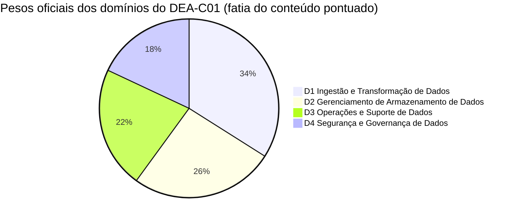
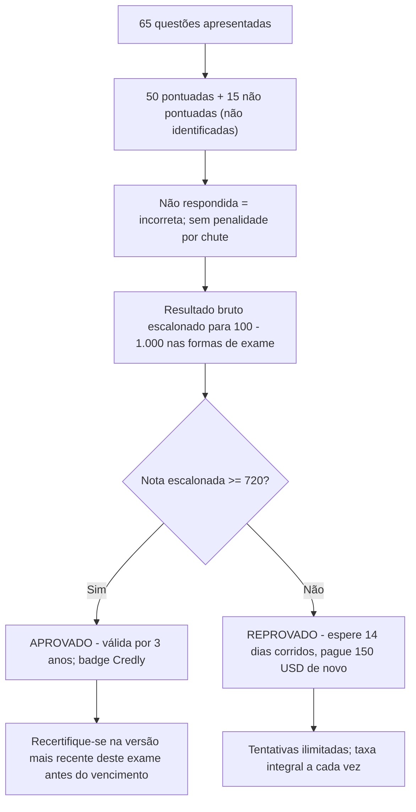
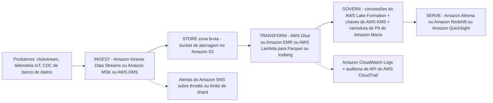
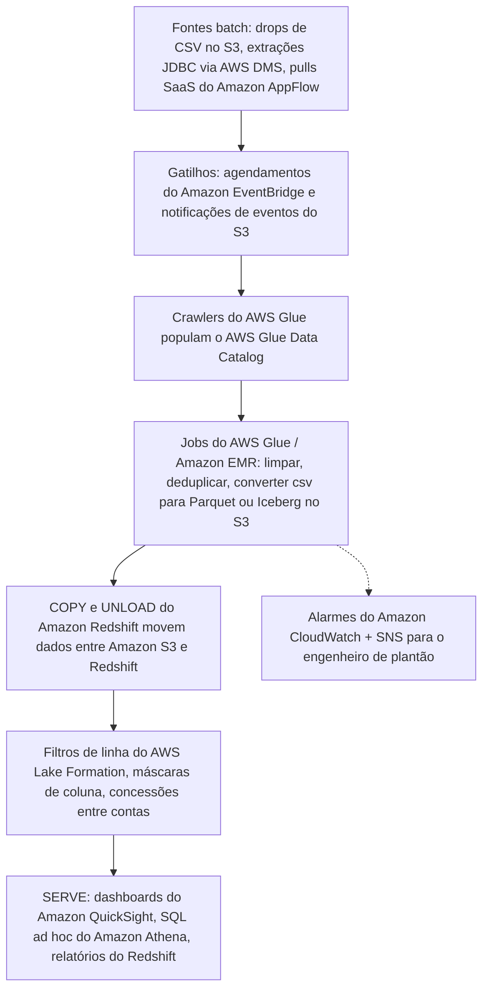
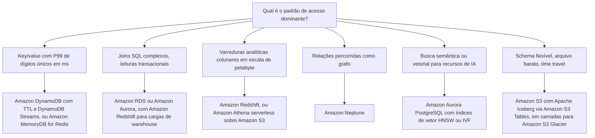

# Guia do Exame DEA-C01 e o Papel do Engenheiro de Dados

Toda certificação da AWS começa com um documento: o **guia oficial do exame**. Para o DEA-C01, esse único documento faz dois trabalhos ao mesmo tempo, ele diz exatamente *como* o exame é construído (código, minutos, questões, nota de corte, pesos) e define o *trabalho de engenharia de dados* que você já deve exercer: ingerir, transformar, armazenar, operar e proteger pipelines de dados na AWS. Candidatos que pulam o guia e vão direto para flashcards caem nas mesmas três armadilhas: acreditam em uma página de terceiros que diz que o exame tem **170 minutos** (são **130**), convertem a nota de corte escalonada de **720** em porcentagem (não é 72%), e não conseguem separar o que está **no escopo** do que apenas *soa* como trabalho real de dados, como *treinar* um modelo de machine learning, que o guia exclui explicitamente, mesmo que *integrar* um grande modelo de linguagem a um pipeline agora seja uma habilidade nomeada.

```text
====================================================================
 DEA-C01 — AWS CERTIFIED DATA ENGINEER – ASSOCIATE (ASSOCIATE)
====================================================================
  Código ............ DEA-C01        Nível .... Associate
  Duração .......... 130 minutos    Questões . 65 apresentadas
  Itens pontuados .. 50             Não pont. .. 15 (não identificados)
  Escala ........... 100 - 1.000    Corte ..... 720
  Pontuação ........ compensatória (apenas global, sem aprovação por domínio)
  Custo ............ 150 USD (em outubro de 2026, impostos podem aplicar)
  Validade ......... 3 anos         Aplicação . centro Pearson VUE
                                      ou proctor online
  Idiomas .......... 4 (inglês, japonês, coreano, chinês
                      simplificado); provas escritas ESL +30 minutos
  Guia ............. v1.1 (12 de dezembro de 2025)
--------------------------------------------------------------------
  DOMÍNIO                               PESO   ITENS (50 x w)
  1. Ingestão e Transformação de Dados   34%          17
  2. Gerenciamento de Armazenamento      26%          13
  3. Operações e Suporte de Dados        22%          11
  4. Segurança e Governança de Dados     18%           9
                                         ------         -----
                                         100%           50
--------------------------------------------------------------------
  TIPOS DE QUESTÃO: múltipla escolha | múltipla resposta
                   (sem penalidade por chute; em branco = errada)
  NOTA: a contagem de itens acima é 50 x peso — aritmética, NÃO
        publicada pela AWS. Apenas as porcentagens são oficiais.
  HABILIDADES: 120 itens de habilidade em 17 declarações de tarefa
====================================================================
```

> [!NOTE]
> **O guia é o contrato.** Qualquer coisa que não esteja no guia do exame, não importa quão popular seja em posts de blog, não tem garantia de aparecer. A AWS rotula explicitamente sua lista de serviços no escopo como **"não exaustiva e sujeita a alterações"** (em outubro de 2026), então trate o guia como o piso do que você precisa saber, não como o teto. O guia que você baixa hoje é a **v1.1, publicada em 12 de dezembro de 2025**; revisões são publicadas pelo menos um mês antes de poderem afetar um exame ao vivo.

Nesta lição você vai:

- ler o guia do exame como um redator de exames leria: código, tempo, custo, pontuação, idiomas e os **mitos de 170 minutos / 85 questões / 300 USD** que sites de terceiros ainda imprimem;
- transformar os **pesos de domínio** em um orçamento concreto de horas de estudo;
- mapear todas as **17 declarações de tarefa e 120 itens de habilidade** nos quatro domínios de conteúdo;
- dominar os **dois tipos de questão** e o modelo de pontuação compensatória;
- separar a **lista de serviços no escopo** (14 categorias) da **lista fora do escopo** que alimenta os distratores;
- definir o **papel do engenheiro de dados** na AWS, o que os quatro aglomerados de tarefas significam no dia a dia e as três tarefas que o guia diz *não* serem suas;
- construir a **arquitetura de pipeline ponta a ponta**, ingerir, armazenar, transformar, governar, servir, com dois diagramas de referência e uma árvore de decisão de armazenamento;
- percorrer **nove exemplos resolvidos**: orçamento de tempo, contagens de itens derivadas, horas de estudo, custo de refazer o exame, a aritmética do 720, a escada de custo do Athena, o throughput da FINRA;
- estudar **quatro estudos de caso reais de clientes da AWS**, Nasdaq, Integral Ad Science, FINRA e GE Aerospace, com serviços, números e fontes;
- ler a **caixa de atualizações de outubro de 2026**: as oito novas habilidades da v1.1 do guia, os seis serviços adicionados e a onda de serviços de 2025-2026;
- praticar com **14 questões em formato de exame** mais quatro verificações interativas (correspondência, preenchimento de lacunas, ordenação e um gráfico interativo).

---

## 1. O que o exame DEA-C01 mede

### 1.1 O candidato alvo

DEA-C01 é uma credencial **Associate**, e o guia declara seu propósito em uma frase: o exame "valida a capacidade de um candidato de implementar pipelines de dados e de monitorar, solucionar problemas e otimizar questões de custo e desempenho de acordo com as melhores práticas". Este não é um exame de arquiteto nem de analista: é o exame de quem **constrói e opera os pipelines**.

| Atributo do candidato | O que o guia diz (em outubro de 2026) | O que isso significa para o seu preparo |
|---|---|---|
| Código e nível | **DEA-C01 / Associate**; nenhum código sucessor publicado até outubro de 2026 | Profundidade Associate: escolher, configurar, depurar: não desenhar estratégia |
| Experiência | "o equivalente a **2 to 3 anos de experiência em engenharia de dados**" | Questões de cenário assumem que você já entregou pipelines antes |
| Experiência AWS | "pelo menos **1 to 2 anos de experiência hands-on com serviços da AWS**" | Espera-se que você conheça padrões e modos de falha dos serviços |
| Letramento em dados | Entende os efeitos de **volume, variedade e velocidade** sobre ingestão, transformação, modelagem, segurança, governança, privacidade, design de schema e design ideal de armazenamento | Os três Vs aparecem dentro de praticamente todo cenário do Domínio 1 |
| Redação da página de certificação | Acrescenta "ou arquitetura de dados" depois de engenharia de dados (página de certificação, em outubro de 2026) | Mesmo perfil de habilidades, porta um pouco mais larga |

### 1.2 As tarefas de trabalho fora do escopo: literalmente

O guia traça uma linha dura, e vale memorizá-la palavra por palavra:

> "A lista a seguir contém tarefas de trabalho que não se espera que o candidato alvo consiga realizar. Esta lista não é exaustiva. Estas tarefas estão fora do escopo do exame: **Realizar treinamento e inferências de ML. / Demonstrar conhecimento de sintaxe específica de linguagens de programação. / Tirar conclusões de negócios com base em dados.**"

Esta lista não é decoração. Itens dela aparecem como **distratores**, porque um distrator que soa como "trabalho real de dados" é a resposta errada mais tentadora de todas.

> [!WARNING]
> > **⚠️ A paradoxa do escopo: fora do escopo não significa nunca mencionado.**
> - *"Realizar treinamento e inferências de ML"* está fora do escopo, mas a **Habilidade 1.2.10** agora diz "Integrar grandes modelos de linguagem (LLMs) para processamento de dados": **a integração está dentro, o treinamento está fora**. Chamar um modelo Amazon Bedrock pré-treinado de um job do Glue é examinável; fazer fine-tuning do seu próprio modelo não é.
> - *"Sintaxe específica de linguagens de programação"* está fora do escopo, mas a **Habilidade 1.4.3** nomeia Python, SQL, Scala, R, Java, Bash e PowerShell, o exame testa **conceitos independentes de linguagem** (idempotência, concorrência, particionamento), nunca uma pegadinha de sintaxe.
> - *"Tirar conclusões de negócios com base em dados"* está fora do escopo, mas a **Tarefa 3.2** pede que você analise dados: agregação, médias móveis, agrupamento, pivotamento, verificação e limpeza. O engenheiro entrega **dados corretos, oportunos e governados com qualidade**; o analista (ou uma opção "qual produto devemos lançar?") tira a conclusão de negócios.
> Qualquer opção que peça que você treine um modelo, depure a sintaxe de uma linguagem ou escolha uma estratégia de negócios está testando se você percebeu uma tarefa fora do escopo.

### 1.3 Conhecimento recomendado que o guia assume

O guia lista os pré-requisitos em duas colunas. Nada aqui é um domínio separado: é o **piso do conhecimento assumido**:

| Conhecimento geral de TI | Conhecimento da AWS |
|---|---|
| Pipelines ETL da ingestão até o destino | Os serviços da AWS nomeados em cada declaração de tarefa |
| Conceitos de programação independentes de linguagem | Serviços de criptografia, governança, proteção e logging |
| Git | Comparar serviços por custo, desempenho e diferenças funcionais |
| Data lakes | SQL em serviços da AWS (Amazon Redshift, Amazon Athena) |
| Fundamentos de rede, armazenamento e computação | Técnicas de análise de dados, verificação de qualidade e consistência |
| Conceitos gerais de vetores |: |

- **📚 Você sabia?** "Conceitos gerais de vetores" e "índices de vetor" estão neste exame porque a **v1.1 do guia (12 de dezembro de 2025)** os adicionou: Habilidade 2.1.8 "Descrever tipos de índice de vetor (por exemplo, HNSW, IVF)" e Habilidade 2.4.6 "Descrever conceitos de vetorização (por exemplo, base de conhecimento do Amazon Bedrock)". Um plano de estudos de 2023 não conteria nenhum dos dois itens; o guia atual contém, e as revisões da v1.1 foram publicadas pelo menos um mês antes de poderem afetar um exame ao vivo (página de revisões, em outubro de 2026).

### 1.4 Os quatro aglomerados de tarefas: a espinha dorsal do exame

O guia abre com quatro itens que se mapeiam **1:1** para os quatro domínios. Leia-os como o ciclo do trabalho:

| Aglomerado (redação do guia, condensada) | Domínio em que se torna |
|---|---|
| **Ingerir, transformar e orquestrar** pipelines de dados, além de conceitos de programação | **Domínio 1**: Ingestão e Transformação de Dados (34%) |
| **Escolher o armazenamento de dados ideal**, modelos, schemas de catálogo e ciclo de vida | **Domínio 2**: Gerenciamento de Armazenamento de Dados (26%) |
| **Operacionalizar, monitorar e solucionar problemas** de pipelines; analisar dados; garantir qualidade | **Domínio 3**: Operações e Suporte de Dados (22%) |
| **Autenticação, autorização, criptografia, privacidade, governança** e logging | **Domínio 4**: Segurança e Governança de Dados (18%) |

A ordem é deliberada: **ingerir → armazenar → operar → proteger**. O Domínio 1 é o mais pesado porque ingestão e transformação são onde a engenharia de dados funciona ou falha; o Domínio 4 é o menor, mas é o único que pode derrubar de imediato uma empresa regulada.

---

## 2. Logística do exame: os números que mudam sua estratégia

### 2.1 A tabela de logística

Cada linha abaixo vem do guia do exame, da visão geral do exame na página de certificação ou das FAQ de certificação da AWS, todas acessadas em **outubro de 2026**.

| Atributo | Valor | Onde está declarado |
|---|---|---|
| Código / nível | DEA-C01 / **Associate** | Guia do exame |
| Duração | **130 minutos** | Visão geral do exame na página de certificação |
| Questões apresentadas | **65** (múltipla escolha ou múltipla resposta) | Visão geral do exame na página de certificação |
| Pontuadas / não pontuadas | **50 afetam sua nota / 15 não**: as 15 **não são identificadas** no exame | Guia do exame |
| Tipos de resposta | ME: 1 correta + 3 distratores · MR: 2+ corretas de 5+ opções | Guia do exame |
| Política de chute | Não respondida = **incorreta**; **sem penalidade** por chute | Guia do exame |
| Escala da nota | Escalonada **100 to 1.000**; aprovação mínima **720** | Guia do exame |
| Modelo de pontuação | **Compensatório**: apenas o resultado global precisa passar | Guia do exame |
| Taxa | **150 USD** em outubro de 2026 (exames nível Associate; impostos como VAT podem aplicar) | FAQ de certificação |
| Aplicação | Centro de testes Pearson VUE **ou** exame proctor online | Visão geral do exame |
| Idiomas | **4**: inglês, japonês, coreano, chinês simplificado | Visão geral do exame |
| Tempo extra | Provas **escritas** de inglês como segunda língua recebem **+30 minutos** | FAQ de certificação |
| Validade | **3 anos**; recertifique-se passando na versão mais recente deste exame | Página de certificação |
| Refazer após reprovação | Espere **14 dias corridos**; **sem limite** de tentativas; **taxa integral a cada vez** | FAQ de certificação |
| Reprovou e passou? | Bloqueado por **2 anos** (a menos que a AWS publique um novo guia e série de código) | FAQ de certificação |
| Remarcar / cancelar | Grátis até **24 horas** antes, máximo **2** alterações; faltar à prova anula a taxa, mas **não** conta como tentativa reprovada | FAQ de certificação |
| Resultados | Em até **5 dias úteis**; planeje-se para **nenhuma aprovação/reprovação no mesmo dia** na tela; badge emitida via Credly | FAQ de certificação |
| Sugestão de próximo passo | A página de certificação recomenda **Security: Specialty** como próximo exame natural | Página de certificação |
| Crédito de exame | **50% de desconto** no seu próximo exame da AWS depois que você conquistar uma certificação | Página de certificação |

### 2.2 Os três mitos que todo site de preparação ainda imprime

O resumo das fontes oficiais aponta três conflitos recorrentes em páginas de terceiros (verificado em outubro de 2026). Em cada caso, o **número oficial vence**:

| Mito (páginas de terceiros) | Verdade oficial (em outubro de 2026) | Por que o mito existe |
|---|---|---|
| "170 minutos" | **130 minutos** | 170 minutos é a duração dos exames **Specialty** da AWS, não deste exame Associate |
| "85 questões" | **65 questões** (50 pontuadas + 15 não pontuadas) | Páginas de preparação mais antigas ou compostas fundiram formatos |
| "Taxa de 300 USD" | **150 USD**: nível Associate | **300 USD** é a taxa de Professional e Specialty; Foundational é 100 USD |

> [!IMPORTANT]
> **⚠️ Regra de precedência para cada número deste curso.** Fontes oficiais da AWS (guia do exame, página de certificação, FAQs) vencem qualquer blog, curso ou fabricante de simulados de terceiros. Quando um terceiro discorda, 170 minutos, 85 questões, 300 USD, o resumo registra o conflito e o valor oficial permanece. Nunca cite um número neste exame que você não consiga rastrear até uma página da AWS, e carimbe cada preço e limite com **"em outubro de 2026"**.

### 2.3 Exemplo resolvido E1, o orçamento de tempo por questão

O número mais útil de todo o guia é uma aritmética que ninguém publica:

$$
t = \frac{130 \times 60}{65} = \frac{7{,}800}{65} = 120 \text{ segundos por questão, exatamente}
$$

Reserve **10 minutos** para revisão e o orçamento real vira $120 \times 60 / 65 \approx$ **110,8 segundos** por item. Regra prática de orçamento: itens rápidos a 60 to 90 segundos no início, dedique 3 to 4 minutos aos itens mais lentos de cenário e múltipla resposta, e nunca deixe um único item comer mais do que cerca de cinco minutos.

### 2.4 Exemplo resolvido E2: pontuadas versus não pontuadas

$$
65 = 50 + 15 \qquad \frac{15}{65} = 23.1\% \text{ do exame não afeta sua nota}
$$

Quase um quarto do exame é material-piloto invisível, e **você não consegue dizer quais 15 são**. A única estratégia sensata é tratar cada item como pontuado.

### 2.5 Exemplo resolvido E3, o custo de refazer o exame

| Evento | Dia do calendário | Carteira (em outubro de 2026) |
|---|---|---|
| Primeira tentativa (reprovado) | Dia 0 | 150 USD |
| Elegível para refazer | Dia 14 |: |
| Segunda tentativa (reprovado) | Dia 14 ou depois | +150 USD |
| Terceira tentativa | +14 dias após a segunda reprovação | +150 USD |
| **Total após três tentativas reprovadas** |: | **450 USD** |

Três tentativas custam **450 USD** em outubro de 2026 mais pelo menos **28 dias corridos** de espera entre elas. O benefício espelhado: quando você **passa**, a página de certificação concede **50% de desconto** no seu próximo exame da AWS: um registro Associate de 150 USD vira **75 USD** (em outubro de 2026), e um registro Professional ou Specialty de 300 USD vira 150 USD.

### 2.6 O que acontece depois que você faz o exame

Os resultados chegam em até **cinco dias úteis**. As FAQ dizem que "a maioria dos exames de certificação da AWS" é divulgada sem aprovação/reprovação na tela, então **planeje-se para resultados atrasados**: os artefatos determinísticos são o relatório de nota e a badge **Credly** se você passou. Entre agora e o dia do exame, as únicas mecânicas que importam são: **responda a todos os itens** (em branco = errado), **termine os 65** (você tem 120 segundos cada) e **orçamente 150 USD por tentativa** (em outubro de 2026).

- **📚 Você sabia?** O DEA-C01 teve exatamente **uma janela de beta**: a inscrição foi de **2 de novembro de 2023**, a aplicação de **27 de novembro de 2023 a 12 de janeiro de 2024**, pelo preço de beta de **75 USD**. O exame foi **lançado (GA) em abril de 2024**, no mesmo mês em que **DAS-C01 (Data Analytics, Specialty) foi descontinuado em 9 de abril de 2024**, DEA-C01 é o sucessor espiritual no nível Associate (blog de treinamento e certificação da AWS, em outubro de 2026). **Não houve beta de DEA em 2026**; se um site de preparação misturar a logística de beta de 2026 de outro exame em um resumo do DEA-C01, está errado.

---

## 3. Os quatro domínios e seus pesos

### 3.1 Pesos oficiais

O guia declara quatro domínios de conteúdo, e as porcentagens são fatias de **conteúdo pontuado apenas**:

| Domínio | Peso oficial |
|---|---|
| **1. Ingestão e Transformação de Dados** | **34%** |
| **2. Gerenciamento de Armazenamento de Dados** | **26%** |
| **3. Operações e Suporte de Dados** | **22%** |
| **4. Segurança e Governança de Dados** | **18%** |
| **Total** | **100%** |



### 3.2 Exemplo resolvido E4: contagens de itens derivadas (aritmética, não da AWS)

Multiplique os **50 itens pontuados** por cada peso:

```text
Domínio  peso    50 x peso   leitura
D1        34%         17     cerca de 17 itens pontuados
D2        26%         13     cerca de 13 itens pontuados
D3        22%         11     cerca de 11 itens pontuados
D4        18%          9     cerca de  9 itens pontuados
                                ------
                              50 itens pontuados
```

> [!IMPORTANT]
> Os **pesos são oficiais** (guia do exame, em outubro de 2026). As **contagens de itens são aritmética**, 50 × peso, e **não são publicadas pela AWS**. As contagens de questões por domínio em qualquer forma ao vivo são desconhecidas, e como 15 dos 65 itens são pilotos não pontuados, a sua forma real de exame não vai bater exatamente com esta grade. Use-a para **alocar tempo de estudo**, nunca para prever um número fixo de questões.

### 3.3 Exemplo resolvido E5: transformando pesos em horas de estudo

Suponha que você tenha **40 horas** antes do dia do exame. Os pesos convertem-se diretamente em horas:

```text
Domínio  peso    horas (40 h)  para onde vão as horas
D1        34%       13,6 h     ingestão, transformação, orquestração,
                               conceitos de programação (33 itens de habilidade)
D2        26%       10,4 h     stores, catálogos, ciclo de vida, design de schema
                               (26 itens de habilidade)
D3        22%        8,8 h     automação, análise, monitoramento, qualidade
                               (28 itens de habilidade)
D4        18%        7,2 h     autenticação, autorização, criptografia,
                               logs de auditoria, privacidade e governança
                               (29 itens de habilidade)
                               ---------
                               40,0 h
```

Os domínios 1 + 2 são **60% da nota**. Um candidato que gasta a maior parte do tempo em segurança porque "esse é sempre o maior tópico da AWS" alocou o exame de forma errada: *neste* exame, o pipeline e o store vêm primeiro.

### 3.4 Da v1.0 à v1.1 do guia, o que mudou e quando conta

O exame foi atualizado em **dezembro de 2025**: a versão **v1.1 (12 de dezembro de 2025)** consolidou as listas separadas de "conhecimento em" e "habilidades em" em **uma lista de habilidades por tarefa**, adicionou **oito novas habilidades**, removeu nenhuma e alterou ambas as listas de serviços. O mecanismo de revisão da AWS (blog de treinamento e certificação, 17 de dezembro de 2025) é explícito:

| Tipo de muda | O que a AWS faz | Exemplo |
|---|---|---|
| Mudanças **significativas** de domínio | Novo código de série + análise completa de tarefas de trabalho | DVA-C01 → DVA-C02 |
| Mudanças **menos significativas** | **Revisão** do código existente, resumida na página de Revisões | DEA-C01 v1.0 → **v1.1** |
| Regra de timing | Revisões publicam **pelo menos 1 mês** antes de afetar um exame ao vivo | v1.1 (2025-12-12) elegível a partir de ~2026-01-12 |
| Regra de frescor dos serviços | Um novo serviço só é examinável após **pelo menos 3 meses** em GA | FAQ de certificação, em outubro de 2026 |

As oito novas habilidades da v1.1: todas diretamente examináveis agora: **1.2.10** integrar LLMs para processamento de dados · **2.1.7** gerenciar formatos de tabela abertos (por exemplo Apache Iceberg) · **2.1.8** descrever tipos de índice de vetor (HNSW, IVF) · **2.2.6** criar e gerenciar catálogos de dados de negócios (Amazon SageMaker Catalog) · **2.4.6** descrever conceitos de vetorização (base de conhecimento do Amazon Bedrock) · **4.1.7** usar domínio, unidades de domínio e projetos no SageMaker Unified Studio · **4.5.6** gerenciar acesso a dados por meio de projetos do SageMaker Catalog · **4.5.7** descrever o framework de governança de dados e padrões de compartilhamento de dados.

---

## 4. O mapa de declarações de tarefa: 4 domínios, 17 tarefas, 120 habilidades

O guia não publica tópicos vagos; ele publica **declarações de tarefa**, cada uma trazendo uma lista numerada de **habilidades**. Tudo que é examinável depende de uma dessas 17 tarefas e de seus **120 itens de habilidade**.

```mermaid
flowchart TD
    R["DEA-C01 - 17 declarações de tarefa em 4 domínios (120 habilidades)"] --> D1["D1 Ingestão e Transformação de Dados 34%"]
    R --> D2["D2 Gerenciamento de Armazenamento de Dados 26%"]
    R --> D3["D3 Operações e Suporte de Dados 22%"]
    R --> D4["D4 Segurança e Governança de Dados 18%"]
    D1 --> A1["1.1 Realizar ingestão de dados - 12 habilidades"]
    D1 --> A2["1.2 Transformar e processar dados - 10 habilidades"]
    D1 --> A3["1.3 Orquestrar pipelines de dados - 4 habilidades"]
    D1 --> A4["1.4 Aplicar conceitos de programação - 11 habilidades"]
    D2 --> B1["2.1 Escolher um armazenamento de dados - 8 habilidades"]
    D2 --> B2["2.2 Entender sistemas de catálogo de dados - 6 habilidades"]
    D2 --> B3["2.3 Gerenciar o ciclo de vida dos dados - 6 habilidades"]
    D2 --> B4["2.4 Projetar modelos de dados e evolução de schema - 6 habilidades"]
    D3 --> C1["3.1 Automatizar processamento de dados - 9 habilidades"]
    D3 --> C2["3.2 Analisar dados usando serviços da AWS - 6 habilidades"]
    D3 --> C3["3.3 Manter e monitorar pipelines de dados - 8 habilidades"]
    D3 --> C4["3.4 Garantir qualidade de dados - 5 habilidades"]
    D4 --> E1["4.1 Aplicar mecanismos de autenticação - 7 habilidades"]
    D4 --> E2["4.2 Aplicar mecanismos de autorização - 6 habilidades"]
    D4 --> E3["4.3 Garantir criptografia e mascaramento de dados - 4 habilidades"]
    D4 --> E4["4.4 Preparar logs para auditoria - 5 habilidades"]
    D4 --> E5["4.5 Entender privacidade e governança de dados - 7 habilidades"]
```



### 4.1 As 17 tarefas em uma linha cada

| Tarefa | Foco em uma linha (exemplos que o guia nomeia) |
|---|---|
| **1.1** Realizar ingestão de dados | Streaming (Kinesis, MSK, DynamoDB Streams, DMS, Glue, Redshift) e batch (S3, Glue, EMR, DMS, Redshift, Lambda, AppFlow); agendadores (EventBridge, Airflow); gatilhos de eventos; fan-in/fan-out; reprodutibilidade; transações com estado vs sem estado |
| **1.2** Transformar e processar dados | Contêineres (EKS, ECS); conexões JDBC/ODBC; integração de múltiplas fontes; custo durante o processamento; transformações em EMR / Glue / Lambda / Redshift; **.csv para Apache Parquet**; depuração de falhas; APIs de dados; volume/velocidade/variadeade; **integração de LLM** |
| **1.3** Orquestrar pipelines de dados | Lambda, EventBridge, **Amazon MWAA**, Step Functions, workflows do Glue; desempenho, disponibilidade, escalabilidade, resiliência, tolerância a falhas; workflows serverless; alertas SNS / SQS |
| **1.4** Aplicar conceitos de programação | Otimização de runtime; concorrência do Lambda; Python/SQL/Scala/R/Java/Bash/PowerShell como *conceitos*; controle de versão, testes, logging, monitoramento; **IaC (CloudFormation, CDK)**; **AWS SAM**; montagem de volumes no Lambda; CI/CD; computação distribuída; estruturas de dados e algoritmos |
| **2.1** Escolher um armazenamento de dados | Serviços de armazenamento por custo/desempenho/padrões de acesso (Redshift, EMR, Lake Formation, RDS, DynamoDB, Kinesis, MSK); indexação (HNSW no Aurora PostgreSQL); MemoryDB; Transfer Family; consultas federadas / materialized views / Spectrum do Redshift; locks; **formatos de tabela abertos (Iceberg)**; **tipos de índice de vetor (HNSW, IVF)** |
| **2.2** Entender catálogos de dados | Consumir da fonte por meio de catálogos; **Glue Data Catalog** / Hive metastore; crawlers; **sincronização de partições**; novas conexões de fonte/destino; **catálogos de negócios (SageMaker Catalog)** |
| **2.3** Gerenciar o ciclo de vida dos dados | COPY/UNLOAD do Redshift com S3; mudanças de camada e expiração do **S3 Lifecycle**; versionamento e **TTL do DynamoDB**; exclusão por requisitos de negócio/leis; resiliência e disponibilidade |
| **2.4** Projetar modelos e evolução de schema | Schemas para Redshift, DynamoDB, Lake Formation; mudanças nas características dos dados; **conversão de schema (AWS SCT e AWS DMS Schema Conversion)**; lineage (SageMaker ML Lineage Tracking, SageMaker Catalog); indexação, particionamento, compressão; **vetorização (base de conhecimento do Bedrock)** |
| **3.1** Automatizar processamento de dados | Orquestração com MWAA e Step Functions; solução de problemas de workflows gerenciados; SDKs; recursos de EMR/Redshift/Glue; APIs de dados; preparação com **DataBrew e SageMaker Unified Studio**; queries no **Athena**; automação com Lambda; eventos e agendadores do EventBridge |
| **3.2** Analisar dados | Visualização (DataBrew, QuickSight); verificar e limpar (Lambda, Athena, Jupyter, SageMaker Data Wrangler); SQL no Redshift e no Athena; **notebooks do Athena com Apache Spark**; tradeoffs provisionado vs serverless; agregação, média móvel, agrupamento, pivotamento |
| **3.3** Manter e monitorar pipelines | Logs para auditorias; logging/monitoramento para rastreabilidade; alertas; solução de problemas de desempenho; rastreamento de APIs **CloudTrail**; manutenção de Glue/EMR; **CloudWatch Logs**; análise de logs (Athena, EMR, OpenSearch, CloudWatch Logs Insights) |
| **3.4** Garantir qualidade de dados | Verificações durante o processamento (campos vazios); **regras do DataBrew**; investigação de consistência; técnicas de amostragem; mecanismos de skew de dados |
| **4.1** Aplicar autenticação | Security groups de VPC; grupos, funções, endpoints e serviços do IAM; rotação de credenciais no **Secrets Manager**; funções IAM para Lambda/API Gateway/CLI/CloudFormation; políticas em funções, endpoints e serviços (S3 Access Points, PrivateLink); serviços gerenciados vs não gerenciados; **domínios do SageMaker Unified Studio** |
| **4.2** Aplicar autorização | Políticas IAM customizadas; credenciais no Secrets Manager e no Parameter Store; usuários/grupos/funções do Redshift; **permissões do Lake Formation** (Redshift, EMR, Athena, S3); métodos baseados em função, tag e atributo; políticas de menor privilégio |
| **4.3** Garantir criptografia e mascaramento | Mascaramento e anonimização para conformidade; chaves **KMS**; criptografia entre fronteiras de conta; criptografia em trânsito ou antes do trânsito |
| **4.4** Preparar logs para auditoria | Chamadas de API do CloudTrail; armazenamento do CloudWatch Logs; **CloudTrail Lake**; análise (Athena, CloudWatch Logs Insights, OpenSearch); EMR para grandes volumes de logs |
| **4.5** Privacidade e governança | Compartilhamento de dados do Redshift; **identificação de PII (Macie com Lake Formation)**; estratégias de residência de dados; histórico de configuração do **AWS Config**; soberania de dados; **projetos do SageMaker Catalog**; frameworks de governança e padrões de compartilhamento |

```matching
{
  "question": "Relacione cada domínio do DEA-C01 ao seu peso oficial e à contagem de itens de habilidade (em outubro de 2026):",
  "pairs": [
    {"left": "D1 Ingestão e Transformação de Dados", "right": "34% do conteúdo pontuado - 37 itens de habilidade nas tarefas 1.1-1.4 (ingerir, transformar, orquestrar, conceitos de programação)"},
    {"left": "D2 Gerenciamento de Armazenamento de Dados", "right": "26% do conteúdo pontuado - 26 itens de habilidade nas tarefas 2.1-2.4 (escolher store, catálogo, ciclo de vida, evolução de schema)"},
    {"left": "D3 Operações e Suporte de Dados", "right": "22% do conteúdo pontuado - 28 itens de habilidade nas tarefas 3.1-3.4 (automatizar, analisar, monitorar, qualidade de dados)"},
    {"left": "D4 Segurança e Governança de Dados", "right": "18% do conteúdo pontuado - 29 itens de habilidade nas tarefas 4.1-4.5 (autenticação, autorização, criptografia/mascaramento, logs de auditoria, privacidade/governança)"}
  ],
  "explanation": "Pesos e contagens precisam permanecer pareados na memória: D1 é o mais pesado em peso (34%) E tem o maior número de itens de habilidade (37), enquanto D4 tem o menor peso (18%) mas o segundo maior número de itens de habilidade (29): conteúdo de segurança denso e de alto risco. Apenas as porcentagens são oficiais; as contagens de itens vêm das listas de habilidades da v1.1 do guia (em outubro de 2026)."
}
```

### 4.2 Densidade de habilidades: para onde o esforço realmente vai

Itens de habilidade por ponto de peso revelam a textura do exame:

```text
Domínio  habil.  peso    habilidades por ponto de peso   textura
D1          37    34%              1,09                   amplo, pesado em pipeline
D2          26    26%              1,00                   equilibrado, centrado no store
D3          28    22%              1,27                   ops denso por ponto
D4          29    18%              1,61                   muito denso, pesado em segurança
                      ---
                     120 habilidades no total
```

D4 carrega **1,61 itens de habilidade por ponto de peso**, a maior densidade do exame. Questões de segurança são estreitas, específicas e impiedosas; questões do Domínio 1 são amplas e baseadas em cenário. O tempo de estudo segue os **pesos**; a cadência de revisão segue a **densidade**, revise o Domínio 4 com mais frequência em sessões curtas.

```plot
{
  "type": "bar",
  "title": "Densidade de habilidades: itens por ponto de peso (guia v1.1, em outubro de 2026)",
  "data": [
    {"Domain": "D1 Ingestion and Transformation", "Density": 1.09},
    {"Domain": "D2 Data Store Management", "Density": 1.0},
    {"Domain": "D3 Operations and Support", "Density": 1.27},
    {"Domain": "D4 Security and Governance", "Density": 1.61}
  ],
  "xKey": "Domain",
  "yKey": "Density",
  "xLabel": "Domínio de conteúdo",
  "yLabel": "Itens de habilidade por ponto de peso"
}
```

Passe o mouse sobre qualquer barra para ler a razão exata: D2 fica em 1,00 (a linha de base), D1 logo acima em 1,09, D3 em 1,27 e D4 em 1,61. O gráfico torna visual a regra de estudo: a barra mais alta é o domínio mais curto, então o Domínio 4 merece as sessões de revisão mais frequentes e mais curtas por hora de peso no exame.

---

## 5. Tipos de questão e mecânica de pontuação

### 5.1 Exatamente dois tipos de questão

| Tipo | Estrutura (redação do guia) | Regra de crédito |
|---|---|---|
| **Múltipla escolha** | "Tem uma resposta correta e três respostas incorretas (distratores)" | Selecione a única melhor resposta |
| **Múltipla resposta** | "Tem duas ou mais respostas corretas entre cinco ou mais opções de resposta" | Cada resposta correta é necessária para o crédito |

Não há **itens de ordenação, correspondência, arrastar-e-soltar ou estudo de caso** no guia do DEA-C01, e nenhum código sucessor foi publicado até outubro de 2026, então, se um simulado mostrar esses formatos, ele não está seguindo o guia deste exame.

### 5.2 O pipeline de pontuação



**Compensatório** significa uma coisa: apenas o resultado **global** precisa passar de 720. Você **não** precisa chegar a 720 dentro de cada domínio: um Domínio 4 fraco pode ser carregado por um Domínio 1 forte, e dominar um domínio não resgata uma nota global abaixo da corte.

### 5.3 Exemplo resolvido E6: 720 não é 72%

720 de 1.000 *parece* 72%, e a conversão ingênua $0.72 \times 50 = 36$ respostas corretas é aritmeticamente limpa, e **errada como fato de exame**. A escala começa em 100, então a faixa utilizável é de $1{,}000 - 100 = 900$ pontos:

$$
\frac{720 - 100}{900} = \frac{620}{900} \approx 68.9\%
$$

A AWS escalona notas **em múltiplas formas de exame que podem diferir em dificuldade**, então o número bruto de respostas corretas necessário para 720 **não é fixo** e não é publicado. A única regra determinística é comportamental: **itens não respondidos são pontuados como incorretos**, então responda a todos os 65.

### 5.4 Exemplo resolvido E7: aritmética compensatória (ilustração de planejamento)

Como um **auxílio de planejamento derivado** (não é uma conversão publicada pela AWS: as contagens exatas por domínio em uma forma ao vivo nunca são publicadas), pegue a grade E4 de 17/13/11/9 itens pontuados. Um candidato que se sai bem nos Domínios 1 to 3 e mal no Domínio 4 ainda passou por três das quatro faixas de peso; o modelo compensatório então só pergunta se o resultado **escalado global** chega a 720. O caso espelhado é o perigo: um candidato que arrasa no Domínio 4 (18%) mas negligencia os Domínios 1 to 2 (60%) está brigando contra os próprios pesos. Conclusão que o exame recompensa: **nenhum domínio pode ser abandonado**, mas a ordem correta de cobertura é 1 → 2 → 3 → 4 por peso, com o Domínio 4 revisitado com frequência por causa de sua densidade de 1,61 habilidades por ponto.

```fillblank
{
  "question": "Complete as afirmações de logística do DEA-C01 usando os números oficiais (em outubro de 2026):",
  "template": "O exame tem duração de {{1}} minutos e apresenta {{2}} questões, das quais {{3}} afetam sua nota e {{4}} são pilotos não pontuados que não são identificados no exame. Os resultados são divulgados em uma nota escalonada de 100-1.000 e a nota mínima de aprovação é {{5}}. A taxa é de {{6}} USD, uma tentativa reprovada é seguida de uma espera de {{7}} dias corridos, e a certificação é válida por {{8}} anos.",
  "answers": {
    "1": "130",
    "2": "65",
    "3": "50",
    "4": "15",
    "5": "720",
    "6": "150",
    "7": "14",
    "8": "3"
  },
  "distractors": ["90", "170", "60", "70", "85", "25", "700", "100", "300", "7", "30", "2", "5"],
  "explanation": "130 minutos / 65 questões / 50 pontuadas + 15 não pontuadas / nota de corte 720 / 150 USD / espera de 14 dias para refazer / validade de 3 anos são tudo oficial (guia do exame, página de certificação e FAQ, em outubro de 2026). Os números de 90 minutos, 170 minutos, corte 700 e 300 USD pertencem a outros exames da AWS ou a mitos de terceiros: neste exame eles estão sempre errados."
}
```

---

## 6. Serviços no escopo versus fora do escopo

### 6.1 Duas listas, uma regra

O guia publica uma lista de **Serviços da AWS no Escopo** abrangendo **14 categorias** (78 itens de linha, cerca de 75 distintos porque SageMaker AI e S3 Tables são cada um impressos duas vezes: em outubro de 2026), e uma lista separada de **Serviços da AWS Fora do Escopo**. Ambas trazem o aviso padrão da AWS de que a lista é **não exaustiva e sujeita a alterações**. A lista no escopo é o que você precisa reconhecer; a lista fora do escopo diz quais nomes estão sendo usados como **iscas**.

| Categoria no escopo (14 no total) | Nomes que o guia lista (em outubro de 2026) |
|---|---|
| Analytics | Amazon Athena · Amazon EMR · AWS Glue · AWS Glue DataBrew · AWS Lake Formation · Amazon Kinesis Data Firehose · Amazon Kinesis Data Streams · Amazon Managed Service for Apache Flink · Amazon Managed Streaming for Apache Kafka (Amazon MSK) · Amazon OpenSearch Service · **Amazon Quick** · Amazon SageMaker AI |
| Integração de Aplicativos | Amazon AppFlow · Amazon EventBridge · Amazon Managed Workflows for Apache Airflow (Amazon MWAA) · Amazon SNS · Amazon SQS · AWS Step Functions |
| Gestão Financeira em Nuvem | AWS Budgets · AWS Cost Explorer |
| Compute | AWS Batch · Amazon EC2 · AWS Lambda · AWS SAM |
| Contêineres | Amazon ECR · Amazon ECS · Amazon EKS |
| Banco de Dados | Amazon DocumentDB · Amazon DynamoDB · Amazon Keyspaces · Amazon MemoryDB for Redis · Amazon Neptune · Amazon RDS · **Amazon Aurora** · Amazon Redshift |
| Ferramentas de Desenvolvedor | AWS CLI · AWS CloudFormation · AWS CDK · AWS CodeBuild · AWS CodeDeploy · AWS CodePipeline · **Amazon Q** |
| Web e Mobile | Amazon API Gateway |
| Machine Learning | Amazon SageMaker AI · **Amazon Bedrock** · **Amazon Kendra** |
| Gestão e Governança | AWS CloudTrail · Amazon CloudWatch · Amazon CloudWatch Logs · AWS Config · Amazon Managed Grafana · AWS Systems Manager · AWS Well-Architected Tool · **AWS Data Exchange** |
| Migração e Transferência | AWS Application Discovery Service · AWS Application Migration Service · AWS DMS · AWS DataSync · AWS Snow Family · AWS Transfer Family |
| Rede e Entrega de Conteúdo | Amazon CloudFront · AWS PrivateLink · Amazon Route 53 · Amazon VPC |
| Segurança, Identidade e Conformidade | IAM · AWS KMS · Amazon Macie · AWS Secrets Manager · AWS Shield · AWS WAF |
| Armazenamento | AWS Backup · Amazon EBS · Amazon EFS · Amazon S3 · **Amazon S3 Tables** · Amazon S3 Glacier |

Os nomes em **negrito** foram **adicionados na v1.1 do guia** (12 de dezembro de 2025): Amazon Aurora, Amazon Q, Amazon Bedrock, Amazon Kendra, AWS Data Exchange e Amazon S3 Tables.

### 6.2 A lista fora do escopo: serviços que existem mas não são examináveis

Amazon FinSpace · Alexa for Business · Amazon Chime · Amazon Connect · AWS IQ · Amazon WorkMail · AWS App Runner · AWS Elastic Beanstalk · Amazon Lightsail · AWS Outposts · AWS Serverless Application Repository · Red Hat OpenShift Service on AWS (ROSA) · AWS Fault Injection Simulator (AWS FIS) · AWS X-Ray · AWS Amplify · AWS AppSync · AWS Device Farm · Amazon Location Service · Amazon Pinpoint · Amazon SES · FreeRTOS · AWS IoT 1-Click · AWS IoT Device Defender · AWS IoT Device Management · AWS IoT Events · AWS IoT FleetWise · AWS IoT RoboRunner · AWS IoT SiteWise · AWS IoT TwinMaker · Amazon DevOps Guru · AWS Activate · AWS Managed Services (AMS) · Amazon Elastic Transcoder · AWS Elemental Appliances and Software · AWS Elemental MediaConnect · AWS Elemental MediaConvert · AWS Elemental MediaLive · AWS Elemental MediaPackage · AWS Elemental MediaStore · AWS Elemental MediaTailor · Amazon Interactive Video Service (Amazon IVS) · Amazon Nimble Studio · AWS Mainframe Modernization · AWS Migration Hub · EC2 Image Builder.

Quatro nomes foram **removidos da lista fora do escopo** na v1.1 (Amazon Honeycode, Amazon WorkDocs, Amazon Timestream, Amazon CodeWhisperer), e **nada foi adicionado a ela**: remoção da lista fora do escopo não torna um serviço no escopo; serviços em *nenhuma* das listas simplesmente não têm garantia.

> [!IMPORTANT]
> **Um serviço estar fora do escopo não significa que ele é falso, descontinuado ou errado.** Estes são serviços reais e atuais da AWS. Eles simplesmente **não podem ser a resposta correta** para uma questão do DEA-C01 enquanto um serviço no escopo se encaixa. Se a opção que soa melhor em uma questão estiver na lista fora do escopo, Amazon Elastic Beanstalk "para implantar pipelines de dados", AWS X-Ray "para rastrear jobs do Glue", continue lendo; quase certamente há uma opção melhor e no escopo.

### 6.3 Armadilhas de nomenclatura na lista no escopo

- **"Amazon Quick"** é a string literal na lista de Analytics no escopo (verificado em outubro de 2026), enquanto a Tarefa 3.2.1 nomeia "Amazon QuickSight" e a linha de produto agora é **Amazon Quick Suite**. Trate a família Quick como no escopo; não afirme que o guia imprime "Amazon QuickSight": ele não imprime.
- **Amazon Kinesis Data Firehose** é o que a lista no escopo ainda imprime, enquanto o produto foi renomeado para **Amazon Data Firehose** em **9 de fevereiro de 2024** com **nenhuma mudança de API, endpoint, CLI, política de IAM ou métrica do CloudWatch**. Qualquer dos nomes pode aparecer no exame; nunca "corrija" uma opção que diz Kinesis Data Firehose.
- **AWS SCT (Schema Conversion Tool)** foi **removido da lista no escopo na v1.1**, mas a Habilidade 2.4.3 ainda diz "Realizar conversão de schema (por exemplo, usando AWS SCT e AWS DMS Schema Conversion)". Prefira **AWS DMS Schema Conversion** como a ferramenta atual; reconheça o SCT como o nome legado que o texto da habilidade preserva.
- **Amazon Q** (Ferramentas de Desenvolvedor) **não** é a mesma entrada que **Amazon Quick** (Analytics). Duas strings diferentes, duas categorias diferentes.
- **Amazon SageMaker AI** aparece duas vezes (Analytics e Machine Learning), e **Amazon S3 Tables** é impresso duas vezes em Armazenamento: ambos são duplicação documental na página oficial, não serviços extras.

### 6.4 Qual artefato vence

| Artefato | Status (outubro de 2026) | Regra |
|---|---|---|
| Guia do exame em HTML na AWS Docs | Atual, **v1.1** | **Use este** |
| Página de revisões | diff v1.0 → v1.1, datado de 2025-12-12 | Seu changelog para deltas |
| Espelho oficial em PDF | Mesma geração que o HTML | Referência apenas quando o HTML estiver inacessível |
| Páginas de preparação de terceiros | Variam: mitos de 170 min / 85 Q / 300 USD persistem | Nunca autoritativas |

- **📚 Você sabia?** A página oficial no escopo contém literalmente a entrada única **"Amazon Quick"** na categoria Analytics (verificado em outubro de 2026): "Sight" não aparece em nenhum lugar daquela página, mesmo que a Tarefa 3.2.1 e as páginas de produto usem QuickSight / Quick Suite. A AWS não esclareceu se isso denota a família Quick Suite ou uma truncagem, então o comportamento seguro no exame é: trate qualquer nome da família **Quick** como no escopo e nunca afirme que o guia diz "Amazon QuickSight".

---

## 7. O papel do engenheiro de dados na AWS

### 7.1 Como os quatro aglomerados se parecem numa terça-feira

Os aglomerados de tarefas de trabalho do guia não são abstratos: cada um se mapeia para um ciclo de trabalho concreto:

| Aglomerado | Um dia no papel | Falha que o exame vai testar em cenário |
|---|---|---|
| **Ingerir / transformar / orquestrar** | Ligar Kinesis ou DMS ao S3, agendar crawlers do Glue no EventBridge, encadear uma máquina de estados do Step Functions, alertar via SNS | Partições atrasadas, replays não idempotentes, APIs de origem com throttling, um job do Glue que fica sem memória na hora da transformação |
| **Escolher o store / catálogo / ciclo de vida** | Escolher DynamoDB para key/value P99, Redshift para o warehouse, Iceberg no S3 para o lake; manter o Glue Data Catalog em sincronia; expirar dados brutos em 90 dias | Padrão de acesso errado para o store, partições obsoletas no catálogo, dados mantidos (e cobrados) muito além da vida legal |
| **Operar / monitorar / analisar / qualidade** | Alarmes do CloudWatch em métricas de jobs do Glue, CloudTrail para forense de APIs, regras do DataBrew que param o pipeline, Athena para verificação ad hoc | Deriva silenciosa de qualidade, chamadas de API não rastreáveis, alertas que ninguém recebe |
| **Autenticar / autorizar / criptografar / governar** | Funções IAM por estágio do pipeline, rotação no Secrets Manager, chaves KMS, filtros de linha do Lake Formation, achados de PII do Macie | Políticas amplos demais, credenciais em texto puro, PII em um bucket público, backups replicados para uma Região não permitida |

### 7.2 O que o papel não é

Reenunciando a lista fora do escopo como fronteiras positivas: o engenheiro de dados do DEA-C01 **não treina nem roda inferência** em modelos (a Habilidade 1.2.10 para na *integração*), **não demonstra sintaxe de linguagem** (1.4.3 testa conceitos) e **não tira conclusões de negócios** (a Tarefa 3.2 para em agregação, limpeza e verificação). O produto do papel é **dados corretos, oportunos, completos, governados e baratos o suficiente para manter**: cada questão pode ser pontuada contra essa frase.

### 7.3 O hábito de comparação que o guia testa

Três vezes ao longo das listas de habilidades, o guia usa o mesmo verbo: **comparar**. Você precisa ser capaz de comparar serviços por **custo, desempenho e diferenças funcionais** (conhecimento recomendado), **provisionado versus serverless** (Habilidade 3.2.5) e **gerenciado versus não gerenciado** (Habilidade 4.1.6). É por isso que este curso ensina cada serviço com um par "escolha quando / evite quando", e por que o distrator favorito do exame é um serviço *real* da AWS que é apenas **pior para o requisito declarado**.

---

## 8. Arquitetura de pipeline ponta a ponta: ingerir, armazenar, transformar, governar, servir

### 8.1 Arquitetura de referência 1, o caminho de streaming

As habilidades de streaming do Domínio 1 (1.1.1, 1.1.7, 1.1.10, 1.3.4) compõem uma forma canônica única. Note a ordem de estágios que o guia implica: **ingerir → armazenar → transformar → governar → servir**, com o monitoramento envolvendo tudo.



### 8.2 Arquitetura de referência 2, o lake house em batch

As habilidades de batch do Domínio 1 (1.1.2, 1.1.5, 1.1.6, 2.2.3) mais as habilidades de ciclo de vida do Domínio 2 compõem a forma de lake house, o padrão por trás da maioria dos estudos de caso deste curso:



### 8.3 Arquitetura de referência 3: a árvore de decisão de store

A Tarefa 2.1 pede que você **escolha** o store pelo padrão de acesso, não pelo hábito. Esta árvore é o diagrama mais reutilizável do Domínio 2:



### 8.4 Exemplo resolvido E8: a decisão de formato que domina a conta do Athena

A Habilidade 1.2.6 ("transformar dados entre formatos, por exemplo de .csv para Apache Parquet") e a Habilidade 1.2.4 ("otimizar custos enquanto processa dados") se encontram em um único cálculo. O Amazon Athena cobra **5 USD por TB varrido** com **mínimo de 10 MB por query** (em outubro de 2026; página de preços do AWS Athena). Varra um dataset de **3 TB**:

```text
Formato                 Bytes realmente varridos    Custo a $5/TB (em outubro de 2026)
.csv sem compressão                    3 TB                  $15.00
csv comprimido com GZIP              ~1 TB                  ~$5.00
Parquet, 1 coluna lida               ~250 GB                ~$1.25
Parquet + partição pruning     bem abaixo de 250 GB          centavos
```

A aritmética ($3 \times 5 = 15$, $1 \times 5 = 5$, $0.25 \times 5 = 1.25$) é trivial; o insight examinável é a **ordenação**: conversão colunar primeiro, partição pruning em segundo, depois se preocupe com o tamanho do cluster. Um candidato que "otimiza" provisionando um cluster EMR maior antes de converter CSV para Parquet otimizou a camada errada, e o Domínio 1 testa exatamente esse julgamento.

### 8.5 Exemplo resolvido E9: aritmética de throughput para uma ingestão de streaming

A FINRA, um cliente real da AWS, afirma que "processa aproximadamente 6 terabytes de dados e 37 bilhões de registros em um dia comum", com dias movidos gerando "mais de 75 bilhões de registros" (blog do AWS Public Sector, em outubro de 2026). Converta para taxas por segundo (**derivado**: a AWS publica os totais diários, não as taxas):

$$
\frac{37 \times 10^9}{86{,}400} \approx 428{,}000 \text{ registros/segundo (dia comum)}
$$
$$
\frac{75 \times 10^9}{86{,}400} \approx 868{,}000 \text{ registros/segundo (dia movido)}
$$

Duas consequências relevantes para o exame: (1) nessas taxas, **dimensionamento de shard ou partição e fan-out** (Habilidades 1.1.10, 1.1.9) são decisões de design de primeira ordem, não detalhes de tuning; (2) quando um cenário de exame cita uma contagem diária de registros, convertê-la em registros-por-segundo é um movimento legítimo de 20 segundos que diz instantaneamente se a história é uma história de Kinesis, de Firehose ou de janela de batch.

```dragdrop
{
  "question": "Ordene os cinco estágios do pipeline ponta a ponta do DEA-C01, das preocupações do Domínio 1 até o Domínio 4 do guia:",
  "items": [
    "GOVERN: concessões do AWS Lake Formation, criptografia do AWS KMS, descoberta de PII do Amazon Macie, funções IAM de menor privilégio",
    "SERVE - SQL do Amazon Athena, queries e materialized views do Amazon Redshift, dashboards do Amazon QuickSight, APIs de dados",
    "INGEST - Amazon Kinesis Data Streams, Amazon MSK, AWS DMS, Amazon AppFlow, gatilhos do EventBridge, agendadores",
    "TRANSFORM - AWS Glue, Amazon EMR, AWS Lambda; csv para Parquet ou Iceberg; deduplicar, enriquecer, particionar",
    "STORE: zonas bruta e curada do Amazon S3, tabelas Apache Iceberg via Amazon S3 Tables, Amazon Redshift, Amazon DynamoDB"
  ],
  "correctOrder": [
    "INGEST - Amazon Kinesis Data Streams, Amazon MSK, AWS DMS, Amazon AppFlow, gatilhos do EventBridge, agendadores",
    "STORE: zonas bruta e curada do Amazon S3, tabelas Apache Iceberg via Amazon S3 Tables, Amazon Redshift, Amazon DynamoDB",
    "TRANSFORM - AWS Glue, Amazon EMR, AWS Lambda; csv para Parquet ou Iceberg; deduplicar, enriquecer, particionar",
    "GOVERN: concessões do AWS Lake Formation, criptografia do AWS KMS, descoberta de PII do Amazon Macie, funções IAM de menor privilégio",
    "SERVE - SQL do Amazon Athena, queries e materialized views do Amazon Redshift, dashboards do Amazon QuickSight, APIs de dados"
  ],
  "explanation": "A própria ordem de domínios do guia: ingerir (D1), armazenar (D2), operar (D3), proteger (D4) - mais a camada de servação que torna o pipeline worth building, dá o fluxo canônico: INGEST -> STORE -> TRANSFORM -> GOVERN -> SERVE. A governança fica posicionada depois da transformação porque as concessões do Lake Formation, as chaves do KMS e as varreduras do Macie atuam sobre o dataset curado que os consumidores downstream realmente vão consultar; o monitoramento (CloudWatch, CloudTrail) envolve cada estágio em vez de ficar em uma posição única."
}
```

### Atualizações de 2026 (em outubro de 2026)

> [!NOTE]
> **O que realmente mudou, e o que um plano de estudos de 2024 erra.** Cada linha abaixo foi verificada contra uma fonte primária da AWS em **outubro de 2026**, e cada uma é examinável porque o exame testa o guia *atual*:
> - **A v1.1 do guia (12 de dezembro de 2025)** é a versão vigente: listas de conhecimento/habilidades consolidadas, **8 novas habilidades adicionadas, 0 removidas** (integração de LLM 1.2.10, Iceberg 2.1.7, índices de vetor 2.1.8, SageMaker Catalog 2.2.6, vetorização 2.4.6, domínios do Unified Studio 4.1.7, acesso por projeto do Catalog 4.5.6, frameworks de governança 4.5.7); no escopo **+6** (Aurora, Amazon Q, Bedrock, Kendra, Data Exchange, S3 Tables) e **-3** (Cloud9, CodeCommit, AWS SCT); fora do escopo perdeu Honeycode, WorkDocs, Timestream e CodeWhisperer. Revisões afetam exames **pelo menos um mês após a publicação** (página de revisões + blog de treinamento, 17 de dez de 2025).
> - **AWS Glue 6.0 (21 de agosto de 2026)**: Spark **4.1.1**, Python **3.13**, Scala **2.13**, **Iceberg v3** completo e **redução de preço de 30%**; **EMRFS e AWS SDK for Java v1 foram removidos**: qualquer opção que cite `fs.s3.consistent.*` ou imports `com.amazonaws.*` no Glue 6.0 está errada. Glue **0.9/1.0/2.0 chegou ao fim de vida em 1 de abril de 2026** (What's New + docs do Glue, em outubro de 2026).
> - **Amazon Kinesis Data Streams ganhou um terceiro modo de capacidade**: **On-demand Advantage (4 de novembro de 2025)** remove a cobrança horária por stream e corta as taxas por GB, mas cobra um piso de **25 MB/s de ingestão + 25 MB/s de recuperação** em nível de conta; taxas **$0,032/GB in + $0,016/GB out** (em outubro de 2026). "Kinesis tem dois modos de capacidade" agora é uma afirmação obsoleta.
> - **Amazon Redshift agora escreve no lake de ponta a ponta**: Iceberg **INSERT (novembro de 2025)**, **UPDATE/DELETE/MERGE incluindo S3 Tables (23 de abril de 2026)** e **materialized views de Iceberg (5 de outubro de 2026)**: qualquer opção afirmando que o Redshift só pode *ler* Iceberg está obsoleta.
> - **AWS Lake Formation compartilhamento entre contas v5 (11 de fevereiro de 2026)**: um único share do AWS RAM pode carregar tabelas ilimitadas usando padrões de concessão curinga; as reservas de capacidade do **Amazon Athena** caíram para **4 DPU / mínimo de 1 minuto (fevereiro de 2026)** com **resultados de query gerenciados sem custo extra**; os workers do **Amazon EMR Serverless** agora escalam para **32 vCPU / 244 GB (7 de julho de 2026)**.
> - **Mudanças de preço e de programa**: cortes de preço do **S3 Express One Zone** (10 de abril de 2025) e expansão para **15 Regiões (17 de setembro de 2026)**; o **Free Tier mudou em 15 de julho de 2025**: novas contas recebem um **Free Plan de 6 meses** e até **200 USD** em créditos em vez do antigo relógio de 12 meses (em outubro de 2026).
> - **Amazon QuickSight agora é uma família de três nomes**: a linha de produto virou **Amazon Quick Suite (9 de outubro de 2025)** com a metade de BI chamada **Quick Sight** e **Amazon Quick** como a camada de IA (17 de junho de 2026); o Quick Suite Author Pro caiu de **50 → 40 USD/mês**. A lista no escopo do guia ainda imprime a string literal **"Amazon Quick"**: trate qualquer nome da família Quick como no escopo e nunca afirme que o guia diz "Amazon QuickSight" (What's New + docs de certificação, em outubro de 2026).
> - **Kinesis e MSK agora transmitem direto para o lake (28 to 29 de agosto de 2026)**: as **streaming tables** do Kinesis Data Streams materializam um stream como Apache Iceberg no **Amazon S3 Tables** (Parquet automático, compactação inline, sem ETL), e a **entrega em S3 de propósito geral** grava registros no formato de origem em um bucket comum, ambos apenas nos modos de capacidade on-demand; o Amazon MSK seguiu o mesmo caminho em **30 de julho de 2026**. A AWS afirma custo de entrega até **50 to 60% menor** e custo de query até **30% menor**, cite como uma afirmação da AWS, não como resultado de um cliente (What's New, em outubro de 2026).
> - **AWS Step Functions (26 de março de 2026)** adicionou **28 integrações de serviço / 1.100+ APIs**, levando o total além de **220 serviços da AWS**; o **Distributed Map** agora aceita fontes S3 em **CSV, JSON, JSONL e Parquet** e roda até **10.000 filhos concorrentes** (Inline continua em ≤40). Para questões de orquestração do Domínio 1, o próprio histórico de lançamentos do Step Functions, não uma memória de blog, é a fonte de registro (What's New + docs do Step Functions, em outubro de 2026).
> - **Avisos de fatos obsoletos**: o exame ainda é **130 minutos / 65 questões / 150 USD / corte 720**: 170 minutos, 85 questões e 300 USD permanecem erros de terceiros; **Kinesis Data Analytics for SQL foi descontinuado (27 de janeiro de 2026)** em favor do Amazon Managed Service for Apache Flink; a lista no escopo ainda imprime "Amazon Kinesis Data Firehose" mesmo que o produto seja "Amazon Data Firehose" (APIs inalteradas desde 9 de fevereiro de 2024).

- **📚 Você sabia?** A própria página de revisões da AWS mostra apenas **v1.0 e v1.1** para o DEA-C01 até outubro de 2026: nenhum código de série sucessor foi publicado, e não existe nenhum post dedicado de blog de certificação "atualização 2026 do DEA-C01". A formulação segura para qualquer coisa sensível à versão é "no guia de exame atual v1.1"; a data exata em que o conteúdo da v1.1 apareceu pela primeira vez em uma forma *ao vivo* por idioma não é publicada, porque a aplicação "entra em vigor de forma progressiva" (página de certificação, em outubro de 2026).

- **📚 Você sabia?** A versão na qual você é testado é um alvo móvel por design: o **AWS Glue 5.1 (26 de novembro de 2025, Spark 3.5.6) é a versão padrão para novos jobs do Glue**, enquanto o **Glue 6.0 (21 de agosto de 2026)** é simplesmente o mais recente, então uma nota de 2024 que diga "fixe `GlueVersion=4.0`" já está obsoleta, e a afirmação de que "você precisa executar a versão mais recente" também está errada. Padrões importam neste exame porque a Habilidade 1.2.4 (otimizar custo enquanto processa) e a Tarefa 3.1 (automatizar processamento de dados) assumem que você sabe o que um serviço faz *sem* que você especifique nada (notas de versão do AWS Glue + política de suporte a versões, em outubro de 2026).

---

## Casos Reais

A AWS publica como essas abstrações se parecem em produção. Cada número abaixo é **afirmado pelo cliente ou pela AWS e não auditado**, com a fonte nomeada para que você possa verificar, o ponto examinável é o **padrão**, não o marketing. Todas as quatro histórias vêm apenas de propriedades da AWS, acessadas em **outubro de 2026**.

### Caso A, Nasdaq: armazenamento e compute desacoplados em escala de bolsa (Domínios 1, 2, 4)

| Elemento | Detalhe |
|---|---|
| Cliente | **Nasdaq**, bolsa de valores e empresa de infraestrutura de mercado |
| Desafio | Cargas batch noturnas de ordens, cotações e negócios precisavam terminar antes da abertura do mercado; um warehouse legado on-premises não dava conta depois de 2014 |
| Serviços | Data lake no **Amazon S3** (caminho de escrita) + **Amazon Redshift** com **Redshift Spectrum** (caminho de leitura) + arquivo **Amazon S3 Glacier** + **S3 Object Lock** para retenção |
| Resultados | **70 bilhões de registros/dia** ingeridos (pico de **113 bilhões**, fevereiro de 2020); **90% da carga terminou 5 horas antes**; queries **32% mais rápidas**; um lake de **15 TB** consultado no lugar sem mover dados; "zero contenção entre carga de dados e consulta" |
| Habilidades demonstradas | 1.1.2 ingestão batch · 2.1.5 acesso remoto (Spectrum) · 2.3.6 resiliência · 4.5.3/4.5.5 retenção e soberania via Object Lock |
| Fonte | `aws.amazon.com/solutions/case-studies/nasdaq-case-study/` (acesso em outubro de 2026) |

> "Conseguimos suportar facilmente o salto de 30 bilhões de registros para 70 bilhões de registros por dia por causa da flexibilidade e escalabilidade do Amazon S3 e do Amazon Redshift.": Robert Hunt, VP de Engenharia de Software, Nasdaq

Leia a Nasdaq como o **padrão de lake house de referência** da Seção 8.2: um caminho de escrita no S3 barato e durável desacoplado de um caminho de leitura no Redshift caro e otimizado, com Glacier para a camada mais fria e Object Lock para a camada de conformidade. A ideia examinável é o **próprio desacoplamento**: armazenamento e compute escalam de forma independente, e é isso que torna "90% da carga 5 horas antes" possível sem dobrar o custo do warehouse.

### Caso B, Integral Ad Science: governança que colapsa a complexidade (Domínio 4)

| Elemento | Detalhe |
|---|---|
| Cliente | **Integral Ad Science (IAS)**, empresa de tecnologia de publicidade |
| Desafio | Um data lake de autoserviço entre contas AWS de produtor e consumidor, sob **GDPR** e **CCPA**, em que o acesso tinha de ser concedido por classificação de dados e função de trabalho: não por regras manuais por tabela |
| Serviços | **AWS Lake Formation** com controle de acesso baseado em tags (**LF-TBAC**) + **AWS Glue Data Catalog** + **Amazon Athena** + **Amazon EMR** + federação com IdP corporativo (**Okta**); S3 acessível apenas por meio de uma **função de acesso a dados do Lake Formation** |
| Resultados | **Controle de acesso em nível de coluna**; **"centenas de regras de permissão reduzidas a precisamente duas regras"**; tags em nível de banco de dados **herdadas** por tabelas e colunas; workgroups do Athena por unidade de negócio dando tags de cobrança e limites de query |
| Habilidades demonstradas | 4.2.4 permissões do Lake Formation · 4.2.5 autorização baseada em tag · 4.5.2 postura de PII/governança · 4.1.2 funções IAM para acesso |
| Fonte | AWS Big Data Blog, "Integral Ad Science secures self-service data lake using AWS Lake Formation" (23 de setembro de 2021; acesso em outubro de 2026) |

> "Com os controles de acesso baseados em tags do Lake Formation, a IAS reduziu centenas de regras de permissão a precisamente duas regras."

A ideia examinável é **política como tags, não como listas de regras**: classifique os dados uma vez, anexe tags, conceda por tags, herde para baixo. Essa é a Habilidade 4.2.5 ("aplicar métodos de autorização que atendem às necessidades de negócio, baseados em função, em tag e em atributo") materializada como uma arquitetura de produção, e é por isso que o Lake Formation aparece nas listas de habilidades do Domínio 2 e do Domínio 4.

### Caso C, FINRA: ingestão regulada e de alto volume em que o design é o trabalho (Domínios 1, 2, 3)

| Elemento | Detalhe |
|---|---|
| Cliente | **FINRA** (Financial Industry Regulatory Authority), o órgão autorregulatório dos EUa que supervisiona a vigilância de mercado |
| Desafio | Analítica on-premises de capacidade fixa não acompanhava a vigilância sobre trilhões de registros, e as consultas interativas precisavam permanecer acessíveis em escala de petabyte |
| Serviços | Data lake no **Amazon S3** + **Amazon EMR** executando Hive, Presto e **Apache HBase** para consultas interativas sobre S3; o programa Consolidated Audit Trail (CAT) acrescenta **Amazon Redshift**, **AWS KMS**, **Amazon GuardDuty** e **AWS CloudTrail** |
| Resultados | **~6 TB e 37 bilhões de registros** em um dia comum, **mais de 75 bilhões de registros** em dias movidos; **mais de 300 milhões de objetos no S3**; consultas interativas sobre **trilhões de registros / mais de 600 TB**; Apache HBase no EMR com armazenamento S3 entregou **economias de custo de mais de 60%**; o CAT ingere **mais de 100 bilhões de eventos/dia** de 22 bolsas e 1.500 corretoras |
| Habilidades demonstradas | Tarefa 1.1 realizar ingestão de dados (streaming e batch) · Tarefa 2.1 escolher um armazenamento de dados · Tarefa 3.3 manter e monitorar pipelines · Tarefa 4.4 preparar logs para auditoria (CloudTrail) |
| Fonte | Blog do AWS Public Sector (3 de outubro de 2017) · AWS Big Data Blog (21 de novembro de 2016) · comunicado de imprensa da AWS sobre o CAT (4 de dezembro de 2019); acesso em outubro de 2026 |

> "A FINRA processa aproximadamente 6 terabytes de dados e 37 bilhões de registros em um dia comum … Em dias movidos, os mercados de ações podem gerar mais de 75 bilhões de registros.": John Brady, VP de Cyber Security/CISO, FINRA

A FINRA é o caso de **escala**: é o exemplo resolvido ao vivo da Seção 8.5, onde 37 bilhões de registros por dia converte para cerca de **428.000 registros/segundo** (derivado) e 75 bilhões para cerca de **868.000/segundo**. A ideia examinável é que, a essa taxa, **o design de ingestão (dimensionamento de shard/partição, fan-out, replay) é o trabalho inteiro**, e que separar uma camada de armazenamento S3 barata dos motores de consulta EMR/Redshift é o que transforma "petabytes de dados de vigilância" de um problema de custo em um problema de consulta, o mesmo desacoplamento que a Nasdaq usa, com ênfase diferente de domínio.

### Caso D, GE Aerospace: migrando um armazenamento operacional sem reescrita (Domínios 2, 3)

| Elemento | Detalhe |
|---|---|
| Cliente | **GE Aerospace**, operações de aeroespacial e cadeia de suprimentos |
| Desafio | Um grande operational data store (ODS) com restrições de conformidade e desempenho: queries que rodavam cerca de **90 minutos**, além de **mais de 150 relatórios** (alguns maiores que **10.000 linhas de código**) que precisavam sobreviver à mudança |
| Serviços | **Amazon Redshift**, com suporte de Solutions Architects e da engenharia do Redshift; uma prova de conceito em **novembro: dezembro de 2022**, depois uma **migração de 9 meses de janeiro a setembro de 2023** |
| Resultados | **~70% melhor desempenho de query**; queries que costumavam rodar **90 minutos agora rodam em 7 minutos**; economia estimada de **mais de 500.000 USD por ano**; todos os mais de 150 relatórios carregados junto |
| Habilidades demonstradas | Tarefa 2.1 escolher um armazenamento de dados · Tarefa 2.4 projetar modelos e evolução de schema · Tarefa 3.2 analisar dados (provisionado vs serverless, right-sizing) |
| Fonte | `aws.amazon.com/solutions/case-studies/ge-aerospace-case-study/` (acesso em outubro de 2026) |

> "Estamos vendo queries que costumavam rodar uma hora e meia rodando em 7 minutos usando o Amazon Redshift.": Bejoy John, Senior Director of Data Analytics, GE Aerospace

Leia a GE Aerospace como o **padrão de migração + right-sizing** (Tarefas 2.1 e 3.2): prove em um PoC, mova o store com seus relatórios em vez de ao redor deles, e deixe um warehouse gerenciado e escalável separadamente absorver o crescimento em vez de palpites de capacidade. Duas notas de disciplina de exame acompanham este caso: as porcentagens são **afirmações da GE contra a própria linha de base da GE**, nunca generalize "70% mais rápido" para outro workload, e o caso é uma história de *seleção de store*, não uma permissão para pular governança; as restrições de conformidade eram um requisito declarado da migração, e é por isso que as habilidades do Domínio 4 acompanham cada escolha do Domínio 2.

| Caso | Princípio que demonstra | Domínio |
|---|---|---|
| Nasdaq | Lake house desacoplado; ingestão batch a 70B registros/dia; retenção com Object Lock | D1 → D2 (gancho D4) |
| Integral Ad Science | Governança LF-TBAC baseada em tag colapsando centenas de regras em duas | D4 (gancho D2) |
| FINRA | Ingestão regulada de alto volume (37B registros/dia) com HBase no EMR sobre S3 → mais de 60% de economia de custo | D1 → D2 (ganhos D3/D4) |
| GE Aerospace | Migração de warehouse e right-sizing: 90 minutos → 7 minutos, queries ~70% mais rápidas | D2 → D3 |

- **📚 Você sabia?** Os "70 bilhões de registros por dia" da Nasdaq e os "37 bilhões de registros" da FINRA não são curiosidades isoladas, a página de clientes do Kinesis da AWS cita a Hearst ingerindo **30 TB por dia** de dados de clickstream em mais de 250 sites ("não sei como poderíamos ter feito nosso pipeline de dados de clickstream funcionar sem os serviços Amazon Kinesis", Peter Jaffe, Hearst). Os três juntos são a razão de o Domínio 1 gastar 12 habilidades só em ingestão: nesses volumes, **o design de ingestão é o trabalho** (páginas de clientes da AWS, em outubro de 2026).

- **📚 Você sabia?** O trio de migração por trás de casos como o da GE Aerospace carrega cada um seu próprio número manchete, e eles não são intercambiáveis: o **EOS Group** relata uma **redução de 50% nos custos de infraestrutura** com **zero perda de dados** e downtime mínimo depois de mover um warehouse on-premises com AWS DMS para Amazon S3 e Amazon Redshift (usando **mascaramento dinâmico de dados** para PII), enquanto o **PayU** consolidou cerca de **40 bancos de dados de produção** em Glue → S3 → Redshift e cortou o volume de queries de **150.000 para 35.000 por mês (−77%) em um mês**: "um exercício de 6 meses no ambiente anterior". Linhas de base diferentes, alavancas diferentes: um economizou infraestrutura, outro economizou *queries* (estudos de caso da AWS, em outubro de 2026).

---

## Perguntas de Prática (Practice Questions)

```question
{
  "id": "dea-01-q1",
  "type": "multiple-choice",
  "question": "Qual domínio de conteúdo do DEA-C01 carrega a maior parcela de conteúdo pontuado?",
  "options": [
    "Ingestão e Transformação de Dados",
    "Gerenciamento de Armazenamento de Dados",
    "Operações e Suporte de Dados",
    "Segurança e Governança de Dados"
  ],
  "correct": 0,
  "explanation": "O Domínio 1, Ingestão e Transformação de Dados, responde por 34% do conteúdo pontuado, à frente do Domínio 2 (26%), do Domínio 3 (22%) e do Domínio 4 (18%). O tempo de estudo deve seguir os pesos, e o Domínio 1 também tem o maior número de itens de habilidade (37 de 120)."
}
```

```question
{
  "id": "dea-01-q2",
  "type": "multiple-choice",
  "question": "Qual dos itens abaixo aparece na lista de tarefas de trabalho do guia do exame DEA-C01 como tarefa que o candidato alvo NÃO é esperado realizar?",
  "options": [
    "Integrar grandes modelos de linguagem para processamento de dados",
    "Realizar treinamento e inferências de ML",
    "Escolher um armazenamento de dados para padrões de acesso específicos",
    "Garantir qualidade de dados com verificações durante o processamento"
  ],
  "correct": 1,
  "explanation": "A lista fora do escopo diz: Realizar treinamento e inferências de ML / Demonstrar conhecimento de sintaxe específica de linguagens de programação / Tirar conclusões de negócios com base em dados. Integrar LLMs está explicitamente DENTRO do escopo como Habilidade 1.2.10; escolher um armazenamento de dados é a Tarefa 2.1; garantir qualidade de dados é a Tarefa 3.4. A armadilha é que a redação adjacente a ML soa como no escopo: apenas treinamento e inferência estão excluídos."
}
```

```question
{
  "id": "dea-01-q3",
  "type": "multiple-choice",
  "question": "Qual afirmação sobre os tipos de questão do DEA-C01 está correta?",
  "options": [
    "Múltipla escolha tem uma resposta correta e três distratores; múltipla resposta tem duas ou mais respostas corretas entre cinco ou mais opções",
    "O exame também inclui itens de ordenação, correspondência e arrastar-e-soltar",
    "Múltipla resposta concede crédito parcial por selecionar algumas das opções corretas",
    "Itens de múltipla escolha sempre apresentam cinco opções de resposta com duas respostas corretas"
  ],
  "correct": 0,
  "explanation": "O guia define exatamente dois tipos: múltipla escolha (1 correta + 3 incorretas) e múltipla resposta (2+ corretas de 5+). O DEA-C01 não lista itens de ordenação, correspondência ou arrastar-e-soltar, e a múltipla resposta exige todas as respostas corretas para o crédito: não há crédito parcial."
}
```

```question
{
  "id": "dea-01-q4",
  "type": "multiple-choice",
  "question": "Um fabricante de preparação diz que o DEA-C01 tem 170 minutos, 85 questões e custa 300 USD. Qual correção está totalmente correta em outubro de 2026?",
  "options": [
    "170 minutos está certo, mas a contagem de questões é 65 e a taxa é 150 USD",
    "O exame tem 130 minutos, apresenta 65 questões e custa 150 USD - 170 minutos e 300 USD pertencem aos exames Specialty e Professional",
    "O exame tem 130 minutos e 65 questões, mas a taxa é de 300 USD para todos os exames Associate",
    "Os três números do fabricante estão corretos apenas para a versão proctor online"
  ],
  "correct": 1,
  "explanation": "Fontes oficiais (página de certificação e FAQ, em outubro de 2026): 130 minutos, 65 questões (50 pontuadas + 15 não pontuadas), 150 USD para exames nível Associate. A duração de 170 minutos e a taxa de 300 USD são do nível Specialty/Professional; Foundational é 100 USD. O número de 85 questões não tem base oficial em lugar nenhum."
}
```

```question
{
  "id": "dea-01-q5",
  "type": "multiple-choice",
  "question": "Segundo o guia do exame, qual perfil de experiência o candidato alvo do DEA-C01 deve ter?",
  "options": [
    "5-7 anos de pesquisa em machine learning mais um artigo publicado",
    "O equivalente a 2-3 anos de experiência em engenharia de dados, além de pelo menos 1-2 anos de experiência hands-on com serviços da AWS",
    "Exatamente 1 ano de suporte de help desk e nenhuma experiência com pipelines",
    "10+ anos como administrador de banco de dados sem exposição à nuvem exigida"
  ],
  "correct": 1,
  "explanation": "O guia declara que o candidato alvo deve ter o equivalente a 2-3 anos de experiência em engenharia de dados e pelo menos 1-2 anos de experiência hands-on com a AWS, entendendo como volume, variedade e velocidade afetam ingestão, transformação, modelagem, segurança, governança, privacidade, design de schema e design ideal de armazenamento. Este é um exame Associate hands-on, não uma credencial de pesquisa ou de DBA puro."
}
```

```question
{
  "id": "dea-01-q6",
  "type": "multiple-choice",
  "question": "O que o modelo de pontuação compensatória do DEA-C01 significa no dia do exame?",
  "options": [
    "Você deve atingir a nota escalonada de aprovação em cada um dos quatro domínios separadamente",
    "Apenas o resultado escalado global precisa chegar a 720; um domínio fraco pode ser compensado por domínios fortes, mas não há mínimo por domínio",
    "Cada questão vale uma porcentagem da nota final igual ao peso do seu domínio",
    "Os Domínios 1 e 2 são pontuados, enquanto os Domínios 3 e 4 são prática não pontuada"
  ],
  "correct": 1,
  "explanation": "O guia declara que o exame usa um modelo de pontuação compensatória: você não precisa de uma nota de aprovação em cada seção, apenas no total. Isso funciona nos dois sentidos: um Domínio 4 fraco (18%) pode ser compensado por um desempenho forte nos Domínios 1-3, mas dominar um domínio pequeno não resgata uma nota global abaixo da corte escalonada de 720. Os quatro domínios são todos pontuados."
}
```

```question
{
  "id": "dea-01-q7",
  "type": "multiple-choice",
  "question": "O exame inclui 15 questões não pontuadas. Como você deve tratá-las?",
  "options": [
    "Pule-as rapidamente para economizar tempo para as 50 questões pontuadas",
    "Elas são identificadas com um marcador especial, então você pode ignorá-las assim que as spotar",
    "Trate cada item como pontuado: os 15 pilotos não são identificados, itens não respondidos são pontuados como incorretos e não há penalidade por chute",
    "Elas contam para a sua nota apenas se você responder corretamente na primeira tentativa"
  ],
  "correct": 2,
  "explanation": "A AWS afirma que 50 questões afetam sua nota e 15 não, e que as questões não pontuadas não são identificadas no exame. Combinado com 'questões não respondidas são pontuadas como incorretas' e 'sem penalidade por chute', a única estratégia racional é responder a cada item como se ele contasse: você não consegue dizer quais 15 são pilotos."
}
```

```question
{
  "id": "dea-01-q8",
  "type": "multiple-choice",
  "question": "Um colega propõe usar AWS Amplify para hospedar a interface de orquestração do pipeline de dados e Amazon Connect para enviar alertas de qualidade de dados, argumentando que ambos são serviços da AWS. Qual é a resposta correta no exame?",
  "options": [
    "Ambos são aceitáveis porque são serviços reais e atuais da AWS",
    "Ambos estão na lista de serviços fora do escopo do DEA-C01, então não podem ser a resposta correta enquanto uma alternativa no escopo se encaixar: orquestração pertence ao AWS Step Functions ou ao Amazon MWAA, e alertas ao Amazon SNS",
    "Apenas o AWS Amplify está fora do escopo; o Amazon Connect está no escopo para o Domínio 3",
    "Ambos estão no escopo, mas apenas sob as habilidades de logs de auditoria do Domínio 4"
  ],
  "correct": 1,
  "explanation": "AWS Amplify (Web e Mobile de Frontend) e Amazon Connect (Aplicações de Negócios) aparecem ambos na lista oficial fora do escopo (em outubro de 2026). Serviços fora do escopo são reais, mas não podem estar corretos enquanto uma opção no escopo se encaixa. Os exemplos nomeados pelo próprio guia são Step Functions / MWAA / workflows do Glue para orquestração (Habilidade 1.3.1) e Amazon SNS / SQS para notificações (Habilidade 1.3.4)."
}
```

```question
{
  "id": "dea-01-q9",
  "type": "multiple-choice",
  "question": "Qual afirmação sobre a revisão do guia de exame v1.1 (12 de dezembro de 2025) está correta em outubro de 2026?",
  "options": [
    "Oito novas habilidades foram adicionadas incluindo integração de LLM, formatos de tabela abertos e índices de vetor; Amazon Bedrock, Amazon Aurora e Amazon S3 Tables entraram na lista no escopo; AWS SCT foi removido da lista no escopo",
    "A revisão apagou o Domínio 4 inteiramente e o substituiu por habilidades de treinamento de machine-learning",
    "Amazon MSK foi movido para a lista fora do escopo, então questões sobre Kafka não podem mais aparecer",
    "A revisão elevou a nota de aprovação de 700 para 720 e estendeu o exame para 170 minutos"
  ],
  "correct": 0,
  "explanation": "v1.1 (2025-12-12) consolidou as listas de conhecimento/habilidades, adicionou 8 habilidades (1.2.10 integração de LLM, 2.1.7 Iceberg, 2.1.8 índices de vetor, 2.2.6, 2.4.6, 4.1.7, 4.5.6, 4.5.7) e removeu nenhuma; no escopo ganhou Aurora, Amazon Q, Bedrock, Kendra, Data Exchange e S3 Tables e perdeu Cloud9, CodeCommit e AWS SCT. O Domínio 4 permanece; Amazon MSK permanece no escopo (Analytics); a nota de corte é 720 e a duração é 130 minutos: inalteradas."
}
```

```question
{
  "id": "dea-01-q10",
  "type": "multiple-choice",
  "question": "Uma opção de exame descreve entregar registros do Kinesis Data Streams ao Amazon S3 usando 'Amazon Kinesis Data Firehose'. Outro candidato objeta que o produto foi renomeado para Amazon Data Firehose em 2024, então a opção deve estar errada. Quem está correto?",
  "options": [
    "Quem objeta está correto: o nome antigo é inválido e qualquer opção que o use é um distrator",
    "O candidato que cita a opção está correto: a lista no escopo do DEA-C01 ainda lista Amazon Kinesis Data Firehose, a renomeação de 9 de fevereiro de 2024 não mudou APIs, endpoints, comandos de CLI, políticas de IAM ou métricas, e qualquer dos nomes pode aparecer",
    "Ambos estão errados: Firehose está inteiramente fora do escopo para o DEA-C01",
    "A renomeação aplicou-se apenas ao console, então a lista no escopo foi atualizada para Amazon Data Firehose em 2025"
  ],
  "correct": 1,
  "explanation": "A AWS renomeou Kinesis Data Firehose para Amazon Data Firehose em 9 de fevereiro de 2024 sem mudanças nos endpoints de serviço, APIs, AWS CLI, políticas de acesso do IAM ou métricas do CloudWatch: mas a lista no escopo do DEA-C01 (em outubro de 2026) ainda imprime 'Amazon Kinesis Data Firehose'. Ambos os nomes são válidos no exame; rejeitar uma opção puramente pelo nome antigo é uma armadilha."
}
```

```question
{
  "id": "dea-01-q11",
  "type": "multiple-choice",
  "question": "Um design de pipeline pede classificar tickets de suporte recebidos chamando um grande modelo de linguagem pré-treinado de um job do AWS Glue. Um segundo design treinaria um modelo de classificação customizado sobre dados da empresa. Qual é examinável para o DEA-C01?",
  "options": [
    "Apenas o design de treinamento customizado, porque a construção de modelos é a habilidade central de engenharia de dados",
    "Apenas o design de integração: a Habilidade 1.2.10 torna a integração de LLMs para processamento de dados examinável, enquanto treinamento e inferências de ML estão explicitamente fora do escopo",
    "Ambos estão no escopo porque o Amazon Bedrock está na lista de serviços no escopo",
    "Nenhum está no escopo, todo o trabalho de machine-learning é excluído do DEA-C01"
  ],
  "correct": 1,
  "explanation": "A lista de tarefas fora do escopo exclui 'Realizar treinamento e inferências de ML', enquanto a Habilidade 1.2.10 inclui explicitamente 'Integrar grandes modelos de linguagem (LLMs) para processamento de dados' e o Amazon Bedrock está no escopo. Chamar um modelo gerenciado pré-treinado de um pipeline é integração (dentro); treinar ou rodar inferência com um modelo que você construiu está fora. A presença do Bedrock na lista de serviços não anula a exclusão da tarefa de trabalho."
}
```

```question
{
  "id": "dea-01-q12",
  "type": "multiple-choice",
  "question": "Você recebe um relatório de nota escalonada de 720 e raciocina: '720 de 1.000 significa que eu respondi 72% das 50 questões pontuadas corretamente.' Qual crítica é precisa?",
  "options": [
    "A crítica está errada - 720 é exatamente 72%, e 72% de 50 é 36 respostas corretas",
    "A nota é escalonada de 100 a 1.000, então a faixa utilizável é de 900 pontos e 720 corresponde a cerca de 68,9% dessa faixa; a AWS escalona entre formas de exame de dificuldade diferente e não publica o número bruto de respostas corretas necessárias",
    "720 é aprovação, mas a escala na verdade vai de 0 a 700",
    "O raciocínio está correto, exceto que questões não pontuadas valem meio ponto"
  ],
  "correct": 1,
  "explanation": "A escala vai de 100 a 1.000, então (720-100)/900 é cerca de 68,9%, não 72%. Mais importante, a AWS equaliza notas entre múltiplas formas de exame que podem diferir em dificuldade, então a contagem bruta de respostas corretas por trás de um 720 não é fixa e não é publicada. Nunca resolva 'N de 50' a partir da corte escalonada; a única regra determinística é que itens não respondidos estão errados e chute não tem penalidade."
}
```

```question
{
  "id": "dea-01-q13",
  "type": "multiple-choice",
  "question": "Em outubro de 2026, qual afirmação sobre os modos de capacidade do Amazon Kinesis Data Streams está correta?",
  "options": [
    "Há exatamente dois modos de capacidade, provisionado e on-demand: e ambos cobram uma taxa horária por stream",
    "Há três modos: provisionado, on-demand Standard e on-demand Advantage; Advantage remove a taxa horária por stream mas cobra um piso em nível de conta de 25 MB/s de ingestão mais 25 MB/s de recuperação",
    "On-demand Advantage aplica por stream, não tem cobrança mínima de uso e é portanto sempre mais barato que o modo provisionado em qualquer volume de ingestão",
    "O modo provisionado foi descontinuado em 2026, então todo stream deve ser convertido para on-demand Standard em 30 dias"
  ],
  "correct": 1,
  "explanation": "Amazon Kinesis Data Streams agora tem três modos de capacidade: Provisioned, On-demand Standard e On-demand Advantage (anunciados em 4 de novembro de 2025). Advantage é em nível de conta, remove a taxa horária por stream, corta as taxas por GB ($0,032/GB in, $0,016/GB out em outubro de 2026) - mas cobra um mínimo de 25 MB/s de ingestão E 25 MB/s de recuperação em nível de conta, então não é gratuito em volume baixo. Provisioned ainda existe, e a cobrança por stream pertence ao On-demand Standard, não ao Advantage. 'Dois modos de capacidade' é uma das afirmações obsoletas das quais a caixa de atualizações de 2026 avisa."
}
```

```question
{
  "id": "dea-01-q14",
  "type": "multiple-choice",
  "question": "A GE Aerospace migrou um grande operational data store para Amazon Redshift e relatou que queries que costumavam rodar uma hora e meia agora rodam em 7 minutos, cerca de 70% melhor desempenho de query e uma economia estimada acima de 500.000 USD por ano. Qual leitura deste caso é segura para o exame?",
  "options": [
    "Qualquer warehouse migrado para Amazon Redshift entregará queries cerca de 70% mais rápidas e meio milhão de dólares de economia anual, porque a AWS publica o número na página do estudo de caso",
    "Amazon Redshift só pode ler tabelas de data lake, então a GE teve que manter o armazenamento operacional fora do Amazon S3 em vez de usar um lake house",
    "Trate-o como um padrão, escolha o store pelo padrão de acesso (Tarefa 2.1) e faça right-sizing de um warehouse gerenciado (Tarefa 3.2) - lendo 90 minutos para 7 minutos como uma afirmação da GE contra a própria linha de base da GE, nunca como uma garantia para o seu workload",
    "A aceleração veio de mover os mais de 150 relatórios para o Amazon DynamoDB, que é o store correto para varreduras analíticas em escala de petabyte"
  ],
  "correct": 2,
  "explanation": "Números de estudos de caso são afirmações de clientes com suas próprias linhas de base; generalizar '70% mais rápido' ou '>$500.000/ano' para outro workload é exatamente a armadilha. O padrão transferível é seleção de store mais right-sizing em um warehouse gerenciado. Redshift agora cria, faz INSERT, UPDATE, DELETE e MERGE em tabelas Iceberg (incluindo Amazon S3 Tables), então qualquer opção dizendo que Redshift não pode escrever no, ou nem mesmo apenas ler: data lake está obsoleta (em outubro de 2026). DynamoDB atende padrões de acesso key/value com P99 de dígitos únicos em milissegundos, não varreduras analíticas em escala de petabyte."
}
```

> [!WARNING]
> ⚠️ **Armadilhas do dia do exame para esta lição:**
> - **130 minutos, não 170: 65 questões, não 85: 150 USD, não 300** (em outubro de 2026): os números errados são do Specialty ou puro erro de terceiros, e ainda estão vivos em sites de preparação.
> - **720 é uma nota escalonada, não 72%**: a escala começa em 100, a AWS equaliza entre formas de exame e a corte bruta nunca é publicada.
> - **Em branco = incorreto, chute é de graça**: nunca deixe um item sem resposta; os 15 pilotos **não são identificados**, então trate todos os 65 como pontuados.
> - **Pesos são oficiais, contagens de itens não são**: 17/13/11/9 é aritmética sobre 50 itens pontuados apenas para planejamento.
> - **Pontuação compensatória**: você precisa de 720 **global**, não em cada domínio; não há mínimo por domínio, mas nenhum domínio pode ser abandonado.
> - **Fora do escopo ≠ não existe**: Amplify, Connect, Elastic Beanstalk, X-Ray e a família Elemental são serviços reais que só podem ser distratores aqui.
> - **Integração de ML dentro, treinamento de ML fora**: Habilidade 1.2.10 versus a lista fora do escopo é o par mais mal lido deste exame.
> - **Conceitos de linguagem dentro, sintaxe fora**: Python/SQL/Scala aparecem na Habilidade 1.4.3 como conceitos (idempotência, concorrência, particionamento), nunca como quizzes de sintaxe.
> - **Conclusões de negócios fora, análise de dados dentro**: agregação, pivotamento e verificações de qualidade (Tarefas 3.2, 3.4) são seus; "qual produto devemos lançar?" não é.
> - **O fantasma do SCT**: removido da lista no escopo na v1.1, mas ainda nomeado dentro da Habilidade 2.4.3; prefira **DMS Schema Conversion** como a ferramenta atual.
> - **Firehose tem dois nomes válidos**: Amazon Kinesis Data Firehose (lista do guia) e Amazon Data Firehose (produto, desde 2024-02-09); APIs inalteradas.
> - **Amazon Q ≠ Amazon Quick**: duas entradas separadas no escopo em duas categorias separadas.
> - **14 dias após reprovação, 2 anos após aprovação**: 150 USD integrais (em outubro de 2026) a cada tentativa; faltar à prova anula a taxa, mas não é reprovação; remarcação grátis até 24 h antes, máximo 2 alterações.
> - **Números de estudos de caso são afirmações não auditadas de clientes**: os 70B registros/dia da Nasdaq, o "centenas de regras para duas" da IAS, o ">60% de economia de custo" da FINRA e o "90 min → 7 min" da GE Aerospace são resultados contra as próprias linhas de base, nunca garantias.

> [!IMPORTANT]
> **Veredito Comparativo: como este tópico aparece no dia do exame**
> - **Versus outras nuvens:** o guia testa **apenas serviços da AWS**: nada no DEA-C01 compara AWS com Azure, GCP ou qualquer outro provedor, e as duas listas de serviços são todo o universo de nomes examináveis. Qualquer opção que pivote para uma nuvem concorrente ou para uma estatística não verificada de múltiplas nuvens está fora do escopo por construção. Responda com um serviço da AWS no escopo ou com um princípio publicado pela AWS.
> - **Versus autogerenciado / on-premises:** o centro de gravidade do exame é **gerenciado e serverless-first**, Amazon MWAA sobre Apache Airflow auto-hospedado, AWS Glue sobre um plano de controle Spark auto-hospedado, Amazon Redshift sobre um warehouse on-premises ajustado à mão, AWS Secrets Manager sobre um cofre caseiro. Amazon EMR e Amazon EC2 estão no escopo, então a autogestão não é proibida, ela é a *resposta errada padrão* quando uma opção gerenciada igualmente capaz atende ao requisito declarado. Escolha a opção com o menor peso de trabalho indiferenciado.
> - **Versus outro serviço da AWS:** quando dois serviços no escopo servem igualmente, os **próprios exemplos da declaração de tarefa** e o **requisito declarado** decidem: Kinesis Data Streams quando você precisa de replay e controle por shard (Habilidade 1.1.11), Firehose quando você quer entrega gerenciada em S3/Redshift/OpenSearch; Step Functions para fluxos curtos de máquina de estados, MWAA para DAGs longos e complexos, workflows do Glue para ETL centrado no Glue; DynamoDB para P99 de key/value, Redshift para analítica relacional. Popularidade nunca é o desempate; o requisito é.
> - **Versus uma alavanca puramente financeira:** as habilidades de custo (1.2.4 otimizar custo durante o processamento, 3.2.5 provisionado vs serverless) recompensam **arquitetura primeiro**, formatos colunares, poda de partições, clusters right-sized, antes de negociar descontos. A escada do Athena no E8 é o modelo: conserte o layout dos dados antes de tocar no tamanho da infraestrutura.

> [!SUCCESS]
> **Pontos Principais (Key Takeaways):**
> 1. O DEA-C01 é um exame **Associate, de 130 minutos, 65 questões (50 pontuadas + 15 não pontuadas), 150 USD** (em outubro de 2026) com **nota de corte escalonada de 720/1.000**, pontuação **compensatória**, **sem penalidade por chute**, **4 idiomas** (EN/JA/KO/zh-CN, redação em ESL +30 min), validade de **3 anos** e aplicação pela **Pearson VUE** (centro de prova ou proctor online).
> 2. As tarefas de trabalho fora do escopo são **Realizar treinamento e inferências de ML, Demonstrar conhecimento de sintaxe específica de linguagens de programação e Tirar conclusões de negócios com base em dados**: você é avaliado sobre **integração, conceitos e correção dos dados**, nunca sobre treinar modelos, curiosidades de sintaxe ou estratégia de negócios.
> 3. Os pesos dos domínios são **34 / 26 / 22 / 18**, então **os Domínios 1 + 2 são 60% do exame**: um plano de 40 horas se converte em **13,6 / 10,4 / 8,8 / 7,2 horas**.
> 4. O guia publica **17 declarações de tarefa e 120 itens de habilidade** (D1 37, D2 26, D3 28, D4 29); tudo que é examinável depende de uma delas, e a densidade de **1,61 habilidades por ponto de peso** do D4 é a maior do exame.
> 5. Existem exatamente **dois tipos de questão**, múltipla escolha (1 correta + 3 distratores) e múltipla resposta (2+ corretas de 5+), e **itens sem resposta são pontuados como incorretos**.
> 6. Aritmética de logística: **120 segundos por questão exatamente** (130 × 60 / 65); **23,1%** da prova é material piloto invisível; três tentativas reprovadas custam **450 USD** mais 28+ dias de espera; depois de aprovar, o próximo exame sai **com 50% de desconto** (em outubro de 2026).
> 7. **720 é escalonado, não 72%**: (720 − 100) / 900 ≈ **68,9%** da faixa utilizável, e a AWS nunca publica a contagem bruta de respostas corretas porque as provas são equalizadas por dificuldade.
> 8. A lista no escopo abrange **14 categorias / 78 itens** (em outubro de 2026); serviços fora do escopo são reais mas só podem ser distratores, e a **v1.1 adicionou Aurora, Amazon Q, Bedrock, Kendra, Data Exchange e S3 Tables** enquanto removeu Cloud9, CodeCommit e AWS SCT.
> 9. Armadilhas de nomenclatura para antecipar: **Amazon Kinesis Data Firehose** (guia) = **Amazon Data Firehose** (produto, APIs inalteradas); **"Amazon Quick"** é a string literal no escopo; **Amazon Q ≠ Amazon Quick**; **DMS Schema Conversion** no lugar do nome legado SCT.
> 10. O ciclo do engenheiro de dados é **ingerir → armazenar → transformar → governar → servir** (o monitoramento envolve tudo): Kinesis/MSK/DMS ingerem, S3/Iceberg/Redshift/DynamoDB armazenam, Glue/EMR/Lambda transformam, Lake Formation/KMS/Macie governam, Athena/Redshift/QuickSight servem.
> 11. O julgamento de custo é arquitetônico: **CSV para Parquet e depois poda de partições** transforma uma varredura de 3 TB no Athena de **$15,00 para centavos** a $5/TB (em outubro de 2026): conserte o layout dos dados antes de mexer no tamanho do cluster.
> 12. Leia todo número de estudo de caso como uma **afirmação do cliente**: a Nasdaq acumulou **70B registros/dia** com **90% da carga concluída 5 horas mais cedo** em um lake house S3 + Redshift, e a Integral Ad Science colapsou **centenas de regras do Lake Formation para exatamente duas** com LF-TBAC (acesso em outubro de 2026): padrões para raciocinar, nunca garantias a repetir.
> 13. O **panorama de outubro de 2026**: guia **v1.1 (2025-12-12)** com 8 novas habilidades; Glue **6.0** (Spark 4.1.1, −30%); Kinesis **terceiro modo de capacidade** (On-demand Advantage, piso de 25 MB/s); Redshift **DML completo em Iceberg**; Lake Formation **compartilhamento v5**; reservas do Athena de **4 DPU / 1 minuto**, e o próprio exame permanece inalterado em 130 min / 65 Q / 150 USD / corte 720.
> 14. Mais dois padrões publicados pela AWS valem memorizar: a **FINRA** processa **~6 TB e 37 bilhões de registros/dia** (mais de 75 bilhões em dias cheios) em um lake **S3 + EMR (Hive/Presto/HBase)** com **mais de 60% de economia de custo**, e a **GE Aerospace** moveu seu armazenamento de dados operacional para o **Amazon Redshift**, levando consultas de **90 minutos para 7 minutos** (~70% mais rápido, >$500.000/ano alegados): leia ambos como padrões para as Tarefas 1.1, 2.1 e 3.2, nunca como números que seu workload repetirá.
> 15. Três adições tardias ao changelog: **Amazon Quick Suite** (9 de outubro de 2025) enquanto o guia ainda imprime a string literal **"Amazon Quick"**; **streaming tables do Kinesis Data Streams** entregando Iceberg no **Amazon S3 Tables** (28 de agosto de 2026) mais entrega S3 de propósito geral (29 de agosto de 2026); e **Step Functions +28 serviços / 1.100+ APIs** (26 de março de 2026) com Distributed Map sobre fontes S3 CSV/JSON/JSONL/Parquet e até **10.000 filhos concorrentes**.
