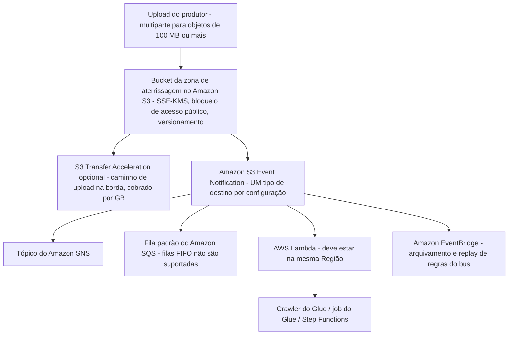
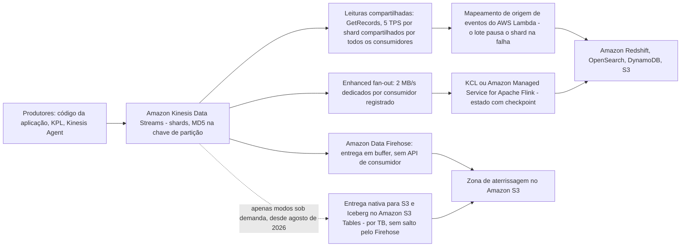
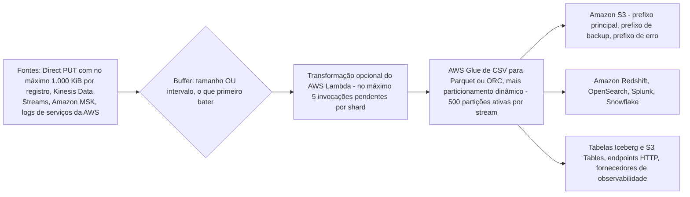
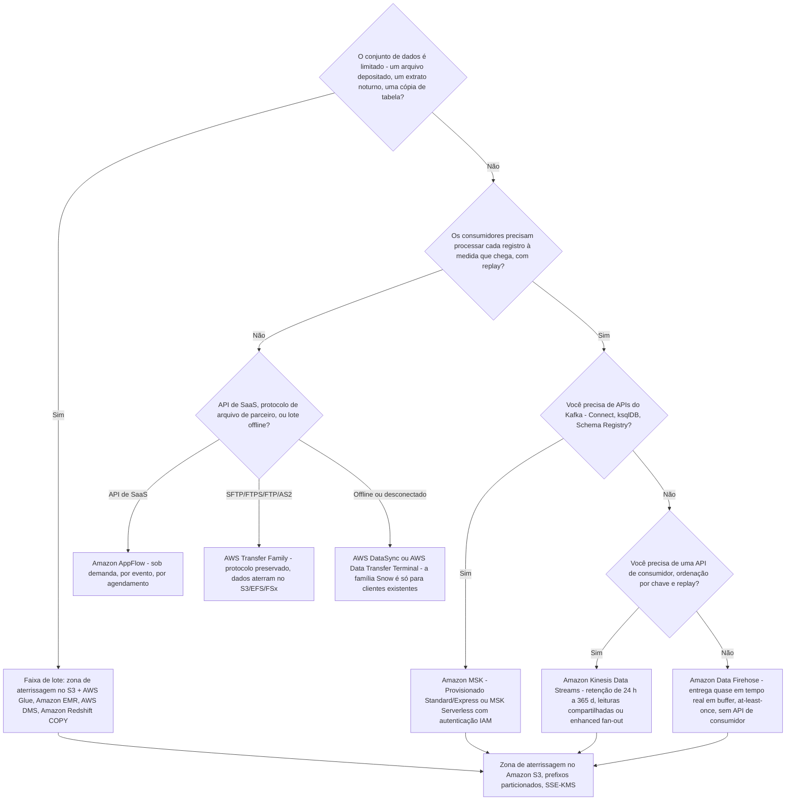
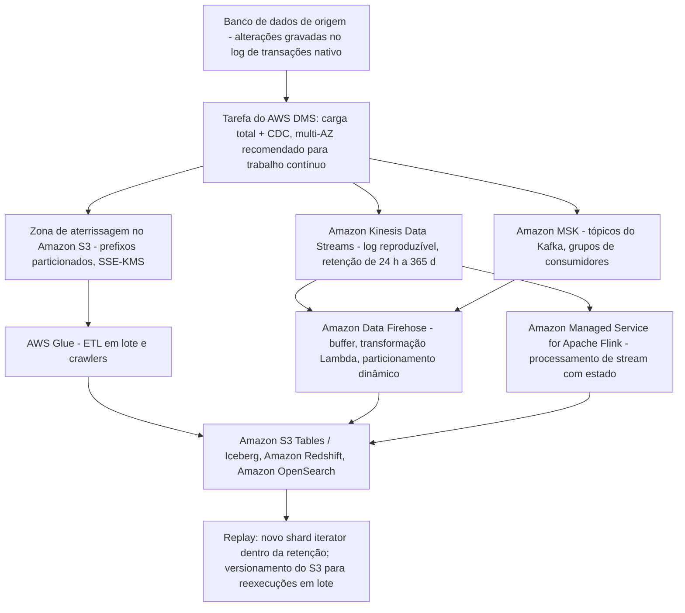

# Ingestão de Dados: Padrões em Lote e Streaming

O Domínio 1 do DEA-C01 responde por **34% do conteúdo pontuado**, e sua primeira tarefa: **1.1, ingestão**: é onde a maioria dos candidatos perde pontos fáceis. O motivo é que questões de ingestão quase nunca perguntam "o que é um stream". Elas pedem que você *escolha*: lote ou streaming, carga total ou CDC, `PutRecord` ou `PutRecords`, leituras compartilhadas ou enhanced fan-out, Firehose ou Kinesis Data Streams, Transfer Family ou DataSync, Snowball Edge ou outra coisa totalmente diferente. Cada uma dessas escolhas tem exatamente uma resposta que atende ao requisito declarado, e três que soam corretas.

```text
 =====================================================================
  DEA-C01 DOMÍNIO 1 — INGESTÃO E TRANSFORMAÇÃO (escopo da tarefa 1.1)
 ---------------------------------------------------------------------
  1.1.1  Ler dados de fontes de streaming
         (Kinesis, MSK, DynamoDB Streams, DMS, Glue, Redshift)
  1.1.2  Ler dados de fontes em lote
         (S3, Glue, EMR, DMS, Redshift, Lambda, AppFlow)
  1.1.3  Identificar opções de configuração de ingestão em lote
  1.1.4  Consumir dados por meio de APIs de dados
  1.1.5  Selecionar agendadores de jobs e crawlers (EventBridge, Apache
         Airflow, baseado em tempo)
  1.1.6  Selecionar gatilhos de evento (S3 Event Notifications, EventBridge)
  1.1.7  Chamar uma função Lambda a partir de um stream do Kinesis
  1.1.8  Aplicar listas de permitidos de IP
  1.1.9  Lidar com throttling e limites de taxa (DynamoDB, RDS, Kinesis)
  1.1.10 Aplicar padrões de fan-in e fan-out
  1.1.11 Descrever a reproduzibilidade dos pipelines de ingestão de dados
  1.1.12 Aplicar transações de dados com e sem estado
 =====================================================================
  Fonte: guia oficial do exame DEA-C01, Domínio 1, Tarefa 1.1,
  acesso em outubro de 2026.
 =====================================================================
```

Nesta lição você vai:

- separar **lote de streaming** com a decisão de quatro perguntas que todo enunciado da Tarefa 1.1 esconde;
- projetar uma **zona de aterrissagem no S3**: prefixos, SSE-KMS, regras multiparte e os quatro destinos de gatilho de evento;
- executar o **AWS DMS** corretamente, carga total, carga total + CDC, só CDC, e dimensionar a instância de replicação;
- escolher entre **AppFlow, Transfer Family, família Snow e APIs de dados** para fontes que não são streams;
- modelar o **Kinesis Data Streams**: shards, chaves de partição, posicionamento MD5, retenção de 24 horas a 365 dias, ordenamento e entrega at-least-once;
- fazer **matemática de contagem de shards e throughput** na mão, incluindo diagnóstico de partição quente e agregação do KPL;
- pôr em buffer a entrega quase em tempo real com o **Amazon Data Firehose**: tamanho ou intervalo, o que primeiro bater;
- provisionar o **Amazon MSK** (Standard, Express, Serverless) e escolher o modo de autenticação certo;
- aplicar a **matriz de decisão Streams vs Firehose vs MSK** e a árvore de decisão;
- rastrear **padrões CDC** de ponta a ponta e raciocinar sobre **reproduzibilidade, fan-in/fan-out e estado**;
- estudar **quatro estudos de caso de clientes da AWS**: Hearst, AGCO, FINRA e Baqend;
- ler a **caixa de atualizações de outubro de 2026** e praticar com **14 questões no estilo de exame** mais quatro verificações interativas.

---

## 1. Lote ou streaming? A decisão da Tarefa 1.1

### 1.1 Duas faixas, um requisito

Tudo no Domínio 1 depende de uma única distinção. O exame a declara pela divisão da Tarefa 1.1 entre *fontes em lote* (1.1.2) e *fontes de streaming* (1.1.1):

| Dimensão | **Lote** | **Streaming** |
|---|---|---|
| Formato do conjunto de dados | **Limitado**, um arquivo, um extrato, um snapshot de tabela | **Ilimitado**, sem fim, chega continuamente |
| Unidade de trabalho | Um job discreto que começa, roda e termina | Um consumidor contínuo que roda enquanto os dados fluem |
| Orçamento de latência | Minutos a horas | Milissegundos a segundos (Firehose: quase em tempo real) |
| Fontes nomeadas (guia do exame) | S3, Glue, EMR, DMS, Redshift, Lambda, AppFlow | Kinesis, MSK, DynamoDB Streams, DMS, Glue, Redshift |
| História de replay | Reexecutar o job contra os mesmos objetos | Reler o log **dentro da janela de retenção** |
| Ordenamento | O que o job impuser (ordem de partição/pruning) | **Por chave de partição**, dentro de um shard ou partição |
| Tratamento de falhas | Repetir a tarefa; os dados continuam no disco | Repetir o lote; o shard pode pausar e o atraso cresce |
| Âncora no exame | Tarefa 1.1.2 + 1.1.3 | Tarefa 1.1.1 + 1.1.11 |

> [!NOTE]
> **As duas faixas listam DMS, Glue e Redshift.** Isso é deliberado: a *carga total* do AWS DMS é uma leitura em lote enquanto o *CDC* do DMS é uma leitura de stream; um job do Glue é lote enquanto um job de streaming do Glue não é; o `COPY` do Redshift é lote enquanto a ingestão de streaming do Redshift não é. O exame testa se você consegue nomear **qual modo** do mesmo serviço um enunciado descreve.

### 1.2 As quatro perguntas que resolvem qualquer enunciado

1. **O conjunto de dados é limitado?** Sim → faixa de lote. Não → faixa de streaming.
2. **Um consumidor precisa processar cada registro *à medida que ele chega*?** Sim → um stream de verdade com uma API de consumidor (Kinesis Data Streams ou MSK), não Firehose.
3. **Um consumidor precisa poder *reproduzir*?** Sim → você precisa de um log durável com retenção (Kinesis **24 to 8.760 h**, ou um tópico do Kafka). O Firehose não tem API de consumidor, então não oferece replay do lado do consumidor.
4. **Quantos consumidores independentes leem os mesmos dados?** Muitos, cada um no seu ritmo → design de fan-out (leituras compartilhadas, enhanced fan-out, ou grupos de consumidores do MSK: nunca Firehose).

Padrão resolvido: um job noturno de exportação de clientes às 02:00 que grava um CSV no S3 é a pergunta 1 = **lote**; um pipeline de clickstream em que um analista precisa reproduzir os eventos de ontem é as perguntas 1, 2 e 3 = **streaming**.

- **📚 Você sabia?** O Amazon Kinesis Data Streams foi lançado em **2013** e a AWS o descreve como *o primeiro serviço de streaming de dados serverless nativo de nuvem* (AWS Big Data Blog, "Amazon Kinesis Data Streams: Celebrating a Decade of Real-Time Data Innovation", 2023-11-14, acesso em outubro de 2026). É por isso que o vocabulário de streaming do exame, shard, chave de partição, shard iterator, é primeiro vocabulário do Kinesis, e por que o vocabulário estilo Kafka de "tópico/partição/offset" pertence ao MSK.

---

## 2. A zona de aterrissagem no S3: prefixos, multiparte, gatilhos

### 2.1 Higiene da zona de aterrissagem

Quase todo pipeline de lote do Domínio 1 começa no mesmo lugar: produtores aterrissam dados brutos no **Amazon S3**, e tudo a jusante lê de lá. A zona de aterrissagem é examinável pela Tarefa 1.1.3 (opções de configuração de ingestão em lote) e pela Tarefa 1.1.6 (gatilhos de evento).

| Configuração | Padrão recomendado | Por que é examinável |
|---|---|---|
| Layout de chaves | `source=<system>/year=YYYY/month=MM/day=DD/` | Prefixos particionados permitem que Athena/Glue/Redshift façam pruning em vez de escanear |
| Criptografia | **SSE-KMS** com chave gerenciada pelo cliente | Opção de configuração da Tarefa 1.1.3; as chaves continuam sob controle do cliente |
| Acesso público | **Bloquear todo acesso público** | Postura básica do S3; uma zona de aterrissagem nunca é pública |
| Versionamento | Habilitado | O versionamento é o que torna possível um **replay/recarga** de uma zona de aterrissagem |
| Disparo | S3 Event Notifications → SNS / SQS / Lambda / EventBridge | Tarefa 1.1.6 |



Regras que o exame reutiliza: uma única configuração de notificação suporta **um tipo de destino**; **filas FIFO do SQS não são** suportadas como destino; uma **função Lambda deve estar na mesma Região** que o bucket; um novo gatilho leva **cerca de 5 minutos** para entrar em vigor e o serviço envia um `s3:TestEvent` que você deve tratar.

> [!IMPORTANT]
> ⚠️ **Upload multiparte e Transfer Acceleration não são velocidade de graça.** O multipart adiciona cobranças de requisição por parte, e o Transfer Acceleration é cobrado por GB movido pela rede de borda (bordas EUA/Europa/Japão: **$0,04/GB de entrada**; outras bordas: **$0,08/GB de entrada**; **$0,04/GB de saída**: em outubro de 2026). Qualquer opção afirmando que "upload multiparte torna uploads grandes gratuitos" é um distrator.

### 2.2 Exemplo resolvido E1: contagem de partes do multipart

Regras publicadas do multipart do S3 (em outubro de 2026): use multipart em **100 MB ou mais**; cada parte **5 MiB: 5 GiB** (a última parte é isenta do mínimo); **no máximo 10.000 partes**; tamanho máximo de objeto **48,8 TiB**; um único `PUT` pode carregar no máximo **5 GB**.

```text
Exemplo resolvido E1 - contagem de partes do multipart (aritmética sobre regras publicadas)
Tamanho do objeto ...... 75 GB = 76.800 MB
Limite de PUT único .... 5 GB  -> um único PUT não pode carregar este objeto
Tamanho da parte escolhido . 512 MB (dentro da janela 5 MiB - 5 GiB)
Partes ................. ceil(76.800 / 512) = 150 partes
Verificação de cota .... 150 <= 10.000 partes                OK
Verificação de tamanho . 512 MB está dentro de 5 MiB - 5 GiB     OK
Portão do multipart .... 75 GB >= 100 MB                    OK
Resultado .............. 150 partes enviadas em paralelo, depois uma chamada de complete
```

O ponto examinável é a *cadeia*: teto de 5 GB por PUT único → multipart obrigatório → teto de contagem de partes → teto de objeto. Erre um elo e você escolhe o tamanho de parte errado.

- **📚 Você sabia?** O **S3 Transfer Acceleration** é documentado como tendo reduzido o tempo médio de ingestão de arquivos de 300 MB para `ap-southeast-2` em **50%**, com melhoria de **mais de 500%** para uploads de 250 MB enviados como partes de 50 MB para `us-east-1` (Amazon S3 FAQ, acesso em outubro de 2026). São observações publicadas pela AWS para pares específicos de Regiões: nunca uma garantia para o seu workload.

---

## 3. AWS DMS: carga total, carga total + CDC, só CDC

### 3.1 Três tipos de tarefa, um serviço

O AWS Database Migration Service é a resposta padrão do exame para movimentação **de banco de dados para banco de dados e de banco de dados para stream/arquivo**, e a Tarefa 1.1.1 nomeia explicitamente o DMS como uma *fonte de streaming*. Sua documentação define exatamente três tipos de tarefa:

| Tipo de tarefa | O que se move | Para que serve |
|---|---|---|
| **Carga total** | Apenas dados existentes, uma passagem de snapshot | Migração única ou carga em massa na zona de aterrissagem do S3 |
| **Carga total + CDC** | Dados existentes **e** alterações capturadas *enquanto* a carga roda | O padrão para "mover e manter em sincronia" |
| **Só CDC** | Alterações do log de transações a partir de um ponto inicial escolhido | Recuperação após uma carga, ou replicação de longa duração |

CDC é **baseado em log**: o DMS lê o log de transações nativo da origem por meio de sua API de log. Não é um job de diff, nem é um snapshot: um enunciado que descreve "consultar a tabela toda noite para linhas alteradas" está descrevendo uma reconciliação em lote, não CDC.

### 3.2 A linha do tempo de carga total + CDC

```text
Fase 1  CAPTURE ....... o CDC começa imediatamente; alterações em cache
                        (memória primeiro, depois destilação em disco na
                        instância de replicação)
Fase 2  FULL LOAD ..... até 8 tabelas carregam em paralelo
                        (MaxFullLoadSubTasks, padrão 8, máximo 8)
Fase 3  APPLY ......... cada tabela aplica suas alterações em cache assim que
                        essa tabela termina de carregar, por tabela
Fase 4  STEADY STATE .. as alterações fluem continuamente; observe
                        CDCLatencySource / CDCLatencyTarget
```

Os pontos de partida de tarefa para CDC são: um **horário CDC personalizado** (SCR/SCN ou timestamp: requer `openTransactionWindow`), a posição **nativa** do log, ou um **checkpoint** armazenado em `awsdms_txn_state`.

### 3.3 Dimensionamento, modo de aplicação e topologia

| Alavanca | Regra (em outubro de 2026) |
|---|---|
| Família de instância | Carga total + CDC geralmente é **limitado por memória** → `dms.r5` / `dms.r6i` / `dms.r7i`; muitas tarefas paralelas são limitadas por CPU → `dms.c5` |
| Armazenamento | **50 GB ou 100 GB** GP2 (rajadas até 3.000 IOPS), o disco serve para a destilação do cache do CDC |
| Tabelas paralelas | **8** por padrão (`MaxFullLoadSubTasks`), e 8 também é o máximo declarado |
| Modo de aplicação | **Transacional** (padrão; preserva integridade referencial, mais lento) vs **lote** (mais rápido, exige chave primária) |
| Topologia | **Multi-AZ é recomendado para replicação contínua** |
| Primeira inicialização serverless | Até **40 minutos** (docs do AWS DMS, acesso em outubro de 2026) |

**Migrações heterogêneas** (Oracle → Aurora PostgreSQL, por exemplo) são uma resposta em dois passos: **converter o schema e o código primeiro, depois mover os dados**. A ferramenta de conversão agora é o **DMS Schema Conversion**, construído sobre o motor do antigo AWS Schema Conversion Tool, o AWS SCT foi **removido da lista no escopo do DEA-C01 no guia de exame v1.1 (2025-12-12)**.

```dragdrop
{
  "question": "Ordene os três tipos de tarefa do AWS DMS, daquele que move APENAS dados EXISTENTES para aquele que move APENAS ALTERAÇÕES:",
  "items": [
    "Carga total: apenas linhas existentes, uma passagem, sem captura de log",
    "Carga total + CDC: a captura de log começa imediatamente e é aplicada por tabela assim que cada tabela termina de carregar",
    "Só CDC: alterações do log de transações a partir de um ponto inicial escolhido (horário personalizado, posição nativa ou checkpoint)"
  ],
  "correctOrder": [
    "Carga total: apenas linhas existentes, uma passagem, sem captura de log",
    "Carga total + CDC: a captura de log começa imediatamente e é aplicada por tabela assim que cada tabela termina de carregar",
    "Só CDC: alterações do log de transações a partir de um ponto inicial escolhido (horário personalizado, posição nativa ou checkpoint)"
  ],
  "explanation": "Os três tipos de tarefa têm relação de subconjunto, não são três modos independentes: a carga total move histórico, o CDC move alterações, e a carga total + CDC inicia o CDC primeiro (captura da Fase 1), executa a carga paralela (Fase 2), aplica as alterações em cache de cada tabela quando essa tabela termina (Fase 3) e depois se estabiliza no estado permanente (Fase 4). 'Carga total + CDC' é a resposta correta a qualquer enunciado que diga mover E manter em sincronia; 'Só CDC' está correto quando os dados já foram carregados e você só precisa do log a partir de um ponto inicial."
}
```

> [!WARNING]
> ⚠️ **O CDC do DMS não é tempo real.** A própria documentação da AWS afirma que o DMS "**não fornece replicação em tempo real**" e que "**não há SLAs para a latência do CDC**" (AWS DMS User Guide, acesso em outubro de 2026). Um enunciado pedindo latência de replicação *menor que um segundo* não é um enunciado do DMS: ele aponta para replicação lógica nativa, Kinesis Data Streams ou MSK.

- **📚 Você sabia?** O DMS aplica alterações por meio de um **ordenador que preserva a ordem de commit da origem** no destino, é por isso que fluxos CDC grandes de várias tabelas ainda podem se adiantar à carga total e precisam ser armazenados em cache no disco da instância de replicação (AWS DMS User Guide, acesso em outubro de 2026). É também por isso que o armazenamento é uma escolha de 50/100 GB e não um "padrão pequeno": é a área de destilação desse cache.

---

## 4. Faixas de ingestão gerenciadas: AppFlow, Transfer Family, família Snow, APIs de dados

Nem toda fonte é um banco de dados ou um stream. A Tarefa 1.1 também nomeia APIs de SaaS (1.1.2), APIs de dados (1.1.4), gatilhos de evento (1.1.6) e throttling (1.1.9).

### 4.1 Amazon AppFlow: SaaS no S3 sob demanda, por evento, por agendamento

| Gatilho | Quando dispara | Restrição |
|---|---|---|
| **Executar sob demanda** | Você o chama | Mais simples; sem cadência |
| **Executar por evento** | O SaaS publica eventos de alteração | Só onde a fonte os publica, o Salesforce precisa de **CDC habilitado** na conexão |
| **Executar por agendamento** | Extração completa ou incremental | A incremental precisa de um **campo de timestamp** mais um **offset** para tolerar desvio de relógio |

A cadência é limitada pela cota de API do *fornecedor*, não pela AWS: Salesforce, ServiceNow e Zendesk em **1 execução/minuto**, Marketo em **1/hora**, Google Analytics em **1/dia**; a conta fica limitada a **1 execução agendada por minuto** no total (em outubro de 2026). Outras cotas publicadas: **100 GB por execução de fluxo**, **1.000 fluxos**, **10 milhões de execuções/mês**, duração máxima de execução de **48 horas**, **100 perfis de conector por conta**, e cada chamada consome a cota de API do *fornecedor*. Destinos: S3 (a zona de aterrissagem usual), Redshift, Snowflake, Salesforce, Slack, com **PrivateLink** onde suportado.

### 4.2 AWS Transfer Family: ingestão de parceiros preservando o protocolo

O Transfer Family dá aos parceiros endpoints **SFTP, FTPS, FTP e AS2** suportados por **Amazon S3, EFS ou FSx**, de modo que o parceiro não muda nada. A autenticação é gerenciada pelo serviço, **Active Directory** ou uma **API personalizada** (seu provedor de identidade).

| Cota (em outubro de 2026) | Valor |
|---|---|
| Sessões simultâneas por servidor | **10.000** |
| Servidores por conta | **50** |
| Sessões SFTP multiplexadas por conexão | **10** |
| Tempo limite de ociosidade | **1.800 segundos** |
| Conector SFTP (pull de saída) por conta | **100** |
| Tamanho máximo de arquivo do conector | **150 GiB** |
| Throughput do conector por conta | **50 MBps**, no máximo **5 transferências paralelas** |

A divisão tripla do exame é fixa: **Transfer Family = ingestão preservando o protocolo** (o parceiro continua usando SFTP), **AWS DataSync = cópia em massa online** entre sistemas de arquivos on-premises e S3/EFS/FSx, **família Snow = transferência física offline**.

### 4.3 Família Snow: confira o calendário antes de escolhê-la

| Data | Evento (em outubro de 2026) |
|---|---|
| **2024-11-12** | Snowcone e três modelos anteriores do Snowball **descontinuados** |
| Dispositivos atuais | **Snowball Edge Storage Optimized 210 TB**; **Snowball Edge Compute Optimized** (104 vCPUs, 416 GB de RAM, 28 TB NVMe) |
| **2025-11-07** | Os dispositivos estão disponíveis **apenas para clientes existentes**; novos clientes são direcionados ao **AWS DataSync, AWS Data Transfer Terminal ou parceiros**, e necessidades de compute na borda vão para **Outposts** |
| **2026-12-31** | **Fim do suporte** aos dispositivos da família Snow em Regiões comerciais |

### 4.4 Consumindo APIs de dados (Tarefas 1.1.4, 1.1.9)

| Estilo | Padrão | Serviços |
|---|---|---|
| **Pull** | Paginação + backoff exponencial com **jitter**, em um agendamento ou como um passo | AWS Glue, Lambda, AWS Batch, Step Functions |
| **Push** | A API chama você | API Gateway → Lambda / SQS / Kinesis; **EventBridge API Destinations** |
| **SaaS gerenciado** | Não implemente OAuth e paginação na mão | **Amazon AppFlow** |

Respostas de throttling que você precisa reconhecer pelo nome: HTTP **429** e `ProvisionedThroughputExceededException` do DynamoDB. Trate-as com backoff, não com limites maiores: a própria orientação da AWS é "**não use limites e cotas em nível de recurso como forma de controlar seu uso**" (cotas do Kinesis Data Firehose, acesso em outubro de 2026).

| Escolha | Quando o enunciado diz |
|---|---|
| **Amazon AppFlow** | "dados de Salesforce/ServiceNow/Zendesk no S3, sem código" |
| **AWS Transfer Family** | "os parceiros precisam continuar usando SFTP/FTPS/FTP/AS2" |
| **AWS DataSync** | "copiar 40 TB de um filer NFS para o S3 pela rede" |
| **Família Snow** | "sem rede utilizável, cliente AWS existente, dezenas de TB" |
| **Pull agendado (Glue/Lambda/Batch)** | "API REST paginada com limites de taxa" |

---

## 5. Amazon Kinesis Data Streams: shards, chaves de partição, retenção

### 5.1 O shard é a unidade de tudo

Um **shard** é o contrato de throughput, o limite de ordenamento e a unidade de preço de um stream. Todo limite abaixo está **em outubro de 2026**:

| Propriedade | Por shard |
|---|---|
| Throughput de escrita | **1 MB/s e 1.000 registros/s** (ambos os tetos valem) |
| Throughput de leitura | **2 MB/s e 2.000 registros/s** |
| TPS de leitura compartilhada | **5 TPS de `GetRecords` por shard, compartilhados** por todos os consumidores |
| Taxa de `PutRecord` | **1.000 TPS por shard** |
| `PutRecords` por requisição | até **500 registros e 10 MiB** |
| Payload do registro | **1 MiB** por padrão; **10 MiB opt-in por stream** |
| Retenção | padrão **24 horas**, extensível a **8.760 horas (365 dias)** |
| Preço | **$0,015 por shard-hora** ($0,36/shard/dia); enhanced fan-out **$0,015 por consumidor-shard-hora** |

A retenção estendida é o que transforma um stream em uma **janela de replay** (Tarefa 1.1.11): reproduzir significa abrir um **novo shard iterator** em um número de sequência anterior: uma nova *leitura*, não uma regravação do log.

### 5.2 Chave de partição → MD5 → shard

```text
registro do produtor
  └─ chave de partição (string que você escolhe, ex.: customer_id ou device_id)
        └─ MD5(chave de partição)  ->  seleciona UM shard deterministicamente
              └─ shard  ->  números de sequência aumentam só dentro daquele shard
```

Três consequências que o exame testa implacavelmente:

- **A ordem é por chave de partição, nunca global.** Registros com a mesma chave têm ordem; registros com chaves diferentes se intercalam entre shards.
- **Uma chave quente é um shard quente.** 40.000 registros/s espalhados por 20 shards é fine; 1.500 registros/s em uma única chave sofrem throttling em 1.000 registros/s, não importa quantos shards você adicione.
- **As chaves devem superar amplamente a contagem de shards.** Distribuição uniforme exige muito mais chaves distintas do que shards.

### 5.3 Caminhos de produzir e consumir

| API de produção | Semântica |
|---|---|
| `PutRecord` | Usa `SequenceNumberForOrdering`: a escolha de ordem estrita para uma chave |
| `PutRecords` | Lotes de até **500 registros / 10 MiB**; falhas por registro; a AWS afirma que "**não garante a ordenação dos registros**" |
| **Kinesis Producer Library (KPL)** | Agrega muitos registros de usuário em um registro do Kinesis; consumidores precisam desagregar |
| **Kinesis Agent** | Roda no host, acompanha arquivos, envia em lote para o stream |

| Caminho de consumo | Semântica |
|---|---|
| **Leituras compartilhadas** (`GetRecords`) | Padrão; **5 TPS por shard no total**, compartilhados por todo consumidor |
| **Enhanced fan-out (EFO)** | Opt-in; cada consumidor registrado recebe **2 MB/s dedicados** de leitura; **20 consumidores/stream** (Standard provisionado e sob demanda), **50** (On-demand Advantage) |
| **Mapeamento de origem de eventos do Lambda** | At-least-once; um **lote com falha pausa aquele shard** até que ele funcione, então o atraso aparece como `IteratorAge`, não como reordenação |
| **KCL / Managed Service for Apache Flink** | Processamento com checkpoint e estado |



### 5.4 Modos de capacidade

| Modo | Forma de cobrança | Use quando |
|---|---|---|
| **Provisionado** | Por shard-hora; você **divide e funde** shards | Throughput previsível e constante que você consegue dimensionar |
| **On-demand Standard** | Por GB ingerido mais uma taxa horária por stream | Volume desconhecido ou espicado que você não consegue dimensionar antecipadamente |
| **On-demand Advantage** | Em nível de conta, por GB, **sem taxa horária por stream**, com um piso em nível de conta (veja a caixa de atualizações) | Muitos streams ou ingestão agregada alta |

Um novo stream sob demanda começa com **4 MB/s de escrita e 8 MB/s de leitura** (orientação de dimensionamento do Kinesis, em outubro de 2026), e as trocas de modo de capacidade são limitadas a **2 por stream a cada 24 horas**, então "trocar de modo quando o tráfego muda" não é tática de minutagem.

- **📚 Você sabia?** Desde **28 de agosto de 2026** um stream do Kinesis pode entregar **nativamente**: sem o Amazon Data Firehose: para **tabelas Iceberg no Amazon S3 Tables** e, desde **29 de agosto de 2026**, para **buckets S3 de propósito geral**, apenas nos modos de capacidade sob demanda (AWS What's New, 2026-08-28 e 2026-08-29). Os preços publicados de entrega em us-east-1 são **$14/TB** para S3 Tables e **$11/TB** para S3 (AWS Big Data Blog, 2026-08-31, em outubro de 2026). O Firehose deixou de ser o único caminho de stream para o S3, mas ainda domina transformações, conversão de formato e particionamento dinâmico.

---

## 6. Matemática resolvida: contagem de shards, throughput e custo

A fórmula de dimensionamento de um stream provisionado (orientação de dimensionamento do AWS Kinesis, em outubro de 2026):

```text
shards = max( ceil(bytes_por_segundo / 1 MB),
              ceil(registros_por_segundo / 1.000) )
mais um termo de leitura: ceil(KiB_de_leitura_por_segundo / 2.048)
```

Você precisa avaliar **ambos** os termos e tomar o máximo: os enunciados são escritos de modo que um termo domine e o outro induza a erro.

### 6.1 Exemplo resolvido E2: limitado por registros

```text
Exemplo resolvido E2 - contagem de shards limitada por registros
Entrada: 12.000 registros/s x 300 bytes = 3.600.000 B/s = 3,6 MB/s
Por registros: ceil(12.000 / 1.000) = 12 shards
Por bytes:     ceil(3,6 / 1)         =  4 shards
Shards = max(12, 4) = 12
Custo: 12 x $0,015/h x 24 h         = $4,32 por dia      (em outubro de 2026)
       12 x $0,015/h x 24 h x 31 d  = $133,92 por mês de 31 dias
Folga de leitura: 12 x 2 MB/s = 24 MB/s e 12 x 2.000 = 24.000 registros/s
```

### 6.2 Exemplo resolvido E3: limitado por bytes

```text
Exemplo resolvido E3 - contagem de shards limitada por bytes
Entrada: 8.000 registros/s x 1,5 KB = 12.000 KB/s = 12 MB/s
Por registros: ceil(8.000 / 1.000) = 8 shards
Por bytes:     ceil(12 / 1)         = 12 shards
Shards = max(8, 12) = 12   <- o termo de BYTES domina aqui
```

Mesma resposta do E2, por motivo oposto. Essa coincidência é a armadilha: verifique qual termo dominou antes de confiar na sua aritmética.

### 6.3 Exemplo resolvido E4: registros pequenos e agregação do KPL

```text
Exemplo resolvido E4 - por que o KPL muda a resposta
Ingênuo: 500 registros/s x 100 bytes = 50 KB/s
         por registros: ceil(500 / 1.000) = 1   por bytes: ceil(0,05 / 1) = 1  -> 1 shard
Mas o teto de 1.000 registros/s conta REGISTROS DO KINESIS, não registros de usuário.
Com o KPL agregando 10 registros de usuário em 1 registro do Kinesis:
         registros do Kinesis/s = 500 / 10 = 50      (muito abaixo de 1.000)
         payload/s             = 50 KB               (muito abaixo de 1 MB)
Teto prático naquele único shard ~ 10 x 1.000 = 10.000 registros de usuário/s,
ainda limitado por 1 MB/s, enquanto a taxa de requisição da API cai proporcionalmente.
O consumidor precisa DESAGREGAR o formato de coleção do KPL.
```

### 6.4 Exemplo resolvido E5: a partição quente

```text
Exemplo resolvido E5 - diagnóstico de partição quente
Total do stream: 40.000 registros/s em muitas chaves -> shards suficientes provisionados.
Chave quente:    a chave de partição "sensor-42" sozinha emite 1.500 registros/s.
Posicionamento:  MD5("sensor-42") sempre seleciona o MESMO shard.
Teto:            aquele shard sofre throttling em 1.000 registros/s - independente
                 de quantos shards existam no stream.
Sintomas:        throttling de escrita relatado para UMA chave enquanto todas
                 as outras ficam sem problema.
Correção:        chave de dois níveis ("sensor-42#0" .. "sensor-42#7"), salting, ou outro
                 design de chave para que uma entidade lógica se espalhe entre shards.
```

Coloque os dois termos resolvidos lado a lado e a regra "tomar o máximo" deixa de ser abstrata, E2 e E3 ambos caem em **12 shards**, mas por termos opostos:

```plot
{
  "type": "bar",
  "title": "Shards necessários por cada termo de dimensionamento (exemplos resolvidos E2 e E3, em outubro de 2026)",
  "xLabel": "Termo de dimensionamento",
  "yLabel": "Shards necessários",
  "xKey": "term",
  "data": [
    {"term": "E2 records: 12,000 / 1,000", "shards": 12},
    {"term": "E2 bytes: 3.6 MB / 1 MB", "shards": 4},
    {"term": "E3 records: 8,000 / 1,000", "shards": 8},
    {"term": "E3 bytes: 12 MB / 1 MB", "shards": 12}
  ]
}
```

> [!NOTE]
> **Cotas de shard são consulta no Service Quotas, não número decorado.** A AWS publica tetos de shard diferentes para `us-east-1` / `us-west-2` / `eu-west-1` do que para outras Regiões, e a redação difere entre a página de cotas e o FAQ (verificado em outubro de 2026). Resposta segura para o exame: "confira o **Service Quotas** da Região e do stream", nunca um número fixo. `UpdateShardCount` no modo Provisionado é limitado a **10.000 shards por chamada** (em outubro de 2026).

---

## 7. Amazon Data Firehose: buffers, destinos, quase em tempo real

### 7.1 Um serviço de entrega, não um stream

O Amazon Data Firehose **não tem shards nem API de consumidor**. Você grava registros nele (Direct PUT, ou a partir do Kinesis Data Streams, Amazon MSK, ou logs de serviços da AWS como CloudTrail, WAF e logs de fluxo do VPC), e o Firehose os **entrega** para um destino: em buffer, opcionalmente transformados, com nova tentativa automática.

| Propriedade | Valor (em outubro de 2026) |
|---|---|
| Tamanho do registro | máximo de **1.000 KiB**; `PutRecordBatch` até **500 registros ou 4 MiB** |
| Throughput de Direct PUT | `us-east-1`/`us-west-2`/`eu-west-1`: **500 mil registros/s, 2.000 requisições/s, 5 MiB/s**; outras Regiões **100 mil / 1.000 / 1 MiB/s**, e a AWS **aumenta automaticamente** |
| Buffer | **tamanho ou intervalo, o que primeiro bater** |
| Tamanho do buffer (S3) | **1 to 128 MB**, padrão **5 MB**; **64 to 128 MB com padrão de 128 MB** quando a conversão para Parquet ou o particionamento dinâmico está ativo |
| Intervalo do buffer | faixa da API/FAQ **0 to 900 segundos**, padrão **300 segundos**; a página de cotas lista **60 to 900 segundos**; Splunk **0 to 60** (padrão 60) |
| Latência declarada | "**dentro de 60 segundos**" |
| Semântica | **at-least-once** |
| Particionamento dinâmico | **500 partições ativas por stream** (elevável a **2.500**), no máximo **1 GB/s por partição ativa** |
| Transformação Lambda | no máximo **5 invocações pendentes por shard** (10 para o Splunk) |



### 7.2 Exemplo resolvido E6: qual condição de buffer dispara primeiro

```text
Exemplo resolvido E6 - corrida do buffer (regras em outubro de 2026)
Taxa de ingestão: 750 KB/s.  Regra: tamanho OU intervalo, O QUE PRIMEIRO BATER.

Caso A - tamanho de buffer padrão do S3 5 MB, intervalo 60 s
  tempo para encher 5 MB = 5.000 KB / 750 KB/s = 6,7 s
  6,7 s < 60 s  ->  o TAMANHO dispara primeiro
  objeto entregue ~ 5 MB a cada ~6,7 s

Caso B - Parquet / particionamento dinâmico, tamanho de buffer 64 MB, intervalo 60 s
  tempo para encher 64 MB = 65.536 KB / 750 KB/s = 87,4 s
  87,4 s > 60 s  ->  o INTERVALO dispara primeiro
  objeto entregue = 60 s x 750 KB/s = 45.000 KB = ~44 MB

Lição: nunca raciocine sobre "o limite maior". Faça os dois relógios correrem.
```

### 7.3 Novas tentativas e o que "replay" significa aqui

| Caminho | Comportamento de nova tentativa (em outubro de 2026) |
|---|---|
| Direct PUT → S3 | a cada **5 s** por até **24 horas**, depois os registros são **descartados** |
| Originado no Kinesis | as novas seguem a **retenção do stream de origem** |
| → Redshift | a cada **5 minutos** por até **120 minutos**, depois o registro é pulado e gravado em um **manifesto** |
| → OpenSearch | backoff de **0 to 7.200 segundos** |
| Todos os caminhos | **at-least-once**, o a jusante deve ser idempotente |

Como **não há API de consumidor**, **não há replay do lado do consumidor**: seus únicos artefatos de recuperação são o prefixo de **backup** do S3 e o prefixo de **erro**. Precisa de replay? Leia diretamente do Kinesis Data Streams.

```fillblank
{
  "question": "Complete as afirmações de buffer e throughput com os números publicados (todos em outubro de 2026):",
  "template": "Kinesis Data Streams: cada shard aceita {{1}} MB/s e {{2}} registros por segundo de escrita, serve {{3}} MB/s de leitura e retém dados por {{4}} horas por padrão: extensível a {{5}} horas para replay. Amazon Data Firehose usa buffer por tamanho OU intervalo, o que primeiro bater: a faixa de tamanho do S3 é {{6}} a {{7}} MB, e o intervalo padrão é {{8}} segundos.",
  "answers": {
    "1": "1",
    "2": "1000",
    "3": "2",
    "4": "24",
    "5": "8760",
    "6": "1",
    "7": "128",
    "8": "300"
  },
  "distractors": ["500", "10", "4", "1024", "48", "720", "60", "900", "5", "120"],
  "explanation": "Escrita por shard 1 MB/s e 1.000 registros/s, leitura por shard 2 MB/s, retenção 24 h por padrão e até 8.760 h (365 dias) - docs do Kinesis Data Streams, em outubro de 2026. O Firehose usa buffer por tamanho OU intervalo: tamanho do buffer do S3 1-128 MB (padrão 5 MB, 64-128 MB com padrão 128 para Parquet/particionamento dinâmico) e intervalo padrão 300 s. Os distratores misturam os dois serviços: 500 é o teto de registros do PutRecords, 1.000 KiB é o teto de registro do Firehose, 60 s é o padrão de buffer do Splunk e 900 s é o máximo do intervalo."
}
```

- **📚 Você sabia?** O produto foi renomeado para **Amazon Data Firehose** em **9 de fevereiro de 2024**, e a AWS afirma que a renomeação não mudou **nada** em endpoints, APIs, comandos de CLI, nomes de políticas de IAM ou métricas do CloudWatch: as ações de IAM continuam `firehose:*`. Enquanto isso, a **lista no escopo do DEA-C01 ainda imprime "Amazon Kinesis Data Firehose"** (guia do exame, acesso em outubro de 2026). Ambos os nomes estão corretos; nunca "conserte" uma opção que usa o mais antigo.
- **📚 Você sabia?** A AWS de fato destaca a **NerdWallet** em sua página de clientes do Amazon Data Firehose, com uma arquitetura **Firehose → Lambda → SNS**, mas **sem números publicados de desempenho ou custo** (acesso em outubro de 2026). Então qualquer opção que cite "a NerdWallet economizou X%" ou "a NerdWallet ingeri Y GB/dia" é inventada: um cliente *nomeado* em uma página da AWS não torna automaticamente um *número* examinável. Os números verificados para os casos desta lição são os 30 TB/dia da Hearst, os −78% da AGCO, os 6 TB/37 bilhões de registros da FINRA e a latência sub-minuto da Baqend, cada um atribuído à sua própria fonte.

---

## 8. Amazon MSK: brokers, MSK Serverless, autenticação IAM

### 8.1 Três maneiras de rodar Kafka

O Amazon MSK roda o **Apache Kafka**, o modelo broker/partição/tópico, mais o ecossistema do Kafka (Kafka Connect, ksqlDB, Schema Registry).

| Variante | O que a AWS gerencia | O que você gerencia |
|---|---|---|
| **Provisionado: Standard** | Brokers, patches, multi-AZ | **Armazenamento EBS**, configuração de armazenamento em camadas |
| **Provisionado: Express** | Brokers **e armazenamento** (Kafka 3.6+) | Nada na camada de armazenamento |
| **MSK Serverless** | A abstração de cluster inteira | Tópicos, código de cliente, configuração de segurança |

O MSK Serverless cobra por **cluster-hora, partição-hora e GB de E/I**, com limites publicados (em outubro de 2026) de **200/400 MBps por cluster**, **8 MiB por mensagem**, **5/10 MBps por partição**, **2.400 partições não compactadas** e **10 clusters por conta**. A AWS publica um **SLA de 99,9%** para o MSK, incluindo MSK Serverless e MSK Connect.

### 8.2 Autenticação, o fato de maior rendimento desta seção

| Implantação | Autenticação suportada |
|---|---|
| **Provisionado** | **IAM (recomendado)**, ou mTLS + ACLs do Kafka, ou SASL/SCRAM + ACLs do Kafka |
| **MSK Serverless** | **O controle de acesso por IAM é obrigatório; ACLs do Kafka NÃO são suportadas** |

**Políticas de cluster** são o que permitem que um principal IAM em outra conta produza ou consuma, o mecanismo entre contas do MSK. A conectividade privada está disponível por meio do **AWS PrivateLink**.

> [!IMPORTANT]
> ⚠️ **Não coloque ACLs do Kafka em um cluster MSK Serverless.** É o distrator mais comum do MSK: "configurar SASL/SCRAM com ACLs no cluster serverless" está errado em dois pontos. Em clusters **provisionados**, as ACLs funcionam, mas exigem mTLS ou SASL/SCRAM: se você escolher IAM, as ACLs também não são seu mecanismo.

### 8.3 MSK Connect e o restante do kit

| Item | Limite / função (em outubro de 2026) |
|---|---|
| MSK Connect | até **100 plugins**, **10 workers por conector**, **60 workers por conta** |
| **MCU** | **1 MCU = 1 vCPU + 4 GB**: a unidade para dimensionar conectores |
| MSK Replicator | Replicação de tópicos entre Regiões / entre contas |
| Políticas de cluster | Acesso IAM entre contas |

- **📚 Você sabia?** O MSK expandiu-se agressivamente em 2026: **+3 Regiões anunciadas em 2026-02-20**, **+13 Regiões em 2026-04-21** e China em **2026-07-08** (AWS What's New, acesso em outubro de 2026). Em **30 de julho de 2026** o MSK adicionou streaming tables que materializam tópicos do Kafka em **Apache Iceberg**, o mesmo movimento que o Kinesis fez em agosto de 2026. A disponibilidade regional é um fato vivo: sempre verifique novamente antes de decorar uma contagem de Regiões.

---

## 9. Streams vs Firehose vs MSK: a matriz de decisão

### 9.1 A comparação oficial, comprimida

A AWS publica páginas de comparação lado a lado; esta é a coluna "Melhor para" destas páginas destilada (acesso em outubro de 2026):

| Seu requisito | Escolha |
|---|---|
| Log durável e reproduzível, **consumidores personalizados** (KCL, Lambda, Flink), **ordem por chave**, retenção **24 h → 365 d** | **Amazon Kinesis Data Streams** |
| Stream → S3 / Redshift / OpenSearch / Splunk / Snowflake **sem código de consumidor**, lotes, compressão, Parquet, particionamento dinâmico | **Amazon Data Firehose** |
| **APIs e ecossistema do Kafka** (Connect, ksqlDB, Schema Registry), modelo broker/tópico | **Amazon MSK** (Serverless para evitar dimensionar brokers) |
| **Fan-out sub-segundo** para muitos consumidores independentes | **enhanced fan-out** do Kinesis ou **grupos de consumidores** do MSK: **não** Firehose |
| Stream direto para **S3 ou Iceberg** sem transformações, em um modo Kinesis sob demanda | **Entrega nativa do Kinesis** (desde agosto de 2026), Firehose caso contrário |



```matching
{
  "question": "Associe cada requisito de ingestão ao único serviço da AWS que o satisfaz:",
  "pairs": [
    {"left": "Os parceiros precisam continuar depositando arquivos via SFTP com zero mudança do lado deles", "right": "AWS Transfer Family - SFTP/FTPS/FTP/AS2 gerenciado suportado por Amazon S3, EFS ou FSx"},
    {"left": "Registros do Salesforce precisam aterrissar no Amazon S3 por agendamento e por eventos de alteração", "right": "Amazon AppFlow: execução sob demanda, por evento ou por agendamento, cadência limitada pela cota de API do fornecedor"},
    {"left": "Um banco de dados Oracle on-premises de 2 TB precisa migrar para o Aurora PostgreSQL e manter sincronia", "right": "AWS DMS - DMS Schema Conversion primeiro para a troca de motor, depois uma tarefa de carga total + CDC"},
    {"left": "Processamento por registro, em milissegundos, com replay dentro da janela de retenção", "right": "Amazon Kinesis Data Streams consumido por Lambda, KCL ou Managed Service for Apache Flink"},
    {"left": "Stream para S3, Redshift e Splunk sem código de consumidor para escrever", "right": "Amazon Data Firehose: buffer por tamanho-ou-intervalo, transformação, conversão de formato, particionamento dinâmico"},
    {"left": "Kafka Connect, ksqlDB e um Schema Registry precisam rodar inalterados", "right": "Amazon MSK - Provisionado ou MSK Serverless, controle de acesso IAM no Serverless (ACLs não suportadas)"}
  ],
  "explanation": "Cada enunciado nomeia uma restrição, não um serviço: preservação de protocolo -> Transfer Family; API de SaaS com eventos -> AppFlow; banco de dados heterogêneo com sincronia -> DMS (converter, depois migrar); processamento por registro com replay -> Kinesis Data Streams; sem código de consumidor -> Firehose; ecossistema do Kafka -> MSK. Duas armadilhas estão embutidas: o Firehose não tem API de consumidor, então não satisfaz 'processamento por registro com replay', e o MSK Serverless rejeita ACLs do Kafka, então uma cláusula 'configurar ACLs' o invalidaria."
}
```

---

## 10. Padrões CDC de ponta a ponta

A captura de alterações de dados é a emenda entre as faixas de lote e de streaming, é por isso que o DMS aparece sob **ambas** as Tarefas 1.1.1 e 1.1.2. Os padrões examináveis:

| Padrão | Formato | Quando |
|---|---|---|
| **Banco de dados → sincronia com warehouse** | DMS **carga total + CDC** → S3 → `COPY` do Redshift, ou DMS → Redshift diretamente | Migração com replicação contínua |
| **Banco de dados → stream** | DMS **só CDC** → Kinesis Data Streams / MSK → Lambda/Flink | Vários consumidores precisam do feed de alterações |
| **CDC nativo do Kafka** | Conector estilo Debezium rodando no **MSK Connect** | Você já roda MSK e quer a semântica do Kafka |
| **CDC em lakehouse** | CDC do DMS → job do Glue → um formato de tabela aberto como Apache Iceberg | Análises sobre um formato de tabela de lakehouse |
| ~~Fonte de banco de dados do Firehose~~ | **Indisponível**: a prévia de banco-de-dados-como-fonte foi removida em **2025-09-24** | Não diseñe sobre ela; o *serviço* Firehose não foi descontinuado |



Regras de design que aparecem como distratores:

- **O CDC lê o log de transações**, então a origem precisa de backups mais cerca de **24 horas** de retenção de log: uma origem cujos logs foram truncados não consegue iniciar o CDC.
- **O CDC do DMS é assíncrono e não tem SLA de latência**: nunca "tempo real".
- **Não construa sobre a prévia retirada do Firehose como fonte de banco de dados** (removida em 2025-09-24); use o DMS ou um conector nativo do Kafka.
- **Movimentação de alterações entre contas**: uma **política baseada em recurso** do Kinesis compartilha um stream (ou um consumidor de enhanced fan-out) sem cópia de dados; o MSK usa **políticas de cluster**; DMS → S3 usa uma role de IAM confiada por `dms.amazonaws.com` mais uma política de bucket.
- **Opções entre Regiões**: **replicação entre Regiões do S3** (Replication Time Control dá um **SLA de 15 minutos**), **MSK Replicator**, ou rode o DMS perto da origem e replique o destino.

---

## 11. Reproduzibilidade, fan-in/fan-out e estado (Tarefas 1.1.10 to 1.1.12)

| Garantia | Kinesis Data Streams | Amazon Data Firehose | Amazon MSK / Kafka |
|---|---|---|---|
| Entrega | **At-least-once** | **At-least-once** | At-least-once por padrão; **exactly-once** com produtor idempotente + transações + `isolation.level=read_committed` |
| Ordenamento | Dentro de um shard ⇒ dentro de uma **chave de partição** | Dentro de um delivery stream | Dentro de uma **partição** |
| Replay | Sim: novo shard iterator, dentro da retenção de **24 h: 365 d** | **Sem API de consumidor** ⇒ apenas prefixos de backup/erro do S3 | Sim: reler offsets dentro da retenção do tópico |
| Fan-out | Leituras compartilhadas (5 TPS/shard) ou **enhanced fan-out** (2 MB/s dedicados) | Pipeline de entrega único | **Grupos de consumidores** |
| Entre contas | **Políticas baseadas em recurso** | Role de entrega | **Políticas de cluster** |

**Fan-in** é um problema de design de chave de partição: muitos produtores, um stream, chaves espalhadas entre shards. **Fan-out** é um problema de caminho de leitura: um stream, muitos consumidores independentes em ritmos diferentes, e a resposta nunca é Firehose.

**Com estado vs sem estado** (Tarefa 1.1.12): sem estado significa que cada registro é independente e idempotente; com estado significa que os resultados têm **checkpoint**: checkpoints do KCL, janelas de tumbling do Lambda, janelas do Flink. Um mapeamento de origem de eventos do Lambda repete um lote com falha até que ele funcione e **pausa o shard afetado** enquanto isso: a ordenação é preservada, e o atraso aparece como `IteratorAge` em alta (`ParallelizationFactor` 1 to 10 mantém a ordenação por chave quando você o eleva).

---

### Atualizações de 2026 (em outubro de 2026)

> [!NOTE]
> **O que mudou na pilha de ingestão entre 2025 e outubro de 2026**: cada linha tem fonte e data; o exame testa o comportamento *atual*:
> - **Guia de exame v1.1 (2025-12-12)** consolidou conhecimentos/habilidades em uma única lista de habilidades, adicionou **8 habilidades** e moveu a lista no escopo em **+6 / −3**: Aurora, Amazon Q, Bedrock, Kendra, Data Exchange e **S3 Tables** foram adicionados; **AWS SCT, Cloud9 e CodeCommit** foram removidos. Se uma questão nomeia SCT, a ferramenta atual é o **DMS Schema Conversion** (página de revisões do DEA-C01, acesso em outubro de 2026).
> - **O Kinesis Data Streams agora tem três modos de capacidade.** O **On-demand Advantage** foi GA em **2025-11-04**: **$0,032/GB** ingerido + **$0,016/GB** recuperado, **sem taxa horária por stream**, um piso em nível de conta de **25 MB/s de ingestão + 25 MB/s de recuperação** e rajadas até **10 GB/s ou 10 milhões de eventos/s**. A retenção estendida caiu para **$0,023/GB-mês** (anteriormente $0,10) (AWS What's New 2025-11-04, em outubro de 2026). O piso significa que o Advantage *não* é automaticamente mais barato em volume baixo: compare com Provisionado e On-demand Standard.
> - **O Kinesis pode entregar no S3 sem Firehose.** Streaming tables para **Iceberg no S3 Tables** chegaram em **2026-08-28** (**$14/TB** em us-east-1) e a **entrega em S3 de propósito geral** em **2026-08-29** (**$11/TB**), ambos **apenas nos modos sob demanda**, com a AWS afirmando até **50% menos custo de entrega** e até **30% menos custo de consulta**; o MSK seguiu com streaming tables de Iceberg em **2026-07-30** (AWS What's New e Big Data Blog, em outubro de 2026).
> - **O tamanho do registro mudou, a semântica do shard não.** O teto por registro foi de **1 MiB para 10 MiB opt-in por stream** em **2025-10-28**, e o tamanho total de requisição do `PutRecords` para **10 MiB**: enquanto **1 MB/s e 1.000 registros/s por shard permanecem inalterados**. "Registros agora são 10 MB por padrão" é um distrator de fato obsoleto (em outubro de 2026).
> - **Aviso de fato obsoleto, dois nomes, duas afirmações de buffer.** O produto é **Amazon Data Firehose** desde **2024-02-09** (APIs intocadas), mas a lista no escopo do DEA ainda imprime **Amazon Kinesis Data Firehose**; e a faixa do intervalo de buffer é citada como **60 to 900 s** na página de cotas, mas **0 to 900 s** (padrão **300 s**) na referência da API e no FAQ. Redação segura para o exame: Firehose *agrupa*, quase em tempo real, nunca registro a registro (verificado em outubro de 2026).
> - **Expansão regional do MSK:** **+3 Regiões (2026-02-20)**, **+13 Regiões (2026-04-21)**, China **(2026-07-08)**: verifique a disponibilidade atual em vez de decorar uma contagem (AWS What's New, acesso em outubro de 2026).
> - **Os tetos de shard do Kinesis subiram; o contrato do shard não.** O máximo padrão de shards por conta subiu de **500 para 20.000** em `us-east-1`, `us-west-2` e `eu-west-1` em **2025-04-21**, enquanto as trocas de modo de capacidade continuam limitadas a **2 por stream a cada 24 horas** e **1 MB/s + 1.000 registros/s por shard** está intocado (AWS What's New 2025-04-21 e docs de dimensionamento do Kinesis, em outubro de 2026). "Você não pode exceder 500 shards" agora é um distrator obsoleto, mas `UpdateShardCount` ainda é limitado a **10.000 shards por chamada** no modo Provisionado.
> - **O Kinesis Data Analytics para streams SQL acabou.** A variante SQL do aplicativo de streaming foi descontinuada em **2026-01-27**; a resposta atual para análises de stream é o **Amazon Managed Service for Apache Flink** (renomeado de Kinesis Data Analytics em **2023-08-30**, API inalterada). Um enunciado oferecendo "criar um aplicativo Kinesis Data Analytics SQL" nomeia um produto aposentado (página de recursos do AWS Kinesis Data Analytics, acesso em outubro de 2026).
> - **O MSK agora publica um preço de ingestão tudo-inclusivo.** A AWS afirma que clientes do MSK "tipicamente pagam entre **$0,05 e $0,07 por GB ingerido, tudo incluso**" (páginas de preços e recursos do Amazon MSK, acesso em outubro de 2026): além da cobrança por cluster-hora/partição-hora para clusters provisionados e cluster-hora + partição-hora + GB de E/I para o MSK Serverless. "MSK é precificado apenas por broker-hora" está obsoleto.

---

## Casos Reais

A AWS publica como esses padrões parecem em produção. Todo número abaixo é **afirmação do cliente ou da AWS, não auditada**, com a fonte nomeada para que você possa verificar, o ponto examinável é o **padrão**, não o marketing.

### Caso A, Hearst: clickstream a 30 TB por dia (ingestão de streaming)

| Elemento | Detalhe |
|---|---|
| Cliente | **Hearst**: mídia: mais de 250 sites, 15 jornais diários e 36 semanais, mais de 300 revistas, 31 emissoras de TV |
| Desafio | O clickstream de um vasto portfólio multimarca precisava chegar à análise sem semanas de engenharia por site |
| Serviços | **Amazon Kinesis Data Streams** + **Amazon Data Firehose** + streaming no Spark com Amazon EMR |
| Resultado | O pipeline **ingeri 30 TB de dados por dia** (número publicado pela AWS) |
| Domínio do exame | **Domínio 1, Tarefa 1.1.1 / 1.1.2**: fonte de streaming, fan-out, entrega |
| Fonte | `aws.amazon.com/kinesis/data-streams/customers` e a página do produto Kinesis Data Streams (acesso em outubro de 2026) |

> "Não sei como teríamos feito nosso pipeline de dados de clickstream funcionar sem os serviços Amazon Kinesis. Seriam muitas semanas de engenharia. **Kinesis Data Streams e Firehose tornam todo o processo extremamente simples e confiável.**": Peter Jaffe, Cientista de Dados, Hearst

Observe a arquitetura: **o Streams é o log, o Firehose é a entrega.** Essa combinação é exatamente a matriz de decisão da Seção 9: log reproduzível para os produtores, entrega gerenciada em buffer para a zona de aterrissagem do S3.

### Caso B, AGCO: fan-out de telemetria de máquinas (streaming + análise)

| Elemento | Detalhe |
|---|---|
| Cliente | **AGCO**: fabricante de máquinas agrícolas |
| Desafio | Telemetria de centenas de milhares de máquinas, antes mantida por contratos onerosos de terceiros |
| Serviços | **Kinesis Data Streams → Firehose → Amazon S3**, mais Kinesis Data Analytics for Apache Flink (agora **Amazon Managed Service for Apache Flink**), Lambda, DynamoDB, OpenSearch, ECS |
| Resultados | No ar desde **janeiro de 2020**; **1.200 pontos de dados por minuto** testados até **10.000 por minuto**; **1,5 bilhão** de registros retidos; **−78% de custo**; carregamento de tela **8 to 30 s → 600 ms**; operado por **1 pessoa em vez de 3 to 5**; **1,9 milhão de registros/dia** |
| Domínio do exame | **Domínio 1, Tarefa 1.1.1 / 1.1.10**: fonte de streaming, fan-out para arquivo e análise |
| Fonte | AWS Architecture Monthly, dezembro de 2021, p.10; blog AWS Industries, 2021-03-03 (acesso em outubro de 2026) |

*Aritmética derivada (rotulada como tal, não um número da AWS):* 1.200 pontos de dados/min ÷ 60 ≈ **20/segundo**, e o teto testado de 10.000/min ≈ **167/segundo**, ambos cabem folgadamente dentro do **limite de escrita de 1.000 registros/s de um único shard (em outubro de 2026)**. O desafio de design da AGCO era, portanto, **fan-out e enriquecimento**, não capacidade de shard, é por isso que o mesmo stream alimenta um arquivo no S3, um caminho de análise com Flink e um caminho de consulta Lambda → DynamoDB/OpenSearch em paralelo.

### Caso C, FINRA: 37 bilhões de registros por dia em um lake reproduzível (ingestão de alto volume)

| Elemento | Detalhe |
|---|---|
| Cliente | **FINRA**, o regulador do mercado financeiro dos EUA, com vigilância de mercado em escala nacional |
| Desafio | Análises on-premises de capacidade fixa já não acompanhavam as cargas de vigilância |
| Serviços | Zona de aterrissagem no **Amazon S3** + **Amazon EMR** (Hive, Presto, Apache HBase); a construção do Consolidated Audit Trail (CAT) acrescenta **Amazon Redshift**, AWS KMS, Amazon GuardDuty e AWS CloudTrail |
| Resultados | ~**6 TB** e **37 bilhões de registros** em um dia comum, **mais de 75 bilhões de registros** em dias cheios; **mais de 300 milhões** de objetos no S3; consultas interativas sobre **trilhões de registros / mais de 600 TB**; HBase sobre EMR entregou **mais de 60% de economia de custo**; o CAT ingeri **mais de 100 bilhões de eventos/dia** de 22 bolsas e 1.500 corretoras |
| Domínio do exame | **Domínio 1, Tarefas 1.1.1 / 1.1.2 / 1.1.11**: dimensionamento de volume, aterrissagem em lote, replay dentro da retenção |
| Fonte | AWS Big Data Blog, 2017-10-03 e 2016-11-21; comunicado à imprensa da AWS, 2019-12-04 (acesso em outubro de 2026) |

> "A FINRA processa aproximadamente **6 terabytes de dados e 37 bilhões de registros** em um dia comum … Em dias cheios, as bolsas de valores podem gerar **mais de 75 bilhões de registros**.": John Brady, VP de Cyber Security/CISO (AWS Big Data Blog, 2017-10-03)

*Aritmética derivada (rotulada como tal, não um número da AWS):* 37.000.000.000 ÷ 86.400 s ≈ **428.000 registros/s**, enquanto 6 TB ÷ 86.400 s ≈ **69 MB/s**. Levando isso à fórmula da Seção 6, o termo de registros vence de longe: `max(ceil(69), ceil(428.000 / 1.000)) = max(70, 428) = **428 shards**`. A AWS não publica contagem de shards da FINRA, o ensinamento é que uma alimentação modesta de **6 TB/dia** ainda pode ser **limitada por registros**, exatamente como o exemplo resolvido E2, então um enunciado citando apenas gigabytes por dia *não* está dizendo qual termo domina.

- **📚 Você sabia?** O Consolidated Audit Trail da FINRA coleta **mais de 100 bilhões de eventos por dia** de **22 bolsas** e **1.500 corretoras** (comunicado à imprensa da AWS, 2019-12-04, acesso em outubro de 2026). É por isso que esta lição nunca pede que você decore uma contagem de shards: nessa escala, as decisões examináveis são **onde os dados aterram (prefixos do S3, SSE-KMS), como são reproduzidos (versionamento + retenção) e qual mecanismo de leitura fica por cima (EMR, Redshift)**: não um número em uma planilha de dimensionamento.

### Caso D, Baqend: do lote noturno a dashboards sub-minuto (processamento de stream)

| Elemento | Detalhe |
|---|---|
| Cliente | **Baqend**: startup de SaaS (Alemanha), **mais de 5.000** clientes corporativos e **mais de 100 milhões** de usuários mensais |
| Desafio | Análises diárias em lote eram lentas demais para dashboards ao vivo de análise web |
| Serviços | **Amazon Kinesis Data Streams → Kinesis Data Analytics for Apache Flink** (agora **Amazon Managed Service for Apache Flink**) |
| Resultados | **menos de 1 minuto** de ponta a ponta da ingestão ao dashboard; a plataforma escala **de 1 para mais de 100 milhões de usuários** em serviços gerenciados; **latência sub-minuto** do aplicativo Flink |
| Domínio do exame | **Domínio 1, Tarefas 1.1.1 / 1.1.11**: fonte de streaming, processamento com estado, janela de replay |
| Fonte | AWS Big Data Blog, 2021-02-05 (acesso em outubro de 2026) |

> "Nossa arquitetura se baseia em serviços AWS totalmente gerenciados que tornaram fácil **escalar de 1 para mais de 100 milhões de usuários**." · "**latência sub-minuto** com base no Kinesis Data Analytics for Apache Flink.": Baqend (AWS Big Data Blog, 2021-02-05)

Leia as palavras do enunciado: *"sub-minuto", "agregação em janela sobre um feed de eventos ao vivo", "uma equipe pequena que não pode operar clusters do Kafka ou Flink"* → **Kinesis Data Streams + Amazon Managed Service for Apache Flink**. Duas armadilhas de nomenclatura vivem nesta história, o serviço foi renomeado de **Kinesis Data Analytics** em **2023-08-30** (API inalterada), e o **Kinesis Data Analytics for SQL streams foi descontinuado em 2026-01-27**, então uma opção oferecendo um "aplicativo Kinesis Data Analytics SQL" descreve um produto aposentado, não uma alternativa mais leve.

| Caso | Padrão que demonstra | Tarefa |
|---|---|---|
| Hearst | Kinesis Data Streams como log + Firehose como faixa de entrega, 30 TB/dia | 1.1.1 + 1.1.10 |
| AGCO | Um stream, três caminhos de consumidor; arquivo, análise e consulta em paralelo | 1.1.10 fan-out |
| FINRA | Dimensionamento de volume a 37 bilhões de registros/dia: aterrissagem limitada por registros em S3 + EMR, replay sobre mais de 600 TB | 1.1.1 + 1.1.2 + 1.1.11 |
| Baqend | Lote diário substituído por processamento de stream: Kinesis Data Streams → Managed Service for Apache Flink, dashboards sub-minuto | 1.1.1 + 1.1.11 |

- **📚 Você sabia?** O número publicado da AGCO de **1 pessoa operando a plataforma em vez de 3 to 5** é a metade operacional do argumento de streaming: os serviços gerenciados transferem divisão de shards, patches de brokers e ajuste de buffer para a AWS. Leia-o como um **resultado relatado pelo cliente para o workload deles (acesso em outubro de 2026)**, nunca como uma fórmula de equipe.

---

## Perguntas de Prática (Practice Questions)

```question
{
  "id": "dea-02-q1",
  "type": "multiple-choice",
  "question": "Um pipeline recebe um extrato CSV noturno de um ERP on-premises às 02:00, aterrissa-o no Amazon S3 e executa um job do Glue que termina às 02:40. A qual categoria da Tarefa 1.1 isso descreve?",
  "options": [
    "Ingestão de streaming: os dados chegam continuamente e são ilimitados",
    "Ingestão em lote: um conjunto de dados limitado processado por um job discreto com início e fim",
    "Ingestão orientada a eventos: as S3 Event Notifications tornam streaming por definição",
    "Captura de alterações de dados: o extrato do ERP é lido do log de transações"
  ],
  "correct": 1,
  "explanation": "O conjunto de dados é limitado (um arquivo por noite) e o trabalho é um job discreto que começa, roda e termina: isso é lote (Tarefa 1.1.2). A chegada por meio de uma notificação não torna um pipeline streaming; streaming significa um log ilimitado, consumido continuamente, com ordenação por chave e uma janela de replay (Tarefas 1.1.1 e 1.1.11). Nada aqui lê um log de transações, então não é CDC."
}
```

```question
{
  "id": "dea-02-q2",
  "type": "multiple-choice",
  "question": "Qual afirmação sobre o upload multiparte do Amazon S3 está correta (em outubro de 2026)?",
  "options": [
    "As partes devem ter exatamente 5 GB cada, e um objeto pode conter no máximo 10.000 partes",
    "Cada parte deve ter de 5 MiB a 5 GiB (última isenta), no máximo 10.000 partes, objeto máximo de 48,8 TiB, e um único PUT é limitado a 5 GB",
    "Um único PUT pode carregar até 48,8 TiB, então o multipart é só sobre paralelismo",
    "O upload multiparte é gratuito, e o Transfer Acceleration só é cobrado no sucesso do upload"
  ],
  "correct": 1,
  "explanation": "Regras publicadas (em outubro de 2026): use multipart em 100 MB ou mais; cada parte de 5 MiB a 5 GiB com a última isenta do mínimo; no máximo 10.000 partes; tamanho máximo de objeto de 48,8 TiB; um único PUT é limitado a 5 GB. É esse teto de PUT único que impede que um objeto de 75 GB vá em um único PUT. O multipart adiciona cobranças de requisição por parte e o Transfer Acceleration é cobrado por GB, então as opções 'gratuito' são distratores."
}
```

```question
{
  "id": "dea-02-q3",
  "type": "multiple-choice",
  "question": "Um banco de dados PostgreSQL on-premises de 2 TB precisa ser migrado para o Amazon RDS e depois manter sincronia com alterações contínuas. Qual configuração do AWS DMS se encaixa?",
  "options": [
    "Carga total: uma única passagem de snapshot basta porque o destino será trocado imediatamente",
    "Só CDC, ler o log de transações desde o início para que nenhum dado histórico seja necessário",
    "Carga total + CDC: a captura começa durante a carga e depois aplica continuamente no estado permanente",
    "Carga total, agendada de hora em hora, mais uma S3 Event Notification no destino"
  ],
  "correct": 2,
  "explanation": "'Migrar E manter em sincronia' é a definição de carga total + CDC: a captura de log começa imediatamente (alterações em cache, destilando da memória para o disco da instância de replicação), até 8 tabelas carregam em paralelo (MaxFullLoadSubTasks padrão e máximo 8), cada tabela aplica suas alterações em cache ao terminar e depois a tarefa roda no estado permanente. Só CDC pularia os 2 TB de histórico; só a carga total perderia toda alteração feita durante a carga."
}
```

```question
{
  "id": "dea-02-q4",
  "type": "multiple-choice",
  "question": "Um stakeholder exige latência de replicação sub-segundo de uma tarefa de CDC do AWS DMS e pede que você acrescente um SLA. Qual é a resposta correta?",
  "options": [
    "O CDC do DMS oferece um SLA sub-segundo publicado assim que a instância de replicação fica Multi-AZ",
    "A AWS documenta que o DMS não fornece replicação em tempo real e não define SLAs para a latência do CDC, então um requisito sub-segundo deve ser atendido com outro mecanismo",
    "Acrescentar o SLA está correto desde que o CDC seja iniciado de um checkpoint em vez de um horário personalizado",
    "O DMS Serverless remove a restrição de latência porque sua primeira inicialização termina em menos de um minuto"
  ],
  "correct": 1,
  "explanation": "O AWS DMS User Guide afirma que o DMS 'não fornece replicação em tempo real' e que 'não há SLAs para a latência do CDC' (acesso em outubro de 2026). Multi-AZ é recomendado para replicação contínua, mas não cria um SLA de latência; a primeira inicialização do DMS Serverless pode levar até 40 minutos; e o ponto de partida do CDC (horário personalizado, nativo, checkpoint) não tem efeito sobre garantias de latência. Um requisito sub-segundo aponta para replicação lógica nativa, Kinesis Data Streams ou MSK."
}
```

```question
{
  "id": "dea-02-q5",
  "type": "multiple-choice",
  "question": "Um workload provisionado do Kinesis Data Streams produz 12.000 registros/segundo de 300 bytes cada. Quantos shards são necessários e qual é o custo diário de shards a $0,015 por shard-hora (em outubro de 2026)?",
  "options": [
    "4 shards - $1,44 por dia, porque a taxa de bytes domina",
    "12 shards - $4,32 por dia, porque 12.000 / 1.000 registros excede 3,6 MB/s / 1 MB",
    "16 shards - $5,76 por dia, porque escritas e leituras devem ser dimensionadas cada uma",
    "12 shards - $4,32 por dia, mas apenas se o enhanced fan-out estiver habilitado para todo consumidor"
  ],
  "correct": 1,
  "explanation": "Bytes: 12.000 x 300 B = 3,6 MB/s -> ceil(3,6/1) = 4 shards. Registros: ceil(12.000/1.000) = 12 shards. Tire o máximo = 12 shards. Custo: 12 x $0,015 x 24 h = $4,32/dia ($133,92 para um mês de 31 dias). O throughput de leitura é uma verificação de folga (12 x 2 MB/s), não um termo aditivo, e o enhanced fan-out é um caminho de leitura opcional e cobrado à parte: ele nunca aumenta a contagem de shards do lado da escrita."
}
```

```question
{
  "id": "dea-02-q6",
  "type": "multiple-choice",
  "question": "Um stream tem 40.000 registros/segundo no total e 30 shards, mas um identificador de dispositivo emite 1.500 registros/segundo e seus registros são repetidamente bloqueados. Qual é o diagnóstico e a correção corretos?",
  "options": [
    "Aumentar a contagem de shards para 60: o limite de escrita de todo o stream foi atingido",
    "Trocar para o modo de capacidade sob demanda: mudanças de modo removem os limites de escrita por shard",
    "É uma partição quente: o MD5 na chave de partição envia todo registro daquela chave para um shard, então use uma chave de dois níveis ou com sal",
    "Aumentar a retenção de registros para 365 dias para que os bloqueados sejam reproduzidos depois"
  ],
  "correct": 2,
  "explanation": "Chave de partição -> MD5 -> shard é determinístico, então 1.500 registros/s em uma única chave caem todas em um shard que tem teto de 1.000 registros/s, independentemente do total de shards. Adicionar shards ou mudar o modo de capacidade não consegue espalhar uma única chave. A retenção só afeta a janela de replay. A correção é o design da chave: uma chave de dois níveis como device#bucket, sal, ou outra chave que permita a uma entidade lógica mapear para vários shards."
}
```

```question
{
  "id": "dea-02-q7",
  "type": "multiple-choice",
  "question": "Um requisito diz: 'processe cada evento à medida que chega, e deixe um consumidor reproduzir os eventos de ontem após uma correção de código'. Qual combinação de serviços o satisfaz?",
  "options": [
    "Amazon Data Firehose com intervalo de buffer de 60 segundos, porque buffer ainda é tempo real",
    "Amazon Kinesis Data Streams com retenção definida em 24 horas ou estendida até 365 dias, consumido por Lambda ou KCL",
    "Amazon Data Firehose com o prefixo de backup do S3 habilitado, porque o prefixo de backup é uma API de replay",
    "AWS DMS carga total, porque reexecutar a carga reproduz todo o conjunto de dados"
  ],
  "correct": 1,
  "explanation": "Dois requisitos: processamento por registro (precisa de uma API de consumidor) e replay (precisa de um log durável com retenção). Só o Kinesis Data Streams oferece os dois: retenção padrão de 24 h, extensível a 8.760 h, reproduzido com um novo shard iterator. O Firehose não tem API de consumidor alguma, então seu prefixo de backup é um armazenamento de artefatos, não uma interface de replay; seu buffer o torna quase em tempo real, não tempo real. Reexecutar uma carga total do DMS não é replay de um feed de alterações."
}
```

```question
{
  "id": "dea-02-q8",
  "type": "multiple-choice",
  "question": "Uma entrega do Firehose para o Amazon S3 está configurada com 5 MB de tamanho de buffer e intervalo de 60 segundos, enquanto ingere 750 KB/s. Qual condição entrega os dados?",
  "options": [
    "O intervalo de 60 segundos, porque o intervalo é sempre avaliado primeiro",
    "O tamanho de 5 MB, porque 5.000 KB / 750 KB/s = 6,7 s, que é antes de 60 s: tamanho ou intervalo, o que primeiro bater",
    "Nenhuma: o Firehose entrega cada registro individualmente, sem buffer",
    "Disparam ao mesmo tempo, então o Firehose descarta o flush duplicado"
  ],
  "correct": 1,
  "explanation": "O Firehose faz flush por tamanho OU intervalo, o que primeiro bater. A 750 KB/s o buffer de 5 MB enche em cerca de 6,7 s, então a condição de tamanho vence e objetos de cerca de 5 MB chegam a cada ~6,7 s. Observe as armadilhas: o Firehose sempre usa buffer (é um serviço de entrega sem API de consumidor, com latência descrita como dentro de 60 segundos), e o padrão de intervalo é 300 s, não 60 s: aqui 60 s é um valor configurado."
}
```

```question
{
  "id": "dea-02-q9",
  "type": "multiple-choice",
  "question": "Uma equipe quer um cluster MSK Serverless com autorização por tópico. Qual configuração é válida (em outubro de 2026)?",
  "options": [
    "Credenciais SASL/SCRAM com ACLs do Kafka: o modelo padrão de autorização do Kafka",
    "Certificados mTLS com ACLs do Kafka, porque o Serverless ainda roda ACLs convencionais de broker",
    "Controle de acesso por IAM: é obrigatório no MSK Serverless e ACLs do Kafka não são suportadas",
    "Clientes anônimos com uma política de bucket do Amazon S3, porque o Serverless armazena tópicos no S3"
  ],
  "correct": 2,
  "explanation": "O MSK Serverless exige controle de acesso por IAM e não suporta ACLs do Kafka (documentação do AWS MSK, acesso em outubro de 2026). Em clusters provisionados você pode usar IAM (recomendado), mTLS + ACLs ou SASL/SCRAM + ACLs: então escolhas de ACL pertencem ao provisionado, não ao Serverless. O acesso entre contas em qualquer variante vem das políticas de cluster, e o Serverless oferece PrivateLink para conectividade privada."
}
```

```question
{
  "id": "dea-02-q10",
  "type": "multiple-choice",
  "question": "Uma plataforma existente precisa continuar usando conectores do Kafka Connect, ksqlDB e um Schema Registry com semântica de broker/tópico. Qual serviço você deve escolher?",
  "options": [
    "Amazon Kinesis Data Streams com enhanced fan-out, porque fan-out equivale a grupos de consumidores do Kafka",
    "Amazon Data Firehose, porque ele aceita o Amazon MSK como origem e esconderia os brokers",
    "Amazon MSK: provisionado Standard/Express ou MSK Serverless: porque roda o Apache Kafka e seu ecossistema",
    "AWS DMS CDC para uma zona de aterrissagem no Amazon S3, porque o CDC reproduz a semântica de log do Kafka"
  ],
  "correct": 2,
  "explanation": "O requisito é compatibilidade com a API e o ecossistema do Kafka (Connect, ksqlDB, Schema Registry), que é toda a proposta de valor do Amazon MSK, use o MSK Serverless se não quiser dimensionar brokers. O Firehose pode ler DO MSK, mas não pode rodar ferramentas do Kafka. O Kinesis Data Streams tem seu próprio modelo de consumidor (leituras compartilhadas ou enhanced fan-out, KCL) e não tem protocolo do Kafka. O CDC do DMS entrega um feed de alterações, mas não é um cluster do Kafka."
}
```

```question
{
  "id": "dea-02-q11",
  "type": "multiple-choice",
  "question": "Um parceiro de longa data insiste em continuar enviando arquivos por SFTP, e nenhum dos lados quer mudar. Os arquivos precisam aterrissar em um bucket para jobs do Glue a jusante. Qual serviço se encaixa melhor?",
  "options": [
    "AWS DataSync, porque ele copia protocolos de arquivo em massa para o Amazon S3",
    "AWS Transfer Family, porque apresenta endpoints gerenciados de SFTP/FTPS/FTP/AS2 suportados pelo Amazon S3 sem mudança para o parceiro",
    "Amazon AppFlow, porque SFTP é um de seus conectores de SaaS",
    "AWS Snow Family, porque um dispositivo físico preserva o protocolo de arquivo original"
  ],
  "correct": 1,
  "explanation": "O design do Transfer Family é ingestão preservando o protocolo: o parceiro continua usando S3 enquanto os dados aterram no S3, EFS ou FSx, com autenticação gerenciada pelo serviço, Active Directory ou API personalizada, e cotas como 10.000 sessões simultâneas por servidor e 50 servidores por conta (em outubro de 2026). O DataSync é para cópias em massa online que você inicia, o AppFlow é para APIs de SaaS (não protocolos de arquivo), e a família Snow é transferência física offline."
}
```

```question
{
  "id": "dea-02-q12",
  "type": "multiple-choice",
  "question": "Um cliente NOVO da AWS precisa transferir 12 TB de um site desconectado, sem enlace de rede utilizável. Qual abordagem está correta (em outubro de 2026)?",
  "options": [
    "Encomendar um dispositivo Snowball Edge Storage Optimized: a família Snow continua sendo o padrão para toda transferência em massa nova",
    "Usar AWS DataSync ou AWS Data Transfer Terminal, ou trabalhar por meio de um parceiro: o Snowball Edge está disponível apenas para clientes existentes desde 2025-11-07 e os dispositivos chegam ao fim do suporte em 2026-12-31",
    "Usar o Amazon AppFlow com uma execução agendada, porque o limite de 100 GB por execução escala para 12 TB em 120 execuções",
    "Usar o conector SFTP do AWS Transfer Family, porque seu limite de arquivo de 150 GiB remove a necessidade de capacidade de rede"
  ],
  "correct": 1,
  "explanation": "Desde 2025-11-07 os dispositivos da família Snow estão disponíveis apenas para clientes existentes; novos clientes são direcionados ao AWS DataSync, AWS Data Transfer Terminal ou parceiros, o Snowcone e três modelos anteriores do Snowball foram descontinuados em 2024-11-12, e os dispositivos chegam ao fim do suporte em 2026-12-31 em Regiões comerciais. O AppFlow é limitado a 100 GB por execução de fluxo e mira APIs de SaaS, não sites desconectados; o conector SFTP ainda exige rede (50 MBps por conta) e serve para puxar arquivos, não para transferência offline."
}
```

```question
{
  "id": "dea-02-q13",
  "type": "multiple-choice",
  "question": "Uma plataforma executa 40 Kinesis Data Streams sob demanda, agrega 12 MB/s de ingestão entre eles e faz fan-out para três aplicações consumidoras. A equipe habilita o On-demand Advantage (GA 2025-11-04). Qual afirmação está correta em outubro de 2026?",
  "options": [
    "O On-demand Advantage remove a taxa horária por stream e corta as taxas por GB, mas cobra um piso em nível de conta de 25 MB/s de ingestão mais 25 MB/s de recuperação: então com 12 MB/s de ingestão real o piso ainda se aplica",
    "O On-demand Advantage é cobrado por shard-hora, então 40 streams sempre custam menos que o modo Provisionado",
    "O piso de 25 MB/s se aplica apenas nas primeiras 24 horas após o modo ser habilitado, depois a cobrança muda para uso medido",
    "Habilitar o On-demand Advantage também remove as 2 trocas de modo de capacidade por stream a cada 24 horas e o limite de 20 consumidores no enhanced fan-out"
  ],
  "correct": 0,
  "explanation": "O On-demand Advantage (AWS What's New, 2025-11-04) cobra $0,032/GB ingerido mais $0,016/GB recuperado, SEM taxa horária por stream e com taxas por GB cerca de 60% menores, mas aplica um mínimo em nível de conta de 25 MB/s de ingestão e 25 MB/s de recuperação: é por isso que 12 MB/s de tráfego real ainda são cobrados como 25 MB/s em ambos os lados, e por que o Advantage não é automaticamente mais barato em volume baixo. Não é cobrança por shard (isso é Provisionado), o piso é permanente e não uma carência de 24 horas, e os limites de troca de modo (2 por stream a cada 24 horas) e os tetos de consumidores do enhanced fan-out são cotas separadas que este modo não remove."
}
```

```question
{
  "id": "dea-02-q14",
  "type": "multiple-choice",
  "question": "Um time de produto precisa substituir um job noturno de análise web em lote por dashboards que atualizam em menos de um minuto, e a equipe pequena não pode operar clusters do Kafka ou Flink. Qual design está correto (em outubro de 2026)?",
  "options": [
    "Amazon Kinesis Data Streams alimentando o Amazon Managed Service for Apache Flink: o Kinesis Data Analytics renomeado, cuja variante SQL foi descontinuada em 2026-01-27",
    "Amazon Kinesis Data Streams alimentando o Kinesis Data Analytics for SQL streams, porque aplicativos de streaming SQL continuam sendo a opção low-code suportada",
    "Amazon MSK Serverless mais um cluster Flink autogerenciado no Amazon EC2, porque só Flink autogerenciado pode entregar latência sub-minuto",
    "Amazon Data Firehose com intervalo de buffer de 60 segundos e sem estágio de processamento, porque o Firehose calcula agregações em janela durante a entrega"
  ],
  "correct": 0,
  "explanation": "O padrão publicado pela AWS para exatamente este enunciado é o da Baqend: Kinesis Data Streams como log durável mais Kinesis Data Analytics for Apache Flink: agora Amazon Managed Service for Apache Flink (renomeado em 2023-08-30, API inalterada) - entregando menos de 1 minuto de ponta a ponta sem rodar clusters. A variante SQL do Kinesis Data Analytics foi descontinuada em 2026-01-27, então a opção 'Kinesis Data Analytics for SQL streams' nomeia um produto aposentado. O MSK Serverless ainda deixaria você operando o cluster do Flink, violando a restrição declarada, e o Firehose não tem API de consumidor nem estado em janela: seus únicos ganchos de computação são uma transformação opcional do AWS Lambda e conversão de formato do AWS Glue, e um buffer de 60 segundos é latência de entrega, não agregação."
}
```

> [!WARNING]
> ⚠️ **Armadilhas do dia do exame para esta lição:**
> - **Lote ≠ lento, streaming ≠ rápido**: lote é *limitado e com forma de job*, streaming é *ilimitado e com forma de consumidor*; latência é um sintoma, não a definição.
> - **O CDC do DMS não é tempo real**: a AWS afirma "não fornece replicação em tempo real" e **não há SLA para a latência do CDC**; "carga total + CDC" inicia a captura *durante* a carga, não é um snapshot mais um diff.
> - **Carga total ≠ CDC ≠ carga total + CDC**: histórico, alteração, e ambos. Os pontos de partida (horário personalizado / nativo / checkpoint) pertencem só ao CDC.
> - **A matemática de shards pega o MÁXIMO de dois termos**: registros e bytes; depois verifique qual dominou. O throughput de leitura é folga, não uma contagem extra de shards.
> - **A ordem é por chave de partição, por shard**: nunca global; `PutRecords` afirma explicitamente que "não garante a ordenação dos registros", enquanto `PutRecord` + uma chave compartilhada garante.
> - **Chaves quentes não se resolvem dividindo shards**: 1.500 registros/s em uma chave sofre throttling em 1.000 registros/s com qualquer contagem de shards; conserte a chave, não a capacidade.
> - **Firehose é quase em tempo real e at-least-once, SEM API de consumidor**: logo, sem replay do lado do consumidor; seus únicos artefatos são os prefixos de backup e de erro do S3.
> - **Buffer é tamanho OU intervalo, o que primeiro bater**, e a faixa de intervalo é citada como **60 to 900 s** (página de cotas) vs **0 to 900 s**, padrão **300 s** (API/FAQ) em outubro de 2026; "Firehose entrega registro a registro" está sempre errado.
> - **MSK Serverless = só IAM, ACLs do Kafka não suportadas**; em clusters provisionados, ACLs exigem mTLS ou SASL/SCRAM.
> - **Snowball Edge não é o padrão para novos clientes** (desde **2025-11-07**; fim do suporte **2026-12-31**): um enunciado "novo cliente da AWS, 12 TB, desconectado" aponta para DataSync ou Data Transfer Terminal.
> - **O AWS SCT não está mais no escopo** (removido no guia de exame v1.1, **2025-12-12**): a ferramenta de conversão atual é o **DMS Schema Conversion**.
> - **Ambos os nomes do Firehose estão corretos**: Amazon Data Firehose (produto, desde 2024-02-09) e Amazon Kinesis Data Firehose (ainda impresso na lista no escopo do DEA).
> - **Não invista demais em IoT**: a lista fora do escopo do DEA-C01 nomeia a família AWS IoT, então esses serviços são distratores neste exame.
> - **Números de estudos de caso são afirmações não auditadas de clientes**: os 30 TB/dia da Hearst e os −78% da AGCO são *os resultados deles*, nunca uma garantia.

> [!IMPORTANT]
> **Veredito Comparativo: como as escolhas de ingestão se comportam no dia do exame**
> - **Versus outra nuvem:** o DEA-C01 testa **apenas serviços da AWS**. Nada no Domínio 1 compara AWS com outro provedor, então qualquer opção que pivote para o serviço de streaming de um concorrente ou para um benchmark de terceiros não verificado está fora do escopo por construção. Responda com o serviço da AWS nomeado na declaração de tarefa: Kinesis Data Streams, Firehose, MSK, DMS, AppFlow, Transfer Family, DataSync, família Snow ou S3.
> - **Versus autogerenciado / on-premises:** Kafka autogerenciado ou um daemon de transferência de arquivos feito à mão significa que *você* roda brokers, aplica patches, dimensiona armazenamento e mantém o endpoint SFTP vivo. A preferência consistente do exame é **gerenciado e repetível sobre sob medida e manual**: MSK Serverless sobre seu próprio Kafka, Transfer Family sobre seu próprio servidor SFTP, Firehose sobre seus próprios workers de entrega. Escolha a opção com o menor peso de trabalho indiferenciado, a menos que o enunciado exija explicitamente um modelo de implantação on-premises.
> - **Versus outro serviço da AWS:** o discriminador é sempre o *requisito declarado*, não a popularidade. **Kinesis vs Firehose** = API de consumidor + replay vs sem código de consumidor; **Kinesis vs MSK** = modelo de shards serverless vs ecossistema do Kafka; **Transfer Family vs DataSync vs família Snow** = preservação de protocolo vs cópia em massa online vs física offline; **AppFlow vs um pull agendado** = conector SaaS gerenciado vs paginação escrita à mão; **DMS vs DataSync** = banco de dados com captura de alterações vs cópia de arquivo/NFS. Se duas opções "funcionam", vence a que satisfaz a *restrição nomeada no enunciado*.
> - **Versus um processo manual e humano:** todo número publicado aqui, os **30 TB/dia** da Hearst, os **−78%** e os **8 to 30 s → 600 ms** da AGCO, é um resultado relatado por um cliente sobre uma arquitetura, não uma garantia da AWS. Leia os números dos casos como "o cliente alcançou", nunca como "você vai obter".

> [!SUCCESS]
> **Pontos Principais (Key Takeaways):**
> 1. A Tarefa 1.1 se divide em **fontes em lote (1.1.2: S3, Glue, EMR, DMS, Redshift, Lambda, AppFlow)** e **fontes de streaming (1.1.1: Kinesis, MSK, DynamoDB Streams, DMS, Glue, Redshift)**: a decisão gira em torno de **limitado vs ilimitado**, mais se você precisa de processamento por registro, replay e fan-out.
> 2. Uma **zona de aterrissagem no S3** usa prefixos particionados (`source=/year=/month=/day=/`), **SSE-KMS**, bloqueio de acesso público e versionamento; **multipart** se aplica a partir de **100 MB** com partes de **5 MiB: 5 GiB** (última isenta), ≤**10.000** partes, objetos ≤**48,8 TiB**, PUT único ≤**5 GB**; as notificações do S3 suportam **um tipo de destino cada**, **sem FIFO no SQS**, e o Lambda deve estar na **mesma Região**.
> 3. O **AWS DMS** oferece **carga total**, **carga total + CDC** e **só CDC**; a captura começa durante a carga, **8 tabelas** carregam em paralelo por padrão, a aplicação é **transacional (padrão) ou lote**, **Multi-AZ é recomendado** para trabalho contínuo, o dimensionamento é geralmente **limitado por memória** (`dms.r5/r6i/r7i`) com armazenamento de **50/100 GB**, e o CDC **não tem SLA de latência**.
> 4. Fontes que não são banco de dados: **AppFlow** (sob demanda / por evento / por agendamento, cadência limitada pelo fornecedor, 100 GB/execução), **Transfer Family** (SFTP/FTPS/FTP/AS2 sobre S3/EFS/FSx, 10.000 sessões/servidor, 50 servidores/conta), **família Snow** (apenas clientes existentes desde **2025-11-07**, fim do suporte **2026-12-31** → novos clientes usam DataSync / Data Transfer Terminal), e **APIs de dados** (pull com paginação + backoff, push via API Gateway/EventBridge, trate **429**).
> 5. Um **shard do Kinesis** = **1 MB/s + 1.000 registros/s de escrita**, **2 MB/s + 2.000 registros/s de leitura**, **5 TPS de leitura compartilhados**; **chave de partição → MD5 → shard** dá **ordem só por chave**; retenção **24 h → 8.760 h**; **$0,015/shard-hora** e **$0,015/consumidor-shard-hora** (todos em outubro de 2026).
> 6. Matemática de shards = **max(ceil(bytes/1 MB), ceil(registros/1.000))**: 12.000 rec/s × 300 B → **12 shards, $4,32/dia**; 8.000 rec/s × 1,5 KB → **12 shards** (limitado por bytes); uma chave quente de 1.500 rec/s sofre throttling em **1.000 rec/s** independentemente da contagem de shards.
> 7. O **Amazon Data Firehose** é um serviço de **entrega**: **sem shards, sem API de consumidor**, buffer por **tamanho ou intervalo, o que primeiro** (S3 **1 to 128 MB**, padrão **5 MB**; **64 to 128 MB** com Parquet/particionamento dinâmico; intervalo padrão **300 s**), **at-least-once**, latência "**dentro de 60 segundos**", registro ≤**1.000 KiB**.
> 8. O **Amazon MSK** roda Apache Kafka: **Provisionado Standard** (você gerencia EBS), **Express** (armazenamento gerenciado pela AWS) ou **Serverless** (cluster-hora + partição-hora + GB de E/I); **IAM é obrigatório no Serverless e ACLs do Kafka não são suportadas**; o provisionado oferece IAM (recomendado), mTLS ou SASL/SCRAM; **SLA de 99,9%**; **MSK Connect** com 10 workers/conector, **1 MCU = 1 vCPU + 4 GB**.
> 9. **Matriz de decisão:** log reproduzível com consumidores personalizados → **Kinesis Data Streams**; entrega sem código para S3/Redshift/Splunk/Snowflake → **Firehose**; APIs/ecossistema do Kafka → **MSK**; fan-out sub-segundo para muitos consumidores → **enhanced fan-out ou grupos de consumidores do MSK, nunca Firehose**.
> 10. **Padrões CDC:** carga total + CDC do DMS para S3/Redshift, só CDC para Kinesis/MSK, conectores nativos do Kafka no MSK Connect, ou um job do Glue gravando um formato de tabela aberto como Apache Iceberg, e **não diseñe sobre a prévia de banco-de-dados-como-fonte do Firehose, retirada em 2025-09-24**.
> 11. **Garantias:** tudo aqui é **at-least-once** (o Kafka acrescenta exactly-once com produtor idempotente + transações + `read_committed`); a ordenação é **por shard / chave de partição / partição**; **replay** precisa de retenção (Kinesis 24 h, 365 d, offsets de tópico do Kafka), o Firehose oferece apenas prefixos de backup e de erro.
> 12. **Deltas de outubro de 2026:** guia de exame **v1.1 (2025-12-12)** acrescentou 8 habilidades e **+6/−3 serviços** (SCT removido → **DMS Schema Conversion**); Kinesis tem **três modos de capacidade** (On-demand Advantage GA **2025-11-04**, piso de 25 MB/s); Kinesis **entrega nativa para S3 Tables (2026-08-28, $14/TB) e S3 (2026-08-29, $11/TB)**; registros até **10 MiB opt-in (2025-10-28)** enquanto **1 MB/s + 1.000 rec/s por shard permanece inalterado**.
